<div align="center">

<h1>Awesome Image & Video Prompts</h1>

<p>Tested prompts for AI video and image generation, plus agent recipes for editing video. Every entry ships with the exact prompt, the settings it ran with, and the real output.</p>

<p><b>English</b> · <a href="README_zh.md">简体中文</a></p>

<p><a href="https://awesome.re"></a></p>

<a href="#subway-kitten-tote-bag">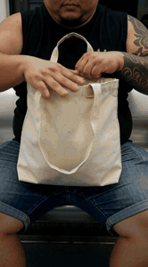</a> <a href="#hk-noodle-stall-1960s">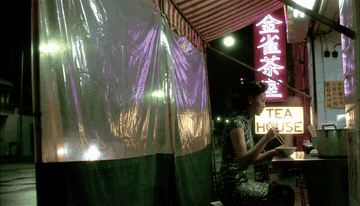</a> <a href="#kitten-and-fish-jar"></a> <a href="#neon-night-market-alley">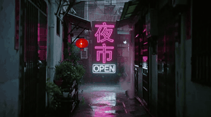</a> 

</div>

> Formerly **Awesome-GPTs**. The original GPTs list lives on in [legacy/awesome-gpts.md](legacy/awesome-gpts.md).

## Contents

- [Video prompts](#video) (11 entries)
  - [Text-to-video](#text-to-video) (9)
  - [Image-to-video](#image-to-video) (1)
  - [One scene, four modes](#mode-comparison)
- [Agent recipes: editing video](#recipes) (5 entries)
- [Image prompts](#image)
- [3D with agents](#threed)
- [Browse by tag](#tags)
- [How to read an entry](#how)
- [Contributing](#contributing)

<a id="video"></a>
## Video prompts

<a id="text-to-video"></a>
### Text-to-video

<a id="subway-kitten-tote-bag"></a>
#### Tough guy hides a kitten on the subway (15 s vertical)


Four-shot micro story for TikTok or Douyin. The opening paragraph describing amateur phone footage (sensor noise, green-leaning white balance, focus hunting, no grading) is what makes it read as real phone footage. Rendered with the 4-step turbo sampler.

[`phone-footage`](#tag-phone-footage) [`vertical`](#tag-vertical) [`short-drama`](#tag-short-drama) [`animals`](#tag-animals) [`multi-shot`](#tag-multi-shot) [`chinese-dialogue`](#tag-chinese-dialogue) [`15s`](#tag-15s)

<details><summary><b>Prompt</b> · MiniMax H3 (open weights, ComfyUI) · Text-to-video · 480x864 · 15.1 s · 4 steps (turbo) · audio</summary>

```text
integrated_multimodal_description: [Shot 1] Amateur handheld smartphone footage, vertical 9:16, shot on a phone main camera at f/1.8 held low at lap height across the aisle of a moving subway car. Harsh overhead fluorescent lighting, neutral white balance leaning slightly green, no colour grading, blown-out white highlights on the polished metal grab poles, visible sensor noise in the shadows under the seats, mild handheld micro-shake throughout, a brief autofocus hunt before the subject snaps sharp, fine motion blur on quick movement, slight lens vignetting in the corners. Tight framing on a scuffed beige canvas tote bag sitting on the knees of a heavily built bald man in a black sleeveless tank top, a large solid black tattoo sleeve covering his entire left forearm. The tote bag is already jerking and bulging violently from the inside, its top gaping open, and his broad tattooed hand is pressed down flat across it trying to hold it shut. The camera pushes in with small amplitude at slow speed toward the bag. Throughout the shot the bag keeps lurching sideways in short hard jolts, the stiff canvas denting outward and snapping back, his thick fingers spreading wide and re-gripping the rim as the fabric shifts under them, the whole frame rocking gently with the moving car. [Shot 2] At 00:04.200, the shot cuts to a slightly wider handheld angle from the same low seat height, the bald man in the black sleeveless tank top with the large solid black tattoo sleeve on his left forearm now framed from the chest up against a row of empty blue subway seats and a dark window streaked with tunnel lights. The camera tilts up with small amplitude at slow speed from the bag to his face. Throughout the shot he keeps his chin tucked down and his eyes flicking quickly left and right along the length of the car, hauling the jolting canvas bag in tight against his stomach with both forearms, his shoulders hunching higher as the bag shoves against him. With a low hushed voice (S1) he says: <d>[Chinese] 嘘,别叫。</d> [Shot 3] At 00:08.400, the shot cuts to a close handheld shot of the gaping top of the beige canvas tote bag, the man's black tattooed forearm filling the left edge of the frame. Throughout the shot the canvas is shoved apart from the inside and the head of a small pure white kitten with bright blue eyes forces its way up out of the bag, ears swivelling, mouth stretching open in a thin cry, its front paws hooking over the rim as it climbs higher, while the tattooed hand rushes in from the frame edge toward it and the lens briefly hunts for focus before snapping sharp on the kitten's face. [Shot 4] At 00:11.600, the shot cuts to a medium handheld shot of the bald man in the black sleeveless tank top, the large solid black tattoo sleeve on his left forearm catching the flat overhead fluorescent light. Throughout the shot his whole broad tattooed hand cups over the pure white kitten's head and eases it slowly back down into the canvas bag, he folds the gaping top shut under his palm, and his face breaks into a wide grin he cannot hold back as he glances once straight into the camera, after which both his hand and the bag settle and the frame comes to rest holding perfectly still.
overall_soundscape: A continuous low rumble and metallic clatter of a moving subway car, with a long rail squeal through a curve. Dry rustling and scraping of stiff canvas jerking against denim, and the rattle of a loose grab handle. A muffled station announcement over a tinny PA far down the car. A thin high kitten cry in the second half and a short breathy laugh through closed lips at the very end.
non_diegetic_music: Sparse single plucked ukulele notes enter at a slow tempo the moment the kitten appears, one note every two beats. A soft shaker joins on the last three seconds. Ends on one held note.
```

</details>

[Full video with sound](samples/subway-kitten-tote-bag.mp4) · [Entry file](prompts/video/subway-kitten-tote-bag.yaml)

<a id="hk-noodle-stall-1960s"></a>
#### 1960s Hong Kong noodle stall, one line of dialogue


Shows a full three-part H3 prompt: picture, soundscape, music. The spoken line goes inside `<d>[Chinese] ...</d>` and is voiced in sync with the character. Neon signage renders legibly when written as `large clean characters`.

[`cinematic`](#tag-cinematic) [`film-look`](#tag-film-look) [`dialogue`](#tag-dialogue) [`chinese-dialogue`](#tag-chinese-dialogue) [`neon-text`](#tag-neon-text) [`period-drama`](#tag-period-drama) [`landscape`](#tag-landscape)

<details><summary><b>Prompt</b> · MiniMax H3 (open weights, ComfyUI) · Text-to-video · 1344x768 · 5.2 s · 20 steps (res_multistep) · audio</summary>

```text
integrated_multimodal_description: [Shot 1] Live-action, cinematic, vintage film look with heavy 35mm grain, saturated emerald-green and deep-crimson color grading, shallow depth of field on a wide-aperture anamorphic lens with visible horizontal flares. A cramped Hong Kong street noodle stall at night in the 1960s. A woman in her late twenties (S1) sits alone at the counter in a fitted dark-green cheongsam with a pale floral pattern, her black hair pinned up, a thin curl of steam rising from the bowl in front of her. She is framed off-centre to the right, seen through the stall's hanging strips of translucent plastic that blur the left third of the frame. Behind her a vertical neon sign glows magenta with large clean characters reading "金雀茶室", and beneath it a smaller horizontal sign in warm white block letters reads "TEA HOUSE". The camera pushes in with small amplitude at slow speed toward her face. She lifts her chopsticks, pauses without eating, and turns her eyes to the empty stool beside her. With a low, slightly hoarse and unhurried voice (S1) she says: <d>[Chinese] 他今晚不会来了。</d> Then she looks back down at the bowl, and the steam bends across her face as a tram passes outside the frame, sliding a bar of white light left to right across the plastic strips and her cheek.
overall_soundscape: A continuous wet-street ambience of light rain on canvas awnings and the low rumble of night traffic sits underneath. Close to camera, broth simmers with a steady soft bubbling and a ladle taps twice against the rim of a metal pot. The hanging plastic strips rustle and click against each other. As the tram passes, a rising metallic hum and the squeal of steel wheels swells and then recedes.
non_diegetic_music: A slow bolero rhythm on muted strings with a solitary Spanish guitar figure repeating over sustained low cello notes, unhurried, holding the same tempo without building.
```

</details>

[Full video with sound](samples/hk-noodle-stall-1960s.mp4) · [Entry file](prompts/video/hk-noodle-stall-1960s.yaml)

<a id="kitten-and-fish-jar"></a>
#### Kitten knocks over the fish jar (15 s vertical)


Classic four-beat structure: setup, temptation, accident, innocent stare. The soundscape spells out every physical sound (pads on glass, the jar thud, the fish rattle), which the model renders in sync.

[`cinematic`](#tag-cinematic) [`vertical`](#tag-vertical) [`animals`](#tag-animals) [`comedy`](#tag-comedy) [`multi-shot`](#tag-multi-shot) [`15s`](#tag-15s)

<details><summary><b>Prompt</b> · MiniMax H3 (open weights, ComfyUI) · Text-to-video · 480x864 · 15.1 s · 20 steps (res_multistep) · audio</summary>

```text
integrated_multimodal_description: [Shot 1] Live-action, cinematic, warm natural morning light, shallow depth of field, vertical 9:16 mobile framing. A clean pale-wood kitchen counter seen from counter height, a tall clear glass jar packed with dried silver fish sitting slightly left of centre, a folded blue linen cloth behind it and an out-of-focus window in the background throwing soft light across the grain of the wood. From the lower edge of the frame the top of a ginger tabby kitten's head rises slowly into view, first two rounded ears, then a pair of wide amber eyes that lock onto the jar. The camera holds a static shot with a faint handheld drift. Throughout the shot the kitten keeps rising until its chin clears the counter edge, its pupils widening and its whiskers pushing forward as it stares at the jar. [Shot 2] At 00:04.200, the shot cuts to a tight close-up of the kitten's front paw, white-socked, reaching slowly across the wood toward the jar. The camera holds a low static shot at counter level. Throughout the shot the soft pink pads press against the cold glass, the paw testing and pushing, and the heavy jar begins to rock gently on its base, the dried fish shifting inside with each tilt. [Shot 3] At 00:08.400, the shot cuts to a wider view as the jar topples onto its side and rolls, dried silver fish spilling and scattering across the pale wood toward the camera. The camera shakes slightly as the jar lands. Throughout the shot the kitten freezes completely mid-reach, ears flattening back against its skull, its eyes going perfectly round while the last few fish keep sliding to a stop around its paws. [Shot 4] At 00:11.600, the shot cuts to a head-on medium close-up of the kitten from the owner's point of view, the spilled fish and the toppled jar filling the wood in front of it. One paw is still resting on the jar. Throughout the shot the kitten slowly draws that paw back and tucks it under its chest, blinks once very slowly, and holds a flat innocent stare directly into the lens.
overall_soundscape: A quiet morning kitchen room tone with a faint refrigerator hum and distant birdsong through glass. Soft pads tap and squeak against smooth cold glass, followed by the low woody rumble of a heavy jar rocking on a wooden counter. The jar lands with a dull hollow thud and rolls, and dozens of small dried fish scatter across wood in a fine dry rattle that tapers off. A single short high chirp-meow escapes the kitten just after the jar lands.
non_diegetic_music: Light pizzicato strings at a walking tempo with a soft marimba doubling the melody, pausing on one beat of silence as the jar lands, then returning quieter and slowing to a stop.
```

</details>

[Full video with sound](samples/kitten-and-fish-jar.mp4) · [Entry file](prompts/video/kitten-and-fish-jar.yaml)

<a id="night-train-ticket"></a>
#### Night train, a sentence carried across a cut

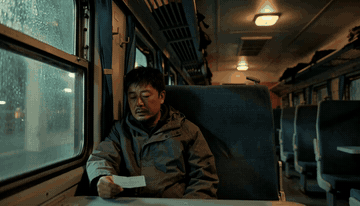

Two shots with a hard cut at 00:02.600. The `<scenetrans>` tag carries the voice across the cut, so the sentence starts in the medium close-up and ends on the close-up of the hand.

[`cinematic`](#tag-cinematic) [`film-look`](#tag-film-look) [`dialogue`](#tag-dialogue) [`chinese-dialogue`](#tag-chinese-dialogue) [`multi-shot`](#tag-multi-shot) [`landscape`](#tag-landscape)

<details><summary><b>Prompt</b> · MiniMax H3 (open weights, ComfyUI) · Text-to-video · 1344x768 · 5.2 s · 20 steps (res_multistep) · audio</summary>

```text
integrated_multimodal_description: [Shot 1] Live-action, cinematic, vintage film look with heavy 35mm grain and a cold teal-and-amber grade, shallow depth of field, slight lens breathing. Interior of a night train carriage, almost empty, warm tungsten ceiling lamps flickering as the train moves. A man in his forties (S1) sits by the window in a rumpled grey raincoat, unshaven, a paper ticket held loosely between two fingers. He is framed in a tight medium close-up from the aisle side, the black window beside him streaked with rain and the intermittent yellow smear of passing platform lights. The camera holds a static shot with a faint natural sway matching the carriage. He looks at the ticket, then out at the dark, and with a quiet, gravelly, unhurried voice (S1) begins to say: <d>[Chinese] 我等了她八年，</d><scenetrans> and the line continues uninterrupted into the next shot. [Shot 2] At 00:02.600, the shot cuts to a low static close-up of his hand on the armrest, the paper ticket now creased between his thumb and forefinger, the tungsten light catching the frayed cuff of his sleeve. <scenetrans>His voice carries over from the previous shot and remains audible across the transition as he finishes: <d>[Chinese] 就等这一趟车。</d> while his hand slowly tightens around the ticket until the paper buckles.
overall_soundscape: A steady rhythmic clatter of steel wheels over rail joints runs through the entire clip at a constant tempo, with the deep continuous rumble of the carriage underneath. Rain ticks against the window glass in irregular bursts. The loose ceiling lamp fitting rattles faintly on the same rhythm as the wheels, and fabric rustles as the man shifts his weight.
non_diegetic_music: A single sustained low cello note held under the entire scene, joined near the end by sparse, widely spaced piano notes in the upper register, very slow, never rising in volume.
```

</details>

[Full video with sound](samples/night-train-ticket.mp4) · [Entry file](prompts/video/night-train-ticket.yaml)

<a id="late-night-office"></a>
#### Alone in the office at night, nine fast cuts

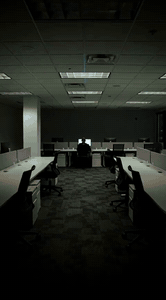

Nine shots in 15 seconds, with cuts as short as 0.5 s to build tension. Each shot gets its own timestamp and one clear action.

[`phone-footage`](#tag-phone-footage) [`vertical`](#tag-vertical) [`suspense`](#tag-suspense) [`multi-shot`](#tag-multi-shot) [`fast-cuts`](#tag-fast-cuts) [`15s`](#tag-15s)

<details><summary><b>Prompt</b> · MiniMax H3 (open weights, ComfyUI) · Text-to-video · 480x864 · 15.1 s · 4 steps (turbo) · audio</summary>

```text
integrated_multimodal_description: [Shot 1] Amateur handheld smartphone footage, vertical 9:16, shot on a phone main camera at f/1.8 in a dark open-plan office at night. Harsh mixed lighting: one overhead fluorescent panel still on above an empty desk bank and the cold blue-white glow of a single monitor, no colour grading, white balance leaning slightly green, visible sensor noise in the shadows, mild handheld micro-shake throughout, fine motion blur on quick movement. Wide shot from across the office of a woman (S1) alone at the far desk, seen small in frame, hunched toward the monitor, rows of empty chairs between her and the camera. The camera pushes in with small amplitude at slow speed down the aisle toward her. Throughout the shot she stays completely still except for one hand on the mouse, the monitor light flickering across the empty desks around her. [Shot 2] At 00:03.000, the shot cuts to a medium shot of the same woman from the side at desk height, her face lit only by the monitor, a black cardigan over her shoulders and her hair tied back. Throughout the shot she leans slowly forward toward the screen and her hand stops moving on the mouse. [Shot 3] At 00:05.000, the shot cuts to a close-up of her face straight on, the monitor glow filling her glasses. Throughout the shot her eyes track downward across the screen and her lips part slightly. [Shot 4] At 00:06.000, the shot cuts to an extreme close-up of her right eye, the reflected screen text sliding across the wet surface of the eye. [Shot 5] At 00:06.500, the shot cuts to an extreme close-up of her hand gripping the edge of the desk, the knuckles going pale. [Shot 6] At 00:07.000, the shot cuts to an extreme close-up of her mouth as her jaw sets hard. [Shot 7] At 00:07.500, the shot cuts back to the close-up of her whole face straight on, held steady. Throughout the shot she stares without blinking and her breathing lifts her shoulders twice. [Shot 8] At 00:09.500, the shot cuts to a wide shot from behind her chair looking past her at the bright monitor in the dark office, her silhouette small and black against it. Throughout the shot she slowly stands up out of the chair, the chair rolling back a short distance. [Shot 9] At 00:12.000, the shot cuts to a medium shot of the empty aisle of desks with the office door at the far end swinging shut, the fluorescent panel humming above rows of vacant chairs. Throughout the shot nothing moves except the door settling closed, and the frame comes to rest holding perfectly still.
overall_soundscape: A steady low hum of air conditioning and the electrical buzz of a fluorescent panel throughout. Sparse mouse clicks early on, then they stop. A chair caster rolling on carpet. A door latch clicking shut at the end. Two audible breaths through the nose.
non_diegetic_music: A single low sustained synth note enters quietly and holds, with one sharp percussive hit at the tightest moment, then falls away to silence.
```

</details>

[Full video with sound](samples/late-night-office.mp4) · [Entry file](prompts/video/late-night-office.yaml)

<a id="neon-night-market-alley"></a>
#### Neon night-market alley with bilingual signs


Text rendering test: the Chinese sign and the English OPEN sign stay legible through rain and camera motion. A timed background event (a cyclist at 00:02) is placed inside a single shot.

[`cinematic`](#tag-cinematic) [`neon-text`](#tag-neon-text) [`chinese-text`](#tag-chinese-text) [`rain`](#tag-rain) [`city`](#tag-city) [`landscape`](#tag-landscape)

<details><summary><b>Prompt</b> · MiniMax H3 (open weights, ComfyUI) · Text-to-video · 864x480 · 5.2 s · 20 steps (res_multistep) · audio</summary>

```text
integrated_multimodal_description: [Shot 1] Live-action cinematic shot, shallow depth of field, anamorphic lens flares. A rain-slick narrow alley at dusk in a dense Chinese city. Wet black asphalt fills the lower third, mirroring a vertical neon sign whose large clean characters read "夜市" in saturated magenta, and below it a smaller horizontal sign in crisp white block letters reading "OPEN". The camera pushes in slowly and steadily along the alley centreline for the entire duration. A single red paper lantern hangs midground left, swaying gently. Steady rain falls in fine bright streaks lit from behind, and thin steam drifts from a grate on the right. At 00:02.000 a cyclist in a translucent rain poncho crosses left to right through the far background, briefly occluding the magenta sign. At 00:04.000 the camera settles and the "OPEN" sign flickers once, then holds steady and fully legible.
overall_soundscape: Continuous fine rain on asphalt and metal awnings as the baseline bed, with individual droplets ticking on a tin roof close to camera. A low steady hum of distant traffic sits underneath. At the cyclist's pass, the wet whir of bicycle tyres through a puddle rises and falls quickly. A faint electrical buzz from the neon tubing persists throughout.
non_diegetic_music: Sparse ambient synth pad, very slow tempo, one low sustained bass note with a single distant reverbed piano figure, understated and never rising above the rain.
```

</details>

[Full video with sound](samples/neon-night-market-alley.mp4) · [Entry file](prompts/video/neon-night-market-alley.yaml)

<a id="headphone-macro-commercial"></a>
#### Headphone product film with end wordmark (15 s)

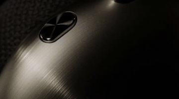

Studio product language: seamless black void, hard raking key, macro anamorphic. Four shots go from macro detail to hero shot, and the fictional brand name renders cleanly at the end.

[`product`](#tag-product) [`commercial`](#tag-commercial) [`macro`](#tag-macro) [`wordmark`](#tag-wordmark) [`multi-shot`](#tag-multi-shot) [`landscape`](#tag-landscape) [`15s`](#tag-15s)

<details><summary><b>Prompt</b> · MiniMax H3 (open weights, ComfyUI) · Text-to-video · 864x480 · 15.1 s · 4 steps (turbo) · audio</summary>

```text
integrated_multimodal_description: [Shot 1] Live-action, cinematic high-end product commercial, shot on a macro anamorphic lens at T2.8 against a seamless pure black void with no visible set, floor or horizon. Controlled studio lighting: one hard raking key from the upper left and a broad soft fill from directly above, deep true blacks, high micro-contrast, very shallow depth of field, immaculate dust-free surfaces, a subtle horizontal lens flare. Extreme macro framing on the curved outer edge of a brushed champagne aluminium earcup, its fine concentric machining lines catching the light, the anodised surface falling away into darkness at both edges of the frame. The camera arcs around the earcup with small amplitude at slow speed. Throughout the shot a single hard specular highlight travels steadily across the machined aluminium from left to right, the concentric turning marks igniting one ring at a time as it passes, while the surrounding void stays pure black. [Shot 2] At 00:04.200, the shot cuts to a wide shot of the complete over-ear headphones floating upright and centred in the same pure black void, seen three-quarters on: two brushed champagne aluminium earcups, a charcoal knit mesh canopy stretched across the headband, and a polished machined hinge on each side. A cool rim light traces the top edge of the headband while a warm key grazes the left earcup. The camera pulls out with small amplitude at slow speed while the headphones rotate slowly on their vertical axis. Throughout the shot the rotation carries the specular highlight from the left earcup across the polished hinge and onto the knit mesh, the fine knit texture briefly flaring into detail before falling back into shadow. [Shot 3] At 00:08.400, the shot cuts to an extreme macro of the charcoal knit mesh canopy filling the frame with its woven texture, a single knurled aluminium dial visible at the right edge of frame. Backlight passes through the knit so individual fibres glow along their edges. The camera pushes in with small amplitude at slow speed toward the dial. Throughout the shot the dial rotates a precise quarter turn, its knurled edge stepping past the light one groove at a time, while the backlight slowly strengthens so more of the knit fibres light up from behind. [Shot 4] At 00:11.600, the shot cuts to a centred hero shot of the complete headphones settling to a perfect standstill in the pure black void, lit by a single soft top light that defines the champagne aluminium and leaves the knit mesh in deep shadow. Below the headphones the wordmark "MoMo" appears in large clean white letters, sharp and perfectly still. Throughout the shot the headphones stay motionless while the light on the aluminium steadies, the wordmark holds crisp and unmoving, and the frame comes to rest holding perfectly still.
overall_soundscape: A deep quiet low-frequency room tone runs throughout. A soft airy whoosh crosses each shot change. One precise mechanical click as the dial steps round. A faint dry fabric rustle from the knit mesh.
non_diegetic_music: A single sustained synth pad enters at a slow tempo, joined by sparse piano notes one every two beats. A soft sub-bass swell lands on the wide reveal. Everything falls away to one held note at the end.
```

</details>

[Full video with sound](samples/headphone-macro-commercial.mp4) · [Entry file](prompts/video/headphone-macro-commercial.yaml)

<a id="morning-tea-stall"></a>
#### Tea stall at first light

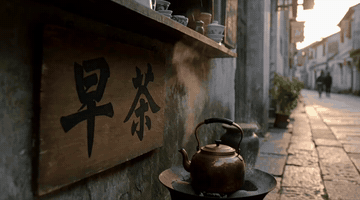

A calm single shot carried by small continuous changes: steam thickens, charcoal brightens, light creeps in. Write change across the whole shot with `Throughout the shot ...` and keep timestamps for cuts.

[`cinematic`](#tag-cinematic) [`chinese-text`](#tag-chinese-text) [`still-life`](#tag-still-life) [`ambience`](#tag-ambience) [`landscape`](#tag-landscape)

<details><summary><b>Prompt</b> · MiniMax H3 (open weights, ComfyUI) · Text-to-video · 864x480 · 5.2 s · 20 steps (res_multistep) · audio</summary>

```text
integrated_multimodal_description: [Shot 1] Live-action, cinematic, shallow depth of field on a wide-aperture lens. A quiet tea stall on a stone street at first light, mist still lying low over the cobbles. A copper kettle sits on a small charcoal brazier in the near foreground, a thin ribbon of steam rising and bending in the cold air. Behind it a weathered wooden board hangs at eye level with two large clean black characters reading "早茶" painted on it. The camera pushes in with small amplitude at slow speed toward the kettle. Throughout the shot the steam thickens and drifts left, the charcoal glows brighter under a faint draught, and pale morning light creeps across the stone from the right.
overall_soundscape: A low continuous hiss from the kettle with occasional soft ticks of expanding metal. Fine charcoal crackle sits close to the microphone, and a distant street slowly wakes with faint footsteps and a single bicycle bell.
non_diegetic_music: A single sustained low string note held throughout, joined near the end by two widely spaced notes on a wooden flute, very slow, never rising in volume.
```

</details>

[Full video with sound](samples/morning-tea-stall.mp4) · [Entry file](prompts/video/morning-tea-stall.yaml)

<a id="panda-web-comic"></a>
#### Crude 2D web-comic panda

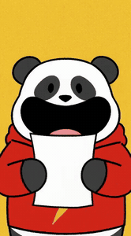

Style words for deliberately crude 2D: thick uniform outlines, flat pastel blocks, no gradients, paper grain, no depth of field.

[`2d-animation`](#tag-2d-animation) [`comic`](#tag-comic) [`meme`](#tag-meme) [`vertical`](#tag-vertical) [`character`](#tag-character)

<details><summary><b>Prompt</b> · MiniMax H3 (open weights, ComfyUI) · Text-to-video · 480x864 · 5.2 s · 4 steps (turbo) · audio</summary>

```text
integrated_multimodal_description: [Shot 1] 2D-animated web comic panel look, thick uniform black outlines, flat pastel colour blocking with no gradients, minimal background reduced to two or three flat colour fields, deliberately crude and low-detail drawing, slight paper grain, no depth of field, vertical 9:16 framing. The character is a crude round white panda-like head with two solid black eye patches and a simple wide black mouth, sitting on a small simply drawn body in a bright red hoodie with a large yellow lightning bolt printed across the chest. The character stands centred against a flat mustard-yellow background holding a single sheet of white paper up in front of its chest, mouth already stretched wide open. The camera holds as a static shot. Throughout the shot the character's arms shake the paper in short sharp jolts and its black eye patches squash downward, and at the end the movement settles and the frame comes to rest holding perfectly still.
overall_soundscape: A dry paper rustle in short bursts, and a light cartoon whoosh on each shake.
non_diegetic_music: A simple bouncy ukulele loop at a brisk tempo, one chord per beat.
```

</details>

[Full video with sound](samples/panda-web-comic.mp4) · [Entry file](prompts/video/panda-web-comic.yaml)

<a id="image-to-video"></a>
### Image-to-video

<a id="headphone-logo-reveal"></a>
#### Logo reveal continued from a still frame

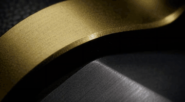

Image-to-video: the first line pins the input image to 0.00 s, then the usual three-part prompt follows. The input is the last frame of an earlier segment, which is how longer films are chained.

[`product`](#tag-product) [`commercial`](#tag-commercial) [`wordmark`](#tag-wordmark) [`image-to-video`](#tag-image-to-video) [`landscape`](#tag-landscape) [`15s`](#tag-15s)

<details><summary><b>Prompt</b> · MiniMax H3 (open weights, ComfyUI) · Image-to-video · 864x480 · 15.1 s · 4 steps (turbo) · audio</summary>

```text
For the target video, at 0.00 seconds into the target video, <Picture 1> (from [Shot 1]) is fully referenced.

integrated_multimodal_description: [Shot 1] Live-action, cinematic high-end product commercial, macro anamorphic lens at T2.8 against a seamless pure black void with no visible set, floor or horizon, one hard raking key from the upper left and a broad soft fill from directly above, deep true blacks, high micro-contrast, very shallow depth of field, immaculate dust-free surfaces, a subtle horizontal lens flare. The product is a pair of over-ear headphones with blunt hexagonal earcups milled from deep graphite anodised aluminium with a wide chamfered bevel around each face, a solid one-piece olive-bronze metal headband arching between them with no fabric or padding visible on its outer surface, and a single knurled olive-bronze dial set into the lower edge of the right earcup. The shot opens on the macro seam between headband and earcup and pulls out with small amplitude at slow speed until the complete headphones sit centred and motionless in the pure black void, lit by a single soft top light that defines the graphite hexagonal faces and the olive-bronze headband. Throughout the shot the pull-out decelerates smoothly to a stop and the frame comes to rest holding perfectly still. [Shot 2] At 00:07.600, the shot cuts to a locked-off centred hero shot of the same headphones on pure black, and below them the wordmark "MoMo" appears in large clean white letters, sharp and perfectly still. Throughout the shot the headphones stay completely motionless, the wordmark holds crisp and unmoving, and the frame comes to rest holding perfectly still.
overall_soundscape: A deep quiet low-frequency room tone runs throughout, fading toward near silence at the end.
non_diegetic_music: A sustained synth pad with sparse piano notes at a slow tempo, everything falling away to one held note at the end.
```

Input images: 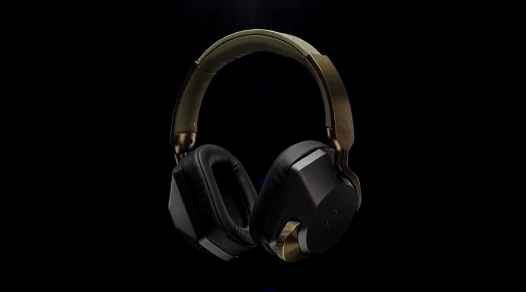

</details>

[Full video with sound](samples/headphone-logo-reveal.mp4) · [Entry file](prompts/video/headphone-logo-reveal.yaml)

<a id="mode-comparison"></a>
### One scene, four modes

<a id="lantern-alley-four-modes"></a>
#### One scene, four modes: text, image, keyframes, reference

<table><tr><td align="center">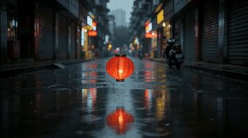<br><sub>Text-to-video</sub></td><td align="center">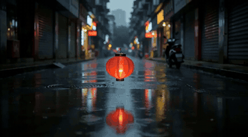<br><sub>Image-to-video</sub></td><td align="center">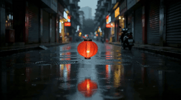<br><sub>Keyframes-to-video</sub></td><td align="center">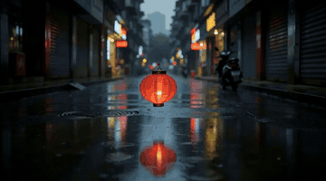<br><sub>Reference-to-video</sub></td></tr></table>

The same rainy alley made four ways. Text-to-video creates the scene; image-to-video continues from a frame; keyframes interpolate between a first and last frame; reference-to-video keeps the location and lighting of a reference image while generating new motion. Short one-line prompts are enough once an image carries the look.

[`cinematic`](#tag-cinematic) [`rain`](#tag-rain) [`city`](#tag-city) [`landscape`](#tag-landscape) [`mode-comparison`](#tag-mode-comparison) [`keyframes`](#tag-keyframes) [`reference-to-video`](#tag-reference-to-video) [`image-to-video`](#tag-image-to-video)

<details><summary><b>Prompt: Text-to-video</b> · MiniMax H3 (open weights, ComfyUI) · Text-to-video · 864x480 · 5.2 s · 20 steps (res_multistep) · audio</summary>

```text
Realistic cinematic look: a lone red paper lantern drifting over a rain-slick Chongqing alley at dusk, neon reflections rippling in puddles, slow dolly-in, shallow depth of field, gentle ambient rain and distant traffic.
```

</details>

<details><summary><b>Prompt: Image-to-video</b> · MiniMax H3 (open weights, ComfyUI) · Image-to-video · 864x480 · 5.2 s · 20 steps (res_multistep) · audio</summary>

```text
Continue the scene naturally from the opening frame: the red paper lantern drifts further down the rain-slick alley, camera pushes slowly forward, neon reflections sliding across the puddles, steady ambient rain.
```

Input images: 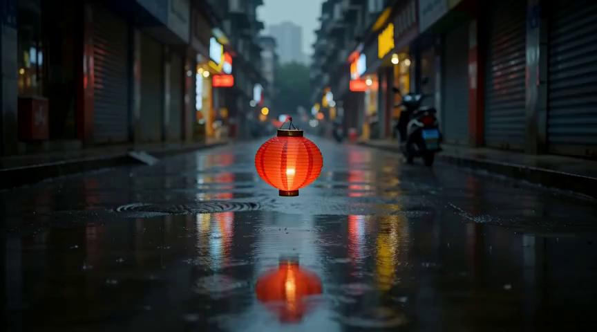

</details>

<details><summary><b>Prompt: Keyframes-to-video</b> · MiniMax H3 (open weights, ComfyUI) · Keyframes-to-video · 864x480 · 5.2 s · 20 steps (res_multistep) · audio</summary>

```text
Slow continuous dolly down the rain-slick neon alley, rain falling steadily.
```

Input images:  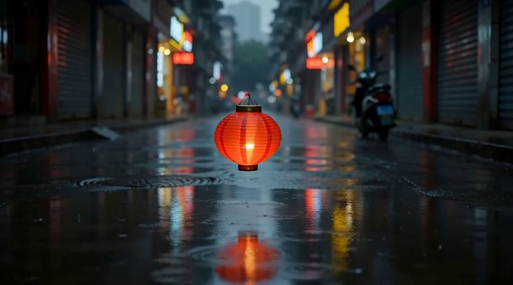

</details>

<details><summary><b>Prompt: Reference-to-video</b> · MiniMax H3 (open weights, ComfyUI) · Reference-to-video · 864x480 · 5.2 s · 20 steps (res_multistep) · audio</summary>

```text
Use <Picture 1> as the location and lighting reference. Keep the same rain-slick alley, the same neon palette and the same wet-asphalt reflections. A slow steady dolly moves down the alley while rain keeps falling; ambient rain and distant traffic.
```

Input images: 

</details>

[Full video with sound (Text-to-video)](samples/lantern-alley-four-modes-text-to-video.mp4) · [Full video with sound (Image-to-video)](samples/lantern-alley-four-modes-image-to-video.mp4) · [Full video with sound (Keyframes-to-video)](samples/lantern-alley-four-modes-keyframes-to-video.mp4) · [Full video with sound (Reference-to-video)](samples/lantern-alley-four-modes-reference-to-video.mp4) · [Entry file](prompts/video/lantern-alley-four-modes.yaml)

<a id="recipes"></a>
## Agent recipes: editing video

Tell a coding agent what you want in plain words. Each recipe records the request, the commands the agent ran, and the result.

<a id="teaser-montage"></a>
### Cut a teaser from clips of different sizes, with title and crossfades

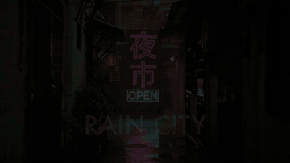

**Request to the agent**

> Make a 720p teaser called RAIN CITY from the first 4.5 seconds of the neon alley, noodle stall and night train clips. Half-second crossfades on picture and sound, the title over the opening, loudness normalised for social media, fade out at the end.

The inputs are 864x480 and 1344x768; every branch is scaled, cropped and resampled to the same size, frame rate and sample rate first, otherwise xfade and acrossfade refuse to join them. Total length is 3 x 4.5 s minus two 0.5 s overlaps = 12.5 s.

[`agent-editing`](#tag-agent-editing) [`ffmpeg`](#tag-ffmpeg) [`montage`](#tag-montage) [`title-card`](#tag-title-card) [`loudness`](#tag-loudness)

<details><summary><b>Commands the agent ran</b> · Agent: Claude Opus 5.5 in Claude Code · Tools: ffmpeg 9</summary>

```bash
ffmpeg -i samples/neon-night-market-alley.mp4 -i samples/hk-noodle-stall-1960s.mp4 -i samples/night-train-ticket.mp4 -filter_complex "
[0:v]trim=0:4.5,setpts=PTS-STARTPTS,scale=1280:720:force_original_aspect_ratio=increase,crop=1280:720,fps=24,format=yuv420p,setsar=1[v0];
[1:v]trim=0:4.5,setpts=PTS-STARTPTS,scale=1280:720:force_original_aspect_ratio=increase,crop=1280:720,fps=24,format=yuv420p,setsar=1[v1];
[2:v]trim=0:4.5,setpts=PTS-STARTPTS,scale=1280:720:force_original_aspect_ratio=increase,crop=1280:720,fps=24,format=yuv420p,setsar=1[v2];
[0:a]atrim=0:4.5,asetpts=PTS-STARTPTS,aresample=48000[a0];
[1:a]atrim=0:4.5,asetpts=PTS-STARTPTS,aresample=48000[a1];
[2:a]atrim=0:4.5,asetpts=PTS-STARTPTS,aresample=48000[a2];
[v0][v1]xfade=transition=fade:duration=0.5:offset=4[x1];
[x1][v2]xfade=transition=fade:duration=0.5:offset=8[x2];
[a0][a1]acrossfade=d=0.5[ax1];
[ax1][a2]acrossfade=d=0.5[ax2];
[x2]drawtext=fontfile=/System/Library/Fonts/Supplemental/Futura.ttc:text='RAIN CITY':fontcolor=white:fontsize=110:x=(w-tw)/2:y=h*0.70:alpha='if(lt(t,0.3),t/0.3,if(lt(t,2.0),1,if(lt(t,2.5),(2.5-t)/0.5,0)))',fade=t=in:st=0:d=0.4,fade=t=out:st=12.1:d=0.4[v];
[ax2]loudnorm=I=-16:TP=-1.5:LRA=11,afade=t=out:st=12:d=0.5[a]" \
  -map "[v]" -map "[a]" -c:v libx264 -crf 20 -c:a aac -b:a 160k -ar 48000 teaser.mp4
```

</details>

[Result](samples/recipe-teaser-montage.mp4) · [Entry file](recipes/teaser-montage.yaml)

<a id="bilingual-subtitles"></a>
### Transcribe dialogue and burn in Chinese and English subtitles

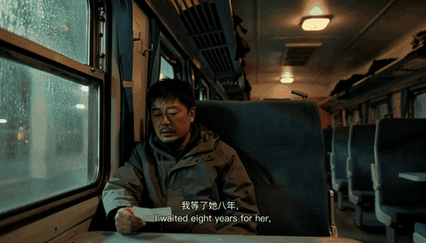

**Request to the agent**

> Transcribe the Chinese dialogue in samples/night-train-ticket.mp4, check it against the script in prompts/video/night-train-ticket.yaml, add an English line under each Chinese line, and burn the subtitles in.

Whisper gets homophones wrong in Chinese (他 and 她 sound identical). When a script exists, tell the agent to use it for wording and whisper only for timing.

[`agent-editing`](#tag-agent-editing) [`ffmpeg`](#tag-ffmpeg) [`whisper`](#tag-whisper) [`subtitles`](#tag-subtitles) [`bilingual`](#tag-bilingual) [`chinese-dialogue`](#tag-chinese-dialogue)

<details><summary><b>Commands the agent ran</b> · Agent: Claude Opus 5.5 in Claude Code · Tools: ffmpeg 9 with libass, openai-whisper medium</summary>

```bash
whisper samples/night-train-ticket.mp4 --model medium --language zh --output_format srt
# whisper heard 我等了他八年 / 就等着一趟车; the script says 我等了她八年 / 就等这一趟车.
# The agent kept whisper's timing, took the wording from the script, and added English lines:
#   1  00:00:00,000 --> 00:00:02,100  我等了她八年， / I waited eight years for her,
#   2  00:00:02,200 --> 00:00:04,200  就等这一趟车。 / all for this one train.
ffmpeg -i samples/night-train-ticket.mp4 \
  -vf "subtitles=subs.srt:force_style='FontName=PingFang SC,FontSize=15,Outline=1,Shadow=0,MarginV=22'" \
  -c:v libx264 -crf 20 -c:a copy subtitled.mp4
```

</details>

[Result](samples/recipe-bilingual-subtitles.mp4) · [Entry file](recipes/bilingual-subtitles.yaml)

<a id="vertical-blur-fill"></a>
### Turn a 16:9 clip into a 9:16 short with a blurred background

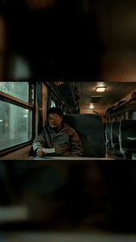

**Request to the agent**

> Make a 1080x1920 vertical version of samples/night-train-ticket.mp4 for TikTok. Keep the full frame visible in the middle and fill the top and bottom with a blurred, slightly darkened copy of the same video. Keep the original audio.

One ffmpeg call, 1.5 s on an M-series Mac for a 5 s clip. Use it when the subject spans the whole width; crop instead when the subject sits in the centre.

[`agent-editing`](#tag-agent-editing) [`ffmpeg`](#tag-ffmpeg) [`vertical`](#tag-vertical) [`reframe`](#tag-reframe)

<details><summary><b>Commands the agent ran</b> · Agent: Claude Opus 5.5 in Claude Code · Tools: ffmpeg 9</summary>

```bash
ffmpeg -i samples/night-train-ticket.mp4 -filter_complex "
  [0:v]scale=1080:1920:force_original_aspect_ratio=increase,crop=1080:1920,gblur=sigma=40,eq=brightness=-0.08[bg];
  [0:v]scale=1080:-2[fg];
  [bg][fg]overlay=(W-w)/2:(H-h)/2,format=yuv420p" \
  -c:v libx264 -crf 20 -c:a copy vertical.mp4
```

</details>

[Result](samples/recipe-vertical-blur-fill.mp4) · [Entry file](recipes/vertical-blur-fill.yaml)

<a id="split-shots"></a>
### Split a multi-shot clip into separate shots at the hard cuts

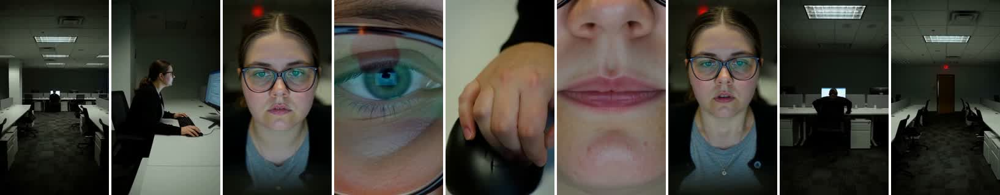

**Request to the agent**

> samples/late-night-office.mp4 should contain nine shots. Find the hard cuts, split the clip into one file per shot, and give me a storyboard strip with the middle frame of every shot.

Doubles as a QA check for generated video: all eight cuts landed within 0.17 s of the timestamps written in the prompt. Lower the threshold for soft cuts, raise it for handheld footage with lots of motion.

[`agent-editing`](#tag-agent-editing) [`ffmpeg`](#tag-ffmpeg) [`scene-detection`](#tag-scene-detection) [`storyboard`](#tag-storyboard) [`qa`](#tag-qa)

<details><summary><b>Commands the agent ran</b> · Agent: Claude Opus 5.5 in Claude Code · Tools: ffmpeg 9</summary>

```bash
# 1. find cuts
T=$(ffmpeg -i samples/late-night-office.mp4 -vf "scdet=threshold=8" -f null - 2>&1 \
    | grep -o "lavfi.scd.time: [0-9.]*" | awk '{print $2}' | paste -sd, -)
# -> 3.04,5.04,6.0,6.54,7.0,7.46,9.67,12.17  (prompt asked for 3.0,5.0,6.0,6.5,7.0,7.5,9.5,12.0)
# 2. split, forcing keyframes at the cuts so every file starts clean
ffmpeg -i samples/late-night-office.mp4 -c:v libx264 -crf 20 -force_key_frames "$T" -c:a aac \
  -f segment -segment_times "$T" -reset_timestamps 1 shot_%02d.mp4
# 3. storyboard strip
for f in shot_*.mp4; do
  mid=$(ffprobe -v error -show_entries format=duration -of csv=p=0 "$f" | awk '{printf "%.3f", $1/2}')
  ffmpeg -ss "$mid" -i "$f" -frames:v 1 -vf scale=-2:320 "${f%.mp4}.jpg"
done
ffmpeg -pattern_type glob -i "shot_*.jpg" -vf "tile=9x1:padding=4:color=white" -frames:v 1 storyboard.jpg
```

</details>

[Result](previews/recipe-split-shots.jpg) · [Entry file](recipes/split-shots.yaml)

<a id="readme-preview-gif"></a>
### Make a small looping GIF preview for a README


**Request to the agent**

> Make a looping GIF preview of every mp4 in samples/ for the README. Keep each under about 1.5 MB. Speed up clips longer than 8 seconds so the whole story still plays.

Every preview in this repository was made this way: 0.5 to 2 MB each. A per-clip palette with 96 colours and Bayer dithering keeps skin tones and neon clean at a small size.

[`agent-editing`](#tag-agent-editing) [`ffmpeg`](#tag-ffmpeg) [`gif`](#tag-gif) [`preview`](#tag-preview)

<details><summary><b>Commands the agent ran</b> · Agent: Claude Opus 5.5 in Claude Code · Tools: ffmpeg 9</summary>

```bash
# landscape: 360 px wide; vertical: 300 px tall; 2x speed when longer than 8 s
ffmpeg -i in.mp4 -vf "setpts=PTS/2,fps=8,scale=360:-2:flags=lanczos,split[a][b];[a]palettegen=max_colors=96[p];[b][p]paletteuse=dither=bayer:bayer_scale=4" -loop 0 out.gif
```

</details>

[Result](previews/hk-noodle-stall-1960s.gif) · [Entry file](recipes/readme-preview-gif.yaml)

<a id="image"></a>
## Image prompts

The first batch is being tested. Entries go live once each prompt has a real output to show.

<a id="threed"></a>
## 3D with agents

Recipes for building 3D scenes with coding agents (Blender MCP, three.js) are being tested.

<a id="tags"></a>
## Browse by tag

- <a id="tag-15s"></a>`15s` (5): [Tough guy hides a kitten on the subway (15 s vertical)](#subway-kitten-tote-bag), [Kitten knocks over the fish jar (15 s vertical)](#kitten-and-fish-jar), [Alone in the office at night, nine fast cuts](#late-night-office), [Headphone product film with end wordmark (15 s)](#headphone-macro-commercial), [Logo reveal continued from a still frame](#headphone-logo-reveal)
- <a id="tag-2d-animation"></a>`2d-animation` (1): [Crude 2D web-comic panda](#panda-web-comic)
- <a id="tag-agent-editing"></a>`agent-editing` (5): [Cut a teaser from clips of different sizes, with title and crossfades](#teaser-montage), [Transcribe dialogue and burn in Chinese and English subtitles](#bilingual-subtitles), [Turn a 16:9 clip into a 9:16 short with a blurred background](#vertical-blur-fill), [Split a multi-shot clip into separate shots at the hard cuts](#split-shots), [Make a small looping GIF preview for a README](#readme-preview-gif)
- <a id="tag-ambience"></a>`ambience` (1): [Tea stall at first light](#morning-tea-stall)
- <a id="tag-animals"></a>`animals` (2): [Tough guy hides a kitten on the subway (15 s vertical)](#subway-kitten-tote-bag), [Kitten knocks over the fish jar (15 s vertical)](#kitten-and-fish-jar)
- <a id="tag-bilingual"></a>`bilingual` (1): [Transcribe dialogue and burn in Chinese and English subtitles](#bilingual-subtitles)
- <a id="tag-character"></a>`character` (1): [Crude 2D web-comic panda](#panda-web-comic)
- <a id="tag-chinese-dialogue"></a>`chinese-dialogue` (4): [Tough guy hides a kitten on the subway (15 s vertical)](#subway-kitten-tote-bag), [1960s Hong Kong noodle stall, one line of dialogue](#hk-noodle-stall-1960s), [Night train, a sentence carried across a cut](#night-train-ticket), [Transcribe dialogue and burn in Chinese and English subtitles](#bilingual-subtitles)
- <a id="tag-chinese-text"></a>`chinese-text` (2): [Neon night-market alley with bilingual signs](#neon-night-market-alley), [Tea stall at first light](#morning-tea-stall)
- <a id="tag-cinematic"></a>`cinematic` (6): [1960s Hong Kong noodle stall, one line of dialogue](#hk-noodle-stall-1960s), [Kitten knocks over the fish jar (15 s vertical)](#kitten-and-fish-jar), [Night train, a sentence carried across a cut](#night-train-ticket), [Neon night-market alley with bilingual signs](#neon-night-market-alley), [Tea stall at first light](#morning-tea-stall), [One scene, four modes: text, image, keyframes, reference](#lantern-alley-four-modes)
- <a id="tag-city"></a>`city` (2): [Neon night-market alley with bilingual signs](#neon-night-market-alley), [One scene, four modes: text, image, keyframes, reference](#lantern-alley-four-modes)
- <a id="tag-comedy"></a>`comedy` (1): [Kitten knocks over the fish jar (15 s vertical)](#kitten-and-fish-jar)
- <a id="tag-comic"></a>`comic` (1): [Crude 2D web-comic panda](#panda-web-comic)
- <a id="tag-commercial"></a>`commercial` (2): [Headphone product film with end wordmark (15 s)](#headphone-macro-commercial), [Logo reveal continued from a still frame](#headphone-logo-reveal)
- <a id="tag-dialogue"></a>`dialogue` (2): [1960s Hong Kong noodle stall, one line of dialogue](#hk-noodle-stall-1960s), [Night train, a sentence carried across a cut](#night-train-ticket)
- <a id="tag-fast-cuts"></a>`fast-cuts` (1): [Alone in the office at night, nine fast cuts](#late-night-office)
- <a id="tag-ffmpeg"></a>`ffmpeg` (5): [Cut a teaser from clips of different sizes, with title and crossfades](#teaser-montage), [Transcribe dialogue and burn in Chinese and English subtitles](#bilingual-subtitles), [Turn a 16:9 clip into a 9:16 short with a blurred background](#vertical-blur-fill), [Split a multi-shot clip into separate shots at the hard cuts](#split-shots), [Make a small looping GIF preview for a README](#readme-preview-gif)
- <a id="tag-film-look"></a>`film-look` (2): [1960s Hong Kong noodle stall, one line of dialogue](#hk-noodle-stall-1960s), [Night train, a sentence carried across a cut](#night-train-ticket)
- <a id="tag-gif"></a>`gif` (1): [Make a small looping GIF preview for a README](#readme-preview-gif)
- <a id="tag-image-to-video"></a>`image-to-video` (2): [Logo reveal continued from a still frame](#headphone-logo-reveal), [One scene, four modes: text, image, keyframes, reference](#lantern-alley-four-modes)
- <a id="tag-keyframes"></a>`keyframes` (1): [One scene, four modes: text, image, keyframes, reference](#lantern-alley-four-modes)
- <a id="tag-landscape"></a>`landscape` (7): [1960s Hong Kong noodle stall, one line of dialogue](#hk-noodle-stall-1960s), [Night train, a sentence carried across a cut](#night-train-ticket), [Neon night-market alley with bilingual signs](#neon-night-market-alley), [Headphone product film with end wordmark (15 s)](#headphone-macro-commercial), [Tea stall at first light](#morning-tea-stall), [Logo reveal continued from a still frame](#headphone-logo-reveal), [One scene, four modes: text, image, keyframes, reference](#lantern-alley-four-modes)
- <a id="tag-loudness"></a>`loudness` (1): [Cut a teaser from clips of different sizes, with title and crossfades](#teaser-montage)
- <a id="tag-macro"></a>`macro` (1): [Headphone product film with end wordmark (15 s)](#headphone-macro-commercial)
- <a id="tag-meme"></a>`meme` (1): [Crude 2D web-comic panda](#panda-web-comic)
- <a id="tag-mode-comparison"></a>`mode-comparison` (1): [One scene, four modes: text, image, keyframes, reference](#lantern-alley-four-modes)
- <a id="tag-montage"></a>`montage` (1): [Cut a teaser from clips of different sizes, with title and crossfades](#teaser-montage)
- <a id="tag-multi-shot"></a>`multi-shot` (5): [Tough guy hides a kitten on the subway (15 s vertical)](#subway-kitten-tote-bag), [Kitten knocks over the fish jar (15 s vertical)](#kitten-and-fish-jar), [Night train, a sentence carried across a cut](#night-train-ticket), [Alone in the office at night, nine fast cuts](#late-night-office), [Headphone product film with end wordmark (15 s)](#headphone-macro-commercial)
- <a id="tag-neon-text"></a>`neon-text` (2): [1960s Hong Kong noodle stall, one line of dialogue](#hk-noodle-stall-1960s), [Neon night-market alley with bilingual signs](#neon-night-market-alley)
- <a id="tag-period-drama"></a>`period-drama` (1): [1960s Hong Kong noodle stall, one line of dialogue](#hk-noodle-stall-1960s)
- <a id="tag-phone-footage"></a>`phone-footage` (2): [Tough guy hides a kitten on the subway (15 s vertical)](#subway-kitten-tote-bag), [Alone in the office at night, nine fast cuts](#late-night-office)
- <a id="tag-preview"></a>`preview` (1): [Make a small looping GIF preview for a README](#readme-preview-gif)
- <a id="tag-product"></a>`product` (2): [Headphone product film with end wordmark (15 s)](#headphone-macro-commercial), [Logo reveal continued from a still frame](#headphone-logo-reveal)
- <a id="tag-qa"></a>`qa` (1): [Split a multi-shot clip into separate shots at the hard cuts](#split-shots)
- <a id="tag-rain"></a>`rain` (2): [Neon night-market alley with bilingual signs](#neon-night-market-alley), [One scene, four modes: text, image, keyframes, reference](#lantern-alley-four-modes)
- <a id="tag-reference-to-video"></a>`reference-to-video` (1): [One scene, four modes: text, image, keyframes, reference](#lantern-alley-four-modes)
- <a id="tag-reframe"></a>`reframe` (1): [Turn a 16:9 clip into a 9:16 short with a blurred background](#vertical-blur-fill)
- <a id="tag-scene-detection"></a>`scene-detection` (1): [Split a multi-shot clip into separate shots at the hard cuts](#split-shots)
- <a id="tag-short-drama"></a>`short-drama` (1): [Tough guy hides a kitten on the subway (15 s vertical)](#subway-kitten-tote-bag)
- <a id="tag-still-life"></a>`still-life` (1): [Tea stall at first light](#morning-tea-stall)
- <a id="tag-storyboard"></a>`storyboard` (1): [Split a multi-shot clip into separate shots at the hard cuts](#split-shots)
- <a id="tag-subtitles"></a>`subtitles` (1): [Transcribe dialogue and burn in Chinese and English subtitles](#bilingual-subtitles)
- <a id="tag-suspense"></a>`suspense` (1): [Alone in the office at night, nine fast cuts](#late-night-office)
- <a id="tag-title-card"></a>`title-card` (1): [Cut a teaser from clips of different sizes, with title and crossfades](#teaser-montage)
- <a id="tag-vertical"></a>`vertical` (5): [Tough guy hides a kitten on the subway (15 s vertical)](#subway-kitten-tote-bag), [Kitten knocks over the fish jar (15 s vertical)](#kitten-and-fish-jar), [Alone in the office at night, nine fast cuts](#late-night-office), [Crude 2D web-comic panda](#panda-web-comic), [Turn a 16:9 clip into a 9:16 short with a blurred background](#vertical-blur-fill)
- <a id="tag-whisper"></a>`whisper` (1): [Transcribe dialogue and burn in Chinese and English subtitles](#bilingual-subtitles)
- <a id="tag-wordmark"></a>`wordmark` (2): [Headphone product film with end wordmark (15 s)](#headphone-macro-commercial), [Logo reveal continued from a still frame](#headphone-logo-reveal)

<a id="how"></a>
## How to read an entry

- **Prompt**: the exact text sent to the model. Copy it with the button on the code block.
- **Settings**: model, mode, resolution, length, sampler steps, whether audio was generated.
- **Preview**: a silent GIF. Open **Full video** for the original file with sound.
- **Source**: each entry is one YAML file. This README is generated from them.

<a id="contributing"></a>
## Contributing

1. Add one YAML file under `prompts/` or `recipes/` (copy any existing entry as a template).
2. Include the exact prompt, the model and settings, and the unedited output in `samples/`.
3. Run `python scripts/build.py` to regenerate both READMEs, then open a pull request.
4. Entries without a real output are closed. Promotional links are closed.

## Related lists by the same maintainers

- [awesome-prompts](https://github.com/ai-boost/awesome-prompts): prompts for LLMs and agents
- [awesome-harness-engineering](https://github.com/ai-boost/awesome-harness-engineering): building reliable agent harnesses

## License

GPL-3.0, unchanged from the original repository.
