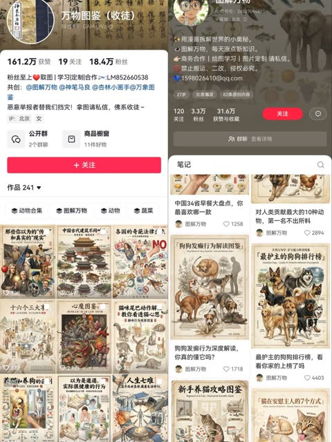
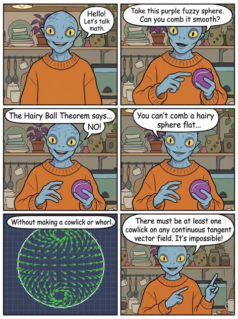

<div align="center">

<h1>Awesome Image & Video Prompts</h1>

<p>Copy-ready prompts for the leading AI video and image models, each with its real output and a link to where it came from. Plus agent recipes for editing video.</p>

<p><b>English</b> · <a href="README_zh.md">简体中文</a></p>

<p>Search, filter and copy in the <a href="https://agentcraft.dev/en/prompts/">online gallery</a></p>

<p><a href="https://awesome.re"></a></p>

<a href="#seedance-seoul-subway-revenge"></a> <a href="pages/en/video-wan30.md#wan-time-space-train"></a> <a href="pages/en/video-minimaxh3.md#h3-starship-hyperspace-jump"></a> <a href="pages/en/video-geminiomniflash.md#omni-four-style-progression"></a> <a href="pages/en/video-kling30.md#kling-moonlit-garden-run"></a> <a href="#veo-off-road-rally"></a> 

</div>

> Formerly **Awesome-GPTs**. The original GPTs list lives on in [legacy/awesome-gpts.md](legacy/awesome-gpts.md).

## Contents

- [Recently added](#recent)
- [Video prompts](#video) (343 entries)
  - [Wan 3.0](#wan30) (18)
  - [MiniMax H3](#minimaxh3) (80)
  - [Seedance 2.5](#seedance25) (146)
  - [Gemini Omni Flash](#geminiomniflash) (26)
  - [Kling 4.0](#kling40) (26)
  - [Kling 3.0](#kling30) (28)
  - [Veo 3.1](#veo31) (10)
  - [Veo 3](#veo3) (5)
  - [Sora 2](#sora2) (4)
- [Image prompts](#image) (618 entries)
  - [Posters and editorial layouts](#img-poster) (97)
  - [Infographics and slides](#img-infographic) (42)
  - [Phone and UI mockups](#img-ui-mockup) (14)
  - [Product shots and e-commerce](#img-product) (19)
  - [Logos, ads and packaging](#img-brand) (14)
  - [Photo realism](#img-realism) (26)
  - [Portraits](#img-portrait) (144)
  - [Characters and figures](#img-character) (45)
  - [Illustration](#img-illustration) (65)
  - [Comics and storyboards](#img-comic) (12)
  - [Photo to art](#img-photo-to-art) (52)
  - [Architecture and interiors](#img-architecture) (15)
  - [Maps](#img-map) (7)
  - [Collage](#img-collage) (41)
  - [Photo editing](#img-edit) (25)
- [Agent recipes: editing video](#recipes) (5 entries)
- [Guides and skills](#guides)
- [3D with agents](#threed)
- [Browse by tag](#tags)
- [Contributing](#contributing)

<a id="recent"></a>
## Recently added

- 2026-10-29 · [Encyclopedia infographic card of the James Webb Telescope](#gpt-image-encyclopedia-infographic-topic-template) · GPT Image 2
- 2026-10-29 · [Kyoto Street Monoline Travel Poster in Red](#nano-banana-monoline-city-travel-poster-kyoto) · Nano Banana 2
- 2026-10-29 · [Three Fluffy Creatures Planning a Treehouse](#nano-banana-fluffy-creatures-treehouse-story) · Nano Banana 2
- 2026-10-29 · [Natural history encyclopedia infographic of cat breeds](#gpt-image-museum-encyclopedia-cat-breeds-infographic) · GPT Image 2
- 2026-10-29 · [Artbook character identity board from a reference image](#gpt-image-character-identity-board-from-reference) · GPT Image 2
- 2026-10-29 · [Stylized 3D caricature portrait with elongated neck](#nano-banana-3d-caricature-elongated-neck-portrait) · Nano Banana 2
- 2026-10-29 · [Blurry old toddler photo restored to DSLR quality](#nano-banana-old-photo-dslr-restoration) · Nano Banana 2
- 2026-10-29 · [Anime style panorama of Shibuya Crossing from map screenshot](#nano-banana-map-screenshot-anime-panorama-shibuya) · Nano Banana 2
- 2026-10-29 · [Ball-shaped baby sea otter floating in kelp](#nano-banana-ball-shaped-cute-animal) · Nano Banana 2
- 2026-10-29 · [Endangered Bengal Tiger Annotated Infographic Poster](#gpt-image-endangered-animal-infographic-bengal-tiger) · GPT Image 2
- 2026-10-29 · [Split editorial poster pairing photo with handmade collage](pages/en/image-poster.md#gpt-image-photo-to-handmade-collage-split-poster) · GPT Image 2
- 2026-10-29 · [Six image lookbook for fictional streetwear brand](#gpt-image-vinco-fictional-brand-lookbook-grid) · GPT Image 2

<a id="video"></a>
## Video prompts

Every prompt below is quoted verbatim from its source: the model maker's own guide or model card, or a creator's post on X with the video attached. Click a thumbnail to watch the original with sound. Sections follow the [Artificial Analysis video arena](https://artificialanalysis.ai/video/leaderboard/text-to-video) ranking; creator posts are sorted by likes, counted on the date shown.

<a id="wan30"></a>
## Wan 3.0

<a id="wan-fashion-face-closeup-flash-orbit"></a>
### Ultra close fashion portrait with candid flashes

<a href="https://x.com/leaf_sanren/status/2105645639703183753"></a>

The prompt splits the 15 seconds into five timed beats, each with its own camera move, gaze and flash cue. It also lists real skin flaws and bans plastic skin, which keeps the face photographic.

Wan 3.0 · Text-to-video · Source: [@leaf_sanren on X](https://x.com/leaf_sanren/status/2105645639703183753) · 1,439 likes on 2026-10-27

[`portrait`](pages/en/tags.md#tag-portrait) [`fashion`](pages/en/tags.md#tag-fashion) [`close-up`](pages/en/tags.md#tag-close-up) [`skin-texture`](pages/en/tags.md#tag-skin-texture) [`vertical`](pages/en/tags.md#tag-vertical)

<details><summary><b>Prompt</b></summary>

```text
Generate this video: Create a 15-second, 9:16 vertical screen, ultra-high-definition 4K, 30fps, cinematic realistic portrait quality fashion portrait short film.

The main subject of the frame is a young Asian woman around 20-25 years old, with a high-end face—cool with a touch of youthful greenness, delicate features but not overly perfect, smooth facial contours, natural nose bridge, full lips, eyes with depth, overall vibe like a car model or a close-up candid shot by a photographer at a fashion event.
No influencer vibe, no exaggerated plastic surgery face, no plastic skin, no excessive skin smoothing, no overly heavy fake lashes, no exaggerated highlights, no anime feel.
The character's skin must be realistic: clearly visible pores, subtle skin texture, light foundation caking, faint acne marks, very shallow pockmarks, under-eye fine lines, natural contours on nose wings and cheeks, lip lines, a few stray hairs and hair edge wisps. Makeup is refined but imperfect high-end subtle look: base slightly adherent but not flawless, clean eye makeup, naturally realistic lashes, lips with a subtle sheen.
Hair is black or dark brown straight long hair, with natural stray strands and a slight messy feel, not too deliberate.

Scene and Atmosphere

Scene is a high-end fashion event venue / auto show activity area / luxury brand launch event close-up portrait atmosphere, but the background must be blurred, not highlighting specific brands or text. Background can include soft exhibition hall lighting, minimal out-of-focus neon reflections, blurred crowds, blurred car body highlight reflections or metallic texture backgrounds, overall atmosphere high-end, restrained, fashionable.
No subtitles, no stickers, no watermarks, no readable text, no exaggerated effects, no illogical flashy lights.

Lighting Requirements

Lighting must conform to real-world logic, like a real photographer shooting close-up at the event site.
Main light is soft but directional facial key light, coming from slightly off to the front upper side, creating natural facial light and shadow layers.
Fill light is very subtle, retaining some shadows to enhance facial dimensionality.
Environment can include soft cool-toned rim light or auto show site reflection light to make the face more three-dimensional.
Throughout, allow 2 to 3 brief flash occurrences; flashes must feel like natural on-site photography flashes, quickly lighting up only in certain moments, causing temporary enhancement of facial highlights, more obvious pupil catchlights, brighter skin reflections, but no constant strobing, no illogical flashing.
When flashes occur, it should feel like a photographer's candid shot: lights up once and done, realistic light ratios, face not overexposed, skin details still visible.

Camera and Movement (Top-Tier Cinematography)

Overall, use ultra-close portrait movement, with the lens always orbiting the face to highlight eyes, nose bridge, lips, cheeks, hair strands, and skin texture.
Cinematography language is high-end, fluid, restrained, with a fashion ad and backstage photography candid feel.
No heavy shaky cam, no disorienting motion, no exaggerated AI camera moves, no sudden pull-backs.
Movement must feel natural, like a high-end photographer using a handheld gimbal or slight handheld shooting:

0-3 seconds

Lens starts with an ultra-close side-front face push-in, focus on eyes and nose bridge area, subject slightly lifts gaze to lens, natural breathing feel, lips subtly relaxed.
Lens does an extremely subtle slow push-in, with very light lateral sliding, showcasing cheeks, under-eye texture, and hair strands.
This segment should make viewers feel the face's high-end realism right from the first glance.

3-6 seconds

Lens slides along the face from eyes to nose tip, then to near the lips, in an extremely steady micro-arc orbit, close-up observation of features.
Subject's gaze subtly shifts, no exaggerated acting—just gently looks toward lens edge, then slowly back to lens.
First flash can occur here, briefly lighting up to enhance skin texture and lip highlights.

6-9 seconds

Lens slowly turns from front-left to front-right, still maintaining face-push distance, emphasizing cheek skin texture, nose wing details, lower eyelid fine lines, lashes, and pupil reflections.
Subject lightly brushes a bit of hair, or a stray strand naturally falls to the side of the face.
Lens has a subtle breathing-like float for real photography feel, not rigid.

9-12 seconds

Lens subtly shifts down to highlight lips, jawline, and cheeks, then slowly back to eyes.
Subject's expression stays cool, restrained, with a touch of high-end aloofness, like a car model caught close-up by a photographer, occasionally a gentle blink, corners of mouth with extremely subtle relaxation.
Second flash occurs here, natural and instantaneous like on-site candid, returning to normal light after.
Post-flash, catchlights in eyes more prominent, giving the frame more fashion editorial vibe.

12-15 seconds

Lens does one of the most beautiful ultra-close light arc closes, subtly orbiting the face and lightly pushing in, finally settling on an ideal composition of eyes + nose bridge + half lips.
Subject gently lifts gaze to straight-on lens in the last second, eyes clean, calm, captivating.
Ending can have a third very subtle flash or environmental highlight sweep, but must feel natural, not overdone.
Finally holds on a high-end face-push frame perfect for a thumbnail cover.

Frame Style

Overall style is:
Real cinematic fashion portrait, close-up commercial photography, auto show model face-close candid, high-end magazine feel, natural skin texture, non-studio fake-face sense.
Include real lens bokeh, natural depth of field, fine skin quality, subtle on-site feel, restrained high-end vibe.
Not influencer selfie, not live stream, not Korean-style skin smoothing, not low-quality AI face.

Key Emphases

Face must be real, not fake

Skin can't be overly perfect, retain subtle imperfections

Features stable, no distortion

Eyes can't wander, lips can't move randomly

Hair strands must be real, with stray hairs

Flashes must follow real candid logic

Lighting must be real, no random strobing

Camera must be high-end, smooth, cinematic, fashion photography feel

Whole piece centers on "high-end face close-up showcase," no plot, no big movements

Negative Restrictions (Suggest Adding Together)

Negative prompts:
Cartoonish feel, CG feel, plastic skin, excessive smoothing, over-beautification, feature distortion, eye misalignment, skin wax figure feel, overexposure, illogical flash strobing, face shake, low clarity, low-quality hair strands, exaggerated filters, influencer face, overly heavy fake lashes, heavy makeup, shaky lens, limb distortion, cluttered background, readable text, subtitles, stickers, watermarks,
```

</details>

<a id="wan-marina-night-out-quay-leap"></a>
### Night out friends and a quay leap

<a href="https://x.com/mightyking/status/2091842964054212842"></a>

Opens with a style and characters block and a setting block, then a timestamped shot list that gives each beat its own camera move such as a backward track, a whip tilt and a high angle look down. A separate audio block asks for live sync sound with no music, which supports the raw phone footage look.

Wan 3.0 · Text-to-video · Source: [@mightyking on X](https://x.com/mightyking/status/2091842964054212842) · 1,353 likes on 2026-10-27

[`ugc`](pages/en/tags.md#tag-ugc) [`handheld`](pages/en/tags.md#tag-handheld) [`night`](pages/en/tags.md#tag-night) [`shot-list`](pages/en/tags.md#tag-shot-list) [`sync-sound`](pages/en/tags.md#tag-sync-sound)

<details><summary><b>Prompt</b></summary>

```text
Raw vertical phone video (UGC), handheld throughout, filmed by a friend who walks with the group, casual sway, natural night lighting, wide-angle lens, deep focus.

Characters

The hero is a young woman with long dark hair in a deep-purple one-shoulder dress with a small shoulder bag.

Her three friends: one in a dark brown dress, a blonde in a black wrap dress, a blonde in a white mini dress — party dresses and sandals.

Laughing, spontaneous night-out energy.

Setting

A luxury marina at night — a stone quay along a narrow water slip flanked on both sides by large moored luxury yachts, big white hulls rising on either side, masts and rigging above, fenders on the hulls.

Warm orange street lamps, palm trees, distant city lights.

The yachts glow with blue-turquoise underwater LED lights spilling into the water; a yellow mooring line runs to the stone.

Shot list

0.0s–4.0s — Wide tracking shot, eye level, camera moving backward
The camera walks backward ahead of the four women as they stroll toward it down the marina promenade, framed head-to-toe, laughing and chatting in French; warm lamplight and palm trees behind, slight handheld bob.

4.0s–6.0s — Medium shot, eye level, backward track + quick left pan
The woman in the purple dress surges ahead of the group toward the lens, one arm raised, hair flying; the camera, on their left, keeps tracking back and pans to hold her.

6.0s–8.0s — Medium-wide, camera tilts down-left to follow, whip motion
She reaches the quay edge between the moored luxury yachts and launches headfirst over the edge; the handheld camera whips left and tilts down to chase her off the stone.

8.0s–10.0s — High-angle wide, looking down at the water, slight jolt
From up on the quay the camera looks down as she plunges headfirst into the blue-turquoise water in the slip between the big yacht hulls — a big splash, the underwater lights glowing around the impact; the handheld frame jolts slightly with the motion.

10.0s–13.0s — High-angle medium, looking down, small handheld drift
She surfaces in the teal water, gasping and laughing up at the camera, hair slicked back, treading water.

13.0s–16.0s — Handheld tilt up and back down, slight zoom
The camera lifts off the water and tilts up to a person leaning on the deck railing of one of the moored luxury yachts, watching her in the water, then tilts back down and zooms slightly in on her still treading and laughing.

16.0s–20.0s — High-angle medium, tilting to follow her up
She swims to the stone quay wall, reaches up and grabs a thick dark mooring pole, and hauls herself out; the camera tilts upward with her as she rises from the water, legs braced on the stone.

20.0s–23.0s — Low/close medium at the quay edge, static handheld
She climbs onto the stone lip, rolls onto her side, soaked dress clinging, then pushes up to her feet; the camera holds close, catching the water running off her.

23.0s–27.0s — Medium shot, eye level, loose handheld reframe
Back on the promenade, dripping wet, she flips her long wet hair forward and wrings it out, laughing, as her friends and passing pedestrians move behind her.

27.0s–30.0s — Medium shot, eye level, camera settles
Still dripping, she straightens up and strikes a confident, playful pose for the camera — hand on hip, tossing her wet hair back with a big smile — her friends laughing around her; the camera holds on the pose to end.

Audio

Live sync sound — friends laughing and shouting excitedly in French, a scream at the leap, a big water splash, water sloshing against the yacht hulls, wet footsteps on stone, ambient night marina sounds.
No music.

Style

Raw amateur vertical phone footage, natural night lighting, warm street lamps mixing with the turquoise underwater yacht glow, authentic handheld motion.
```

</details>

<a id="wan-camera-angle-swap"></a>
### Re-shoot your clip from new camera angles, same action

<a href="https://x.com/Framer_X/status/2101324357108658433"></a>

Upload one continuous shot as the action reference and Wan re-films it from new angles. Regenerate if a shot drifts.

Wan 3.0 · Video edit · Source: [@Framer_X on X](https://x.com/Framer_X/status/2101324357108658433) · 1,170 likes on 2026-10-27

[`camera-angle`](pages/en/tags.md#tag-camera-angle) [`video-reference`](pages/en/tags.md#tag-video-reference) [`workflow`](pages/en/tags.md#tag-workflow)

<details><summary><b>Prompt</b></summary>

```text
STEP 1: Upload your video (must be continuous one shot) to any platform that supports WAN 3.0

STEP 2: Use the prompt below (adjust it to your video):

"Use the original video @ TAG ORIGINAL VIDEO as the exact action reference

0–1s: Camera stays exactly as in the original video as the wolf walks toward the scooter.

1–3s: Hard cut to a tight front close-up as the wolf continues walking toward and reaches the scooter.

3–5s: Hard cut to a high angle above as the wolf as he gets onto the scooter and starts riding.

5–7s: Hard cut to a full shot as the wolf rides the scooter down the street.

7–9s: Hard cut to a side tracking shot as he keeps riding down the street.

9-10s: Hard cut to an over the shoulder shot as he rides forward and notices the banana peel in his path.

10–12s: hard cut to a birds eye view shot as the fallen wolf is rolling over the asphalt.

12-13s : hard cut to an insert shot of his fist as wolf slams it into the asphalt.

Only the camera angle and framing change. Make sure every action, movement, timing and performance exactly identical to the original video @ TAG ORIGINAL VIDEO. The action continues seamlessly across every cut."

NOTE: If some scenes didn't work (action was different than original video) simply regenerate the video, that usually fixes the problem.
```

</details>

<a id="wan-cafe-camel-coat-character-sheet"></a>
### Man in camel coat at cafe counter

<a href="https://x.com/ivanka_humeniuk/status/2113582628024566084"></a>

A three panel character sheet is built first from one reference image, with front and back views on the left and one detailed portrait on the right. The front view face is blurred on purpose so the portrait is the only face reference, and outfit, fabric and film look are spelled out to keep the character consistent across scenes.

Wan 3.0 · Reference-to-video · Source: [@ivanka_humeniuk on X](https://x.com/ivanka_humeniuk/status/2113582628024566084) · 878 likes on 2026-10-27

[`character-consistency`](pages/en/tags.md#tag-character-consistency) [`reference-sheet`](pages/en/tags.md#tag-reference-sheet) [`cafe`](pages/en/tags.md#tag-cafe) [`film-look`](pages/en/tags.md#tag-film-look) [`romance`](pages/en/tags.md#tag-romance)

<details><summary><b>Prompt</b></summary>

```text
Create a three-panel character reference sheet of the woman in
@image1
 in a single wide 16:9 image.
Preserve her exact facial identity, blue eyes, dark espresso-brown hair color, skin tone and natural facial
proportions from
@image1
.
The left half contains two full-body views side by side: front and back, identical in scale, with both figures
completely visible from above the bun to below the shoes. The right half contains one large
head-and-shoulders portrait, facing directly into the camera. All three views share one continuous neutral
mid-grey studio backdrop, matching soft lighting and the same warm film color treatment.
In the full-body front view, replace the facial features with a smooth, softly blurred skin-toned oval. Keep the
hairstyle and head silhouette intact. The large portrait on the right is the only detailed face reference.
Restyle her exceptionally long, thick hair into a high, generously sized, loosely sculpted bun at the crown.
Preserve the fullness of her hair, with lifted roots and soft volume around the head. Two delicate curved
tendrils fall beside her temples toward her jaw, framing the outer edges of her face. Her eyebrows, blue eyes
and cheekbones remain clearly visible. The back view shows the gathered hair and the substantial rounded
shape of the bun. The hairstyle feels elegant and practical, like a beautiful café waitress in a romantic film
from around 2000.
Dress her in a fitted ivory fine-knit top with short sleeves and a modest scoop neckline, tucked into a
high-waisted black tailored pencil skirt ending at the knees. The skirt has a small functional back vent. Over it,
she wears a short deep-burgundy cotton waist apron, extending from the waist to mid-thigh, with two discreet
rectangular front pockets. Narrow apron ties wrap around her waist and form a neat bow at the center of her
back, clearly visible in the rear view. Her shoes are simple black leather ballet flats with gently rounded toes
and low flat heels. Small plain gold stud earrings complete the outfit.
Her figure is tall and slender, with a defined narrow waist, long legs and a graceful neck. The clothing follows
her natural proportions, with realistic knit texture, tailored seams and soft cotton folds around the apron ties.
02
The same outfit, fit, hem lengths and hairstyle appear in all three views.
In the front view she stands upright, square to the camera, shoulders level, weight evenly balanced, arms
relaxed at her sides and hands empty. The back view shows the identical stance turned fully away. In the
portrait her head is upright, chin level and both eyes look directly into the lens. Her lips are gently closed with
a faint, relaxed smile. Preserve the recognizable face from
@image1
, with natural skin texture, visible pores
and fine facial hairs.
Soft frontal studio lighting keeps her features and clothing clearly readable, with gentle shading under the
chin and soft contact shadows beneath the shoes. The grey backdrop remains plain throughout the image.
The composition consists entirely of the three views and the seamless backdrop.
Maintain a glamorous late-1990s to early-2000s 35mm film publicity look: warm natural skin, creamy ivory
fabric, rich burgundy cotton, deep readable blacks, fine organic grain and restrained highlight glow. Her face,
blue eyes, hair strands and garment details remain clearly resolved. Clean presentation with uninterrupted
backdrop between the views.

📌 PROMPT 2 (Guy map):
Create a three-panel character reference sheet of the man in
@image1
 in one wide 16:9 image. Preserve his
exact face, eye color, skin tone, facial proportions and hairstyle from the reference, including the natural
swept-back waves and the loose strand near his forehead.
The left half of the image contains two full-body figures side by side: a straight-on front view and a complete
back view, identical in scale, both visible from above the hair to below the shoes. The right half contains one
large head-and-shoulders portrait looking directly into the camera, with his entire hairstyle inside the frame.
All three views share one continuous neutral mid-grey studio backdrop.
On the full-body front figure, replace the facial features with a smooth, softly blurred skin-toned oval,
retaining the head silhouette and hair. The large portrait on the right is the single detailed face reference.
He is tall, approximately 188 cm, with broad shoulders, a lean athletic build, a defined waist and long legs. His
proportions remain natural and identical across all three views.
Dress him in an elegant camel-colored wool-and-cashmere overcoat reaching just below the knees. The coat
has broad notched lapels, softly structured shoulders, a single-breasted three-button front, discreet welt
pockets and a single center-back vent. He wears it fully unbuttoned, its front panels hanging naturally to
reveal the clothing underneath. The fabric is substantial, softly brushed and richly textured, with realistic
weight and long vertical folds.
Under the overcoat, he wears a dark chocolate-brown tailored wool blazer with a two-button front, worn
unbuttoned, over a pale-blue cotton shirt with a pointed collar and the top button undone. The shirt is tucked
neatly into high-waisted charcoal-grey wool trousers with a single pleat on each side, a relaxed straight leg
and a slight break over the shoes. A dark-brown leather belt with a small brushed-metal buckle completes the
waist.
His shoes are polished dark-brown leather penny loafers with matching dark socks. A slim rectangular gold
wristwatch on a dark-brown leather strap sits on his left wrist, partly visible beneath the cuff. The styling has
04
the understated elegance of a wealthy young man in a romantic film set around 2000.
In both full-body views, he stands upright with shoulders level, weight evenly balanced and arms relaxed
slightly away from his sides so the coat silhouette remains readable. His hands are empty. The back view
shows the coat's full length, center seam, vent and natural drape.
In the large portrait, his face is strictly frontal, head upright, chin level and both eyes directed into the lens.
His lips are relaxed and closed. Preserve the exact facial structure, subtle beard shadow and natural skin
texture visible in
@image1
. The portrait includes the camel coat lapels, brown blazer and pale-blue shirt
collar.
Soft, even studio lighting keeps his face and all clothing details clearly readable, with gentle facial shading,
broad highlights on the wool and soft contact shadows beneath both pairs of shoes. The backdrop is plain and
continuous, with clean empty space separating the three views.
Maintain warm late-1990s to early-2000s 35mm film color: natural warm skin, rich camel wool, deep
chocolate tailoring, soft pale-blue cotton and readable charcoal shadows. Fine organic film grain and
restrained highlight glow give the image a tactile cinematic finish while the face, hair and garment
construction remain clearly resolved.

📌 PROMPT 3 (Cake box map):

A photorealistic pastry packaging reference sheet on a uniform medium-grey seamless studio background, horizontal 16:9 composition, divided into two equal side-by-side views. The surface beneath both boxes and the background are the same neutral grey.

On the left, a closed rectangular ivory cardboard pastry box with a fitted hinged lid, viewed from a slightly elevated three-quarter angle. Matte cardboard, subtle paper texture, clean folded edges and a plain unprinted surface.

On the right, exactly the same box at the same scale, with its hinged lid fully raised behind it. A higher three-quarter viewing angle clearly reveals the contents: six individual chocolate mousse pastries arranged in two rows of three, each on a small gold pastry board. Comfortable spacing makes every pastry’s complete silhouette visible.

Each pastry has a playful, stylized penis shape: a smooth rounded elongated form with two rounded lobes at the base, recognisable as a humorous bachelorette-party confection. All six share the same shape and size, with glossy milk-chocolate mirror glaze and a tiny touch of edible gold leaf. Smooth moulded chocolate surfaces and appetising highlights give them the appearance of carefully crafted patisserie desserts.

The box dimensions, ivory colour and construction are identical in both views. Neatly fitted ivory food-safe paper lines the interior. Both boxes are fully visible with comfortable grey space around them.

Soft studio lighting, gentle contact shadows, clear high-resolution detail and natural optical sharpness with restrained sharpening. Subtle fine film grain and softly warm highlights, consistent with late-1990s cinematic photography. The entire surrounding background remains solid neutral medium grey.

📌 PROMPT 4 (Cafe map):

Create a cinematic location reference photograph of an intimate, elegant neighbourhood café in the year 2000, shortly before closing on an autumn evening. One wide horizontal 16:9 image showing a single coherent interior, photographed at eye level from the customer side, looking diagonally toward the service counter. A natural 28mm lens perspective with straight architectural lines and clearly readable room geography.

A long service counter occupies the right half of the composition, running from the foreground toward the back wall. It has a polished dark walnut front with recessed wooden panels and a warm ivory stone countertop. The central serving section is a broad, clear, uninterrupted surface, ready for a pastry box and a conversation between a standing customer and the waitress behind the counter. This section of the counter is bare, with the stone surface fully visible.

Behind the counter is a comfortable working aisle. The rear service wall contains dark wooden shelves, neatly arranged porcelain dishes, a stainless-steel espresso machine and a small period-appropriate cash register at the far end. A wooden doorway in the back wall leads to the kitchen. A small glass pastry display stands at the far end of the counter, leaving the main serving area open.

On the left side of the room, three small dark wooden tables stand beside burgundy leather banquette seating along the wall. Each table has two bentwood chairs and a small glass sugar dispenser. Above the banquette hang framed botanical prints and warm brass wall sconces with ivory shades. The walls are painted creamy butter yellow above dark wooden wainscoting. The floor is laid with small cream and muted terracotta tiles.

At the far left, tall street-facing windows and a glazed wooden entrance door reveal a quiet city street at dusk. Soft, cool evening light enters through the windows, balanced by warm pools of light from the wall sconces and three opal-glass pendant lamps above the counter. The entrance, seating area, service counter and kitchen doorway are all clearly visible within the same spatially consistent room.

The café feels established, lovingly maintained and slightly worn: subtle patina on brass fittings, gentle wear on the leather seats, fine scratches in the wooden furniture and realistic texture in the plaster walls. The tables are neatly reset for the end of the evening. The room is unoccupied so its layout and furnishings are fully visible.

The visual atmosphere is a romantic feature film from 1999–2000, captured on 35mm film: warm amber practical lighting, creamy highlights, rich walnut brown, muted burgundy and natural shadow detail. Fine film grain, subtle halation around glowing lamps and soft highlight roll-off. Maintain enough depth of field to clearly describe the counter, seating and rear service wall. Photorealistic materials, believable proportions and an inviting, lived-in atmosphere. A clean cinematic location photograph filling the entire frame.

📌 PROMPT 5 (Animation prompt):
SCENE CONTEXT A 30-second scene in a neighbourhood café in the year 2000, near closing time. A headstrong waitress packs her handmade pastries. A wealthy customer approaches to pay, interrupts her work with questions, tastes a sample and asks her to pose as his girlfriend at dinner.  Play this as a lively romantic dramedy with friction, humour and unexpected attraction. She wants to finish her work and refuses to entertain his casual charm. He wants to keep her attention and finds himself having to earn it. Their reactions evolve naturally as they listen to each other.  ACTIVE REFERENCES
@image1
 — the waitress. Use the detailed portrait for her exact face and the full-body views for her work outfit and high loose bun.
@image2
 — the customer. Preserve his exact face, hair and clothing, including the unbuttoned camel overcoat.
@image3
 — the café architecture, counter, furnishings and dusk outside.
@image4
 — one ivory pastry box and its six chocolate novelty pastries. Preserve their shapes, chocolate glaze, gold decoration and individual gold boards. The panels show two states of the same box.  SPACE AND PROPS She stands behind the counter; he approaches on the customer side. In shared shots he is screen-left, she is screen-right. Keep the camera on the same side of their dialogue axis, maintaining matching eyelines.  The box begins open with five pastries inside. She is placing the sixth into the remaining space, holding its gold board. Beside the box is a small ivory plate with an additional matching dessert cut into two portions and a dessert fork. He samples this separate dessert; the six boxed pastries remain whole.  He carries a folded banknote in his left hand, ready to pay. His right hand is free. The central serving surface contains the box and tasting plate. Cups stay on the background shelves.  CAMERA AND EDITING 16:9, 30 seconds, real-time action. Film coverage with foreground depth, deliberate camera movement, expressive changes in shot size and motivated focus pulls. Hard cuts at the listed boundaries. Stable focal length within each shot. Let performances flow inside the shots, with natural listening and gestures overlapping speech.  0.0–3.0 SECONDS 63° FOV. A short lateral tracking shot moves along the customer side of the counter with the approaching man, revealing the waitress already at work beyond him. The polished counter creates a strong diagonal into the frame. She places the final pastry into the box. He stops opposite her, notices the contents and suppresses a laugh. She remains occupied with packing.  HARD CUT — 3.0–5.5 SECONDS 47° FOV. Low oblique view across the open box: the pastries are sharp in the foreground, his face visible beyond them. Pull focus from the chocolate shapes to his amused expression as he looks up at her. MAN: “Is this the new menu?” He is teasing, expecting an easy smile in return.  HARD CUT — 5.5–10.5 SECONDS 47° FOV. Side-on medium shot of the waitress, her face and hands visible, his coat softly framing one edge. WOMAN: “Test batch for a bachelorette party. My coworkers approved.” She answers with dry impatience while straightening the paper inside the box. She gives him a pointed look on “approved,” then slides the tasting plate toward him with a brisk, controlled gesture: he can taste it and let her finish. The plate stops within his reach. Her delivery has bite and personality; her attention moves naturally between him and her work.  HARD CUT — 10.5–14.5 SECONDS 47° FOV. Counter-height three-quarter medium shot of the man, showing his face and right hand, with the box edge in the foreground. He takes a small forkful from the cut dessert. As he tastes, his teasing manner gives way to spontaneous appreciation. He finishes the bite and lowers the fork onto the plate. She is visible at the edge of frame, briefly watching to see whether he likes it before returning to her work. The banknote remains in his left hand.  HARD CUT — 14.5–20.5 SECONDS 47° FOV. A layered two-shot looking diagonally along the counter, both faces readable. The camera makes a gentle lateral move that settles as their eyes meet. MAN: “You make these yourself?” His interest is genuine now. WOMAN: “After my shifts. I'm saving for my own bakery.” She answers firmly, with pride beneath the impatience. For a moment she engages fully because her bakery matters to her. Then she returns her attention to the box. He watches her and considers his next words.  HARD CUT — 20.5–24.0 SECONDS 29° FOV. Medium close-up of the man from beside her shoulder. A slow, restrained dolly inward makes the conversation feel more personal. MAN: “Have dinner with me tonight?” He attempts an easy invitation, but there is a real question in his eyes. Allow a short listening beat after the line.  HARD CUT — 24.0–30.0 SECONDS 29° FOV. Close-up of the waitress from his eyeline, her face in three-quarter view and his blurred shoulder at the edge. Begin with a very slight forward camera move. She looks up from her work and gives him a brief, sceptical half-smile, amused by his nerve. MAN, naturally offscreen: “With my family. As my girlfriend.” His voice hesitates briefly between the two phrases.  Stay on her throughout his clarification so the audience sees it land. Her half-smile disappears; she stops what she is doing and looks directly at him with an immediate, incredulous reaction. She lets out a short disbelieving breath and settles her right palm on the counter. The camera settles with her. Hold the final moment as she silently sizes him up, ready to challenge him. End after the hand movement is complete, on her living reaction.  ACTING Give the actors room for spontaneous conversational behaviour. She is spirited, quick and proud, with dry humour and a short tolerance for being patronised. Her annoyance changes with the conversation: she dismisses his teasing, briefly cares about his response to her baking, defends her ambition and finally reacts to the audacity of his request.  He starts charming and self-assured, adjusts when she gives him little encouragement, becomes genuinely impressed by the dessert and risks the invitation. His confidence becomes less certain as he waits for her response.  Use connected reactions, natural breaths, shifts of attention and expressive vocal rhythm. Each person listens while the other speaks. Movements arise from packing, tasting and trying to hold or end the conversation. Keep their faces recognisable and their physical behaviour grounded.  LIGHTING AND COLOUR Preserve the café's amber pendant lamps, brass sconces and cool dusk windows. Soft directional side lighting shapes their faces, with darker shadow cheeks and gentle reflected fill preserving their eyes. Photograph from the shadow side. Loose hair, camel wool and chocolate glaze catch warm highlights.  Fixed 4000K white balance. Rich walnut browns, burgundy leather, creamy practical highlights and deep textured shadows. Natural skin colour beneath the warm light. Consistent lighting across all angles.  AUDIO — FIXED CHARACTER VOICES WOMAN VOICE: Adult woman in her mid-twenties; medium pitch, warm clear mezzo speaking voice with a lightly husky lower register, neutral General American accent, natural conversational rhythm, crisp intelligible consonants and restrained expressive inflection. MAN VOICE: Adult man in his early thirties; medium-low pitch, warm resonant baritone with a subtle dry rasp, neutral General American accent, measured conversational rhythm, clear articulation and understated playful inflection.  Preserve these vocal identities. Her delivery is dry, spirited and impatient, becoming firm when discussing her bakery. His delivery moves from playful confidence to sincere curiosity and slightly hesitant persuasion.  Use the written English dialogue exactly. Clear turn-taking and accurate lip synchronisation for visible speakers. His final clarification is heard offscreen while the camera stays on her reaction.  Quiet café room tone, distant traffic, paper rustle, a soft plate scrape, the fork touching porcelain and her final palm contact. Keep dialogue clear and foregrounded.  FILM LOOK Late-1990s theatrical romantic dramedy captured on visibly textured 35mm film. Organic moving grain is clearly perceptible across midtones, skin and shadows at normal playback size. Warm halation surrounds the glowing lamps; bright reflections bloom gently. Rich film-print contrast, creamy highlight roll-off and natural optical sharpness with restrained edge enhancement. Preserve readable eyes, realistic skin and fabric detail beneath the film texture. Natural motion blur and 24 fps cinematic cadence.  CONTINUITY After packing, all six boxed pastries remain whole and in place. The separate tasting dessert retains its missing bite. The box stays open on the same section of counter. After the slide, the tasting plate and fork remain on his side. His banknote stays in his left hand. Maintain exact faces, hair, clothing, screen direction, café geometry and dusk throughout. Reference sheets guide appearance; the output is full-frame cinematic footage.
```

</details>

**[All 18 entries](pages/en/video-wan30.md)**

<a id="minimaxh3"></a>
## MiniMax H3

<a id="h3-character-detail-montage"></a>
### Twenty shot character detail montage, face revealed last

<a href="https://x.com/aimikoda/status/2100258514132217859"></a>

A numbered shot list with time blocks and one abrupt camera move per shot builds three connected action bursts. Faces stay out of frame until shot 20, and hard match cuts link similar shapes without morphing.

MiniMax H3 · Reference-to-video · Source: [@aimikoda on X](https://x.com/aimikoda/status/2100258514132217859) · 3,281 likes on 2026-10-28

[`character-reference`](pages/en/tags.md#tag-character-reference) [`montage`](pages/en/tags.md#tag-montage) [`hard-cuts`](pages/en/tags.md#tag-hard-cuts) [`camera-moves`](pages/en/tags.md#tag-camera-moves) [`studio-background`](pages/en/tags.md#tag-studio-background)

<details><summary><b>Prompt</b></summary>

```text
Use @[character reference] for the character's identity, anatomy, costume, colors, materials and visual style. Adapt body-region cues to its actual anatomy, replacing absent features with existing equivalents. Invent no anatomy or accessories. Select signature inserts from its most recognizable details. Rigid parts rotate; flexible materials bend or stretch.

A 15-second character-detail montage: exactly 20 shots joined by hard cuts. An empty, seamless warm-white studio background; soft directional light reveals the surfaces. Shots 1-19 are tightly cropped body details and rear angles: keep the face, eyes and facial profile entirely outside the frame, including reflections. Shot 20 is the first and only face reveal. No full-body view.

Three connected bursts: a sharp head turn with the body bracing; a coiled arm opening into a strong sweep and torso twist; one short step into a planted pivot, finishing with a sudden look into camera. Carry body state across cuts without resetting to neutral. Existing hair, clothing and attachments react naturally. Keep the character active, with clear articulation and weight shifts.

Jump between distant body regions. Mix brief visual punches with longer moving-detail reads. Use one abrupt camera move per shot except locked-camera inserts 4 and 11, where the character supplies the speed. Vary height, angle and direction. Brake moves briefly for legibility while the subject keeps moving. Local whips stay tightly cropped; changes of body region use hard cuts. Connect selected cuts through similar shapes or motion vectors, without morphing. Real-time action, no slow motion or freeze frames.

0-3s, shots 1-5. A concealed head turn triggers the first burst:
1. Extreme upper-back detail: a crash push catches its surface shifting as a sharp head turn begins entirely above the crop.
2. Fingers: a short downward snap catches them curling into a fist as the body braces.
3. Rear three-quarter shoulder detail: a tight camera arc catches the shoulder drawing back behind the turning head.
4. Locked floor-level foot detail: the grounded support foot braces, its raised heel pressing down firmly without taking a step.
5. Rear neck detail: a short upward tilt catches the nape stretching with the turn; stop below the back of the head, keeping the jaw and face excluded.

3-9s, shots 6-13. The coiled arm opens into a forceful sweep:
6. A signature upper-body detail: a fast diagonal slide catches an existing seam, joint or distinctive contour responding as the arm draws inward.
7. Elbow: a sharp lateral track catches the folding joint tightening the arm's coil.
8. Supporting knee: hard match cut from the bent elbow to the knee's similar angle; a short camera drop catches the leg compressing under the same preparation.
9. Wrist: a quick shallow orbit catches it turning outward to initiate the release.
10. Upper chest: a short punch-in catches the chest opening as the arm drives outward beyond the crop. Let this moving surface read slightly longer.
11. Locked hand detail: fingers spring open and the hand sweeps rapidly across the fixed frame. Catch one crisp, readable phase of the spread fingers before they leave the crop.
12. Upper back: a sharp sideways slide continues that screen direction as the shoulder rolls through the sweep and the torso twists.
13. A distinctive torso or waist detail: a close diagonal move catches its physical response to the twist, such as an existing fold pulling taut or an attached piece swinging. Give the material response a clear moving read.

9-13s, shots 14-19. One short step and a pivot build toward the reveal:
14. Thigh of the other leg: an abrupt low tracking move catches it driving the single short step out of the twist.
15. Advancing foot: a brief downward whip catches it landing; show clear floor contact.
16. Ankle and lower-leg detail: a fast side slide catches the landed leg accepting weight as the ankle flexes.
17. Waist: a tight orbit catches the torso rotating above the planted-foot pivot. The foot supports the turn rather than sliding across the floor.
18. Back-of-head contour: a short lateral whip catches the start of the return turn from behind. Keep only the rear contour in frame, never the facial profile.
19. A signature shoulder detail: a sharp diagonal slide catches its follow-through beneath the turning head, which stays completely above the crop. Cut at the peak of this movement.

13-15s, shot 20. First face reveal:
20. Hard cut to a frontal face close-up as the character sharply completes the turn toward the lens. An explosive short push reveals the entire face clearly for the first time and stops tightening before cropping out its features. Direct eye contact lands while hair, clothing or natural body follow-through remains alive. Keep the whole face readable through the end; finish on living motion, without a held pose or another cut.

No added props, scenery, text, graphic overlays or split screens.
```

</details>

<a id="h3-grid-storyboard-anime-park-run"></a>
### Anime boy glancing back while running in park

<a href="https://x.com/8co28/status/2099171324568760589"></a>

A 3x3 panel image is fed as the reference, and the prompt asks for cuts running from the first panel to the last, so the storyboard plays back almost as drawn. Forbidding multiple panels on screen and BGM keeps each shot full frame and the audio clean.

MiniMax H3 · Reference-to-video · Source: [@8co28 on X](https://x.com/8co28/status/2099171324568760589) · 1,599 likes on 2026-10-28

[`storyboard`](pages/en/tags.md#tag-storyboard) [`anime`](pages/en/tags.md#tag-anime) [`2d-animation`](pages/en/tags.md#tag-2d-animation) [`grid-reference`](pages/en/tags.md#tag-grid-reference) [`multi-shot`](pages/en/tags.md#tag-multi-shot)

<details><summary><b>Prompt</b></summary>

```text
When you take this 3x3 image and turn it into an AI video with r2v, it will roughly become the footage as-is with the following settings:

Minimax H3 Max r2v 480p 15 seconds Prompt adjustment: Quality Reference strength: Standard
"A 2D animation where the cut switches from the top-left panel to the bottom-right panel,
No multiple panels allowed, No BGM"
```

</details>

<a id="h3-character-intro-boots-to-hero-reveal"></a>
### Anime Character Intro from Boots to Hero Pose

<a href="https://x.com/aimikoda/status/2086412223061135392"></a>

A character reference image locks identity while four timed beats (0 to 4s, 4 to 8s, 8 to 12s, 12 to 15s) move from a detail close up to a back view, a face portrait and a full body hero shot. One minimal signature action and smooth camera moves keep the reveal controlled.

MiniMax H3 · Reference-to-video · Source: [@aimikoda on X](https://x.com/aimikoda/status/2086412223061135392) · 1,501 likes on 2026-10-28 · found via [SkyNotSilent/awesome-MiniMax-H3-cases](https://github.com/SkyNotSilent/awesome-MiniMax-H3-cases)

[`character-intro`](pages/en/tags.md#tag-character-intro) [`reveal`](pages/en/tags.md#tag-reveal) [`camera-progression`](pages/en/tags.md#tag-camera-progression) [`anime`](pages/en/tags.md#tag-anime) [`reference-lock`](pages/en/tags.md#tag-reference-lock)

<details><summary><b>Prompt</b></summary>

```text
Use @[char ref] as the sole character reference. Preserve the exact identity, face, body proportions, hairstyle, outfit, colors, materials and overall silhouette of the character throughout the entire video. Do not redesign, simplify or replace any defining visual features.

Create a cinematic character introduction focused on presence, silhouette, attitude and controlled motion.

0–4s
Begin with a close shot of a defining lower-body or detail element such as boots, shoes, feet, hands, clothing hem or an important accessory. The character enters frame or settles into position. The camera slowly tracks upward while hair, clothing and secondary elements move naturally in the wind or environment.

4–8s
Reveal more of the body with a medium or medium-wide shot from the back, side or three-quarter angle. The character stands in a calm, composed way inside the environment. The camera makes a smooth orbit, arc or lateral move to gradually reveal the character’s face and silhouette.

8–12s
Move into a tight cinematic portrait or upper-body shot. The character performs one subtle signature action that fits their personality, such as lifting the chin, turning the head, adjusting clothing, brushing hair aside, opening a hand, looking toward camera, or shifting posture. Keep the motion minimal and intentional. The expression should match the character’s vibe.

12–15s
End with a strong full-body hero shot that clearly presents the entire design and silhouette. Use a low-angle, eye-level or slightly dramatic framing depending on the character’s personality. The character settles into a natural final pose and holds it confidently for a clean final reveal.

VISUAL DIRECTION
Premium cinematic presentation. Match the visual medium and rendering style of @[char ref]. Emphasize clean silhouette, elegant staging, subtle secondary motion, believable hair and cloth movement, strong composition, atmospheric depth and polished lighting. The scene should feel like a high-end anime, game or film character introduction.

CAMERA
Use a clear progression from detail reveal to partial reveal to face reveal to full-body hero reveal. Camera movement should be smooth, controlled and intentional. Avoid chaotic motion.

ENVIRONMENT
Place the character in a fitting environment that supports their identity and mood. The background should enhance the character without distracting from them.
```

</details>

<a id="h3-flat-vector-curry-delivery-explainer"></a>
### Flat Vector Curry Delivery Explainer Animation

<a href="https://x.com/ponzponz15/status/2087108170271560115"></a>

The key visual is locked as the exact first frame, and five timed shots each name their background color, motion type and on screen text. Exact Japanese strings, a ban on extra text or UI, and a fixed end hold at 12 seconds keep the typography clean.

MiniMax H3 · Image-to-video · Source: [@ponzponz15 on X](https://x.com/ponzponz15/status/2087108170271560115) · 766 likes on 2026-10-27

[`motion-graphics`](pages/en/tags.md#tag-motion-graphics) [`explainer`](pages/en/tags.md#tag-explainer) [`flat-vector`](pages/en/tags.md#tag-flat-vector) [`kinetic-typography`](pages/en/tags.md#tag-kinetic-typography) [`japanese-text`](pages/en/tags.md#tag-japanese-text)

<details><summary><b>Prompt</b></summary>

```text
For the target video, at 0.00 seconds into the target video, <Picture 1> (from [Shot 1]) is fully referenced.
integrated_multimodal_description: [Shot 1] Classic Japanese 2D flat-vector explainer animation. Begin from the attached key visual as the exact first frame, preserving the same woman, white shirt with teal accent, teal smartphone, yellow curry container, warm-white background, thick charcoal outlines, circular illustrations, flat colors, and wide 16:9 composition. Do not display the attached key visual as a thumbnail, screenshot, media preview, or interface element. Hold the wide composition briefly. The curry steam gently rises, the notification bell pops once, and the woman presents the curry container with a happy expression. In the empty left area, large Japanese typography builds in two stages: "休みの夜、" then "カレーが食べたい。". Highlight "カレー" in curry ochre.
[Shot 2] At 00:02.200, the scene cuts to a bright teal flat-color field. A simple circular vignette of the same woman relaxing at home appears with a crescent moon, an evening clock without numbers, and an empty kitchen counter. The headline appears word by word: "でも、買いに行くのは面倒。". The final word is emphasized with a small coral-red block. Use simple 2D slide, pop, and mask-reveal motion only.
[Shot 3] At 00:04.500, the teal field wipes into a sunny yellow solution card. A large teal smartphone slides into the center while three illustrated curry choices pop out as clean circular cards: rich curry, vegetable curry, and spicy curry. A dotted route grows from the phone toward a small delivery scooter carrying a curry bag. The service name "カレヨル" appears clearly in deep charcoal, followed by the short phrase "選ぶだけ。".
[Shot 4] At 00:06.800, the composition changes to a clean white infographic strip. Three large circular steps assemble from left to right: "選ぶ", "届く", "食べる". The same woman appears in the final circle at home, opening the yellow curry container as visible steam rises. The delivery scooter moves along the dotted route and stops beside her. Keep every illustration flat, simple, and consistent with the key visual.
[Shot 5] At 00:09.200, the camera returns to a wide warm-white end card with generous negative space. A large two-line headline assembles smoothly: "どうしても、休みの夜は" followed by "カレーが食べたい。". At 00:10.500, the curry bowl and service name appear beneath it with the final message "そんな時は、カレヨル。". A small curry icon makes one cheerful pop and a gentle steam curl rises. Hold the complete wide end card cleanly until exactly 12.000 seconds. Do not add extra text, random pseudo-letters, logos, browser UI, or additional characters.
```

</details>

**[All 80 entries](pages/en/video-minimaxh3.md)**

<a id="seedance25"></a>
## Seedance 2.5

<a id="seedance-seoul-subway-revenge"></a>
### Seoul subway revenge comedy

<a href="https://x.com/AIwithSynthia/status/2108760866422415701"></a>

Sets the camera language in the first line (handheld, fluorescent, real time), then plays the gag in clear beats and spells out what must stay visible at the end.

Seedance 2.5 · Text-to-video · Source: [@AIwithSynthia on X](https://x.com/AIwithSynthia/status/2108760866422415701) · 10,056 likes on 2026-10-27

[`action`](pages/en/tags.md#tag-action) [`comedy`](pages/en/tags.md#tag-comedy) [`handheld`](pages/en/tags.md#tag-handheld) [`subtitles`](pages/en/tags.md#tag-subtitles)

<details><summary><b>Prompt</b></summary>

```text
Create a live-action cinematic revenge-comedy video set in a Seoul subway station. Use realistic handheld camera movement, cold fluorescent lighting, teal-green accents, and real-time action.

A Korean woman in her 20s with a black bob, sunglasses on her head, a fitted crop top, high-waisted blue jeans, black boots, and a brown shoulder bag descends the subway stairs holding a takeaway coffee. A Korean man with messy dark hair and blonde tips, wearing a dark-green bomber jacket, suddenly hits her from behind and laughs as she stumbles against the handrail. Furious, she chases him onto the platform as he boards a train and mocks her through the closing glass doors.

She punches the glass, creating a dramatic crack and opening. As she confronts him, her coffee cup slips from her hand, falls to the platform, and spills visibly across the floor. She grabs his jacket, forcefully throws him through the air, and sends him crashing into a large metal rubbish bin. The bin rattles and wobbles as he lands inside, looking terrified and humiliated.

She leans toward him and says, "Don't mess around." She then calmly walks away while he remains stuck in the bin.

Maintain identical faces, hairstyles, outfits, and location throughout. Include realistic physics, expressive reactions, cinematic close-ups, subway ambience, and clear white subtitles. Keep the action non-gory, the coffee spill visible, and the final dustbin landing unmistakable.
```

</details>

<a id="seedance-seoul-summer-evening-vlog"></a>
### A summer evening in Seoul, shot like a home video

<a href="https://x.com/AIwithkhan/status/2092971211169100048"></a>

Pure text, no reference image. Realism comes from asking for small accidents and imperfect camcorder operation.

Seedance 2.5 · Text-to-video · Source: [@AIwithkhan on X](https://x.com/AIwithkhan/status/2092971211169100048) · 6,187 likes on 2026-10-27

[`vlog`](pages/en/tags.md#tag-vlog) [`ugc`](pages/en/tags.md#tag-ugc) [`realism`](pages/en/tags.md#tag-realism) [`home-video`](pages/en/tags.md#tag-home-video)

<details><summary><b>Prompt</b></summary>

```text
Create a 30-second, 1080p ultra-realistic personal home-video showing an ordinary summer evening in the life of a young Korean woman. No reference image.

MAIN SUBJECT

Young Korean woman in her early 20s, naturally pretty, realistic skin texture, minimal makeup, relaxed and approachable personality.

Long black hair loosely tied into a messy side ponytail with a few loose strands around her face. Wearing a fitted pastel-blue short top, loose cream pajama-style pants, black sneakers and a simple silver necklace.

Maintain the same face, hairstyle, clothing, body proportions and overall appearance throughout the entire video.

SETTING

A quiet older Seoul residential neighborhood during a warm summer evening. Narrow concrete lanes, small houses, potted plants, bicycles, old walls, utility poles, overhead wires, a tiny neighborhood bakery, a public water tap and large leafy trees casting shadows across the street.

Everything should feel lived-in, ordinary and peaceful. No tourist attractions, advertisements, recognizable brands or commercial activity.

CAMERA / VISUAL AESTHETIC

Raw personal footage casually recorded by a friend on an early-2000s consumer DV camcorder.

Strong handheld shake, imperfect framing, autofocus hunting, exposure shifts, occasional motion blur, faded colors, soft digital detail, mild noise, accidental zooms and natural camera imperfections.

No stabilization, drone footage, gimbal movement, dramatic lighting or polished commercial cinematography.

 — OUTSIDE THE HOUSE

She steps outside carrying a small reusable shopping bag. She locks the door, adjusts her messy ponytail and looks toward the camera with a relaxed smile.

A light summer breeze moves her hair as she starts walking down the lane.

 — BAKERY STOP

She reaches a tiny neighborhood bakery and buys a warm pastry.

She steps outside, takes her first bite and immediately smiles because it tastes good.

She notices her friend filming and holds the pastry toward the camera playfully before taking another bite.

— WALKING HOME

She continues down the narrow street while eating.

A neighborhood cat follows her for a few steps. She notices it, crouches down and gently pets it.

The cat walks away and she laughs before continuing.

 — SMALL ACCIDENT

She walks beneath a large tree when a few leaves fall onto her hair.

She stops, looks confused, then realizes what happened and laughs.

She brushes the leaves away while her friend zooms awkwardly toward her face.

She looks directly into the camera and says:

"Seriously?"

 — QUIET MOMENT

She reaches a low concrete wall beside the street and sits down for a moment.

She finishes the pastry while watching bicycles and neighbors passing through the lane.

A gentle breeze moves her hair. She casually fixes her ponytail and looks around peacefully.

 — FINAL MOMENT

She stands up and continues walking home.

After a few steps, she turns back toward the camera with a small playful smile and says:

"Come on."

She keeps walking down the sunny lane while the camera follows behind.

She disappears around the corner and the recording abruptly cuts to black.

AUDIO

Natural location sound only: birds, summer insects, footsteps, bicycle bells, distant scooters, leaves moving in the breeze, bakery sounds, neighborhood conversations and subtle camera-handling noise.

No music. No narration. No artificial sound effects.

Only the two spoken lines specified above.

FINAL FEEL

The entire video should feel like a forgotten summer recording from the early 2000s.

Warm, feminine, casual, slightly playful, intimate and nostalgic.

No dramatic events, no exaggerated acting, no model poses and no polished cinematic shots.

The realism should come from ordinary surroundings, natural expressions, small accidents, realistic environmental movement and imperfect camcorder operation.
```

</details>

<a id="seedance-katsudon-anime-cooking"></a>
### Katsudon cooked in fast-cut anime style

<a href="https://x.com/Goodmanprotocol/status/2098845134326808734"></a>

Opens with an explicit ban on imitating any existing anime, then walks through the recipe step by step so every cut has a job.

Seedance 2.5 · Text-to-video · Source: [@Goodmanprotocol on X](https://x.com/Goodmanprotocol/status/2098845134326808734) · 4,935 likes on 2026-10-27

[`anime`](pages/en/tags.md#tag-anime) [`food`](pages/en/tags.md#tag-food) [`fast-cut`](pages/en/tags.md#tag-fast-cut)

<details><summary><b>Prompt</b></summary>

```text
Create a 30-second fast-paced cinematic Japanese anime cooking video showing the preparation of authentic katsudon, entirely from the text description below.

IMPORTANT: Do not display, recreate, trace, reference, or imitate any storyboard, sketch, reference image, panel, annotation, or source material. Generate only original anime-style animation.

STYLE

High-quality Japanese anime film style, cinematic summer lighting, ultra-detailed food textures, realistic cooking physics, visible steam and moisture, shallow depth of field, macro close-ups, smooth camera movement, warm Japanese kitchen atmosphere. Fast rhythmic editing with natural match cuts based on movement, shape, texture, and composition.

TIMELINE

0–2.5s — Prepare Pork
Close-up of hands pounding a thick pork loin with a wooden mallet on a cutting board. The meat gradually flattens and its fibers loosen. Sprinkle salt and pepper evenly. Crisp rhythmic impacts.

2.5–5s — Bread the Pork
Quick match cuts: press the pork into flour, dip into beaten egg, then firmly coat with coarse panko breadcrumbs. Show realistic egg dripping and breadcrumbs adhering to the surface.

5–7.5s — Fry
Lower the breaded pork into hot golden oil. Intense bubbling surrounds the cutlet as the crust turns golden brown and crispy. Warm cinematic lighting and detailed oil movement.

7.5–9.5s — Slice
Place the fried tonkatsu on a wooden board. A sharp knife cuts it into even strips. The crispy crust cracks naturally, revealing juicy white pork with gentle steam escaping.

9.5–12s — Simmer Dashi & Onion
Thinly sliced onions gently simmer in amber dashi inside a shallow pan. Small bubbles rise while the onions become translucent. Chopsticks gently move them through the broth.

12–14s — Add Tonkatsu
Place the sliced tonkatsu carefully over the simmering onions using chopsticks. The broth begins soaking into the crispy edges while steam rises.

14–16.5s — Pour Egg
Slowly pour beaten golden egg over the tonkatsu and onions. The egg spreads naturally through the gaps and begins setting around the hot edges.

16.5–19s — Set the Egg
Close-up of the egg gently coagulating over low heat. Edges become soft and golden while the center remains glossy, slightly runny, and trembling. No stirring.

19–21s — Prepare Rice
A white ceramic donburi bowl receives a generous mound of steaming Japanese short-grain rice. The rice looks fluffy and slightly glossy.

21–24s — Assemble
Carefully slide the egg-and-tonkatsu mixture from the pan onto the rice. The egg settles naturally in a soft wave while dashi lightly absorbs into the rice.

24–26s — Final Close-Up
The finished katsudon rests on the counter. Glossy egg slowly settles over the tonkatsu and rice, gently trembling. Slow cinematic push-in.

26–30s — Hero Reveal
Present the finished katsudon in a traditional blue-and-white ceramic bowl on a wooden surface. Golden egg covers crispy tonkatsu over glossy rice, topped with fresh mitsuba. Steam rises as the camera slowly arcs around the bowl for a beautiful anime-food-film ending.

AUDIO

Bright 1980s-inspired Japanese city-pop instrumental, 110–120 BPM, with subtle koto and light chime percussion. Synchronize realistic ASMR cooking sounds: mallet impacts, knife slicing, frying sizzle, bubbling dashi, chopsticks, egg pouring, steam, and a soft ceramic clink.

End with one delicate wind-chime tone during the final reveal.

NEGATIVE

No storyboard, reference image, sketch, panels, borders, numbers, arrows, annotations, subtitles, captions, UI, logos, or text overlays. No unrelated ingredients or dishes. Katsudon only. Keep the food, hands, utensils, lighting, and environment visually consistent throughout.
```

</details>

<a id="seedance-rainy-morning-university-vlog"></a>
### Rainy morning, coffee, walk to university

<a href="https://x.com/nawalsehar/status/2103337966416621703"></a>

Under 1,000 characters for 30 seconds. A tight routine plus a short list of failure modes to avoid.

Seedance 2.5 · Text-to-video · Source: [@nawalsehar on X](https://x.com/nawalsehar/status/2103337966416621703) · 4,181 likes on 2026-10-27

[`vlog`](pages/en/tags.md#tag-vlog) [`realism`](pages/en/tags.md#tag-realism) [`morning-routine`](pages/en/tags.md#tag-morning-routine)

<details><summary><b>Prompt</b></summary>

```text
Create a 30-second ultra-photorealistic live-action university vlog of a European brunette in her mid-20s waking to a rainy morning, making coffee, getting ready, grabbing her umbrella, walking through a wet city, and arriving at university just before class.

Modern smartphone vlog style: natural handheld movement, subtle shake, autofocus changes, realistic rain, puddles, reflections, traffic, umbrellas, wet clothing, natural expressions and believable human movement.

Dialogue: “Good morning… apparently, it’s raining.” → “First coffee. Then lecture.” → “Two minutes early. I’m impressed.” → “Okay, made it.”

Natural diegetic audio only. No music, narration, CGI look, artificial rain, face changes, distorted anatomy, impossible physics, subtitles, logos or watermark.

16:9 • 24fps • 4K • Ultra-photorealistic live action
```

</details>

**[All 146 entries](pages/en/video-seedance25.md)**

<a id="geminiomniflash"></a>
## Gemini Omni Flash

<a id="omni-photo-bird-jumps-onto-hand"></a>
### Bird leaps from laptop photo onto hand

<a href="https://x.com/alexanderchen/status/2060322611586834518"></a>

The prompt first locks the screen content to match the source video, then describes one continuous action in order: head turn, leaving the photo, landing on the hand. A real filmed setup gives the effect a physical anchor.

Gemini Omni Flash · Video edit · Source: [@alexanderchen on X](https://x.com/alexanderchen/status/2060322611586834518) · 1,385 likes on 2026-10-27

[`photo-to-life`](pages/en/tags.md#tag-photo-to-life) [`animal`](pages/en/tags.md#tag-animal) [`screen-breakout`](pages/en/tags.md#tag-screen-breakout) [`live-action`](pages/en/tags.md#tag-live-action)

<details><summary><b>Prompt</b></summary>

```text
Start with the computer screen content exactly the same as in the video. Make the bird come to life, turning head, leaving the photo and jumping onto the person's hand.
```

</details>

<a id="omni-word-by-word-kinetic-text-sizzle"></a>
### Glossy 3D words appearing one at a time

<a href="https://x.com/Google/status/2062925430290526486"></a>

The exact word sequence is spelled out, with one word on screen at a time. Asking for a different animated style per word and pacing to a rhythm gives the model clear control over timing and text motion.

Gemini Omni Flash · Text-to-video · Source: [@Google on X](https://x.com/Google/status/2062925430290526486) · 1,219 likes on 2026-10-27

[`kinetic-typography`](pages/en/tags.md#tag-kinetic-typography) [`text-rendering`](pages/en/tags.md#tag-text-rendering) [`sizzle-reel`](pages/en/tags.md#tag-sizzle-reel) [`motion-graphics`](pages/en/tags.md#tag-motion-graphics)

<details><summary><b>Prompt</b></summary>

```text
Beyond just rendering text, Gemini Omni actively syncs your text with the onscreen action.

It draws on Gemini's knowledge to connect language, imagery and meaning to turn complex ideas into compelling visuals. 💬

Prompt for this video: Add the word “SMILE” in bold white sans-serif typography across the nose of every inflatable shark, clean modern lettering naturally integrated into the glossy wet plastic surface, slightly curved and distorted by the inflatable shape while remaining crisp and readable during movement through the water slide. The text on the sharks must remain perfectly locked and tracked to each shark’s skin surface at all times, moving consistently with the body and rotating naturally with the sharks during the descent. Avoid flickering, sliding, jittering, duplicated characters, changing letter count, or distorted typography. Any existing text must remain stable, readable, and physically integrated into the shark skin texture, behaving like a natural marking rather than an added overlay. No text should appear or disappear mid-descent.
```

</details>

<a id="omni-miniature-farmhouse-foundation-macro"></a>
### Miniature farmhouse foundation built by giant hands

<a href="https://x.com/Strength04_X/status/2085930145374966138"></a>

The prompt lists concrete miniature materials and tools, then states the construction stage and the empty pool area, so the model knows what is built and what is not. Macro lens, shallow depth of field and giant hands against tiny objects set the scale contrast.

Gemini Omni Flash · Text-to-video · Source: [@Strength04_X on X](https://x.com/Strength04_X/status/2085930145374966138) · 1,205 likes on 2026-10-27

[`miniature`](pages/en/tags.md#tag-miniature) [`macro`](pages/en/tags.md#tag-macro) [`construction`](pages/en/tags.md#tag-construction) [`hands`](pages/en/tags.md#tag-hands) [`photorealistic`](pages/en/tags.md#tag-photorealistic)

<details><summary><b>Prompt</b></summary>

```text
Hyper-realistic miniature luxury farmhouse construction site at the very first stage of construction, viewed through cinematic macro photography. A small rectangular foundation area partially prepared on natural brown sand and compact soil, realistic miniature construction materials scattered naturally around the site, tiny red bricks, miniature cement bags, wooden beams, gravel, sand piles, metal rods, tiny buckets, miniature trowel, measuring tape, spirit level and other authentic construction tools. Giant human fingers and realistic human hands carefully interacting with the miniature materials, positioning the first construction pieces. The future farmhouse footprint clearly visible but construction has only just begun, with no completed walls or roof. Subtle markings and foundation trenches visible in the soil. A small empty area beside the foundation reserved for a future swimming pool. Extremely realistic material scale, authentic construction imperfections, tiny dust particles, cement residue, fingerprints, rough brick texture and granular soil detail. Professional miniature craftsmanship, photorealistic 8K detail, cinematic studio lighting, realistic soft shadows, shallow depth of field, strong foreground-to-background scale contrast, sharp focus on construction area, premium macro lens photography, realistic bokeh, natural color reproduction, high dynamic range, tactile textures, physically accurate lighting, believable human-to-miniature scale, no cartoon appearance, no CGI look, no text, no watermark.
```

</details>

<a id="omni-coconut-water-storyboard-commercial"></a>
### Coconut water bottle commercial from an eight panel storyboard

<a href="https://x.com/Strength04_X/status/2094760813794111843"></a>

A structured storyboard sheet fixes the format, header cards, eight numbered scenes and per panel fields for duration, camera, action and product detail. The camera line lists high speed liquid, extreme macro and low angle shots, and the audio is specified as water plus ASMR. The image from the sheet's first panel then drives the video model.

Gemini Omni Flash · Image-to-video · Source: [@Strength04_X on X](https://x.com/Strength04_X/status/2094760813794111843) · 663 likes on 2026-10-28

[`product-commercial`](pages/en/tags.md#tag-product-commercial) [`storyboard`](pages/en/tags.md#tag-storyboard) [`beverage`](pages/en/tags.md#tag-beverage) [`macro`](pages/en/tags.md#tag-macro) [`asmr`](pages/en/tags.md#tag-asmr)

<details><summary><b>Prompt</b></summary>

```text
Nano Banana 2 × Gemini Omni flash 1.1

Prompt - TITLE: Premium Coconut Water Product Commercial Storyboard

FORMAT:
• Single-page premium storyboard
• 3:4 Portrait ratio
• Premium natural beverage campaign
• 8 cinematic product-focused scenes
• Product remains the central hero
• High-end advertising agency presentation

HEADER:
• Clean modern typography
• Information cards:
  - Duration: 20 Seconds
  - Style: Fresh Natural Beverage Commercial
  - Product: Coconut Water
  - Audio: Tropical Water + Refreshing ASMR
• Why This Style Works section
• White, coconut green and natural beige aesthetic
• Minimal tropical decorative accents

STORYBOARD:
1. Chilled coconut water bottle standing on wet natural stone, covered in condensation
2. Bottle cap opening with a crisp close-up of the seal
3. Coconut water pouring into a transparent glass
4. Clear liquid swirling inside the glass with tiny bubbles
5. Fresh coconut pieces dropping beside the bottle in slow motion
6. Ice cubes falling into the drink and creating a controlled splash
7. Extreme macro of condensation droplets running down the bottle
8. Final hero bottle and glass surrounded by fresh coconut pieces and a frozen water splash

EVERY PANEL:
• Scene number
• Duration badge
• Camera direction
• Visual
• Action
• Product detail

CAMERA:
High-speed liquid photography, extreme macro, condensation close-up, slow-motion ice drop, transparent liquid swirl, low-angle product shot, cinematic hero framing.

STYLE:
Ultra-realistic beverage advertising, crystal-clear liquid, realistic condensation, detailed coconut texture, dynamic water splash, natural premium lighting, clean packaging, luxury commercial photography, 8K.
```

</details>

**[All 26 entries](pages/en/video-geminiomniflash.md)**

<a id="kling40"></a>
## Kling 4.0

<a id="kling4-ugc-brunch-pancake-thief"></a>
### Phone clip at brunch, sister steals a bite of pancake

<a href="https://x.com/minchoi/status/2111471573395755295"></a>

A 30-second single take that reads as an unedited phone clip: auto-exposure drifting, a waiter bumping the table at 9s, off-camera dialogue and café noise.

Kling 4.0 · Text-to-video · Source: [@minchoi on X](https://x.com/minchoi/status/2111471573395755295) · 268 likes on 2026-10-28

[`ugc`](pages/en/tags.md#tag-ugc) [`vertical`](pages/en/tags.md#tag-vertical) [`one-take`](pages/en/tags.md#tag-one-take) [`dialogue`](pages/en/tags.md#tag-dialogue) [`food`](pages/en/tags.md#tag-food) [`phone-footage`](pages/en/tags.md#tag-phone-footage)

<details><summary><b>Prompt</b></summary>

```text
Raw vertical 9:16 video recorded on a phone's front camera (not on screen), one continuous 30-second take with no cuts. It looks like an ordinary unedited phone clip, not a film: slightly soft image, a little digital noise and compression, deep focus with the café behind her as sharp as her face, auto-exposure brightening and dimming as people pass the sunny window behind her, no colour grading. The phone sits close and a little low, looking slightly up at her; around 9 s a waiter's arm bumps the table, the phone slides and tilts, and she catches it and props it back up. Sadie, a young woman in her early 20s with long honey-blonde waves, light natural makeup, small gold hoop earrings and a cropped cream knit top, sits at a small marble table by a big sunny window in a busy brunch café. Her sister sits across from her, out of frame except for her arm and a hand with a silver ring. Behind Sadie: other tables of people talking, a counter with a glass pastry case, plants, staff moving about, chalkboards too far away to read. Around 9 s a waiter sets down two plates, a lemon ricotta pancakes and a plate of eggs on toast, plus two iced coffees in plain glasses. Around 15 s she turns the pancake plate toward the camera; around 20 s she cuts a bite, eats it and closes her eyes; around 26 s her sister's hand reaches in with a fork and steals a piece of pancake, and Sadie swats at it, laughing. [Sadie: casual young woman's voice, warm and a bit giggly, recorded on the phone's built-in mic from half a metre away]: "Okay, I promised I'd show you what we get. ... We get the same thing every single time. ... Oh, here it is! Thank you! ... Look at this. Lemon ricotta pancakes. ... Mmm. Okay. Yeah. Still the best. ... Hey! Get your own!" [Her sister, off camera: a young woman's voice, dry and amused]: "That's the tax." [Sadie, laughing]: "She does this every time." Audio as captured by the phone mic in a busy café, not studio clean: her voice close but with the room around it, the hiss and grind of an espresso machine, cups and cutlery clinking, overlapping chatter and laughter from other tables, a door bell jingling, a chair scraping, faint music in the background. No subtitles, no captions, no on-screen text.
```

</details>

<a id="kling4-tactical-shooter-gameplay"></a>
### Fake gameplay of a 5v5 tactical shooter

<a href="https://x.com/higgsfield_ai/status/2110905436371370009"></a>

Written as a screen recording: HUD, crosshair, PC game lighting and gunfire sound design. The model gets asked for a game, not a film.

Kling 4.0 · Text-to-video · Source: [@higgsfield_ai on X](https://x.com/higgsfield_ai/status/2110905436371370009) · 260 likes on 2026-10-28

[`gameplay`](pages/en/tags.md#tag-gameplay) [`pov`](pages/en/tags.md#tag-pov) [`hud`](pages/en/tags.md#tag-hud) [`action`](pages/en/tags.md#tag-action) [`sound-design`](pages/en/tags.md#tag-sound-design)

<details><summary><b>Prompt</b></summary>

```text
15-second horizontal 16:9 1080p first-person gameplay recording of a competitive 5v5 tactical shooter in team elimination mode, captured straight from a PC screen. Modern next-gen competitive shooter graphics: bright, clean, readable daylight, crisp PBR materials, high frame rate, sharp image. Pure first-person view: the player's hands in purple tactical gloves hold an original assault rifle with a flashy custom skin of hot-pink and teal graffiti patterns, positioned in the lower right of the frame. Clean screen with the HUD turned off: the only on-screen element is a small green crosshair in the center. There is no minimap, no kill feed, no health, ammo or money counters, no timer and no banners. Snappy competitive movement with quick peeks, crouching, strafing and precise flicks. The whole video is one continuous round with no cinematic cuts.

Setting: a sunny Asian harbor market district at midday, an original competitive map. There are narrow alleys between stacked, faded red, blue and yellow shipping containers, sun-bleached concrete, stalls with colorful canvas tarps and hanging paper lanterns, food carts, wooden crates and fish barrels, metal stairs and catwalks, corrugated metal walls, an open harbor basin of deep blue-green water with moored wooden fishing boats and floating pontoons, cranes on the docks in the background, and colorful painted shop signs made of abstract shapes, not letters. Bright high sun, clear blue sky with a few clouds, hard crisp shadows, seagulls in the distance and sunlight glittering on the water.

[00:00–00:02] The player strafes out from behind a shipping container, flicks onto an enemy soldier at the alley entrance and drops him with a short burst. The enemy ragdolls onto the concrete.
[00:02–00:04] He sprints along the containers, wide-swings around a stack of crates and drops an enemy hiding behind them with a quick two-shot tap.
[00:04–00:06] He jiggle-peeks the corner of a market stall and lands a clean headshot on an enemy on the catwalk.
[00:06–00:08] He hops down from the pier onto a floating wooden pontoon at the edge of the harbor basin and casually reloads with a fast magazine swap while moving along the planks.
[00:08–00:10] He advances along the pontoons between moored wooden fishing boats and taps an enemy standing on a boat deck. The body ragdolls off the deck and drops into the water with a splash.
[00:10–00:11] He throws a smoke grenade ahead onto the dock. It bounces across the wooden planks, then pops, and thick grey smoke spreads over the pier in the sunlight.
[00:11–00:13] Two enemies push out of the smoke along the dock. He sprays and taps them down; bullet impacts kick up wood splinters from the planks and small splashes in the water. Both enemies ragdoll onto the dock.
[00:13–00:15] The round is won. Standing alone on the pontoon in the middle of the harbor, he glances down at the sunlit water lapping against the boards, then looks back up and inspects his rifle with a stylish flip animation.

Style: authentic competitive esports gameplay footage that looks like a real ranked match caught on stream, with confident, clean play. Readable action, stable first-person camera with natural view bob and recoil, sharp, high detail, bright saturated daylight colors. No real-world text, no words, no brand logos, no watermark, no IP characters or maps.

Audio: competitive shooter sound design, with punchy rifle bursts with echo off the containers, shell casings clinking on concrete and wood, footsteps on concrete and hollow wooden planks, bullet impacts on wood and metal with small water splashes, a smoke grenade hiss, a crisp magazine reload, seagulls, lapping water against the boats, distant harbor horns and a short round-win sting at the end. No dialogue.
```

</details>

<a id="kling4-perfume-bottle-loop-ramp"></a>
### A perfume bottle drives a loop ramp and blasts off

<a href="https://x.com/AIWithRay/status/2114672427964010805"></a>

A product spot played as a stunt show, timed in two-second beats, with an unlabeled bottle so no brand gets in the way.

Kling 4.0 · Text-to-video · Source: [@AIWithRay on X](https://x.com/AIWithRay/status/2114672427964010805) · 142 likes on 2026-10-28

[`product-commercial`](pages/en/tags.md#tag-product-commercial) [`surreal`](pages/en/tags.md#tag-surreal) [`timed-beats`](pages/en/tags.md#tag-timed-beats) [`vfx`](pages/en/tags.md#tag-vfx) [`luxury`](pages/en/tags.md#tag-luxury)

<details><summary><b>Prompt</b></summary>

```text
Cinematic, photoreal night scene on a black stage inside a giant hangar. A towering concrete loop ramp/road with glowing red edge lights and a white center stripe dominates the background. In front of it stands a premium transparent glass perfume bottle, unlabeled, no logo, filled with pale golden fragrance, featuring elegant beveled edges, a polished metallic cap, realistic glass refraction, crisp reflections, and subtle condensation droplets. The bottle engages four small rocket nozzles under its base; soft white exhaust with bright orange cores appears. The bottle glides forward, then blasts up the glowing ramp, hugging the curve, leaving faint light trails and red neon reflections across its glass surface. At the apex it shoots off the ramp and transitions to a sleek electric-thruster flight, like a futuristic luxury flying car, then ends in a close hero shot of the perfume bottle hovering and roaring upward vertically with four bright jets, volumetric spotlights and fog below, sparks and vapor interaction, dramatic rim light, golden highlights, crisp reflections, shallow depth of field, 4K, high-end luxury perfume and car commercial look. No text, no brand, no label. Duration 9–10 seconds. Aspect ratio 9:16. Negative cues: no logos, no text, no labels, no hands, no spillage, no deformation, no duplicate bottles, no cartoon look, no melting glass, no detached cap, no liquid leakage, no extreme motion-blur smears. Beat sheet (timing guide) 0–2s: Low-angle push-in on the massive loop ramp; perfume bottle centered, engines arming beneath the base with subtle heat shimmer and glowing orange cores. 2–6s: Dynamic follow-cam as the bottle rockets up the ramp; speed ramping, neon edge lights streaking, dramatic red reflections sliding across the glass. 6–8s: Bottle leaves the ramp, switches to electric thrusters; quick cinematic orbit as it hovers midair, revealing the golden fragrance and metallic cap. 8–10s: Tight hero shot of the perfume bottle ascending vertically with four bright jets, swirling fog, volumetric spotlights, realistic vapor, and luxurious golden reflections. End with the bottle sharply focused and centered against the dark hangar.
```

</details>

<a id="kling4-blacksmith-forges-greatsword"></a>
### A blacksmith turns iron blocks into a greatsword, first frame to last

<a href="https://static--34.klingai-cdn-aws.com/kling-blog/presigned_url/e8b7cc55-4cb6-4a0c-b175-e22d1f378f5f_1-2.mp4"></a>

First frame is the raw iron on the table, last frame the finished sword in the same spot. Six cuts compress the forging between them.

Kling 4.0 · First & last frame · Source: [Kling 4.0 user guide](https://kling.ai/quickstart/kling-4-model-user-guide)

[`keyframes`](pages/en/tags.md#tag-keyframes) [`craft`](pages/en/tags.md#tag-craft) [`multi-shot`](pages/en/tags.md#tag-multi-shot) [`structured-prompt`](pages/en/tags.md#tag-structured-prompt) [`time-lapse`](pages/en/tags.md#tag-time-lapse)

<details><summary><b>Prompt</b></summary>

```text
SCENE CONTEXT EXACT 1 CHARACTER — NO DUPLICATES. Interior, a worn blacksmith workshop, daytime. The same blacksmith removes the raw material, works it into a greatsword, and returns the completed sword to the original table.15 seconds, six shots. Manufacturing time is compressed through editorial cuts; individual actions retain natural weight and speed.
ACTIVE REFERENCES: @Image1: exact first-frame anchor. Preserve all five iron blocks, their arrangement, the tabletop, background tools, perspective, and lighting. This image is the starting state of an active pickup shot.@Image2: exact final-frame anchor and finished-sword design. Preserve the blade silhouette, central fuller, angular curved crossguard, spiral metal grip, faceted pommel, diagonal placement, perspective, and background. This composition is reached through a visible physical placement.
LOCATION MAP: The worktable fills the foreground. The tool bucket stands behind its left-center edge, the rod rack occupies the rear right, and the anvil stands at the right. The blacksmith works from the left side of the table in both endpoint shots. The camera stays on the original viewer-facing side of the table. During blade-working inserts, the tang points screen-left and the tip points screen-right. The final sword position runs from the upper-left pommel to the lower-right tip.
FIRST FRAME AND SPATIAL BLOCKING: At 0.0 seconds, the frame exactly matches the raw-material reference, with five iron blocks and no hands visible. The same blacksmith immediately reaches in from the left edge. Both gloved hands approach the largest central block from opposite ends, preparing a supported two-handed lift. The blacksmith wears soot-gray sleeves, brown leather gloves, and a narrow dark strap around the right cuff. These details remain identical throughout every shot.
FORMAT MODE: 15 seconds total, six shots.Hard cuts at 3.0, 5.0, 8.0, 10.0, and 11.0 seconds. Cuts compress the omitted manufacturing work and bench clearing. The opening pickup and closing placement each play as continuous physical actions.No fades, dissolves, or object-morph transitions.
OPTICS: Shots 1 and 6: reference-matched elevated three-quarter framing, approximately 63° diagonal field of view and approximately 1.8 meters from the tabletop center. Exact endpoint framing takes priority over estimated optical measurements. Shots 2–5: 40° diagonal field of view, approximately 0.8 meters from the working contact point. Focus follows the hands and metal contact; the workshop background remains softly readable. Each shot holds one fixed field of view.
CAMERA: A real camera operator holds the camera from the viewer-facing side of the workspace. All shots use handheld SETTLE: visible breathing sway, slight roll, and small delayed corrections. The opening camera holds its position while the iron block leaves the frame. The closing camera holds the empty tabletop composition while the sword enters, then settles into the exact final reference. The blacksmith is the only visible worker; the camera operator remains outside the image.
ACTION TIMING: 0.0–3.0s — TAKE THE IRON. Start on the exact first reference; during 0.0–0.6s, the blacksmith’s matching gloved hands enter from screen-left and grip opposite ends of the largest central block. During 0.6–1.5s, the wrists brace and both hands lift the block clear of the tabletop, exposing the patch of table beneath it. During 1.5–3.0s, the blacksmith carries the supported block out through screen-left; the other four blocks remain resting on the table through the cut.3.0–5.0s — HEAT THE STOCK. Hard cut forward in time to one thick billet already glowing orange among forge coals. The same gray sleeves, brown gloves, and right-cuff strap appear at screen-left as the blacksmith holds long tongs around the billet. A short controlled pull draws the billet toward the forge mouth, with heat shimmer rising above its scaled surface.5.0–8.0s — FORGE THE BLADE. Hard cut forward to an elongated orange-hot blade blank supported on the anvil, tang left and emerging tip right. The same blacksmith braces the tang with left-hand tongs and delivers three deliberate right-hand hammer strikes along the blade flat. Each strike produces local compression, wrist recoil, and a brief scatter of dark scale.8.0–10.0s — FINISH THE METAL. Hard cut forward to a cooled blade with its fuller already formed, held by the same gloved hands against an abrasive wheel. The blacksmith makes one controlled finishing pass along the bevel. A narrow stream of sparks falls from the actual contact point as a brighter strip of metal appears.10.0–11.0s — COMPLETE THE HILT. Hard cut forward to the nearly finished sword supported on a separate assembly bench, its crossguard and spiral metal grip already fitted. The same blacksmith’s left hand braces the grip while the right hand gives the faceted pommel its final tightening turn. The completed sword now has the exact construction and finish required for the final image.11.0–15.0s — PLACE THE FINISHED SWORD.Hard cut to the original worktable, now completely clear; show its empty surface for 0.4 seconds before the same gloved hands carry the completed sword in from screen-left, one hand around the grip and the other supporting the blade flat near its balance point. From 11.4–13.8s, the blacksmith lowers the entire rigid sword diagonally, hilt toward upper-left and tip toward lower-right, easing it onto the tabletop and sliding the supporting hand free as its weight transfers to the table. From 13.8–15.0s, both hands release and withdraw through screen-left; the sword remains motionless in the exact final-reference position as the camera settles onto the final frame.
PHYSICS: The raw block retains its shape and mass throughout the pickup. Both hands support it continuously; the forearms tense and the lift accelerates slowly under its weight. The anvil supports the hot blade during forging. Large changes of shape occur across editorial time jumps. The completed sword remains rigid during carrying and placement. The blade-supporting hand has visible clearance to slide free as the sword settles; the hand never passes through the blade or tabletop. Metal contact produces a short scrape and a low, heavy clink, followed by stillness. The same blacksmith clears the remaining raw stock during omitted time before the final shot.
LIGHTING: The original table shots use soft daylight from upper camera-left, matching both references. Retain dark detail in the iron and protect the silver blade highlights. The forge insert uses orange coal glow from below-left as its dominant source. Return to the original neutral daylight before the sword enters the final tabletop shot.
AUDIO: Quiet workshop air and distant furnace draft form the ambient bed. Opening: leather creaks, a brief iron scrape, and a restrained exertion breath as the heavy block rises.Middle: forge crackle, tong contact, three synchronized hammer impacts, abrasive scraping, and a short fitting sound.Ending: sleeve movement, glove friction against metal, a weighted sword-to-table clink, then quiet workshop ambience. The blacksmith speaks no dialogue.SFX only, no music, no score, no song, no soundtrack.
CHARACTER ACTING: One consistent blacksmith performs every visible action. Soot-gray sleeves, brown leather gloves, and the dark right-cuff strap remain unchanged. Hands work deliberately: brace before lifting, maintain firm tool contact, and reduce speed before lowering the finished sword. The physical rhythm shifts from effort during the raw-block pickup to careful control during the final placement. The face and torso remain outside the crop.
STYLE: Grounded workshop documentary with tactile iron, worn tools, and convincing manual labor.Soft old-photograph texture, restrained grain, and natural motion blur; no digital sharpening. Charcoal metal and muted brown surfaces dominate, with silver highlights and localized forge orange. The first and last frames preserve the supplied images’ appearance.
QUALITY: Maintain consistent hands, gloves, sleeve details, metal geometry, and contact shadows. The lifted block reveals the tabletop underneath it. The closing shot visibly establishes the empty tabletop before the sword enters. Keep the full final sword readable, including its tip, guard, grip, and pommel. Avoid duplicate limbs, flickering geometry, and intersecting solid surfaces.
POSITIVE CONSTRAINTS: The first frame contains exactly five iron blocks. The largest central block physically leaves the table in the same blacksmith’s two hands. The final shot begins with an empty table. The completed sword enters while visibly supported by that same blacksmith, contacts the tabletop, and remains after both hands withdraw. The last frame matches the finished-sword reference exactly. The opening pickup and final placement each remain continuous, with visible hand-object contact. Exactly one finished sword is present.No text overlays, subtitles, or music.
```

</details>

Inputs: [1](https://static-84.klingai-cdn-aws.com/kling-blog/file_by_url/19ce60e842cb8fb4c613ed685c77e1c4d4cf027c6e827611fe944122945eccf1.png) · [2](https://static--59.klingai-cdn-aws.com/kling-blog/file_by_url/0b1daaccfe88e3810a5249fa9b1b81d8270e3a89ba88adda865ec5cfe0fa6ae1.png)

**[All 26 entries](pages/en/video-kling40.md)**

<a id="kling30"></a>
## Kling 3.0

<a id="kling-vintage-watch-macro"></a>
### Macro shot of a vintage wristwatch between fingers

<a href="https://x.com/higgsfield_ai/status/2019088049448362164"></a>

The prompt fixes the camera distance in inches and lists concrete surface details such as dust, micro scratches and patina, so the model holds texture. A single warm grazing key light, a shallow depth of field and one small motion, the second hand, keep the shot stable.

Kling 3.0 · Text-to-video · Source: [@higgsfield_ai on X](https://x.com/higgsfield_ai/status/2019088049448362164) · 2,534 likes on 2026-10-27

[`macro`](pages/en/tags.md#tag-macro) [`product-shot`](pages/en/tags.md#tag-product-shot) [`shallow-depth-of-field`](pages/en/tags.md#tag-shallow-depth-of-field) [`moody-lighting`](pages/en/tags.md#tag-moody-lighting) [`cinematic`](pages/en/tags.md#tag-cinematic)

<details><summary><b>Prompt</b></summary>

```text
Ultra-realistic cinematic macro shot of a vintage wristwatch held between two fingers, extreme close-up framing focused on the watch face and crystal, with the camera positioned inches away to reveal fine dust particles, micro scratches on the glass, worn metal edges, engraved numerals, and subtle patina on the hands. Shallow depth of field isolates the dial while the background dissolves into soft, dark bokeh. The lighting is moody and directional, a single warm key light grazing the surface to create delicate reflections along the curved crystal and metallic rim, emphasizing texture and age. The second hand moves subtly, creating a sense of quiet tension and time passing. Skin texture of the fingers is visible at the edges of the frame, slightly out of focus, adding scale and realism. High contrast, cinematic color grading, soft film grain, precise focus breathing, and a tactile, intimate macro perspective that feels handcrafted and timeless.
```

</details>

<a id="kling-basketball-backflip-dunk-court"></a>
### Basketball player backflip dunk on outdoor court

<a href="https://x.com/higgsfield_ai/status/2019083976682684558"></a>

The prompt splits one action into four numbered shots (dribble, jump, mid-air flip, dunk), each with its own shot size and angle. Low angles and a slow-motion close-up on the flip give Kling's physics a clear beat to simulate.

Kling 3.0 · Text-to-video · Source: [@higgsfield_ai on X](https://x.com/higgsfield_ai/status/2019083976682684558) · 2,533 likes on 2026-10-27

[`multi-shot`](pages/en/tags.md#tag-multi-shot) [`sports`](pages/en/tags.md#tag-sports) [`basketball`](pages/en/tags.md#tag-basketball) [`low-angle`](pages/en/tags.md#tag-low-angle) [`physics`](pages/en/tags.md#tag-physics)

<details><summary><b>Prompt</b></summary>

```text
Shot 1: A side profile, medium shot of a muscular African American man in athletic wear, intensely dribbling a basketball on an outdoor concrete court towards a hoop against a high white wall under a bright blue sky.
Shot 2: A dynamic, low-angle wide shot showing the man jumping remarkably high into the air, performing a backflip while holding the basketball, with the white wall and sky in the background.
Shot 3: A close-up, slow-motion shot of the man mid-air and upside down during his flip, showing his focused expression and the basketball held firmly in his hands against the sky.
Shot 4: A dramatic, low-angle shot focusing on the basketball hoop as the man, still upside down from his acrobatic jump, powerfully dunks the ball into the net.
```

</details>

<a id="kling-night-courtyard-katana-six-shots"></a>
### Woman slices wooden dummy in night courtyard

<a href="https://x.com/higgsfield_ai/status/2019104313302569185"></a>

Six numbered shots, each with its own framing, move a single scene from a macro mouth detail through wide action to a closing portrait. Naming the camera angle and the physical effect per shot, such as flying wood splinters and dust, gives the model clear impact beats.

Kling 3.0 · Text-to-video · Source: [@higgsfield_ai on X](https://x.com/higgsfield_ai/status/2019104313302569185) · 2,473 likes on 2026-10-27

[`multi-shot`](pages/en/tags.md#tag-multi-shot) [`action`](pages/en/tags.md#tag-action) [`katana`](pages/en/tags.md#tag-katana) [`macro`](pages/en/tags.md#tag-macro) [`night`](pages/en/tags.md#tag-night)

<details><summary><b>Prompt</b></summary>

```text
Shot 1: An extreme close-up of a young woman's mouth, her teeth clenched on a wooden toothpick, creating a tense and gritty atmosphere.
Shot 2: A medium shot of the woman in a traditional Japanese-style courtyard at night, illuminated by soft lanterns. She is dressed in a white tank top and dark trousers, holding a katana in a defensive stance with a determined look on her face.
Shot 3: A dynamic, low-angle action shot of the woman jumping high into the air, raising her katana to strike a wooden training dummy that resembles a samurai in armor.
Shot 4: A close-up, high-speed impact shot showing the woman’s katana slicing through the wooden dummy, sending wood splinters and dust flying into the air.
Shot 5: A fast-paced tracking shot of the woman landing gracefully and immediately striking another wooden structure, demonstrating her speed and precision.
Shot 6: A final medium close-up of the woman’s face as she finishes her move. She is slightly breathless, her hair disheveled, with a sharp, focused gaze directed off-camera.
```

</details>

<a id="kling-eagle-pov-steppe-flight"></a>
### Golden eagle POV flight over mountain valleys

<a href="https://x.com/higgsfield_ai/status/2019090635408744851"></a>

The camera is locked to the eagle's head, with wing and feather edges kept in frame as a stable anchor. Ground parallax cues (rivers, valleys, peaks) and the constraints on jitter, motion blur and cuts keep the flight physically coherent in one continuous shot.

Kling 3.0 · Text-to-video · Source: [@higgsfield_ai on X](https://x.com/higgsfield_ai/status/2019090635408744851) · 2,454 likes on 2026-10-27

[`pov`](pages/en/tags.md#tag-pov) [`aerial`](pages/en/tags.md#tag-aerial) [`wildlife`](pages/en/tags.md#tag-wildlife) [`tracking-shot`](pages/en/tags.md#tag-tracking-shot) [`landscape`](pages/en/tags.md#tag-landscape)

<details><summary><b>Prompt</b></summary>

```text
POV flight from a golden eagle soaring over vast mountainous steppe landscapes. Camera locked to the eagle’s head with clean, precise tracking — stable forward motion, no jitter. The eagle actively flaps its wings, powerful wingbeats transitioning into smooth gliding. Wings and feathers visible at the frame edges, moving naturally in rhythm. Strong ground parallax below: winding rivers, open valleys, rocky peaks. Bright late-afternoon light, crisp air, subtle lens flare. Ultra-wide cinematic perspective, natural motion blur from speed only, realistic flight physics, continuous shot, no cuts.
```

</details>

**[All 28 entries](pages/en/video-kling30.md)**

<a id="veo31"></a>
## Veo 3.1

<a id="veo-giant-girl-shibuya-crossing"></a>
### Giant girl kneeling over a Tokyo crossing

<a href="https://x.com/MrDavids1/status/1997581641892446293"></a>

A bracketed universal template fixes the camera angle, the giant's outfit, location and action, then adds tiny cars and people near the hands and feet to establish scale. Generate the still with Nano Banana Pro at 4K, then animate it with Veo 3.1 as image to video.

Veo 3.1 · Image-to-video · Source: [@MrDavids1 on X](https://x.com/MrDavids1/status/1997581641892446293) · 3,040 likes on 2026-10-27

[`giant`](pages/en/tags.md#tag-giant) [`scale`](pages/en/tags.md#tag-scale) [`cityscape`](pages/en/tags.md#tag-cityscape) [`photorealistic`](pages/en/tags.md#tag-photorealistic) [`template`](pages/en/tags.md#tag-template)

<details><summary><b>Prompt</b></summary>

```text
Here is a fun idea to try. You can create these images with giant people/animals using Nano Banana Pro. Just adjust the elements in brackets and have fun! If you have the option to generate at 4K, definitely use it as it makes the tiny people look crisper. These types of images seem to animate best with Veo 3.1 from testing, but you can try with Kling 2.6 or Grok Imagine as well so have some fun! Feel free to show me your giant humans/animals.

🍌Universal Prompt: A highly detailed, photorealistic [CAMERA ANGLE, e.g., wide-angle shot, aerial shot looking down, extreme low-angle looking up] showing a colossal [DESCRIBE THE PERSON & CLOTHING] positioned in [SPECIFIC LOCATION/CITY/LANDSCAPE]. The giant is [ACTION -  INTERACTING WITH THE ENVIRONMENT, e.g., sitting on a building, stepping over a bridge]. To establish the immense scale, tiny [TINY ELEMENTS: PEOPLE, CARS, OR BOATS] are visible near their [FEET/HANDS]. The lighting is [TIME OF DAY, e.g., golden hour, midday sun].

There are more visuals examples with prompts included in my 80 creative use cases document which you can view via this link completely for free. Look for use case 84.
https://
canva.com/design/DAG5ifq
rYJc/BReEw-WwUMW9HmSJBHWBXQ/edit
…
```

</details>

<a id="veo-empty-room-loft-construction-timelapse"></a>
### Empty room timelapse building a loft

<a href="https://x.com/venturetwins/status/1992725268855968071"></a>

Start and end frames, both made in Nano Banana Pro, fix the empty room and the finished design. The prompt only describes the fast motion construction between them, so Veo fills in the transformation.

Veo 3.1 · First & last frame · Source: [@venturetwins on X](https://x.com/venturetwins/status/1992725268855968071) · 1,986 likes on 2026-10-27

[`time-lapse`](pages/en/tags.md#tag-time-lapse) [`interior-design`](pages/en/tags.md#tag-interior-design) [`construction`](pages/en/tags.md#tag-construction) [`start-end-frames`](pages/en/tags.md#tag-start-end-frames) [`nano-banana-pro`](pages/en/tags.md#tag-nano-banana-pro)

<details><summary><b>Prompt</b></summary>

```text
Did some experimenting and figured out the workflow for AI design transformations:

Start with a base image of a room with no furniture. Then prompt on Nano Banana Pro to add what you'd like (e.g. a cool door frame, loft, or pool).

Take to Veo 3.1 as your start and end frames.

Prompt: "time lapse construction, fast motion as a construction workers bring a tree into the living room and then construct the loft and add the couch and lights."
```

</details>

<a id="veo-golf-ball-tracking-storm-cliff"></a>
### Golfer on stormy cliff, camera tracks ball

<a href="https://x.com/Dheepanratnam/status/2032810971140420073"></a>

The prompt runs as a beat by beat sequence: swing, camera locks onto the ball, approach, then an extreme close up at the cup. It states the tracking behavior outright, with the ball sharp and centered while the background streaks, and adds sound cues like the crack of the club and howling wind.

Veo 3.1 · Text-to-video · Source: [@Dheepanratnam on X](https://x.com/Dheepanratnam/status/2032810971140420073) · 666 likes on 2026-10-27

[`sports`](pages/en/tags.md#tag-sports) [`tracking-shot`](pages/en/tags.md#tag-tracking-shot) [`storm`](pages/en/tags.md#tag-storm) [`physics`](pages/en/tags.md#tag-physics) [`ball-pov`](pages/en/tags.md#tag-ball-pov)

<details><summary><b>Prompt</b></summary>

```text
video 1 - veo3.1
video 2 - Sora 2

"A dramatic sports sequence begins on a lush, windswept coastal cliff during a violent rainstorm. A golfer in bright yellow rain gear stands on the tee box, gripping a driver. His stance is planted firmly, eyes locked on a distant green across a churning ocean cove.

As he swings, the clubhead connects with a resounding crack, launching the dimpled white ball into the stormy sky. The camera immediately accelerates and locks onto the golf ball mid-flight.

The camera tracks directly behind the spinning sphere, maintaining perfect alignment as it cuts through the driving rain. The ocean waves and dark clouds become a streaking motion blur while the ball remains sharp and centered.

The howling wind roars as the projectile travels straight and true. The manicured green grows rapidly larger. In the final seconds, the camera closes in tightly as the ball strikes the turf. End on an extreme close-up of the ball ripping through the wet grass, throwing up a spray of dirt before dropping perfectly into the cup."
```

</details>

<a id="veo-strawberry-jar-assembly"></a>
### Strawberry skincare jar assembling on red background

<a href="https://x.com/ChillaiKalan__/status/2029019321364824452"></a>

The prompt starts from an empty set and numbers each object's entrance, so the assembly order is explicit. A locked camera, a ban on bouncing and an end frame matching the reference image keep the motion clean and controlled.

Veo 3.1 · Reference-to-video · Source: [@ChillaiKalan__ on X](https://x.com/ChillaiKalan__/status/2029019321364824452) · 582 likes on 2026-10-28

[`product-commercial`](pages/en/tags.md#tag-product-commercial) [`assembly`](pages/en/tags.md#tag-assembly) [`skincare`](pages/en/tags.md#tag-skincare) [`locked-camera`](pages/en/tags.md#tag-locked-camera) [`sound-design`](pages/en/tags.md#tag-sound-design)

<details><summary><b>Prompt</b></summary>

```text
Use the uploaded image as the exact visual reference for jar design, label, strawberries, raspberries, flowers, leaves, condensation droplets, red gradient background, and reflective surface.

Camera:
Locked front-facing camera.
No zoom.
No rotation.
No angle change.
Studio composition remains centered.

Style:
Premium beauty commercial.
Smooth assembling sequence.
Ultra realistic.
Slow motion but not dramatic.

Scene – Start (Empty Setup):
Start with an empty red gradient background and glossy reflective surface.
No jar.
No fruits.
No flowers.
No water droplets.

Assembling Sequence:

1. The glass jar base smoothly slides into frame from below and settles perfectly centered.
2. The lid gently lowers from above and aligns perfectly on the jar.
3. Condensation droplets subtly appear on the glass surface as if forming naturally.
4. Raspberries roll in softly from left and right, stopping naturally around the base.
5. Strawberry halves slide into position at the front.
6. Whole strawberries gently drop from above into the open jar top and settle naturally.
7. Small white flowers softly fall into place between the strawberries.
8. Green leaves slide in behind the jar to frame it.
9. Final micro water droplets appear on fruits for freshness effect.

All movements smooth and controlled.
No bouncing.
No exaggerated motion.
No dramatic lighting changes.

Lighting:
Keep original studio lighting.
Deep red background glow remains consistent.
Soft reflections on the glossy surface.

Sound (if supported):
Soft subtle assembling sound design.
Gentle fruit placement sounds.
Light glass contact sound.
No music or very subtle premium ambient tone.

End Frame:
Fully assembled composition exactly matching the reference image.
Everything perfectly arranged.
Hold for 1–2 seconds.
Ultra clean luxury skincare commercial finish.
```

</details>

**[All 10 entries](pages/en/video-veo31.md)**

<a id="veo3"></a>
## Veo 3

<a id="veo-camper-and-bear"></a>
### Stop-motion camper and a bear with a comeback

<a href="https://storage.googleapis.com/gdm-deepmind-com-prod-public/media/media/veo__veo-3__camper.webm"></a>

The whole prompt is a format label plus two lines of dialogue. Veo fills in the scene.

Veo 3 · Text-to-video · Source: [Veo 3 prompt guide](https://deepmind.google/models/veo/prompt-guide/)

[`stop-motion`](pages/en/tags.md#tag-stop-motion) [`dialogue`](pages/en/tags.md#tag-dialogue) [`comedy`](pages/en/tags.md#tag-comedy)

<details><summary><b>Prompt</b></summary>

```text
Camping (Stop Motion): Camper: "I'm one with nature now!" Bear: "Nature would prefer some personal space."
```

</details>

<a id="veo-candy-keyboard"></a>
### Keyboard made of candy

<a href="https://storage.googleapis.com/gdm-deepmind-com-prod-public/media/media/veo__veo-3__keyboard.webm"></a>

A separate `Audio:` line tells the model what the scene should sound like.

Veo 3 · Text-to-video · Source: [Veo 3 prompt guide](https://deepmind.google/models/veo/prompt-guide/)

[`sfx`](pages/en/tags.md#tag-sfx) [`product`](pages/en/tags.md#tag-product) [`whimsical`](pages/en/tags.md#tag-whimsical)

<details><summary><b>Prompt</b></summary>

```text
A keyboard whose keys are made of different types of candy. Typing makes sweet, crunchy sounds. Audio: Crunchy, sugary typing sounds, delighted giggles.
```

</details>

<a id="veo-moon-dust-flowers"></a>
### Crystal flowers on a moon-dust plain

<a href="https://storage.googleapis.com/gdm-deepmind-com-prod-public/media/media/veo__veo-3__moon-dust.webm"></a>

Short world-building prompt. One striking detail (`the only footprints in untouched dust`) does more than a long list.

Veo 3 · Text-to-video · Source: [Veo 3 prompt guide](https://deepmind.google/models/veo/prompt-guide/)

[`world-building`](pages/en/tags.md#tag-world-building) [`fantasy`](pages/en/tags.md#tag-fantasy)

<details><summary><b>Prompt</b></summary>

```text
A snow-covered plain of iridescent moon-dust under twilight skies. Thirty-foot crystalline flowers bloom, refracting light into slow-moving rainbows. A fur-cloaked figure walks between these colossal blossoms, leaving the only footprints in untouched dust.
```

</details>

<a id="veo-off-road-rally"></a>
### Off-road rally through a river crossing

<a href="https://storage.googleapis.com/gdm-deepmind-com-prod-public/media/media/veo__veo-3__off-road.mp4"></a>

A play-by-play for an 8-second action beat. It also asks for unbranded vehicles, which keeps logos out of the frame.

Veo 3 · Text-to-video · Source: [Veo 3 prompt guide](https://deepmind.google/models/veo/prompt-guide/)

[`action`](pages/en/tags.md#tag-action) [`handheld`](pages/en/tags.md#tag-handheld) [`sfx`](pages/en/tags.md#tag-sfx)

<details><summary><b>Prompt</b></summary>

```text
The scene explodes with the raw, visceral, and unpredictable energy of a hardcore off-road rally, captured with a dynamic, almost found-footage or embedded sports documentary aesthetic. The camera is often shaky, seemingly mounted inside one of the vehicles or held by a daring spectator very close to the action, frequently splattered with mud or water, catching unintentional lens flares from the natural, often harsh, sunlight filtering through trees or reflecting off wet surfaces. We are immersed in a challenging, untamed natural environment – perhaps a dense, muddy forest trail, a treacherous rocky incline littered with loose scree, or a series_of shallow, fast-flowing river crossings. Several heavily modified, entirely unidentifiable, and unbranded off-road vehicles are engaged in a frenetic, no-holds-barred race. These are not showroom models; they are custom-built, rugged machines – open-wheeled buggies with exposed engines and prominent roll cages, heavily armored pickup trucks with oversized, knobby tires and snorkel exhausts, their original forms and manufacturers completely obscured by extreme modifications, layers of caked-on mud, and a general air of brutal functionality. The dominant sounds are the deafening, guttural roar of powerful, untamed engines, the whine of transmissions, the percussive impact of suspension bottoming out, and the constant spray of mud and water. Within an 8-second sequence, one of the lead vehicles, a low-slung, open-cockpit buggy so caked in thick, brown mud that its original color is a mystery, approaches a wide, shallow river crossing at incredible speed. Without the slightest hesitation, its unseen driver powers straight into the water. The impact sends an enormous, almost solid, opaque sheet of muddy water, mixed with stones and debris from the riverbed, spectacularly high into the air, completely engulfing the small buggy for a terrifying moment, obscuring it from view as if it has been swallowed by the river itself. Right on its tail, a pursuing, equally mud-encrusted, custom-built truck – a hulking, high-clearance beast with a heavily reinforced external roll cage and no discernible badging – arrives at the river crossing just as this massive wall of airborne water reaches its peak. Instead of slowing or attempting to find a clearer path, the truck's driver, with unwavering aggression, plunges directly into and through this opaque, turbulent curtain of muddy spray at full throttle. A split second later, the truck bursts out from the other side of the deluge, water cascading from its roof and chassis, its oversized windshield wipers struggling frantically to clear the torrent of muddy water obscuring the driver's vision. It lands heavily on the far bank, suspension groaning, but still in hot pursuit of the now-reappearing buggy. This thrilling, messy, and visually spectacular sequence of one vehicle creating a massive environmental obstacle and the next immediately conquering it through sheer force, forms the core, immersive, attention-grabbing event of the 8-second sequence. The race continues with undiminished ferocity, the natural terrain itself an active participant in the conflict.
```

</details>

**[All 5 entries](pages/en/video-veo3.md)**

<a id="sora2"></a>
## Sora 2

<a id="sora-anime-cryo-awakening-forest"></a>
### Anime woman wakes from cryosleep into forest

<a href="https://x.com/EccentrismArt/status/1976308338230165942"></a>

A style line up front sets the anime look, then timecoded Cut to beats every two seconds pin down each shot. Each beat names one action and one camera position, so the story moves from lab to ladder to forest.

Sora 2 · Text-to-video · Source: [@EccentrismArt on X](https://x.com/EccentrismArt/status/1976308338230165942) · 2,957 likes on 2026-10-27

[`anime`](pages/en/tags.md#tag-anime) [`timecode`](pages/en/tags.md#tag-timecode) [`multi-shot`](pages/en/tags.md#tag-multi-shot) [`sci-fi`](pages/en/tags.md#tag-sci-fi) [`storytelling`](pages/en/tags.md#tag-storytelling)

<details><summary><b>Prompt</b></summary>

```text
Big budget anime movie with clean lines and smooth movements

[00:00]
The woman earring a short hospital gown suddenly wakes up in her cryogenic chamber with cold breath

[00:02]
Cut to she walks away from the cyrochamber looking around the lab with control consoles on the left

[00:04]
Cut to backside of the woman walking down a hallway at the end of the hallway is a black ladder mounted to the wall that leads up a vertical pathway with some light emitting down from led lights on the walls

[00:06]
Cut to Below the woman as she ascends up the black ladder and above her is a manhole cover with four small holes in it that has light shining through them

[00:08]
cut to the woman climbing out of a manhole in the middle of an overgrown forest

[00:10]
Cut to the woman amazed looking around the beautiful forest with fireflies and deer running past

[00:12]
Cut to wide shot of the large beautiful forest with destroyed city with overgrown plants all around it in the far background
```

</details>

<a id="sora-fridge-monster"></a>
### A chubby purple monster comes out of the fridge

<a href="https://cdn.openai.com/API/docs/images/sora/sora_monster_original.gif"></a>

Two short beats: the door opens, the monster comes out.

Sora 2 · Image-to-video · Source: [Sora 2 prompting guide](https://cookbook.openai.com/examples/sora/sora2_prompting_guide)

[`image-to-video`](pages/en/tags.md#tag-image-to-video) [`creature`](pages/en/tags.md#tag-creature) [`whimsical`](pages/en/tags.md#tag-whimsical)

<details><summary><b>Prompt</b></summary>

```text
The fridge door opens. A cute, chubby purple monster comes out of it.
```

</details>

Inputs: [1](https://cdn.openai.com/API/docs/images/sora/monster_original_720p.jpeg)

<a id="sora-monster-edits"></a>
### Edit the monster: recolour it, then add a second one

<a href="https://cdn.openai.com/API/docs/images/sora/sora_monster_2monsters.gif"></a>

Each edit is a separate run on the original clip and changes one thing. OpenAI's advice: describe only the tweak.

Sora 2 · Video edit · Source: [Sora 2 prompting guide](https://cookbook.openai.com/examples/sora/sora2_prompting_guide)

[`multi-turn-edit`](pages/en/tags.md#tag-multi-turn-edit) [`object-swap`](pages/en/tags.md#tag-object-swap)

<details><summary><b>Prompt</b></summary>

```text
Change the color of the monster to orange
A second monster comes out right after
```

</details>

Inputs: [1](https://cdn.openai.com/API/docs/images/sora/sora_monster_original.gif)

<a id="sora-skyline-turn-and-walk"></a>
### She turns, smiles and walks out of frame

<a href="https://cdn.openai.com/API/docs/images/sora/sora_woman_skyline_video.gif"></a>

With an input image the first frame is set, so the prompt only describes what happens next.

Sora 2 · Image-to-video · Source: [Sora 2 prompting guide](https://cookbook.openai.com/examples/sora/sora2_prompting_guide)

[`image-to-video`](pages/en/tags.md#tag-image-to-video) [`character`](pages/en/tags.md#tag-character)

<details><summary><b>Prompt</b></summary>

```text
She turns around and smiles, then slowly walks out of the frame.
```

</details>

Inputs: [1](https://cdn.openai.com/API/docs/images/sora/woman_skyline_original_720p.jpeg)

<a id="image"></a>
## Image prompts

The most-liked prompts for the top image models on the [Artificial Analysis image arena](https://artificialanalysis.ai/text-to-image/arena), each with its result: shared on X by its author, or from the model maker's own guide. Grouped by what you want to make. Many work on an uploaded photo; the ones marked *Edit* expect one.

<a id="img-poster"></a>
## Posters and editorial layouts

<a id="gpt-image-flat-vector-city-travel-poster-template"></a>
### Flat vector travel poster template for any city

<a href="https://x.com/MahnoorAi12/status/2091349007922778211"></a>

A single CITY_NAME placeholder drives five identity slots (landmark, transport, lifestyle moment, native plant, viewpoint), so the scene changes per city. Strict color system, small figure count and a long negative prompt keep the flat vector look quiet and consistent.

GPT Image 2 · Text-to-image · Source: [@MahnoorAi12 on X](https://x.com/MahnoorAi12/status/2091349007922778211) · 3,421 likes on 2026-10-28

[`travel-poster`](pages/en/tags.md#tag-travel-poster) [`flat-vector`](pages/en/tags.md#tag-flat-vector) [`template`](pages/en/tags.md#tag-template) [`city`](pages/en/tags.md#tag-city) [`minimalist`](pages/en/tags.md#tag-minimalist)

<details><summary><b>Prompt</b></summary>

```text
Premium minimalist flat-vector travel poster for [CITY_NAME], 3:4 vertical format.

Design an original, sophisticated travel poster that captures the authentic visual personality of [CITY_NAME]. The composition must feel purpose-built for this city rather than following a reusable template.

CITY IDENTITY

First interpret the unique visual character of [CITY_NAME] and build the scene around these five elements:

1. A recognizable landmark, architectural feature, or skyline element.
2. A distinctive local way of moving through the city.
3. One subtle everyday lifestyle moment.
4. A native plant, landscape, or environmental characteristic.
5. A composition and viewpoint that naturally belongs to the city.

The overall scene structure must change from city to city. Do not repeatedly use the same object positions or visual formula.

Possible compositions include:
harbor viewpoint, narrow historic lane, riverside garden, coastal path, elevated city overlook, lively market passage, tram avenue, ferry terminal, botanical setting, heritage square, beach promenade, cultural plaza, or skyline terrace.

Choose whichever composition best represents [CITY_NAME].

TYPOGRAPHY

Place “[CITY_NAME]” in the upper-left area with generous clean negative space.

Add one short, sophisticated English tagline inspired by the atmosphere of the city.

Typography should feel understated, editorial, spacious, and premium. Never allow text to dominate the artwork.

VISUAL HIERARCHY

Use one iconic landmark or architectural feature as the main focal point.

Support it with only 2–4 carefully selected local elements. Every added detail should strengthen the sense of place.

Avoid landmark collections or postcard-style collages. Keep the scene visually quiet and intentional.

PEOPLE

Include only 3–6 small-scale figures.

Give each person a believable activity connected to local life, such as:
walking through a historic lane, cycling, waiting for public transport, sketching architecture, boarding a ferry, reading outdoors, taking a quiet photograph, carrying beach equipment, browsing a market, or jogging beside the water.

Avoid crowds and avoid making any single person the main character. Figures should integrate naturally into the environment.

LOCAL CHARACTER

Use city-specific elements only when they genuinely fit [CITY_NAME]:

- local transportation
- architecture
- street furniture
- vegetation
- small signs or wayfinding
- local food references
- recreational activities
- pavement markings
- cultural details

Transport and signage should remain subtle. Instead of always using a large signboard, incorporate details naturally through a small transit marker, station clock, ferry information panel, bike symbol, painted road marking, beach flag, or understated metro icon.

ART DIRECTION

Japanese stationery-inspired aesthetic,
luxury sticker illustration,
premium commercial vector artwork,
modern editorial travel branding,
clean delicate outlines,
uniform line weight,
simple geometric forms,
flat-color illustration,
soft shapes,
balanced visual rhythm,
high-end minimalist postcard design.

COLOR SYSTEM

Build the atmosphere primarily with:
pale powder blue, soft sky blue, mist blue, and cool airy blues.

Balance these with:
warm ivory, cream, soft beige, muted sage, gray-green, and understated architectural neutrals.

Use dusty rose or muted blush only for tiny visual accents such as flowers, clothing details, small signs, awnings, or decorative objects.

Colors should remain soft, sophisticated, slightly desaturated, and cohesive.

MOOD

Fresh, airy, peaceful, refined, contemporary, elegant.

The final artwork should feel like a premium boutique travel postcard or luxury lifestyle brand illustration, with generous breathing room and a relaxed sense of place.

IMPORTANT QUALITY RULES

Every city must have its own visual identity.
Change the camera angle, scene structure, landmark placement, foreground treatment, and supporting details according to the city's character.

Do not simply replace [CITY_NAME] inside an existing composition.

NEGATIVE PROMPT

No photorealism.
No realism.
No watercolor.
No painterly brushwork.
No gradients.
No heavy shadows.
No dramatic cinematic lighting.
No paper texture.
No excessive detail.
No cluttered background.
No landmark collage.
No crowded streets.
No oversized characters.
No dominant hero character.
No repetitive café composition.
No fixed signboard position.
No identical foreground treatment.
No generic tourist-poster formula.
No copied layout from another city.
No unnecessary decorative elements.
```

</details>

<a id="gpt-image-tv-show-world-isometric-map-diorama"></a>
### Isometric TV Show World Map Diorama Poster

<a href="https://x.com/TechieBySA/status/2091167214195847433"></a>

One swappable show placeholder with branching rules for fictional or real settings makes the diorama take the exact silhouette of the world, extruded as a rock slab. A fixed layout with an empty top third for tracked caps and a bold condensed title keeps the poster clean.

GPT Image 2 · Text-to-image · Source: [@TechieBySA on X](https://x.com/TechieBySA/status/2091167214195847433) · 2,678 likes on 2026-10-28

[`isometric`](pages/en/tags.md#tag-isometric) [`diorama`](pages/en/tags.md#tag-diorama) [`tilt-shift`](pages/en/tags.md#tag-tilt-shift) [`tv-show`](pages/en/tags.md#tag-tv-show) [`template`](pages/en/tags.md#tag-template)

<details><summary><b>Prompt</b></summary>

```text
Simply replace [TV SHOW]:✨

“Ultra-detailed photorealistic isometric miniature scale-model diorama of the world from [TV SHOW], floating on a pure off-white studio background with a soft drop shadow beneath.

If [TV SHOW] has a fictional world map: the diorama takes the exact silhouette shape of that fictional continent or world, extruded downward into a thick slab of raw rock and earth with rough cliff-like edges. The top surface recreates the complete world geography exactly as established in the show — every region, kingdom, city, landmark, mountain range, forest and river in its correct canonical position.

If [TV SHOW] is set in the real world: the diorama takes the exact geographic silhouette shape of the real city, state or region where the show is primarily set, extruded into a thick rock slab. The top surface is filled entirely with locations, landmarks, routes and environments from the show rendered in the show's authentic color palette and visual atmosphere — not generic realistic geography but the world as it feels in the show.

In both cases: dense micro-detail throughout — tiny figures in show-accurate clothing, vehicles, buildings, roads, trees, all authentic to the show's world. Every iconic location a fan would recognize is present and accurately placed.

Style: hyper-realistic tilt-shift miniature photography — extremely sharp, everything in focus, no blur. Lighting and color palette match the show's visual identity exactly.

Layout: diorama floats centered in the lower two-thirds, clear margins all sides. Upper third is empty off-white space with minimalist editorial typography, centered: small wide-tracked caps with the location or world name at the very top, then [TV SHOW] in a bold condensed sans-serif in medium charcoal grey — large and dominant, then small wide-tracked caps below with network and year.

Minimalist editorial poster aesthetic, premium print quality, 4:5 aspect ratio.”
```

</details>

<a id="nano-banana-monoline-city-travel-poster-kyoto"></a>
### Kyoto Street Monoline Travel Poster in Red

<a href="https://x.com/Goodmanprotocol/status/2052974175435026714"></a>

A destination placeholder lets one template serve any city. The prompt fixes a one ink plus one background palette with examples per city, asks for dense monoline detail and local language signage, and sets a text quality clause to keep the typography readable.

Nano Banana 2 · Text-to-image · Source: [@Goodmanprotocol on X](https://x.com/Goodmanprotocol/status/2052974175435026714) · 1,436 likes on 2026-10-29

[`travel-poster`](pages/en/tags.md#tag-travel-poster) [`line-art`](pages/en/tags.md#tag-line-art) [`monochrome`](pages/en/tags.md#tag-monochrome) [`swiss-modernist`](pages/en/tags.md#tag-swiss-modernist) [`template`](pages/en/tags.md#tag-template)

<details><summary><b>Prompt</b></summary>

```text
Create an ultra-high-resolution minimalist line-art travel poster of [DESTINATION], portraying the city as a stylish everyday urban scene rather than a tourist postcard.

CORE COMPOSITION:
- Central composition shows the city’s most iconic street, intersection, alley, tram street, or pedestrian avenue
- Foreground includes locals, commuters, cyclists, travelers, shoppers, students, café visitors
- People should naturally reflect the city’s local lifestyle and fashion culture
- Background filled with realistic local signage, cafés, restaurants, transportation signs, storefronts, and architectural details
- Landmarks should appear naturally integrated into everyday life, never exaggerated
- Include authentic local-language typography and culturally recognizable visual elements
- Large bold typography at the top center:
  “[DESTINATION]”
- Subtitle below:
  local language + country name
  examples:
  東京 JAPAN
  서울 KOREA
  ΚΟΛΩΝΙΑ GERMANY

STYLE:
ultra clean vector illustration,
Swiss modernist travel poster,
minimal line art,
monoline drawing,
mid-century editorial aesthetic,
architectural illustration,
Japanese graphic poster style,
precise geometric perspective,
extremely clean negative space,
premium travel branding aesthetic

LINE STYLE:
- monochrome line-based illustration only
- thin and highly precise linework
- minimal fill areas
- intricate city-map-like detail density
- rhythmic layering of signs, buildings, windows, and street objects
- visually dense yet highly organized composition

COLOR SYSTEM — VERY IMPORTANT:
- use only ONE main color + ONE background color
- automatically choose a color that best represents the city’s atmosphere
- monochrome silkscreen poster aesthetic
- no rainbow palettes
- no excessive neon
- color should reflect the city’s architecture, climate, nightlife, and cultural identity

Examples:
Tokyo → vivid red on warm ivory
Paris → deep navy on cream
New York → charcoal black on light gray
Kyoto → muted burgundy on warm cream
Hong Kong → teal blue on pale ivory
Santorini → Mediterranean blue on white
Cairo → desert sepia on sand beige

COMPOSITION:
- vertical poster layout
- frontal street-level perspective
- pedestrians crossing streets or moving naturally
- balanced urban rhythm and visual flow
- should feel like a premium city-brand campaign poster

MOOD:
stylish urban life,
calm but lively,
editorial travel magazine cover,
timeless city identity,
premium tourism campaign visual,
minimal yet highly detailed

TEXT QUALITY — EXTREMELY IMPORTANT:
- all typography must be readable and accurate
- no random characters
- no broken or distorted letters
- local signage should feel authentic and natural
- professional editorial typography alignment

OUTPUT:
- vertical poster composition
- 8K ultra detailed
- print-ready
- ultra sharp vector quality
```

</details>

<a id="gpt-image-city-placeholder-flat-vector-travel-poster"></a>
### Flat vector travel poster with city placeholder

<a href="https://x.com/AiwithLariab/status/2091435219002003957"></a>

A single city placeholder is expanded into five identity elements: landmark, local transport, lifestyle moment, native plant and viewpoint. Strict limits on figure count, a pale blue and cream palette and a long negative prompt keep each city's layout distinct.

GPT Image 2 · Text-to-image · Source: [@AiwithLariab on X](https://x.com/AiwithLariab/status/2091435219002003957) · 954 likes on 2026-10-28

[`travel-poster`](pages/en/tags.md#tag-travel-poster) [`flat-vector`](pages/en/tags.md#tag-flat-vector) [`city`](pages/en/tags.md#tag-city) [`template`](pages/en/tags.md#tag-template) [`minimalist`](pages/en/tags.md#tag-minimalist)

<details><summary><b>Prompt</b></summary>

```text
Premium minimalist flat-vector travel poster for [CITY_NAME], 3:4 vertical format.

Design an original, sophisticated travel poster that captures the authentic visual personality of [CITY_NAME]. The composition must feel purpose-built for this city rather than following a reusable template.

CITY IDENTITY

First interpret the unique visual character of [CITY_NAME] and build the scene around these five elements:

1. A recognizable landmark, architectural feature, or skyline element.
2. A distinctive local way of moving through the city.
3. One subtle everyday lifestyle moment.
4. A native plant, landscape, or environmental characteristic.
5. A composition and viewpoint that naturally belongs to the city.

The overall scene structure must change from city to city. Do not repeatedly use the same object positions or visual formula.

Possible compositions include:
harbor viewpoint, narrow historic lane, riverside garden, coastal path, elevated city overlook, lively market passage, tram avenue, ferry terminal, botanical setting, heritage square, beach promenade, cultural plaza, or skyline terrace.

Choose whichever composition best represents [CITY_NAME].

TYPOGRAPHY

Place “[CITY_NAME]” in the upper-left area with generous clean negative space.

Add one short, sophisticated English tagline inspired by the atmosphere of the city.

Typography should feel understated, editorial, spacious, and premium. Never allow text to dominate the artwork.

VISUAL HIERARCHY

Use one iconic landmark or architectural feature as the main focal point.

Support it with only 2–4 carefully selected local elements. Every added detail should strengthen the sense of place.

Avoid landmark collections or postcard-style collages. Keep the scene visually quiet and intentional.

PEOPLE

Include only 3–6 small-scale figures.

Give each person a believable activity connected to local life, such as:
walking through a historic lane, cycling, waiting for public transport, sketching architecture, boarding a ferry, reading outdoors, taking a quiet photograph, carrying beach equipment, browsing a market, or jogging beside the water.

Avoid crowds and avoid making any single person the main character. Figures should integrate naturally into the environment.

LOCAL CHARACTER

Use city-specific elements only when they genuinely fit [CITY_NAME]:

- local transportation
- architecture
- street furniture
- vegetation
- small signs or wayfinding
- local food references
- recreational activities
- pavement markings
- cultural details

Transport and signage should remain subtle. Instead of always using a large signboard, incorporate details naturally through a small transit marker, station clock, ferry information panel, bike symbol, painted road marking, beach flag, or understated metro icon.

ART DIRECTION

Japanese stationery-inspired aesthetic,
luxury sticker illustration,
premium commercial vector artwork,
modern editorial travel branding,
clean delicate outlines,
uniform line weight,
simple geometric forms,
flat-color illustration,
soft shapes,
balanced visual rhythm,
high-end minimalist postcard design.

COLOR SYSTEM

Build the atmosphere primarily with:
pale powder blue, soft sky blue, mist blue, and cool airy blues.

Balance these with:
warm ivory, cream, soft beige, muted sage, gray-green, and understated architectural neutrals.

Use dusty rose or muted blush only for tiny visual accents such as flowers, clothing details, small signs, awnings, or decorative objects.

Colors should remain soft, sophisticated, slightly desaturated, and cohesive.

MOOD

Fresh, airy, peaceful, refined, contemporary, elegant.

The final artwork should feel like a premium boutique travel postcard or luxury lifestyle brand illustration, with generous breathing room and a relaxed sense of place.

IMPORTANT QUALITY RULES

Every city must have its own visual identity.
Change the camera angle, scene structure, landmark placement, foreground treatment, and supporting details according to the city's character.

Do not simply replace [CITY_NAME] inside an existing composition.

NEGATIVE PROMPT

No photorealism.
No realism.
No watercolor.
No painterly brushwork.
No gradients.
No heavy shadows.
No dramatic cinematic lighting.
No paper texture.
No excessive detail.
No cluttered background.
No landmark collage.
No crowded streets.
No oversized characters.
No dominant hero character.
No repetitive café composition.
No fixed signboard position.
No identical foreground treatment.
No generic tourist-poster formula.
No copied layout from another city.
No unnecessary decorative elements.
```

</details>

**[All 97 entries](pages/en/image-poster.md)**

<a id="img-infographic"></a>
## Infographics and slides

<a id="gpt-image-encyclopedia-infographic-topic-template"></a>
### Encyclopedia infographic card of the James Webb Telescope

<a href="https://x.com/oggii_0/status/2051889025229930547"></a>

A TOPIC placeholder is filled in by a list of modular panel types such as profile, taxonomy, pros and cons, and rating summary. Explicit style anchors like collectible handbook and natural history guidebook, plus a light background and rounded boxes, keep the layout consistent across a series.

GPT Image 2 · Text-to-image · Source: [@oggii_0 on X](https://x.com/oggii_0/status/2051889025229930547) · 1,622 likes on 2026-10-29

[`encyclopedia`](pages/en/tags.md#tag-encyclopedia) [`infographic`](pages/en/tags.md#tag-infographic) [`template`](pages/en/tags.md#tag-template) [`knowledge-card`](pages/en/tags.md#tag-knowledge-card) [`editorial-layout`](pages/en/tags.md#tag-editorial-layout)

<details><summary><b>Prompt</b></summary>

```text
Create educational encyclopedia style images with GPT Image 2 on
@itsPolloAI


Prompt: Based on { TOPIC }, create a high-quality vertical “encyclopedia-style educational infographic image.”

This image should NOT look like a regular poster or a simple illustration. Instead, it should feel like a structured knowledge guide that combines:

the feeling of a collectible reference handbook

a modern encyclopedia page

a lifestyle knowledge card

and a highly shareable social-media infographic

The overall style should resemble a premium natural-history guidebook mixed with modern editorial infographic design.

The image should include:

One beautiful and highly detailed main subject image

Several zoomed-in detail sections highlighting important features

Multiple modular information panels with rounded corners

Clear title hierarchy and highlighted key labels

Concise yet information-rich encyclopedia content

Visual scoring systems, quick summaries, or “Top 5” modules

The information sections should automatically adapt to the topic. Select and combine relevant categories such as:

Basic profile

Classification / taxonomy

Physical characteristics

Behavior / ecology / habits

Structure or formation mechanisms

Growth conditions or usage methods

Care, maintenance, or optimization tips

Risks, warnings, and important notes

Suitable users or application scenarios

Pros and cons comparison

Quick rating tags or summary cards

Visual requirements:

Clean light-colored background

Soft and elegant color palette

Gentle shadows

Small refined icons

Rounded information boxes

Organized editorial layout

High information density without feeling crowded

Comfortable reading experience

The final result should feel like a real publishable encyclopedia knowledge card designed for reading, collecting, and creating as part of a consistent series — NOT like a commercial advertisement poster.

The image must strongly emphasize:

“knowledge integration + modular information design + handbook/reference-style presentation.”
```

</details>

<a id="gpt-image-museum-encyclopedia-cat-breeds-infographic"></a>
### Natural history encyclopedia infographic of cat breeds

<a href="https://x.com/GeekCatX/status/2047354608717332691"></a>

Bracketed sections fix the parchment canvas, a single vermillion accent colour, a dense overlapping collage layout and a typography hierarchy with bilingual labels. The swappable SUBJECT slot lets one template cover cats, dogs or professions.

GPT Image 2 · Text-to-image · Source: [@GeekCatX on X](https://x.com/GeekCatX/status/2047354608717332691) · 1,166 likes on 2026-10-28

[`encyclopedia`](pages/en/tags.md#tag-encyclopedia) [`parchment`](pages/en/tags.md#tag-parchment) [`cat-breeds`](pages/en/tags.md#tag-cat-breeds) [`bilingual-labels`](pages/en/tags.md#tag-bilingual-labels) [`template`](pages/en/tags.md#tag-template)

<details><summary><b>Prompt</b></summary>

```text
首页封面：
A breathtakingly intricate masterpiece conceptual infographic of [SUBJECT: 11 species of Canidae cubs / various cat breeds / professional characters], strictly designed based on a natural history museum encyclopedia aesthetic.

[CANVAS & COLOR DICTATORSHIP]
BASE CANVAS (L0): Aged vintage parchment texture, warm hex #E8DFD1, featuring subtle water stains, distressed paper edges, and organic fiber grain.
SYSTEMIC COLOR (L1): Highly realistic and naturalistic rendering of [SUBJECT], capturing every fine detail of fur, skin, and eyes.
ACCENT COLOR (L3): Vermillion red (#A3262A) strictly reserved for traditional Chinese seals, title brackets, and critical tier markers (S, A, B, C).

[SPATIAL GRAVITY & TOPOLOGY]
COMPOSITION: A dense, layered collage of multiple [SUBJECT] subjects. Larger, more significant subjects are placed slightly centrally, while smaller ones fill the periphery with subtle overlapping to create 3D depth.
BOUNDARIES: No hard frames for individual subjects; they breathe naturally on the parchment. A thin, 1pt technical border defines the entire composition's outer limits.
MODULE TOPOLOGY: Approximately 9-15 distinct subjects arranged in a multi-node grid. Each subject acts as an independent information module.

[DIMENSIONALITY & GRAPHIC PHYSICS]
STYLE: Digital scientific illustration. A fusion of 19th-century zoological sketches and modern high-fidelity 3D rendering. Ultra-fine detail on textures (fur, feathers, or clothing).
LINE LANGUAGE: 0.5pt micro-technical lines for labels and taxonomy guides.

[TYPOGRAPHY ECOSYSTEM — ADAPTIVE DENSITY]
TYPOGRAPHY DENSITY: Visual-heavy (70% subjects / 30% text).
T1 MACRO HEADER: Massive, ultra-bold Traditional Chinese "Kaiti" or "Songti" characters enclosed in large black or red brackets 「 」. Estimated ~96px. Must be strictly pure Chinese (Hanzi).
T2/T3 LABELS: Each subject is accompanied by its name in bilingual format: small-caps English (Sans-serif) and medium-weight Chinese (Heiti).
T4 ANNOTATIONS: Micro-text placeholders for scientific descriptions, arranged in crisp technical blocks near each subject.
TEXT PHYSICAL BEHAVIOR: Text is "floating" beside subjects with precise spatial alignment. High contrast (dark ink on light parchment).

[NARRATIVE FLOW]
NARRATIVE MODE: Comparison and Classification.
VISUAL ENTRY POINT: The central T1 Header at the top, then the eye moves to the largest central subject.
COGNITIVE LOAD: Information is chunked by individual subject modules, each with its own ID and label.

[ICONOGRAPHY & METAPHOR]
ICON STYLE: Scientific pictograms and vintage wax seals.
CORE METAPHOR: The "Natural History Encyclopedia" page.
SPECIAL ELEMENTS: Include "S/A/B/C Tier" medals in red/gold gradients for hierarchy, and a traditional red ink artist seal at the bottom right.

[FINAL EXECUTION LOCK]
Render as a single unified composition. All visual systems must be internally consistent. High-density detail, museum-quality print aesthetic, scientific clarity.

主体：布偶猫、缅因猫、英国短毛猫、波斯猫、苏格兰折耳猫、孟加拉猫、西伯利亚猫、阿比西尼亚猫、暹罗猫、挪威森林猫。比例3:4， 文字清晰可读。

单体图：
Role: World-class Scientific Encyclopedia Illustrator & Knowledge Graph Architect.

Task: Generate a highly detailed, extremely intricate, and visually stunning "Universal Illustrated Encyclopedia Science Infographic" in a classic, unbranded (NO logos) scientific encyclopedia style.

Subject Matter: Choose one from [People, Plants, or Animals].

Specific Subject: [e.g., The Giant Squid / Leonardo da Vinci / The Sequoia Tree].

Style: Fine, detailed scientific illustration on a retro, aged beige paper background. Delicate linework. Intricately complex and professional.

Key Visual Requirements:

1.  Lifelike 3D Effect (The Central Subject): The central subject in the "C position" must be rendered with extraordinary realism and dynamism. Create a dramatic sense of depth where the character, plant, or animal appears to break the frame, leaping or bursting out of the flat paper towards the viewer (an effect similar to anamorphic 3D or dynamic pop-out, with high-precision realism).

2.  Layout & Strategic White Space:
    * Central Subject: Dominates the center, with intentional "strategic white space" around it to enhance the popping-out effect and make the figure the clear focal point.
    * Surrounding Modules: The surrounding area (left, right, top, bottom, and corners) must be filled with 6-8 distinct, highly organized knowledge modules, depending on the subject. There should be a sense of organized density, not random clutter. The modules themselves must have clear borders, headers, and extensive, detailed content.

3.  Connections: Use a complex, logical network of fine leader lines, arrows, brackets, dotted lines, and small connection points to link the central figure to all surrounding modules, and interconnect the modules themselves into a cohesive knowledge web.

4.  Text & Annotation (Hard Requirement - Must be CLEAR Chinese):
    * Main Title: A large, prominent, beautifully executed **Chinese calligraphy** (书法体) of the specific subject's name [e.g., "大王乌贼"].
    * Calligraphic Accents: Scattered throughout the main content and module titles, use beautiful, clear Chinese calligraphy for important terms.
    * Standard Chinese Text: All other descriptive text, handwritten notes (大量清晰中文手写注释), module content, and annotations must be clear, legible Chinese characters (简体中文), not gibberish or unreadable symbols. Ensure text clarity is prioritized.
    * Leader Line Annotations: Every single small component, detail, submodule, diagram, or illustration within the modules must have detailed leader line annotations (拟解剖图) pointing directly to it for maximum professionalism and educational value. Every part should be labeled.

Subject-Specific Module Structure (Example for general reference):

A. For Humans [People]:
   - Module 1: Anatomy & Skeletal Structure (w/ magnified cross-sections)
   - Module 2: Physiological Processes (e.g., Circulatory/Nervous System)
   - Module 3: Historical Context & Timeline (Key Achievements)
   - Module 4: Major Contribution Diagram (Detailed breakdown)
   - Module 5: Cognitive Process / Psychological Insight
   - Module 6: Genetic Profile / Evolution
   - Module 7: Global Influence & Cultural Impact
   - Module 8: Cultural Representations / Legacy

B. For Animals:
   - Module 1: Full External Sketch & Anatomy (w/ microscope magnified detail circular windows)
   - Module 2: Behavioral Patterns & Lifecycle (e.g., Mating/Migration, Flowchart style)
   - Module 3: Digestive & Skeletal System
   - Module 4: Habitats & Distribution Map (with environmental details)
   - Module 5: Unique Adaptations (e.g., camouflage, hunting tools)
   - Module 6: Evolutionary History & Relatives
   - Module 7: Symbiotic Relationships / Ecosystem Role
   - Module 8: Conservation Status & Human Interaction

C. For Plants:
   - Module 1: Full Plant Sketch & Anatomy (w/ magnified leaf/root details)
   - Module 2: Photosynthesis & Lifecycle Flow (w/ icons for environment)
   - Module 3: Cellular Structure (Magnified circular views)
   - Module 4: Medicinal Properties / Practical Applications (as in original original prompt)
   - Module 5: Environmental Adaptations / Unique Features
   - Module 6: Distribution Map & Environmental Context
   - Module 7: Genetic Variations & Cultivation
   - Module 8: Historical Usage & Folklore

Overall Composition: Extremely dense with information, organized into 6-8 structured modules, but balanced with strategic empty space around the center to allow the main, hyper-realistic figure to pop. Hard-core, professional, academic, but visually engaging due to the dynamic 3D central figure. No branding from any specific encyclopedia (e.g., no "DK" logos). All annotations must be legible. All handwritten notes must be clear. Main titles in Chinese calligraphy. Aspect Ratio: 3:4.

[主题内容]
```

</details>

<a id="gpt-image-endangered-animal-infographic-bengal-tiger"></a>
### Endangered Bengal Tiger Annotated Infographic Poster

<a href="https://x.com/MrDasCreates/status/2052064402866851981"></a>

The prompt asks for a photorealistic central animal supported by annotated callouts, icons and color blocking, instead of generic sections. Having the model research a real species first fills the layered layout with accurate, dense facts.

GPT Image 2 · Text-to-image · Source: [@MrDasCreates on X](https://x.com/MrDasCreates/status/2052064402866851981) · 819 likes on 2026-10-28

[`infographic`](pages/en/tags.md#tag-infographic) [`animal`](pages/en/tags.md#tag-animal) [`endangered-species`](pages/en/tags.md#tag-endangered-species) [`photorealistic`](pages/en/tags.md#tag-photorealistic) [`callouts`](pages/en/tags.md#tag-callouts)

<details><summary><b>Prompt</b></summary>

```text
Animal Infographic by GPT Image 2 on ChatGPT app

Prompt: Create a visually rich infographic about an endangered animal. Start by finding one online, research its habitat, diet, and unique traits. Present information through annotated visuals and structured callouts, not generic sections. Style it like a bold graphic illustration: a detailed, photorealistic central animal as the focal point, supported by diagrams, callouts, and concise text elements. Use clean backgrounds and a mix of photorealism with strong graphic elements (shapes, icons, color blocking) in a layered composition. Make it dense, tactile, and professionally authored.
```

</details>

<a id="gpt-image-modern-house-architecture-handbook-infographic"></a>
### Modern House Architecture Handbook Infographic Page

<a href="https://x.com/mehvishs25/status/2053147765409288633"></a>

A HOUSE_STYLE placeholder makes the prompt reusable. It pairs one hero three-quarter render with long lists of named modular sections and visualization modules, plus an explicit avoid list that keeps the page from looking like a real estate flyer.

GPT Image 2 · Text-to-image · Source: [@mehvishs25 on X](https://x.com/mehvishs25/status/2053147765409288633) · 538 likes on 2026-10-28

[`infographic`](pages/en/tags.md#tag-infographic) [`architecture`](pages/en/tags.md#tag-architecture) [`house`](pages/en/tags.md#tag-house) [`template`](pages/en/tags.md#tag-template) [`editorial`](pages/en/tags.md#tag-editorial)

<details><summary><b>Prompt</b></summary>

```text
Create a premium square “reference-style architectural infographic” centered around a luxurious {HOUSE_STYLE} modern house, designed as a beautifully curated architecture handbook page rather than a real-estate advertisement.
The composition should feel like a modern visual encyclopedia mixed with an elite architectural field guide and high-end editorial infographic system.
Visual Direction:
• 1:1 square composition
• Soft light-toned architectural background with subtle blueprint textures and drafting schematics
• Elegant muted palette using warm white, charcoal gray, natural wood tones, matte black, concrete gray, and soft steel blue accents
• Refined editorial typography hierarchy
• Rounded modular information cards with clean spacing
• Gentle realistic shadows and premium UI-style dividers
• Minimal architectural iconography
• Extremely detailed central house render viewed in dramatic three-quarter exterior perspective during soft golden-hour lighting
• Thin precision annotation lines pointing toward architectural systems and design features
• Clean, organized “knowledge-first” layout with high information density but breathable spacing
Main Subject Presentation:
A stunning ultra-detailed realistic render of the {HOUSE_STYLE} modern house placed at the center, featuring premium architectural realism, floor-to-ceiling glass walls, realistic reflections, warm ambient lighting, natural landscaping, modern material textures, elegant geometry, and sophisticated contemporary detailing.
Surround the house with scientific and architectural callouts explaining:
• façade design
• structural engineering
• smart home systems
• sustainable architecture
• passive cooling systems
• roof design
• glazing and natural lighting
• interior planning
• landscaping integration
• energy-efficient materials
Include modular infographic sections such as:
• House Overview
• Key Specifications
• Floor Plan Overview
• Structural & Material Breakdown
• Smart Home Features
• Sustainability Systems
• Climate-Responsive Design
• Interior Design Highlights
• Kitchen & Bathroom Concepts
• Area Distribution Charts
• Construction Timeline
• Cost Estimation (Indicative)
• Advantages vs Considerations
• Site Plan Layout
• Sectional Architectural View
• “Top 5 Incredible Facts” section
• Ideal Locations & Usage Scenarios
Add small premium visualization modules like:
• floor plan diagrams
• section-cut architectural drawings
• airflow & ventilation diagrams
• sunlight direction graphics
• smart-home workflow visuals
• landscaping/site layout plans
• material palette displays
• sustainability performance charts
• miniature blueprint elevation views
• room distribution infographics
Style Keywords:
“premium architecture encyclopedia”
“editorial architectural handbook”
“high-end residential infographic”
“museum-quality modern house reference page”
“scientific architectural poster”
“luxury home design editorial”
“modular architectural knowledge system”
“ultra-detailed architectural visualization”
Avoid:
• generic real-estate flyer aesthetics
• cluttered luxury brochure layouts
• excessive cinematic effects
• overly dark moody scenes
• unrealistic futuristic sci-fi architecture
• advertisement-heavy compositions
The final result should resemble a professionally published architectural reference-book page created for architects, interior designers, collectors, luxury home enthusiasts, and educational design archives.
```

</details>

**[All 42 entries](pages/en/image-infographic.md)**

<a id="img-ui-mockup"></a>
## Phone and UI mockups

<a id="gpt-image-camera-roll-photos-screen"></a>
### iPhone Photos camera roll of a student's day

<a href="https://x.com/sakisuta_/status/2098712371045052764"></a>

The prompt names the exact container, a Photos app screen captured as is, so the model fills one grid with a full day of varied casual shots. Giving a reference person and asking for everyday moments keeps the face consistent across food, friends, desk and sky frames.

GPT Image 2.5 · Edit · Source: [@sakisuta_ on X](https://x.com/sakisuta_/status/2098712371045052764) · 2,439 likes on 2026-10-28

[`camera-roll`](pages/en/tags.md#tag-camera-roll) [`photos-app`](pages/en/tags.md#tag-photos-app) [`screenshot`](pages/en/tags.md#tag-screenshot) [`reference-image`](pages/en/tags.md#tag-reference-image) [`everyday`](pages/en/tags.md#tag-everyday)

<details><summary><b>Prompt</b></summary>

```text
Turn one full day's worth of camera roll for the person in the reference image into a single image that captures the iPhone's Photos app screen as-is. Make it a realistic camera roll that feels like it captures casual everyday moments.
```

</details>

<a id="gpt-image-camera-roll-day"></a>
### Camera roll of anyone's day, from one image

<a href="https://x.com/Mayz1169/status/2099479395283214473"></a>

Same idea with stricter rules: the upload is the only subject, and only minimal iOS chrome may appear.

GPT Image 2.5 · Edit · Source: [@Mayz1169 on X](https://x.com/Mayz1169/status/2099479395283214473) · 762 likes on 2026-10-27

[`ios`](pages/en/tags.md#tag-ios) [`screenshot`](pages/en/tags.md#tag-screenshot) [`camera-roll`](pages/en/tags.md#tag-camera-roll) [`humor`](pages/en/tags.md#tag-humor)

<details><summary><b>Prompt</b></summary>

```text
Use the uploaded image as the ONLY subject reference.

Create ONE vertical image that looks exactly like a screenshot of the iPhone Photos app, showing one full day of casual camera-roll photos featuring the exact subject from the uploaded reference.

SUBJECT CONSISTENCY
First identify the main subject in the uploaded image. It may be a person, anime character, pet, animal, plush toy, figurine, mascot, object, or other character.

Preserve the subject’s recognizable appearance, colors, proportions, facial features, hairstyle, clothing, accessories, markings, materials, and signature details consistently across every photo.

If the reference contains multiple views of the same subject, understand that they are different views of ONE subject, not multiple characters.

Do not redesign or replace the subject.

DAY-IN-THE-LIFE CAMERA ROLL
Imagine a believable full day for this exact subject based on its appearance, personality, style, and visual world.

Generate many different casual photos from morning to night, as if someone naturally photographed the subject throughout the day.

Automatically choose everyday situations that fit the uploaded subject, such as:
waking up, resting, eating, sitting by a window, traveling, walking outside, visiting cafés or shops, playing, working, relaxing at home, interacting with everyday objects, sunset moments, nighttime outings, and going to sleep.

The activities and environments should adapt naturally to the subject. Do not force human activities onto animals, toys, objects, or non-human characters when they would look unnatural.

Every thumbnail should show a different moment, composition, distance, pose, camera angle, lighting condition, or location.

Mix:
close-ups,
medium shots,
wide shots,
overhead photos,
back views,
detail shots,
slightly blurry movement shots,
imperfect handheld snapshots,
photos where the subject is partially cropped,
environmental photos related to the subject’s day.

The result should feel spontaneous and personal rather than like a professional photoshoot.

IPHONE PHOTOS APP LAYOUT
The FINAL IMAGE itself must look like a real full-screen iPhone Photos app screenshot.

Use a tall smartphone screenshot aspect ratio, approximately 9:19.5.

Create a dense camera-roll gallery using FOUR equal thumbnail columns, closely matching the standard iPhone Photos grid.

Include approximately 24–32 individual photo thumbnails visible on screen.

Use very thin white gaps between thumbnails.

The gallery should fill most of the screen vertically.

Include authentic iPhone Photos interface elements:
• white iOS interface background
• iPhone-style status bar at the top
• time on the upper left
• cellular/Wi-Fi/battery icons on the upper right
• simple navigation controls near the top
• four-column photo gallery
• bottom Photos app navigation bar
• Photos tab selected in blue
• other navigation icons shown in gray
• black home indicator at the very bottom

The UI must look like an actual screenshot of the Photos app, NOT a decorative frame, moodboard, contact sheet, scrapbook, poster, or generic collage.

PHOTO STYLE
Make each thumbnail feel like a genuine casual iPhone camera-roll photo.

Use natural everyday lighting, imperfect framing, realistic exposure variation, occasional motion blur, slight focus imperfections, spontaneous compositions, and believable environmental details.

Keep the same subject recognizable throughout the entire gallery while allowing natural changes in pose, expression, camera distance, and lighting.

If the uploaded reference is illustrated, animated, stylized, or 3D, preserve its original visual identity and style unless realistic photography is explicitly requested.

IMPORTANT
ONE final image only.
The entire output is ONE iPhone Photos app screenshot containing many different photos.
Exactly FOUR thumbnail columns.
Do not create a standalone collage without the iPhone interface.
Do not create multiple separate outputs.
Do not duplicate the exact same photo repeatedly.
Do not introduce unrelated characters or subjects.
Do not change the main subject’s design.
No captions, dates, labels, stickers, watermarks, or decorative text inside the photo thumbnails.
Only normal minimal iOS interface elements may appear.9:16
```

</details>

<a id="gpt-image-iphone-photos-screenshot"></a>
### A full day as an iPhone Photos library screenshot

<a href="https://x.com/BubbleBrain/status/2099759367956349012"></a>

Recreates the real iOS Photos interface down to the status bar, filled with candid shots of the reference person.

GPT Image 2.5 · Edit · Source: [@BubbleBrain on X](https://x.com/BubbleBrain/status/2099759367956349012) · 309 likes on 2026-10-27

[`ios`](pages/en/tags.md#tag-ios) [`screenshot`](pages/en/tags.md#tag-screenshot) [`camera-roll`](pages/en/tags.md#tag-camera-roll)

<details><summary><b>Prompt</b></summary>

```text
Turn the girl from the reference image into a full-day iPhone Photos album screenshot that faithfully recreates the real iPhone “Photos — Library / Today” interface. Keep the top status bar (time, signal, battery), the Library title, the Today label, the photo grid layout, and the bottom tab bar: Library / For You / Albums / Search. The whole image should look like a real phone screenshot.
The girl in the reference image is the only subject in the entire album. Every photo keeps the same identity, the same face, the same hairstyle, the same skin tone, the same body proportions, and the same presence. She is a clearly adult young East Asian woman with long black hair, cool-pale skin, refined cool features, and a private, quiet aura.
The album is a full portrait camera roll. Every thumbnail shows her. The entire screen is filled with solo portraits of her. The whole set is built around this one person only.
All album content is portraits of her: waking-up selfie in bed, selfie under the covers, selfie by the pillow, bathroom-mirror selfie, elevator-mirror selfie, window-side selfie, indoor natural-light selfie, sofa selfie, bedside selfie, after-coming-home selfie, night selfie, close-up face selfie, half-body selfie, full-body mirror selfie, seated solo shot, standing solo shot, side-profile solo shot, looking-back solo shot, indoor hallway solo shot, window-side solo shot, candid bedside shot, chair solo shot, carpet solo shot, and photos taken of her by someone else.
Outfits change continuously through the day. Morning: milky-white camisole lounge top and light-gray home shorts. Late morning: white slim short-sleeve top and pale blue-gray pleated mini skirt. Noon: black thin-strap top and high-waisted denim shorts. Afternoon: light-gray knit cardigan over a white inner layer and a black mini skirt. Evening: dark-gray blazer, white thin-strap top, and black pleated mini skirt. Night: black fitted mini dress with slim silver accessories. Late night after returning home: loose white T-shirt and soft lounge shorts. Each outfit is clearly different; the clothing changes mark a clear passage of time.
Photo mix is fixed at 60% selfies and mirror selfies, 40% solo portraits taken by someone else. Every frame has her as the subject. Every thumbnail keeps real iPhone native-camera texture. Pose, camera distance, angle, expression, lighting, and clothing keep changing.
The sequence runs from morning to late night. Morning feels loose and just-woken. Late morning has clear natural light. Afternoon feels like ordinary going-out. Evening has soft city light. Night has low indoor light. Late night feels quiet and private after coming home.
The whole set is quiet, private, relaxed, and real. The album forms a dense, continuous solo-portrait look, like a full day of private portrait camera roll saved on her own phone.
```

</details>

<a id="gpt-image-claymation-social-profile-screen"></a>
### Claymation social profile screen with pastel clay decorations

<a href="https://x.com/miratechtool/status/2052033236964950111"></a>

The prompt names one material, soft modeling clay, then lists concrete tactile cues: handmade textures, rounded shapes and fingerprints. It adds a stop motion lighting reference and a warm pastel palette, so an existing screenshot is rebuilt with every button, avatar and icon as clay.

GPT Image 2 · Edit · Source: [@miratechtool on X](https://x.com/miratechtool/status/2052033236964950111) · 255 likes on 2026-10-28

[`claymation`](pages/en/tags.md#tag-claymation) [`stop-motion`](pages/en/tags.md#tag-stop-motion) [`pastel`](pages/en/tags.md#tag-pastel) [`style-transfer`](pages/en/tags.md#tag-style-transfer) [`social-profile`](pages/en/tags.md#tag-social-profile)

<details><summary><b>Prompt</b></summary>

```text
Recreate the scene as a cozy claymation-style world made from soft modeling clay. Every object should have handmade textures, rounded shapes, fingerprints, and soft lighting like a stop-motion movie. Use warm pastel colors and a cute cinematic atmosphere.
```

</details>

**[All 14 entries](pages/en/image-ui-mockup.md)**

<a id="img-product"></a>
## Product shots and e-commerce

<a id="gpt-image-pet-papercraft-cube-template"></a>
### Highland cow papercraft cube toy template

<a href="https://x.com/icreatelife/status/2101353488408006830"></a>

The prompt fixes the source photo as the only reference for the animal and lists each flat piece with folds, tabs and cut edges. A closing list of things not to change keeps the animal's identity and fur texture intact.

GPT Image 2.5 · Edit · Source: [@icreatelife on X](https://x.com/icreatelife/status/2101353488408006830) · 1,178 likes on 2026-10-27

[`papercraft`](pages/en/tags.md#tag-papercraft) [`cube-toy`](pages/en/tags.md#tag-cube-toy) [`pet`](pages/en/tags.md#tag-pet) [`template`](pages/en/tags.md#tag-template) [`fur-texture`](pages/en/tags.md#tag-fur-texture)

<details><summary><b>Prompt</b></summary>

```text
Use my uploaded pet photo as the only source of the animal’s appearance. Create a realistic printable papercraft cube toy template of my pet, preserving 100% its identity and unique features: fur color, fur pattern, eyes, face shape, ears, body proportions, markings and expression.

Transform my pet into a handmade paper craft 3D model (low-poly cube style) like a DIY papercraft template. Show the unfolded cut-out template pieces laid flat on a white background: head, body, legs, ears and tail separated, with folding lines, tabs and cutting edges clearly visible.

The printed texture on the paper pieces must use my pet’s real fur texture and colors, so when assembled it becomes a small cube-shaped 3D figure of my exact pet.

Include:

cube-shaped head with my pet’s real face on it

cube-shaped body with realistic fur texture

four legs matching my pet’s appearance

ears with correct shape and inner ear details

tail matching my pet’s size and color pattern

Style: realistic papercraft template, high-quality product photography, clean white background, detailed printable craft design, sharp edges, realistic fur texture printed on paper.

Do not change my pet’s appearance. Do not turn it into a different animal, cartoon, plush toy or generic cat/dog. It must look like my actual pet converted into a cube papercraft model
```

</details>

<a id="gpt-image-iced-coffee-glass-studio-product-photo"></a>
### Iced coffee glass on soft beige studio backdrop

<a href="https://x.com/Strength04_X/status/2049082049995362785"></a>

The prompt names each visual layer of the drink, such as the dark coffee base, milk swirls, clear ice and condensation droplets. It adds soft studio lighting and a DSLR macro look to push the result toward premium beverage advertising.

GPT Image 2 · Text-to-image · Source: [@Strength04_X on X](https://x.com/Strength04_X/status/2049082049995362785) · 617 likes on 2026-10-28

[`iced-coffee`](pages/en/tags.md#tag-iced-coffee) [`beverage`](pages/en/tags.md#tag-beverage) [`studio-lighting`](pages/en/tags.md#tag-studio-lighting) [`macro`](pages/en/tags.md#tag-macro) [`product-photography`](pages/en/tags.md#tag-product-photography)

<details><summary><b>Prompt</b></summary>

```text
Made with GPT image 2 + Hailuo 2.3 on
@Hailuo_AI


PROMPT - A high-end café-style product photograph of a transparent glass filled with iced coffee, centered against a soft beige and cream seamless studio background. The drink shows a rich dark coffee base blending with creamy milk swirls, creating a smooth gradient effect. Several clear ice cubes are visible with realistic transparency and light refraction. The glass has subtle condensation droplets, adding freshness. Soft natural studio lighting creates delicate highlights and a clean shadow beneath the glass. Ultra-sharp focus, premium beverage advertisement style, DSLR macro photography, hyper realistic, 8K.

PROMPT 2 - Create a hyper-realistic exploded vertical infographic composition of an iced coffee.

Top → Bottom structure:
Foam Layer (light creamy foam with soft airy texture)
→ Coffee Liquid (rich dark espresso layer with smooth gradient)
→ Ice Cubes (transparent cubes with sharp edges and reflections)
→ Milk Layer (soft creamy white layer with smooth blend effect)
→ Glass Base (clear minimal glass structure)

All elements must be perfectly centered, evenly spaced, and aligned vertically. Use a soft beige seamless background with clean café-style lighting and subtle realistic shadows beneath each floating element. The composition should feel like a premium beverage ad combined with a clean infographic layout.

Add clean minimalist text labels with thin pointer lines using these exact labels:
“Foam”
“Coffee”
“Ice”
“Milk”
“Glass”
Ultra-realistic liquid detail, sharp reflections, premium commercial photography, 8K.
```

</details>

<a id="nano-banana-soda-can-paper-tear-fruit-reveal"></a>
### Soda cans torn open to reveal fresh fruit

<a href="https://x.com/Arminn_Ai/status/2027470188644626803"></a>

One continuous paper tear crosses both the can and the backdrop, with a rolled coil at the far end, and the tear reveals tightly packed fruit. Bracketed slots for can type, color, fruit, ink and brand name make the template reusable across flavors.

Nano Banana 2 · Text-to-image · Source: [@Arminn_Ai on X](https://x.com/Arminn_Ai/status/2027470188644626803) · 589 likes on 2026-10-28

[`soda-can`](pages/en/tags.md#tag-soda-can) [`paper-tear`](pages/en/tags.md#tag-paper-tear) [`fruit`](pages/en/tags.md#tag-fruit) [`packaging`](pages/en/tags.md#tag-packaging) [`template`](pages/en/tags.md#tag-template)

<details><summary><b>Prompt</b></summary>

```text
A photorealistic, highly detailed commercial product photograph of a standard aluminum [Type of Soda Can] centered against a minimal, textured [Background Color] paper background, with subtle fibers visible. A single, continuous horizontal paper-tear strip runs across the entire width of the frame, seamless from the far-right edge to the far-left edge. The torn channel cuts through the metal body of the can and continues across the background on both sides with a barely perceptible and minimal diagonal slope towards the upper-left. The tear channel is significantly broader, revealing a dense, glistening, and vibrant layer of [Description of Fruit Segments/Sacs/Berries] tightly packed inside. Near the extreme far-left end of this tear, the paper is neatly rolled into a tight, realistic coil that occupies almost the entire left margin. The can features a newly designed, minimalist branding: the upper portion has a stylized, abstract line-art illustration of [Fruit Branch/Plant] in a contrasting [Ink Color], set against a subtle matte geometric [Pattern Type] pattern on the can surface. Below this, the brand name "[Brand Name]" is printed in an elegant, modern dark typography, with smaller technical text "330ml - NATURAL EXTRACT" and a small "Recyclable" logo. A small, detailed graphic of the fruit is located below the torn path. The lighting is soft and cinematic, casting delicate drop shadows beneath the torn paper edges and the large left coil. 8k resolution, macro details on fibrous paper and glossy fruit texture.
```

</details>

<a id="nano-banana-radial-exploded-view-smartphone"></a>
### Radial exploded view of a smartphone's components

<a href="https://x.com/AllaAisling/status/2032126653309030481"></a>

The prompt lists components from the core outward and gives separate material cues for glass, metal, circuit board and rubber. It also fixes the label typography, the three light sources and the title and spec block positions, so the template swaps cleanly to other products.

Nano Banana 2 · Text-to-image · Source: [@AllaAisling on X](https://x.com/AllaAisling/status/2032126653309030481) · 468 likes on 2026-10-28

[`exploded-view`](pages/en/tags.md#tag-exploded-view) [`product-teardown`](pages/en/tags.md#tag-product-teardown) [`3d-render`](pages/en/tags.md#tag-3d-render) [`infographic-labels`](pages/en/tags.md#tag-infographic-labels) [`dark-background`](pages/en/tags.md#tag-dark-background)

<details><summary><b>Prompt</b></summary>

```text
Prompt Studio: 3D Radial Explosion with Nano Banana 2 in Firefly

Hyperrealistic 3D radial exploded view of [PRODUCT]  [NUMBER] components  bursting outward from a central axis in every direction, frozen in mid-air.  True spatial explosion, not a vertical stack, depth and parallax visible.  COMPONENTS (core outward): [SHELL] → [DISPLAY] → [FRAME] → [MAINBOARD] →  [BATTERY] → [MICRO PARTS shown in 3x floating callout circles]  MATERIALS: glass refracts and catches specular highlights, aluminium shows  brushed grain and machined edges, PCB traces glow faintly amber,   rubber gaskets matte with micro-texture, cables with soft bend physics.  LABELS: hairline leader to floating box. "[COMPONENT]" uppercase /  "[FUNCTION]" italic / "[KEY SPEC]" monospace. Radiate outward, no overlaps.  LIGHTING: cool diffused overhead + warm amber underlighting on internals +  thin blue rim on outer shell. Displays emit soft UI glow. Circuits self-illuminate.  BACKGROUND: [COLOR], deep, non-reflective. Midnight black recommended. TITLE: "[PRODUCT NAME]" top right. SUBTITLE: "[TAGLINE]".  SPEC BLOCK: "[SPEC 1] / [SPEC 2] / [SPEC 3]" bottom left in monospace.  Mood: iFixit teardown meets NASA manual meets WIRED cover. 4K, tack sharp, extraordinary material fidelity.

Check ALTs for ideas 👇
@AdobeFirefly
```

</details>

**[All 19 entries](pages/en/image-product.md)**

<a id="img-brand"></a>
## Logos, ads and packaging

<a id="gpt-image-vinco-fictional-brand-lookbook-grid"></a>
### Six image lookbook for fictional streetwear brand

<a href="https://x.com/jayrizpop/status/2046725951640441151"></a>

Names a fictional brand, a series count and an aspect ratio, then blends two reference worlds, Italian archival graphics and Californian skate streetwear. Typography is requested as physical objects such as cards, bibs and labels, and each frame gets a different context so the set stays coherent.

GPT Image 2 · Text-to-image · Source: [@jayrizpop on X](https://x.com/jayrizpop/status/2046725951640441151) · 607 likes on 2026-10-28

[`lookbook`](pages/en/tags.md#tag-lookbook) [`fictional-brand`](pages/en/tags.md#tag-fictional-brand) [`streetwear`](pages/en/tags.md#tag-streetwear) [`series`](pages/en/tags.md#tag-series) [`typography`](pages/en/tags.md#tag-typography)

<details><summary><b>Prompt</b></summary>

```text
above the prompt. Just a quick screenshot of an arena board of mine
```

</details>

<a id="nano-banana-playful-character-face-food-packaging"></a>
### Playful food packaging shaped as smiling character faces

<a href="https://x.com/azed_ai/status/2044053391832486350"></a>

The prompt makes the box mechanics form the face, so the flap or die cut becomes the mouth and the real product fills it. A product name placeholder, flat vector styling, a pure white background and a 1:1 ratio keep the set consistent.

Nano Banana 2 · Text-to-image · Source: [@azed_ai on X](https://x.com/azed_ai/status/2044053391832486350) · 280 likes on 2026-10-28

[`packaging`](pages/en/tags.md#tag-packaging) [`character-face`](pages/en/tags.md#tag-character-face) [`flat-vector`](pages/en/tags.md#tag-flat-vector) [`product-mockup`](pages/en/tags.md#tag-product-mockup) [`die-cut`](pages/en/tags.md#tag-die-cut)

<details><summary><b>Prompt</b></summary>

```text
Playful concept packaging design for [product name], box structure creatively shaped to reflect the product theme, bold illustrated character face integrated across the front panels, the opening flap or die-cut window forms the character’s mouth, teeth or expression, real product visible inside completing the face illusion, clever interaction between packaging mechanics and facial expression, flat vector illustration style, bold graphic lines, high-contrast colors, minimal modern branding, smooth matte cardboard texture, clean structural details, studio product photography, centered composition, pure white background, soft realistic shadow beneath, ultra-detailed, high-end creative packaging mockup, 1:1 aspect ratio.
```

</details>

<a id="gpt-image-logo-to-brand-kit-3x3-grid"></a>
### Brand kit grid generated from one logo

<a href="https://x.com/erenalkis/status/2047305079737205066"></a>

The prompt gives one attached logo and a fixed 3x3 grid of 4x3 panels with no outlines. It then lists the required components: logo, typeface, color palette, website, packaging and social templates.

GPT Image 2 · Edit · Source: [@erenalkis on X](https://x.com/erenalkis/status/2047305079737205066) · 190 likes on 2026-10-29

[`brand-kit`](pages/en/tags.md#tag-brand-kit) [`logo`](pages/en/tags.md#tag-logo) [`grid-layout`](pages/en/tags.md#tag-grid-layout) [`packaging`](pages/en/tags.md#tag-packaging) [`social-templates`](pages/en/tags.md#tag-social-templates)

<details><summary><b>Prompt</b></summary>

```text
Hayır kendim derleme yaptım. Prompt: Ekteki logoyu kullanarak, marka için dış çizgileri olmayan, her biri 4x3 boyutunda olan, 3x3 çok görüntülü bir marka kiti oluştur. Marka logosu, yazı tipi ve renk paleti gibi ana marka bileşenlerinin yanı sıra web sitesi, ambalaj tasarımı ve sosyal medya şablon örneklerini de eklediğinden emin ol.
```

</details>

<a id="gpt-image-bakery-logo-transparent"></a>
### Bakery logo on a transparent background

<a href="https://developers.openai.com/api/docs/guides/image-prompting#design-a-reusable-logo"></a>

Asks for an original mark that reads at small and large sizes, then spells out the transparent background: clean alpha edges, no backdrop, no checkerboard. Pair it with background=transparent in the API. Preview: the Sunburst variant.

GPT Image 2.5 · Text-to-image · Source: [OpenAI image prompting guide](https://developers.openai.com/api/docs/guides/image-prompting#design-a-reusable-logo)

[`logo`](pages/en/tags.md#tag-logo) [`transparent`](pages/en/tags.md#tag-transparent) [`vector`](pages/en/tags.md#tag-vector)

<details><summary><b>Prompt</b></summary>

```text
Create an original, non-infringing logo for a company called Field & Flour, a local bakery.
The logo should feel warm, simple, and timeless. Use clean, vector-like shapes, a strong silhouette, and balanced negative space.
Favor simplicity over detail so it reads clearly at small and large sizes. Flat design, minimal strokes, no gradients unless essential.
Fully transparent background. Deliver a single centered logo with generous padding, clean alpha edges, and no solid backdrop, scenery, checkerboard, or watermark.
```

</details>

**[All 14 entries](pages/en/image-brand.md)**

<a id="img-realism"></a>
## Photo realism

<a id="gpt-image-pencil-essay-coffee-stain"></a>
### Pencil handwritten essay on lined paper with coffee stain

<a href="https://x.com/chetaslua/status/2095556181012128005"></a>

The prompt fixes the medium (pencil on 8.5x11 lined paper) and the capture method (phone photo). It asks for stroke variance and one small flaw, a coffee stain in a named corner, which gives the realism.

GPT Image 2.5 · Text-to-image · Source: [@chetaslua on X](https://x.com/chetaslua/status/2095556181012128005) · 614 likes on 2026-10-27

[`handwriting`](pages/en/tags.md#tag-handwriting) [`paper`](pages/en/tags.md#tag-paper) [`phone-photo`](pages/en/tags.md#tag-phone-photo) [`texture`](pages/en/tags.md#tag-texture) [`coffee-stain`](pages/en/tags.md#tag-coffee-stain)

<details><summary><b>Prompt</b></summary>

```text
🚨 GPT-Image-2.5 Output

I said it to write like einstein it did it without reference < i did not give image or anything   >

left side is AI and right side is real photo from reddit to compare

Prompt : a photorealistic, taken by phone photo of a handwritten essay in pencil, albert einstein handwriting, on an 8.5x11 piece of lined paper, about the history of money in world. make sure there is variance in the writing in a very einstein way. give it a slight coffee stain on the top right corner
```

</details>

<a id="gpt-image-forest-clearing-foliage-noise-test"></a>
### Sunlit woodland clearing with dense green foliage

<a href="https://x.com/mark_k/status/2097411028510179759"></a>

A single plain sentence that names the subject, the photo medium, and a highly detailed cue works as a noise artifact test, because dense repeating foliage exposes texture smearing and grain. The short wording leaves the model free to choose light and composition.

GPT Image 2.5 · Text-to-image · Source: [@mark_k on X](https://x.com/mark_k/status/2097411028510179759) · 415 likes on 2026-10-27

[`forest`](pages/en/tags.md#tag-forest) [`nature`](pages/en/tags.md#tag-nature) [`foliage`](pages/en/tags.md#tag-foliage) [`texture-test`](pages/en/tags.md#tag-texture-test) [`landscape`](pages/en/tags.md#tag-landscape)

<details><summary><b>Prompt</b></summary>

```text
GPT-Image-2.5 has arrived in
@ChatGPT
 🔥

It features many improvements, but I couldn't help myself from doing the infamous "noise artifact" test.

The results are mixed!

Prompt: "Photo of a clearing in the woods with lots of green foliage, highly detailed"

See for yourself:
```

</details>

<a id="nano-banana-json-reconstruction"></a>
### JSON prompt that reconstructs a photo shot for shot

<a href="https://x.com/ViralOps_/status/2107538470818484305"></a>

Structured as JSON fields (framing, light, colour, negatives). The post compares the same JSON on Nano Banana 2.1 and GPT Image 2.5.

Nano Banana 2.1 · Edit · Source: [@ViralOps_ on X](https://x.com/ViralOps_/status/2107538470818484305) · 326 likes on 2026-10-27

[`json`](pages/en/tags.md#tag-json) [`reconstruction`](pages/en/tags.md#tag-reconstruction) [`comparison`](pages/en/tags.md#tag-comparison)

<details><summary><b>Prompt</b></summary>

```text
{
  "prompt_type": "detailed_image_reconstruction",
  "aspect_ratio": "4:5 vertical portrait",
  "overall_goal": "Recreate the visual appearance, framing, lighting, styling, and casual smartphone-photo feel of the reference image as closely as possible while keeping the result photorealistic and natural.",

  "subject": {
    "type": "young adult woman",
    "age_range": "early to mid 20s",
    "pose": "standing indoors, upper body turned slightly away from the camera while her face turns toward the lens",
    "body_position": "relaxed casual posture with shoulders slightly angled",
    "expression": "soft neutral expression with a subtle pout, calm and confident",
    "gaze": "looking directly toward the camera",
    "styling": "minimal everyday styling, clean and natural"
  },

  "face": {
    "shape": "soft oval face with a gently tapered jawline",
    "forehead": "medium-height forehead partly framed by center-parted hair",
    "eyebrows": "natural medium-thick dark brown eyebrows with a soft arch",
    "eyes": {
      "shape": "almond-shaped",
      "color": "light brown to hazel",
      "appearance": "bright eyes with visible catchlights",
      "lashes": "long defined eyelashes with subtle mascara"
    },
    "nose": "small straight nose with a softly rounded tip",
    "lips": {
      "shape": "full lips with a defined cupid's bow",
      "color": "natural rosy pink",
      "finish": "soft satin finish, not glossy"
    },
    "skin": {
      "tone": "light warm-neutral skin tone",
      "texture": "smooth natural skin with subtle pores and realistic tonal variation",
      "cheeks": "soft natural pink flush",
      "finish": "fresh luminous skin without heavy retouching"
    },
    "makeup": "very light natural makeup, softly defined lashes, subtle blush, natural pink lips, no dramatic contour"
  },

  "hair": {
    "color": "rich medium-to-dark chocolate brown",
    "length": "very long, extending well below the chest",
    "parting": "clean center part",
    "texture": "mostly straight with very soft natural bends through the lower lengths",
    "density": "thick and healthy-looking",
    "finish": "smooth and glossy but still realistic",
    "front_sections": "two thin face-framing strands falling naturally along both sides of the face",
    "details": "visible individual strands, subtle flyaways near the crown, realistic highlights from sunlight, natural uneven strand separation",
    "movement": "hair hanging naturally over both shoulders and down the front of the shirt"
  },

  "clothing": {
    "top": "oversized plain white crew-neck T-shirt",
    "fit": "loose casual fit",
    "fabric": "soft slightly wrinkled cotton",
    "logos": "none",
    "accessories": "no visible jewelry or prominent accessories"
  },

  "composition": {
    "shot_type": "close upper-body portrait",
    "camera_angle": "slightly above chest level, close to eye level",
    "camera_distance": "approximately arm's-length smartphone distance",
    "subject_position": "face slightly right of center with long hair occupying much of the lower frame",
    "crop": "top of head fully visible, image extending down to around lower torso",
    "orientation": "vertical",
    "perspective": "natural wide smartphone-camera perspective with mild close-range distortion"
  },

  "lighting": {
    "primary_source": "strong warm natural sunlight entering from the side/front through a nearby window",
    "direction": "sunlight striking the subject from camera-left/front",
    "face_effect": "bright warm illumination across the forehead, cheeks, nose, and hair",
    "hair_effect": "distinct brown highlights and soft reflective streaks along individual strands",
    "shadow_quality": "strong but soft-edged natural indoor shadows",
    "exposure": "face slightly brightly exposed while the room behind remains much darker",
    "color_temperature": "warm daylight"
  },

  "environment": {
    "location": "casual indoor residential room",
    "background": "dark gray walls with a white ceiling cornice",
    "left_background": "open doorway or darker hallway area",
    "right_background": "dark wall and partially visible household objects",
    "lower_right": "part of a black tripod or light stand visible",
    "overall_feel": "ordinary lived-in room rather than a studio",
    "depth": "background moderately out of focus but still recognizable"
  },

  "camera": {
    "capture_device": "modern smartphone camera",
    "lens_equivalent": "approximately 24-28mm full-frame equivalent",
    "focus": "sharp focus on face and front hair",
    "depth_of_field": "mostly natural smartphone depth of field with gentle background softness",
    "dynamic_range": "realistic phone-camera HDR with slightly clipped highlights in direct sun",
    "image_character": "casual social-media selfie/photo, not professionally staged"
  },

  "photorealism_details": [
    "real individual hair strands",
    "natural skin pores and micro-texture",
    "subtle peach fuzz",
    "realistic eyelash separation",
    "tiny variations in lip texture",
    "slight fabric creases in the T-shirt",
    "small flyaway hairs around the crown",
    "natural sunlight falloff across the face",
    "slightly imperfect casual framing",
    "realistic indoor shadow noise"
  ],

  "style": {
    "visual_style": "highly photorealistic casual smartphone portrait",
    "mood": "soft, youthful, relaxed, sunlit",
    "processing": "light social-media style processing with warm skin tones and slightly enhanced clarity",
    "avoid": [
      "cinematic movie lighting",
      "studio portrait lighting",
      "overly smooth plastic skin",
      "CGI appearance",
      "anime or illustration",
      "heavy beauty filter",
      "extreme facial symmetry",
      "over-sharpened hair",
      "artificial jet-black hair",
      "dramatic makeup",
      "excessive background blur",
      "professional studio backdrop",
      "text",
      "watermarks",
      "logos"
    ]
  },

  "negative_prompt": "cartoon, anime, illustration, CGI, plastic skin, waxy face, over-retouched skin, excessive beauty filter, unnatural facial symmetry, distorted eyes, crossed eyes, malformed lips, warped face, duplicate hair strands, fake wig appearance, overly black hair, metallic hair shine, stiff hair, messy anatomy, distorted shoulders, extra limbs, extra fingers, studio backdrop, cinematic lighting, dramatic color grading, excessive bokeh, oversaturated colors, text, logo, watermark"
}
```

</details>

<a id="gpt-image-train-platform-snapshot"></a>
### Phone snapshot on a train platform

<a href="https://x.com/MissDelulu9/status/2114965450425868519"></a>

Realism through phone-camera flaws: motion blur on the train, real mobile noise, slight wide-angle distortion.

GPT Image 2.5 · Text-to-image · Source: [@MissDelulu9 on X](https://x.com/MissDelulu9/status/2114965450425868519) · 305 likes on 2026-10-27

[`phone-photo`](pages/en/tags.md#tag-phone-photo) [`street`](pages/en/tags.md#tag-street) [`motion-blur`](pages/en/tags.md#tag-motion-blur)

<details><summary><b>Prompt</b></summary>

```text
Realistic vertical phone street snapshot of a young woman on an urban train platform, slightly right of center, as a silver train with a green stripe rushes behind in horizontal motion blur. Low angle from waist height, close half-body to mid-thigh, handheld and imperfect.

Long deep-black hair sweeps left in station wind. Oversized brown gradient sunglasses hide her eyes; head tilted upward, lips relaxed, cool distant expression. Small oval face, soft jawline, clean East Asian Y2K makeup, nude-pink lips. Warm-white cropped halter tank, low neckline, fitted ribbed cotton, subtle wrinkles, hem above waist. Low-rise loose vintage gray-brown jeans, layered gold necklaces, black quilted chain bag.

Warm-beige skin with natural texture on shoulders, collarbones, arms, waist and abdomen. Cool fluorescent station light, metallic reflections, yellow tactile paving, concrete floor, blurred passengers in train windows. Real mobile noise, slight wide-angle feel.
```

</details>

**[All 26 entries](pages/en/image-realism.md)**

<a id="img-portrait"></a>
## Portraits

<a id="gpt-image-macbook-screen-photo-booth-selfie"></a>
### Dim bedroom selfie in Photo Booth on laptop

<a href="https://x.com/tadasgedgaudas/status/2046877643929166330"></a>

The prompt is structured JSON with an identity lock block that preserves the face from the input photo. It frames the result as a photo of a screen, not a screenshot, and lists physical flaws such as pixel grid, moire, dust and fingerprints, with a negative list against flat UI and polish.

GPT Image 2 · Edit · Source: [@tadasgedgaudas on X](https://x.com/tadasgedgaudas/status/2046877643929166330) · 4,434 likes on 2026-10-28

[`screen-photo`](pages/en/tags.md#tag-screen-photo) [`json-prompt`](pages/en/tags.md#tag-json-prompt) [`identity-lock`](pages/en/tags.md#tag-identity-lock) [`low-light`](pages/en/tags.md#tag-low-light) [`candid`](pages/en/tags.md#tag-candid)

<details><summary><b>Prompt</b></summary>

```text
{"image_settings": {"aspect_ratio": "3:4", "resolution": {"width": 1152, "height": 1536}}, "prompt": {"identity_lock": {"reference": "input_photo", "preserve": ["face", "facial proportions", "eye shape", "nose", "lips", "skin tone", "skin texture", "hairline", "overall identity"], "rules": ["no face swap", "no beautify", "no smoothing", "no reshaping", "no AI look"]}, "scene": {"camera_angle": "high-angle downward shot, POV", "composition": "MacBook screen fills most of the frame, thin strip of physical keyboard visible at the bottom", "screen_surface": ["visible RGB pixel grid", "subtle moire effect", "micro dust on glass", "faint fingerprints", "soft ambient reflections"]}, "digital_interface": {"os": "macOS dark mode", "background_app": {"name": "Spotify", "view": "Liked Songs", "visible_tracks": ["Blank Space \u2013 Taylor Swift", "Shake It Off \u2013 Taylor Swift", "Cruel Summer \u2013 Taylor Swift", "Love Story \u2013 Taylor Swift"]}, "foreground_app": {"name": "Photo Booth", "state": "live preview window", "position": "floating, center-right"}}, "photo_booth_content": {"environment": {"room": "dim bedroom", "background": "off-white wall, rumpled bedding", "lighting": "low-light, nocturnal, cool screen glow mixed with warm skin tones"}, "subject": {"pose": "lying down, relaxed, candid", "expression": "natural, slightly relaxed", "outfit": "light-colored tank top", "prop": {"item": "iPhone 15 Pro", "hand": "right hand"}}}, "realism_rules": ["this is a photo of a screen, not a screenshot", "raw smartphone photo look", "natural noise", "imperfect glass", "no studio lighting", "no HD polish"]}, "negative_prompt": ["screenshot", "flat UI", "perfect screen", "clean glass", "studio lighting", "beauty filter", "cartoon", "3d render", "painting", "watermark", "blurred face"]}
```

</details>

<a id="gpt-image-bougainvillea-archway-courtyard-portrait"></a>
### Two women under a bougainvillea archway courtyard

<a href="https://x.com/abxxai/status/2097698712978087966"></a>

The prompt places a detailed near subject against a barely specified second figure, then layers the setting from foreground arch to courtyard to sea. It names a camera era, direct fill flash and CCD color so the lighting and grain come out consistent.

GPT Image 2.5 · Text-to-image · Source: [@abxxai on X](https://x.com/abxxai/status/2097698712978087966) · 2,645 likes on 2026-10-28

[`portrait`](pages/en/tags.md#tag-portrait) [`mediterranean`](pages/en/tags.md#tag-mediterranean) [`flash-photography`](pages/en/tags.md#tag-flash-photography) [`y2k`](pages/en/tags.md#tag-y2k) [`candid`](pages/en/tags.md#tag-candid)

<details><summary><b>Prompt</b></summary>

```text
Two women framed by a sun-bleached stone archway — one in the near foreground at frame right, a woman with long straight golden-brown hair loosely pulled back with soft face-framing pieces, warm honey-blonde balayage catching the light, an oval face with warm brown eyes, softly tanned olive-warm skin and full lips, small stud earrings, wearing a rust-terracotta linen wrap top and matching wide-leg linen trousers cinched with a woven raffia belt, hands clasped in front of her, turned back over her shoulder toward camera; a second woman, features unspecified, stands further back in the courtyard in a deep forest-green silk blouse and wide-leg cream trousers, leaning against a whitewashed stone pillar, gazing out toward the sea. Setting: the threshold of a Mediterranean cliffside courtyard, hand-laid terracotta mosaic floor and a weathered stone archway thick with trailing bougainvillea in the foreground, a sun-drenched courtyard beyond with wrought-iron lanterns, potted olive trees and a low stone fountain, whitewashed rooftops and a pale hazy sea filling the horizon, soft late-afternoon light. Shot on an early-2000s point-and-shoot digicam with harsh direct on-camera fill flash that aggressively illuminates the near woman and the archway, flattening her features and putting sharp specular highlights on the linen, the stone and her shoulders; the courtyard and sea beyond stay visible but hazy, milky and underexposed relative to the flash. Warm, slightly saturated CCD tones, strong bloom and halation at the archway edges, minor digital noise. Candid amateur, Y2K editorial, unpolished but stylized.
```

</details>

<a id="gpt-image-mediterranean-archway-y2k-flash-courtyard"></a>
### Woman under bougainvillea archway in Mediterranean courtyard

<a href="https://x.com/abxxai/status/2097698694296686623"></a>

The prompt places a detailed foreground subject against a lightly specified second figure and a layered setting, from archway to courtyard to sea. It then adds an early 2000s digicam look with on camera flash, CCD colour, bloom and noise to push the result toward candid realism.

GPT Image 2.5 · Text-to-image · Source: [@abxxai on X](https://x.com/abxxai/status/2097698694296686623) · 2,645 likes on 2026-10-28

[`y2k`](pages/en/tags.md#tag-y2k) [`digicam`](pages/en/tags.md#tag-digicam) [`flash-photography`](pages/en/tags.md#tag-flash-photography) [`mediterranean`](pages/en/tags.md#tag-mediterranean) [`candid`](pages/en/tags.md#tag-candid)

<details><summary><b>Prompt</b></summary>

```text
Two women framed by a sun-bleached stone archway — one in the near foreground at frame right, a woman with long straight golden-brown hair loosely pulled back with soft face-framing pieces, warm honey-blonde balayage catching the light, an oval face with warm brown eyes, softly tanned olive-warm skin and full lips, small stud earrings, wearing a rust-terracotta linen wrap top and matching wide-leg linen trousers cinched with a woven raffia belt, hands clasped in front of her, turned back over her shoulder toward camera; a second woman, features unspecified, stands further back in the courtyard in a deep forest-green silk blouse and wide-leg cream trousers, leaning against a whitewashed stone pillar, gazing out toward the sea. Setting: the threshold of a Mediterranean cliffside courtyard, hand-laid terracotta mosaic floor and a weathered stone archway thick with trailing bougainvillea in the foreground, a sun-drenched courtyard beyond with wrought-iron lanterns, potted olive trees and a low stone fountain, whitewashed rooftops and a pale hazy sea filling the horizon, soft late-afternoon light. Shot on an early-2000s point-and-shoot digicam with harsh direct on-camera fill flash that aggressively illuminates the near woman and the archway, flattening her features and putting sharp specular highlights on the linen, the stone and her shoulders; the courtyard and sea beyond stay visible but hazy, milky and underexposed relative to the flash. Warm, slightly saturated CCD tones, strong bloom and halation at the archway edges, minor digital noise. Candid amateur, Y2K editorial, unpolished but stylized.
```

</details>

<a id="gpt-image-car-door-clifftop-2000s-film-snapshot"></a>
### Early 2000s film snapshot through open car door

<a href="https://x.com/abxxai/status/2102775797509722602"></a>

An uploaded character sheet locks identity, while labeled blocks for scene, wardrobe, background, light, camera and realism keep each concern separate. The old footage look comes from written film terms such as 28mm barrel distortion, lifted blacks, halation and grain rather than a filter, and the car door frame adds a natural foreground.

GPT Image 2.5 · Edit · Source: [@abxxai on X](https://x.com/abxxai/status/2102775797509722602) · 1,687 likes on 2026-10-28

[`film-look`](pages/en/tags.md#tag-film-look) [`candid`](pages/en/tags.md#tag-candid) [`road-trip`](pages/en/tags.md#tag-road-trip) [`character-reference`](pages/en/tags.md#tag-character-reference) [`2000s`](pages/en/tags.md#tag-2000s)

<details><summary><b>Prompt</b></summary>

```text
4/ the start frame, GPT Image 2.5 made

the old footage look is NOT a filter.. Opus wrote it into the prompt:

Promtp:

Use the uploaded character sheet as the strict identity reference. Keep her exact face, bone structure, brown eyes, light freckles across nose and cheeks, natural full lips, and long straight light-brown hair with sun-kissed caramel highlights parted in the middle. Keep the thin gold chain necklace with the small cross pendant.

SCENE: A candid photo taken from inside a parked silver sedan, looking out through the open rear passenger door. The door frame, the grey fabric headliner, the black door panel with its chrome handle, and part of the seat belt frame the shot on both sides. She stands just outside the open door on a rocky clifftop road above the ocean, both arms raised, one hand gripping the top of the door frame and the other resting on the roof edge, leaning slightly toward the camera. Relaxed, unposed, calm expression, looking straight into the lens.

WARDROBE: Fitted cropped white cotton baby tee with a faded, sun-washed vintage graphic print in pale blue and coral red, slightly worn and soft. Light-wash low-rise denim cutoff shorts with frayed hems. Thin brown leather cord bracelets on one wrist. Hair slightly messy and windblown, a few strands across her face.

BACKGROUND: Deep blue Mediterranean sea filling the frame behind her, sparkling sun glints on the water, a flat horizon line at chest height, pale hazy sky, dark rocks and sandy stones at the cliff edge below.

LIGHT: Harsh direct midday summer sun, bright and slightly overexposed. Sun-warmed skin with a natural sheen and slight glow on the cheeks and nose, soft shadows under the chin, a faint reflection of light off the white car interior.

CAMERA AND LOOK: Early 2000s point-and-shoot film photo, 35mm film, 28mm wide lens with slight barrel distortion at the edges, shot from chest height inside the car. Warm, faded, sun-bleached color grade, lifted blacks, low contrast, creamy highlights that gently blow out in the sky, slightly yellowed whites, soft halation around bright edges, fine visible film grain, a touch of softness and imperfect focus. Looks like a real candid snapshot from a summer road trip, not a studio shot.

REALISM: Real skin texture with visible pores and freckles, no retouching, no plastic skin, natural flyaway hairs, real fabric wrinkles on the tee, real dust and wear on the car interior.

Aspect ratio 4:3. No text, no watermark, no logos.
```

</details>

**[All 144 entries](pages/en/image-portrait.md)**

<a id="img-character"></a>
## Characters and figures

<a id="gpt-image-dance-pose-sheet-4x4-character"></a>
### Sixteen panel dance pose sheet of anime girl

<a href="https://x.com/Mayz1169/status/2098014577414033912"></a>

Locks identity to one uploaded reference, then scripts sixteen numbered moves from opening pose to finishing silhouette so the grid reads as one routine. Fixed camera, white background and an explicit avoid list keep scale, costume and panel layout consistent.

GPT Image 2.5 · Edit · Source: [@Mayz1169 on X](https://x.com/Mayz1169/status/2098014577414033912) · 1,270 likes on 2026-10-27

[`pose-sheet`](pages/en/tags.md#tag-pose-sheet) [`character-reference`](pages/en/tags.md#tag-character-reference) [`dance`](pages/en/tags.md#tag-dance) [`grid-layout`](pages/en/tags.md#tag-grid-layout) [`anime`](pages/en/tags.md#tag-anime)

<details><summary><b>Prompt</b></summary>

```text
Create a 4×4 dance pose sheet featuring the character in the uploaded reference image, with exactly 16 equally sized panels in one square image.

CHARACTER CONSISTENCY
Use the uploaded character as the sole reference for character identity and appearance. Preserve the character’s face, hairstyle, colors, body proportions, species, outfit, accessories, and original art style across all 16 panels. Do not redesign the character or add an idol costume. If any body or costume details are not visible in the reference, infer them conservatively and keep them consistent throughout.

ADAPTIVE CHOREOGRAPHY
Design a cohesive dance sequence tailored to this specific character’s personality, appearance, anatomy, clothing, and range of motion. Choose a suitable dance style automatically: lively for an energetic character, graceful for an elegant character, confident for a bold character, playful for a cute character, or restrained for a serious character. Do not force every character into cute idol poses.

Show 16 distinct key poses from the same dance routine, ordered from left to right and top to bottom. Make the sequence feel connected, with natural transitions and a clear beginning, build-up, climax, and ending.

Use the following movement structure, adapting each action to the character:
1. Opening pose that establishes the character’s personality.
2. Small rhythmic step with a coordinated arm gesture.
3. Side step with one arm extended.
4. Compact expressive gesture near the face or upper body.
5. Grounded stance with arms crossing or sweeping inward.
6. Knee lift or an anatomically appropriate weight shift.
7. Open, expansive pose with arms spread.
8. Playful or expressive balance pose.
9. Turning pose showing a three-quarter rear view.
10. Forward-reaching movement with a diagonal body lean.
11. Strong upward-reaching accent.
12. Climactic jump or a grounded full-body extension if jumping is unsuitable.
13. Lowered stance with a forward gesture.
14. Elegant or dynamic side-facing transition.
15. Signature gesture that suits the character.
16. Confident final pose with a clear finishing silhouette.

COMPOSITION AND PRESENTATION
Use a clean white background, thin grid lines, and small readable numbers 1–16 in the upper-left corner of each panel. Include exactly one full-body depiction of the same character per panel. Keep the character’s scale, camera distance, lighting, and rendering style consistent. Use a fixed camera while allowing the character to turn naturally.

Keep the entire character, including hair, ears, horns, wings, tail, hands, feet, and accessories, inside each panel with comfortable margins. Allow room for extended limbs and jumps. Add subtle ground shadows. Show natural secondary movement in hair, fabric, and accessories.

Every pose must have a clear silhouette, convincing balance, anatomically plausible joints, and expressive body language. Adapt all movements to nonhuman anatomy when applicable.

AVOID
Repeated or nearly identical poses, character identity drift, costume changes, inconsistent proportions, extra or missing limbs, malformed hands, cropped body parts, overlapping panels, additional characters, motion trails, background scenery, props not present in the reference, speech bubbles, captions, and watermarks.

Final output: one polished square image containing a clearly organized 4×4 grid of 16 distinct, character-appropriate dance poses.
```

</details>

<a id="gpt-image-grayscale-3d-household-chores-step-grid"></a>
### Grayscale 3D household chores instruction grid

<a href="https://x.com/john_my07/status/2048803726312571335"></a>

Labeled blocks fix style, grid, character, wardrobe and scene, then a per panel template sets step title, pose, instruction lines and motion arrows. A reference image locks the face across all 16 panels, and a restrictions block keeps the sheet clean enough to use as an animation reference.

GPT Image 2 · Edit · Source: [@john_my07 on X](https://x.com/john_my07/status/2048803726312571335) · 1,187 likes on 2026-10-28

[`instructional-grid`](pages/en/tags.md#tag-instructional-grid) [`grayscale`](pages/en/tags.md#tag-grayscale) [`3d-render`](pages/en/tags.md#tag-3d-render) [`motion-arrows`](pages/en/tags.md#tag-motion-arrows) [`reference-image`](pages/en/tags.md#tag-reference-image)

<details><summary><b>Prompt</b></summary>

```text
[VISUAL STYLE]
Monochrome grayscale composition featuring a highly detailed 3D-rendered female character. Designed like a professional instructional guide with a technical, diagram-inspired layout. Clean white background, soft studio lighting, and strong contrast to highlight posture, actions, and object interaction.
[GRID LAYOUT]
Structured 4×4 panel grid (16 frames total), evenly spaced with thin black divider lines. Each panel is identical in size and clearly numbered from 1 to 16, showing a continuous sequence of household activities.
[CHARACTER]
Use the provided reference image for the face and overall likeness.
Same facial features, skin tone, and proportions
Natural makeup, soft expression
Consistent identity across all 16 panels
Realistic proportions and clean hairstyle (loose or tied back)
[WARDROBE]
Modern, modest casual outfit:
Fitted crop top (not revealing, clean neckline, practical for movement)
High-waisted straight or slightly wide-leg jeans (full length, neat fit)
Optional minimal sneakers or barefoot indoor styling
Fabric should react naturally to movement (subtle folds and tension)
[SCENE APPROACH]
Minimal, clean environment per panel — only essential props related to the chore.
No clutter, no complex backgrounds — focus stays on the subject and action.
[PANEL STRUCTURE – EACH FRAME]
Top-left: Step number + task title (e.g., “Step 4 – Vacuum Floor”)
Center: Full-body pose performing the chore
Bottom-left: 3–4 concise instruction lines
Overlay: Motion arrows and directional guides showing action flow
[CHORE SEQUENCE EXAMPLES]
Make the Bed
Tidy Up Room
Dust Surfaces
Vacuum Floor
Sweep Floor
Mop Floor
Do Laundry
Hang Clothes
Fold Clothes
Clean Kitchen Counter
Wash Dishes
Take Out Trash
Water Plants
Clean Bathroom
Organize Shelves
Final Room Reset
[MOTION INDICATORS]
Curved arrows → fluid actions (wiping, folding)
Straight arrows → directional movement
Circular arrows → repetitive motions (scrubbing, mopping)
[RENDER QUALITY]
High-detail sculpted 3D style with smooth grayscale shading, soft shadows, and clean linework. Polished, concept-art level finish with clarity in every pose and object interaction.
[RESTRICTIONS]
No color, no unnecessary background detail, no extra characters, no revealing clothing, no clutter — only the subject, props, and instructional elements.
```

</details>

<a id="gpt-image-character-identity-board-from-reference"></a>
### Artbook character identity board from a reference image

<a href="https://x.com/aimikoda/status/2068989070332543027"></a>

An image reference locks the subject and medium, and an identity lock list keeps face, hair, outfit and proportions consistent across every view. An asymmetrical layout with one large hero figure, a no overlap rule and small silhouette, expression and detail studies makes a useful production reference.

GPT Image 2 · Edit · Source: [@aimikoda on X](https://x.com/aimikoda/status/2068989070332543027) · 1,149 likes on 2026-10-28

[`character-sheet`](pages/en/tags.md#tag-character-sheet) [`identity-board`](pages/en/tags.md#tag-identity-board) [`reference-image`](pages/en/tags.md#tag-reference-image) [`artbook`](pages/en/tags.md#tag-artbook) [`consistency`](pages/en/tags.md#tag-consistency)

<details><summary><b>Prompt</b></summary>

```text
Create an artistic 16:9 CHARACTER IDENTITY BOARD.

Use Image A as the subject and the visual medium. Name: Clara. Fix headphones. (just change this line as your needs.)

Soft off-white background. No environment, no logo, no watermark.

DESIGN DIRECTION:
Do not create a standard character reference sheet.
Create a cinematic identity board that feels like a high-end animation studio character study mixed with an artbook layout.

The layout should be asymmetrical, elegant and visually memorable.
Use large empty space, varied image scale and intentional imbalance.
Avoid grids, blueprint design, catalog layout and repetitive turnaround presentation.

IMPORTANT LAYOUT RULE:
Do not overlap any character images.
Every view must have clear separation and breathing room.
Keep all bodies, portraits, silhouettes and detail studies visually distinct.
No cropped faces, no hidden limbs, no stacked figures, no merged poses.

MAIN COMPOSITION:
Place one large hero full-body view slightly off-center as the visual anchor.

Around it, arrange smaller supporting studies with clean spacing:
neutral full-body view, back view, profile view, seated pose, leaning pose, crouching pose, top-down body angle, low-angle body angle, expressive portrait studies.

Each view should feel like a separate clean character study, not a frame from one scene.

IDENTITY LOCK:
Preserve strict identity consistency across all views:
same face, same facial proportions, same hairstyle, same outfit, same body proportions, same posture language, same visual personality.

USEFUL REFERENCE DETAILS:
Make the character readable for future image and video generation:
clear face shape, clear hair silhouette, clear outfit silhouette, clear body shape, clear hands, clear posture, clear expression range.

ARTISTIC SECTIONS:
Include a small silhouette study area with 2-3 simplified black character silhouettes.
Include a small expression study area with subtle emotional variations.
Include a small detail study area showing key visual features of the face, hair and outfit.

TEXT DESIGN:
Add one stylish CHARACTER ID block.
Keep it minimal, bold and art-directed.
Use only:
NAME
ROLE
CORE MOOD
VISUAL SIGNATURE

Use small handwritten-style labels only where helpful.
Subtle editorial arrows and annotation marks are allowed, but keep them minimal and elegant.

STYLE:
minimal, cinematic, premium, artbook-like, clean, expressive, useful for production.

The final image should feel like an artistic character identity board designed to help an AI model understand the character’s face, silhouette, outfit, posture and emotional range.
```

</details>

<a id="nano-banana-3d-caricature-elongated-neck-portrait"></a>
### Stylized 3D caricature portrait with elongated neck

<a href="https://x.com/Naiknelofar788/status/2032256273782358153"></a>

Uses a reference photo and asks to keep likeness while deforming specific features such as neck length, droopy eyelids and heavy lips. A long negative list (no grain, no noise, no freckles) plus flat neutral studio light keeps the render clean and collectible.

Nano Banana 2 · Edit · Source: [@Naiknelofar788 on X](https://x.com/Naiknelofar788/status/2032256273782358153) · 1,034 likes on 2026-10-28

[`3d-caricature`](pages/en/tags.md#tag-3d-caricature) [`reference-photo`](pages/en/tags.md#tag-reference-photo) [`studio-lighting`](pages/en/tags.md#tag-studio-lighting) [`street-fashion`](pages/en/tags.md#tag-street-fashion) [`portrait`](pages/en/tags.md#tag-portrait)

<details><summary><b>Prompt</b></summary>

```text
Create an exaggerated stylized 3D caricature character portrait with strong intentional deformation and a clean, controlled surface finish. Use the person from the ATTACHED REFERENCE PHOTO. Preserve the subject’s identity, facial likeness, skin tone, and defining features, but reinterpret them into a bold caricatured 3D form with an elongated neck, oversized head-to-neck ratio, droopy eyelids, heavy lips, and slightly asymmetrical facial structure.Render as a human-like 3D character with smooth, studio-clean skin and intentionally designed detail, avoiding random texture or noise. Style with bold accessories such as round or oval glasses, hoop earrings, gold chains, headscarves or bandanas, and street-luxury clothing.

Use neutral studio lighting with soft shadows and even illumination, no dramatic contrast, against a plain neutral grey or off-white background. The overall aesthetic should feel weird, fashion-forward, collectible, and character-driven rather than cute or realistic.

Ultra high definition, premium cinematic 3D render quality, hyper-realistic hyper realism, clean materials, no freckles, no dirt, no grain, no noise, no speckling, no text, no logos, no watermarks.

Aspect ratio 4:5.
```

</details>

**[All 45 entries](pages/en/image-character.md)**

<a id="img-illustration"></a>
## Illustration

<a id="nano-banana-map-screenshot-anime-panorama-shibuya"></a>
### Anime style panorama of Shibuya Crossing from map screenshot

<a href="https://x.com/icreatelife/status/2027085364872024311"></a>

A map screenshot is the only visual input, and a one line instruction asks for a panorama in a named style. The model reads the street layout and landmark labels on the map and rebuilds them as a coherent anime street scene.

Nano Banana 2 · Edit · Source: [@icreatelife on X](https://x.com/icreatelife/status/2027085364872024311) · 936 likes on 2026-10-29

[`map-to-scene`](pages/en/tags.md#tag-map-to-scene) [`panorama`](pages/en/tags.md#tag-panorama) [`anime`](pages/en/tags.md#tag-anime) [`screenshot-reference`](pages/en/tags.md#tag-screenshot-reference) [`cityscape`](pages/en/tags.md#tag-cityscape)

<details><summary><b>Prompt</b></summary>

```text
The coolest use-case for AI animation I found of new Nano Banana 2 is that you can screenshot a map and ask it to generate a panorama in anime / cartoon style.

Nano Banana 2 is fully supported in Adobe Firefly web

prompt: make me a panorama of this location in an anime style
```

</details>

<a id="nano-banana-ball-shaped-cute-animal"></a>
### Ball-shaped baby sea otter floating in kelp

<a href="https://x.com/NanoBanana/status/2027298143134478451"></a>

A single [animal] placeholder makes the prompt reusable across species. Fusing head and body into one near sphere, adding oversized eyes with an upward glance, and placing the animal in its usual habitat keeps the result cute and coherent.

Nano Banana 2 · Text-to-image · Source: [@NanoBanana on X](https://x.com/NanoBanana/status/2027298143134478451) · 851 likes on 2026-10-28

[`cute`](pages/en/tags.md#tag-cute) [`animal`](pages/en/tags.md#tag-animal) [`ball-shaped`](pages/en/tags.md#tag-ball-shaped) [`template`](pages/en/tags.md#tag-template) [`habitat`](pages/en/tags.md#tag-habitat)

<details><summary><b>Prompt</b></summary>

```text
This prompt works best with Nano Banana 2:

Prompt: Make a photo of a cute ball-shaped version of a [animal], with big adorable over-sized eyes, it has no head, instead its face is part of the ball, its head and body are one. They are in their usual habitat. Must be almost spherical and cartoonishly cute. Its eyes are looking up in the most adorable cheeky fashion.
```

</details>

<a id="gpt-image-risograph-rainy-bus-stop-illustration"></a>
### Risograph illustration of woman at rainy bus stop

<a href="https://x.com/Naiknelofar788/status/2051493607916589106"></a>

The prompt names only the print traits: bold outlines, misaligned ink layers, paper grain and a two or three color limit. It asks for generous negative space and minimal props, so the model builds a calm, sparse scene.

GPT Image 2 · Text-to-image · Source: [@Naiknelofar788 on X](https://x.com/Naiknelofar788/status/2051493607916589106) · 806 likes on 2026-10-28

[`risograph`](pages/en/tags.md#tag-risograph) [`minimal`](pages/en/tags.md#tag-minimal) [`pastel`](pages/en/tags.md#tag-pastel) [`print-texture`](pages/en/tags.md#tag-print-texture) [`negative-space`](pages/en/tags.md#tag-negative-space)

<details><summary><b>Prompt</b></summary>

```text
A crisp, printmaking-like aesthetic with bold outlines and natural deformation. Pastel color palette, vintage print texture, slightly misaligned ink layers, and rough paper grain. A calm poster composition with generous negative space rather than filling the frame. Props and background kept minimal. Color theme 2–3 colors.
```

</details>

<a id="nano-banana-geometric-fashion-illustration"></a>
### Full-body fashion illustration in textured geometric style

<a href="https://x.com/ChillaiKalan__/status/2109123213351632977"></a>

Outfit described item by item, then a short ban list that rules out photorealism and 3D.

Nano Banana 2.1 · Text-to-image · Source: [@ChillaiKalan__ on X](https://x.com/ChillaiKalan__/status/2109123213351632977) · 494 likes on 2026-10-27

[`fashion`](pages/en/tags.md#tag-fashion) [`geometric`](pages/en/tags.md#tag-geometric) [`editorial`](pages/en/tags.md#tag-editorial)

<details><summary><b>Prompt</b></summary>

```text
Create a stylish, full-body editorial fashion illustration of a young woman in a modern casual outfit, using a minimalist, textured geometric art style. She wears an oversized forest-green hoodie, wide-leg blue denim jeans with folded cuffs, and chunky brown sneakers. Her dark hair is tied in a neat low bun. She carries a bouquet of vibrant pink roses wrapped in white paper, a takeaway coffee cup, and a black shoulder bag. Show her walking naturally in a relaxed pose, viewed from a three-quarter rear angle, with soft, elegant body proportions and simplified facial details.

Use a warm ivory background with plenty of negative space, soft ground shadows, subtle paper grain, visible brush textures, and angular polygonal shading across the clothing and shoes. The color palette features deep forest green, denim blue, warm brown, cream, and vivid pink. Soft diffused lighting, clean composition, contemporary lifestyle magazine aesthetic, hand-painted digital illustration, refined edges, artistic fabric textures, vertical 3:4 composition, high detail. No photorealism, no 3D rendering, no extra objects, no text or watermark.
```

</details>

**[All 65 entries](pages/en/image-illustration.md)**

<a id="img-comic"></a>
## Comics and storyboards

<a id="nano-banana-fluffy-creatures-treehouse-story"></a>
### Three Fluffy Creatures Planning a Treehouse

<a href="https://x.com/GoogleAI/status/2027094912357761319"></a>

Asks for a four part story with an emotional arc in a fixed 16:9 format, generated one image at a time. A direct instruction to keep identity consistent across the three characters holds the look steady from frame to frame.

Nano Banana 2 · Text-to-image · Source: [@GoogleAI on X](https://x.com/GoogleAI/status/2027094912357761319) · 1,256 likes on 2026-10-28

[`storyboard`](pages/en/tags.md#tag-storyboard) [`multi-image`](pages/en/tags.md#tag-multi-image) [`consistent-characters`](pages/en/tags.md#tag-consistent-characters) [`fluffy-creatures`](pages/en/tags.md#tag-fluffy-creatures) [`16-9`](pages/en/tags.md#tag-16-9)

<details><summary><b>Prompt</b></summary>

```text
Create a funny 4-part story featuring 3 fluffy creatures building a treehouse. The story has emotional highs and lows and ends in a happy moment. Maintain consistent identity across the 3 characters. Generate 4 images in 16:9 format, one at a time.
```

</details>

<a id="gpt-image-corporate-noir-teaser-storyboard-six-panels"></a>
### Corporate noir revenge thriller six panel storyboard

<a href="https://x.com/IamEmily2050/status/2048147198869946855"></a>

A system prompt casts the model as a storyboard director and fixes a three shot, 15 second structure with one action and one camera move per shot. Identity, wardrobe and palette locks plus clean keyframes keep the panels consistent.

GPT Image 2 · Text-to-image · Source: [@IamEmily2050 on X](https://x.com/IamEmily2050/status/2048147198869946855) · 1,025 likes on 2026-10-28

[`storyboard`](pages/en/tags.md#tag-storyboard) [`seedance`](pages/en/tags.md#tag-seedance) [`cinematic`](pages/en/tags.md#tag-cinematic) [`thriller`](pages/en/tags.md#tag-thriller) [`system-prompt`](pages/en/tags.md#tag-system-prompt)

<details><summary><b>Prompt</b></summary>

```text
This is the Storyboard system prompt for GPT Image Gen V2, for Seedance V2 (15-second video). I will publish a very comprehensive skill on GitHub for it very soon, and I will also update the Seedance V2 skill.
So much potential. Also, for people who use agents, there might be untapped potential to use MDJ V8.1 + Nano Banana Pro + Image Gen V2 in one workflow.

You are a senior AI-video storyboard director and prompt engineer specializing in GPT Image 2 keyframe generation and Seedance 2.0 / Seedance V2 15-second video prompting.

Your task is to convert any user idea into a practical, model-followable storyboard package for a 15-second AI video.

Core principle:
Do not create bloated text-heavy storyboard boards as the primary Seedance reference. Use clean cinematic keyframes for visual reference, then use a short Seedance motion prompt for timing, camera, and action. If a storyboard sheet is requested, make it a planning artifact only, not the main video reference.

Default target:
Length: exactly 15 seconds.
Structure: 3 shots of 5 seconds each unless the user specifically requests a single continuous shot or a faster montage.
Aspect ratio: use the user’s requested ratio; default to 16:9 cinematic. Use 9:16 only for short-form vertical content.
Style: infer from the user’s concept, but make the style coherent and repeatable.
Output language: English unless the user asks otherwise.

Your output must contain these sections in this exact order:

1. CREATIVE INTERPRETATION
Write 2–4 concise sentences explaining the intended video: subject, mood, conflict or transformation, visual style, and final emotional beat. Do not over-explain.

2. 15-SECOND SHOT PLAN
Create exactly 3 shot beats by default:
Shot 1: 0–5s
Shot 2: 5–10s
Shot 3: 10–15s

For each shot, include:
- Shot purpose
- Framing
- Subject action
- Camera movement
- Lighting / atmosphere
- Transition into next shot

Rules:
Each shot gets only one main action.
Each shot gets only one camera move.
Each shot gets one dominant lighting/mood cue.
Avoid micro-choreography.
Avoid too many props, creatures, characters, or environment changes.
Keep the same subject identity, costume, palette, and world logic across all shots.

3. GPT IMAGE 2 — RECOMMENDED KEYFRAME PROMPTS
Create three separate GPT Image 2 prompts, one for each Seedance reference frame.

Each keyframe prompt must be a standalone cinematic image prompt.
Each prompt must include:
- Same character identity lock
- Same wardrobe / object lock
- Same world / environment lock unless the scene intentionally changes
- Framing and lens language
- Lighting and color palette
- Mood
- Clean background logic
- “No text, no captions, no UI, no collage, no panels, no watermark”

Do not ask GPT Image 2 to create long paragraphs inside the image.
Do not ask for a storyboard table inside the image.
Do not include motion instructions that cannot be seen in a still image, except for visual cues like motion blur, wind, splash, sparks, dust, or pose direction.

Use this format:

KEYFRAME 1 / @ Image1:
[Prompt]

KEYFRAME 2 / @ Image2:
[Prompt]

KEYFRAME 3 / @ Image3:
[Prompt]

4. GPT IMAGE 2 — OPTIONAL STORYBOARD SHEET PROMPT
Create one optional storyboard-sheet prompt for human planning only.

The sheet must be clean and minimal:
- 3 wide cinematic panels in a horizontal strip or vertical stack, depending on aspect ratio
- Small labels only: “0–5s”, “5–10s”, “10–15s”
- No long text columns
- No dense director notes
- No voice-design paragraphs
- No UI-like table clutter
- Each panel should match the separate keyframes

Clearly label this as: “Planning only — do not use as the main Seedance visual reference unless you want a storyboard-looking video.”

5. SEEDANCE 2.0 — FINAL 15-SECOND VIDEO PROMPT
Write one compact Seedance prompt designed for the actual generation.

Target length: 60–100 words.
Maximum length: 130 words only when asset binding is necessary.
Lead with the subject.
Reference assets if available:
Use @ Image1 for the opening look.
Use @ Image2 for the midpoint composition.
Use @ Image3 for the ending composition.
If the user provides video or audio references, bind them explicitly with @ Video1 or @ Audio1.

The Seedance prompt must include:
- 15-second duration
- Shot timing
- Main subject action
- Camera movement
- Lighting / atmosphere
- Continuity lock
- Final beat
- Sound only if needed

Do not include excessive prose.
Do not include more than 3 major actions.
Do not include contradictory camera instructions.
Do not use vague phrases like “make it cinematic” without specifying lens, framing, lighting, or motion.

6. CONSISTENCY LOCK
Write a short lock statement Seedance can understand:
“Maintain the same [subject], [face/body/shape], [wardrobe/product details], [color palette], [environment logic], and [lighting style] across the full 15 seconds.”

7. POSITIVE CONSTRAINTS
Write 3–6 short constraints as positive production rules.
Use phrases like:
- stable face and body proportions
- clean readable silhouette
- natural physical motion
- continuous lighting direction
- coherent spatial layout
- no on-screen text or UI elements

Prefer positive constraints over long negative-prompt lists.

8. ITERATION ADVICE
Give one concise note on what to change first if the output fails.
Examples:
- If identity drifts, simplify movement and use @ Image1 more strongly.
- If timing fails, reduce to one continuous shot.
- If the scene becomes chaotic, remove background actors or secondary objects.
- If the camera ignores direction, use only one camera move.

Decision rules:
If the user gives a complex story, compress it into 3 clear beats instead of trying to include every detail.
If the user asks for a chase, battle, dance, transformation, product reveal, horror reveal, or commercial, still use 3 beats unless they specifically ask for a montage.
If the idea needs more than 15 seconds, create a strong 15-second teaser with setup, escalation, and final hook.
If the user gives no style, choose a style that supports the concept.
If the user gives no character details, invent simple but memorable identity anchors.
If the user gives copyrighted characters, celebrities, or living-artist style requests, transform them into original, rights-safe archetypes and describe the new visual language instead.
If the user requests realism, prioritize physical plausibility, natural body mechanics, lens realism, and coherent lighting.
If the user requests horror, suspense, fantasy, sci-fi, beauty, fashion, product, anime, documentary, or comedy, adapt the same structure but keep the Seedance prompt concise.

Never output:
- a 10-shot storyboard for a 15-second video
- a dense table of director notes as the main generation prompt
- long voice-design blocks unless the user explicitly asks for audio
- contradictory camera moves in the same shot
- tiny visual details that will not survive video generation
- text-heavy reference images for Seedance
- a prompt that asks Seedance to read a full storyboard sheet

Always optimize for followability over completeness.
```

</details>

<a id="nano-banana-video-to-comic-alien-hairy-ball-theorem"></a>
### Alien math teacher comic explaining the hairy ball theorem

<a href="https://x.com/fofrAI/status/2060039009636606073"></a>

A short instruction paired with a video or YouTube URL lets the model read the source as context and turn its narration into sequenced panels. The same character and kitchen setting stay consistent across panels, and a diagram panel is added to explain the idea.

Nano Banana 2 · Edit · Source: [@fofrAI on X](https://x.com/fofrAI/status/2060039009636606073) · 579 likes on 2026-10-28

[`video-to-image`](pages/en/tags.md#tag-video-to-image) [`comic-strip`](pages/en/tags.md#tag-comic-strip) [`video-context`](pages/en/tags.md#tag-video-context) [`educational`](pages/en/tags.md#tag-educational) [`character-consistency`](pages/en/tags.md#tag-character-consistency)

<details><summary><b>Prompt</b></summary>

```text
Fun new feature landing in Nano Banana 2 today:

video-to-image

Pass a video or YouTube URL to Nano Banana 2 along with your prompt, and it'll use the video as context to make the image.

> create a comic strip from this video
```

</details>

<a id="gpt-image-luxury-fragrance-candle-storyboard-grid"></a>
### Luxury fragrance candle storyboard in twelve frames

<a href="https://x.com/insmind_com/status/2049481439285223785"></a>

The prompt fixes a 3x4 grid with a cinematic image above and storyboard notes below each frame, then names a narrative arc from intro to brand closure. A style reference, a two colour palette and one recurring emotional object keep all twelve frames consistent for animating later.

GPT Image 2 · Text-to-image · Source: [@insmind_com on X](https://x.com/insmind_com/status/2049481439285223785) · 410 likes on 2026-10-28

[`storyboard`](pages/en/tags.md#tag-storyboard) [`fragrance`](pages/en/tags.md#tag-fragrance) [`luxury`](pages/en/tags.md#tag-luxury) [`editorial`](pages/en/tags.md#tag-editorial) [`candle`](pages/en/tags.md#tag-candle)

<details><summary><b>Prompt</b></summary>

```text
Step 1:  Generate storyboard with GPT Image 2.
“Create a high-end 9:16 luxury fragrance pitch deck storyboard in 3x4 grid (12 frames), editorial layout, Aesop/Byredo style, beige + lavender palette. Structured flow: intro → ritual → transformation → resolution → brand closure. Each frame split: top cinematic image (no text) + bottom storyboard notes. Luxury minimal European aesthetic, calm femininity, slow living mood. Candle is the emotional center throughout.”

Step 2: Take each frame into Seedance 2.0. Set to 1080p to preserve text clarity.
“Animate the provided 3x4 storyboard into a smooth cinematic video. Preserve exact shot order and continuity. Use slow push-in, gentle pan, subtle orbit, and rack focus. Lighting transitions from soft morning glow to warm golden ambient light. Fragrance brand editorial aesthetic, minimal luxury, soft film grain. No new shots, no reordering, candle remains emotional focus in all scenes.”

Step 3: Hard-cut into final ad. Add soft ambient music and subtle cinematic SFX.
```

</details>

**[All 12 entries](pages/en/image-comic.md)**

<a id="img-photo-to-art"></a>
## Photo to art

<a id="gpt-image-photo-to-watercolor-travel"></a>
### Upper half photo, lower half watercolour travel sketch

<a href="https://x.com/MahnoorAi12/status/2102724961408626735"></a>

A vertical split where the photo dissolves into watercolour. Works in Gemini, Grok and ChatGPT, per the author.

GPT Image 2.5 · Edit · Source: [@MahnoorAi12 on X](https://x.com/MahnoorAi12/status/2102724961408626735) · 2,264 likes on 2026-10-27

[`watercolor`](pages/en/tags.md#tag-watercolor) [`travel`](pages/en/tags.md#tag-travel) [`split-composition`](pages/en/tags.md#tag-split-composition)

<details><summary><b>Prompt</b></summary>

```text
Create a refined editorial travel-art composition based on a reference photograph. The image is divided vertically into two parts: the upper section is a realistic cinematic travel photograph, while the lower section transforms the exact same scene into a delicate hand-painted watercolor illustration.
Upper section: authentic candid travel photography, natural daylight, soft shadows, subtle film grain, realistic textures, sophisticated European atmosphere, documentary-style composition, people naturally walking through the scene, beautiful architectural details, slightly muted elegant colors, high-end travel magazine photography.
Lower section: a minimalist handmade watercolor painting of the exact same scene, preserving the recognizable composition, architecture, people, poses, perspective and major visual elements from the photograph. Loose translucent watercolor washes, delicate ink details, visible paper texture, soft edges, imperfect brushwork, subtle pigment bleeding, airy negative space, understated pastel tones, artistic but realistic.
Leave generous warm ivory/off-white textured paper space surrounding the watercolor illustration. Add a small elegant handwritten caption near the bottom, such as “summer days” or “a quiet afternoon”, with a thin minimalist horizontal line underneath.
Overall aesthetic: luxury travel journal, fine-art watercolor postcard, contemporary editorial design, nostalgic European summer, understated elegance, tactile handmade paper, sophisticated and serene.
Portrait orientation, clean composition, premium art direction, no clutter, no borders, natural proportions, highly detailed photograph transitioning into an airy watercolor illustration.
```

</details>

<a id="gpt-image-minimal-lifestyle-poster"></a>
### Minimal lifestyle art poster from a real photo

<a href="https://x.com/Naiknelofar788/status/2101161664892829838"></a>

A fill-in template: swap `[PERSON / SUBJECT / MOMENT]`. Keeps the subject recognisable while dropping the photographic background.

GPT Image 2.5 · Edit · Source: [@Naiknelofar788 on X](https://x.com/Naiknelofar788/status/2101161664892829838) · 1,698 likes on 2026-10-27

[`editorial`](pages/en/tags.md#tag-editorial) [`illustration`](pages/en/tags.md#tag-illustration) [`template`](pages/en/tags.md#tag-template) [`photo-to-art`](pages/en/tags.md#tag-photo-to-art)

<details><summary><b>Prompt</b></summary>

```text
A sophisticated minimalist lifestyle art poster featuring [PERSON / SUBJECT / MOMENT] as the central focus, transformed from a real-life photograph into a refined hand-drawn editorial illustration. Preserve the subject’s recognizable pose, silhouette, clothing, hairstyle, and key visual details while simplifying the scene into an elegant artistic composition.

Use a limited vintage color palette inspired by the original environment, with warm muted tones printed on an ivory/off-white paper background. Combine delicate ink outlines, loose sketchwork, fine hatching, subtle halftone texture, faded print imperfections, and soft watercolor-like washes.

Reduce the surrounding environment into a few recognizable contextual elements—[CAFÉ / BAR / STREET / LANDMARK / OBJECTS]—using simplified linework and layered shapes rather than detailed realism. Add subtle abstract circles, geometric forms, atmospheric marks, tiny decorative elements, or silhouettes to create visual depth.

Include small minimalist typography on one side: [CITY / LOCATION], [SUBJECT / MOMENT], and optional coordinates, date, or short descriptor, designed like a premium collectible travel/lifestyle print.

Generous negative space, elegant editorial composition, vintage screen-print aesthetic, hand-crafted illustration, sophisticated travel-magazine design, muted heritage colors, subtle paper grain, artistic but recognizable, no photorealistic background, no excessive details, 4:5 vertical composition.
```

</details>

<a id="gpt-image-editorial-illustration-poster"></a>
### Turn each photo into a quiet editorial illustration poster

<a href="https://x.com/icreatelife/status/2099343607492702258"></a>

Opens by forbidding collages, one poster per photo, and closes with a row of mood words the result should feel like.

GPT Image 2.5 · Edit · Source: [@icreatelife on X](https://x.com/icreatelife/status/2099343607492702258) · 1,165 likes on 2026-10-27

[`editorial`](pages/en/tags.md#tag-editorial) [`illustration`](pages/en/tags.md#tag-illustration) [`photo-to-art`](pages/en/tags.md#tag-photo-to-art)

<details><summary><b>Prompt</b></summary>

```text
Create one independent high-end editorial poster for each uploaded photo. Do not combine multiple photos into a collage. Each photo must be processed and output as a separate poster.

OVERALL FORMAT

Strict 3:4 vertical composition.

Divide the canvas horizontally into two exactly equal sections, with a precise 1:1 height ratio.

The top half occupies exactly 50% of the canvas.

The bottom half occupies exactly 50% of the canvas.

The two sections should feel visually connected as one refined art publication cover.

TOP HALF — ORIGINAL PHOTOGRAPH

Preserve the original photograph as faithfully as possible.

Keep the main composition, subjects, identity, facial features, body proportions, poses, expressions, clothing, objects, and spatial relationships unchanged.

Preserve the realistic photographic texture, natural lighting, shadows, atmosphere, and original color mood.

Apply only subtle, sophisticated editorial color grading, creating the feeling of a premium magazine photograph, contemporary art book, or high-end independent publication.

The image should remain photorealistic and authentic, never overly retouched or artificially stylized.

If necessary to fit the 3:4 composition naturally, extend the sky, ground, walls, or surrounding environmental background.

Background extension must feel seamless and photographic.

Never stretch, distort, reshape, replace, or alter the main subject.

BOTTOM HALF — MINIMAL HAND-DRAWN PAPER ILLUSTRATION

Extract the most recognizable visual elements from the original photograph and reinterpret them as a minimalist hand-drawn paper-cover illustration.

Preserve:

The most recognizable subject

Essential silhouette and proportions

Key pose or gesture

Important objects

The core narrative relationship between people and objects

Highly simplify the image. Remove unnecessary details and retain only the visual information needed for immediate recognition.

Use:

Delicate, slightly imperfect hand-drawn lines

A small number of bold, clearly defined acrylic-style flat color shapes

Rough paper texture

Visible handmade brush marks

Slightly irregular, organic edges

Subtle imperfections that make it feel genuinely handmade

The main illustrated subject should be small, centered, and carefully composed, occupying approximately 10–20% of the bottom half.

Leave a large amount of negative space around the illustration.

The background should primarily resemble:

Rough white paper

Warm off-white paper

Pale natural paper

Minimal editorial book-cover stock

Use only a few lines or small color shapes to suggest the surrounding environment.

COLOR PALETTE

Extract the dominant colors directly from the original photograph.

Compress the palette into no more than 4 main colors.

Keep the colors restrained, sophisticated, and harmonious.

Use bold but controlled flat color blocks.

Avoid excessive color variation.

Preserve subtle paper grain and handmade brush texture.

The illustration should visually feel like a simplified color interpretation of the photograph.

TYPOGRAPHY

A small amount of simple typography may be included when appropriate.

Possible elements:

A short title

Keyword

Object name

Location

Year

Number

Short phrase

Text should be minimal, understated, and editorial.

Typography should naturally interact with the large areas of negative space and the small illustration, evoking:

Art book covers

Independent publishing

Contemporary editorial design

Thoughtful children's picture books

Do not force text into the composition if it does not naturally fit the photograph.

VISUAL LANGUAGE

The final poster should feel:

Quiet · Poetic · Refined · Minimal · Innocent · Relaxed · Artistic · Thoughtful · High-recognition · Premium
```

</details>

<a id="gpt-image-pastel-storybook-photo-to-illustration-girl-bubble-tea"></a>
### Storybook pastel illustration of girl with bubble tea

<a href="https://x.com/Emmma___0/status/2056369924399124937"></a>

Converts a photo with a stacked style vocabulary: elongated shapes, thin imperfect lines, flat pastels, paper texture and watercolor softness. A closing list of things to avoid, such as photorealism, 3D and glossy surfaces, keeps the output flat and naive.

GPT Image 2 · Edit · Source: [@Emmma___0 on X](https://x.com/Emmma___0/status/2056369924399124937) · 818 likes on 2026-10-28

[`photo-to-illustration`](pages/en/tags.md#tag-photo-to-illustration) [`storybook`](pages/en/tags.md#tag-storybook) [`pastel`](pages/en/tags.md#tag-pastel) [`watercolor`](pages/en/tags.md#tag-watercolor) [`children-illustration`](pages/en/tags.md#tag-children-illustration)

<details><summary><b>Prompt</b></summary>

```text
Transform the photo into a delicate minimalist hand-drawn children’s illustration with a soft whimsical fairy-tale aesthetic. Use simple elongated shapes, thin imperfect hand-drawn lines, flat pastel colors, minimal details, and a cute doll-like character style with rosy cheeks, tiny facial features, and simplified anatomy. Add subtle paper texture, soft pencil and pastel shading, watercolor softness, and a clean white background with small stars or sparkles.Stylize the clothing in a playful storybook way with simplified shapes and gentle decorative details. The overall mood should feel airy, cozy, naive, and charming, like a modern Scandinavian nursery postcard or children’s book illustration. Avoid photorealism, 3D, cinematic lighting, glossy surfaces, complex shadows, realistic anatomy, and hyper-detail.
```

</details>

**[All 52 entries](pages/en/image-photo-to-art.md)**

<a id="img-architecture"></a>
## Architecture and interiors

<a id="nano-banana-floor-plan-rising-miniature-diner"></a>
### Diner Rising Out of Architectural Floor Plan

<a href="https://x.com/AllaAisling/status/2029242137397678368"></a>

A fill in template names the plan on a drafting table, then states that walls are both lines and partitions so the drawing and the miniature merge. Slot variables for rooms, furniture and lighting plus a list of drafting tools keep the scene specific and reusable.

Nano Banana 2 · Text-to-image · Source: [@AllaAisling on X](https://x.com/AllaAisling/status/2029242137397678368) · 547 likes on 2026-10-28

[`floor-plan`](pages/en/tags.md#tag-floor-plan) [`miniature`](pages/en/tags.md#tag-miniature) [`architecture`](pages/en/tags.md#tag-architecture) [`template`](pages/en/tags.md#tag-template) [`blueprint`](pages/en/tags.md#tag-blueprint)

<details><summary><b>Prompt</b></summary>

```text
Prompt Studio: Architectural Floor Plan with Nano Banana 2 in Firefly

An architectural floor plan of {BUILDING_TYPE} spread across a drafting table, with the spaces rising into inhabitable miniature. {ROOM_1} emerges with {FURNITURE_1} and {ACTIVITY_1} in progress, {ROOM_2} rises with {DESIGN_ELEMENT} and {HUMAN_MOMENT}, {ROOM_3} pushes up with {DETAIL_1} and {LIGHTING_1}. Walls exist as both lines and actual partitions simultaneously. Sight lines marked on the plan become actual views between spaces. The mechanical systems in the plan, HVAC, plumbing, electrical, pulse with invisible function. Human circulation patterns appear as ghosted movement trails. Architectural scale figures become actual tiny inhabitants living their tiny lives. Section cuts reveal vertical relationships. The architect's tools surround: scales, pencils, trace paper. Golden design studio light, the plan as promise and proof, 8K, architecture as life container.

Check ALTs for ideas 👇
@AdobeFirefly
```

</details>

<a id="gpt-image-architectural-specimen-card-survey-landmark"></a>
### Great Wall Architectural Survey Specimen Card

<a href="https://x.com/Naiknelofar788/status/2094626691234816034"></a>

Starts from an uploaded photo and sets a clear hierarchy: a large monochrome ink drawing of the landmark, one small color photo fragment, and a contour map behind it. A restricted palette with a single accent color, a short list of small archival text items, and an explicit list of styles to avoid keep the card clean and museum like.

GPT Image 2 · Edit · Source: [@Naiknelofar788 on X](https://x.com/Naiknelofar788/status/2094626691234816034) · 512 likes on 2026-10-28

[`architecture`](pages/en/tags.md#tag-architecture) [`specimen-card`](pages/en/tags.md#tag-specimen-card) [`archival`](pages/en/tags.md#tag-archival) [`topographic-map`](pages/en/tags.md#tag-topographic-map) [`ink-drawing`](pages/en/tags.md#tag-ink-drawing)

<details><summary><b>Prompt</b></summary>

```text
Use the uploaded photo as the primary reference. Create a sophisticated 4:3 landscape architectural specimen card inspired by museum archives, architectural surveys, and vintage scientific documentation.

Keep the original location recognizable, but transform the presentation into a curated architectural study rather than a normal travel poster.

* Place the main landmark as a large monochrome architectural cutout or finely detailed ink drawing.
* Add a smaller original-color photographic fragment showing one distinctive detail of the location.
* Include a simplified topographic contour map behind the architecture.
* Add tiny numbered reference points, measurement marks, arrows, elevation lines, and architectural annotation symbols.
* Use an aged cream paper background with subtle grain and imperfections.
* Palette: black, warm beige, muted olive, and one restrained accent color extracted from the landmark.
* Typography should be small, elegant, and archival: location name, country, year, No. 019, and 3 descriptive keywords.
* Create subtle imperfections resembling screen printing, drafting ink, pencil marks, and old paper.
* Keep generous negative space and a sophisticated museum-catalog aesthetic.

Important: Avoid postcard layouts, circular stamps, tourist graphics, excessive text, cartoon styling, glossy effects, 3D rendering, and overly detailed illustrations.

Overall mood:
architectural archive × museum specimen × old survey document × contemporary editorial design.
```

</details>

<a id="nano-banana-exploded-architecture-library-room"></a>
### Exploded 3D library room floating in void

<a href="https://x.com/AllaAisling/status/2035390729527378146"></a>

A bracketed template names the room, then gives an explosion order for ceiling, walls, floor and furniture. Lighting stays tied to each element's original source, and labels are limited to architectural parts with surface, material and dimension.

Nano Banana 2 · Text-to-image · Source: [@AllaAisling on X](https://x.com/AllaAisling/status/2035390729527378146) · 453 likes on 2026-10-28

[`exploded-view`](pages/en/tags.md#tag-exploded-view) [`architecture`](pages/en/tags.md#tag-architecture) [`interior`](pages/en/tags.md#tag-interior) [`labels`](pages/en/tags.md#tag-labels) [`dark-background`](pages/en/tags.md#tag-dark-background)

<details><summary><b>Prompt</b></summary>

```text
Prompt Studio: Exploded Architecture, with Nano Banana 2 in Firefly

[ROOM TYPE] pulled apart in 3D, every surface and object  floating at its exact position, slightly separated.  EXPLOSION: ceiling lifted, four walls sliding outward,  floor dropped, furniture floating in place,  objects orbiting their surfaces, light sources  still emitting across the exploded void.  The ghost of the room readable in the arrangement.  Labels on architectural elements only: "[SURFACE]" / "[MATERIAL]" / "[DIMENSION]"  LIGHTING: each element still lit by its original source,  windows casting light across the gap, lamps throwing cones  into empty space.  BACKGROUND: deep dark, the room floats in void. TITLE: "[ROOM NAME]" / SUBTITLE: "[BUILDING TYPE] [PERIOD]"  Mood: architectural model that became a universe. 4K, extraordinary spatial clarity, tack sharp.

Check ALTs for ideas 👇
@AdobeFirefly
```

</details>

<a id="nano-banana-blueprint-to-render-modern-house-split-2"></a>
### Blueprint and Matching Modern House Render Split

<a href="https://x.com/craftian_keskin/status/2052115300724711764"></a>

A JSON prompt splits the frame into a top-down blueprint and a photorealistic render. An exact match protocol, strict roof rules and a negative constraint list force the house to follow the plan.

Nano Banana 2 · Text-to-image · Source: [@craftian_keskin on X](https://x.com/craftian_keskin/status/2052115300724711764) · 257 likes on 2026-10-28

[`blueprint`](pages/en/tags.md#tag-blueprint) [`architecture`](pages/en/tags.md#tag-architecture) [`split-layout`](pages/en/tags.md#tag-split-layout) [`json-prompt`](pages/en/tags.md#tag-json-prompt) [`house`](pages/en/tags.md#tag-house)

<details><summary><b>Prompt</b></summary>

```text
{
  "objective": "Create a 3:4 split architectural visualization where the top half is a precise top-down blueprint and the bottom half is a photorealistic modern house that matches the blueprint EXACTLY, with strict enforcement that the house is single-story and ALL enclosed rooms are fully covered by a roof",

  "aspect_ratio": "3:4",

  "composition": {
    "layout": "exact vertical 50/50 split",
    "top_half": "blueprint",
    "bottom_half": "photorealistic house render",
    "alignment": "perfect one-to-one correspondence between blueprint and built house"
  },

  "top_section": {
    "type": "architectural blueprint",
    "view": "true top-down orthographic",
    "style": "dark luxury blueprint",
    "visual_style": {
      "background": "deep navy / charcoal",
      "lines": "thin glowing beige / gold lines",
      "walls": "clean, precise, slightly extruded",
      "labels": "minimal sans-serif",
      "lighting": "soft ambient glow"
    },
    "content_requirements": [
      "exact outer footprint",
      "garage placement on the left",
      "front porch centered",
      "central living room",
      "kitchen & dining at rear center",
      "master bedroom on right side",
      "secondary bedrooms in correct positions",
      "bathrooms placed accurately",
      "backyard pool and deck",
      "all doors and windows clearly mapped"
    ],
    "rule": "blueprint is the absolute source of truth for the render below"
  },

  "bottom_section": {
    "type": "photorealistic architectural render",
    "constraint": "MUST MATCH BLUEPRINT EXACTLY — ZERO DEVIATION",

    "architecture": {
      "style": "modern luxury house",
      "floors": "single-story ONLY (no second level, no rooftop living space)",
      "form_language": [
        "clean rectangular volumes",
        "flat roof slabs",
        "minimalist geometry"
      ],
      "materials": [
        "smooth concrete",
        "light stone",
        "wood accents",
        "glass panels",
        "dark metal frames"
      ]
    },

    "camera": {
      "angle": "front-facing elevated view",
      "description": "slightly above eye level to clearly show facade AND full roof layout",
      "lens": "28mm–35mm"
    },

    "environment": {
      "setting": "clean suburban plot",
      "elements": [
        "driveway",
        "lawn",
        "minimal landscaping",
        "backyard pool visible"
      ]
    },

    "lighting": {
      "time": "golden hour",
      "style": "soft natural light"
    }
  },

  "exact_match_protocol": {
    "priority": "absolute",
    "rules": [
      "footprint must match EXACTLY",
      "room positions must match EXACTLY",
      "garage must match EXACTLY",
      "pool and deck must match EXACTLY",
      "no added or missing structures",
      "no shifting of walls or volumes"
    ]
  },

  "roof_rules": {
    "priority": "critical",
    "requirements": [
      "ALL enclosed rooms MUST have roof coverage",
      "NO room can be left exposed",
      "roof outline must match footprint EXACTLY",
      "roof slabs must align with each room mass",
      "no floating or disconnected roof elements",
      "porch, deck, and pool remain uncovered ONLY if defined as open areas",
      "NO second floor structures",
      "NO rooftop terraces or extra levels"
    ]
  },

  "style": {
    "top": "dark premium blueprint",
    "bottom": "photorealistic modern house",
    "overall": "clean, high-end architectural presentation"
  },

  "negative_constraints": [
    "no missing roofs",
    "no second floor",
    "no rooftop additions",
    "no mismatch between blueprint and render",
    "no extra rooms",
    "no distorted proportions",
    "no clutter"
  ]
}
```

</details>

**[All 15 entries](pages/en/image-architecture.md)**

<a id="img-map"></a>
## Maps

<a id="gpt-image-isometric-anime-world-map-diorama-poster"></a>
### Isometric Anime World Map Diorama Poster

<a href="https://x.com/TechieBySA/status/2091529289283866634"></a>

Branching conditions handle both fictional and real settings, so one template cuts the diorama to the correct map silhouette. Fixed layout rules for the margins, the title hierarchy and the tilt shift look keep the poster consistent, and an optional reference map image improves accuracy.

GPT Image 2 · Text-to-image · Source: [@TechieBySA on X](https://x.com/TechieBySA/status/2091529289283866634) · 6,709 likes on 2026-10-28

[`isometric`](pages/en/tags.md#tag-isometric) [`diorama`](pages/en/tags.md#tag-diorama) [`anime-world`](pages/en/tags.md#tag-anime-world) [`miniature`](pages/en/tags.md#tag-miniature) [`editorial-poster`](pages/en/tags.md#tag-editorial-poster)

<details><summary><b>Prompt</b></summary>

```text
Simply replace [ANIME]:✨

(Upload a reference image of the map for enhanced accuracy)

“Ultra-detailed photorealistic isometric miniature scale-model diorama of the world from [ANIME], floating on a pure off-white studio background with a soft drop shadow beneath.

If [ANIME] has a fictional world map: the diorama takes the exact silhouette shape of that fictional continent, island or region, extruded downward into a thick slab of raw rock and earth with rough natural cliff-like edges, like the world physically cut out and lifted. The shape matches the canonical map boundary precisely.

If [ANIME] is set in a real or semi-real world: the diorama takes the exact geographic silhouette shape of the primary city, region or country where the story is set, extruded into a thick rock slab with rough cliff edges.

The entire top surface faithfully recreates the complete world of [ANIME] with full anime accuracy: every region, city, landmark, building, terrain feature, road and environment in its exact canonical position as established in the show. Every iconic location is instantly recognizable to any fan — labeled with small readable location markers. The architecture, environment design, building styles, color palette and atmosphere must be completely faithful to the visual world of [ANIME] — not Western or generic realistic, but distinctly true to how this anime world looks and feels. Every location a fan would recognize is present and accurately placed.

Dense micro-detail throughout: tiny figures in show-accurate character designs and clothing, vehicles or creatures authentic to the world, individual trees and foliage, roads and paths between locations, flags and faction symbols, any distinctive environmental features unique to this anime world.

Style: hyper-realistic tilt-shift miniature photography — extremely sharp, everything in focus, no blur. Soft warm lighting from above, gentle diffuse shadows. Colors match the anime's authentic visual palette faithfully — rich, saturated and true to the show's identity.

Layout: the shaped diorama floats centered in the lower two-thirds of the frame, clear margins on all sides, never touching the frame edges. Upper third is empty off-white space with minimalist editorial typography, centered: small wide-tracked caps with the world or region name at the very top, then [ANIME] directly below in a bold condensed sans-serif in medium charcoal grey — large and dominant, the biggest text element, then small wide-tracked caps below with the studio name and year.

Minimalist editorial poster aesthetic, premium print quality, 4:5 aspect ratio.”
```

</details>

<a id="gpt-image-city-on-map"></a>
### Your city as a tiny world growing out of a map

<a href="https://x.com/Preda2005/status/2098816499075145824"></a>

Swap `[COUNTRY]` and `[CITY]`. Optional landmark slots at the end let you steer what appears.

GPT Image 2.5 · Text-to-image · Source: [@Preda2005 on X](https://x.com/Preda2005/status/2098816499075145824) · 413 likes on 2026-10-27

[`map`](pages/en/tags.md#tag-map) [`miniature`](pages/en/tags.md#tag-miniature) [`template`](pages/en/tags.md#tag-template)

<details><summary><b>Prompt</b></summary>

```text
Create a highly detailed 1:1 square image using GPT Image 2.5.

The main subject is a realistic top-down geographic map accurately showing the terrain, coastline, rivers, roads and surrounding region of [COUNTRY], with natural and believable map labeling.

At the real geographic location of [CITY], a miniature 3D city rises organically from the map surface, like a premium architectural diorama physically emerging from the map.

The miniature city should include the most recognizable features of [CITY], such as:

• iconic architecture
• important natural landmarks
• the characteristic city skyline
• local cultural elements
• recognizable regional details

All elements must feel naturally connected to the underlying map, as if the city is growing directly out of it, rather than being placed on top.

Keep the geography believable and visually coherent.

Style:
ultra-realistic miniature photography,
high-end collectible diorama,
cinematic macro photography,
realistic materials,
fine surface textures,
strong depth and scale,
premium travel editorial aesthetic.

Use shallow depth of field:
[CITY] should remain extremely sharp and detailed,
while the surrounding map gradually becomes softer and slightly blurred.

Use soft studio lighting, realistic natural shadows, elegant composition and subtle cinematic contrast.

The result should feel like a luxury macro photograph of a real handcrafted miniature city built directly into a geographic map.

MAP LABELS:
Use labels appropriate to [COUNTRY].
For example, if the country is Japan, use Japanese geographic labels.
Do not introduce unrelated languages.

OPTIONAL DETAILS:
[LANDMARK 1]
[LANDMARK 2]
[LANDMARK 3]
[LOCAL CULTURAL ELEMENT]
[NATURAL LANDMARK]
```

</details>

<a id="gpt-image-isometric-terrain-slab-world-diorama-poster"></a>
### Istanbul city diorama carved as floating terrain slab

<a href="https://x.com/MahnoorAi12/status/2091858610255261949"></a>

The prompt makes the real map outline the physical base, a terrain slab with broken rock sides and soil layers, then adds lore accurate landmarks and tiny museum style labels. A fixed 4:5 layout keeps the upper third empty for tracked uppercase title typography, and soft warm studio light gives a collectible miniature look.

GPT Image 2 · Text-to-image · Source: [@MahnoorAi12 on X](https://x.com/MahnoorAi12/status/2091858610255261949) · 354 likes on 2026-10-28

[`diorama`](pages/en/tags.md#tag-diorama) [`isometric`](pages/en/tags.md#tag-isometric) [`miniature`](pages/en/tags.md#tag-miniature) [`world-building`](pages/en/tags.md#tag-world-building) [`editorial-poster`](pages/en/tags.md#tag-editorial-poster)

<details><summary><b>Prompt</b></summary>

```text
Ultra-detailed photorealistic isometric miniature diorama of the world from [ANIME], presented as a premium collectible-scale landscape sculpture floating above a clean warm off-white studio background with a subtle natural shadow underneath.

(For best accuracy, upload a clear reference image of the official map/world layout.)

WORLD SHAPE & GEOGRAPHY

If [ANIME] features a fictional world, continent, island or region, recreate its canonical map silhouette exactly. The entire landmass should appear physically carved from the earth and lifted upward as one continuous miniature terrain slab, with naturally broken rock sides, exposed soil layers, cliffs and geological textures.

If [ANIME] takes place in a real or semi-real location, use the most important canonical city, region or country as the physical base shape, maintaining its recognizable geographic outline.

The outer boundary must feel like an actual piece of land cut directly from the map — never like a flat printed map or floating board.

CANONICAL WORLD RECONSTRUCTION

Rebuild the world of [ANIME] across the entire miniature surface with maximum lore accuracy.

Every major region, settlement, city, landmark, mountain, river, forest, road, battlefield, castle, shrine, futuristic structure or other recognizable location should appear in its correct relative position.

Preserve the distinctive visual language of the anime:

- canonical architecture
- recognizable environments
- authentic terrain
- faction territories
- signature landmarks
- characteristic colors
- world-specific technology or fantasy elements
- environmental atmosphere

Avoid generic Western architecture or realistic substitutions. The result must immediately feel like [ANIME] transformed into a physical miniature world.

Add tiny but readable location markers for important places, designed like elegant museum-style cartographic labels rather than large text.

MICRO-SCALE STORY DETAILS

Fill the landscape with carefully placed miniature storytelling elements: tiny characters wearing recognizable show-accurate outfits, world-specific creatures, vehicles, ships, trains, flags, faction symbols, market areas, farms, bridges, pathways, trees, vegetation and other details that make the world feel alive.

Characters should remain small environmental elements rather than dominating the composition.

Include subtle activity throughout the terrain so the diorama feels like a living snapshot of the anime universe.

MATERIAL & PHOTOGRAPHY

Hyper-realistic premium miniature photography combined with high-end cinematic environment design.

Extremely crisp micro-details, realistic rock formations, miniature vegetation, tiny architectural textures, believable scale relationships and physically accurate materials.

Everything should remain sharply focused with no artificial background blur.

Use soft warm studio illumination from above with gentle contact shadows and subtle ambient occlusion between buildings, terrain and rock layers.

The miniature should have a sophisticated museum-quality collectible appearance while still preserving the anime's original visual identity.

COLOR & ATMOSPHERE

Use the authentic color language of [ANIME] as the primary visual reference.

Translate the anime's signature palette into realistic miniature materials without losing its recognizable mood, atmosphere or world identity.

Rich but controlled colors, cinematic tonal depth, premium print-like contrast and realistic surface textures.

COMPOSITION

Center the complete shaped diorama in the lower two-thirds of the 4:5 vertical frame.

Leave generous clean negative space around the entire landmass.

The diorama must never touch the frame edges.

The upper third remains almost completely empty and off-white, creating a sophisticated editorial poster composition.

At the very top, place small widely tracked uppercase typography showing the world / region name.

Directly underneath, place:

[ANIME]

in a bold condensed sans-serif typeface, medium charcoal grey, large and dominant.

Below it, add a smaller widely tracked uppercase line containing the studio name and year.

Typography should feel like a luxury museum exhibition poster — restrained, elegant and secondary to the miniature world.

FINAL ART DIRECTION

Premium editorial travel-poster aesthetic + cinematic miniature photography + collectible world-building sculpture + museum-quality cartography.

The final image should look as though the entire world of [ANIME] was physically sculpted from the earth and photographed inside a professional studio.

No generic fantasy map, no flat illustration, no random landmarks, no duplicated buildings, no distorted geography, no excessive text, no modern Western substitutions.

4:5 vertical aspect ratio, ultra-high detail, photorealistic materials, cinematic lighting, premium print quality.
```

</details>

<a id="gpt-image-maps-notification-papercraft-miniature-travel"></a>
### Shanghai clay and paper map travel campaign

<a href="https://x.com/Goodmanprotocol/status/2097890291860865291"></a>

A single LOCATION placeholder drives the whole scene, so one template works for any destination. A numbered visual hierarchy and a material list (photo phone, clay landmarks, cut paper map) keep the layers readable, and the notification is boxed into the top 25 to 40 percent so it never covers the miniature world.

GPT Image 2.5 · Text-to-image · Source: [@Goodmanprotocol on X](https://x.com/Goodmanprotocol/status/2097890291860865291) · 67 likes on 2026-10-28

[`travel-campaign`](pages/en/tags.md#tag-travel-campaign) [`papercraft`](pages/en/tags.md#tag-papercraft) [`miniature`](pages/en/tags.md#tag-miniature) [`clay`](pages/en/tags.md#tag-clay) [`phone-notification`](pages/en/tags.md#tag-phone-notification)

<details><summary><b>Prompt</b></summary>

```text
[LOCATION] =

Create a premium, scroll-stopping Instagram travel campaign for [LOCATION] in a 4:5 vertical portrait format.

A large modern smartphone stands vertically near the upper center, acting as the main visual anchor. A single elegant map-navigation notification card overlaps the upper-middle of the phone, integrated naturally with realistic depth, soft shadows, and subtle reflections.

The notification should feature a warm-white, lightly frosted rounded rectangle with a refined mobile UI aesthetic and perfectly legible typography:

[map icon] MAPS — now
You keep searching.
Come visit [LOCATION] instead.

Keep the notification within the upper 25–40% of the composition. It should feel physically connected to the phone and must not cover the miniature destination scene.

Below the smartphone, a folded papercraft map labeled “[LOCATION]” unfolds into a handcrafted miniature world. Include only 4–6 highly recognizable elements that naturally represent the destination—such as iconic architecture, landscapes, nature, food, culture, or atmosphere.

Visual Materials

- Phone & distant background: realistic photography
- Buildings & landmarks: handcrafted painted 3D clay
- Map, terrain, roads & water: layered hand-cut paper
- Vegetation & small details: miniature clay and paper

Make the physical materials clearly visible through paper fibers, cut edges, layered surfaces, subtle clay texture, tiny imperfections, and soft dimensional shadows.

Add one large location pin and a tiny backpacked traveler standing on the map, looking toward the miniature world. Keep the traveler small and secondary, like a hidden discovery detail.

Use only 2–3 subtle travel doodles, such as a paper airplane with a dotted path, a tiny heart, and a simple hand-drawn route arrow. Keep them thin, imperfect, and journal-like.

Visual Hierarchy

1. Notification
2. Miniature [LOCATION] world
3. Location pin
4. Tiny traveler
5. Folded map

Maintain generous negative space and avoid clutter, excessive landmarks, unnecessary text, icons, props, or competing focal points.

Use a refined 3–5 color palette inspired by [LOCATION], warm cinematic or golden-hour lighting, shallow depth of field, realistic miniature photography, tactile materials, and sophisticated editorial advertising composition.

The final image should feel like a world-class handcrafted travel campaign-instantly recognizable, destination-specific, clean, emotionally inviting, and rich with subtle details worth discovering.
```

</details>

**[All 7 entries](pages/en/image-map.md)**

<a id="img-collage"></a>
## Collage

<a id="gpt-image-failed-photos-grid"></a>
### Nine failed photos of any character

<a href="https://x.com/DeepBlueX0/status/2099481521983995971"></a>

Seven words. The author's point: fewer restrictions give more authentic-looking mistakes.

GPT Image 2.5 · Text-to-image · Source: [@DeepBlueX0 on X](https://x.com/DeepBlueX0/status/2099481521983995971) · 2,646 likes on 2026-10-27

[`grid`](pages/en/tags.md#tag-grid) [`humor`](pages/en/tags.md#tag-humor) [`template`](pages/en/tags.md#tag-template)

<details><summary><b>Prompt</b></summary>

```text
Vertical 3×3 failed photos × {Character}
```

</details>

<a id="gpt-image-chibi-clone-sticker-running-diary"></a>
### Runner photo with chibi clone stickers and doodles

<a href="https://x.com/Emmma___0/status/2050922155676930544"></a>

Locks the real photo identity, outfit and background first, then adds a counted set of 5 to 8 chibi clones, each given a distinct running action and emotion. Sticker styling (white outline, soft shadow, floating) plus white and pink doodles and handwritten phrases give a scrapbook diary look without covering the face.

GPT Image 2 · Edit · Source: [@Emmma___0 on X](https://x.com/Emmma___0/status/2050922155676930544) · 959 likes on 2026-10-28

[`chibi`](pages/en/tags.md#tag-chibi) [`sticker`](pages/en/tags.md#tag-sticker) [`scrapbook`](pages/en/tags.md#tag-scrapbook) [`fitness`](pages/en/tags.md#tag-fitness) [`photo-edit`](pages/en/tags.md#tag-photo-edit)

<details><summary><b>Prompt</b></summary>

```text
Create a high-quality “chibi clone sticker diary photo” based on the uploaded real-life image. Preserve the original person’s identity, face, hairstyle, hair color, outfit, body proportions, pose, lighting, and background. Do not alter facial features or turn the subject into a full illustration—maintain a realistic photo look.
Analyze the scene as a fitness/running lifestyle moment. Add 5–8 chibi mini clones of the same person around the subject, designed in a consistent kawaii sticker style (big head, small body, large expressive eyes, clean digital finish). Each clone must clearly resemble the real person (same hair, outfit, colors).
Design each chibi with different running-related actions and emotions: jogging, stretching, drinking water, feeling tired, cheering, giving thumbs up, celebrating completion. Ensure all poses are unique and contextually relevant.
Render each chibi as a sticker with white outlines, soft shadows, and a slightly floating effect. Arrange them around the subject and edges without covering the face or main body.
Add light hand-drawn doodles (hearts, sparkles, arrows, motion lines, circles) in white with subtle pink accents, keeping a clean scrapbook diary feel.
Include 5–8 short handwritten-style phrases matching a fitness mood (cute, energetic, encouraging). Use mostly white text with slight pink highlights and small decorative marks.
Composition: keep the real person as the central focus, surrounded by chibi stickers and doodles. The result should feel like a polished, playful, high-resolution social media lifestyle diary image—clean, balanced, and visually rich without clutter.
```

</details>

<a id="gpt-image-six-photo-portrait-grid"></a>
### Six-photo portrait grid of one person

<a href="https://x.com/john_my07/status/2112737725430554781"></a>

Describes the person once in detail, then six shots. Asks for no gutters so the grid reads as one seamless image.

GPT Image 2.5 · Text-to-image · Source: [@john_my07 on X](https://x.com/john_my07/status/2112737725430554781) · 651 likes on 2026-10-27

[`portrait`](pages/en/tags.md#tag-portrait) [`grid`](pages/en/tags.md#tag-grid) [`consistency`](pages/en/tags.md#tag-consistency)

<details><summary><b>Prompt</b></summary>

```text
Create an ultra-realistic 6-photo portrait collage arranged in a seamless 3×2 grid, featuring a naturally beautiful young Portuguese woman in her early 20s. She has warm olive-toned skin, expressive hazel-brown eyes, long chestnut-brown hair with subtle natural highlights, soft face-framing layers, naturally full eyebrows, and delicate, distinctive facial features. Her appearance should feel authentic and individual, with realistic skin texture, tiny imperfections, and minimal everyday makeup.

Visual aesthetic: Effortless European Instagram photo dump, reminiscent of candid photographs taken on a Canon PowerShot G7 X Mark III. Direct built-in camera flash, crisp details, bright facial highlights, hard shadows, slightly imperfect framing, subtle digital noise, and a nostalgic early-2000s point-and-shoot feel.

Setting and styling: A warm off-white bedroom wall with subtle texture, a few natural shadows, and no distracting decorations. She wears a fitted burgundy scoop-neck top, tiny gold hoop earrings, and a delicate necklace. Her makeup is understated, with softly flushed cheeks, natural glossy lips, and lightly defined lashes. Her long hair remains the same color and length but falls differently in every photograph.

Six distinct photographs:

1. Sweet candid: Sitting close to the camera, resting her cheek against one hand, smiling gently with relaxed eyes and loose hair framing her face.
2. Playful snapshot: Looking directly into the lens with a mischievous half-smile, one eyebrow slightly raised, fingers casually tucked behind her ear.
3. Messy-girl moment: Eyes closed and laughing softly, both hands lifting her hair away from her shoulders, a few loose strands catching the flash.
4. Effortless confidence: Turning her face over one shoulder, giving the camera a subtle side-eye, with one hand lightly resting against her neck.
5. Caught laughing: Looking toward someone outside the frame, laughing naturally with her head tilted to the side and hair falling across one cheek.
6. Quiet evening mood: Leaning against the wall, gazing thoughtfully into the lens, lips relaxed, fingertips gently twisting a strand of hair.

Identity consistency: The same Portuguese woman must appear in all six frames, with identical facial proportions, eye color, skin tone, hair color, and recognizable features. Each photograph should have a different pose, expression, head angle, and hair arrangement, as if captured within the same casual photo session.

Photography details: Realistic compact-camera flash, authentic skin pores, fine baby hairs, natural facial asymmetry, believable hands, sharp eyes, slight variations in exposure, and candid framing. Avoid excessive retouching, artificial skin smoothing, exaggerated beauty standards, duplicated expressions, malformed fingers, distorted anatomy, or the overly polished appearance of AI-generated portraits.

Output: Vertical 3:4 aspect ratio, exactly six photographs in a balanced 3-column × 2-row grid, clean alignment, no gutters, no text, no watermark. Photorealistic, youthful, spontaneous, intimate, and effortlessly stylish.
```

</details>

<a id="gpt-image-chibi-sticker-street-photo-doodles"></a>
### Street Portrait Surrounded by 3D Chibi Selves

<a href="https://x.com/im_shahid7/status/2050201037144002786"></a>

The prompt keeps the original photo and background, then adds mini 3D chibi copies in a list of distinct poses and expressions. A white sticker outline, doodle icons and casual handwriting words tie the cutouts into one pastel collage.

GPT Image 2 · Edit · Source: [@im_shahid7 on X](https://x.com/im_shahid7/status/2050201037144002786) · 414 likes on 2026-10-28

[`chibi`](pages/en/tags.md#tag-chibi) [`sticker-outline`](pages/en/tags.md#tag-sticker-outline) [`doodle-overlay`](pages/en/tags.md#tag-doodle-overlay) [`reference-photo`](pages/en/tags.md#tag-reference-photo) [`3d-cute`](pages/en/tags.md#tag-3d-cute)

<details><summary><b>Prompt</b></summary>

```text
Use a real face as a reference photo. The background is the same as in the photo. The lighting is warm, soft, and clean, with subtle shadows. Around the image, add several mini chibi (3D cute style) versions of the character, while maintaining the original facial features. Chibi characters have various poses and expressions:jumping cheerfully waving sitting relaxed holding a drink cute and playful expressions Add hand-drawn white doodle elements: outline around the main body stars, hearts, sparkles motion lines small cute icons Add aesthetic handwriting such as: "shine," "bright day," "happy," "smile," etc. (casual doodle font) Overall style: clean & aesthetic composition white sticker outline soft pastel color tone high detail 3D chibi glossy look cute Korean.
```

</details>

**[All 41 entries](pages/en/image-collage.md)**

<a id="img-edit"></a>
## Photo editing

<a id="gpt-image-selfie-chibi-sticker-doodle-edit"></a>
### Mirror selfie with chibi sticker doodle edit

<a href="https://x.com/ChillaiKalan__/status/2050614367536939243"></a>

The prompt locks the original lighting and colors, then layers white outline strokes, chibi copies of the same person in varied poses, and short handwritten captions. Limits like few words and subtle mascots keep the doodles from crowding the photo.

GPT Image 2 · Edit · Source: [@ChillaiKalan__ on X](https://x.com/ChillaiKalan__/status/2050614367536939243) · 1,255 likes on 2026-10-28

[`doodle`](pages/en/tags.md#tag-doodle) [`chibi`](pages/en/tags.md#tag-chibi) [`sticker-outline`](pages/en/tags.md#tag-sticker-outline) [`xiaohongshu`](pages/en/tags.md#tag-xiaohongshu) [`selfie`](pages/en/tags.md#tag-selfie)

<details><summary><b>Prompt</b></summary>

```text
Edit this photo into a cute Pinterest/Xiaohongshu-style doodle aesthetic edit while keeping the original composition and colors natural. Do NOT heavily change the original lighting or color grading. Keep the tones soft, airy, warm, and realistic. Avoid oversaturated colors, HDR effects, strong orange filters, or excessive contrast. Add hand-drawn doodle elements around the main objects: * white outline strokes * sketchy sparkles * stars * hearts * arrows * tiny flowers * playful swirls * mini handwritten notes Add small cute mascot-style doodles that match the vibe of the photo (tiny bear, smiling drink, cute food character, sleepy cloud, etc.) but keep them subtle and balanced. Use handwritten white text with short relatable captions only. Do NOT add too many words or overcrowd the image.Use a real face as a reference photo. The background is the same as in the photo. The lighting is warm, soft, and clean, with subtle shadows. Around the image, add several mini chibi (3D cute style) versions of the character, while maintaining the original facial features.Chibi characters have various poses and expressions: jumping cheerfully waving sitting relaxed holding a drink cute and playful expressions.  Add hand-drawn white doodle elements: outline around the main body stars, hearts, sparkles motion lines small cute icons Add aesthetic handwriting such as: "shine," "bright day," "happy," "smile," etc. (casual doodle font) Overall style: clean & aesthetic composition white sticker outline soft pastel color tone high detail 3D chibi glossy look cute Korean.
```

</details>

<a id="nano-banana-old-photo-dslr-restoration"></a>
### Blurry old toddler photo restored to DSLR quality

<a href="https://x.com/Naiknelofar788/status/2030574333853069387"></a>

Names a specific camera body, the Canon EOS R6 II, as the quality target, so the model has a concrete reference for color, detail and upscaling. It also asks to keep the exact facial features and a natural look, which stops the restoration from changing the person.

Nano Banana 2 · Edit · Source: [@Naiknelofar788 on X](https://x.com/Naiknelofar788/status/2030574333853069387) · 987 likes on 2026-10-28

[`photo-restoration`](pages/en/tags.md#tag-photo-restoration) [`upscale`](pages/en/tags.md#tag-upscale) [`old-photo`](pages/en/tags.md#tag-old-photo) [`portrait`](pages/en/tags.md#tag-portrait) [`camera-reference`](pages/en/tags.md#tag-camera-reference)

<details><summary><b>Prompt</b></summary>

```text
Restore this old photo into portrait of DLSR - quality colour and detail, using an advanced upscaling algorithm comparable to the results from canon EOS R6 II. Ensure the restored the image looks natural, retains exact facial features, has great clarity"
```

</details>

<a id="nano-banana-damaged-photo-restoration-portrait"></a>
### Cracked vintage photo restored into modern portrait

<a href="https://x.com/doctorwasif/status/2030566053286457783"></a>

A positive prompt that locks identity, facial structure and composition, paired with a negative list against style change and plastic skin, keeps the restoration faithful. Cinematic camera and grading cues then lift the result to a modern photographic look.

Nano Banana 2 · Edit · Source: [@doctorwasif on X](https://x.com/doctorwasif/status/2030566053286457783) · 552 likes on 2026-10-28

[`photo-restoration`](pages/en/tags.md#tag-photo-restoration) [`old-photo`](pages/en/tags.md#tag-old-photo) [`portrait`](pages/en/tags.md#tag-portrait) [`upscale`](pages/en/tags.md#tag-upscale) [`json-prompt`](pages/en/tags.md#tag-json-prompt)

<details><summary><b>Prompt</b></summary>

```text
{ "task": "image_restoration_upscale", "positive_prompt":
"Restore and enhance the provided image. Preserve original identity, facial structure, proportions and composition. High-fidelity photo restoration, ultra-realistic, natural skin texture, accurate details, professional photographic look. 4K output, sharp but natural focus, modern cinematic lighting, subtle volumetric lighting, professional color grading, depth of field, HDR. Shot on Arri Alexa, raw photo aesthetic, masterpiece.",
"negative_prompt": "Creative reinterpretation, style change, identity alteration, face reshaping, exaggerated features, cartoonish, painting, illustration, over-sharpening, plastic skin, blur, noise, film grain, jpeg artifacts, distortion, bad anatomy, overexposed, underexposed, washed out colors.", "parameters":
{ "steps": 30, "cfg_scale": 6.5, "denoising_strength": 0.45,
"upscaler": "4x_NMKD_Siax_200k", "target_resolution": "4K" } }
```

</details>

<a id="nano-banana-damaged-vintage-photo-restoration-upscale"></a>
### Cracked vintage portrait restored to sharp 4K

<a href="https://x.com/doctorwasif/status/2048998423471481059"></a>

A JSON structure splits the task, positive prompt, negative prompt and parameters, and the positive text opens by locking identity, proportions and composition. The negative list blocks restyling, plastic skin and over sharpening, and a low denoising strength keeps the result faithful to the source.

Nano Banana 2 · Edit · Source: [@doctorwasif on X](https://x.com/doctorwasif/status/2048998423471481059) · 297 likes on 2026-10-28

[`photo-restoration`](pages/en/tags.md#tag-photo-restoration) [`upscale`](pages/en/tags.md#tag-upscale) [`json-prompt`](pages/en/tags.md#tag-json-prompt) [`vintage-photo`](pages/en/tags.md#tag-vintage-photo) [`negative-prompt`](pages/en/tags.md#tag-negative-prompt)

<details><summary><b>Prompt</b></summary>

```text
{ "task": "image_restoration_upscale", "positive_prompt":
"Restore and enhance the provided image. Preserve original identity, facial structure, proportions and composition. High-fidelity photo restoration, ultra-realistic, natural skin texture, accurate details, professional photographic look. 4K output, sharp but natural focus, modern cinematic lighting, subtle volumetric lighting, professional color grading, depth of field, HDR. Shot on Arri Alexa, raw photo aesthetic, masterpiece.",
"negative_prompt": "Creative reinterpretation, style change, identity alteration, face reshaping, exaggerated features, cartoonish, painting, illustration, over-sharpening, plastic skin, blur, noise, film grain, jpeg artifacts, distortion, bad anatomy, overexposed, underexposed, washed out colors.", "parameters":
{ "steps": 30, "cfg_scale": 6.5, "denoising_strength": 0.45,
"upscaler": "4x_NMKD_Siax_200k", "target_resolution": "4K" } }
```

</details>

**[All 25 entries](pages/en/image-edit.md)**

<a id="recipes"></a>
## Agent recipes: editing video

Tell a coding agent what you want in plain words. Each recipe records the request and the commands the agent ran. Swap in your own clips.

<a id="bilingual-subtitles"></a>
### Transcribe dialogue and burn in Chinese and English subtitles

**Request to the agent**

> Transcribe the Chinese dialogue in samples/night-train-ticket.mp4, check it against the script in prompts/video/night-train-ticket.yaml, add an English line under each Chinese line, and burn the subtitles in.

Whisper gets homophones wrong in Chinese (他 and 她 sound identical). When a script exists, tell the agent to use it for wording and whisper only for timing.

[`agent-editing`](pages/en/tags.md#tag-agent-editing) [`ffmpeg`](pages/en/tags.md#tag-ffmpeg) [`whisper`](pages/en/tags.md#tag-whisper) [`subtitles`](pages/en/tags.md#tag-subtitles) [`bilingual`](pages/en/tags.md#tag-bilingual) [`chinese-dialogue`](pages/en/tags.md#tag-chinese-dialogue)

<details><summary><b>Commands the agent ran</b> · Agent: Claude Opus 5.5 in Claude Code · Tools: ffmpeg 9 with libass, openai-whisper medium</summary>

```bash
whisper samples/night-train-ticket.mp4 --model medium --language zh --output_format srt
# whisper heard 我等了他八年 / 就等着一趟车; the script says 我等了她八年 / 就等这一趟车.
# The agent kept whisper's timing, took the wording from the script, and added English lines:
#   1  00:00:00,000 --> 00:00:02,100  我等了她八年， / I waited eight years for her,
#   2  00:00:02,200 --> 00:00:04,200  就等这一趟车。 / all for this one train.
ffmpeg -i samples/night-train-ticket.mp4 \
  -vf "subtitles=subs.srt:force_style='FontName=PingFang SC,FontSize=15,Outline=1,Shadow=0,MarginV=22'" \
  -c:v libx264 -crf 20 -c:a copy subtitled.mp4
```

</details>

<a id="readme-preview-gif"></a>
### Make a small looping GIF preview for a README

**Request to the agent**

> Make a looping GIF preview of every mp4 in samples/ for the README. Keep each under about 1.5 MB. Speed up clips longer than 8 seconds so the whole story still plays.

Every preview in this repository was made this way: 0.5 to 2 MB each. A per-clip palette with 96 colours and Bayer dithering keeps skin tones and neon clean at a small size.

[`agent-editing`](pages/en/tags.md#tag-agent-editing) [`ffmpeg`](pages/en/tags.md#tag-ffmpeg) [`gif`](pages/en/tags.md#tag-gif) [`preview`](pages/en/tags.md#tag-preview)

<details><summary><b>Commands the agent ran</b> · Agent: Claude Opus 5.5 in Claude Code · Tools: ffmpeg 9</summary>

```bash
# landscape: 360 px wide; vertical: 300 px tall; 2x speed when longer than 8 s
ffmpeg -i in.mp4 -vf "setpts=PTS/2,fps=8,scale=360:-2:flags=lanczos,split[a][b];[a]palettegen=max_colors=96[p];[b][p]paletteuse=dither=bayer:bayer_scale=4" -loop 0 out.gif
```

</details>

<a id="split-shots"></a>
### Split a multi-shot clip into separate shots at the hard cuts

**Request to the agent**

> samples/late-night-office.mp4 should contain nine shots. Find the hard cuts, split the clip into one file per shot, and give me a storyboard strip with the middle frame of every shot.

Doubles as a QA check for generated video: all eight cuts landed within 0.17 s of the timestamps written in the prompt. Lower the threshold for soft cuts, raise it for handheld footage with lots of motion.

[`agent-editing`](pages/en/tags.md#tag-agent-editing) [`ffmpeg`](pages/en/tags.md#tag-ffmpeg) [`scene-detection`](pages/en/tags.md#tag-scene-detection) [`storyboard`](pages/en/tags.md#tag-storyboard) [`qa`](pages/en/tags.md#tag-qa)

<details><summary><b>Commands the agent ran</b> · Agent: Claude Opus 5.5 in Claude Code · Tools: ffmpeg 9</summary>

```bash
# 1. find cuts
T=$(ffmpeg -i samples/late-night-office.mp4 -vf "scdet=threshold=8" -f null - 2>&1 \
    | grep -o "lavfi.scd.time: [0-9.]*" | awk '{print $2}' | paste -sd, -)
# -> 3.04,5.04,6.0,6.54,7.0,7.46,9.67,12.17  (prompt asked for 3.0,5.0,6.0,6.5,7.0,7.5,9.5,12.0)
# 2. split, forcing keyframes at the cuts so every file starts clean
ffmpeg -i samples/late-night-office.mp4 -c:v libx264 -crf 20 -force_key_frames "$T" -c:a aac \
  -f segment -segment_times "$T" -reset_timestamps 1 shot_%02d.mp4
# 3. storyboard strip
for f in shot_*.mp4; do
  mid=$(ffprobe -v error -show_entries format=duration -of csv=p=0 "$f" | awk '{printf "%.3f", $1/2}')
  ffmpeg -ss "$mid" -i "$f" -frames:v 1 -vf scale=-2:320 "${f%.mp4}.jpg"
done
ffmpeg -pattern_type glob -i "shot_*.jpg" -vf "tile=9x1:padding=4:color=white" -frames:v 1 storyboard.jpg
```

</details>

<a id="teaser-montage"></a>
### Cut a teaser from clips of different sizes, with title and crossfades

**Request to the agent**

> Make a 720p teaser called RAIN CITY from the first 4.5 seconds of the neon alley, noodle stall and night train clips. Half-second crossfades on picture and sound, the title over the opening, loudness normalised for social media, fade out at the end.

The inputs are 864x480 and 1344x768; every branch is scaled, cropped and resampled to the same size, frame rate and sample rate first, otherwise xfade and acrossfade refuse to join them. Total length is 3 x 4.5 s minus two 0.5 s overlaps = 12.5 s.

[`agent-editing`](pages/en/tags.md#tag-agent-editing) [`ffmpeg`](pages/en/tags.md#tag-ffmpeg) [`montage`](pages/en/tags.md#tag-montage) [`title-card`](pages/en/tags.md#tag-title-card) [`loudness`](pages/en/tags.md#tag-loudness)

<details><summary><b>Commands the agent ran</b> · Agent: Claude Opus 5.5 in Claude Code · Tools: ffmpeg 9</summary>

```bash
ffmpeg -i samples/neon-night-market-alley.mp4 -i samples/hk-noodle-stall-1960s.mp4 -i samples/night-train-ticket.mp4 -filter_complex "
[0:v]trim=0:4.5,setpts=PTS-STARTPTS,scale=1280:720:force_original_aspect_ratio=increase,crop=1280:720,fps=24,format=yuv420p,setsar=1[v0];
[1:v]trim=0:4.5,setpts=PTS-STARTPTS,scale=1280:720:force_original_aspect_ratio=increase,crop=1280:720,fps=24,format=yuv420p,setsar=1[v1];
[2:v]trim=0:4.5,setpts=PTS-STARTPTS,scale=1280:720:force_original_aspect_ratio=increase,crop=1280:720,fps=24,format=yuv420p,setsar=1[v2];
[0:a]atrim=0:4.5,asetpts=PTS-STARTPTS,aresample=48000[a0];
[1:a]atrim=0:4.5,asetpts=PTS-STARTPTS,aresample=48000[a1];
[2:a]atrim=0:4.5,asetpts=PTS-STARTPTS,aresample=48000[a2];
[v0][v1]xfade=transition=fade:duration=0.5:offset=4[x1];
[x1][v2]xfade=transition=fade:duration=0.5:offset=8[x2];
[a0][a1]acrossfade=d=0.5[ax1];
[ax1][a2]acrossfade=d=0.5[ax2];
[x2]drawtext=fontfile=/System/Library/Fonts/Supplemental/Futura.ttc:text='RAIN CITY':fontcolor=white:fontsize=110:x=(w-tw)/2:y=h*0.70:alpha='if(lt(t,0.3),t/0.3,if(lt(t,2.0),1,if(lt(t,2.5),(2.5-t)/0.5,0)))',fade=t=in:st=0:d=0.4,fade=t=out:st=12.1:d=0.4[v];
[ax2]loudnorm=I=-16:TP=-1.5:LRA=11,afade=t=out:st=12:d=0.5[a]" \
  -map "[v]" -map "[a]" -c:v libx264 -crf 20 -c:a aac -b:a 160k -ar 48000 teaser.mp4
```

</details>

<a id="vertical-blur-fill"></a>
### Turn a 16:9 clip into a 9:16 short with a blurred background

**Request to the agent**

> Make a 1080x1920 vertical version of samples/night-train-ticket.mp4 for TikTok. Keep the full frame visible in the middle and fill the top and bottom with a blurred, slightly darkened copy of the same video. Keep the original audio.

One ffmpeg call, 1.5 s on an M-series Mac for a 5 s clip. Use it when the subject spans the whole width; crop instead when the subject sits in the centre.

[`agent-editing`](pages/en/tags.md#tag-agent-editing) [`ffmpeg`](pages/en/tags.md#tag-ffmpeg) [`vertical`](pages/en/tags.md#tag-vertical) [`reframe`](pages/en/tags.md#tag-reframe)

<details><summary><b>Commands the agent ran</b> · Agent: Claude Opus 5.5 in Claude Code · Tools: ffmpeg 9</summary>

```bash
ffmpeg -i samples/night-train-ticket.mp4 -filter_complex "
  [0:v]scale=1080:1920:force_original_aspect_ratio=increase,crop=1080:1920,gblur=sigma=40,eq=brightness=-0.08[bg];
  [0:v]scale=1080:-2[fg];
  [bg][fg]overlay=(W-w)/2:(H-h)/2,format=yuv420p" \
  -c:v libx264 -crf 20 -c:a copy vertical.mp4
```

</details>

<a id="guides"></a>
## Guides and skills

### Official prompt guides

- [MiniMax H3 prompt-writing skill](https://github.com/MiniMax-AI/MiniMax-H3/tree/main/.claude/skills/h3-prompt-writing): Official agent skill that rewrites a plain idea into H3's structured prompt format. Local H3 runs look much better with it.
- [OpenAI image prompting guide](https://developers.openai.com/api/docs/guides/image-prompting): Eight rules for GPT Image 2.5, with Flare and Sunburst outputs side by side for generation, editing and multi-turn refinement.
- [Gemini Omni prompt guide](https://deepmind.google/models/gemini-omni/prompt-guide/): Conversational editing, camera changes, multi-input references, extend, first and last frame.
- [Kling 4.0 user guide](https://kling.ai/quickstart/kling-4-model-user-guide): 30-second takes, up to 15 references, 10 keyframes, video editing by prompt, 8,000-token prompts.
- [Kling VIDEO 3.0 user guide](https://app.klingai.com/global/quickstart/klingai-video-3-model-user-guide): Multi-shot, element binding, multilingual dialogue, accents, text rendering, 15-second takes.
- [Veo 3 prompt guide](https://deepmind.google/models/veo/prompt-guide/): Dialogue in quotes, audio cues, long play-by-play prompts for action.
- [Ultimate prompting guide for Veo 3.1](https://cloud.google.com/blog/products/ai-machine-learning/ultimate-prompting-guide-for-veo-3-1): Five-part formula, timestamped multi-shot prompts, first-last-frame and ingredients workflows with Nano Banana.
- [Sora 2 prompting guide](https://cookbook.openai.com/examples/sora/sora2_prompting_guide): Prompt anatomy, director-style briefs, dialogue blocks, edits, characters, extensions.

### Community skills and libraries

- [LearnPrompt/awesome-seedance](https://github.com/LearnPrompt/awesome-seedance): The largest Seedance 2.0 / 2.5 library, 840+ cases each traced to the original post.
- [SkyNotSilent/awesome-MiniMax-H3-cases](https://github.com/SkyNotSilent/awesome-MiniMax-H3-cases): Thousands of MiniMax H3 cases with playable results, marking which ones publish the full prompt.
- [dexhunter/seedance2-skill](https://github.com/dexhunter/seedance2-skill): Agent skill that writes Seedance prompts.
- [liyue-aigc/seedance-2-5-video-director](https://github.com/liyue-aigc/seedance-2-5-video-director): Seedance 2.5 director skill covering scripts, character locking, continuation, editing and transitions.
- [T8mars/minimax-h3-prompt-skill-T8](https://github.com/T8mars/minimax-h3-prompt-skill-T8): Prompt cases and installable skills for MiniMax H3 and Seedance.
- [smixs/visual-skills](https://github.com/smixs/visual-skills): Film-director skills for agents, from dramaturgy and blocking to per-model prompt syntax.
- [UnderleveledBuilder/awesome-short-drama-skills](https://github.com/UnderleveledBuilder/awesome-short-drama-skills): Curated skills for AI short dramas, from script and storyboard to video prompts.
- [joeseesun/opus-video-prompts](https://github.com/joeseesun/opus-video-prompts): Videos rendered from code written by Claude Opus 5.5, with copy-ready prompts.

<a id="threed"></a>
## 3D with agents

Recipes for building 3D scenes with coding agents (Blender MCP, three.js) are in progress.

<a id="tags"></a>
## Browse by tag

[`template`](pages/en/tags.md#tag-template) 86 · [`cinematic`](pages/en/tags.md#tag-cinematic) 76 · [`portrait`](pages/en/tags.md#tag-portrait) 63 · [`fashion`](pages/en/tags.md#tag-fashion) 56 · [`multi-shot`](pages/en/tags.md#tag-multi-shot) 56 · [`editorial`](pages/en/tags.md#tag-editorial) 54 · [`typography`](pages/en/tags.md#tag-typography) 47 · [`photorealistic`](pages/en/tags.md#tag-photorealistic) 46 · [`dialogue`](pages/en/tags.md#tag-dialogue) 44 · [`handheld`](pages/en/tags.md#tag-handheld) 41 · [`action`](pages/en/tags.md#tag-action) 41 · [`macro`](pages/en/tags.md#tag-macro) 35 · [`golden-hour`](pages/en/tags.md#tag-golden-hour) 34 · [`anime`](pages/en/tags.md#tag-anime) 33 · [`travel-poster`](pages/en/tags.md#tag-travel-poster) 33 · [`infographic`](pages/en/tags.md#tag-infographic) 32 · [`character-consistency`](pages/en/tags.md#tag-character-consistency) 30 · [`json-prompt`](pages/en/tags.md#tag-json-prompt) 30 · [`fantasy`](pages/en/tags.md#tag-fantasy) 29 · [`vertical`](pages/en/tags.md#tag-vertical) 28 · [`miniature`](pages/en/tags.md#tag-miniature) 28 · [`pastel`](pages/en/tags.md#tag-pastel) 27 · [`storyboard`](pages/en/tags.md#tag-storyboard) 26 · [`reference-image`](pages/en/tags.md#tag-reference-image) 24 · [`food`](pages/en/tags.md#tag-food) 23 · [`watercolor`](pages/en/tags.md#tag-watercolor) 23 · [`film-grain`](pages/en/tags.md#tag-film-grain) 22 · [`vlog`](pages/en/tags.md#tag-vlog) 21 · [`scrapbook`](pages/en/tags.md#tag-scrapbook) 21 · [`split-layout`](pages/en/tags.md#tag-split-layout) 21 · [`comedy`](pages/en/tags.md#tag-comedy) 20 · [`character-sheet`](pages/en/tags.md#tag-character-sheet) 20 · [`identity-lock`](pages/en/tags.md#tag-identity-lock) 20 · [`diorama`](pages/en/tags.md#tag-diorama) 20 · [`architecture`](pages/en/tags.md#tag-architecture) 20 · [`candid`](pages/en/tags.md#tag-candid) 20 · [`sci-fi`](pages/en/tags.md#tag-sci-fi) 19 · [`long-take`](pages/en/tags.md#tag-long-take) 19 · [`selfie`](pages/en/tags.md#tag-selfie) 19 · [`surreal`](pages/en/tags.md#tag-surreal) 18 · [`studio-lighting`](pages/en/tags.md#tag-studio-lighting) 18 · [`landscape`](pages/en/tags.md#tag-landscape) 17 · [`grid`](pages/en/tags.md#tag-grid) 17 · [`lifestyle`](pages/en/tags.md#tag-lifestyle) 16 · [`chibi`](pages/en/tags.md#tag-chibi) 16 · [`photo-to-illustration`](pages/en/tags.md#tag-photo-to-illustration) 16 · [`editorial-poster`](pages/en/tags.md#tag-editorial-poster) 16 · [`collage`](pages/en/tags.md#tag-collage) 15 · [`face-reference`](pages/en/tags.md#tag-face-reference) 15 · [`timed-shots`](pages/en/tags.md#tag-timed-shots) 14 · [`commercial`](pages/en/tags.md#tag-commercial) 14 · [`character-reference`](pages/en/tags.md#tag-character-reference) 14 · [`tracking-shot`](pages/en/tags.md#tag-tracking-shot) 14 · [`low-angle`](pages/en/tags.md#tag-low-angle) 14 · [`reference-images`](pages/en/tags.md#tag-reference-images) 14 · [`cafe`](pages/en/tags.md#tag-cafe) 14 · [`fashion-editorial`](pages/en/tags.md#tag-fashion-editorial) 14 · [`minimalist`](pages/en/tags.md#tag-minimalist) 14 · [`martial-arts`](pages/en/tags.md#tag-martial-arts) 13 · [`night`](pages/en/tags.md#tag-night) 13 · [`pov`](pages/en/tags.md#tag-pov) 13 · [`monochrome`](pages/en/tags.md#tag-monochrome) 13 · [`photo-to-art`](pages/en/tags.md#tag-photo-to-art) 13 · [`3d-animation`](pages/en/tags.md#tag-3d-animation) 12 · [`timed-beats`](pages/en/tags.md#tag-timed-beats) 12 · [`dance`](pages/en/tags.md#tag-dance) 12 · [`luxury`](pages/en/tags.md#tag-luxury) 12 · [`rain`](pages/en/tags.md#tag-rain) 12 · [`slow-motion`](pages/en/tags.md#tag-slow-motion) 12 · [`dragon`](pages/en/tags.md#tag-dragon) 12 · [`travel`](pages/en/tags.md#tag-travel) 12 · [`negative-space`](pages/en/tags.md#tag-negative-space) 12 · [`3d-render`](pages/en/tags.md#tag-3d-render) 12 · [`dv-camcorder`](pages/en/tags.md#tag-dv-camcorder) 11 · [`ugc`](pages/en/tags.md#tag-ugc) 11 · [`sound-design`](pages/en/tags.md#tag-sound-design) 11 · [`dark-fantasy`](pages/en/tags.md#tag-dark-fantasy) 11 · [`multi-scene`](pages/en/tags.md#tag-multi-scene) 11 · [`black-and-white`](pages/en/tags.md#tag-black-and-white) 11 · [`korean`](pages/en/tags.md#tag-korean) 11 · [`studio-portrait`](pages/en/tags.md#tag-studio-portrait) 11 · [`streetwear`](pages/en/tags.md#tag-streetwear) 11 · [`storybook`](pages/en/tags.md#tag-storybook) 11 · [`motion-graphics`](pages/en/tags.md#tag-motion-graphics) 10 · [`lip-sync`](pages/en/tags.md#tag-lip-sync) 10 · [`city`](pages/en/tags.md#tag-city) 10 · [`film-look`](pages/en/tags.md#tag-film-look) 10 · [`mixed-media`](pages/en/tags.md#tag-mixed-media) 10 · [`couple`](pages/en/tags.md#tag-couple) 10 · [`negative-prompt`](pages/en/tags.md#tag-negative-prompt) 10 · [`vintage`](pages/en/tags.md#tag-vintage) 10 · [`character`](pages/en/tags.md#tag-character) 10 · [`poster`](pages/en/tags.md#tag-poster) 10 · [`reference-photo`](pages/en/tags.md#tag-reference-photo) 10 · [`doodle`](pages/en/tags.md#tag-doodle) 10 · [`documentary`](pages/en/tags.md#tag-documentary) 9 · [`kinetic-typography`](pages/en/tags.md#tag-kinetic-typography) 9 · [`animals`](pages/en/tags.md#tag-animals) 9 · [`creature`](pages/en/tags.md#tag-creature) 9 · [`landmark`](pages/en/tags.md#tag-landmark) 9 · [`hand-drawn`](pages/en/tags.md#tag-hand-drawn) 9 · [`flash-photography`](pages/en/tags.md#tag-flash-photography) 9 · [`smartphone-photo`](pages/en/tags.md#tag-smartphone-photo) 9 · [`sports`](pages/en/tags.md#tag-sports) 8 · [`flat-vector`](pages/en/tags.md#tag-flat-vector) 8 · [`japanese`](pages/en/tags.md#tag-japanese) 8 · [`y2k`](pages/en/tags.md#tag-y2k) 8 · [`style-transfer`](pages/en/tags.md#tag-style-transfer) 8 · [`home-video`](pages/en/tags.md#tag-home-video) 8 · [`identity-consistency`](pages/en/tags.md#tag-identity-consistency) 8 · [`sketchbook`](pages/en/tags.md#tag-sketchbook) 8 · [`doodle-overlay`](pages/en/tags.md#tag-doodle-overlay) 8 · [`packaging`](pages/en/tags.md#tag-packaging) 8 · [`double-exposure`](pages/en/tags.md#tag-double-exposure) 8 · [`editorial-layout`](pages/en/tags.md#tag-editorial-layout) 8 · [`identity-reference`](pages/en/tags.md#tag-identity-reference) 8 · [`sunset`](pages/en/tags.md#tag-sunset) 8 · [`isometric`](pages/en/tags.md#tag-isometric) 8 · [`motion-blur`](pages/en/tags.md#tag-motion-blur) 8 · [`music-video`](pages/en/tags.md#tag-music-video) 7 · [`storytelling`](pages/en/tags.md#tag-storytelling) 7 · [`multi-reference`](pages/en/tags.md#tag-multi-reference) 7 · [`transformation`](pages/en/tags.md#tag-transformation) 7 · [`structured-prompt`](pages/en/tags.md#tag-structured-prompt) 7 · [`vfx`](pages/en/tags.md#tag-vfx) 7 · [`street-photography`](pages/en/tags.md#tag-street-photography) 7 · [`text-render`](pages/en/tags.md#tag-text-render) 7 · [`neon`](pages/en/tags.md#tag-neon) 7 · [`product-commercial`](pages/en/tags.md#tag-product-commercial) 7 · [`video-edit`](pages/en/tags.md#tag-video-edit) 7 · [`line-art`](pages/en/tags.md#tag-line-art) 7 · [`cat`](pages/en/tags.md#tag-cat) 7 · [`horror`](pages/en/tags.md#tag-horror) 7 · [`cute`](pages/en/tags.md#tag-cute) 7 · [`pixar-style`](pages/en/tags.md#tag-pixar-style) 7 · [`layout`](pages/en/tags.md#tag-layout) 7 · [`bokeh`](pages/en/tags.md#tag-bokeh) 7 · [`85mm`](pages/en/tags.md#tag-85mm) 7 · [`papercraft`](pages/en/tags.md#tag-papercraft) 7 · [`paper-texture`](pages/en/tags.md#tag-paper-texture) 7 · [`outfit-change`](pages/en/tags.md#tag-outfit-change) 6 · [`product-ad`](pages/en/tags.md#tag-product-ad) 6 · [`one-take`](pages/en/tags.md#tag-one-take) 6 · [`pencil-sketch`](pages/en/tags.md#tag-pencil-sketch) 6 · [`sfx`](pages/en/tags.md#tag-sfx) 6 · [`fight-scene`](pages/en/tags.md#tag-fight-scene) 6 · [`studio`](pages/en/tags.md#tag-studio) 6 · [`object-swap`](pages/en/tags.md#tag-object-swap) 6 · [`consistency`](pages/en/tags.md#tag-consistency) 6 · [`street`](pages/en/tags.md#tag-street) 6 · [`nature`](pages/en/tags.md#tag-nature) 6 · [`realism`](pages/en/tags.md#tag-realism) 6 · [`cityscape`](pages/en/tags.md#tag-cityscape) 6 · [`illustration`](pages/en/tags.md#tag-illustration) 6 · [`turnaround`](pages/en/tags.md#tag-turnaround) 6 · [`reflection`](pages/en/tags.md#tag-reflection) 6 · [`fisheye`](pages/en/tags.md#tag-fisheye) 6 · [`golden-light`](pages/en/tags.md#tag-golden-light) 6 · [`screen-print`](pages/en/tags.md#tag-screen-print) 6 · [`exploded-view`](pages/en/tags.md#tag-exploded-view) 6 · [`education`](pages/en/tags.md#tag-education) 5 · [`timeline-prompt`](pages/en/tags.md#tag-timeline-prompt) 5 · [`timeline`](pages/en/tags.md#tag-timeline) 5 · [`travel-vlog`](pages/en/tags.md#tag-travel-vlog) 5 · [`cyberpunk`](pages/en/tags.md#tag-cyberpunk) 5 · [`time-lapse`](pages/en/tags.md#tag-time-lapse) 5 · [`educational`](pages/en/tags.md#tag-educational) 5 · [`timestamped`](pages/en/tags.md#tag-timestamped) 5 · [`native-audio`](pages/en/tags.md#tag-native-audio) 5 · [`silhouette`](pages/en/tags.md#tag-silhouette) 5 · [`multilingual`](pages/en/tags.md#tag-multilingual) 5 · [`camera-move`](pages/en/tags.md#tag-camera-move) 5 · [`product-shot`](pages/en/tags.md#tag-product-shot) 5 · [`shallow-depth-of-field`](pages/en/tags.md#tag-shallow-depth-of-field) 5 · [`stop-motion`](pages/en/tags.md#tag-stop-motion) 5 · [`music`](pages/en/tags.md#tag-music) 5 · [`chase`](pages/en/tags.md#tag-chase) 5 · [`multi-turn-edit`](pages/en/tags.md#tag-multi-turn-edit) 5 · [`animal`](pages/en/tags.md#tag-animal) 5 · [`close-up`](pages/en/tags.md#tag-close-up) 5 · [`restaurant`](pages/en/tags.md#tag-restaurant) 5 · [`product`](pages/en/tags.md#tag-product) 5 · [`photorealism`](pages/en/tags.md#tag-photorealism) 5 · [`pose-sheet`](pages/en/tags.md#tag-pose-sheet) 5 · [`lookbook`](pages/en/tags.md#tag-lookbook) 5 · [`colored-pencil`](pages/en/tags.md#tag-colored-pencil) 5 · [`sticker`](pages/en/tags.md#tag-sticker) 5 · [`street-style`](pages/en/tags.md#tag-street-style) 5 · [`recipe`](pages/en/tags.md#tag-recipe) 5 · [`food-photography`](pages/en/tags.md#tag-food-photography) 5 · [`photo-edit`](pages/en/tags.md#tag-photo-edit) 5 · [`grid-layout`](pages/en/tags.md#tag-grid-layout) 5 · [`product-photography`](pages/en/tags.md#tag-product-photography) 5 · [`identity-preservation`](pages/en/tags.md#tag-identity-preservation) 5 · [`campaign`](pages/en/tags.md#tag-campaign) 5 · [`pixel-art`](pages/en/tags.md#tag-pixel-art) 5 · [`mirror-selfie`](pages/en/tags.md#tag-mirror-selfie) 5 · [`white-background`](pages/en/tags.md#tag-white-background) 5 · [`tilt-shift`](pages/en/tags.md#tag-tilt-shift) 5 · [`risograph`](pages/en/tags.md#tag-risograph) 5 · [`cinematic-lighting`](pages/en/tags.md#tag-cinematic-lighting) 5 · [`sunglasses`](pages/en/tags.md#tag-sunglasses) 5 · [`agent-editing`](pages/en/tags.md#tag-agent-editing) 5 · [`ffmpeg`](pages/en/tags.md#tag-ffmpeg) 5 · [`historical`](pages/en/tags.md#tag-historical) 4 · [`montage`](pages/en/tags.md#tag-montage) 4 · [`locked-camera`](pages/en/tags.md#tag-locked-camera) 4 · [`halftone`](pages/en/tags.md#tag-halftone) 4 · [`chinese-dialogue`](pages/en/tags.md#tag-chinese-dialogue) 4 · [`nostalgic`](pages/en/tags.md#tag-nostalgic) 4 · [`ambient-sound`](pages/en/tags.md#tag-ambient-sound) 4 · [`text-rendering`](pages/en/tags.md#tag-text-rendering) 4 · [`realistic`](pages/en/tags.md#tag-realistic) 4 · [`physics`](pages/en/tags.md#tag-physics) 4 · [`voiceover`](pages/en/tags.md#tag-voiceover) 4 · [`keyframes`](pages/en/tags.md#tag-keyframes) 4 · [`kids-education`](pages/en/tags.md#tag-kids-education) 4 · [`claymation`](pages/en/tags.md#tag-claymation) 4 · [`hud`](pages/en/tags.md#tag-hud) 4 · [`beverage`](pages/en/tags.md#tag-beverage) 4 · [`asmr`](pages/en/tags.md#tag-asmr) 4 · [`snow`](pages/en/tags.md#tag-snow) 4 · [`autumn`](pages/en/tags.md#tag-autumn) 4 · [`day-in-the-life`](pages/en/tags.md#tag-day-in-the-life) 4 · [`romance`](pages/en/tags.md#tag-romance) 4 · [`coastal`](pages/en/tags.md#tag-coastal) 4 · [`thriller`](pages/en/tags.md#tag-thriller) 4 · [`world-building`](pages/en/tags.md#tag-world-building) 4 · [`glassmorphism`](pages/en/tags.md#tag-glassmorphism) 4 · [`side-profile`](pages/en/tags.md#tag-side-profile) 4 · [`menswear`](pages/en/tags.md#tag-menswear) 4 · [`candid-portrait`](pages/en/tags.md#tag-candid-portrait) 4 · [`cherry-blossom`](pages/en/tags.md#tag-cherry-blossom) 4 · [`diagram`](pages/en/tags.md#tag-diagram) 4 · [`expressions`](pages/en/tags.md#tag-expressions) 4 · [`chinese-text`](pages/en/tags.md#tag-chinese-text) 4 · [`blueprint`](pages/en/tags.md#tag-blueprint) 4 · [`floral`](pages/en/tags.md#tag-floral) 4 · [`natural-light`](pages/en/tags.md#tag-natural-light) 4 · [`full-body`](pages/en/tags.md#tag-full-body) 4 · [`photo-dump`](pages/en/tags.md#tag-photo-dump) 4 · [`summer`](pages/en/tags.md#tag-summer) 4 · [`bedroom`](pages/en/tags.md#tag-bedroom) 4 · [`geometric`](pages/en/tags.md#tag-geometric) 4 · [`limited-palette`](pages/en/tags.md#tag-limited-palette) 4 · [`oil-painting`](pages/en/tags.md#tag-oil-painting) 4 · [`reference-face`](pages/en/tags.md#tag-reference-face) 4 · [`flat-color`](pages/en/tags.md#tag-flat-color) 4 · [`travel-journal`](pages/en/tags.md#tag-travel-journal) 4 · [`street-art`](pages/en/tags.md#tag-street-art) 4 · [`graffiti`](pages/en/tags.md#tag-graffiti) 4 · [`paper-craft`](pages/en/tags.md#tag-paper-craft) 4 · [`labels`](pages/en/tags.md#tag-labels) 4 · [`photo-restoration`](pages/en/tags.md#tag-photo-restoration) 4 · [`upscale`](pages/en/tags.md#tag-upscale) 4 · [`kids`](pages/en/tags.md#tag-kids) 3 · [`fashion-film`](pages/en/tags.md#tag-fashion-film) 3 · [`game-ui`](pages/en/tags.md#tag-game-ui) 3 · [`korean-dialogue`](pages/en/tags.md#tag-korean-dialogue) 3 · [`ambient-audio`](pages/en/tags.md#tag-ambient-audio) 3 · [`selfie-vlog`](pages/en/tags.md#tag-selfie-vlog) 3 · [`emotional`](pages/en/tags.md#tag-emotional) 3 · [`hard-cuts`](pages/en/tags.md#tag-hard-cuts) 3 · [`pets`](pages/en/tags.md#tag-pets) 3 · [`audio-sync`](pages/en/tags.md#tag-audio-sync) 3 · [`skincare`](pages/en/tags.md#tag-skincare) 3 · [`single-take`](pages/en/tags.md#tag-single-take) 3 · [`single-shot`](pages/en/tags.md#tag-single-shot) 3 · [`lo-fi`](pages/en/tags.md#tag-lo-fi) 3 · [`seaside`](pages/en/tags.md#tag-seaside) 3 · [`aerial`](pages/en/tags.md#tag-aerial) 3 · [`period`](pages/en/tags.md#tag-period) 3 · [`image-to-video`](pages/en/tags.md#tag-image-to-video) 3 · [`wide-angle`](pages/en/tags.md#tag-wide-angle) 3 · [`push-in`](pages/en/tags.md#tag-push-in) 3 · [`felt`](pages/en/tags.md#tag-felt) 3 · [`painting`](pages/en/tags.md#tag-painting) 3 · [`animation`](pages/en/tags.md#tag-animation) 3 · [`embroidery`](pages/en/tags.md#tag-embroidery) 3 · [`cel-shading`](pages/en/tags.md#tag-cel-shading) 3 · [`beach`](pages/en/tags.md#tag-beach) 3 · [`short-film`](pages/en/tags.md#tag-short-film) 3 · [`photoreal`](pages/en/tags.md#tag-photoreal) 3 · [`underwater`](pages/en/tags.md#tag-underwater) 3 · [`subtitles`](pages/en/tags.md#tag-subtitles) 3 · [`subway`](pages/en/tags.md#tag-subway) 3 · [`action-comedy`](pages/en/tags.md#tag-action-comedy) 3 · [`crowd`](pages/en/tags.md#tag-crowd) 3 · [`top-down`](pages/en/tags.md#tag-top-down) 3 · [`painterly`](pages/en/tags.md#tag-painterly) 3 · [`pet`](pages/en/tags.md#tag-pet) 3 · [`reference-sheet`](pages/en/tags.md#tag-reference-sheet) 3 · [`worldbuilding`](pages/en/tags.md#tag-worldbuilding) 3 · [`skin-texture`](pages/en/tags.md#tag-skin-texture) 3 · [`newspaper`](pages/en/tags.md#tag-newspaper) 3 · [`film-photography`](pages/en/tags.md#tag-film-photography) 3 · [`interior`](pages/en/tags.md#tag-interior) 3 · [`fitness`](pages/en/tags.md#tag-fitness) 3 · [`self-portrait`](pages/en/tags.md#tag-self-portrait) 3 · [`e-commerce`](pages/en/tags.md#tag-e-commerce) 3 · [`minimal`](pages/en/tags.md#tag-minimal) 3 · [`backlight`](pages/en/tags.md#tag-backlight) 3 · [`window-light`](pages/en/tags.md#tag-window-light) 3 · [`logo`](pages/en/tags.md#tag-logo) 3 · [`light-mode`](pages/en/tags.md#tag-light-mode) 3 · [`night-street`](pages/en/tags.md#tag-night-street) 3 · [`mediterranean`](pages/en/tags.md#tag-mediterranean) 3 · [`brand-identity`](pages/en/tags.md#tag-brand-identity) 3 · [`concept-art`](pages/en/tags.md#tag-concept-art) 3 · [`screenshot`](pages/en/tags.md#tag-screenshot) 3 · [`camera-roll`](pages/en/tags.md#tag-camera-roll) 3 · [`dappled-light`](pages/en/tags.md#tag-dappled-light) 3 · [`candlelight`](pages/en/tags.md#tag-candlelight) 3 · [`chiaroscuro`](pages/en/tags.md#tag-chiaroscuro) 3 · [`landmarks`](pages/en/tags.md#tag-landmarks) 3 · [`cozy`](pages/en/tags.md#tag-cozy) 3 · [`product-design`](pages/en/tags.md#tag-product-design) 3 · [`low-key`](pages/en/tags.md#tag-low-key) 3 · [`grayscale`](pages/en/tags.md#tag-grayscale) 3 · [`digicam`](pages/en/tags.md#tag-digicam) 3 · [`engineering`](pages/en/tags.md#tag-engineering) 3 · [`encyclopedia`](pages/en/tags.md#tag-encyclopedia) 3 · [`street-fashion`](pages/en/tags.md#tag-street-fashion) 3 · [`futuristic`](pages/en/tags.md#tag-futuristic) 3 · [`triptych`](pages/en/tags.md#tag-triptych) 3 · [`forced-perspective`](pages/en/tags.md#tag-forced-perspective) 3 · [`social-media`](pages/en/tags.md#tag-social-media) 3 · [`ink-illustration`](pages/en/tags.md#tag-ink-illustration) 3 · [`mid-century`](pages/en/tags.md#tag-mid-century) 3 · [`children-illustration`](pages/en/tags.md#tag-children-illustration) 3 · [`polaroid`](pages/en/tags.md#tag-polaroid) 3 · [`impasto`](pages/en/tags.md#tag-impasto) 3 · [`miniature-world`](pages/en/tags.md#tag-miniature-world) 3 · [`color-palette`](pages/en/tags.md#tag-color-palette) 3 · [`local-edit`](pages/en/tags.md#tag-local-edit) 3 · [`color-analysis`](pages/en/tags.md#tag-color-analysis) 3 · [`paper-collage`](pages/en/tags.md#tag-paper-collage) 3 · [`skyline`](pages/en/tags.md#tag-skyline) 3 · [`memory-card`](pages/en/tags.md#tag-memory-card) 3 · [`ink-wash`](pages/en/tags.md#tag-ink-wash) 3 · [`naive-art`](pages/en/tags.md#tag-naive-art) 3 · [`phone-photo`](pages/en/tags.md#tag-phone-photo) 3 · [`photo-to-sketch`](pages/en/tags.md#tag-photo-to-sketch) 3 · [`split-composition`](pages/en/tags.md#tag-split-composition) 3 · [`logo-design`](pages/en/tags.md#tag-logo-design) 3 · [`cinematic-portrait`](pages/en/tags.md#tag-cinematic-portrait) 3 · [`tokyo`](pages/en/tags.md#tag-tokyo) 3 · [`street-portrait`](pages/en/tags.md#tag-street-portrait) 3 · [`butterfly`](pages/en/tags.md#tag-butterfly) 3 · [`old-photo`](pages/en/tags.md#tag-old-photo) 3

**[All 1539 tags](pages/en/tags.md)**

<a id="contributing"></a>
## Contributing

1. Add one YAML file under `prompts/video/` or `prompts/image/` (copy any entry as a template).
2. Link the original post or page where the prompt and its output were published, and credit the author.
3. Run `python scripts/build.py` to regenerate both READMEs, then open a pull request.
4. Entries without a visible output or a traceable source are closed. Promotional links are closed.

## Related lists by the same maintainers

- [awesome-prompts](https://github.com/ai-boost/awesome-prompts): prompts for LLMs and agents
- [awesome-harness-engineering](https://github.com/ai-boost/awesome-harness-engineering): building reliable agent harnesses

## License

Repository code and notes: GPL-3.0. Prompts and videos belong to their original publishers and are linked or quoted with credit.
