<div align="center">

<h1>Awesome Image & Video Prompts</h1>

<p>主流 AI 视频和图片模型的提示词，拿来就能用。每条都附真实成品和出处链接。另有用 Agent 剪视频的配方。</p>

<p><a href="README.md">English</a> · <b>简体中文</b></p>

<p>在<a href="https://agentcraft.dev/zh/prompts/">在线画廊</a>里搜索、筛选、一键复制</p>

<p><a href="https://awesome.re"></a></p>

<a href="#seedance-seoul-subway-revenge">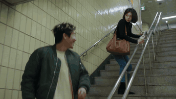</a> <a href="pages/zh/video-wan30.md#wan-time-space-train">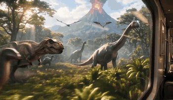</a> <a href="pages/zh/video-minimaxh3.md#h3-starship-hyperspace-jump">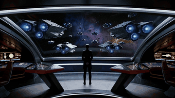</a> <a href="pages/zh/video-geminiomniflash.md#omni-four-style-progression">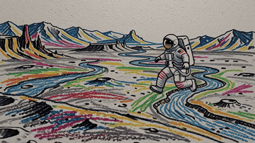</a> <a href="pages/zh/video-kling30.md#kling-moonlit-garden-run">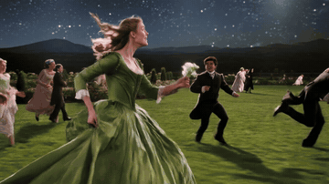</a> <a href="#veo-off-road-rally">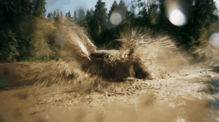</a> 

</div>

> 本仓原名 **Awesome-GPTs**，原来的 GPTs 清单保存在 [legacy/awesome-gpts_zh.md](legacy/awesome-gpts_zh.md)。

## 目录

- [视频提示词](#video) (304 条)
  - [Wan 3.0](#wan30) (17)
  - [MiniMax H3](#minimaxh3) (80)
  - [Seedance 2.5](#seedance25) (144)
  - [Gemini Omni Flash](#geminiomniflash) (21)
  - [Kling 3.0](#kling30) (27)
  - [Veo 3.1](#veo31) (6)
  - [Veo 3](#veo3) (5)
  - [Sora 2](#sora2) (4)
- [图片提示词](#image) (69 条)
  - [海报与编辑排版](#img-poster) (10)
  - [照片转艺术风格](#img-photo-to-art) (11)
  - [写实照片](#img-realism) (12)
  - [人像](#img-portrait) (5)
  - [插画](#img-illustration) (7)
  - [手机与界面截图](#img-ui-mockup) (3)
  - [地图](#img-map) (1)
  - [拼贴](#img-collage) (3)
  - [信息图与幻灯片](#img-infographic) (6)
  - [标志、广告与包装](#img-brand) (6)
  - [照片编辑](#img-edit) (5)
- [Agent 配方：剪视频](#recipes) (5 条)
- [指南与 skill](#guides)
- [用 Agent 做 3D](#threed)
- [按标签浏览](#tags)
- [投稿](#contributing)

<a id="video"></a>
## 视频提示词

下面每条提示词都原样摘自出处：模型厂商自己的指南或模型卡，或创作者在 X 上附带成片发布的帖子。点缩略图看带声音的原片。分组顺序按 [Artificial Analysis 视频榜](https://artificialanalysis.ai/video/leaderboard/text-to-video)排名，创作者帖子按点赞数排序，点赞数以标注日期为准。

<a id="wan30"></a>
## Wan 3.0

<a id="wan-fashion-face-closeup-flash-orbit"></a>
### 带抓拍闪光的超近景时尚人像

<a href="https://x.com/leaf_sanren/status/2105645639703183753">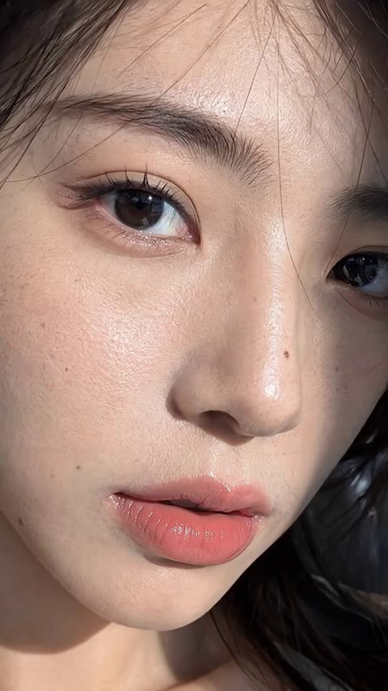</a>

提示词把15秒拆成五个时间段，每段写明运镜、眼神和闪光时机。同时列出真实的皮肤瑕疵并禁止塑料感，让人脸保持摄影质感。

Wan 3.0 · 文生视频 · 出处: [@leaf_sanren on X](https://x.com/leaf_sanren/status/2105645639703183753) · 1,439 赞，统计于 2026-10-27

[`portrait`](pages/zh/tags.md#tag-portrait) [`fashion`](pages/zh/tags.md#tag-fashion) [`close-up`](pages/zh/tags.md#tag-close-up) [`skin-texture`](pages/zh/tags.md#tag-skin-texture) [`vertical`](pages/zh/tags.md#tag-vertical)

<details><summary><b>提示词</b></summary>

```text
Generate this video: Create a 15-second, 9:16 vertical screen, ultra-high-definition 4K, 30fps, cinematic realistic portrait quality fashion portrait short film.

The main subject of the frame is a young Asian woman around 20-25 years old, with a high-end face—cool with a touch of youthful greenness, delicate features but not overly perfect, smooth facial contours, natural nose bridge, full lips, eyes with depth, overall vibe like a car model or a close-up candid shot by a photographer at a fashion event.
No influencer vibe, no exaggerated plastic surgery face, no plastic skin, no excessive skin smoothing, no overly heavy fake lashes, no exaggerated highlights, no anime feel.
The character's skin must be realistic: clearly visible pores, subtle skin texture, light foundation caking, faint acne marks, very shallow pockmarks, under-eye fine lines, natural contours on nose wings and cheeks, lip lines, a few stray hairs and hair edge wisps. Makeup is refined but imperfect high-end subtle look: base slightly adherent but not flawless, clean eye makeup, naturally realistic lashes, lips with a subtle sheen.
Hair is black or dark brown straight long hair, with natural stray strands and a slight messy feel, not too deliberate.

Scene and Atmosphere

Scene is a high-end fashion event venue / auto show activity area / luxury brand launch event close-up portrait atmosphere, but the background must be blurred, not highlighting specific brands or text. Background can include soft exhibition hall lighting, minimal out-of-focus neon reflections, blurred crowds, blurred car body highlight reflections or metallic texture backgrounds, overall atmosphere high-end, restrained, fashionable.
No subtitles, no stickers, no watermarks, no readable text, no exaggerated effects, no illogical flashy lights.

Lighting Requirements

Lighting must conform to real-world logic, like a real photographer shooting close-up at the event site.
Main light is soft but directional facial key light, coming from slightly off to the front upper side, creating natural facial light and shadow layers.
Fill light is very subtle, retaining some shadows to enhance facial dimensionality.
Environment can include soft cool-toned rim light or auto show site reflection light to make the face more three-dimensional.
Throughout, allow 2 to 3 brief flash occurrences; flashes must feel like natural on-site photography flashes, quickly lighting up only in certain moments, causing temporary enhancement of facial highlights, more obvious pupil catchlights, brighter skin reflections, but no constant strobing, no illogical flashing.
When flashes occur, it should feel like a photographer's candid shot: lights up once and done, realistic light ratios, face not overexposed, skin details still visible.

Camera and Movement (Top-Tier Cinematography)

Overall, use ultra-close portrait movement, with the lens always orbiting the face to highlight eyes, nose bridge, lips, cheeks, hair strands, and skin texture.
Cinematography language is high-end, fluid, restrained, with a fashion ad and backstage photography candid feel.
No heavy shaky cam, no disorienting motion, no exaggerated AI camera moves, no sudden pull-backs.
Movement must feel natural, like a high-end photographer using a handheld gimbal or slight handheld shooting:

0-3 seconds

Lens starts with an ultra-close side-front face push-in, focus on eyes and nose bridge area, subject slightly lifts gaze to lens, natural breathing feel, lips subtly relaxed.
Lens does an extremely subtle slow push-in, with very light lateral sliding, showcasing cheeks, under-eye texture, and hair strands.
This segment should make viewers feel the face's high-end realism right from the first glance.

3-6 seconds

Lens slides along the face from eyes to nose tip, then to near the lips, in an extremely steady micro-arc orbit, close-up observation of features.
Subject's gaze subtly shifts, no exaggerated acting—just gently looks toward lens edge, then slowly back to lens.
First flash can occur here, briefly lighting up to enhance skin texture and lip highlights.

6-9 seconds

Lens slowly turns from front-left to front-right, still maintaining face-push distance, emphasizing cheek skin texture, nose wing details, lower eyelid fine lines, lashes, and pupil reflections.
Subject lightly brushes a bit of hair, or a stray strand naturally falls to the side of the face.
Lens has a subtle breathing-like float for real photography feel, not rigid.

9-12 seconds

Lens subtly shifts down to highlight lips, jawline, and cheeks, then slowly back to eyes.
Subject's expression stays cool, restrained, with a touch of high-end aloofness, like a car model caught close-up by a photographer, occasionally a gentle blink, corners of mouth with extremely subtle relaxation.
Second flash occurs here, natural and instantaneous like on-site candid, returning to normal light after.
Post-flash, catchlights in eyes more prominent, giving the frame more fashion editorial vibe.

12-15 seconds

Lens does one of the most beautiful ultra-close light arc closes, subtly orbiting the face and lightly pushing in, finally settling on an ideal composition of eyes + nose bridge + half lips.
Subject gently lifts gaze to straight-on lens in the last second, eyes clean, calm, captivating.
Ending can have a third very subtle flash or environmental highlight sweep, but must feel natural, not overdone.
Finally holds on a high-end face-push frame perfect for a thumbnail cover.

Frame Style

Overall style is:
Real cinematic fashion portrait, close-up commercial photography, auto show model face-close candid, high-end magazine feel, natural skin texture, non-studio fake-face sense.
Include real lens bokeh, natural depth of field, fine skin quality, subtle on-site feel, restrained high-end vibe.
Not influencer selfie, not live stream, not Korean-style skin smoothing, not low-quality AI face.

Key Emphases

Face must be real, not fake

Skin can't be overly perfect, retain subtle imperfections

Features stable, no distortion

Eyes can't wander, lips can't move randomly

Hair strands must be real, with stray hairs

Flashes must follow real candid logic

Lighting must be real, no random strobing

Camera must be high-end, smooth, cinematic, fashion photography feel

Whole piece centers on "high-end face close-up showcase," no plot, no big movements

Negative Restrictions (Suggest Adding Together)

Negative prompts:
Cartoonish feel, CG feel, plastic skin, excessive smoothing, over-beautification, feature distortion, eye misalignment, skin wax figure feel, overexposure, illogical flash strobing, face shake, low clarity, low-quality hair strands, exaggerated filters, influencer face, overly heavy fake lashes, heavy makeup, shaky lens, limb distortion, cluttered background, readable text, subtitles, stickers, watermarks,
```

</details>

<a id="wan-marina-night-out-quay-leap"></a>
### 夜晚码头闺蜜同游与跳水

<a href="https://x.com/mightyking/status/2091842964054212842">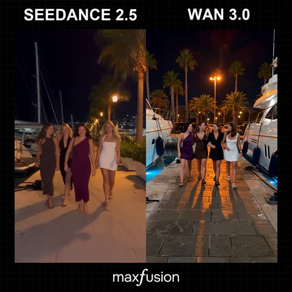</a>

先写风格、角色和场景,再用带时间戳的分镜表,每个片段单独指定运镜,如倒退跟拍、甩镜下摇和俯拍。单独的音频段要求现场同期声且无音乐,强化手机随拍的真实感。

Wan 3.0 · 文生视频 · 出处: [@mightyking on X](https://x.com/mightyking/status/2091842964054212842) · 1,353 赞，统计于 2026-10-27

[`ugc`](pages/zh/tags.md#tag-ugc) [`handheld`](pages/zh/tags.md#tag-handheld) [`night`](pages/zh/tags.md#tag-night) [`shot-list`](pages/zh/tags.md#tag-shot-list) [`sync-sound`](pages/zh/tags.md#tag-sync-sound)

<details><summary><b>提示词</b></summary>

```text
Raw vertical phone video (UGC), handheld throughout, filmed by a friend who walks with the group, casual sway, natural night lighting, wide-angle lens, deep focus.

Characters

The hero is a young woman with long dark hair in a deep-purple one-shoulder dress with a small shoulder bag.

Her three friends: one in a dark brown dress, a blonde in a black wrap dress, a blonde in a white mini dress — party dresses and sandals.

Laughing, spontaneous night-out energy.

Setting

A luxury marina at night — a stone quay along a narrow water slip flanked on both sides by large moored luxury yachts, big white hulls rising on either side, masts and rigging above, fenders on the hulls.

Warm orange street lamps, palm trees, distant city lights.

The yachts glow with blue-turquoise underwater LED lights spilling into the water; a yellow mooring line runs to the stone.

Shot list

0.0s–4.0s — Wide tracking shot, eye level, camera moving backward
The camera walks backward ahead of the four women as they stroll toward it down the marina promenade, framed head-to-toe, laughing and chatting in French; warm lamplight and palm trees behind, slight handheld bob.

4.0s–6.0s — Medium shot, eye level, backward track + quick left pan
The woman in the purple dress surges ahead of the group toward the lens, one arm raised, hair flying; the camera, on their left, keeps tracking back and pans to hold her.

6.0s–8.0s — Medium-wide, camera tilts down-left to follow, whip motion
She reaches the quay edge between the moored luxury yachts and launches headfirst over the edge; the handheld camera whips left and tilts down to chase her off the stone.

8.0s–10.0s — High-angle wide, looking down at the water, slight jolt
From up on the quay the camera looks down as she plunges headfirst into the blue-turquoise water in the slip between the big yacht hulls — a big splash, the underwater lights glowing around the impact; the handheld frame jolts slightly with the motion.

10.0s–13.0s — High-angle medium, looking down, small handheld drift
She surfaces in the teal water, gasping and laughing up at the camera, hair slicked back, treading water.

13.0s–16.0s — Handheld tilt up and back down, slight zoom
The camera lifts off the water and tilts up to a person leaning on the deck railing of one of the moored luxury yachts, watching her in the water, then tilts back down and zooms slightly in on her still treading and laughing.

16.0s–20.0s — High-angle medium, tilting to follow her up
She swims to the stone quay wall, reaches up and grabs a thick dark mooring pole, and hauls herself out; the camera tilts upward with her as she rises from the water, legs braced on the stone.

20.0s–23.0s — Low/close medium at the quay edge, static handheld
She climbs onto the stone lip, rolls onto her side, soaked dress clinging, then pushes up to her feet; the camera holds close, catching the water running off her.

23.0s–27.0s — Medium shot, eye level, loose handheld reframe
Back on the promenade, dripping wet, she flips her long wet hair forward and wrings it out, laughing, as her friends and passing pedestrians move behind her.

27.0s–30.0s — Medium shot, eye level, camera settles
Still dripping, she straightens up and strikes a confident, playful pose for the camera — hand on hip, tossing her wet hair back with a big smile — her friends laughing around her; the camera holds on the pose to end.

Audio

Live sync sound — friends laughing and shouting excitedly in French, a scream at the leap, a big water splash, water sloshing against the yacht hulls, wet footsteps on stone, ambient night marina sounds.
No music.

Style

Raw amateur vertical phone footage, natural night lighting, warm street lamps mixing with the turquoise underwater yacht glow, authentic handheld motion.
```

</details>

<a id="wan-camera-angle-swap"></a>
### 动作不变，换机位重拍你的视频

<a href="https://x.com/Framer_X/status/2101324357108658433">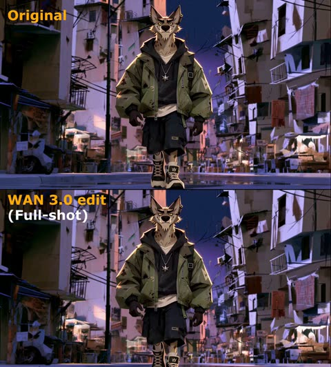</a>

上传一段连续镜头作动作参考，Wan 从新角度重拍；某个镜头跑偏就重生成。

Wan 3.0 · 视频编辑 · 出处: [@Framer_X on X](https://x.com/Framer_X/status/2101324357108658433) · 1,170 赞，统计于 2026-10-27

[`camera-angle`](pages/zh/tags.md#tag-camera-angle) [`video-reference`](pages/zh/tags.md#tag-video-reference) [`workflow`](pages/zh/tags.md#tag-workflow)

<details><summary><b>提示词</b></summary>

```text
STEP 1: Upload your video (must be continuous one shot) to any platform that supports WAN 3.0

STEP 2: Use the prompt below (adjust it to your video):

"Use the original video @ TAG ORIGINAL VIDEO as the exact action reference

0–1s: Camera stays exactly as in the original video as the wolf walks toward the scooter.

1–3s: Hard cut to a tight front close-up as the wolf continues walking toward and reaches the scooter.

3–5s: Hard cut to a high angle above as the wolf as he gets onto the scooter and starts riding.

5–7s: Hard cut to a full shot as the wolf rides the scooter down the street.

7–9s: Hard cut to a side tracking shot as he keeps riding down the street.

9-10s: Hard cut to an over the shoulder shot as he rides forward and notices the banana peel in his path.

10–12s: hard cut to a birds eye view shot as the fallen wolf is rolling over the asphalt.

12-13s : hard cut to an insert shot of his fist as wolf slams it into the asphalt.

Only the camera angle and framing change. Make sure every action, movement, timing and performance exactly identical to the original video @ TAG ORIGINAL VIDEO. The action continues seamlessly across every cut."

NOTE: If some scenes didn't work (action was different than original video) simply regenerate the video, that usually fixes the problem.
```

</details>

<a id="wan-cafe-camel-coat-character-sheet"></a>
### 咖啡馆柜台前身穿驼色大衣的男人

<a href="https://x.com/ivanka_humeniuk/status/2113582628024566084">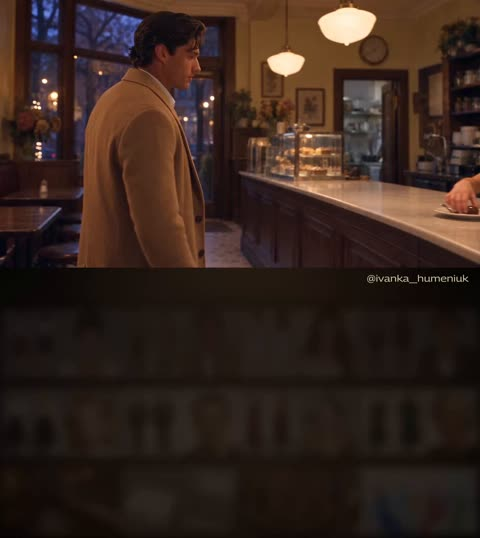</a>

先用一张参考图生成三视图角色设定板，左侧为正面和背面全身，右侧为一张细致的头像。正面全身的脸被有意虚化，让头像成为唯一的面部参考，同时写清服装、面料和胶片质感，让角色在多个场景中保持一致。

Wan 3.0 · 参考生视频 · 出处: [@ivanka_humeniuk on X](https://x.com/ivanka_humeniuk/status/2113582628024566084) · 878 赞，统计于 2026-10-27

[`character-consistency`](pages/zh/tags.md#tag-character-consistency) [`reference-sheet`](pages/zh/tags.md#tag-reference-sheet) [`cafe`](pages/zh/tags.md#tag-cafe) [`film-look`](pages/zh/tags.md#tag-film-look) [`romance`](pages/zh/tags.md#tag-romance)

<details><summary><b>提示词</b></summary>

```text
Create a three-panel character reference sheet of the woman in
@image1
 in a single wide 16:9 image.
Preserve her exact facial identity, blue eyes, dark espresso-brown hair color, skin tone and natural facial
proportions from
@image1
.
The left half contains two full-body views side by side: front and back, identical in scale, with both figures
completely visible from above the bun to below the shoes. The right half contains one large
head-and-shoulders portrait, facing directly into the camera. All three views share one continuous neutral
mid-grey studio backdrop, matching soft lighting and the same warm film color treatment.
In the full-body front view, replace the facial features with a smooth, softly blurred skin-toned oval. Keep the
hairstyle and head silhouette intact. The large portrait on the right is the only detailed face reference.
Restyle her exceptionally long, thick hair into a high, generously sized, loosely sculpted bun at the crown.
Preserve the fullness of her hair, with lifted roots and soft volume around the head. Two delicate curved
tendrils fall beside her temples toward her jaw, framing the outer edges of her face. Her eyebrows, blue eyes
and cheekbones remain clearly visible. The back view shows the gathered hair and the substantial rounded
shape of the bun. The hairstyle feels elegant and practical, like a beautiful café waitress in a romantic film
from around 2000.
Dress her in a fitted ivory fine-knit top with short sleeves and a modest scoop neckline, tucked into a
high-waisted black tailored pencil skirt ending at the knees. The skirt has a small functional back vent. Over it,
she wears a short deep-burgundy cotton waist apron, extending from the waist to mid-thigh, with two discreet
rectangular front pockets. Narrow apron ties wrap around her waist and form a neat bow at the center of her
back, clearly visible in the rear view. Her shoes are simple black leather ballet flats with gently rounded toes
and low flat heels. Small plain gold stud earrings complete the outfit.
Her figure is tall and slender, with a defined narrow waist, long legs and a graceful neck. The clothing follows
her natural proportions, with realistic knit texture, tailored seams and soft cotton folds around the apron ties.
02
The same outfit, fit, hem lengths and hairstyle appear in all three views.
In the front view she stands upright, square to the camera, shoulders level, weight evenly balanced, arms
relaxed at her sides and hands empty. The back view shows the identical stance turned fully away. In the
portrait her head is upright, chin level and both eyes look directly into the lens. Her lips are gently closed with
a faint, relaxed smile. Preserve the recognizable face from
@image1
, with natural skin texture, visible pores
and fine facial hairs.
Soft frontal studio lighting keeps her features and clothing clearly readable, with gentle shading under the
chin and soft contact shadows beneath the shoes. The grey backdrop remains plain throughout the image.
The composition consists entirely of the three views and the seamless backdrop.
Maintain a glamorous late-1990s to early-2000s 35mm film publicity look: warm natural skin, creamy ivory
fabric, rich burgundy cotton, deep readable blacks, fine organic grain and restrained highlight glow. Her face,
blue eyes, hair strands and garment details remain clearly resolved. Clean presentation with uninterrupted
backdrop between the views.

📌 PROMPT 2 (Guy map):
Create a three-panel character reference sheet of the man in
@image1
 in one wide 16:9 image. Preserve his
exact face, eye color, skin tone, facial proportions and hairstyle from the reference, including the natural
swept-back waves and the loose strand near his forehead.
The left half of the image contains two full-body figures side by side: a straight-on front view and a complete
back view, identical in scale, both visible from above the hair to below the shoes. The right half contains one
large head-and-shoulders portrait looking directly into the camera, with his entire hairstyle inside the frame.
All three views share one continuous neutral mid-grey studio backdrop.
On the full-body front figure, replace the facial features with a smooth, softly blurred skin-toned oval,
retaining the head silhouette and hair. The large portrait on the right is the single detailed face reference.
He is tall, approximately 188 cm, with broad shoulders, a lean athletic build, a defined waist and long legs. His
proportions remain natural and identical across all three views.
Dress him in an elegant camel-colored wool-and-cashmere overcoat reaching just below the knees. The coat
has broad notched lapels, softly structured shoulders, a single-breasted three-button front, discreet welt
pockets and a single center-back vent. He wears it fully unbuttoned, its front panels hanging naturally to
reveal the clothing underneath. The fabric is substantial, softly brushed and richly textured, with realistic
weight and long vertical folds.
Under the overcoat, he wears a dark chocolate-brown tailored wool blazer with a two-button front, worn
unbuttoned, over a pale-blue cotton shirt with a pointed collar and the top button undone. The shirt is tucked
neatly into high-waisted charcoal-grey wool trousers with a single pleat on each side, a relaxed straight leg
and a slight break over the shoes. A dark-brown leather belt with a small brushed-metal buckle completes the
waist.
His shoes are polished dark-brown leather penny loafers with matching dark socks. A slim rectangular gold
wristwatch on a dark-brown leather strap sits on his left wrist, partly visible beneath the cuff. The styling has
04
the understated elegance of a wealthy young man in a romantic film set around 2000.
In both full-body views, he stands upright with shoulders level, weight evenly balanced and arms relaxed
slightly away from his sides so the coat silhouette remains readable. His hands are empty. The back view
shows the coat's full length, center seam, vent and natural drape.
In the large portrait, his face is strictly frontal, head upright, chin level and both eyes directed into the lens.
His lips are relaxed and closed. Preserve the exact facial structure, subtle beard shadow and natural skin
texture visible in
@image1
. The portrait includes the camel coat lapels, brown blazer and pale-blue shirt
collar.
Soft, even studio lighting keeps his face and all clothing details clearly readable, with gentle facial shading,
broad highlights on the wool and soft contact shadows beneath both pairs of shoes. The backdrop is plain and
continuous, with clean empty space separating the three views.
Maintain warm late-1990s to early-2000s 35mm film color: natural warm skin, rich camel wool, deep
chocolate tailoring, soft pale-blue cotton and readable charcoal shadows. Fine organic film grain and
restrained highlight glow give the image a tactile cinematic finish while the face, hair and garment
construction remain clearly resolved.

📌 PROMPT 3 (Cake box map):

A photorealistic pastry packaging reference sheet on a uniform medium-grey seamless studio background, horizontal 16:9 composition, divided into two equal side-by-side views. The surface beneath both boxes and the background are the same neutral grey.

On the left, a closed rectangular ivory cardboard pastry box with a fitted hinged lid, viewed from a slightly elevated three-quarter angle. Matte cardboard, subtle paper texture, clean folded edges and a plain unprinted surface.

On the right, exactly the same box at the same scale, with its hinged lid fully raised behind it. A higher three-quarter viewing angle clearly reveals the contents: six individual chocolate mousse pastries arranged in two rows of three, each on a small gold pastry board. Comfortable spacing makes every pastry’s complete silhouette visible.

Each pastry has a playful, stylized penis shape: a smooth rounded elongated form with two rounded lobes at the base, recognisable as a humorous bachelorette-party confection. All six share the same shape and size, with glossy milk-chocolate mirror glaze and a tiny touch of edible gold leaf. Smooth moulded chocolate surfaces and appetising highlights give them the appearance of carefully crafted patisserie desserts.

The box dimensions, ivory colour and construction are identical in both views. Neatly fitted ivory food-safe paper lines the interior. Both boxes are fully visible with comfortable grey space around them.

Soft studio lighting, gentle contact shadows, clear high-resolution detail and natural optical sharpness with restrained sharpening. Subtle fine film grain and softly warm highlights, consistent with late-1990s cinematic photography. The entire surrounding background remains solid neutral medium grey.

📌 PROMPT 4 (Cafe map):

Create a cinematic location reference photograph of an intimate, elegant neighbourhood café in the year 2000, shortly before closing on an autumn evening. One wide horizontal 16:9 image showing a single coherent interior, photographed at eye level from the customer side, looking diagonally toward the service counter. A natural 28mm lens perspective with straight architectural lines and clearly readable room geography.

A long service counter occupies the right half of the composition, running from the foreground toward the back wall. It has a polished dark walnut front with recessed wooden panels and a warm ivory stone countertop. The central serving section is a broad, clear, uninterrupted surface, ready for a pastry box and a conversation between a standing customer and the waitress behind the counter. This section of the counter is bare, with the stone surface fully visible.

Behind the counter is a comfortable working aisle. The rear service wall contains dark wooden shelves, neatly arranged porcelain dishes, a stainless-steel espresso machine and a small period-appropriate cash register at the far end. A wooden doorway in the back wall leads to the kitchen. A small glass pastry display stands at the far end of the counter, leaving the main serving area open.

On the left side of the room, three small dark wooden tables stand beside burgundy leather banquette seating along the wall. Each table has two bentwood chairs and a small glass sugar dispenser. Above the banquette hang framed botanical prints and warm brass wall sconces with ivory shades. The walls are painted creamy butter yellow above dark wooden wainscoting. The floor is laid with small cream and muted terracotta tiles.

At the far left, tall street-facing windows and a glazed wooden entrance door reveal a quiet city street at dusk. Soft, cool evening light enters through the windows, balanced by warm pools of light from the wall sconces and three opal-glass pendant lamps above the counter. The entrance, seating area, service counter and kitchen doorway are all clearly visible within the same spatially consistent room.

The café feels established, lovingly maintained and slightly worn: subtle patina on brass fittings, gentle wear on the leather seats, fine scratches in the wooden furniture and realistic texture in the plaster walls. The tables are neatly reset for the end of the evening. The room is unoccupied so its layout and furnishings are fully visible.

The visual atmosphere is a romantic feature film from 1999–2000, captured on 35mm film: warm amber practical lighting, creamy highlights, rich walnut brown, muted burgundy and natural shadow detail. Fine film grain, subtle halation around glowing lamps and soft highlight roll-off. Maintain enough depth of field to clearly describe the counter, seating and rear service wall. Photorealistic materials, believable proportions and an inviting, lived-in atmosphere. A clean cinematic location photograph filling the entire frame.

📌 PROMPT 5 (Animation prompt):
SCENE CONTEXT A 30-second scene in a neighbourhood café in the year 2000, near closing time. A headstrong waitress packs her handmade pastries. A wealthy customer approaches to pay, interrupts her work with questions, tastes a sample and asks her to pose as his girlfriend at dinner.  Play this as a lively romantic dramedy with friction, humour and unexpected attraction. She wants to finish her work and refuses to entertain his casual charm. He wants to keep her attention and finds himself having to earn it. Their reactions evolve naturally as they listen to each other.  ACTIVE REFERENCES
@image1
 — the waitress. Use the detailed portrait for her exact face and the full-body views for her work outfit and high loose bun.
@image2
 — the customer. Preserve his exact face, hair and clothing, including the unbuttoned camel overcoat.
@image3
 — the café architecture, counter, furnishings and dusk outside.
@image4
 — one ivory pastry box and its six chocolate novelty pastries. Preserve their shapes, chocolate glaze, gold decoration and individual gold boards. The panels show two states of the same box.  SPACE AND PROPS She stands behind the counter; he approaches on the customer side. In shared shots he is screen-left, she is screen-right. Keep the camera on the same side of their dialogue axis, maintaining matching eyelines.  The box begins open with five pastries inside. She is placing the sixth into the remaining space, holding its gold board. Beside the box is a small ivory plate with an additional matching dessert cut into two portions and a dessert fork. He samples this separate dessert; the six boxed pastries remain whole.  He carries a folded banknote in his left hand, ready to pay. His right hand is free. The central serving surface contains the box and tasting plate. Cups stay on the background shelves.  CAMERA AND EDITING 16:9, 30 seconds, real-time action. Film coverage with foreground depth, deliberate camera movement, expressive changes in shot size and motivated focus pulls. Hard cuts at the listed boundaries. Stable focal length within each shot. Let performances flow inside the shots, with natural listening and gestures overlapping speech.  0.0–3.0 SECONDS 63° FOV. A short lateral tracking shot moves along the customer side of the counter with the approaching man, revealing the waitress already at work beyond him. The polished counter creates a strong diagonal into the frame. She places the final pastry into the box. He stops opposite her, notices the contents and suppresses a laugh. She remains occupied with packing.  HARD CUT — 3.0–5.5 SECONDS 47° FOV. Low oblique view across the open box: the pastries are sharp in the foreground, his face visible beyond them. Pull focus from the chocolate shapes to his amused expression as he looks up at her. MAN: “Is this the new menu?” He is teasing, expecting an easy smile in return.  HARD CUT — 5.5–10.5 SECONDS 47° FOV. Side-on medium shot of the waitress, her face and hands visible, his coat softly framing one edge. WOMAN: “Test batch for a bachelorette party. My coworkers approved.” She answers with dry impatience while straightening the paper inside the box. She gives him a pointed look on “approved,” then slides the tasting plate toward him with a brisk, controlled gesture: he can taste it and let her finish. The plate stops within his reach. Her delivery has bite and personality; her attention moves naturally between him and her work.  HARD CUT — 10.5–14.5 SECONDS 47° FOV. Counter-height three-quarter medium shot of the man, showing his face and right hand, with the box edge in the foreground. He takes a small forkful from the cut dessert. As he tastes, his teasing manner gives way to spontaneous appreciation. He finishes the bite and lowers the fork onto the plate. She is visible at the edge of frame, briefly watching to see whether he likes it before returning to her work. The banknote remains in his left hand.  HARD CUT — 14.5–20.5 SECONDS 47° FOV. A layered two-shot looking diagonally along the counter, both faces readable. The camera makes a gentle lateral move that settles as their eyes meet. MAN: “You make these yourself?” His interest is genuine now. WOMAN: “After my shifts. I'm saving for my own bakery.” She answers firmly, with pride beneath the impatience. For a moment she engages fully because her bakery matters to her. Then she returns her attention to the box. He watches her and considers his next words.  HARD CUT — 20.5–24.0 SECONDS 29° FOV. Medium close-up of the man from beside her shoulder. A slow, restrained dolly inward makes the conversation feel more personal. MAN: “Have dinner with me tonight?” He attempts an easy invitation, but there is a real question in his eyes. Allow a short listening beat after the line.  HARD CUT — 24.0–30.0 SECONDS 29° FOV. Close-up of the waitress from his eyeline, her face in three-quarter view and his blurred shoulder at the edge. Begin with a very slight forward camera move. She looks up from her work and gives him a brief, sceptical half-smile, amused by his nerve. MAN, naturally offscreen: “With my family. As my girlfriend.” His voice hesitates briefly between the two phrases.  Stay on her throughout his clarification so the audience sees it land. Her half-smile disappears; she stops what she is doing and looks directly at him with an immediate, incredulous reaction. She lets out a short disbelieving breath and settles her right palm on the counter. The camera settles with her. Hold the final moment as she silently sizes him up, ready to challenge him. End after the hand movement is complete, on her living reaction.  ACTING Give the actors room for spontaneous conversational behaviour. She is spirited, quick and proud, with dry humour and a short tolerance for being patronised. Her annoyance changes with the conversation: she dismisses his teasing, briefly cares about his response to her baking, defends her ambition and finally reacts to the audacity of his request.  He starts charming and self-assured, adjusts when she gives him little encouragement, becomes genuinely impressed by the dessert and risks the invitation. His confidence becomes less certain as he waits for her response.  Use connected reactions, natural breaths, shifts of attention and expressive vocal rhythm. Each person listens while the other speaks. Movements arise from packing, tasting and trying to hold or end the conversation. Keep their faces recognisable and their physical behaviour grounded.  LIGHTING AND COLOUR Preserve the café's amber pendant lamps, brass sconces and cool dusk windows. Soft directional side lighting shapes their faces, with darker shadow cheeks and gentle reflected fill preserving their eyes. Photograph from the shadow side. Loose hair, camel wool and chocolate glaze catch warm highlights.  Fixed 4000K white balance. Rich walnut browns, burgundy leather, creamy practical highlights and deep textured shadows. Natural skin colour beneath the warm light. Consistent lighting across all angles.  AUDIO — FIXED CHARACTER VOICES WOMAN VOICE: Adult woman in her mid-twenties; medium pitch, warm clear mezzo speaking voice with a lightly husky lower register, neutral General American accent, natural conversational rhythm, crisp intelligible consonants and restrained expressive inflection. MAN VOICE: Adult man in his early thirties; medium-low pitch, warm resonant baritone with a subtle dry rasp, neutral General American accent, measured conversational rhythm, clear articulation and understated playful inflection.  Preserve these vocal identities. Her delivery is dry, spirited and impatient, becoming firm when discussing her bakery. His delivery moves from playful confidence to sincere curiosity and slightly hesitant persuasion.  Use the written English dialogue exactly. Clear turn-taking and accurate lip synchronisation for visible speakers. His final clarification is heard offscreen while the camera stays on her reaction.  Quiet café room tone, distant traffic, paper rustle, a soft plate scrape, the fork touching porcelain and her final palm contact. Keep dialogue clear and foregrounded.  FILM LOOK Late-1990s theatrical romantic dramedy captured on visibly textured 35mm film. Organic moving grain is clearly perceptible across midtones, skin and shadows at normal playback size. Warm halation surrounds the glowing lamps; bright reflections bloom gently. Rich film-print contrast, creamy highlight roll-off and natural optical sharpness with restrained edge enhancement. Preserve readable eyes, realistic skin and fabric detail beneath the film texture. Natural motion blur and 24 fps cinematic cadence.  CONTINUITY After packing, all six boxed pastries remain whole and in place. The separate tasting dessert retains its missing bite. The box stays open on the same section of counter. After the slide, the tasting plate and fork remain on his side. His banknote stays in his left hand. Maintain exact faces, hair, clothing, screen direction, café geometry and dusk throughout. Reference sheets guide appearance; the output is full-frame cinematic footage.
```

</details>

<a id="wan-anime-monster-fight"></a>
### 手绘动画风，对战巨型怪物

<a href="https://x.com/aimikoda/status/2103790524637528348">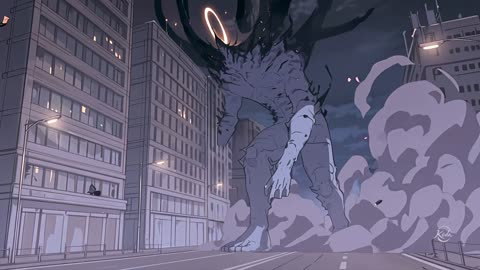</a>

两个带标签的参考（主角、怪物），要求保留手绘线条。Wan 的动画有自己的味道。

Wan 3.0 · 参考生视频 · 出处: [@aimikoda on X](https://x.com/aimikoda/status/2103790524637528348) · 502 赞，统计于 2026-10-27

[`anime`](pages/zh/tags.md#tag-anime) [`action`](pages/zh/tags.md#tag-action) [`reference-images`](pages/zh/tags.md#tag-reference-images)

<details><summary><b>提示词</b></summary>

```text
Use @[character ref] for the hero's exact identity and appearance; @[monster ref] for the monster's anatomy, scale, pale body, black projections and luminous horns. Preserve their angular hand-drawn contours, sparse sketch lines, matte cel-shadows, muted lavender and ash gray, blue-black shadows, peach rim light and fine grain. City and effects share this 2D anime style. References bind appearance, not framing or poses.

Five epic shots: the monster destroys the city as it charges toward the rooftop hero. ONE sudden, thick white line bursts from his index fingertip and instantly punches through it, leaving one enormous hole.

The hero stays at one skyscraper's avenue-facing edge, level with the monster's upper torso. The monster approaches directly IN FRONT OF him along the avenue. All cameras stay on one side of their shared axis: hero and tower screen-left, monster screen-right advancing left. The hero faces right. In his profile close-ups, the monster remains ahead, offscreen right, never behind his head or shoulders. No axis-crossing angles or orbits.

Shot 1. Low lateral wide tracking beside the monster charging right-to-left. Its shoulder tears through a building; the facade folds into the street as its next footfall buckles the roadway, hurling rubble forward. Debris whips past the lens through lavender dust. Widen and tilt upward to reveal the target tower ahead on screen-left, the tiny hero at its edge facing the approaching monster on screen-right. Keep the gap between them readable.

Shot 2. Right-side profile of the hero facing screen-right toward the offscreen monster. Face and right hand share the frame against sky and rooftop. Wind pulls his hair and coat; he stays relaxed. With a knowing smile, he extends his right arm toward the target: index straight, thumb raised, other fingers curled. Cut as the finger aligns with the target; no charging glow, gathering energy or held aiming pause.

Shot 3. Steady rear three-quarter view outside the hero's right shoulder, on the established side. Keep a clear gap between his fingertip screen-left and the monster's upper torso screen-right. It reaches for the rooftop directly ahead. Immediately on the cut, ONE thick, straight, brilliant-white line snaps from the index fingertip through the upper torso, below the neck between the shoulders. Its entire length appears instantly, connecting finger, target and the space beyond. Release and penetration happen together: no projectile travel, growing beam or drilling. One tiny finger recoil coincides with a building-sized circular section being punched through the body. The white line switches off immediately, leaving an enormous EMPTY opening, its broken dark rim framing the skyline. The torso jolts and tips sideways at once, the reaching arm knocked off course. Read the hole during the uninterrupted fall. No charging, stunned pause, slow motion or hit-stop. No sphere, pressure ring or full-screen whiteout obscures the contact. One abrupt discharge, never a sustained beam or repeated pulse.

Shot 4. Cut as that sideways tilt begins, keeping the same viewing direction and matching the ALREADY OPEN hole on the first frame. The monster's arm drops short of the roof; its weight carries it diagonally sideways into the blocks beside the avenue before reaching the tower, still in front of the hero. Track downward with the chest exposed: no edge-on turn or face-down roll. The SAME hole stays fixed below the neck between the shoulders, with the same physical diameter, broken rim and missing volume. Its outline foreshortens naturally as the torso tilts; background buildings slide visibly through the opening. Keep dust below the chest and clear of the aperture. Follow the fall through contact with the ruins and briefly show the fallen torso with its hole still open. The rim does not regrow, the opening does not fill, and the torso never returns to its intact state.

Shot 5. Return to the hero's right-side profile, facing screen-right, face and right hand together against sky and rooftop. The fallen monster remains OFFSCREEN ahead to the right. He bends his right elbow and brings the SAME extended index fingertip just in front of his lips. Only after it arrives, he gently purses his lips and visibly blows across it. A fine white wisp bends away in his breath. He lowers the hand slightly with a satisfied smile. Collapse thunder rolls in from ahead and a gust lifts his coat. Hold his effortless composure.

One instantaneous fingertip discharge, one impact, one permanent through-hole carried through the uninterrupted fall and landing. The hero keeps the same hand and facing. Sound: masonry and heavy footfalls, one dry electrical crack and a deep impact report together at the instant of contact, then the intimate breath against distant collapse. No dialogue or subtitles.
```

</details>

<a id="wan-tokyo-travel-vlog"></a>
### 东京旅行 vlog，一秒一个节拍

<a href="https://x.com/joshesye/status/2094723798679400808">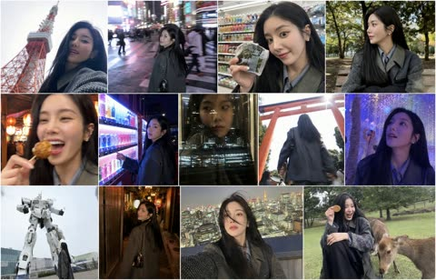</a>

中文描述配日语台词。每一秒都写清地点、动作、台词和到下一秒的转场。

Wan 3.0 · 文生视频 · 出处: [@joshesye on X](https://x.com/joshesye/status/2094723798679400808) · 421 赞，统计于 2026-10-27

[`vlog`](pages/zh/tags.md#tag-vlog) [`travel`](pages/zh/tags.md#tag-travel) [`japanese-dialogue`](pages/zh/tags.md#tag-japanese-dialogue) [`timed-beats`](pages/zh/tags.md#tag-timed-beats)

<details><summary><b>提示词</b></summary>

```text
一位20岁出头的年轻韩国偶像风格女性。长发直顺，黑色，自然蓬松，肤如凝脂，大而明亮的灵动的眼睛，精致的V形脸，小巧的鼻子，自然光泽的嘴唇，清新的淡妆，毫不费力地可爱又平易近人的表情。休闲日式街头穿搭（白色连帽衫 / 深色宽松连帽衫 / 宽大夹克）。26mm手机镜头，深景深，真实肤质，轻度HDR，中性iPhone色彩风格，未经编辑的抓拍，无电影级调色，无影棚灯光，无光轨，无动态模糊效果。

(0:00–0:01) —— 行走镜头，东京塔亮相自拍，低角度。塔在她身后，天空过曝。自然微笑。中性自然光，深景深。台词：「ついに東京に来た……！」 过渡：硬切 / 节奏重拍

(0:01–0:02) —— 涩谷十字路口，步入人群中间。转头看向镜头。身后霓虹灯牌清晰锐利。真实夜景曝光。过渡：节奏快切

(0:02–0:03) —— 便利店，将饭团举向镜头，挑眉。室内荧光灯强烈。冷白光，真实肤质。过渡：节奏闪切

(0:03–0:04) —— 代代木公园，坐姿，视线移向别处。斑驳光影，镜头可见污渍。音乐重拍落下——风、鸟鸣——随即切回。过渡：自然动作剪接

(0:04–0:06) —— 章鱼烧反应，咬下一口，瞪大眼睛，后仰大笑。温暖的实际灯笼光。琥珀色光下的真实肤质。台词：「アツッ！めっちゃ美味しい！」 过渡：笑声结束时剪接

(0:06–0:07) —— 自动售货机夜景，站在发光的售货机前。混合LED灯光映在脸上。微微坏笑。无光效处理。过渡：单拍剪接

(0:07–0:08) —— 电车车窗，面部倒映在车窗上。窗外城市自然模糊。她向外看，不看镜头。过渡：闪切

(0:08–0:09) —— 鸟居，低角度。走向并穿过神社大门。大门占据画面上方。自然日光。过渡：闪切

(0:09–0:11) —— 数字灯光展 ★ 标志性镜头 缓缓抬头。蓝、紫、金色投影映在脸上。焦点转移——面部清晰，灯光柔和散射。只有投影打在皮肤上，无眩光。速度：约60%慢动作 过渡：在抬头过程中柔化剪接

(0:11–0:12) —— 高达亮相，面部→镜头上摇→完整雕像入画。小小的赞赏微笑。广角，自然日光。过渡：微笑后锐利剪接

(0:12–0:13) —— 灯笼小巷，跟随跟拍。灯笼暖色，阴影暗部。自然低光。她回头瞥了一眼。过渡：向前运动时剪接

(0:13–0:14) —— 屋顶天际线，近距自拍→手臂伸远→天际线显现。风吹动发丝。自然夜景手机曝光。台词：「こんな夜景、初めて見た。」 过渡：最后一句台词处硬切

(0:14–0:15) —— 奈良鹿公园，她蹲下，递出鹿仙贝。鹿向她鞠躬——她突然大笑。另一只鹿从背后轻顶她，她几乎站不稳。手持拍摄，略有晃动。全部真实拍摄。台词：「ちょっと！本当にお辞儀した！」 过渡：淡出至黑屏
```

</details>

**[全部 17 条](pages/zh/video-wan30.md)**

<a id="minimaxh3"></a>
## MiniMax H3

<a id="h3-character-detail-montage"></a>
### 二十镜头角色细节蒙太奇，最后才露脸

<a href="https://x.com/aimikoda/status/2100258514132217859">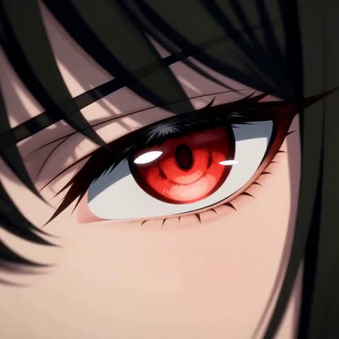</a>

按时间段列出编号分镜，每镜只用一个突然的运镜，串成三段连贯的动作爆发。前十九镜始终不拍脸，第二十镜才揭示，并用相似形状的硬切衔接，不做变形。

MiniMax H3 · 参考生视频 · 出处: [@aimikoda on X](https://x.com/aimikoda/status/2100258514132217859) · 3,281 赞，统计于 2026-10-28

[`character-reference`](pages/zh/tags.md#tag-character-reference) [`montage`](pages/zh/tags.md#tag-montage) [`hard-cuts`](pages/zh/tags.md#tag-hard-cuts) [`camera-moves`](pages/zh/tags.md#tag-camera-moves) [`studio-background`](pages/zh/tags.md#tag-studio-background)

<details><summary><b>提示词</b></summary>

```text
Use @[character reference] for the character's identity, anatomy, costume, colors, materials and visual style. Adapt body-region cues to its actual anatomy, replacing absent features with existing equivalents. Invent no anatomy or accessories. Select signature inserts from its most recognizable details. Rigid parts rotate; flexible materials bend or stretch.

A 15-second character-detail montage: exactly 20 shots joined by hard cuts. An empty, seamless warm-white studio background; soft directional light reveals the surfaces. Shots 1-19 are tightly cropped body details and rear angles: keep the face, eyes and facial profile entirely outside the frame, including reflections. Shot 20 is the first and only face reveal. No full-body view.

Three connected bursts: a sharp head turn with the body bracing; a coiled arm opening into a strong sweep and torso twist; one short step into a planted pivot, finishing with a sudden look into camera. Carry body state across cuts without resetting to neutral. Existing hair, clothing and attachments react naturally. Keep the character active, with clear articulation and weight shifts.

Jump between distant body regions. Mix brief visual punches with longer moving-detail reads. Use one abrupt camera move per shot except locked-camera inserts 4 and 11, where the character supplies the speed. Vary height, angle and direction. Brake moves briefly for legibility while the subject keeps moving. Local whips stay tightly cropped; changes of body region use hard cuts. Connect selected cuts through similar shapes or motion vectors, without morphing. Real-time action, no slow motion or freeze frames.

0-3s, shots 1-5. A concealed head turn triggers the first burst:
1. Extreme upper-back detail: a crash push catches its surface shifting as a sharp head turn begins entirely above the crop.
2. Fingers: a short downward snap catches them curling into a fist as the body braces.
3. Rear three-quarter shoulder detail: a tight camera arc catches the shoulder drawing back behind the turning head.
4. Locked floor-level foot detail: the grounded support foot braces, its raised heel pressing down firmly without taking a step.
5. Rear neck detail: a short upward tilt catches the nape stretching with the turn; stop below the back of the head, keeping the jaw and face excluded.

3-9s, shots 6-13. The coiled arm opens into a forceful sweep:
6. A signature upper-body detail: a fast diagonal slide catches an existing seam, joint or distinctive contour responding as the arm draws inward.
7. Elbow: a sharp lateral track catches the folding joint tightening the arm's coil.
8. Supporting knee: hard match cut from the bent elbow to the knee's similar angle; a short camera drop catches the leg compressing under the same preparation.
9. Wrist: a quick shallow orbit catches it turning outward to initiate the release.
10. Upper chest: a short punch-in catches the chest opening as the arm drives outward beyond the crop. Let this moving surface read slightly longer.
11. Locked hand detail: fingers spring open and the hand sweeps rapidly across the fixed frame. Catch one crisp, readable phase of the spread fingers before they leave the crop.
12. Upper back: a sharp sideways slide continues that screen direction as the shoulder rolls through the sweep and the torso twists.
13. A distinctive torso or waist detail: a close diagonal move catches its physical response to the twist, such as an existing fold pulling taut or an attached piece swinging. Give the material response a clear moving read.

9-13s, shots 14-19. One short step and a pivot build toward the reveal:
14. Thigh of the other leg: an abrupt low tracking move catches it driving the single short step out of the twist.
15. Advancing foot: a brief downward whip catches it landing; show clear floor contact.
16. Ankle and lower-leg detail: a fast side slide catches the landed leg accepting weight as the ankle flexes.
17. Waist: a tight orbit catches the torso rotating above the planted-foot pivot. The foot supports the turn rather than sliding across the floor.
18. Back-of-head contour: a short lateral whip catches the start of the return turn from behind. Keep only the rear contour in frame, never the facial profile.
19. A signature shoulder detail: a sharp diagonal slide catches its follow-through beneath the turning head, which stays completely above the crop. Cut at the peak of this movement.

13-15s, shot 20. First face reveal:
20. Hard cut to a frontal face close-up as the character sharply completes the turn toward the lens. An explosive short push reveals the entire face clearly for the first time and stops tightening before cropping out its features. Direct eye contact lands while hair, clothing or natural body follow-through remains alive. Keep the whole face readable through the end; finish on living motion, without a held pose or another cut.

No added props, scenery, text, graphic overlays or split screens.
```

</details>

<a id="h3-grid-storyboard-anime-park-run"></a>
### 动漫少年在公园奔跑时回头

<a href="https://x.com/8co28/status/2099171324568760589">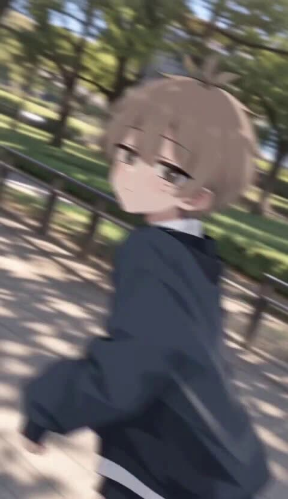</a>

把3x3分格图作为参考图，提示词要求镜头从第一格依次切到最后一格，成片几乎按分镜原样播放。明确禁止多格同屏和背景音乐，让每个镜头铺满画面且声音干净。

MiniMax H3 · 参考生视频 · 出处: [@8co28 on X](https://x.com/8co28/status/2099171324568760589) · 1,599 赞，统计于 2026-10-28

[`storyboard`](pages/zh/tags.md#tag-storyboard) [`anime`](pages/zh/tags.md#tag-anime) [`2d-animation`](pages/zh/tags.md#tag-2d-animation) [`grid-reference`](pages/zh/tags.md#tag-grid-reference) [`multi-shot`](pages/zh/tags.md#tag-multi-shot)

<details><summary><b>提示词</b></summary>

```text
When you take this 3x3 image and turn it into an AI video with r2v, it will roughly become the footage as-is with the following settings:

Minimax H3 Max r2v 480p 15 seconds Prompt adjustment: Quality Reference strength: Standard
"A 2D animation where the cut switches from the top-left panel to the bottom-right panel,
No multiple panels allowed, No BGM"
```

</details>

<a id="h3-character-intro-boots-to-hero-reveal"></a>
### 从靴子特写到全身英雄亮相的动漫角色介绍

<a href="https://x.com/aimikoda/status/2086412223061135392">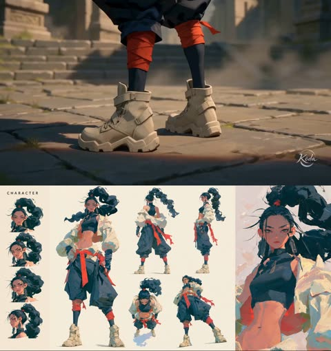</a>

用角色参考图锁定形象，再按四个时间段依次推进：细节特写、背面或侧面中景、面部肖像、全身英雄镜头。只给一个克制的标志性动作，并要求运镜平滑，让揭示过程可控。

MiniMax H3 · 参考生视频 · 出处: [@aimikoda on X](https://x.com/aimikoda/status/2086412223061135392) · 1,501 赞，统计于 2026-10-28 · 发现于 [SkyNotSilent/awesome-MiniMax-H3-cases](https://github.com/SkyNotSilent/awesome-MiniMax-H3-cases)

[`character-intro`](pages/zh/tags.md#tag-character-intro) [`reveal`](pages/zh/tags.md#tag-reveal) [`camera-progression`](pages/zh/tags.md#tag-camera-progression) [`anime`](pages/zh/tags.md#tag-anime) [`reference-lock`](pages/zh/tags.md#tag-reference-lock)

<details><summary><b>提示词</b></summary>

```text
Use @[char ref] as the sole character reference. Preserve the exact identity, face, body proportions, hairstyle, outfit, colors, materials and overall silhouette of the character throughout the entire video. Do not redesign, simplify or replace any defining visual features.

Create a cinematic character introduction focused on presence, silhouette, attitude and controlled motion.

0–4s
Begin with a close shot of a defining lower-body or detail element such as boots, shoes, feet, hands, clothing hem or an important accessory. The character enters frame or settles into position. The camera slowly tracks upward while hair, clothing and secondary elements move naturally in the wind or environment.

4–8s
Reveal more of the body with a medium or medium-wide shot from the back, side or three-quarter angle. The character stands in a calm, composed way inside the environment. The camera makes a smooth orbit, arc or lateral move to gradually reveal the character’s face and silhouette.

8–12s
Move into a tight cinematic portrait or upper-body shot. The character performs one subtle signature action that fits their personality, such as lifting the chin, turning the head, adjusting clothing, brushing hair aside, opening a hand, looking toward camera, or shifting posture. Keep the motion minimal and intentional. The expression should match the character’s vibe.

12–15s
End with a strong full-body hero shot that clearly presents the entire design and silhouette. Use a low-angle, eye-level or slightly dramatic framing depending on the character’s personality. The character settles into a natural final pose and holds it confidently for a clean final reveal.

VISUAL DIRECTION
Premium cinematic presentation. Match the visual medium and rendering style of @[char ref]. Emphasize clean silhouette, elegant staging, subtle secondary motion, believable hair and cloth movement, strong composition, atmospheric depth and polished lighting. The scene should feel like a high-end anime, game or film character introduction.

CAMERA
Use a clear progression from detail reveal to partial reveal to face reveal to full-body hero reveal. Camera movement should be smooth, controlled and intentional. Avoid chaotic motion.

ENVIRONMENT
Place the character in a fitting environment that supports their identity and mood. The background should enhance the character without distracting from them.
```

</details>

<a id="h3-flat-vector-curry-delivery-explainer"></a>
### 扁平矢量风咖喱外卖解说动画

<a href="https://x.com/ponzponz15/status/2087108170271560115"></a>

以关键画面锁定为首帧，五个带时间码的分镜各自写明底色、动效类型和屏幕文字。逐字给出日文文案，禁止多余文字和界面元素，并规定在12秒处定格收尾，保证字幕干净。

MiniMax H3 · 图生视频 · 出处: [@ponzponz15 on X](https://x.com/ponzponz15/status/2087108170271560115) · 766 赞，统计于 2026-10-27

[`motion-graphics`](pages/zh/tags.md#tag-motion-graphics) [`explainer`](pages/zh/tags.md#tag-explainer) [`flat-vector`](pages/zh/tags.md#tag-flat-vector) [`kinetic-typography`](pages/zh/tags.md#tag-kinetic-typography) [`japanese-text`](pages/zh/tags.md#tag-japanese-text)

<details><summary><b>提示词</b></summary>

```text
For the target video, at 0.00 seconds into the target video, <Picture 1> (from [Shot 1]) is fully referenced.
integrated_multimodal_description: [Shot 1] Classic Japanese 2D flat-vector explainer animation. Begin from the attached key visual as the exact first frame, preserving the same woman, white shirt with teal accent, teal smartphone, yellow curry container, warm-white background, thick charcoal outlines, circular illustrations, flat colors, and wide 16:9 composition. Do not display the attached key visual as a thumbnail, screenshot, media preview, or interface element. Hold the wide composition briefly. The curry steam gently rises, the notification bell pops once, and the woman presents the curry container with a happy expression. In the empty left area, large Japanese typography builds in two stages: "休みの夜、" then "カレーが食べたい。". Highlight "カレー" in curry ochre.
[Shot 2] At 00:02.200, the scene cuts to a bright teal flat-color field. A simple circular vignette of the same woman relaxing at home appears with a crescent moon, an evening clock without numbers, and an empty kitchen counter. The headline appears word by word: "でも、買いに行くのは面倒。". The final word is emphasized with a small coral-red block. Use simple 2D slide, pop, and mask-reveal motion only.
[Shot 3] At 00:04.500, the teal field wipes into a sunny yellow solution card. A large teal smartphone slides into the center while three illustrated curry choices pop out as clean circular cards: rich curry, vegetable curry, and spicy curry. A dotted route grows from the phone toward a small delivery scooter carrying a curry bag. The service name "カレヨル" appears clearly in deep charcoal, followed by the short phrase "選ぶだけ。".
[Shot 4] At 00:06.800, the composition changes to a clean white infographic strip. Three large circular steps assemble from left to right: "選ぶ", "届く", "食べる". The same woman appears in the final circle at home, opening the yellow curry container as visible steam rises. The delivery scooter moves along the dotted route and stops beside her. Keep every illustration flat, simple, and consistent with the key visual.
[Shot 5] At 00:09.200, the camera returns to a wide warm-white end card with generous negative space. A large two-line headline assembles smoothly: "どうしても、休みの夜は" followed by "カレーが食べたい。". At 00:10.500, the curry bowl and service name appear beneath it with the final message "そんな時は、カレヨル。". A small curry icon makes one cheerful pop and a gentle steam curl rises. Hold the complete wide end card cleanly until exactly 12.000 seconds. Do not add extra text, random pseudo-letters, logos, browser UI, or additional characters.
```

</details>

<a id="h3-anime-football-player-stats-ui-animation"></a>
### 动漫足球球员属性界面动画开场

<a href="https://x.com/aimikoda/status/2086122377633575169">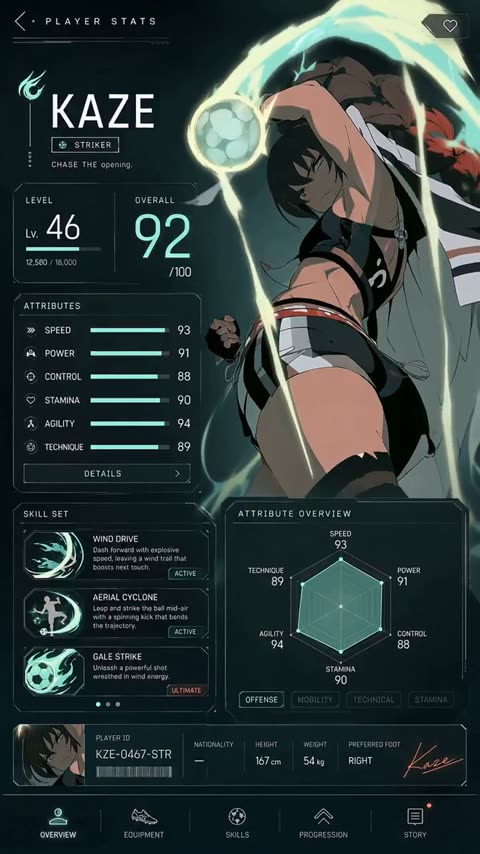</a>

以 GPT Image 2 生成的属性界面作为唯一参考，并要求只做动画不重新设计。提示词按秒划分扫描揭示、分数计数、属性条填充和最终定格，镜头锁定，并写明启动嗡鸣与确认提示音。

MiniMax H3 · 参考生视频 · 出处: [@aimikoda on X](https://x.com/aimikoda/status/2086122377633575169) · 707 赞，统计于 2026-10-28 · 发现于 [SkyNotSilent/awesome-MiniMax-H3-cases](https://github.com/SkyNotSilent/awesome-MiniMax-H3-cases)

[`ui-animation`](pages/zh/tags.md#tag-ui-animation) [`game-ui`](pages/zh/tags.md#tag-game-ui) [`anime`](pages/zh/tags.md#tag-anime) [`sports`](pages/zh/tags.md#tag-sports) [`reference-image`](pages/zh/tags.md#tag-reference-image)

<details><summary><b>提示词</b></summary>

```text
@[ref img] is the sole visual authority for Kaze, the football, the complete player-stats interface, typography, numbers, icons, colors, lighting, layout, and vertical composition. Animate this exact screen without redesigning it. Preserve all existing labels and final stat values.
[Goal]
Create a polished 15-second anime sports-game player stats screen opening. Use one continuous, locked, straight-on full-screen composition with no camera movement, cuts, cropping, or perspective distortion.

[Sequence]
0–2.2 seconds: Begin from near-black teal. A faint horizontal scanner passes downward, revealing Kaze’s silhouette and the outer edges of the interface. Fine particles and dim mint circuitry flicker awake.
2.2–5.5 seconds: The header, KAZE nameplate, role badge, level panel, and overall panel resolve through clean line-draw animations. Kaze emerges fully from shadow, takes a controlled breath, subtly shifts her shoulders and raised arm into the referenced pose, then fixes an intense gaze toward the viewer. Her hair, ribbons, and loose clothing react naturally to a growing current of wind. The football begins a slow, stable rotation beside her hand.

5.5–10.8 seconds: The large overall score counts rapidly upward and lands precisely on 92. The level settles on 46. Each attribute bar fills smoothly from left to right in sequence—Speed 93, Power 91, Control 88, Stamina 90, Agility 94, Technique 89—each landing with a restrained mint pulse. The radar chart draws outward from its center and locks into the exact final polygon. Skill cards activate from top to bottom; their icons flare briefly while the ACTIVE and ULTIMATE states illuminate.
10.8–13.3 seconds: The player ID strip and bottom navigation fade and slide into their exact final positions. The wind energy around Kaze accelerates clockwise, wrapping around the rotating ball and sweeping behind her body with layered luminous trails. Kaze tightens her hand, leans slightly into the current, and gives one natural blink; preserve her identity, anatomy, costume, and right-side placement.

13.3–15 seconds: The energy arc reaches a bright controlled crest, then settles into a living idle pulse. Hold the fully assembled screen matching @[ref img] exactly. Kaze continues subtle breathing; hair and ribbons drift, the football rotates slowly, particles shimmer, and all stats remain stable and readable.

Use crisp premium game-UI motion, clean 2D anime character animation, subtle depth between Kaze and the interface, and stable legible typography. Keep every panel, icon, label, number, and geometric boundary fixed once revealed. Do not introduce new text, extra characters, additional objects, logos, captions, or UI elements.

Audio: low electronic boot hum, delicate scanning ticks, short confirmation tones as values lock, rising airy wind around the ball, soft cloth movement, and one refined completion chime. No dialogue and no music.
```

</details>

<a id="h3-nostalgic-theme-park-montage"></a>
### 主题公园好友欢聚的怀旧图形拼贴

<a href="https://x.com/magnific/status/2083217899540586917">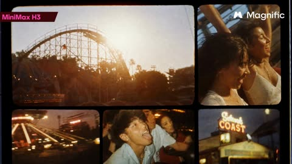</a>

提示词只点明形式（不同片段的蒙太奇）和版式语言（动态图形排版），再给出主体与场景。镜头选择、胶片颗粒和分格排布都交给模型，所以短提示词也能得到多画面的丰富结果。

MiniMax H3 · 文生视频 · 出处: [@magnific on X](https://x.com/magnific/status/2083217899540586917) · 508 赞，统计于 2026-10-28 · 发现于 [SkyNotSilent/awesome-MiniMax-H3-cases](https://github.com/SkyNotSilent/awesome-MiniMax-H3-cases)

[`montage`](pages/zh/tags.md#tag-montage) [`nostalgic`](pages/zh/tags.md#tag-nostalgic) [`motion-graphics`](pages/zh/tags.md#tag-motion-graphics) [`theme-park`](pages/zh/tags.md#tag-theme-park) [`short-prompt`](pages/zh/tags.md#tag-short-prompt)

<details><summary><b>提示词</b></summary>

```text
Nostalgic montage of different clips. Graphic motion layouts of friends having fun in a theme park.
```

</details>

**[全部 80 条](pages/zh/video-minimaxh3.md)**

<a id="seedance25"></a>
## Seedance 2.5

<a id="seedance-seoul-subway-revenge"></a>
### 首尔地铁站复仇喜剧

<a href="https://x.com/AIwithSynthia/status/2108760866422415701">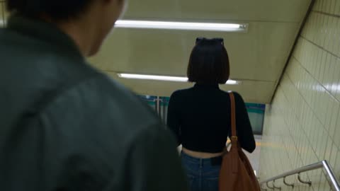</a>

第一行先定镜头语言（手持、荧光灯、实时），再按节拍写笑点，结尾点明哪些画面必须拍清楚。

Seedance 2.5 · 文生视频 · 出处: [@AIwithSynthia on X](https://x.com/AIwithSynthia/status/2108760866422415701) · 10,056 赞，统计于 2026-10-27

[`action`](pages/zh/tags.md#tag-action) [`comedy`](pages/zh/tags.md#tag-comedy) [`handheld`](pages/zh/tags.md#tag-handheld) [`subtitles`](pages/zh/tags.md#tag-subtitles)

<details><summary><b>提示词</b></summary>

```text
Create a live-action cinematic revenge-comedy video set in a Seoul subway station. Use realistic handheld camera movement, cold fluorescent lighting, teal-green accents, and real-time action.

A Korean woman in her 20s with a black bob, sunglasses on her head, a fitted crop top, high-waisted blue jeans, black boots, and a brown shoulder bag descends the subway stairs holding a takeaway coffee. A Korean man with messy dark hair and blonde tips, wearing a dark-green bomber jacket, suddenly hits her from behind and laughs as she stumbles against the handrail. Furious, she chases him onto the platform as he boards a train and mocks her through the closing glass doors.

She punches the glass, creating a dramatic crack and opening. As she confronts him, her coffee cup slips from her hand, falls to the platform, and spills visibly across the floor. She grabs his jacket, forcefully throws him through the air, and sends him crashing into a large metal rubbish bin. The bin rattles and wobbles as he lands inside, looking terrified and humiliated.

She leans toward him and says, "Don't mess around." She then calmly walks away while he remains stuck in the bin.

Maintain identical faces, hairstyles, outfits, and location throughout. Include realistic physics, expressive reactions, cinematic close-ups, subway ambience, and clear white subtitles. Keep the action non-gory, the coffee spill visible, and the final dustbin landing unmistakable.
```

</details>

<a id="seedance-seoul-summer-evening-vlog"></a>
### 首尔夏夜，家庭录像质感

<a href="https://x.com/AIwithkhan/status/2092971211169100048">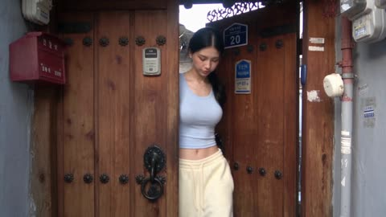</a>

纯文字，没有参考图。真实感来自要求小意外和不完美的手持摄像。

Seedance 2.5 · 文生视频 · 出处: [@AIwithkhan on X](https://x.com/AIwithkhan/status/2092971211169100048) · 6,187 赞，统计于 2026-10-27

[`vlog`](pages/zh/tags.md#tag-vlog) [`ugc`](pages/zh/tags.md#tag-ugc) [`realism`](pages/zh/tags.md#tag-realism) [`home-video`](pages/zh/tags.md#tag-home-video)

<details><summary><b>提示词</b></summary>

```text
Create a 30-second, 1080p ultra-realistic personal home-video showing an ordinary summer evening in the life of a young Korean woman. No reference image.

MAIN SUBJECT

Young Korean woman in her early 20s, naturally pretty, realistic skin texture, minimal makeup, relaxed and approachable personality.

Long black hair loosely tied into a messy side ponytail with a few loose strands around her face. Wearing a fitted pastel-blue short top, loose cream pajama-style pants, black sneakers and a simple silver necklace.

Maintain the same face, hairstyle, clothing, body proportions and overall appearance throughout the entire video.

SETTING

A quiet older Seoul residential neighborhood during a warm summer evening. Narrow concrete lanes, small houses, potted plants, bicycles, old walls, utility poles, overhead wires, a tiny neighborhood bakery, a public water tap and large leafy trees casting shadows across the street.

Everything should feel lived-in, ordinary and peaceful. No tourist attractions, advertisements, recognizable brands or commercial activity.

CAMERA / VISUAL AESTHETIC

Raw personal footage casually recorded by a friend on an early-2000s consumer DV camcorder.

Strong handheld shake, imperfect framing, autofocus hunting, exposure shifts, occasional motion blur, faded colors, soft digital detail, mild noise, accidental zooms and natural camera imperfections.

No stabilization, drone footage, gimbal movement, dramatic lighting or polished commercial cinematography.

 — OUTSIDE THE HOUSE

She steps outside carrying a small reusable shopping bag. She locks the door, adjusts her messy ponytail and looks toward the camera with a relaxed smile.

A light summer breeze moves her hair as she starts walking down the lane.

 — BAKERY STOP

She reaches a tiny neighborhood bakery and buys a warm pastry.

She steps outside, takes her first bite and immediately smiles because it tastes good.

She notices her friend filming and holds the pastry toward the camera playfully before taking another bite.

— WALKING HOME

She continues down the narrow street while eating.

A neighborhood cat follows her for a few steps. She notices it, crouches down and gently pets it.

The cat walks away and she laughs before continuing.

 — SMALL ACCIDENT

She walks beneath a large tree when a few leaves fall onto her hair.

She stops, looks confused, then realizes what happened and laughs.

She brushes the leaves away while her friend zooms awkwardly toward her face.

She looks directly into the camera and says:

"Seriously?"

 — QUIET MOMENT

She reaches a low concrete wall beside the street and sits down for a moment.

She finishes the pastry while watching bicycles and neighbors passing through the lane.

A gentle breeze moves her hair. She casually fixes her ponytail and looks around peacefully.

 — FINAL MOMENT

She stands up and continues walking home.

After a few steps, she turns back toward the camera with a small playful smile and says:

"Come on."

She keeps walking down the sunny lane while the camera follows behind.

She disappears around the corner and the recording abruptly cuts to black.

AUDIO

Natural location sound only: birds, summer insects, footsteps, bicycle bells, distant scooters, leaves moving in the breeze, bakery sounds, neighborhood conversations and subtle camera-handling noise.

No music. No narration. No artificial sound effects.

Only the two spoken lines specified above.

FINAL FEEL

The entire video should feel like a forgotten summer recording from the early 2000s.

Warm, feminine, casual, slightly playful, intimate and nostalgic.

No dramatic events, no exaggerated acting, no model poses and no polished cinematic shots.

The realism should come from ordinary surroundings, natural expressions, small accidents, realistic environmental movement and imperfect camcorder operation.
```

</details>

<a id="seedance-katsudon-anime-cooking"></a>
### 快剪动画风格做猪排饭

<a href="https://x.com/Goodmanprotocol/status/2098845134326808734">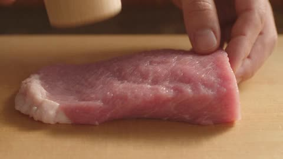</a>

开头明确禁止模仿任何现有动画，再一步步写菜谱，让每个镜头都有事做。

Seedance 2.5 · 文生视频 · 出处: [@Goodmanprotocol on X](https://x.com/Goodmanprotocol/status/2098845134326808734) · 4,935 赞，统计于 2026-10-27

[`anime`](pages/zh/tags.md#tag-anime) [`food`](pages/zh/tags.md#tag-food) [`fast-cut`](pages/zh/tags.md#tag-fast-cut)

<details><summary><b>提示词</b></summary>

```text
Create a 30-second fast-paced cinematic Japanese anime cooking video showing the preparation of authentic katsudon, entirely from the text description below.

IMPORTANT: Do not display, recreate, trace, reference, or imitate any storyboard, sketch, reference image, panel, annotation, or source material. Generate only original anime-style animation.

STYLE

High-quality Japanese anime film style, cinematic summer lighting, ultra-detailed food textures, realistic cooking physics, visible steam and moisture, shallow depth of field, macro close-ups, smooth camera movement, warm Japanese kitchen atmosphere. Fast rhythmic editing with natural match cuts based on movement, shape, texture, and composition.

TIMELINE

0–2.5s — Prepare Pork
Close-up of hands pounding a thick pork loin with a wooden mallet on a cutting board. The meat gradually flattens and its fibers loosen. Sprinkle salt and pepper evenly. Crisp rhythmic impacts.

2.5–5s — Bread the Pork
Quick match cuts: press the pork into flour, dip into beaten egg, then firmly coat with coarse panko breadcrumbs. Show realistic egg dripping and breadcrumbs adhering to the surface.

5–7.5s — Fry
Lower the breaded pork into hot golden oil. Intense bubbling surrounds the cutlet as the crust turns golden brown and crispy. Warm cinematic lighting and detailed oil movement.

7.5–9.5s — Slice
Place the fried tonkatsu on a wooden board. A sharp knife cuts it into even strips. The crispy crust cracks naturally, revealing juicy white pork with gentle steam escaping.

9.5–12s — Simmer Dashi & Onion
Thinly sliced onions gently simmer in amber dashi inside a shallow pan. Small bubbles rise while the onions become translucent. Chopsticks gently move them through the broth.

12–14s — Add Tonkatsu
Place the sliced tonkatsu carefully over the simmering onions using chopsticks. The broth begins soaking into the crispy edges while steam rises.

14–16.5s — Pour Egg
Slowly pour beaten golden egg over the tonkatsu and onions. The egg spreads naturally through the gaps and begins setting around the hot edges.

16.5–19s — Set the Egg
Close-up of the egg gently coagulating over low heat. Edges become soft and golden while the center remains glossy, slightly runny, and trembling. No stirring.

19–21s — Prepare Rice
A white ceramic donburi bowl receives a generous mound of steaming Japanese short-grain rice. The rice looks fluffy and slightly glossy.

21–24s — Assemble
Carefully slide the egg-and-tonkatsu mixture from the pan onto the rice. The egg settles naturally in a soft wave while dashi lightly absorbs into the rice.

24–26s — Final Close-Up
The finished katsudon rests on the counter. Glossy egg slowly settles over the tonkatsu and rice, gently trembling. Slow cinematic push-in.

26–30s — Hero Reveal
Present the finished katsudon in a traditional blue-and-white ceramic bowl on a wooden surface. Golden egg covers crispy tonkatsu over glossy rice, topped with fresh mitsuba. Steam rises as the camera slowly arcs around the bowl for a beautiful anime-food-film ending.

AUDIO

Bright 1980s-inspired Japanese city-pop instrumental, 110–120 BPM, with subtle koto and light chime percussion. Synchronize realistic ASMR cooking sounds: mallet impacts, knife slicing, frying sizzle, bubbling dashi, chopsticks, egg pouring, steam, and a soft ceramic clink.

End with one delicate wind-chime tone during the final reveal.

NEGATIVE

No storyboard, reference image, sketch, panels, borders, numbers, arrows, annotations, subtitles, captions, UI, logos, or text overlays. No unrelated ingredients or dishes. Katsudon only. Keep the food, hands, utensils, lighting, and environment visually consistent throughout.
```

</details>

<a id="seedance-rainy-morning-university-vlog"></a>
### 雨天早晨，咖啡，走去学校

<a href="https://x.com/nawalsehar/status/2103337966416621703">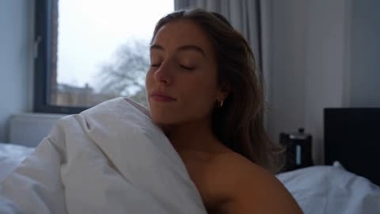</a>

30 秒只用不到 1000 字：一条紧凑的日常流程，加一小串要避免的毛病。

Seedance 2.5 · 文生视频 · 出处: [@nawalsehar on X](https://x.com/nawalsehar/status/2103337966416621703) · 4,181 赞，统计于 2026-10-27

[`vlog`](pages/zh/tags.md#tag-vlog) [`realism`](pages/zh/tags.md#tag-realism) [`morning-routine`](pages/zh/tags.md#tag-morning-routine)

<details><summary><b>提示词</b></summary>

```text
Create a 30-second ultra-photorealistic live-action university vlog of a European brunette in her mid-20s waking to a rainy morning, making coffee, getting ready, grabbing her umbrella, walking through a wet city, and arriving at university just before class.

Modern smartphone vlog style: natural handheld movement, subtle shake, autofocus changes, realistic rain, puddles, reflections, traffic, umbrellas, wet clothing, natural expressions and believable human movement.

Dialogue: “Good morning… apparently, it’s raining.” → “First coffee. Then lecture.” → “Two minutes early. I’m impressed.” → “Okay, made it.”

Natural diegetic audio only. No music, narration, CGI look, artificial rain, face changes, distorted anatomy, impossible physics, subtitles, logos or watermark.

16:9 • 24fps • 4K • Ultra-photorealistic live action
```

</details>

<a id="seedance-cafe-table-multi-angle-reshoot"></a>
### 咖啡馆桌边讲话重拍成十三个新机位

<a href="https://x.com/Scenario_gg/status/2102365054389899695">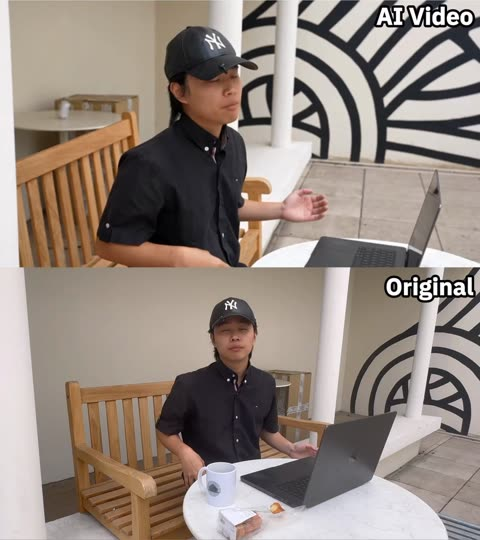</a>

提示词先锁定原视频的表演、音频、光线和节奏，只允许机位与镜头变化，再用带时间码的镜头表逐段设计新机位。逐段标注的说话时间窗、视线规则和空天空规则，让每个新角度的口型同步与背景都保持干净。

Seedance 2.5 · 视频编辑 · 出处: [@Scenario_gg on X](https://x.com/Scenario_gg/status/2102365054389899695) · 3,287 赞，统计于 2026-10-27

[`video-to-video`](pages/zh/tags.md#tag-video-to-video) [`multi-angle`](pages/zh/tags.md#tag-multi-angle) [`camera-plan`](pages/zh/tags.md#tag-camera-plan) [`lip-sync`](pages/zh/tags.md#tag-lip-sync) [`timed-shot-list`](pages/zh/tags.md#tag-timed-shot-list)

<details><summary><b>提示词</b></summary>

```text
Prompt (seedance 2.5 video to video):

ONE FINISHED TAKE, RE-PHOTOGRAPHED


@video1
 is one finished take: a single locked-off wide, 19.53 s, with its original audio, a young man at an outdoor cafe table talking to one camera. Do not restage, re-perform, re-time or reinterpret it. Re-photograph the identical event from thirteen new camera positions, as if thirteen extra cameras had been rolling around him in the same moment. Every output frame shows the same body at the same instant of
@video1
 at the same speed. Output runs the full 19.53 s. Keep the audio of
@video1
 unchanged and in sync.

DO NOT CHANGE
Performance, body, hands and what they hold, head angle, eyeline, lip movement, blink timing, movement speed, action start and end times, lighting, exposure, white balance, colour grade, wardrobe, props, set. The only variable is camera position and lens.

SPEECH WINDOWS (measured from the audio of
@video1
)
SPEAKING: 0.00-1.65, 2.05-4.80, 5.95-6.90, 9.65-11.75, 12.20-12.85, 13.35-13.80, 16.70-16.90, 17.60-18.90.
SILENT, mouth closed and still or chewing: 1.65-2.05, 4.80-5.95, 6.90-9.65 (drinking), 11.75-12.20, 12.85-13.35, 13.80-16.70 (chewing), 16.90-17.60, 18.90-19.55.
Whenever his mouth is visible in a SPEAKING window it moves in lip-sync with the audio of
@video1
. He talks while looking down: from 2.05 to 4.80 his head is down at the laptop and he is speaking. Head down is not silent. Never add speech to a silent window, never mute a speaking one.

EYELINE RULE
He performed to ONE camera, the A-camera: the original locked-off wide, directly in front of him at seated eye level. His eyeline stays on that spot in every shot, apart from the glances down at keyboard, mug and pastry already in
@video1
. He never looks for or turns toward a new camera. From above he reads cap and brow; from the sides, three-quarter or profile; from behind, the back of his head. Single exception: the on-axis shot at 00:01-00:02 sits where the A-camera was, so there alone he looks into the lens.

TEMPO RULE
Real time, 1:1 with
@video1
. No speed ramps, added slow motion, freeze frames or time remaps. Exactly one slowed passage exists, already baked into the source: the pastry at the top of its arc, 12.5-13.55. Reproduce it at the speed it already has, no slower, no longer.

TOSS TIMING
The pastry leaves his fingers at 12.43 and is caught at 13.60: airborne about one second only. Do not stretch, loop or hang the flight. Before 12.43 and after 13.60 it is in his hand.

EMPTY SKY
On every low or upward-tilting shot the sky is plain pale overcast and empty. No skyscrapers, glass towers, solar panels, cranes, birds, aircraft, sun disc, structured clouds, lens flare or signage. Above his head only cream wall, white pillars and flat pale sky.

CAMERA PLAN

[00:00-00:01] High-angle MCU from above and to his right, about 40 degrees down, chest up, slow push-in, 35mm feel, moderate depth of field, cap brim and open gesturing palms, marble edge in the lower foreground. Speaking, reading three-quarter, not to this lens.

[00:01-00:02] ON THE A-CAMERA AXIS. ECU of his face, dead front, seated eye level, 85mm feel, shallow focus, pillars soft cream behind. The one shot where he looks into the lens. Hands drop below frame onto the keyboard; mouth closes at 1.65.

[00:02-00:05] Macro along the MacBook keyboard to his typing fingers, lens centimetres above the keys, razor-thin focus, keycaps sharp, his face soft far behind, head down. Speaking 2.05-4.80: where his mouth shows in the blur it moves with the audio. Fingers lift at 5.0.

[00:05-00:06] Top-down bird's eye straight down over the table, 24mm feel, deep focus, locked off. Marble disc fills frame: open laptop, white mug, financier, his cap at the bottom edge. Right hand crosses to the mug handle.

[00:06-00:07] Lens resting on the marble at table height, 50mm feel. White mug large and sharp in the left foreground; his hand enters from the right, grips the handle, lifts the mug up out of frame. Torso soft behind. Speaking 5.95-6.90.

[00:07-00:09] First-person POV from his seat, ultra-wide 18mm feel, gentle handheld breathing. The mug rim rises into the bottom of frame and tips toward the lens; laptop screen and marble beyond in deep focus. No face; framing dips to the mug, never up. Silent.

[00:09-00:10] Extreme wide, slow dolly out, 24mm feel, deep focus. He is small at his table mid-terrace: cream wall, pillars, concentric-circle mural, taped boxes behind, slatted bench visible. He sets the mug on the marble 9.4-10.0; speech resumes 9.65.

[00:10-00:12] Low and to his left, lens just above the marble, 50mm feel, shallow focus, table edge and mug soft in the near foreground. Right hand reaches out at 10.5 and lifts the golden financier into sharp focus before his left profile. Talking to the A-camera: full profile here.

[00:12-00:14] Low beside him, 35mm feel, slight Dutch. Opens on the pastry in his fingers; at 12.43 it leaves his hand and the camera tilts UP, following it against plain pale overcast sky and the top of a white pillar through the baked-in slow apex 12.5-13.55, then tilts DOWN for the catch at 13.60 into cupped hands, head tipped back, mouth open, then head coming forward.

[00:14-00:15] Behind him, over his right shoulder, 50mm feel, moderate focus. Back of the black Yankees cap and long dark hair fill frame-left; laptop glow and marble past his shoulder. Head settles level, hands bring the pastry toward his mouth. No face. Silent.

[00:15-00:16] ECU on his mouth and jaw, 100mm macro feel, very shallow focus, soft open-sky light. The financier enters from below, he bites, crumbs, the jaw chews. Chewing, not speaking. Nothing above the nose in frame.

[00:16-00:18] Slow orbit from his left toward front, 35mm feel, moderate focus, mural and pillars parallaxing behind, table crossing the foreground. He chews, speaks 16.70-16.90 and from 17.60, open palms, a small shrug. As the orbit nears front his gaze lands near, not into, this moving lens.

[00:18-00:20] Top-down bird's eye straight down over the table, 24mm feel, deep focus, locked off. Hands come down beside the laptop and settle, cap centred, speech ends 18.90, then still. Hold to 19.53.

SET AND SUBJECT CONTINUITY (identical in every shot)
Young man, long dark hair, black short-sleeve button-up shirt with a small chest logo, black New York Yankees baseball cap, grey trousers. Light wood slatted bench, round white marble table, outdoor cafe terrace. On the table: open dark grey MacBook, white mug with a circular graphic, one small golden financier. Behind him: cream wall, white cylindrical pillars, large black-and-white concentric-circle mural, taped cardboard boxes. Soft overcast open-shade daylight, no hard shadows, constant direction and softness. Warm bright grade: cream walls, golden wood, neutral white marble, warm skin, deep neutral blacks. He is alone; no passers-by, no staff.

No on-screen text, captions, subtitles, watermarks or logos beyond the small chest logo and cap emblem already in
@video1
.
```

</details>

<a id="seedance-diner-frozen-time-rewind"></a>
### 1950 年代餐馆：时间静止再倒流

<a href="https://x.com/techhalla/status/2083389002552664385">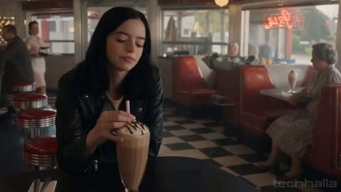</a>

一个特效撑满 30 秒。先把餐馆写细，静止和倒流才看得清。

Seedance 2.5 · 文生视频 · 出处: [@techhalla on X](https://x.com/techhalla/status/2083389002552664385) · 2,873 赞，统计于 2026-10-27

[`vfx`](pages/zh/tags.md#tag-vfx) [`time-freeze`](pages/zh/tags.md#tag-time-freeze) [`period`](pages/zh/tags.md#tag-period)

<details><summary><b>提示词</b></summary>

```text
Photorealistic cinematic 1950s American diner, chrome stools, red vinyl, neon glow and checkerboard floor, shot with modern lived-in realism and soft natural window light. Subtle handheld texture, warm practicals, rich period detail, heavy film grain.

0-4s: [Medium Wide] A striking young woman in her early 20s sits alone at the counter, calm and slightly amused, slowly sipping a tall thick milkshake through a straw. Behind her a young waitress in classic uniform approaches with a tray of eggs and bacon in one hand and a full glass coffee pot in the other. An older lady starts rising from a nearby booth.

4-8s: [Dynamic Tracking] The older lady collides hard into the waitress. Tray, plate, eggs, bacon and coffee pot explode upward in chaotic slow motion. Coffee erupts into long liquid ribbons and perfect suspended droplets. Camera immediately begins a smooth continuous orbit around the impact. Time locks completely at the peak of the spill. Every face freezes in pure shock. Only the girl at the counter keeps moving, completely unfazed.

8-17s: [Slow 360° Orbital] Camera glides in a full elegant orbit through the frozen diner. Coffee hangs in mid-air as glassy ribbons and spheres with perfect volume and surface tension. Bacon strips, eggs and the spinning tray float weightlessly. Patrons and waitress remain locked in startled expressions. The girl at the counter takes one slow, deliberate sip, eyes half-lidded, almost bored, while the entire frozen world (except her) begins an elegant reverse: every droplet, every piece of food and every person rewinds smoothly back to the exact starting positions.

17-24s: [Medium Shot] Rewind lands perfectly. Waitress stands balanced again with tray and coffee pot. The girl lifts her eyes, raises two fingers in a small casual gesture and softly calls the waitress by name. The waitress turns toward her just before the older lady begins to stand, completely avoiding the collision. A tiny private smile crosses the girl’s face.

24-30s: [Extreme Close-Up] Hard cut to her face as she takes one last slow sip. Soft knowing smile, eyes almost closed in quiet satisfaction, like she has done this a hundred times. Shallow depth of field, creamy bokeh of the neon diner behind her.

Photorealistic, ultra-detailed fluid physics, perfect motion blur only on moving elements, stable characters, cinematic lighting, heavy natural film grain, no artifacts, movie-level temporal coherence, high rewatch value.
```

</details>

**[全部 144 条](pages/zh/video-seedance25.md)**

<a id="geminiomniflash"></a>
## Gemini Omni Flash

<a id="omni-photo-bird-jumps-onto-hand"></a>
### 小鸟从电脑照片中跃出落到手上

<a href="https://x.com/alexanderchen/status/2060322611586834518">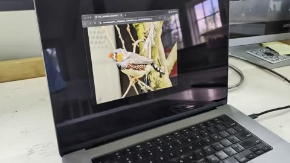</a>

提示词先要求屏幕内容与原视频完全一致，再按顺序写出转头、离开照片、跳上手这一连续动作。真实拍摄的场景为画面效果提供了物理锚点。

Gemini Omni Flash · 视频编辑 · 出处: [@alexanderchen on X](https://x.com/alexanderchen/status/2060322611586834518) · 1,385 赞，统计于 2026-10-27

[`photo-to-life`](pages/zh/tags.md#tag-photo-to-life) [`animal`](pages/zh/tags.md#tag-animal) [`screen-breakout`](pages/zh/tags.md#tag-screen-breakout) [`live-action`](pages/zh/tags.md#tag-live-action)

<details><summary><b>提示词</b></summary>

```text
Start with the computer screen content exactly the same as in the video. Make the bird come to life, turning head, leaving the photo and jumping onto the person's hand.
```

</details>

<a id="omni-word-by-word-kinetic-text-sizzle"></a>
### 光泽三维文字逐词依次出现

<a href="https://x.com/Google/status/2062925430290526486"></a>

提示词逐一写出完整的词序，并限定同一时刻只出现一个词。再要求每个词采用不同的动画风格并按节奏卡点，让模型能清楚控制文字的出现时机与动态。

Gemini Omni Flash · 文生视频 · 出处: [@Google on X](https://x.com/Google/status/2062925430290526486) · 1,219 赞，统计于 2026-10-27

[`kinetic-typography`](pages/zh/tags.md#tag-kinetic-typography) [`text-rendering`](pages/zh/tags.md#tag-text-rendering) [`sizzle-reel`](pages/zh/tags.md#tag-sizzle-reel) [`motion-graphics`](pages/zh/tags.md#tag-motion-graphics)

<details><summary><b>提示词</b></summary>

```text
Beyond just rendering text, Gemini Omni actively syncs your text with the onscreen action.

It draws on Gemini's knowledge to connect language, imagery and meaning to turn complex ideas into compelling visuals. 💬

Prompt for this video: Add the word “SMILE” in bold white sans-serif typography across the nose of every inflatable shark, clean modern lettering naturally integrated into the glossy wet plastic surface, slightly curved and distorted by the inflatable shape while remaining crisp and readable during movement through the water slide. The text on the sharks must remain perfectly locked and tracked to each shark’s skin surface at all times, moving consistently with the body and rotating naturally with the sharks during the descent. Avoid flickering, sliding, jittering, duplicated characters, changing letter count, or distorted typography. Any existing text must remain stable, readable, and physically integrated into the shark skin texture, behaving like a natural marking rather than an added overlay. No text should appear or disappear mid-descent.
```

</details>

<a id="omni-miniature-farmhouse-foundation-macro"></a>
### 巨型双手搭建的微缩农舍地基

<a href="https://x.com/Strength04_X/status/2085930145374966138"></a>

提示词先列出具体的微缩材料和工具，再写明施工阶段和预留的泳池空地，让模型清楚哪些已建、哪些未建。微距镜头、浅景深以及巨型双手与微小物件的对比确立了尺度感。

Gemini Omni Flash · 文生视频 · 出处: [@Strength04_X on X](https://x.com/Strength04_X/status/2085930145374966138) · 1,205 赞，统计于 2026-10-27

[`miniature`](pages/zh/tags.md#tag-miniature) [`macro`](pages/zh/tags.md#tag-macro) [`construction`](pages/zh/tags.md#tag-construction) [`hands`](pages/zh/tags.md#tag-hands) [`photorealistic`](pages/zh/tags.md#tag-photorealistic)

<details><summary><b>提示词</b></summary>

```text
Hyper-realistic miniature luxury farmhouse construction site at the very first stage of construction, viewed through cinematic macro photography. A small rectangular foundation area partially prepared on natural brown sand and compact soil, realistic miniature construction materials scattered naturally around the site, tiny red bricks, miniature cement bags, wooden beams, gravel, sand piles, metal rods, tiny buckets, miniature trowel, measuring tape, spirit level and other authentic construction tools. Giant human fingers and realistic human hands carefully interacting with the miniature materials, positioning the first construction pieces. The future farmhouse footprint clearly visible but construction has only just begun, with no completed walls or roof. Subtle markings and foundation trenches visible in the soil. A small empty area beside the foundation reserved for a future swimming pool. Extremely realistic material scale, authentic construction imperfections, tiny dust particles, cement residue, fingerprints, rough brick texture and granular soil detail. Professional miniature craftsmanship, photorealistic 8K detail, cinematic studio lighting, realistic soft shadows, shallow depth of field, strong foreground-to-background scale contrast, sharp focus on construction area, premium macro lens photography, realistic bokeh, natural color reproduction, high dynamic range, tactile textures, physically accurate lighting, believable human-to-miniature scale, no cartoon appearance, no CGI look, no text, no watermark.
```

</details>

<a id="omni-coconut-water-storyboard-commercial"></a>
### 椰子水瓶装广告，八格分镜转成视频

<a href="https://x.com/Strength04_X/status/2094760813794111843"></a>

先用结构化分镜板固定版式、信息卡、八个编号场景，以及每格的时长、镜头、动作和产品细节。镜头一行列出高速液体、极致微距和低角度，声音写明水声加 ASMR。再把分镜首格画面交给视频模型生成。

Gemini Omni Flash · 图生视频 · 出处: [@Strength04_X on X](https://x.com/Strength04_X/status/2094760813794111843) · 663 赞，统计于 2026-10-28

[`product-commercial`](pages/zh/tags.md#tag-product-commercial) [`storyboard`](pages/zh/tags.md#tag-storyboard) [`beverage`](pages/zh/tags.md#tag-beverage) [`macro`](pages/zh/tags.md#tag-macro) [`asmr`](pages/zh/tags.md#tag-asmr)

<details><summary><b>提示词</b></summary>

```text
Nano Banana 2 × Gemini Omni flash 1.1

Prompt - TITLE: Premium Coconut Water Product Commercial Storyboard

FORMAT:
• Single-page premium storyboard
• 3:4 Portrait ratio
• Premium natural beverage campaign
• 8 cinematic product-focused scenes
• Product remains the central hero
• High-end advertising agency presentation

HEADER:
• Clean modern typography
• Information cards:
  - Duration: 20 Seconds
  - Style: Fresh Natural Beverage Commercial
  - Product: Coconut Water
  - Audio: Tropical Water + Refreshing ASMR
• Why This Style Works section
• White, coconut green and natural beige aesthetic
• Minimal tropical decorative accents

STORYBOARD:
1. Chilled coconut water bottle standing on wet natural stone, covered in condensation
2. Bottle cap opening with a crisp close-up of the seal
3. Coconut water pouring into a transparent glass
4. Clear liquid swirling inside the glass with tiny bubbles
5. Fresh coconut pieces dropping beside the bottle in slow motion
6. Ice cubes falling into the drink and creating a controlled splash
7. Extreme macro of condensation droplets running down the bottle
8. Final hero bottle and glass surrounded by fresh coconut pieces and a frozen water splash

EVERY PANEL:
• Scene number
• Duration badge
• Camera direction
• Visual
• Action
• Product detail

CAMERA:
High-speed liquid photography, extreme macro, condensation close-up, slow-motion ice drop, transparent liquid swirl, low-angle product shot, cinematic hero framing.

STYLE:
Ultra-realistic beverage advertising, crystal-clear liquid, realistic condensation, detailed coconut texture, dynamic water splash, natural premium lighting, clean packaging, luxury commercial photography, 8K.
```

</details>

<a id="omni-commercial-storyboard-board-kitchen-pan"></a>
### 由商业分镜板生成的厨房平底锅视频

<a href="https://x.com/Strength04_X/status/2078516405251801458"></a>

提示词按版式、页眉、分镜布局、摄影风格、页脚分段列出，让 GPT Image 2 先生成八格分镜板。再把分镜板作为视觉参考交给 Gemini Omni Flash，生成产品镜头。

Gemini Omni Flash · 图生视频 · 出处: [@Strength04_X on X](https://x.com/Strength04_X/status/2078516405251801458) · 589 赞，统计于 2026-10-27

[`storyboard`](pages/zh/tags.md#tag-storyboard) [`product-shot`](pages/zh/tags.md#tag-product-shot) [`commercial`](pages/zh/tags.md#tag-commercial) [`kitchen`](pages/zh/tags.md#tag-kitchen) [`gpt-image-workflow`](pages/zh/tags.md#tag-gpt-image-workflow)

<details><summary><b>提示词</b></summary>

```text
TITLE: Premium Commercial Storyboard Presentation

FORMAT:
• Single-page premium storyboard
• 3:4 Portrait ratio
• Luxury advertising agency presentation board
• Client-ready storyboard layout
• 8 storyboard frames
• Editorial Swiss grid system
• High-end presentation quality
• Print-ready infographic

HEADER:
• Large elegant serif title
• Premium minimalist information bar
• Information cards:
  - Duration
  - Style
  - Audience
  - Audio Suggestion
• Rounded "Why This Style Works" section
• Gold decorative doodles, stars, sparkles, hearts
• Soft cream luxury background
• Thin beige border
• Clean editorial spacing

STORYBOARD LAYOUT:
• 8 equal storyboard panels
• 2 rows × 4 columns
• Rounded white cards
• Soft realistic shadows
• Perfect alignment
• Equal margins
• Professional grid layout
• Large cinematic image in upper section
• Information block below image

EVERY STORYBOARD PANEL INCLUDES:
• Scene number inside white outlined circle
• Duration badge in top-right corner
• Large commercial-quality photograph
• Sections:
  - Visual
  - Action
  - Dialogue
• Bold section titles
• Perfect typography hierarchy
• Consistent spacing
• Premium card design

PHOTOGRAPHY STYLE:
• Ultra realistic commercial photography
• Cinematic product shots
• Natural daylight
• Soft warm lighting
• Luxury advertising look
• Shallow depth of field
• Smooth background bokeh
• High-end product styling
• Professional color grading
• DSLR quality
• Premium lifestyle photography

GRAPHIC STYLE:
• Apple keynote presentation aesthetic
• Behance showcase quality
• Modern editorial magazine design
• Premium infographic
• Clean UI composition
• Luxury branding
• Elegant typography
• Minimalist design language
• Print-quality layout

FOOTER:
• Total Duration
• Format
• Visual Style
• Minimal line icons
• Premium editorial finish

QUALITY:
Ultra detailed, 8K, razor sharp, perfectly aligned, symmetrical composition, luxury commercial presentation, agency-quality storyboard, realistic textures, flawless typography, premium client presentation.
```

</details>

<a id="omni-sparkling-lemon-drink-storyboard-commercial"></a>
### 冰块上的气泡柠檬饮料瓶微距广告

<a href="https://x.com/Strength04_X/status/2097237465887338994">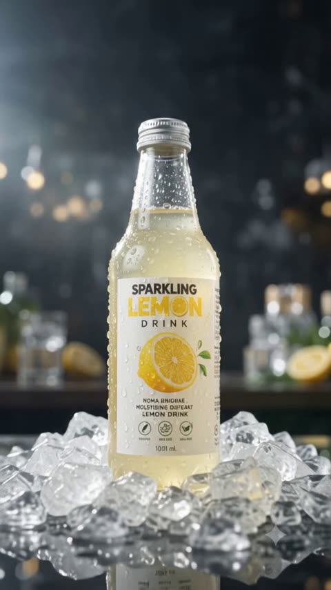</a>

先用 Nano Banana 2 生成八个分镜的故事板，再交给 Omni Flash 动起来。每个分镜都写明镜头方向和产品细节，镜头部分指定 120fps 液体摄影、凝结水珠微距和 360° 产品环绕。

Gemini Omni Flash · 图生视频 · 出处: [@Strength04_X on X](https://x.com/Strength04_X/status/2097237465887338994) · 361 赞，统计于 2026-10-28

[`product-commercial`](pages/zh/tags.md#tag-product-commercial) [`beverage`](pages/zh/tags.md#tag-beverage) [`storyboard`](pages/zh/tags.md#tag-storyboard) [`macro`](pages/zh/tags.md#tag-macro) [`slow-motion`](pages/zh/tags.md#tag-slow-motion)

<details><summary><b>提示词</b></summary>

```text
Premium Sparkling Lemon Drink Product Commercial Storyboard

FORMAT:
• Single-page premium storyboard
• 3:4 Portrait ratio
• Luxury beverage campaign
• 8 cinematic product-focused scenes
• Product remains the visual hero
• High-end commercial presentation

HEADER:
• Bold contemporary typography
• Information cards:
  - Duration: 20 Seconds
  - Style: High-Speed Cinematic Beverage Commercial
  - Product: Sparkling Lemon Drink
  - Audio: Fizz + Ice Crack + Liquid ASMR
• Why This Style Works section
• Crystal white, lemon yellow and silver aesthetic
• Minimal citrus-inspired graphic accents

STORYBOARD:
1. Ice-cold bottle standing alone with heavy condensation
2. Extreme macro of water droplets sliding down the bottle
3. Bottle cap opening with a dramatic burst of carbonation
4. Sparkling drink exploding upward in a controlled liquid splash
5. Lemon slices spinning through the sparkling liquid
6. Ice cubes falling into a crystal glass in ultra slow motion
7. Extreme macro showing thousands of carbonation bubbles rising through the drink
8. Final hero packshot with bottle, glass, lemon slices and frozen splash surrounding the product

EVERY PANEL:
• Scene number
• Duration badge
• Camera direction
• Visual
• Action
• Product detail

CAMERA:
120fps high-speed liquid photography, extreme macro, frozen splash, rotating lemon slices, dramatic backlight, condensation close-up, smooth 360° product movement.

STYLE:
Ultra-realistic premium beverage commercial, crystal-clear liquid, explosive carbonation, physically accurate water droplets
```

</details>

**[全部 21 条](pages/zh/video-geminiomniflash.md)**

<a id="kling30"></a>
## Kling 3.0

<a id="kling-vintage-watch-macro"></a>
### 指尖捏着复古腕表的微距镜头

<a href="https://x.com/higgsfield_ai/status/2019088049448362164">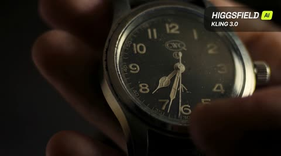</a>

提示词用英寸级机位距离，并列出灰尘、细划痕、包浆等具体表面细节，让模型稳住质感。单一暖色侧掠光、浅景深，加上只有秒针这一处微动，画面不易闪烁或崩坏。

Kling 3.0 · 文生视频 · 出处: [@higgsfield_ai on X](https://x.com/higgsfield_ai/status/2019088049448362164) · 2,534 赞，统计于 2026-10-27

[`macro`](pages/zh/tags.md#tag-macro) [`product-shot`](pages/zh/tags.md#tag-product-shot) [`shallow-depth-of-field`](pages/zh/tags.md#tag-shallow-depth-of-field) [`moody-lighting`](pages/zh/tags.md#tag-moody-lighting) [`cinematic`](pages/zh/tags.md#tag-cinematic)

<details><summary><b>提示词</b></summary>

```text
Ultra-realistic cinematic macro shot of a vintage wristwatch held between two fingers, extreme close-up framing focused on the watch face and crystal, with the camera positioned inches away to reveal fine dust particles, micro scratches on the glass, worn metal edges, engraved numerals, and subtle patina on the hands. Shallow depth of field isolates the dial while the background dissolves into soft, dark bokeh. The lighting is moody and directional, a single warm key light grazing the surface to create delicate reflections along the curved crystal and metallic rim, emphasizing texture and age. The second hand moves subtly, creating a sense of quiet tension and time passing. Skin texture of the fingers is visible at the edges of the frame, slightly out of focus, adding scale and realism. High contrast, cinematic color grading, soft film grain, precise focus breathing, and a tactile, intimate macro perspective that feels handcrafted and timeless.
```

</details>

<a id="kling-basketball-backflip-dunk-court"></a>
### 篮球运动员在室外球场后空翻扣篮

<a href="https://x.com/higgsfield_ai/status/2019083976682684558">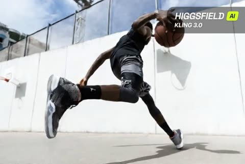</a>

提示词把一个动作拆成四个编号镜头（运球、起跳、空中翻转、扣篮），每个镜头都写明景别和机位。低机位加上翻转时的慢动作特写，让 Kling 的物理模拟每一步都有明确的画面目标。

Kling 3.0 · 文生视频 · 出处: [@higgsfield_ai on X](https://x.com/higgsfield_ai/status/2019083976682684558) · 2,533 赞，统计于 2026-10-27

[`multi-shot`](pages/zh/tags.md#tag-multi-shot) [`sports`](pages/zh/tags.md#tag-sports) [`basketball`](pages/zh/tags.md#tag-basketball) [`low-angle`](pages/zh/tags.md#tag-low-angle) [`physics`](pages/zh/tags.md#tag-physics)

<details><summary><b>提示词</b></summary>

```text
Shot 1: A side profile, medium shot of a muscular African American man in athletic wear, intensely dribbling a basketball on an outdoor concrete court towards a hoop against a high white wall under a bright blue sky.
Shot 2: A dynamic, low-angle wide shot showing the man jumping remarkably high into the air, performing a backflip while holding the basketball, with the white wall and sky in the background.
Shot 3: A close-up, slow-motion shot of the man mid-air and upside down during his flip, showing his focused expression and the basketball held firmly in his hands against the sky.
Shot 4: A dramatic, low-angle shot focusing on the basketball hoop as the man, still upside down from his acrobatic jump, powerfully dunks the ball into the net.
```

</details>

<a id="kling-night-courtyard-katana-six-shots"></a>
### 夜晚庭院中女子挥刀斩断木人桩

<a href="https://x.com/higgsfield_ai/status/2019104313302569185">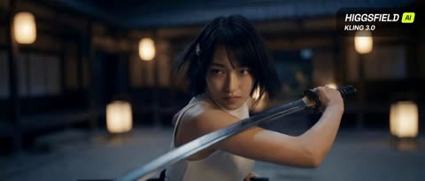</a>

六个编号镜头各自写明景别和运镜，从嘴部微距到全景动作再到收尾人像，节奏清晰。每个镜头都点明机位和物理效果，比如飞溅的木屑和灰尘，让冲击瞬间有据可依。

Kling 3.0 · 文生视频 · 出处: [@higgsfield_ai on X](https://x.com/higgsfield_ai/status/2019104313302569185) · 2,473 赞，统计于 2026-10-27

[`multi-shot`](pages/zh/tags.md#tag-multi-shot) [`action`](pages/zh/tags.md#tag-action) [`katana`](pages/zh/tags.md#tag-katana) [`macro`](pages/zh/tags.md#tag-macro) [`night`](pages/zh/tags.md#tag-night)

<details><summary><b>提示词</b></summary>

```text
Shot 1: An extreme close-up of a young woman's mouth, her teeth clenched on a wooden toothpick, creating a tense and gritty atmosphere.
Shot 2: A medium shot of the woman in a traditional Japanese-style courtyard at night, illuminated by soft lanterns. She is dressed in a white tank top and dark trousers, holding a katana in a defensive stance with a determined look on her face.
Shot 3: A dynamic, low-angle action shot of the woman jumping high into the air, raising her katana to strike a wooden training dummy that resembles a samurai in armor.
Shot 4: A close-up, high-speed impact shot showing the woman’s katana slicing through the wooden dummy, sending wood splinters and dust flying into the air.
Shot 5: A fast-paced tracking shot of the woman landing gracefully and immediately striking another wooden structure, demonstrating her speed and precision.
Shot 6: A final medium close-up of the woman’s face as she finishes her move. She is slightly breathless, her hair disheveled, with a sharp, focused gaze directed off-camera.
```

</details>

<a id="kling-eagle-pov-steppe-flight"></a>
### 金雕视角飞越山谷与河流

<a href="https://x.com/higgsfield_ai/status/2019090635408744851">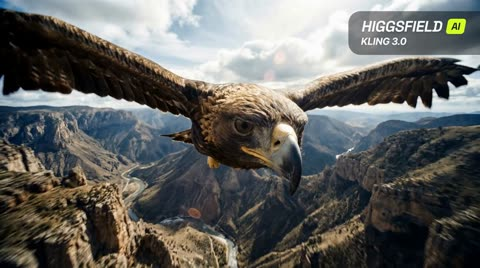</a>

镜头锁定在金雕头部,翅膀与羽毛留在画面边缘作为稳定参照。用河流、山谷、岩峰提供地面视差,并限定无抖动、仅速度模糊、无剪辑,让飞行动作连贯真实。

Kling 3.0 · 文生视频 · 出处: [@higgsfield_ai on X](https://x.com/higgsfield_ai/status/2019090635408744851) · 2,454 赞，统计于 2026-10-27

[`pov`](pages/zh/tags.md#tag-pov) [`aerial`](pages/zh/tags.md#tag-aerial) [`wildlife`](pages/zh/tags.md#tag-wildlife) [`tracking-shot`](pages/zh/tags.md#tag-tracking-shot) [`landscape`](pages/zh/tags.md#tag-landscape)

<details><summary><b>提示词</b></summary>

```text
POV flight from a golden eagle soaring over vast mountainous steppe landscapes. Camera locked to the eagle’s head with clean, precise tracking — stable forward motion, no jitter. The eagle actively flaps its wings, powerful wingbeats transitioning into smooth gliding. Wings and feathers visible at the frame edges, moving naturally in rhythm. Strong ground parallax below: winding rivers, open valleys, rocky peaks. Bright late-afternoon light, crisp air, subtle lens flare. Ultra-wide cinematic perspective, natural motion blur from speed only, realistic flight physics, continuous shot, no cuts.
```

</details>

<a id="kling-turntable-needle-macro-pushin"></a>
### 唱机推镜至唱针微距

<a href="https://x.com/higgsfield_ai/status/2019101323317375400"></a>

以给定画面为起始帧，一镜到底。刚性螺栓固定式推镜锁定唱针尖，并列出微距细节、主导音效和明确的镜头规则。

Kling 3.0 · 图生视频 · 出处: [@higgsfield_ai on X](https://x.com/higgsfield_ai/status/2019101323317375400) · 2,357 赞，统计于 2026-10-27

[`macro`](pages/zh/tags.md#tag-macro) [`single-take`](pages/zh/tags.md#tag-single-take) [`sound-design`](pages/zh/tags.md#tag-sound-design) [`push-in`](pages/zh/tags.md#tag-push-in) [`analog`](pages/zh/tags.md#tag-analog)

<details><summary><b>提示词</b></summary>

```text
Use the provided image as the exact starting frame.
Cinematic video, single continuous shot, duration 5–7 seconds.
Single take. No cuts. No transitions.
CAMERA & ACTION (CONTINUOUS MOTION)
The camera starts static, framing a turntable in warm analog studio light.
A human hand lowers the tonearm onto a spinning vinyl record.
The record begins rotating smoothly. Immediately after contact, the camera accelerates forward in one continuous movement, a fast, rigid robot-bolt push-in directly toward the stylus needle. No easing. No cinematic zoom. Pure mechanical forward motion. As the camera reaches extreme macro distance, it locks onto the needle tip, as if physically bolted to it, without any cut. From this moment on, the camera moves together with the needle, perfectly synchronized.

MACRO DETAIL (SAME SHOT)
Extreme macro view shows:
Stylus tip vibrating microscopically
Vinyl grooves flowing beneath
Dust particles, micro scratches, groove texture
Subtle vertical and lateral needle movement, physically accurate
The camera remains rigidly attached, only tiny micro-vibrations from groove friction.

SOUND DESIGN (DOMINANT, CONTINUOUS)
Sound is uninterrupted and dominant:
Needle drop click
Loud, authentic vinyl crackle and hiss
Stylus-on-groove friction
Low mechanical hum of the turntable
No music clarity at first — raw analog texture only.
No score. No digital effects.

VISUAL STYLE
Extreme macro cinematography
Ultra-shallow depth of field
Warm analog color grading
Natural reflections on vinyl
Subtle film grain

CAMERA RULES
One continuous take
No cuts, no edits, no montage
No handheld shake
No floating camera
Robo-cam, bolt-mounted feel only

END FRAME
Camera stays locked to the needle,
vinyl spinning endlessly beneath it,
hypnotic, mechanical, intimate.
```

</details>

<a id="kling-manhattan-panic-nine-shot-sequence"></a>
### 身穿条纹睡袍的惊慌女子冲上曼哈顿街头

<a href="https://x.com/higgsfield_ai/status/2019314800409600470">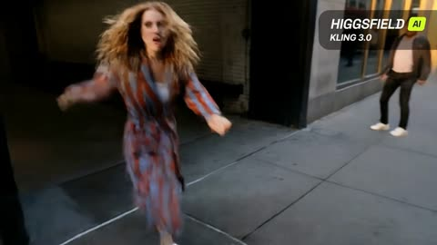</a>

每个镜头单独编号，写明景别、镜头运动和一个具体动作。穿插微距细节和情绪反差的平静画面来制造节奏，并反复写出主角的外观，让她在各镜头间保持一致。

Kling 3.0 · 文生视频 · 出处: [@higgsfield_ai on X](https://x.com/higgsfield_ai/status/2019314800409600470) · 622 赞，统计于 2026-10-27

[`multi-shot`](pages/zh/tags.md#tag-multi-shot) [`cinematic`](pages/zh/tags.md#tag-cinematic) [`handheld`](pages/zh/tags.md#tag-handheld) [`macro`](pages/zh/tags.md#tag-macro) [`city`](pages/zh/tags.md#tag-city)

<details><summary><b>提示词</b></summary>

```text
Shot 1: High-intensity handheld tracking shot. A young woman with disheveled blonde hair, wearing a white tank top under a vibrant red and blue vertical-striped silk robe, bursts out of a shadowy alleyway. Her face is a mask of pure panic as she stumbles onto a sun-drenched Manhattan sidewalk, the camera shaking to mirror her frantic movements.

Shot 2: Medium shot, shallow depth of field. A middle-aged businessman in a charcoal suit and navy tie stands amidst a sea of pedestrians. He checks his silver watch with a sharp, rhythmic jerk of his wrist, his brow furrowed in annoyance. The background is a blur of yellow taxis and the towering architecture of 5th Avenue.

Shot 3: Extreme macro photography. The camera focus is locked onto the tip of a silver watch hand as it clicks forward. Microscopic dust motes dance in the harsh sunlight reflecting off the brushed metal surface of the dial.

Shot 4: Low-angle medium shot. Rapid-fire motion of a street drummer’s hands hitting a series of weathered white plastic buckets. The wooden drumsticks are a blur of motion, and the camera captures the vibration of the plastic lids as the city crowd flows past in a time-lapse-like stream.

Shot 5: Low-angle medium shot. The woman in the striped robe has stopped running; she is hunched over, hands on her knees, gasping for breath. The camera remains low, making the surrounding skyscrapers feel like they are closing in on her as she looks around, disoriented.

Shot 6: Macro close-up, high contrast. A man’s stubbled face as he inhales from a cigarette. The paper crinkles and the tobacco glows a fierce, molten orange before instantly turning into a delicate, flaky grey ash that threatens to fall.

Shot 7: Extreme close-up of the woman's face, focusing on her piercing blue eyes. Her pupils are dilated, and her forehead is deeply wrinkled with anxiety. The reflection of the busy street and moving vehicles can be seen glinting in her irises.

Shot 8: Medium-wide lifestyle shot. Two young Asian women walk across a city crosswalk, bathed in warm afternoon "golden hour" light. They are laughing and talking, creating a sharp emotional contrast to the previous shots of distress.

Shot 9: Final tight close-up. The blonde woman stares directly into the lens, her expression shifting from confusion to absolute shock. She slowly brings her hand up, her fingers trembling, to cover her mouth as her eyes well up with fear.
```

</details>

**[全部 27 条](pages/zh/video-kling30.md)**

<a id="veo31"></a>
## Veo 3.1

<a id="veo-giant-girl-shibuya-crossing"></a>
### 巨型女孩跪在东京街口俯身触碰出租车

<a href="https://x.com/MrDavids1/status/1997581641892446293">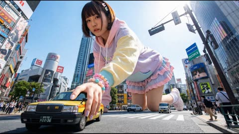</a>

通用模板用方括号固定机位、巨人服装、地点和动作，再在手脚附近加入微小的车辆和行人来建立体量感。先用 Nano Banana Pro 以 4K 生成静帧，再交给 Veo 3.1 做图生视频。

Veo 3.1 · 图生视频 · 出处: [@MrDavids1 on X](https://x.com/MrDavids1/status/1997581641892446293) · 3,040 赞，统计于 2026-10-27

[`giant`](pages/zh/tags.md#tag-giant) [`scale`](pages/zh/tags.md#tag-scale) [`cityscape`](pages/zh/tags.md#tag-cityscape) [`photorealistic`](pages/zh/tags.md#tag-photorealistic) [`template`](pages/zh/tags.md#tag-template)

<details><summary><b>提示词</b></summary>

```text
Here is a fun idea to try. You can create these images with giant people/animals using Nano Banana Pro. Just adjust the elements in brackets and have fun! If you have the option to generate at 4K, definitely use it as it makes the tiny people look crisper. These types of images seem to animate best with Veo 3.1 from testing, but you can try with Kling 2.6 or Grok Imagine as well so have some fun! Feel free to show me your giant humans/animals.

🍌Universal Prompt: A highly detailed, photorealistic [CAMERA ANGLE, e.g., wide-angle shot, aerial shot looking down, extreme low-angle looking up] showing a colossal [DESCRIBE THE PERSON & CLOTHING] positioned in [SPECIFIC LOCATION/CITY/LANDSCAPE]. The giant is [ACTION -  INTERACTING WITH THE ENVIRONMENT, e.g., sitting on a building, stepping over a bridge]. To establish the immense scale, tiny [TINY ELEMENTS: PEOPLE, CARS, OR BOATS] are visible near their [FEET/HANDS]. The lighting is [TIME OF DAY, e.g., golden hour, midday sun].

There are more visuals examples with prompts included in my 80 creative use cases document which you can view via this link completely for free. Look for use case 84.
https://
canva.com/design/DAG5ifq
rYJc/BReEw-WwUMW9HmSJBHWBXQ/edit
…
```

</details>

<a id="veo-empty-room-loft-construction-timelapse"></a>
### 空房间延时搭建阁楼

<a href="https://x.com/venturetwins/status/1992725268855968071">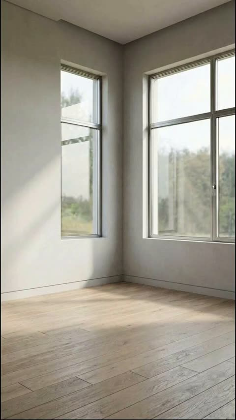</a>

首尾帧由 Nano Banana Pro 先生成，分别锁定空房间和完工效果。提示词只描述两帧之间的快速施工过程，由 Veo 补全中间的变化。

Veo 3.1 · 首尾帧 · 出处: [@venturetwins on X](https://x.com/venturetwins/status/1992725268855968071) · 1,986 赞，统计于 2026-10-27

[`time-lapse`](pages/zh/tags.md#tag-time-lapse) [`interior-design`](pages/zh/tags.md#tag-interior-design) [`construction`](pages/zh/tags.md#tag-construction) [`start-end-frames`](pages/zh/tags.md#tag-start-end-frames) [`nano-banana-pro`](pages/zh/tags.md#tag-nano-banana-pro)

<details><summary><b>提示词</b></summary>

```text
Did some experimenting and figured out the workflow for AI design transformations:

Start with a base image of a room with no furniture. Then prompt on Nano Banana Pro to add what you'd like (e.g. a cool door frame, loft, or pool).

Take to Veo 3.1 as your start and end frames.

Prompt: "time lapse construction, fast motion as a construction workers bring a tree into the living room and then construct the loft and add the couch and lights."
```

</details>

<a id="veo-golf-ball-tracking-storm-cliff"></a>
### 暴雨海崖高尔夫球手与追球镜头

<a href="https://x.com/Dheepanratnam/status/2032810971140420073">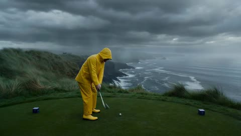</a>

提示词按时间顺序分成挥杆、镜头锁定球、逼近果岭、杯口特写几个段落。它直接写明追踪规则，球保持清晰居中而背景拉成动态模糊，并加入击球脆响和风声等声音提示。

Veo 3.1 · 文生视频 · 出处: [@Dheepanratnam on X](https://x.com/Dheepanratnam/status/2032810971140420073) · 666 赞，统计于 2026-10-27

[`sports`](pages/zh/tags.md#tag-sports) [`tracking-shot`](pages/zh/tags.md#tag-tracking-shot) [`storm`](pages/zh/tags.md#tag-storm) [`physics`](pages/zh/tags.md#tag-physics) [`ball-pov`](pages/zh/tags.md#tag-ball-pov)

<details><summary><b>提示词</b></summary>

```text
video 1 - veo3.1
video 2 - Sora 2

"A dramatic sports sequence begins on a lush, windswept coastal cliff during a violent rainstorm. A golfer in bright yellow rain gear stands on the tee box, gripping a driver. His stance is planted firmly, eyes locked on a distant green across a churning ocean cove.

As he swings, the clubhead connects with a resounding crack, launching the dimpled white ball into the stormy sky. The camera immediately accelerates and locks onto the golf ball mid-flight.

The camera tracks directly behind the spinning sphere, maintaining perfect alignment as it cuts through the driving rain. The ocean waves and dark clouds become a streaking motion blur while the ball remains sharp and centered.

The howling wind roars as the projectile travels straight and true. The manicured green grows rapidly larger. In the final seconds, the camera closes in tightly as the ball strikes the turf. End on an extreme close-up of the ball ripping through the wet grass, throwing up a spray of dirt before dropping perfectly into the cup."
```

</details>

<a id="veo-strawberry-jar-assembly"></a>
### 草莓护肤霜罐在红色背景上逐件组装

<a href="https://x.com/ChillaiKalan__/status/2029019321364824452"></a>

提示词从空场景开始,并为每个物体的入场编号,组装顺序一目了然。固定机位、禁止弹跳,再加上与参考图一致的结尾画面,让动作干净可控。

Veo 3.1 · 参考生视频 · 出处: [@ChillaiKalan__ on X](https://x.com/ChillaiKalan__/status/2029019321364824452) · 582 赞，统计于 2026-10-28

[`product-commercial`](pages/zh/tags.md#tag-product-commercial) [`assembly`](pages/zh/tags.md#tag-assembly) [`skincare`](pages/zh/tags.md#tag-skincare) [`locked-camera`](pages/zh/tags.md#tag-locked-camera) [`sound-design`](pages/zh/tags.md#tag-sound-design)

<details><summary><b>提示词</b></summary>

```text
Use the uploaded image as the exact visual reference for jar design, label, strawberries, raspberries, flowers, leaves, condensation droplets, red gradient background, and reflective surface.

Camera:
Locked front-facing camera.
No zoom.
No rotation.
No angle change.
Studio composition remains centered.

Style:
Premium beauty commercial.
Smooth assembling sequence.
Ultra realistic.
Slow motion but not dramatic.

Scene – Start (Empty Setup):
Start with an empty red gradient background and glossy reflective surface.
No jar.
No fruits.
No flowers.
No water droplets.

Assembling Sequence:

1. The glass jar base smoothly slides into frame from below and settles perfectly centered.
2. The lid gently lowers from above and aligns perfectly on the jar.
3. Condensation droplets subtly appear on the glass surface as if forming naturally.
4. Raspberries roll in softly from left and right, stopping naturally around the base.
5. Strawberry halves slide into position at the front.
6. Whole strawberries gently drop from above into the open jar top and settle naturally.
7. Small white flowers softly fall into place between the strawberries.
8. Green leaves slide in behind the jar to frame it.
9. Final micro water droplets appear on fruits for freshness effect.

All movements smooth and controlled.
No bouncing.
No exaggerated motion.
No dramatic lighting changes.

Lighting:
Keep original studio lighting.
Deep red background glow remains consistent.
Soft reflections on the glossy surface.

Sound (if supported):
Soft subtle assembling sound design.
Gentle fruit placement sounds.
Light glass contact sound.
No music or very subtle premium ambient tone.

End Frame:
Fully assembled composition exactly matching the reference image.
Everything perfectly arranged.
Hold for 1–2 seconds.
Ultra clean luxury skincare commercial finish.
```

</details>

<a id="veo-live-streamer-neon-desk"></a>
### 霓虹游戏桌前兴奋反应的女主播

<a href="https://x.com/HBCoop_/status/1995206291120087487">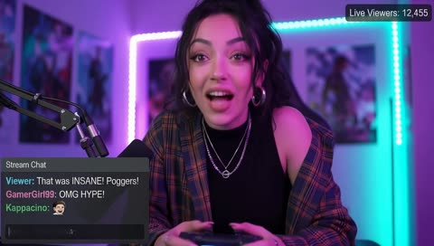</a>

提示词用中近景、脉动霓虹光和手持微晃营造直播的实时感，并逐项列出环境声、键盘声、麦克风底噪和远处游戏音效。Midjourney 角色参考加 Nano Banana Pro 首帧，让人物保持一致。

Veo 3.1 · 图生视频 · 出处: [@HBCoop_ on X](https://x.com/HBCoop_/status/1995206291120087487) · 366 赞，统计于 2026-10-28

[`streamer`](pages/zh/tags.md#tag-streamer) [`neon-lighting`](pages/zh/tags.md#tag-neon-lighting) [`handheld-camera`](pages/zh/tags.md#tag-handheld-camera) [`native-audio`](pages/zh/tags.md#tag-native-audio) [`character-reference`](pages/zh/tags.md#tag-character-reference)

<details><summary><b>提示词</b></summary>

```text
Nano Banana Pro -> Veo 3.1 on
@FlowbyGoogle


Character reference: Midjourney

Video prompt: A medium close-up shot of a young woman streaming live at her gaming desk, bathed in neon pink-blue LED lighting that pulses subtly in the background. She reacts with wide-eyed excitement, leaning closer to the camera while gripping her controller, her plaid shirt shifting naturally with the movement. The camera performs a gentle handheld micro-sway to match the high-energy, real-time feel of a live stream. Her chat monitor glows off-screen, casting soft highlights on her face as her expression shifts between shock and joy. Audio includes soft room ambience, quiet keyboard clicks, a faint microphone hum, and the distant echoes of gameplay sound effects.
```

</details>

<a id="veo-potato-farm-to-chip-commercial"></a>
### 日出农田里土豆变成脆片的广告

<a href="https://x.com/Fujimoto_hina/status/2094644333882540334"></a>

用JSON把十秒拆成四个带时间码的分镜，每段写明镜头类型、动作和光线。无缝变形把土豆从泥土带到切片旋涡再到脆片，结尾用微距慢动作掰断，并用负面提示排除文字和标志。

Veo 3.1 · 文生视频 · 出处: [@Fujimoto_hina on X](https://x.com/Fujimoto_hina/status/2094644333882540334) · 282 赞，统计于 2026-10-28

[`food-commercial`](pages/zh/tags.md#tag-food-commercial) [`macro`](pages/zh/tags.md#tag-macro) [`morph-transition`](pages/zh/tags.md#tag-morph-transition) [`json-prompt`](pages/zh/tags.md#tag-json-prompt) [`storyboard`](pages/zh/tags.md#tag-storyboard)

<details><summary><b>提示词</b></summary>

```text
{
  "commercial_specifications": {
    "title": "Farm to Table: Potato Chip Transformation",
    "duration_seconds": 10,
    "aspect_ratio": "16:9",
    "resolution": "4K",
    "style": "Cinematic photorealistic premium food commercial",
    "lighting": "Cinematic golden hour sunrise, warm highlights",
    "depth_of_field": "Shallow depth of field with high-speed macro focus",
    "audio_visual_notes": "No text, no logos, hyper-realistic physics"
  },
  "storyboard_timeline": [
    {
      "timecode": "00:00 - 00:02",
      "scene": "The Origin",
      "shot_type": "Close-up pushing in rapidly",
      "action": "A single raw, fresh potato rests in rich, dark soil at sunrise, lightly coated with fine earth particles. Sunlight filters dynamically through overhead foliage.",
      "lighting_atmosphere": "Warm morning glow, soft sun flare"
    },
    {
      "timecode": "00:02 - 00:05",
      "scene": "The Dynamic Transformation",
      "shot_type": "Dynamic tracking / High-speed aerial follow",
      "action": "The potato bursts upward from the earth and spins mid-air. In a seamless morph, it sheds its skin and cleanly slices into translucent raw potato rounds swirling in a tight spiral vortex.",
      "physics_effects": "Particle burst of soil, aerodynamic slice trajectory"
    },
    {
      "timecode": "00:05 - 00:08",
      "scene": "The Crisp & Flight",
      "shot_type": "Continuous smooth orbital tracking",
      "action": "The swirling slices flash-cook into a single perfect, undulating golden-brown potato chip with crisp ruffled edges. The camera tracks alongside the chip as it glides toward a rustic styled wooden dining table.",
      "visual_details": "Glistening oil sheen, fine salt crystals catching the light"
    },
    {
      "timecode": "00:08 - 00:10",
      "scene": "The Hero Landing & Snap",
      "shot_type": "Ultra-macro high-speed slow motion",
      "action": "The golden chip lands gently beside an artisanal bowl overflowing with freshly prepared chips. In extreme close-up, the hero chip snaps cleanly in half, releasing delicate airy crumb particles in slow motion.",
      "texture_focus": "Micro-blisters on chip surface, crisp fracture, golden translucence"
    }
  ],
  "prompt_parameters": {
    "camera": "Dynamic push-in to orbital tracking to high-speed macro slow motion",
    "render_qualities": [
      "Photorealistic textures",
      "Cinematic sunrise lighting",
      "Shallow depth of field",
      "Realistic physics",
      "Seamless morph transitions",
      "Warm golden highlights",
      "Ultra-detailed 4K"
    ],
    "negative_prompt": "text, watermark, logo, blurry, low resolution, cartoon, plastic texture, unrealistic movement, jerky cuts"
  }
}
```

</details>

<a id="veo3"></a>
## Veo 3

<a id="veo-camper-and-bear"></a>
### 定格动画，露营者和会顶嘴的熊

<a href="https://storage.googleapis.com/gdm-deepmind-com-prod-public/media/media/veo__veo-3__camper.webm">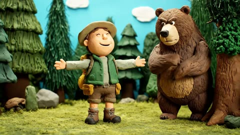</a>

整条提示词只有一个形式标签和两句台词，场景交给 Veo 补全。

Veo 3 · 文生视频 · 出处: [Veo 3 prompt guide](https://deepmind.google/models/veo/prompt-guide/)

[`stop-motion`](pages/zh/tags.md#tag-stop-motion) [`dialogue`](pages/zh/tags.md#tag-dialogue) [`comedy`](pages/zh/tags.md#tag-comedy)

<details><summary><b>提示词</b></summary>

```text
Camping (Stop Motion): Camper: "I'm one with nature now!" Bear: "Nature would prefer some personal space."
```

</details>

<a id="veo-candy-keyboard"></a>
### 糖果做的键盘

<a href="https://storage.googleapis.com/gdm-deepmind-com-prod-public/media/media/veo__veo-3__keyboard.webm">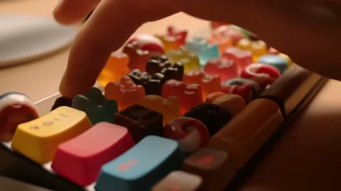</a>

单独一行 `Audio:` 告诉模型画面该配什么声音。

Veo 3 · 文生视频 · 出处: [Veo 3 prompt guide](https://deepmind.google/models/veo/prompt-guide/)

[`sfx`](pages/zh/tags.md#tag-sfx) [`product`](pages/zh/tags.md#tag-product) [`whimsical`](pages/zh/tags.md#tag-whimsical)

<details><summary><b>提示词</b></summary>

```text
A keyboard whose keys are made of different types of candy. Typing makes sweet, crunchy sounds. Audio: Crunchy, sugary typing sounds, delighted giggles.
```

</details>

<a id="veo-moon-dust-flowers"></a>
### 月尘平原上的水晶花

<a href="https://storage.googleapis.com/gdm-deepmind-com-prod-public/media/media/veo__veo-3__moon-dust.webm">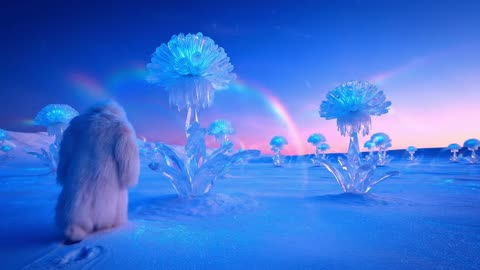</a>

短小的造景提示词。一个抓人的细节（`the only footprints in untouched dust`）胜过一长串形容。

Veo 3 · 文生视频 · 出处: [Veo 3 prompt guide](https://deepmind.google/models/veo/prompt-guide/)

[`world-building`](pages/zh/tags.md#tag-world-building) [`fantasy`](pages/zh/tags.md#tag-fantasy)

<details><summary><b>提示词</b></summary>

```text
A snow-covered plain of iridescent moon-dust under twilight skies. Thirty-foot crystalline flowers bloom, refracting light into slow-moving rainbows. A fur-cloaked figure walks between these colossal blossoms, leaving the only footprints in untouched dust.
```

</details>

<a id="veo-off-road-rally"></a>
### 越野拉力冲过河滩

<a href="https://storage.googleapis.com/gdm-deepmind-com-prod-public/media/media/veo__veo-3__off-road.mp4">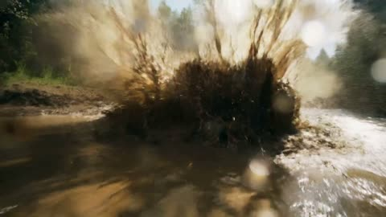</a>

给 8 秒动作戏写逐拍解说，还要求车辆无品牌，画面里不会冒出商标。

Veo 3 · 文生视频 · 出处: [Veo 3 prompt guide](https://deepmind.google/models/veo/prompt-guide/)

[`action`](pages/zh/tags.md#tag-action) [`handheld`](pages/zh/tags.md#tag-handheld) [`sfx`](pages/zh/tags.md#tag-sfx)

<details><summary><b>提示词</b></summary>

```text
The scene explodes with the raw, visceral, and unpredictable energy of a hardcore off-road rally, captured with a dynamic, almost found-footage or embedded sports documentary aesthetic. The camera is often shaky, seemingly mounted inside one of the vehicles or held by a daring spectator very close to the action, frequently splattered with mud or water, catching unintentional lens flares from the natural, often harsh, sunlight filtering through trees or reflecting off wet surfaces. We are immersed in a challenging, untamed natural environment – perhaps a dense, muddy forest trail, a treacherous rocky incline littered with loose scree, or a series_of shallow, fast-flowing river crossings. Several heavily modified, entirely unidentifiable, and unbranded off-road vehicles are engaged in a frenetic, no-holds-barred race. These are not showroom models; they are custom-built, rugged machines – open-wheeled buggies with exposed engines and prominent roll cages, heavily armored pickup trucks with oversized, knobby tires and snorkel exhausts, their original forms and manufacturers completely obscured by extreme modifications, layers of caked-on mud, and a general air of brutal functionality. The dominant sounds are the deafening, guttural roar of powerful, untamed engines, the whine of transmissions, the percussive impact of suspension bottoming out, and the constant spray of mud and water. Within an 8-second sequence, one of the lead vehicles, a low-slung, open-cockpit buggy so caked in thick, brown mud that its original color is a mystery, approaches a wide, shallow river crossing at incredible speed. Without the slightest hesitation, its unseen driver powers straight into the water. The impact sends an enormous, almost solid, opaque sheet of muddy water, mixed with stones and debris from the riverbed, spectacularly high into the air, completely engulfing the small buggy for a terrifying moment, obscuring it from view as if it has been swallowed by the river itself. Right on its tail, a pursuing, equally mud-encrusted, custom-built truck – a hulking, high-clearance beast with a heavily reinforced external roll cage and no discernible badging – arrives at the river crossing just as this massive wall of airborne water reaches its peak. Instead of slowing or attempting to find a clearer path, the truck's driver, with unwavering aggression, plunges directly into and through this opaque, turbulent curtain of muddy spray at full throttle. A split second later, the truck bursts out from the other side of the deluge, water cascading from its roof and chassis, its oversized windshield wipers struggling frantically to clear the torrent of muddy water obscuring the driver's vision. It lands heavily on the far bank, suspension groaning, but still in hot pursuit of the now-reappearing buggy. This thrilling, messy, and visually spectacular sequence of one vehicle creating a massive environmental obstacle and the next immediately conquering it through sheer force, forms the core, immersive, attention-grabbing event of the 8-second sequence. The race continues with undiminished ferocity, the natural terrain itself an active participant in the conflict.
```

</details>

<a id="veo-old-sailor-verse"></a>
### 老水手念诗

<a href="https://storage.googleapis.com/gdm-deepmind-com-prod-public/media/media/veo__veo-3__sailor.webm">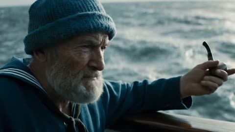</a>

先写人物（帽子、胡子、烟斗），再把台词放进引号，Veo 3 会按引号里的内容对口型。

Veo 3 · 文生视频 · 出处: [Veo 3 prompt guide](https://deepmind.google/models/veo/prompt-guide/)

[`dialogue`](pages/zh/tags.md#tag-dialogue) [`character`](pages/zh/tags.md#tag-character)

<details><summary><b>提示词</b></summary>

```text
A medium shot frames an old sailor, his knitted blue sailor hat casting a shadow over his eyes, a thick grey beard obscuring his chin. He holds his pipe in one hand, gesturing with it towards the churning, grey sea beyond the ship's railing. "This ocean, it's a force, a wild, untamed might. And she commands your awe, with every breaking light"
```

</details>

<a id="sora2"></a>
## Sora 2

<a id="sora-anime-cryo-awakening-forest"></a>
### 动画女子从冷冻舱苏醒走入森林

<a href="https://x.com/EccentrismArt/status/1976308338230165942">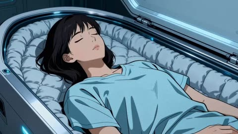</a>

开头一句风格设定定下动画质感，之后每两秒一个带时间码的切镜段落，锁定每个镜头。每段只写一个动作和一个机位，故事从实验室到爬梯再到森林层层推进。

Sora 2 · 文生视频 · 出处: [@EccentrismArt on X](https://x.com/EccentrismArt/status/1976308338230165942) · 2,957 赞，统计于 2026-10-27

[`anime`](pages/zh/tags.md#tag-anime) [`timecode`](pages/zh/tags.md#tag-timecode) [`multi-shot`](pages/zh/tags.md#tag-multi-shot) [`sci-fi`](pages/zh/tags.md#tag-sci-fi) [`storytelling`](pages/zh/tags.md#tag-storytelling)

<details><summary><b>提示词</b></summary>

```text
Big budget anime movie with clean lines and smooth movements

[00:00]
The woman earring a short hospital gown suddenly wakes up in her cryogenic chamber with cold breath

[00:02]
Cut to she walks away from the cyrochamber looking around the lab with control consoles on the left

[00:04]
Cut to backside of the woman walking down a hallway at the end of the hallway is a black ladder mounted to the wall that leads up a vertical pathway with some light emitting down from led lights on the walls

[00:06]
Cut to Below the woman as she ascends up the black ladder and above her is a manhole cover with four small holes in it that has light shining through them

[00:08]
cut to the woman climbing out of a manhole in the middle of an overgrown forest

[00:10]
Cut to the woman amazed looking around the beautiful forest with fireflies and deer running past

[00:12]
Cut to wide shot of the large beautiful forest with destroyed city with overgrown plants all around it in the far background
```

</details>

<a id="sora-fridge-monster"></a>
### 冰箱里钻出一只胖乎乎的紫色怪兽

<a href="https://cdn.openai.com/API/docs/images/sora/sora_monster_original.gif">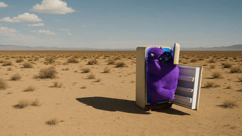</a>

两拍：门开，怪兽出来。

Sora 2 · 图生视频 · 出处: [Sora 2 prompting guide](https://cookbook.openai.com/examples/sora/sora2_prompting_guide)

[`image-to-video`](pages/zh/tags.md#tag-image-to-video) [`creature`](pages/zh/tags.md#tag-creature) [`whimsical`](pages/zh/tags.md#tag-whimsical)

<details><summary><b>提示词</b></summary>

```text
The fridge door opens. A cute, chubby purple monster comes out of it.
```

</details>

输入素材: [1](https://cdn.openai.com/API/docs/images/sora/monster_original_720p.jpeg)

<a id="sora-monster-edits"></a>
### 改怪兽：先换颜色，再加一只

<a href="https://cdn.openai.com/API/docs/images/sora/sora_monster_2monsters.gif">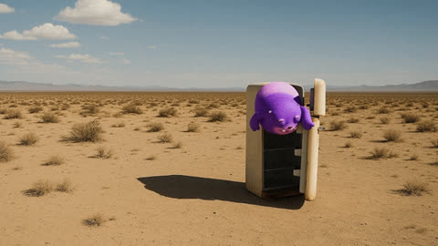</a>

每次编辑都基于原片单独跑，只改一处。OpenAI 的建议是只描述要改的地方。

Sora 2 · 视频编辑 · 出处: [Sora 2 prompting guide](https://cookbook.openai.com/examples/sora/sora2_prompting_guide)

[`multi-turn-edit`](pages/zh/tags.md#tag-multi-turn-edit) [`object-swap`](pages/zh/tags.md#tag-object-swap)

<details><summary><b>提示词</b></summary>

```text
Change the color of the monster to orange
A second monster comes out right after
```

</details>

输入素材: [1](https://cdn.openai.com/API/docs/images/sora/sora_monster_original.gif)

<a id="sora-skyline-turn-and-walk"></a>
### 她转身微笑，走出画面

<a href="https://cdn.openai.com/API/docs/images/sora/sora_woman_skyline_video.gif">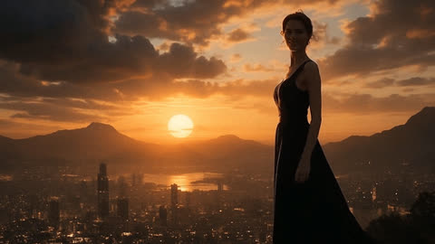</a>

有了输入图，第一帧已经定了，提示词只写接下来发生什么。

Sora 2 · 图生视频 · 出处: [Sora 2 prompting guide](https://cookbook.openai.com/examples/sora/sora2_prompting_guide)

[`image-to-video`](pages/zh/tags.md#tag-image-to-video) [`character`](pages/zh/tags.md#tag-character)

<details><summary><b>提示词</b></summary>

```text
She turns around and smiles, then slowly walks out of the frame.
```

</details>

输入素材: [1](https://cdn.openai.com/API/docs/images/sora/woman_skyline_original_720p.jpeg)

<a id="image"></a>
## 图片提示词

[Artificial Analysis 图像榜](https://artificialanalysis.ai/text-to-image/arena)前排模型上点赞最多的提示词，每条都附成图，出自作者在 X 上的帖子或模型官方指南。按用途分组。很多要配一张自己的照片，标着「上传图改图」的就是。

<a id="img-poster"></a>
## 海报与编辑排版

<a id="gpt-image-minimal-lifestyle-poster"></a>
### 真实照片变极简生活方式海报

<a href="https://x.com/Naiknelofar788/status/2101161664892829838">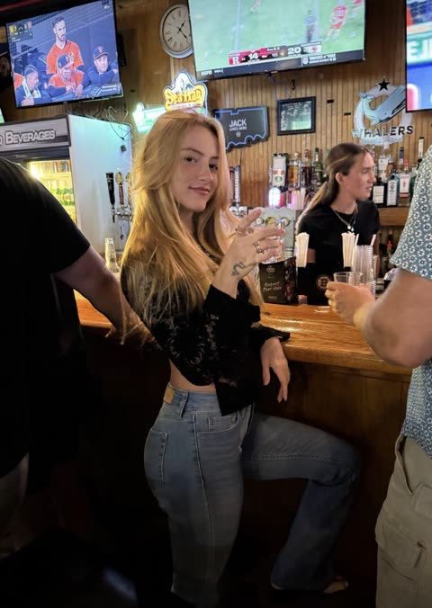</a>

填空模板，替换 `[PERSON / SUBJECT / MOMENT]` 即可。主体保持可辨认，背景去掉照片感。

GPT Image 2.5 · 上传图改图 · 出处: [@Naiknelofar788 on X](https://x.com/Naiknelofar788/status/2101161664892829838) · 1,698 赞，统计于 2026-10-27

[`editorial`](pages/zh/tags.md#tag-editorial) [`illustration`](pages/zh/tags.md#tag-illustration) [`template`](pages/zh/tags.md#tag-template) [`photo-to-art`](pages/zh/tags.md#tag-photo-to-art)

<details><summary><b>提示词</b></summary>

```text
A sophisticated minimalist lifestyle art poster featuring [PERSON / SUBJECT / MOMENT] as the central focus, transformed from a real-life photograph into a refined hand-drawn editorial illustration. Preserve the subject’s recognizable pose, silhouette, clothing, hairstyle, and key visual details while simplifying the scene into an elegant artistic composition.

Use a limited vintage color palette inspired by the original environment, with warm muted tones printed on an ivory/off-white paper background. Combine delicate ink outlines, loose sketchwork, fine hatching, subtle halftone texture, faded print imperfections, and soft watercolor-like washes.

Reduce the surrounding environment into a few recognizable contextual elements—[CAFÉ / BAR / STREET / LANDMARK / OBJECTS]—using simplified linework and layered shapes rather than detailed realism. Add subtle abstract circles, geometric forms, atmospheric marks, tiny decorative elements, or silhouettes to create visual depth.

Include small minimalist typography on one side: [CITY / LOCATION], [SUBJECT / MOMENT], and optional coordinates, date, or short descriptor, designed like a premium collectible travel/lifestyle print.

Generous negative space, elegant editorial composition, vintage screen-print aesthetic, hand-crafted illustration, sophisticated travel-magazine design, muted heritage colors, subtle paper grain, artistic but recognizable, no photorealistic background, no excessive details, 4:5 vertical composition.
```

</details>

<a id="gpt-image-editorial-illustration-poster"></a>
### 每张照片变成一张安静的编辑插画海报

<a href="https://x.com/icreatelife/status/2099343607492702258">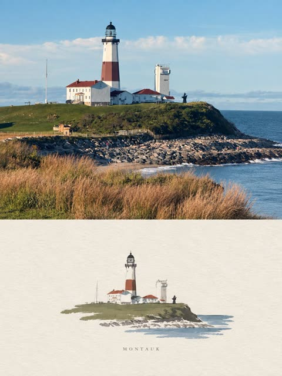</a>

开头先禁止拼贴，一张照片一张海报；结尾一排情绪词定下成品气质。

GPT Image 2.5 · 上传图改图 · 出处: [@icreatelife on X](https://x.com/icreatelife/status/2099343607492702258) · 1,165 赞，统计于 2026-10-27

[`editorial`](pages/zh/tags.md#tag-editorial) [`illustration`](pages/zh/tags.md#tag-illustration) [`photo-to-art`](pages/zh/tags.md#tag-photo-to-art)

<details><summary><b>提示词</b></summary>

```text
Create one independent high-end editorial poster for each uploaded photo. Do not combine multiple photos into a collage. Each photo must be processed and output as a separate poster.

OVERALL FORMAT

Strict 3:4 vertical composition.

Divide the canvas horizontally into two exactly equal sections, with a precise 1:1 height ratio.

The top half occupies exactly 50% of the canvas.

The bottom half occupies exactly 50% of the canvas.

The two sections should feel visually connected as one refined art publication cover.

TOP HALF — ORIGINAL PHOTOGRAPH

Preserve the original photograph as faithfully as possible.

Keep the main composition, subjects, identity, facial features, body proportions, poses, expressions, clothing, objects, and spatial relationships unchanged.

Preserve the realistic photographic texture, natural lighting, shadows, atmosphere, and original color mood.

Apply only subtle, sophisticated editorial color grading, creating the feeling of a premium magazine photograph, contemporary art book, or high-end independent publication.

The image should remain photorealistic and authentic, never overly retouched or artificially stylized.

If necessary to fit the 3:4 composition naturally, extend the sky, ground, walls, or surrounding environmental background.

Background extension must feel seamless and photographic.

Never stretch, distort, reshape, replace, or alter the main subject.

BOTTOM HALF — MINIMAL HAND-DRAWN PAPER ILLUSTRATION

Extract the most recognizable visual elements from the original photograph and reinterpret them as a minimalist hand-drawn paper-cover illustration.

Preserve:

The most recognizable subject

Essential silhouette and proportions

Key pose or gesture

Important objects

The core narrative relationship between people and objects

Highly simplify the image. Remove unnecessary details and retain only the visual information needed for immediate recognition.

Use:

Delicate, slightly imperfect hand-drawn lines

A small number of bold, clearly defined acrylic-style flat color shapes

Rough paper texture

Visible handmade brush marks

Slightly irregular, organic edges

Subtle imperfections that make it feel genuinely handmade

The main illustrated subject should be small, centered, and carefully composed, occupying approximately 10–20% of the bottom half.

Leave a large amount of negative space around the illustration.

The background should primarily resemble:

Rough white paper

Warm off-white paper

Pale natural paper

Minimal editorial book-cover stock

Use only a few lines or small color shapes to suggest the surrounding environment.

COLOR PALETTE

Extract the dominant colors directly from the original photograph.

Compress the palette into no more than 4 main colors.

Keep the colors restrained, sophisticated, and harmonious.

Use bold but controlled flat color blocks.

Avoid excessive color variation.

Preserve subtle paper grain and handmade brush texture.

The illustration should visually feel like a simplified color interpretation of the photograph.

TYPOGRAPHY

A small amount of simple typography may be included when appropriate.

Possible elements:

A short title

Keyword

Object name

Location

Year

Number

Short phrase

Text should be minimal, understated, and editorial.

Typography should naturally interact with the large areas of negative space and the small illustration, evoking:

Art book covers

Independent publishing

Contemporary editorial design

Thoughtful children's picture books

Do not force text into the composition if it does not naturally fit the photograph.

VISUAL LANGUAGE

The final poster should feel:

Quiet · Poetic · Refined · Minimal · Innocent · Relaxed · Artistic · Thoughtful · High-recognition · Premium
```

</details>

<a id="gpt-image-halftone-architecture-poster"></a>
### 建筑照片变半调拼贴旅行海报

<a href="https://x.com/Naiknelofar788/status/2100067049288634730">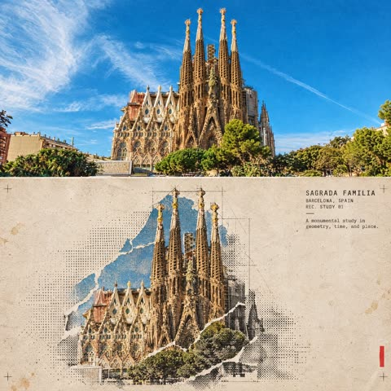</a>

长篇规格，结尾给出优先级：先保建筑准确，再谈半调效果。

GPT Image 2.5 · 上传图改图 · 出处: [@Naiknelofar788 on X](https://x.com/Naiknelofar788/status/2100067049288634730) · 497 赞，统计于 2026-10-27

[`halftone`](pages/zh/tags.md#tag-halftone) [`architecture`](pages/zh/tags.md#tag-architecture) [`travel`](pages/zh/tags.md#tag-travel) [`collage`](pages/zh/tags.md#tag-collage)

<details><summary><b>提示词</b></summary>

```text
Turn this structure photo into a single high-end halftone architectural travel-collage poster. Output one poster per uploaded photo — never merge multiple structures or photos into one frame.

FORMAT

3:4 vertical canvas. Split into two roughly equal zones — real architectural photo on top, printed reconstruction below — divided by one clean, sharp horizontal line.

Do not stretch, warp, tilt, or unnaturally reposition the structure to force the proportions.

TOP HALF — THE REAL SHOT

Preserve the original structure faithfully: same architecture, proportions, perspective, distinctive details, surrounding elements, natural light and shadow, and original color mood.

Keep recognizable features such as:

* façade
* windows and arches
* towers or domes
* doors and structural details
* roofline
* surrounding landscape or street elements

Add only a subtle high-end color grade and the faintest film grain. Do not redesign or reinterpret the architecture.

BOTTOM HALF — THE PRINTED RECONSTRUCTION

Rebuild the same structure as an experimental printed architectural collage using:

torn photographic fragments + fixed-width ASCII character fields + photocopy halftone dots + architectural linework.

The structure must remain immediately recognizable.

* Torn-edge photographic fragments preserve the most important architectural details.
* Brick, stone, glass, metal, shadows, windows, and surrounding textures gradually dissolve outward into ASCII characters, black halftone dots, fragmented print grain, and fine architectural drafting lines.
* Use thin technical construction lines to subtly trace the structure’s geometry.
* Let selected areas break apart into paper fibers and halftone fragments, creating the feeling that the building is emerging from an archival print.
* Keep the main silhouette strong and readable.
* Texture: rough white paper-fiber edges, subtle photocopy imperfections, slight print misregistration, faded ink, old-paper stains, a few restrained crop marks, and one small red calibration bar.
* Color: warm gray old-paper background + black ink + the structure’s original muted colors + a single restrained red accent.
* Never fully desaturate the structure.

The structure should occupy roughly 60–88% of the frame width, scaled according to what reads best for the architecture.

Leave 22–38% of the paper visibly untouched and empty, creating generous negative space so the poster feels like an archival architectural specimen rather than a packed digital screen.

TYPOGRAPHY

Add one clean, readable fixed-width architectural title based on the structure:

[STRUCTURE NAME]

Below it include:

[CITY, COUNTRY]
REC. STUDY 01

Add one short observational caption related to the architecture, such as:

“A monumental study in geometry, time, and place.”

Typography should feel like an old architectural archive mixed with an underground experimental design journal.

A few loose ASCII glyphs may trace the outer silhouette or architectural edges as texture only — never use ASCII to invent windows, doors, structural details, or technical specifications.

MOOD

Early digital systems × analog photocopy × architectural archive × underground zine × modern travel editorial.

The structure should feel like it is surfacing from an old printed document — half photograph, half architectural drawing, half experimental print.

Sophisticated, minimal, tactile, intellectual, slightly mysterious, and highly collectible.

AVOID

Solid black terminal backgrounds, dense walls of code, cyberpunk neon, excessive ASCII, distorted architecture, impossible geometry, invented architectural details, fake technical specifications, random symbols with no meaning, garbled text, excessive colors, brand logos, QR codes, watermarks, author credits, or tourist-poster clichés.

Priority: Preserve the structure’s identity and architectural accuracy first. The experimental halftone/ASCII treatment should enhance the architecture, not hide it.
```

</details>

<a id="nano-banana-photo-ink-split-poster"></a>
### 一半照片一半水墨的海报

<a href="https://x.com/ChillaiKalan__/status/2110581440085987751">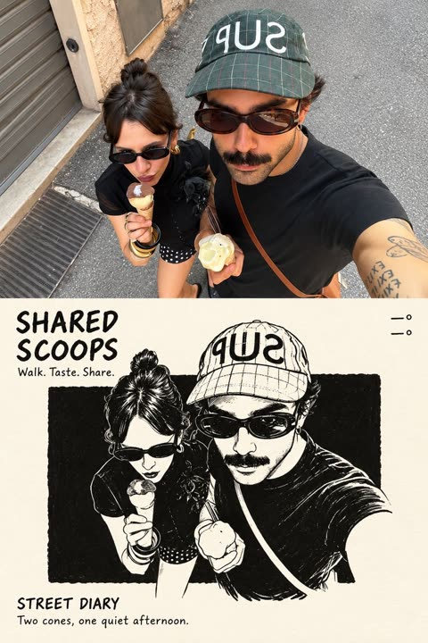</a>

要求严格五五分，再分别规定两半如何处理同一主体。

Nano Banana 2.1 · 上传图改图 · 出处: [@ChillaiKalan__ on X](https://x.com/ChillaiKalan__/status/2110581440085987751) · 414 赞，统计于 2026-10-27

[`split-composition`](pages/zh/tags.md#tag-split-composition) [`ink`](pages/zh/tags.md#tag-ink) [`photo-to-art`](pages/zh/tags.md#tag-photo-to-art)

<details><summary><b>提示词</b></summary>

```text
Using the uploaded reference image, create a single high-resolution vertical 2:3 editorial art poster.

Divide the canvas into two perfectly equal horizontal sections, each occupying exactly 50% of the total height. Separate them with a clean, perfectly straight horizontal dividing line.

1. TOP HALF — ORIGINAL REFERENCE PHOTOGRAPH

Use the uploaded reference photograph directly in the upper 50% of the poster.

Preserve its original photographic quality, sharpness, natural lighting, and color relationships.

Allow only subtle, intelligent cropping around the outer edges when necessary, without compromising the main subject.

If required, naturally extend a small portion of the surrounding environment to fit the composition.

Do not redraw, illustrate, stretch, blur, or modify the subject's appearance, structure, or spatial relationships.

Do not introduce black borders, white margins, or empty edges.

2. BOTTOM HALF — MINIMALIST EDITORIAL ILLUSTRATION

Use a warm, near-white ivory paper background with an extremely subtle paper texture.

Analyze the main subject and visual story of the uploaded reference image.

Extract only the primary subject, preserving one or two essential identifying elements.

Remove or heavily simplify all secondary details, including background architecture, crowds, vehicles, fences, signs, trees, and other unnecessary elements.

Transform the primary subject into a sophisticated black-ink editorial illustration.

ILLUSTRATION STYLE:

Use natural, clean pen strokes with varied line weight.

Preserve an authentic hand-drawn appearance with expressive but controlled linework.

Avoid overly precise engraving aesthetics, excessive internal details, and dense cross-hatching.

Place a large, nearly pure-black rectangular ink block behind the illustrated subject.

The rectangular block should have subtly imperfect, handmade print-style edges.

Keep the black background clean, with only fine paper grain and minimal noise.

Avoid obvious hatching, scratches, architectural lines, or complex textures.

ILLUSTRATION SCALE AND COMPOSITION:

The illustrated subject must occupy approximately 72–77% of the canvas width and 58–64% of the bottom section's height.

Maintain a clear visual focal point with generous negative space surrounding the illustration.

3. COLOR RULES

The bottom illustration must follow a strictly black-and-white color palette by default.

Preserve only one localized accent color if the original reference image contains a clearly distinctive, concentrated color element with meaningful narrative importance.

Ordinary blue skies, green vegetation, stone surfaces, skin tones, and environmental colors must not be treated as accent colors.

Any preserved accent color must remain strictly localized to the relevant subject or area.

Never allow accent colors to spread across the entire illustration.

4. TYPOGRAPHY AND EDITORIAL LAYOUT

Automatically generate concise, meaningful English typography based on the content of the uploaded reference photograph.

The typography must resemble handwritten editorial annotations from an independent art publication.

TOP-LEFT CORNER:

Generate a short handwritten title consisting of 2–5 words, arranged across two lines.

Directly beneath the title, include three short English action verbs relevant to the photograph.

TOP-RIGHT CORNER:

Display only two lines of geographic coordinates:

Latitude
Longitude

Do not include any additional text in this area.

BOTTOM-LEFT CORNER:

Display the location name followed by the word "DIARY."

Directly beneath it, add one short descriptive English sentence inspired by the photograph.

TYPOGRAPHY STYLE:

Use a rough, upright, slightly irregular handwritten typeface.

Maintain subtle imperfections and a natural editorial annotation aesthetic.

Avoid elegant cursive, calligraphy, overly decorative lettering, and excessively polished typography.

5. FINAL ART DIRECTION

The finished poster must combine:

Authentic, high-quality photography.
Minimalist black-and-white editorial illustration.
Generous negative space.
Independent art publication aesthetics.
Quiet, restrained, sophisticated visual storytelling.
Natural handwritten typography.
A balanced relationship between documentary realism and expressive hand-drawn artwork.

The overall result should resemble a carefully designed, collectible editorial art print.

6. FINAL OUTPUT REQUIREMENTS

ASPECT RATIO:
2:3 vertical.

RESOLUTION:
High-resolution, sharp, print-quality output.

COMPOSITION:

Exactly 50% original reference photography on top.

Exactly 50% editorial illustration on the bottom.

One perfectly straight horizontal dividing line.

One complete, standalone poster.

RESTRICTIONS:

No collages.
No multi-poster layouts.
No combined images.
No unnecessary decorative elements.
No modifications to the original subject's identity or appearance.
No excessive illustration details.
No changes to the original photograph's natural color relationships.

FINAL GOAL:

Create a sophisticated, visually balanced editorial art poster that faithfully preserves the uploaded reference photograph while transforming its primary subject into an expressive, minimalist black-ink illustration.
```

</details>

<a id="gpt-image-editorial-split-poster-roses"></a>
### 手捧玫瑰与黄色手袋女子的编辑风海报

<a href="https://x.com/Ziha_ai/status/2106990557813968909">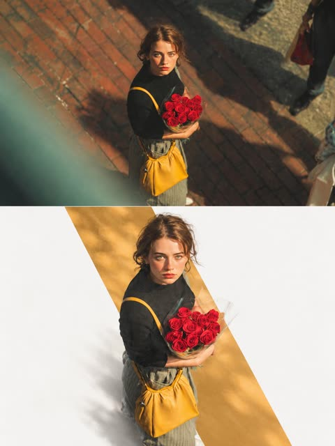</a>

画布严格上下对半，上半保留原图不重绘，下半重构主体，并叠加一条从原图取色的低饱和色带。主体跨越色带边缘进入白色留白，形成层次，避免贴纸感。

GPT Image 2.5 · 上传图改图 · 出处: [@Ziha_ai on X](https://x.com/Ziha_ai/status/2106990557813968909) · 337 赞，统计于 2026-10-27

[`editorial-poster`](pages/zh/tags.md#tag-editorial-poster) [`split-layout`](pages/zh/tags.md#tag-split-layout) [`color-window`](pages/zh/tags.md#tag-color-window) [`negative-space`](pages/zh/tags.md#tag-negative-space) [`photo-reconstruction`](pages/zh/tags.md#tag-photo-reconstruction)

<details><summary><b>提示词</b></summary>

```text
Premium Editorial Poster Instructions

Each uploaded photo must be made into a separate, independent, premium editorial poster, and multiple photos must not be combined. Use a strict 3:4 vertical canvas. Split the canvas horizontally in the exact center: the upper half and the lower half each occupy 50% of the height, are equally wide, and equally high, with no alteration of proportion.

The upper half uses the original photo directly and must not be regenerated. Preserve the identity of the main subject, the human body or architectural structure, proportions, perspective, spatial relationships, texture, natural light and shadow, color, and environment in their entirety. Only slight cropping and restrained premium color grading are permitted; re-drawing the main subject, fictional light, HDR, excessive saturation, plastic texture, and fictional content are prohibited. hibited. When needing to adapt to the frame, only environmental areas such as sky, water surface, ground, walls, plants, or background can be extended.

The lower half extracts and reconstructs the "narrative core" of the photo: it can be a single primary subject, or a group of related elements that together embody the photo's identity, scale, action, o story relationship. Maintain its realistic, recognizable appearance, proportion, internal structure, texture, and relative position. Do not remove important related elements, and do not directly us rectangular photo cutouts. The reconstructed subject typically occupies 55%-80% of the width of the lower area. It should naturally extend based on the photo's primary direction and retain plausible ground, water lines, shadows, or softly dissipated edges to integrate into the background, avoiding a sticker-like or floating appearance.

Incorporate a narrow, low-saturation geometric color field behind or through the center of the subject, serving as a "critical window" between reality and editorial abstraction. The color of the window must be extracted from the original photo, and its orientation (horizontal, vertical, or diagonal) chosen based on the overall narrative direction.

The subject must actively pass through the window: part of it is within the color field, and part enters the open negative space, naturally crossing the window's boundary to create occlusion, penetration, and spatial depth. The window is not a frame or a card; it must not fully enclose the subject. Only one primary window is allowed; multiple color blocks, thick borders, rounded corners, strong gradients, and drop shadows are prohibited.

Use a white, cool white, very light gray, or near-white background for the lower half, coordinated with the photo. Employ a restrained asymmetrical composition and abundant negative space to establish a three-tier hierarchy:

Reconstructed subject or narrative composition

Low-saturation geometric window
```

</details>

<a id="nano-banana-photo-sketch-editorial"></a>
### 上面照片下面素描的编辑海报模板

<a href="https://x.com/ChillaiKalan__/status/2111332272670417236">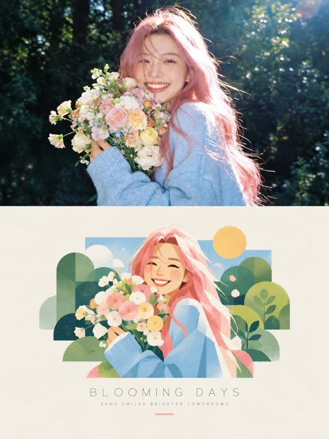</a>

填 `[SUBJECT]` 和 `[SETTING]`。禁止项针对分割海报的常见毛病：粗边框、上下脸不一致。

Nano Banana 2.1 · 文生图 · 出处: [@ChillaiKalan__ on X](https://x.com/ChillaiKalan__/status/2111332272670417236) · 266 赞，统计于 2026-10-27

[`split-composition`](pages/zh/tags.md#tag-split-composition) [`template`](pages/zh/tags.md#tag-template) [`editorial`](pages/zh/tags.md#tag-editorial)

<details><summary><b>提示词</b></summary>

```text
Create a premium editorial poster featuring a two-part visual composition. The upper half shows a photorealistic photograph of [SUBJECT] in [SETTING], captured in warm natural sunlight with realistic skin texture, authentic expressions, soft highlights, and cinematic depth of field. The lower half transforms the exact same scene into a beautiful hand-painted digital illustration, preserving the subject’s pose, hairstyle, clothing, colors, and key visual details.

Place the illustrated scene inside a clean rectangular frame on a warm ivory, subtly textured paper background. Use a charming contemporary illustration style with delicate brush textures, simplified organic shapes, pastel colors, soft outlines, and a nostalgic summer-magazine aesthetic. Add tasteful decorative elements that complement the scene.

Below the illustration, include a centered minimalist editorial title reading “[MAIN TITLE]” in thin, widely spaced uppercase typography, followed by a smaller subtitle reading “[TAGLINE]” in elegant letter-spaced text. Add a short, thin pastel-colored line underneath.

Maintain balanced spacing, refined art direction, a cohesive color palette, and a sophisticated print-design finish. Vertical 3:4 composition, high resolution, natural lighting, polished editorial layout, aesthetically pleasing, realistic-to-illustration transformation.

Avoid clutter, excessive text, distorted anatomy, inconsistent facial features, harsh colors, heavy borders, and unnecessary graphic elements.
```

</details>

**[全部 10 条](pages/zh/image-poster.md)**

<a id="img-photo-to-art"></a>
## 照片转艺术风格

<a id="gpt-image-photo-to-watercolor-travel"></a>
### 上半照片，下半水彩旅行速写

<a href="https://x.com/MahnoorAi12/status/2102724961408626735">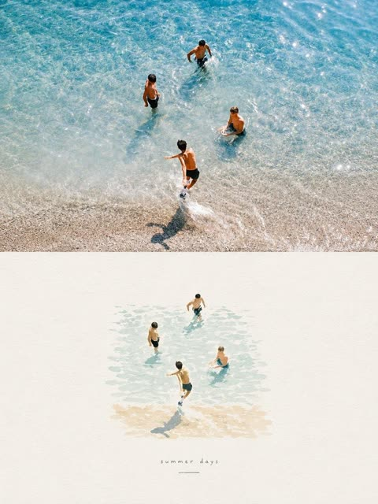</a>

上下分割，照片渐变成水彩。作者说 Gemini、Grok、ChatGPT 都能用。

GPT Image 2.5 · 上传图改图 · 出处: [@MahnoorAi12 on X](https://x.com/MahnoorAi12/status/2102724961408626735) · 2,264 赞，统计于 2026-10-27

[`watercolor`](pages/zh/tags.md#tag-watercolor) [`travel`](pages/zh/tags.md#tag-travel) [`split-composition`](pages/zh/tags.md#tag-split-composition)

<details><summary><b>提示词</b></summary>

```text
Create a refined editorial travel-art composition based on a reference photograph. The image is divided vertically into two parts: the upper section is a realistic cinematic travel photograph, while the lower section transforms the exact same scene into a delicate hand-painted watercolor illustration.
Upper section: authentic candid travel photography, natural daylight, soft shadows, subtle film grain, realistic textures, sophisticated European atmosphere, documentary-style composition, people naturally walking through the scene, beautiful architectural details, slightly muted elegant colors, high-end travel magazine photography.
Lower section: a minimalist handmade watercolor painting of the exact same scene, preserving the recognizable composition, architecture, people, poses, perspective and major visual elements from the photograph. Loose translucent watercolor washes, delicate ink details, visible paper texture, soft edges, imperfect brushwork, subtle pigment bleeding, airy negative space, understated pastel tones, artistic but realistic.
Leave generous warm ivory/off-white textured paper space surrounding the watercolor illustration. Add a small elegant handwritten caption near the bottom, such as “summer days” or “a quiet afternoon”, with a thin minimalist horizontal line underneath.
Overall aesthetic: luxury travel journal, fine-art watercolor postcard, contemporary editorial design, nostalgic European summer, understated elegance, tactile handmade paper, sophisticated and serene.
Portrait orientation, clean composition, premium art direction, no clutter, no borders, natural proportions, highly detailed photograph transitioning into an airy watercolor illustration.
```

</details>

<a id="gpt-image-pet-papercraft-cube-template"></a>
### 高地牛纸模立方体玩具展开图

<a href="https://x.com/icreatelife/status/2101353488408006830"></a>

提示词把上传照片限定为动物外观的唯一来源，并逐一列出平铺的各个部件及折线、粘合片和裁切边。结尾列出不得更改的内容，用来保住动物的身份特征和毛发质感。

GPT Image 2.5 · 上传图改图 · 出处: [@icreatelife on X](https://x.com/icreatelife/status/2101353488408006830) · 1,178 赞，统计于 2026-10-27

[`papercraft`](pages/zh/tags.md#tag-papercraft) [`cube-toy`](pages/zh/tags.md#tag-cube-toy) [`pet`](pages/zh/tags.md#tag-pet) [`template`](pages/zh/tags.md#tag-template) [`fur-texture`](pages/zh/tags.md#tag-fur-texture)

<details><summary><b>提示词</b></summary>

```text
Use my uploaded pet photo as the only source of the animal’s appearance. Create a realistic printable papercraft cube toy template of my pet, preserving 100% its identity and unique features: fur color, fur pattern, eyes, face shape, ears, body proportions, markings and expression.

Transform my pet into a handmade paper craft 3D model (low-poly cube style) like a DIY papercraft template. Show the unfolded cut-out template pieces laid flat on a white background: head, body, legs, ears and tail separated, with folding lines, tabs and cutting edges clearly visible.

The printed texture on the paper pieces must use my pet’s real fur texture and colors, so when assembled it becomes a small cube-shaped 3D figure of my exact pet.

Include:

cube-shaped head with my pet’s real face on it

cube-shaped body with realistic fur texture

four legs matching my pet’s appearance

ears with correct shape and inner ear details

tail matching my pet’s size and color pattern

Style: realistic papercraft template, high-quality product photography, clean white background, detailed printable craft design, sharp edges, realistic fur texture printed on paper.

Do not change my pet’s appearance. Do not turn it into a different animal, cartoon, plush toy or generic cat/dog. It must look like my actual pet converted into a cube papercraft model
```

</details>

<a id="gpt-image-paper-texture-cover"></a>
### 照片变纸张质感极简封面

<a href="https://x.com/Ciri_ai/status/2113501433471656120"></a>

按小标题组织（构图、配色、质感），最后点明参照物：独立艺术书封面。

GPT Image 2.5 · 上传图改图 · 出处: [@Ciri_ai on X](https://x.com/Ciri_ai/status/2113501433471656120) · 561 赞，统计于 2026-10-27

[`paper-texture`](pages/zh/tags.md#tag-paper-texture) [`minimal`](pages/zh/tags.md#tag-minimal) [`cover`](pages/zh/tags.md#tag-cover)

<details><summary><b>提示词</b></summary>

```text
MINIMAL HAND-DRAWN PAPER ILLUSTRATION

Transform the uploaded photo into a minimalist, hand-drawn, paper-textured artistic cover.

Composition

- The main subject should occupy only 10–20% of the frame.
- Position the subject near the bottom center of the composition.
- Leave generous negative space throughout the image.
- Suggest the environment using only a few lines or small blocks of color.

Preserve

- The most recognizable features of the original subject.
- The essential silhouette and proportions.
- The original pose or primary action.
- Important objects and defining details.
- The core story, relationships, and emotional atmosphere.

Color Palette

- Extract the dominant colors from the original photograph.
- Limit the palette to no more than four main colors.
- Use bold yet restrained, flat color blocks.
- Maintain a harmonious, muted color combination.
- Add subtle paper grain and handmade brush textures.

Simplification
Remove unnecessary details and visual clutter. Retain only the essential visual information needed to make the subject instantly recognizable.

Typography

- Optionally incorporate a small amount of simple text.
- Keep typography short, subtle, and aesthetically refined.
- Integrate the text naturally into the composition.
- Aim for the visual language of an art-book cover, independent publishing, modern editorial design, or a contemplative picture book.
- Do not force typography into the image if it doesn't improve the composition.

Style and Materials

- Delicate, slightly imperfect hand-drawn lines.
- A few clearly defined acrylic-like flat color blocks.
- Rough, tactile paper texture.
- Visible handmade brushstrokes.
- Organic, irregular, natural contours.
- Subtle imperfections that make the artwork feel genuinely handmade.

Overall Mood
Quiet, poetic, sophisticated, minimalist, innocent, relaxed, artistic, thoughtful, distinctive, and premium.

Avoid

- Colored-pencil rendering.
- Dry-brush effects.
- Watercolor washes or bleeding.
- Pure line-art illustration.
- Overly detailed or realistic illustrations.
- Heavy impasto or thick oil-paint textures.
- Smooth, polished digital illustration.
- 3D rendering, glossy surfaces, or artificial lighting effects.
- Generic commercial cartoon styles.
- E-commerce advertising aesthetics.
- Generic poster templates.
- Excessive decorative elements.
- Overly complex compositions.
- Too much text.

Final Result: A refined, minimalist, hand-crafted paper illustration with generous negative space, restrained colors, subtle tactile textures, and the sophistication of an independent art-book cover.
```

</details>

<a id="gpt-image-photo-to-paper-illustration-split-poster"></a>
### 湖边实景照片搭配手绘纸本插画

<a href="https://x.com/harboriis/status/2107346549542203400"></a>

严格五五分栏，上半保留原照片，下半把同一场景重绘成居中的小幅手绘插画。调色限制为从照片提取的最多四种颜色，并留出大量纸面空白，让上下两部分连成一体。

GPT Image 2.5 · 上传图改图 · 出处: [@harboriis on X](https://x.com/harboriis/status/2107346549542203400) · 417 赞，统计于 2026-10-27

[`editorial-poster`](pages/zh/tags.md#tag-editorial-poster) [`photo-to-illustration`](pages/zh/tags.md#tag-photo-to-illustration) [`split-layout`](pages/zh/tags.md#tag-split-layout) [`paper-texture`](pages/zh/tags.md#tag-paper-texture) [`minimalist`](pages/zh/tags.md#tag-minimalist)

<details><summary><b>提示词</b></summary>

```text
Create one independent high-end editorial poster for each uploaded photo. Never combine photos.

FORMAT
Strict 3:4 vertical composition with an exact 50/50 horizontal split. The top and bottom halves must be equal in height and visually connected as one refined editorial cover.

TOP HALF: ORIGINAL PHOTO
Use the original photo faithfully. Preserve the subject, identity, facial features, proportions, pose, clothing, objects, composition, lighting, shadows, atmosphere, and color mood. Keep it fully photorealistic with only subtle premium editorial color grading. Never stylize, distort, replace, or alter the main subject. Extend only surrounding background when necessary, seamlessly and naturally.

BOTTOM HALF: HAND-DRAWN ILLUSTRATION
Reinterpret the same scene as a minimalist handmade paper illustration. Preserve the recognizable subject, silhouette, pose, key objects, and main visual story.

Use delicate imperfect lines, simple acrylic-style flat color shapes, visible brush marks, rough paper texture, organic edges, and subtle handmade imperfections. Keep the illustration small and centered, occupying about 10–20% of the bottom half, with generous negative space.

Use a rough white, warm off-white, or pale natural paper background with only minimal environmental details.

COLOR
Extract colors from the original photo and reduce them to a maximum of 4 restrained, harmonious colors. Use controlled flat color blocks while maintaining subtle paper grain and brush texture.

TYPOGRAPHY
Optional minimal editorial text only when appropriate, such as a short title, keyword, location, or number. Keep it understated and never force text into the design.

STYLE
Quiet, poetic, refined, minimal, relaxed, artistic, thoughtful, premium, high-recognition.

FINAL
Maintain the exact 50/50 split. The top must remain a faithful photograph, while the bottom is a simplified handmade illustration of the same scene. Avoid clutter, excessive colors, heavy typography, artificial effects, or unnecessary details. The result should feel like a premium contemporary independent art publication cover.
```

</details>

<a id="gpt-image-knitted-puppet-bust"></a>
### 照片变针织定格动画玩偶半身像

<a href="https://x.com/oggii_0/status/2114585881059459119"></a>

超长材质规格（毛线、针脚、毛毡），最后一条：照片里没有的不许编。

GPT Image 2.5 · 上传图改图 · 出处: [@oggii_0 on X](https://x.com/oggii_0/status/2114585881059459119) · 327 赞，统计于 2026-10-27

[`3d`](pages/zh/tags.md#tag-3d) [`textile`](pages/zh/tags.md#tag-textile) [`toy`](pages/zh/tags.md#tag-toy)

<details><summary><b>提示词</b></summary>

```text
Task: Create a 1:1 Square 3D Textile Art Toy Bust from the Attached Real Photograph

Use the attached real photograph to create a square 1:1, stylized 3D textile art toy bust. Interpret the inputs by their roles: the real photograph is the source of identity and content, while the minimalist white-background toy image is the style reference. Their order does not matter.

Preserve the subject’s identity, facial expression, pose, and spatial relationships between objects. Reconstruct the subject as an exaggerated, humorous designer collectible toy. Do not apply a simple fuzzy or plush filter to the original photograph.

## 1. Style Reference

Borrow only these visual characteristics from the reference image:

- An oversized, horizontally broad head with rounded corners.
- Extremely small, centrally concentrated facial features with generous facial negative space.
- Sculptural knitted forms, clustered yarn shapes, and soft textile construction.
- Subtle asymmetry for a handmade, designer-toy appearance.
- Contrast between fine-grained flocked surfaces and chunky knitted textures.
- A deliberate primary and accent color hierarchy.
- Clean, minimalist white studio photography.

Do not inherit the reference character’s body, pose, hairstyle, hat, glasses, clothing, props, or colors.

## 2. Subject and Identity Preservation

The real photograph is the exclusive source of visible content. Reproduce only the body parts, hairstyle, clothing, accessories, objects, poses, and contact relationships that are actually visible in the original image. Never invent or complete details that extend beyond the photograph.

Identify 2–5 distinctive identity anchors from the source image. Exaggerate 1–2 of them while simplifying the remaining details to maintain recognizability.

- **Head:** Transform it into a broad, thick, rounded rectangular block or a short cylindrical form with softened corners.
- **Eyes:** Use tiny black beads or capsule-shaped forms.
- **Nose:** Reduce it to a small, rounded rectangular block.
- **Mouth:** Preserve the original expression using a short line or a small opening, as appropriate.
- **Hair:** Reconstruct it as large yarn loops, chunky knitted clusters, or sculptural bundles of wool.
- **Hands:** Strictly preserve the number of visible hands. If no hands are visible, add none. If one hand is visible, reproduce only one. Preserve its orientation, sleeve cuff, and contact with the original object.
- **Text and logos:** Convert any visible lettering or branding into illegible woven or knitted texture rather than readable text.

## 3. Composition

Create a compact, close-up head-and-shoulders composition.

- The head should occupy approximately 75–90% of the image width.
- Compress the body into a small supporting form, retaining only the essential visible pose, gestures, and objects.
- Allow elements to be cropped by the image boundaries when necessary.
- Do not add body parts or anatomy extending beyond the original photograph.
- Maintain a clear silhouette and recognizable relationships between the subject and any visible objects.

## 4. Visual Style

**Stylized 3D textile art toy, oversized head, tiny concentrated facial features, sculptural knitted forms, micro-flocked surfaces.**

Prioritize abstract exaggeration over photorealism while preserving recognizability through the subject’s silhouette, hairstyle, facial expression, pose, clothing, and visible objects.

The result should feel like a thoughtfully designed, premium collectible art toy rather than a conventional 3D cartoon character.

## 5. Color Palette

Automatically develop a cohesive palette of 3–5 colors, including:

- A dominant primary color.
- A contrasting accent color with a clear difference in temperature or brightness.
- One or more supporting colors.
- A neutral color for balance.

Non-identity-defining elements may be recolored to improve visual harmony. Preserve the essential identity cues of the original subject while avoiding monotonous palettes, excessive neutrals, evenly distributed rainbow colors, or repetitive mechanical stripes.

## 6. Materials, Texture, and Lighting

Use distinct textile treatments for different surfaces:

- **Face, hands, and small components:** Fine, dense micro-flocked or short-fiber felt surfaces.
- **Hair, hats, and clothing:** Chunky knitting, crochet structures, large yarn loops, and clustered wool forms, applied only where those elements exist in the original photograph.

Create visible material contrast between the fine-grained felt and the coarser knitted structures. The surfaces should appear sculpted from real textile materials, not covered with a generic fuzzy filter.

Use a subtly warm-white seamless background, soft high-key studio lighting, gentle highlights, and short, delicate shadows. Keep the presentation clean, bright, and premium.

## 7. Strict Exclusions

- No photorealistic eyeballs, detailed nostrils, realistic lips, natural skin texture, or individual hair strands.
- No copying the reference character’s identity or distinctive design elements.
- No invented body parts, hand gestures, accessories, clothing, or props absent from the source photograph.
- No conventional 3D cartoon aesthetics.
- No plastic, polymer clay, wax figure, or long-pile plush appearance.
- No readable text, logos, or branding.
- No rooms, environmental scenes, or complex backgrounds.
- No generic fuzzy overlay that obscures the underlying sculptural textile construction.

## Final Priority

**The source photograph determines WHAT is depicted. The style reference determines HOW it is depicted.**

Deliver a polished, humorous, exaggerated 1:1 square 3D textile art toy bust with a distinctive oversized head, tiny facial features, sculptural yarn construction, contrasting textile textures, a deliberate color palette, and clean white studio lighting. Preserve the original subject’s identity and visible content without inventing anything beyond the photographic evidence.
```

</details>

<a id="gpt-image-blue-doodle-couple-photo"></a>
### 照片变成蓝色涂鸦情侣插画

<a href="https://x.com/Ciri_ai/status/2114588014034948562"></a>

提示词先说明要保留的内容（人物、姿势、构图），再用钴蓝线条、桃色腮红和金色爱心配奶油色纸面的有限配色来简化风格。再用不要渐变、不要阴影、不要纹理这类排除条件，保持画面扁平、有手绘感。

GPT Image 2.5 · 上传图改图 · 出处: [@Ciri_ai on X](https://x.com/Ciri_ai/status/2114588014034948562) · 280 赞，统计于 2026-10-28

[`doodle`](pages/zh/tags.md#tag-doodle) [`minimalist`](pages/zh/tags.md#tag-minimalist) [`couple`](pages/zh/tags.md#tag-couple) [`blue-ink`](pages/zh/tags.md#tag-blue-ink) [`photo-to-illustration`](pages/zh/tags.md#tag-photo-to-illustration)

<details><summary><b>提示词</b></summary>

```text
Transform your photo into a minimalist doodle illustration using GPT Image 2.5.

Prompt: Transform the uploaded photo into a cute minimalist hand-drawn doodle illustration. Preserve the original people, pose, composition, and recognizable facial characteristics, but simplify them into charming cartoon forms.

Use a naive handmade sketchbook aesthetic with bold, slightly wobbly cobalt-blue brush-pen outlines, simple rounded shapes, minimal details, and imperfect hand-drawn strokes. Add subtle warm peach/pink blush on the cheeks and small golden-yellow heart accents around the characters.

Keep the illustration clean and airy with a warm cream/off-white paper background. Use flat, very limited colors, no realistic shading, no gradients, and no complex textures. The overall feeling should be sweet, wholesome, playful, cozy, and romantic, like a handmade children's doodle or personal notebook drawing.

Style keywords: minimalist doodle, folk-inspired hand drawing, blue ink illustration, cute couple illustration, naive art, imperfect brush strokes, simple cartoon, handmade sketchbook aesthetic, warm cream paper, subtle blush, tiny heart doodles, charming imperfections, clean composition.
```

</details>

**[全部 11 条](pages/zh/image-photo-to-art.md)**

<a id="img-realism"></a>
## 写实照片

<a id="gpt-image-failed-photos-grid"></a>
### 任意角色的九张失败照片

<a href="https://x.com/DeepBlueX0/status/2099481521983995971"></a>

只有七个词。作者的心得：限制越少，失败照越像真的。

GPT Image 2.5 · 文生图 · 出处: [@DeepBlueX0 on X](https://x.com/DeepBlueX0/status/2099481521983995971) · 2,646 赞，统计于 2026-10-27

[`grid`](pages/zh/tags.md#tag-grid) [`humor`](pages/zh/tags.md#tag-humor) [`template`](pages/zh/tags.md#tag-template)

<details><summary><b>提示词</b></summary>

```text
Vertical 3×3 failed photos × {Character}
```

</details>

<a id="gpt-image-six-photo-portrait-grid"></a>
### 同一个人的六宫格人像

<a href="https://x.com/john_my07/status/2112737725430554781"></a>

先把人物写细一次，再写六个画面；要求不留缝，九宫格读起来像一整张。

GPT Image 2.5 · 文生图 · 出处: [@john_my07 on X](https://x.com/john_my07/status/2112737725430554781) · 651 赞，统计于 2026-10-27

[`portrait`](pages/zh/tags.md#tag-portrait) [`grid`](pages/zh/tags.md#tag-grid) [`consistency`](pages/zh/tags.md#tag-consistency)

<details><summary><b>提示词</b></summary>

```text
Create an ultra-realistic 6-photo portrait collage arranged in a seamless 3×2 grid, featuring a naturally beautiful young Portuguese woman in her early 20s. She has warm olive-toned skin, expressive hazel-brown eyes, long chestnut-brown hair with subtle natural highlights, soft face-framing layers, naturally full eyebrows, and delicate, distinctive facial features. Her appearance should feel authentic and individual, with realistic skin texture, tiny imperfections, and minimal everyday makeup.

Visual aesthetic: Effortless European Instagram photo dump, reminiscent of candid photographs taken on a Canon PowerShot G7 X Mark III. Direct built-in camera flash, crisp details, bright facial highlights, hard shadows, slightly imperfect framing, subtle digital noise, and a nostalgic early-2000s point-and-shoot feel.

Setting and styling: A warm off-white bedroom wall with subtle texture, a few natural shadows, and no distracting decorations. She wears a fitted burgundy scoop-neck top, tiny gold hoop earrings, and a delicate necklace. Her makeup is understated, with softly flushed cheeks, natural glossy lips, and lightly defined lashes. Her long hair remains the same color and length but falls differently in every photograph.

Six distinct photographs:

1. Sweet candid: Sitting close to the camera, resting her cheek against one hand, smiling gently with relaxed eyes and loose hair framing her face.
2. Playful snapshot: Looking directly into the lens with a mischievous half-smile, one eyebrow slightly raised, fingers casually tucked behind her ear.
3. Messy-girl moment: Eyes closed and laughing softly, both hands lifting her hair away from her shoulders, a few loose strands catching the flash.
4. Effortless confidence: Turning her face over one shoulder, giving the camera a subtle side-eye, with one hand lightly resting against her neck.
5. Caught laughing: Looking toward someone outside the frame, laughing naturally with her head tilted to the side and hair falling across one cheek.
6. Quiet evening mood: Leaning against the wall, gazing thoughtfully into the lens, lips relaxed, fingertips gently twisting a strand of hair.

Identity consistency: The same Portuguese woman must appear in all six frames, with identical facial proportions, eye color, skin tone, hair color, and recognizable features. Each photograph should have a different pose, expression, head angle, and hair arrangement, as if captured within the same casual photo session.

Photography details: Realistic compact-camera flash, authentic skin pores, fine baby hairs, natural facial asymmetry, believable hands, sharp eyes, slight variations in exposure, and candid framing. Avoid excessive retouching, artificial skin smoothing, exaggerated beauty standards, duplicated expressions, malformed fingers, distorted anatomy, or the overly polished appearance of AI-generated portraits.

Output: Vertical 3:4 aspect ratio, exactly six photographs in a balanced 3-column × 2-row grid, clean alignment, no gutters, no text, no watermark. Photorealistic, youthful, spontaneous, intimate, and effortlessly stylish.
```

</details>

<a id="gpt-image-pencil-essay-coffee-stain"></a>
### 带咖啡渍的线格纸铅笔手写文章

<a href="https://x.com/chetaslua/status/2095556181012128005"></a>

提示词先限定媒介（8.5x11 线格纸上的铅笔字）和拍摄方式（手机照片）。再要求笔迹有变化，并指定一处角落的咖啡渍作为小瑕疵，真实感由此而来。

GPT Image 2.5 · 文生图 · 出处: [@chetaslua on X](https://x.com/chetaslua/status/2095556181012128005) · 614 赞，统计于 2026-10-27

[`handwriting`](pages/zh/tags.md#tag-handwriting) [`paper`](pages/zh/tags.md#tag-paper) [`phone-photo`](pages/zh/tags.md#tag-phone-photo) [`texture`](pages/zh/tags.md#tag-texture) [`coffee-stain`](pages/zh/tags.md#tag-coffee-stain)

<details><summary><b>提示词</b></summary>

```text
🚨 GPT-Image-2.5 Output

I said it to write like einstein it did it without reference < i did not give image or anything   >

left side is AI and right side is real photo from reddit to compare

Prompt : a photorealistic, taken by phone photo of a handwritten essay in pencil, albert einstein handwriting, on an 8.5x11 piece of lined paper, about the history of money in world. make sure there is variance in the writing in a very einstein way. give it a slight coffee stain on the top right corner
```

</details>

<a id="gpt-image-forest-clearing-foliage-noise-test"></a>
### 阳光洒落的林间空地与茂密绿叶

<a href="https://x.com/mark_k/status/2097411028510179759"></a>

一句话点明主体、照片媒介和高细节要求，可作为噪点伪影测试，因为密集重复的树叶最容易暴露纹理涂抹和颗粒问题。提示词很短，光线与构图交由模型自行决定。

GPT Image 2.5 · 文生图 · 出处: [@mark_k on X](https://x.com/mark_k/status/2097411028510179759) · 415 赞，统计于 2026-10-27

[`forest`](pages/zh/tags.md#tag-forest) [`nature`](pages/zh/tags.md#tag-nature) [`foliage`](pages/zh/tags.md#tag-foliage) [`texture-test`](pages/zh/tags.md#tag-texture-test) [`landscape`](pages/zh/tags.md#tag-landscape)

<details><summary><b>提示词</b></summary>

```text
GPT-Image-2.5 has arrived in
@ChatGPT
 🔥

It features many improvements, but I couldn't help myself from doing the infamous "noise artifact" test.

The results are mixed!

Prompt: "Photo of a clearing in the woods with lots of green foliage, highly detailed"

See for yourself:
```

</details>

<a id="nano-banana-json-reconstruction"></a>
### 逐项复刻一张照片的 JSON 提示词

<a href="https://x.com/ViralOps_/status/2107538470818484305"></a>

按 JSON 字段写（构图、光线、色彩、负面词）。原帖用同一段 JSON 对比了 Nano Banana 2.1 和 GPT Image 2.5。

Nano Banana 2.1 · 上传图改图 · 出处: [@ViralOps_ on X](https://x.com/ViralOps_/status/2107538470818484305) · 326 赞，统计于 2026-10-27

[`json`](pages/zh/tags.md#tag-json) [`reconstruction`](pages/zh/tags.md#tag-reconstruction) [`comparison`](pages/zh/tags.md#tag-comparison)

<details><summary><b>提示词</b></summary>

```text
{
  "prompt_type": "detailed_image_reconstruction",
  "aspect_ratio": "4:5 vertical portrait",
  "overall_goal": "Recreate the visual appearance, framing, lighting, styling, and casual smartphone-photo feel of the reference image as closely as possible while keeping the result photorealistic and natural.",

  "subject": {
    "type": "young adult woman",
    "age_range": "early to mid 20s",
    "pose": "standing indoors, upper body turned slightly away from the camera while her face turns toward the lens",
    "body_position": "relaxed casual posture with shoulders slightly angled",
    "expression": "soft neutral expression with a subtle pout, calm and confident",
    "gaze": "looking directly toward the camera",
    "styling": "minimal everyday styling, clean and natural"
  },

  "face": {
    "shape": "soft oval face with a gently tapered jawline",
    "forehead": "medium-height forehead partly framed by center-parted hair",
    "eyebrows": "natural medium-thick dark brown eyebrows with a soft arch",
    "eyes": {
      "shape": "almond-shaped",
      "color": "light brown to hazel",
      "appearance": "bright eyes with visible catchlights",
      "lashes": "long defined eyelashes with subtle mascara"
    },
    "nose": "small straight nose with a softly rounded tip",
    "lips": {
      "shape": "full lips with a defined cupid's bow",
      "color": "natural rosy pink",
      "finish": "soft satin finish, not glossy"
    },
    "skin": {
      "tone": "light warm-neutral skin tone",
      "texture": "smooth natural skin with subtle pores and realistic tonal variation",
      "cheeks": "soft natural pink flush",
      "finish": "fresh luminous skin without heavy retouching"
    },
    "makeup": "very light natural makeup, softly defined lashes, subtle blush, natural pink lips, no dramatic contour"
  },

  "hair": {
    "color": "rich medium-to-dark chocolate brown",
    "length": "very long, extending well below the chest",
    "parting": "clean center part",
    "texture": "mostly straight with very soft natural bends through the lower lengths",
    "density": "thick and healthy-looking",
    "finish": "smooth and glossy but still realistic",
    "front_sections": "two thin face-framing strands falling naturally along both sides of the face",
    "details": "visible individual strands, subtle flyaways near the crown, realistic highlights from sunlight, natural uneven strand separation",
    "movement": "hair hanging naturally over both shoulders and down the front of the shirt"
  },

  "clothing": {
    "top": "oversized plain white crew-neck T-shirt",
    "fit": "loose casual fit",
    "fabric": "soft slightly wrinkled cotton",
    "logos": "none",
    "accessories": "no visible jewelry or prominent accessories"
  },

  "composition": {
    "shot_type": "close upper-body portrait",
    "camera_angle": "slightly above chest level, close to eye level",
    "camera_distance": "approximately arm's-length smartphone distance",
    "subject_position": "face slightly right of center with long hair occupying much of the lower frame",
    "crop": "top of head fully visible, image extending down to around lower torso",
    "orientation": "vertical",
    "perspective": "natural wide smartphone-camera perspective with mild close-range distortion"
  },

  "lighting": {
    "primary_source": "strong warm natural sunlight entering from the side/front through a nearby window",
    "direction": "sunlight striking the subject from camera-left/front",
    "face_effect": "bright warm illumination across the forehead, cheeks, nose, and hair",
    "hair_effect": "distinct brown highlights and soft reflective streaks along individual strands",
    "shadow_quality": "strong but soft-edged natural indoor shadows",
    "exposure": "face slightly brightly exposed while the room behind remains much darker",
    "color_temperature": "warm daylight"
  },

  "environment": {
    "location": "casual indoor residential room",
    "background": "dark gray walls with a white ceiling cornice",
    "left_background": "open doorway or darker hallway area",
    "right_background": "dark wall and partially visible household objects",
    "lower_right": "part of a black tripod or light stand visible",
    "overall_feel": "ordinary lived-in room rather than a studio",
    "depth": "background moderately out of focus but still recognizable"
  },

  "camera": {
    "capture_device": "modern smartphone camera",
    "lens_equivalent": "approximately 24-28mm full-frame equivalent",
    "focus": "sharp focus on face and front hair",
    "depth_of_field": "mostly natural smartphone depth of field with gentle background softness",
    "dynamic_range": "realistic phone-camera HDR with slightly clipped highlights in direct sun",
    "image_character": "casual social-media selfie/photo, not professionally staged"
  },

  "photorealism_details": [
    "real individual hair strands",
    "natural skin pores and micro-texture",
    "subtle peach fuzz",
    "realistic eyelash separation",
    "tiny variations in lip texture",
    "slight fabric creases in the T-shirt",
    "small flyaway hairs around the crown",
    "natural sunlight falloff across the face",
    "slightly imperfect casual framing",
    "realistic indoor shadow noise"
  ],

  "style": {
    "visual_style": "highly photorealistic casual smartphone portrait",
    "mood": "soft, youthful, relaxed, sunlit",
    "processing": "light social-media style processing with warm skin tones and slightly enhanced clarity",
    "avoid": [
      "cinematic movie lighting",
      "studio portrait lighting",
      "overly smooth plastic skin",
      "CGI appearance",
      "anime or illustration",
      "heavy beauty filter",
      "extreme facial symmetry",
      "over-sharpened hair",
      "artificial jet-black hair",
      "dramatic makeup",
      "excessive background blur",
      "professional studio backdrop",
      "text",
      "watermarks",
      "logos"
    ]
  },

  "negative_prompt": "cartoon, anime, illustration, CGI, plastic skin, waxy face, over-retouched skin, excessive beauty filter, unnatural facial symmetry, distorted eyes, crossed eyes, malformed lips, warped face, duplicate hair strands, fake wig appearance, overly black hair, metallic hair shine, stiff hair, messy anatomy, distorted shoulders, extra limbs, extra fingers, studio backdrop, cinematic lighting, dramatic color grading, excessive bokeh, oversaturated colors, text, logo, watermark"
}
```

</details>

<a id="gpt-image-dusk-film-portrait"></a>
### 黄昏低角度人像，胶片颗粒

<a href="https://x.com/chatgptpaglu/status/2105219509791678731"></a>

不到 600 字：一个机位、一处服装细节、一个光源、一种胶片感。

GPT Image 2.5 · 文生图 · 出处: [@chatgptpaglu on X](https://x.com/chatgptpaglu/status/2105219509791678731) · 318 赞，统计于 2026-10-27

[`portrait`](pages/zh/tags.md#tag-portrait) [`film-grain`](pages/zh/tags.md#tag-film-grain) [`golden-hour`](pages/zh/tags.md#tag-golden-hour)

<details><summary><b>提示词</b></summary>

```text
A low-angle, close-up photograph capturing a young woman with wavy brown hair outdoors at dusk. She is wearing a grey cropped t-shirt with a blue and white graphic text that reads 'DESTINED' above 'SET 1958' and black denim bottoms. Her head is tilted, and she is looking directly into the camera lens. The dark blue evening sky serves as the background, with silhouetted tree branches visible at the bottom of the frame. Strong flash lighting is directed from the front, illuminating her face and highlighting strands of her hair. The composition has a grainy film photography aesthetic.
```

</details>

**[全部 12 条](pages/zh/image-realism.md)**

<a id="img-portrait"></a>
## 人像

<a id="nano-banana-cobalt-ring-fashion-editorial"></a>
### 钴蓝圆环中的铂金短发模特

<a href="https://x.com/Emmma___0/status/2109146295252459682"></a>

提示词按场景、服装、姿势、光线、色板和摄影风格分块标注。写明镜头焦段、中画幅质感以及冷暖光对比，让高级编辑感保持统一。

Nano Banana 2.1 · 文生图 · 出处: [@Emmma___0 on X](https://x.com/Emmma___0/status/2109146295252459682) · 370 赞，统计于 2026-10-27

[`fashion-editorial`](pages/zh/tags.md#tag-fashion-editorial) [`architecture`](pages/zh/tags.md#tag-architecture) [`cobalt-blue`](pages/zh/tags.md#tag-cobalt-blue) [`studio-portrait`](pages/zh/tags.md#tag-studio-portrait) [`minimalist`](pages/zh/tags.md#tag-minimalist)

<details><summary><b>提示词</b></summary>

```text
Create an ultra-realistic, high-end fashion editorial photoshoot featuring a beautiful young adult woman with short, tousled platinum-blonde bob hair, delicate facial features, fair skin, natural rosy lips, light-colored eyes, and a calm, confident expression.

Scene and Environment: A futuristic minimalist architectural studio featuring a massive sculptural circular opening with thick, smooth, curved white walls. The interior of the circular structure is a rich cobalt-blue or vibrant cyan-blue, creating a striking contrast against the white architectural frame. Clean geometric shapes, curved surfaces, and a contemporary art-gallery aesthetic.

Outfit and Styling: The model wears a sophisticated, oversized black knit sweater or elegant black long-sleeved top paired with tailored black or ivory trousers. Minimal makeup, natural skin texture, understated accessories, and effortless luxury styling.

Pose and Composition: The model poses naturally within and around the giant circular opening. Create a series of artistic editorial poses: a close-up portrait leaning forward through the circular frame, a full-body seated pose inside the sculptural ring with one knee raised, and a standing or seated three-quarter portrait with one hand resting on the curved white surface. Relaxed hands, graceful posture, elongated silhouette, and direct eye contact with the camera.

Lighting: Soft natural daylight entering from one side, creating beautiful directional highlights on the platinum hair, subtle shadows across the face, realistic skin tones, and soft gradients on the white architectural surfaces. Cinematic interplay between cool blue ambient light and warm sunlight.

Color Palette: Vivid cobalt blue, turquoise, icy cyan, pure white, deep black, and platinum blonde. Clean, cool-toned color grading with balanced highlights and rich shadows.

Photography Style: Luxury fashion magazine editorial, contemporary avant-garde photography, minimalist Scandinavian design, architectural fashion campaign, medium-format camera aesthetics, 85mm portrait lens, subtle depth of field, precise focus on the eyes, realistic hair strands, detailed knit fabric, natural skin texture, sophisticated framing, and premium commercial photography quality.

Image Quality: Photorealistic, ultra-detailed, 8K appearance, professional art direction, anatomically accurate hands, realistic proportions, elegant negative space, clean architectural geometry, natural facial expression, crisp details, refined composition, no artificial-looking skin, no excessive retouching.

Vertical portrait composition, 2:3 aspect ratio.
```

</details>

<a id="nano-banana-half-face-name-portrait"></a>
### 半张脸，名字竖排在旁

<a href="https://x.com/Emmma___0/status/2108777847800426542"></a>

名字每个字母里藏着另一半脸的细节。填名字、背景和光线即可。

Nano Banana 2.1 · 上传图改图 · 出处: [@Emmma___0 on X](https://x.com/Emmma___0/status/2108777847800426542) · 244 赞，统计于 2026-10-27

[`typography`](pages/zh/tags.md#tag-typography) [`studio`](pages/zh/tags.md#tag-studio) [`template`](pages/zh/tags.md#tag-template)

<details><summary><b>提示词</b></summary>

```text
Transform the uploaded image into a modern studio portrait. Preserve the subject’s identity and features. Show half the face on the left; stack [NAME] vertically on the right, with each letter filled by matching details from the hidden half. Seamless alignment, [BACKGROUND] backdrop, [LIGHTING], modern typography.
```

</details>

<a id="nano-banana-hibiscus-film-portrait"></a>
### 粉色木槿花环绕的复古胶片人像

<a href="https://x.com/ZaraIrahh/status/2107705937012142393"></a>

镜头置于花丛中、透过前景花瓣拍摄，形成自然的花朵边框，并用侧分、单手入镜、头到胸构图等硬性规则锁定画面。胶片颗粒、光晕和漏光配合详细的负面词列表，避免成片变成精修棚拍感。

Nano Banana 2.1 · 文生图 · 出处: [@ZaraIrahh on X](https://x.com/ZaraIrahh/status/2107705937012142393) · 206 赞，统计于 2026-10-28

[`portrait`](pages/zh/tags.md#tag-portrait) [`film-look`](pages/zh/tags.md#tag-film-look) [`floral`](pages/zh/tags.md#tag-floral) [`photorealistic`](pages/zh/tags.md#tag-photorealistic) [`golden-light`](pages/zh/tags.md#tag-golden-light)

<details><summary><b>提示词</b></summary>

```text
Create a photorealistic portrait of her in a refined side-profile-inspired three-quarter angle, with her head naturally turned toward the camera and making direct eye contact. Clearly defined SIDE PART — NEVER a center or middle part.

She has extremely long, rich Dark Mocha Mousse curly hair, dramatically moved by a strong natural breeze, with realistic flyaways and loose strands. No ribbons, bows, headwear, hats, or hair accessories.

Soft-glam Korean-inspired makeup: visible natural pores, luminous realistic skin texture, rosy blush, subtle brown eyeliner, softly defined eyes, rosy gradient lips, and nude espresso nail art. She wears a magenta-soft-purple thin-strap mini dress with a subtle heart-shaped neckline barely visible at the chest. Gold fairy-wing pendant necklace with matching earrings.

ONE HAND is naturally raised in front of her face, gently pushing or clearing a hibiscus flower away from her line of sight. Fingers and joints must be anatomically realistic. Her other hand is completely outside the frame.

Expression: calm, intimate, slightly curious, natural and emotionally subtle.

EYE-LEVEL CAMERA positioned directly among dense blooming soft-pink and white hibiscus flowers, photographing THROUGH the flowers. Foreground petals, leaves, and stems are very close to the lens and naturally overlap the outer edges of the frame, creating an intimate organic floral frame. Flowers must not obscure her eyes or facial features.

NO WIDE VIEW. The subject fills approximately 85–95% of the frame. ONLY HEAD TO CHEST VISIBLE.

VISUAL STYLE:
Warm nostalgic historical-memory aesthetic. Authentic vintage Canon analog-film character, subtle natural film grain, delicate halation, slightly faded tones, gentle light leaks, realistic exposure imperfections, soft natural shadows, authentic raw human skin texture, and warm soft daylight. Strong wind visibly moves the curls and loose strands. Mild natural motion blur ONLY on moving hair and nearby flower petals.

The final image should feel like a candid, emotionally intimate photograph captured on vintage film rather than a polished studio portrait.

NEGATIVE PROMPT:
center part, middle part, ribbons, bows, headwear, hat, full body, waist-down, staircase focus, wide shot, distant subject, excessive background, artificial bokeh, studio lighting, smartphone photography, modern digital DSLR look, CGI, cartoon, anime, illustration, plastic skin, beauty filter, over-retouched skin, excessive facial smoothing, face swap, distorted facial anatomy, unnatural hands, malformed fingers, extra fingers, missing fingers, floating limbs, flower covering face, obscured eyes, closed eyes, facial distortion, unnatural pose, watermark, text, logo.
```

</details>

<a id="nano-banana-chiaroscuro-portrait"></a>
### 把你的照片拍成明暗对比强烈的电影特写

<a href="https://x.com/rovvmut_/status/2107691827323392159"></a>

单侧光，明确要求看得见毛孔，皮肤就不会像磨过皮。

Nano Banana 2.1 · 上传图改图 · 出处: [@rovvmut_ on X](https://x.com/rovvmut_/status/2107691827323392159) · 170 赞，统计于 2026-10-27

[`chiaroscuro`](pages/zh/tags.md#tag-chiaroscuro) [`cinematic`](pages/zh/tags.md#tag-cinematic) [`skin-detail`](pages/zh/tags.md#tag-skin-detail)

<details><summary><b>提示词</b></summary>

```text
A hyper-realistic, 8K resolution cinematic close-up portrait of the person in the uploaded image. The image features dramatic chiaroscuro lighting, heavily illuminating the left side of his face while casting deep, moody shadows on the right against a solid black background. He has an intense, direct gaze, dark brown eyes with square catchlights, and textured, wet-styled hair. He is wearing a plain black t-shirt. Render with 35mm film grain and a shallow depth of field, prioritizing extreme character consistency and highly detailed skin texture, including visible pores.
```

</details>

<a id="nano-banana-ccd-flash-sofa-selfie-portrait"></a>
### 米色毛圈沙发上的肩后闪光灯自拍

<a href="https://x.com/Emmma___0/status/2107687127844856184"></a>

提示词用姿势、发型、表情、服装、背景、相机等分段标签组织，并用极紧的裁切只保留半张脸，画面更私密。末尾的长负面清单加上对参考图人物身份的保持，让脸、脖子和手更自然可信。

Nano Banana 2.1 · 上传图改图 · 出处: [@Emmma___0 on X](https://x.com/Emmma___0/status/2107687127844856184) · 157 赞，统计于 2026-10-27

[`ccd-flash`](pages/zh/tags.md#tag-ccd-flash) [`selfie`](pages/zh/tags.md#tag-selfie) [`korean-makeup`](pages/zh/tags.md#tag-korean-makeup) [`identity-preservation`](pages/zh/tags.md#tag-identity-preservation) [`labeled-blocks`](pages/zh/tags.md#tag-labeled-blocks)

<details><summary><b>提示词</b></summary>

```text
Create image: A hyper-photorealistic shot of the same subject in the attached image, detailed pores, rosy dewy skin, Douyin glass-skin, pink gloss lips, aegyosal, blush, grey contacts, wispy lashes, brushed brows, thin liner. Preserve her recognizable facial identity and natural proportions with a playful yet sophisticated Chryzleen-inspired indoor fashion aesthetic.

[POSE & COMPOSITION] A tight over-the-shoulder CCD selfie while she leans sideways into a plush sofa. The camera sits slightly behind and above her shoulder, creating a close three-quarter over-shoulder perspective. Only one eye, cheekbone, glossy lips, jawline, a sliver of neck, and the near shoulder are visible. The far side of her face is completely cropped out. Her head turns gently back toward the camera with a small natural tilt, keeping the neck relaxed and anatomically believable. One hand rests loosely on the sofa back behind her, with fingertips visible at the edge of the frame. The pose feels subtly seductive and candid rather than overly posed.

[HAIR] Deep side part with lifted roots and intentionally untidy, windswept volume. Several wispy strands fall across the forehead and cheek, while loose pieces spill naturally behind the shoulder. The hair should have irregular movement and soft imperfections, avoiding a freshly styled appearance.

[EXPRESSION] Half-lidded grey-contact gaze looking back toward the camera, relaxed brows, slightly lifted chin, soft jaw, glossy pink lips parted just enough to show a subtle glimpse of front teeth. Alluring, confident, and understated.

[OUTFIT] Sky-blue fitted sweetheart-neckline knit top with tiny white embroidered daisies, delicate scalloped edging, and miniature pearl-like buttons. Cute modern indoor fashion with a feminine fitted silhouette and soft textured fabric.

[BACKGROUND & ENVIRONMENT] A cozy contemporary living room with a warm beige boucle sofa, muted dusty-blue wall, softly blurred floor lamp, and a small cream cushion behind her. The room is visible only in narrow fragments around the extremely tight crop.

[BRANDING] A miniature Chryzleen engraving is physically placed on a tiny gold bracelet charm worn on the hand resting against the sofa. The Chryzleen mark should be naturally etched into the metal and remain subtle. This single Chryzleen accessory is the only visible branding treatment in the entire image.

[CAMERA] Old CCD digicam, direct flash, fine grain. Close over-the-shoulder three-quarter perspective with crisp detail on the visible eye, cheek, lips, messy hair wisps, shoulder, fingers, and tiny jewelry detail.

[QUALITY] Photorealistic pores and skin texture, natural facial asymmetry, believable hair movement, realistic hands and fingers, seamless neck anatomy, authentic knit texture, natural CCD grain, premium indoor fashion-editorial finish.

[MAKEUP] Fresh Korean soft-glam, natural glow, pink blush, wispy lashes, thin winged liner, shimmering rose-taupe eyeshadow, glossy pink lips.

Keep the Chryzleen branding physically integrated into the jewelry and visually understated, never functioning as graphic text.

1:1 aspect ratio.

[NEGATIVE PROMPT] cardigan, cardigan outfit, jacket, blazer, excessive head turn, extreme head tilt, extreme neck arch, twisted neck, unnatural neck curve, stiff pose, frontal selfie, symmetrical composition, perfectly polished hair, salon-perfect hair, no facial wisps, perfectly arranged strands, full body, half body, waist-up, loose crop, distant camera, excessive living room, hands covering face, hair-touching, malformed hands, extra fingers, missing fingers, warped eyes, plastic skin, over-smoothed face, pale washed-out skin, green cast, square skin artifacts, identity drift, multiple people, multiple Chryzleen marks, duplicate branding, watermark, floating text, random readable signage.
```

</details>

<a id="img-illustration"></a>
## 插画

<a id="gpt-image-dance-pose-sheet-4x4-character"></a>
### 动漫少女十六格舞蹈姿势表

<a href="https://x.com/Mayz1169/status/2098014577414033912"></a>

以单张参考图锁定角色身份，再按编号写出十六个从起势到收势的动作，让整张图连成一套舞蹈。固定机位、白底和明确的避免清单保证比例、服装和格子排布一致。

GPT Image 2.5 · 上传图改图 · 出处: [@Mayz1169 on X](https://x.com/Mayz1169/status/2098014577414033912) · 1,270 赞，统计于 2026-10-27

[`pose-sheet`](pages/zh/tags.md#tag-pose-sheet) [`character-reference`](pages/zh/tags.md#tag-character-reference) [`dance`](pages/zh/tags.md#tag-dance) [`grid-layout`](pages/zh/tags.md#tag-grid-layout) [`anime`](pages/zh/tags.md#tag-anime)

<details><summary><b>提示词</b></summary>

```text
Create a 4×4 dance pose sheet featuring the character in the uploaded reference image, with exactly 16 equally sized panels in one square image.

CHARACTER CONSISTENCY
Use the uploaded character as the sole reference for character identity and appearance. Preserve the character’s face, hairstyle, colors, body proportions, species, outfit, accessories, and original art style across all 16 panels. Do not redesign the character or add an idol costume. If any body or costume details are not visible in the reference, infer them conservatively and keep them consistent throughout.

ADAPTIVE CHOREOGRAPHY
Design a cohesive dance sequence tailored to this specific character’s personality, appearance, anatomy, clothing, and range of motion. Choose a suitable dance style automatically: lively for an energetic character, graceful for an elegant character, confident for a bold character, playful for a cute character, or restrained for a serious character. Do not force every character into cute idol poses.

Show 16 distinct key poses from the same dance routine, ordered from left to right and top to bottom. Make the sequence feel connected, with natural transitions and a clear beginning, build-up, climax, and ending.

Use the following movement structure, adapting each action to the character:
1. Opening pose that establishes the character’s personality.
2. Small rhythmic step with a coordinated arm gesture.
3. Side step with one arm extended.
4. Compact expressive gesture near the face or upper body.
5. Grounded stance with arms crossing or sweeping inward.
6. Knee lift or an anatomically appropriate weight shift.
7. Open, expansive pose with arms spread.
8. Playful or expressive balance pose.
9. Turning pose showing a three-quarter rear view.
10. Forward-reaching movement with a diagonal body lean.
11. Strong upward-reaching accent.
12. Climactic jump or a grounded full-body extension if jumping is unsuitable.
13. Lowered stance with a forward gesture.
14. Elegant or dynamic side-facing transition.
15. Signature gesture that suits the character.
16. Confident final pose with a clear finishing silhouette.

COMPOSITION AND PRESENTATION
Use a clean white background, thin grid lines, and small readable numbers 1–16 in the upper-left corner of each panel. Include exactly one full-body depiction of the same character per panel. Keep the character’s scale, camera distance, lighting, and rendering style consistent. Use a fixed camera while allowing the character to turn naturally.

Keep the entire character, including hair, ears, horns, wings, tail, hands, feet, and accessories, inside each panel with comfortable margins. Allow room for extended limbs and jumps. Add subtle ground shadows. Show natural secondary movement in hair, fabric, and accessories.

Every pose must have a clear silhouette, convincing balance, anatomically plausible joints, and expressive body language. Adapt all movements to nonhuman anatomy when applicable.

AVOID
Repeated or nearly identical poses, character identity drift, costume changes, inconsistent proportions, extra or missing limbs, malformed hands, cropped body parts, overlapping panels, additional characters, motion trails, background scenery, props not present in the reference, speech bubbles, captions, and watermarks.

Final output: one polished square image containing a clearly organized 4×4 grid of 16 distinct, character-appropriate dance poses.
```

</details>

<a id="nano-banana-geometric-fashion-illustration"></a>
### 质感几何风全身时装插画

<a href="https://x.com/ChillaiKalan__/status/2109123213351632977"></a>

服装逐件描述，再用一小串禁止项排除写实和 3D。

Nano Banana 2.1 · 文生图 · 出处: [@ChillaiKalan__ on X](https://x.com/ChillaiKalan__/status/2109123213351632977) · 494 赞，统计于 2026-10-27

[`fashion`](pages/zh/tags.md#tag-fashion) [`geometric`](pages/zh/tags.md#tag-geometric) [`editorial`](pages/zh/tags.md#tag-editorial)

<details><summary><b>提示词</b></summary>

```text
Create a stylish, full-body editorial fashion illustration of a young woman in a modern casual outfit, using a minimalist, textured geometric art style. She wears an oversized forest-green hoodie, wide-leg blue denim jeans with folded cuffs, and chunky brown sneakers. Her dark hair is tied in a neat low bun. She carries a bouquet of vibrant pink roses wrapped in white paper, a takeaway coffee cup, and a black shoulder bag. Show her walking naturally in a relaxed pose, viewed from a three-quarter rear angle, with soft, elegant body proportions and simplified facial details.

Use a warm ivory background with plenty of negative space, soft ground shadows, subtle paper grain, visible brush textures, and angular polygonal shading across the clothing and shoes. The color palette features deep forest green, denim blue, warm brown, cream, and vivid pink. Soft diffused lighting, clean composition, contemporary lifestyle magazine aesthetic, hand-painted digital illustration, refined edges, artistic fabric textures, vertical 3:4 composition, high detail. No photorealism, no 3D rendering, no extra objects, no text or watermark.
```

</details>

<a id="gpt-image-character-dance-pose-sheet-4x4"></a>
### 动漫角色4x4舞蹈姿势表

<a href="https://x.com/Mayz1169/status/2099457417528692871"></a>

用编号的16步编舞清单,从开场姿势到收尾剪影,让每格动作各有分工。严格锁定参考图角色身份,配合固定机位、白底网格和禁止项清单,保证16格角色一致。

GPT Image 2.5 · 上传图改图 · 出处: [@Mayz1169 on X](https://x.com/Mayz1169/status/2099457417528692871) · 391 赞，统计于 2026-10-28

[`pose-sheet`](pages/zh/tags.md#tag-pose-sheet) [`dance`](pages/zh/tags.md#tag-dance) [`character-consistency`](pages/zh/tags.md#tag-character-consistency) [`grid`](pages/zh/tags.md#tag-grid) [`anime`](pages/zh/tags.md#tag-anime)

<details><summary><b>提示词</b></summary>

```text
Create a 4×4 dance pose sheet featuring the character in the uploaded reference image, with exactly 16 equally sized panels in one square image.

CHARACTER CONSISTENCY Use the uploaded character as the sole reference for character identity and appearance. Preserve the character’s face, hairstyle, colors, body proportions, species, outfit, accessories, and original art style across all 16 panels. Do not redesign the character or add an idol costume. If any body or costume details are not visible in the reference, infer them conservatively and keep them consistent throughout.

ADAPTIVE CHOREOGRAPHY Design a cohesive dance sequence tailored to this specific character’s personality, appearance, anatomy, clothing, and range of motion.

Choose a suitable dance style automatically: lively for an energetic character, graceful for an elegant character, confident for a bold character, playful for a cute character, or restrained for a serious character. Do not force every character into cute idol poses.  Show 16 distinct key poses from the same dance routine, ordered from left to right and top to bottom. Make the sequence feel connected, with natural transitions and a clear beginning, build-up, climax, and ending.

Use the following movement structure, adapting each action to the character:
1. Opening pose that establishes the character’s personality.
2. Small rhythmic step with a coordinated arm gesture.
3. Side step with one arm extended.
4. Compact expressive gesture near the face or upper body.
5. Grounded stance with arms crossing or sweeping inward.
6. Knee lift or an anatomically appropriate weight shift.
7. Open, expansive pose with arms spread.
8. Playful or expressive balance pose.
9. Turning pose showing a three-quarter rear view.
10. Forward-reaching movement with a diagonal body lean.
11. Strong upward-reaching accent.
12. Climactic jump or a grounded full-body extension if jumping is unsuitable.
13. Lowered stance with a forward gesture.
14. Elegant or dynamic side-facing transition.
15. Signature gesture that suits the character.
16. Confident final pose with a clear finishing silhouette.

COMPOSITION AND PRESENTATION Use a clean white background, thin grid lines, and small readable numbers 1–16 in the upper-left corner of each panel. Include exactly one full-body depiction of the same character per panel. Keep the character’s scale, camera distance, lighting, and rendering style consistent. Use a fixed camera while allowing the character to turn naturally.  Keep the entire character, including hair, ears, horns, wings, tail, hands, feet, and accessories, inside each panel with comfortable margins. Allow room for extended limbs and jumps. Add subtle ground shadows. Show natural secondary movement in hair, fabric, and accessories.  Every pose must have a clear silhouette, convincing balance, anatomically plausible joints, and expressive body language. Adapt all movements to nonhuman anatomy when applicable.

AVOID Repeated or nearly identical poses, character identity drift, costume changes, inconsistent proportions, extra or missing limbs, malformed hands, cropped body parts, overlapping panels, additional characters, motion trails, background scenery, props not present in the reference, speech bubbles, captions, and watermarks.

Final output: one polished square image containing a clearly organized 4×4 grid of 16 distinct, character-appropriate dance poses.
```

</details>

<a id="nano-banana-paper-cut-fashion"></a>
### 多层 3D 剪纸时装插画

<a href="https://x.com/ChillaiKalan__/status/2109534297367724221"></a>

和几何风那条结构相同，只换了媒介，适合对比风格。

Nano Banana 2.1 · 文生图 · 出处: [@ChillaiKalan__ on X](https://x.com/ChillaiKalan__/status/2109534297367724221) · 188 赞，统计于 2026-10-27

[`fashion`](pages/zh/tags.md#tag-fashion) [`paper-cut`](pages/zh/tags.md#tag-paper-cut) [`3d`](pages/zh/tags.md#tag-3d)

<details><summary><b>提示词</b></summary>

```text
Create a high-end editorial fashion illustration of a stylish woman wearing a bold, contemporary designer outfit. Use a polished 3D paper-cut illustration aesthetic with smooth surfaces, layered shapes, subtle paper-like textures, and clean, elegant edges. Feature vibrant color combinations such as pastel pink, sky blue, mint green, sunshine yellow, and emerald green, paired with contrasting patterns like polka dots or vertical stripes. Add fashionable accessories, including statement sunglasses, earrings, a structured handbag, and modern shoes. Give the character a confident, expressive pose with natural body proportions and a stylish attitude. Use a minimalist warm ivory background with soft studio lighting, gentle shadows beneath the feet, and a refined luxury fashion-campaign composition. Full-body character, beautifully detailed clothing folds, crisp silhouettes, sophisticated color blocking, playful yet elegant styling, premium fashion magazine aesthetic, clean negative space, high-resolution digital illustration. No text, no logos, no watermark.
```

</details>

<a id="gpt-image-forest-hero-character-sheet"></a>
### 儿童绘本水彩小英雄定妆图

<a href="https://developers.openai.com/api/docs/guides/image-prompting#keep-a-character-consistent"></a>

人物、主题、画风和限制分块标注，纯色背景把角色展示清楚，方便后面每页复用。预览图为 Sunburst 版本。

GPT Image 2.5 · 文生图 · 出处: [OpenAI image prompting guide](https://developers.openai.com/api/docs/guides/image-prompting#keep-a-character-consistent)

[`character`](pages/zh/tags.md#tag-character) [`childrens-book`](pages/zh/tags.md#tag-childrens-book) [`watercolor`](pages/zh/tags.md#tag-watercolor)

<details><summary><b>提示词</b></summary>

```text
Create a children’s book illustration introducing a main character.

Character:
A young, storybook-style hero inspired by a little forest outlaw,
wearing a simple green hooded tunic, soft brown boots, and a small belt pouch.
The character has a kind expression, gentle eyes, and a brave but warm demeanor.
Carries a small wooden bow used only for helping, never harming.

Theme:
The character protects and rescues small forest animals like squirrels, birds, and rabbits.

Style:
Children’s book illustration, hand-painted watercolor look,
soft outlines, warm earthy colors, whimsical and friendly.
Proportions suitable for picture books (slightly oversized head, expressive face).

Constraints:
- Original character (no copyrighted characters)
- No text
- No watermarks
- Plain forest background to clearly showcase the character
```

</details>

<a id="gpt-image-forest-hero-squirrel-rescue"></a>
### 同一个小英雄在雪地里救松鼠

<a href="https://developers.openai.com/api/docs/guides/image-prompting#keep-a-character-consistent"></a>

把角色图作为输入，并在角色一致性一节里重复关键特征，换了场景服装和长相也不变。预览图为 Sunburst 版本。

GPT Image 2.5 · 上传图改图 · 出处: [OpenAI image prompting guide](https://developers.openai.com/api/docs/guides/image-prompting#keep-a-character-consistent)

[`character`](pages/zh/tags.md#tag-character) [`consistency`](pages/zh/tags.md#tag-consistency) [`childrens-book`](pages/zh/tags.md#tag-childrens-book)

<details><summary><b>提示词</b></summary>

```text
Continue the children’s book story using the same character.

Scene:
The same young forest hero is gently helping a frightened squirrel
out of a fallen tree after a winter storm.
The character kneels beside the squirrel, offering reassurance.

Character Consistency:
- Same green hooded tunic
- Same facial features, proportions, and color palette
- Same gentle, heroic personality

Style:
Children’s book watercolor illustration,
soft lighting, snowy forest environment,
warm and comforting mood.

Constraints:
- Do not redesign the character
- No text
- No watermarks
```

</details>

输入素材: [1](https://developers.openai.com/images/platform/guides/image-prompting/childrens-book-illustration-1-gpt-image-2-5-sunburst.webp)

**[全部 7 条](pages/zh/image-illustration.md)**

<a id="img-ui-mockup"></a>
## 手机与界面截图

<a id="gpt-image-camera-roll-day"></a>
### 一张图生成任何人一天的相册

<a href="https://x.com/Mayz1169/status/2099479395283214473"></a>

同一思路，规则更严：上传图是唯一主体，只允许出现最少的 iOS 界面元素。

GPT Image 2.5 · 上传图改图 · 出处: [@Mayz1169 on X](https://x.com/Mayz1169/status/2099479395283214473) · 762 赞，统计于 2026-10-27

[`ios`](pages/zh/tags.md#tag-ios) [`screenshot`](pages/zh/tags.md#tag-screenshot) [`camera-roll`](pages/zh/tags.md#tag-camera-roll) [`humor`](pages/zh/tags.md#tag-humor)

<details><summary><b>提示词</b></summary>

```text
Use the uploaded image as the ONLY subject reference.

Create ONE vertical image that looks exactly like a screenshot of the iPhone Photos app, showing one full day of casual camera-roll photos featuring the exact subject from the uploaded reference.

SUBJECT CONSISTENCY
First identify the main subject in the uploaded image. It may be a person, anime character, pet, animal, plush toy, figurine, mascot, object, or other character.

Preserve the subject’s recognizable appearance, colors, proportions, facial features, hairstyle, clothing, accessories, markings, materials, and signature details consistently across every photo.

If the reference contains multiple views of the same subject, understand that they are different views of ONE subject, not multiple characters.

Do not redesign or replace the subject.

DAY-IN-THE-LIFE CAMERA ROLL
Imagine a believable full day for this exact subject based on its appearance, personality, style, and visual world.

Generate many different casual photos from morning to night, as if someone naturally photographed the subject throughout the day.

Automatically choose everyday situations that fit the uploaded subject, such as:
waking up, resting, eating, sitting by a window, traveling, walking outside, visiting cafés or shops, playing, working, relaxing at home, interacting with everyday objects, sunset moments, nighttime outings, and going to sleep.

The activities and environments should adapt naturally to the subject. Do not force human activities onto animals, toys, objects, or non-human characters when they would look unnatural.

Every thumbnail should show a different moment, composition, distance, pose, camera angle, lighting condition, or location.

Mix:
close-ups,
medium shots,
wide shots,
overhead photos,
back views,
detail shots,
slightly blurry movement shots,
imperfect handheld snapshots,
photos where the subject is partially cropped,
environmental photos related to the subject’s day.

The result should feel spontaneous and personal rather than like a professional photoshoot.

IPHONE PHOTOS APP LAYOUT
The FINAL IMAGE itself must look like a real full-screen iPhone Photos app screenshot.

Use a tall smartphone screenshot aspect ratio, approximately 9:19.5.

Create a dense camera-roll gallery using FOUR equal thumbnail columns, closely matching the standard iPhone Photos grid.

Include approximately 24–32 individual photo thumbnails visible on screen.

Use very thin white gaps between thumbnails.

The gallery should fill most of the screen vertically.

Include authentic iPhone Photos interface elements:
• white iOS interface background
• iPhone-style status bar at the top
• time on the upper left
• cellular/Wi-Fi/battery icons on the upper right
• simple navigation controls near the top
• four-column photo gallery
• bottom Photos app navigation bar
• Photos tab selected in blue
• other navigation icons shown in gray
• black home indicator at the very bottom

The UI must look like an actual screenshot of the Photos app, NOT a decorative frame, moodboard, contact sheet, scrapbook, poster, or generic collage.

PHOTO STYLE
Make each thumbnail feel like a genuine casual iPhone camera-roll photo.

Use natural everyday lighting, imperfect framing, realistic exposure variation, occasional motion blur, slight focus imperfections, spontaneous compositions, and believable environmental details.

Keep the same subject recognizable throughout the entire gallery while allowing natural changes in pose, expression, camera distance, and lighting.

If the uploaded reference is illustrated, animated, stylized, or 3D, preserve its original visual identity and style unless realistic photography is explicitly requested.

IMPORTANT
ONE final image only.
The entire output is ONE iPhone Photos app screenshot containing many different photos.
Exactly FOUR thumbnail columns.
Do not create a standalone collage without the iPhone interface.
Do not create multiple separate outputs.
Do not duplicate the exact same photo repeatedly.
Do not introduce unrelated characters or subjects.
Do not change the main subject’s design.
No captions, dates, labels, stickers, watermarks, or decorative text inside the photo thumbnails.
Only normal minimal iOS interface elements may appear.9:16
```

</details>

<a id="gpt-image-iphone-photos-screenshot"></a>
### 一整天的照片，做成 iPhone 相册截图

<a href="https://x.com/BubbleBrain/status/2099759367956349012"></a>

连状态栏都还原的 iOS 相册界面，里面塞满参考人物的抓拍。

GPT Image 2.5 · 上传图改图 · 出处: [@BubbleBrain on X](https://x.com/BubbleBrain/status/2099759367956349012) · 309 赞，统计于 2026-10-27

[`ios`](pages/zh/tags.md#tag-ios) [`screenshot`](pages/zh/tags.md#tag-screenshot) [`camera-roll`](pages/zh/tags.md#tag-camera-roll)

<details><summary><b>提示词</b></summary>

```text
Turn the girl from the reference image into a full-day iPhone Photos album screenshot that faithfully recreates the real iPhone “Photos — Library / Today” interface. Keep the top status bar (time, signal, battery), the Library title, the Today label, the photo grid layout, and the bottom tab bar: Library / For You / Albums / Search. The whole image should look like a real phone screenshot.
The girl in the reference image is the only subject in the entire album. Every photo keeps the same identity, the same face, the same hairstyle, the same skin tone, the same body proportions, and the same presence. She is a clearly adult young East Asian woman with long black hair, cool-pale skin, refined cool features, and a private, quiet aura.
The album is a full portrait camera roll. Every thumbnail shows her. The entire screen is filled with solo portraits of her. The whole set is built around this one person only.
All album content is portraits of her: waking-up selfie in bed, selfie under the covers, selfie by the pillow, bathroom-mirror selfie, elevator-mirror selfie, window-side selfie, indoor natural-light selfie, sofa selfie, bedside selfie, after-coming-home selfie, night selfie, close-up face selfie, half-body selfie, full-body mirror selfie, seated solo shot, standing solo shot, side-profile solo shot, looking-back solo shot, indoor hallway solo shot, window-side solo shot, candid bedside shot, chair solo shot, carpet solo shot, and photos taken of her by someone else.
Outfits change continuously through the day. Morning: milky-white camisole lounge top and light-gray home shorts. Late morning: white slim short-sleeve top and pale blue-gray pleated mini skirt. Noon: black thin-strap top and high-waisted denim shorts. Afternoon: light-gray knit cardigan over a white inner layer and a black mini skirt. Evening: dark-gray blazer, white thin-strap top, and black pleated mini skirt. Night: black fitted mini dress with slim silver accessories. Late night after returning home: loose white T-shirt and soft lounge shorts. Each outfit is clearly different; the clothing changes mark a clear passage of time.
Photo mix is fixed at 60% selfies and mirror selfies, 40% solo portraits taken by someone else. Every frame has her as the subject. Every thumbnail keeps real iPhone native-camera texture. Pose, camera distance, angle, expression, lighting, and clothing keep changing.
The sequence runs from morning to late night. Morning feels loose and just-woken. Late morning has clear natural light. Afternoon feels like ordinary going-out. Evening has soft city light. Night has low indoor light. Late night feels quiet and private after coming home.
The whole set is quiet, private, relaxed, and real. The album forms a dense, continuous solo-portrait look, like a full day of private portrait camera roll saved on her own phone.
```

</details>

<a id="gpt-image-farmers-market-app-ui"></a>
### 放在 iPhone 机身里的农夫市集 App 界面

<a href="https://developers.openai.com/api/docs/guides/image-prompting#create-an-interface-preview"></a>

把 App 当成已经上线的产品来描述：真实的模块、层级和间距，不用概念图的词，出来的界面才像能用的。预览图为 Sunburst 版本。

GPT Image 2.5 · 文生图 · 出处: [OpenAI image prompting guide](https://developers.openai.com/api/docs/guides/image-prompting#create-an-interface-preview)

[`ui`](pages/zh/tags.md#tag-ui) [`mobile`](pages/zh/tags.md#tag-mobile) [`mockup`](pages/zh/tags.md#tag-mockup)

<details><summary><b>提示词</b></summary>

```text
Create a realistic mobile app UI mockup for a local farmers market.
Show today’s market with a simple header, a short list of vendors with small photos and categories, a small “Today’s specials” section, and basic information for location and hours.
Design it to be practical, and easy to use. White background, subtle natural accent colors, clear typography, and minimal decoration.
It should look like a real, well-designed, beautiful app for a small local market.
Place the UI mockup in an iPhone frame.
```

</details>

<a id="img-map"></a>
## 地图

<a id="gpt-image-city-on-map"></a>
### 你的城市从地图上长出来

<a href="https://x.com/Preda2005/status/2098816499075145824"></a>

替换 `[COUNTRY]` 和 `[CITY]`，结尾的可选地标槽位用来指定要出现什么。

GPT Image 2.5 · 文生图 · 出处: [@Preda2005 on X](https://x.com/Preda2005/status/2098816499075145824) · 413 赞，统计于 2026-10-27

[`map`](pages/zh/tags.md#tag-map) [`miniature`](pages/zh/tags.md#tag-miniature) [`template`](pages/zh/tags.md#tag-template)

<details><summary><b>提示词</b></summary>

```text
Create a highly detailed 1:1 square image using GPT Image 2.5.

The main subject is a realistic top-down geographic map accurately showing the terrain, coastline, rivers, roads and surrounding region of [COUNTRY], with natural and believable map labeling.

At the real geographic location of [CITY], a miniature 3D city rises organically from the map surface, like a premium architectural diorama physically emerging from the map.

The miniature city should include the most recognizable features of [CITY], such as:

• iconic architecture
• important natural landmarks
• the characteristic city skyline
• local cultural elements
• recognizable regional details

All elements must feel naturally connected to the underlying map, as if the city is growing directly out of it, rather than being placed on top.

Keep the geography believable and visually coherent.

Style:
ultra-realistic miniature photography,
high-end collectible diorama,
cinematic macro photography,
realistic materials,
fine surface textures,
strong depth and scale,
premium travel editorial aesthetic.

Use shallow depth of field:
[CITY] should remain extremely sharp and detailed,
while the surrounding map gradually becomes softer and slightly blurred.

Use soft studio lighting, realistic natural shadows, elegant composition and subtle cinematic contrast.

The result should feel like a luxury macro photograph of a real handcrafted miniature city built directly into a geographic map.

MAP LABELS:
Use labels appropriate to [COUNTRY].
For example, if the country is Japan, use Japanese geographic labels.
Do not introduce unrelated languages.

OPTIONAL DETAILS:
[LANDMARK 1]
[LANDMARK 2]
[LANDMARK 3]
[LOCAL CULTURAL ELEMENT]
[NATURAL LANDMARK]
```

</details>

<a id="img-collage"></a>
## 拼贴

<a id="gpt-image-photo-to-paper-second-world"></a>
### 窗边照片延伸为墨线手绘纸面

<a href="https://x.com/harboriis/status/2110328832352010584"></a>

画面对半分割，让窗台这一结构穿过分界线，照片自然延续成纸面与线稿。撕纸边缘顺着原有结构走，并用一句简短手写字幕收尾。

GPT Image 2.5 · 上传图改图 · 出处: [@harboriis on X](https://x.com/harboriis/status/2110328832352010584) · 171 赞，统计于 2026-10-28

[`split-canvas`](pages/zh/tags.md#tag-split-canvas) [`paper-collage`](pages/zh/tags.md#tag-paper-collage) [`line-doodle`](pages/zh/tags.md#tag-line-doodle) [`continuity`](pages/zh/tags.md#tag-continuity) [`editorial`](pages/zh/tags.md#tag-editorial)

<details><summary><b>提示词</b></summary>

```text
Vertical 3:4 canvas split into two strictly equal horizontal halves: top 50% and bottom 50%. The upper half stays photographic; the lower half becomes the continued Second World. Together they must read as one scene.

the

UPPER HALF

Keep the photo faithful. Preserve the subject, pose, spatial relationships, color atmosphere, and natural light. Do not redesign, repaint, replace, or restage it. Only necessary proportional

cropping is allowed.

CONTINUITY (highest priority)

Identify one source structure that naturally reaches the center split: a road, shoreline, water, reflection, branch, beam of light, piece of architecture, or body movement. This structure must cross the boundary and continue into the lower half. The Second World begins from the photograph itself, so the same scene passes through the seam and simply changes its physical rules.

TRANSITION EDGE

The center may use an irregular torn-paper edge, but the tear must follow the source structure, never act as decoration. Source elements may touch, follow, break through, or extend beyond edge. Never force the same tear shape onto every image.

The Second World

LOWER HALF

Ivory paper with subtle fibers and abundant negative space. Continue the chosen structure downward from the exact point where it meets the split, then reinterpret it with restrained photo fragments, cut-paper forms, and minimal black hand-drawn lines. The lower world must stay visibly attached Never isolate it as a separate portal, window, stage, platform, or floating vignette unless it clearly comes from the photo.

SECOND WORLD LOGIC

Ask: if this structure became touchable, usable, enterable, or changeable, what would it naturally become? Create one image-specific interaction. For example, water may stay attached while being pulled, a road may continue as a drawn path, or light may become something held. Do not repeat actions mechanically.

FIGURES

Add 0-3 tiny black line figures only when useful. They must physically interact with the continued structure. If the photo already contains strong human action, add none. Never use figures as decoration.

World

CAPTION

One

short handwritten English caption (2-6 words) based on the action. Natural, light, slightly witty. Spell it correctly. No inspirational quotes and no fixed "Same..., different..." phrasing.

STYLE

Real photography above, warm paper below, minimal black line doodles, subtle handmade collage texture, independent-magazine mood. Bright, airy, restrained. It should feel as if the Second already hidden inside the photo and simply continued downward.

was

NEGATIVE

No detached lower-half illustration, no generic torn-paper template, no isolated portal, no unrelated vignette, no broken continuity, no dense illustration, no random decoration, no crowd, altered photo colors, no redesign of the upper image, no glossy 3D, no scrapbook clutter, no gibberish text, no watermark, no logo, no UI.
```

</details>

<a id="nano-banana-newspaper-collage"></a>
### 任何图都能变成报纸拼贴

<a href="https://x.com/aimikoda/status/2108682052665290854"></a>

一句话改图，照片和插画都适用。

Nano Banana 2.1 · 上传图改图 · 出处: [@aimikoda on X](https://x.com/aimikoda/status/2108682052665290854) · 171 赞，统计于 2026-10-27

[`collage`](pages/zh/tags.md#tag-collage) [`newspaper`](pages/zh/tags.md#tag-newspaper) [`one-liner`](pages/zh/tags.md#tag-one-liner)

<details><summary><b>提示词</b></summary>

```text
recreate this image as a collage made from newspaper parts.
```

</details>

<a id="gpt-image-frame-collage-identity-consistent-woman"></a>
### 女子在复古木相框中的多姿势拼贴

<a href="https://x.com/Alina_with_Ai/status/2102358953489481762"></a>

先用参考图锁定人物身份，再逐一列出每个相框的表情和姿势，并用重复的一致性要求和负面清单防止走样。暖色影棚光、道具和手绘涂鸦对话气泡营造出剪贴簿质感。

GPT Image 2.5 · 上传图改图 · 出处: [@Alina_with_Ai on X](https://x.com/Alina_with_Ai/status/2102358953489481762) · 156 赞，统计于 2026-10-28

[`collage`](pages/zh/tags.md#tag-collage) [`identity-consistency`](pages/zh/tags.md#tag-identity-consistency) [`scrapbook`](pages/zh/tags.md#tag-scrapbook) [`vintage-frames`](pages/zh/tags.md#tag-vintage-frames) [`editorial`](pages/zh/tags.md#tag-editorial)

<details><summary><b>提示词</b></summary>

```text
Use the uploaded reference image as the identity and facial reference. Create a high-resolution photorealistic editorial collage of the same young woman, keeping her face, hairstyle, skin tone, body proportions, and overall appearance consistent in every frame.

A stylish young woman with long straight dark-brown hair, wearing a fitted royal-blue short-sleeve T-shirt, blue denim jeans, and clean white chunky sneakers. Create a playful vintage photography-wall composition where she appears multiple times inside and around several ornate rustic wooden picture frames arranged vertically and overlapping.

The central full-body version of the woman sits casually on the frames, one leg bent and the other extended downward, smiling confidently while making a peace/V sign with one hand. Surrounding frames contain different realistic versions of the same woman with different expressions and poses:

laughing with eyes closed

surprised expression with both hands on cheeks

smiling with hands forming a heart

taking a mirror-style selfie with a modern smartphone

happily raising both arms

playful wink and smile

cheerful candid expressions

Maintain perfect facial identity consistency across all versions.

Background: warm beige studio wall with a cozy retro photography-studio aesthetic. Add several vintage film cameras placed naturally on some of the frames. Surround the composition with hand-drawn doodles, small stars, red hearts, arrows, and playful speech bubbles containing short phrases such as “BEST DAY EVER!”, “OOPS!”, “SO HAPPY!”, “HAHA!”, “LOVE THIS!”, “LITTLE MOMENTS!”

Composition should feel like a creative Instagram editorial photoshoot / scrapbook collage, highly detailed, natural realistic skin texture, realistic hands and fingers, accurate anatomy, soft warm studio lighting, subtle shadows, cinematic photography, crisp focus, premium fashion editorial quality, photorealistic, ultra-detailed, 8K, vertical 4:5 composition.

Important: Keep the same person recognizable in every frame, consistent clothing and hairstyle, realistic proportions, no duplicated facial features, no distorted hands, no extra fingers, no warped limbs, no text errors.
```

</details>

<a id="img-infographic"></a>
## 信息图与幻灯片

<a id="gpt-image-terrestrial-life-species-infographic"></a>
### 带数据模块的蜜蜂科普信息图

<a href="https://x.com/iamsofiaijaz/status/2113510238846672945"></a>

用主题占位符让同一模板适用于任意物种。逐一点明各个模块（档案侧栏、趣闻列表、尺寸对比、评分、栖息地图标、保护状态滑块），并把配色限定为柔和米色，呈现科学期刊质感。

GPT Image 2.5 · 文生图 · 出处: [@iamsofiaijaz on X](https://x.com/iamsofiaijaz/status/2113510238846672945) · 230 赞，统计于 2026-10-28

[`infographic`](pages/zh/tags.md#tag-infographic) [`educational`](pages/zh/tags.md#tag-educational) [`template`](pages/zh/tags.md#tag-template) [`scientific`](pages/zh/tags.md#tag-scientific) [`layout`](pages/zh/tags.md#tag-layout)

<details><summary><b>提示词</b></summary>

```text
A professional educational infographic for a [Subject], designed in a modern "Terrestrial Life" series style. The layout features a large, realistic 3D central illustration of the [Subject] with anatomical labels like "Compound Eyes," "Thorax," and "Abdomen" using thin pointer lines. The color palette is clean with soft beige and muted tones. The composition includes multiple data modules: a "Quick Profile" sidebar, a "Top 5 Amazing Facts" list, a "Size Comparison" chart against a human silhouette, and a "Knowledge Score" star rating system. Include a "Detail Focus" section on the right with four square macro-photography close-ups of life stages or specific features. The bottom features "Habitat" and "Diet" icons, a "Conservation Status" slider, and a small "Did You Know?" footer. High resolution, crisp typography, clean vector lines, and a professional scientific journal aesthetic.
```

</details>

<a id="gpt-image-photo-to-character-sheet-poses"></a>
### 参考照片生成带姿势的编辑风角色设定卡

<a href="https://x.com/Arzoo12sh/status/2102350375076626738"></a>

提示词用参考照片锁定人物，并固定服装和手持道具，让各视角保持一致。随后逐项列出版面模块（三视图、表情、动作姿势、材质特写、色板），带出有标注的编辑风排版。

GPT Image 2.5 · 上传图改图 · 出处: [@Arzoo12sh on X](https://x.com/Arzoo12sh/status/2102350375076626738) · 178 赞，统计于 2026-10-28

[`character-sheet`](pages/zh/tags.md#tag-character-sheet) [`reference-photo`](pages/zh/tags.md#tag-reference-photo) [`turnaround`](pages/zh/tags.md#tag-turnaround) [`editorial-layout`](pages/zh/tags.md#tag-editorial-layout) [`consistency`](pages/zh/tags.md#tag-consistency)

<details><summary><b>提示词</b></summary>

```text
Create a high-resolution professional character sheet of the same young woman from the reference image. Show front, side, and back full-body views, plus multiple facial expressions and dynamic poses. She wears an all-black sweatshirt and black cargo pants, white chunky sneakers, and a black crossbody shoulder bag, holding the same clear cup/bottle of yellow iced drink in her hand. Keep her long brown hair and facial features consistent with the reference. Use a clean light beige/gray studio background, realistic photography, consistent face and body across every pose, editorial character-design sheet layout, neat typography, thin dividers, material close-ups, color palette, and professional poster composition.
```

</details>

<a id="gpt-image-cellular-respiration-diagram"></a>
### 高中生物课用的细胞呼吸示意图

<a href="https://developers.openai.com/api/docs/guides/image-prompting#create-scientific-and-educational-visuals"></a>

按教学设计来写：受众、标题、必须出现的阶段和每个要标注的分子，再写明要避免什么。标注密集时用 high 质量。预览图为 Sunburst 版本。

GPT Image 2.5 · 文生图 · 出处: [OpenAI image prompting guide](https://developers.openai.com/api/docs/guides/image-prompting#create-scientific-and-educational-visuals)

[`education`](pages/zh/tags.md#tag-education) [`biology`](pages/zh/tags.md#tag-biology) [`diagram`](pages/zh/tags.md#tag-diagram)

<details><summary><b>提示词</b></summary>

```text
Create a simple biology diagram titled "Cellular Respiration at a Glance" for high school students.

Show how glucose turns into energy inside a cell. Include glycolysis, the Krebs cycle, and the electron transport chain.
Use arrows to connect the steps, and label the main molecules: glucose, pyruvate, ATP, NADH, FADH2, CO2, O2, and H2O.
Make it look like a clean classroom handout or slide, with a white background, simple icons, clear labels, and easy-to-read text.

Avoid tiny text, extra decoration, or anything that makes the diagram hard to understand.
```

</details>

<a id="gpt-image-coffee-machine-flow-infographic"></a>
### 全自动咖啡机工作流程信息图

<a href="https://developers.openai.com/api/docs/guides/image-prompting#explain-a-process-visually"></a>

三句大白话交代机器、部件顺序和想看懂流程的目的，版式和标注交给模型。出图后要核对标注是否正确。预览图为 Sunburst 版本。

GPT Image 2.5 · 文生图 · 出处: [OpenAI image prompting guide](https://developers.openai.com/api/docs/guides/image-prompting#explain-a-process-visually)

[`infographic`](pages/zh/tags.md#tag-infographic) [`technical`](pages/zh/tags.md#tag-technical) [`diagram`](pages/zh/tags.md#tag-diagram)

<details><summary><b>提示词</b></summary>

```text
Create a detailed Infographic of the functioning and flow of an automatic coffee machine like a Jura.
From bean basket, to grinding, to scale, water tank, boiler, etc.
I'd like to understand technically and visually the flow.
```

</details>

<a id="gpt-image-market-opportunity-slide"></a>
### 带具体数字的融资路演市场规模页

<a href="https://developers.openai.com/api/docs/guides/image-prompting#build-slides-diagrams-and-charts"></a>

按幻灯片规格来写，直接给出数字、图表类型、脚注和标志位置，再列出要避免的东西。示例数字是虚构的，使用前要换成真实数据。预览图为 Sunburst 版本。

GPT Image 2.5 · 文生图 · 出处: [OpenAI image prompting guide](https://developers.openai.com/api/docs/guides/image-prompting#build-slides-diagrams-and-charts)

[`slide`](pages/zh/tags.md#tag-slide) [`chart`](pages/zh/tags.md#tag-chart) [`startup`](pages/zh/tags.md#tag-startup)

<details><summary><b>提示词</b></summary>

```text
Create one pitch-deck slide titled **"Market Opportunity"** that feels like a real Series A fundraising slide from a YC-backed startup.

Use a clean white background, modern sans-serif typography like Inter, and a crisp, minimal layout. The slide should include:

* A TAM/SAM/SOM concentric-circle diagram in muted blues and grays
* Specific, believable market sizing numbers:

  * **TAM:** $42B
  * **SAM:** $8.7B
  * **SOM:** $340M
* A clean bar chart below showing market growth from **2021 to 2026**, with a subtle upward trend
* Small footnotes: **"AGI Research, 2024"** and **"Internal analysis"**
* A company logo placeholder in the bottom-right corner

The design should look like it belongs in a deck that actually raised money: highly readable text, clear data hierarchy, polished spacing, and professional startup-style visual language.

Avoid clip art, stock photography, gradients, shadows, decorative elements, or anything that feels generic or overdesigned.
```

</details>

<a id="gpt-image-translate-infographic-spanish"></a>
### 把信息图翻译成西班牙语，版式不动

<a href="https://developers.openai.com/api/docs/guides/image-prompting#translate-while-preserving-layout"></a>

在咖啡机信息图上做的一句话编辑。出图后检查有没有漏翻的词。预览图为 Sunburst 版本。

GPT Image 2.5 · 上传图改图 · 出处: [OpenAI image prompting guide](https://developers.openai.com/api/docs/guides/image-prompting#translate-while-preserving-layout)

[`translation`](pages/zh/tags.md#tag-translation) [`edit`](pages/zh/tags.md#tag-edit) [`text-render`](pages/zh/tags.md#tag-text-render)

<details><summary><b>提示词</b></summary>

```text
Translate the text in the infographic to Spanish. Do not change any other aspect of the image.
```

</details>

输入素材: [1](https://developers.openai.com/images/platform/guides/image-prompting/infographic-coffee-machine-gpt-image-2-5-sunburst.webp)

<a id="img-brand"></a>
## 标志、广告与包装

<a id="gpt-image-bakery-logo-transparent"></a>
### 透明背景的面包店标志

<a href="https://developers.openai.com/api/docs/guides/image-prompting#design-a-reusable-logo"></a>

要求原创、在大小尺寸下都清楚，再把透明背景写到位：干净的 alpha 边缘、不要底色、不要棋盘格。调用时同时设 background=transparent。预览图为 Sunburst 版本。

GPT Image 2.5 · 文生图 · 出处: [OpenAI image prompting guide](https://developers.openai.com/api/docs/guides/image-prompting#design-a-reusable-logo)

[`logo`](pages/zh/tags.md#tag-logo) [`transparent`](pages/zh/tags.md#tag-transparent) [`vector`](pages/zh/tags.md#tag-vector)

<details><summary><b>提示词</b></summary>

```text
Create an original, non-infringing logo for a company called Field & Flour, a local bakery.
The logo should feel warm, simple, and timeless. Use clean, vector-like shapes, a strong silhouette, and balanced negative space.
Favor simplicity over detail so it reads clearly at small and large sizes. Flat design, minimal strokes, no gradients unless essential.
Fully transparent background. Deliver a single centered logo with generous padding, clean alpha edges, and no solid backdrop, scenery, checkerboard, or watermark.
```

</details>

<a id="gpt-image-billboard-winter-evening"></a>
### 同一块广告牌改成下雪的冬夜

<a href="https://developers.openai.com/api/docs/guides/image-prompting#refine-an-image-across-turns"></a>

把上一步的成品作为输入，只提一个改动。每次只改一处，才看得出是哪一步起了作用。预览图为 Sunburst 版本。

GPT Image 2.5 · 上传图改图 · 出处: [OpenAI image prompting guide](https://developers.openai.com/api/docs/guides/image-prompting#refine-an-image-across-turns)

[`multi-turn`](pages/zh/tags.md#tag-multi-turn) [`weather`](pages/zh/tags.md#tag-weather) [`edit`](pages/zh/tags.md#tag-edit)

<details><summary><b>提示词</b></summary>

```text
Make it look like a winter evening with snowfall.
```

</details>

输入素材: [1](https://developers.openai.com/images/platform/guides/image-prompting/billboard-gpt-image-2-5-sunburst.webp)

<a id="gpt-image-product-cutout-transparent"></a>
### 产品抠图，透明背景

<a href="https://developers.openai.com/api/docs/guides/image-prompting#create-a-transparent-product-cutout"></a>

要求轮廓干净无白边、形状和标签原样保留，并禁止背景和画出来的棋盘格。输出用 PNG 或 WebP，并设 background=transparent。预览图为 Sunburst 版本。

GPT Image 2.5 · 上传图改图 · 出处: [OpenAI image prompting guide](https://developers.openai.com/api/docs/guides/image-prompting#create-a-transparent-product-cutout)

[`product`](pages/zh/tags.md#tag-product) [`transparent`](pages/zh/tags.md#tag-transparent) [`cutout`](pages/zh/tags.md#tag-cutout)

<details><summary><b>提示词</b></summary>

```text
Extract the product from the input image and isolate it on a fully transparent background.
Output: centered product, crisp silhouette, no halos/fringing.
Preserve product geometry and label legibility exactly.
Add only light polishing. Do not add a solid backdrop, checkerboard, scenery, or shadow.
Do not restyle the product; remove the background and preserve clean alpha transparency.
```

</details>

输入素材: [1](https://developers.openai.com/images/platform/guides/image-prompting/shampoo.webp)

<a id="gpt-image-shampoo-highway-billboard"></a>
### 日落高速路旁的洗发水广告牌

<a href="https://developers.openai.com/api/docs/guides/image-prompting#refine-an-image-across-turns"></a>

把照片里的产品放上广告牌，文案注明逐字照写，并规定字体和只出现一次。预览图为 Sunburst 版本。

GPT Image 2.5 · 上传图改图 · 出处: [OpenAI image prompting guide](https://developers.openai.com/api/docs/guides/image-prompting#refine-an-image-across-turns)

[`billboard`](pages/zh/tags.md#tag-billboard) [`product`](pages/zh/tags.md#tag-product) [`text-render`](pages/zh/tags.md#tag-text-render)

<details><summary><b>提示词</b></summary>

```text
Create a realistic billboard mockup of the shampoo on a highway scene during sunset.
Billboard text (EXACT, verbatim, no extra characters):
"Fresh and clean"
Typography: bold sans-serif, high contrast, centered, clean kerning.
Ensure text appears once and is perfectly legible.
No watermarks, no logos.
```

</details>

输入素材: [1](https://developers.openai.com/images/platform/guides/image-prompting/shampoo.webp)

<a id="gpt-image-streetwear-campaign-tagline"></a>
### 街头服饰广告大片，标语只出现一次

<a href="https://developers.openai.com/api/docs/guides/image-prompting#render-exact-text"></a>

标语加引号，并要求只出现一次，再禁止多余文字、水印和无关标志。凡是有固定文案的广告都可以照这个写。预览图为 Sunburst 版本。

GPT Image 2.5 · 文生图 · 出处: [OpenAI image prompting guide](https://developers.openai.com/api/docs/guides/image-prompting#render-exact-text)

[`ad`](pages/zh/tags.md#tag-ad) [`fashion`](pages/zh/tags.md#tag-fashion) [`text-render`](pages/zh/tags.md#tag-text-render)

<details><summary><b>提示词</b></summary>

```text
Give me a cool in culture ad / fashion shot for a brand called Thread.
It's a hip young street brand. The ad shows a group of friends hanging out together with the tagline "Yours to Create."
Make it feel like a polished campaign image for a youth streetwear audience: stylish, contemporary, energetic, and tasteful.
Use clean composition, strong color direction, natural poses, and premium fashion photography cues.
Render the tagline exactly once, clearly and legibly, integrated into the ad layout.
No extra text, no watermarks, no unrelated logos.
```

</details>

<a id="gpt-image-toy-airplane-collectible-box"></a>
### 节日限定玩具飞机收藏版包装

<a href="https://developers.openai.com/api/docs/guides/image-prompting#design-collectible-merchandise"></a>

用产品摄影的说法写材质、灯光和标签印刷，要求原创设计，包装文字逐字固定。预览图为 Sunburst 版本。

GPT Image 2.5 · 文生图 · 出处: [OpenAI image prompting guide](https://developers.openai.com/api/docs/guides/image-prompting#design-collectible-merchandise)

[`packaging`](pages/zh/tags.md#tag-packaging) [`product`](pages/zh/tags.md#tag-product) [`toy`](pages/zh/tags.md#tag-toy)

<details><summary><b>提示词</b></summary>

```text
Create a collectible action figure of a vintage-style toy propeller airplane with rounded wings, a front-mounted spinning propeller, slightly worn paint edges, classic childhood proportions, designed as a nostalgic holiday collectible, in blister packaging.

Concept:
A nostalgic holiday collectible inspired by the simple toy airplanes
children used to play with during winter holidays.
Evokes warmth, imagination, and childhood wonder.

Style:
Premium toy photography, realistic plastic and painted metal textures,
studio lighting, shallow depth of field,
sharp label printing, high-end retail presentation.

Constraints:
- Original design only
- No trademarks
- No watermarks
- No logos

Include ONLY this packaging text (verbatim):
"Christmas Memories Edition"
```

</details>

<a id="img-edit"></a>
## 照片编辑

<a id="gpt-image-outfit-swap-keep-identity"></a>
### 用三件参考服装换装，人物不变

<a href="https://developers.openai.com/api/docs/guides/image-prompting#preserve-identity-and-change-clothing"></a>

先列出人物身上所有必须不变的东西，只放开服装，再要求光影匹配原图。要让产品保持可辨认也可以照这个写。预览图为 Sunburst 版本。

GPT Image 2.5 · 上传图改图 · 出处: [OpenAI image prompting guide](https://developers.openai.com/api/docs/guides/image-prompting#preserve-identity-and-change-clothing)

[`virtual-try-on`](pages/zh/tags.md#tag-virtual-try-on) [`fashion`](pages/zh/tags.md#tag-fashion) [`identity`](pages/zh/tags.md#tag-identity)

<details><summary><b>提示词</b></summary>

```text
Edit the image to dress the woman using the provided clothing images. Do not change her face, facial features, skin tone, body shape, pose, or identity in any way. Preserve her exact likeness, expression, hairstyle, and proportions. Replace only the clothing, fitting the garments naturally to her existing pose and body geometry with realistic fabric behavior. Match lighting, shadows, and color temperature to the original photo so the outfit integrates photorealistically, without looking pasted on. Do not change the background, camera angle, framing, or image quality, and do not add accessories, text, logos, or watermarks.
```

</details>

输入素材: [1](https://developers.openai.com/images/platform/guides/image-prompting/woman-in-museum.webp) · [2](https://developers.openai.com/images/platform/guides/image-prompting/jacket.webp) · [3](https://developers.openai.com/images/platform/guides/image-prompting/tank-top.webp) · [4](https://developers.openai.com/images/platform/guides/image-prompting/boots.webp)

<a id="gpt-image-person-into-campsite-scene"></a>
### 把人物放进黄昏营地逃跑的场景

<a href="https://developers.openai.com/api/docs/guides/image-prompting#insert-a-person-into-a-scene"></a>

写清姿态、视线、服装、地点和时间，并反复要求像真实照片，不要电影海报感。预览图为 Sunburst 版本。

GPT Image 2.5 · 上传图改图 · 出处: [OpenAI image prompting guide](https://developers.openai.com/api/docs/guides/image-prompting#insert-a-person-into-a-scene)

[`identity`](pages/zh/tags.md#tag-identity) [`action`](pages/zh/tags.md#tag-action) [`photorealism`](pages/zh/tags.md#tag-photorealism)

<details><summary><b>提示词</b></summary>

```text
Generate a highly realistic action scene where this person is running away from a large, realistic brown bear attacking a campsite. The image should look like a real photograph someone could have taken, not an overly enhanced or cinematic movie-poster image.
She is centered in the image but looking away from the camera, wearing outdoorsy camping attire, with dirt on her face and tears in her clothing. She is clearly afraid but focused on escaping, running away from the bear as it destroys the campsite behind her.
The campsite is in Yosemite National Park, with believable natural details. The time of day is dusk, with natural lighting and realistic colors. Everything should feel grounded, authentic, and unstyled, as if captured in a real moment. Avoid cinematic lighting, dramatic color grading, or stylized composition.
```

</details>

输入素材: [1](https://developers.openai.com/images/platform/guides/image-prompting/woman-in-museum.webp)

<a id="gpt-image-place-dog-into-scene"></a>
### 把一张照片里的狗放进另一张照片

<a href="https://developers.openai.com/api/docs/guides/image-prompting#combine-references"></a>

按编号指明图片，写清移动什么、放到哪里、什么不变。预览图为 Sunburst 版本。

GPT Image 2.5 · 上传图改图 · 出处: [OpenAI image prompting guide](https://developers.openai.com/api/docs/guides/image-prompting#combine-references)

[`composite`](pages/zh/tags.md#tag-composite) [`reference`](pages/zh/tags.md#tag-reference) [`pets`](pages/zh/tags.md#tag-pets)

<details><summary><b>提示词</b></summary>

```text
Place the dog from the second image into the setting of image 1, right next to the woman, use the same style of lighting, composition and background. Do not change anything else.
```

</details>

输入素材: [1](https://developers.openai.com/images/platform/guides/image-prompting/test-woman.webp) · [2](https://developers.openai.com/images/platform/guides/image-prompting/test-woman-2.webp)

<a id="gpt-image-remove-object-from-hand"></a>
### 去掉男人手里的花

<a href="https://developers.openai.com/api/docs/guides/image-prompting#remove-an-object"></a>

只点名要去掉的那一个物体，并要求其他都不变，不用蒙版也能把改动限制在局部。预览图为 Sunburst 版本。

GPT Image 2.5 · 上传图改图 · 出处: [OpenAI image prompting guide](https://developers.openai.com/api/docs/guides/image-prompting#remove-an-object)

[`remove`](pages/zh/tags.md#tag-remove) [`inpainting`](pages/zh/tags.md#tag-inpainting) [`local-edit`](pages/zh/tags.md#tag-local-edit)

<details><summary><b>提示词</b></summary>

```text
Remove the flower from man's hand. Do not change anything else.
```

</details>

输入素材: [1](https://developers.openai.com/images/platform/guides/image-prompting/man-with-blue-hat.webp)

<a id="gpt-image-swap-kitchen-chairs"></a>
### 厨房照片里只换椅子

<a href="https://developers.openai.com/api/docs/guides/image-prompting#change-furniture-in-a-room"></a>

用大写的 ONLY 限定唯一要换的东西，并列出要保留的机位、光线、地面阴影和周围物品。预览图为 Sunburst 版本。

GPT Image 2.5 · 上传图改图 · 出处: [OpenAI image prompting guide](https://developers.openai.com/api/docs/guides/image-prompting#change-furniture-in-a-room)

[`interior`](pages/zh/tags.md#tag-interior) [`local-edit`](pages/zh/tags.md#tag-local-edit) [`photorealism`](pages/zh/tags.md#tag-photorealism)

<details><summary><b>提示词</b></summary>

```text
In this room photo, replace ONLY the white chairs with chairs made of wood.
Preserve camera angle, room lighting, floor shadows, and surrounding objects.
Keep all other aspects of the image unchanged.
Photorealistic contact shadows and fabric texture.
```

</details>

输入素材: [1](https://developers.openai.com/images/platform/guides/image-prompting/kitchen.webp)

<a id="recipes"></a>
## Agent 配方：剪视频

用大白话告诉编程 Agent 你要什么。每条配方记下交给 Agent 的原话和它实际跑的命令，换成你自己的素材即可。

<a id="bilingual-subtitles"></a>
### 听写台词，烧录中英双语字幕

**交给 Agent 的原话**

> 听写 samples/night-train-ticket.mp4 里的中文台词，对照 prompts/video/night-train-ticket.yaml 里的剧本校对，每句中文下面加一行英文，把字幕烧进画面。

Whisper 会听错中文同音字（他和她读音相同）。有剧本时，让 Agent 用剧本定文字，只用 Whisper 定时间。

[`agent-editing`](pages/zh/tags.md#tag-agent-editing) [`ffmpeg`](pages/zh/tags.md#tag-ffmpeg) [`whisper`](pages/zh/tags.md#tag-whisper) [`subtitles`](pages/zh/tags.md#tag-subtitles) [`bilingual`](pages/zh/tags.md#tag-bilingual) [`chinese-dialogue`](pages/zh/tags.md#tag-chinese-dialogue)

<details><summary><b>Agent 实际跑的命令</b> · Agent: Claude Opus 5.5 in Claude Code · 工具: ffmpeg 9 with libass, openai-whisper medium</summary>

```bash
whisper samples/night-train-ticket.mp4 --model medium --language zh --output_format srt
# whisper heard 我等了他八年 / 就等着一趟车; the script says 我等了她八年 / 就等这一趟车.
# The agent kept whisper's timing, took the wording from the script, and added English lines:
#   1  00:00:00,000 --> 00:00:02,100  我等了她八年， / I waited eight years for her,
#   2  00:00:02,200 --> 00:00:04,200  就等这一趟车。 / all for this one train.
ffmpeg -i samples/night-train-ticket.mp4 \
  -vf "subtitles=subs.srt:force_style='FontName=PingFang SC,FontSize=15,Outline=1,Shadow=0,MarginV=22'" \
  -c:v libx264 -crf 20 -c:a copy subtitled.mp4
```

</details>

<a id="readme-preview-gif"></a>
### 给 README 做小体积循环 GIF 预览

**交给 Agent 的原话**

> 给 samples/ 里每个 mp4 做一张 README 用的循环 GIF，每张控制在 1.5 MB 左右。超过 8 秒的片加速播放，保证整段故事都能看到。

本仓所有预览图都是这样做的，每张 0.5 到 2 MB。每段单独生成 96 色调色板加 Bayer 抖动，体积小，肤色和霓虹也不脏。

[`agent-editing`](pages/zh/tags.md#tag-agent-editing) [`ffmpeg`](pages/zh/tags.md#tag-ffmpeg) [`gif`](pages/zh/tags.md#tag-gif) [`preview`](pages/zh/tags.md#tag-preview)

<details><summary><b>Agent 实际跑的命令</b> · Agent: Claude Opus 5.5 in Claude Code · 工具: ffmpeg 9</summary>

```bash
# landscape: 360 px wide; vertical: 300 px tall; 2x speed when longer than 8 s
ffmpeg -i in.mp4 -vf "setpts=PTS/2,fps=8,scale=360:-2:flags=lanczos,split[a][b];[a]palettegen=max_colors=96[p];[b][p]paletteuse=dither=bayer:bayer_scale=4" -loop 0 out.gif
```

</details>

<a id="split-shots"></a>
### 按硬切点把多镜头片拆成单独镜头

**交给 Agent 的原话**

> samples/late-night-office.mp4 应该有九个镜头。找出硬切点，按镜头拆成单独文件，再给我一张分镜条，每个镜头取中间一帧。

也能当生成视频的验收：八个切点都落在提示词所写时间的 0.17 秒以内。软切换调低阈值，晃动大的手持素材调高阈值。

[`agent-editing`](pages/zh/tags.md#tag-agent-editing) [`ffmpeg`](pages/zh/tags.md#tag-ffmpeg) [`scene-detection`](pages/zh/tags.md#tag-scene-detection) [`storyboard`](pages/zh/tags.md#tag-storyboard) [`qa`](pages/zh/tags.md#tag-qa)

<details><summary><b>Agent 实际跑的命令</b> · Agent: Claude Opus 5.5 in Claude Code · 工具: ffmpeg 9</summary>

```bash
# 1. find cuts
T=$(ffmpeg -i samples/late-night-office.mp4 -vf "scdet=threshold=8" -f null - 2>&1 \
    | grep -o "lavfi.scd.time: [0-9.]*" | awk '{print $2}' | paste -sd, -)
# -> 3.04,5.04,6.0,6.54,7.0,7.46,9.67,12.17  (prompt asked for 3.0,5.0,6.0,6.5,7.0,7.5,9.5,12.0)
# 2. split, forcing keyframes at the cuts so every file starts clean
ffmpeg -i samples/late-night-office.mp4 -c:v libx264 -crf 20 -force_key_frames "$T" -c:a aac \
  -f segment -segment_times "$T" -reset_timestamps 1 shot_%02d.mp4
# 3. storyboard strip
for f in shot_*.mp4; do
  mid=$(ffprobe -v error -show_entries format=duration -of csv=p=0 "$f" | awk '{printf "%.3f", $1/2}')
  ffmpeg -ss "$mid" -i "$f" -frames:v 1 -vf scale=-2:320 "${f%.mp4}.jpg"
done
ffmpeg -pattern_type glob -i "shot_*.jpg" -vf "tile=9x1:padding=4:color=white" -frames:v 1 storyboard.jpg
```

</details>

<a id="teaser-montage"></a>
### 把不同尺寸的片剪成预告：标题、转场、响度统一

**交给 Agent 的原话**

> 用夜市小巷、面档、夜车三段的前 4.5 秒剪一支 720p 预告，片名 RAIN CITY。画面和声音都用半秒交叉淡化，开头压片名，响度按社交平台标准统一，结尾淡出。

输入有 864x480 和 1344x768 两种尺寸。每路先统一尺寸、帧率和采样率，否则 xfade 和 acrossfade 接不上。总长是 3 段 4.5 秒减去两次 0.5 秒重叠，共 12.5 秒。

[`agent-editing`](pages/zh/tags.md#tag-agent-editing) [`ffmpeg`](pages/zh/tags.md#tag-ffmpeg) [`montage`](pages/zh/tags.md#tag-montage) [`title-card`](pages/zh/tags.md#tag-title-card) [`loudness`](pages/zh/tags.md#tag-loudness)

<details><summary><b>Agent 实际跑的命令</b> · Agent: Claude Opus 5.5 in Claude Code · 工具: ffmpeg 9</summary>

```bash
ffmpeg -i samples/neon-night-market-alley.mp4 -i samples/hk-noodle-stall-1960s.mp4 -i samples/night-train-ticket.mp4 -filter_complex "
[0:v]trim=0:4.5,setpts=PTS-STARTPTS,scale=1280:720:force_original_aspect_ratio=increase,crop=1280:720,fps=24,format=yuv420p,setsar=1[v0];
[1:v]trim=0:4.5,setpts=PTS-STARTPTS,scale=1280:720:force_original_aspect_ratio=increase,crop=1280:720,fps=24,format=yuv420p,setsar=1[v1];
[2:v]trim=0:4.5,setpts=PTS-STARTPTS,scale=1280:720:force_original_aspect_ratio=increase,crop=1280:720,fps=24,format=yuv420p,setsar=1[v2];
[0:a]atrim=0:4.5,asetpts=PTS-STARTPTS,aresample=48000[a0];
[1:a]atrim=0:4.5,asetpts=PTS-STARTPTS,aresample=48000[a1];
[2:a]atrim=0:4.5,asetpts=PTS-STARTPTS,aresample=48000[a2];
[v0][v1]xfade=transition=fade:duration=0.5:offset=4[x1];
[x1][v2]xfade=transition=fade:duration=0.5:offset=8[x2];
[a0][a1]acrossfade=d=0.5[ax1];
[ax1][a2]acrossfade=d=0.5[ax2];
[x2]drawtext=fontfile=/System/Library/Fonts/Supplemental/Futura.ttc:text='RAIN CITY':fontcolor=white:fontsize=110:x=(w-tw)/2:y=h*0.70:alpha='if(lt(t,0.3),t/0.3,if(lt(t,2.0),1,if(lt(t,2.5),(2.5-t)/0.5,0)))',fade=t=in:st=0:d=0.4,fade=t=out:st=12.1:d=0.4[v];
[ax2]loudnorm=I=-16:TP=-1.5:LRA=11,afade=t=out:st=12:d=0.5[a]" \
  -map "[v]" -map "[a]" -c:v libx264 -crf 20 -c:a aac -b:a 160k -ar 48000 teaser.mp4
```

</details>

<a id="vertical-blur-fill"></a>
### 横屏片改竖屏，背景用模糊填充

**交给 Agent 的原话**

> 把 samples/night-train-ticket.mp4 做成 1080x1920 的竖屏版发抖音。原画面完整放在中间，上下用同一段视频的模糊压暗版本填满，保留原音轨。

一条 ffmpeg 命令，5 秒片在 M 系列 Mac 上 1.5 秒跑完。主体横跨整个画面时用这种填充；主体在正中时直接裁切更好。

[`agent-editing`](pages/zh/tags.md#tag-agent-editing) [`ffmpeg`](pages/zh/tags.md#tag-ffmpeg) [`vertical`](pages/zh/tags.md#tag-vertical) [`reframe`](pages/zh/tags.md#tag-reframe)

<details><summary><b>Agent 实际跑的命令</b> · Agent: Claude Opus 5.5 in Claude Code · 工具: ffmpeg 9</summary>

```bash
ffmpeg -i samples/night-train-ticket.mp4 -filter_complex "
  [0:v]scale=1080:1920:force_original_aspect_ratio=increase,crop=1080:1920,gblur=sigma=40,eq=brightness=-0.08[bg];
  [0:v]scale=1080:-2[fg];
  [bg][fg]overlay=(W-w)/2:(H-h)/2,format=yuv420p" \
  -c:v libx264 -crf 20 -c:a copy vertical.mp4
```

</details>

<a id="guides"></a>
## 指南与 skill

### 官方提示词指南

- [MiniMax H3 prompt-writing skill](https://github.com/MiniMax-AI/MiniMax-H3/tree/main/.claude/skills/h3-prompt-writing): 官方 Agent skill，把一句想法改写成 H3 的结构化提示词格式。本地跑 H3 用上它效果差别很大。
- [OpenAI image prompting guide](https://developers.openai.com/api/docs/guides/image-prompting): GPT Image 2.5 的八条写法规则，生成、编辑、多轮修改的示例都附 Flare 和 Sunburst 两版对比。
- [Gemini Omni prompt guide](https://deepmind.google/models/gemini-omni/prompt-guide/): 对话式编辑、换机位、多路参考、续写、首尾帧。
- [Kling VIDEO 3.0 user guide](https://app.klingai.com/global/quickstart/klingai-video-3-model-user-guide): 多镜头、主体绑定、多语种对白、方言口音、文字渲染、15 秒长镜头。
- [Veo 3 prompt guide](https://deepmind.google/models/veo/prompt-guide/): 引号写台词、声音提示、动作戏的逐拍长提示词。
- [Ultimate prompting guide for Veo 3.1](https://cloud.google.com/blog/products/ai-machine-learning/ultimate-prompting-guide-for-veo-3-1): 五段式公式、带时间戳的多镜头写法，以及配合 Nano Banana 的首尾帧和多素材工作流。
- [Sora 2 prompting guide](https://cookbook.openai.com/examples/sora/sora2_prompting_guide): 提示词结构、导演式说明、对白块、编辑、角色、续写。

### 社区 skill 与案例库

- [LearnPrompt/awesome-seedance](https://github.com/LearnPrompt/awesome-seedance): 最大的 Seedance 2.0 / 2.5 案例库，840 多条，每条都能追到原帖。
- [SkyNotSilent/awesome-MiniMax-H3-cases](https://github.com/SkyNotSilent/awesome-MiniMax-H3-cases): 几千个可直接播放的 MiniMax H3 案例，标明哪些公开了完整提示词。
- [dexhunter/seedance2-skill](https://github.com/dexhunter/seedance2-skill): 写 Seedance 提示词的 Agent skill。
- [liyue-aigc/seedance-2-5-video-director](https://github.com/liyue-aigc/seedance-2-5-video-director): Seedance 2.5 导演 skill：脚本、人物锁定、续写、编辑、转场。
- [T8mars/minimax-h3-prompt-skill-T8](https://github.com/T8mars/minimax-h3-prompt-skill-T8): MiniMax H3 和 Seedance 的提示词案例与可安装 skill。
- [smixs/visual-skills](https://github.com/smixs/visual-skills): 给 Agent 的电影导演 skill，从戏剧结构、走位到各模型的提示词语法。
- [UnderleveledBuilder/awesome-short-drama-skills](https://github.com/UnderleveledBuilder/awesome-short-drama-skills): AI 短剧、漫剧 skill 精选，从剧本、分镜到视频提示词。
- [joeseesun/opus-video-prompts](https://github.com/joeseesun/opus-video-prompts): 用 Claude Opus 5.5 写代码渲染视频的案例和提示词。

<a id="threed"></a>
## 用 Agent 做 3D

用编程 Agent 搭 3D 场景的配方（Blender MCP、three.js）正在整理。

<a id="tags"></a>
## 按标签浏览

[`multi-shot`](pages/zh/tags.md#tag-multi-shot) 49 · [`cinematic`](pages/zh/tags.md#tag-cinematic) 41 · [`dialogue`](pages/zh/tags.md#tag-dialogue) 40 · [`handheld`](pages/zh/tags.md#tag-handheld) 37 · [`action`](pages/zh/tags.md#tag-action) 36 · [`photorealistic`](pages/zh/tags.md#tag-photorealistic) 24 · [`character-consistency`](pages/zh/tags.md#tag-character-consistency) 23 · [`vertical`](pages/zh/tags.md#tag-vertical) 21 · [`vlog`](pages/zh/tags.md#tag-vlog) 20 · [`anime`](pages/zh/tags.md#tag-anime) 19 · [`fantasy`](pages/zh/tags.md#tag-fantasy) 19 · [`macro`](pages/zh/tags.md#tag-macro) 17 · [`fashion`](pages/zh/tags.md#tag-fashion) 16 · [`comedy`](pages/zh/tags.md#tag-comedy) 16 · [`long-take`](pages/zh/tags.md#tag-long-take) 15 · [`sci-fi`](pages/zh/tags.md#tag-sci-fi) 14 · [`martial-arts`](pages/zh/tags.md#tag-martial-arts) 13 · [`3d-animation`](pages/zh/tags.md#tag-3d-animation) 12 · [`storyboard`](pages/zh/tags.md#tag-storyboard) 12 · [`tracking-shot`](pages/zh/tags.md#tag-tracking-shot) 12 · [`dv-camcorder`](pages/zh/tags.md#tag-dv-camcorder) 11 · [`template`](pages/zh/tags.md#tag-template) 11 · [`reference-images`](pages/zh/tags.md#tag-reference-images) 11 · [`timed-shots`](pages/zh/tags.md#tag-timed-shots) 10 · [`timed-beats`](pages/zh/tags.md#tag-timed-beats) 10 · [`motion-graphics`](pages/zh/tags.md#tag-motion-graphics) 10 · [`multi-scene`](pages/zh/tags.md#tag-multi-scene) 10 · [`korean`](pages/zh/tags.md#tag-korean) 10 · [`lip-sync`](pages/zh/tags.md#tag-lip-sync) 9 · [`kinetic-typography`](pages/zh/tags.md#tag-kinetic-typography) 9 · [`ugc`](pages/zh/tags.md#tag-ugc) 9 · [`typography`](pages/zh/tags.md#tag-typography) 9 · [`sound-design`](pages/zh/tags.md#tag-sound-design) 9 · [`character-reference`](pages/zh/tags.md#tag-character-reference) 9 · [`slow-motion`](pages/zh/tags.md#tag-slow-motion) 9 · [`dragon`](pages/zh/tags.md#tag-dragon) 9 · [`dark-fantasy`](pages/zh/tags.md#tag-dark-fantasy) 9 · [`creature`](pages/zh/tags.md#tag-creature) 9 · [`documentary`](pages/zh/tags.md#tag-documentary) 8 · [`rain`](pages/zh/tags.md#tag-rain) 8 · [`home-video`](pages/zh/tags.md#tag-home-video) 8 · [`golden-hour`](pages/zh/tags.md#tag-golden-hour) 8 · [`dance`](pages/zh/tags.md#tag-dance) 7 · [`music-video`](pages/zh/tags.md#tag-music-video) 7 · [`commercial`](pages/zh/tags.md#tag-commercial) 7 · [`portrait`](pages/zh/tags.md#tag-portrait) 7 · [`lifestyle`](pages/zh/tags.md#tag-lifestyle) 7 · [`text-render`](pages/zh/tags.md#tag-text-render) 7 · [`pov`](pages/zh/tags.md#tag-pov) 7 · [`editorial`](pages/zh/tags.md#tag-editorial) 7 · [`food`](pages/zh/tags.md#tag-food) 6 · [`animals`](pages/zh/tags.md#tag-animals) 6 · [`transformation`](pages/zh/tags.md#tag-transformation) 6 · [`sfx`](pages/zh/tags.md#tag-sfx) 6 · [`vfx`](pages/zh/tags.md#tag-vfx) 6 · [`selfie`](pages/zh/tags.md#tag-selfie) 6 · [`photo-to-art`](pages/zh/tags.md#tag-photo-to-art) 6 · [`sports`](pages/zh/tags.md#tag-sports) 5 · [`timeline-prompt`](pages/zh/tags.md#tag-timeline-prompt) 5 · [`storytelling`](pages/zh/tags.md#tag-storytelling) 5 · [`travel`](pages/zh/tags.md#tag-travel) 5 · [`timestamped`](pages/zh/tags.md#tag-timestamped) 5 · [`low-angle`](pages/zh/tags.md#tag-low-angle) 5 · [`one-take`](pages/zh/tags.md#tag-one-take) 5 · [`native-audio`](pages/zh/tags.md#tag-native-audio) 5 · [`camera-move`](pages/zh/tags.md#tag-camera-move) 5 · [`multi-turn-edit`](pages/zh/tags.md#tag-multi-turn-edit) 5 · [`horror`](pages/zh/tags.md#tag-horror) 5 · [`couple`](pages/zh/tags.md#tag-couple) 5 · [`character`](pages/zh/tags.md#tag-character) 5 · [`photorealism`](pages/zh/tags.md#tag-photorealism) 5 · [`agent-editing`](pages/zh/tags.md#tag-agent-editing) 5 · [`ffmpeg`](pages/zh/tags.md#tag-ffmpeg) 5 · [`reference-image`](pages/zh/tags.md#tag-reference-image) 4 · [`timeline`](pages/zh/tags.md#tag-timeline) 4 · [`travel-vlog`](pages/zh/tags.md#tag-travel-vlog) 4 · [`outfit-change`](pages/zh/tags.md#tag-outfit-change) 4 · [`surreal`](pages/zh/tags.md#tag-surreal) 4 · [`montage`](pages/zh/tags.md#tag-montage) 4 · [`time-lapse`](pages/zh/tags.md#tag-time-lapse) 4 · [`locked-camera`](pages/zh/tags.md#tag-locked-camera) 4 · [`japanese`](pages/zh/tags.md#tag-japanese) 4 · [`chinese-dialogue`](pages/zh/tags.md#tag-chinese-dialogue) 4 · [`collage`](pages/zh/tags.md#tag-collage) 4 · [`structured-prompt`](pages/zh/tags.md#tag-structured-prompt) 4 · [`ambient-sound`](pages/zh/tags.md#tag-ambient-sound) 4 · [`night`](pages/zh/tags.md#tag-night) 4 · [`film-grain`](pages/zh/tags.md#tag-film-grain) 4 · [`fight-scene`](pages/zh/tags.md#tag-fight-scene) 4 · [`multilingual`](pages/zh/tags.md#tag-multilingual) 4 · [`film-look`](pages/zh/tags.md#tag-film-look) 4 · [`consistency`](pages/zh/tags.md#tag-consistency) 4 · [`product-commercial`](pages/zh/tags.md#tag-product-commercial) 4 · [`music`](pages/zh/tags.md#tag-music) 4 · [`miniature`](pages/zh/tags.md#tag-miniature) 4 · [`street`](pages/zh/tags.md#tag-street) 4 · [`day-in-the-life`](pages/zh/tags.md#tag-day-in-the-life) 4 · [`romance`](pages/zh/tags.md#tag-romance) 4 · [`nature`](pages/zh/tags.md#tag-nature) 4 · [`product`](pages/zh/tags.md#tag-product) 4 · [`minimalist`](pages/zh/tags.md#tag-minimalist) 4 · [`paper-texture`](pages/zh/tags.md#tag-paper-texture) 4 · [`historical`](pages/zh/tags.md#tag-historical) 3 · [`fashion-film`](pages/zh/tags.md#tag-fashion-film) 3 · [`korean-dialogue`](pages/zh/tags.md#tag-korean-dialogue) 3 · [`ambient-audio`](pages/zh/tags.md#tag-ambient-audio) 3 · [`selfie-vlog`](pages/zh/tags.md#tag-selfie-vlog) 3 · [`emotional`](pages/zh/tags.md#tag-emotional) 3 · [`hard-cuts`](pages/zh/tags.md#tag-hard-cuts) 3 · [`cyberpunk`](pages/zh/tags.md#tag-cyberpunk) 3 · [`pets`](pages/zh/tags.md#tag-pets) 3 · [`multi-reference`](pages/zh/tags.md#tag-multi-reference) 3 · [`audio-sync`](pages/zh/tags.md#tag-audio-sync) 3 · [`halftone`](pages/zh/tags.md#tag-halftone) 3 · [`product-ad`](pages/zh/tags.md#tag-product-ad) 3 · [`single-take`](pages/zh/tags.md#tag-single-take) 3 · [`lo-fi`](pages/zh/tags.md#tag-lo-fi) 3 · [`cafe`](pages/zh/tags.md#tag-cafe) 3 · [`physics`](pages/zh/tags.md#tag-physics) 3 · [`aerial`](pages/zh/tags.md#tag-aerial) 3 · [`landscape`](pages/zh/tags.md#tag-landscape) 3 · [`period`](pages/zh/tags.md#tag-period) 3 · [`image-to-video`](pages/zh/tags.md#tag-image-to-video) 3 · [`voiceover`](pages/zh/tags.md#tag-voiceover) 3 · [`object-swap`](pages/zh/tags.md#tag-object-swap) 3 · [`asmr`](pages/zh/tags.md#tag-asmr) 3 · [`close-up`](pages/zh/tags.md#tag-close-up) 3 · [`snow`](pages/zh/tags.md#tag-snow) 3 · [`hud`](pages/zh/tags.md#tag-hud) 3 · [`short-film`](pages/zh/tags.md#tag-short-film) 3 · [`subtitles`](pages/zh/tags.md#tag-subtitles) 3 · [`subway`](pages/zh/tags.md#tag-subway) 3 · [`action-comedy`](pages/zh/tags.md#tag-action-comedy) 3 · [`crowd`](pages/zh/tags.md#tag-crowd) 3 · [`realism`](pages/zh/tags.md#tag-realism) 3 · [`pet`](pages/zh/tags.md#tag-pet) 3 · [`chase`](pages/zh/tags.md#tag-chase) 3 · [`kids-education`](pages/zh/tags.md#tag-kids-education) 3 · [`world-building`](pages/zh/tags.md#tag-world-building) 3 · [`photo-to-illustration`](pages/zh/tags.md#tag-photo-to-illustration) 3 · [`grid`](pages/zh/tags.md#tag-grid) 3 · [`editorial-poster`](pages/zh/tags.md#tag-editorial-poster) 3 · [`split-layout`](pages/zh/tags.md#tag-split-layout) 3 · [`architecture`](pages/zh/tags.md#tag-architecture) 3 · [`split-composition`](pages/zh/tags.md#tag-split-composition) 3

**[全部 636 个标签](pages/zh/tags.md)**

<a id="contributing"></a>
## 投稿

1. 在 `prompts/video/` 或 `prompts/image/` 下加一个 YAML 文件，照任意现有条目的格式写。
2. 附上提示词和成片最初发布的帖子或页面链接，并署上作者。
3. 运行 `python scripts/build.py` 重新生成两份 README，再提 PR。
4. 看不到成片、查不到出处的条目会被关闭，推广链接会被关闭。

## 同一维护者的其他清单

- [awesome-prompts](https://github.com/ai-boost/awesome-prompts)：大模型与 Agent 提示词
- [awesome-harness-engineering](https://github.com/ai-boost/awesome-harness-engineering)：搭建可靠的 Agent harness

## 许可证

仓库代码和说明文字：GPL-3.0。提示词和视频归原发布者所有，本仓注明出处后链接或引用。
