<div align="center">

<h1>Awesome Image & Video Prompts</h1>

<p>主流 AI 视频和图片模型的提示词，拿来就能用。每条都附真实成品和出处链接。另有用 Agent 剪视频的配方。</p>

<p><a href="README.md">English</a> · <b>简体中文</b></p>

<p>在<a href="https://agentcraft.dev/zh/prompts/">在线画廊</a>里搜索、筛选、一键复制</p>

<p><a href="https://awesome.re"></a></p>

<a href="#seedance-seoul-subway-revenge"></a> <a href="pages/zh/video-scifi-fantasy.md#wan-time-space-train"></a> <a href="pages/zh/video-scifi-fantasy.md#h3-starship-hyperspace-jump"></a> <a href="pages/zh/video-vfx.md#omni-four-style-progression"></a> <a href="pages/zh/video-cinematic.md#kling-moonlit-garden-run"></a> <a href="pages/zh/video-action-3.md#veo-off-road-rally"></a> 

</div>

> 本仓原名 **Awesome-GPTs**，原来的 GPTs 清单保存在 [legacy/awesome-gpts_zh.md](legacy/awesome-gpts_zh.md)。

## 目录

- [最近新增](#recent)
- [视频提示词](#video) (940 条)
  - [电影感场景与短片](#vid-cinematic) (124)
  - [动作、追逐与运动](#vid-action) (171)
  - [科幻与奇幻](#vid-scifi-fantasy) (82)
  - [动漫与动画](#vid-anime) (76)
  - [广告与产品](#vid-commercial) (124)
  - [对白与口播](#vid-dialogue) (55)
  - [音乐与舞蹈](#vid-music-dance) (45)
  - [手机实拍与 Vlog](#vid-vlog) (144)
  - [自然、旅行与航拍](#vid-nature) (11)
  - [动物与萌宠](#vid-animal) (26)
  - [特效与变身转场](#vid-vfx) (82)
- [图片提示词](#image) (1155 条)
  - [海报与编辑排版](#img-poster) (189)
  - [信息图与幻灯片](#img-infographic) (88)
  - [手机与界面截图](#img-ui-mockup) (28)
  - [产品图与电商](#img-product) (70)
  - [标志、广告与包装](#img-brand) (25)
  - [写实照片](#img-realism) (85)
  - [人像](#img-portrait) (214)
  - [角色与手办](#img-character) (71)
  - [插画](#img-illustration) (105)
  - [漫画与分镜](#img-comic) (20)
  - [照片转艺术风格](#img-photo-to-art) (99)
  - [建筑与室内](#img-architecture) (23)
  - [地图](#img-map) (15)
  - [拼贴](#img-collage) (80)
  - [照片编辑](#img-edit) (43)
- [Agent 配方：剪视频](#recipes) (5 条)
- [指南与 skill](#guides)
- [用 Agent 做 3D](#threed)
- [按标签浏览](#tags)
- [投稿](#contributing)

<a id="recent"></a>
## 最近新增

- 2026-10-29 · [2027 水彩日历海报，每月一位坐姿男子](pages/zh/image-poster.md#gpt-image-2027-watercolor-calendar) · GPT Image 2
- 2026-10-29 · [九张手机照片，女子游览加州各地标](pages/zh/image-collage.md#gpt-image-california-landmarks-grid) · GPT Image 2
- 2026-10-29 · [红裙女子在佛罗伦萨大教堂前举杯欢笑](pages/zh/image-realism.md#nano-banana-florence-red-dress-prosecco) · Nano Banana 2
- 2026-10-29 · [圣莫尼卡码头旋转的彩色连衣裙女子](pages/zh/image-edit.md#nano-banana-santa-monica-spin-dress) · Nano Banana 2
- 2026-10-29 · [女子手持雏菊置于手绘涂鸦奶油背景](pages/zh/image-edit.md#gpt-image-wildflower-doodle-before-after) · GPT Image 2.5
- 2026-10-29 · [巴士底狱、登月、柏林墙与9/11化为地标](pages/zh/image-illustration.md#gpt-image-history-landmark-grid) · GPT Image 2.5
- 2026-10-29 · [雪夜圣诞街头撑伞的女子](pages/zh/image-portrait-2.md#nano-banana-snowy-street-umbrella-christmas) · Nano Banana 2
- 2026-10-29 · [霹雳舞者穿插于巨型 MOVE 字母之间](pages/zh/image-poster.md#gpt-image-move-breakdance-poster) · GPT Image 2.5
- 2026-10-29 · [黏土定格人物置于哥特城堡布景中](pages/zh/image-character.md#nano-banana-claymation-gothic-castle-hoodie) · Nano Banana 2
- 2026-10-29 · [胖胖的圣诞老人在床上醒来，随后是健硕的揭晓](pages/zh/video-commercial-2.md#seedance-hunk-santa-diet-reveal) · Seedance 2.5
- 2026-10-29 · [女子在乡村露台喝咖啡](pages/zh/video-vlog-2.md#seedance-lia-morning-village-home-video) · Seedance 2.5
- 2026-10-29 · [蕾姆把掉落的桌面图标捡回原位](#h3-rem-desktop-icons-maid-mishap) · MiniMax H3

<a id="video"></a>
## 视频提示词

下面每条提示词都原样摘自出处：模型厂商自己的指南或模型卡，或创作者在 X 上附带成片发布的帖子。点缩略图看带声音的原片。按想做的内容分组，覆盖 [Artificial Analysis 视频榜](https://artificialanalysis.ai/video/leaderboard/text-to-video)前排模型，每条都标明模型，创作者帖子按点赞数排序，点赞数以标注日期为准。

<a id="vid-cinematic"></a>
## 电影感场景与短片

<a id="h3-character-detail-montage"></a>
### 二十镜头角色细节蒙太奇，最后才露脸

<a href="https://x.com/aimikoda/status/2100258514132217859"></a>

按时间段列出编号分镜，每镜只用一个突然的运镜，串成三段连贯的动作爆发。前十九镜始终不拍脸，第二十镜才揭示，并用相似形状的硬切衔接，不做变形。

MiniMax H3 · 参考生视频 · 出处: [@aimikoda on X](https://x.com/aimikoda/status/2100258514132217859) · 3,281 赞，统计于 2026-10-28

[`character-reference`](pages/zh/tags.md#tag-character-reference) [`montage`](pages/zh/tags.md#tag-montage) [`hard-cuts`](pages/zh/tags.md#tag-hard-cuts) [`camera-moves`](pages/zh/tags.md#tag-camera-moves) [`studio-background`](pages/zh/tags.md#tag-studio-background)

<details><summary><b>提示词</b></summary>

```text
Use @[character reference] for the character's identity, anatomy, costume, colors, materials and visual style. Adapt body-region cues to its actual anatomy, replacing absent features with existing equivalents. Invent no anatomy or accessories. Select signature inserts from its most recognizable details. Rigid parts rotate; flexible materials bend or stretch.

A 15-second character-detail montage: exactly 20 shots joined by hard cuts. An empty, seamless warm-white studio background; soft directional light reveals the surfaces. Shots 1-19 are tightly cropped body details and rear angles: keep the face, eyes and facial profile entirely outside the frame, including reflections. Shot 20 is the first and only face reveal. No full-body view.

Three connected bursts: a sharp head turn with the body bracing; a coiled arm opening into a strong sweep and torso twist; one short step into a planted pivot, finishing with a sudden look into camera. Carry body state across cuts without resetting to neutral. Existing hair, clothing and attachments react naturally. Keep the character active, with clear articulation and weight shifts.

Jump between distant body regions. Mix brief visual punches with longer moving-detail reads. Use one abrupt camera move per shot except locked-camera inserts 4 and 11, where the character supplies the speed. Vary height, angle and direction. Brake moves briefly for legibility while the subject keeps moving. Local whips stay tightly cropped; changes of body region use hard cuts. Connect selected cuts through similar shapes or motion vectors, without morphing. Real-time action, no slow motion or freeze frames.

0-3s, shots 1-5. A concealed head turn triggers the first burst:
1. Extreme upper-back detail: a crash push catches its surface shifting as a sharp head turn begins entirely above the crop.
2. Fingers: a short downward snap catches them curling into a fist as the body braces.
3. Rear three-quarter shoulder detail: a tight camera arc catches the shoulder drawing back behind the turning head.
4. Locked floor-level foot detail: the grounded support foot braces, its raised heel pressing down firmly without taking a step.
5. Rear neck detail: a short upward tilt catches the nape stretching with the turn; stop below the back of the head, keeping the jaw and face excluded.

3-9s, shots 6-13. The coiled arm opens into a forceful sweep:
6. A signature upper-body detail: a fast diagonal slide catches an existing seam, joint or distinctive contour responding as the arm draws inward.
7. Elbow: a sharp lateral track catches the folding joint tightening the arm's coil.
8. Supporting knee: hard match cut from the bent elbow to the knee's similar angle; a short camera drop catches the leg compressing under the same preparation.
9. Wrist: a quick shallow orbit catches it turning outward to initiate the release.
10. Upper chest: a short punch-in catches the chest opening as the arm drives outward beyond the crop. Let this moving surface read slightly longer.
11. Locked hand detail: fingers spring open and the hand sweeps rapidly across the fixed frame. Catch one crisp, readable phase of the spread fingers before they leave the crop.
12. Upper back: a sharp sideways slide continues that screen direction as the shoulder rolls through the sweep and the torso twists.
13. A distinctive torso or waist detail: a close diagonal move catches its physical response to the twist, such as an existing fold pulling taut or an attached piece swinging. Give the material response a clear moving read.

9-13s, shots 14-19. One short step and a pivot build toward the reveal:
14. Thigh of the other leg: an abrupt low tracking move catches it driving the single short step out of the twist.
15. Advancing foot: a brief downward whip catches it landing; show clear floor contact.
16. Ankle and lower-leg detail: a fast side slide catches the landed leg accepting weight as the ankle flexes.
17. Waist: a tight orbit catches the torso rotating above the planted-foot pivot. The foot supports the turn rather than sliding across the floor.
18. Back-of-head contour: a short lateral whip catches the start of the return turn from behind. Keep only the rear contour in frame, never the facial profile.
19. A signature shoulder detail: a sharp diagonal slide catches its follow-through beneath the turning head, which stays completely above the crop. Cut at the peak of this movement.

13-15s, shot 20. First face reveal:
20. Hard cut to a frontal face close-up as the character sharply completes the turn toward the lens. An explosive short push reveals the entire face clearly for the first time and stops tightening before cropping out its features. Direct eye contact lands while hair, clothing or natural body follow-through remains alive. Keep the whole face readable through the end; finish on living motion, without a held pose or another cut.

No added props, scenery, text, graphic overlays or split screens.
```

</details>

<a id="h3-jade-sun-maya-title-sequence"></a>
### 雕刻石灰岩浮雕地图揭示剧集署名

<a href="https://x.com/HBCoop_/status/2087539373420228818"></a>

用3秒、6秒、9秒和11.5秒的时间节点把每条署名放进独立时段，并给出明确的停留指令，保证每个名字都清晰可读。明确禁止混入其他文明元素和伪造字符，音频部分同时列出该用与不该用的乐器，使画面和声音都围绕主题。

MiniMax H3 · 文生视频 · 出处: [@HBCoop_ on X](https://x.com/HBCoop_/status/2087539373420228818) · 1,032 赞，统计于 2026-10-29

[`maya`](pages/zh/tags.md#tag-maya) [`title-sequence`](pages/zh/tags.md#tag-title-sequence) [`typography`](pages/zh/tags.md#tag-typography) [`timed-beats`](pages/zh/tags.md#tag-timed-beats)

<details><summary><b>提示词</b></summary>

```text
Create a visually rich 15-second, 16:9 opening-title sequence for a historical drama titled THE JADE SUN, set within a powerful Classic Maya city-state.

The story concerns royal succession, drought, trade and political rivalry. Build the titles from historically grounded materials rather than conventional battle scenes.

VISUAL LANGUAGE
Use warm limestone, deep jungle green, polished jade, black obsidian, red mineral pigment, woven cotton and flickering firelight. Show corbelled architecture, reservoir maps, carved relief details, jade mosaics, cacao vessels and the shadow of a ceiba tree.

Do not mix Maya imagery with Aztec, Incan, Egyptian or European motifs. Do not generate decorative glyphs or invented ancient writing.

Display only the exact English credits below. Use monumental serif typography inspired by carved geometry without imitating Maya glyphs. Keep all letters correctly spelled, flat and readable.

0–3s: Sunlight travels across a limestone relief. Shallow carved lines form a map of reservoirs, raised roads and temple platforms. Red pigment fills one route and reveals:

A SERIES BY
ELENA MAR

Hold the credit clearly.

3–6s: Small pieces of polished jade slide across black cloth and lock into a circular royal ornament. The empty center opens to reveal:

STARRING
TOMAS REYES

The jade stops moving before the name appears.

6–9s: An obsidian mirror reflects firelight and the partial silhouette of a ruler wearing an authentic feathered headdress. Condensation retreats from the mirror to reveal:

CREATED BY
ISABEL CRUZ

Hold the text in the clean dark reflection.

9–11.5s: No text. A stone model of the city is gradually covered by the shadow of an approaching eclipse. Reservoir channels dry and turn from blue-green to dark red. One jade bead rolls into the remaining light.

11.5–15s: The bead becomes a brilliant green sun against black obsidian. Limestone letterforms rise around it to reveal:

THE JADE
SUN

Gold-green light moves once across the title, then everything becomes still. Hold through the end.

Audio: distant jungle atmosphere, a low wooden slit drum, clay flute breath, stone movement and one restrained conch tone during the eclipse. No generic chanting, fantasy music, orchestral trailer impacts or modern instruments.
```

</details>

<a id="h3-living-room-fpv-dives-into-tv-toast"></a>
### 客厅 FPV 镜头飞入电视中的祝酒场景

<a href="https://x.com/CharaspowerAI/status/2091223949099368797"></a>

整个运镜以男子指向电视的手指为引导方向，镜头顺着手势飞向屏幕。提示词按秒分段，并把电视里的画面写成只有轻微呼吸和酒杯晃动的活画面，使穿屏进入与第二张参考图的构图衔接自然。

MiniMax H3 · 首尾帧 · 出处: [@CharaspowerAI on X](https://x.com/CharaspowerAI/status/2091223949099368797) · 1,005 赞，统计于 2026-10-29

[`fpv`](pages/zh/tags.md#tag-fpv) [`one-take`](pages/zh/tags.md#tag-one-take) [`tv-portal`](pages/zh/tags.md#tag-tv-portal) [`reference-images`](pages/zh/tags.md#tag-reference-images)

<details><summary><b>提示词</b></summary>

```text
Here’s the prompt it created for this FPV sequence 👇
Use Image 1 as the exact opening frame and Image 2 as the exact destination world, creating one uninterrupted 15-second ultra-smooth cinematic FPV one-take with no cuts, no glitches, no teleportation, no jumpy motion, and no visible camera, as if an invisible stabilized micro-FPV lens is drifting naturally through a warm, lived-in living room and then physically flying into a television to emerge inside the second scene. Begin by preserving Image 1 perfectly: the man stays in the same yellow knit shirt, seated deep in the leather recliner with his boots propped up, cigarette smoke rising from his right hand, beer can still present, his left index finger urgently pointing toward the television in the direction he is already gesturing, with the same casual-but-suddenly-focused expression, the same residential living room geometry, the same pleated curtains, table lamp glow on the right, worn boot soles in the foreground, leather reflections, knit texture, and nostalgic warm low-key lighting. For the first 0–3 seconds, start almost motionless and then begin a very subtle forward FPV drift with a slight sideways arc that feels physically weighted and organic, skimming past the foreground boots and the armrest edge while the camera naturally aligns itself with the line of his pointing finger; use the gesture as the guiding vector for the whole move, letting the viewer feel the television is the true target of the composition. Between 3–7 seconds, perform a smooth curved tracking arc around the man’s pointing side, maintaining his face, hand, smoke, chair, and curtains in consistent perspective while progressively revealing the television in the room; the motion should feel like a real flying camera easing around a seated subject, not a pan or zoom, with strong parallax between the foreground boots, the midground man, and the soft curtain plane behind him. As the television becomes visible, its screen should already contain Image 2 as a living cinematic scene, not a static frame: the same blonde man in a black tuxedo jacket, white shirt, and black bowtie, with slicked-back hair, a knowing confident smile, and a champagne coupe raised toward camera, but animated with subtle, elegant human micro-motion only—soft breathing and natural chest rise, a faint head-and-shoulder shift, natural blinking and tiny eye movement, minimal facial micro-expressions that preserve the original confident smile, slight hand and finger adjustment around the glass, a gentle wrist rotation or small lift of the coupe, delicate liquid movement inside the glass caused by the motion, tiny reflections sliding across the glass surface, a subtle weight shift through the body, and barely perceptible cloth movement in the tuxedo from breathing and posture. From 7–11 seconds, gradually accelerate directly toward the television in a smooth, elegant FPV approach, keeping the man in Image 1 and the TV in a single spatial relationship, with realistic lens behavior, soft screen reflections, faint glass depth, slight perspective distortion at the screen surface, and natural falloff in depth of field as the screen grows larger and larger until it dominates the frame. The television surface must feel physically real, with subtle room reflections and believable contrast between the screen image and the surrounding bezel, and the approach must remain seamless, continuous, and stable, with no abrupt zoom, no wobble, and no transition artifacts. As the camera gets closer, the motion inside the TV should continue naturally and remain alive, with the character’s breathing, blinking, tiny gaze shifts, and champagne glass micro-movements persisting uninterrupted so the screen feels like a real moving scene rather than a frozen image. From 11–15 seconds, the camera flies through the television screen in one uninterrupted motion, crossing the glass plane invisibly so that the screen image expands to full frame and becomes the actual world of Image 2 behind it; at the exact crossing moment, perfectly match the perspective, lighting, and framing of the TV image so the transition is imperceptible, as if the television were a real window into that scene. Once inside Image 2, preserve the tuxedoed blond man exactly: his slicked-back hair shape, confident direct gaze, black bow tie, white shirt collar, champagne coupe, shallow depth of field, sparkling bokeh background, glossy highlights on glass, and opulent celebratory atmosphere, while continuing the same minimal natural motion—breathing, blinking, tiny facial changes, minute hand and glass adjustments, and subtle liquid and reflection movement—so the final image feels alive and cinematic rather than frozen. Continue a gentle deceleration after entry so the final frame settles into a composition very close to Image 2: his face sharp, the raised glass elegant in the foreground, reflective highlights crisp, background bokeh glowing softly, and the overall mood polished, cinematic, and premium. The final image should feel like a flawless Hollywood-level FPV match transition from a warm domestic interior into an opulent toast scene, with realistic parallax, physically believable motion blur, subtle smoke, rich contrast, stable facial identity, correct anatomy, consistent clothing, faithful room continuity, seamless screen-entry logic, living motion inside the TV, and a perfectly composed hero ending frame.
```

</details>

<a id="seedance-mall-zombie-outbreak"></a>
### 商场突发丧尸潮

<a href="https://x.com/auqibhabib/status/2104107269206237325"></a>

从正常营业写起，丧尸才有东西可打破；结尾落在安静的一拍，不是爆炸。

Seedance 2.5 · 文生视频 · 出处: [@auqibhabib on X](https://x.com/auqibhabib/status/2104107269206237325) · 1,002 赞，统计于 2026-10-27

[`horror`](pages/zh/tags.md#tag-horror) [`action`](pages/zh/tags.md#tag-action) [`crowd`](pages/zh/tags.md#tag-crowd)

<details><summary><b>提示词</b></summary>

```text
Create a photorealistic live action horror short film set inside a busy modern shopping mall during normal operating hours. The scene must feel like a real emergency captured by a human handheld camera operator, not a choreographed action movie. Prioritize realistic human behavior, believable physics, natural body movement, consistent character appearance, spatial continuity, practical effects and authentic environmental detail.

MAIN CHARACTER: A male mall security guard in his late 30s wearing a realistic dark security uniform and carrying a radio. Keep his face, clothing, body proportions and equipment identical throughout the entire video.

SURVIVORS: A small group of ordinary shoppers with realistic clothing and consistent appearances. Their faces, clothing and body proportions must remain unchanged throughout the sequence.

0–4 SECONDS:
Begin immediately in the food court with shoppers eating and walking normally. Without warning, an infected man suddenly attacks a nearby shopper. The attack is chaotic and physically messy rather than theatrical. The victim falls against a table, knocking over food and drinks. Nearby shoppers freeze for a moment because they do not understand what is happening.

4–8 SECONDS:
Several shoppers back away. One person briefly tries to help before realizing the attacker is dangerous. Chairs scrape across the floor as people retreat. The security guard hears the disturbance and runs toward the food court. His reaction is confused and concerned, not heroic.

8–12 SECONDS:
The infected attacker suddenly rushes toward another shopper. The crowd finally realizes something is seriously wrong. Panic spreads naturally. People run in different directions instead of moving together. Some hide behind storefronts while others run toward exits. Shopping bags and personal belongings fall naturally as people flee.

12–16 SECONDS:
The security guard reaches the food court and sees two infected people approaching. He grabs a nearby metal crowd-control barrier for protection. He initially backs away while watching them. One infected suddenly charges. The guard swings the barrier defensively and knocks the attacker off balance. The movement must look heavy, awkward and physically difficult, never like professional choreography.

16–20 SECONDS:
A few shoppers help each other retreat behind a storefront entrance. One person pulls an injured shopper away from the food court. Nobody performs exaggerated combat moves. The guard keeps backing toward the survivors while maintaining distance from the infected.

20–24 SECONDS:
One infected suddenly charges again. The guard sidesteps at the last moment. The infected crashes into the glass railing from its own momentum. The glass cracks realistically but does not explode into an unrealistic shower of fragments. The guard immediately moves the survivors farther away.

24–27 SECONDS:
The survivors move together toward a partially closed storefront. The guard stays behind them and keeps watching the infected. Distant screaming comes from another section of the mall, suggesting the outbreak is larger than what the camera has witnessed without showing an unnecessary crowd of zombies.

27–30 SECONDS:
The group reaches temporary safety behind the storefront. The guard slowly looks through the gap toward the food court. The mall has become eerily quiet. An escalator continues running in the background while abandoned shopping bags, overturned chairs and spilled food remain scattered across the floor. A distant infected figure briefly crosses the far end of the mall. The guard quietly raises one finger, signaling everyone to stay silent.Cut naturally to black.
```

</details>

**[全部 124 条](pages/zh/video-cinematic.md)**

<a id="vid-action"></a>
## 动作、追逐与运动

<a id="seedance-seoul-subway-revenge"></a>
### 首尔地铁站复仇喜剧

<a href="https://x.com/AIwithSynthia/status/2108760866422415701"></a>

第一行先定镜头语言（手持、荧光灯、实时），再按节拍写笑点，结尾点明哪些画面必须拍清楚。

Seedance 2.5 · 文生视频 · 出处: [@AIwithSynthia on X](https://x.com/AIwithSynthia/status/2108760866422415701) · 10,056 赞，统计于 2026-10-27

[`action`](pages/zh/tags.md#tag-action) [`comedy`](pages/zh/tags.md#tag-comedy) [`handheld`](pages/zh/tags.md#tag-handheld) [`subtitles`](pages/zh/tags.md#tag-subtitles)

<details><summary><b>提示词</b></summary>

```text
Create a live-action cinematic revenge-comedy video set in a Seoul subway station. Use realistic handheld camera movement, cold fluorescent lighting, teal-green accents, and real-time action.

A Korean woman in her 20s with a black bob, sunglasses on her head, a fitted crop top, high-waisted blue jeans, black boots, and a brown shoulder bag descends the subway stairs holding a takeaway coffee. A Korean man with messy dark hair and blonde tips, wearing a dark-green bomber jacket, suddenly hits her from behind and laughs as she stumbles against the handrail. Furious, she chases him onto the platform as he boards a train and mocks her through the closing glass doors.

She punches the glass, creating a dramatic crack and opening. As she confronts him, her coffee cup slips from her hand, falls to the platform, and spills visibly across the floor. She grabs his jacket, forcefully throws him through the air, and sends him crashing into a large metal rubbish bin. The bin rattles and wobbles as he lands inside, looking terrified and humiliated.

She leans toward him and says, "Don't mess around." She then calmly walks away while he remains stuck in the bin.

Maintain identical faces, hairstyles, outfits, and location throughout. Include realistic physics, expressive reactions, cinematic close-ups, subway ambience, and clear white subtitles. Keep the action non-gory, the coffee spill visible, and the final dustbin landing unmistakable.
```

</details>

<a id="kling-basketball-backflip-dunk-court"></a>
### 篮球运动员在室外球场后空翻扣篮

<a href="https://x.com/higgsfield_ai/status/2019083976682684558"></a>

提示词把一个动作拆成四个编号镜头（运球、起跳、空中翻转、扣篮），每个镜头都写明景别和机位。低机位加上翻转时的慢动作特写，让 Kling 的物理模拟每一步都有明确的画面目标。

Kling 3.0 · 文生视频 · 出处: [@higgsfield_ai on X](https://x.com/higgsfield_ai/status/2019083976682684558) · 2,533 赞，统计于 2026-10-27

[`multi-shot`](pages/zh/tags.md#tag-multi-shot) [`sports`](pages/zh/tags.md#tag-sports) [`basketball`](pages/zh/tags.md#tag-basketball) [`low-angle`](pages/zh/tags.md#tag-low-angle) [`physics`](pages/zh/tags.md#tag-physics)

<details><summary><b>提示词</b></summary>

```text
Shot 1: A side profile, medium shot of a muscular African American man in athletic wear, intensely dribbling a basketball on an outdoor concrete court towards a hoop against a high white wall under a bright blue sky.
Shot 2: A dynamic, low-angle wide shot showing the man jumping remarkably high into the air, performing a backflip while holding the basketball, with the white wall and sky in the background.
Shot 3: A close-up, slow-motion shot of the man mid-air and upside down during his flip, showing his focused expression and the basketball held firmly in his hands against the sky.
Shot 4: A dramatic, low-angle shot focusing on the basketball hoop as the man, still upside down from his acrobatic jump, powerfully dunks the ball into the net.
```

</details>

<a id="kling-night-courtyard-katana-six-shots"></a>
### 夜晚庭院中女子挥刀斩断木人桩

<a href="https://x.com/higgsfield_ai/status/2019104313302569185"></a>

六个编号镜头各自写明景别和运镜，从嘴部微距到全景动作再到收尾人像，节奏清晰。每个镜头都点明机位和物理效果，比如飞溅的木屑和灰尘，让冲击瞬间有据可依。

Kling 3.0 · 文生视频 · 出处: [@higgsfield_ai on X](https://x.com/higgsfield_ai/status/2019104313302569185) · 2,473 赞，统计于 2026-10-27

[`multi-shot`](pages/zh/tags.md#tag-multi-shot) [`action`](pages/zh/tags.md#tag-action) [`katana`](pages/zh/tags.md#tag-katana) [`macro`](pages/zh/tags.md#tag-macro) [`night`](pages/zh/tags.md#tag-night)

<details><summary><b>提示词</b></summary>

```text
Shot 1: An extreme close-up of a young woman's mouth, her teeth clenched on a wooden toothpick, creating a tense and gritty atmosphere.
Shot 2: A medium shot of the woman in a traditional Japanese-style courtyard at night, illuminated by soft lanterns. She is dressed in a white tank top and dark trousers, holding a katana in a defensive stance with a determined look on her face.
Shot 3: A dynamic, low-angle action shot of the woman jumping high into the air, raising her katana to strike a wooden training dummy that resembles a samurai in armor.
Shot 4: A close-up, high-speed impact shot showing the woman’s katana slicing through the wooden dummy, sending wood splinters and dust flying into the air.
Shot 5: A fast-paced tracking shot of the woman landing gracefully and immediately striking another wooden structure, demonstrating her speed and precision.
Shot 6: A final medium close-up of the woman’s face as she finishes her move. She is slightly breathless, her hair disheveled, with a sharp, focused gaze directed off-camera.
```

</details>

<a id="seedance-anime-rooftop-brawl-kinetic-fight"></a>
### 两名动漫格斗者在天台激烈缠斗

<a href="https://x.com/aimikoda/status/2111824828009193814"></a>

先用角色参考块锁定两人的服装，再用风格与能量段落定下赛璐珞着色、冲击帧和持续运动的镜头。四个分镜各有独立的运镜路径和连续出招，没有停顿，并用禁止项排除慢动作和定格。

Seedance 2.5 · 参考生视频 · 出处: [@aimikoda on X](https://x.com/aimikoda/status/2111824828009193814) · 1,962 赞，统计于 2026-10-27

[`anime`](pages/zh/tags.md#tag-anime) [`fight-scene`](pages/zh/tags.md#tag-fight-scene) [`multi-shot`](pages/zh/tags.md#tag-multi-shot) [`camera-movement`](pages/zh/tags.md#tag-camera-movement) [`character-reference`](pages/zh/tags.md#tag-character-reference)

<details><summary><b>提示词</b></summary>

```text
References:
@[char1 ref]: Mina. Long black hair, green striped crop top, baggy orange cargo pants with black graffiti, white sneakers, black fingerless boxing gloves on both hands, chain bracelet.
@[char2 ref]: Rue. Long pink hair, black crop top, black cargo shorts with chains and tags, bare knuckles with silver rings, skin visible on both hands, chunky lime sneakers, dog tag necklace.

Visual style: High-sakuga flat-color 2D anime, bold linework, hard cel shading, flat blue and teal backgrounds that flash hot pink or orange on impact, speed smears, impact frames, deep foreshortening.

Energy: Within every shot the camera keeps moving: it spirals around crossing limbs, dives under kicks, skims the floor, and whips between faces, often following a fist or a sole within inches of the lens. Every movement flows straight into the next strike, block, or counter. Every landed hit plays as sakuga impact: a two-frame impact frame, then the struck body whips away in a long smear, elastic recoil, immediate re-entry into her own attack. Heads snap, torsos fold, feet leave the ground, bodies skid across concrete. Each impact throws a color flash, dust, flying hair and cloth, and radiating speed lines.

Avoid: No subtitles. No slow motion, no idle posing, no pauses between actions, no freeze frames, no held two-shots.

Mina and Rue trade one relentless brawl on an empty concrete rooftop with a chain-link fence at the back and a steel vent box at center right. Mina starts screen left, Rue screen right. Whenever they close, one body is nearer the camera and the other clearly behind it with air between. No dialogue; hits, shoe scuffs, chain rattle, wind. Shot list: 4 shots, about 30 seconds, every shot packed edge to edge with exchanges.

Scene 1: 连续时间，天台。
Shot 1: 大全景起，地面高度，低角度；镜头从水泥地面猛然升起，穿过两名已经腾空扑向对方的格斗者之间，然后贴着Mina的拳套甩进中景，并绕着两人交错的手臂急速环绕。Mina的右勾拳与Rue抬起的膝盖在半空撞上，冲击帧，两人同时被震成拖影向后飞开，滑步落地的瞬间已经再次扑上；Mina左直拳，Rue下潜躲过并打出上勾拳，Mina用前臂接住，前臂被顶上自己的下巴，头向后一甩成拖影，她借着仰头的势头打出一记一二连击，第二拳砸开Rue的防守，冲击帧，Rue的头横向甩出，粉发拉成一道弧，她踉跄一步就从踉跄里踢出正蹬，踢中Mina的拳套，把Mina推得双脚在地上滑出一道痕。快速细节切：Rue眯起的眼睛，Mina收紧的拳套，狗牌甩动，然后镜头钻到Rue旋踢的下方。Rue的脚跟掠过Mina低下的头顶，Mina从内侧起身的身体勾拳把Rue整个人折弯在拳套上，冲击帧，Rue的双脚离地，她顺着折弯的势头甩出肘击，Mina双拳套挡住，拳套却被顶进自己的脸，她向后踉跄两步，Rue追上来一记戴戒指的直拳擦着镜头砸过，Mina侧滑，把一记短右拳埋进Rue的肋部，冲击帧，Rue半边身体塌陷成拖影，双脚在地面打滑，她就从打滑里顶出一膝，砸在拳套上，把Mina的胳膊震到自己胸口。

Shot 2: 跟拍起，位于Rue身后腰部高度；镜头随她冲向铁丝网，沿着网向上扫，在她蹬离时翻转，然后落到地面高度，贴着天台地面疾驰穿过两人相撞的缝隙。Rue推开Mina的胸口转身冲向铁丝网，在网上蹬两步，蹬离，后空翻越过从下方冲进来的Mina，落下的膝盖砸中Mina的肩膀，冲击帧，Mina被砸成一个拖影般的前滚翻，从翻滚里起身时顺势扫向Rue落地的那条腿，Rue跳过扫踢，撑手后空翻，落地时Mina的直拳已经到了，Rue格挡，格挡把她自己的手臂震开，Mina的第二拳穿过空档擦中她的太阳穴，冲击帧，Rue半转过身，粉发横扫镜头。快速细节切：荧光绿鞋底填满镜头，橙色工装布料猛甩，铁丝网剧烈震颤，然后镜头贴地。两人再次相撞：Mina低身滑过Rue的飞跃拳，两人在另一侧旋转成背对背，同一瞬间各踢出一记后蹬，鞋底对撞，冲击帧，两人都被踢得向前扑倒撑地，撑起后同时转身甩出旋转背拳，拳套撞上指节，粉色闪光，两人的头各自甩向一侧成拖影，Rue先回过身勾住Mina的腿，Mina跳脱的同时抡出过顶拳，擦过Rue的太阳穴，把她打得转了半圈，Rue转完这半圈的势头直接变成一记反手肘，砸在Mina的肩上，Mina的肩膀被压得一沉。

Shot 3: 高角度俯冲起；镜头向通风箱俯冲，压低绕到箱侧，然后在两张脸之间左右急甩，每一拳都跟着拳头从一张脸甩到另一张脸。Mina，戴黑拳套，跃上通风箱，膝盖朝下砸落；Rue，赤手戴戒指，侧步闪开，一记侧踢踹进箱体，箱体轰然凹陷；Mina从压扁的边缘跃起打出飞身直拳，Rue后仰躲过，扫掉Mina的支撑手臂，Mina侧手翻落地的同时勾拳打中Rue的下颌，冲击帧，Rue的头甩过去，整个人被带得转了半圈，脚步踉跄，又从踉跄里反扑一记直拳，震得Mina的下巴一晃。快速细节切：弯折的金属，断裂的电缆冒着火花，拳套在箱顶打滑，然后镜头切进两张脸之间。隔着废墟的近身对轰：刺拳，格挡，直拳，侧闪，没有一拳停在半路；Rue的膝盖顶进Mina垂下的拳套，把她推退一步；Mina的头槌砸在Rue的眉骨上，冲击帧，Rue的头向后甩成拖影，她的身体先于意识反击，戴戒指的勾拳打在Mina的拳套上；Mina的反击肘撞上Rue的脸颊，冲击帧，粉发炸开，Rue踉跄两步，膝盖一软又撑住，从撑住的那一下里直拳回敬，打得Mina的头偏过去，Mina的头偏到一半就已经转回来，两人同时下蹲。

Shot 4: 高角度大全景起，倾斜成荷兰角；镜头在两人跃起时螺旋下降，在最高点从两人之间穿过，再翻到两人侧面，并在两人上升时继续旋转。两人同时向上爆发，拳头在前，Mina的黑拳套与Rue戴戒指的拳头冲向画面中央同一点，头发向后飞扬成拖影，速度线向中心汇聚，拳头进入触及范围的瞬间背景炸成全屏亮粉色；拳头仍在逼近，头发仍在甩动，镜头仍在旋转，画面在此切断。
```

</details>

**[全部 171 条](pages/zh/video-action.md)**

<a id="vid-scifi-fantasy"></a>
## 科幻与奇幻

<a id="seedance-lab-containment-breach"></a>
### 实验室收容失效，科幻恐怖

<a href="https://x.com/auqibhabib/status/2099725768310009982"></a>

要求开场即钩子、用实拍特效质感，怪物不会显得像 CG。

Seedance 2.5 · 文生视频 · 出处: [@auqibhabib on X](https://x.com/auqibhabib/status/2099725768310009982) · 2,425 赞，统计于 2026-10-27

[`horror`](pages/zh/tags.md#tag-horror) [`sci-fi`](pages/zh/tags.md#tag-sci-fi) [`action`](pages/zh/tags.md#tag-action)

<details><summary><b>提示词</b></summary>

```text
Cinematic sci-fi horror-action short film set in a research laboratory, opens with an immediate strong hook, natural realistic pacing, grounded practical-effects style. Lab filled with steel equipment, glass containment tubes, monitors, specimen tables, harsh fluorescent lighting. Five scientists in lab coats work at various stations. Natural handheld camera work, muted authentic color grading, all sound fully natural and diegetic — no music, no artificial sound design until the tension score kicks in.
>
> **[0-1s]** Hard cut: a containment tube shatters violently, glass exploding across the lab floor.
>
> **[1-2s]** A small dark parasite creature skitters out fast, latching instantly onto a scientist's neck.
>
> **[2-3s]** He screams, collapsing to his knees, the others recoiling in shock.
>
> **[3-4s]** Dark veins pulse rapidly beneath his skin, visible even through his collar, his body convulsing.
>
> **[4-5s]** His eyes turn a deep obsidian black — he rises, movements jerky and unnatural.
>
> **[5-6s]** He lunges at the nearest colleague, parasite tendrils extending from his mouth toward her.
>
> **[6-7s]** She's caught, tendrils latching onto her neck, her scream cutting short.
>
> **[7-8s]** Veins spread fast across her too, body convulsing against a lab table, equipment crashing down.
>
> **[8-9s]** She rises seconds later, eyes black, joining him, both turning toward the remaining three.
>
> **[9-10s]** The three scientists scramble back, one grabbing a fire axe from an emergency case on the wall.
>
> **[10-11s]** The two infected charge fast, jerky inhuman movements, tendrils whipping from their jaws.
>
> **[11-12s]** The lead scientist swings the axe hard into the first infected — a solid impact, it staggers into a specimen table, equipment shattering.
>
> **[12-13s]** A second scientist grabs a fire extinguisher, blasting the other infected in the face, it recoils, tendrils flailing.
>
> **[13-14s]** The third scientist shoves a steel cart into the staggering infected's path, sending it crashing down.
>
> **[14-15s]** Both infected collapse motionless, twitching, tendrils retracting slowly.
>
> **[15-16s]** The three survivors regroup, breathing hard, scanning the wrecked lab for more movement.
>
> **[16-17s]** Wide shot: broken glass and toppled equipment everywhere, alarm lights beginning to flash red.
>
> **[17-18s]** A third containment tube behind them starts cracking, unnoticed by the group.
>
> **[18-19s]** It shatters suddenly — another parasite creature launches out fast.
>
> **[19-20s]** The lead scientist spins just in time, swinging the axe and slicing it out of the air mid-leap.
>
> **[20-21s]** It hits the floor, motionless, dark fluid spreading slightly beneath it.
>
> **[21-23s]** The group presses their backs together, weapons raised, scanning every corner of the lab.
>
> **[23-25s]** Emergency lights flash steadily red, alarm klaxon blaring through the facility.
>
> **[25-27s]** The lead scientist gestures toward the exit; they move together cautiously, stepping over debris and fallen colleagues.
>
> **[27-29s]** They reach the heavy lab door, the lead scientist sealing it shut behind them with a hard mechanical clang.
>
> **[29-30s]** Final shot: the three survivors lean against the sealed door, breathing hard, alarm lights flashing red across their exhausted faces. Cut to black.
>
> Natural diegetic sound throughout — glass shattering, guttural convulsions, screaming, metal impacts, alarm klaxon, heavy breathing — layered with a tense instrumental score building through the fight and easing at the end. No text overlay, no watermark. Natural handheld camera with realistic shake during action, muted clinical color grading.
```

</details>

<a id="seedance-dragon-bakes-bread"></a>
### 女孩教巨龙烤心形面包

<a href="https://x.com/ElsaSofia__AI/status/2113089111699673461"></a>

短而具体：龙的配色、一条硬规则（面包全是心形）、最后落一个情绪词。

Seedance 2.5 · 文生视频 · 出处: [@ElsaSofia__AI on X](https://x.com/ElsaSofia__AI/status/2113089111699673461) · 1,430 赞，统计于 2026-10-27

[`fantasy`](pages/zh/tags.md#tag-fantasy) [`creature`](pages/zh/tags.md#tag-creature) [`food`](pages/zh/tags.md#tag-food)

<details><summary><b>提示词</b></summary>

```text
Photorealistic medieval fantasy film. Warm sunlight, stone cottage, wooden table, iron grill. Colossal dragon with pale pink-white scales, pink spines and golden eyes. All bread must be heart-shaped. Realistic fire, food textures, natural physics.
0-5s: Heroine arranges raw heart-shaped dough on the grill. Dragon sniffs eagerly, then blasts enormous flames! Fire engulfs the dough. She jumps back: "Whoa! Easy! You're making bread, not dragon food!"
5-10s: A charred heart-shaped loaf smokes on the grill. Dragon looks guilty, hiding its head. She shows the burnt bread, then smiles and replaces it: "Look. Just a little flame. Can you do that?"
10-17s: Dragon carefully releases a tiny steady flame beneath the grill. Heart-shaped dough rises, forming a golden crust. Steam rises as dragon watches nervously.
17-23s: She cuts open the crispy heart-shaped bread, revealing a soft fluffy center. "You did it! Perfect!" Dragon tries to eat it all. She laughs and feeds it a small piece.
23-30s: Dragon nuzzles her for affection. She strokes its scales, shares more heart-shaped bread. Dragon closes its eyes happily, tail wagging. Wide sunset shot, warm and healing.
Cinematic lighting, detailed scales, realistic flames, expressive acting. No subtitles, narration, logos or watermark.
```

</details>

<a id="seedance-celestial-puppeteer-golden-star"></a>
### 天界操偶师重塑崩塌的金色恒星

<a href="https://x.com/itsPixieVerse/status/2099712704940568739">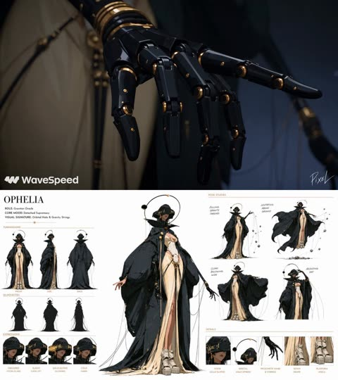</a>

提示词首尾各放一段带明确排除项的绘画风格约束，中间用世界观和角色两个模块锁定外观。三十秒切成十个三秒镜头，每个镜头标明景别，从微距细节一路推到英雄定格。用 GPT Image 2.5 生成的角色设定图作为形象参考。

Seedance 2.5 · 参考生视频 · 出处: [@itsPixieVerse on X](https://x.com/itsPixieVerse/status/2099712704940568739) · 1,127 赞，统计于 2026-10-27

[`painterly-animation`](pages/zh/tags.md#tag-painterly-animation) [`multi-shot`](pages/zh/tags.md#tag-multi-shot) [`character-sheet`](pages/zh/tags.md#tag-character-sheet) [`sci-fi`](pages/zh/tags.md#tag-sci-fi) [`30-seconds`](pages/zh/tags.md#tag-30-seconds)

<details><summary><b>提示词</b></summary>

```text
Cinematic 2.5D animation in painterly rendering, gouache concept art in motion, visible brush textures, flat posterized color blocks, matte finish, soft volumetric lighting. NOT flat 2D cartoon, NO outlines, NOT glossy CGI, NO photorealism.

WORLD: Shattered zero-G celestial observatory overlooking a collapsing golden planetary core, palette of obsidian black, ivory stone, and blinding gold energy, floating cosmic debris.

CHARACTER: Extremely tall adult woman in early 20s, black visor-hat with glowing gold glyphs, floating orbital halo, black prosthetic arms with trailing strings. Massive ballooning obsidian cloak, cream draped gown, platform heels. Elongated tall proportions, supermodel legs, painterly matte skin.

CINEMATIC SHOT DESIGN (10 Filmic Cuts across 30 Seconds):
• SHOT 1 (0–3s | Macro Detail): Macro close-up of Ophelia's black prosthetic fingers twitching; glowing gold gravitational threads unspool into the vacuum.
• SHOT 2 (3–6s | Scale & Threat): Wide shot of the dying planetary core cracking in half, blasting shockwaves of golden light through floating ivory pillars.
• SHOT 3 (6–9s | Character Entrance): Low-angle tracking shot as Ophelia glides weightlessly into the abyss, her massive obsidian cloak ballooning around her like a cosmic void.
• SHOT 4 (9–12s | Expression Focus): Close-up on her face under the visor; the gold glyphs flare brightly as she tilts her head in absolute, chilling composure.
• SHOT 5 (12–15s | Casting the Strings): Medium shot; Ophelia sweeps both mechanical hands outward, casting hundreds of glowing gold puppet strings across the entire starfield.
• SHOT 6 (15–18s | Reality Pull): Dynamic wide shot; she violently pulls the strings taut, arresting the collapse of the planet and dragging the colossal burning fragments back together.
• SHOT 7 (18–21s | High-Speed Tracking): FPV tracking shot swooping past floating debris as the planetary fragments collide and fuse into a newly ignited miniature golden sun.
• SHOT 8 (21–24s | Power Apex): Medium shot; Ophelia rotates her mechanical wrists, the floating orbital halo around her head spinning rapidly and locking the new star into orbit behind her.
• SHOT 9 (24–27s | Aftermath Echo): Extreme wide shot; the restored golden star illuminates the massive expanse, Ophelia silhouetted dead-center as the master of the cosmos.
• SHOT 10 (27–30s | Hero Poster Frame): Low-angle hero shot; Ophelia lowers her hands, gravity strings dissolving into gold dust, her massive black mantle settling around her towering silhouette. Hold final frame.
Weighty natural animation, zero-G fabric motion, 24fps filmic motion, shallow depth of field.  NOT flat 2D cartoon, no bold outlines, not glossy CGI, no photorealism.
```

</details>

<a id="seedance-cottage-pet-dragon-roast-short-film"></a>
### 少女与宠物飞龙一起烤肉的奇幻短片

<a href="https://x.com/Alina_with_Ai/status/2109224200217198796">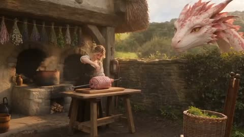</a>

按秒划分的分镜从全景推到特写，在30秒内走完从喷火闯祸到温柔原谅的完整喜剧弧线。两位主角各有一份外观设定，再加场景清单和单独的音效行（火焰、蒸汽、龙的低吼），保证画面与声音前后一致。

Seedance 2.5 · 文生视频 · 出处: [@Alina_with_Ai on X](https://x.com/Alina_with_Ai/status/2109224200217198796) · 1,043 赞，统计于 2026-10-27

[`fantasy`](pages/zh/tags.md#tag-fantasy) [`dragon`](pages/zh/tags.md#tag-dragon) [`short-film`](pages/zh/tags.md#tag-short-film) [`multi-shot`](pages/zh/tags.md#tag-multi-shot) [`audio`](pages/zh/tags.md#tag-audio)

<details><summary><b>提示词</b></summary>

```text
Cinematic 16:9 fantasy short film, 30 seconds, 30fps, photorealistic, warm golden-hour light, rich film color grading, shallow depth of field, smooth camera, natural motion blur, heartwarming comedy tone.

Characters:
1) A young woman with messy wavy blonde hair, thin round glasses, a linen cream blouse with rolled sleeves and a dark brown pinafore apron dress. Expressive, funny, warm face.
2) Her pet baby dragon: a huge, friendly, horse-sized dragon with white-cream scales covered in pink-magenta patterns, a crest of soft pink spikes, big amber eyes with vertical pupils, a gentle snout. It acts like a naughty, affectionate puppy.

Setting: a rustic medieval cottage courtyard and kitchen: a stone oven, a wooden table, hanging lavender and herbs, stacked firewood, a low stone wall, green hills in the background. Later, the warm inside of the cottage with a wooden table, a candle, pots on shelves, and sunbeams through a small window.

0-3s: Wide shot, courtyard. The woman turns a big pink raw pork roast on a metal spit over the table. The dragon's head peeks over the stone wall on the right, watching curiously. She talks to the dragon, laughing, asking it for just "a little fire".
3-5s: Extreme close-up of the dragon's scaly snout and nostrils, then a close-up of her smiling face, laughing and confident.
5-7.5s: The dragon opens its mouth and unleashes a huge blast of fire at the roast, flames and sparks everywhere. She throws her hands up in panic.
7.5-10s: Extreme close-ups of her shocked face, wide eyes, hair blown by the heat, hands raised, shouting "No, no, no!". Cut to the roast, completely burnt black and surrounded by flames.
10-12s: She grabs a wooden bucket and throws water on the fire, a giant cloud of steam rises. The dragon laughs with its mouth open, tongue out.
12-15s: Steam clears. She stands with her arms out, scolding the dragon like a child. The dragon lowers its head with guilty puppy eyes, and she gently touches its snout, forgiving it.
15-18s: Cut to the cozy kitchen. She wipes her forehead, then cuts a small piece of fresh meat and puts it on a tiny skewer, calmly explaining to the dragon how little fire is needed. The dragon leans in beside her.
18-21s: Close-up: she holds the skewered meat cube. The dragon carefully breathes a tiny, gentle flame, and the meat sizzles with small sparks. She smiles proudly.
21-23s: Extreme close-up: the perfectly seared meat cube on the skewer, in front of the dragon's amber eye, a reflection of tiny fire in its vertical pupil.
23-26s: She sits at the table with a plate of cooked meat, cuts a piece, tastes it with a delighted face and gives a thumbs-up. She feeds a piece to the dragon, who opens its mouth happily.
26-30s: Wide, warm shot of the cottage interior, golden sunbeam through the window, a candle on the table. She eats while the dragon rests its big head on the table next to her, its eyes slowly closing in contentment, its body curled behind. Peaceful, heartwarming final frame, hold.

Style: Pixar-quality emotional storytelling with photorealistic detail, warm golden and orange tones, soft volumetric light, steam and sparks, cinematic grading.

Audio: gentle fantasy folk music (soft strings and flute), crackling fire and a whoosh on the fire blasts, steam hiss, a deep playful dragon rumble and purr, her laughter and short dialogue, light kitchen sounds.
```

</details>

**[全部 82 条](pages/zh/video-scifi-fantasy.md)**

<a id="vid-anime"></a>
## 动漫与动画

<a id="seedance-katsudon-anime-cooking"></a>
### 快剪动画风格做猪排饭

<a href="https://x.com/Goodmanprotocol/status/2098845134326808734"></a>

开头明确禁止模仿任何现有动画，再一步步写菜谱，让每个镜头都有事做。

Seedance 2.5 · 文生视频 · 出处: [@Goodmanprotocol on X](https://x.com/Goodmanprotocol/status/2098845134326808734) · 4,935 赞，统计于 2026-10-27

[`anime`](pages/zh/tags.md#tag-anime) [`food`](pages/zh/tags.md#tag-food) [`fast-cut`](pages/zh/tags.md#tag-fast-cut)

<details><summary><b>提示词</b></summary>

```text
Create a 30-second fast-paced cinematic Japanese anime cooking video showing the preparation of authentic katsudon, entirely from the text description below.

IMPORTANT: Do not display, recreate, trace, reference, or imitate any storyboard, sketch, reference image, panel, annotation, or source material. Generate only original anime-style animation.

STYLE

High-quality Japanese anime film style, cinematic summer lighting, ultra-detailed food textures, realistic cooking physics, visible steam and moisture, shallow depth of field, macro close-ups, smooth camera movement, warm Japanese kitchen atmosphere. Fast rhythmic editing with natural match cuts based on movement, shape, texture, and composition.

TIMELINE

0–2.5s — Prepare Pork
Close-up of hands pounding a thick pork loin with a wooden mallet on a cutting board. The meat gradually flattens and its fibers loosen. Sprinkle salt and pepper evenly. Crisp rhythmic impacts.

2.5–5s — Bread the Pork
Quick match cuts: press the pork into flour, dip into beaten egg, then firmly coat with coarse panko breadcrumbs. Show realistic egg dripping and breadcrumbs adhering to the surface.

5–7.5s — Fry
Lower the breaded pork into hot golden oil. Intense bubbling surrounds the cutlet as the crust turns golden brown and crispy. Warm cinematic lighting and detailed oil movement.

7.5–9.5s — Slice
Place the fried tonkatsu on a wooden board. A sharp knife cuts it into even strips. The crispy crust cracks naturally, revealing juicy white pork with gentle steam escaping.

9.5–12s — Simmer Dashi & Onion
Thinly sliced onions gently simmer in amber dashi inside a shallow pan. Small bubbles rise while the onions become translucent. Chopsticks gently move them through the broth.

12–14s — Add Tonkatsu
Place the sliced tonkatsu carefully over the simmering onions using chopsticks. The broth begins soaking into the crispy edges while steam rises.

14–16.5s — Pour Egg
Slowly pour beaten golden egg over the tonkatsu and onions. The egg spreads naturally through the gaps and begins setting around the hot edges.

16.5–19s — Set the Egg
Close-up of the egg gently coagulating over low heat. Edges become soft and golden while the center remains glossy, slightly runny, and trembling. No stirring.

19–21s — Prepare Rice
A white ceramic donburi bowl receives a generous mound of steaming Japanese short-grain rice. The rice looks fluffy and slightly glossy.

21–24s — Assemble
Carefully slide the egg-and-tonkatsu mixture from the pan onto the rice. The egg settles naturally in a soft wave while dashi lightly absorbs into the rice.

24–26s — Final Close-Up
The finished katsudon rests on the counter. Glossy egg slowly settles over the tonkatsu and rice, gently trembling. Slow cinematic push-in.

26–30s — Hero Reveal
Present the finished katsudon in a traditional blue-and-white ceramic bowl on a wooden surface. Golden egg covers crispy tonkatsu over glossy rice, topped with fresh mitsuba. Steam rises as the camera slowly arcs around the bowl for a beautiful anime-food-film ending.

AUDIO

Bright 1980s-inspired Japanese city-pop instrumental, 110–120 BPM, with subtle koto and light chime percussion. Synchronize realistic ASMR cooking sounds: mallet impacts, knife slicing, frying sizzle, bubbling dashi, chopsticks, egg pouring, steam, and a soft ceramic clink.

End with one delicate wind-chime tone during the final reveal.

NEGATIVE

No storyboard, reference image, sketch, panels, borders, numbers, arrows, annotations, subtitles, captions, UI, logos, or text overlays. No unrelated ingredients or dishes. Katsudon only. Keep the food, hands, utensils, lighting, and environment visually consistent throughout.
```

</details>

<a id="h3-rem-desktop-icons-maid-mishap"></a>
### 蕾姆把掉落的桌面图标捡回原位

<a href="https://x.com/Mayz1169/status/2100932191316557922"></a>

用参考图锁定为精确首帧，再配上逐秒分镜，让桌面布局和角色形象保持不变，同时图标随裙摆产生互动。明确只有左侧图标可以与角色和背景互动，并禁止镜头运动与切换，避免画面漂移。

MiniMax H3 · 图生视频 · 出处: [@Mayz1169 on X](https://x.com/Mayz1169/status/2100932191316557922) · 1,806 赞，统计于 2026-10-29

[`anime`](pages/zh/tags.md#tag-anime) [`desktop-animation`](pages/zh/tags.md#tag-desktop-animation) [`timed-beats`](pages/zh/tags.md#tag-timed-beats) [`sound-design`](pages/zh/tags.md#tag-sound-design)

<details><summary><b>提示词</b></summary>

```text
Use the reference image as the exact first frame. 16:9, locked-off camera, one continuous take. Preserve Rem’s face, short blue hair, black-and-white maid outfit, and original anime art style consistently throughout. Keep the desktop layout and Japanese menu bar unchanged.

0–2s: Rem stands on the right, happily swaying gently from side to side while lifting the edges of her skirt slightly with both hands. As she turns, the hem accidentally catches the blue-purple desktop background. The background reacts like a soft fabric curtain, sending a horizontal ripple across the screen. The two folders and one screenshot icon on the left wobble, slide downward, fall to the bottom edge of the screen, and make a small playful bounce on impact.

2–3s: Rem immediately freezes. Her eyes widen and she quickly covers her mouth with both hands, staring in surprise at the fallen icons.

3–6s: She hurriedly leans toward the left and reaches out with both hands. She scoops up all three icons together and quickly pushes them back toward their original positions on the left. The icons behave like thin, lightweight magnetic tiles, snapping back onto the desktop surface. Two of them end up slightly crooked. Rem has no time to straighten them and quickly pulls her hands back.

6–8s: Rem returns to her original position on the right, folds her hands neatly in front of her, and tries to put on an innocent, nothing-happened smile. Her eyes secretly glance toward the two crooked icons on the left. The tips of her hair, hair ribbon, and skirt hem move gently in a light breeze. The desktop background settles completely, while the two icons remain slightly tilted for a subtle comedic ending.

The background music begins with a light, cute Japanese-style piano melody. When the icons fall, add a short descending slide sound and light impact sounds, then shift into a playful pizzicato rhythm.

Keep all movement fluid and expressions lively. Only the three desktop icons on the left may physically interact with Rem or the background. The top menu bar and bottom Dock must remain completely fixed. Preserve the original icon designs, filenames, and text exactly. No new characters. No camera movement, zoom, cuts, or transitions.
```

</details>

<a id="seedance-anime-frame-break-letterbox-pop-out"></a>
### 动漫角色的手伸出黑色上下遮幅

<a href="https://x.com/aimikoda/status/2106044483863191748"></a>

提示词写明从后到前的合成顺序（背景、黑色遮幅、角色），让前景角色盖住固定不动的黑边。固定广角镜头、开场直扑镜头的动作，以及结尾不得把角色裁在画面窗口内的要求，让出框效果反复出现。黑边的大小在不同生成之间仍会变化。

Seedance 2.5 · 参考生视频 · 出处: [@aimikoda on X](https://x.com/aimikoda/status/2106044483863191748) · 1,675 赞，统计于 2026-10-27

[`frame-break`](pages/zh/tags.md#tag-frame-break) [`letterbox`](pages/zh/tags.md#tag-letterbox) [`anime`](pages/zh/tags.md#tag-anime) [`pop-out`](pages/zh/tags.md#tag-pop-out) [`character-reference`](pages/zh/tags.md#tag-character-reference)

<details><summary><b>提示词</b></summary>

```text
Use @[char ref]as the exact character and style reference. Preserve her white hair, red eyes, oversized black cropped top, long cream skirt with orange lining, bare feet and single slender sword. Keep the same angular painterly anime rendering.

MAIN VISUAL GOAL: an unmistakable OUT-OF-FRAME, POP-OUT effect. The character repeatedly projects beyond the central picture window, with her sword, hands, hair and especially her wide skirt visibly moving OVER the black letterbox bars toward the viewer.

COMPOSITING ORDER, BACK TO FRONT:
1. Background and scene.
2. Two broad black letterbox bars at the top and bottom.
3. The foreground character, including her sword, hair and flowing skirt.

The background is confined to the central picture window. The foreground character is NOT confined to that window. Her silhouette continues uninterrupted across its boundaries and onto the black bars. Cream fabric, orange lining, white hair and the silver blade remain fully visible when overlapping black.

Keep both bars equal in thickness and fixed in screen position throughout. The character covers them temporarily without moving or changing them. Keep sections of black visible beside each overlap so the frame-break illusion remains clear.

The camera stays stationary with a fixed wide-angle lens. The character moves rapidly through depth, creating extreme foreshortening and dramatic scale changes through physical approaches and retreats.

OPENING:
Start immediately with a powerful forward lunge. Her sword hand projects toward the lens and overlaps the lower black bar. At the same time, the nearest cream skirt folds spill across that bar. Establish the frame-break effect clearly in the very first movement.

CHOREOGRAPHY:
She pulls back into the central window, then snaps into a fast turning advance. Her skirt fans outward in a huge cream sweep, crossing the bottom boundary and spreading over the black surface. The orange lining flips into view along the moving hem. Her waist and torso remain inside the central window while the nearest fabric extends outside it.

Reverse the rotation sharply into an upward sword flourish. The blade crosses onto the upper black bar, followed by flying strands of white hair. She immediately drives forward again, bringing her hand and blade extremely close to the viewer.

Chain rapid fencing lunges, spinning evasions, low sweeping turns and short twisting leaps. Repeatedly move from the depth of the central scene into extreme foreground space. Alternate sword-and-hair overlaps across the upper bar with large skirt-and-hand overlaps across the lower bar.

Give the skirt substantial momentum: it follows her hips, overtakes her during abrupt stops and lashes around her during reversals. Show broad cream folds sweeping across black, not merely touching the border. Keep the fabric naturally attached to her waist.

Include a close spinning pass where the skirt occupies a large portion of the lower black bar while her sword cuts diagonally across the upper bar. Her face remains readable between them.

FINISH:
A final explosive lunge brings the sword toward the lens as the skirt billows across the lower bar. Resolve into a confident fencing pose with the blade and cream hem still visibly extending beyond the central picture window.

Prioritize visible foreground overlap throughout. Do not crop the entire character inside the letterbox window. Do not replace the effect with simple zooming or a character moving behind black bars.

Fast, forceful motion with crisp silhouettes and brief directional smears. No slow motion, camera movement, duplicated weapons, cloth morphing, text or background music.

---

Prompt for the second one:

Use @[char ref]as the exact reference for the character and visual style. Preserve her blonde hair, small crown, orange puff-sleeved dress, cream skirt panels, slender sword and elongated proportions. Maintain the same flat painterly anime aesthetic, rough ink contours, dry-brush textures, graphic silhouettes and restricted orange, cream, yellow and charcoal palette.

Create an explosive, high-speed sword performance built around a strong FRAME-BREAK EFFECT. Solid black horizontal bars occupy the top and bottom 15% of the output throughout the entire shot. These bars remain perfectly fixed to the screen while the camera moves inside the central image window.

CRITICAL COMPOSITING RULE: the environment stays behind the black bars. Selected foreground parts of the character render IN FRONT OF the bars, visibly covering their black surface with her original colors. Her sword, hands, crown, hair and flaring skirt repeatedly cross the inner edges and overlap the bars. Do not crop these foreground elements at the inner frame boundary. The bars remain intact beneath them. This must read as the character physically bursting out of the framed image toward the viewer.

Start immediately in motion. She launches straight toward the lens and thrusts her sword past it, the sharply foreshortened blade growing enormous in the foreground and extending across the lower black bar. The camera recoils and banks sideways as her hand and orange sleeve sweep through the same foreground space.

She snaps into a full-body corkscrew turn, pulling the sword around her waist before whipping it upward. The blade crosses the upper black bar, followed by her crown and flying blonde hair. Her cream-and-orange skirt fans outward in a huge rotating arc, spilling over the lower bar while her torso remains inside the central window.

Chain rapid thrusts, reverse-grip transitions, overhead cuts and tight spinning combinations without pauses. Alternate deep retreats into the scene with sudden lunges directly toward the viewer. Every return creates a new frame-breaking overlap: a sword tip punching toward the lens, a hand reaching beyond the lower border, an orange sleeve flashing across the upper border, a cream skirt panel sweeping across the bottom.

Use aggressive wide-angle perspective and dramatic changes in depth. The camera darts backward ahead of her charge, arcs close around her sword arm, drops below an airborne turn and whips back toward her face. Keep the camera reactive and fluid in one continuous shot. No top-down angles. Keep the black bars screen-locked during every camera roll, orbit and recoil.

Make each near-lens pass feel dangerously close, with strong parallax, brief directional smears and crisp readable silhouettes at the peak of each movement. Her face stays consistent and expressive: fierce concentration with a confident, playful edge. Hair, sleeves and layered skirt react sharply to acceleration.

Finish with one final forward burst. She drives the sword diagonally past the lens, its blade spanning the lower black bar while her crown overlaps the upper bar. Resolve directly into a striking extended fencing pose, close to the viewer, with fabric still whipping around her.

Full-speed action throughout. No slow motion, frozen midair poses or gentle floating. No extra weapons, duplicated limbs, costume changes or transformation into 3D. Sword whooshes, sharp fabric snaps and forceful air rushes only. No background music, dialogue or text.

---

Prompt for this one:

Use @[char ref]as the exact character and style reference. Preserve her black hair and braids, oversized blue hooded jacket with cream graphics and orange trim, white cropped top, layered cream-and-orange pants, orange ribbons and white sneakers with black stripes and orange panels. Preserve her single sword with its black wrapped handle, gold guard and red tassel. Keep the same angular painterly anime rendering and blue background.

MAIN VISUAL GOAL:
An unmistakable OUT-OF-FRAME, POP-OUT effect. The character repeatedly projects beyond the central picture window, with her sword, hands, sneakers, hair and loose clothing visibly moving OVER the black letterbox bars toward the viewer.

COMPOSITING ORDER, BACK TO FRONT:
1. Background and scene.
2. Two broad black letterbox bars at the top and bottom.
3. The foreground character, including her sword, hands, sneakers and clothing.

The background is confined to the central picture window. The foreground character is NOT confined to that window. Her silhouette continues uninterrupted across its boundaries and onto the black bars. Blue sleeves, cream fabric, orange panels, sneakers and the silver blade remain fully visible when overlapping black.

STATIC BARS, MOVING CHARACTER:
Both bars are completely static screen graphics. Keep their equal thickness, full width and exact screen position unchanged throughout. Their inner boundaries remain perfectly straight and horizontal.

The character simply renders in front of them. Her movement temporarily hides portions of their black surface. The underlying bars never move or deform. Visible edge segments on either side of an overlap remain aligned on the same horizontal line. When she withdraws a limb, reveal the original unchanged black bar beneath it.

Keep black visible beside the overlapping body parts. No bending, sliding, shaking, stretching, opening or impact reactions in the bars.

The camera stays stationary with a fixed wide-angle lens. One continuous shot. She stays close and large in the composition, using short forward approaches, lateral pivots and compact recoveries. Never retreat deep into the background.

OPENING:
Already close to the viewer, she reaches toward the lens with her EMPTY hand while retaining the sword in her other hand.

Her fingertips visibly overlap the upper black bar. She makes one brisk diagonal lens-wiping gesture with her open palm, passing across the center and over the lower black bar. The hand and sleeve appear in front of both bars during the gesture. The bars remain unchanged beneath them.

The instant her palm clears the lens, she snaps into fast action without a pause.

CHOREOGRAPHY:
A diagonal sword slash passes close to the lens and visibly extends over the upper black bar. Reverse immediately into a tight turning cut. Her blue sleeve and loose cream-and-orange fabric sweep across the lower black surface.

She chambers a knee and fires a sharp FRONT KICK toward the viewer. The sneaker sole becomes large in the foreground and clearly overlaps the lower black bar, with black still visible beside it. Her shin connects continuously back to her body inside the central window. Retract immediately.

Plant the foot and pivot into a fast sword flourish crossing the upper bar. Continue into a compact SPINNING HEEL KICK. The sneaker sweeps close past the lens, its heel and sole projecting over the lower bar while her jacket and trouser fabric trail behind.

Keep alternating clear close-range overlaps: sword above the upper bar, sneaker over the lower bar, empty hand across a border, blue sleeve and cream fabric sweeping across black. Use fast connected combinations with crisp readable extensions and immediate recoveries.

Her clothing follows her body with strong momentum. Preserve the garment construction, patterned orange sections and cream folds. Fabric stays attached naturally and visibly covers the black surface without affecting its straight boundaries.

FINISH:
A final close-range sword extension crosses the upper black bar as her loose clothing flares over the lower bar. Resolve sharply into a confident martial-arts pose, retaining visible foreground overlap and quick natural follow-through.

The frame-break effect must come from the character visibly covering black areas outside the central picture window. Do not keep her entirely behind the bars. Do not simulate the effect by moving the bars or enlarging the window.

Fast real-time movement throughout, including the opening wipe. No slow motion, speed ramps, long windups or floating pauses. No camera movement, duplicated limbs or weapons, clothing morphing, text or background music. Sword whooshes, kick air bursts and fabric snaps only.
```

</details>

<a id="h3-grid-storyboard-anime-park-run"></a>
### 动漫少年在公园奔跑时回头

<a href="https://x.com/8co28/status/2099171324568760589"></a>

把3x3分格图作为参考图，提示词要求镜头从第一格依次切到最后一格，成片几乎按分镜原样播放。明确禁止多格同屏和背景音乐，让每个镜头铺满画面且声音干净。

MiniMax H3 · 参考生视频 · 出处: [@8co28 on X](https://x.com/8co28/status/2099171324568760589) · 1,599 赞，统计于 2026-10-28

[`storyboard`](pages/zh/tags.md#tag-storyboard) [`anime`](pages/zh/tags.md#tag-anime) [`2d-animation`](pages/zh/tags.md#tag-2d-animation) [`grid-reference`](pages/zh/tags.md#tag-grid-reference) [`multi-shot`](pages/zh/tags.md#tag-multi-shot)

<details><summary><b>提示词</b></summary>

```text
When you take this 3x3 image and turn it into an AI video with r2v, it will roughly become the footage as-is with the following settings:

Minimax H3 Max r2v 480p 15 seconds Prompt adjustment: Quality Reference strength: Standard
"A 2D animation where the cut switches from the top-left panel to the bottom-right panel,
No multiple panels allowed, No BGM"
```

</details>

**[全部 76 条](pages/zh/video-anime.md)**

<a id="vid-commercial"></a>
## 广告与产品

<a id="kling-vintage-watch-macro"></a>
### 指尖捏着复古腕表的微距镜头

<a href="https://x.com/higgsfield_ai/status/2019088049448362164"></a>

提示词用英寸级机位距离，并列出灰尘、细划痕、包浆等具体表面细节，让模型稳住质感。单一暖色侧掠光、浅景深，加上只有秒针这一处微动，画面不易闪烁或崩坏。

Kling 3.0 · 文生视频 · 出处: [@higgsfield_ai on X](https://x.com/higgsfield_ai/status/2019088049448362164) · 2,534 赞，统计于 2026-10-27

[`macro`](pages/zh/tags.md#tag-macro) [`product-shot`](pages/zh/tags.md#tag-product-shot) [`shallow-depth-of-field`](pages/zh/tags.md#tag-shallow-depth-of-field) [`moody-lighting`](pages/zh/tags.md#tag-moody-lighting) [`cinematic`](pages/zh/tags.md#tag-cinematic)

<details><summary><b>提示词</b></summary>

```text
Ultra-realistic cinematic macro shot of a vintage wristwatch held between two fingers, extreme close-up framing focused on the watch face and crystal, with the camera positioned inches away to reveal fine dust particles, micro scratches on the glass, worn metal edges, engraved numerals, and subtle patina on the hands. Shallow depth of field isolates the dial while the background dissolves into soft, dark bokeh. The lighting is moody and directional, a single warm key light grazing the surface to create delicate reflections along the curved crystal and metallic rim, emphasizing texture and age. The second hand moves subtly, creating a sense of quiet tension and time passing. Skin texture of the fingers is visible at the edges of the frame, slightly out of focus, adding scale and realism. High contrast, cinematic color grading, soft film grain, precise focus breathing, and a tactile, intimate macro perspective that feels handcrafted and timeless.
```

</details>

<a id="kling-turntable-needle-macro-pushin"></a>
### 唱机推镜至唱针微距

<a href="https://x.com/higgsfield_ai/status/2019101323317375400"></a>

以给定画面为起始帧，一镜到底。刚性螺栓固定式推镜锁定唱针尖，并列出微距细节、主导音效和明确的镜头规则。

Kling 3.0 · 图生视频 · 出处: [@higgsfield_ai on X](https://x.com/higgsfield_ai/status/2019101323317375400) · 2,357 赞，统计于 2026-10-27

[`macro`](pages/zh/tags.md#tag-macro) [`single-take`](pages/zh/tags.md#tag-single-take) [`sound-design`](pages/zh/tags.md#tag-sound-design) [`push-in`](pages/zh/tags.md#tag-push-in) [`analog`](pages/zh/tags.md#tag-analog)

<details><summary><b>提示词</b></summary>

```text
Use the provided image as the exact starting frame.
Cinematic video, single continuous shot, duration 5–7 seconds.
Single take. No cuts. No transitions.
CAMERA & ACTION (CONTINUOUS MOTION)
The camera starts static, framing a turntable in warm analog studio light.
A human hand lowers the tonearm onto a spinning vinyl record.
The record begins rotating smoothly. Immediately after contact, the camera accelerates forward in one continuous movement, a fast, rigid robot-bolt push-in directly toward the stylus needle. No easing. No cinematic zoom. Pure mechanical forward motion. As the camera reaches extreme macro distance, it locks onto the needle tip, as if physically bolted to it, without any cut. From this moment on, the camera moves together with the needle, perfectly synchronized.

MACRO DETAIL (SAME SHOT)
Extreme macro view shows:
Stylus tip vibrating microscopically
Vinyl grooves flowing beneath
Dust particles, micro scratches, groove texture
Subtle vertical and lateral needle movement, physically accurate
The camera remains rigidly attached, only tiny micro-vibrations from groove friction.

SOUND DESIGN (DOMINANT, CONTINUOUS)
Sound is uninterrupted and dominant:
Needle drop click
Loud, authentic vinyl crackle and hiss
Stylus-on-groove friction
Low mechanical hum of the turntable
No music clarity at first — raw analog texture only.
No score. No digital effects.

VISUAL STYLE
Extreme macro cinematography
Ultra-shallow depth of field
Warm analog color grading
Natural reflections on vinyl
Subtle film grain

CAMERA RULES
One continuous take
No cuts, no edits, no montage
No handheld shake
No floating camera
Robo-cam, bolt-mounted feel only

END FRAME
Camera stays locked to the needle,
vinyl spinning endlessly beneath it,
hypnotic, mechanical, intimate.
```

</details>

<a id="seedance-woman-in-storm-crowd"></a>
### 人群齐动，她一动不动

<a href="https://x.com/AIwithkhan/status/2099707375943066094"></a>

上传的图锁定人物、人群和构图，文字只管动作和禁止项。

Seedance 2.5 · 参考生视频 · 出处: [@AIwithkhan on X](https://x.com/AIwithkhan/status/2099707375943066094) · 2,128 赞，统计于 2026-10-27

[`fashion`](pages/zh/tags.md#tag-fashion) [`crowd`](pages/zh/tags.md#tag-crowd) [`reference-images`](pages/zh/tags.md#tag-reference-images)

<details><summary><b>提示词</b></summary>

```text
Create a ultra-realistic cinematic fashion video using the uploaded images as exact visual references for the woman, crowd, wardrobe, framing, and atmosphere.
A young woman with the same short dark bob wears a fitted black turtleneck, black trousers, and black shoes, standing confidently at the center of a large crowd.
Start with her walking slowly toward the middle of the crowd, calm and expressionless, with a lit cigarette naturally held between her lips.
She reaches the center, stops, and faces directly into the camera.
She takes one slow drag from the cigarette, then removes it from her mouth.
She slowly exhales a visible stream of smoke toward the camera, with the smoke naturally drifting across her face.
She lowers her hand and becomes completely still, staring directly into the lens.
The entire crowd behind her remains frozen for a brief moment.
Suddenly, everyone behind her begins moving in perfect synchronization — sharp head turns, shoulder jerks, folding forward and snapping upright.
The movement should feel rhythmic, strange, powerful, and physically realistic.
The woman does not move at all while the entire crowd moves behind her.
Slowly push the camera closer to her, keeping her sharply focused while the crowd has subtle depth-of-field blur.
Dark, cold, mysterious lighting with deep shadows, realistic skin, hair, clothing, cigarette ember, and physically accurate smoke.
Photorealistic live-action quality, cinematic composition, natural human movement; no animation, CGI look, duplicated woman, distorted bodies, excessive smoke, text, subtitles, or logos.
```

</details>

<a id="wan-fashion-face-closeup-flash-orbit"></a>
### 带抓拍闪光的超近景时尚人像

<a href="https://x.com/leaf_sanren/status/2105645639703183753"></a>

提示词把15秒拆成五个时间段，每段写明运镜、眼神和闪光时机。同时列出真实的皮肤瑕疵并禁止塑料感，让人脸保持摄影质感。

Wan 3.0 · 文生视频 · 出处: [@leaf_sanren on X](https://x.com/leaf_sanren/status/2105645639703183753) · 1,439 赞，统计于 2026-10-27

[`portrait`](pages/zh/tags.md#tag-portrait) [`fashion`](pages/zh/tags.md#tag-fashion) [`close-up`](pages/zh/tags.md#tag-close-up) [`skin-texture`](pages/zh/tags.md#tag-skin-texture) [`vertical`](pages/zh/tags.md#tag-vertical)

<details><summary><b>提示词</b></summary>

```text
Generate this video: Create a 15-second, 9:16 vertical screen, ultra-high-definition 4K, 30fps, cinematic realistic portrait quality fashion portrait short film.

The main subject of the frame is a young Asian woman around 20-25 years old, with a high-end face—cool with a touch of youthful greenness, delicate features but not overly perfect, smooth facial contours, natural nose bridge, full lips, eyes with depth, overall vibe like a car model or a close-up candid shot by a photographer at a fashion event.
No influencer vibe, no exaggerated plastic surgery face, no plastic skin, no excessive skin smoothing, no overly heavy fake lashes, no exaggerated highlights, no anime feel.
The character's skin must be realistic: clearly visible pores, subtle skin texture, light foundation caking, faint acne marks, very shallow pockmarks, under-eye fine lines, natural contours on nose wings and cheeks, lip lines, a few stray hairs and hair edge wisps. Makeup is refined but imperfect high-end subtle look: base slightly adherent but not flawless, clean eye makeup, naturally realistic lashes, lips with a subtle sheen.
Hair is black or dark brown straight long hair, with natural stray strands and a slight messy feel, not too deliberate.

Scene and Atmosphere

Scene is a high-end fashion event venue / auto show activity area / luxury brand launch event close-up portrait atmosphere, but the background must be blurred, not highlighting specific brands or text. Background can include soft exhibition hall lighting, minimal out-of-focus neon reflections, blurred crowds, blurred car body highlight reflections or metallic texture backgrounds, overall atmosphere high-end, restrained, fashionable.
No subtitles, no stickers, no watermarks, no readable text, no exaggerated effects, no illogical flashy lights.

Lighting Requirements

Lighting must conform to real-world logic, like a real photographer shooting close-up at the event site.
Main light is soft but directional facial key light, coming from slightly off to the front upper side, creating natural facial light and shadow layers.
Fill light is very subtle, retaining some shadows to enhance facial dimensionality.
Environment can include soft cool-toned rim light or auto show site reflection light to make the face more three-dimensional.
Throughout, allow 2 to 3 brief flash occurrences; flashes must feel like natural on-site photography flashes, quickly lighting up only in certain moments, causing temporary enhancement of facial highlights, more obvious pupil catchlights, brighter skin reflections, but no constant strobing, no illogical flashing.
When flashes occur, it should feel like a photographer's candid shot: lights up once and done, realistic light ratios, face not overexposed, skin details still visible.

Camera and Movement (Top-Tier Cinematography)

Overall, use ultra-close portrait movement, with the lens always orbiting the face to highlight eyes, nose bridge, lips, cheeks, hair strands, and skin texture.
Cinematography language is high-end, fluid, restrained, with a fashion ad and backstage photography candid feel.
No heavy shaky cam, no disorienting motion, no exaggerated AI camera moves, no sudden pull-backs.
Movement must feel natural, like a high-end photographer using a handheld gimbal or slight handheld shooting:

0-3 seconds

Lens starts with an ultra-close side-front face push-in, focus on eyes and nose bridge area, subject slightly lifts gaze to lens, natural breathing feel, lips subtly relaxed.
Lens does an extremely subtle slow push-in, with very light lateral sliding, showcasing cheeks, under-eye texture, and hair strands.
This segment should make viewers feel the face's high-end realism right from the first glance.

3-6 seconds

Lens slides along the face from eyes to nose tip, then to near the lips, in an extremely steady micro-arc orbit, close-up observation of features.
Subject's gaze subtly shifts, no exaggerated acting—just gently looks toward lens edge, then slowly back to lens.
First flash can occur here, briefly lighting up to enhance skin texture and lip highlights.

6-9 seconds

Lens slowly turns from front-left to front-right, still maintaining face-push distance, emphasizing cheek skin texture, nose wing details, lower eyelid fine lines, lashes, and pupil reflections.
Subject lightly brushes a bit of hair, or a stray strand naturally falls to the side of the face.
Lens has a subtle breathing-like float for real photography feel, not rigid.

9-12 seconds

Lens subtly shifts down to highlight lips, jawline, and cheeks, then slowly back to eyes.
Subject's expression stays cool, restrained, with a touch of high-end aloofness, like a car model caught close-up by a photographer, occasionally a gentle blink, corners of mouth with extremely subtle relaxation.
Second flash occurs here, natural and instantaneous like on-site candid, returning to normal light after.
Post-flash, catchlights in eyes more prominent, giving the frame more fashion editorial vibe.

12-15 seconds

Lens does one of the most beautiful ultra-close light arc closes, subtly orbiting the face and lightly pushing in, finally settling on an ideal composition of eyes + nose bridge + half lips.
Subject gently lifts gaze to straight-on lens in the last second, eyes clean, calm, captivating.
Ending can have a third very subtle flash or environmental highlight sweep, but must feel natural, not overdone.
Finally holds on a high-end face-push frame perfect for a thumbnail cover.

Frame Style

Overall style is:
Real cinematic fashion portrait, close-up commercial photography, auto show model face-close candid, high-end magazine feel, natural skin texture, non-studio fake-face sense.
Include real lens bokeh, natural depth of field, fine skin quality, subtle on-site feel, restrained high-end vibe.
Not influencer selfie, not live stream, not Korean-style skin smoothing, not low-quality AI face.

Key Emphases

Face must be real, not fake

Skin can't be overly perfect, retain subtle imperfections

Features stable, no distortion

Eyes can't wander, lips can't move randomly

Hair strands must be real, with stray hairs

Flashes must follow real candid logic

Lighting must be real, no random strobing

Camera must be high-end, smooth, cinematic, fashion photography feel

Whole piece centers on "high-end face close-up showcase," no plot, no big movements

Negative Restrictions (Suggest Adding Together)

Negative prompts:
Cartoonish feel, CG feel, plastic skin, excessive smoothing, over-beautification, feature distortion, eye misalignment, skin wax figure feel, overexposure, illogical flash strobing, face shake, low clarity, low-quality hair strands, exaggerated filters, influencer face, overly heavy fake lashes, heavy makeup, shaky lens, limb distortion, cluttered background, readable text, subtitles, stickers, watermarks,
```

</details>

**[全部 124 条](pages/zh/video-commercial.md)**

<a id="vid-dialogue"></a>
## 对白与口播

<a id="seedance-cafe-table-multi-angle-reshoot"></a>
### 咖啡馆桌边讲话重拍成十三个新机位

<a href="https://x.com/Scenario_gg/status/2102365054389899695"></a>

提示词先锁定原视频的表演、音频、光线和节奏，只允许机位与镜头变化，再用带时间码的镜头表逐段设计新机位。逐段标注的说话时间窗、视线规则和空天空规则，让每个新角度的口型同步与背景都保持干净。

Seedance 2.5 · 视频编辑 · 出处: [@Scenario_gg on X](https://x.com/Scenario_gg/status/2102365054389899695) · 3,287 赞，统计于 2026-10-27

[`video-to-video`](pages/zh/tags.md#tag-video-to-video) [`multi-angle`](pages/zh/tags.md#tag-multi-angle) [`camera-plan`](pages/zh/tags.md#tag-camera-plan) [`lip-sync`](pages/zh/tags.md#tag-lip-sync) [`timed-shot-list`](pages/zh/tags.md#tag-timed-shot-list)

<details><summary><b>提示词</b></summary>

```text
Prompt (seedance 2.5 video to video):

ONE FINISHED TAKE, RE-PHOTOGRAPHED


@video1
 is one finished take: a single locked-off wide, 19.53 s, with its original audio, a young man at an outdoor cafe table talking to one camera. Do not restage, re-perform, re-time or reinterpret it. Re-photograph the identical event from thirteen new camera positions, as if thirteen extra cameras had been rolling around him in the same moment. Every output frame shows the same body at the same instant of
@video1
 at the same speed. Output runs the full 19.53 s. Keep the audio of
@video1
 unchanged and in sync.

DO NOT CHANGE
Performance, body, hands and what they hold, head angle, eyeline, lip movement, blink timing, movement speed, action start and end times, lighting, exposure, white balance, colour grade, wardrobe, props, set. The only variable is camera position and lens.

SPEECH WINDOWS (measured from the audio of
@video1
)
SPEAKING: 0.00-1.65, 2.05-4.80, 5.95-6.90, 9.65-11.75, 12.20-12.85, 13.35-13.80, 16.70-16.90, 17.60-18.90.
SILENT, mouth closed and still or chewing: 1.65-2.05, 4.80-5.95, 6.90-9.65 (drinking), 11.75-12.20, 12.85-13.35, 13.80-16.70 (chewing), 16.90-17.60, 18.90-19.55.
Whenever his mouth is visible in a SPEAKING window it moves in lip-sync with the audio of
@video1
. He talks while looking down: from 2.05 to 4.80 his head is down at the laptop and he is speaking. Head down is not silent. Never add speech to a silent window, never mute a speaking one.

EYELINE RULE
He performed to ONE camera, the A-camera: the original locked-off wide, directly in front of him at seated eye level. His eyeline stays on that spot in every shot, apart from the glances down at keyboard, mug and pastry already in
@video1
. He never looks for or turns toward a new camera. From above he reads cap and brow; from the sides, three-quarter or profile; from behind, the back of his head. Single exception: the on-axis shot at 00:01-00:02 sits where the A-camera was, so there alone he looks into the lens.

TEMPO RULE
Real time, 1:1 with
@video1
. No speed ramps, added slow motion, freeze frames or time remaps. Exactly one slowed passage exists, already baked into the source: the pastry at the top of its arc, 12.5-13.55. Reproduce it at the speed it already has, no slower, no longer.

TOSS TIMING
The pastry leaves his fingers at 12.43 and is caught at 13.60: airborne about one second only. Do not stretch, loop or hang the flight. Before 12.43 and after 13.60 it is in his hand.

EMPTY SKY
On every low or upward-tilting shot the sky is plain pale overcast and empty. No skyscrapers, glass towers, solar panels, cranes, birds, aircraft, sun disc, structured clouds, lens flare or signage. Above his head only cream wall, white pillars and flat pale sky.

CAMERA PLAN

[00:00-00:01] High-angle MCU from above and to his right, about 40 degrees down, chest up, slow push-in, 35mm feel, moderate depth of field, cap brim and open gesturing palms, marble edge in the lower foreground. Speaking, reading three-quarter, not to this lens.

[00:01-00:02] ON THE A-CAMERA AXIS. ECU of his face, dead front, seated eye level, 85mm feel, shallow focus, pillars soft cream behind. The one shot where he looks into the lens. Hands drop below frame onto the keyboard; mouth closes at 1.65.

[00:02-00:05] Macro along the MacBook keyboard to his typing fingers, lens centimetres above the keys, razor-thin focus, keycaps sharp, his face soft far behind, head down. Speaking 2.05-4.80: where his mouth shows in the blur it moves with the audio. Fingers lift at 5.0.

[00:05-00:06] Top-down bird's eye straight down over the table, 24mm feel, deep focus, locked off. Marble disc fills frame: open laptop, white mug, financier, his cap at the bottom edge. Right hand crosses to the mug handle.

[00:06-00:07] Lens resting on the marble at table height, 50mm feel. White mug large and sharp in the left foreground; his hand enters from the right, grips the handle, lifts the mug up out of frame. Torso soft behind. Speaking 5.95-6.90.

[00:07-00:09] First-person POV from his seat, ultra-wide 18mm feel, gentle handheld breathing. The mug rim rises into the bottom of frame and tips toward the lens; laptop screen and marble beyond in deep focus. No face; framing dips to the mug, never up. Silent.

[00:09-00:10] Extreme wide, slow dolly out, 24mm feel, deep focus. He is small at his table mid-terrace: cream wall, pillars, concentric-circle mural, taped boxes behind, slatted bench visible. He sets the mug on the marble 9.4-10.0; speech resumes 9.65.

[00:10-00:12] Low and to his left, lens just above the marble, 50mm feel, shallow focus, table edge and mug soft in the near foreground. Right hand reaches out at 10.5 and lifts the golden financier into sharp focus before his left profile. Talking to the A-camera: full profile here.

[00:12-00:14] Low beside him, 35mm feel, slight Dutch. Opens on the pastry in his fingers; at 12.43 it leaves his hand and the camera tilts UP, following it against plain pale overcast sky and the top of a white pillar through the baked-in slow apex 12.5-13.55, then tilts DOWN for the catch at 13.60 into cupped hands, head tipped back, mouth open, then head coming forward.

[00:14-00:15] Behind him, over his right shoulder, 50mm feel, moderate focus. Back of the black Yankees cap and long dark hair fill frame-left; laptop glow and marble past his shoulder. Head settles level, hands bring the pastry toward his mouth. No face. Silent.

[00:15-00:16] ECU on his mouth and jaw, 100mm macro feel, very shallow focus, soft open-sky light. The financier enters from below, he bites, crumbs, the jaw chews. Chewing, not speaking. Nothing above the nose in frame.

[00:16-00:18] Slow orbit from his left toward front, 35mm feel, moderate focus, mural and pillars parallaxing behind, table crossing the foreground. He chews, speaks 16.70-16.90 and from 17.60, open palms, a small shrug. As the orbit nears front his gaze lands near, not into, this moving lens.

[00:18-00:20] Top-down bird's eye straight down over the table, 24mm feel, deep focus, locked off. Hands come down beside the laptop and settle, cap centred, speech ends 18.90, then still. Hold to 19.53.

SET AND SUBJECT CONTINUITY (identical in every shot)
Young man, long dark hair, black short-sleeve button-up shirt with a small chest logo, black New York Yankees baseball cap, grey trousers. Light wood slatted bench, round white marble table, outdoor cafe terrace. On the table: open dark grey MacBook, white mug with a circular graphic, one small golden financier. Behind him: cream wall, white cylindrical pillars, large black-and-white concentric-circle mural, taped cardboard boxes. Soft overcast open-shade daylight, no hard shadows, constant direction and softness. Warm bright grade: cream walls, golden wood, neutral white marble, warm skin, deep neutral blacks. He is alone; no passers-by, no staff.

No on-screen text, captions, subtitles, watermarks or logos beyond the small chest logo and cap emblem already in
@video1
.
```

</details>

<a id="seedance-selfie-skincare-ugc"></a>
### 自拍式护肤品 UGC 广告

<a href="https://x.com/abxxai/status/2095179656802844727"></a>

线程的第三步：人物设定图和产品图作参考，提示词强调 `Not an ad`，换来自拍的真实感。

Seedance 2.5 · 参考生视频 · 出处: [@abxxai on X](https://x.com/abxxai/status/2095179656802844727) · 1,017 赞，统计于 2026-10-27

[`ugc`](pages/zh/tags.md#tag-ugc) [`product-ad`](pages/zh/tags.md#tag-product-ad) [`vertical`](pages/zh/tags.md#tag-vertical) [`reference-images`](pages/zh/tags.md#tag-reference-images)

<details><summary><b>提示词</b></summary>

```text
A 15-second vertical (9:16) ultra-photorealistic close-up vlog clip, filmed on a phone held at arm's length. Not an ad. A girl talking to her own camera at the end of the day, the way people actually film themselves.
TALENT —
Young woman, early-to-mid 20s. Long light-brown hair with soft caramel balayage, middle part, loose undone waves, a few strands stuck to her cheek. Fair-to-light-tan skin with visible freckles across the nose and cheeks, thick natural brows, blue-green eyes, bare face, small blue resin hoop earrings, thin gold chain with a small pearl pendant. Face, freckles, hair and eye color must 100% match the reference. Oversized white linen button-down over a fitted white ribbed top, fully covered, collar slightly crooked, sleeves pushed up.
PRODUCT —
LANEIGE Water Sleeping Mask_EX, 70 ml. Frosted translucent light-blue glass jar, smooth matte cobalt-blue screw lid. Front label reads, in this exact order: "LANEIGE" in wide-spaced capitals, "WATER SLEEPING MASK_EX" below it, then "SLEEPING MICROBIOME" and "BRIGHTENING · HYDRATING · SOFTENING" in smaller pale-yellow type, then "70 ml" at the base. Inside, thick pale mint-blue gel with a wet glossy surface that holds a soft peak. Shape, color, gel texture and all label text must 100% match the reference, correctly spelled, legible whenever in focus.
LOCATION
A villa bedroom at golden hour. Only fragments read in frame because the camera is so tight: white stucco wall, a corner of rumpled white linen bedding, blurred bougainvillea and olive leaves through an open door behind her. The background stays soft and mostly out of focus the entire time.
LIGHTING
One condition, unchanged across all four beats. Low warm sun from frame-left through the open door, roughly 4800K, soft white-wall bounce filling the shadow side of her face. Warm rim on the left edge of her hair and jaw. Slight blown highlight where the sun clips her cheek. No ring light, no fill, no glam lighting.
FRAMING
Close-up throughout. Her face fills most of the frame in every beat, chin to just above the hairline, never wider than upper-chest. The jar enters frame close to her face, never held out toward the lens.
0:00–0:04
Visual: Tight front-camera close-up, slightly below eye level. She's mid-motion already, pushing hair off her face with the back of her wrist. She glances just off-lens, checking her own image, then back. The jar comes up beside her cheek, held low and casual, only the top half in frame, lid already off. A slow exhale through the nose.
Camera: Selfie camera, arm's length, natural handheld drift, one quick autofocus hunt between her face and the jar.
Dialogue: "Okay. Last thing, then bed."
0:04–0:07
Visual: She tips the jar slightly and drags two fingertips through the gel. Macro-tight: her fingertips, the wet mint-blue surface, a fine thread of gel stretching and snapping. The "LANEIGE" and "WATER SLEEPING MASK_EX" lines cross the frame in focus for a beat. Her face stays partly in frame at the edge, out of focus.
Camera: Same front camera pushed in close, shallow focus, rack from the label to the gel on her fingers.
Dialogue: "It's cold, by the way."
0:07–0:11
Visual: Back to her face, closer now. She taps the gel across one cheek, her forehead, her chin, then presses it in flat-palmed, working outward. The gel flashes milky over her skin, then settles clear with a faint sheen. She winces at the cold, blinks it off, keeps going. Freckles, pores and natural under-eye shadows stay visible right through the layer. She's talking while working, not pausing for the line.
Camera: Selfie camera, very close, small handheld corrections, a slow drift as she turns her cheek toward the light.
Dialogue: "Thin layer. You don't wash it off."
0:11–0:15
Visual: Closest framing of the clip. She presses two fingertips against her cheek and lets them lift, feeling the faint tack. Turns her head slowly through the low sun, checking the sheen along her cheekbone, eyes tracking her own reflection in the screen rather than the lens. A short nod. The corner of the blue jar sits soft-focus in the lower frame edge, label partly readable. She reaches to stop the recording and the frame tilts as her hand moves.
Camera: Selfie camera, slow handheld orbit from three-quarter profile to straight-on, ending on her face filling the frame, then a small tilt as she reaches.
Dialogue: "Morning me is gonna be so happy."
PERFORMANCE
End-of-day, low energy, unperformed. She talks the way someone talks while doing something else, lines half-thrown-away, not projected. Micro-behavior carries the beats: a slow blink, a genuine flinch at the cold, a half-smile that arrives late, eyes checking her own reflection instead of the lens, one natural swallow, visible breath, a small unconscious head tilt. No presenter voice, no bright delivery, no exaggerated reactions, no pointing at the product.
VOICE
Soft, slightly flat, close to the mic because the phone is at arm's length. Natural room tone around it. Unhurried, a little tired. Ordinary speaking volume with a touch of breath on the ends of words.
REALISM
Pore-level skin realism: visible pores across the nose and cheeks, fine forehead texture, natural freckling, faint under-eye shadows, a small blemish near the jaw, stray flyaway hairs catching the backlight, vellus hair on the cheek edge. Wet living eyes with catch-lights and natural asymmetric blinking. The gel reads as a real cosmetic layer refracting light on top of her skin, never replacing its texture.
PHYSICS
Gel holds a soft peak on her fingertip and slumps under pressure. Hair moves with real inertia and a few strands fall back across her face. Linen creases and drapes naturally. The jar has real weight and correct contact shadow against her hand. Camera weight shifts naturally with her arm.
CAMERA CHARACTER
Authentic modern smartphone selfie footage. Natural handheld tremor throughout, small framing corrections, quick autofocus hunts, mild wide-angle distortion at close range, natural rolling shutter, real motion blur, slight sensor noise in the shadow side. Never feels stabilized or operated by anyone else.
STYLE
Real personal vlog, iPhone-shot look, high-end photorealistic quality. Warm golden-hour daylight, real ambient evening atmosphere, no retouching, no skin smoothing, no product-hero framing, no before/after transformation, no commercial polish.
OUTPUT SETTINGS
9:16 vertical. 15 seconds. Real-time motion. High-detail photorealistic 8K intent. Natural smartphone motion blur and subtle sensor noise.
POSITIVE LOCKS
 keeps the same face, freckles, hair, earrings, necklace and white linen shirt over white ribbed top in every beat, fully covered throughout.
 stays the same frosted blue jar with matte cobalt lid, correct one-hand size, label text correctly spelled and legible whenever in focus, sharpest in the 0:04–0:07 beat.
Exactly two arms and two hands visible, anatomically correct with five fingers, one hand always holding the phone.
Same room, same wardrobe, same golden-hour lighting from first frame to last.
Close-up framing held throughout, her face dominant in every beat.
Spoken dialogue exactly as written, in order, at the stated timings, with accurate natural lip-sync.
Natural ambient audio only: faint breeze, distant birds, the small click of the lid, room tone. No music, no on-screen text, no captions, no subtitles, no logos other than the product's own packaging.
```

</details>

<a id="h3-joey-chandler-ai-couch-scene"></a>
### 乔伊和钱德勒在中央咖啡馆沙发上喝咖啡

<a href="https://x.com/TechieBySA/status/2084600512180113820">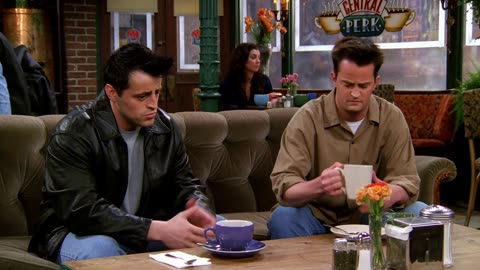</a>

台词按角色名逐行标注，每句之间写明动作和停顿，让模型同时获得节奏和表演提示。风格段落指定年代、稳定的手持镜头质感和表演方式，结尾要求在Chandler的脸上停留一拍再切。

MiniMax H3 · 文生视频 · 出处: [@TechieBySA on X](https://x.com/TechieBySA/status/2084600512180113820) · 755 赞，统计于 2026-10-29 · 发现于 [SkyNotSilent/awesome-MiniMax-H3-cases](https://github.com/SkyNotSilent/awesome-MiniMax-H3-cases)

[`sitcom`](pages/zh/tags.md#tag-sitcom) [`dialogue`](pages/zh/tags.md#tag-dialogue) [`handheld`](pages/zh/tags.md#tag-handheld) [`comedy`](pages/zh/tags.md#tag-comedy)

<details><summary><b>提示词</b></summary>

```text
“Joey and Chandler sit side by side on the couch with coffee cups. Joey turns to Chandler with a completely sincere, concerned expression.

DIALOGUE:

JOEY: “Could AI replace us?”

Chandler slowly looks up from his coffee. Pauses. Looks Joey dead in the eye.

CHANDLER: “Joey, AI cannot replace you. Nothing can replace you.”

Joey nods slowly. Visibly relieved. Processing.

JOEY: “Because I’m too good?”

Chandler stares at him. Long beat. He looks down at his coffee, then back up.

CHANDLER: “…Sure. Let’s go with that.”

STYLE: Warm 90s sitcom aesthetic, steady handheld feel, natural performances, characters in casual clothing. Joey played completely straight — zero irony. Chandler delivers every line with exhausted deadpan sarcasm. Hold on Chandler’s face after the final line for a full beat before cut.”
```

</details>

<a id="h3-barista-latte-art-storyboard"></a>
### 动漫咖啡师按分镜制作拉花拿铁

<a href="https://x.com/aimikoda/status/2090556776156742071">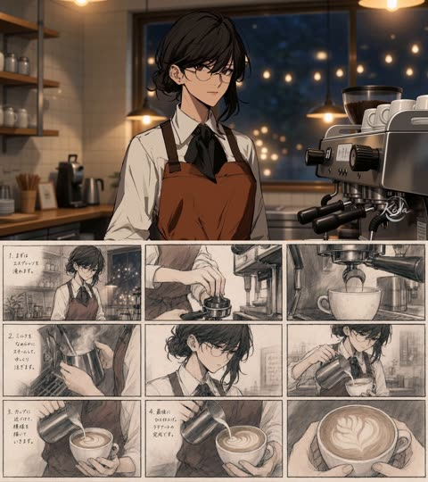</a>

提示词要求模型把分镜当作连续镜头指引，逐格执行，且不写任何场景描述。角色图锁定外观，日语旁白按行列出，使台词与每个分镜节拍对应。

MiniMax H3 · 参考生视频 · 出处: [@aimikoda on X](https://x.com/aimikoda/status/2090556776156742071) · 643 赞，统计于 2026-10-29

[`storyboard`](pages/zh/tags.md#tag-storyboard) [`latte-art`](pages/zh/tags.md#tag-latte-art) [`slice-of-life`](pages/zh/tags.md#tag-slice-of-life) [`character-reference`](pages/zh/tags.md#tag-character-reference)

<details><summary><b>提示词</b></summary>

```text
Create a 16:9, 9-panel storyboard for a quiet slice-of-life anime video about making latte and latte art. The uploaded character should appear throughout the storyboard. Use a basic Japanese animation storyboard sketch style with loose pencil lines, simple shading and cinematic anime compositions. The overall tone should feel intimate, understated and slightly melancholic, with late-evening café lighting, mundane moments made beautiful, subtle expressions, negative space, off-center framing and close-ups of hands, eyes, steam and small gestures. Avoid flashy commercial shots or exaggerated anime reactions. The character should softly talk to themselves while making the latte, with restrained natural body language. The latte design should gradually form but remain unreadable until the very end.
Narration:
まずはエスプレッソを淹れます。
ミルクをなめらかにスチームして、ゆっくり注ぎます。
カップに近づけて、模様を描いていきます。
最後にひと仕上げ。ラテアートの完成です。
```

</details>

**[全部 55 条](pages/zh/video-dialogue.md)**

<a id="vid-music-dance"></a>
## 音乐与舞蹈

<a id="h3-pink-panic-punk-mv"></a>
### 红格靴动漫少女滑入朋克MV画面

<a href="https://x.com/Mayz1169/status/2092937375802609835"></a>

先用参考图锁定角色身份，再逐项写明发色、眼色、发夹、红格靴等细节，确保整段角色不变形。每个时间段都对齐节拍，转场由靴子滑行、跺脚等动作触发，镜头连贯，没有无故切换。

MiniMax H3 · 参考生视频 · 出处: [@Mayz1169 on X](https://x.com/Mayz1169/status/2092937375802609835) · 1,010 赞，统计于 2026-10-29

[`anime`](pages/zh/tags.md#tag-anime) [`pop-punk`](pages/zh/tags.md#tag-pop-punk) [`character-lock`](pages/zh/tags.md#tag-character-lock) [`music-video`](pages/zh/tags.md#tag-music-video)

<details><summary><b>提示词</b></summary>

```text
Create a 15-second horizontal 16:9 high-energy 2D anime pop-punk music video featuring the exact heroine from the provided character reference. The entire sequence should feel like one continuous, tightly choreographed MV passage, with each movement naturally motivating the next transition.  CHARACTER LOCK: Use the reference image as the absolute authority for identity, proportions, outfit, colors and illustration style. Preserve her short messy bubblegum-pink hair with sharp outward tufts, high side ponytail, pale cyan and mint lightning-shaped hair accents, large red cross hair clip with lavender backing, huge yellow eyes with thick dark outlines, small expressive mouth and warm blush.  Keep her black cropped school-style jacket with oversized white cuffs, white shirt, loose bright-red necktie, red plaid mini skirt with white triangular hem accents, black belt, bare legs and enormous red plaid boots with dark straps and heavy rounded soles.  Maintain her original stylized proportions: oversized head, compact torso, long simplified legs, huge boots, chunky hands, bold black outlines, flat saturated colors and minimal cel shading. Her personality is loud, cheeky, rebellious, playful and hyperactive.  0–2.5s — Start immediately with motion. She slides rapidly into frame from the left, one boot skidding across a clean white graphic floor. Her body leans forward from momentum while her ponytail, necktie and oversized cuffs trail behind. She stomps the second boot down, looks up and flashes a mischievous grin. The impact instantly transforms the white background into huge red-and-black plaid blocks as bold “PINK PANIC!” typography slams into the composition.  2.5–5.0s — Without stopping, she rebounds from the landing into a small hop and sharp half-turn. Camera swings around her from front three-quarter view into a fast side-tracking shot as she runs two exaggerated cartoon steps. Her giant boots hit the floor on alternating beats, leaving hand-drawn stars, crosses, tape strips, scribbles and comic impact marks behind each step. Her pink hair and red tie bounce wildly with the movement.  5.0–7.5s — She kicks one leg sideways on the beat and uses the momentum to spin. The red plaid pattern from her boot stretches outward into a giant rotating graphic plane, seamlessly pulling the entire frame into an abstract 2D punk world made from black brush strokes, red plaid, white paper shapes, pink lightning bolts and rough photocopy textures.  She continues directly into a bouncy dance phrase: head whip → shoulder hit → side step → small kick → fast turn. Keep every pose exaggerated and cartoonishly expressive.  7.5–10.0s — Her turn accelerates and the camera follows closely around her. The environment constantly recomposes around the choreography: checker patterns slide sideways, hand-drawn crosses rotate, torn-paper strips snap open and oversized comic typography appears briefly on drum hits.  She lands hard with both boots apart. A huge hand-drawn “BAM!” bursts underneath her feet and physically shakes the surrounding graphic elements. She immediately rebounds upward with a cocky smile rather than holding a static pose.  10.0–12.3s — Follow her continuing movement into a connected sequence of character details. As she whips her head sideways, track past her bright yellow eye → red cross hair clip → swinging pink hair → bouncing red tie → plaid skirt → massive plaid boot.  Do not present these as disconnected beauty shots. Each close-up should be motivated by the same continuous body movement and fast camera travel.  The boot hits the floor at the end of the sequence, sending a red plaid shockwave across the frame.  12.3–15.0s — Ride the plaid shockwave back into a full-body view. She takes two confident bouncing steps forward, abruptly pivots and finishes facing camera with her weight shifted onto one leg, shoulders slightly forward and a cheeky rebellious grin.  Her ponytail and necktie continue swinging from the turn while the background erupts into layered red plaid, black brush X marks, white stars, pink lightning and rough hand-drawn graphics. The elements rapidly organize themselves into a bold 2000s punk magazine-cover composition.  Large “PINK PANIC!” typography appears behind her silhouette on the final beat. End on her strong recognizable character shape without changing her design.  VISUAL STYLE: Strictly match the reference artwork: early-2000s-inspired 2D cartoon/anime aesthetic, thick clean dark outlines, flat saturated colors, minimal cel shading, simplified anatomy, exaggerated proportions and bold graphic expressions. Keep the intentionally handmade TV-animation feeling rather than modern polished anime rendering.  Use red plaid as the main graphic motif, combined with black-and-white manga shapes, pink lightning, crosses, stars, scribbles, torn paper, photocopy grain, tape graphics and rough ink marks.  MOTION: Fast, bouncy and highly rhythmic. Use strong key poses, limited-animation timing, overshoot, smear frames, exaggerated anticipation and cartoon impact frames. Her giant boots should create the strongest beat accents. Hair, ponytail, tie, skirt and cuffs should react continuously to her movement.  Transitions must grow naturally from character actions: boot skid → plaid expansion → kick → rotating graphic plane → spin → camera orbit → stomp → shockwave. Avoid random transitions or disconnected pose montages.  AUDIO: Synchronize tightly to fast Japanese pop-punk vocals mixed with punchy electronic drums and distorted guitar. Add boot skids, stomps, paper snaps, cartoon impacts, guitar hits and short graphic whooshes.  IMPORTANT: Keep the exact face, yellow eyes, pink hairstyle, cyan/mint hair accents, red cross clip, black-and-white school-punk top, red tie, plaid skirt and oversized plaid boots throughout.  No hand reaching toward camera, no palm covering the lens, no pointing into the lens, no outfit transformation, no hairstyle transformation, no extra characters, no realistic environments, no photorealism, no 3D CGI, no modern glossy anime redesign, no cyberpunk holograms, no slow fashion posing, no facial drift, no random accessories, no excessive jump cuts, no disconnected movements, no uncontrolled morphing, no unreadable typography.
```

</details>

<a id="seedance-kpop-two-idol-mv"></a>
### 双人 K-pop MV，逐镜头

<a href="https://x.com/Just_sharon7/status/2083422886686031982"></a>

30 秒 MV 按 2 到 4 秒的时间段排开，在三个布景间来回切。

Seedance 2.5 · 文生视频 · 出处: [@Just_sharon7 on X](https://x.com/Just_sharon7/status/2083422886686031982) · 547 赞，统计于 2026-10-27

[`music-video`](pages/zh/tags.md#tag-music-video) [`dance`](pages/zh/tags.md#tag-dance) [`timed-beats`](pages/zh/tags.md#tag-timed-beats)

<details><summary><b>提示词</b></summary>

```text
30-second ultra-realistic K-pop MV featuring two young East Asian women with flawless synchronization, cinematic lighting, glossy skin, realistic hair and fabric physics, natural body motion, and 4K live-action quality. Vibrant hot pink, electric blue, and silver color palette. 0–2s: Wide shot in a bright circular pink studio with reflective floor. Pink-haired woman (left) and black-haired woman (right) perform energetic opening pose and synchronized dance. 2–4s: Medium close-up of the black-haired woman on a blue spotlight stage, confidently pointing at the camera. 4–6s: Pink-haired woman dances before shimmering blue-silver tinsel curtains, dramatic hair flip and fluid arm movements. 6–8s: Back to the pink studio. Both perform synchronized choreography with sharp arm waves, hip sways, and strong formations. 8–10s: Extreme close-up of both faces against a blue background, glossy makeup, subtle smiles, and direct eye contact. 10–14s: Solo shots at the tinsel backdrop. Pink-haired woman mouths lyrics and gestures confidently, followed by the black-haired woman with relaxed jacket styling. 14–18s: Pink studio. Coordinated jacket choreography, hair flips, powerful synchronized dance, ending hands-on-hips. 18–22s: Glamour close-ups. Black-haired woman under glittering bokeh lights, then pink-haired woman with wind-blown hair against a soft pink background. 22–24s: Blue spotlight stage. Mirrored black-haired performer effect with synchronized spins and flowing hair. 24–26s: Both walk confidently toward the camera in front of shimmering tinsel curtains, reflections visible on the floor. 26–29s: Final synchronized dance and ending pose in the pink circular studio, standing together and looking into the camera. Style: Hyper-realistic live action, Seedance 2.5-quality motion realism, perfect lip sync, natural weight shifts, flowing hair, realistic fabric simulation, polished K-pop music video cinematography.
```

</details>

<a id="kling-neon-nightclub-rain-dance"></a>
### 女子在霓虹夜店与雨中起舞

<a href="https://x.com/CaliraVal/status/2052314090467405869"></a>

提示词在一段话里依次交代人物、服装、场景、霓虹配色和运镜。另附负面词清单，结尾再用一行写明分辨率、帧率和调色，使画面风格保持一致。

Kling 3.0 · 文生视频 · 出处: [@CaliraVal on X](https://x.com/CaliraVal/status/2052314090467405869) · 445 赞，统计于 2026-10-27

[`neon`](pages/zh/tags.md#tag-neon) [`nightclub`](pages/zh/tags.md#tag-nightclub) [`rain`](pages/zh/tags.md#tag-rain) [`slow-motion`](pages/zh/tags.md#tag-slow-motion) [`cinematic`](pages/zh/tags.md#tag-cinematic)

<details><summary><b>提示词</b></summary>

```text
A cinematic ultra-realistic 4K music video scene of a beautiful young woman in a neon-lit nightclub and rainy retro city at night. Vibrant pink, purple, blue, and teal neon lighting creates a dreamy cyberpunk atmosphere. The woman has long wet dark hair, glowing natural makeup, and wears a stylish white top with a dark skirt and black heels. Emotional slow-motion shots of her dancing freely in heavy rain on wet reflective streets, surrounded by colorful neon signs, vintage American cars, retro diners, and blurred nightclub crowds. Smooth cinematic camera tracking, soft bokeh lights, realistic rain effects, glossy pavement reflections, dramatic Hollywood-style lighting, shallow depth of field, sensual emotional mood, highly detailed skin texture, cinematic storytelling, shot on a 35mm film look with premium color grading.

low quality, blurry, distorted face, bad anatomy, extra fingers, extra limbs, cartoon, anime, oversaturated colors, noisy image, watermark, text, duplicate body, unrealistic eyes, glitch, low detail, poorly drawn hands

4K Ultra HD, 16:9 aspect ratio, 24fps, cinematic realism style, smooth slow-motion camera movement, Hollywood lighting, ultra detailed quality, realistic rain simulation, cinematic neon color grading
```

</details>

<a id="h3-industrial-hyperpop-timeline-fashion-dancer"></a>
### 中性舞者逃出玻璃时间轴循环

<a href="https://x.com/lepadphone/status/2084637679254376793"></a>

提示词分成概念、角色、世界规则、视觉语言、动作规则和限制几个标签块，把 160 BPM 的每个鼓点绑定到具体的镜头或空间规则：底鼓压缩时间轴，军鼓复制画面。结尾的禁止项清单锁定人物形象并控制画面文字。

MiniMax H3 · 文生视频 · 出处: [@lepadphone on X](https://x.com/lepadphone/status/2084637679254376793) · 325 赞，统计于 2026-10-28 · 发现于 [SkyNotSilent/awesome-MiniMax-H3-cases](https://github.com/SkyNotSilent/awesome-MiniMax-H3-cases)

[`fashion-commercial`](pages/zh/tags.md#tag-fashion-commercial) [`music-sync`](pages/zh/tags.md#tag-music-sync) [`3d-typography`](pages/zh/tags.md#tag-3d-typography) [`glitch`](pages/zh/tags.md#tag-glitch) [`dance`](pages/zh/tags.md#tag-dance)

<details><summary><b>提示词</b></summary>

```text
[Core Concept]
15s, 160 BPM, 4/4, 40 beats. Industrial Hyperpop × Deconstructed Club: hard kicks, metallic snares, glitch hi-hats, distorted bass, sliced vocals. A timeline-based reality where rhythm controls space and motion.

[Character Identity]
Single androgynous dancer with short black hair, silver eyebrow mark, asymmetric black jacket, wide pants, red stitching. Maintain identical face, body, hairstyle and outfit. Multiple figures are only past-frame projections.

[World Logic]
Each kick compresses the timeline toward the dancer. Each snare duplicates previous movements into adjacent frames. Moving against the timeline transforms the 2D interface into a foldable 3D structure. The dancer escapes the repetition loop.

[Visual Language]
Black, cold white, warning red. Glass timelines, metal rails, glowing frame lines, scanning grids. Extreme wide-angle, low angles, top-down shots, Dutch angles, dolly moves, impossible perspective. 3D words COPY, SAME, TREND, OUTSIDE exist as physical architecture, not subtitles.

[Motion Rules]
Use anticipation → attack → overshoot → settle. Kick drives spatial compression, snare breaks frames, hi-hats animate cursors and fragments, bass bends time. Build with glitch cuts, then explode into an impossible continuous long take during the drop.

[Restrictions]
No character changes, extra people, random text, subtitles, logos, outfit changes, bad anatomy, flat camera angles, or meaningless flashes.
```

</details>

**[全部 45 条](pages/zh/video-music-dance.md)**

<a id="vid-vlog"></a>
## 手机实拍与 Vlog

<a id="seedance-seoul-summer-evening-vlog"></a>
### 首尔夏夜，家庭录像质感

<a href="https://x.com/AIwithkhan/status/2092971211169100048"></a>

纯文字，没有参考图。真实感来自要求小意外和不完美的手持摄像。

Seedance 2.5 · 文生视频 · 出处: [@AIwithkhan on X](https://x.com/AIwithkhan/status/2092971211169100048) · 6,187 赞，统计于 2026-10-27

[`vlog`](pages/zh/tags.md#tag-vlog) [`ugc`](pages/zh/tags.md#tag-ugc) [`realism`](pages/zh/tags.md#tag-realism) [`home-video`](pages/zh/tags.md#tag-home-video)

<details><summary><b>提示词</b></summary>

```text
Create a 30-second, 1080p ultra-realistic personal home-video showing an ordinary summer evening in the life of a young Korean woman. No reference image.

MAIN SUBJECT

Young Korean woman in her early 20s, naturally pretty, realistic skin texture, minimal makeup, relaxed and approachable personality.

Long black hair loosely tied into a messy side ponytail with a few loose strands around her face. Wearing a fitted pastel-blue short top, loose cream pajama-style pants, black sneakers and a simple silver necklace.

Maintain the same face, hairstyle, clothing, body proportions and overall appearance throughout the entire video.

SETTING

A quiet older Seoul residential neighborhood during a warm summer evening. Narrow concrete lanes, small houses, potted plants, bicycles, old walls, utility poles, overhead wires, a tiny neighborhood bakery, a public water tap and large leafy trees casting shadows across the street.

Everything should feel lived-in, ordinary and peaceful. No tourist attractions, advertisements, recognizable brands or commercial activity.

CAMERA / VISUAL AESTHETIC

Raw personal footage casually recorded by a friend on an early-2000s consumer DV camcorder.

Strong handheld shake, imperfect framing, autofocus hunting, exposure shifts, occasional motion blur, faded colors, soft digital detail, mild noise, accidental zooms and natural camera imperfections.

No stabilization, drone footage, gimbal movement, dramatic lighting or polished commercial cinematography.

 — OUTSIDE THE HOUSE

She steps outside carrying a small reusable shopping bag. She locks the door, adjusts her messy ponytail and looks toward the camera with a relaxed smile.

A light summer breeze moves her hair as she starts walking down the lane.

 — BAKERY STOP

She reaches a tiny neighborhood bakery and buys a warm pastry.

She steps outside, takes her first bite and immediately smiles because it tastes good.

She notices her friend filming and holds the pastry toward the camera playfully before taking another bite.

— WALKING HOME

She continues down the narrow street while eating.

A neighborhood cat follows her for a few steps. She notices it, crouches down and gently pets it.

The cat walks away and she laughs before continuing.

 — SMALL ACCIDENT

She walks beneath a large tree when a few leaves fall onto her hair.

She stops, looks confused, then realizes what happened and laughs.

She brushes the leaves away while her friend zooms awkwardly toward her face.

She looks directly into the camera and says:

"Seriously?"

 — QUIET MOMENT

She reaches a low concrete wall beside the street and sits down for a moment.

She finishes the pastry while watching bicycles and neighbors passing through the lane.

A gentle breeze moves her hair. She casually fixes her ponytail and looks around peacefully.

 — FINAL MOMENT

She stands up and continues walking home.

After a few steps, she turns back toward the camera with a small playful smile and says:

"Come on."

She keeps walking down the sunny lane while the camera follows behind.

She disappears around the corner and the recording abruptly cuts to black.

AUDIO

Natural location sound only: birds, summer insects, footsteps, bicycle bells, distant scooters, leaves moving in the breeze, bakery sounds, neighborhood conversations and subtle camera-handling noise.

No music. No narration. No artificial sound effects.

Only the two spoken lines specified above.

FINAL FEEL

The entire video should feel like a forgotten summer recording from the early 2000s.

Warm, feminine, casual, slightly playful, intimate and nostalgic.

No dramatic events, no exaggerated acting, no model poses and no polished cinematic shots.

The realism should come from ordinary surroundings, natural expressions, small accidents, realistic environmental movement and imperfect camcorder operation.
```

</details>

<a id="seedance-rainy-morning-university-vlog"></a>
### 雨天早晨，咖啡，走去学校

<a href="https://x.com/nawalsehar/status/2103337966416621703"></a>

30 秒只用不到 1000 字：一条紧凑的日常流程，加一小串要避免的毛病。

Seedance 2.5 · 文生视频 · 出处: [@nawalsehar on X](https://x.com/nawalsehar/status/2103337966416621703) · 4,181 赞，统计于 2026-10-27

[`vlog`](pages/zh/tags.md#tag-vlog) [`realism`](pages/zh/tags.md#tag-realism) [`morning-routine`](pages/zh/tags.md#tag-morning-routine)

<details><summary><b>提示词</b></summary>

```text
Create a 30-second ultra-photorealistic live-action university vlog of a European brunette in her mid-20s waking to a rainy morning, making coffee, getting ready, grabbing her umbrella, walking through a wet city, and arriving at university just before class.

Modern smartphone vlog style: natural handheld movement, subtle shake, autofocus changes, realistic rain, puddles, reflections, traffic, umbrellas, wet clothing, natural expressions and believable human movement.

Dialogue: “Good morning… apparently, it’s raining.” → “First coffee. Then lecture.” → “Two minutes early. I’m impressed.” → “Okay, made it.”

Natural diegetic audio only. No music, narration, CGI look, artificial rain, face changes, distorted anatomy, impossible physics, subtitles, logos or watermark.

16:9 • 24fps • 4K • Ultra-photorealistic live action
```

</details>

<a id="seedance-ugc-night-yacht"></a>
### 朋友用手机拍的夜游

<a href="https://x.com/mightyking/status/2089299068514148655"></a>

开头先交代谁在拍（跟着大家走的朋友），晃动和构图都由此而来。

Seedance 2.5 · 文生视频 · 出处: [@mightyking on X](https://x.com/mightyking/status/2089299068514148655) · 2,038 赞，统计于 2026-10-27

[`ugc`](pages/zh/tags.md#tag-ugc) [`vertical`](pages/zh/tags.md#tag-vertical) [`realism`](pages/zh/tags.md#tag-realism) [`handheld`](pages/zh/tags.md#tag-handheld)

<details><summary><b>提示词</b></summary>

```text
Raw vertical phone video (UGC), handheld throughout, filmed by a friend who walks with the group, casual sway, natural night lighting, wide-angle lens, deep focus.

Characters: The hero is a young woman with long dark hair in a deep-purple one-shoulder dress with a small shoulder bag. Her three friends: one in a dark brown dress, a blonde in a black wrap dress, a blonde in a white mini dress — party dresses and sandals. Laughing, spontaneous night-out energy.

Setting: A luxury marina at night — a stone quay along a narrow water slip flanked on both sides by large moored luxury yachts, big white hulls rising on either side, masts and rigging above, fenders on the hulls. Warm orange street lamps, palm trees, distant city lights. The yachts glow with blue-turquoise underwater LED lights spilling into the water; a yellow mooring line runs to the stone.

[0.0s–4.0s] — Wide tracking shot, eye level, camera moving backward. The camera walks backward ahead of the four women as they stroll toward it down the marina promenade, framed head-to-toe, laughing and chatting in French; warm lamplight and palm trees behind, slight handheld bob.

[4.0s–6.0s] — Medium shot, eye level, backward track + quick left pan. The woman in the purple dress surges ahead of the group toward the lens, one arm raised, hair flying; the camera, on their left, keeps tracking back and pans to hold her.

[6.0s–8.0s] — Medium-wide, camera tilts down-left to follow, whip motion. She reaches the quay edge between the moored luxury yachts and launches headfirst over the edge; the handheld camera whips left and tilts down to chase her off the stone.

[8.0s–10.0s] — High-angle wide, looking down at the water, slight jolt. From up on the quay the camera looks down as she plunges headfirst into the blue-turquoise water in the slip between the big yacht hulls — a big splash, the underwater lights glowing around the impact; the handheld frame jolts slightly with the motion.

[10.0s–13.0s] — High-angle medium, looking down, small handheld drift. She surfaces in the teal water, gasping and laughing up at the camera, hair slicked back, treading water.

[13.0s–16.0s] — Handheld tilt up and back down, slight zoom. The camera lifts off the water and tilts up to a person leaning on the deck railing of one of the moored luxury yachts, watching her in the water, then tilts back down and zooms slightly in on her still treading and laughing.

[16.0s–20.0s] — High-angle medium, tilting to follow her up. She swims to the stone quay wall, reaches up and grabs a thick dark mooring pole, and hauls herself out; the camera tilts upward with her as she rises from the water, legs braced on the stone.

[20.0s–23.0s] — Low/close medium at the quay edge, static handheld. She climbs onto the stone lip, rolls onto her side, soaked dress clinging, then pushes up to her feet; the camera holds close, catching the water running off her.

[23.0s–27.0s] — Medium shot, eye level, loose handheld reframe. Back on the promenade, dripping wet, she flips her long wet hair forward and wrings it out, laughing, as her friends and passing pedestrians move behind her.

[27.0s–30.0s] — Medium shot, eye level, camera settles. Still dripping, she straightens up and strikes a confident, playful pose for the camera — hand on hip, tossing her wet hair back with a big smile — her friends laughing around her; the camera holds on the pose to end.

Audio: Live sync sound — friends laughing and shouting excitedly in French, a scream at the leap, a big water splash, water sloshing against the yacht hulls, wet footsteps on stone, ambient night marina sounds. No music.

Style: Raw amateur vertical phone footage, natural night lighting, warm street lamps mixing with the turquoise underwater yacht glow, authentic handheld motion.
```

</details>

<a id="wan-marina-night-out-quay-leap"></a>
### 夜晚码头闺蜜同游与跳水

<a href="https://x.com/mightyking/status/2091842964054212842"></a>

先写风格、角色和场景,再用带时间戳的分镜表,每个片段单独指定运镜,如倒退跟拍、甩镜下摇和俯拍。单独的音频段要求现场同期声且无音乐,强化手机随拍的真实感。

Wan 3.0 · 文生视频 · 出处: [@mightyking on X](https://x.com/mightyking/status/2091842964054212842) · 1,353 赞，统计于 2026-10-27

[`ugc`](pages/zh/tags.md#tag-ugc) [`handheld`](pages/zh/tags.md#tag-handheld) [`night`](pages/zh/tags.md#tag-night) [`shot-list`](pages/zh/tags.md#tag-shot-list) [`sync-sound`](pages/zh/tags.md#tag-sync-sound)

<details><summary><b>提示词</b></summary>

```text
Raw vertical phone video (UGC), handheld throughout, filmed by a friend who walks with the group, casual sway, natural night lighting, wide-angle lens, deep focus.

Characters

The hero is a young woman with long dark hair in a deep-purple one-shoulder dress with a small shoulder bag.

Her three friends: one in a dark brown dress, a blonde in a black wrap dress, a blonde in a white mini dress — party dresses and sandals.

Laughing, spontaneous night-out energy.

Setting

A luxury marina at night — a stone quay along a narrow water slip flanked on both sides by large moored luxury yachts, big white hulls rising on either side, masts and rigging above, fenders on the hulls.

Warm orange street lamps, palm trees, distant city lights.

The yachts glow with blue-turquoise underwater LED lights spilling into the water; a yellow mooring line runs to the stone.

Shot list

0.0s–4.0s — Wide tracking shot, eye level, camera moving backward
The camera walks backward ahead of the four women as they stroll toward it down the marina promenade, framed head-to-toe, laughing and chatting in French; warm lamplight and palm trees behind, slight handheld bob.

4.0s–6.0s — Medium shot, eye level, backward track + quick left pan
The woman in the purple dress surges ahead of the group toward the lens, one arm raised, hair flying; the camera, on their left, keeps tracking back and pans to hold her.

6.0s–8.0s — Medium-wide, camera tilts down-left to follow, whip motion
She reaches the quay edge between the moored luxury yachts and launches headfirst over the edge; the handheld camera whips left and tilts down to chase her off the stone.

8.0s–10.0s — High-angle wide, looking down at the water, slight jolt
From up on the quay the camera looks down as she plunges headfirst into the blue-turquoise water in the slip between the big yacht hulls — a big splash, the underwater lights glowing around the impact; the handheld frame jolts slightly with the motion.

10.0s–13.0s — High-angle medium, looking down, small handheld drift
She surfaces in the teal water, gasping and laughing up at the camera, hair slicked back, treading water.

13.0s–16.0s — Handheld tilt up and back down, slight zoom
The camera lifts off the water and tilts up to a person leaning on the deck railing of one of the moored luxury yachts, watching her in the water, then tilts back down and zooms slightly in on her still treading and laughing.

16.0s–20.0s — High-angle medium, tilting to follow her up
She swims to the stone quay wall, reaches up and grabs a thick dark mooring pole, and hauls herself out; the camera tilts upward with her as she rises from the water, legs braced on the stone.

20.0s–23.0s — Low/close medium at the quay edge, static handheld
She climbs onto the stone lip, rolls onto her side, soaked dress clinging, then pushes up to her feet; the camera holds close, catching the water running off her.

23.0s–27.0s — Medium shot, eye level, loose handheld reframe
Back on the promenade, dripping wet, she flips her long wet hair forward and wrings it out, laughing, as her friends and passing pedestrians move behind her.

27.0s–30.0s — Medium shot, eye level, camera settles
Still dripping, she straightens up and strikes a confident, playful pose for the camera — hand on hip, tossing her wet hair back with a big smile — her friends laughing around her; the camera holds on the pose to end.

Audio

Live sync sound — friends laughing and shouting excitedly in French, a scream at the leap, a big water splash, water sloshing against the yacht hulls, wet footsteps on stone, ambient night marina sounds.
No music.

Style

Raw amateur vertical phone footage, natural night lighting, warm street lamps mixing with the turquoise underwater yacht glow, authentic handheld motion.
```

</details>

**[全部 144 条](pages/zh/video-vlog.md)**

<a id="vid-nature"></a>
## 自然、旅行与航拍

<a id="seedance-woman-panda-ancient-forest"></a>
### 女子在雾气弥漫的古老森林中抚摸大熊猫

<a href="https://x.com/SyntheSarah/status/2088501362774393100">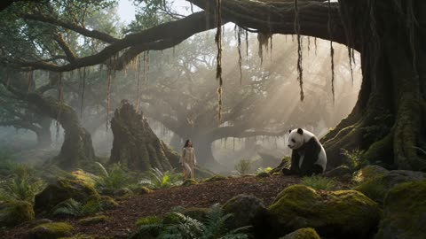</a>

按时间段（0到4秒、4到8秒、8到12秒、12到15秒）依次排列镜头，结尾的写实词组（自然日光、手持、纪实风格、无CGI质感）统一画面与色调。开头点明年代并禁止现代元素，保证古风设定前后一致。

Seedance 2.5 · 文生视频 · 出处: [@SyntheSarah on X](https://x.com/SyntheSarah/status/2088501362774393100) · 259 赞，统计于 2026-10-29

[`photorealism`](pages/zh/tags.md#tag-photorealism) [`timed-shots`](pages/zh/tags.md#tag-timed-shots) [`animal-interaction`](pages/zh/tags.md#tag-animal-interaction) [`forest`](pages/zh/tags.md#tag-forest)

<details><summary><b>提示词</b></summary>

```text
15-second ultra-photorealistic cinematic video set in a completely untouched ancient forest inspired by the year 1200 AD or earlier. A beautiful young woman is the main character, wearing a simple historically inspired medieval linen dress in earthy natural tones, with long slightly messy hair and no modern accessories or makeup. She is peacefully playing with a large realistic giant panda deep inside the ancient forest.

The forest feels completely natural and untouched: enormous centuries-old trees, thick moss, wild ferns, hanging vines, small streams, soft mist, fallen leaves, natural rocks and subtle morning sunlight filtering through the dense canopy. No buildings, roads, modern objects or artificial elements.

0–4 sec: Wide cinematic shot as the woman walks slowly through the misty forest and notices the panda sitting near an old moss-covered tree. The panda looks at her naturally and curiously.

4–8 sec: Medium handheld shot as she gently approaches and sits beside the panda. She smiles naturally and carefully strokes its thick fur. The panda responds playfully, moving closer to her.

8–12 sec: Close-up of the woman's genuine expression and the panda's highly detailed face and fur. Natural breathing, blinking, subtle facial movements, realistic hair movement from the forest breeze.

12–15 sec: Cinematic wide shot as the woman and panda playfully walk deeper into the ancient forest together while sunlight breaks through the trees and mist floats around them.

Extremely realistic human anatomy, realistic skin texture, individual hair strands, physically accurate panda fur, natural animal behavior, realistic cloth physics, subtle environmental movement, authentic atmospheric perspective, natural daylight, soft volumetric light, realistic shadows, cinematic depth of field, slight handheld camera movement, documentary-style realism, shot on a high-end cinema camera, 4K detail, natural color grading, no fantasy look, no CGI appearance, no artificial beauty filter, no modern elements, no text, no watermark.
```

</details>

<a id="h3-marina-boat-dolphin-encounter-travel-documentary"></a>
### 游客登船出海偶遇海豚

<a href="https://x.com/nawalsehar/status/2090306968900784383"></a>

提示词把登船、出港、遇见海豚到最后反应写成一条连续的动作链，台词直接写进叙述里。末尾用一长串物理真实感要求和一串排除项来稳住动作与水面表现。

MiniMax H3 · 文生视频 · 出处: [@nawalsehar on X](https://x.com/nawalsehar/status/2090306968900784383) · 166 赞，统计于 2026-10-28 · 发现于 [SkyNotSilent/awesome-MiniMax-H3-cases](https://github.com/SkyNotSilent/awesome-MiniMax-H3-cases)

[`travel-documentary`](pages/zh/tags.md#tag-travel-documentary) [`photorealistic`](pages/zh/tags.md#tag-photorealistic) [`dialogue`](pages/zh/tags.md#tag-dialogue) [`lip-sync`](pages/zh/tags.md#tag-lip-sync) [`wildlife`](pages/zh/tags.md#tag-wildlife)

<details><summary><b>提示词</b></summary>

```text
A young Western female traveler in her mid-20s walks naturally along a wooden marina dock toward a small white sightseeing boat. She wears a light blue windbreaker, white shirt, dark trousers, comfortable sneakers, sunglasses, a properly fitted life jacket, and a small crossbody bag. She carefully steps from the dock onto the gently rocking boat while holding the handrail, naturally shifting her weight as the boat responds to her movement. She walks toward the rear passenger bench, sits down, adjusts her position, and looks toward the open water. The boat engine starts with a realistic low rumble and gradually leaves the marina, creating a small bow wave and narrow wake. As the boat moves into open water, she notices movement nearby, looks surprised, and naturally says, "Wait... are those dolphins?" Two dolphins surface several meters beside the moving boat, swimming parallel at a safe distance with realistic tail propulsion, surfacing, diving, breathing, and water displacement. She picks up her phone with both hands and records them while smiling with genuine excitement. One dolphin briefly surfaces near the rear side of the boat, exhales through its blowhole, creates a small burst of mist and droplets, then dives beneath the water and leaves expanding ripples behind. She lowers her phone and says, "That is incredible." Ultra-photorealistic marine wildlife travel documentary, cinematic realism, natural human behavior, realistic walking and sitting biomechanics, physically accurate boat buoyancy and acceleration, authentic ocean waves and wake, realistic dolphin anatomy and swimming behavior, natural water reflections and refraction, accurate English lip synchronization, bright neutral daytime lighting, realistic coastal wind, immersive marina and ocean ambience, smooth documentary camera movement, continuous visual consistency, seamless storytelling from walking to boarding, departure, dolphin encounter, recording, and final reaction, no narration, no CGI appearance, no plastic skin, no robotic movement, no exaggerated dolphin jumps, no impossible water behavior, no sudden camera transitions, no text overlays, logos, or watermarks.
```

</details>

<a id="h3-lotus-pond-upward-pan-tree-canopy"></a>
### 仰视荷花池与树冠，镜头缓缓右移

<a href="https://x.com/GeekCatX/status/2096937966434459885"></a>

参考图锁定仰视构图与配色，提示词先写约六秒的近乎静止，再接缓慢匀速的右移镜头。植物摆动与镜头运动分开描述，让叶片和花朵持续微动，同时视角平稳移动。

MiniMax H3 · 图生视频 · 出处: [@GeekCatX on X](https://x.com/GeekCatX/status/2096937966434459885) · 87 赞，统计于 2026-10-29

[`lotus`](pages/zh/tags.md#tag-lotus) [`botanical`](pages/zh/tags.md#tag-botanical) [`camera-pan`](pages/zh/tags.md#tag-camera-pan) [`sunlight`](pages/zh/tags.md#tag-sunlight)

<details><summary><b>提示词</b></summary>

```text
参考图片：
Vertical 40:71 composition, approximately 9:16, filling the frame. An extremely low, wide-angle view from among slender green lotus stems, looking upward beneath the leaves toward a branching tree canopy and clear cyan-blue sky. Large round lotus leaves have gently rippled edges, sharply visible radial veins and translucent yellow-green undersides. The closest leaf is cropped across the upper-left corner; prominent leaves occupy the middle-left and middle-right. An open pink lotus is seen from below at mid-left, with two prominent open pink blossoms at lower-right and smaller flowers among layered leaves below. The petals grade from pale pink to rose, with warm yellow-orange tones underneath. A thick, dark, rough-barked tree trunk rises from the lower-right toward the center, dividing into twisting branches and fine green foliage overhead. Bright overhead daylight backlights the leaves, with a small white sun highlight near the foliage. Deep green shadows, vivid lime and emerald foliage, pink flowers and saturated blue sky. Photographic botanical detail, with readable textures in both foreground leaves and distant branches. No lettering, overlays or borders.

图生视频提示

Use the reference image as the initial visual state.

Preserve the low upward viewpoint, lotus leaf and flower shapes, slender stems, rough tree bark, detailed foliage, vivid green-pink-blue palette and bright daylight backlighting.

For roughly the first six seconds, hold the composition almost still with only minimal smooth drift.

Then gradually pan the view to the right at a slow, even pace, so the main trunk and background branches slide toward the left edge and more lotus flowers and leaves enter from the right. Keep looking upward throughout.

The large leaves gently tilt back and forth, their rims fluttering subtly as the long stems flex. The already-open flowers sway lightly on their stems, remaining open.

Moving leaves intermittently reveal and conceal a small white sun highlight, producing brief soft glints.

By the end, the original trunk is near the left edge, pink flowers and overlapping leaves fill the lower and right areas, and blue sky remains framed by branches overhead. The rightward view change and gentle plant movement are still continuing at cutoff.
```

</details>

<a id="h3-greenhouse-flower-opens-outside-in"></a>
### 温室中一朵花在灯下逐圈绽放

<a href="https://x.com/GlennHasABeard/status/2101008623555997920">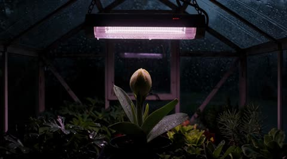</a>

只让一个主体运动，并给出明确顺序（由外向内、一次一圈），模型就只有一处可读的变化。机位锁定在花盆高度，其余温室保持静止。

MiniMax H3 · 文生视频 · 出处: [@GlennHasABeard on X](https://x.com/GlennHasABeard/status/2101008623555997920) · 42 赞，统计于 2026-10-29

[`flower-bloom`](pages/zh/tags.md#tag-flower-bloom) [`locked-camera`](pages/zh/tags.md#tag-locked-camera) [`greenhouse`](pages/zh/tags.md#tag-greenhouse) [`rain`](pages/zh/tags.md#tag-rain)

<details><summary><b>提示词</b></summary>

```text
Minimax H3, open weights, generated locally. One lamp, one flower, rain on the glass.

Prompt: "the petals open one ring at a time from the outside in"

Duration: 15s. Camera: locked, pot height. Rendered locally in ComfyUI, then Topaz to 4K.

"No other plant moves" is the sentence that kept the greenhouse asleep. One thing opening is a story. Everything opening is a screensaver.
```

</details>

**[全部 11 条](pages/zh/video-nature.md)**

<a id="vid-animal"></a>
## 动物与萌宠

<a id="kling-eagle-pov-steppe-flight"></a>
### 金雕视角飞越山谷与河流

<a href="https://x.com/higgsfield_ai/status/2019090635408744851"></a>

镜头锁定在金雕头部,翅膀与羽毛留在画面边缘作为稳定参照。用河流、山谷、岩峰提供地面视差,并限定无抖动、仅速度模糊、无剪辑,让飞行动作连贯真实。

Kling 3.0 · 文生视频 · 出处: [@higgsfield_ai on X](https://x.com/higgsfield_ai/status/2019090635408744851) · 2,454 赞，统计于 2026-10-27

[`pov`](pages/zh/tags.md#tag-pov) [`aerial`](pages/zh/tags.md#tag-aerial) [`wildlife`](pages/zh/tags.md#tag-wildlife) [`tracking-shot`](pages/zh/tags.md#tag-tracking-shot) [`landscape`](pages/zh/tags.md#tag-landscape)

<details><summary><b>提示词</b></summary>

```text
POV flight from a golden eagle soaring over vast mountainous steppe landscapes. Camera locked to the eagle’s head with clean, precise tracking — stable forward motion, no jitter. The eagle actively flaps its wings, powerful wingbeats transitioning into smooth gliding. Wings and feathers visible at the frame edges, moving naturally in rhythm. Strong ground parallax below: winding rivers, open valleys, rocky peaks. Bright late-afternoon light, crisp air, subtle lens flare. Ultra-wide cinematic perspective, natural motion blur from speed only, realistic flight physics, continuous shot, no cuts.
```

</details>

<a id="seedance-zombie-calico-cat-reunion"></a>
### 流泪的橘猫举枪对准僵尸花猫

<a href="https://x.com/ElsaSofia__AI/status/2108740749420646730"></a>

按时间码逐段写出景别、动作和情绪转折，让昏暗木屋里的紧张感顺畅过渡到金色黄昏草地。开头先交代两只猫、两处场景以及前后半段的光线对比，保证跨镜头的角色与场景一致。

Seedance 2.5 · 文生视频 · 出处: [@ElsaSofia__AI on X](https://x.com/ElsaSofia__AI/status/2108740749420646730) · 2,000 赞，统计于 2026-10-27

[`short-film`](pages/zh/tags.md#tag-short-film) [`cats`](pages/zh/tags.md#tag-cats) [`emotional`](pages/zh/tags.md#tag-emotional) [`timestamped-shots`](pages/zh/tags.md#tag-timestamped-shots) [`cinematic`](pages/zh/tags.md#tag-cinematic)

<details><summary><b>提示词</b></summary>

```text
Cinematic emotional short film, live-action look, 16:9, 24 seconds, 24 fps. Characters: a ginger tabby cat that stands upright on its hind legs like a human, and a calico cat (black, white and orange). At the start the calico is zombie-like: cloudy pale eyes, torn fur hanging in shreds, sharp fangs. Opening setting: a dark rustic wooden cabin kitchen at night, pots on wooden shelves, a window with cold blue night light, wooden plank floor. Final setting: a green meadow at golden-hour sunset with white dandelion fluff floating in the air.

0:00-0:01.5 Extreme close-up of the ginger tabby with tears in his eyes, holding a black handgun with both paws, aimed toward the camera (gun out of focus in the foreground).

0:02-0:02.5 Over-the-shoulder wide shot from behind the ginger cat: he aims the handgun at the zombie calico slowly walking toward him across the wooden floor.

0:03-0:03.5 Front shot: the ginger cat stands upright, aiming with both paws, dark wooden wall and blue window behind him.

0:04-0:04.5 Close-up of the zombie calico, glassy pale eyes, then snarling with fangs.

0:05-0:06.5 Extreme close-up of the ginger cat's face, tears rolling down.

0:06.5-0:08 He stands aiming, then slowly lowers the gun.

0:08.5-0:09 The gun drops from his paw and he opens both arms wide for a hug.

0:09.5-0:10 Quick cuts: the zombie calico's face, then the ginger cat with eyes closed and a tear falling.

0:10.5 The calico leaps into his arms, wrapping her white paws around him; her fur is now healthy and normal.

0:11-0:13 Cut to the sunset meadow: the two cats roll and cuddle in the grass, white fluff floating around, warm golden light.

0:13-0:18 Close-up of the calico's affectionate face while the ginger cat's paw gently touches her face and head; the ginger cat lies on his back in the grass, eyes closed, peaceful.

0:18-0:20.5 The ginger cat's paw rests on her face; he looks up, content and relaxed.

0:21-0:22 Wide silhouette shot: the two cats sit snuggled together against the glowing sunset, tall grass and wildflowers in the foreground.

0:22.5-0:24 Close-up with sun flare: the ginger cat tenderly rubs his head against the calico's head. End.

Style: dramatic zombie-movie tension turning into a heartwarming ending, shallow depth of field, realistic fur detail, warm golden-hour light in the second half, dark low-key lighting in the first half.
```

</details>

<a id="omni-photo-bird-jumps-onto-hand"></a>
### 小鸟从电脑照片中跃出落到手上

<a href="https://x.com/alexanderchen/status/2060322611586834518"></a>

提示词先要求屏幕内容与原视频完全一致，再按顺序写出转头、离开照片、跳上手这一连续动作。真实拍摄的场景为画面效果提供了物理锚点。

Gemini Omni Flash · 视频编辑 · 出处: [@alexanderchen on X](https://x.com/alexanderchen/status/2060322611586834518) · 1,385 赞，统计于 2026-10-27

[`photo-to-life`](pages/zh/tags.md#tag-photo-to-life) [`animal`](pages/zh/tags.md#tag-animal) [`screen-breakout`](pages/zh/tags.md#tag-screen-breakout) [`live-action`](pages/zh/tags.md#tag-live-action)

<details><summary><b>提示词</b></summary>

```text
Start with the computer screen content exactly the same as in the video. Make the bird come to life, turning head, leaving the photo and jumping onto the person's hand.
```

</details>

<a id="wan-camera-angle-swap"></a>
### 动作不变，换机位重拍你的视频

<a href="https://x.com/Framer_X/status/2101324357108658433"></a>

上传一段连续镜头作动作参考，Wan 从新角度重拍；某个镜头跑偏就重生成。

Wan 3.0 · 视频编辑 · 出处: [@Framer_X on X](https://x.com/Framer_X/status/2101324357108658433) · 1,170 赞，统计于 2026-10-27

[`camera-angle`](pages/zh/tags.md#tag-camera-angle) [`video-reference`](pages/zh/tags.md#tag-video-reference) [`workflow`](pages/zh/tags.md#tag-workflow)

<details><summary><b>提示词</b></summary>

```text
STEP 1: Upload your video (must be continuous one shot) to any platform that supports WAN 3.0

STEP 2: Use the prompt below (adjust it to your video):

"Use the original video @ TAG ORIGINAL VIDEO as the exact action reference

0–1s: Camera stays exactly as in the original video as the wolf walks toward the scooter.

1–3s: Hard cut to a tight front close-up as the wolf continues walking toward and reaches the scooter.

3–5s: Hard cut to a high angle above as the wolf as he gets onto the scooter and starts riding.

5–7s: Hard cut to a full shot as the wolf rides the scooter down the street.

7–9s: Hard cut to a side tracking shot as he keeps riding down the street.

9-10s: Hard cut to an over the shoulder shot as he rides forward and notices the banana peel in his path.

10–12s: hard cut to a birds eye view shot as the fallen wolf is rolling over the asphalt.

12-13s : hard cut to an insert shot of his fist as wolf slams it into the asphalt.

Only the camera angle and framing change. Make sure every action, movement, timing and performance exactly identical to the original video @ TAG ORIGINAL VIDEO. The action continues seamlessly across every cut."

NOTE: If some scenes didn't work (action was different than original video) simply regenerate the video, that usually fixes the problem.
```

</details>

**[全部 26 条](pages/zh/video-animal.md)**

<a id="vid-vfx"></a>
## 特效与变身转场

<a id="veo-giant-girl-shibuya-crossing"></a>
### 巨型女孩跪在东京街口俯身触碰出租车

<a href="https://x.com/MrDavids1/status/1997581641892446293"></a>

通用模板用方括号固定机位、巨人服装、地点和动作，再在手脚附近加入微小的车辆和行人来建立体量感。先用 Nano Banana Pro 以 4K 生成静帧，再交给 Veo 3.1 做图生视频。

Veo 3.1 · 图生视频 · 出处: [@MrDavids1 on X](https://x.com/MrDavids1/status/1997581641892446293) · 3,040 赞，统计于 2026-10-27

[`giant`](pages/zh/tags.md#tag-giant) [`scale`](pages/zh/tags.md#tag-scale) [`cityscape`](pages/zh/tags.md#tag-cityscape) [`photorealistic`](pages/zh/tags.md#tag-photorealistic) [`template`](pages/zh/tags.md#tag-template)

<details><summary><b>提示词</b></summary>

```text
Here is a fun idea to try. You can create these images with giant people/animals using Nano Banana Pro. Just adjust the elements in brackets and have fun! If you have the option to generate at 4K, definitely use it as it makes the tiny people look crisper. These types of images seem to animate best with Veo 3.1 from testing, but you can try with Kling 2.6 or Grok Imagine as well so have some fun! Feel free to show me your giant humans/animals.

🍌Universal Prompt: A highly detailed, photorealistic [CAMERA ANGLE, e.g., wide-angle shot, aerial shot looking down, extreme low-angle looking up] showing a colossal [DESCRIBE THE PERSON & CLOTHING] positioned in [SPECIFIC LOCATION/CITY/LANDSCAPE]. The giant is [ACTION -  INTERACTING WITH THE ENVIRONMENT, e.g., sitting on a building, stepping over a bridge]. To establish the immense scale, tiny [TINY ELEMENTS: PEOPLE, CARS, OR BOATS] are visible near their [FEET/HANDS]. The lighting is [TIME OF DAY, e.g., golden hour, midday sun].

There are more visuals examples with prompts included in my 80 creative use cases document which you can view via this link completely for free. Look for use case 84.
https://
canva.com/design/DAG5ifq
rYJc/BReEw-WwUMW9HmSJBHWBXQ/edit
…
```

</details>

<a id="seedance-diner-frozen-time-rewind"></a>
### 1950 年代餐馆：时间静止再倒流

<a href="https://x.com/techhalla/status/2083389002552664385"></a>

一个特效撑满 30 秒。先把餐馆写细，静止和倒流才看得清。

Seedance 2.5 · 文生视频 · 出处: [@techhalla on X](https://x.com/techhalla/status/2083389002552664385) · 2,873 赞，统计于 2026-10-27

[`vfx`](pages/zh/tags.md#tag-vfx) [`time-freeze`](pages/zh/tags.md#tag-time-freeze) [`period`](pages/zh/tags.md#tag-period)

<details><summary><b>提示词</b></summary>

```text
Photorealistic cinematic 1950s American diner, chrome stools, red vinyl, neon glow and checkerboard floor, shot with modern lived-in realism and soft natural window light. Subtle handheld texture, warm practicals, rich period detail, heavy film grain.

0-4s: [Medium Wide] A striking young woman in her early 20s sits alone at the counter, calm and slightly amused, slowly sipping a tall thick milkshake through a straw. Behind her a young waitress in classic uniform approaches with a tray of eggs and bacon in one hand and a full glass coffee pot in the other. An older lady starts rising from a nearby booth.

4-8s: [Dynamic Tracking] The older lady collides hard into the waitress. Tray, plate, eggs, bacon and coffee pot explode upward in chaotic slow motion. Coffee erupts into long liquid ribbons and perfect suspended droplets. Camera immediately begins a smooth continuous orbit around the impact. Time locks completely at the peak of the spill. Every face freezes in pure shock. Only the girl at the counter keeps moving, completely unfazed.

8-17s: [Slow 360° Orbital] Camera glides in a full elegant orbit through the frozen diner. Coffee hangs in mid-air as glassy ribbons and spheres with perfect volume and surface tension. Bacon strips, eggs and the spinning tray float weightlessly. Patrons and waitress remain locked in startled expressions. The girl at the counter takes one slow, deliberate sip, eyes half-lidded, almost bored, while the entire frozen world (except her) begins an elegant reverse: every droplet, every piece of food and every person rewinds smoothly back to the exact starting positions.

17-24s: [Medium Shot] Rewind lands perfectly. Waitress stands balanced again with tray and coffee pot. The girl lifts her eyes, raises two fingers in a small casual gesture and softly calls the waitress by name. The waitress turns toward her just before the older lady begins to stand, completely avoiding the collision. A tiny private smile crosses the girl’s face.

24-30s: [Extreme Close-Up] Hard cut to her face as she takes one last slow sip. Soft knowing smile, eyes almost closed in quiet satisfaction, like she has done this a hundred times. Shallow depth of field, creamy bokeh of the neon diner behind her.

Photorealistic, ultra-detailed fluid physics, perfect motion blur only on moving elements, stable characters, cinematic lighting, heavy natural film grain, no artifacts, movie-level temporal coherence, high rewatch value.
```

</details>

<a id="veo-empty-room-loft-construction-timelapse"></a>
### 空房间延时搭建阁楼

<a href="https://x.com/venturetwins/status/1992725268855968071"></a>

首尾帧由 Nano Banana Pro 先生成，分别锁定空房间和完工效果。提示词只描述两帧之间的快速施工过程，由 Veo 补全中间的变化。

Veo 3.1 · 首尾帧 · 出处: [@venturetwins on X](https://x.com/venturetwins/status/1992725268855968071) · 1,986 赞，统计于 2026-10-27

[`time-lapse`](pages/zh/tags.md#tag-time-lapse) [`interior-design`](pages/zh/tags.md#tag-interior-design) [`construction`](pages/zh/tags.md#tag-construction) [`start-end-frames`](pages/zh/tags.md#tag-start-end-frames) [`nano-banana-pro`](pages/zh/tags.md#tag-nano-banana-pro)

<details><summary><b>提示词</b></summary>

```text
Did some experimenting and figured out the workflow for AI design transformations:

Start with a base image of a room with no furniture. Then prompt on Nano Banana Pro to add what you'd like (e.g. a cool door frame, loft, or pool).

Take to Veo 3.1 as your start and end frames.

Prompt: "time lapse construction, fast motion as a construction workers bring a tree into the living room and then construct the loft and add the couch and lights."
```

</details>

<a id="omni-word-by-word-kinetic-text-sizzle"></a>
### 光泽三维文字逐词依次出现

<a href="https://x.com/Google/status/2062925430290526486"></a>

提示词逐一写出完整的词序，并限定同一时刻只出现一个词。再要求每个词采用不同的动画风格并按节奏卡点，让模型能清楚控制文字的出现时机与动态。

Gemini Omni Flash · 文生视频 · 出处: [@Google on X](https://x.com/Google/status/2062925430290526486) · 1,219 赞，统计于 2026-10-27

[`kinetic-typography`](pages/zh/tags.md#tag-kinetic-typography) [`text-rendering`](pages/zh/tags.md#tag-text-rendering) [`sizzle-reel`](pages/zh/tags.md#tag-sizzle-reel) [`motion-graphics`](pages/zh/tags.md#tag-motion-graphics)

<details><summary><b>提示词</b></summary>

```text
Beyond just rendering text, Gemini Omni actively syncs your text with the onscreen action.

It draws on Gemini's knowledge to connect language, imagery and meaning to turn complex ideas into compelling visuals. 💬

Prompt for this video: Add the word “SMILE” in bold white sans-serif typography across the nose of every inflatable shark, clean modern lettering naturally integrated into the glossy wet plastic surface, slightly curved and distorted by the inflatable shape while remaining crisp and readable during movement through the water slide. The text on the sharks must remain perfectly locked and tracked to each shark’s skin surface at all times, moving consistently with the body and rotating naturally with the sharks during the descent. Avoid flickering, sliding, jittering, duplicated characters, changing letter count, or distorted typography. Any existing text must remain stable, readable, and physically integrated into the shark skin texture, behaving like a natural marking rather than an added overlay. No text should appear or disappear mid-descent.
```

</details>

**[全部 82 条](pages/zh/video-vfx.md)**

<a id="image"></a>
## 图片提示词

[Artificial Analysis 图像榜](https://artificialanalysis.ai/text-to-image/arena)前排模型上点赞最多的提示词，每条都附成图，出自作者在 X 上的帖子或模型官方指南。按用途分组。很多要配一张自己的照片，标着「上传图改图」的就是。

<a id="img-poster"></a>
## 海报与编辑排版

<a id="gpt-image-flat-vector-city-travel-poster-template"></a>
### 适用任意城市的扁平矢量旅行海报模板

<a href="https://x.com/MahnoorAi12/status/2091349007922778211"></a>

用一个城市名占位符驱动地标、交通、生活瞬间、本地植物、视角五个要素，让每个城市的画面结构都不同。严格的配色体系、少量人物和较长的反向提示词，让扁平矢量风格保持安静统一。

GPT Image 2 · 文生图 · 出处: [@MahnoorAi12 on X](https://x.com/MahnoorAi12/status/2091349007922778211) · 3,421 赞，统计于 2026-10-28

[`travel-poster`](pages/zh/tags.md#tag-travel-poster) [`flat-vector`](pages/zh/tags.md#tag-flat-vector) [`template`](pages/zh/tags.md#tag-template) [`city`](pages/zh/tags.md#tag-city) [`minimalist`](pages/zh/tags.md#tag-minimalist)

<details><summary><b>提示词</b></summary>

```text
Premium minimalist flat-vector travel poster for [CITY_NAME], 3:4 vertical format.

Design an original, sophisticated travel poster that captures the authentic visual personality of [CITY_NAME]. The composition must feel purpose-built for this city rather than following a reusable template.

CITY IDENTITY

First interpret the unique visual character of [CITY_NAME] and build the scene around these five elements:

1. A recognizable landmark, architectural feature, or skyline element.
2. A distinctive local way of moving through the city.
3. One subtle everyday lifestyle moment.
4. A native plant, landscape, or environmental characteristic.
5. A composition and viewpoint that naturally belongs to the city.

The overall scene structure must change from city to city. Do not repeatedly use the same object positions or visual formula.

Possible compositions include:
harbor viewpoint, narrow historic lane, riverside garden, coastal path, elevated city overlook, lively market passage, tram avenue, ferry terminal, botanical setting, heritage square, beach promenade, cultural plaza, or skyline terrace.

Choose whichever composition best represents [CITY_NAME].

TYPOGRAPHY

Place “[CITY_NAME]” in the upper-left area with generous clean negative space.

Add one short, sophisticated English tagline inspired by the atmosphere of the city.

Typography should feel understated, editorial, spacious, and premium. Never allow text to dominate the artwork.

VISUAL HIERARCHY

Use one iconic landmark or architectural feature as the main focal point.

Support it with only 2–4 carefully selected local elements. Every added detail should strengthen the sense of place.

Avoid landmark collections or postcard-style collages. Keep the scene visually quiet and intentional.

PEOPLE

Include only 3–6 small-scale figures.

Give each person a believable activity connected to local life, such as:
walking through a historic lane, cycling, waiting for public transport, sketching architecture, boarding a ferry, reading outdoors, taking a quiet photograph, carrying beach equipment, browsing a market, or jogging beside the water.

Avoid crowds and avoid making any single person the main character. Figures should integrate naturally into the environment.

LOCAL CHARACTER

Use city-specific elements only when they genuinely fit [CITY_NAME]:

- local transportation
- architecture
- street furniture
- vegetation
- small signs or wayfinding
- local food references
- recreational activities
- pavement markings
- cultural details

Transport and signage should remain subtle. Instead of always using a large signboard, incorporate details naturally through a small transit marker, station clock, ferry information panel, bike symbol, painted road marking, beach flag, or understated metro icon.

ART DIRECTION

Japanese stationery-inspired aesthetic,
luxury sticker illustration,
premium commercial vector artwork,
modern editorial travel branding,
clean delicate outlines,
uniform line weight,
simple geometric forms,
flat-color illustration,
soft shapes,
balanced visual rhythm,
high-end minimalist postcard design.

COLOR SYSTEM

Build the atmosphere primarily with:
pale powder blue, soft sky blue, mist blue, and cool airy blues.

Balance these with:
warm ivory, cream, soft beige, muted sage, gray-green, and understated architectural neutrals.

Use dusty rose or muted blush only for tiny visual accents such as flowers, clothing details, small signs, awnings, or decorative objects.

Colors should remain soft, sophisticated, slightly desaturated, and cohesive.

MOOD

Fresh, airy, peaceful, refined, contemporary, elegant.

The final artwork should feel like a premium boutique travel postcard or luxury lifestyle brand illustration, with generous breathing room and a relaxed sense of place.

IMPORTANT QUALITY RULES

Every city must have its own visual identity.
Change the camera angle, scene structure, landmark placement, foreground treatment, and supporting details according to the city's character.

Do not simply replace [CITY_NAME] inside an existing composition.

NEGATIVE PROMPT

No photorealism.
No realism.
No watercolor.
No painterly brushwork.
No gradients.
No heavy shadows.
No dramatic cinematic lighting.
No paper texture.
No excessive detail.
No cluttered background.
No landmark collage.
No crowded streets.
No oversized characters.
No dominant hero character.
No repetitive café composition.
No fixed signboard position.
No identical foreground treatment.
No generic tourist-poster formula.
No copied layout from another city.
No unnecessary decorative elements.
```

</details>

<a id="nano-banana-brand-grid-poster-template"></a>
### 阿迪达斯跑者与红牛赛车的柔和色块海报

<a href="https://x.com/AmirMushich/status/2028115571724660920"></a>

[BRAND NAME] 占位加上分阶段的固定指令（分层、2x2 网格、柔和配色、棚拍光、单色标志），让同一模板适用于任何品牌。用 dusty rose、slate blue 这类示例限定色调，让颜色柔和且没有渐变。

Nano Banana 2 · 文生图 · 出处: [@AmirMushich on X](https://x.com/AmirMushich/status/2028115571724660920) · 2,570 赞，统计于 2026-10-29

[`brand-poster`](pages/zh/tags.md#tag-brand-poster) [`template`](pages/zh/tags.md#tag-template) [`muted-palette`](pages/zh/tags.md#tag-muted-palette) [`geometric`](pages/zh/tags.md#tag-geometric)

<details><summary><b>提示词</b></summary>

```text
(access Nano Banana 2 here:
https://
amirmushich.link/LTX_NBP)

[BRAND NAME]. Act as a World-Class Editorial Designer.

PHASE 1: DYNAMIC SUBJECT LOGIC.

- Subject Selection: Autonomously analyze [BRAND NAME].

- Layering (The Sandwich Effect): Interweave the subject with background shapes. Some parts of the car/person must be hidden behind geometric blocks, while other parts (wheels, limbs, props) must overlap them to create 3D depth.

PHASE 2: GRID & GEOMETRY.

- Layout: A clean 2x2 grid composition.

- Overlays: Superimpose large, bold geometric arcs and circles over the grid.

- Visual Balance: Place one iconic product prop (e.g., a floating key fob for cars or a ball for sports) in a separate quadrant to balance the subject.

PHASE 3: SOPHISTICATED MUTED PALETTE.

- Color Direction: DO NOT use aggressive neon or oversaturated colors.

- Palette: Identify the core colors of [BRAND NAME] and shift them to a "Sophisticated Muted" spectrum.

- Tones: Use desaturated, earthy, or "dusty" versions of the brand colors (e.g., instead of hot pink, use dusty rose; instead of bright mint, use sage green; instead of royal blue, use slate blue).

- Finish: Matte, flat color blocks with zero gradients.

PHASE 4: PHOTOGRAPHY & LIGHTING.

- Subject Style: High-end commercial studio photography.

- Lighting: Soft, diffused studio lighting with gentle highlights. No harsh shadows.

- Integration: The subject must feel physically embedded into the graphic grid.

PHASE 5: MINIMALIST BRANDING.

- Logo: Place a clean, single-color [BRAND NAME] logo in the center of one background block. No taglines, just the iconic symbol.
```

</details>

<a id="gpt-image-luffy-streetwear-poster"></a>
### 草帽路飞红色街头风海报

<a href="https://x.com/ChillaiKalan__/status/2051938130505453866"></a>

固定的风格模块一次性规定了姿势规则、配色、背景和光线，只需替换角色名就能得到风格统一的海报。要求保留草帽等原作识别元素，同时把服装改写成街头风，让角色仍然一眼可认。

GPT Image 2 · 文生图 · 出处: [@ChillaiKalan__ on X](https://x.com/ChillaiKalan__/status/2051938130505453866) · 1,891 赞，统计于 2026-10-29

[`one-piece`](pages/zh/tags.md#tag-one-piece) [`luffy`](pages/zh/tags.md#tag-luffy) [`streetwear`](pages/zh/tags.md#tag-streetwear) [`anime-poster`](pages/zh/tags.md#tag-anime-poster)

<details><summary><b>提示词</b></summary>

```text
Create a stylized illustration of {character_name} from {franchise}.

Character Analysis:

Derive the character’s core personality archetype based on canon portrayal (e.g., heroic, calm, mysterious, aggressive).
Identify the signature color from the original design and use it as the primary visual accent.

Pose & Body Language:

Generate an iconic pose that reflects the personality archetype:
Energetic / Heroic: dynamic action, wide stance, explosive movement
Calm / Confident: balanced, relaxed posture, minimal motion
Dark / Mysterious: low stance, subtle movement, sharp or hidden gaze
Aggressive / Intense: forward-leaning attack stance, visible tension, clenched fists

Facial Expression:

Match expression precisely to the character’s personality and emotional tone.

Art Style:

Anime × streetwear × graphic poster hybrid
Clean lineart, semi-flat shading, high contrast
Modern, minimal, and visually striking

Composition:

Vertical format ({aspect_ratio})
Off-center subject placement
Strong diagonal visual flow
Layered depth for a dynamic poster feel

Outfit Design:

Reimagine the original costume as modern streetwear / techwear
Preserve recognizable identity elements of the character

Color Palette:

Dominant clean white background
Use signature color as the primary accent
Add one secondary accent (complementary or analogous tone)
Keep palette minimal, bold, and high-contrast

Background:

Abstract geometric poster layout
Use negative space effectively
Integrate subtle accents using the character’s color theme

Effects:

Energy strokes, paint lines, and motion accents
Effects should follow the character’s energy and color identity

Lighting:

Sharp directional lighting
Crisp shadows
Subtle glow using the signature color

Rendering Quality:

Ultra-clean vector-style finish
Poster-quality composition
4K resolution, high detail
```

</details>

<a id="nano-banana-monoline-city-travel-poster-kyoto"></a>
### 京都街景红色单线旅行海报

<a href="https://x.com/Goodmanprotocol/status/2052974175435026714"></a>

用目的地占位符让同一模板适配任意城市。提示词限定单一主色加单一底色并给出各城市配色示例,要求密集的单线细节和当地语言招牌,再用文字质量条款保证字体清晰可读。

Nano Banana 2 · 文生图 · 出处: [@Goodmanprotocol on X](https://x.com/Goodmanprotocol/status/2052974175435026714) · 1,436 赞，统计于 2026-10-29

[`travel-poster`](pages/zh/tags.md#tag-travel-poster) [`line-art`](pages/zh/tags.md#tag-line-art) [`monochrome`](pages/zh/tags.md#tag-monochrome) [`swiss-modernist`](pages/zh/tags.md#tag-swiss-modernist) [`template`](pages/zh/tags.md#tag-template)

<details><summary><b>提示词</b></summary>

```text
Create an ultra-high-resolution minimalist line-art travel poster of [DESTINATION], portraying the city as a stylish everyday urban scene rather than a tourist postcard.

CORE COMPOSITION:
- Central composition shows the city’s most iconic street, intersection, alley, tram street, or pedestrian avenue
- Foreground includes locals, commuters, cyclists, travelers, shoppers, students, café visitors
- People should naturally reflect the city’s local lifestyle and fashion culture
- Background filled with realistic local signage, cafés, restaurants, transportation signs, storefronts, and architectural details
- Landmarks should appear naturally integrated into everyday life, never exaggerated
- Include authentic local-language typography and culturally recognizable visual elements
- Large bold typography at the top center:
  “[DESTINATION]”
- Subtitle below:
  local language + country name
  examples:
  東京 JAPAN
  서울 KOREA
  ΚΟΛΩΝΙΑ GERMANY

STYLE:
ultra clean vector illustration,
Swiss modernist travel poster,
minimal line art,
monoline drawing,
mid-century editorial aesthetic,
architectural illustration,
Japanese graphic poster style,
precise geometric perspective,
extremely clean negative space,
premium travel branding aesthetic

LINE STYLE:
- monochrome line-based illustration only
- thin and highly precise linework
- minimal fill areas
- intricate city-map-like detail density
- rhythmic layering of signs, buildings, windows, and street objects
- visually dense yet highly organized composition

COLOR SYSTEM — VERY IMPORTANT:
- use only ONE main color + ONE background color
- automatically choose a color that best represents the city’s atmosphere
- monochrome silkscreen poster aesthetic
- no rainbow palettes
- no excessive neon
- color should reflect the city’s architecture, climate, nightlife, and cultural identity

Examples:
Tokyo → vivid red on warm ivory
Paris → deep navy on cream
New York → charcoal black on light gray
Kyoto → muted burgundy on warm cream
Hong Kong → teal blue on pale ivory
Santorini → Mediterranean blue on white
Cairo → desert sepia on sand beige

COMPOSITION:
- vertical poster layout
- frontal street-level perspective
- pedestrians crossing streets or moving naturally
- balanced urban rhythm and visual flow
- should feel like a premium city-brand campaign poster

MOOD:
stylish urban life,
calm but lively,
editorial travel magazine cover,
timeless city identity,
premium tourism campaign visual,
minimal yet highly detailed

TEXT QUALITY — EXTREMELY IMPORTANT:
- all typography must be readable and accurate
- no random characters
- no broken or distorted letters
- local signage should feel authentic and natural
- professional editorial typography alignment

OUTPUT:
- vertical poster composition
- 8K ultra detailed
- print-ready
- ultra sharp vector quality
```

</details>

**[全部 189 条](pages/zh/image-poster.md)**

<a id="img-infographic"></a>
## 信息图与幻灯片

<a id="gpt-image-encyclopedia-infographic-topic-template"></a>
### 詹姆斯韦伯望远镜百科信息图卡片

<a href="https://x.com/oggii_0/status/2051889025229930547"></a>

用 TOPIC 占位符加一份模块化面板清单（基础档案、分类、优缺点、评分总结等）。收藏手册和自然史图鉴这类风格锚点，配合浅色背景和圆角框，让整个系列版式统一。

GPT Image 2 · 文生图 · 出处: [@oggii_0 on X](https://x.com/oggii_0/status/2051889025229930547) · 1,622 赞，统计于 2026-10-29

[`encyclopedia`](pages/zh/tags.md#tag-encyclopedia) [`infographic`](pages/zh/tags.md#tag-infographic) [`template`](pages/zh/tags.md#tag-template) [`knowledge-card`](pages/zh/tags.md#tag-knowledge-card) [`editorial-layout`](pages/zh/tags.md#tag-editorial-layout)

<details><summary><b>提示词</b></summary>

```text
Create educational encyclopedia style images with GPT Image 2 on
@itsPolloAI


Prompt: Based on { TOPIC }, create a high-quality vertical “encyclopedia-style educational infographic image.”

This image should NOT look like a regular poster or a simple illustration. Instead, it should feel like a structured knowledge guide that combines:

the feeling of a collectible reference handbook

a modern encyclopedia page

a lifestyle knowledge card

and a highly shareable social-media infographic

The overall style should resemble a premium natural-history guidebook mixed with modern editorial infographic design.

The image should include:

One beautiful and highly detailed main subject image

Several zoomed-in detail sections highlighting important features

Multiple modular information panels with rounded corners

Clear title hierarchy and highlighted key labels

Concise yet information-rich encyclopedia content

Visual scoring systems, quick summaries, or “Top 5” modules

The information sections should automatically adapt to the topic. Select and combine relevant categories such as:

Basic profile

Classification / taxonomy

Physical characteristics

Behavior / ecology / habits

Structure or formation mechanisms

Growth conditions or usage methods

Care, maintenance, or optimization tips

Risks, warnings, and important notes

Suitable users or application scenarios

Pros and cons comparison

Quick rating tags or summary cards

Visual requirements:

Clean light-colored background

Soft and elegant color palette

Gentle shadows

Small refined icons

Rounded information boxes

Organized editorial layout

High information density without feeling crowded

Comfortable reading experience

The final result should feel like a real publishable encyclopedia knowledge card designed for reading, collecting, and creating as part of a consistent series — NOT like a commercial advertisement poster.

The image must strongly emphasize:

“knowledge integration + modular information design + handbook/reference-style presentation.”
```

</details>

<a id="gpt-image-pink-hair-earbud-case-infographic"></a>
### 模特手持打开的耳机充电盒广告海报

<a href="https://x.com/rovvmut_/status/2047912710365761828"></a>

提示词按前景微距、中景人物和柔焦背景划分三层景深，并逐条写明每段文字的内容与位置，使版式清晰、文字准确。

GPT Image 2 · 文生图 · 出处: [@rovvmut_ on X](https://x.com/rovvmut_/status/2047912710365761828) · 1,034 赞，统计于 2026-10-29

[`infographic`](pages/zh/tags.md#tag-infographic) [`earbuds`](pages/zh/tags.md#tag-earbuds) [`product-ad`](pages/zh/tags.md#tag-product-ad) [`typography`](pages/zh/tags.md#tag-typography)

<details><summary><b>提示词</b></summary>

```text
GPT Image 2 on
@SocialSight


Prompt: High-impact e-commerce infographic for "Apple Pods Pro 3" wireless earbuds.
Foreground: An extreme close-up of a hand holding an open, glossy white wireless earbud charging case toward the camera. Inside the case are two sleek white earbuds with black speaker accents. A tiny, glowing green LED status light is visible on the front of the case. The hand and case have a slight macro-lens blur to create a sense of depth.
Central Subject: In the mid-ground, a smiling young woman with freckles and wavy pastel-pink hair. She is wearing a vibrant lime-green knit beanie and a psychedelic, black and white-striped long-sleeve shirt. One white earbud is tucked into her ear.
Background & Lighting: A clean, soft-focus studio backdrop with a light-gray gradient. The scene is accented by diagonal rainbow prism lens flares and soft light leaks. Several blurred white earbuds float artistically in the background. The lighting is soft and professional, highlighting the glossy plastic of the product.
Typography & Layout (Sans-Serif, White):
Top Center (Background): Massive, bold text reading "AIRPODS" (positioned behind the model).
Top Right: Bold text reading "Apple Pods Pro 3".
Mid-Left: "Premium sound and noise cancellation"
Mid-Right: Large, bold "30" with the text "hours of battery life."
Bottom-Right: Large, bold "1" with the text "year warranty."
Style: 8k resolution, commercial product photography, vibrant color palette, sharp focus on the product case, shallow depth of field, clean advertising aesthetic.
```

</details>

<a id="gpt-image-endangered-animal-infographic-bengal-tiger"></a>
### 濒危孟加拉虎注解信息图海报

<a href="https://x.com/MrDasCreates/status/2052064402866851981"></a>

提示词要求以写实主体动物为中心,配合注解标注、图标和色块,而不是千篇一律的分区。先让模型查找真实物种资料,版面的信息才密集而准确。

GPT Image 2 · 文生图 · 出处: [@MrDasCreates on X](https://x.com/MrDasCreates/status/2052064402866851981) · 819 赞，统计于 2026-10-28

[`infographic`](pages/zh/tags.md#tag-infographic) [`animal`](pages/zh/tags.md#tag-animal) [`endangered-species`](pages/zh/tags.md#tag-endangered-species) [`photorealistic`](pages/zh/tags.md#tag-photorealistic) [`callouts`](pages/zh/tags.md#tag-callouts)

<details><summary><b>提示词</b></summary>

```text
Animal Infographic by GPT Image 2 on ChatGPT app

Prompt: Create a visually rich infographic about an endangered animal. Start by finding one online, research its habitat, diet, and unique traits. Present information through annotated visuals and structured callouts, not generic sections. Style it like a bold graphic illustration: a detailed, photorealistic central animal as the focal point, supported by diagrams, callouts, and concise text elements. Use clean backgrounds and a mix of photorealism with strong graphic elements (shapes, icons, color blocking) in a layered composition. Make it dense, tactile, and professionally authored.
```

</details>

<a id="nano-banana-f1-australian-gp-2026-qualifying"></a>
### 2026年澳大利亚大奖赛排位赛结果信息图

<a href="https://x.com/maxescu/status/2030227188679655426"></a>

提示词点明赛事和排位赛场次，并要求搜索最新结果，从而限定了范围和数据。仅这一段话就能生成带杆位车手主图、分段圈速、与杆位差距和赛道图的完整转播风格版式。

Nano Banana 2 · 文生图 · 出处: [@maxescu on X](https://x.com/maxescu/status/2030227188679655426) · 659 赞，统计于 2026-10-29

[`f1`](pages/zh/tags.md#tag-f1) [`infographic`](pages/zh/tags.md#tag-infographic) [`sports-data`](pages/zh/tags.md#tag-sports-data) [`web-search`](pages/zh/tags.md#tag-web-search)

<details><summary><b>提示词</b></summary>

```text
Generate a detailed infographic showcasing the qualifying results for the Australian Grand Prix 2026 from today. Search the web for the most recent and accurate data.
```

</details>

**[全部 88 条](pages/zh/image-infographic.md)**

<a id="img-ui-mockup"></a>
## 手机与界面截图

<a id="gpt-image-camera-roll-photos-screen"></a>
### 一名学生一整天的iPhone相册截图

<a href="https://x.com/sakisuta_/status/2098712371045052764"></a>

提示词明确指定容器是原样截取的照片App界面，模型便在一个网格里填满一整天风格各异的随手拍。提供参考人物并要求日常瞬间，使人脸在美食、朋友、书桌和天空等画面中保持一致。

GPT Image 2.5 · 上传图改图 · 出处: [@sakisuta_ on X](https://x.com/sakisuta_/status/2098712371045052764) · 2,439 赞，统计于 2026-10-28

[`camera-roll`](pages/zh/tags.md#tag-camera-roll) [`photos-app`](pages/zh/tags.md#tag-photos-app) [`screenshot`](pages/zh/tags.md#tag-screenshot) [`reference-image`](pages/zh/tags.md#tag-reference-image) [`everyday`](pages/zh/tags.md#tag-everyday)

<details><summary><b>提示词</b></summary>

```text
Turn one full day's worth of camera roll for the person in the reference image into a single image that captures the iPhone's Photos app screen as-is. Make it a realistic camera roll that feels like it captures casual everyday moments.
```

</details>

<a id="gpt-image-camera-roll-day"></a>
### 用一张图生成主角一整天的 iPhone 相册截图

<a href="https://x.com/Mayz1169/status/2099479395283214473"></a>

严格规则锁定主角外观，并把版式定为带真实 iOS 界面的四列缩略图。提示词列出多种景别，并要求模糊、裁切和手持感等瑕疵，让整屏看起来像真实相册。

GPT Image 2.5 · 上传图改图 · 出处: [@Mayz1169 on X](https://x.com/Mayz1169/status/2099479395283214473) · 762 赞，统计于 2026-10-27

[`ios`](pages/zh/tags.md#tag-ios) [`screenshot`](pages/zh/tags.md#tag-screenshot) [`camera-roll`](pages/zh/tags.md#tag-camera-roll) [`humor`](pages/zh/tags.md#tag-humor)

<details><summary><b>提示词</b></summary>

```text
Use the uploaded image as the ONLY subject reference.

Create ONE vertical image that looks exactly like a screenshot of the iPhone Photos app, showing one full day of casual camera-roll photos featuring the exact subject from the uploaded reference.

SUBJECT CONSISTENCY
First identify the main subject in the uploaded image. It may be a person, anime character, pet, animal, plush toy, figurine, mascot, object, or other character.

Preserve the subject’s recognizable appearance, colors, proportions, facial features, hairstyle, clothing, accessories, markings, materials, and signature details consistently across every photo.

If the reference contains multiple views of the same subject, understand that they are different views of ONE subject, not multiple characters.

Do not redesign or replace the subject.

DAY-IN-THE-LIFE CAMERA ROLL
Imagine a believable full day for this exact subject based on its appearance, personality, style, and visual world.

Generate many different casual photos from morning to night, as if someone naturally photographed the subject throughout the day.

Automatically choose everyday situations that fit the uploaded subject, such as:
waking up, resting, eating, sitting by a window, traveling, walking outside, visiting cafés or shops, playing, working, relaxing at home, interacting with everyday objects, sunset moments, nighttime outings, and going to sleep.

The activities and environments should adapt naturally to the subject. Do not force human activities onto animals, toys, objects, or non-human characters when they would look unnatural.

Every thumbnail should show a different moment, composition, distance, pose, camera angle, lighting condition, or location.

Mix:
close-ups,
medium shots,
wide shots,
overhead photos,
back views,
detail shots,
slightly blurry movement shots,
imperfect handheld snapshots,
photos where the subject is partially cropped,
environmental photos related to the subject’s day.

The result should feel spontaneous and personal rather than like a professional photoshoot.

IPHONE PHOTOS APP LAYOUT
The FINAL IMAGE itself must look like a real full-screen iPhone Photos app screenshot.

Use a tall smartphone screenshot aspect ratio, approximately 9:19.5.

Create a dense camera-roll gallery using FOUR equal thumbnail columns, closely matching the standard iPhone Photos grid.

Include approximately 24–32 individual photo thumbnails visible on screen.

Use very thin white gaps between thumbnails.

The gallery should fill most of the screen vertically.

Include authentic iPhone Photos interface elements:
• white iOS interface background
• iPhone-style status bar at the top
• time on the upper left
• cellular/Wi-Fi/battery icons on the upper right
• simple navigation controls near the top
• four-column photo gallery
• bottom Photos app navigation bar
• Photos tab selected in blue
• other navigation icons shown in gray
• black home indicator at the very bottom

The UI must look like an actual screenshot of the Photos app, NOT a decorative frame, moodboard, contact sheet, scrapbook, poster, or generic collage.

PHOTO STYLE
Make each thumbnail feel like a genuine casual iPhone camera-roll photo.

Use natural everyday lighting, imperfect framing, realistic exposure variation, occasional motion blur, slight focus imperfections, spontaneous compositions, and believable environmental details.

Keep the same subject recognizable throughout the entire gallery while allowing natural changes in pose, expression, camera distance, and lighting.

If the uploaded reference is illustrated, animated, stylized, or 3D, preserve its original visual identity and style unless realistic photography is explicitly requested.

IMPORTANT
ONE final image only.
The entire output is ONE iPhone Photos app screenshot containing many different photos.
Exactly FOUR thumbnail columns.
Do not create a standalone collage without the iPhone interface.
Do not create multiple separate outputs.
Do not duplicate the exact same photo repeatedly.
Do not introduce unrelated characters or subjects.
Do not change the main subject’s design.
No captions, dates, labels, stickers, watermarks, or decorative text inside the photo thumbnails.
Only normal minimal iOS interface elements may appear.9:16
```

</details>

<a id="gpt-image-iphone-photos-screenshot"></a>
### 一整天的照片，做成 iPhone 相册截图

<a href="https://x.com/BubbleBrain/status/2099759367956349012"></a>

连状态栏都还原的 iOS 相册界面，里面塞满参考人物的抓拍。

GPT Image 2.5 · 上传图改图 · 出处: [@BubbleBrain on X](https://x.com/BubbleBrain/status/2099759367956349012) · 309 赞，统计于 2026-10-27

[`ios`](pages/zh/tags.md#tag-ios) [`screenshot`](pages/zh/tags.md#tag-screenshot) [`camera-roll`](pages/zh/tags.md#tag-camera-roll)

<details><summary><b>提示词</b></summary>

```text
Turn the girl from the reference image into a full-day iPhone Photos album screenshot that faithfully recreates the real iPhone “Photos — Library / Today” interface. Keep the top status bar (time, signal, battery), the Library title, the Today label, the photo grid layout, and the bottom tab bar: Library / For You / Albums / Search. The whole image should look like a real phone screenshot.
The girl in the reference image is the only subject in the entire album. Every photo keeps the same identity, the same face, the same hairstyle, the same skin tone, the same body proportions, and the same presence. She is a clearly adult young East Asian woman with long black hair, cool-pale skin, refined cool features, and a private, quiet aura.
The album is a full portrait camera roll. Every thumbnail shows her. The entire screen is filled with solo portraits of her. The whole set is built around this one person only.
All album content is portraits of her: waking-up selfie in bed, selfie under the covers, selfie by the pillow, bathroom-mirror selfie, elevator-mirror selfie, window-side selfie, indoor natural-light selfie, sofa selfie, bedside selfie, after-coming-home selfie, night selfie, close-up face selfie, half-body selfie, full-body mirror selfie, seated solo shot, standing solo shot, side-profile solo shot, looking-back solo shot, indoor hallway solo shot, window-side solo shot, candid bedside shot, chair solo shot, carpet solo shot, and photos taken of her by someone else.
Outfits change continuously through the day. Morning: milky-white camisole lounge top and light-gray home shorts. Late morning: white slim short-sleeve top and pale blue-gray pleated mini skirt. Noon: black thin-strap top and high-waisted denim shorts. Afternoon: light-gray knit cardigan over a white inner layer and a black mini skirt. Evening: dark-gray blazer, white thin-strap top, and black pleated mini skirt. Night: black fitted mini dress with slim silver accessories. Late night after returning home: loose white T-shirt and soft lounge shorts. Each outfit is clearly different; the clothing changes mark a clear passage of time.
Photo mix is fixed at 60% selfies and mirror selfies, 40% solo portraits taken by someone else. Every frame has her as the subject. Every thumbnail keeps real iPhone native-camera texture. Pose, camera distance, angle, expression, lighting, and clothing keep changing.
The sequence runs from morning to late night. Morning feels loose and just-woken. Late morning has clear natural light. Afternoon feels like ordinary going-out. Evening has soft city light. Night has low indoor light. Late night feels quiet and private after coming home.
The whole set is quiet, private, relaxed, and real. The album forms a dense, continuous solo-portrait look, like a full day of private portrait camera roll saved on her own phone.
```

</details>

<a id="gpt-image-morrigan-sunscreen-beach-rpg-hud"></a>
### 莫莉甘在RPG界面截图中请求帮忙涂防晒霜

<a href="https://x.com/underwoodxie96/status/2097587863139537262"></a>

提示词限定第一人称视角，并列出所有需要出现的界面元素（小地图、任务、状态条、字幕），使画面像可玩的游戏截图。同时写明角色和场景，让人物造型与涂防晒的动作保持一致。

GPT Image 2.5 · 文生图 · 出处: [@underwoodxie96 on X](https://x.com/underwoodxie96/status/2097587863139537262) · 115 赞，统计于 2026-10-29

[`game-screenshot`](pages/zh/tags.md#tag-game-screenshot) [`hud`](pages/zh/tags.md#tag-hud) [`first-person`](pages/zh/tags.md#tag-first-person) [`3d-render`](pages/zh/tags.md#tag-3d-render)

<details><summary><b>提示词</b></summary>

```text
Please capture a realistic screenshot from a fictional next-generation 3D open-world romance RPG, presented from the male protagonist’s first-person perspective.  On the beach, Morrigan Aensland from Darkstalkers invites the protagonist to help her apply sunscreen.  The overall visual style must feature high-quality cartoon-rendered 3D characters combined with Unreal Engine 5-level graphics, achieving AAA-quality visual fidelity. It should include ultra-detailed character modeling, realistic skin shading, cinematic lighting, PBR materials, high-precision clothing textures, and finely rendered classroom environments. The final image must look like an actual playable game screenshot, including a complete game user interface: minimap, quest display, character status bars, interaction prompts, dialogue subtitles, HUD elements, and more.
```

</details>

**[全部 28 条](pages/zh/image-ui-mockup.md)**

<a id="img-product"></a>
## 产品图与电商

<a id="gpt-image-giant-pepsi-can-seated-model-ad"></a>
### 女性倚靠巨型百事可乐罐广告

<a href="https://x.com/mehvishs25/status/2047829613502754919"></a>

尺度对比是画面的核心：罐身几乎与坐姿人物等高，并附上参考图以保持人脸一致。细线标注和纯净的影棚渐变背景让广告保持简洁高级。

GPT Image 2 · 上传图改图 · 出处: [@mehvishs25 on X](https://x.com/mehvishs25/status/2047829613502754919) · 912 赞，统计于 2026-10-29

[`product-ad`](pages/zh/tags.md#tag-product-ad) [`scale-contrast`](pages/zh/tags.md#tag-scale-contrast) [`reference-face`](pages/zh/tags.md#tag-reference-face) [`infographic`](pages/zh/tags.md#tag-infographic)

<details><summary><b>提示词</b></summary>

```text
A premium infographic-style visual featuring an oversized Pepsi can placed beside a young woman. The can is scaled to be nearly the same size as her entire seated body, creating a striking, surreal proportion. The woman sits casually leaning against the giant can, one arm resting on it, interacting naturally with the object.
Her face must closely match the provided reference image, accurate facial structure, skin tone, hairstyle, and expression — polished, realistic, and visually appealing.
The Pepsi can is ultra-detailed with crisp branding, condensation droplets, realistic reflections, and metallic texture. The logo is clean, sharp, and properly proportioned.
Composition is modern and minimal, set in a clean studio or soft gradient background. Include subtle infographic-style elements such as thin annotation lines, minimal labels, or callouts highlighting features like “refreshment,” “carbonation,” or “chilled texture,” but keep it elegant and uncluttered.
Lighting is soft studio lighting with controlled highlights and shadows, giving a premium advertising look. The model is styled in minimal, contemporary clothing that complements the red, white, and blue tones of the can.
Color grading is crisp and slightly vibrant, with a commercial ad aesthetic. Balanced composition, sharp focus, slight depth of field for realism.
Style: high-end product infographic, commercial beverage advertisement, clean UI-inspired annotations
Resolution: ultra high resolution, 4K, highly detailed, photorealistic

85mm lens, f/2.8
hyper-realistic, studio quality
no distortion, correct proportions
clean typography, modern layout
```

</details>

<a id="gpt-image-iced-coffee-glass-studio-product-photo"></a>
### 挂满水珠的玻璃杯中奶咖交融的冰咖啡

<a href="https://x.com/Strength04_X/status/2049082049995362785"></a>

提示词逐层描述饮品：深色咖啡底、渐变交融的奶纹、折射光线的透明冰块和杯壁水珠。柔和棚拍光线加上单反微距用语，让画面呈现干净的饮品广告质感。

GPT Image 2 · 文生图 · 出处: [@Strength04_X on X](https://x.com/Strength04_X/status/2049082049995362785) · 617 赞，统计于 2026-10-28

[`iced-coffee`](pages/zh/tags.md#tag-iced-coffee) [`beverage`](pages/zh/tags.md#tag-beverage) [`studio-lighting`](pages/zh/tags.md#tag-studio-lighting) [`macro`](pages/zh/tags.md#tag-macro) [`product-photography`](pages/zh/tags.md#tag-product-photography)

<details><summary><b>提示词</b></summary>

```text
Made with GPT image 2 + Hailuo 2.3 on
@Hailuo_AI


PROMPT - A high-end café-style product photograph of a transparent glass filled with iced coffee, centered against a soft beige and cream seamless studio background. The drink shows a rich dark coffee base blending with creamy milk swirls, creating a smooth gradient effect. Several clear ice cubes are visible with realistic transparency and light refraction. The glass has subtle condensation droplets, adding freshness. Soft natural studio lighting creates delicate highlights and a clean shadow beneath the glass. Ultra-sharp focus, premium beverage advertisement style, DSLR macro photography, hyper realistic, 8K.

PROMPT 2 - Create a hyper-realistic exploded vertical infographic composition of an iced coffee.

Top → Bottom structure:
Foam Layer (light creamy foam with soft airy texture)
→ Coffee Liquid (rich dark espresso layer with smooth gradient)
→ Ice Cubes (transparent cubes with sharp edges and reflections)
→ Milk Layer (soft creamy white layer with smooth blend effect)
→ Glass Base (clear minimal glass structure)

All elements must be perfectly centered, evenly spaced, and aligned vertically. Use a soft beige seamless background with clean café-style lighting and subtle realistic shadows beneath each floating element. The composition should feel like a premium beverage ad combined with a clean infographic layout.

Add clean minimalist text labels with thin pointer lines using these exact labels:
“Foam”
“Coffee”
“Ice”
“Milk”
“Glass”
Ultra-realistic liquid detail, sharp reflections, premium commercial photography, 8K.
```

</details>

<a id="nano-banana-soda-can-paper-tear-fruit-reveal"></a>
### 撕开纸面与易拉罐露出新鲜水果的汽水罐

<a href="https://x.com/Arminn_Ai/status/2027470188644626803"></a>

一条连续的撕纸裂口横贯罐身与背景，末端卷成纸卷，裂口里露出密实的水果。方括号槽位覆盖罐型、底色、水果、墨色和品牌名，可以换口味反复套用。

Nano Banana 2 · 文生图 · 出处: [@Arminn_Ai on X](https://x.com/Arminn_Ai/status/2027470188644626803) · 589 赞，统计于 2026-10-28

[`soda-can`](pages/zh/tags.md#tag-soda-can) [`paper-tear`](pages/zh/tags.md#tag-paper-tear) [`fruit`](pages/zh/tags.md#tag-fruit) [`packaging`](pages/zh/tags.md#tag-packaging) [`template`](pages/zh/tags.md#tag-template)

<details><summary><b>提示词</b></summary>

```text
A photorealistic, highly detailed commercial product photograph of a standard aluminum [Type of Soda Can] centered against a minimal, textured [Background Color] paper background, with subtle fibers visible. A single, continuous horizontal paper-tear strip runs across the entire width of the frame, seamless from the far-right edge to the far-left edge. The torn channel cuts through the metal body of the can and continues across the background on both sides with a barely perceptible and minimal diagonal slope towards the upper-left. The tear channel is significantly broader, revealing a dense, glistening, and vibrant layer of [Description of Fruit Segments/Sacs/Berries] tightly packed inside. Near the extreme far-left end of this tear, the paper is neatly rolled into a tight, realistic coil that occupies almost the entire left margin. The can features a newly designed, minimalist branding: the upper portion has a stylized, abstract line-art illustration of [Fruit Branch/Plant] in a contrasting [Ink Color], set against a subtle matte geometric [Pattern Type] pattern on the can surface. Below this, the brand name "[Brand Name]" is printed in an elegant, modern dark typography, with smaller technical text "330ml - NATURAL EXTRACT" and a small "Recyclable" logo. A small, detailed graphic of the fruit is located below the torn path. The lighting is soft and cinematic, casting delicate drop shadows beneath the torn paper edges and the large left coil. 8k resolution, macro details on fibrous paper and glossy fruit texture.
```

</details>

<a id="nano-banana-radial-exploded-view-smartphone"></a>
### 深色背景下带标注部件的智能手机爆炸图

<a href="https://x.com/AllaAisling/status/2032126653309030481"></a>

为玻璃、铝、电路板和橡胶分别给出材质描述，让每个部件有各自的表面质感；标题、规格块和标签排版都固定位置，让版式保持一致。冷色顶光、内部暖色琥珀底光和外壳蓝色细边光在深色背景上区分出各层。

Nano Banana 2 · 文生图 · 出处: [@AllaAisling on X](https://x.com/AllaAisling/status/2032126653309030481) · 468 赞，统计于 2026-10-28

[`exploded-view`](pages/zh/tags.md#tag-exploded-view) [`product-teardown`](pages/zh/tags.md#tag-product-teardown) [`3d-render`](pages/zh/tags.md#tag-3d-render) [`infographic-labels`](pages/zh/tags.md#tag-infographic-labels) [`dark-background`](pages/zh/tags.md#tag-dark-background)

<details><summary><b>提示词</b></summary>

```text
Prompt Studio: 3D Radial Explosion with Nano Banana 2 in Firefly

Hyperrealistic 3D radial exploded view of [PRODUCT]  [NUMBER] components  bursting outward from a central axis in every direction, frozen in mid-air.  True spatial explosion, not a vertical stack, depth and parallax visible.  COMPONENTS (core outward): [SHELL] → [DISPLAY] → [FRAME] → [MAINBOARD] →  [BATTERY] → [MICRO PARTS shown in 3x floating callout circles]  MATERIALS: glass refracts and catches specular highlights, aluminium shows  brushed grain and machined edges, PCB traces glow faintly amber,   rubber gaskets matte with micro-texture, cables with soft bend physics.  LABELS: hairline leader to floating box. "[COMPONENT]" uppercase /  "[FUNCTION]" italic / "[KEY SPEC]" monospace. Radiate outward, no overlaps.  LIGHTING: cool diffused overhead + warm amber underlighting on internals +  thin blue rim on outer shell. Displays emit soft UI glow. Circuits self-illuminate.  BACKGROUND: [COLOR], deep, non-reflective. Midnight black recommended. TITLE: "[PRODUCT NAME]" top right. SUBTITLE: "[TAGLINE]".  SPEC BLOCK: "[SPEC 1] / [SPEC 2] / [SPEC 3]" bottom left in monospace.  Mood: iFixit teardown meets NASA manual meets WIRED cover. 4K, tack sharp, extraordinary material fidelity.

Check ALTs for ideas 👇
@AdobeFirefly
```

</details>

**[全部 70 条](pages/zh/image-product.md)**

<a id="img-brand"></a>
## 标志、广告与包装

<a id="nano-banana-inflated-3d-logotype-spikes"></a>
### 单色充气立体字标与尖刺造型

<a href="https://x.com/AmirMushich/status/2043381172646920237"></a>

将整件雕塑锁定为同一种乳胶材质和同一色系，配合白色摄影棚背景，只替换品牌和颜色两个变量即可保持结果一致。次表面散射、柔和拉长的高光以及略微俯视的正面镜头，让画面接近 CGI 产品渲染。

Nano Banana 2 · 文生图 · 出处: [@AmirMushich on X](https://x.com/AmirMushich/status/2043381172646920237) · 2,640 赞，统计于 2026-10-29

[`3d-typography`](pages/zh/tags.md#tag-3d-typography) [`logotype`](pages/zh/tags.md#tag-logotype) [`inflated-latex`](pages/zh/tags.md#tag-inflated-latex) [`studio-render`](pages/zh/tags.md#tag-studio-render)

<details><summary><b>提示词</b></summary>

```text
(access Nano Banana 2 here:
https://
amirmushich.link/LTX26)

[BRAND NAME] | [COLOR]

Act as a 3D Type Designer and CGI Artist working at the intersection of streetwear culture, Y2K aesthetics, and high-end digital sculpture. Your references: Nigo, Futura, Guccimaze, Soulwax art direction.

---

PHASE 1: TYPOGRAPHIC CONCEPT

Render the word or logotype [BRAND NAME] as a fully 3D sculptural object — not a flat text with extrusion, but a living, inflated, organic type sculpture. Style: Wildstyle graffiti DNA fused with inflatable balloon morphology. Letters are not separate — they flow into each other as one continuous organic mass. Each letterform has: bulbous pneumatic body as if inflated under high pressure from within, stretching the surface taut. Aggressive spike extensions — sharp tapered protrusions erupting between and around letters, directional, asymmetric, energetic, some long and blade-like, others short and thorn-like. Wildstyle overlaps — letters partially occlude each other creating depth layers, classic graffiti ambiguity where readability fights with visual complexity. Organic connective tissue — negative spaces between letters filled with stretched membrane forms, like rubber pulled between two inflated surfaces.

---

PHASE 2: MATERIAL & SURFACE

Single unified material across the entire sculpture — no color variation between letters. Material type: high-gloss latex / inflated rubber / soft silicone — the surface behaves like a balloon skin stretched to near-bursting point. Subsurface scattering: active — light penetrates slightly into the material, creating a translucent inner glow at thin edges and spike tips. Thinner areas read lighter, denser volumes read darker. Specular highlights: large, soft, slightly elongated — the kind you get on inflated latex, not hard plastic. Multiple secondary highlights in concave zones. Apply [COLOR] as the sole material color of the entire sculpture — this is non-negotiable. [COLOR] defines the pure midtone of the material. Highlights push toward the most luminous near-white version of [COLOR]. Shadow zones and deep crevices push toward the darkest most saturated version of [COLOR]. The entire chromatic range of the sculpture lives within the [COLOR] family — no hue deviation, no neutral grays.

---

PHASE 3: COMPOSITION & STAGING

Background: pure white (#FFFFFF) — clinical studio isolation. Zero texture, zero gradient. Shadow: none, or absolute minimum contact shadow directly beneath the sculpture — the object appears to float slightly. Orientation: horizontal spread — the sculpture is wider than tall, expanding laterally. Spike elements breach the invisible bounding box on all sides — top spikes reach upward, side extensions push outward. Camera angle: straight-on frontal, slightly elevated 5 to 10° above center — reveals the full typographic mass while showing the 3D depth of overlapping elements. Depth of field: none — sharp from foreground spikes to background letter bodies, every detail in focus. Scale feel: monumental — as if the sculpture is 2 meters wide in physical space, photographed in a white infinity studio.

---

PHASE 4: TECH SPECS

Render engine: Octane Render or Redshift — physically accurate subsurface scattering mandatory. Global illumination: large soft HDRI dome light, neutral white temperature 5500K. No directional shadows. No rim lights. No background elements. Ray tracing: on — for accurate specular and inter-reflection between letter surfaces. Anti-aliasing: maximum — edges must be razor-clean against white background. Output feel: this is a CGI product render, not AI art. Precision over expressionism. Aspect ratio: 1:1 square — centered composition with breathing room on all four sides.
```

</details>

<a id="nano-banana-embroidered-brand-crest-waffle-knit"></a>
### 华夫格针织棉上的刺绣品牌徽章

<a href="https://x.com/AmirMushich/status/2044829425464656123"></a>

用一个品牌名称占位驱动分阶段规格，把标志转译为缎面绣、较浅的衬底描边和随光线变化的线色。正上方平光、垂直机位和固定的华夫格纹理，让画面像面料技术文档，而不是风格化渲染。

Nano Banana 2 · 文生图 · 出处: [@AmirMushich on X](https://x.com/AmirMushich/status/2044829425464656123) · 1,604 赞，统计于 2026-10-29

[`embroidery`](pages/zh/tags.md#tag-embroidery) [`macro-photo`](pages/zh/tags.md#tag-macro-photo) [`textile`](pages/zh/tags.md#tag-textile) [`logo`](pages/zh/tags.md#tag-logo)

<details><summary><b>提示词</b></summary>

```text
(access Nano Banana 2 here:
https://
amirmushich.link/AMIR-LTX)

[BRAND NAME]

Act as a Macro Product Photographer and Textile Art Director shooting a close-up editorial campaign of a premium embroidered garment. References: Loro Piana fabric campaigns, Brunello Cucinelli texture photography, A.P.C. garment detail shoots, Japanese boro textile documentation.

PHASE 0: BRAND LOGO INTELLIGENCE

Retrieve the canonical logotype or primary mark of [BRAND NAME] from training data. Identify the core geometric essence of the logo — its fundamental shapes, stroke relationships, and compositional balance. Translate this identity into an embroidery-native form language: sharp geometric elements become satin stitch bars and needle-point spikes, circular elements become dense satin stitch ovals or French knot clusters, complex letterforms are simplified into their most essential strokes while remaining recognizable. The embroidery interpretation must feel like a deliberate premium interpretation of the brand mark — as if [BRAND NAME]'s design team commissioned an embroidery artist to translate their logo into thread. Autonomously determine the thread color most iconic to [BRAND NAME] — this becomes the primary embroidery thread color. If [BRAND NAME] has no dominant single color, default to deep navy #1A2332.

PHASE 1: TEXTILE BACKGROUND

The background is a premium waffle-knit cotton fabric — the weave structure is a precise geometric grid of raised square cells, each cell approximately 2×2mm equivalent, separated by thin recessed channels running both horizontally and vertically. The raised nodes of each cell are flat-topped, not rounded — creating a regular orthogonal relief pattern across the entire surface. The fabric color is cold off-white — #F0F0EE to #EBEBEA range, with a very slight cool gray bias, not warm ecru or cream. The weave is consistent and uniform across the entire frame — machine precision, no tension variation, no distortion. Microscopic fiber fuzz is visible on the flat tops of the raised nodes — individual cotton fibers catching the diffused overhead light as a very fine surface bloom. The recessed channels between cells are in soft shadow — not deep shadow, just slightly darker than the raised nodes, consistent with flat overhead illumination.

PHASE 2: EMBROIDERY CONSTRUCTION SYSTEM

The logo mark of [BRAND NAME] rendered as machine or hand embroidery using these specific stitch techniques. Satin stitch: the primary technique for all filled areas and stroke elements — dense parallel threads laid side by side with zero gap, creating a smooth glossy surface. Thread direction follows the long axis of each stroke element — horizontal strokes have horizontal threads, diagonal strokes have diagonal threads. The characteristic sheen of satin stitch is critical: threads catch light along their length creating bright reflective zones on thread-parallel surfaces and darker zones on thread-perpendicular surfaces, creating a directional shimmer across the embroidery surface. Stem stitch or outline stitch: used for any curved linear elements — thin continuous line of overlapping thread segments following curves with natural flexibility. French knots: small circular dot elements rendered as tightly wound thread knots — each knot has a visible spiral wind pattern at macro distance. Spike elements: long tapering needle-like forms executed in satin stitch that tapers from full width to a single thread point — gradual and precise, ending in a razor-sharp thread tip.

Edge treatment: every embroidered element has a thin visible backing outline — 1 to 2 thread widths of the base fabric visible between the embroidery and the surrounding textile. This underlay/backing edge is slightly lighter than the main embroidery thread — it outlines every form and confirms the physical layering of embroidery over fabric.

Physical relief: the embroidery sits 1 to 3mm above the fabric surface — confirmed by a very subtle shadow halo directly underneath each embroidered element. The shadow is symmetrical around the embroidery perimeter, soft-edged, 1 to 2mm wide — consistent with flat overhead illumination, not directional raking light.

PHASE 3: THREAD MATERIAL

Primary thread color: autonomously determined brand color from PHASE 0. Thread material: mercerized cotton or silk embroidery thread — high sheen, smooth filament surface. The thread color is never flat — it shifts in value along its length based on light angle. Directly lit zones approach a lighter more luminous version of the base color. Shadow zones approach a deeper more saturated version. The overall embroidery reads as one unified color but contains a full tonal range within that color family. Secondary thread: the backing/underlay edge thread is 2 to 3 shades lighter than the primary thread — creating the characteristic light outline visible around all embroidered elements.

PHASE 4: COMPOSITION & CAMERA

Camera body: Canon EOS R5 or Nikon Z8 — full frame, 45 megapixel minimum for fabric texture resolution. Lens: Canon RF 100mm f/2.8L Macro IS USM or Nikon Z MC 105mm f/2.8 VR S — used at moderate close-up distance, not at maximum 1:1 magnification. Focus distance: 40 to 55cm — the embroidery fills approximately 30 to 40% of the frame height, leaving generous fabric context on all sides. This is a moderate close-up, not extreme macro — the full embroidery composition is visible with substantial textile surround. Aperture: f/8 to f/11 — deep depth of field, the entire embroidery and all surrounding fabric texture are in crisp simultaneous focus from corner to corner. No visible bokeh anywhere in the frame. Shutter speed: 1/200s with continuous light source. ISO: 100 — base ISO, zero noise, maximum tonal resolution in the subtle gray shadows of the waffle recesses. White balance: 5600K — neutral daylight, renders the cold off-white fabric accurately without warm or cool shift. Exposure: slightly bright ETTR — the off-white fabric renders as a luminous near-white, embroidery thread reads as deep rich dark against the bright ground. Aspect ratio: 4:5 portrait. Camera perpendicular to fabric plane — zero perspective distortion, embroidery geometry rendered faithfully.

PHASE 5: LIGHTING

Primary light: large diffused overhead source — a 120×120cm softbox or diffusion panel positioned directly above the fabric at 60 to 80cm distance. The light is as close to flat and directionless as possible. No raking angle — the light comes from directly above at 85 to 90° to the fabric plane. This flat overhead lighting creates: uniform brightness across the entire fabric field with no hot spots or falloff. Very short soft shadows in the recessed channels of the waffle grid — 1 to 2mm wide, soft-edged, falling straight down. Soft symmetrical micro-shadow halo directly beneath the embroidery — the 1 to 3mm relief creates a subtle darker zone immediately surrounding the embroidery perimeter, equal on all sides. No directional shadow — the shadow is not cast to one side. Secondary light: none. No fill, no rim, no accent. The single large overhead diffused source is the complete lighting setup. Overall mood: clinical, precise, bright — consistent with product documentation or high-end textile editorial photography where the subject must be seen with maximum clarity and zero atmospheric distraction.

PHASE 6: TECH SPECS

Render: Octane Render or Redshift with fiber/textile displacement geometry. Thread geometry: actual 3D cylindrical thread strands — each thread strand is a real geometric object casting real shadows on adjacent threads, not texture maps. Fabric weave: real geometric displacement mesh for waffle structure — not normal map. Ray tracing: on — for accurate micro-shadow casting between individual thread strands and between embroidery and fabric surface. Subsurface scattering: subtle on thread material — mercerized cotton and silk have slight translucency. Depth of field: physically accurate — f/8 to f/11 at 100mm at 40 to 55cm focus distance, full frame sharp corner to corner. Anti-aliasing: maximum. Sampling: minimum 2048 samples — zero noise in shadow zones, full tonal resolution in the off-white fabric field. Output feel: this image should be indistinguishable from a photograph taken with a Canon 100mm macro in a textile documentation studio. The viewer must feel the urge to touch the fabric.
```

</details>

<a id="gpt-image-liquid-metal-brand-glyph-white-bg"></a>
### 白底液态金属折角品牌符号

<a href="https://x.com/AmirMushich/status/2084353216666345517"></a>

双变量模板用括号槽位填入品牌名和背景色，把同一套材质与布光套用到任意标识上。接近正交的正面镜头、大柔光箱、用黑色挡板形成石墨色反射，并只在明暗交界处加少量薄膜干涉色，让渲染保持干净的棚拍质感。

GPT Image 2 · 文生图 · 出处: [@AmirMushich on X](https://x.com/AmirMushich/status/2084353216666345517) · 779 赞，统计于 2026-10-29

[`liquid-metal`](pages/zh/tags.md#tag-liquid-metal) [`3d`](pages/zh/tags.md#tag-3d) [`logo`](pages/zh/tags.md#tag-logo) [`prompt-template`](pages/zh/tags.md#tag-prompt-template)

<details><summary><b>提示词</b></summary>

```text
(more pro AI/design workflows:
http://
amirmushich.gumroad.com)

[BRAND NAME = ______________]
[BACKGROUND COLOR = _____]

Create a premium square 1:1 studio product render of the authentic standalone logo or primary symbol of [BRAND NAME], transformed into a refined sculptural glyph and isolated against a perfectly uniform [BACKGROUND COLOR] background.

LOGO ACCURACY

Use the authentic, immediately recognizable geometry and canonical proportions of the official [BRAND NAME] mark.

If the brand has a standalone symbol, use the symbol only. If no standalone symbol exists, use its official wordmark.

Do not redesign, reinterpret, simplify, distort or invent a new logo. Preserve all characteristic curves, cutouts, spacing, terminals and negative spaces. Do not add the brand name, slogans, badges or secondary graphic elements.

FORM

Transform the logo into a shallow, precision-manufactured sculptural relief rather than a flat graphic or a heavy extruded block.

The object should feel like a continuous folded ribbon or a fluid CNC-milled glyph:

— broad, clean frontal surfaces;
— slightly convex surface curvature;
— moderate physical thickness;
— softly rounded outer corners;
— narrow polished bevels along exposed edges;
— precise internal cutouts;
— smooth transitions between connected sections;
— minimal visible sidewalls;
— no excessive extrusion or bulky depth.

Disconnected parts of the logo must use exactly the same construction, scale of depth and material treatment.

Keep the front-facing silhouette extremely accurate and dominant. The dimensional treatment must support the original logo rather than alter it.

MATERIAL

Render the entire glyph in a pristine pearl-white liquid-metal material covered by a thin transparent dichroic PVD clear coat.

The material should appear primarily neutral and achromatic:

— luminous pearl white;
— pale silver;
— soft cool gray;
— deep smoked graphite;
— occasional near-black reflected areas.

Create broad dark graphite regions through reflections of large black studio flags, not through black paint or separate materials.

Add restrained thin-film interference only along selected transitions between bright and dark reflections. Use narrow localized bands of icy cyan, pale electric blue, deep indigo, warm amber, soft yellow and burnt orange.

The spectral colors must remain sparse, elegant and physically integrated into the reflections. They should follow the curvature of the glyph.

Do not cover the entire logo in rainbow colors. Do not create holographic foil, colorful gradients, neon illumination or an oil-slick texture.

The surface must feel perfectly smooth, cool, dense and tactile, combining the precision of polished metal with the softness of glazed ceramic.

No scratches, brushed texture, fingerprints, dust, grain, distressed details or surface imperfections.

SHADING AND REFLECTIONS

Build the visual character around flowing transitions between broad luminous white reflections and deep smoked-black reflections.

Between selected white and dark regions, introduce a narrow spectral transition containing cool cyan and blue on one side and restrained amber or orange on the other.

The reflection shapes must wrap naturally around the logo geometry and reveal its curvature.

Use smooth highlight roll-off, subtle edge reflections and delicate white contour highlights around selected internal cutouts.

Avoid random color placement. Every reflection and spectral band must respond coherently to the physical shape of the logo.

LIGHTING

Use a controlled luxury product-photography setup:

— one very large diffused frontal softbox positioned slightly above the camera;
— large black studio flags producing broad sculpted graphite reflections;
— one subtle cool strip-light reflection;
— one subtle warm strip-light reflection;
— soft global illumination;
— restrained specular bloom;
— no visible light sources.

The frontal surfaces should alternate elegantly between luminous pearl white and deep graphite, with small localized iridescent accents.

Do not use hard point-light hotspots, strong rim lighting, emissive edges or dramatic cinematic backlighting.

CAMERA

Use an almost perfectly front-facing camera with the sensor parallel to the primary face of the glyph.

Simulate an 85–105 mm premium product lens with mild telephoto compression and almost orthographic perspective.

Keep perspective distortion extremely low so the official logo proportions remain intact.

Use a moderately closed aperture so the entire glyph remains in focus. Do not create noticeable shallow depth of field or bokeh.

Add only very subtle optical diffusion, soft highlight halation and creamy antialiasing. The result should feel optically refined rather than digitally oversharpened.

COMPOSITION

Place the logo precisely in the center of the square frame.

The glyph should occupy approximately 42–48% of the image width, surrounded by generous negative space.

Show the object completely, without cropping or touching the frame edges.

Use a perfectly flat, seamless [BACKGROUND COLOR] field with no gradient, texture, vignette, environment or visible horizon.

Do not add a floor plane, pedestal, cast shadow, contact shadow, reflection beneath the object or surrounding scenery.

Adapt the balance of pearl-white and graphite reflections enough to keep the silhouette clearly readable against [BACKGROUND COLOR], but do not add an artificial outline.

RENDER QUALITY

Produce a physically believable, ray-traced premium CGI product render with clean geometry, precise bevels, coherent reflections, smooth tonal transitions and high-quality antialiasing.

The final image should feel minimal, mysterious, luxurious and tactile — like an experimental optical material photographed for a high-end technology or fashion identity.

Avoid conventional chrome, fully mirrored surfaces, rainbow metal, translucent glass, glossy plastic, inflated lettering, deep block extrusion, neon cyberpunk lighting, excessive bloom, aggressive sharpness, visible grain or decorative background elements.
```

</details>

<a id="gpt-image-mitsubishi-metallic-glyph-logo-render"></a>
### 三菱三钻标志制成深色金属浮雕

<a href="https://x.com/AmirMushich/status/2084003622753354096"></a>

带品牌、背景和物体颜色占位的模板锁定标志几何形状，并用固定规则控制倒角、哑光嵌板和影棚光。明确禁止重新设计、额外文字和投影，使官方标志保持清晰。

GPT Image 2 · 文生图 · 出处: [@AmirMushich on X](https://x.com/AmirMushich/status/2084003622753354096) · 687 赞，统计于 2026-10-29

[`logo-render`](pages/zh/tags.md#tag-logo-render) [`metallic`](pages/zh/tags.md#tag-metallic) [`studio-lighting`](pages/zh/tags.md#tag-studio-lighting) [`product-render`](pages/zh/tags.md#tag-product-render)

<details><summary><b>提示词</b></summary>

```text
(my free & pro AI/design workflows:
http://
amirmushich.gumroad.com)

***

[BRAND NAME = _______]
[BACKGROUND COLOR = _______]
[OBJECT COLOR = ________]

Create a premium (AR 1:1) studio product render of the official logo or primary symbol of [BRAND NAME], transformed into a single precision-manufactured sculptural metal glyph.

LOGO ACCURACY

Use the authentic, immediately recognizable geometry and canonical proportions of the official [BRAND NAME] mark.

Do not redesign, reinterpret, simplify or invent a new logo.

Preserve the exact front-facing silhouette, internal negative spaces, spacing relationships and characteristic proportions of the original mark.

If the brand has an official standalone symbol, use the symbol only. If no standalone symbol exists, use its official wordmark.

Ignore the brand’s native colors and render the entire object using [OBJECT COLOR] as the single dominant material color family.

Do not add the brand name, captions or secondary typography unless typography is an inseparable part of the official primary logo.

FORM AND CONSTRUCTION

Convert the logo into a physically believable, precision-manufactured object rather than a basic flat extrusion.

The object should feel like a continuous architectural glyph, CNC-milled component or cast industrial emblem:

— broad, clean primary surfaces;
— substantial physical thickness;
— softly rounded outer corners;
— accurate internal cutouts;
— smooth structural transitions;
— controlled variation in depth;
— physically believable edge construction;
— no unsupported floating parts.

The object must remain elegant and minimal.

Do not add screws, visible mounting hardware, decorative seams, random panels or mechanical details that are not required by the original logo geometry.

EDGE ARCHITECTURE

Build a clearly visible metallic perimeter around the primary faces of the glyph.

The outer bevel must be moderately wide and visually substantial, closely matching the proportion and presence of the reference image.

It should be wider than a conventional narrow chamfer, but must not become oversized, inflated or decorative.

The bevel should:

— remain clearly readable at normal viewing size;
— follow the logo geometry with precision;
— transition smoothly around corners;
— catch long, controlled studio reflections;
— create a strong but restrained metallic contour;
— preserve the canonical silhouette of the logo.

Avoid razor-thin highlight lines, excessively sharp edges or oversized chrome borders.

INSET MATTE PANELS

Treat the broad front-facing areas of the logo as precision-fitted matte material inserts embedded inside the surrounding metallic structure.

Each primary matte face should feel slightly inset into the outer metal frame, as though it has been manufactured separately and carefully inserted, bonded or press-fitted into the sculptural body.

The inset panel must include:

— a very shallow recessed position;
— a soft, subtle bevel around its perimeter;
— an extremely fine separation gap between the matte insert and the surrounding metal frame;
— a microscopic slit-like shadow line inside this gap;
— delicate ambient occlusion where the two materials meet;
— clean and consistent spacing around the entire perimeter.

The separation gap must be extremely subtle: visible enough to distinguish the materials and communicate precision engineering, but never wide enough to resemble a decorative outline, deep groove or assembled plastic panel.

The matte insert, its micro-bevel, the narrow separation seam and the wider metallic outer bevel should create a refined hierarchy of edges.

Do not flatten the matte face and metallic frame into one continuous surface.

Do not add multiple unnecessary borders, concentric outlines or excessive panel layering.

MATERIAL AND OBJECT COLOR

Use [OBJECT COLOR] as the dominant color of the complete sculptural object.

Interpret [OBJECT COLOR] as a premium metallic finish such as anodized aluminium, PVD-coated metal, blackened titanium, coated steel or another physically believable high-end industrial material.

The broad inset faces should use a darker, softer and more matte variation of [OBJECT COLOR], with:

— refined satin roughness;
— extremely subtle directional brushing;
— fine micro-texture;
— restrained tonal variation;
— dense, tactile material depth.

The surrounding structural frame and wider outer bevel should use the same [OBJECT COLOR] family but with a smoother, more polished and more reflective finish.

The object should remain monochromatic. Create contrast through roughness, reflection, depth and lighting rather than through unrelated colors.

Selected bevels may catch pale metallic or near-white reflections from the studio lights, but the underlying material must remain visibly connected to [OBJECT COLOR].

The material must feel cold, dense, heavy and precisely manufactured.

Avoid mirror chrome across the entire object, liquid metal, glossy plastic, rubber, carbon fiber, glass, translucent material, glitter or cheap metallic paint.

LIGHTING

Use controlled high-end studio lighting against a perfectly uniform [BACKGROUND COLOR] background.

Place one large cool-white rectangular softbox above and slightly to the left of the object.

This source should create broad, smooth gradients across the upper surfaces and clearly reveal the width of the polished outer bevel.

Add a narrower strip light from the upper-right and slightly behind the object, creating a clean rim reflection along selected edges.

Use very weak frontal fill.

Keep recessed areas, microscopic material gaps, internal cavities and undersides deep enough to preserve dimensionality.

Use delicate ambient occlusion:

— inside internal cutouts;
— around overlapping or converging sections;
— inside the microscopic separation gap;
— beneath the softly beveled edges of the matte inserts.

The lighting must reveal the construction hierarchy:

outer polished frame,
wide bevel,
microscopic separation seam,
softly beveled matte insert,
deep structural body.

Do not illuminate the object evenly.

REFLECTIONS

Show only controlled abstract reflections produced by large professional studio softboxes and strip lights.

Reflections should appear as long, smooth, carefully placed bands that follow the object’s geometry.

Use the reflections to describe:

— the width of the outer bevel;
— the physical thickness of the glyph;
— the transition between polished frame and matte insert;
— the curvature of softly rounded corners.

Do not reflect a room, photographer, camera, windows, horizon, scenery or identifiable environment.

Avoid colorful environmental reflections, random hotspots, excessive specular noise and uncontrolled mirror-like glare.

CAMERA AND COMPOSITION

Photograph the object almost frontally using the visual character of a premium 90–110 mm product photography lens.

Use very low perspective distortion.

Introduce only a subtle three-quarter rotation and a slightly elevated camera position, allowing the physical depth, upper surfaces and wider bevels to remain visible without distorting the official logo silhouette.

Keep the logo centered horizontally and positioned near the vertical middle of the frame.

The object should occupy approximately 70–75% of the image width while remaining fully visible.

Surround it with generous, calm negative space.

The object should appear suspended in the studio environment without a visible support system.

DEPTH OF FIELD AND RENDER QUALITY

Keep nearly the entire glyph sharply focused.

Use only minimal natural depth falloff on the most distant edges.

No obvious bokeh, exaggerated macro blur or artificial focus effects.

Render with:

— physically accurate PBR materials;
— path-traced global illumination;
— realistic micro-roughness;
— precise ambient occlusion;
— clean anti-aliasing;
— high-resolution surface detail;
— smooth tonal transitions;
— accurate reflections;
— refined edge highlights.

The final result should feel like an actual luxury industrial object photographed in a professional studio: restrained, tactile, architectural, cinematic, precisely engineered and art-directed down to the microscopic material transitions.

Do not add extra text, captions, labels, particles, smoke, pedestal, floor, visible support, cast shadow, glow, neon light, lens flare, scenery or surrounding objects.
```

</details>

**[全部 25 条](pages/zh/image-brand.md)**

<a id="img-realism"></a>
## 写实照片

<a id="gpt-image-coca-cola-tanker-leak-mentos-truck-dashcam"></a>
### 可口可乐罐车漏液，旁边是Mentos货车

<a href="https://x.com/techhalla/status/2100526486113472703"></a>

以未经摆拍的行车记录仪视角构图，画面包含挡风玻璃、车窗边框和仪表盘边缘，让场景像真实抓拍。写明品牌涂装、深棕色喷流和关闭的货车车门，使两个品牌清晰可辨，漏液成为画面焦点。

GPT Image 2.5 · 文生图 · 出处: [@techhalla on X](https://x.com/techhalla/status/2100526486113472703) · 22,510 赞，统计于 2026-10-29

[`dashcam`](pages/zh/tags.md#tag-dashcam) [`realism`](pages/zh/tags.md#tag-realism) [`branded-vehicles`](pages/zh/tags.md#tag-branded-vehicles) [`spill`](pages/zh/tags.md#tag-spill)

<details><summary><b>提示词</b></summary>

```text
First, lock the initial frame to a realistic one. I've used GPT Image 2.5 and the prompt below:

DIRECTIVE:
Produce one still that reads as a real in-car dashcam frame grabbed from a moving car on a highway. Optical dashcam capture, wide windshield view, windshield glass, A-pillar, a slice of dashboard/hood — lived-in dashcam JPEG, not cinema, not HDR.

BEAT / COMPOSITION:
Looking forward through the windshield. On the LEFT side of the road (left lane or left shoulder, clearly in frame): TWO branded trucks close together.

COCA-COLA TRUCK (LEFT, CRITICAL):
A full-size Coca-Cola tanker / delivery truck, official Coca-Cola red livery and logos readable. It has a breakdown: a torn ragged hole in the tank wall. A thick, heavy jet of dark-brown Coca-Cola is blasting out of that hole onto the asphalt — lots of liquid, puddle spreading, foam, spray in the air, wet road shine. The truck is stopped or crawling, hazard situation.

MENTOS TRUCK (BESIDE IT, CRITICAL):
Right next to the Coca-Cola truck (same left cluster, slightly ahead or alongside): a closed box truck / delivery truck with large, unmistakable MENTOS branding on the side (Mentos logo, candy rolls artwork). Rear and side doors CLOSED. No candy spilling. You can clearly read that it is a Mentos truck.

CAMERA PACK:
Fixed dashcam behind the windshield, slight barrel wide, dashboard or hood bottom of frame, windshield dirt/reflections, timestamp overlay optional, daytime road, other traffic farther ahead. Real consumer dashcam still.

LIGHT:
Daylight, overcast or sun, real road color, cola looking like dark soda not black oil.

PHOTOGRAPHIC CHARACTER:
Unstaged dashcam grab — physically grounded trucks, readable brands, the leak is the event.

Once it's ready, use it as reference for Seedance 2.5 and this prompt:

[STYLE + CAMERA + ATMOSPHERE]
Vertical 3:4 smartphone video filmed FROM INSIDE a moving car, passenger or driver seat. Phone held handheld (not a bolted dashcam): arms, slight breathing shake, windshield and A-pillar in frame, a slice of dashboard/hood at the bottom, maybe a finger edge. We are ARRIVING — forward motion first, trucks growing larger, then we slow and stop short of the cola lake. CONTINUOUS SINGLE TAKE the entire 30s. Digital pinch-zooms only (no cuts): punch into the Coke jet, the jug fill, the Mentos doors, the launch, then zoom out as he shrinks to the horizon. Daylight, overcast, wet asphalt, rain specks on glass. Consumer phone JPEG, autofocus hunting, rolling shutter. Photoreal live physics: cola viscosity, foam, Mentos cases, one adult body launched like a Mentos rocket.

LOCKED SET / VEHICLES:
- LEFT ahead through the windshield: red Coca-Cola tanker with a ragged hole, dark-brown Coca-Cola ALREADY blasting onto the lane, spreading cola lake.
- BESIDE it: Mentos box truck, rear doors CLOSED at arrival, Mentos livery readable ("mentos / The Freshmaker").
- Highway continuing past them toward a clear vanishing-point horizon.
- NO other truck for the guy. He does not exit a vehicle.

LOCKED CAST:
- THE GUY: one very large man alone — sweat-dark tank top, cargo shorts, stained baseball cap, Alabama redneck energy. No second person. He ENTERS FRAME FROM THE RIGHT (shoulder / right edge of the windshield view) already on foot — he does not get out of any truck, van, or car.
- HERO OBJECT: one giant gas-station plastic jug / Big Gulp–scale cup in his right hand. Starts EMPTY (daylight visible through clear plastic), stays in that hand until the blast.

Diegetic audio: road noise while arriving, cola hiss, gulping, metal latch, volcanic foam roar, Doppler scream as he flies away, phone mic clipping.

[IMAGE REFERENCES]
[ref_image] = locked opening phone still from inside the car looking through the windshield at the Coke tanker + Mentos truck cluster. Tanker, hole, cola jet, Mentos truck, and in-car foreground are LAW. Clip BEGINS with us still rolling toward that cluster.

[TIMELINE SECOND BY SECOND]

0-3s: [HOOK — ARRIVING + ZOOM] Phone already rolling. Road noise. Through the windshield the Coca-Cola tanker and Mentos truck are already ahead on the left; cola ALREADY jetting from the hole. We close distance — trucks grow. Digital zoom punches into the Coke stream and the hole. By ~2.5s brakes dip. Several events already: motion, the leak, closing in, first zoom.

3-5s: [STOP + HE ENTERS FROM RIGHT] We fully stop. Idle phone shake. Zoom out a notch. THE GUY walks INTO FRAME FROM THE RIGHT — already on foot from the shoulder / right edge, giant EMPTY jug held high, clear plastic with daylight through it. He does not exit any vehicle. He steps straight into the cola lake toward the tanker jet.

5-9s: [FILL — HOLD IT] He shoves the empty jug INTO the Coke stream. ONE CONTACT: jug into the jet. Phone slam-zooms the fill and HOLDS. For a clear ~2 full seconds (through ~7–8s) the jug is STILL filling under the blast — brown liquid climbing the plastic, foam boiling over the rim, overflowing his forearm, stream hammering the mouth of the jug the whole time. Only then does he pull the full heavy jug out and raise it.

9-12s: [CHUG] He tilts and CHUGS — huge gulps, cola down the tank top. Empties most of it, gasps, still holding the jug. Turns to the Mentos rear doors. Phone zooms out enough to keep tanker jet + Mentos bumper + him in frame.

12-16s: [OPEN + DUMP] ONE CONTACT: he yanks both Mentos rear doors open. Cases stacked high. He dumps a case — Mentos rolls cascade into the cola lake. Packs split, white mints into the brown river. Digital zoom on the mint waterfall hitting the puddle. He still stands in the lake with the jug.

16-20s: [IT GOES] Hard fizz, then a WHITE FOAM COLUMN erupts between the trucks. ONE CONTACT: the fountain hits him from below like a human Mentos rocket. Feet leave asphalt. Jug flies. He launches UP and AWAY down the highway axis. Phone slam-zooms his body leaving the ground, then struggles to track him.

20-24s: [HUMAN FOUNTAIN] He is a dark silhouette riding the white column, spinning once, cap gone. The geyser leans him toward the open highway horizon. Foam hits our windshield — phone jerks but stays inside the car, still filming through glass. Digital zoom hunting his shape in the spray.

24-26s: [SHRINKS] Zoom out through foam streaks on the glass. He is airborne over the far lanes, a tiny spinning figure on a white spray trail, Mentos truck hopping, tanker still feeding the column. Phone digital-zooms into the shrinking speck, then out again.

26-30s: [PAYOFF — GONE] He dwindles to a speck and DISAPPEARS into the horizon haze past the vanishing point (~1s earlier than before). Phone holds on empty sky/road where he vanished, foam still climbing between the trucks, Mentos doors still open, Coke still dumping. Final tiny digital zoom into that empty vanishing point. Loop-open: empty horizon, roar still going.

[STYLE & QUALITY BOOSTERS]
Photoreal handheld phone from inside a car, 3:4 vertical. Arriving motion then stop. Digital pinch-zooms only, continuous take. One man enters from the RIGHT on foot — never exits a vehicle. Empty jug fills on camera for a clear multi-second hold. Body launched to the vanishing point. Coherent liquid physics. Identity lock to [ref_image] for both trucks, the hole, and the in-car windshield framing.
```

</details>

<a id="gpt-image-night-tokyo-flash-blur-candid-snapshot"></a>
### 东京夜晚人行道上的模糊闪光抓拍

<a href="https://x.com/doctorwasif/status/2070011415662842000"></a>

叠加运动中闪光、手持抖动、方向性模糊、过曝高光和大量噪点等手机随手拍特征，营造未经修饰的抓拍感。负面提示排除影棚光、锐利对焦和真人复刻。

GPT Image 2 · 文生图 · 出处: [@doctorwasif on X](https://x.com/doctorwasif/status/2070011415662842000) · 713 赞，统计于 2026-10-28

[`candid`](pages/zh/tags.md#tag-candid) [`smartphone-photo`](pages/zh/tags.md#tag-smartphone-photo) [`motion-blur`](pages/zh/tags.md#tag-motion-blur) [`night`](pages/zh/tags.md#tag-night) [`flash`](pages/zh/tags.md#tag-flash)

<details><summary><b>提示词</b></summary>

```text
GPT Image 2

{
  "prompt": "Ultra-realistic candid smartphone photo, 3:4 vertical. Original non-identifiable young woman inspired only by general proportions/vibe. Night Tokyo sidewalk beside white ceramic tile wall. Mid-walk, half-profile, turning back in surprise, hand raised toward lens, shy restrained smile, continuing forward, imperfect framing, nearly exiting frame. Flash fired during motion. Strong handheld shake, heavy directional blur, smeared facial details, blurred hand and hair, ghosting, streaked tile wall, deep darkness around. Harsh flash highlights, blown exposure, hard shadows. Raw accidental snapshot, intrusive, playful, fleeting memory. Extremely noisy, heavily blurred, authentic phone-camera look.",
  "negative_prompt": "identity match, face copy, real person replication, anime, illustration, painting, stylized, studio lighting, beauty lighting, sharp focus, clean face, smooth skin, posed portrait, fashion editorial, cinematic, film still, tripod, professional photography"
}
```

</details>

<a id="nano-banana-red-one-piece-swimsuit-pool-steps"></a>
### 红色海贼王连体泳衣女子站在泳池台阶上

<a href="https://x.com/KeorUnreal/status/2039691442440802306"></a>

嵌套的 JSON 结构把主体、姿势、镜头、灯光和负面提示分开写，让模型保持胸前徽章、扶手抓握和水下蓝光的一致。平视角加 50 到 85 毫米人像镜头与适中景深，主体清晰，背景柔和。

Nano Banana 2 · 文生图 · 出处: [@KeorUnreal on X](https://x.com/KeorUnreal/status/2039691442440802306) · 703 赞，统计于 2026-10-29

[`json-prompt`](pages/zh/tags.md#tag-json-prompt) [`fan-art`](pages/zh/tags.md#tag-fan-art) [`night-pool`](pages/zh/tags.md#tag-night-pool) [`smartphone-photo`](pages/zh/tags.md#tag-smartphone-photo)

<details><summary><b>提示词</b></summary>

```text
{
  "subject": {
    "desc": "Young woman, fair skin, long straight brown hair over shoulders/back, symmetrical face with full lips, defined eyebrows, green-hazel eyes",
    "apparel": {
      "item": "One Piece inspired bodysuit",
      "style": "Halter-neck sleeveless bodysuit",
      "color": "Vibrant red base with bright white neon web pattern, red trim, large glowing white neon one piece emblem on chest",
      "details": "Stretch fabric with neon red and white web design, matching neon red and white patterned thigh-high stockings"
    },
    "anatomy": {
      "body_type": "Naturally proportioned hourglass figure",
      "bust": "Full bust",
      "hips": "Wide hips, full thighs, narrow waist",
      "skin": "Smooth fair with natural tone variation"
    }
  },
  "pose": {
    "posture": "Standing on pool steps, body leaning slightly forward, weight balanced with both hands gripping the metal handrails on either side, hips angled naturally, one leg slightly forward on a higher step",
    "limbs": {
      "right_arm": "Extended to the side gripping the right metal handrail",
      "left_arm": "Extended to the side gripping the left metal handrail",
      "head": "Slight tilt, facing forward"
    },
    "gaze": "Direct eye contact, soft neutral confident expression"
  },
  "environment": {
    "location": "Outdoor swimming pool at night",
    "elements": [
      "Crystal clear blue illuminated pool water with reflections",
      "Metal pool handrails in foreground",
      "Pool ladder and steps",
      "Dark nighttime background with blurred greenery and warm yellow lights",
      "Neon white written 'KeorUnreal' on wall in backdrop"
    ]
  },
  "camera": {
    "shot": "Medium (thighs up), vertical 3:4",
    "angle": "Eye-level slightly frontal",
    "lens": "50-85mm portrait",
    "dof": "Moderate, sharp subject, slightly soft distinct background",
    "framing": "Centered subject"
  },
  "lighting": "Vibrant blue pool lighting from underwater with neon reflections on water and skin, soft nighttime ambient lighting, highlights on body contours and fabric sheen",
  "mood": "Confident calm, glamorous nighttime pool atmosphere",
  "style": "Photorealistic smartphone photography, high-fidelity detailed fabric/skin textures, natural color grading, unstyled physical proportions",
  "colors": "Vibrant neon red and white suit dominant, deep blue pool water, warm background lights, natural contrast/saturation",
  "quality": "High-def sharp focus on eyes/face/suit pattern, low noise, minimal grain",
  "negative_prompt": "small/reduced/flattened bust, lifted breasts, slimmed torso/hips, proportion averaging, plastic/airbrushed skin, beautification, stylization, depth flattening, wide distortion, mirror selfies, reflections, phone-in-hand"
}
```

</details>

<a id="gpt-image-pencil-essay-coffee-stain"></a>
### 带咖啡渍的线格纸铅笔手写文章

<a href="https://x.com/chetaslua/status/2095556181012128005"></a>

提示词先限定媒介（8.5x11 线格纸上的铅笔字）和拍摄方式（手机照片）。再要求笔迹有变化，并指定一处角落的咖啡渍作为小瑕疵，真实感由此而来。

GPT Image 2.5 · 文生图 · 出处: [@chetaslua on X](https://x.com/chetaslua/status/2095556181012128005) · 614 赞，统计于 2026-10-27

[`handwriting`](pages/zh/tags.md#tag-handwriting) [`paper`](pages/zh/tags.md#tag-paper) [`phone-photo`](pages/zh/tags.md#tag-phone-photo) [`texture`](pages/zh/tags.md#tag-texture) [`coffee-stain`](pages/zh/tags.md#tag-coffee-stain)

<details><summary><b>提示词</b></summary>

```text
🚨 GPT-Image-2.5 Output

I said it to write like einstein it did it without reference < i did not give image or anything   >

left side is AI and right side is real photo from reddit to compare

Prompt : a photorealistic, taken by phone photo of a handwritten essay in pencil, albert einstein handwriting, on an 8.5x11 piece of lined paper, about the history of money in world. make sure there is variance in the writing in a very einstein way. give it a slight coffee stain on the top right corner
```

</details>

**[全部 85 条](pages/zh/image-realism.md)**

<a id="img-portrait"></a>
## 人像

<a id="gpt-image-macbook-screen-photo-booth-selfie"></a>
### 笔记本屏幕上Photo Booth里的昏暗卧室自拍

<a href="https://x.com/tadasgedgaudas/status/2046877643929166330"></a>

提示词用结构化JSON，并以身份锁定块保留输入照片中的人脸。它把结果定义为对屏幕的拍摄而不是截图，列出像素网格、摩尔纹、灰尘和指纹等物理瑕疵，再用负面清单排除平整界面和过度精修。

GPT Image 2 · 上传图改图 · 出处: [@tadasgedgaudas on X](https://x.com/tadasgedgaudas/status/2046877643929166330) · 4,434 赞，统计于 2026-10-28

[`screen-photo`](pages/zh/tags.md#tag-screen-photo) [`json-prompt`](pages/zh/tags.md#tag-json-prompt) [`identity-lock`](pages/zh/tags.md#tag-identity-lock) [`low-light`](pages/zh/tags.md#tag-low-light) [`candid`](pages/zh/tags.md#tag-candid)

<details><summary><b>提示词</b></summary>

```text
{"image_settings": {"aspect_ratio": "3:4", "resolution": {"width": 1152, "height": 1536}}, "prompt": {"identity_lock": {"reference": "input_photo", "preserve": ["face", "facial proportions", "eye shape", "nose", "lips", "skin tone", "skin texture", "hairline", "overall identity"], "rules": ["no face swap", "no beautify", "no smoothing", "no reshaping", "no AI look"]}, "scene": {"camera_angle": "high-angle downward shot, POV", "composition": "MacBook screen fills most of the frame, thin strip of physical keyboard visible at the bottom", "screen_surface": ["visible RGB pixel grid", "subtle moire effect", "micro dust on glass", "faint fingerprints", "soft ambient reflections"]}, "digital_interface": {"os": "macOS dark mode", "background_app": {"name": "Spotify", "view": "Liked Songs", "visible_tracks": ["Blank Space \u2013 Taylor Swift", "Shake It Off \u2013 Taylor Swift", "Cruel Summer \u2013 Taylor Swift", "Love Story \u2013 Taylor Swift"]}, "foreground_app": {"name": "Photo Booth", "state": "live preview window", "position": "floating, center-right"}}, "photo_booth_content": {"environment": {"room": "dim bedroom", "background": "off-white wall, rumpled bedding", "lighting": "low-light, nocturnal, cool screen glow mixed with warm skin tones"}, "subject": {"pose": "lying down, relaxed, candid", "expression": "natural, slightly relaxed", "outfit": "light-colored tank top", "prop": {"item": "iPhone 15 Pro", "hand": "right hand"}}}, "realism_rules": ["this is a photo of a screen, not a screenshot", "raw smartphone photo look", "natural noise", "imperfect glass", "no studio lighting", "no HD polish"]}, "negative_prompt": ["screenshot", "flat UI", "perfect screen", "clean glass", "studio lighting", "beauty filter", "cartoon", "3d render", "painting", "watermark", "blurred face"]}
```

</details>

<a id="nano-banana-tongue-out-selfie-engraved-heart-pendant"></a>
### 金发女子吐舌自拍

<a href="https://x.com/KeorUnreal/status/2042931156333543781"></a>

竖版特写自拍构图加上刻字心形吊坠，为模型提供固定的文字锚点，负面提示词则锁定其拼写。漫画式的表情通过姿态和神态呈现，而非画风，因此画面保持照片级真实感。

Nano Banana 2 · 文生图 · 出处: [@KeorUnreal on X](https://x.com/KeorUnreal/status/2042931156333543781) · 3,443 赞，统计于 2026-10-29

[`selfie`](pages/zh/tags.md#tag-selfie) [`photorealistic`](pages/zh/tags.md#tag-photorealistic) [`manga-expression`](pages/zh/tags.md#tag-manga-expression)

<details><summary><b>提示词</b></summary>

```text
{
  "prompt": "Vertical close-up selfie of attractive woman with long blonde hair playfully sticking her tongue out and looking up with crossed eyes like iconic manga girl, wearing a electric pink ribbed tank top with deep cleavage, golden necklaces with a heart pendant engraved 'Keor', soft natural lighting, photorealistic, detailed skin and jewelry textures, playful glamorous vibe, 8k",
  "negative_prompt": "cropped, bad hands, blurry face, low quality, different pendant text, closed mouth",
  "parameters": {
    "aspect_ratio": "9:16",
    "lighting": "soft natural"
  }
}
```

</details>

<a id="gpt-image-bougainvillea-archway-courtyard-portrait"></a>
### 海边九重葛拱门下回眸的女子

<a href="https://x.com/abxxai/status/2097698712978087966"></a>

提示词细致描写近处人物，第二个人物只交代服装和姿态，并从花拱门、庭院到朦胧海面逐层铺开景深。模型保留了这种分层构图和暖色调，但画出的是柔和自然光，而非提示词要求的直闪效果。

GPT Image 2.5 · 文生图 · 出处: [@abxxai on X](https://x.com/abxxai/status/2097698712978087966) · 2,645 赞，统计于 2026-10-28

[`portrait`](pages/zh/tags.md#tag-portrait) [`mediterranean`](pages/zh/tags.md#tag-mediterranean) [`flash-photography`](pages/zh/tags.md#tag-flash-photography) [`y2k`](pages/zh/tags.md#tag-y2k) [`candid`](pages/zh/tags.md#tag-candid)

<details><summary><b>提示词</b></summary>

```text
Two women framed by a sun-bleached stone archway — one in the near foreground at frame right, a woman with long straight golden-brown hair loosely pulled back with soft face-framing pieces, warm honey-blonde balayage catching the light, an oval face with warm brown eyes, softly tanned olive-warm skin and full lips, small stud earrings, wearing a rust-terracotta linen wrap top and matching wide-leg linen trousers cinched with a woven raffia belt, hands clasped in front of her, turned back over her shoulder toward camera; a second woman, features unspecified, stands further back in the courtyard in a deep forest-green silk blouse and wide-leg cream trousers, leaning against a whitewashed stone pillar, gazing out toward the sea. Setting: the threshold of a Mediterranean cliffside courtyard, hand-laid terracotta mosaic floor and a weathered stone archway thick with trailing bougainvillea in the foreground, a sun-drenched courtyard beyond with wrought-iron lanterns, potted olive trees and a low stone fountain, whitewashed rooftops and a pale hazy sea filling the horizon, soft late-afternoon light. Shot on an early-2000s point-and-shoot digicam with harsh direct on-camera fill flash that aggressively illuminates the near woman and the archway, flattening her features and putting sharp specular highlights on the linen, the stone and her shoulders; the courtyard and sea beyond stay visible but hazy, milky and underexposed relative to the flash. Warm, slightly saturated CCD tones, strong bloom and halation at the archway edges, minor digital noise. Candid amateur, Y2K editorial, unpolished but stylized.
```

</details>

<a id="gpt-image-car-door-clifftop-2000s-film-snapshot"></a>
### 透过敞开车门拍摄的千禧年代胶片抓拍

<a href="https://x.com/abxxai/status/2102775797509722602"></a>

上传角色设定图锁定人物身份，再用场景、服装、背景、光线、相机和真实感分块写清各项要求。旧胶片质感靠 28mm 桶形畸变、抬黑、光晕和颗粒等文字描述实现而非滤镜，车门框则提供自然的前景。

GPT Image 2.5 · 上传图改图 · 出处: [@abxxai on X](https://x.com/abxxai/status/2102775797509722602) · 1,687 赞，统计于 2026-10-28

[`film-look`](pages/zh/tags.md#tag-film-look) [`candid`](pages/zh/tags.md#tag-candid) [`road-trip`](pages/zh/tags.md#tag-road-trip) [`character-reference`](pages/zh/tags.md#tag-character-reference) [`2000s`](pages/zh/tags.md#tag-2000s)

<details><summary><b>提示词</b></summary>

```text
4/ the start frame, GPT Image 2.5 made

the old footage look is NOT a filter.. Opus wrote it into the prompt:

Promtp:

Use the uploaded character sheet as the strict identity reference. Keep her exact face, bone structure, brown eyes, light freckles across nose and cheeks, natural full lips, and long straight light-brown hair with sun-kissed caramel highlights parted in the middle. Keep the thin gold chain necklace with the small cross pendant.

SCENE: A candid photo taken from inside a parked silver sedan, looking out through the open rear passenger door. The door frame, the grey fabric headliner, the black door panel with its chrome handle, and part of the seat belt frame the shot on both sides. She stands just outside the open door on a rocky clifftop road above the ocean, both arms raised, one hand gripping the top of the door frame and the other resting on the roof edge, leaning slightly toward the camera. Relaxed, unposed, calm expression, looking straight into the lens.

WARDROBE: Fitted cropped white cotton baby tee with a faded, sun-washed vintage graphic print in pale blue and coral red, slightly worn and soft. Light-wash low-rise denim cutoff shorts with frayed hems. Thin brown leather cord bracelets on one wrist. Hair slightly messy and windblown, a few strands across her face.

BACKGROUND: Deep blue Mediterranean sea filling the frame behind her, sparkling sun glints on the water, a flat horizon line at chest height, pale hazy sky, dark rocks and sandy stones at the cliff edge below.

LIGHT: Harsh direct midday summer sun, bright and slightly overexposed. Sun-warmed skin with a natural sheen and slight glow on the cheeks and nose, soft shadows under the chin, a faint reflection of light off the white car interior.

CAMERA AND LOOK: Early 2000s point-and-shoot film photo, 35mm film, 28mm wide lens with slight barrel distortion at the edges, shot from chest height inside the car. Warm, faded, sun-bleached color grade, lifted blacks, low contrast, creamy highlights that gently blow out in the sky, slightly yellowed whites, soft halation around bright edges, fine visible film grain, a touch of softness and imperfect focus. Looks like a real candid snapshot from a summer road trip, not a studio shot.

REALISM: Real skin texture with visible pores and freckles, no retouching, no plastic skin, natural flyaway hairs, real fabric wrinkles on the tee, real dust and wear on the car interior.

Aspect ratio 4:3. No text, no watermark, no logos.
```

</details>

**[全部 214 条](pages/zh/image-portrait.md)**

<a id="img-character"></a>
## 角色与手办

<a id="gpt-image-tanjiro-pixel-sprite-sheet-water-attack"></a>
### 炭治郎十六帧像素精灵图与水之呼吸攻击

<a href="https://x.com/Mayz1169/status/2097539942985728162"></a>

上传角色参考图，并固定 4 乘 4 网格、等大小单元格以及起手、蓄力、出招、命中、收势的动作顺序，帧与帧之间的衔接就能保持清楚。攻击方式取自角色自身的能力（这里是水之呼吸），特效来源明确，也更容易保持统一的像素风格。

GPT Image 2.5 · 上传图改图 · 出处: [@Mayz1169 on X](https://x.com/Mayz1169/status/2097539942985728162) · 1,559 赞，统计于 2026-10-29

[`pixel-art`](pages/zh/tags.md#tag-pixel-art) [`sprite-sheet`](pages/zh/tags.md#tag-sprite-sheet) [`animation`](pages/zh/tags.md#tag-animation) [`anime`](pages/zh/tags.md#tag-anime)

<details><summary><b>提示词</b></summary>

```text
Using the character reference image I upload, create a pixel-art battle animation. Deliver a transparent animated GIF and a 4×4 sprite sheet containing 16 sequential frames.

CHARACTER FIDELITY
Identify the character’s hairstyle, outfit, colors, weapon, proportions, and distinctive features. Translate them into a recognizable chibi pixel-art sprite. Keep the character’s identity, scale, clothing, and equipment consistent across all frames.

BATTLE DESIGN
Automatically design an attack that suits the character:
- If they carry a weapon, build the animation around it.
- If their abilities are clearly identifiable, use the appropriate effects, such as water, fire, or lightning.
- If their abilities are unclear, create a plausible physical attack based on their appearance. Do not invent unrelated powers.

Proceed without asking preliminary questions. Create one coherent battle loop:
Ready stance → Anticipation → Attack → Impact peak → Effects dissipate → Recovery.

Distribute the sequence naturally across 16 frames. The final frame must transition smoothly into the first. Animate actual changes in pose and body mechanics; do not fake movement by merely translating or rotating a static character image.

PIXEL-ART STYLE
Use crisp 16-bit game-style pixel art with readable silhouettes, sharp pixel edges, and a restrained palette. Maintain a consistent pixel scale for both the character and effects. Avoid blur, photorealistic rendering, and style drift.

SPRITE SHEET REQUIREMENTS
- Exactly 4 columns × 4 rows, totaling 16 frames.
- Frames play left to right, then top to bottom.
- All cells must have identical dimensions.
- Use a fixed camera, consistent character scale, a stable ground baseline, and consistent animation registration.
- Each cell contains exactly one character.
- Keep the entire body, weapon, and effects inside its cell.
- Leave sufficient transparent padding on every side. Nothing may cross cell boundaries or be cropped.
- No text, frame numbers, grid lines, watermarks, or background scenery.

TRANSPARENCY AND ANIMATION
Generate a genuinely transparent RGBA PNG. Do not draw a checkerboard pattern to imitate transparency.

Slice the sheet into frames and assemble a transparent, infinitely looping GIF. Adjust frame durations to emphasize anticipation and fast strikes. Aim for a total loop duration of approximately 1.5–2 seconds.

Preserve full alpha transparency in the PNG files. Use a transparent palette index and correct frame disposal in the GIF to prevent trails from previous frames.

DELIVERABLES AND QUALITY CHECK
Create the actual files, not just prompts or instructions:
1. A transparent 4×4 PNG sprite sheet.
2. A playable transparent battle GIF.
3. A ZIP containing all 16 individual transparent PNG frames.

Before delivery, verify that there are exactly 16 frames, transparency is genuine, the character remains consistent, no neighboring frames bleed into the crops, the action plays in the correct order, and the loop has no obvious positional jumps. Fix any issues before presenting the GIF preview and download links.
```

</details>

<a id="gpt-image-dance-pose-sheet-4x4-character"></a>
### 动漫少女十六格舞蹈姿势表

<a href="https://x.com/Mayz1169/status/2098014577414033912"></a>

以单张参考图锁定角色身份，再按编号写出十六个从起势到收势的动作，让整张图连成一套舞蹈。固定机位、白底和明确的避免清单保证比例、服装和格子排布一致。

GPT Image 2.5 · 上传图改图 · 出处: [@Mayz1169 on X](https://x.com/Mayz1169/status/2098014577414033912) · 1,270 赞，统计于 2026-10-27

[`pose-sheet`](pages/zh/tags.md#tag-pose-sheet) [`character-reference`](pages/zh/tags.md#tag-character-reference) [`dance`](pages/zh/tags.md#tag-dance) [`grid-layout`](pages/zh/tags.md#tag-grid-layout) [`anime`](pages/zh/tags.md#tag-anime)

<details><summary><b>提示词</b></summary>

```text
Create a 4×4 dance pose sheet featuring the character in the uploaded reference image, with exactly 16 equally sized panels in one square image.

CHARACTER CONSISTENCY
Use the uploaded character as the sole reference for character identity and appearance. Preserve the character’s face, hairstyle, colors, body proportions, species, outfit, accessories, and original art style across all 16 panels. Do not redesign the character or add an idol costume. If any body or costume details are not visible in the reference, infer them conservatively and keep them consistent throughout.

ADAPTIVE CHOREOGRAPHY
Design a cohesive dance sequence tailored to this specific character’s personality, appearance, anatomy, clothing, and range of motion. Choose a suitable dance style automatically: lively for an energetic character, graceful for an elegant character, confident for a bold character, playful for a cute character, or restrained for a serious character. Do not force every character into cute idol poses.

Show 16 distinct key poses from the same dance routine, ordered from left to right and top to bottom. Make the sequence feel connected, with natural transitions and a clear beginning, build-up, climax, and ending.

Use the following movement structure, adapting each action to the character:
1. Opening pose that establishes the character’s personality.
2. Small rhythmic step with a coordinated arm gesture.
3. Side step with one arm extended.
4. Compact expressive gesture near the face or upper body.
5. Grounded stance with arms crossing or sweeping inward.
6. Knee lift or an anatomically appropriate weight shift.
7. Open, expansive pose with arms spread.
8. Playful or expressive balance pose.
9. Turning pose showing a three-quarter rear view.
10. Forward-reaching movement with a diagonal body lean.
11. Strong upward-reaching accent.
12. Climactic jump or a grounded full-body extension if jumping is unsuitable.
13. Lowered stance with a forward gesture.
14. Elegant or dynamic side-facing transition.
15. Signature gesture that suits the character.
16. Confident final pose with a clear finishing silhouette.

COMPOSITION AND PRESENTATION
Use a clean white background, thin grid lines, and small readable numbers 1–16 in the upper-left corner of each panel. Include exactly one full-body depiction of the same character per panel. Keep the character’s scale, camera distance, lighting, and rendering style consistent. Use a fixed camera while allowing the character to turn naturally.

Keep the entire character, including hair, ears, horns, wings, tail, hands, feet, and accessories, inside each panel with comfortable margins. Allow room for extended limbs and jumps. Add subtle ground shadows. Show natural secondary movement in hair, fabric, and accessories.

Every pose must have a clear silhouette, convincing balance, anatomically plausible joints, and expressive body language. Adapt all movements to nonhuman anatomy when applicable.

AVOID
Repeated or nearly identical poses, character identity drift, costume changes, inconsistent proportions, extra or missing limbs, malformed hands, cropped body parts, overlapping panels, additional characters, motion trails, background scenery, props not present in the reference, speech bubbles, captions, and watermarks.

Final output: one polished square image containing a clearly organized 4×4 grid of 16 distinct, character-appropriate dance poses.
```

</details>

<a id="nano-banana-3d-caricature-elongated-neck-portrait"></a>
### 长脖子夸张风格3D漫画肖像

<a href="https://x.com/Naiknelofar788/status/2032256273782358153"></a>

以参考图保留相貌，同时点名要变形的部位，如脖子长度、眼睑下垂和厚嘴唇。再用一长串排除项（无颗粒、无噪点、无雀斑）和平整的中性影棚光，让渲染干净、有收藏品质感。

Nano Banana 2 · 上传图改图 · 出处: [@Naiknelofar788 on X](https://x.com/Naiknelofar788/status/2032256273782358153) · 1,034 赞，统计于 2026-10-28

[`3d-caricature`](pages/zh/tags.md#tag-3d-caricature) [`reference-photo`](pages/zh/tags.md#tag-reference-photo) [`studio-lighting`](pages/zh/tags.md#tag-studio-lighting) [`street-fashion`](pages/zh/tags.md#tag-street-fashion) [`portrait`](pages/zh/tags.md#tag-portrait)

<details><summary><b>提示词</b></summary>

```text
Create an exaggerated stylized 3D caricature character portrait with strong intentional deformation and a clean, controlled surface finish. Use the person from the ATTACHED REFERENCE PHOTO. Preserve the subject’s identity, facial likeness, skin tone, and defining features, but reinterpret them into a bold caricatured 3D form with an elongated neck, oversized head-to-neck ratio, droopy eyelids, heavy lips, and slightly asymmetrical facial structure.Render as a human-like 3D character with smooth, studio-clean skin and intentionally designed detail, avoiding random texture or noise. Style with bold accessories such as round or oval glasses, hoop earrings, gold chains, headscarves or bandanas, and street-luxury clothing.

Use neutral studio lighting with soft shadows and even illumination, no dramatic contrast, against a plain neutral grey or off-white background. The overall aesthetic should feel weird, fashion-forward, collectible, and character-driven rather than cute or realistic.

Ultra high definition, premium cinematic 3D render quality, hyper-realistic hyper realism, clean materials, no freckles, no dirt, no grain, no noise, no speckling, no text, no logos, no watermarks.

Aspect ratio 4:5.
```

</details>

<a id="nano-banana-ball-shaped-cute-animal"></a>
### 漂浮在海藻间的球形小海獭

<a href="https://x.com/NanoBanana/status/2027298143134478451"></a>

用 [animal] 占位符让提示词可以套用到任何动物。头身合一的近似球体、超大的向上看的眼睛，再加上动物的日常栖息环境，画面既可爱又自然。

Nano Banana 2 · 文生图 · 出处: [@NanoBanana on X](https://x.com/NanoBanana/status/2027298143134478451) · 851 赞，统计于 2026-10-28

[`cute`](pages/zh/tags.md#tag-cute) [`animal`](pages/zh/tags.md#tag-animal) [`ball-shaped`](pages/zh/tags.md#tag-ball-shaped) [`template`](pages/zh/tags.md#tag-template) [`habitat`](pages/zh/tags.md#tag-habitat)

<details><summary><b>提示词</b></summary>

```text
This prompt works best with Nano Banana 2:

Prompt: Make a photo of a cute ball-shaped version of a [animal], with big adorable over-sized eyes, it has no head, instead its face is part of the ball, its head and body are one. They are in their usual habitat. Must be almost spherical and cartoonishly cute. Its eyes are looking up in the most adorable cheeky fashion.
```

</details>

**[全部 71 条](pages/zh/image-character.md)**

<a id="img-illustration"></a>
## 插画

<a id="nano-banana-map-screenshot-anime-panorama-shibuya"></a>
### 由地图截图生成的涩谷十字路口动漫全景

<a href="https://x.com/icreatelife/status/2027085364872024311">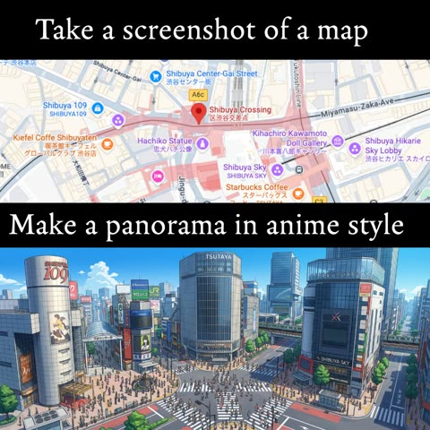</a>

仅以一张地图截图作为视觉输入，再用一句指令指定全景和动漫风格。模型读取地图上的街道布局与地标标注，并将其重建为连贯的动漫街景。

Nano Banana 2 · 上传图改图 · 出处: [@icreatelife on X](https://x.com/icreatelife/status/2027085364872024311) · 936 赞，统计于 2026-10-29

[`map-to-scene`](pages/zh/tags.md#tag-map-to-scene) [`panorama`](pages/zh/tags.md#tag-panorama) [`anime`](pages/zh/tags.md#tag-anime) [`screenshot-reference`](pages/zh/tags.md#tag-screenshot-reference) [`cityscape`](pages/zh/tags.md#tag-cityscape)

<details><summary><b>提示词</b></summary>

```text
The coolest use-case for AI animation I found of new Nano Banana 2 is that you can screenshot a map and ask it to generate a panorama in anime / cartoon style.

Nano Banana 2 is fully supported in Adobe Firefly web

prompt: make me a panorama of this location in an anime style
```

</details>

<a id="gpt-image-risograph-rainy-bus-stop-illustration"></a>
### 孔版印刷风格的雨中公交站少女插画

<a href="https://x.com/Naiknelofar788/status/2051493607916589106"></a>

提示词只描述印刷特征：粗轮廓线、错位的油墨层、纸张颗粒，并限定两到三种颜色。再要求大面积留白和极简道具，模型便生成安静而克制的画面。

GPT Image 2 · 文生图 · 出处: [@Naiknelofar788 on X](https://x.com/Naiknelofar788/status/2051493607916589106) · 806 赞，统计于 2026-10-28

[`risograph`](pages/zh/tags.md#tag-risograph) [`minimal`](pages/zh/tags.md#tag-minimal) [`pastel`](pages/zh/tags.md#tag-pastel) [`print-texture`](pages/zh/tags.md#tag-print-texture) [`negative-space`](pages/zh/tags.md#tag-negative-space)

<details><summary><b>提示词</b></summary>

```text
A crisp, printmaking-like aesthetic with bold outlines and natural deformation. Pastel color palette, vintage print texture, slightly misaligned ink layers, and rough paper grain. A calm poster composition with generous negative space rather than filling the frame. Props and background kept minimal. Color theme 2–3 colors.
```

</details>

<a id="gpt-image-korean-doodle-self-portrait-selfie"></a>
### 韩系水墨涂鸦风自画像

<a href="https://x.com/Ciri_ai/status/2051350955481042967">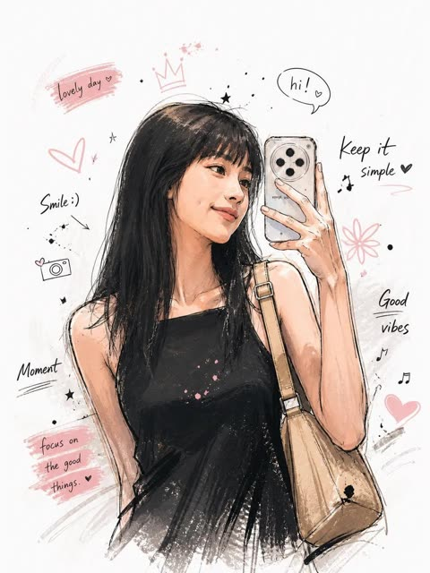</a>

提示词让模型想象使用者本人，角色设计开放。叠加墨点、松散线条、粉彩加墨色明暗、漫画素描质感等风格词，再配极简白底与零散的象征性涂鸦元素。

GPT Image 2 · 文生图 · 出处: [@Ciri_ai on X](https://x.com/Ciri_ai/status/2051350955481042967) · 671 赞，统计于 2026-10-29

[`korean-style`](pages/zh/tags.md#tag-korean-style) [`ink-doodle`](pages/zh/tags.md#tag-ink-doodle) [`self-portrait`](pages/zh/tags.md#tag-self-portrait) [`pastel`](pages/zh/tags.md#tag-pastel) [`sketch`](pages/zh/tags.md#tag-sketch)

<details><summary><b>提示词</b></summary>

```text
GPT Image 2 on Chatgpt

Prompt:  Create an illustration of how you imagine “me”:

Korean-style illustration, with a distinct and memorable character design, natural and expressive facial emotions, half-body composition, and a dynamic pose. The clothing should feature intricate, refined details. Use a hand-drawn doodle style with ink splashes, loose and spontaneous linework, and a mix of pastel tones with ink shading. Aim for a comic sketch texture. Keep the background minimal and white, with symbolic decorative elements scattered around the character. The overall atmosphere should be strong and evocative, with high detail and high quality.
```

</details>

<a id="nano-banana-geometric-fashion-illustration"></a>
### 质感几何风全身时装插画

<a href="https://x.com/ChillaiKalan__/status/2109123213351632977"></a>

服装逐件描述，再用一小串禁止项排除写实和 3D。

Nano Banana 2.1 · 文生图 · 出处: [@ChillaiKalan__ on X](https://x.com/ChillaiKalan__/status/2109123213351632977) · 494 赞，统计于 2026-10-27

[`fashion`](pages/zh/tags.md#tag-fashion) [`geometric`](pages/zh/tags.md#tag-geometric) [`editorial`](pages/zh/tags.md#tag-editorial)

<details><summary><b>提示词</b></summary>

```text
Create a stylish, full-body editorial fashion illustration of a young woman in a modern casual outfit, using a minimalist, textured geometric art style. She wears an oversized forest-green hoodie, wide-leg blue denim jeans with folded cuffs, and chunky brown sneakers. Her dark hair is tied in a neat low bun. She carries a bouquet of vibrant pink roses wrapped in white paper, a takeaway coffee cup, and a black shoulder bag. Show her walking naturally in a relaxed pose, viewed from a three-quarter rear angle, with soft, elegant body proportions and simplified facial details.

Use a warm ivory background with plenty of negative space, soft ground shadows, subtle paper grain, visible brush textures, and angular polygonal shading across the clothing and shoes. The color palette features deep forest green, denim blue, warm brown, cream, and vivid pink. Soft diffused lighting, clean composition, contemporary lifestyle magazine aesthetic, hand-painted digital illustration, refined edges, artistic fabric textures, vertical 3:4 composition, high detail. No photorealism, no 3D rendering, no extra objects, no text or watermark.
```

</details>

**[全部 105 条](pages/zh/image-illustration.md)**

<a id="img-comic"></a>
## 漫画与分镜

<a id="nano-banana-fluffy-creatures-treehouse-story"></a>
### 三只毛茸茸生物规划树屋

<a href="https://x.com/GoogleAI/status/2027094912357761319">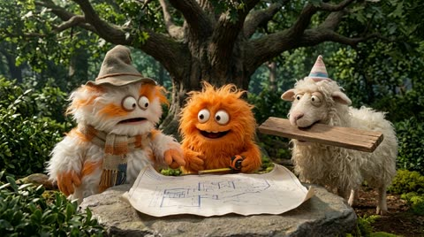</a>

要求生成带情绪起伏的四段故事，固定 16:9 画幅并逐张生成。明确要求三个角色保持一致的形象，让各画面中的外观稳定不变。

Nano Banana 2 · 文生图 · 出处: [@GoogleAI on X](https://x.com/GoogleAI/status/2027094912357761319) · 1,256 赞，统计于 2026-10-28

[`storyboard`](pages/zh/tags.md#tag-storyboard) [`multi-image`](pages/zh/tags.md#tag-multi-image) [`consistent-characters`](pages/zh/tags.md#tag-consistent-characters) [`fluffy-creatures`](pages/zh/tags.md#tag-fluffy-creatures) [`16-9`](pages/zh/tags.md#tag-16-9)

<details><summary><b>提示词</b></summary>

```text
Create a funny 4-part story featuring 3 fluffy creatures building a treehouse. The story has emotional highs and lows and ends in a happy moment. Maintain consistent identity across the 3 characters. Generate 4 images in 16:9 format, one at a time.
```

</details>

<a id="gpt-image-football-dream-storyboard-bedroom-wake"></a>
### 足球梦的分镜图，结局是醒在卧室

<a href="https://x.com/rovvmut_/status/2049900959028109567">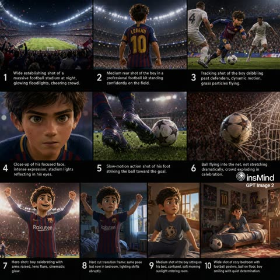</a>

每一格都写明镜头类型，如全景建立镜头、背面中景、慢动作和硬切，给模型一份清晰的分镜表。光线从冷色球场灯光转为暖色晨光，让梦境与醒来两个世界一眼可辨。

GPT Image 2 · 文生图 · 出处: [@rovvmut_ on X](https://x.com/rovvmut_/status/2049900959028109567) · 542 赞，统计于 2026-10-29

[`storyboard`](pages/zh/tags.md#tag-storyboard) [`football`](pages/zh/tags.md#tag-football) [`animation`](pages/zh/tags.md#tag-animation) [`cinematic`](pages/zh/tags.md#tag-cinematic)

<details><summary><b>提示词</b></summary>

```text
Video Prompt: Use the provided storyboard image
@image1
 as the primary visual reference for composition, framing, and scene progression. Generate a 15-second stylized 3D animated cinematic video that follows the exact sequence and visual storytelling of the storyboard.
Style:
High-quality 3D animation, cinematic realism, expressive character design, soft depth of field, realistic physics, subtle motion blur, dramatic lighting contrast
Theme:
A young boy dreams he is a world-famous football player scoring a winning goal in a packed stadium, but wakes up in his bedroom and realizes it was just a dream
Execution Instructions:
Match all camera angles, framing, and transitions from the storyboard image
Maintain consistent character design between dream and real-world scenes
Ensure smooth cinematic camera motion (tracking shots, slow push-ins, slight rotations)
Use slow motion during key action moments (dribble, kick, goal)
Add realistic environmental effects: grass particles, stadium lights, crowd motion
Scene Flow (15s timing):
0–5s: Stadium sequence — wide establishing → dribble → close-up intensity
5–9s: Goal moment — kick → ball hits net → crowd erupts
9–11s: Celebration hero shot — dramatic lighting, lens flare, slow-motion
11–13s: Hard cut transition — stadium to bedroom, same pose match-cut
13–15s: Bedroom reveal — soft morning light, calm mood, subtle smile
Lighting:
Dream: high-contrast stadium lights, cool tones, bright highlights
Reality: warm, soft natural sunlight, grounded and शांत atmosphere
Mood & Tone:
Start epic and high-energy, then shift into calm, intimate, slightly emotional ending.
```

</details>

<a id="gpt-image-suited-man-manga-action-comic-page"></a>
### 西装男子指向前方的漫画页面

<a href="https://x.com/SimplyAnnisa/status/2053123747604033667">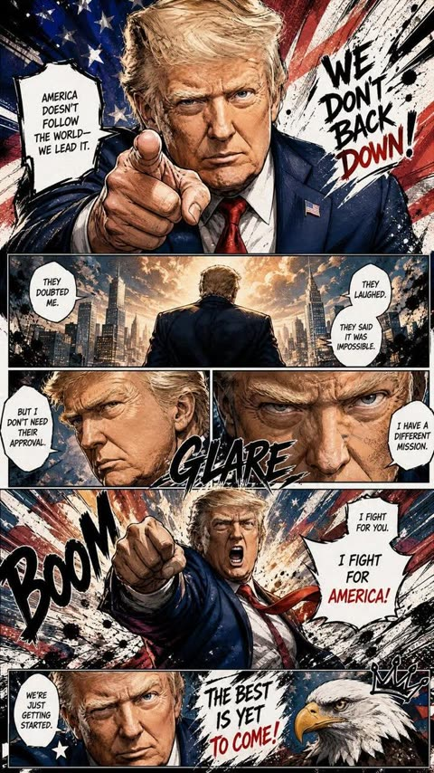</a>

提示词规定了 9:16 的页面、5 到 7 格分镜，并列出速度线、冲击帧和拟声词等元素，使模型生成完整的漫画页而不是单幅插画。以参考照片锁定人物长相，让特写和远景中的面部保持一致。

GPT Image 2 · 上传图改图 · 出处: [@SimplyAnnisa on X](https://x.com/SimplyAnnisa/status/2053123747604033667) · 455 赞，统计于 2026-10-29

[`manga`](pages/zh/tags.md#tag-manga) [`comic-page`](pages/zh/tags.md#tag-comic-page) [`reference-photo`](pages/zh/tags.md#tag-reference-photo) [`sound-effects`](pages/zh/tags.md#tag-sound-effects)

<details><summary><b>提示词</b></summary>

```text
GPT image 2 on ChatGPT

Prompt: Create a full-page colored manga illustration based on the person in the reference photo. Use authentic manga page composition with 5–7 dynamic connected panels on a single page. Include cinematic storytelling, dramatic perspective, expressive emotions, dynamic poses, speed lines, impact frames, close-up shots, and intense visual flow.Add English comic-style sound effects, handwritten dialogue bubbles, ink splatter strokes, halftone textures, rough comic sketch lines, and graffiti-inspired brushwork. Blend vibrant colors with manga-style shading and strong contrast. Emphasize the character’s personality and aura with symbolic visual elements and atmospheric energy effects. Highly detailed, emotional, stylish, energetic, professional manga aesthetic with clean white negative space mixed with chaotic ink textures.Hand-drawn look, free-flowing lines, immersive composition, high quality. Aspect ratio 9:16 HD.
```

</details>

<a id="gpt-image-shampoo-commercial-storyboard-sheet"></a>
### 十格去屑洗发水广告分镜板

<a href="https://x.com/AiwithLariab/status/2078686427219697781">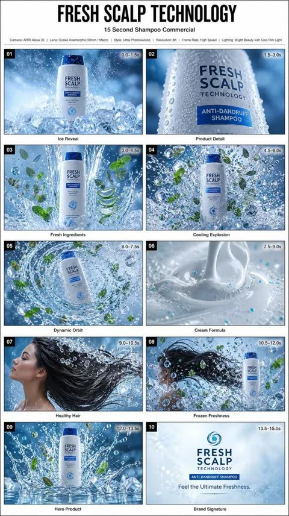</a>

用白底 2 乘 5 网格固定每格的编号、时间戳和字幕，每个场景单独写镜头内容并分配 1.5 秒。最后补充相机、灯光和色板，整张分镜可直接交给视频模型。

GPT Image 2 · 文生图 · 出处: [@AiwithLariab on X](https://x.com/AiwithLariab/status/2078686427219697781) · 412 赞，统计于 2026-10-29

[`storyboard`](pages/zh/tags.md#tag-storyboard) [`commercial`](pages/zh/tags.md#tag-commercial) [`shampoo`](pages/zh/tags.md#tag-shampoo) [`product-ad`](pages/zh/tags.md#tag-product-ad) [`grid`](pages/zh/tags.md#tag-grid)

<details><summary><b>提示词</b></summary>

```text
Create a professional Hollywood advertising storyboard sheet for a premium anti-dandruff shampoo commercial. The storyboard consists of 10 ultra-realistic cinematic frames arranged in a clean 2×5 grid on a white presentation board. Each frame has a thin black border, bold scene number (01–10), duration timestamp, and a short production caption underneath. Every panel is rendered in vibrant photorealistic color with premium advertising quality, like an international beauty campaign.Title: "FRESH SCALP TECHNOLOGY" Subtitle: "15 Second Shampoo Commercial" Scene 01 (0.0–1.5s) A premium shampoo bottle slowly emerges from crystal-clear ice with cool blue lighting. Fine water mist surrounds the bottle while frozen droplets sparkle in the air. Caption: Ice Reveal Scene 02 (1.5–3.0s) Extreme macro close-up of the shampoo bottle. Crystal-clear condensation droplets cover the surface while cool rim lighting highlights the premium packaging. Caption: Product DetailScene 03 (3.0–4.5s) Powerful streams of crystal water burst upward around the bottle. Fresh mint leaves, eucalyptus branches, aloe vera, and botanical extracts begin floating gracefully. Caption: Fresh Ingredients Scene 04 (4.5–6.0s) A dramatic explosion of water splashes, floating ice crystals, mint leaves, eucalyptus, microscopic cooling particles, and refreshing mist surrounds the bottle in ultra slow motion. Caption: Cooling Explosion Scene 05 (6.0–7.5s)The camera performs a smooth cinematic orbit around the bottle while thousands of sparkling water droplets rotate together with fresh botanical elements. Caption: Dynamic Orbit Scene 06 (7.5–9.0s) Extreme macro shot showing creamy shampoo pouring in slow motion with silky texture, tiny bubbles, and glowing freshness particles. Caption: Cream Formula Scene 07 (9.0–10.5s) Beautiful flowing black hair moves naturally through a powerful stream of crystal-clear water.The hair becomes silky, shiny, healthy, and free-flowing while cool mist fills the background. Caption: Healthy Hair Scene 08 (10.5–12.0s) Everything freezes mid-air. Water splashes, ice cubes, mint leaves, eucalyptus, freshness particles, and flowing hair create a perfectly balanced premium composition. Caption: Frozen Freshness Scene 09 (12.0–13.5s)Hero shot of the shampoo bottle standing proudly on reflective ice surrounded by suspended water splashes, fresh botanicals, and glowing blue light. Caption: Hero Product Scene 10 (13.5–15.0s) Minimal icy background. Brand logo and tagline fade in while cool mist slowly disappears. Tagline: "Feel the Ultimate Freshness." Caption: Brand Signature Visual Language:Inspired by world-class refreshing shampoo campaigns emphasizing crystal-clear water, cooling freshness, healthy hair, premium beauty photography, vibrant botanical ingredients, sparkling droplets, dynamic water physics, clean laboratory aesthetic, and modern beauty advertising. Color Palette: Crystal White Ice Blue Fresh Mint Green Silver Highlights Camera: ARRI Alexa 35 Cooke Anamorphic 50mm High-speed cinematography Macro lens Slow motion HDR Lighting: Bright beauty lighting Cool rim lightVolumetric mist Crystal reflections Style: Ultra photorealistic Hollywood commercial production Premium beauty campaign Luxury cosmetic advertising Advertising agency presentation board 8K Masterpiece
```

</details>

**[全部 20 条](pages/zh/image-comic.md)**

<a id="img-photo-to-art"></a>
## 照片转艺术风格

<a id="gpt-image-photo-to-watercolor-travel"></a>
### 上半旅行照片，下半同一场景水彩画

<a href="https://x.com/MahnoorAi12/status/2102724961408626735"></a>

要求上下两半描绘完全相同的场景，让照片与水彩的构图、人物和姿态保持一致。大面积象牙白纸面留白加上小字手写标题，营造旅行手账的质感。

GPT Image 2.5 · 上传图改图 · 出处: [@MahnoorAi12 on X](https://x.com/MahnoorAi12/status/2102724961408626735) · 2,264 赞，统计于 2026-10-27

[`watercolor`](pages/zh/tags.md#tag-watercolor) [`travel`](pages/zh/tags.md#tag-travel) [`split-composition`](pages/zh/tags.md#tag-split-composition)

<details><summary><b>提示词</b></summary>

```text
Create a refined editorial travel-art composition based on a reference photograph. The image is divided vertically into two parts: the upper section is a realistic cinematic travel photograph, while the lower section transforms the exact same scene into a delicate hand-painted watercolor illustration.
Upper section: authentic candid travel photography, natural daylight, soft shadows, subtle film grain, realistic textures, sophisticated European atmosphere, documentary-style composition, people naturally walking through the scene, beautiful architectural details, slightly muted elegant colors, high-end travel magazine photography.
Lower section: a minimalist handmade watercolor painting of the exact same scene, preserving the recognizable composition, architecture, people, poses, perspective and major visual elements from the photograph. Loose translucent watercolor washes, delicate ink details, visible paper texture, soft edges, imperfect brushwork, subtle pigment bleeding, airy negative space, understated pastel tones, artistic but realistic.
Leave generous warm ivory/off-white textured paper space surrounding the watercolor illustration. Add a small elegant handwritten caption near the bottom, such as “summer days” or “a quiet afternoon”, with a thin minimalist horizontal line underneath.
Overall aesthetic: luxury travel journal, fine-art watercolor postcard, contemporary editorial design, nostalgic European summer, understated elegance, tactile handmade paper, sophisticated and serene.
Portrait orientation, clean composition, premium art direction, no clutter, no borders, natural proportions, highly detailed photograph transitioning into an airy watercolor illustration.
```

</details>

<a id="gpt-image-pet-papercraft-cube-template"></a>
### 高地牛纸模立方体玩具展开图

<a href="https://x.com/icreatelife/status/2101353488408006830"></a>

提示词把上传照片限定为动物外观的唯一来源，并逐一列出平铺的各个部件及折线、粘合片和裁切边。结尾列出不得更改的内容，用来保住动物的身份特征和毛发质感。

GPT Image 2.5 · 上传图改图 · 出处: [@icreatelife on X](https://x.com/icreatelife/status/2101353488408006830) · 1,178 赞，统计于 2026-10-27

[`papercraft`](pages/zh/tags.md#tag-papercraft) [`cube-toy`](pages/zh/tags.md#tag-cube-toy) [`pet`](pages/zh/tags.md#tag-pet) [`template`](pages/zh/tags.md#tag-template) [`fur-texture`](pages/zh/tags.md#tag-fur-texture)

<details><summary><b>提示词</b></summary>

```text
Use my uploaded pet photo as the only source of the animal’s appearance. Create a realistic printable papercraft cube toy template of my pet, preserving 100% its identity and unique features: fur color, fur pattern, eyes, face shape, ears, body proportions, markings and expression.

Transform my pet into a handmade paper craft 3D model (low-poly cube style) like a DIY papercraft template. Show the unfolded cut-out template pieces laid flat on a white background: head, body, legs, ears and tail separated, with folding lines, tabs and cutting edges clearly visible.

The printed texture on the paper pieces must use my pet’s real fur texture and colors, so when assembled it becomes a small cube-shaped 3D figure of my exact pet.

Include:

cube-shaped head with my pet’s real face on it

cube-shaped body with realistic fur texture

four legs matching my pet’s appearance

ears with correct shape and inner ear details

tail matching my pet’s size and color pattern

Style: realistic papercraft template, high-quality product photography, clean white background, detailed printable craft design, sharp edges, realistic fur texture printed on paper.

Do not change my pet’s appearance. Do not turn it into a different animal, cartoon, plush toy or generic cat/dog. It must look like my actual pet converted into a cube papercraft model
```

</details>

<a id="gpt-image-editorial-illustration-poster"></a>
### 上半原照下半极简手绘纸面插画的拼版海报

<a href="https://x.com/icreatelife/status/2099343607492702258"></a>

严格上下等分，上半忠实保留原照，下半把主体重绘成粗纸上的小幅手绘。主体只占百分之十到二十，配色限定为取自原照的四种以内，周围留出大片空白。

GPT Image 2.5 · 上传图改图 · 出处: [@icreatelife on X](https://x.com/icreatelife/status/2099343607492702258) · 1,165 赞，统计于 2026-10-27

[`editorial`](pages/zh/tags.md#tag-editorial) [`illustration`](pages/zh/tags.md#tag-illustration) [`photo-to-art`](pages/zh/tags.md#tag-photo-to-art)

<details><summary><b>提示词</b></summary>

```text
Create one independent high-end editorial poster for each uploaded photo. Do not combine multiple photos into a collage. Each photo must be processed and output as a separate poster.

OVERALL FORMAT

Strict 3:4 vertical composition.

Divide the canvas horizontally into two exactly equal sections, with a precise 1:1 height ratio.

The top half occupies exactly 50% of the canvas.

The bottom half occupies exactly 50% of the canvas.

The two sections should feel visually connected as one refined art publication cover.

TOP HALF — ORIGINAL PHOTOGRAPH

Preserve the original photograph as faithfully as possible.

Keep the main composition, subjects, identity, facial features, body proportions, poses, expressions, clothing, objects, and spatial relationships unchanged.

Preserve the realistic photographic texture, natural lighting, shadows, atmosphere, and original color mood.

Apply only subtle, sophisticated editorial color grading, creating the feeling of a premium magazine photograph, contemporary art book, or high-end independent publication.

The image should remain photorealistic and authentic, never overly retouched or artificially stylized.

If necessary to fit the 3:4 composition naturally, extend the sky, ground, walls, or surrounding environmental background.

Background extension must feel seamless and photographic.

Never stretch, distort, reshape, replace, or alter the main subject.

BOTTOM HALF — MINIMAL HAND-DRAWN PAPER ILLUSTRATION

Extract the most recognizable visual elements from the original photograph and reinterpret them as a minimalist hand-drawn paper-cover illustration.

Preserve:

The most recognizable subject

Essential silhouette and proportions

Key pose or gesture

Important objects

The core narrative relationship between people and objects

Highly simplify the image. Remove unnecessary details and retain only the visual information needed for immediate recognition.

Use:

Delicate, slightly imperfect hand-drawn lines

A small number of bold, clearly defined acrylic-style flat color shapes

Rough paper texture

Visible handmade brush marks

Slightly irregular, organic edges

Subtle imperfections that make it feel genuinely handmade

The main illustrated subject should be small, centered, and carefully composed, occupying approximately 10–20% of the bottom half.

Leave a large amount of negative space around the illustration.

The background should primarily resemble:

Rough white paper

Warm off-white paper

Pale natural paper

Minimal editorial book-cover stock

Use only a few lines or small color shapes to suggest the surrounding environment.

COLOR PALETTE

Extract the dominant colors directly from the original photograph.

Compress the palette into no more than 4 main colors.

Keep the colors restrained, sophisticated, and harmonious.

Use bold but controlled flat color blocks.

Avoid excessive color variation.

Preserve subtle paper grain and handmade brush texture.

The illustration should visually feel like a simplified color interpretation of the photograph.

TYPOGRAPHY

A small amount of simple typography may be included when appropriate.

Possible elements:

A short title

Keyword

Object name

Location

Year

Number

Short phrase

Text should be minimal, understated, and editorial.

Typography should naturally interact with the large areas of negative space and the small illustration, evoking:

Art book covers

Independent publishing

Contemporary editorial design

Thoughtful children's picture books

Do not force text into the composition if it does not naturally fit the photograph.

VISUAL LANGUAGE

The final poster should feel:

Quiet · Poetic · Refined · Minimal · Innocent · Relaxed · Artistic · Thoughtful · High-recognition · Premium
```

</details>

<a id="gpt-image-photo-to-ink-sketch-artbook-page"></a>
### 上方实景照片配下方同场景墨线速写画册页

<a href="https://x.com/Taaruk_/status/2093738868436840604">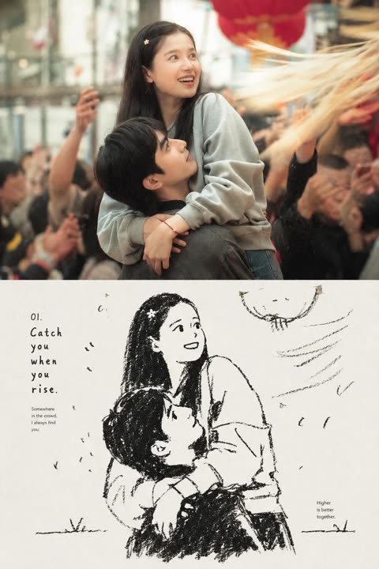</a>

提示词把页面上下分成写实照片和同一场景的手绘墨线重绘，并锁定参考图的人物、姿势、服装与构图。奶油色留白、粗糙排线、小号编号标题等纸张、线条和排版细节让它有日记画册的版式感。

GPT Image 2 · 上传图改图 · 出处: [@Taaruk_ on X](https://x.com/Taaruk_/status/2093738868436840604) · 874 赞，统计于 2026-10-29

[`photo-to-sketch`](pages/zh/tags.md#tag-photo-to-sketch) [`artbook`](pages/zh/tags.md#tag-artbook) [`ink-illustration`](pages/zh/tags.md#tag-ink-illustration) [`editorial-layout`](pages/zh/tags.md#tag-editorial-layout) [`reference-image`](pages/zh/tags.md#tag-reference-image)

<details><summary><b>提示词</b></summary>

```text
Create a nostalgic editorial photo-to-sketch artbook page based on the reference image. Preserve the same subjects, pose, facial expressions, clothing, composition, and emotional atmosphere from the original photograph. Divide the page vertically into two connected sections: the upper section is a cinematic, ultra-realistic photograph with soft natural lighting, subtle film grain, shallow depth of field, authentic colors, and an intimate candid feeling; the lower section transforms the exact same scene and characters into a loose black-and-white hand-drawn ink illustration on warm off-white textured paper, with expressive imperfect lines, rough cross-hatching, minimal shading, and a handmade sketchbook aesthetic. Add tasteful editorial typography around the illustration, including a small numbered title, short poetic handwritten-style caption, and tiny documentary-style notes, creating the feeling of a premium contemporary photography journal or Japanese-inspired visual diary. Keep generous cream-colored negative space, subtle paper texture, slightly imperfect ink printing, understated vintage layout, sophisticated minimalist graphic design, emotionally warm and cinematic, cohesive transition between photograph and drawing, high detail, natural proportions, authentic human anatomy, no watermark, no logos.
```

</details>

**[全部 99 条](pages/zh/image-photo-to-art.md)**

<a id="img-architecture"></a>
## 建筑与室内

<a id="nano-banana-floor-plan-rising-miniature-diner"></a>
### 从建筑平面图中升起的复古餐厅微缩场景

<a href="https://x.com/AllaAisling/status/2029242137397678368">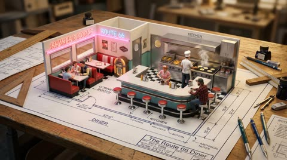</a>

模板先设定画在绘图桌上的平面图，再声明墙体既是线条也是实体隔断，让图纸与微缩场景融为一体。房间、家具、光线等占位变量加上绘图工具清单，让画面既具体又可复用。

Nano Banana 2 · 文生图 · 出处: [@AllaAisling on X](https://x.com/AllaAisling/status/2029242137397678368) · 547 赞，统计于 2026-10-28

[`floor-plan`](pages/zh/tags.md#tag-floor-plan) [`miniature`](pages/zh/tags.md#tag-miniature) [`architecture`](pages/zh/tags.md#tag-architecture) [`template`](pages/zh/tags.md#tag-template) [`blueprint`](pages/zh/tags.md#tag-blueprint)

<details><summary><b>提示词</b></summary>

```text
Prompt Studio: Architectural Floor Plan with Nano Banana 2 in Firefly

An architectural floor plan of {BUILDING_TYPE} spread across a drafting table, with the spaces rising into inhabitable miniature. {ROOM_1} emerges with {FURNITURE_1} and {ACTIVITY_1} in progress, {ROOM_2} rises with {DESIGN_ELEMENT} and {HUMAN_MOMENT}, {ROOM_3} pushes up with {DETAIL_1} and {LIGHTING_1}. Walls exist as both lines and actual partitions simultaneously. Sight lines marked on the plan become actual views between spaces. The mechanical systems in the plan, HVAC, plumbing, electrical, pulse with invisible function. Human circulation patterns appear as ghosted movement trails. Architectural scale figures become actual tiny inhabitants living their tiny lives. Section cuts reveal vertical relationships. The architect's tools surround: scales, pencils, trace paper. Golden design studio light, the plan as promise and proof, 8K, architecture as life container.

Check ALTs for ideas 👇
@AdobeFirefly
```

</details>

<a id="gpt-image-architectural-specimen-card-survey-landmark"></a>
### 长城建筑勘测标本卡

<a href="https://x.com/Naiknelofar788/status/2094626691234816034"></a>

以上传照片为参考，层级清晰：大幅单色墨线地标、一小块彩色照片细节、背后的等高线地图。限定调色并只用一个点缀色，只列少量小号档案式文字，再明确列出要避开的风格，让整张卡片保持克制的博物馆目录感。

GPT Image 2 · 上传图改图 · 出处: [@Naiknelofar788 on X](https://x.com/Naiknelofar788/status/2094626691234816034) · 512 赞，统计于 2026-10-28

[`architecture`](pages/zh/tags.md#tag-architecture) [`specimen-card`](pages/zh/tags.md#tag-specimen-card) [`archival`](pages/zh/tags.md#tag-archival) [`topographic-map`](pages/zh/tags.md#tag-topographic-map) [`ink-drawing`](pages/zh/tags.md#tag-ink-drawing)

<details><summary><b>提示词</b></summary>

```text
Use the uploaded photo as the primary reference. Create a sophisticated 4:3 landscape architectural specimen card inspired by museum archives, architectural surveys, and vintage scientific documentation.

Keep the original location recognizable, but transform the presentation into a curated architectural study rather than a normal travel poster.

* Place the main landmark as a large monochrome architectural cutout or finely detailed ink drawing.
* Add a smaller original-color photographic fragment showing one distinctive detail of the location.
* Include a simplified topographic contour map behind the architecture.
* Add tiny numbered reference points, measurement marks, arrows, elevation lines, and architectural annotation symbols.
* Use an aged cream paper background with subtle grain and imperfections.
* Palette: black, warm beige, muted olive, and one restrained accent color extracted from the landmark.
* Typography should be small, elegant, and archival: location name, country, year, No. 019, and 3 descriptive keywords.
* Create subtle imperfections resembling screen printing, drafting ink, pencil marks, and old paper.
* Keep generous negative space and a sophisticated museum-catalog aesthetic.

Important: Avoid postcard layouts, circular stamps, tourist graphics, excessive text, cartoon styling, glossy effects, 3D rendering, and overly detailed illustrations.

Overall mood:
architectural archive × museum specimen × old survey document × contemporary editorial design.
```

</details>

<a id="nano-banana-exploded-architecture-library-room"></a>
### 悬浮在黑暗中的爆炸视图图书馆房间

<a href="https://x.com/AllaAisling/status/2035390729527378146">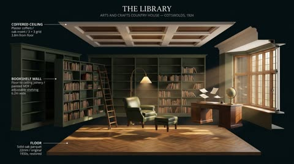</a>

用方括号模板指定房间类型,并按天花板、墙、地板、家具的顺序描述拆解。光线保持各元素原有光源,标注只限建筑构件,包含表面、材质和尺寸。

Nano Banana 2 · 文生图 · 出处: [@AllaAisling on X](https://x.com/AllaAisling/status/2035390729527378146) · 453 赞，统计于 2026-10-28

[`exploded-view`](pages/zh/tags.md#tag-exploded-view) [`architecture`](pages/zh/tags.md#tag-architecture) [`interior`](pages/zh/tags.md#tag-interior) [`labels`](pages/zh/tags.md#tag-labels) [`dark-background`](pages/zh/tags.md#tag-dark-background)

<details><summary><b>提示词</b></summary>

```text
Prompt Studio: Exploded Architecture, with Nano Banana 2 in Firefly

[ROOM TYPE] pulled apart in 3D, every surface and object  floating at its exact position, slightly separated.  EXPLOSION: ceiling lifted, four walls sliding outward,  floor dropped, furniture floating in place,  objects orbiting their surfaces, light sources  still emitting across the exploded void.  The ghost of the room readable in the arrangement.  Labels on architectural elements only: "[SURFACE]" / "[MATERIAL]" / "[DIMENSION]"  LIGHTING: each element still lit by its original source,  windows casting light across the gap, lamps throwing cones  into empty space.  BACKGROUND: deep dark, the room floats in void. TITLE: "[ROOM NAME]" / SUBTITLE: "[BUILDING TYPE] [PERIOD]"  Mood: architectural model that became a universe. 4K, extraordinary spatial clarity, tack sharp.

Check ALTs for ideas 👇
@AdobeFirefly
```

</details>

<a id="gpt-image-handcrafted-landmark-miniature-diorama"></a>
### 白色纸面上的手工伦敦地标微缩场景

<a href="https://x.com/Naiknelofar788/status/2095336325977444847">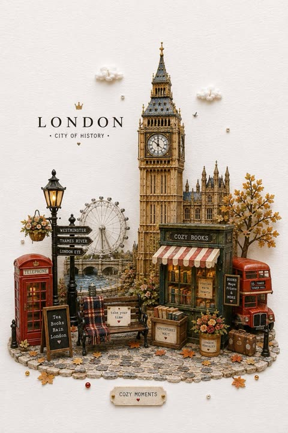</a>

用方括号槽位替换地标和城市名，一条提示词即可复用为模板。纸艺、黏土和细小瑕疵等材质词，加上白纸留白与柔和棚拍光，让画面像真实的微缩模型。

GPT Image 2 · 文生图 · 出处: [@Naiknelofar788 on X](https://x.com/Naiknelofar788/status/2095336325977444847) · 437 赞，统计于 2026-10-29

[`miniature`](pages/zh/tags.md#tag-miniature) [`diorama`](pages/zh/tags.md#tag-diorama) [`landmark`](pages/zh/tags.md#tag-landmark) [`paper-craft`](pages/zh/tags.md#tag-paper-craft) [`template`](pages/zh/tags.md#tag-template)

<details><summary><b>提示词</b></summary>

```text
Create a whimsical handcrafted miniature diorama featuring [ICONIC STRUCTURE] as the main focal point. Place the structure in a cozy, highly detailed tiny world with miniature streets, trees, flowers, lamps, benches, small shops, seasonal decorations and subtle objects that represent the location. Use a soft warm color palette, realistic handmade textures, tiny imperfections, paper-craft and clay-like details. Everything should feel physically miniature and lovingly hand-built. Set the entire scene against a clean white textured paper background with generous negative space. Add small elegant typography reading “[CITY / COUNTRY]” and a few tiny location-inspired signs. Soft diffused studio lighting, gentle shadows, charming storybook atmosphere, premium collectible miniature art, highly detailed, vertical 4:5 composition, no people, no photorealistic background.
```

</details>

**[全部 23 条](pages/zh/image-architecture.md)**

<a id="img-map"></a>
## 地图

<a id="gpt-image-isometric-anime-world-map-diorama-poster"></a>
### 等距视角动漫世界地图微缩模型海报

<a href="https://x.com/TechieBySA/status/2091529289283866634"></a>

用分支条件分别处理虚构世界和真实地点，让同一模板能切出正确的地图轮廓。版面留白、标题层级和移轴摄影质感都有明确规则，成图风格统一，另可上传参考地图提高准确度。

GPT Image 2 · 文生图 · 出处: [@TechieBySA on X](https://x.com/TechieBySA/status/2091529289283866634) · 6,709 赞，统计于 2026-10-28

[`isometric`](pages/zh/tags.md#tag-isometric) [`diorama`](pages/zh/tags.md#tag-diorama) [`anime-world`](pages/zh/tags.md#tag-anime-world) [`miniature`](pages/zh/tags.md#tag-miniature) [`editorial-poster`](pages/zh/tags.md#tag-editorial-poster)

<details><summary><b>提示词</b></summary>

```text
Simply replace [ANIME]:✨

(Upload a reference image of the map for enhanced accuracy)

“Ultra-detailed photorealistic isometric miniature scale-model diorama of the world from [ANIME], floating on a pure off-white studio background with a soft drop shadow beneath.

If [ANIME] has a fictional world map: the diorama takes the exact silhouette shape of that fictional continent, island or region, extruded downward into a thick slab of raw rock and earth with rough natural cliff-like edges, like the world physically cut out and lifted. The shape matches the canonical map boundary precisely.

If [ANIME] is set in a real or semi-real world: the diorama takes the exact geographic silhouette shape of the primary city, region or country where the story is set, extruded into a thick rock slab with rough cliff edges.

The entire top surface faithfully recreates the complete world of [ANIME] with full anime accuracy: every region, city, landmark, building, terrain feature, road and environment in its exact canonical position as established in the show. Every iconic location is instantly recognizable to any fan — labeled with small readable location markers. The architecture, environment design, building styles, color palette and atmosphere must be completely faithful to the visual world of [ANIME] — not Western or generic realistic, but distinctly true to how this anime world looks and feels. Every location a fan would recognize is present and accurately placed.

Dense micro-detail throughout: tiny figures in show-accurate character designs and clothing, vehicles or creatures authentic to the world, individual trees and foliage, roads and paths between locations, flags and faction symbols, any distinctive environmental features unique to this anime world.

Style: hyper-realistic tilt-shift miniature photography — extremely sharp, everything in focus, no blur. Soft warm lighting from above, gentle diffuse shadows. Colors match the anime's authentic visual palette faithfully — rich, saturated and true to the show's identity.

Layout: the shaped diorama floats centered in the lower two-thirds of the frame, clear margins on all sides, never touching the frame edges. Upper third is empty off-white space with minimalist editorial typography, centered: small wide-tracked caps with the world or region name at the very top, then [ANIME] directly below in a bold condensed sans-serif in medium charcoal grey — large and dominant, the biggest text element, then small wide-tracked caps below with the studio name and year.

Minimalist editorial poster aesthetic, premium print quality, 4:5 aspect ratio.”
```

</details>

<a id="gpt-image-tv-show-world-isometric-map-diorama"></a>
### 电视剧世界等距地图微缩景观海报

<a href="https://x.com/TechieBySA/status/2091167214195847433"></a>

用一个可替换的剧名占位符，并按虚构或真实场景分支，让微缩景观贴合地图轮廓并挤出成岩石厚板。固定的版面把上方三分之一留白给宽字距小字和粗窄标题，海报更干净。

GPT Image 2 · 文生图 · 出处: [@TechieBySA on X](https://x.com/TechieBySA/status/2091167214195847433) · 2,678 赞，统计于 2026-10-28

[`isometric`](pages/zh/tags.md#tag-isometric) [`diorama`](pages/zh/tags.md#tag-diorama) [`tilt-shift`](pages/zh/tags.md#tag-tilt-shift) [`tv-show`](pages/zh/tags.md#tag-tv-show) [`template`](pages/zh/tags.md#tag-template)

<details><summary><b>提示词</b></summary>

```text
Simply replace [TV SHOW]:✨

“Ultra-detailed photorealistic isometric miniature scale-model diorama of the world from [TV SHOW], floating on a pure off-white studio background with a soft drop shadow beneath.

If [TV SHOW] has a fictional world map: the diorama takes the exact silhouette shape of that fictional continent or world, extruded downward into a thick slab of raw rock and earth with rough cliff-like edges. The top surface recreates the complete world geography exactly as established in the show — every region, kingdom, city, landmark, mountain range, forest and river in its correct canonical position.

If [TV SHOW] is set in the real world: the diorama takes the exact geographic silhouette shape of the real city, state or region where the show is primarily set, extruded into a thick rock slab. The top surface is filled entirely with locations, landmarks, routes and environments from the show rendered in the show's authentic color palette and visual atmosphere — not generic realistic geography but the world as it feels in the show.

In both cases: dense micro-detail throughout — tiny figures in show-accurate clothing, vehicles, buildings, roads, trees, all authentic to the show's world. Every iconic location a fan would recognize is present and accurately placed.

Style: hyper-realistic tilt-shift miniature photography — extremely sharp, everything in focus, no blur. Lighting and color palette match the show's visual identity exactly.

Layout: diorama floats centered in the lower two-thirds, clear margins all sides. Upper third is empty off-white space with minimalist editorial typography, centered: small wide-tracked caps with the location or world name at the very top, then [TV SHOW] in a bold condensed sans-serif in medium charcoal grey — large and dominant, then small wide-tracked caps below with network and year.

Minimalist editorial poster aesthetic, premium print quality, 4:5 aspect ratio.”
```

</details>

<a id="gpt-image-city-on-map"></a>
### 你的城市从地图上长出来

<a href="https://x.com/Preda2005/status/2098816499075145824"></a>

替换 `[COUNTRY]` 和 `[CITY]`，结尾的可选地标槽位用来指定要出现什么。

GPT Image 2.5 · 文生图 · 出处: [@Preda2005 on X](https://x.com/Preda2005/status/2098816499075145824) · 413 赞，统计于 2026-10-27

[`map`](pages/zh/tags.md#tag-map) [`miniature`](pages/zh/tags.md#tag-miniature) [`template`](pages/zh/tags.md#tag-template)

<details><summary><b>提示词</b></summary>

```text
Create a highly detailed 1:1 square image using GPT Image 2.5.

The main subject is a realistic top-down geographic map accurately showing the terrain, coastline, rivers, roads and surrounding region of [COUNTRY], with natural and believable map labeling.

At the real geographic location of [CITY], a miniature 3D city rises organically from the map surface, like a premium architectural diorama physically emerging from the map.

The miniature city should include the most recognizable features of [CITY], such as:

• iconic architecture
• important natural landmarks
• the characteristic city skyline
• local cultural elements
• recognizable regional details

All elements must feel naturally connected to the underlying map, as if the city is growing directly out of it, rather than being placed on top.

Keep the geography believable and visually coherent.

Style:
ultra-realistic miniature photography,
high-end collectible diorama,
cinematic macro photography,
realistic materials,
fine surface textures,
strong depth and scale,
premium travel editorial aesthetic.

Use shallow depth of field:
[CITY] should remain extremely sharp and detailed,
while the surrounding map gradually becomes softer and slightly blurred.

Use soft studio lighting, realistic natural shadows, elegant composition and subtle cinematic contrast.

The result should feel like a luxury macro photograph of a real handcrafted miniature city built directly into a geographic map.

MAP LABELS:
Use labels appropriate to [COUNTRY].
For example, if the country is Japan, use Japanese geographic labels.
Do not introduce unrelated languages.

OPTIONAL DETAILS:
[LANDMARK 1]
[LANDMARK 2]
[LANDMARK 3]
[LOCAL CULTURAL ELEMENT]
[NATURAL LANDMARK]
```

</details>

<a id="nano-banana-treasure-map-parchment"></a>
### 带发光 X 标记的立体藏宝图

<a href="https://x.com/AllaAisling/status/2027140622252179959">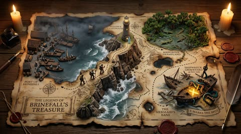</a>

先锁定羊皮纸底图，再写明每个地图元素的实体效果，例如撕边变悬崖、咖啡渍变湖泊，让平面地图变成具体场景。烛光、微缩探险队的构图和发光的 X 标记则把画面推向立体的场景模型感。

Nano Banana 2 · 文生图 · 出处: [@AllaAisling on X](https://x.com/AllaAisling/status/2027140622252179959) · 378 赞，统计于 2026-10-29

[`treasure-map`](pages/zh/tags.md#tag-treasure-map) [`parchment`](pages/zh/tags.md#tag-parchment) [`diorama`](pages/zh/tags.md#tag-diorama) [`firefly`](pages/zh/tags.md#tag-firefly)

<details><summary><b>提示词</b></summary>

```text
Gemini 3.1 (Nano Banana 2) is now in Firefly.
First image is Gemini 3.1, second image is Gemini 3, same prompt.
Which one do you like best?

Prompt Studio: Treasure Map, with Nano Banana, in Firefly

A hand-drawn treasure map on aged parchment, with the adventure erupting into three-dimensional quest. {STARTING_POINT} rises at the map's edge with {DEPARTURE_SCENE}, the dotted path becomes an actual trail traversing {TERRAIN_1} with {DANGER_1}, passing {LANDMARK_1} where {OBSTACLE_1} awaits. {TERRAIN_2} features {WILDLIFE_1} and {ENVIRONMENTAL_HAZARD}. The X marking the spot glows beneath {FINAL_LOCATION}, treasure partially visible, {GUARDIAN_ELEMENT} protecting it. Miniature expedition party frozen mid-journey at various points along the route. Torn edges of the map become cliffs. Coffee stains become lakes. Burn marks become scorched earth from battles past. Candlelight flicker, adventure novel lighting, 8K, the map as the story it promises.

See ALTs for ideas 👇
@AdobeFirefly
```

</details>

**[全部 15 条](pages/zh/image-map.md)**

<a id="img-collage"></a>
## 拼贴

<a id="gpt-image-failed-photos-grid"></a>
### 任意角色的九宫格失败抓拍照

<a href="https://x.com/DeepBlueX0/status/2099481521983995971"></a>

要求生成九宫格失败照片，模型会主动加入运动模糊、手指遮挡、歪斜构图和抓拍瞬间的表情，整组看起来像真实相册。替换角色占位符即可复用模板。

GPT Image 2.5 · 文生图 · 出处: [@DeepBlueX0 on X](https://x.com/DeepBlueX0/status/2099481521983995971) · 2,646 赞，统计于 2026-10-27

[`grid`](pages/zh/tags.md#tag-grid) [`humor`](pages/zh/tags.md#tag-humor) [`template`](pages/zh/tags.md#tag-template)

<details><summary><b>提示词</b></summary>

```text
Vertical 3×3 failed photos × {Character}
```

</details>

<a id="gpt-image-chibi-clone-sticker-running-diary"></a>
### 跑步照片配Q版分身贴纸与手绘涂鸦

<a href="https://x.com/Emmma___0/status/2050922155676930544"></a>

先锁定真人照片的身份、服装和背景，再限定添加5到8个Q版分身，每个分身对应不同的跑步动作与情绪。贴纸白边、柔和阴影加上白粉色涂鸦和手写短句，形成手帐日记风格，同时避免遮挡人脸。

GPT Image 2 · 上传图改图 · 出处: [@Emmma___0 on X](https://x.com/Emmma___0/status/2050922155676930544) · 959 赞，统计于 2026-10-28

[`chibi`](pages/zh/tags.md#tag-chibi) [`sticker`](pages/zh/tags.md#tag-sticker) [`scrapbook`](pages/zh/tags.md#tag-scrapbook) [`fitness`](pages/zh/tags.md#tag-fitness) [`photo-edit`](pages/zh/tags.md#tag-photo-edit)

<details><summary><b>提示词</b></summary>

```text
Create a high-quality “chibi clone sticker diary photo” based on the uploaded real-life image. Preserve the original person’s identity, face, hairstyle, hair color, outfit, body proportions, pose, lighting, and background. Do not alter facial features or turn the subject into a full illustration—maintain a realistic photo look.
Analyze the scene as a fitness/running lifestyle moment. Add 5–8 chibi mini clones of the same person around the subject, designed in a consistent kawaii sticker style (big head, small body, large expressive eyes, clean digital finish). Each clone must clearly resemble the real person (same hair, outfit, colors).
Design each chibi with different running-related actions and emotions: jogging, stretching, drinking water, feeling tired, cheering, giving thumbs up, celebrating completion. Ensure all poses are unique and contextually relevant.
Render each chibi as a sticker with white outlines, soft shadows, and a slightly floating effect. Arrange them around the subject and edges without covering the face or main body.
Add light hand-drawn doodles (hearts, sparkles, arrows, motion lines, circles) in white with subtle pink accents, keeping a clean scrapbook diary feel.
Include 5–8 short handwritten-style phrases matching a fitness mood (cute, energetic, encouraging). Use mostly white text with slight pink highlights and small decorative marks.
Composition: keep the real person as the central focus, surrounded by chibi stickers and doodles. The result should feel like a polished, playful, high-resolution social media lifestyle diary image—clean, balanced, and visually rich without clutter.
```

</details>

<a id="gpt-image-six-photo-portrait-grid"></a>
### 同一个人的六宫格人像

<a href="https://x.com/john_my07/status/2112737725430554781"></a>

先把人物写细一次，再写六个画面；要求不留缝，九宫格读起来像一整张。

GPT Image 2.5 · 文生图 · 出处: [@john_my07 on X](https://x.com/john_my07/status/2112737725430554781) · 651 赞，统计于 2026-10-27

[`portrait`](pages/zh/tags.md#tag-portrait) [`grid`](pages/zh/tags.md#tag-grid) [`consistency`](pages/zh/tags.md#tag-consistency)

<details><summary><b>提示词</b></summary>

```text
Create an ultra-realistic 6-photo portrait collage arranged in a seamless 3×2 grid, featuring a naturally beautiful young Portuguese woman in her early 20s. She has warm olive-toned skin, expressive hazel-brown eyes, long chestnut-brown hair with subtle natural highlights, soft face-framing layers, naturally full eyebrows, and delicate, distinctive facial features. Her appearance should feel authentic and individual, with realistic skin texture, tiny imperfections, and minimal everyday makeup.

Visual aesthetic: Effortless European Instagram photo dump, reminiscent of candid photographs taken on a Canon PowerShot G7 X Mark III. Direct built-in camera flash, crisp details, bright facial highlights, hard shadows, slightly imperfect framing, subtle digital noise, and a nostalgic early-2000s point-and-shoot feel.

Setting and styling: A warm off-white bedroom wall with subtle texture, a few natural shadows, and no distracting decorations. She wears a fitted burgundy scoop-neck top, tiny gold hoop earrings, and a delicate necklace. Her makeup is understated, with softly flushed cheeks, natural glossy lips, and lightly defined lashes. Her long hair remains the same color and length but falls differently in every photograph.

Six distinct photographs:

1. Sweet candid: Sitting close to the camera, resting her cheek against one hand, smiling gently with relaxed eyes and loose hair framing her face.
2. Playful snapshot: Looking directly into the lens with a mischievous half-smile, one eyebrow slightly raised, fingers casually tucked behind her ear.
3. Messy-girl moment: Eyes closed and laughing softly, both hands lifting her hair away from her shoulders, a few loose strands catching the flash.
4. Effortless confidence: Turning her face over one shoulder, giving the camera a subtle side-eye, with one hand lightly resting against her neck.
5. Caught laughing: Looking toward someone outside the frame, laughing naturally with her head tilted to the side and hair falling across one cheek.
6. Quiet evening mood: Leaning against the wall, gazing thoughtfully into the lens, lips relaxed, fingertips gently twisting a strand of hair.

Identity consistency: The same Portuguese woman must appear in all six frames, with identical facial proportions, eye color, skin tone, hair color, and recognizable features. Each photograph should have a different pose, expression, head angle, and hair arrangement, as if captured within the same casual photo session.

Photography details: Realistic compact-camera flash, authentic skin pores, fine baby hairs, natural facial asymmetry, believable hands, sharp eyes, slight variations in exposure, and candid framing. Avoid excessive retouching, artificial skin smoothing, exaggerated beauty standards, duplicated expressions, malformed fingers, distorted anatomy, or the overly polished appearance of AI-generated portraits.

Output: Vertical 3:4 aspect ratio, exactly six photographs in a balanced 3-column × 2-row grid, clean alignment, no gutters, no text, no watermark. Photorealistic, youthful, spontaneous, intimate, and effortlessly stylish.
```

</details>

<a id="nano-banana-ana-de-armas-burgundy-hotel-hallway-collage"></a>
### 酒红色毛领四宫格时装大片，酒店走廊

<a href="https://x.com/Strength04_X/status/2044296739679809880">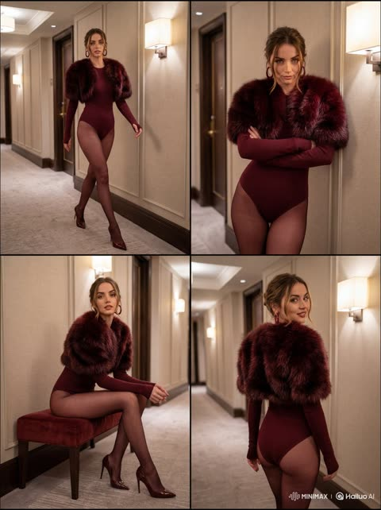</a>

用结构化 JSON 一次性固定场景、服装与镜头参数，再为四宫格每一格单独指定姿势和位置，使四个画面的人物与氛围保持一致。85mm、f/2.0 的人像镜头与暖色壁灯打光营造杂志大片质感。

Nano Banana 2 · 文生图 · 出处: [@Strength04_X on X](https://x.com/Strength04_X/status/2044296739679809880) · 474 赞，统计于 2026-10-29

[`fashion`](pages/zh/tags.md#tag-fashion) [`editorial`](pages/zh/tags.md#tag-editorial) [`collage`](pages/zh/tags.md#tag-collage) [`celebrity`](pages/zh/tags.md#tag-celebrity)

<details><summary><b>提示词</b></summary>

```text
"scene": {
    "type": "luxury hotel hallway",
    "style": "ultra realistic high-fashion editorial photography",
    "environment": "elegant hotel corridor with warm ambient lighting, wall lamps, beige textured walls, carpeted floor, cinematic depth"
  },
  "subject": {
    "identity": "Ana de Armas",
    "appearance": {
      "hair": "dark brown hair styled in an elegant loose updo with soft strands",
      "makeup": "glamorous makeup with defined eyes and warm tones",
      "skin_texture": "smooth realistic skin with soft glow"
    },
    "wardrobe": {
      "outfit": "deep burgundy fitted long-sleeve bodysuit",
      "layer": "luxury burgundy faux fur stole over shoulders",
      "hosiery": "sheer burgundy stockings",
      "footwear": "matching burgundy high heels",
      "accessories": "large hoop earrings"
    }
  },
  "composition": {
    "format": "4-panel collage",
    "layout": "2x2 grid with equal frames",
    "style": "fashion magazine editorial layout"
  },
  "poses": [
    {
      "panel": "top-left",
      "pose": "walking forward confidently in the hallway, mid-stride, strong model walk, direct gaze"
    },
    {
      "panel": "top-right",
      "pose": "standing against the wall with arms crossed, confident dominant posture, direct eye contact"
    },
    {
      "panel": "bottom-left",
      "pose": "sitting on a small bench with legs crossed elegantly, relaxed editorial pose"
    },
    {
      "panel": "bottom-right",
      "pose": "turning back while walking away, looking over shoulder with soft confident expression"
    }
  ],
  "lighting": {
    "setup": "warm cinematic indoor lighting",
    "details": "soft highlights from wall lamps, subtle shadows, luxury hotel ambiance"
  },
  "camera": {
    "type": "professional DSLR",
    "lens": "85mm portrait lens",
    "settings": "f/2.0 shallow depth of field",
    "quality": "8k ultra photorealistic",
    "focus": "sharp focus on subject in each panel"
  },
  "render": {
    "style": "hyper realistic fashion editorial",
    "details": "luxury fabric textures, realistic lighting, cinematic composition, magazine-quality finish",
    "restrictions": "no watermark, no logo, no text"
  },
  "aspect_ratio": "1:1"
}
```

</details>

**[全部 80 条](pages/zh/image-collage.md)**

<a id="img-edit"></a>
## 照片编辑

<a id="nano-banana-charmander-ember-route-101"></a>
### 小火龙在日落道路上使用火花攻击

<a href="https://x.com/ProperPrompter/status/2027157212863631567"></a>

后续编辑保留第一轮的对战布局，只替换场景和两只宝可梦，改动集中且前后一致。在战斗文字中写明具体招式，能让招式特效与对话框内容对应。

Nano Banana 2 · 上传图改图 · 出处: [@ProperPrompter on X](https://x.com/ProperPrompter/status/2027157212863631567) · 4,659 赞，统计于 2026-10-29

[`pixel-art`](pages/zh/tags.md#tag-pixel-art) [`pokemon`](pages/zh/tags.md#tag-pokemon) [`game-ui`](pages/zh/tags.md#tag-game-ui) [`image-edit`](pages/zh/tags.md#tag-image-edit)

<details><summary><b>提示词</b></summary>

```text
nano banana 2

prompt: inspired by a classic pokemon gameboy screenshot but it's highly detailed beautiful pixel art, include cool effects from moves used, modern minimal ui

prompt: change it to a new location and the battle is two new random kanto pokemon
```

</details>

<a id="gpt-image-gym-selfie-chibi-minis-doodles"></a>
### 健身房自拍周围环绕Q版迷你分身

<a href="https://x.com/Ciri_ai/status/2050094437821513896"></a>

提示词先锁定原图不变，再逐条列出每个迷你分身的健身动作，让每个角色各不相同。白色与粉色手绘涂鸦的手账风格，加上逐条给出的手写短语，把叠加元素统一起来。

GPT Image 2 · 上传图改图 · 出处: [@Ciri_ai on X](https://x.com/Ciri_ai/status/2050094437821513896) · 3,471 赞，统计于 2026-10-29

[`chibi`](pages/zh/tags.md#tag-chibi) [`scrapbook`](pages/zh/tags.md#tag-scrapbook) [`doodle`](pages/zh/tags.md#tag-doodle) [`gym`](pages/zh/tags.md#tag-gym) [`selfie`](pages/zh/tags.md#tag-selfie)

<details><summary><b>提示词</b></summary>

```text
GPT Image 2 on Chatgpt

Prompt: Edit the image while keeping the original photo completely unchanged — including the person, face, body, pose, lighting, and gym background.

Add multiple small, cute chibi-style “mini versions” of her around the image. Each mini character should have a big head, expressive facial features, and match her hairstyle and outfit.

Depict each mini version doing different gym-related activities:

one cheering with arms raised

one running in running shoes

one drinking from a shaker bottle

one wearing sporty running glasses

one climbing near her leg

Enhance the image with playful, hand-drawn doodles and handwritten notes in white and pink ink, in a scrapbook style. Include elements like arrows, stars, hearts, sparkles, and sketchy lines.

Add cute, handwritten gym-themed motivational phrases:

“lift strong”

“stronger every rep”

“no pain no gain”

“sweat now, shine later”

“progress over perfection”

“train hard, stay soft”

The overall vibe should feel fun, energetic, and feminine.
```

</details>

<a id="gpt-image-selfie-chibi-sticker-doodle-edit"></a>
### 电梯镜面自拍加Q版贴纸涂鸦

<a href="https://x.com/ChillaiKalan__/status/2050614367536939243"></a>

提示词先锁定原图光线与色调，再叠加白色描边、多姿势的同脸Q版小人和简短手写字。限制文字数量并让吉祥物保持克制，避免画面拥挤。

GPT Image 2 · 上传图改图 · 出处: [@ChillaiKalan__ on X](https://x.com/ChillaiKalan__/status/2050614367536939243) · 1,255 赞，统计于 2026-10-28

[`doodle`](pages/zh/tags.md#tag-doodle) [`chibi`](pages/zh/tags.md#tag-chibi) [`sticker-outline`](pages/zh/tags.md#tag-sticker-outline) [`xiaohongshu`](pages/zh/tags.md#tag-xiaohongshu) [`selfie`](pages/zh/tags.md#tag-selfie)

<details><summary><b>提示词</b></summary>

```text
Edit this photo into a cute Pinterest/Xiaohongshu-style doodle aesthetic edit while keeping the original composition and colors natural. Do NOT heavily change the original lighting or color grading. Keep the tones soft, airy, warm, and realistic. Avoid oversaturated colors, HDR effects, strong orange filters, or excessive contrast. Add hand-drawn doodle elements around the main objects: * white outline strokes * sketchy sparkles * stars * hearts * arrows * tiny flowers * playful swirls * mini handwritten notes Add small cute mascot-style doodles that match the vibe of the photo (tiny bear, smiling drink, cute food character, sleepy cloud, etc.) but keep them subtle and balanced. Use handwritten white text with short relatable captions only. Do NOT add too many words or overcrowd the image.Use a real face as a reference photo. The background is the same as in the photo. The lighting is warm, soft, and clean, with subtle shadows. Around the image, add several mini chibi (3D cute style) versions of the character, while maintaining the original facial features.Chibi characters have various poses and expressions: jumping cheerfully waving sitting relaxed holding a drink cute and playful expressions.  Add hand-drawn white doodle elements: outline around the main body stars, hearts, sparkles motion lines small cute icons Add aesthetic handwriting such as: "shine," "bright day," "happy," "smile," etc. (casual doodle font) Overall style: clean & aesthetic composition white sticker outline soft pastel color tone high detail 3D chibi glossy look cute Korean.
```

</details>

<a id="gpt-image-old-photo-restoration-colorize-sharpen"></a>
### 模糊人像修复为清晰细节的前后对比

<a href="https://x.com/AiwithLariab/status/2075549421073469614"></a>

提示词先逐项列出要修复的损伤（划痕、污渍、噪点、破损），再用保持真实的限制约束锐化程度。同时要求肤色发色衣物采用符合年代的自然色并配柔和背景，让结果忠于原照片。

GPT Image 2 · 上传图改图 · 出处: [@AiwithLariab on X](https://x.com/AiwithLariab/status/2075549421073469614) · 932 赞，统计于 2026-10-29

[`photo-restoration`](pages/zh/tags.md#tag-photo-restoration) [`colorize`](pages/zh/tags.md#tag-colorize) [`sharpen`](pages/zh/tags.md#tag-sharpen) [`old-photo`](pages/zh/tags.md#tag-old-photo)

<details><summary><b>提示词</b></summary>

```text
Restore and enhance an old damaged photo. Remove scratches, stains, and noise. Reconstruct faded or torn areas while preserving original details. Slightly sharpen the image for better clarity, but keep it realistic. Apply natural and era-appropriate colors to skin, hair, and clothing. Use a soft, balanced background color without being too striking. The final result should look like an old photo that has been realistically restored and colorized, while respecting its original appearance.
```

</details>

**[全部 43 条](pages/zh/image-edit.md)**

<a id="recipes"></a>
## Agent 配方：剪视频

用大白话告诉编程 Agent 你要什么。每条配方记下交给 Agent 的原话和它实际跑的命令，换成你自己的素材即可。

<a id="bilingual-subtitles"></a>
### 听写台词，烧录中英双语字幕

**交给 Agent 的原话**

> 听写 samples/night-train-ticket.mp4 里的中文台词，对照 prompts/video/night-train-ticket.yaml 里的剧本校对，每句中文下面加一行英文，把字幕烧进画面。

Whisper 会听错中文同音字（他和她读音相同）。有剧本时，让 Agent 用剧本定文字，只用 Whisper 定时间。

[`agent-editing`](pages/zh/tags.md#tag-agent-editing) [`ffmpeg`](pages/zh/tags.md#tag-ffmpeg) [`whisper`](pages/zh/tags.md#tag-whisper) [`subtitles`](pages/zh/tags.md#tag-subtitles) [`bilingual`](pages/zh/tags.md#tag-bilingual) [`chinese-dialogue`](pages/zh/tags.md#tag-chinese-dialogue)

<details><summary><b>Agent 实际跑的命令</b> · Agent: Claude Opus 5.5 in Claude Code · 工具: ffmpeg 9 with libass, openai-whisper medium</summary>

```bash
whisper samples/night-train-ticket.mp4 --model medium --language zh --output_format srt
# whisper heard 我等了他八年 / 就等着一趟车; the script says 我等了她八年 / 就等这一趟车.
# The agent kept whisper's timing, took the wording from the script, and added English lines:
#   1  00:00:00,000 --> 00:00:02,100  我等了她八年， / I waited eight years for her,
#   2  00:00:02,200 --> 00:00:04,200  就等这一趟车。 / all for this one train.
ffmpeg -i samples/night-train-ticket.mp4 \
  -vf "subtitles=subs.srt:force_style='FontName=PingFang SC,FontSize=15,Outline=1,Shadow=0,MarginV=22'" \
  -c:v libx264 -crf 20 -c:a copy subtitled.mp4
```

</details>

<a id="readme-preview-gif"></a>
### 给 README 做小体积循环 GIF 预览

**交给 Agent 的原话**

> 给 samples/ 里每个 mp4 做一张 README 用的循环 GIF，每张控制在 1.5 MB 左右。超过 8 秒的片加速播放，保证整段故事都能看到。

本仓所有预览图都是这样做的，每张 0.5 到 2 MB。每段单独生成 96 色调色板加 Bayer 抖动，体积小，肤色和霓虹也不脏。

[`agent-editing`](pages/zh/tags.md#tag-agent-editing) [`ffmpeg`](pages/zh/tags.md#tag-ffmpeg) [`gif`](pages/zh/tags.md#tag-gif) [`preview`](pages/zh/tags.md#tag-preview)

<details><summary><b>Agent 实际跑的命令</b> · Agent: Claude Opus 5.5 in Claude Code · 工具: ffmpeg 9</summary>

```bash
# landscape: 360 px wide; vertical: 300 px tall; 2x speed when longer than 8 s
ffmpeg -i in.mp4 -vf "setpts=PTS/2,fps=8,scale=360:-2:flags=lanczos,split[a][b];[a]palettegen=max_colors=96[p];[b][p]paletteuse=dither=bayer:bayer_scale=4" -loop 0 out.gif
```

</details>

<a id="split-shots"></a>
### 按硬切点把多镜头片拆成单独镜头

**交给 Agent 的原话**

> samples/late-night-office.mp4 应该有九个镜头。找出硬切点，按镜头拆成单独文件，再给我一张分镜条，每个镜头取中间一帧。

也能当生成视频的验收：八个切点都落在提示词所写时间的 0.17 秒以内。软切换调低阈值，晃动大的手持素材调高阈值。

[`agent-editing`](pages/zh/tags.md#tag-agent-editing) [`ffmpeg`](pages/zh/tags.md#tag-ffmpeg) [`scene-detection`](pages/zh/tags.md#tag-scene-detection) [`storyboard`](pages/zh/tags.md#tag-storyboard) [`qa`](pages/zh/tags.md#tag-qa)

<details><summary><b>Agent 实际跑的命令</b> · Agent: Claude Opus 5.5 in Claude Code · 工具: ffmpeg 9</summary>

```bash
# 1. find cuts
T=$(ffmpeg -i samples/late-night-office.mp4 -vf "scdet=threshold=8" -f null - 2>&1 \
    | grep -o "lavfi.scd.time: [0-9.]*" | awk '{print $2}' | paste -sd, -)
# -> 3.04,5.04,6.0,6.54,7.0,7.46,9.67,12.17  (prompt asked for 3.0,5.0,6.0,6.5,7.0,7.5,9.5,12.0)
# 2. split, forcing keyframes at the cuts so every file starts clean
ffmpeg -i samples/late-night-office.mp4 -c:v libx264 -crf 20 -force_key_frames "$T" -c:a aac \
  -f segment -segment_times "$T" -reset_timestamps 1 shot_%02d.mp4
# 3. storyboard strip
for f in shot_*.mp4; do
  mid=$(ffprobe -v error -show_entries format=duration -of csv=p=0 "$f" | awk '{printf "%.3f", $1/2}')
  ffmpeg -ss "$mid" -i "$f" -frames:v 1 -vf scale=-2:320 "${f%.mp4}.jpg"
done
ffmpeg -pattern_type glob -i "shot_*.jpg" -vf "tile=9x1:padding=4:color=white" -frames:v 1 storyboard.jpg
```

</details>

<a id="teaser-montage"></a>
### 把不同尺寸的片剪成预告：标题、转场、响度统一

**交给 Agent 的原话**

> 用夜市小巷、面档、夜车三段的前 4.5 秒剪一支 720p 预告，片名 RAIN CITY。画面和声音都用半秒交叉淡化，开头压片名，响度按社交平台标准统一，结尾淡出。

输入有 864x480 和 1344x768 两种尺寸。每路先统一尺寸、帧率和采样率，否则 xfade 和 acrossfade 接不上。总长是 3 段 4.5 秒减去两次 0.5 秒重叠，共 12.5 秒。

[`agent-editing`](pages/zh/tags.md#tag-agent-editing) [`ffmpeg`](pages/zh/tags.md#tag-ffmpeg) [`montage`](pages/zh/tags.md#tag-montage) [`title-card`](pages/zh/tags.md#tag-title-card) [`loudness`](pages/zh/tags.md#tag-loudness)

<details><summary><b>Agent 实际跑的命令</b> · Agent: Claude Opus 5.5 in Claude Code · 工具: ffmpeg 9</summary>

```bash
ffmpeg -i samples/neon-night-market-alley.mp4 -i samples/hk-noodle-stall-1960s.mp4 -i samples/night-train-ticket.mp4 -filter_complex "
[0:v]trim=0:4.5,setpts=PTS-STARTPTS,scale=1280:720:force_original_aspect_ratio=increase,crop=1280:720,fps=24,format=yuv420p,setsar=1[v0];
[1:v]trim=0:4.5,setpts=PTS-STARTPTS,scale=1280:720:force_original_aspect_ratio=increase,crop=1280:720,fps=24,format=yuv420p,setsar=1[v1];
[2:v]trim=0:4.5,setpts=PTS-STARTPTS,scale=1280:720:force_original_aspect_ratio=increase,crop=1280:720,fps=24,format=yuv420p,setsar=1[v2];
[0:a]atrim=0:4.5,asetpts=PTS-STARTPTS,aresample=48000[a0];
[1:a]atrim=0:4.5,asetpts=PTS-STARTPTS,aresample=48000[a1];
[2:a]atrim=0:4.5,asetpts=PTS-STARTPTS,aresample=48000[a2];
[v0][v1]xfade=transition=fade:duration=0.5:offset=4[x1];
[x1][v2]xfade=transition=fade:duration=0.5:offset=8[x2];
[a0][a1]acrossfade=d=0.5[ax1];
[ax1][a2]acrossfade=d=0.5[ax2];
[x2]drawtext=fontfile=/System/Library/Fonts/Supplemental/Futura.ttc:text='RAIN CITY':fontcolor=white:fontsize=110:x=(w-tw)/2:y=h*0.70:alpha='if(lt(t,0.3),t/0.3,if(lt(t,2.0),1,if(lt(t,2.5),(2.5-t)/0.5,0)))',fade=t=in:st=0:d=0.4,fade=t=out:st=12.1:d=0.4[v];
[ax2]loudnorm=I=-16:TP=-1.5:LRA=11,afade=t=out:st=12:d=0.5[a]" \
  -map "[v]" -map "[a]" -c:v libx264 -crf 20 -c:a aac -b:a 160k -ar 48000 teaser.mp4
```

</details>

<a id="vertical-blur-fill"></a>
### 横屏片改竖屏，背景用模糊填充

**交给 Agent 的原话**

> 把 samples/night-train-ticket.mp4 做成 1080x1920 的竖屏版发抖音。原画面完整放在中间，上下用同一段视频的模糊压暗版本填满，保留原音轨。

一条 ffmpeg 命令，5 秒片在 M 系列 Mac 上 1.5 秒跑完。主体横跨整个画面时用这种填充；主体在正中时直接裁切更好。

[`agent-editing`](pages/zh/tags.md#tag-agent-editing) [`ffmpeg`](pages/zh/tags.md#tag-ffmpeg) [`vertical`](pages/zh/tags.md#tag-vertical) [`reframe`](pages/zh/tags.md#tag-reframe)

<details><summary><b>Agent 实际跑的命令</b> · Agent: Claude Opus 5.5 in Claude Code · 工具: ffmpeg 9</summary>

```bash
ffmpeg -i samples/night-train-ticket.mp4 -filter_complex "
  [0:v]scale=1080:1920:force_original_aspect_ratio=increase,crop=1080:1920,gblur=sigma=40,eq=brightness=-0.08[bg];
  [0:v]scale=1080:-2[fg];
  [bg][fg]overlay=(W-w)/2:(H-h)/2,format=yuv420p" \
  -c:v libx264 -crf 20 -c:a copy vertical.mp4
```

</details>

<a id="guides"></a>
## 指南与 skill

### 官方提示词指南

- [MiniMax H3 prompt-writing skill](https://github.com/MiniMax-AI/MiniMax-H3/tree/main/.claude/skills/h3-prompt-writing): 官方 Agent skill，把一句想法改写成 H3 的结构化提示词格式。本地跑 H3 用上它效果差别很大。
- [OpenAI image prompting guide](https://developers.openai.com/api/docs/guides/image-prompting): GPT Image 2.5 的八条写法规则，生成、编辑、多轮修改的示例都附 Flare 和 Sunburst 两版对比。
- [Gemini Omni prompt guide](https://deepmind.google/models/gemini-omni/prompt-guide/): 对话式编辑、换机位、多路参考、续写、首尾帧。
- [Kling 4.0 user guide](https://kling.ai/quickstart/kling-4-model-user-guide): 30 秒单条、最多 15 份参考素材、10 张关键帧、用提示词改视频、8000 token 长提示词。
- [Kling VIDEO 3.0 user guide](https://app.klingai.com/global/quickstart/klingai-video-3-model-user-guide): 多镜头、主体绑定、多语种对白、方言口音、文字渲染、15 秒长镜头。
- [Veo 3 prompt guide](https://deepmind.google/models/veo/prompt-guide/): 引号写台词、声音提示、动作戏的逐拍长提示词。
- [Ultimate prompting guide for Veo 3.1](https://cloud.google.com/blog/products/ai-machine-learning/ultimate-prompting-guide-for-veo-3-1): 五段式公式、带时间戳的多镜头写法，以及配合 Nano Banana 的首尾帧和多素材工作流。

### 社区 skill 与案例库

- [LearnPrompt/awesome-seedance](https://github.com/LearnPrompt/awesome-seedance): 最大的 Seedance 2.0 / 2.5 案例库，840 多条，每条都能追到原帖。
- [SkyNotSilent/awesome-MiniMax-H3-cases](https://github.com/SkyNotSilent/awesome-MiniMax-H3-cases): 几千个可直接播放的 MiniMax H3 案例，标明哪些公开了完整提示词。
- [dexhunter/seedance2-skill](https://github.com/dexhunter/seedance2-skill): 写 Seedance 提示词的 Agent skill。
- [liyue-aigc/seedance-2-5-video-director](https://github.com/liyue-aigc/seedance-2-5-video-director): Seedance 2.5 导演 skill：脚本、人物锁定、续写、编辑、转场。
- [T8mars/minimax-h3-prompt-skill-T8](https://github.com/T8mars/minimax-h3-prompt-skill-T8): MiniMax H3 和 Seedance 的提示词案例与可安装 skill。
- [smixs/visual-skills](https://github.com/smixs/visual-skills): 给 Agent 的电影导演 skill，从戏剧结构、走位到各模型的提示词语法。
- [UnderleveledBuilder/awesome-short-drama-skills](https://github.com/UnderleveledBuilder/awesome-short-drama-skills): AI 短剧、漫剧 skill 精选，从剧本、分镜到视频提示词。
- [joeseesun/opus-video-prompts](https://github.com/joeseesun/opus-video-prompts): 用 Claude Opus 5.5 写代码渲染视频的案例和提示词。

<a id="threed"></a>
## 用 Agent 做 3D

用编程 Agent 搭 3D 场景的配方（Blender MCP、three.js）正在整理。

<a id="tags"></a>
## 按标签浏览

[`portrait`](pages/zh/tags.md#tag-portrait) 148 · [`fashion`](pages/zh/tags.md#tag-fashion) 130 · [`template`](pages/zh/tags.md#tag-template) 120 · [`multi-shot`](pages/zh/tags.md#tag-multi-shot) 113 · [`anime`](pages/zh/tags.md#tag-anime) 112 · [`typography`](pages/zh/tags.md#tag-typography) 106 · [`cinematic`](pages/zh/tags.md#tag-cinematic) 100 · [`handheld`](pages/zh/tags.md#tag-handheld) 90 · [`dialogue`](pages/zh/tags.md#tag-dialogue) 87 · [`editorial`](pages/zh/tags.md#tag-editorial) 85 · [`golden-hour`](pages/zh/tags.md#tag-golden-hour) 82 · [`photorealistic`](pages/zh/tags.md#tag-photorealistic) 77 · [`character-consistency`](pages/zh/tags.md#tag-character-consistency) 69 · [`reference-image`](pages/zh/tags.md#tag-reference-image) 64 · [`macro`](pages/zh/tags.md#tag-macro) 64 · [`storyboard`](pages/zh/tags.md#tag-storyboard) 62 · [`infographic`](pages/zh/tags.md#tag-infographic) 61 · [`fantasy`](pages/zh/tags.md#tag-fantasy) 60 · [`json-prompt`](pages/zh/tags.md#tag-json-prompt) 56 · [`action`](pages/zh/tags.md#tag-action) 51 · [`selfie`](pages/zh/tags.md#tag-selfie) 50 · [`reference-images`](pages/zh/tags.md#tag-reference-images) 48 · [`travel-poster`](pages/zh/tags.md#tag-travel-poster) 48 · [`miniature`](pages/zh/tags.md#tag-miniature) 46 · [`vlog`](pages/zh/tags.md#tag-vlog) 43 · [`food`](pages/zh/tags.md#tag-food) 43 · [`timed-beats`](pages/zh/tags.md#tag-timed-beats) 42 · [`comedy`](pages/zh/tags.md#tag-comedy) 41 · [`collage`](pages/zh/tags.md#tag-collage) 41 · [`poster`](pages/zh/tags.md#tag-poster) 39 · [`studio-lighting`](pages/zh/tags.md#tag-studio-lighting) 37 · [`watercolor`](pages/zh/tags.md#tag-watercolor) 37 · [`sound-design`](pages/zh/tags.md#tag-sound-design) 36 · [`diorama`](pages/zh/tags.md#tag-diorama) 36 · [`product-ad`](pages/zh/tags.md#tag-product-ad) 35 · [`vertical`](pages/zh/tags.md#tag-vertical) 35 · [`martial-arts`](pages/zh/tags.md#tag-martial-arts) 34 · [`identity-lock`](pages/zh/tags.md#tag-identity-lock) 34 · [`character-sheet`](pages/zh/tags.md#tag-character-sheet) 32 · [`travel`](pages/zh/tags.md#tag-travel) 32 · [`chibi`](pages/zh/tags.md#tag-chibi) 32 · [`pastel`](pages/zh/tags.md#tag-pastel) 32 · [`lifestyle`](pages/zh/tags.md#tag-lifestyle) 31 · [`film-grain`](pages/zh/tags.md#tag-film-grain) 31 · [`grid`](pages/zh/tags.md#tag-grid) 31 · [`surreal`](pages/zh/tags.md#tag-surreal) 30 · [`timed-shots`](pages/zh/tags.md#tag-timed-shots) 29 · [`tracking-shot`](pages/zh/tags.md#tag-tracking-shot) 29 · [`rain`](pages/zh/tags.md#tag-rain) 28 · [`lip-sync`](pages/zh/tags.md#tag-lip-sync) 27 · [`character-reference`](pages/zh/tags.md#tag-character-reference) 27 · [`sci-fi`](pages/zh/tags.md#tag-sci-fi) 27 · [`3d-animation`](pages/zh/tags.md#tag-3d-animation) 26 · [`monochrome`](pages/zh/tags.md#tag-monochrome) 26 · [`transformation`](pages/zh/tags.md#tag-transformation) 25 · [`architecture`](pages/zh/tags.md#tag-architecture) 24 · [`low-angle`](pages/zh/tags.md#tag-low-angle) 24 · [`reference-photo`](pages/zh/tags.md#tag-reference-photo) 24 · [`dark-fantasy`](pages/zh/tags.md#tag-dark-fantasy) 23 · [`multi-scene`](pages/zh/tags.md#tag-multi-scene) 23 · [`doodle`](pages/zh/tags.md#tag-doodle) 23 · [`scrapbook`](pages/zh/tags.md#tag-scrapbook) 23 · [`3d-render`](pages/zh/tags.md#tag-3d-render) 23 · [`ugc`](pages/zh/tags.md#tag-ugc) 22 · [`slow-motion`](pages/zh/tags.md#tag-slow-motion) 22 · [`fashion-editorial`](pages/zh/tags.md#tag-fashion-editorial) 22 · [`split-layout`](pages/zh/tags.md#tag-split-layout) 22 · [`candid`](pages/zh/tags.md#tag-candid) 22 · [`luxury`](pages/zh/tags.md#tag-luxury) 21 · [`commercial`](pages/zh/tags.md#tag-commercial) 21 · [`night`](pages/zh/tags.md#tag-night) 21 · [`long-take`](pages/zh/tags.md#tag-long-take) 21 · [`streetwear`](pages/zh/tags.md#tag-streetwear) 21 · [`landscape`](pages/zh/tags.md#tag-landscape) 21 · [`pixel-art`](pages/zh/tags.md#tag-pixel-art) 21 · [`face-reference`](pages/zh/tags.md#tag-face-reference) 21 · [`isometric`](pages/zh/tags.md#tag-isometric) 21 · [`music-video`](pages/zh/tags.md#tag-music-video) 20 · [`neon`](pages/zh/tags.md#tag-neon) 20 · [`motion-graphics`](pages/zh/tags.md#tag-motion-graphics) 20 · [`pov`](pages/zh/tags.md#tag-pov) 20 · [`character-lock`](pages/zh/tags.md#tag-character-lock) 19 · [`horror`](pages/zh/tags.md#tag-horror) 19 · [`dragon`](pages/zh/tags.md#tag-dragon) 19 · [`cafe`](pages/zh/tags.md#tag-cafe) 19 · [`minimalist`](pages/zh/tags.md#tag-minimalist) 19 · [`documentary`](pages/zh/tags.md#tag-documentary) 18 · [`shot-list`](pages/zh/tags.md#tag-shot-list) 18 · [`korean`](pages/zh/tags.md#tag-korean) 18 · [`dance`](pages/zh/tags.md#tag-dance) 17 · [`studio-portrait`](pages/zh/tags.md#tag-studio-portrait) 17 · [`editorial-poster`](pages/zh/tags.md#tag-editorial-poster) 17 · [`motion-blur`](pages/zh/tags.md#tag-motion-blur) 16 · [`beauty`](pages/zh/tags.md#tag-beauty) 16 · [`black-and-white`](pages/zh/tags.md#tag-black-and-white) 16 · [`mixed-media`](pages/zh/tags.md#tag-mixed-media) 16 · [`sunset`](pages/zh/tags.md#tag-sunset) 16 · [`pixar-style`](pages/zh/tags.md#tag-pixar-style) 16 · [`double-exposure`](pages/zh/tags.md#tag-double-exposure) 16 · [`oil-painting`](pages/zh/tags.md#tag-oil-painting) 15 · [`film-look`](pages/zh/tags.md#tag-film-look) 15 · [`landmark`](pages/zh/tags.md#tag-landmark) 15 · [`vintage`](pages/zh/tags.md#tag-vintage) 15 · [`photo-to-illustration`](pages/zh/tags.md#tag-photo-to-illustration) 15 · [`sports`](pages/zh/tags.md#tag-sports) 14 · [`bokeh`](pages/zh/tags.md#tag-bokeh) 14 · [`timeline`](pages/zh/tags.md#tag-timeline) 14 · [`title-sequence`](pages/zh/tags.md#tag-title-sequence) 14 · [`city`](pages/zh/tags.md#tag-city) 14 · [`character`](pages/zh/tags.md#tag-character) 14 · [`cat`](pages/zh/tags.md#tag-cat) 14 · [`studio`](pages/zh/tags.md#tag-studio) 14 · [`food-photography`](pages/zh/tags.md#tag-food-photography) 14 · [`storybook`](pages/zh/tags.md#tag-storybook) 14 · [`negative-space`](pages/zh/tags.md#tag-negative-space) 14 · [`kinetic-typography`](pages/zh/tags.md#tag-kinetic-typography) 13 · [`multi-reference`](pages/zh/tags.md#tag-multi-reference) 13 · [`first-person`](pages/zh/tags.md#tag-first-person) 13 · [`chase`](pages/zh/tags.md#tag-chase) 13 · [`dv-camcorder`](pages/zh/tags.md#tag-dv-camcorder) 13 · [`animals`](pages/zh/tags.md#tag-animals) 13 · [`cyberpunk`](pages/zh/tags.md#tag-cyberpunk) 13 · [`flat-vector`](pages/zh/tags.md#tag-flat-vector) 13 · [`hand-drawn`](pages/zh/tags.md#tag-hand-drawn) 13 · [`japanese`](pages/zh/tags.md#tag-japanese) 13 · [`handheld-camera`](pages/zh/tags.md#tag-handheld-camera) 13 · [`style-transfer`](pages/zh/tags.md#tag-style-transfer) 13 · [`close-up`](pages/zh/tags.md#tag-close-up) 13 · [`home-video`](pages/zh/tags.md#tag-home-video) 13 · [`couple`](pages/zh/tags.md#tag-couple) 13 · [`advertising`](pages/zh/tags.md#tag-advertising) 13 · [`packaging`](pages/zh/tags.md#tag-packaging) 13 · [`line-art`](pages/zh/tags.md#tag-line-art) 12 · [`one-take`](pages/zh/tags.md#tag-one-take) 12 · [`travel-vlog`](pages/zh/tags.md#tag-travel-vlog) 12 · [`silhouette`](pages/zh/tags.md#tag-silhouette) 12 · [`identity-reference`](pages/zh/tags.md#tag-identity-reference) 12 · [`desert`](pages/zh/tags.md#tag-desert) 12 · [`layout`](pages/zh/tags.md#tag-layout) 12 · [`sketchbook`](pages/zh/tags.md#tag-sketchbook) 12 · [`chinese-text`](pages/zh/tags.md#tag-chinese-text) 12 · [`smartphone-photo`](pages/zh/tags.md#tag-smartphone-photo) 12 · [`product-photography`](pages/zh/tags.md#tag-product-photography) 12 · [`game-ui`](pages/zh/tags.md#tag-game-ui) 11 · [`slice-of-life`](pages/zh/tags.md#tag-slice-of-life) 11 · [`vfx`](pages/zh/tags.md#tag-vfx) 11 · [`japan`](pages/zh/tags.md#tag-japan) 11 · [`exploded-view`](pages/zh/tags.md#tag-exploded-view) 11 · [`japanese-text`](pages/zh/tags.md#tag-japanese-text) 11 · [`product-shot`](pages/zh/tags.md#tag-product-shot) 11 · [`skincare`](pages/zh/tags.md#tag-skincare) 11 · [`turnaround`](pages/zh/tags.md#tag-turnaround) 11 · [`stop-motion`](pages/zh/tags.md#tag-stop-motion) 11 · [`hud`](pages/zh/tags.md#tag-hud) 11 · [`grid-layout`](pages/zh/tags.md#tag-grid-layout) 11 · [`photo-to-art`](pages/zh/tags.md#tag-photo-to-art) 11 · [`campaign`](pages/zh/tags.md#tag-campaign) 11 · [`forced-perspective`](pages/zh/tags.md#tag-forced-perspective) 11 · [`fitness`](pages/zh/tags.md#tag-fitness) 10 · [`locked-camera`](pages/zh/tags.md#tag-locked-camera) 10 · [`continuity`](pages/zh/tags.md#tag-continuity) 10 · [`beverage`](pages/zh/tags.md#tag-beverage) 10 · [`impasto`](pages/zh/tags.md#tag-impasto) 10 · [`perfume`](pages/zh/tags.md#tag-perfume) 10 · [`product-commercial`](pages/zh/tags.md#tag-product-commercial) 10 · [`pencil-sketch`](pages/zh/tags.md#tag-pencil-sketch) 10 · [`y2k`](pages/zh/tags.md#tag-y2k) 10 · [`street-photography`](pages/zh/tags.md#tag-street-photography) 10 · [`consistency`](pages/zh/tags.md#tag-consistency) 10 · [`photorealism`](pages/zh/tags.md#tag-photorealism) 10 · [`doodle-overlay`](pages/zh/tags.md#tag-doodle-overlay) 10 · [`flash-photography`](pages/zh/tags.md#tag-flash-photography) 10 · [`85mm`](pages/zh/tags.md#tag-85mm) 10 · [`camera-moves`](pages/zh/tags.md#tag-camera-moves) 9 · [`timeline-prompt`](pages/zh/tags.md#tag-timeline-prompt) 9 · [`winter`](pages/zh/tags.md#tag-winter) 9 · [`cooking`](pages/zh/tags.md#tag-cooking) 9 · [`aerial`](pages/zh/tags.md#tag-aerial) 9 · [`camera-move`](pages/zh/tags.md#tag-camera-move) 9 · [`realism`](pages/zh/tags.md#tag-realism) 9 · [`wildlife`](pages/zh/tags.md#tag-wildlife) 9 · [`voiceover`](pages/zh/tags.md#tag-voiceover) 9 · [`halftone`](pages/zh/tags.md#tag-halftone) 9 · [`product`](pages/zh/tags.md#tag-product) 9 · [`single-take`](pages/zh/tags.md#tag-single-take) 9 · [`seoul`](pages/zh/tags.md#tag-seoul) 9 · [`tokyo`](pages/zh/tags.md#tag-tokyo) 9 · [`logo`](pages/zh/tags.md#tag-logo) 9 · [`reference-face`](pages/zh/tags.md#tag-reference-face) 9 · [`product-poster`](pages/zh/tags.md#tag-product-poster) 9 · [`kawaii`](pages/zh/tags.md#tag-kawaii) 9 · [`fisheye`](pages/zh/tags.md#tag-fisheye) 9 · [`historical`](pages/zh/tags.md#tag-historical) 8 · [`beat-sync`](pages/zh/tags.md#tag-beat-sync) 8 · [`autumn`](pages/zh/tags.md#tag-autumn) 8 · [`ambient-audio`](pages/zh/tags.md#tag-ambient-audio) 8 · [`outfit-change`](pages/zh/tags.md#tag-outfit-change) 8 · [`underwater`](pages/zh/tags.md#tag-underwater) 8 · [`automotive`](pages/zh/tags.md#tag-automotive) 8 · [`reference-lock`](pages/zh/tags.md#tag-reference-lock) 8 · [`animal`](pages/zh/tags.md#tag-animal) 8 · [`creature`](pages/zh/tags.md#tag-creature) 8 · [`street-style`](pages/zh/tags.md#tag-street-style) 8 · [`ink-wash`](pages/zh/tags.md#tag-ink-wash) 8 · [`sword-fight`](pages/zh/tags.md#tag-sword-fight) 8 · [`asmr`](pages/zh/tags.md#tag-asmr) 8 · [`structured-prompt`](pages/zh/tags.md#tag-structured-prompt) 8 · [`text-rendering`](pages/zh/tags.md#tag-text-rendering) 8 · [`motorcycle`](pages/zh/tags.md#tag-motorcycle) 8 · [`beach`](pages/zh/tags.md#tag-beach) 8 · [`pet`](pages/zh/tags.md#tag-pet) 8 · [`street-fashion`](pages/zh/tags.md#tag-street-fashion) 8 · [`wuxia`](pages/zh/tags.md#tag-wuxia) 8 · [`fight-scene`](pages/zh/tags.md#tag-fight-scene) 8 · [`video-edit`](pages/zh/tags.md#tag-video-edit) 8 · [`street`](pages/zh/tags.md#tag-street) 8 · [`superhero`](pages/zh/tags.md#tag-superhero) 8 · [`illustration`](pages/zh/tags.md#tag-illustration) 8 · [`cityscape`](pages/zh/tags.md#tag-cityscape) 8 · [`sticker`](pages/zh/tags.md#tag-sticker) 8 · [`blueprint`](pages/zh/tags.md#tag-blueprint) 8 · [`full-body`](pages/zh/tags.md#tag-full-body) 8 · [`menswear`](pages/zh/tags.md#tag-menswear) 8 · [`screen-print`](pages/zh/tags.md#tag-screen-print) 8 · [`sketch`](pages/zh/tags.md#tag-sketch) 8 · [`editorial-layout`](pages/zh/tags.md#tag-editorial-layout) 8 · [`natural-light`](pages/zh/tags.md#tag-natural-light) 8 · [`cinematic-lighting`](pages/zh/tags.md#tag-cinematic-lighting) 8 · [`education`](pages/zh/tags.md#tag-education) 7 · [`music`](pages/zh/tags.md#tag-music) 7 · [`coastal`](pages/zh/tags.md#tag-coastal) 7 · [`product-reference`](pages/zh/tags.md#tag-product-reference) 7 · [`storytelling`](pages/zh/tags.md#tag-storytelling) 7 · [`reflection`](pages/zh/tags.md#tag-reflection) 7 · [`samurai`](pages/zh/tags.md#tag-samurai) 7 · [`bedroom`](pages/zh/tags.md#tag-bedroom) 7 · [`night-street`](pages/zh/tags.md#tag-night-street) 7 · [`cartoon`](pages/zh/tags.md#tag-cartoon) 7 · [`golden-light`](pages/zh/tags.md#tag-golden-light) 7 · [`cherry-blossom`](pages/zh/tags.md#tag-cherry-blossom) 7 · [`mascot`](pages/zh/tags.md#tag-mascot) 7 · [`rooftop`](pages/zh/tags.md#tag-rooftop) 7 · [`realistic`](pages/zh/tags.md#tag-realistic) 7 · [`interior`](pages/zh/tags.md#tag-interior) 7 · [`reference-identity`](pages/zh/tags.md#tag-reference-identity) 7 · [`urban`](pages/zh/tags.md#tag-urban) 7 · [`text-render`](pages/zh/tags.md#tag-text-render) 7 · [`shallow-depth-of-field`](pages/zh/tags.md#tag-shallow-depth-of-field) 7 · [`animation`](pages/zh/tags.md#tag-animation) 7 · [`snow`](pages/zh/tags.md#tag-snow) 7 · [`day-in-the-life`](pages/zh/tags.md#tag-day-in-the-life) 7 · [`morning-routine`](pages/zh/tags.md#tag-morning-routine) 7 · [`nature`](pages/zh/tags.md#tag-nature) 7 · [`paper-craft`](pages/zh/tags.md#tag-paper-craft) 7 · [`papercraft`](pages/zh/tags.md#tag-papercraft) 7 · [`cute`](pages/zh/tags.md#tag-cute) 7 · [`identity-consistency`](pages/zh/tags.md#tag-identity-consistency) 7 · [`social-media`](pages/zh/tags.md#tag-social-media) 7 · [`tilt-shift`](pages/zh/tags.md#tag-tilt-shift) 7 · [`photo-edit`](pages/zh/tags.md#tag-photo-edit) 7 · [`chinese-typography`](pages/zh/tags.md#tag-chinese-typography) 7 · [`sprite-sheet`](pages/zh/tags.md#tag-sprite-sheet) 7 · [`timelapse`](pages/zh/tags.md#tag-timelapse) 6 · [`japanese-dialogue`](pages/zh/tags.md#tag-japanese-dialogue) 6 · [`product-reveal`](pages/zh/tags.md#tag-product-reveal) 6 · [`selfie-vlog`](pages/zh/tags.md#tag-selfie-vlog) 6 · [`montage`](pages/zh/tags.md#tag-montage) 6 · [`k-pop`](pages/zh/tags.md#tag-k-pop) 6 · [`forest`](pages/zh/tags.md#tag-forest) 6 · [`match-cut`](pages/zh/tags.md#tag-match-cut) 6 · [`camera-tracking`](pages/zh/tags.md#tag-camera-tracking) 6 · [`educational`](pages/zh/tags.md#tag-educational) 6 · [`timed-scenes`](pages/zh/tags.md#tag-timed-scenes) 6 · [`botanical`](pages/zh/tags.md#tag-botanical) 6 · [`paris`](pages/zh/tags.md#tag-paris) 6 · [`sfx`](pages/zh/tags.md#tag-sfx) 6 · [`retro`](pages/zh/tags.md#tag-retro) 6 · [`night-city`](pages/zh/tags.md#tag-night-city) 6 · [`camcorder`](pages/zh/tags.md#tag-camcorder) 6 · [`lo-fi`](pages/zh/tags.md#tag-lo-fi) 6 · [`fight-choreography`](pages/zh/tags.md#tag-fight-choreography) 6 · [`seaside`](pages/zh/tags.md#tag-seaside) 6 · [`photoreal`](pages/zh/tags.md#tag-photoreal) 6 · [`mirror-selfie`](pages/zh/tags.md#tag-mirror-selfie) 6 · [`wide-angle`](pages/zh/tags.md#tag-wide-angle) 6 · [`gameplay`](pages/zh/tags.md#tag-gameplay) 6 · [`kitchen`](pages/zh/tags.md#tag-kitchen) 6 · [`embroidery`](pages/zh/tags.md#tag-embroidery) 6 · [`restaurant`](pages/zh/tags.md#tag-restaurant) 6 · [`crowd`](pages/zh/tags.md#tag-crowd) 6 · [`backlight`](pages/zh/tags.md#tag-backlight) 6 · [`before-after`](pages/zh/tags.md#tag-before-after) 6 · [`japanese-typography`](pages/zh/tags.md#tag-japanese-typography) 6 · [`screenshot`](pages/zh/tags.md#tag-screenshot) 6 · [`colored-pencil`](pages/zh/tags.md#tag-colored-pencil) 6 · [`recipe`](pages/zh/tags.md#tag-recipe) 6 · [`doodles`](pages/zh/tags.md#tag-doodles) 6 · [`brand-identity`](pages/zh/tags.md#tag-brand-identity) 6 · [`concept-art`](pages/zh/tags.md#tag-concept-art) 6 · [`chiaroscuro`](pages/zh/tags.md#tag-chiaroscuro) 6 · [`expressions`](pages/zh/tags.md#tag-expressions) 6 · [`map`](pages/zh/tags.md#tag-map) 6 · [`product-render`](pages/zh/tags.md#tag-product-render) 6 · [`mockup`](pages/zh/tags.md#tag-mockup) 6 · [`limited-palette`](pages/zh/tags.md#tag-limited-palette) 6 · [`3d`](pages/zh/tags.md#tag-3d) 6 · [`labels`](pages/zh/tags.md#tag-labels) 6 · [`kids`](pages/zh/tags.md#tag-kids) 5 · [`audio-sync`](pages/zh/tags.md#tag-audio-sync) 5 · [`fps`](pages/zh/tags.md#tag-fps) 5 · [`korean-dialogue`](pages/zh/tags.md#tag-korean-dialogue) 5 · [`noir`](pages/zh/tags.md#tag-noir) 5 · [`transition`](pages/zh/tags.md#tag-transition) 5 · [`cel-shading`](pages/zh/tags.md#tag-cel-shading) 5 · [`reference-character`](pages/zh/tags.md#tag-reference-character) 5 · [`kids-education`](pages/zh/tags.md#tag-kids-education) 5 · [`time-lapse`](pages/zh/tags.md#tag-time-lapse) 5 · [`reference-video`](pages/zh/tags.md#tag-reference-video) 5 · [`gothic`](pages/zh/tags.md#tag-gothic) 5 · [`storm`](pages/zh/tags.md#tag-storm) 5 · [`skateboard`](pages/zh/tags.md#tag-skateboard) 5 · [`timestamped-shots`](pages/zh/tags.md#tag-timestamped-shots) 5 · [`diegetic-sound`](pages/zh/tags.md#tag-diegetic-sound) 5 · [`timestamped`](pages/zh/tags.md#tag-timestamped) 5 · [`manga`](pages/zh/tags.md#tag-manga) 5 · [`chinese-dialogue`](pages/zh/tags.md#tag-chinese-dialogue) 5 · [`nostalgic`](pages/zh/tags.md#tag-nostalgic) 5 · [`multi-angle`](pages/zh/tags.md#tag-multi-angle) 5 · [`speed-ramp`](pages/zh/tags.md#tag-speed-ramp) 5 · [`native-audio`](pages/zh/tags.md#tag-native-audio) 5 · [`found-footage`](pages/zh/tags.md#tag-found-footage) 5 · [`physics`](pages/zh/tags.md#tag-physics) 5 · [`multi-character`](pages/zh/tags.md#tag-multi-character) 5 · [`multilingual`](pages/zh/tags.md#tag-multilingual) 5 · [`object-swap`](pages/zh/tags.md#tag-object-swap) 5 · [`claymation`](pages/zh/tags.md#tag-claymation) 5 · [`live-action`](pages/zh/tags.md#tag-live-action) 5 · [`multishot`](pages/zh/tags.md#tag-multishot) 5 · [`romance`](pages/zh/tags.md#tag-romance) 5 · [`clay`](pages/zh/tags.md#tag-clay) 5 · [`zombie`](pages/zh/tags.md#tag-zombie) 5 · [`choreography`](pages/zh/tags.md#tag-choreography) 5 · [`open-world`](pages/zh/tags.md#tag-open-world) 5 · [`comparison`](pages/zh/tags.md#tag-comparison) 5 · [`scale-contrast`](pages/zh/tags.md#tag-scale-contrast) 5 · [`negative-prompt`](pages/zh/tags.md#tag-negative-prompt) 5 · [`gym`](pages/zh/tags.md#tag-gym) 5 · [`christmas`](pages/zh/tags.md#tag-christmas) 5 · [`minidv`](pages/zh/tags.md#tag-minidv) 5 · [`thriller`](pages/zh/tags.md#tag-thriller) 5 · [`painterly`](pages/zh/tags.md#tag-painterly) 5 · [`lookbook`](pages/zh/tags.md#tag-lookbook) 5 · [`football`](pages/zh/tags.md#tag-football) 5 · [`street-portrait`](pages/zh/tags.md#tag-street-portrait) 5 · [`pose-sheet`](pages/zh/tags.md#tag-pose-sheet) 5 · [`pop-art`](pages/zh/tags.md#tag-pop-art) 5 · [`street-art`](pages/zh/tags.md#tag-street-art) 5 · [`minimal`](pages/zh/tags.md#tag-minimal) 5 · [`birthday`](pages/zh/tags.md#tag-birthday) 5 · [`floral`](pages/zh/tags.md#tag-floral) 5 · [`identity-preserve`](pages/zh/tags.md#tag-identity-preserve) 5 · [`crayon`](pages/zh/tags.md#tag-crayon) 5 · [`travel-journal`](pages/zh/tags.md#tag-travel-journal) 5 · [`ink-sketch`](pages/zh/tags.md#tag-ink-sketch) 5 · [`identity-preservation`](pages/zh/tags.md#tag-identity-preservation) 5 · [`geometric`](pages/zh/tags.md#tag-geometric) 5 · [`fan-art`](pages/zh/tags.md#tag-fan-art) 5 · [`risograph`](pages/zh/tags.md#tag-risograph) 5 · [`graffiti`](pages/zh/tags.md#tag-graffiti) 5 · [`celebrity`](pages/zh/tags.md#tag-celebrity) 5 · [`sunglasses`](pages/zh/tags.md#tag-sunglasses) 5 · [`agent-editing`](pages/zh/tags.md#tag-agent-editing) 5 · [`ffmpeg`](pages/zh/tags.md#tag-ffmpeg) 5 · [`halloween`](pages/zh/tags.md#tag-halloween) 4 · [`hard-cuts`](pages/zh/tags.md#tag-hard-cuts) 4 · [`subtitles`](pages/zh/tags.md#tag-subtitles) 4 · [`paper-collage`](pages/zh/tags.md#tag-paper-collage) 4 · [`continuous-shot`](pages/zh/tags.md#tag-continuous-shot) 4 · [`construction`](pages/zh/tags.md#tag-construction) 4 · [`brutalist`](pages/zh/tags.md#tag-brutalist) 4 · [`night-scene`](pages/zh/tags.md#tag-night-scene) 4 · [`convenience-store`](pages/zh/tags.md#tag-convenience-store) 4 · [`vertical-video`](pages/zh/tags.md#tag-vertical-video) 4 · [`short-film`](pages/zh/tags.md#tag-short-film) 4 · [`landing-page`](pages/zh/tags.md#tag-landing-page) 4 · [`anime-action`](pages/zh/tags.md#tag-anime-action) 4 · [`game-hud`](pages/zh/tags.md#tag-game-hud) 4 · [`fpv-drone`](pages/zh/tags.md#tag-fpv-drone) 4 · [`multi-cut`](pages/zh/tags.md#tag-multi-cut) 4 · [`volcano`](pages/zh/tags.md#tag-volcano) 4 · [`volumetric-light`](pages/zh/tags.md#tag-volumetric-light) 4 · [`minimax-h3`](pages/zh/tags.md#tag-minimax-h3) 4 · [`seamless-loop`](pages/zh/tags.md#tag-seamless-loop) 4 · [`sitcom`](pages/zh/tags.md#tag-sitcom) 4 · [`fashion-ad`](pages/zh/tags.md#tag-fashion-ad) 4 · [`livestream`](pages/zh/tags.md#tag-livestream) 4 · [`slow motion`](pages/zh/tags.md#tag-slowmotion) 4 · [`humor`](pages/zh/tags.md#tag-humor) 4 · [`xianxia`](pages/zh/tags.md#tag-xianxia) 4 · [`moonlight`](pages/zh/tags.md#tag-moonlight) 4 · [`push-in`](pages/zh/tags.md#tag-push-in) 4 · [`static-camera`](pages/zh/tags.md#tag-static-camera) 4 · [`ambient-sound`](pages/zh/tags.md#tag-ambient-sound) 4 · [`single-shot`](pages/zh/tags.md#tag-single-shot) 4 · [`ui-design`](pages/zh/tags.md#tag-ui-design) 4 · [`camera-angle`](pages/zh/tags.md#tag-camera-angle) 4 · [`street-scene`](pages/zh/tags.md#tag-street-scene) 4 · [`emotion`](pages/zh/tags.md#tag-emotion) 4 · [`keyframes`](pages/zh/tags.md#tag-keyframes) 4 · [`painting`](pages/zh/tags.md#tag-painting) 4 · [`phone-footage`](pages/zh/tags.md#tag-phone-footage) 4 · [`multi-turn-edit`](pages/zh/tags.md#tag-multi-turn-edit) 4 · [`classroom`](pages/zh/tags.md#tag-classroom) 4 · [`family`](pages/zh/tags.md#tag-family) 4 · [`time-freeze`](pages/zh/tags.md#tag-time-freeze) 4 · [`mecha`](pages/zh/tags.md#tag-mecha) 4 · [`giant`](pages/zh/tags.md#tag-giant) 4 · [`train`](pages/zh/tags.md#tag-train) 4 · [`subway`](pages/zh/tags.md#tag-subway) 4 · [`action-comedy`](pages/zh/tags.md#tag-action-comedy) 4 · [`fog`](pages/zh/tags.md#tag-fog) 4 · [`top-down`](pages/zh/tags.md#tag-top-down) 4 · [`comic-book`](pages/zh/tags.md#tag-comic-book) 4 · [`scale`](pages/zh/tags.md#tag-scale) 4 · [`world-building`](pages/zh/tags.md#tag-world-building) 4 · [`worldbuilding`](pages/zh/tags.md#tag-worldbuilding) 4 · [`character-design`](pages/zh/tags.md#tag-character-design) 4 · [`film-photography`](pages/zh/tags.md#tag-film-photography) 4 · [`glassmorphism`](pages/zh/tags.md#tag-glassmorphism) 4 · [`self-portrait`](pages/zh/tags.md#tag-self-portrait) 4 · [`parody`](pages/zh/tags.md#tag-parody) 4 · [`ms-paint`](pages/zh/tags.md#tag-ms-paint) 4 · [`vector`](pages/zh/tags.md#tag-vector) 4 · [`side-profile`](pages/zh/tags.md#tag-side-profile) 4 · [`bilingual`](pages/zh/tags.md#tag-bilingual) 4 · [`mediterranean`](pages/zh/tags.md#tag-mediterranean) 4 · [`fashion-portrait`](pages/zh/tags.md#tag-fashion-portrait) 4 · [`butterfly`](pages/zh/tags.md#tag-butterfly) 4 · [`candid-portrait`](pages/zh/tags.md#tag-candid-portrait) 4 · [`diagram`](pages/zh/tags.md#tag-diagram) 4 · [`product-photo`](pages/zh/tags.md#tag-product-photo) 4 · [`game-asset`](pages/zh/tags.md#tag-game-asset) 4 · [`billboard`](pages/zh/tags.md#tag-billboard) 4 · [`low-light`](pages/zh/tags.md#tag-low-light) 4 · [`landmarks`](pages/zh/tags.md#tag-landmarks) 4 · [`direct-flash`](pages/zh/tags.md#tag-direct-flash) 4 · [`photobooth`](pages/zh/tags.md#tag-photobooth) 4 · [`contact-sheet`](pages/zh/tags.md#tag-contact-sheet) 4 · [`satire`](pages/zh/tags.md#tag-satire) 4 · [`cozy`](pages/zh/tags.md#tag-cozy) 4 · [`caricature`](pages/zh/tags.md#tag-caricature) 4 · [`sepia`](pages/zh/tags.md#tag-sepia) 4 · [`zodiac`](pages/zh/tags.md#tag-zodiac) 4 · [`movie-poster`](pages/zh/tags.md#tag-movie-poster) 4 · [`encyclopedia`](pages/zh/tags.md#tag-encyclopedia) 4 · [`photo-dump`](pages/zh/tags.md#tag-photo-dump) 4 · [`summer`](pages/zh/tags.md#tag-summer) 4 · [`flat-color`](pages/zh/tags.md#tag-flat-color) 4 · [`miniature-world`](pages/zh/tags.md#tag-miniature-world) 4 · [`triptych`](pages/zh/tags.md#tag-triptych) 4 · [`children-illustration`](pages/zh/tags.md#tag-children-illustration) 4 · [`splash`](pages/zh/tags.md#tag-splash) 4 · [`color-palette`](pages/zh/tags.md#tag-color-palette) 4 · [`white-background`](pages/zh/tags.md#tag-white-background) 4 · [`grid-collage`](pages/zh/tags.md#tag-grid-collage) 4 · [`paper-texture`](pages/zh/tags.md#tag-paper-texture) 4 · [`photo-restoration`](pages/zh/tags.md#tag-photo-restoration) 4 · [`street-photo`](pages/zh/tags.md#tag-street-photo) 4 · [`photo-to-sketch`](pages/zh/tags.md#tag-photo-to-sketch) 4 · [`liquid-splash`](pages/zh/tags.md#tag-liquid-splash) 4 · [`vintage-film`](pages/zh/tags.md#tag-vintage-film) 3 · [`documentary-realism`](pages/zh/tags.md#tag-documentary-realism) 3 · [`fashion-film`](pages/zh/tags.md#tag-fashion-film) 3 · [`orbit`](pages/zh/tags.md#tag-orbit) 3 · [`omni-reference`](pages/zh/tags.md#tag-omni-reference) 3 · [`morph`](pages/zh/tags.md#tag-morph) 3 · [`emotional`](pages/zh/tags.md#tag-emotional) 3 · [`camera-push`](pages/zh/tags.md#tag-camera-push) 3 · [`street-fighter`](pages/zh/tags.md#tag-street-fighter) 3 · [`handheld-pov`](pages/zh/tags.md#tag-handheld-pov) 3 · [`sunrise`](pages/zh/tags.md#tag-sunrise) 3 · [`calendar`](pages/zh/tags.md#tag-calendar) 3 · [`audio-cues`](pages/zh/tags.md#tag-audio-cues) 3 · [`motion-poster`](pages/zh/tags.md#tag-motion-poster) 3 · [`macro-shot`](pages/zh/tags.md#tag-macro-shot) 3 · [`night-market`](pages/zh/tags.md#tag-night-market) 3 · [`pets`](pages/zh/tags.md#tag-pets) 3 · [`makeup`](pages/zh/tags.md#tag-makeup) 3 · [`glass`](pages/zh/tags.md#tag-glass) 3 · [`rap`](pages/zh/tags.md#tag-rap) 3 · [`style-lock`](pages/zh/tags.md#tag-style-lock) 3 · [`2d-animation`](pages/zh/tags.md#tag-2d-animation) 3 · [`drama`](pages/zh/tags.md#tag-drama) 3 · [`sound-effects`](pages/zh/tags.md#tag-sound-effects) 3 · [`3d-typography`](pages/zh/tags.md#tag-3d-typography) 3 · [`action-thriller`](pages/zh/tags.md#tag-action-thriller) 3 · [`morph-transition`](pages/zh/tags.md#tag-morph-transition) 3 · [`lotus`](pages/zh/tags.md#tag-lotus) 3 · [`sunlight`](pages/zh/tags.md#tag-sunlight) 3 · [`matcha`](pages/zh/tags.md#tag-matcha) 3 · [`neon-city`](pages/zh/tags.md#tag-neon-city) 3 · [`anamorphic`](pages/zh/tags.md#tag-anamorphic) 3 · [`office`](pages/zh/tags.md#tag-office) 3 · [`beverage-ad`](pages/zh/tags.md#tag-beverage-ad) 3 · [`food-commercial`](pages/zh/tags.md#tag-food-commercial) 3 · [`lightning`](pages/zh/tags.md#tag-lightning) 3 · [`dashboard`](pages/zh/tags.md#tag-dashboard) 3 · [`butterflies`](pages/zh/tags.md#tag-butterflies) 3 · [`hard-cut`](pages/zh/tags.md#tag-hard-cut) 3 · [`trailer`](pages/zh/tags.md#tag-trailer) 3 · [`clouds`](pages/zh/tags.md#tag-clouds) 3 · [`ocean`](pages/zh/tags.md#tag-ocean) 3 · [`video-reference`](pages/zh/tags.md#tag-video-reference) 3 · [`split-screen`](pages/zh/tags.md#tag-split-screen) 3 · [`texture`](pages/zh/tags.md#tag-texture) 3 · [`wallpaper`](pages/zh/tags.md#tag-wallpaper) 3 · [`warehouse`](pages/zh/tags.md#tag-warehouse) 3 · [`monster`](pages/zh/tags.md#tag-monster) 3 · [`dinosaur`](pages/zh/tags.md#tag-dinosaur) 3 · [`ink`](pages/zh/tags.md#tag-ink) 3 · [`window-light`](pages/zh/tags.md#tag-window-light) 3 · [`bamboo-forest`](pages/zh/tags.md#tag-bamboo-forest) 3 · [`period`](pages/zh/tags.md#tag-period) 3 · [`medieval`](pages/zh/tags.md#tag-medieval) 3 · [`battle`](pages/zh/tags.md#tag-battle) 3 · [`felt`](pages/zh/tags.md#tag-felt) 3 · [`family-comedy`](pages/zh/tags.md#tag-family-comedy) 3 · [`toddler`](pages/zh/tags.md#tag-toddler) 3 · [`airport`](pages/zh/tags.md#tag-airport) 3 · [`pop-out`](pages/zh/tags.md#tag-pop-out) 3 · [`camera-movement`](pages/zh/tags.md#tag-camera-movement) 3 · [`timed-segments`](pages/zh/tags.md#tag-timed-segments) 3 · [`industrial`](pages/zh/tags.md#tag-industrial) 3 · [`portal`](pages/zh/tags.md#tag-portal) 3 · [`lip sync`](pages/zh/tags.md#tag-lipsync) 3 · [`korean-drama`](pages/zh/tags.md#tag-korean-drama) 3 · [`chinese-painting`](pages/zh/tags.md#tag-chinese-painting) 3 · [`stunt`](pages/zh/tags.md#tag-stunt) 3 · [`concert`](pages/zh/tags.md#tag-concert) 3 · [`shot-sequence`](pages/zh/tags.md#tag-shot-sequence) 3 · [`dv-look`](pages/zh/tags.md#tag-dv-look) 3 · [`fire`](pages/zh/tags.md#tag-fire) 3 · [`smartphone-footage`](pages/zh/tags.md#tag-smartphone-footage) 3 · [`night-rain`](pages/zh/tags.md#tag-night-rain) 3 · [`garden`](pages/zh/tags.md#tag-garden) 3 · [`water-splash`](pages/zh/tags.md#tag-water-splash) 3 · [`hanfu`](pages/zh/tags.md#tag-hanfu) 3 · [`fairy-tale`](pages/zh/tags.md#tag-fairy-tale) 3 · [`japanese-school`](pages/zh/tags.md#tag-japanese-school) 3 · [`fantasy-action`](pages/zh/tags.md#tag-fantasy-action) 3 · [`mixed-reality`](pages/zh/tags.md#tag-mixed-reality) 3 · [`jewelry`](pages/zh/tags.md#tag-jewelry) 3 · [`temple`](pages/zh/tags.md#tag-temple) 3 · [`game-art`](pages/zh/tags.md#tag-game-art) 3 · [`scroll`](pages/zh/tags.md#tag-scroll) 3 · [`skin-texture`](pages/zh/tags.md#tag-skin-texture) 3 · [`camera`](pages/zh/tags.md#tag-camera) 3 · [`smartphone`](pages/zh/tags.md#tag-smartphone) 3 · [`amigurumi`](pages/zh/tags.md#tag-amigurumi) 3 · [`fashion-illustration`](pages/zh/tags.md#tag-fashion-illustration) 3 · [`magazine-cover`](pages/zh/tags.md#tag-magazine-cover) 3 · [`key-visual`](pages/zh/tags.md#tag-key-visual) 3 · [`style-conversion`](pages/zh/tags.md#tag-style-conversion) 3 · [`e-commerce`](pages/zh/tags.md#tag-e-commerce) 3 · [`graphite`](pages/zh/tags.md#tag-graphite) 3 · [`city-map`](pages/zh/tags.md#tag-city-map) 3 · [`face-consistency`](pages/zh/tags.md#tag-face-consistency) 3 · [`cutout`](pages/zh/tags.md#tag-cutout) 3 · [`design-system`](pages/zh/tags.md#tag-design-system) 3 · [`light-mode`](pages/zh/tags.md#tag-light-mode) 3 · [`beauty-portrait`](pages/zh/tags.md#tag-beauty-portrait) 3 · [`camera-roll`](pages/zh/tags.md#tag-camera-roll) 3 · [`candlelight`](pages/zh/tags.md#tag-candlelight) 3 · [`3d-caricature`](pages/zh/tags.md#tag-3d-caricature) 3 · [`food-ad`](pages/zh/tags.md#tag-food-ad) 3 · [`calligraphy`](pages/zh/tags.md#tag-calligraphy) 3 · [`saas`](pages/zh/tags.md#tag-saas) 3 · [`comic`](pages/zh/tags.md#tag-comic) 3 · [`profile`](pages/zh/tags.md#tag-profile) 3 · [`16-9`](pages/zh/tags.md#tag-16-9) 3 · [`product-design`](pages/zh/tags.md#tag-product-design) 3 · [`expression-grid`](pages/zh/tags.md#tag-expression-grid) 3 · [`low-key`](pages/zh/tags.md#tag-low-key) 3 · [`chrome`](pages/zh/tags.md#tag-chrome) 3 · [`art-studio`](pages/zh/tags.md#tag-art-studio) 3 · [`mural`](pages/zh/tags.md#tag-mural) 3 · [`photo-collage`](pages/zh/tags.md#tag-photo-collage) 3 · [`engineering`](pages/zh/tags.md#tag-engineering) 3 · [`9-16`](pages/zh/tags.md#tag-9-16) 3 · [`dramatic-lighting`](pages/zh/tags.md#tag-dramatic-lighting) 3 · [`strawberry`](pages/zh/tags.md#tag-strawberry) 3 · [`portrait-collage`](pages/zh/tags.md#tag-portrait-collage) 3 · [`watch`](pages/zh/tags.md#tag-watch) 3 · [`campaign-poster`](pages/zh/tags.md#tag-campaign-poster) 3 · [`surreal-scale`](pages/zh/tags.md#tag-surreal-scale) 3 · [`panoramic`](pages/zh/tags.md#tag-panoramic) 3 · [`ad-poster`](pages/zh/tags.md#tag-ad-poster) 3 · [`ink-illustration`](pages/zh/tags.md#tag-ink-illustration) 3 · [`group-portrait`](pages/zh/tags.md#tag-group-portrait) 3 · [`mid-century`](pages/zh/tags.md#tag-mid-century) 3 · [`history`](pages/zh/tags.md#tag-history) 3 · [`disintegration`](pages/zh/tags.md#tag-disintegration) 3 · [`polaroid`](pages/zh/tags.md#tag-polaroid) 3 · [`dessert`](pages/zh/tags.md#tag-dessert) 3 · [`palette-knife`](pages/zh/tags.md#tag-palette-knife) 3 · [`paper-cut`](pages/zh/tags.md#tag-paper-cut) 3 · [`text-layout`](pages/zh/tags.md#tag-text-layout) 3 · [`textile`](pages/zh/tags.md#tag-textile) 3 · [`ink-doodle`](pages/zh/tags.md#tag-ink-doodle) 3 · [`local-edit`](pages/zh/tags.md#tag-local-edit) 3 · [`brand-poster`](pages/zh/tags.md#tag-brand-poster) 3 · [`upscale`](pages/zh/tags.md#tag-upscale) 3 · [`color-analysis`](pages/zh/tags.md#tag-color-analysis) 3 · [`magazine`](pages/zh/tags.md#tag-magazine) 3 · [`advertisement`](pages/zh/tags.md#tag-advertisement) 3 · [`paper-cutout`](pages/zh/tags.md#tag-paper-cutout) 3 · [`memory-card`](pages/zh/tags.md#tag-memory-card) 3 · [`hard-light`](pages/zh/tags.md#tag-hard-light) 3 · [`naive-art`](pages/zh/tags.md#tag-naive-art) 3 · [`chinese-style`](pages/zh/tags.md#tag-chinese-style) 3 · [`product-mockup`](pages/zh/tags.md#tag-product-mockup) 3 · [`macro-photography`](pages/zh/tags.md#tag-macro-photography) 3 · [`phone-photo`](pages/zh/tags.md#tag-phone-photo) 3 · [`iphone-style`](pages/zh/tags.md#tag-iphone-style) 3 · [`photo-reference`](pages/zh/tags.md#tag-photo-reference) 3 · [`split-composition`](pages/zh/tags.md#tag-split-composition) 3 · [`warm-tones`](pages/zh/tags.md#tag-warm-tones) 3 · [`dark-background`](pages/zh/tags.md#tag-dark-background) 3 · [`logo-design`](pages/zh/tags.md#tag-logo-design) 3 · [`xiaohongshu`](pages/zh/tags.md#tag-xiaohongshu) 3 · [`brand`](pages/zh/tags.md#tag-brand) 3 · [`parchment`](pages/zh/tags.md#tag-parchment) 3 · [`cinematic-portrait`](pages/zh/tags.md#tag-cinematic-portrait) 3 · [`chocolate`](pages/zh/tags.md#tag-chocolate) 3 · [`soft-lighting`](pages/zh/tags.md#tag-soft-lighting) 3

**[全部 2741 个标签](pages/zh/tags.md)**

<a id="contributing"></a>
## 投稿

1. 在 `prompts/video/` 或 `prompts/image/` 下加一个 YAML 文件，照任意现有条目的格式写。
2. 附上提示词和成片最初发布的帖子或页面链接，并署上作者。
3. 运行 `python scripts/build.py` 重新生成两份 README，再提 PR。
4. 看不到成片、查不到出处的条目会被关闭，推广链接会被关闭。

## 同一维护者的其他清单

- [awesome-prompts](https://github.com/ai-boost/awesome-prompts)：大模型与 Agent 提示词
- [awesome-harness-engineering](https://github.com/ai-boost/awesome-harness-engineering)：搭建可靠的 Agent harness

## 许可证

仓库代码和说明文字：GPL-3.0。提示词和视频归原发布者所有，本仓注明出处后链接或引用。
