<div align="center">

<h1>Awesome Image & Video Prompts</h1>

<p>主流 AI 视频和图片模型的提示词，拿来就能用。每条都附真实成品和出处链接。另有用 Agent 剪视频的配方。</p>

<p><a href="README.md">English</a> · <b>简体中文</b></p>

<p>在 <a href="https://agentcraft.dev/zh/prompts/">agentcraft.dev</a> 按分类浏览全部提示词，带预览，可搜索、筛选、一键复制</p>

<p><a href="https://awesome.re"></a> <a href="mailto:noahbenjamin1994@gmail.com?subject=Sponsorship%3A%20awesome-image-video-prompts"></a></p>

<a href="#seedance-seoul-subway-revenge">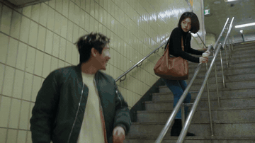</a> <a href="pages/zh/video-scifi-fantasy.md#wan-time-space-train">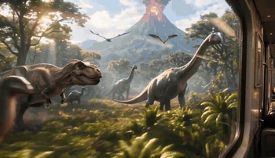</a> <a href="pages/zh/video-scifi-fantasy.md#h3-starship-hyperspace-jump">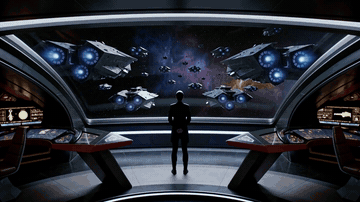</a> <a href="pages/zh/video-vfx.md#omni-four-style-progression">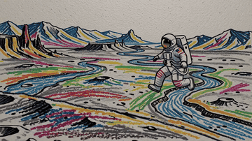</a> <a href="pages/zh/video-cinematic.md#kling-moonlit-garden-run">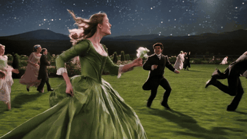</a> <a href="pages/zh/video-action-3.md#veo-off-road-rally">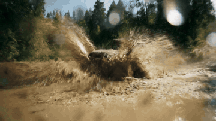</a> 

</div>

> 本仓原名 **Awesome-GPTs**，原来的 GPTs 清单保存在 [legacy/awesome-gpts_zh.md](legacy/awesome-gpts_zh.md)。

<a id="spotlight"></a>
## Seedream 5.5

Seedream 5.5 是字节 Seed 最新的图片模型。下面是点赞最多的 4 条提示词，每条附成图、完整提示词和出处。

<a href="https://x.com/Mayz1169/status/2120151170102767819"></a>

**[霍格沃茨图书馆烛光中微笑的斯莱特林少女](pages/zh/image-character.md#seedream-5-5-slytherin-library-smile)** · 上传图改图 · 出处: [@Mayz1169 on X](https://x.com/Mayz1169/status/2120151170102767819) · 924 赞，统计于 2026-11-11

<details><summary><b>提示词</b></summary>

```text
Use @ image as the exact character design: long pale-blonde hair, grey eyes, Slytherin uniform with grey sweater vest, green-and-silver striped tie and black robe with green lining. High-quality anime illustration, upper-body shot of her sitting at a long wooden table in the Hogwarts library at dusk, turning her head toward the viewer with a sly, confident smile. Her hands are out of frame. Warm candlelight from the left lights her face and hair, cool blue twilight comes through the tall arched window behind her, glowing dust in the air, stacks of old books softly blurred in the background. Clean line art, rich soft lighting, detailed hair strands, no text.
```

</details>

<a href="https://x.com/ZaraIrahh/status/2120161811571912709">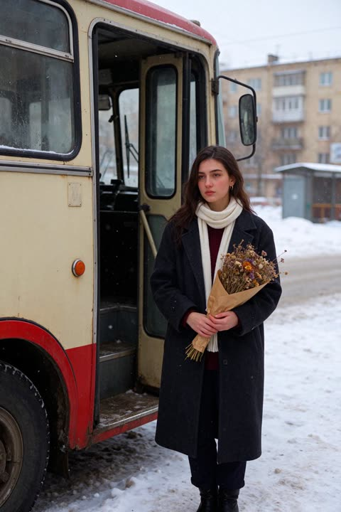</a>

**[女子手持干花站在苏联公交车旁](pages/zh/image-portrait.md#seedream-5-5-woman-dried-flowers-soviet-bus)** · 文生图 · 出处: [@ZaraIrahh on X](https://x.com/ZaraIrahh/status/2120161811571912709) · 217 赞，统计于 2026-11-11

<details><summary><b>提示词</b></summary>

```text
Photorealistic fashion editorial with the atmosphere of a winter morning in the early 1990s, in a Soviet-era residential neighborhood. A beautiful adult brunette woman with delicate facial features stands beside the open folding doors of an aged cream-and-red Soviet LiAZ-677 city bus. She holds a small bouquet of dried wildflowers wrapped in vintage brown kraft paper, gently gripping it with both hands in front of her thighs.

She wears an oversized charcoal wool coat, a soft ivory knitted scarf, a dark burgundy ribbed sweater, straight dark trousers and black leather winter boots. Loose dark brown hair falls naturally around her face, a few strands lifted by the freezing wind. Flushed cheeks, minimal makeup, thoughtful expression, looking slightly past the camera, shoulders gently raised against the cold.

Snow-covered pavement, compacted gray snow beside the bus wheels, frosted windows with condensation, faded red paint, weathered metal. Blurred Soviet apartment blocks and a modest bus shelter in the distance. Fine snowflakes in the air, visible breath. The delicate dried flowers add a subtle warm color accent against the muted winter surroundings.

Three-quarter portrait framed from the knees up, eye-level camera, woman placed off-center, the bus filling one side of the composition. Cold overcast daylight with direct on-camera flash, crisp face, deep background, subtle analog film grain, restrained colors, candid 1990s street photography combined with luxury fashion editorial. Real skin texture, tactile wool, believable hands and bouquet construction, shot on a 50mm lens --ar 3:4 --style raw --s 150 --no modern cars smartphones logos text watermark
```

</details>

<a href="https://x.com/yourPlugAI/status/2120176960999403776">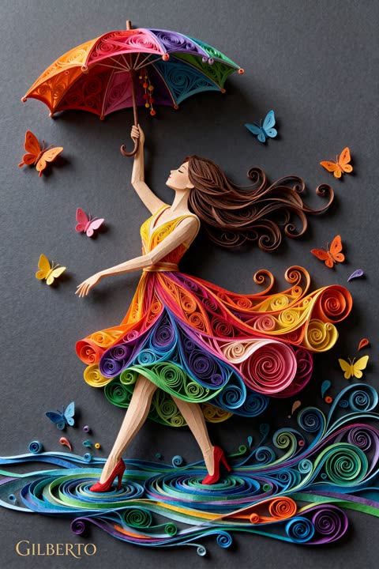</a>

**[卷纸艺术舞者配彩虹伞](pages/zh/image-illustration.md#seedream-5-5-quilled-woman-rainbow-umbrella)** · 文生图 · 出处: [@yourPlugAI on X](https://x.com/yourPlugAI/status/2120176960999403776) · 114 赞，统计于 2026-11-11

<details><summary><b>提示词</b></summary>

```text
3D paper quilling art of a graceful woman dancing in side-profile. She wears an elegant sleeveless v-neck dress made of intricately coiled paper strips in a vivid rainbow gradient—transitioning seamlessly through yellow, orange, red, magenta, deep purple, royal blue, and emerald green.

Her long brown hair flows in the wind behind her as she gracefully holds an open quilled umbrella featuring matching rainbow paper panels overhead. She wears bright red high heels, standing atop quilled paper water ripples reflecting vibrant hues. Surrounding her in mid-air are multiple detailed quilled paper butterflies in shades of bright orange, yellow, pink, and sky blue.

The background is a solid matte dark charcoal grey cardstock, featuring subtle overhead studio directional lighting that casts soft 3D drop shadows underneath the layered paper elements, emphasizing realistic texture and depth. High detail, paper craft sculpture aesthetic, 4k resolution. --ar 2:3
```

</details>

<a href="https://x.com/MayorKingAI/status/2120198834508955990">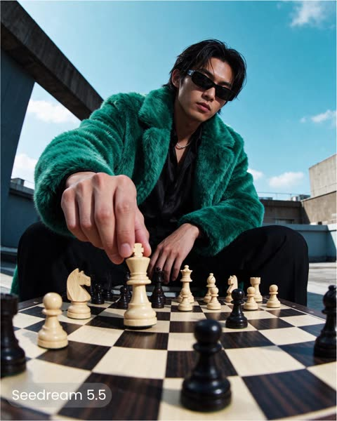</a>

**[屋顶上身穿绿色仿毛大衣的下棋男子](pages/zh/image-realism.md#seedream-5-5-rooftop-chess-king-fur-coat)** · 文生图 · 出处: [@MayorKingAI on X](https://x.com/MayorKingAI/status/2120198834508955990) · 91 赞，统计于 2026-11-11

<details><summary><b>提示词</b></summary>

```text
I tested all four models directly in
@magnific


Prompt: An ultra-realistic high-fashion editorial photograph of a striking 28-year-old Japanese man with sharp facial features, a defined jawline, slightly messy medium-length black hair and narrow rectangular black sunglasses, sitting confidently on a rooftop terrace while playing chess.

He wears an oversized luxurious emerald-green faux-fur coat over a black silk shirt, tailored black trousers and a subtle silver chain necklace. His expression is calm, confident and slightly intimidating, looking directly toward the camera.

Camera composition: An extreme low-angle shot taken from the very edge of a chessboard, with the camera positioned only a few centimeters above the board's surface. The black-and-white chessboard dominates the entire bottom third of the frame, its squares appearing exceptionally large in the foreground and rapidly shrinking toward the seated man.

The man is centered in the composition, visible from approximately the knees upward, leaning slightly forward. His right arm extends directly toward the camera, with his hand dramatically enlarged by perspective. He is gripping the top of a polished ivory wooden king chess piece between his thumb and index finger, moving it toward an empty square near the camera. The king is dramatically oversized in the immediate foreground due to the wide-angle perspective, while the remaining chess pieces appear progressively smaller toward the background.

His other hand rests naturally near his knee. The chess pieces are physically accurate and positioned naturally on the board, with realistic contact shadows and detailed polished wooden surfaces.

Environment: An open urban rooftop with subtle concrete architectural details, low surrounding rooftops and an enormous vivid cyan-blue sky with a few soft, scattered white clouds. The bright sky occupies the upper half of the composition, creating strong visual contrast against the emerald-green coat.

Photography: Shot on a Sony A1 II with a 20mm wide-angle lens, camera placed at chessboard level, f/8, ISO 100, 1/1000s. Deep environmental perspective, exaggerated foreground scale, realistic optical distortion, crisp textures across the chessboard and subject. Bright natural midday sunlight, accurate skin tones, natural facial asymmetry, individual hair strands, detailed fabric and fur fibers, subtle imperfections and physically realistic shadows.

Authentic luxury fashion campaign photography, bold editorial framing, natural photographic color grading, exceptionally realistic skin texture, no artificial skin smoothing, no CGI appearance, no illustration, no plastic textures, no excessive cinematic effects.
```

</details>

全部 20 条见 [agentcraft.dev](https://agentcraft.dev/zh/prompts/image/seedream-5-5/)，可以和 [GPT Image 2.6](https://agentcraft.dev/zh/prompts/image/gpt-image-2-6/)、[Nano Banana 2.1](https://agentcraft.dev/zh/prompts/image/nano-banana-2-1/) 对照着看。

## 目录

- [Seedream 5.5](#spotlight)
- [最近新增](#recent)
- [按模型](#bymodel)
- [视频提示词](#video) (1177 条)
  - [电影感场景与短片](#vid-cinematic) (178)
  - [动作、追逐与运动](#vid-action) (236)
  - [科幻与奇幻](#vid-scifi-fantasy) (101)
  - [动漫与动画](#vid-anime) (83)
  - [广告与产品](#vid-commercial) (137)
  - [对白与口播](#vid-dialogue) (59)
  - [音乐与舞蹈](#vid-music-dance) (50)
  - [手机实拍与 Vlog](#vid-vlog) (191)
  - [自然、旅行与航拍](#vid-nature) (12)
  - [动物与萌宠](#vid-animal) (32)
  - [特效与变身转场](#vid-vfx) (98)
- [图片提示词](#image) (1453 条)
  - [海报与编辑排版](#img-poster) (215)
  - [信息图与幻灯片](#img-infographic) (95)
  - [手机与界面截图](#img-ui-mockup) (30)
  - [产品图与电商](#img-product) (79)
  - [标志、广告与包装](#img-brand) (28)
  - [写实照片](#img-realism) (136)
  - [人像](#img-portrait) (288)
  - [角色与手办](#img-character) (113)
  - [插画](#img-illustration) (122)
  - [漫画与分镜](#img-comic) (21)
  - [照片转艺术风格](#img-photo-to-art) (113)
  - [建筑与室内](#img-architecture) (24)
  - [地图](#img-map) (15)
  - [拼贴](#img-collage) (108)
  - [照片编辑](#img-edit) (66)
- [Agent 配方：剪视频](#recipes) (5 条)
- [指南与 skill](#guides)
- [用 Agent 做 3D](#threed)
- [按标签浏览](#tags)
- [投稿](#contributing)

<a id="recent"></a>
## 最近新增

- 2026-11-17 · [精灵女战士快速完成晨间战前准备蒙太奇](#seedance-elf-morning-routine) · Seedance 2.5
- 2026-11-17 · [Ram 和 Rem 的 macOS 桌面壁纸](pages/zh/video-anime.md#wan-ram-rem-macos-desktop) · Wan 3.0
- 2026-11-17 · [幽灵从电视爬出抢走冰淇淋](pages/zh/video-dialogue.md#wan-ghost-steals-ice-cream-tv) · Wan 3.0
- 2026-11-17 · [夜里猫在沉睡的房子里闯祸](pages/zh/video-animal.md#kling-night-cat-chaos-chase) · Kling 4.0
- 2026-11-17 · [佛罗伦萨主教座堂照片配橡皮章旅行笔记](pages/zh/image-poster.md#gpt-image-florence-stamp-field-notes) · GPT Image 2.5
- 2026-11-17 · [长矛战士与巨汉对峙于破裂的马赛克竞技场](pages/zh/video-action.md#wan-spear-brawler-mosaic-arena-fight) · Wan 3.0
- 2026-11-17 · [森林公路照片与插画版对照海报](pages/zh/image-poster.md#gpt-image-road-trip-vibes-poster) · GPT Image 2.5
- 2026-11-17 · [泰姬陵与巨型字母T双重曝光海报](pages/zh/image-poster.md#gpt-image-2-6-taj-mahal-giant-t-poster) · GPT Image 2.6
- 2026-11-17 · [Flipkart 活动海报，行走模特与商品拼贴](pages/zh/image-poster.md#nano-banana-flipkart-more-to-explore-collage) · Nano Banana 2.1
- 2026-11-17 · [黄色针织围巾连接两个铅笔素描人物](pages/zh/image-poster.md#gpt-image-2-6-stay-warm-shared-scarf) · GPT Image 2.6
- 2026-11-17 · [同一位卷发角色的两幅表情肖像](pages/zh/image-character.md#gpt-image-curly-redhead-two-expressions) · GPT Image 2.5
- 2026-11-17 · [日落时带伞的金布小船](pages/zh/image-realism.md#gpt-image-2-6-golden-leaf-boat-sunset) · GPT Image 2.6

<a id="bymodel"></a>
## 按模型

- [Seedance 2.5](https://agentcraft.dev/zh/prompts/video/seedance-2-5/): 678 条提示词，每条附成品和出处
- [MiniMax H3](https://agentcraft.dev/zh/prompts/video/minimax-h3/): 315 条提示词，每条附成品和出处
- [Wan 3.0](https://agentcraft.dev/zh/prompts/video/wan-3-0/): 64 条提示词，每条附成品和出处
- [Kling 4.0](https://agentcraft.dev/zh/prompts/video/kling-4-0/): 38 条提示词，每条附成品和出处
- [GPT Image 2.6](https://agentcraft.dev/zh/prompts/image/gpt-image-2-6/): 107 条提示词，其中 43 条是 GIF 动图，每条附成图和出处
- [Nano Banana 2.1](https://agentcraft.dev/zh/prompts/image/nano-banana-2-1/): 97 条提示词，每条附成品和出处
- [Seedream 5.5](https://agentcraft.dev/zh/prompts/image/seedream-5-5/): 20 条提示词，每条附成品和出处

<a id="video"></a>
## 视频提示词

下面每条提示词都原样摘自出处：模型厂商自己的指南或模型卡，或创作者在 X 上附带成片发布的帖子。点缩略图看带声音的原片。按想做的内容分组，覆盖 [Artificial Analysis 视频榜](https://artificialanalysis.ai/video/leaderboard/text-to-video)前排模型，每条都标明模型，创作者帖子按点赞数排序，点赞数以标注日期为准。

<a id="vid-cinematic"></a>
## 电影感场景与短片

这一类的全部提示词和预览见 [agentcraft.dev](https://agentcraft.dev/zh/prompts/video/cinematic/)

<a id="h3-character-detail-montage"></a>
### 二十镜头角色细节蒙太奇，最后才露脸

<a href="https://x.com/aimikoda/status/2100258514132217859">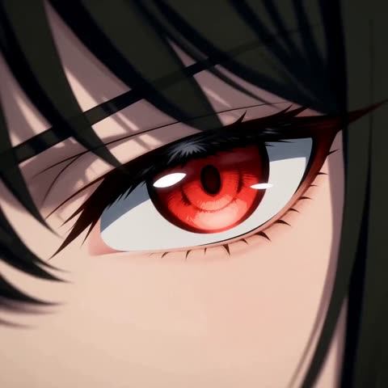</a>

按时间段列出编号分镜，每镜只用一个突然的运镜，串成三段连贯的动作爆发。前十九镜始终不拍脸，第二十镜才揭示，并用相似形状的硬切衔接，不做变形。

MiniMax H3 · 参考生视频 · 出处: [@aimikoda on X](https://x.com/aimikoda/status/2100258514132217859) · 3,281 赞，统计于 2026-10-28

[`character-reference`](pages/zh/tags.md#tag-character-reference) [`montage`](pages/zh/tags.md#tag-montage) [`hard-cuts`](pages/zh/tags.md#tag-hard-cuts) [`camera-moves`](pages/zh/tags.md#tag-camera-moves) [`studio-background`](pages/zh/tags.md#tag-studio-background)

<details><summary><b>提示词</b></summary>

```text
Use @[character reference] for the character's identity, anatomy, costume, colors, materials and visual style. Adapt body-region cues to its actual anatomy, replacing absent features with existing equivalents. Invent no anatomy or accessories. Select signature inserts from its most recognizable details. Rigid parts rotate; flexible materials bend or stretch.

A 15-second character-detail montage: exactly 20 shots joined by hard cuts. An empty, seamless warm-white studio background; soft directional light reveals the surfaces. Shots 1-19 are tightly cropped body details and rear angles: keep the face, eyes and facial profile entirely outside the frame, including reflections. Shot 20 is the first and only face reveal. No full-body view.

Three connected bursts: a sharp head turn with the body bracing; a coiled arm opening into a strong sweep and torso twist; one short step into a planted pivot, finishing with a sudden look into camera. Carry body state across cuts without resetting to neutral. Existing hair, clothing and attachments react naturally. Keep the character active, with clear articulation and weight shifts.

Jump between distant body regions. Mix brief visual punches with longer moving-detail reads. Use one abrupt camera move per shot except locked-camera inserts 4 and 11, where the character supplies the speed. Vary height, angle and direction. Brake moves briefly for legibility while the subject keeps moving. Local whips stay tightly cropped; changes of body region use hard cuts. Connect selected cuts through similar shapes or motion vectors, without morphing. Real-time action, no slow motion or freeze frames.

0-3s, shots 1-5. A concealed head turn triggers the first burst:
1. Extreme upper-back detail: a crash push catches its surface shifting as a sharp head turn begins entirely above the crop.
2. Fingers: a short downward snap catches them curling into a fist as the body braces.
3. Rear three-quarter shoulder detail: a tight camera arc catches the shoulder drawing back behind the turning head.
4. Locked floor-level foot detail: the grounded support foot braces, its raised heel pressing down firmly without taking a step.
5. Rear neck detail: a short upward tilt catches the nape stretching with the turn; stop below the back of the head, keeping the jaw and face excluded.

3-9s, shots 6-13. The coiled arm opens into a forceful sweep:
6. A signature upper-body detail: a fast diagonal slide catches an existing seam, joint or distinctive contour responding as the arm draws inward.
7. Elbow: a sharp lateral track catches the folding joint tightening the arm's coil.
8. Supporting knee: hard match cut from the bent elbow to the knee's similar angle; a short camera drop catches the leg compressing under the same preparation.
9. Wrist: a quick shallow orbit catches it turning outward to initiate the release.
10. Upper chest: a short punch-in catches the chest opening as the arm drives outward beyond the crop. Let this moving surface read slightly longer.
11. Locked hand detail: fingers spring open and the hand sweeps rapidly across the fixed frame. Catch one crisp, readable phase of the spread fingers before they leave the crop.
12. Upper back: a sharp sideways slide continues that screen direction as the shoulder rolls through the sweep and the torso twists.
13. A distinctive torso or waist detail: a close diagonal move catches its physical response to the twist, such as an existing fold pulling taut or an attached piece swinging. Give the material response a clear moving read.

9-13s, shots 14-19. One short step and a pivot build toward the reveal:
14. Thigh of the other leg: an abrupt low tracking move catches it driving the single short step out of the twist.
15. Advancing foot: a brief downward whip catches it landing; show clear floor contact.
16. Ankle and lower-leg detail: a fast side slide catches the landed leg accepting weight as the ankle flexes.
17. Waist: a tight orbit catches the torso rotating above the planted-foot pivot. The foot supports the turn rather than sliding across the floor.
18. Back-of-head contour: a short lateral whip catches the start of the return turn from behind. Keep only the rear contour in frame, never the facial profile.
19. A signature shoulder detail: a sharp diagonal slide catches its follow-through beneath the turning head, which stays completely above the crop. Cut at the peak of this movement.

13-15s, shot 20. First face reveal:
20. Hard cut to a frontal face close-up as the character sharply completes the turn toward the lens. An explosive short push reveals the entire face clearly for the first time and stops tightening before cropping out its features. Direct eye contact lands while hair, clothing or natural body follow-through remains alive. Keep the whole face readable through the end; finish on living motion, without a held pose or another cut.

No added props, scenery, text, graphic overlays or split screens.
```

</details>

<a id="h3-fpv-noir-bedspread-pistol-glide"></a>
### 低空FPV掠过床罩，镜头滑向手枪

<a href="https://x.com/CharaspowerAI/status/2090091561506009588">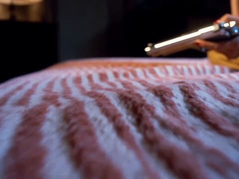</a>

提示词把整个镜头写成一条连续的FPV运镜路线，并按顺序写明路径，随后列出对焦切换链（手枪、烟头、烟雾、项链、嘴唇、眼睛）。参考形象的锁定句和不切镜的要求让人物与镜头保持一致。

MiniMax H3 · 图生视频 · 出处: [@CharaspowerAI on X](https://x.com/CharaspowerAI/status/2090091561506009588) · 1,863 赞，统计于 2026-11-10

[`fpv`](pages/zh/tags.md#tag-fpv) [`noir`](pages/zh/tags.md#tag-noir) [`macro`](pages/zh/tags.md#tag-macro) [`single-take`](pages/zh/tags.md#tag-single-take)

<details><summary><b>提示词</b></summary>

```text
Invisible micro-FPV camera skimming less than an inch above the coarse woven bedspread, the ribbed diagonal threads rushing past in extreme macro like a textured landscape, warm lamplight grazing every raised fiber while the background dissolves into creamy noir blur; the lens glides forward with a low, weightless inertia, catching a sudden silver glint from the handgun at the right edge as the first visual hook, then banking gently left around the corner of the small textured cushion that supports the woman’s elbows, so the cushion becomes a massive foreground wall sliding across frame. Focus starts razor-thin on the bedspread threads, then racks smoothly to the metallic pistol grip in her resting left hand, revealing her red-painted nails, the extended index finger along the slide, and tiny reflected streaks of warm practical light on the gun’s polished edges. Without cutting, the camera rises in a shallow arc over the pistol muzzle line, never crossing it abruptly, drifting close enough for the weapon to sweep past the lens as a blurred silver foreground occlusion, then eases toward her hand and forearm, the black wrist band briefly framing the lower edge while the bed and white pillow behind stretch into parallax layers. The movement continues as one controlled breath: a slow clockwise orbit around her upper body, passing just above the cushion and climbing toward the black scoop-neck top, where the two red teardrop pendants swing subtly against her collarbone; focus pulls from the jewelry’s glossy facets to the soft highlights on her skin, then to the dark shine of her straight black bob. The camera slips upward beside her raised cigarette hand, threading through the thin smoke drifting from the ember, the burning tip blooming as a warm macro point of light before it smears into bokeh; the cigarette and red fingernails fill the foreground while her face remains ghosted behind them, then focus snaps elegantly through the smoke onto her eyes. She remains visually identical to the reference: prone on the bed, elbows planted, head slightly tilted, feet lifted and crossed behind her, calm direct gaze, blunt bangs, dark clothing, red pendants, pistol in hand, no redesign, no change of pose logic. The camera now floats inches from her face, almost at pillow height, drifting from her cigarette hand across the line of her cheek and lips as a thin blue-toned exhale lifts past her forehead; the smoke curls around the lens as semi-transparent veils, briefly occluding one eye, then revealing it again with a controlled rack-focus from vapor texture to the sharp reflective wetness of her gaze. Momentum carries the viewpoint upward in a graceful rising bank over the bridge of her nose and bangs, grazing the glossy black hair so individual strands catch warm highlights from the lamp on frame-left and cooler ambience from the blinds behind. As the lens crests above her head, it widens slightly, revealing the room geometry: the illuminated pleated table lamp glowing on the left, closed horizontal blinds behind her raised heels, the smooth white pillow on the right, and the bedspread plane anchoring the entire scene. The camera then dives in a smooth S-curve toward her crossed glossy black stilettos, using the lifted legs as a dramatic foreground arch; focus shifts from her face to the patent leather shoes, catching tiny specular highlights as the lamp and blinds slide in opposite directions behind them, creating strong parallax without disorienting the space. The viewpoint wraps around the shoes in a technically precise half-orbit, passing close to one heel until it becomes a dark blurred vertical blade, then descending along the diagonal line of her legs back toward the bed, letting the blinds streak horizontally across the background while the warm lamp glow expands and contracts at the left edge. The movement accelerates subtly into the final escalation: the camera swoops low beside the bedspread, races past the cushion, then climbs in a smooth spiral around her right side, threading between the foreground cigarette smoke and the reflective pistol so smoke, gunmetal, red nails, red pendants, black hair, warm lamp, white pillow, and striped blinds all align in layered depth. During this final wraparound, focus choreographs a continuous chain—pistol highlight, cigarette ember, drifting smoke, pendant facets, her lips, then her eyes—each handoff motivated by the camera’s path and changing distance. The last maneuver decelerates into a poised three-quarter frontal hero composition at bed height, slightly low and intimate, with her face and eyes razor sharp, cigarette hand lifted in the foreground, pistol resting in the opposite hand, crossed heels and horizontal blinds behind, the glowing pleated lamp forming a warm practical halo at one side, smoke rising in elegant blue wisps through the frame. The final image holds as a premium neo-noir movie-poster frame: stable, iconic, high-contrast, shallow depth of field, warm practical light against cool background ambience, all textures preserved, the woman’s expression calm and unwavering, the room intact and spatially coherent, no cuts, no visible camera, only one continuous fluid FPV trajectory ending in perfect cinematic stillness.
```

</details>

**[全部 178 条](pages/zh/video-cinematic.md)**

<a id="vid-action"></a>
## 动作、追逐与运动

这一类的全部提示词和预览见 [agentcraft.dev](https://agentcraft.dev/zh/prompts/video/action/)

<a id="seedance-seoul-subway-revenge"></a>
### 首尔地铁站复仇喜剧

<a href="https://x.com/AIwithSynthia/status/2108760866422415701">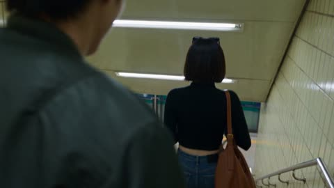</a>

第一行先定镜头语言（手持、荧光灯、实时），再按节拍写笑点，结尾点明哪些画面必须拍清楚。

Seedance 2.5 · 文生视频 · 出处: [@AIwithSynthia on X](https://x.com/AIwithSynthia/status/2108760866422415701) · 10,056 赞，统计于 2026-10-27

[`action`](pages/zh/tags.md#tag-action) [`comedy`](pages/zh/tags.md#tag-comedy) [`handheld`](pages/zh/tags.md#tag-handheld) [`subtitles`](pages/zh/tags.md#tag-subtitles)

<details><summary><b>提示词</b></summary>

```text
Create a live-action cinematic revenge-comedy video set in a Seoul subway station. Use realistic handheld camera movement, cold fluorescent lighting, teal-green accents, and real-time action.

A Korean woman in her 20s with a black bob, sunglasses on her head, a fitted crop top, high-waisted blue jeans, black boots, and a brown shoulder bag descends the subway stairs holding a takeaway coffee. A Korean man with messy dark hair and blonde tips, wearing a dark-green bomber jacket, suddenly hits her from behind and laughs as she stumbles against the handrail. Furious, she chases him onto the platform as he boards a train and mocks her through the closing glass doors.

She punches the glass, creating a dramatic crack and opening. As she confronts him, her coffee cup slips from her hand, falls to the platform, and spills visibly across the floor. She grabs his jacket, forcefully throws him through the air, and sends him crashing into a large metal rubbish bin. The bin rattles and wobbles as he lands inside, looking terrified and humiliated.

She leans toward him and says, "Don't mess around." She then calmly walks away while he remains stuck in the bin.

Maintain identical faces, hairstyles, outfits, and location throughout. Include realistic physics, expressive reactions, cinematic close-ups, subway ambience, and clear white subtitles. Keep the action non-gory, the coffee spill visible, and the final dustbin landing unmistakable.
```

</details>

<a id="kling-basketball-backflip-dunk-court"></a>
### 篮球运动员在室外球场后空翻扣篮

<a href="https://x.com/higgsfield_ai/status/2019083976682684558">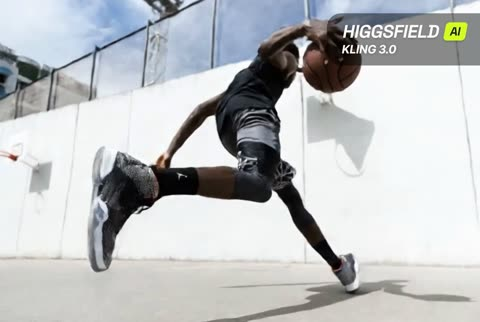</a>

提示词把一个动作拆成四个编号镜头（运球、起跳、空中翻转、扣篮），每个镜头都写明景别和机位。低机位加上翻转时的慢动作特写，让 Kling 的物理模拟每一步都有明确的画面目标。

Kling 3.0 · 文生视频 · 出处: [@higgsfield_ai on X](https://x.com/higgsfield_ai/status/2019083976682684558) · 2,533 赞，统计于 2026-10-27

[`multi-shot`](pages/zh/tags.md#tag-multi-shot) [`sports`](pages/zh/tags.md#tag-sports) [`basketball`](pages/zh/tags.md#tag-basketball) [`low-angle`](pages/zh/tags.md#tag-low-angle) [`physics`](pages/zh/tags.md#tag-physics)

<details><summary><b>提示词</b></summary>

```text
Shot 1: A side profile, medium shot of a muscular African American man in athletic wear, intensely dribbling a basketball on an outdoor concrete court towards a hoop against a high white wall under a bright blue sky.
Shot 2: A dynamic, low-angle wide shot showing the man jumping remarkably high into the air, performing a backflip while holding the basketball, with the white wall and sky in the background.
Shot 3: A close-up, slow-motion shot of the man mid-air and upside down during his flip, showing his focused expression and the basketball held firmly in his hands against the sky.
Shot 4: A dramatic, low-angle shot focusing on the basketball hoop as the man, still upside down from his acrobatic jump, powerfully dunks the ball into the net.
```

</details>

**[全部 236 条](pages/zh/video-action.md)**

<a id="vid-scifi-fantasy"></a>
## 科幻与奇幻

这一类的全部提示词和预览见 [agentcraft.dev](https://agentcraft.dev/zh/prompts/video/scifi-fantasy/)

<a id="seedance-lab-containment-breach"></a>
### 实验室收容失效，科幻恐怖

<a href="https://x.com/auqibhabib/status/2099725768310009982">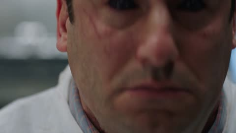</a>

要求开场即钩子、用实拍特效质感，怪物不会显得像 CG。

Seedance 2.5 · 文生视频 · 出处: [@auqibhabib on X](https://x.com/auqibhabib/status/2099725768310009982) · 2,425 赞，统计于 2026-10-27

[`horror`](pages/zh/tags.md#tag-horror) [`sci-fi`](pages/zh/tags.md#tag-sci-fi) [`action`](pages/zh/tags.md#tag-action)

<details><summary><b>提示词</b></summary>

```text
Cinematic sci-fi horror-action short film set in a research laboratory, opens with an immediate strong hook, natural realistic pacing, grounded practical-effects style. Lab filled with steel equipment, glass containment tubes, monitors, specimen tables, harsh fluorescent lighting. Five scientists in lab coats work at various stations. Natural handheld camera work, muted authentic color grading, all sound fully natural and diegetic — no music, no artificial sound design until the tension score kicks in.
>
> **[0-1s]** Hard cut: a containment tube shatters violently, glass exploding across the lab floor.
>
> **[1-2s]** A small dark parasite creature skitters out fast, latching instantly onto a scientist's neck.
>
> **[2-3s]** He screams, collapsing to his knees, the others recoiling in shock.
>
> **[3-4s]** Dark veins pulse rapidly beneath his skin, visible even through his collar, his body convulsing.
>
> **[4-5s]** His eyes turn a deep obsidian black — he rises, movements jerky and unnatural.
>
> **[5-6s]** He lunges at the nearest colleague, parasite tendrils extending from his mouth toward her.
>
> **[6-7s]** She's caught, tendrils latching onto her neck, her scream cutting short.
>
> **[7-8s]** Veins spread fast across her too, body convulsing against a lab table, equipment crashing down.
>
> **[8-9s]** She rises seconds later, eyes black, joining him, both turning toward the remaining three.
>
> **[9-10s]** The three scientists scramble back, one grabbing a fire axe from an emergency case on the wall.
>
> **[10-11s]** The two infected charge fast, jerky inhuman movements, tendrils whipping from their jaws.
>
> **[11-12s]** The lead scientist swings the axe hard into the first infected — a solid impact, it staggers into a specimen table, equipment shattering.
>
> **[12-13s]** A second scientist grabs a fire extinguisher, blasting the other infected in the face, it recoils, tendrils flailing.
>
> **[13-14s]** The third scientist shoves a steel cart into the staggering infected's path, sending it crashing down.
>
> **[14-15s]** Both infected collapse motionless, twitching, tendrils retracting slowly.
>
> **[15-16s]** The three survivors regroup, breathing hard, scanning the wrecked lab for more movement.
>
> **[16-17s]** Wide shot: broken glass and toppled equipment everywhere, alarm lights beginning to flash red.
>
> **[17-18s]** A third containment tube behind them starts cracking, unnoticed by the group.
>
> **[18-19s]** It shatters suddenly — another parasite creature launches out fast.
>
> **[19-20s]** The lead scientist spins just in time, swinging the axe and slicing it out of the air mid-leap.
>
> **[20-21s]** It hits the floor, motionless, dark fluid spreading slightly beneath it.
>
> **[21-23s]** The group presses their backs together, weapons raised, scanning every corner of the lab.
>
> **[23-25s]** Emergency lights flash steadily red, alarm klaxon blaring through the facility.
>
> **[25-27s]** The lead scientist gestures toward the exit; they move together cautiously, stepping over debris and fallen colleagues.
>
> **[27-29s]** They reach the heavy lab door, the lead scientist sealing it shut behind them with a hard mechanical clang.
>
> **[29-30s]** Final shot: the three survivors lean against the sealed door, breathing hard, alarm lights flashing red across their exhausted faces. Cut to black.
>
> Natural diegetic sound throughout — glass shattering, guttural convulsions, screaming, metal impacts, alarm klaxon, heavy breathing — layered with a tense instrumental score building through the fight and easing at the end. No text overlay, no watermark. Natural handheld camera with realistic shake during action, muted clinical color grading.
```

</details>

<a id="seedance-elf-morning-routine"></a>
### 精灵女战士快速完成晨间战前准备蒙太奇

<a href="https://x.com/GlitterPixely/status/2102028142294483208">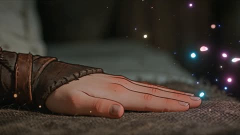</a>

用 REF 参考块绑定单张图片的角色外观，再用 LOCK 行锁定各镜头中的脸部、发型和服装。二十个带时间码的分镜，每一切都标明为硬切，并列出音效层且不加音乐和台词，让节奏由音效带动。

Seedance 2.5 · 图生视频 · 出处: [@GlitterPixely on X](https://x.com/GlitterPixely/status/2102028142294483208) · 1,542 赞，统计于 2026-11-17

[`fantasy`](pages/zh/tags.md#tag-fantasy) [`montage`](pages/zh/tags.md#tag-montage) [`sound-design`](pages/zh/tags.md#tag-sound-design) [`character-consistency`](pages/zh/tags.md#tag-character-consistency)

<details><summary><b>提示词</b></summary>

```text
UPLOAD MAP:

@Image
 1 = Character A identity, face, hairstyle, outfit, fantasy animation style

30 seconds, 16:9, image-to-video, rapid morning-routine micro-cut montage.

[REF] Preserve
@Image
 1 as Character A: original white-haired elf dragon-slayer, pointed ears, pale hair, face smudges, feathered outfit, soft painterly fantasy animation. No franchise logos or recognizable game symbols.

[BEATS]
Cut 01, 0.0-1.2s: extreme close-up, her eyes snap open as a tiny smoking dragon-scale alarm charm rattles.
Cut 02, 1.2-2.2s: she slaps the charm silent without looking; a puff of scale-smoke.
Cut 03, 2.2-3.6s: she sits up and throws off a rough blanket; feathers on the outfit bounce.
Cut 04, 3.6-5.0s: water splash across her face, droplets catch dawn light.
Cut 05, 5.0-6.3s: she drags two quick war-paint smudges under her eyes.
Cut 06, 6.3-7.6s: she yanks her braid tight; feathers bounce.
Cut 07, 7.6-8.8s: boot hits the floor, buckle snaps shut.
Cut 08, 8.8-10.0s: second boot stamps down, shin strap yanks tight.
Cut 09, 10.0-11.3s: wrist wrap pulls tight between her teeth.
Cut 10, 11.3-12.6s: armor charm clicks onto her shoulder.
Cut 11, 12.6-14.0s: belt cinches, small hunting pouch snaps shut.
Cut 12, 14.0-15.6s: she grabs toast, takes one serious bite like it is battle prep.
Cut 13, 15.6-17.2s: a little map on the table singes at the dragon mark.
Cut 14, 17.2-18.6s: she taps the burned mark once and gives a small confirming nod.
Cut 15, 18.6-20.2s: she swings her weapon strap over her shoulder.
Cut 16, 20.2-21.8s: brief gleam across a plain blade edge, then it slides home. No markings.
Cut 17, 21.8-23.4s: feathered cloak settles; she grabs a small pack off a hook.
Cut 18, 23.4-25.2s: door bursts open into blinding sunrise.
Cut 19, 25.2-27.2s: she steps onto the threshold, dawn wind lifts a few feathers.
Cut 20, 27.2-30.0s: held heroic close-up, tiny determined smile, distant dragon shadow crosses the warm sky.

[CAMERA] Fast clean cuts, snappy close-ups, rostrum-style 2D push-ins and pans. No long slow holds except the final heroic frame. Name every cut as a hard cut, not a morph.

[LIGHT] warm dawn light, golden dust motes, soft painted rim light, cozy hut interior shifting to bright outdoor glow.

[AUDIO] No music, no dialogue, no subtitles.
Ambience: cozy wooden-hut morning room tone, then outdoor dawn wind.
SFX: <alarm rattle, slap, blanket rustle, water splash, braid tug, boot thud, buckle click, leather wrap pull, charm click, pouch snap, toast crunch, map sizzle, strap slap, blade sheath, door creak, distant dragon rumble>

[LOCK] keep her face, ears, hair, outfit logic, painterly style, and body scale stable across every cut; keep hands simple; no text; no logos; no recognizable game symbols.
```

</details>

**[全部 101 条](pages/zh/video-scifi-fantasy.md)**

<a id="vid-anime"></a>
## 动漫与动画

这一类的全部提示词和预览见 [agentcraft.dev](https://agentcraft.dev/zh/prompts/video/anime/)

<a id="seedance-two-friends-bedsheet-ghost-prank"></a>
### 手机镜头拍下两个朋友和床单鬼的恶作剧

<a href="https://x.com/aimikoda/status/2115446648704827633">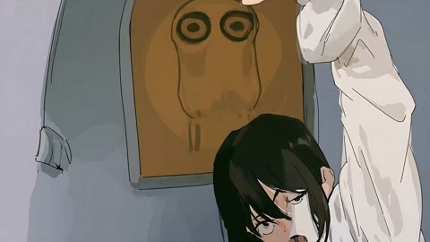</a>

独立的参考图锁定两人的发型与服装，风格参考只取线条和色调，不复制其姿态。按秒标注的分镜并写明切镜与甩镜位置，让手持手机的晃动与节奏在八个镜头中保持清楚。

Seedance 2.5 · 参考生视频 · 出处: [@aimikoda on X](https://x.com/aimikoda/status/2115446648704827633) · 19,513 赞，统计于 2026-11-03

[`anime`](pages/zh/tags.md#tag-anime) [`comedy`](pages/zh/tags.md#tag-comedy) [`hand-drawn`](pages/zh/tags.md#tag-hand-drawn) [`multi-shot`](pages/zh/tags.md#tag-multi-shot)

<details><summary><b>提示词</b></summary>

```text
References:
@[ref1]: Yuki. Shoulder-length silver-white hair with long bangs, olive-green eyes, small round silver earrings, loose pale camisole, flat deadpan face.
@[ref2]: Sumi. Short black bob with uneven bangs, brown eyes, small gold earrings, cream camisole under an oversized off-white shirt, loud and easily flustered.
@[ref3]: the style reference. Hand-drawn look, line quality and palette only; not its pose or layout.

Visual style: Rough hand-drawn anime sketch, loose black ink lines, flat watercolor washes, muted grey, sage and beige palette, soft indoor daylight. Shot as a phone front camera video: handheld, restless, constantly bobbing and tilting with whoever holds it, quick crash zooms and whip pans.

Avoid: No subtitles. No background music. No slow motion. No other people. Yuki and Sumi never merge or swap faces.

Two friends goof around nonstop with a phone camera through a small apartment, each new spot in front of a different strange painting. Every change of place comes through a whip pan or a cut from the phone itself; nobody stands still. A visible gap always separates their faces. Sound: footsteps, phone rustle, shrieks, laughter, one line. Shot list: 8 shots, about 30 seconds.

Scene 1: Continuous, in front of an orange painting with two huge round owl eyes.
Shot 1 (0-4s): Close two-shot, high angle; the camera bobs quickly with Sumi, who holds the phone with her raised right arm from the top right corner. Yuki springs up into frame from below on screen left and flashes a V sign with both hands, face completely deadpan. Sumi sticks out her tongue and shakes her head side to side, her black bob flying. Cut as Yuki snatches the phone from Sumi's hand; the camera whips left in a blur.

Scene 2: Continuous, in front of a blue-grey blob painting with one black hole for an eye.
Shot 2 (4-8s): Medium shot, eye level; the whip pan lands here, and the camera, now in Yuki's right hand, quickly pans right to follow Sumi. Yuki stays at the bottom left edge of frame, deadpan. Sumi skids across the floor from screen left to screen right in her socks, arms flailing. Cut as Sumi spins and lunges straight at the lens.
Shot 3 (8-11s): Close-up, eye level; the camera, still in Yuki's hand, does a fast crash zoom onto Sumi. Sumi's face is pressed almost against the lens, mouth wide open. Behind her, Yuki does a stiff robot dance with her free arm, still deadpan. Sumi bumps the phone; it tumbles out of Yuki's hand. Cut the instant the phone hits the floor.

Scene 3: Later, in front of a dark green painting of a faded face.
Shot 4 (11-15s): Extreme low angle from the floor; the phone already lies face up, locked-off camera looking at the ceiling. Both girls lean in over the lens from opposite sides, Yuki on screen left, Sumi on screen right. Yuki flips her silver hair forward over her whole face; one big eye peers through a gap. Sumi shrieks and jumps back out of frame, then her hand dives in and grabs the phone. Cut as the phone lifts off the floor.

Scene 4: Continuous, a narrow hallway with a grey wall and a brown smeared painting.
Shot 5 (15-19s): Medium close-up, Sumi holding the phone out in front of her and facing it while she runs backward down the hallway, still running flat out, laughing. Far behind her, at center, Yuki glides after her with her hair still over her face, arms limp, closing the distance. Cut as Sumi swings around a corner; the camera whips right.

Scene 5: Continuous, in front of a beige wall with a round orange painting.
Shot 6 (19-22s): Medium close-up, eye level, handheld; the camera heaves with Sumi's breathing. Sumi, holding the phone in her right hand, presses her back to the wall, panting, eyes darting left and right. Yuki is nowhere in frame. Cut as a white cloth drops in from the top of frame.
Shot 7 (22-25s): Insert, close to the lens; the camera jolts once. A single white bedsheet with two black eye holes lowers from above in front of the lens, held by Yuki's hands.
Yuki's line (flat, deadpan): "Boo."
Shot 8 (25-30s): Wide two-shot, high angle; the camera quickly pulls back, then spins with them. Sumi, phone in her right hand, yanks the sheet with her left; the sheet tangles around both girls and they spin together, laughing, Yuki's hair now neat. Both thrust V signs at the lens. Sumi's index finger is still reaching for the lens when the clip cuts to black as the fingertip covers it.
```

</details>

<a id="seedance-katsudon-anime-cooking"></a>
### 快剪动画风格做猪排饭

<a href="https://x.com/Goodmanprotocol/status/2098845134326808734">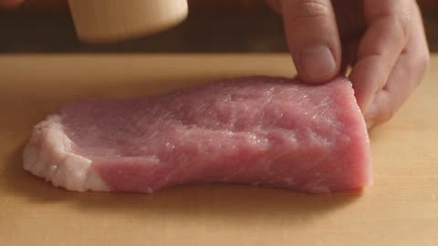</a>

开头明确禁止模仿任何现有动画，再一步步写菜谱，让每个镜头都有事做。

Seedance 2.5 · 文生视频 · 出处: [@Goodmanprotocol on X](https://x.com/Goodmanprotocol/status/2098845134326808734) · 4,935 赞，统计于 2026-10-27

[`anime`](pages/zh/tags.md#tag-anime) [`food`](pages/zh/tags.md#tag-food) [`fast-cut`](pages/zh/tags.md#tag-fast-cut)

<details><summary><b>提示词</b></summary>

```text
Create a 30-second fast-paced cinematic Japanese anime cooking video showing the preparation of authentic katsudon, entirely from the text description below.

IMPORTANT: Do not display, recreate, trace, reference, or imitate any storyboard, sketch, reference image, panel, annotation, or source material. Generate only original anime-style animation.

STYLE

High-quality Japanese anime film style, cinematic summer lighting, ultra-detailed food textures, realistic cooking physics, visible steam and moisture, shallow depth of field, macro close-ups, smooth camera movement, warm Japanese kitchen atmosphere. Fast rhythmic editing with natural match cuts based on movement, shape, texture, and composition.

TIMELINE

0–2.5s — Prepare Pork
Close-up of hands pounding a thick pork loin with a wooden mallet on a cutting board. The meat gradually flattens and its fibers loosen. Sprinkle salt and pepper evenly. Crisp rhythmic impacts.

2.5–5s — Bread the Pork
Quick match cuts: press the pork into flour, dip into beaten egg, then firmly coat with coarse panko breadcrumbs. Show realistic egg dripping and breadcrumbs adhering to the surface.

5–7.5s — Fry
Lower the breaded pork into hot golden oil. Intense bubbling surrounds the cutlet as the crust turns golden brown and crispy. Warm cinematic lighting and detailed oil movement.

7.5–9.5s — Slice
Place the fried tonkatsu on a wooden board. A sharp knife cuts it into even strips. The crispy crust cracks naturally, revealing juicy white pork with gentle steam escaping.

9.5–12s — Simmer Dashi & Onion
Thinly sliced onions gently simmer in amber dashi inside a shallow pan. Small bubbles rise while the onions become translucent. Chopsticks gently move them through the broth.

12–14s — Add Tonkatsu
Place the sliced tonkatsu carefully over the simmering onions using chopsticks. The broth begins soaking into the crispy edges while steam rises.

14–16.5s — Pour Egg
Slowly pour beaten golden egg over the tonkatsu and onions. The egg spreads naturally through the gaps and begins setting around the hot edges.

16.5–19s — Set the Egg
Close-up of the egg gently coagulating over low heat. Edges become soft and golden while the center remains glossy, slightly runny, and trembling. No stirring.

19–21s — Prepare Rice
A white ceramic donburi bowl receives a generous mound of steaming Japanese short-grain rice. The rice looks fluffy and slightly glossy.

21–24s — Assemble
Carefully slide the egg-and-tonkatsu mixture from the pan onto the rice. The egg settles naturally in a soft wave while dashi lightly absorbs into the rice.

24–26s — Final Close-Up
The finished katsudon rests on the counter. Glossy egg slowly settles over the tonkatsu and rice, gently trembling. Slow cinematic push-in.

26–30s — Hero Reveal
Present the finished katsudon in a traditional blue-and-white ceramic bowl on a wooden surface. Golden egg covers crispy tonkatsu over glossy rice, topped with fresh mitsuba. Steam rises as the camera slowly arcs around the bowl for a beautiful anime-food-film ending.

AUDIO

Bright 1980s-inspired Japanese city-pop instrumental, 110–120 BPM, with subtle koto and light chime percussion. Synchronize realistic ASMR cooking sounds: mallet impacts, knife slicing, frying sizzle, bubbling dashi, chopsticks, egg pouring, steam, and a soft ceramic clink.

End with one delicate wind-chime tone during the final reveal.

NEGATIVE

No storyboard, reference image, sketch, panels, borders, numbers, arrows, annotations, subtitles, captions, UI, logos, or text overlays. No unrelated ingredients or dishes. Katsudon only. Keep the food, hands, utensils, lighting, and environment visually consistent throughout.
```

</details>

**[全部 83 条](pages/zh/video-anime.md)**

<a id="vid-commercial"></a>
## 广告与产品

这一类的全部提示词和预览见 [agentcraft.dev](https://agentcraft.dev/zh/prompts/video/commercial/)

<a id="kling-vintage-watch-macro"></a>
### 指尖捏着复古腕表的微距镜头

<a href="https://x.com/higgsfield_ai/status/2019088049448362164">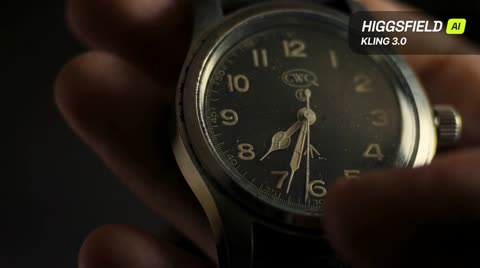</a>

提示词用英寸级机位距离，并列出灰尘、细划痕、包浆等具体表面细节，让模型稳住质感。单一暖色侧掠光、浅景深，加上只有秒针这一处微动，画面不易闪烁或崩坏。

Kling 3.0 · 文生视频 · 出处: [@higgsfield_ai on X](https://x.com/higgsfield_ai/status/2019088049448362164) · 2,534 赞，统计于 2026-10-27

[`macro`](pages/zh/tags.md#tag-macro) [`product-shot`](pages/zh/tags.md#tag-product-shot) [`shallow-depth-of-field`](pages/zh/tags.md#tag-shallow-depth-of-field) [`moody-lighting`](pages/zh/tags.md#tag-moody-lighting) [`cinematic`](pages/zh/tags.md#tag-cinematic)

<details><summary><b>提示词</b></summary>

```text
Ultra-realistic cinematic macro shot of a vintage wristwatch held between two fingers, extreme close-up framing focused on the watch face and crystal, with the camera positioned inches away to reveal fine dust particles, micro scratches on the glass, worn metal edges, engraved numerals, and subtle patina on the hands. Shallow depth of field isolates the dial while the background dissolves into soft, dark bokeh. The lighting is moody and directional, a single warm key light grazing the surface to create delicate reflections along the curved crystal and metallic rim, emphasizing texture and age. The second hand moves subtly, creating a sense of quiet tension and time passing. Skin texture of the fingers is visible at the edges of the frame, slightly out of focus, adding scale and realism. High contrast, cinematic color grading, soft film grain, precise focus breathing, and a tactile, intimate macro perspective that feels handcrafted and timeless.
```

</details>

<a id="kling-turntable-needle-macro-pushin"></a>
### 唱机推镜至唱针微距

<a href="https://x.com/higgsfield_ai/status/2019101323317375400"></a>

以给定画面为起始帧，一镜到底。刚性螺栓固定式推镜锁定唱针尖，并列出微距细节、主导音效和明确的镜头规则。

Kling 3.0 · 图生视频 · 出处: [@higgsfield_ai on X](https://x.com/higgsfield_ai/status/2019101323317375400) · 2,357 赞，统计于 2026-10-27

[`macro`](pages/zh/tags.md#tag-macro) [`single-take`](pages/zh/tags.md#tag-single-take) [`sound-design`](pages/zh/tags.md#tag-sound-design) [`push-in`](pages/zh/tags.md#tag-push-in) [`analog`](pages/zh/tags.md#tag-analog)

<details><summary><b>提示词</b></summary>

```text
Use the provided image as the exact starting frame.
Cinematic video, single continuous shot, duration 5–7 seconds.
Single take. No cuts. No transitions.
CAMERA & ACTION (CONTINUOUS MOTION)
The camera starts static, framing a turntable in warm analog studio light.
A human hand lowers the tonearm onto a spinning vinyl record.
The record begins rotating smoothly. Immediately after contact, the camera accelerates forward in one continuous movement, a fast, rigid robot-bolt push-in directly toward the stylus needle. No easing. No cinematic zoom. Pure mechanical forward motion. As the camera reaches extreme macro distance, it locks onto the needle tip, as if physically bolted to it, without any cut. From this moment on, the camera moves together with the needle, perfectly synchronized.

MACRO DETAIL (SAME SHOT)
Extreme macro view shows:
Stylus tip vibrating microscopically
Vinyl grooves flowing beneath
Dust particles, micro scratches, groove texture
Subtle vertical and lateral needle movement, physically accurate
The camera remains rigidly attached, only tiny micro-vibrations from groove friction.

SOUND DESIGN (DOMINANT, CONTINUOUS)
Sound is uninterrupted and dominant:
Needle drop click
Loud, authentic vinyl crackle and hiss
Stylus-on-groove friction
Low mechanical hum of the turntable
No music clarity at first — raw analog texture only.
No score. No digital effects.

VISUAL STYLE
Extreme macro cinematography
Ultra-shallow depth of field
Warm analog color grading
Natural reflections on vinyl
Subtle film grain

CAMERA RULES
One continuous take
No cuts, no edits, no montage
No handheld shake
No floating camera
Robo-cam, bolt-mounted feel only

END FRAME
Camera stays locked to the needle,
vinyl spinning endlessly beneath it,
hypnotic, mechanical, intimate.
```

</details>

**[全部 137 条](pages/zh/video-commercial.md)**

<a id="vid-dialogue"></a>
## 对白与口播

这一类的全部提示词和预览见 [agentcraft.dev](https://agentcraft.dev/zh/prompts/video/dialogue/)

<a id="seedance-cafe-table-multi-angle-reshoot"></a>
### 咖啡馆桌边讲话重拍成十三个新机位

<a href="https://x.com/Scenario_gg/status/2102365054389899695">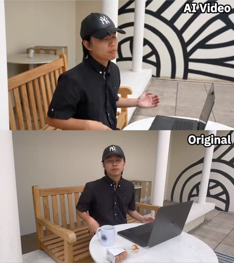</a>

提示词先锁定原视频的表演、音频、光线和节奏，只允许机位与镜头变化，再用带时间码的镜头表逐段设计新机位。逐段标注的说话时间窗、视线规则和空天空规则，让每个新角度的口型同步与背景都保持干净。

Seedance 2.5 · 视频编辑 · 出处: [@Scenario_gg on X](https://x.com/Scenario_gg/status/2102365054389899695) · 3,287 赞，统计于 2026-10-27

[`video-to-video`](pages/zh/tags.md#tag-video-to-video) [`multi-angle`](pages/zh/tags.md#tag-multi-angle) [`camera-plan`](pages/zh/tags.md#tag-camera-plan) [`lip-sync`](pages/zh/tags.md#tag-lip-sync) [`timed-shot-list`](pages/zh/tags.md#tag-timed-shot-list)

<details><summary><b>提示词</b></summary>

```text
Prompt (seedance 2.5 video to video):

ONE FINISHED TAKE, RE-PHOTOGRAPHED


@video1
 is one finished take: a single locked-off wide, 19.53 s, with its original audio, a young man at an outdoor cafe table talking to one camera. Do not restage, re-perform, re-time or reinterpret it. Re-photograph the identical event from thirteen new camera positions, as if thirteen extra cameras had been rolling around him in the same moment. Every output frame shows the same body at the same instant of
@video1
 at the same speed. Output runs the full 19.53 s. Keep the audio of
@video1
 unchanged and in sync.

DO NOT CHANGE
Performance, body, hands and what they hold, head angle, eyeline, lip movement, blink timing, movement speed, action start and end times, lighting, exposure, white balance, colour grade, wardrobe, props, set. The only variable is camera position and lens.

SPEECH WINDOWS (measured from the audio of
@video1
)
SPEAKING: 0.00-1.65, 2.05-4.80, 5.95-6.90, 9.65-11.75, 12.20-12.85, 13.35-13.80, 16.70-16.90, 17.60-18.90.
SILENT, mouth closed and still or chewing: 1.65-2.05, 4.80-5.95, 6.90-9.65 (drinking), 11.75-12.20, 12.85-13.35, 13.80-16.70 (chewing), 16.90-17.60, 18.90-19.55.
Whenever his mouth is visible in a SPEAKING window it moves in lip-sync with the audio of
@video1
. He talks while looking down: from 2.05 to 4.80 his head is down at the laptop and he is speaking. Head down is not silent. Never add speech to a silent window, never mute a speaking one.

EYELINE RULE
He performed to ONE camera, the A-camera: the original locked-off wide, directly in front of him at seated eye level. His eyeline stays on that spot in every shot, apart from the glances down at keyboard, mug and pastry already in
@video1
. He never looks for or turns toward a new camera. From above he reads cap and brow; from the sides, three-quarter or profile; from behind, the back of his head. Single exception: the on-axis shot at 00:01-00:02 sits where the A-camera was, so there alone he looks into the lens.

TEMPO RULE
Real time, 1:1 with
@video1
. No speed ramps, added slow motion, freeze frames or time remaps. Exactly one slowed passage exists, already baked into the source: the pastry at the top of its arc, 12.5-13.55. Reproduce it at the speed it already has, no slower, no longer.

TOSS TIMING
The pastry leaves his fingers at 12.43 and is caught at 13.60: airborne about one second only. Do not stretch, loop or hang the flight. Before 12.43 and after 13.60 it is in his hand.

EMPTY SKY
On every low or upward-tilting shot the sky is plain pale overcast and empty. No skyscrapers, glass towers, solar panels, cranes, birds, aircraft, sun disc, structured clouds, lens flare or signage. Above his head only cream wall, white pillars and flat pale sky.

CAMERA PLAN

[00:00-00:01] High-angle MCU from above and to his right, about 40 degrees down, chest up, slow push-in, 35mm feel, moderate depth of field, cap brim and open gesturing palms, marble edge in the lower foreground. Speaking, reading three-quarter, not to this lens.

[00:01-00:02] ON THE A-CAMERA AXIS. ECU of his face, dead front, seated eye level, 85mm feel, shallow focus, pillars soft cream behind. The one shot where he looks into the lens. Hands drop below frame onto the keyboard; mouth closes at 1.65.

[00:02-00:05] Macro along the MacBook keyboard to his typing fingers, lens centimetres above the keys, razor-thin focus, keycaps sharp, his face soft far behind, head down. Speaking 2.05-4.80: where his mouth shows in the blur it moves with the audio. Fingers lift at 5.0.

[00:05-00:06] Top-down bird's eye straight down over the table, 24mm feel, deep focus, locked off. Marble disc fills frame: open laptop, white mug, financier, his cap at the bottom edge. Right hand crosses to the mug handle.

[00:06-00:07] Lens resting on the marble at table height, 50mm feel. White mug large and sharp in the left foreground; his hand enters from the right, grips the handle, lifts the mug up out of frame. Torso soft behind. Speaking 5.95-6.90.

[00:07-00:09] First-person POV from his seat, ultra-wide 18mm feel, gentle handheld breathing. The mug rim rises into the bottom of frame and tips toward the lens; laptop screen and marble beyond in deep focus. No face; framing dips to the mug, never up. Silent.

[00:09-00:10] Extreme wide, slow dolly out, 24mm feel, deep focus. He is small at his table mid-terrace: cream wall, pillars, concentric-circle mural, taped boxes behind, slatted bench visible. He sets the mug on the marble 9.4-10.0; speech resumes 9.65.

[00:10-00:12] Low and to his left, lens just above the marble, 50mm feel, shallow focus, table edge and mug soft in the near foreground. Right hand reaches out at 10.5 and lifts the golden financier into sharp focus before his left profile. Talking to the A-camera: full profile here.

[00:12-00:14] Low beside him, 35mm feel, slight Dutch. Opens on the pastry in his fingers; at 12.43 it leaves his hand and the camera tilts UP, following it against plain pale overcast sky and the top of a white pillar through the baked-in slow apex 12.5-13.55, then tilts DOWN for the catch at 13.60 into cupped hands, head tipped back, mouth open, then head coming forward.

[00:14-00:15] Behind him, over his right shoulder, 50mm feel, moderate focus. Back of the black Yankees cap and long dark hair fill frame-left; laptop glow and marble past his shoulder. Head settles level, hands bring the pastry toward his mouth. No face. Silent.

[00:15-00:16] ECU on his mouth and jaw, 100mm macro feel, very shallow focus, soft open-sky light. The financier enters from below, he bites, crumbs, the jaw chews. Chewing, not speaking. Nothing above the nose in frame.

[00:16-00:18] Slow orbit from his left toward front, 35mm feel, moderate focus, mural and pillars parallaxing behind, table crossing the foreground. He chews, speaks 16.70-16.90 and from 17.60, open palms, a small shrug. As the orbit nears front his gaze lands near, not into, this moving lens.

[00:18-00:20] Top-down bird's eye straight down over the table, 24mm feel, deep focus, locked off. Hands come down beside the laptop and settle, cap centred, speech ends 18.90, then still. Hold to 19.53.

SET AND SUBJECT CONTINUITY (identical in every shot)
Young man, long dark hair, black short-sleeve button-up shirt with a small chest logo, black New York Yankees baseball cap, grey trousers. Light wood slatted bench, round white marble table, outdoor cafe terrace. On the table: open dark grey MacBook, white mug with a circular graphic, one small golden financier. Behind him: cream wall, white cylindrical pillars, large black-and-white concentric-circle mural, taped cardboard boxes. Soft overcast open-shade daylight, no hard shadows, constant direction and softness. Warm bright grade: cream walls, golden wood, neutral white marble, warm skin, deep neutral blacks. He is alone; no passers-by, no staff.

No on-screen text, captions, subtitles, watermarks or logos beyond the small chest logo and cap emblem already in
@video1
.
```

</details>

<a id="seedance-selfie-skincare-ugc"></a>
### 自拍式护肤品 UGC 广告

<a href="https://x.com/abxxai/status/2095179656802844727">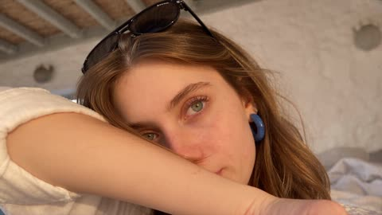</a>

线程的第三步：人物设定图和产品图作参考，提示词强调 `Not an ad`，换来自拍的真实感。

Seedance 2.5 · 参考生视频 · 出处: [@abxxai on X](https://x.com/abxxai/status/2095179656802844727) · 1,017 赞，统计于 2026-10-27

[`ugc`](pages/zh/tags.md#tag-ugc) [`product-ad`](pages/zh/tags.md#tag-product-ad) [`vertical`](pages/zh/tags.md#tag-vertical) [`reference-images`](pages/zh/tags.md#tag-reference-images)

<details><summary><b>提示词</b></summary>

```text
A 15-second vertical (9:16) ultra-photorealistic close-up vlog clip, filmed on a phone held at arm's length. Not an ad. A girl talking to her own camera at the end of the day, the way people actually film themselves.
TALENT —
Young woman, early-to-mid 20s. Long light-brown hair with soft caramel balayage, middle part, loose undone waves, a few strands stuck to her cheek. Fair-to-light-tan skin with visible freckles across the nose and cheeks, thick natural brows, blue-green eyes, bare face, small blue resin hoop earrings, thin gold chain with a small pearl pendant. Face, freckles, hair and eye color must 100% match the reference. Oversized white linen button-down over a fitted white ribbed top, fully covered, collar slightly crooked, sleeves pushed up.
PRODUCT —
LANEIGE Water Sleeping Mask_EX, 70 ml. Frosted translucent light-blue glass jar, smooth matte cobalt-blue screw lid. Front label reads, in this exact order: "LANEIGE" in wide-spaced capitals, "WATER SLEEPING MASK_EX" below it, then "SLEEPING MICROBIOME" and "BRIGHTENING · HYDRATING · SOFTENING" in smaller pale-yellow type, then "70 ml" at the base. Inside, thick pale mint-blue gel with a wet glossy surface that holds a soft peak. Shape, color, gel texture and all label text must 100% match the reference, correctly spelled, legible whenever in focus.
LOCATION
A villa bedroom at golden hour. Only fragments read in frame because the camera is so tight: white stucco wall, a corner of rumpled white linen bedding, blurred bougainvillea and olive leaves through an open door behind her. The background stays soft and mostly out of focus the entire time.
LIGHTING
One condition, unchanged across all four beats. Low warm sun from frame-left through the open door, roughly 4800K, soft white-wall bounce filling the shadow side of her face. Warm rim on the left edge of her hair and jaw. Slight blown highlight where the sun clips her cheek. No ring light, no fill, no glam lighting.
FRAMING
Close-up throughout. Her face fills most of the frame in every beat, chin to just above the hairline, never wider than upper-chest. The jar enters frame close to her face, never held out toward the lens.
0:00–0:04
Visual: Tight front-camera close-up, slightly below eye level. She's mid-motion already, pushing hair off her face with the back of her wrist. She glances just off-lens, checking her own image, then back. The jar comes up beside her cheek, held low and casual, only the top half in frame, lid already off. A slow exhale through the nose.
Camera: Selfie camera, arm's length, natural handheld drift, one quick autofocus hunt between her face and the jar.
Dialogue: "Okay. Last thing, then bed."
0:04–0:07
Visual: She tips the jar slightly and drags two fingertips through the gel. Macro-tight: her fingertips, the wet mint-blue surface, a fine thread of gel stretching and snapping. The "LANEIGE" and "WATER SLEEPING MASK_EX" lines cross the frame in focus for a beat. Her face stays partly in frame at the edge, out of focus.
Camera: Same front camera pushed in close, shallow focus, rack from the label to the gel on her fingers.
Dialogue: "It's cold, by the way."
0:07–0:11
Visual: Back to her face, closer now. She taps the gel across one cheek, her forehead, her chin, then presses it in flat-palmed, working outward. The gel flashes milky over her skin, then settles clear with a faint sheen. She winces at the cold, blinks it off, keeps going. Freckles, pores and natural under-eye shadows stay visible right through the layer. She's talking while working, not pausing for the line.
Camera: Selfie camera, very close, small handheld corrections, a slow drift as she turns her cheek toward the light.
Dialogue: "Thin layer. You don't wash it off."
0:11–0:15
Visual: Closest framing of the clip. She presses two fingertips against her cheek and lets them lift, feeling the faint tack. Turns her head slowly through the low sun, checking the sheen along her cheekbone, eyes tracking her own reflection in the screen rather than the lens. A short nod. The corner of the blue jar sits soft-focus in the lower frame edge, label partly readable. She reaches to stop the recording and the frame tilts as her hand moves.
Camera: Selfie camera, slow handheld orbit from three-quarter profile to straight-on, ending on her face filling the frame, then a small tilt as she reaches.
Dialogue: "Morning me is gonna be so happy."
PERFORMANCE
End-of-day, low energy, unperformed. She talks the way someone talks while doing something else, lines half-thrown-away, not projected. Micro-behavior carries the beats: a slow blink, a genuine flinch at the cold, a half-smile that arrives late, eyes checking her own reflection instead of the lens, one natural swallow, visible breath, a small unconscious head tilt. No presenter voice, no bright delivery, no exaggerated reactions, no pointing at the product.
VOICE
Soft, slightly flat, close to the mic because the phone is at arm's length. Natural room tone around it. Unhurried, a little tired. Ordinary speaking volume with a touch of breath on the ends of words.
REALISM
Pore-level skin realism: visible pores across the nose and cheeks, fine forehead texture, natural freckling, faint under-eye shadows, a small blemish near the jaw, stray flyaway hairs catching the backlight, vellus hair on the cheek edge. Wet living eyes with catch-lights and natural asymmetric blinking. The gel reads as a real cosmetic layer refracting light on top of her skin, never replacing its texture.
PHYSICS
Gel holds a soft peak on her fingertip and slumps under pressure. Hair moves with real inertia and a few strands fall back across her face. Linen creases and drapes naturally. The jar has real weight and correct contact shadow against her hand. Camera weight shifts naturally with her arm.
CAMERA CHARACTER
Authentic modern smartphone selfie footage. Natural handheld tremor throughout, small framing corrections, quick autofocus hunts, mild wide-angle distortion at close range, natural rolling shutter, real motion blur, slight sensor noise in the shadow side. Never feels stabilized or operated by anyone else.
STYLE
Real personal vlog, iPhone-shot look, high-end photorealistic quality. Warm golden-hour daylight, real ambient evening atmosphere, no retouching, no skin smoothing, no product-hero framing, no before/after transformation, no commercial polish.
OUTPUT SETTINGS
9:16 vertical. 15 seconds. Real-time motion. High-detail photorealistic 8K intent. Natural smartphone motion blur and subtle sensor noise.
POSITIVE LOCKS
 keeps the same face, freckles, hair, earrings, necklace and white linen shirt over white ribbed top in every beat, fully covered throughout.
 stays the same frosted blue jar with matte cobalt lid, correct one-hand size, label text correctly spelled and legible whenever in focus, sharpest in the 0:04–0:07 beat.
Exactly two arms and two hands visible, anatomically correct with five fingers, one hand always holding the phone.
Same room, same wardrobe, same golden-hour lighting from first frame to last.
Close-up framing held throughout, her face dominant in every beat.
Spoken dialogue exactly as written, in order, at the stated timings, with accurate natural lip-sync.
Natural ambient audio only: faint breeze, distant birds, the small click of the lid, room tone. No music, no on-screen text, no captions, no subtitles, no logos other than the product's own packaging.
```

</details>

**[全部 59 条](pages/zh/video-dialogue.md)**

<a id="vid-music-dance"></a>
## 音乐与舞蹈

这一类的全部提示词和预览见 [agentcraft.dev](https://agentcraft.dev/zh/prompts/video/music-dance/)

<a id="h3-pink-panic-punk-mv"></a>
### 红格靴动漫少女滑入朋克MV画面

<a href="https://x.com/Mayz1169/status/2092937375802609835"></a>

先用参考图锁定角色身份，再逐项写明发色、眼色、发夹、红格靴等细节，确保整段角色不变形。每个时间段都对齐节拍，转场由靴子滑行、跺脚等动作触发，镜头连贯，没有无故切换。

MiniMax H3 · 参考生视频 · 出处: [@Mayz1169 on X](https://x.com/Mayz1169/status/2092937375802609835) · 1,010 赞，统计于 2026-10-29

[`anime`](pages/zh/tags.md#tag-anime) [`pop-punk`](pages/zh/tags.md#tag-pop-punk) [`character-lock`](pages/zh/tags.md#tag-character-lock) [`music-video`](pages/zh/tags.md#tag-music-video)

<details><summary><b>提示词</b></summary>

```text
Create a 15-second horizontal 16:9 high-energy 2D anime pop-punk music video featuring the exact heroine from the provided character reference. The entire sequence should feel like one continuous, tightly choreographed MV passage, with each movement naturally motivating the next transition.  CHARACTER LOCK: Use the reference image as the absolute authority for identity, proportions, outfit, colors and illustration style. Preserve her short messy bubblegum-pink hair with sharp outward tufts, high side ponytail, pale cyan and mint lightning-shaped hair accents, large red cross hair clip with lavender backing, huge yellow eyes with thick dark outlines, small expressive mouth and warm blush.  Keep her black cropped school-style jacket with oversized white cuffs, white shirt, loose bright-red necktie, red plaid mini skirt with white triangular hem accents, black belt, bare legs and enormous red plaid boots with dark straps and heavy rounded soles.  Maintain her original stylized proportions: oversized head, compact torso, long simplified legs, huge boots, chunky hands, bold black outlines, flat saturated colors and minimal cel shading. Her personality is loud, cheeky, rebellious, playful and hyperactive.  0–2.5s — Start immediately with motion. She slides rapidly into frame from the left, one boot skidding across a clean white graphic floor. Her body leans forward from momentum while her ponytail, necktie and oversized cuffs trail behind. She stomps the second boot down, looks up and flashes a mischievous grin. The impact instantly transforms the white background into huge red-and-black plaid blocks as bold “PINK PANIC!” typography slams into the composition.  2.5–5.0s — Without stopping, she rebounds from the landing into a small hop and sharp half-turn. Camera swings around her from front three-quarter view into a fast side-tracking shot as she runs two exaggerated cartoon steps. Her giant boots hit the floor on alternating beats, leaving hand-drawn stars, crosses, tape strips, scribbles and comic impact marks behind each step. Her pink hair and red tie bounce wildly with the movement.  5.0–7.5s — She kicks one leg sideways on the beat and uses the momentum to spin. The red plaid pattern from her boot stretches outward into a giant rotating graphic plane, seamlessly pulling the entire frame into an abstract 2D punk world made from black brush strokes, red plaid, white paper shapes, pink lightning bolts and rough photocopy textures.  She continues directly into a bouncy dance phrase: head whip → shoulder hit → side step → small kick → fast turn. Keep every pose exaggerated and cartoonishly expressive.  7.5–10.0s — Her turn accelerates and the camera follows closely around her. The environment constantly recomposes around the choreography: checker patterns slide sideways, hand-drawn crosses rotate, torn-paper strips snap open and oversized comic typography appears briefly on drum hits.  She lands hard with both boots apart. A huge hand-drawn “BAM!” bursts underneath her feet and physically shakes the surrounding graphic elements. She immediately rebounds upward with a cocky smile rather than holding a static pose.  10.0–12.3s — Follow her continuing movement into a connected sequence of character details. As she whips her head sideways, track past her bright yellow eye → red cross hair clip → swinging pink hair → bouncing red tie → plaid skirt → massive plaid boot.  Do not present these as disconnected beauty shots. Each close-up should be motivated by the same continuous body movement and fast camera travel.  The boot hits the floor at the end of the sequence, sending a red plaid shockwave across the frame.  12.3–15.0s — Ride the plaid shockwave back into a full-body view. She takes two confident bouncing steps forward, abruptly pivots and finishes facing camera with her weight shifted onto one leg, shoulders slightly forward and a cheeky rebellious grin.  Her ponytail and necktie continue swinging from the turn while the background erupts into layered red plaid, black brush X marks, white stars, pink lightning and rough hand-drawn graphics. The elements rapidly organize themselves into a bold 2000s punk magazine-cover composition.  Large “PINK PANIC!” typography appears behind her silhouette on the final beat. End on her strong recognizable character shape without changing her design.  VISUAL STYLE: Strictly match the reference artwork: early-2000s-inspired 2D cartoon/anime aesthetic, thick clean dark outlines, flat saturated colors, minimal cel shading, simplified anatomy, exaggerated proportions and bold graphic expressions. Keep the intentionally handmade TV-animation feeling rather than modern polished anime rendering.  Use red plaid as the main graphic motif, combined with black-and-white manga shapes, pink lightning, crosses, stars, scribbles, torn paper, photocopy grain, tape graphics and rough ink marks.  MOTION: Fast, bouncy and highly rhythmic. Use strong key poses, limited-animation timing, overshoot, smear frames, exaggerated anticipation and cartoon impact frames. Her giant boots should create the strongest beat accents. Hair, ponytail, tie, skirt and cuffs should react continuously to her movement.  Transitions must grow naturally from character actions: boot skid → plaid expansion → kick → rotating graphic plane → spin → camera orbit → stomp → shockwave. Avoid random transitions or disconnected pose montages.  AUDIO: Synchronize tightly to fast Japanese pop-punk vocals mixed with punchy electronic drums and distorted guitar. Add boot skids, stomps, paper snaps, cartoon impacts, guitar hits and short graphic whooshes.  IMPORTANT: Keep the exact face, yellow eyes, pink hairstyle, cyan/mint hair accents, red cross clip, black-and-white school-punk top, red tie, plaid skirt and oversized plaid boots throughout.  No hand reaching toward camera, no palm covering the lens, no pointing into the lens, no outfit transformation, no hairstyle transformation, no extra characters, no realistic environments, no photorealism, no 3D CGI, no modern glossy anime redesign, no cyberpunk holograms, no slow fashion posing, no facial drift, no random accessories, no excessive jump cuts, no disconnected movements, no uncontrolled morphing, no unreadable typography.
```

</details>

<a id="h3-character-reveal-boots-contour"></a>
### 卡通风格蓝色战靴特写

<a href="https://x.com/aimikoda/status/2102966384003350874">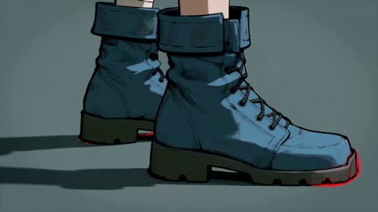</a>

按从脚到头的固定顺序列出10个镜头，让揭示有清晰节奏；保持身份的要求则锁定角色在各镜头中的形象。要求线条沿真实轮廓运动并位于前景，让图形贴合人物，而不是随意漂浮。

MiniMax H3 · 参考生视频 · 出处: [@aimikoda on X](https://x.com/aimikoda/status/2102966384003350874) · 786 赞，统计于 2026-11-03

[`character-reveal`](pages/zh/tags.md#tag-character-reveal) [`contour-animation`](pages/zh/tags.md#tag-contour-animation) [`fast-cuts`](pages/zh/tags.md#tag-fast-cuts) [`motion-graphics`](pages/zh/tags.md#tag-motion-graphics)

<details><summary><b>提示词</b></summary>

```text
Create a fast, striking character reveal using @[character ref]. Preserve identity, proportions, outfit and original rendering style. Let the character’s appearance, personality and world determine the entire creative direction: palette, lighting, background, camera attitude, transitions, graphic shapes and music. Modern, impactful and subtly sensual through confident body language.

Use exactly 10 fast-cut shots progressing upward: feet, lower legs, knees/thighs, hips/waist, hand beside torso, shoulders/collarbone, lips/jawline, eyes, full-face portrait then the first head-to-toe hero shot. Alternate frontal, profile, rear three-quarter, low-angle and tight oblique views. Use punchy push-ins, quick lateral passes, short orbit fragments and graphic match cuts. Keep the character alive with deliberate weight shifts, small hand gestures and shoulder turns. No slow motion, lingering pans or repetitive framing.

Animate abundant hand-drawn contour strokes and graphic shapes over the footage. Most lines should actively trace the character’s visible form: leg contours, waist curves, shoulders, neckline, jawline, arms, hands and clothing folds. Draw them on rapidly, briefly track the moving contours then let them extend into expressive arcs or sweep into the next cut. Emphasize existing anatomy and silhouette without changing proportions or revealing anything beneath clothing.

Choose the graphics’ colors, line weight, angularity, curvature and texture to match the character. Add partial rings, flowing ribbons, sketch bursts, angular brackets, sparkles and motion trails derived from their design. Make the graphics respond to gestures and camera movement rather than float randomly. Keep every graphic in the foreground, composited over the character and footage, never hidden behind them. Maintain clear facial features and a readable silhouette.

Sync editing, contour animation and graphic accents to character-appropriate music and precise sound details. On the final beat, land in a distinctive signature pose as the animated strokes complete an expressive graphic frame around the full figure. Briefly hold the finished composition.

Only drawings, contour lines and graphic shapes. No text, typography, letters, numbers, captions, titles or added logos anywhere.
```

</details>

**[全部 50 条](pages/zh/video-music-dance.md)**

<a id="vid-vlog"></a>
## 手机实拍与 Vlog

这一类的全部提示词和预览见 [agentcraft.dev](https://agentcraft.dev/zh/prompts/video/vlog/)

<a id="seedance-balcony-pool-phone-video-collapse"></a>
### 光头男子坐在阳台小泳池里，身旁是烧烤架

<a href="https://x.com/techhalla/status/2093364330985136572">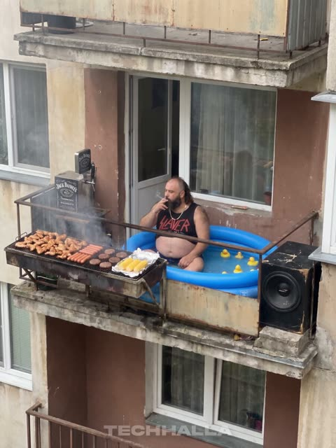</a>

把片子设定成业余手机拍摄，加入手持抖动和笨拙的推拉变焦，并明确禁止电影调色，使画面显得真实。按时间分成三段，让猫先经过栏杆、再出现裂缝，用因果顺序让坍塌看起来是连贯的事件链。

Seedance 2.5 · 文生视频 · 出处: [@techhalla on X](https://x.com/techhalla/status/2093364330985136572) · 18,124 赞，统计于 2026-10-31

[`phone-footage`](pages/zh/tags.md#tag-phone-footage) [`handheld`](pages/zh/tags.md#tag-handheld) [`collapse`](pages/zh/tags.md#tag-collapse) [`dark-comedy`](pages/zh/tags.md#tag-dark-comedy)

<details><summary><b>提示词</b></summary>

```text
RAW HOME PHONE VIDEO. One continuous 30-second clip recorded on a current smartphone from a facing balcony. Amateur handheld, natural micro-shake, occasional clumsy pinch-zooms in and out. No film look, no cinematic grade, no grain recipe. Overcast gray daylight, peeling block facade, rust, smoke, wet concrete, cheap plastic. Trash metal blasting from the black speaker. Feels like a neighbor filmed it.

Characters
A big bald man with beard and mullet, balcony, grill, Jack Daniel's tap, blue inflatable pool, rubber ducks, speaker, railing and building. Man with receding hair with long sides, gold chain, black SLAYER tank, belly and seated posture.

TIMELINE
0-10s: [Handheld phone wide] The man sits dead-calm in the tiny blue kiddie pool, cigarette in his right hand, living like a king. Serious, unhurried, enjoying. Trash metal pounds. With his free left hand he reaches to the smoking grill, picks up a sausage, smells it, then puts it back exactly where it was. Steam rolls. The phone slowly zooms toward his face, then clumsily zooms back out. He never stands.

10-20s: [Handheld, lazy zoom] His large wife in a floral dress steps out the open door with an empty glass. She fills it from the Jack Daniel's tap with apple juice the same amber color as whiskey, and hands it to him. He takes a long swallow without getting up. She hikes the dress and climbs into the cramped pool with him. They splash. Ducks bob. He stays seated, still smoking, still unbothered. Camera wobbles in on the pour, then out to both of them.

20-30s: [Handheld widening, more shake as it gets worse] A black cat walks out the door and crosses the rusty railing. Only after the cat passes along the railing does the terrace start to crack: hairline fractures spread through the slab. The balcony slowly sags. The inflatable pool tilts; water sloshes over the rim. The couple slide with the tipping pool. The cat jumps out of frame. Concrete splits, railing twists, grill and speaker shift. The terrace gives way and they fall with the water as the clip ends.

AUDIO
Loud trash metal from the speaker the entire time. Grill sizzle, tap pour, splash, groaning metal, cracking concrete, rushing water. Distant courtyard noise. No dialogue. No extra score. No cinematic sound design.

STYLE & QUALITY
Looks like a real phone video from today: auto exposure, slightly crushed highlights, ordinary digital noise, real weight and water physics, wet skin and fabric, collapsing structure with coherent debris.

Hope you like it! 🤘
```

</details>

<a id="seedance-seoul-summer-evening-vlog"></a>
### 首尔夏夜，家庭录像质感

<a href="https://x.com/AIwithkhan/status/2092971211169100048">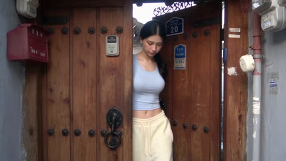</a>

纯文字，没有参考图。真实感来自要求小意外和不完美的手持摄像。

Seedance 2.5 · 文生视频 · 出处: [@AIwithkhan on X](https://x.com/AIwithkhan/status/2092971211169100048) · 6,187 赞，统计于 2026-10-27

[`vlog`](pages/zh/tags.md#tag-vlog) [`ugc`](pages/zh/tags.md#tag-ugc) [`realism`](pages/zh/tags.md#tag-realism) [`home-video`](pages/zh/tags.md#tag-home-video)

<details><summary><b>提示词</b></summary>

```text
Create a 30-second, 1080p ultra-realistic personal home-video showing an ordinary summer evening in the life of a young Korean woman. No reference image.

MAIN SUBJECT

Young Korean woman in her early 20s, naturally pretty, realistic skin texture, minimal makeup, relaxed and approachable personality.

Long black hair loosely tied into a messy side ponytail with a few loose strands around her face. Wearing a fitted pastel-blue short top, loose cream pajama-style pants, black sneakers and a simple silver necklace.

Maintain the same face, hairstyle, clothing, body proportions and overall appearance throughout the entire video.

SETTING

A quiet older Seoul residential neighborhood during a warm summer evening. Narrow concrete lanes, small houses, potted plants, bicycles, old walls, utility poles, overhead wires, a tiny neighborhood bakery, a public water tap and large leafy trees casting shadows across the street.

Everything should feel lived-in, ordinary and peaceful. No tourist attractions, advertisements, recognizable brands or commercial activity.

CAMERA / VISUAL AESTHETIC

Raw personal footage casually recorded by a friend on an early-2000s consumer DV camcorder.

Strong handheld shake, imperfect framing, autofocus hunting, exposure shifts, occasional motion blur, faded colors, soft digital detail, mild noise, accidental zooms and natural camera imperfections.

No stabilization, drone footage, gimbal movement, dramatic lighting or polished commercial cinematography.

 — OUTSIDE THE HOUSE

She steps outside carrying a small reusable shopping bag. She locks the door, adjusts her messy ponytail and looks toward the camera with a relaxed smile.

A light summer breeze moves her hair as she starts walking down the lane.

 — BAKERY STOP

She reaches a tiny neighborhood bakery and buys a warm pastry.

She steps outside, takes her first bite and immediately smiles because it tastes good.

She notices her friend filming and holds the pastry toward the camera playfully before taking another bite.

— WALKING HOME

She continues down the narrow street while eating.

A neighborhood cat follows her for a few steps. She notices it, crouches down and gently pets it.

The cat walks away and she laughs before continuing.

 — SMALL ACCIDENT

She walks beneath a large tree when a few leaves fall onto her hair.

She stops, looks confused, then realizes what happened and laughs.

She brushes the leaves away while her friend zooms awkwardly toward her face.

She looks directly into the camera and says:

"Seriously?"

 — QUIET MOMENT

She reaches a low concrete wall beside the street and sits down for a moment.

She finishes the pastry while watching bicycles and neighbors passing through the lane.

A gentle breeze moves her hair. She casually fixes her ponytail and looks around peacefully.

 — FINAL MOMENT

She stands up and continues walking home.

After a few steps, she turns back toward the camera with a small playful smile and says:

"Come on."

She keeps walking down the sunny lane while the camera follows behind.

She disappears around the corner and the recording abruptly cuts to black.

AUDIO

Natural location sound only: birds, summer insects, footsteps, bicycle bells, distant scooters, leaves moving in the breeze, bakery sounds, neighborhood conversations and subtle camera-handling noise.

No music. No narration. No artificial sound effects.

Only the two spoken lines specified above.

FINAL FEEL

The entire video should feel like a forgotten summer recording from the early 2000s.

Warm, feminine, casual, slightly playful, intimate and nostalgic.

No dramatic events, no exaggerated acting, no model poses and no polished cinematic shots.

The realism should come from ordinary surroundings, natural expressions, small accidents, realistic environmental movement and imperfect camcorder operation.
```

</details>

**[全部 191 条](pages/zh/video-vlog.md)**

<a id="vid-nature"></a>
## 自然、旅行与航拍

这一类的全部提示词和预览见 [agentcraft.dev](https://agentcraft.dev/zh/prompts/video/nature/)

<a id="seedance-woman-panda-ancient-forest"></a>
### 女子在雾气弥漫的古老森林中抚摸大熊猫

<a href="https://x.com/SyntheSarah/status/2088501362774393100">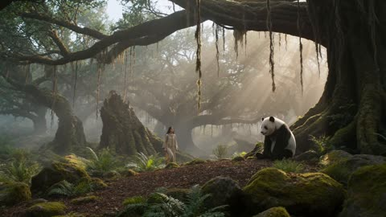</a>

按时间段（0到4秒、4到8秒、8到12秒、12到15秒）依次排列镜头，结尾的写实词组（自然日光、手持、纪实风格、无CGI质感）统一画面与色调。开头点明年代并禁止现代元素，保证古风设定前后一致。

Seedance 2.5 · 文生视频 · 出处: [@SyntheSarah on X](https://x.com/SyntheSarah/status/2088501362774393100) · 259 赞，统计于 2026-10-29

[`photorealism`](pages/zh/tags.md#tag-photorealism) [`timed-shots`](pages/zh/tags.md#tag-timed-shots) [`animal-interaction`](pages/zh/tags.md#tag-animal-interaction) [`forest`](pages/zh/tags.md#tag-forest)

<details><summary><b>提示词</b></summary>

```text
15-second ultra-photorealistic cinematic video set in a completely untouched ancient forest inspired by the year 1200 AD or earlier. A beautiful young woman is the main character, wearing a simple historically inspired medieval linen dress in earthy natural tones, with long slightly messy hair and no modern accessories or makeup. She is peacefully playing with a large realistic giant panda deep inside the ancient forest.

The forest feels completely natural and untouched: enormous centuries-old trees, thick moss, wild ferns, hanging vines, small streams, soft mist, fallen leaves, natural rocks and subtle morning sunlight filtering through the dense canopy. No buildings, roads, modern objects or artificial elements.

0–4 sec: Wide cinematic shot as the woman walks slowly through the misty forest and notices the panda sitting near an old moss-covered tree. The panda looks at her naturally and curiously.

4–8 sec: Medium handheld shot as she gently approaches and sits beside the panda. She smiles naturally and carefully strokes its thick fur. The panda responds playfully, moving closer to her.

8–12 sec: Close-up of the woman's genuine expression and the panda's highly detailed face and fur. Natural breathing, blinking, subtle facial movements, realistic hair movement from the forest breeze.

12–15 sec: Cinematic wide shot as the woman and panda playfully walk deeper into the ancient forest together while sunlight breaks through the trees and mist floats around them.

Extremely realistic human anatomy, realistic skin texture, individual hair strands, physically accurate panda fur, natural animal behavior, realistic cloth physics, subtle environmental movement, authentic atmospheric perspective, natural daylight, soft volumetric light, realistic shadows, cinematic depth of field, slight handheld camera movement, documentary-style realism, shot on a high-end cinema camera, 4K detail, natural color grading, no fantasy look, no CGI appearance, no artificial beauty filter, no modern elements, no text, no watermark.
```

</details>

<a id="h3-marina-boat-dolphin-encounter-travel-documentary"></a>
### 游客登船出海偶遇海豚

<a href="https://x.com/nawalsehar/status/2090306968900784383">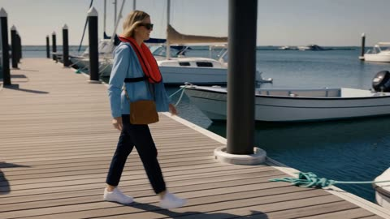</a>

提示词把登船、出港、遇见海豚到最后反应写成一条连续的动作链，台词直接写进叙述里。末尾用一长串物理真实感要求和一串排除项来稳住动作与水面表现。

MiniMax H3 · 文生视频 · 出处: [@nawalsehar on X](https://x.com/nawalsehar/status/2090306968900784383) · 166 赞，统计于 2026-10-28 · 发现于 [SkyNotSilent/awesome-MiniMax-H3-cases](https://github.com/SkyNotSilent/awesome-MiniMax-H3-cases)

[`travel-documentary`](pages/zh/tags.md#tag-travel-documentary) [`photorealistic`](pages/zh/tags.md#tag-photorealistic) [`dialogue`](pages/zh/tags.md#tag-dialogue) [`lip-sync`](pages/zh/tags.md#tag-lip-sync) [`wildlife`](pages/zh/tags.md#tag-wildlife)

<details><summary><b>提示词</b></summary>

```text
A young Western female traveler in her mid-20s walks naturally along a wooden marina dock toward a small white sightseeing boat. She wears a light blue windbreaker, white shirt, dark trousers, comfortable sneakers, sunglasses, a properly fitted life jacket, and a small crossbody bag. She carefully steps from the dock onto the gently rocking boat while holding the handrail, naturally shifting her weight as the boat responds to her movement. She walks toward the rear passenger bench, sits down, adjusts her position, and looks toward the open water. The boat engine starts with a realistic low rumble and gradually leaves the marina, creating a small bow wave and narrow wake. As the boat moves into open water, she notices movement nearby, looks surprised, and naturally says, "Wait... are those dolphins?" Two dolphins surface several meters beside the moving boat, swimming parallel at a safe distance with realistic tail propulsion, surfacing, diving, breathing, and water displacement. She picks up her phone with both hands and records them while smiling with genuine excitement. One dolphin briefly surfaces near the rear side of the boat, exhales through its blowhole, creates a small burst of mist and droplets, then dives beneath the water and leaves expanding ripples behind. She lowers her phone and says, "That is incredible." Ultra-photorealistic marine wildlife travel documentary, cinematic realism, natural human behavior, realistic walking and sitting biomechanics, physically accurate boat buoyancy and acceleration, authentic ocean waves and wake, realistic dolphin anatomy and swimming behavior, natural water reflections and refraction, accurate English lip synchronization, bright neutral daytime lighting, realistic coastal wind, immersive marina and ocean ambience, smooth documentary camera movement, continuous visual consistency, seamless storytelling from walking to boarding, departure, dolphin encounter, recording, and final reaction, no narration, no CGI appearance, no plastic skin, no robotic movement, no exaggerated dolphin jumps, no impossible water behavior, no sudden camera transitions, no text overlays, logos, or watermarks.
```

</details>

**[全部 12 条](pages/zh/video-nature.md)**

<a id="vid-animal"></a>
## 动物与萌宠

这一类的全部提示词和预览见 [agentcraft.dev](https://agentcraft.dev/zh/prompts/video/animal/)

<a id="h3-tom-jerry-mac-desktop-icon-chaos"></a>
### 汤姆一个个把掉落的桌面图标放回原位

<a href="https://x.com/Strength04_X/status/2101913634293297466">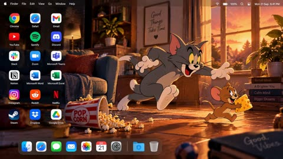</a>

提示词把参考桌面锁定为精确首帧，并列出所有保持不动的元素，因此只有三个图标移动。固定镜头、按时间分段的节拍表以及逐个图标的拾取步骤，让物理动作保持顺序，也避免图标瞬移。

MiniMax H3 · 图生视频 · 出处: [@Strength04_X on X](https://x.com/Strength04_X/status/2101913634293297466) · 5,984 赞，统计于 2026-11-03

[`tom-and-jerry`](pages/zh/tags.md#tag-tom-and-jerry) [`macos`](pages/zh/tags.md#tag-macos) [`cartoon`](pages/zh/tags.md#tag-cartoon) [`reference-image`](pages/zh/tags.md#tag-reference-image)

<details><summary><b>提示词</b></summary>

```text
Video Prompt : Create a 10-second horizontal 16:9 video using the provided Tom and Jerry macOS desktop image as the EXACT first frame and visual reference.

IMPORTANT:

Preserve the reference desktop exactly as shown, including the warm sunset living room, wooden floor, sofa, window, books, popcorn box, scattered popcorn, macOS menu bar, left-side application grid, bottom Dock, and all desktop elements.

Keep Tom and Jerry's exact recognizable classic cartoon appearance, proportions, colors, facial features, expressions, poses, and original 2D animation style. Do not redesign, modernize, photorealize, or change their visual style.

Begin with Tom running dramatically toward Jerry on the RIGHT side while Jerry runs away carrying a piece of cheese.

CAMERA:

Static front-facing camera.
One continuous shot.
No camera movement.
No zoom.
No pan.
No cuts.

TIMELINE:

0–1.5s:
Tom continues chasing Jerry across the living-room floor.

Tom looks determined and slightly frustrated.
Jerry runs quickly toward the RIGHT while holding the cheese.
Jerry looks back at Tom with a mischievous smile.

Tom's arms, legs, ears, tail, and facial expression move naturally with exaggerated classic cartoon animation.

1.5–2.5s:
Jerry suddenly changes direction and runs toward the LEFT.

Tom reacts dramatically and tries to stop himself.

Tom's feet slide across the wooden floor and he accidentally kicks the scattered popcorn forward.

A sudden exaggerated cartoon air movement travels toward the LEFT side of the desktop.

The air movement accidentally knocks THREE desktop icons loose:

Gmail
Discord
Microsoft Teams

The three icons physically leave their original positions in the RIGHTMOST desktop-icon column.

They rotate separately through the air and fall into the open desktop area above the Dock near the center-left.

Each icon lands separately with a small bounce.

Their original grid positions are now visibly empty.

2.5–3.2s:
Tom freezes after realizing what happened.

His eyes widen.

Jerry also stops for a moment and looks at the fallen icons.

Tom slowly looks toward the viewer with an embarrassed expression.

Jerry looks at Tom mischievously as if amused by the situation.

Tom immediately decides to fix the problem.

3.2–7.8s:
Tom restores the three fallen icons ONE AT A TIME.

FIRST — Gmail:

Tom carefully reaches toward the fallen Gmail icon.

He picks up Gmail individually with one paw.

The icon must visibly leave the desktop surface.

Tom carries Gmail across the desktop toward its original empty position.

He carefully places Gmail back into its exact original location.

The Gmail logo and label remain unchanged.

A soft click is heard.

Only after Gmail is completely restored does Tom reach for the next icon.

SECOND — Discord:

Tom reaches down and individually picks up the fallen Discord icon.

He carries Discord toward its original empty position.

He carefully presses it back into the correct grid position.

A second gentle click is heard.

Jerry watches Tom while standing nearby with the cheese.

THIRD — Microsoft Teams:

Tom reaches down once more.

He picks up Microsoft Teams individually.

He carries it back to its original position.

He carefully releases it into the empty grid position.

A third gentle click is heard.

Show all three separate pickup-and-replace actions clearly.

IMPORTANT PHYSICAL ACTION RULES:

Every moving icon must visibly:

leave its original position
fall through the air
land on the desktop
be physically picked up
be carried by Tom
be placed back into its original position

Do NOT:
- restore icons automatically
- teleport icons
- make icons snap back from a distance
- move multiple icons simultaneously
- scoop multiple icons together
- stack icons
- duplicate icons
- morph logos
- change labels

Tom must restore Gmail, Discord, and Microsoft Teams separately.

His paws must remain anatomically consistent with the original cartoon style.

No extra paws.
No extra fingers.
No stretched limbs.
No distorted characters.

Jerry remains nearby and reacts naturally while Tom fixes the desktop.

7.8–10s:
After placing Microsoft Teams back into position, Tom quickly returns to the RIGHT side.

Jerry runs a short distance away while still holding the cheese.

Tom straightens himself and tries to regain his dignity.

He looks toward the restored icons.

Then he looks directly at the viewer with an innocent, slightly embarrassed expression.

Jerry briefly looks back at Tom with a mischievous smile.

Tom pretends nothing happened.

Hold the final pose for the remaining moment.

The final desktop must closely match the original first frame.

DESKTOP PRESERVATION:

Only Gmail, Discord, and Microsoft Teams are allowed to move.

Everything else must remain completely stationary:

Chrome
Safari
YouTube
Spotify
Slack
Zoom
Notion
Microsoft Word
Microsoft Excel
Instagram
Reddit
Netflix
Steam
Dropbox
Google Drive

The macOS menu bar must remain stationary.

The Dock must remain stationary.

The wallpaper and all furniture must remain stationary.

Do not change application logos or labels.

Do not duplicate any icons.

AUDIO:

Light playful cartoon piano and pizzicato music.

Fast playful rhythm during Tom's chase.

A short cartoon sliding sound when Tom loses balance.

A brief airy whoosh as the three icons are knocked loose.

Three soft landing sounds as the icons fall.

Three distinct gentle clicks as Tom restores Gmail, Discord, and Microsoft Teams.

Music briefly pauses during Tom's shocked reaction, then resumes with a playful rhythm.

No dialogue.
No subtitles.
No text overlays.

VISUAL QUALITY:

Premium cinematic cartoon animation integrated into the existing macOS desktop.

Keep Tom and Jerry clearly 2D while maintaining the cinematic lighting of the environment.

Natural squash-and-stretch animation.
Smooth character motion.
Clean cartoon outlines.
Consistent colors.
Natural shadows.
Subtle floor reflections.
Realistic interaction with the environment.

FINAL FRAME:

All three icons must be restored to their exact original positions.

Tom and Jerry remain on the RIGHT side.

Tom looks embarrassed but tries to appear innocent.

Jerry remains mischievous.

No missing icons.
No duplicate icons.
No changed logos.
No extra characters.
No extra objects.
No camera movement.
No cuts.

The final frame should closely match the original reference image.
```

</details>

<a id="kling-eagle-pov-steppe-flight"></a>
### 金雕视角飞越山谷与河流

<a href="https://x.com/higgsfield_ai/status/2019090635408744851">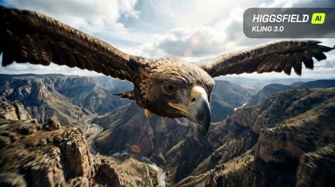</a>

镜头锁定在金雕头部,翅膀与羽毛留在画面边缘作为稳定参照。用河流、山谷、岩峰提供地面视差,并限定无抖动、仅速度模糊、无剪辑,让飞行动作连贯真实。

Kling 3.0 · 文生视频 · 出处: [@higgsfield_ai on X](https://x.com/higgsfield_ai/status/2019090635408744851) · 2,454 赞，统计于 2026-10-27

[`pov`](pages/zh/tags.md#tag-pov) [`aerial`](pages/zh/tags.md#tag-aerial) [`wildlife`](pages/zh/tags.md#tag-wildlife) [`tracking-shot`](pages/zh/tags.md#tag-tracking-shot) [`landscape`](pages/zh/tags.md#tag-landscape)

<details><summary><b>提示词</b></summary>

```text
POV flight from a golden eagle soaring over vast mountainous steppe landscapes. Camera locked to the eagle’s head with clean, precise tracking — stable forward motion, no jitter. The eagle actively flaps its wings, powerful wingbeats transitioning into smooth gliding. Wings and feathers visible at the frame edges, moving naturally in rhythm. Strong ground parallax below: winding rivers, open valleys, rocky peaks. Bright late-afternoon light, crisp air, subtle lens flare. Ultra-wide cinematic perspective, natural motion blur from speed only, realistic flight physics, continuous shot, no cuts.
```

</details>

**[全部 32 条](pages/zh/video-animal.md)**

<a id="vid-vfx"></a>
## 特效与变身转场

这一类的全部提示词和预览见 [agentcraft.dev](https://agentcraft.dev/zh/prompts/video/vfx/)

<a id="veo-giant-girl-shibuya-crossing"></a>
### 巨型女孩跪在东京街口俯身触碰出租车

<a href="https://x.com/MrDavids1/status/1997581641892446293">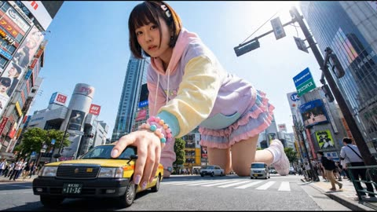</a>

通用模板用方括号固定机位、巨人服装、地点和动作，再在手脚附近加入微小的车辆和行人来建立体量感。先用 Nano Banana Pro 以 4K 生成静帧，再交给 Veo 3.1 做图生视频。

Veo 3.1 · 图生视频 · 出处: [@MrDavids1 on X](https://x.com/MrDavids1/status/1997581641892446293) · 3,040 赞，统计于 2026-10-27

[`giant`](pages/zh/tags.md#tag-giant) [`scale`](pages/zh/tags.md#tag-scale) [`cityscape`](pages/zh/tags.md#tag-cityscape) [`photorealistic`](pages/zh/tags.md#tag-photorealistic) [`template`](pages/zh/tags.md#tag-template)

<details><summary><b>提示词</b></summary>

```text
Here is a fun idea to try. You can create these images with giant people/animals using Nano Banana Pro. Just adjust the elements in brackets and have fun! If you have the option to generate at 4K, definitely use it as it makes the tiny people look crisper. These types of images seem to animate best with Veo 3.1 from testing, but you can try with Kling 2.6 or Grok Imagine as well so have some fun! Feel free to show me your giant humans/animals.

🍌Universal Prompt: A highly detailed, photorealistic [CAMERA ANGLE, e.g., wide-angle shot, aerial shot looking down, extreme low-angle looking up] showing a colossal [DESCRIBE THE PERSON & CLOTHING] positioned in [SPECIFIC LOCATION/CITY/LANDSCAPE]. The giant is [ACTION -  INTERACTING WITH THE ENVIRONMENT, e.g., sitting on a building, stepping over a bridge]. To establish the immense scale, tiny [TINY ELEMENTS: PEOPLE, CARS, OR BOATS] are visible near their [FEET/HANDS]. The lighting is [TIME OF DAY, e.g., golden hour, midday sun].

There are more visuals examples with prompts included in my 80 creative use cases document which you can view via this link completely for free. Look for use case 84.
https://
canva.com/design/DAG5ifq
rYJc/BReEw-WwUMW9HmSJBHWBXQ/edit
…
```

</details>

<a id="seedance-diner-frozen-time-rewind"></a>
### 1950 年代餐馆：时间静止再倒流

<a href="https://x.com/techhalla/status/2083389002552664385">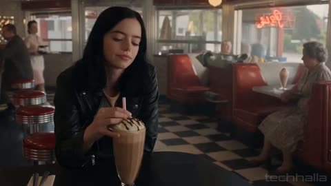</a>

一个特效撑满 30 秒。先把餐馆写细，静止和倒流才看得清。

Seedance 2.5 · 文生视频 · 出处: [@techhalla on X](https://x.com/techhalla/status/2083389002552664385) · 2,873 赞，统计于 2026-10-27

[`vfx`](pages/zh/tags.md#tag-vfx) [`time-freeze`](pages/zh/tags.md#tag-time-freeze) [`period`](pages/zh/tags.md#tag-period)

<details><summary><b>提示词</b></summary>

```text
Photorealistic cinematic 1950s American diner, chrome stools, red vinyl, neon glow and checkerboard floor, shot with modern lived-in realism and soft natural window light. Subtle handheld texture, warm practicals, rich period detail, heavy film grain.

0-4s: [Medium Wide] A striking young woman in her early 20s sits alone at the counter, calm and slightly amused, slowly sipping a tall thick milkshake through a straw. Behind her a young waitress in classic uniform approaches with a tray of eggs and bacon in one hand and a full glass coffee pot in the other. An older lady starts rising from a nearby booth.

4-8s: [Dynamic Tracking] The older lady collides hard into the waitress. Tray, plate, eggs, bacon and coffee pot explode upward in chaotic slow motion. Coffee erupts into long liquid ribbons and perfect suspended droplets. Camera immediately begins a smooth continuous orbit around the impact. Time locks completely at the peak of the spill. Every face freezes in pure shock. Only the girl at the counter keeps moving, completely unfazed.

8-17s: [Slow 360° Orbital] Camera glides in a full elegant orbit through the frozen diner. Coffee hangs in mid-air as glassy ribbons and spheres with perfect volume and surface tension. Bacon strips, eggs and the spinning tray float weightlessly. Patrons and waitress remain locked in startled expressions. The girl at the counter takes one slow, deliberate sip, eyes half-lidded, almost bored, while the entire frozen world (except her) begins an elegant reverse: every droplet, every piece of food and every person rewinds smoothly back to the exact starting positions.

17-24s: [Medium Shot] Rewind lands perfectly. Waitress stands balanced again with tray and coffee pot. The girl lifts her eyes, raises two fingers in a small casual gesture and softly calls the waitress by name. The waitress turns toward her just before the older lady begins to stand, completely avoiding the collision. A tiny private smile crosses the girl’s face.

24-30s: [Extreme Close-Up] Hard cut to her face as she takes one last slow sip. Soft knowing smile, eyes almost closed in quiet satisfaction, like she has done this a hundred times. Shallow depth of field, creamy bokeh of the neon diner behind her.

Photorealistic, ultra-detailed fluid physics, perfect motion blur only on moving elements, stable characters, cinematic lighting, heavy natural film grain, no artifacts, movie-level temporal coherence, high rewatch value.
```

</details>

**[全部 98 条](pages/zh/video-vfx.md)**

<a id="image"></a>
## 图片提示词

[Artificial Analysis 图像榜](https://artificialanalysis.ai/text-to-image/arena)前排模型上点赞最多的提示词，每条都附成图，出自作者在 X 或 TikTok 上的帖子，或模型官方指南。按用途分组。很多要配一张自己的照片，标着「上传图改图」的就是。

<a id="img-poster"></a>
## 海报与编辑排版

这一类的全部提示词和预览见 [agentcraft.dev](https://agentcraft.dev/zh/prompts/image/poster/)

<a id="gpt-image-flat-vector-city-travel-poster-template"></a>
### 适用任意城市的扁平矢量旅行海报模板

<a href="https://x.com/MahnoorAi12/status/2091349007922778211">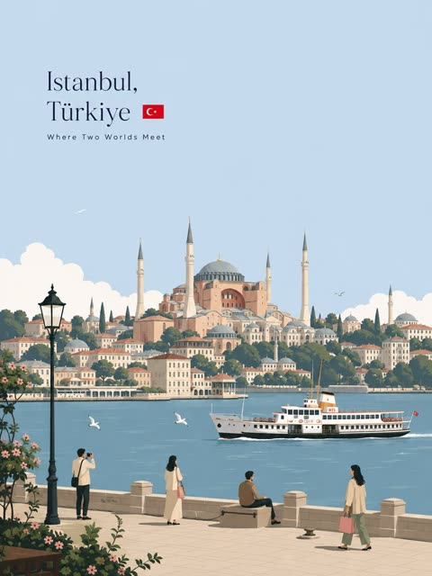</a>

用一个城市名占位符驱动地标、交通、生活瞬间、本地植物、视角五个要素，让每个城市的画面结构都不同。严格的配色体系、少量人物和较长的反向提示词，让扁平矢量风格保持安静统一。

GPT Image 2 · 文生图 · 出处: [@MahnoorAi12 on X](https://x.com/MahnoorAi12/status/2091349007922778211) · 3,421 赞，统计于 2026-10-28

[`travel-poster`](pages/zh/tags.md#tag-travel-poster) [`flat-vector`](pages/zh/tags.md#tag-flat-vector) [`template`](pages/zh/tags.md#tag-template) [`city`](pages/zh/tags.md#tag-city) [`minimalist`](pages/zh/tags.md#tag-minimalist)

<details><summary><b>提示词</b></summary>

```text
Premium minimalist flat-vector travel poster for [CITY_NAME], 3:4 vertical format.

Design an original, sophisticated travel poster that captures the authentic visual personality of [CITY_NAME]. The composition must feel purpose-built for this city rather than following a reusable template.

CITY IDENTITY

First interpret the unique visual character of [CITY_NAME] and build the scene around these five elements:

1. A recognizable landmark, architectural feature, or skyline element.
2. A distinctive local way of moving through the city.
3. One subtle everyday lifestyle moment.
4. A native plant, landscape, or environmental characteristic.
5. A composition and viewpoint that naturally belongs to the city.

The overall scene structure must change from city to city. Do not repeatedly use the same object positions or visual formula.

Possible compositions include:
harbor viewpoint, narrow historic lane, riverside garden, coastal path, elevated city overlook, lively market passage, tram avenue, ferry terminal, botanical setting, heritage square, beach promenade, cultural plaza, or skyline terrace.

Choose whichever composition best represents [CITY_NAME].

TYPOGRAPHY

Place “[CITY_NAME]” in the upper-left area with generous clean negative space.

Add one short, sophisticated English tagline inspired by the atmosphere of the city.

Typography should feel understated, editorial, spacious, and premium. Never allow text to dominate the artwork.

VISUAL HIERARCHY

Use one iconic landmark or architectural feature as the main focal point.

Support it with only 2–4 carefully selected local elements. Every added detail should strengthen the sense of place.

Avoid landmark collections or postcard-style collages. Keep the scene visually quiet and intentional.

PEOPLE

Include only 3–6 small-scale figures.

Give each person a believable activity connected to local life, such as:
walking through a historic lane, cycling, waiting for public transport, sketching architecture, boarding a ferry, reading outdoors, taking a quiet photograph, carrying beach equipment, browsing a market, or jogging beside the water.

Avoid crowds and avoid making any single person the main character. Figures should integrate naturally into the environment.

LOCAL CHARACTER

Use city-specific elements only when they genuinely fit [CITY_NAME]:

- local transportation
- architecture
- street furniture
- vegetation
- small signs or wayfinding
- local food references
- recreational activities
- pavement markings
- cultural details

Transport and signage should remain subtle. Instead of always using a large signboard, incorporate details naturally through a small transit marker, station clock, ferry information panel, bike symbol, painted road marking, beach flag, or understated metro icon.

ART DIRECTION

Japanese stationery-inspired aesthetic,
luxury sticker illustration,
premium commercial vector artwork,
modern editorial travel branding,
clean delicate outlines,
uniform line weight,
simple geometric forms,
flat-color illustration,
soft shapes,
balanced visual rhythm,
high-end minimalist postcard design.

COLOR SYSTEM

Build the atmosphere primarily with:
pale powder blue, soft sky blue, mist blue, and cool airy blues.

Balance these with:
warm ivory, cream, soft beige, muted sage, gray-green, and understated architectural neutrals.

Use dusty rose or muted blush only for tiny visual accents such as flowers, clothing details, small signs, awnings, or decorative objects.

Colors should remain soft, sophisticated, slightly desaturated, and cohesive.

MOOD

Fresh, airy, peaceful, refined, contemporary, elegant.

The final artwork should feel like a premium boutique travel postcard or luxury lifestyle brand illustration, with generous breathing room and a relaxed sense of place.

IMPORTANT QUALITY RULES

Every city must have its own visual identity.
Change the camera angle, scene structure, landmark placement, foreground treatment, and supporting details according to the city's character.

Do not simply replace [CITY_NAME] inside an existing composition.

NEGATIVE PROMPT

No photorealism.
No realism.
No watercolor.
No painterly brushwork.
No gradients.
No heavy shadows.
No dramatic cinematic lighting.
No paper texture.
No excessive detail.
No cluttered background.
No landmark collage.
No crowded streets.
No oversized characters.
No dominant hero character.
No repetitive café composition.
No fixed signboard position.
No identical foreground treatment.
No generic tourist-poster formula.
No copied layout from another city.
No unnecessary decorative elements.
```

</details>

<a id="nano-banana-brand-grid-poster-template"></a>
### 阿迪达斯跑者与红牛赛车的柔和色块海报

<a href="https://x.com/AmirMushich/status/2028115571724660920">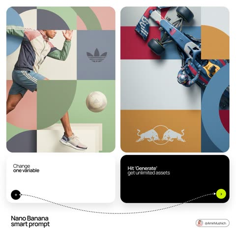</a>

[BRAND NAME] 占位加上分阶段的固定指令（分层、2x2 网格、柔和配色、棚拍光、单色标志），让同一模板适用于任何品牌。用 dusty rose、slate blue 这类示例限定色调，让颜色柔和且没有渐变。

Nano Banana 2 · 文生图 · 出处: [@AmirMushich on X](https://x.com/AmirMushich/status/2028115571724660920) · 2,570 赞，统计于 2026-10-29

[`brand-poster`](pages/zh/tags.md#tag-brand-poster) [`template`](pages/zh/tags.md#tag-template) [`muted-palette`](pages/zh/tags.md#tag-muted-palette) [`geometric`](pages/zh/tags.md#tag-geometric)

<details><summary><b>提示词</b></summary>

```text
(access Nano Banana 2 here:
https://
amirmushich.link/LTX_NBP)

[BRAND NAME]. Act as a World-Class Editorial Designer.

PHASE 1: DYNAMIC SUBJECT LOGIC.

- Subject Selection: Autonomously analyze [BRAND NAME].

- Layering (The Sandwich Effect): Interweave the subject with background shapes. Some parts of the car/person must be hidden behind geometric blocks, while other parts (wheels, limbs, props) must overlap them to create 3D depth.

PHASE 2: GRID & GEOMETRY.

- Layout: A clean 2x2 grid composition.

- Overlays: Superimpose large, bold geometric arcs and circles over the grid.

- Visual Balance: Place one iconic product prop (e.g., a floating key fob for cars or a ball for sports) in a separate quadrant to balance the subject.

PHASE 3: SOPHISTICATED MUTED PALETTE.

- Color Direction: DO NOT use aggressive neon or oversaturated colors.

- Palette: Identify the core colors of [BRAND NAME] and shift them to a "Sophisticated Muted" spectrum.

- Tones: Use desaturated, earthy, or "dusty" versions of the brand colors (e.g., instead of hot pink, use dusty rose; instead of bright mint, use sage green; instead of royal blue, use slate blue).

- Finish: Matte, flat color blocks with zero gradients.

PHASE 4: PHOTOGRAPHY & LIGHTING.

- Subject Style: High-end commercial studio photography.

- Lighting: Soft, diffused studio lighting with gentle highlights. No harsh shadows.

- Integration: The subject must feel physically embedded into the graphic grid.

PHASE 5: MINIMALIST BRANDING.

- Logo: Place a clean, single-color [BRAND NAME] logo in the center of one background block. No taglines, just the iconic symbol.
```

</details>

**[全部 215 条](pages/zh/image-poster.md)**

<a id="img-infographic"></a>
## 信息图与幻灯片

这一类的全部提示词和预览见 [agentcraft.dev](https://agentcraft.dev/zh/prompts/image/infographic/)

<a id="gpt-image-encyclopedia-infographic-topic-template"></a>
### 詹姆斯韦伯望远镜百科信息图卡片

<a href="https://x.com/oggii_0/status/2051889025229930547">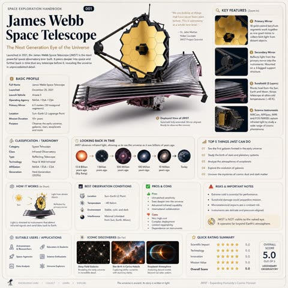</a>

用 TOPIC 占位符加一份模块化面板清单（基础档案、分类、优缺点、评分总结等）。收藏手册和自然史图鉴这类风格锚点，配合浅色背景和圆角框，让整个系列版式统一。

GPT Image 2 · 文生图 · 出处: [@oggii_0 on X](https://x.com/oggii_0/status/2051889025229930547) · 1,622 赞，统计于 2026-10-29

[`encyclopedia`](pages/zh/tags.md#tag-encyclopedia) [`infographic`](pages/zh/tags.md#tag-infographic) [`template`](pages/zh/tags.md#tag-template) [`knowledge-card`](pages/zh/tags.md#tag-knowledge-card) [`editorial-layout`](pages/zh/tags.md#tag-editorial-layout)

<details><summary><b>提示词</b></summary>

```text
Create educational encyclopedia style images with GPT Image 2 on
@itsPolloAI


Prompt: Based on { TOPIC }, create a high-quality vertical “encyclopedia-style educational infographic image.”

This image should NOT look like a regular poster or a simple illustration. Instead, it should feel like a structured knowledge guide that combines:

the feeling of a collectible reference handbook

a modern encyclopedia page

a lifestyle knowledge card

and a highly shareable social-media infographic

The overall style should resemble a premium natural-history guidebook mixed with modern editorial infographic design.

The image should include:

One beautiful and highly detailed main subject image

Several zoomed-in detail sections highlighting important features

Multiple modular information panels with rounded corners

Clear title hierarchy and highlighted key labels

Concise yet information-rich encyclopedia content

Visual scoring systems, quick summaries, or “Top 5” modules

The information sections should automatically adapt to the topic. Select and combine relevant categories such as:

Basic profile

Classification / taxonomy

Physical characteristics

Behavior / ecology / habits

Structure or formation mechanisms

Growth conditions or usage methods

Care, maintenance, or optimization tips

Risks, warnings, and important notes

Suitable users or application scenarios

Pros and cons comparison

Quick rating tags or summary cards

Visual requirements:

Clean light-colored background

Soft and elegant color palette

Gentle shadows

Small refined icons

Rounded information boxes

Organized editorial layout

High information density without feeling crowded

Comfortable reading experience

The final result should feel like a real publishable encyclopedia knowledge card designed for reading, collecting, and creating as part of a consistent series — NOT like a commercial advertisement poster.

The image must strongly emphasize:

“knowledge integration + modular information design + handbook/reference-style presentation.”
```

</details>

<a id="gpt-image-pink-hair-earbud-case-infographic"></a>
### 模特手持打开的耳机充电盒广告海报

<a href="https://x.com/rovvmut_/status/2047912710365761828">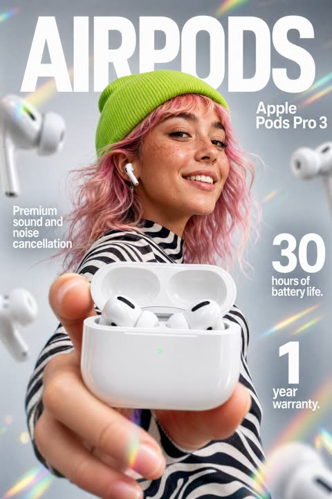</a>

提示词按前景微距、中景人物和柔焦背景划分三层景深，并逐条写明每段文字的内容与位置，使版式清晰、文字准确。

GPT Image 2 · 文生图 · 出处: [@rovvmut_ on X](https://x.com/rovvmut_/status/2047912710365761828) · 1,034 赞，统计于 2026-10-29

[`infographic`](pages/zh/tags.md#tag-infographic) [`earbuds`](pages/zh/tags.md#tag-earbuds) [`product-ad`](pages/zh/tags.md#tag-product-ad) [`typography`](pages/zh/tags.md#tag-typography)

<details><summary><b>提示词</b></summary>

```text
GPT Image 2 on
@SocialSight


Prompt: High-impact e-commerce infographic for "Apple Pods Pro 3" wireless earbuds.
Foreground: An extreme close-up of a hand holding an open, glossy white wireless earbud charging case toward the camera. Inside the case are two sleek white earbuds with black speaker accents. A tiny, glowing green LED status light is visible on the front of the case. The hand and case have a slight macro-lens blur to create a sense of depth.
Central Subject: In the mid-ground, a smiling young woman with freckles and wavy pastel-pink hair. She is wearing a vibrant lime-green knit beanie and a psychedelic, black and white-striped long-sleeve shirt. One white earbud is tucked into her ear.
Background & Lighting: A clean, soft-focus studio backdrop with a light-gray gradient. The scene is accented by diagonal rainbow prism lens flares and soft light leaks. Several blurred white earbuds float artistically in the background. The lighting is soft and professional, highlighting the glossy plastic of the product.
Typography & Layout (Sans-Serif, White):
Top Center (Background): Massive, bold text reading "AIRPODS" (positioned behind the model).
Top Right: Bold text reading "Apple Pods Pro 3".
Mid-Left: "Premium sound and noise cancellation"
Mid-Right: Large, bold "30" with the text "hours of battery life."
Bottom-Right: Large, bold "1" with the text "year warranty."
Style: 8k resolution, commercial product photography, vibrant color palette, sharp focus on the product case, shallow depth of field, clean advertising aesthetic.
```

</details>

**[全部 95 条](pages/zh/image-infographic.md)**

<a id="img-ui-mockup"></a>
## 手机与界面截图

这一类的全部提示词和预览见 [agentcraft.dev](https://agentcraft.dev/zh/prompts/image/ui-mockup/)

<a id="gpt-image-camera-roll-photos-screen"></a>
### 一名学生一整天的iPhone相册截图

<a href="https://x.com/sakisuta_/status/2098712371045052764">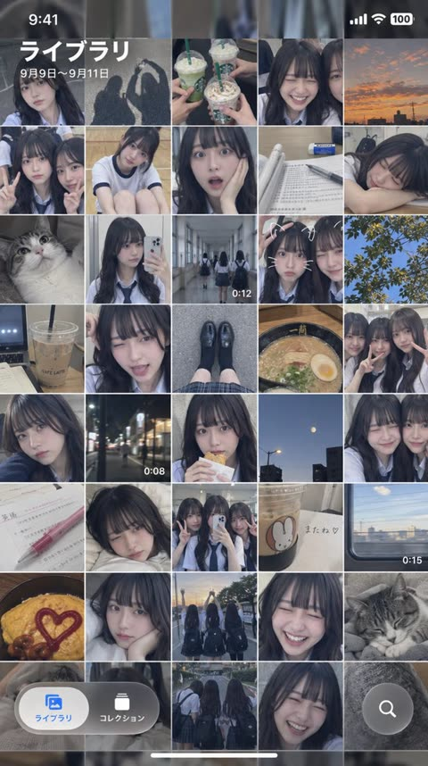</a>

提示词明确指定容器是原样截取的照片App界面，模型便在一个网格里填满一整天风格各异的随手拍。提供参考人物并要求日常瞬间，使人脸在美食、朋友、书桌和天空等画面中保持一致。

GPT Image 2.5 · 上传图改图 · 出处: [@sakisuta_ on X](https://x.com/sakisuta_/status/2098712371045052764) · 2,439 赞，统计于 2026-10-28

[`camera-roll`](pages/zh/tags.md#tag-camera-roll) [`photos-app`](pages/zh/tags.md#tag-photos-app) [`screenshot`](pages/zh/tags.md#tag-screenshot) [`reference-image`](pages/zh/tags.md#tag-reference-image) [`everyday`](pages/zh/tags.md#tag-everyday)

<details><summary><b>提示词</b></summary>

```text
Turn one full day's worth of camera roll for the person in the reference image into a single image that captures the iPhone's Photos app screen as-is. Make it a realistic camera roll that feels like it captures casual everyday moments.
```

</details>

<a id="gpt-image-camera-roll-day"></a>
### 用一张图生成主角一整天的 iPhone 相册截图

<a href="https://x.com/Mayz1169/status/2099479395283214473">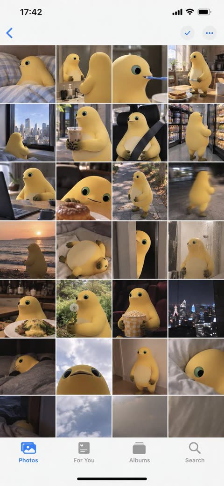</a>

严格规则锁定主角外观，并把版式定为带真实 iOS 界面的四列缩略图。提示词列出多种景别，并要求模糊、裁切和手持感等瑕疵，让整屏看起来像真实相册。

GPT Image 2.5 · 上传图改图 · 出处: [@Mayz1169 on X](https://x.com/Mayz1169/status/2099479395283214473) · 762 赞，统计于 2026-10-27

[`ios`](pages/zh/tags.md#tag-ios) [`screenshot`](pages/zh/tags.md#tag-screenshot) [`camera-roll`](pages/zh/tags.md#tag-camera-roll) [`humor`](pages/zh/tags.md#tag-humor)

<details><summary><b>提示词</b></summary>

```text
Use the uploaded image as the ONLY subject reference.

Create ONE vertical image that looks exactly like a screenshot of the iPhone Photos app, showing one full day of casual camera-roll photos featuring the exact subject from the uploaded reference.

SUBJECT CONSISTENCY
First identify the main subject in the uploaded image. It may be a person, anime character, pet, animal, plush toy, figurine, mascot, object, or other character.

Preserve the subject’s recognizable appearance, colors, proportions, facial features, hairstyle, clothing, accessories, markings, materials, and signature details consistently across every photo.

If the reference contains multiple views of the same subject, understand that they are different views of ONE subject, not multiple characters.

Do not redesign or replace the subject.

DAY-IN-THE-LIFE CAMERA ROLL
Imagine a believable full day for this exact subject based on its appearance, personality, style, and visual world.

Generate many different casual photos from morning to night, as if someone naturally photographed the subject throughout the day.

Automatically choose everyday situations that fit the uploaded subject, such as:
waking up, resting, eating, sitting by a window, traveling, walking outside, visiting cafés or shops, playing, working, relaxing at home, interacting with everyday objects, sunset moments, nighttime outings, and going to sleep.

The activities and environments should adapt naturally to the subject. Do not force human activities onto animals, toys, objects, or non-human characters when they would look unnatural.

Every thumbnail should show a different moment, composition, distance, pose, camera angle, lighting condition, or location.

Mix:
close-ups,
medium shots,
wide shots,
overhead photos,
back views,
detail shots,
slightly blurry movement shots,
imperfect handheld snapshots,
photos where the subject is partially cropped,
environmental photos related to the subject’s day.

The result should feel spontaneous and personal rather than like a professional photoshoot.

IPHONE PHOTOS APP LAYOUT
The FINAL IMAGE itself must look like a real full-screen iPhone Photos app screenshot.

Use a tall smartphone screenshot aspect ratio, approximately 9:19.5.

Create a dense camera-roll gallery using FOUR equal thumbnail columns, closely matching the standard iPhone Photos grid.

Include approximately 24–32 individual photo thumbnails visible on screen.

Use very thin white gaps between thumbnails.

The gallery should fill most of the screen vertically.

Include authentic iPhone Photos interface elements:
• white iOS interface background
• iPhone-style status bar at the top
• time on the upper left
• cellular/Wi-Fi/battery icons on the upper right
• simple navigation controls near the top
• four-column photo gallery
• bottom Photos app navigation bar
• Photos tab selected in blue
• other navigation icons shown in gray
• black home indicator at the very bottom

The UI must look like an actual screenshot of the Photos app, NOT a decorative frame, moodboard, contact sheet, scrapbook, poster, or generic collage.

PHOTO STYLE
Make each thumbnail feel like a genuine casual iPhone camera-roll photo.

Use natural everyday lighting, imperfect framing, realistic exposure variation, occasional motion blur, slight focus imperfections, spontaneous compositions, and believable environmental details.

Keep the same subject recognizable throughout the entire gallery while allowing natural changes in pose, expression, camera distance, and lighting.

If the uploaded reference is illustrated, animated, stylized, or 3D, preserve its original visual identity and style unless realistic photography is explicitly requested.

IMPORTANT
ONE final image only.
The entire output is ONE iPhone Photos app screenshot containing many different photos.
Exactly FOUR thumbnail columns.
Do not create a standalone collage without the iPhone interface.
Do not create multiple separate outputs.
Do not duplicate the exact same photo repeatedly.
Do not introduce unrelated characters or subjects.
Do not change the main subject’s design.
No captions, dates, labels, stickers, watermarks, or decorative text inside the photo thumbnails.
Only normal minimal iOS interface elements may appear.9:16
```

</details>

**[全部 30 条](pages/zh/image-ui-mockup.md)**

<a id="img-product"></a>
## 产品图与电商

这一类的全部提示词和预览见 [agentcraft.dev](https://agentcraft.dev/zh/prompts/image/product/)

<a id="gpt-image-giant-pepsi-can-seated-model-ad"></a>
### 女性倚靠巨型百事可乐罐广告

<a href="https://x.com/mehvishs25/status/2047829613502754919">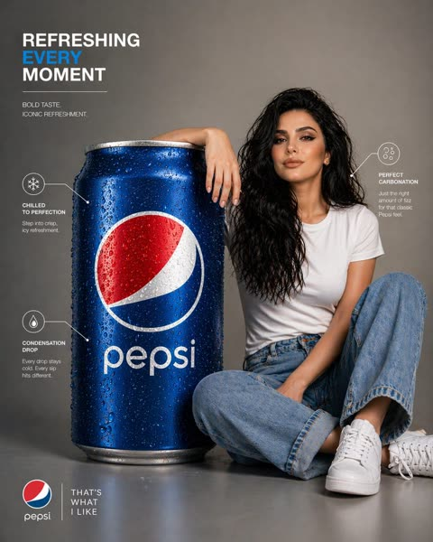</a>

尺度对比是画面的核心：罐身几乎与坐姿人物等高，并附上参考图以保持人脸一致。细线标注和纯净的影棚渐变背景让广告保持简洁高级。

GPT Image 2 · 上传图改图 · 出处: [@mehvishs25 on X](https://x.com/mehvishs25/status/2047829613502754919) · 912 赞，统计于 2026-10-29

[`product-ad`](pages/zh/tags.md#tag-product-ad) [`scale-contrast`](pages/zh/tags.md#tag-scale-contrast) [`reference-face`](pages/zh/tags.md#tag-reference-face) [`infographic`](pages/zh/tags.md#tag-infographic)

<details><summary><b>提示词</b></summary>

```text
A premium infographic-style visual featuring an oversized Pepsi can placed beside a young woman. The can is scaled to be nearly the same size as her entire seated body, creating a striking, surreal proportion. The woman sits casually leaning against the giant can, one arm resting on it, interacting naturally with the object.
Her face must closely match the provided reference image, accurate facial structure, skin tone, hairstyle, and expression — polished, realistic, and visually appealing.
The Pepsi can is ultra-detailed with crisp branding, condensation droplets, realistic reflections, and metallic texture. The logo is clean, sharp, and properly proportioned.
Composition is modern and minimal, set in a clean studio or soft gradient background. Include subtle infographic-style elements such as thin annotation lines, minimal labels, or callouts highlighting features like “refreshment,” “carbonation,” or “chilled texture,” but keep it elegant and uncluttered.
Lighting is soft studio lighting with controlled highlights and shadows, giving a premium advertising look. The model is styled in minimal, contemporary clothing that complements the red, white, and blue tones of the can.
Color grading is crisp and slightly vibrant, with a commercial ad aesthetic. Balanced composition, sharp focus, slight depth of field for realism.
Style: high-end product infographic, commercial beverage advertisement, clean UI-inspired annotations
Resolution: ultra high resolution, 4K, highly detailed, photorealistic

85mm lens, f/2.8
hyper-realistic, studio quality
no distortion, correct proportions
clean typography, modern layout
```

</details>

<a id="gpt-image-iced-coffee-glass-studio-product-photo"></a>
### 挂满水珠的玻璃杯中奶咖交融的冰咖啡

<a href="https://x.com/Strength04_X/status/2049082049995362785"></a>

提示词逐层描述饮品：深色咖啡底、渐变交融的奶纹、折射光线的透明冰块和杯壁水珠。柔和棚拍光线加上单反微距用语，让画面呈现干净的饮品广告质感。

GPT Image 2 · 文生图 · 出处: [@Strength04_X on X](https://x.com/Strength04_X/status/2049082049995362785) · 617 赞，统计于 2026-10-28

[`iced-coffee`](pages/zh/tags.md#tag-iced-coffee) [`beverage`](pages/zh/tags.md#tag-beverage) [`studio-lighting`](pages/zh/tags.md#tag-studio-lighting) [`macro`](pages/zh/tags.md#tag-macro) [`product-photography`](pages/zh/tags.md#tag-product-photography)

<details><summary><b>提示词</b></summary>

```text
Made with GPT image 2 + Hailuo 2.3 on
@Hailuo_AI


PROMPT - A high-end café-style product photograph of a transparent glass filled with iced coffee, centered against a soft beige and cream seamless studio background. The drink shows a rich dark coffee base blending with creamy milk swirls, creating a smooth gradient effect. Several clear ice cubes are visible with realistic transparency and light refraction. The glass has subtle condensation droplets, adding freshness. Soft natural studio lighting creates delicate highlights and a clean shadow beneath the glass. Ultra-sharp focus, premium beverage advertisement style, DSLR macro photography, hyper realistic, 8K.

PROMPT 2 - Create a hyper-realistic exploded vertical infographic composition of an iced coffee.

Top → Bottom structure:
Foam Layer (light creamy foam with soft airy texture)
→ Coffee Liquid (rich dark espresso layer with smooth gradient)
→ Ice Cubes (transparent cubes with sharp edges and reflections)
→ Milk Layer (soft creamy white layer with smooth blend effect)
→ Glass Base (clear minimal glass structure)

All elements must be perfectly centered, evenly spaced, and aligned vertically. Use a soft beige seamless background with clean café-style lighting and subtle realistic shadows beneath each floating element. The composition should feel like a premium beverage ad combined with a clean infographic layout.

Add clean minimalist text labels with thin pointer lines using these exact labels:
“Foam”
“Coffee”
“Ice”
“Milk”
“Glass”
Ultra-realistic liquid detail, sharp reflections, premium commercial photography, 8K.
```

</details>

**[全部 79 条](pages/zh/image-product.md)**

<a id="img-brand"></a>
## 标志、广告与包装

这一类的全部提示词和预览见 [agentcraft.dev](https://agentcraft.dev/zh/prompts/image/brand/)

<a id="nano-banana-inflated-3d-logotype-spikes"></a>
### 单色充气立体字标与尖刺造型

<a href="https://x.com/AmirMushich/status/2043381172646920237">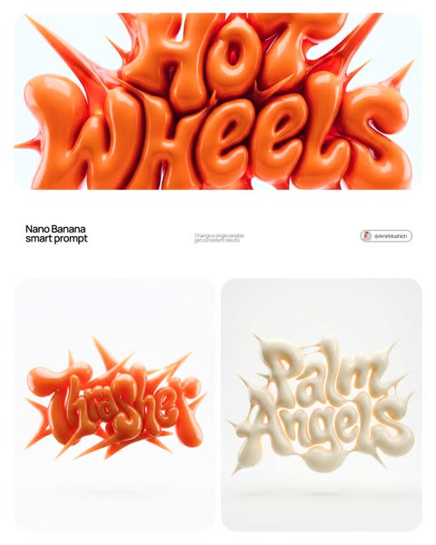</a>

将整件雕塑锁定为同一种乳胶材质和同一色系，配合白色摄影棚背景，只替换品牌和颜色两个变量即可保持结果一致。次表面散射、柔和拉长的高光以及略微俯视的正面镜头，让画面接近 CGI 产品渲染。

Nano Banana 2 · 文生图 · 出处: [@AmirMushich on X](https://x.com/AmirMushich/status/2043381172646920237) · 2,640 赞，统计于 2026-10-29

[`3d-typography`](pages/zh/tags.md#tag-3d-typography) [`logotype`](pages/zh/tags.md#tag-logotype) [`inflated-latex`](pages/zh/tags.md#tag-inflated-latex) [`studio-render`](pages/zh/tags.md#tag-studio-render)

<details><summary><b>提示词</b></summary>

```text
(access Nano Banana 2 here:
https://
amirmushich.link/LTX26)

[BRAND NAME] | [COLOR]

Act as a 3D Type Designer and CGI Artist working at the intersection of streetwear culture, Y2K aesthetics, and high-end digital sculpture. Your references: Nigo, Futura, Guccimaze, Soulwax art direction.

---

PHASE 1: TYPOGRAPHIC CONCEPT

Render the word or logotype [BRAND NAME] as a fully 3D sculptural object — not a flat text with extrusion, but a living, inflated, organic type sculpture. Style: Wildstyle graffiti DNA fused with inflatable balloon morphology. Letters are not separate — they flow into each other as one continuous organic mass. Each letterform has: bulbous pneumatic body as if inflated under high pressure from within, stretching the surface taut. Aggressive spike extensions — sharp tapered protrusions erupting between and around letters, directional, asymmetric, energetic, some long and blade-like, others short and thorn-like. Wildstyle overlaps — letters partially occlude each other creating depth layers, classic graffiti ambiguity where readability fights with visual complexity. Organic connective tissue — negative spaces between letters filled with stretched membrane forms, like rubber pulled between two inflated surfaces.

---

PHASE 2: MATERIAL & SURFACE

Single unified material across the entire sculpture — no color variation between letters. Material type: high-gloss latex / inflated rubber / soft silicone — the surface behaves like a balloon skin stretched to near-bursting point. Subsurface scattering: active — light penetrates slightly into the material, creating a translucent inner glow at thin edges and spike tips. Thinner areas read lighter, denser volumes read darker. Specular highlights: large, soft, slightly elongated — the kind you get on inflated latex, not hard plastic. Multiple secondary highlights in concave zones. Apply [COLOR] as the sole material color of the entire sculpture — this is non-negotiable. [COLOR] defines the pure midtone of the material. Highlights push toward the most luminous near-white version of [COLOR]. Shadow zones and deep crevices push toward the darkest most saturated version of [COLOR]. The entire chromatic range of the sculpture lives within the [COLOR] family — no hue deviation, no neutral grays.

---

PHASE 3: COMPOSITION & STAGING

Background: pure white (#FFFFFF) — clinical studio isolation. Zero texture, zero gradient. Shadow: none, or absolute minimum contact shadow directly beneath the sculpture — the object appears to float slightly. Orientation: horizontal spread — the sculpture is wider than tall, expanding laterally. Spike elements breach the invisible bounding box on all sides — top spikes reach upward, side extensions push outward. Camera angle: straight-on frontal, slightly elevated 5 to 10° above center — reveals the full typographic mass while showing the 3D depth of overlapping elements. Depth of field: none — sharp from foreground spikes to background letter bodies, every detail in focus. Scale feel: monumental — as if the sculpture is 2 meters wide in physical space, photographed in a white infinity studio.

---

PHASE 4: TECH SPECS

Render engine: Octane Render or Redshift — physically accurate subsurface scattering mandatory. Global illumination: large soft HDRI dome light, neutral white temperature 5500K. No directional shadows. No rim lights. No background elements. Ray tracing: on — for accurate specular and inter-reflection between letter surfaces. Anti-aliasing: maximum — edges must be razor-clean against white background. Output feel: this is a CGI product render, not AI art. Precision over expressionism. Aspect ratio: 1:1 square — centered composition with breathing room on all four sides.
```

</details>

<a id="nano-banana-embroidered-brand-crest-waffle-knit"></a>
### 华夫格针织棉上的刺绣品牌徽章

<a href="https://x.com/AmirMushich/status/2044829425464656123">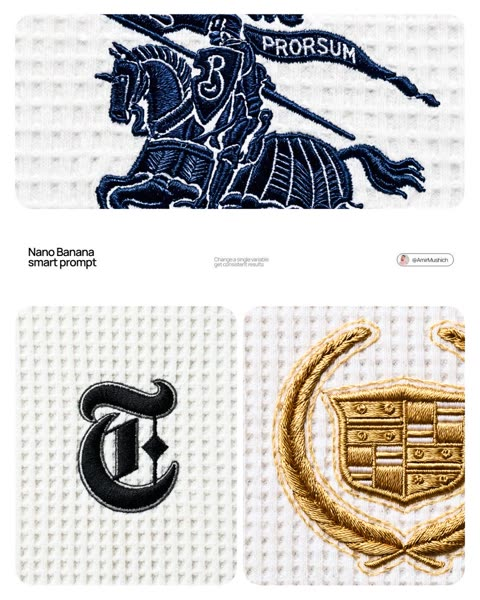</a>

用一个品牌名称占位驱动分阶段规格，把标志转译为缎面绣、较浅的衬底描边和随光线变化的线色。正上方平光、垂直机位和固定的华夫格纹理，让画面像面料技术文档，而不是风格化渲染。

Nano Banana 2 · 文生图 · 出处: [@AmirMushich on X](https://x.com/AmirMushich/status/2044829425464656123) · 1,604 赞，统计于 2026-10-29

[`embroidery`](pages/zh/tags.md#tag-embroidery) [`macro-photo`](pages/zh/tags.md#tag-macro-photo) [`textile`](pages/zh/tags.md#tag-textile) [`logo`](pages/zh/tags.md#tag-logo)

<details><summary><b>提示词</b></summary>

```text
(access Nano Banana 2 here:
https://
amirmushich.link/AMIR-LTX)

[BRAND NAME]

Act as a Macro Product Photographer and Textile Art Director shooting a close-up editorial campaign of a premium embroidered garment. References: Loro Piana fabric campaigns, Brunello Cucinelli texture photography, A.P.C. garment detail shoots, Japanese boro textile documentation.

PHASE 0: BRAND LOGO INTELLIGENCE

Retrieve the canonical logotype or primary mark of [BRAND NAME] from training data. Identify the core geometric essence of the logo — its fundamental shapes, stroke relationships, and compositional balance. Translate this identity into an embroidery-native form language: sharp geometric elements become satin stitch bars and needle-point spikes, circular elements become dense satin stitch ovals or French knot clusters, complex letterforms are simplified into their most essential strokes while remaining recognizable. The embroidery interpretation must feel like a deliberate premium interpretation of the brand mark — as if [BRAND NAME]'s design team commissioned an embroidery artist to translate their logo into thread. Autonomously determine the thread color most iconic to [BRAND NAME] — this becomes the primary embroidery thread color. If [BRAND NAME] has no dominant single color, default to deep navy #1A2332.

PHASE 1: TEXTILE BACKGROUND

The background is a premium waffle-knit cotton fabric — the weave structure is a precise geometric grid of raised square cells, each cell approximately 2×2mm equivalent, separated by thin recessed channels running both horizontally and vertically. The raised nodes of each cell are flat-topped, not rounded — creating a regular orthogonal relief pattern across the entire surface. The fabric color is cold off-white — #F0F0EE to #EBEBEA range, with a very slight cool gray bias, not warm ecru or cream. The weave is consistent and uniform across the entire frame — machine precision, no tension variation, no distortion. Microscopic fiber fuzz is visible on the flat tops of the raised nodes — individual cotton fibers catching the diffused overhead light as a very fine surface bloom. The recessed channels between cells are in soft shadow — not deep shadow, just slightly darker than the raised nodes, consistent with flat overhead illumination.

PHASE 2: EMBROIDERY CONSTRUCTION SYSTEM

The logo mark of [BRAND NAME] rendered as machine or hand embroidery using these specific stitch techniques. Satin stitch: the primary technique for all filled areas and stroke elements — dense parallel threads laid side by side with zero gap, creating a smooth glossy surface. Thread direction follows the long axis of each stroke element — horizontal strokes have horizontal threads, diagonal strokes have diagonal threads. The characteristic sheen of satin stitch is critical: threads catch light along their length creating bright reflective zones on thread-parallel surfaces and darker zones on thread-perpendicular surfaces, creating a directional shimmer across the embroidery surface. Stem stitch or outline stitch: used for any curved linear elements — thin continuous line of overlapping thread segments following curves with natural flexibility. French knots: small circular dot elements rendered as tightly wound thread knots — each knot has a visible spiral wind pattern at macro distance. Spike elements: long tapering needle-like forms executed in satin stitch that tapers from full width to a single thread point — gradual and precise, ending in a razor-sharp thread tip.

Edge treatment: every embroidered element has a thin visible backing outline — 1 to 2 thread widths of the base fabric visible between the embroidery and the surrounding textile. This underlay/backing edge is slightly lighter than the main embroidery thread — it outlines every form and confirms the physical layering of embroidery over fabric.

Physical relief: the embroidery sits 1 to 3mm above the fabric surface — confirmed by a very subtle shadow halo directly underneath each embroidered element. The shadow is symmetrical around the embroidery perimeter, soft-edged, 1 to 2mm wide — consistent with flat overhead illumination, not directional raking light.

PHASE 3: THREAD MATERIAL

Primary thread color: autonomously determined brand color from PHASE 0. Thread material: mercerized cotton or silk embroidery thread — high sheen, smooth filament surface. The thread color is never flat — it shifts in value along its length based on light angle. Directly lit zones approach a lighter more luminous version of the base color. Shadow zones approach a deeper more saturated version. The overall embroidery reads as one unified color but contains a full tonal range within that color family. Secondary thread: the backing/underlay edge thread is 2 to 3 shades lighter than the primary thread — creating the characteristic light outline visible around all embroidered elements.

PHASE 4: COMPOSITION & CAMERA

Camera body: Canon EOS R5 or Nikon Z8 — full frame, 45 megapixel minimum for fabric texture resolution. Lens: Canon RF 100mm f/2.8L Macro IS USM or Nikon Z MC 105mm f/2.8 VR S — used at moderate close-up distance, not at maximum 1:1 magnification. Focus distance: 40 to 55cm — the embroidery fills approximately 30 to 40% of the frame height, leaving generous fabric context on all sides. This is a moderate close-up, not extreme macro — the full embroidery composition is visible with substantial textile surround. Aperture: f/8 to f/11 — deep depth of field, the entire embroidery and all surrounding fabric texture are in crisp simultaneous focus from corner to corner. No visible bokeh anywhere in the frame. Shutter speed: 1/200s with continuous light source. ISO: 100 — base ISO, zero noise, maximum tonal resolution in the subtle gray shadows of the waffle recesses. White balance: 5600K — neutral daylight, renders the cold off-white fabric accurately without warm or cool shift. Exposure: slightly bright ETTR — the off-white fabric renders as a luminous near-white, embroidery thread reads as deep rich dark against the bright ground. Aspect ratio: 4:5 portrait. Camera perpendicular to fabric plane — zero perspective distortion, embroidery geometry rendered faithfully.

PHASE 5: LIGHTING

Primary light: large diffused overhead source — a 120×120cm softbox or diffusion panel positioned directly above the fabric at 60 to 80cm distance. The light is as close to flat and directionless as possible. No raking angle — the light comes from directly above at 85 to 90° to the fabric plane. This flat overhead lighting creates: uniform brightness across the entire fabric field with no hot spots or falloff. Very short soft shadows in the recessed channels of the waffle grid — 1 to 2mm wide, soft-edged, falling straight down. Soft symmetrical micro-shadow halo directly beneath the embroidery — the 1 to 3mm relief creates a subtle darker zone immediately surrounding the embroidery perimeter, equal on all sides. No directional shadow — the shadow is not cast to one side. Secondary light: none. No fill, no rim, no accent. The single large overhead diffused source is the complete lighting setup. Overall mood: clinical, precise, bright — consistent with product documentation or high-end textile editorial photography where the subject must be seen with maximum clarity and zero atmospheric distraction.

PHASE 6: TECH SPECS

Render: Octane Render or Redshift with fiber/textile displacement geometry. Thread geometry: actual 3D cylindrical thread strands — each thread strand is a real geometric object casting real shadows on adjacent threads, not texture maps. Fabric weave: real geometric displacement mesh for waffle structure — not normal map. Ray tracing: on — for accurate micro-shadow casting between individual thread strands and between embroidery and fabric surface. Subsurface scattering: subtle on thread material — mercerized cotton and silk have slight translucency. Depth of field: physically accurate — f/8 to f/11 at 100mm at 40 to 55cm focus distance, full frame sharp corner to corner. Anti-aliasing: maximum. Sampling: minimum 2048 samples — zero noise in shadow zones, full tonal resolution in the off-white fabric field. Output feel: this image should be indistinguishable from a photograph taken with a Canon 100mm macro in a textile documentation studio. The viewer must feel the urge to touch the fabric.
```

</details>

**[全部 28 条](pages/zh/image-brand.md)**

<a id="img-realism"></a>
## 写实照片

这一类的全部提示词和预览见 [agentcraft.dev](https://agentcraft.dev/zh/prompts/image/realism/)

<a id="gpt-image-coca-cola-tanker-leak-mentos-truck-dashcam"></a>
### 可口可乐罐车漏液，旁边是Mentos货车

<a href="https://x.com/techhalla/status/2100526486113472703"></a>

以未经摆拍的行车记录仪视角构图，画面包含挡风玻璃、车窗边框和仪表盘边缘，让场景像真实抓拍。写明品牌涂装、深棕色喷流和关闭的货车车门，使两个品牌清晰可辨，漏液成为画面焦点。

GPT Image 2.5 · 文生图 · 出处: [@techhalla on X](https://x.com/techhalla/status/2100526486113472703) · 22,510 赞，统计于 2026-10-29

[`dashcam`](pages/zh/tags.md#tag-dashcam) [`realism`](pages/zh/tags.md#tag-realism) [`branded-vehicles`](pages/zh/tags.md#tag-branded-vehicles) [`spill`](pages/zh/tags.md#tag-spill)

<details><summary><b>提示词</b></summary>

```text
First, lock the initial frame to a realistic one. I've used GPT Image 2.5 and the prompt below:

DIRECTIVE:
Produce one still that reads as a real in-car dashcam frame grabbed from a moving car on a highway. Optical dashcam capture, wide windshield view, windshield glass, A-pillar, a slice of dashboard/hood — lived-in dashcam JPEG, not cinema, not HDR.

BEAT / COMPOSITION:
Looking forward through the windshield. On the LEFT side of the road (left lane or left shoulder, clearly in frame): TWO branded trucks close together.

COCA-COLA TRUCK (LEFT, CRITICAL):
A full-size Coca-Cola tanker / delivery truck, official Coca-Cola red livery and logos readable. It has a breakdown: a torn ragged hole in the tank wall. A thick, heavy jet of dark-brown Coca-Cola is blasting out of that hole onto the asphalt — lots of liquid, puddle spreading, foam, spray in the air, wet road shine. The truck is stopped or crawling, hazard situation.

MENTOS TRUCK (BESIDE IT, CRITICAL):
Right next to the Coca-Cola truck (same left cluster, slightly ahead or alongside): a closed box truck / delivery truck with large, unmistakable MENTOS branding on the side (Mentos logo, candy rolls artwork). Rear and side doors CLOSED. No candy spilling. You can clearly read that it is a Mentos truck.

CAMERA PACK:
Fixed dashcam behind the windshield, slight barrel wide, dashboard or hood bottom of frame, windshield dirt/reflections, timestamp overlay optional, daytime road, other traffic farther ahead. Real consumer dashcam still.

LIGHT:
Daylight, overcast or sun, real road color, cola looking like dark soda not black oil.

PHOTOGRAPHIC CHARACTER:
Unstaged dashcam grab — physically grounded trucks, readable brands, the leak is the event.

Once it's ready, use it as reference for Seedance 2.5 and this prompt:

[STYLE + CAMERA + ATMOSPHERE]
Vertical 3:4 smartphone video filmed FROM INSIDE a moving car, passenger or driver seat. Phone held handheld (not a bolted dashcam): arms, slight breathing shake, windshield and A-pillar in frame, a slice of dashboard/hood at the bottom, maybe a finger edge. We are ARRIVING — forward motion first, trucks growing larger, then we slow and stop short of the cola lake. CONTINUOUS SINGLE TAKE the entire 30s. Digital pinch-zooms only (no cuts): punch into the Coke jet, the jug fill, the Mentos doors, the launch, then zoom out as he shrinks to the horizon. Daylight, overcast, wet asphalt, rain specks on glass. Consumer phone JPEG, autofocus hunting, rolling shutter. Photoreal live physics: cola viscosity, foam, Mentos cases, one adult body launched like a Mentos rocket.

LOCKED SET / VEHICLES:
- LEFT ahead through the windshield: red Coca-Cola tanker with a ragged hole, dark-brown Coca-Cola ALREADY blasting onto the lane, spreading cola lake.
- BESIDE it: Mentos box truck, rear doors CLOSED at arrival, Mentos livery readable ("mentos / The Freshmaker").
- Highway continuing past them toward a clear vanishing-point horizon.
- NO other truck for the guy. He does not exit a vehicle.

LOCKED CAST:
- THE GUY: one very large man alone — sweat-dark tank top, cargo shorts, stained baseball cap, Alabama redneck energy. No second person. He ENTERS FRAME FROM THE RIGHT (shoulder / right edge of the windshield view) already on foot — he does not get out of any truck, van, or car.
- HERO OBJECT: one giant gas-station plastic jug / Big Gulp–scale cup in his right hand. Starts EMPTY (daylight visible through clear plastic), stays in that hand until the blast.

Diegetic audio: road noise while arriving, cola hiss, gulping, metal latch, volcanic foam roar, Doppler scream as he flies away, phone mic clipping.

[IMAGE REFERENCES]
[ref_image] = locked opening phone still from inside the car looking through the windshield at the Coke tanker + Mentos truck cluster. Tanker, hole, cola jet, Mentos truck, and in-car foreground are LAW. Clip BEGINS with us still rolling toward that cluster.

[TIMELINE SECOND BY SECOND]

0-3s: [HOOK — ARRIVING + ZOOM] Phone already rolling. Road noise. Through the windshield the Coca-Cola tanker and Mentos truck are already ahead on the left; cola ALREADY jetting from the hole. We close distance — trucks grow. Digital zoom punches into the Coke stream and the hole. By ~2.5s brakes dip. Several events already: motion, the leak, closing in, first zoom.

3-5s: [STOP + HE ENTERS FROM RIGHT] We fully stop. Idle phone shake. Zoom out a notch. THE GUY walks INTO FRAME FROM THE RIGHT — already on foot from the shoulder / right edge, giant EMPTY jug held high, clear plastic with daylight through it. He does not exit any vehicle. He steps straight into the cola lake toward the tanker jet.

5-9s: [FILL — HOLD IT] He shoves the empty jug INTO the Coke stream. ONE CONTACT: jug into the jet. Phone slam-zooms the fill and HOLDS. For a clear ~2 full seconds (through ~7–8s) the jug is STILL filling under the blast — brown liquid climbing the plastic, foam boiling over the rim, overflowing his forearm, stream hammering the mouth of the jug the whole time. Only then does he pull the full heavy jug out and raise it.

9-12s: [CHUG] He tilts and CHUGS — huge gulps, cola down the tank top. Empties most of it, gasps, still holding the jug. Turns to the Mentos rear doors. Phone zooms out enough to keep tanker jet + Mentos bumper + him in frame.

12-16s: [OPEN + DUMP] ONE CONTACT: he yanks both Mentos rear doors open. Cases stacked high. He dumps a case — Mentos rolls cascade into the cola lake. Packs split, white mints into the brown river. Digital zoom on the mint waterfall hitting the puddle. He still stands in the lake with the jug.

16-20s: [IT GOES] Hard fizz, then a WHITE FOAM COLUMN erupts between the trucks. ONE CONTACT: the fountain hits him from below like a human Mentos rocket. Feet leave asphalt. Jug flies. He launches UP and AWAY down the highway axis. Phone slam-zooms his body leaving the ground, then struggles to track him.

20-24s: [HUMAN FOUNTAIN] He is a dark silhouette riding the white column, spinning once, cap gone. The geyser leans him toward the open highway horizon. Foam hits our windshield — phone jerks but stays inside the car, still filming through glass. Digital zoom hunting his shape in the spray.

24-26s: [SHRINKS] Zoom out through foam streaks on the glass. He is airborne over the far lanes, a tiny spinning figure on a white spray trail, Mentos truck hopping, tanker still feeding the column. Phone digital-zooms into the shrinking speck, then out again.

26-30s: [PAYOFF — GONE] He dwindles to a speck and DISAPPEARS into the horizon haze past the vanishing point (~1s earlier than before). Phone holds on empty sky/road where he vanished, foam still climbing between the trucks, Mentos doors still open, Coke still dumping. Final tiny digital zoom into that empty vanishing point. Loop-open: empty horizon, roar still going.

[STYLE & QUALITY BOOSTERS]
Photoreal handheld phone from inside a car, 3:4 vertical. Arriving motion then stop. Digital pinch-zooms only, continuous take. One man enters from the RIGHT on foot — never exits a vehicle. Empty jug fills on camera for a clear multi-second hold. Body launched to the vanishing point. Coherent liquid physics. Identity lock to [ref_image] for both trucks, the hole, and the in-car windshield framing.
```

</details>

<a id="chatgpt-nigeria-jersey-football-dribble"></a>
### 身穿尼日利亚球衣带球过人的年轻男子

<a href="https://www.tiktok.com/@adelex2468/video/7681363280471854354"></a>

提示词先上传参考人脸并明确要求保持面部一致，再用球衣、短裤、白色球鞋等具体服装细节，以及带球动态、浅景深和高速体育摄影等镜头描述搭建场景。

ChatGPT · 上传图改图 · 出处: [@adelex2468 on TikTok](https://www.tiktok.com/@adelex2468/video/7681363280471854354) · 8,859 赞，统计于 2026-10-30

[`football`](pages/zh/tags.md#tag-football) [`sports`](pages/zh/tags.md#tag-sports) [`nigeria`](pages/zh/tags.md#tag-nigeria)

<details><summary><b>提示词</b></summary>

```text
Use the uploaded reference image as the exact facial identity reference. Create an ultra-realistic cinematic 8K sports photograph of the same young man confidently performing impressive dribbling skills with a football on a professional stadium pitch. He wears a Nigeria football jersey, matching shorts and white football boots. Capture him mid-dribble with dynamic athletic movement, focused and confident expression, looking handsome and natural. Professional stadium background, realistic green grass, dramatic natural lighting, shallow depth of field, sharp facial details, realistic skin texture, crisp jersey and boot details, high-speed sports photography, clean composition. Make the image extremely neat, clean, sharp, photorealistic, and detailed. Preserve his exact facial likeness without altering his identity.
```

</details>

**[全部 136 条](pages/zh/image-realism.md)**

<a id="img-portrait"></a>
## 人像

这一类的全部提示词和预览见 [agentcraft.dev](https://agentcraft.dev/zh/prompts/image/portrait/)

<a id="chatgpt-bw-editorial-portrait-hand-on-chin"></a>
### 黑白肖像，男子手托下巴

<a href="https://www.tiktok.com/@onsenfou390/video/7691032466735238420">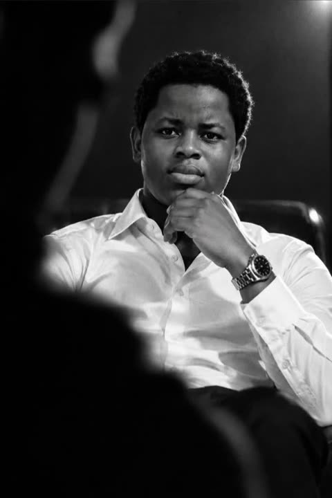</a>

前景虚化的剪影形成框中框的构图，提示词用 85 毫米镜头、Leica M11 质感、柔和逆光和单色调来锁定画面风格。深阴影与强高光突出面部表情，参考脸部图像决定人物身份。

ChatGPT · 上传图改图 · 出处: [@onsenfou390 on TikTok](https://www.tiktok.com/@onsenfou390/video/7691032466735238420) · 14,052 赞，统计于 2026-10-30

[`monochrome`](pages/zh/tags.md#tag-monochrome) [`portrait`](pages/zh/tags.md#tag-portrait) [`reference-photo`](pages/zh/tags.md#tag-reference-photo) [`editorial`](pages/zh/tags.md#tag-editorial)

<details><summary><b>提示词</b></summary>

```text
En utilisant le visage de référence ci-dessus, crée un portrait de mode noir et blanc à fort contraste d’un jeune homme portant une chemise blanche impeccable, assis dans une pose réfléchie, avec une main près du menton. Il est encadré par une silhouette floue au premier plan, créant une composition cinématographique de type « cadre dans le cadre ». Un éclairage dramatique, avec des ombres profondes et des hautes lumières intenses, met en valeur les traits du visage et l’émotion. L’esthétique est éditoriale, intemporelle et minimaliste, avec un arrière-plan sobre, un léger grain de pellicule en 4K, une texture de peau ultra-réaliste, une mise au point très nette sur les yeux, une faible profondeur de champ, une photographie cinématographique, une ambiance sombre et élégante, un style digne d’un magazine de luxe, un rendu inspiré du Leica M11, un objectif 85 mm, un léger contre-jour (soft rim light), des tons monochromes, un rendu photoréaliste et un niveau de détail très élevé. Image originale.
```

</details>

<a id="gpt-image-macbook-screen-photo-booth-selfie"></a>
### 笔记本屏幕上Photo Booth里的昏暗卧室自拍

<a href="https://x.com/tadasgedgaudas/status/2046877643929166330">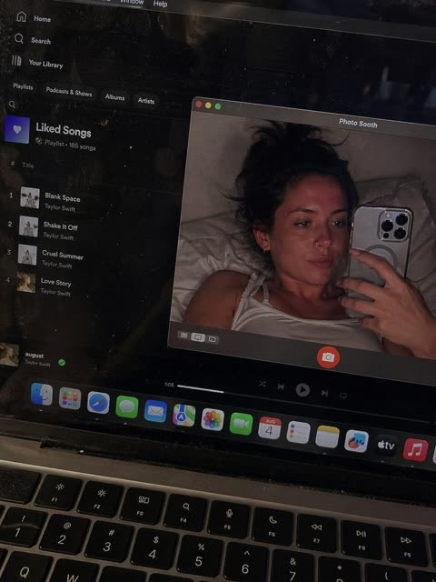</a>

提示词用结构化JSON，并以身份锁定块保留输入照片中的人脸。它把结果定义为对屏幕的拍摄而不是截图，列出像素网格、摩尔纹、灰尘和指纹等物理瑕疵，再用负面清单排除平整界面和过度精修。

GPT Image 2 · 上传图改图 · 出处: [@tadasgedgaudas on X](https://x.com/tadasgedgaudas/status/2046877643929166330) · 4,434 赞，统计于 2026-10-28

[`screen-photo`](pages/zh/tags.md#tag-screen-photo) [`json-prompt`](pages/zh/tags.md#tag-json-prompt) [`identity-lock`](pages/zh/tags.md#tag-identity-lock) [`low-light`](pages/zh/tags.md#tag-low-light) [`candid`](pages/zh/tags.md#tag-candid)

<details><summary><b>提示词</b></summary>

```text
{"image_settings": {"aspect_ratio": "3:4", "resolution": {"width": 1152, "height": 1536}}, "prompt": {"identity_lock": {"reference": "input_photo", "preserve": ["face", "facial proportions", "eye shape", "nose", "lips", "skin tone", "skin texture", "hairline", "overall identity"], "rules": ["no face swap", "no beautify", "no smoothing", "no reshaping", "no AI look"]}, "scene": {"camera_angle": "high-angle downward shot, POV", "composition": "MacBook screen fills most of the frame, thin strip of physical keyboard visible at the bottom", "screen_surface": ["visible RGB pixel grid", "subtle moire effect", "micro dust on glass", "faint fingerprints", "soft ambient reflections"]}, "digital_interface": {"os": "macOS dark mode", "background_app": {"name": "Spotify", "view": "Liked Songs", "visible_tracks": ["Blank Space \u2013 Taylor Swift", "Shake It Off \u2013 Taylor Swift", "Cruel Summer \u2013 Taylor Swift", "Love Story \u2013 Taylor Swift"]}, "foreground_app": {"name": "Photo Booth", "state": "live preview window", "position": "floating, center-right"}}, "photo_booth_content": {"environment": {"room": "dim bedroom", "background": "off-white wall, rumpled bedding", "lighting": "low-light, nocturnal, cool screen glow mixed with warm skin tones"}, "subject": {"pose": "lying down, relaxed, candid", "expression": "natural, slightly relaxed", "outfit": "light-colored tank top", "prop": {"item": "iPhone 15 Pro", "hand": "right hand"}}}, "realism_rules": ["this is a photo of a screen, not a screenshot", "raw smartphone photo look", "natural noise", "imperfect glass", "no studio lighting", "no HD polish"]}, "negative_prompt": ["screenshot", "flat UI", "perfect screen", "clean glass", "studio lighting", "beauty filter", "cartoon", "3d render", "painting", "watermark", "blurred face"]}
```

</details>

**[全部 288 条](pages/zh/image-portrait.md)**

<a id="img-character"></a>
## 角色与手办

这一类的全部提示词和预览见 [agentcraft.dev](https://agentcraft.dev/zh/prompts/image/character/)

<a id="gpt-image-tanjiro-pixel-sprite-sheet-water-attack"></a>
### 炭治郎十六帧像素精灵图与水之呼吸攻击

<a href="https://x.com/Mayz1169/status/2097539942985728162">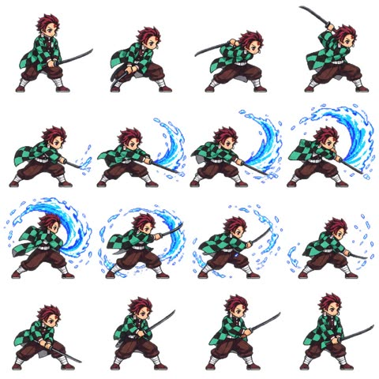</a>

上传角色参考图，并固定 4 乘 4 网格、等大小单元格以及起手、蓄力、出招、命中、收势的动作顺序，帧与帧之间的衔接就能保持清楚。攻击方式取自角色自身的能力（这里是水之呼吸），特效来源明确，也更容易保持统一的像素风格。

GPT Image 2.5 · 上传图改图 · 出处: [@Mayz1169 on X](https://x.com/Mayz1169/status/2097539942985728162) · 1,559 赞，统计于 2026-10-29

[`pixel-art`](pages/zh/tags.md#tag-pixel-art) [`sprite-sheet`](pages/zh/tags.md#tag-sprite-sheet) [`animation`](pages/zh/tags.md#tag-animation) [`anime`](pages/zh/tags.md#tag-anime)

<details><summary><b>提示词</b></summary>

```text
Using the character reference image I upload, create a pixel-art battle animation. Deliver a transparent animated GIF and a 4×4 sprite sheet containing 16 sequential frames.

CHARACTER FIDELITY
Identify the character’s hairstyle, outfit, colors, weapon, proportions, and distinctive features. Translate them into a recognizable chibi pixel-art sprite. Keep the character’s identity, scale, clothing, and equipment consistent across all frames.

BATTLE DESIGN
Automatically design an attack that suits the character:
- If they carry a weapon, build the animation around it.
- If their abilities are clearly identifiable, use the appropriate effects, such as water, fire, or lightning.
- If their abilities are unclear, create a plausible physical attack based on their appearance. Do not invent unrelated powers.

Proceed without asking preliminary questions. Create one coherent battle loop:
Ready stance → Anticipation → Attack → Impact peak → Effects dissipate → Recovery.

Distribute the sequence naturally across 16 frames. The final frame must transition smoothly into the first. Animate actual changes in pose and body mechanics; do not fake movement by merely translating or rotating a static character image.

PIXEL-ART STYLE
Use crisp 16-bit game-style pixel art with readable silhouettes, sharp pixel edges, and a restrained palette. Maintain a consistent pixel scale for both the character and effects. Avoid blur, photorealistic rendering, and style drift.

SPRITE SHEET REQUIREMENTS
- Exactly 4 columns × 4 rows, totaling 16 frames.
- Frames play left to right, then top to bottom.
- All cells must have identical dimensions.
- Use a fixed camera, consistent character scale, a stable ground baseline, and consistent animation registration.
- Each cell contains exactly one character.
- Keep the entire body, weapon, and effects inside its cell.
- Leave sufficient transparent padding on every side. Nothing may cross cell boundaries or be cropped.
- No text, frame numbers, grid lines, watermarks, or background scenery.

TRANSPARENCY AND ANIMATION
Generate a genuinely transparent RGBA PNG. Do not draw a checkerboard pattern to imitate transparency.

Slice the sheet into frames and assemble a transparent, infinitely looping GIF. Adjust frame durations to emphasize anticipation and fast strikes. Aim for a total loop duration of approximately 1.5–2 seconds.

Preserve full alpha transparency in the PNG files. Use a transparent palette index and correct frame disposal in the GIF to prevent trails from previous frames.

DELIVERABLES AND QUALITY CHECK
Create the actual files, not just prompts or instructions:
1. A transparent 4×4 PNG sprite sheet.
2. A playable transparent battle GIF.
3. A ZIP containing all 16 individual transparent PNG frames.

Before delivery, verify that there are exactly 16 frames, transparency is genuine, the character remains consistent, no neighboring frames bleed into the crops, the action plays in the correct order, and the loop has no obvious positional jumps. Fix any issues before presenting the GIF preview and download links.
```

</details>

<a id="gpt-image-dance-pose-sheet-4x4-character"></a>
### 动漫少女十六格舞蹈姿势表

<a href="https://x.com/Mayz1169/status/2098014577414033912">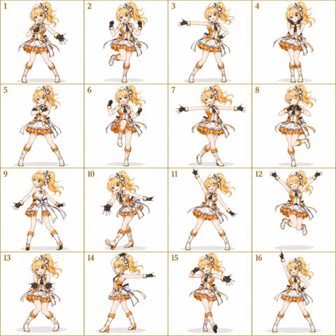</a>

以单张参考图锁定角色身份，再按编号写出十六个从起势到收势的动作，让整张图连成一套舞蹈。固定机位、白底和明确的避免清单保证比例、服装和格子排布一致。

GPT Image 2.5 · 上传图改图 · 出处: [@Mayz1169 on X](https://x.com/Mayz1169/status/2098014577414033912) · 1,270 赞，统计于 2026-10-27

[`pose-sheet`](pages/zh/tags.md#tag-pose-sheet) [`character-reference`](pages/zh/tags.md#tag-character-reference) [`dance`](pages/zh/tags.md#tag-dance) [`grid-layout`](pages/zh/tags.md#tag-grid-layout) [`anime`](pages/zh/tags.md#tag-anime)

<details><summary><b>提示词</b></summary>

```text
Create a 4×4 dance pose sheet featuring the character in the uploaded reference image, with exactly 16 equally sized panels in one square image.

CHARACTER CONSISTENCY
Use the uploaded character as the sole reference for character identity and appearance. Preserve the character’s face, hairstyle, colors, body proportions, species, outfit, accessories, and original art style across all 16 panels. Do not redesign the character or add an idol costume. If any body or costume details are not visible in the reference, infer them conservatively and keep them consistent throughout.

ADAPTIVE CHOREOGRAPHY
Design a cohesive dance sequence tailored to this specific character’s personality, appearance, anatomy, clothing, and range of motion. Choose a suitable dance style automatically: lively for an energetic character, graceful for an elegant character, confident for a bold character, playful for a cute character, or restrained for a serious character. Do not force every character into cute idol poses.

Show 16 distinct key poses from the same dance routine, ordered from left to right and top to bottom. Make the sequence feel connected, with natural transitions and a clear beginning, build-up, climax, and ending.

Use the following movement structure, adapting each action to the character:
1. Opening pose that establishes the character’s personality.
2. Small rhythmic step with a coordinated arm gesture.
3. Side step with one arm extended.
4. Compact expressive gesture near the face or upper body.
5. Grounded stance with arms crossing or sweeping inward.
6. Knee lift or an anatomically appropriate weight shift.
7. Open, expansive pose with arms spread.
8. Playful or expressive balance pose.
9. Turning pose showing a three-quarter rear view.
10. Forward-reaching movement with a diagonal body lean.
11. Strong upward-reaching accent.
12. Climactic jump or a grounded full-body extension if jumping is unsuitable.
13. Lowered stance with a forward gesture.
14. Elegant or dynamic side-facing transition.
15. Signature gesture that suits the character.
16. Confident final pose with a clear finishing silhouette.

COMPOSITION AND PRESENTATION
Use a clean white background, thin grid lines, and small readable numbers 1–16 in the upper-left corner of each panel. Include exactly one full-body depiction of the same character per panel. Keep the character’s scale, camera distance, lighting, and rendering style consistent. Use a fixed camera while allowing the character to turn naturally.

Keep the entire character, including hair, ears, horns, wings, tail, hands, feet, and accessories, inside each panel with comfortable margins. Allow room for extended limbs and jumps. Add subtle ground shadows. Show natural secondary movement in hair, fabric, and accessories.

Every pose must have a clear silhouette, convincing balance, anatomically plausible joints, and expressive body language. Adapt all movements to nonhuman anatomy when applicable.

AVOID
Repeated or nearly identical poses, character identity drift, costume changes, inconsistent proportions, extra or missing limbs, malformed hands, cropped body parts, overlapping panels, additional characters, motion trails, background scenery, props not present in the reference, speech bubbles, captions, and watermarks.

Final output: one polished square image containing a clearly organized 4×4 grid of 16 distinct, character-appropriate dance poses.
```

</details>

**[全部 113 条](pages/zh/image-character.md)**

<a id="img-illustration"></a>
## 插画

这一类的全部提示词和预览见 [agentcraft.dev](https://agentcraft.dev/zh/prompts/image/illustration/)

<a id="nano-banana-map-screenshot-anime-panorama-shibuya"></a>
### 由地图截图生成的涩谷十字路口动漫全景

<a href="https://x.com/icreatelife/status/2027085364872024311">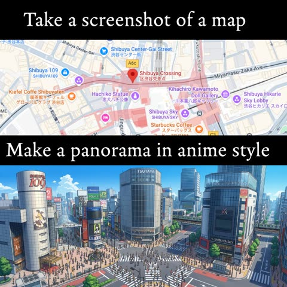</a>

仅以一张地图截图作为视觉输入，再用一句指令指定全景和动漫风格。模型读取地图上的街道布局与地标标注，并将其重建为连贯的动漫街景。

Nano Banana 2 · 上传图改图 · 出处: [@icreatelife on X](https://x.com/icreatelife/status/2027085364872024311) · 936 赞，统计于 2026-10-29

[`map-to-scene`](pages/zh/tags.md#tag-map-to-scene) [`panorama`](pages/zh/tags.md#tag-panorama) [`anime`](pages/zh/tags.md#tag-anime) [`screenshot-reference`](pages/zh/tags.md#tag-screenshot-reference) [`cityscape`](pages/zh/tags.md#tag-cityscape)

<details><summary><b>提示词</b></summary>

```text
The coolest use-case for AI animation I found of new Nano Banana 2 is that you can screenshot a map and ask it to generate a panorama in anime / cartoon style.

Nano Banana 2 is fully supported in Adobe Firefly web

prompt: make me a panorama of this location in an anime style
```

</details>

<a id="gpt-image-risograph-rainy-bus-stop-illustration"></a>
### 孔版印刷风格的雨中公交站少女插画

<a href="https://x.com/Naiknelofar788/status/2051493607916589106">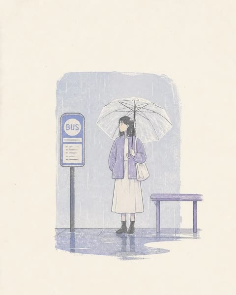</a>

提示词只描述印刷特征：粗轮廓线、错位的油墨层、纸张颗粒，并限定两到三种颜色。再要求大面积留白和极简道具，模型便生成安静而克制的画面。

GPT Image 2 · 文生图 · 出处: [@Naiknelofar788 on X](https://x.com/Naiknelofar788/status/2051493607916589106) · 806 赞，统计于 2026-10-28

[`risograph`](pages/zh/tags.md#tag-risograph) [`minimal`](pages/zh/tags.md#tag-minimal) [`pastel`](pages/zh/tags.md#tag-pastel) [`print-texture`](pages/zh/tags.md#tag-print-texture) [`negative-space`](pages/zh/tags.md#tag-negative-space)

<details><summary><b>提示词</b></summary>

```text
A crisp, printmaking-like aesthetic with bold outlines and natural deformation. Pastel color palette, vintage print texture, slightly misaligned ink layers, and rough paper grain. A calm poster composition with generous negative space rather than filling the frame. Props and background kept minimal. Color theme 2–3 colors.
```

</details>

**[全部 122 条](pages/zh/image-illustration.md)**

<a id="img-comic"></a>
## 漫画与分镜

这一类的全部提示词和预览见 [agentcraft.dev](https://agentcraft.dev/zh/prompts/image/comic/)

<a id="nano-banana-fluffy-creatures-treehouse-story"></a>
### 三只毛茸茸生物规划树屋

<a href="https://x.com/GoogleAI/status/2027094912357761319">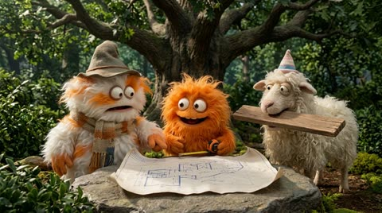</a>

要求生成带情绪起伏的四段故事，固定 16:9 画幅并逐张生成。明确要求三个角色保持一致的形象，让各画面中的外观稳定不变。

Nano Banana 2 · 文生图 · 出处: [@GoogleAI on X](https://x.com/GoogleAI/status/2027094912357761319) · 1,256 赞，统计于 2026-10-28

[`storyboard`](pages/zh/tags.md#tag-storyboard) [`multi-image`](pages/zh/tags.md#tag-multi-image) [`consistent-characters`](pages/zh/tags.md#tag-consistent-characters) [`fluffy-creatures`](pages/zh/tags.md#tag-fluffy-creatures) [`16-9`](pages/zh/tags.md#tag-16-9)

<details><summary><b>提示词</b></summary>

```text
Create a funny 4-part story featuring 3 fluffy creatures building a treehouse. The story has emotional highs and lows and ends in a happy moment. Maintain consistent identity across the 3 characters. Generate 4 images in 16:9 format, one at a time.
```

</details>

<a id="gpt-image-football-dream-storyboard-bedroom-wake"></a>
### 足球梦的分镜图，结局是醒在卧室

<a href="https://x.com/rovvmut_/status/2049900959028109567">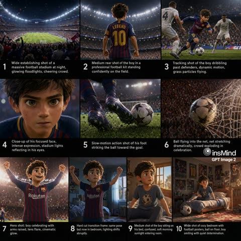</a>

每一格都写明镜头类型，如全景建立镜头、背面中景、慢动作和硬切，给模型一份清晰的分镜表。光线从冷色球场灯光转为暖色晨光，让梦境与醒来两个世界一眼可辨。

GPT Image 2 · 文生图 · 出处: [@rovvmut_ on X](https://x.com/rovvmut_/status/2049900959028109567) · 542 赞，统计于 2026-10-29

[`storyboard`](pages/zh/tags.md#tag-storyboard) [`football`](pages/zh/tags.md#tag-football) [`animation`](pages/zh/tags.md#tag-animation) [`cinematic`](pages/zh/tags.md#tag-cinematic)

<details><summary><b>提示词</b></summary>

```text
Video Prompt: Use the provided storyboard image
@image1
 as the primary visual reference for composition, framing, and scene progression. Generate a 15-second stylized 3D animated cinematic video that follows the exact sequence and visual storytelling of the storyboard.
Style:
High-quality 3D animation, cinematic realism, expressive character design, soft depth of field, realistic physics, subtle motion blur, dramatic lighting contrast
Theme:
A young boy dreams he is a world-famous football player scoring a winning goal in a packed stadium, but wakes up in his bedroom and realizes it was just a dream
Execution Instructions:
Match all camera angles, framing, and transitions from the storyboard image
Maintain consistent character design between dream and real-world scenes
Ensure smooth cinematic camera motion (tracking shots, slow push-ins, slight rotations)
Use slow motion during key action moments (dribble, kick, goal)
Add realistic environmental effects: grass particles, stadium lights, crowd motion
Scene Flow (15s timing):
0–5s: Stadium sequence — wide establishing → dribble → close-up intensity
5–9s: Goal moment — kick → ball hits net → crowd erupts
9–11s: Celebration hero shot — dramatic lighting, lens flare, slow-motion
11–13s: Hard cut transition — stadium to bedroom, same pose match-cut
13–15s: Bedroom reveal — soft morning light, calm mood, subtle smile
Lighting:
Dream: high-contrast stadium lights, cool tones, bright highlights
Reality: warm, soft natural sunlight, grounded and शांत atmosphere
Mood & Tone:
Start epic and high-energy, then shift into calm, intimate, slightly emotional ending.
```

</details>

**[全部 21 条](pages/zh/image-comic.md)**

<a id="img-photo-to-art"></a>
## 照片转艺术风格

这一类的全部提示词和预览见 [agentcraft.dev](https://agentcraft.dev/zh/prompts/image/photo-to-art/)

<a id="gpt-image-photo-to-watercolor-travel"></a>
### 上半旅行照片，下半同一场景水彩画

<a href="https://x.com/MahnoorAi12/status/2102724961408626735">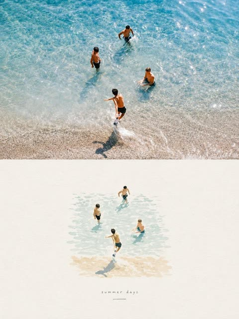</a>

要求上下两半描绘完全相同的场景，让照片与水彩的构图、人物和姿态保持一致。大面积象牙白纸面留白加上小字手写标题，营造旅行手账的质感。

GPT Image 2.5 · 上传图改图 · 出处: [@MahnoorAi12 on X](https://x.com/MahnoorAi12/status/2102724961408626735) · 2,264 赞，统计于 2026-10-27

[`watercolor`](pages/zh/tags.md#tag-watercolor) [`travel`](pages/zh/tags.md#tag-travel) [`split-composition`](pages/zh/tags.md#tag-split-composition)

<details><summary><b>提示词</b></summary>

```text
Create a refined editorial travel-art composition based on a reference photograph. The image is divided vertically into two parts: the upper section is a realistic cinematic travel photograph, while the lower section transforms the exact same scene into a delicate hand-painted watercolor illustration.
Upper section: authentic candid travel photography, natural daylight, soft shadows, subtle film grain, realistic textures, sophisticated European atmosphere, documentary-style composition, people naturally walking through the scene, beautiful architectural details, slightly muted elegant colors, high-end travel magazine photography.
Lower section: a minimalist handmade watercolor painting of the exact same scene, preserving the recognizable composition, architecture, people, poses, perspective and major visual elements from the photograph. Loose translucent watercolor washes, delicate ink details, visible paper texture, soft edges, imperfect brushwork, subtle pigment bleeding, airy negative space, understated pastel tones, artistic but realistic.
Leave generous warm ivory/off-white textured paper space surrounding the watercolor illustration. Add a small elegant handwritten caption near the bottom, such as “summer days” or “a quiet afternoon”, with a thin minimalist horizontal line underneath.
Overall aesthetic: luxury travel journal, fine-art watercolor postcard, contemporary editorial design, nostalgic European summer, understated elegance, tactile handmade paper, sophisticated and serene.
Portrait orientation, clean composition, premium art direction, no clutter, no borders, natural proportions, highly detailed photograph transitioning into an airy watercolor illustration.
```

</details>

<a id="gpt-image-pet-papercraft-cube-template"></a>
### 高地牛纸模立方体玩具展开图

<a href="https://x.com/icreatelife/status/2101353488408006830">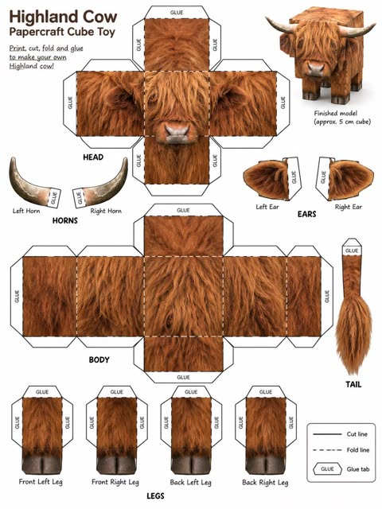</a>

提示词把上传照片限定为动物外观的唯一来源，并逐一列出平铺的各个部件及折线、粘合片和裁切边。结尾列出不得更改的内容，用来保住动物的身份特征和毛发质感。

GPT Image 2.5 · 上传图改图 · 出处: [@icreatelife on X](https://x.com/icreatelife/status/2101353488408006830) · 1,178 赞，统计于 2026-10-27

[`papercraft`](pages/zh/tags.md#tag-papercraft) [`cube-toy`](pages/zh/tags.md#tag-cube-toy) [`pet`](pages/zh/tags.md#tag-pet) [`template`](pages/zh/tags.md#tag-template) [`fur-texture`](pages/zh/tags.md#tag-fur-texture)

<details><summary><b>提示词</b></summary>

```text
Use my uploaded pet photo as the only source of the animal’s appearance. Create a realistic printable papercraft cube toy template of my pet, preserving 100% its identity and unique features: fur color, fur pattern, eyes, face shape, ears, body proportions, markings and expression.

Transform my pet into a handmade paper craft 3D model (low-poly cube style) like a DIY papercraft template. Show the unfolded cut-out template pieces laid flat on a white background: head, body, legs, ears and tail separated, with folding lines, tabs and cutting edges clearly visible.

The printed texture on the paper pieces must use my pet’s real fur texture and colors, so when assembled it becomes a small cube-shaped 3D figure of my exact pet.

Include:

cube-shaped head with my pet’s real face on it

cube-shaped body with realistic fur texture

four legs matching my pet’s appearance

ears with correct shape and inner ear details

tail matching my pet’s size and color pattern

Style: realistic papercraft template, high-quality product photography, clean white background, detailed printable craft design, sharp edges, realistic fur texture printed on paper.

Do not change my pet’s appearance. Do not turn it into a different animal, cartoon, plush toy or generic cat/dog. It must look like my actual pet converted into a cube papercraft model
```

</details>

**[全部 113 条](pages/zh/image-photo-to-art.md)**

<a id="img-architecture"></a>
## 建筑与室内

这一类的全部提示词和预览见 [agentcraft.dev](https://agentcraft.dev/zh/prompts/image/architecture/)

<a id="nano-banana-floor-plan-rising-miniature-diner"></a>
### 从建筑平面图中升起的复古餐厅微缩场景

<a href="https://x.com/AllaAisling/status/2029242137397678368">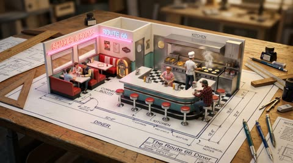</a>

模板先设定画在绘图桌上的平面图，再声明墙体既是线条也是实体隔断，让图纸与微缩场景融为一体。房间、家具、光线等占位变量加上绘图工具清单，让画面既具体又可复用。

Nano Banana 2 · 文生图 · 出处: [@AllaAisling on X](https://x.com/AllaAisling/status/2029242137397678368) · 547 赞，统计于 2026-10-28

[`floor-plan`](pages/zh/tags.md#tag-floor-plan) [`miniature`](pages/zh/tags.md#tag-miniature) [`architecture`](pages/zh/tags.md#tag-architecture) [`template`](pages/zh/tags.md#tag-template) [`blueprint`](pages/zh/tags.md#tag-blueprint)

<details><summary><b>提示词</b></summary>

```text
Prompt Studio: Architectural Floor Plan with Nano Banana 2 in Firefly

An architectural floor plan of {BUILDING_TYPE} spread across a drafting table, with the spaces rising into inhabitable miniature. {ROOM_1} emerges with {FURNITURE_1} and {ACTIVITY_1} in progress, {ROOM_2} rises with {DESIGN_ELEMENT} and {HUMAN_MOMENT}, {ROOM_3} pushes up with {DETAIL_1} and {LIGHTING_1}. Walls exist as both lines and actual partitions simultaneously. Sight lines marked on the plan become actual views between spaces. The mechanical systems in the plan, HVAC, plumbing, electrical, pulse with invisible function. Human circulation patterns appear as ghosted movement trails. Architectural scale figures become actual tiny inhabitants living their tiny lives. Section cuts reveal vertical relationships. The architect's tools surround: scales, pencils, trace paper. Golden design studio light, the plan as promise and proof, 8K, architecture as life container.

Check ALTs for ideas 👇
@AdobeFirefly
```

</details>

<a id="gpt-image-architectural-specimen-card-survey-landmark"></a>
### 长城建筑勘测标本卡

<a href="https://x.com/Naiknelofar788/status/2094626691234816034">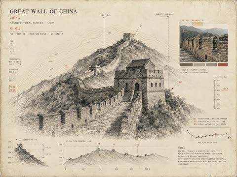</a>

以上传照片为参考，层级清晰：大幅单色墨线地标、一小块彩色照片细节、背后的等高线地图。限定调色并只用一个点缀色，只列少量小号档案式文字，再明确列出要避开的风格，让整张卡片保持克制的博物馆目录感。

GPT Image 2 · 上传图改图 · 出处: [@Naiknelofar788 on X](https://x.com/Naiknelofar788/status/2094626691234816034) · 512 赞，统计于 2026-10-28

[`architecture`](pages/zh/tags.md#tag-architecture) [`specimen-card`](pages/zh/tags.md#tag-specimen-card) [`archival`](pages/zh/tags.md#tag-archival) [`topographic-map`](pages/zh/tags.md#tag-topographic-map) [`ink-drawing`](pages/zh/tags.md#tag-ink-drawing)

<details><summary><b>提示词</b></summary>

```text
Use the uploaded photo as the primary reference. Create a sophisticated 4:3 landscape architectural specimen card inspired by museum archives, architectural surveys, and vintage scientific documentation.

Keep the original location recognizable, but transform the presentation into a curated architectural study rather than a normal travel poster.

* Place the main landmark as a large monochrome architectural cutout or finely detailed ink drawing.
* Add a smaller original-color photographic fragment showing one distinctive detail of the location.
* Include a simplified topographic contour map behind the architecture.
* Add tiny numbered reference points, measurement marks, arrows, elevation lines, and architectural annotation symbols.
* Use an aged cream paper background with subtle grain and imperfections.
* Palette: black, warm beige, muted olive, and one restrained accent color extracted from the landmark.
* Typography should be small, elegant, and archival: location name, country, year, No. 019, and 3 descriptive keywords.
* Create subtle imperfections resembling screen printing, drafting ink, pencil marks, and old paper.
* Keep generous negative space and a sophisticated museum-catalog aesthetic.

Important: Avoid postcard layouts, circular stamps, tourist graphics, excessive text, cartoon styling, glossy effects, 3D rendering, and overly detailed illustrations.

Overall mood:
architectural archive × museum specimen × old survey document × contemporary editorial design.
```

</details>

**[全部 24 条](pages/zh/image-architecture.md)**

<a id="img-map"></a>
## 地图

这一类的全部提示词和预览见 [agentcraft.dev](https://agentcraft.dev/zh/prompts/image/map/)

<a id="gpt-image-isometric-anime-world-map-diorama-poster"></a>
### 等距视角动漫世界地图微缩模型海报

<a href="https://x.com/TechieBySA/status/2091529289283866634"></a>

用分支条件分别处理虚构世界和真实地点，让同一模板能切出正确的地图轮廓。版面留白、标题层级和移轴摄影质感都有明确规则，成图风格统一，另可上传参考地图提高准确度。

GPT Image 2 · 文生图 · 出处: [@TechieBySA on X](https://x.com/TechieBySA/status/2091529289283866634) · 6,709 赞，统计于 2026-10-28

[`isometric`](pages/zh/tags.md#tag-isometric) [`diorama`](pages/zh/tags.md#tag-diorama) [`anime-world`](pages/zh/tags.md#tag-anime-world) [`miniature`](pages/zh/tags.md#tag-miniature) [`editorial-poster`](pages/zh/tags.md#tag-editorial-poster)

<details><summary><b>提示词</b></summary>

```text
Simply replace [ANIME]:✨

(Upload a reference image of the map for enhanced accuracy)

“Ultra-detailed photorealistic isometric miniature scale-model diorama of the world from [ANIME], floating on a pure off-white studio background with a soft drop shadow beneath.

If [ANIME] has a fictional world map: the diorama takes the exact silhouette shape of that fictional continent, island or region, extruded downward into a thick slab of raw rock and earth with rough natural cliff-like edges, like the world physically cut out and lifted. The shape matches the canonical map boundary precisely.

If [ANIME] is set in a real or semi-real world: the diorama takes the exact geographic silhouette shape of the primary city, region or country where the story is set, extruded into a thick rock slab with rough cliff edges.

The entire top surface faithfully recreates the complete world of [ANIME] with full anime accuracy: every region, city, landmark, building, terrain feature, road and environment in its exact canonical position as established in the show. Every iconic location is instantly recognizable to any fan — labeled with small readable location markers. The architecture, environment design, building styles, color palette and atmosphere must be completely faithful to the visual world of [ANIME] — not Western or generic realistic, but distinctly true to how this anime world looks and feels. Every location a fan would recognize is present and accurately placed.

Dense micro-detail throughout: tiny figures in show-accurate character designs and clothing, vehicles or creatures authentic to the world, individual trees and foliage, roads and paths between locations, flags and faction symbols, any distinctive environmental features unique to this anime world.

Style: hyper-realistic tilt-shift miniature photography — extremely sharp, everything in focus, no blur. Soft warm lighting from above, gentle diffuse shadows. Colors match the anime's authentic visual palette faithfully — rich, saturated and true to the show's identity.

Layout: the shaped diorama floats centered in the lower two-thirds of the frame, clear margins on all sides, never touching the frame edges. Upper third is empty off-white space with minimalist editorial typography, centered: small wide-tracked caps with the world or region name at the very top, then [ANIME] directly below in a bold condensed sans-serif in medium charcoal grey — large and dominant, the biggest text element, then small wide-tracked caps below with the studio name and year.

Minimalist editorial poster aesthetic, premium print quality, 4:5 aspect ratio.”
```

</details>

<a id="gpt-image-tv-show-world-isometric-map-diorama"></a>
### 电视剧世界等距地图微缩景观海报

<a href="https://x.com/TechieBySA/status/2091167214195847433"></a>

用一个可替换的剧名占位符，并按虚构或真实场景分支，让微缩景观贴合地图轮廓并挤出成岩石厚板。固定的版面把上方三分之一留白给宽字距小字和粗窄标题，海报更干净。

GPT Image 2 · 文生图 · 出处: [@TechieBySA on X](https://x.com/TechieBySA/status/2091167214195847433) · 2,678 赞，统计于 2026-10-28

[`isometric`](pages/zh/tags.md#tag-isometric) [`diorama`](pages/zh/tags.md#tag-diorama) [`tilt-shift`](pages/zh/tags.md#tag-tilt-shift) [`tv-show`](pages/zh/tags.md#tag-tv-show) [`template`](pages/zh/tags.md#tag-template)

<details><summary><b>提示词</b></summary>

```text
Simply replace [TV SHOW]:✨

“Ultra-detailed photorealistic isometric miniature scale-model diorama of the world from [TV SHOW], floating on a pure off-white studio background with a soft drop shadow beneath.

If [TV SHOW] has a fictional world map: the diorama takes the exact silhouette shape of that fictional continent or world, extruded downward into a thick slab of raw rock and earth with rough cliff-like edges. The top surface recreates the complete world geography exactly as established in the show — every region, kingdom, city, landmark, mountain range, forest and river in its correct canonical position.

If [TV SHOW] is set in the real world: the diorama takes the exact geographic silhouette shape of the real city, state or region where the show is primarily set, extruded into a thick rock slab. The top surface is filled entirely with locations, landmarks, routes and environments from the show rendered in the show's authentic color palette and visual atmosphere — not generic realistic geography but the world as it feels in the show.

In both cases: dense micro-detail throughout — tiny figures in show-accurate clothing, vehicles, buildings, roads, trees, all authentic to the show's world. Every iconic location a fan would recognize is present and accurately placed.

Style: hyper-realistic tilt-shift miniature photography — extremely sharp, everything in focus, no blur. Lighting and color palette match the show's visual identity exactly.

Layout: diorama floats centered in the lower two-thirds, clear margins all sides. Upper third is empty off-white space with minimalist editorial typography, centered: small wide-tracked caps with the location or world name at the very top, then [TV SHOW] in a bold condensed sans-serif in medium charcoal grey — large and dominant, then small wide-tracked caps below with network and year.

Minimalist editorial poster aesthetic, premium print quality, 4:5 aspect ratio.”
```

</details>

**[全部 15 条](pages/zh/image-map.md)**

<a id="img-collage"></a>
## 拼贴

这一类的全部提示词和预览见 [agentcraft.dev](https://agentcraft.dev/zh/prompts/image/collage/)

<a id="gpt-image-failed-photos-grid"></a>
### 任意角色的九宫格失败抓拍照

<a href="https://x.com/DeepBlueX0/status/2099481521983995971"></a>

要求生成九宫格失败照片，模型会主动加入运动模糊、手指遮挡、歪斜构图和抓拍瞬间的表情，整组看起来像真实相册。替换角色占位符即可复用模板。

GPT Image 2.5 · 文生图 · 出处: [@DeepBlueX0 on X](https://x.com/DeepBlueX0/status/2099481521983995971) · 2,646 赞，统计于 2026-10-27

[`grid`](pages/zh/tags.md#tag-grid) [`humor`](pages/zh/tags.md#tag-humor) [`template`](pages/zh/tags.md#tag-template)

<details><summary><b>提示词</b></summary>

```text
Vertical 3×3 failed photos × {Character}
```

</details>

<a id="gpt-image-chibi-clone-sticker-running-diary"></a>
### 跑步照片配Q版分身贴纸与手绘涂鸦

<a href="https://x.com/Emmma___0/status/2050922155676930544"></a>

先锁定真人照片的身份、服装和背景，再限定添加5到8个Q版分身，每个分身对应不同的跑步动作与情绪。贴纸白边、柔和阴影加上白粉色涂鸦和手写短句，形成手帐日记风格，同时避免遮挡人脸。

GPT Image 2 · 上传图改图 · 出处: [@Emmma___0 on X](https://x.com/Emmma___0/status/2050922155676930544) · 959 赞，统计于 2026-10-28

[`chibi`](pages/zh/tags.md#tag-chibi) [`sticker`](pages/zh/tags.md#tag-sticker) [`scrapbook`](pages/zh/tags.md#tag-scrapbook) [`fitness`](pages/zh/tags.md#tag-fitness) [`photo-edit`](pages/zh/tags.md#tag-photo-edit)

<details><summary><b>提示词</b></summary>

```text
Create a high-quality “chibi clone sticker diary photo” based on the uploaded real-life image. Preserve the original person’s identity, face, hairstyle, hair color, outfit, body proportions, pose, lighting, and background. Do not alter facial features or turn the subject into a full illustration—maintain a realistic photo look.
Analyze the scene as a fitness/running lifestyle moment. Add 5–8 chibi mini clones of the same person around the subject, designed in a consistent kawaii sticker style (big head, small body, large expressive eyes, clean digital finish). Each clone must clearly resemble the real person (same hair, outfit, colors).
Design each chibi with different running-related actions and emotions: jogging, stretching, drinking water, feeling tired, cheering, giving thumbs up, celebrating completion. Ensure all poses are unique and contextually relevant.
Render each chibi as a sticker with white outlines, soft shadows, and a slightly floating effect. Arrange them around the subject and edges without covering the face or main body.
Add light hand-drawn doodles (hearts, sparkles, arrows, motion lines, circles) in white with subtle pink accents, keeping a clean scrapbook diary feel.
Include 5–8 short handwritten-style phrases matching a fitness mood (cute, energetic, encouraging). Use mostly white text with slight pink highlights and small decorative marks.
Composition: keep the real person as the central focus, surrounded by chibi stickers and doodles. The result should feel like a polished, playful, high-resolution social media lifestyle diary image—clean, balanced, and visually rich without clutter.
```

</details>

**[全部 108 条](pages/zh/image-collage.md)**

<a id="img-edit"></a>
## 照片编辑

这一类的全部提示词和预览见 [agentcraft.dev](https://agentcraft.dev/zh/prompts/image/edit/)

<a id="nano-banana-charmander-ember-route-101"></a>
### 小火龙在日落道路上使用火花攻击

<a href="https://x.com/ProperPrompter/status/2027157212863631567"></a>

后续编辑保留第一轮的对战布局，只替换场景和两只宝可梦，改动集中且前后一致。在战斗文字中写明具体招式，能让招式特效与对话框内容对应。

Nano Banana 2 · 上传图改图 · 出处: [@ProperPrompter on X](https://x.com/ProperPrompter/status/2027157212863631567) · 4,659 赞，统计于 2026-10-29

[`pixel-art`](pages/zh/tags.md#tag-pixel-art) [`pokemon`](pages/zh/tags.md#tag-pokemon) [`game-ui`](pages/zh/tags.md#tag-game-ui) [`image-edit`](pages/zh/tags.md#tag-image-edit) [`photo-edit`](pages/zh/tags.md#tag-photo-edit) [`photo-restyle`](pages/zh/tags.md#tag-photo-restyle)

<details><summary><b>提示词</b></summary>

```text
nano banana 2

prompt: inspired by a classic pokemon gameboy screenshot but it's highly detailed beautiful pixel art, include cool effects from moves used, modern minimal ui

prompt: change it to a new location and the battle is two new random kanto pokemon
```

</details>

<a id="gpt-image-gym-selfie-chibi-minis-doodles"></a>
### 健身房自拍周围环绕Q版迷你分身

<a href="https://x.com/Ciri_ai/status/2050094437821513896"></a>

提示词先锁定原图不变，再逐条列出每个迷你分身的健身动作，让每个角色各不相同。白色与粉色手绘涂鸦的手账风格，加上逐条给出的手写短语，把叠加元素统一起来。

GPT Image 2 · 上传图改图 · 出处: [@Ciri_ai on X](https://x.com/Ciri_ai/status/2050094437821513896) · 3,471 赞，统计于 2026-10-29

[`chibi`](pages/zh/tags.md#tag-chibi) [`scrapbook`](pages/zh/tags.md#tag-scrapbook) [`doodle`](pages/zh/tags.md#tag-doodle) [`gym`](pages/zh/tags.md#tag-gym) [`selfie`](pages/zh/tags.md#tag-selfie) [`photo-edit`](pages/zh/tags.md#tag-photo-edit) [`doodle-edit`](pages/zh/tags.md#tag-doodle-edit)

<details><summary><b>提示词</b></summary>

```text
GPT Image 2 on Chatgpt

Prompt: Edit the image while keeping the original photo completely unchanged — including the person, face, body, pose, lighting, and gym background.

Add multiple small, cute chibi-style “mini versions” of her around the image. Each mini character should have a big head, expressive facial features, and match her hairstyle and outfit.

Depict each mini version doing different gym-related activities:

one cheering with arms raised

one running in running shoes

one drinking from a shaker bottle

one wearing sporty running glasses

one climbing near her leg

Enhance the image with playful, hand-drawn doodles and handwritten notes in white and pink ink, in a scrapbook style. Include elements like arrows, stars, hearts, sparkles, and sketchy lines.

Add cute, handwritten gym-themed motivational phrases:

“lift strong”

“stronger every rep”

“no pain no gain”

“sweat now, shine later”

“progress over perfection”

“train hard, stay soft”

The overall vibe should feel fun, energetic, and feminine.
```

</details>

**[全部 66 条](pages/zh/image-edit.md)**

<a id="recipes"></a>
## Agent 配方：剪视频

用大白话告诉编程 Agent 你要什么。每条配方记下交给 Agent 的原话和它实际跑的命令，换成你自己的素材即可。

<a id="bilingual-subtitles"></a>
### 听写台词，烧录中英双语字幕

**交给 Agent 的原话**

> 听写 samples/night-train-ticket.mp4 里的中文台词，对照 prompts/video/night-train-ticket.yaml 里的剧本校对，每句中文下面加一行英文，把字幕烧进画面。

Whisper 会听错中文同音字（他和她读音相同）。有剧本时，让 Agent 用剧本定文字，只用 Whisper 定时间。

[`agent-editing`](pages/zh/tags.md#tag-agent-editing) [`ffmpeg`](pages/zh/tags.md#tag-ffmpeg) [`whisper`](pages/zh/tags.md#tag-whisper) [`subtitles`](pages/zh/tags.md#tag-subtitles) [`bilingual`](pages/zh/tags.md#tag-bilingual) [`chinese-dialogue`](pages/zh/tags.md#tag-chinese-dialogue)

<details><summary><b>Agent 实际跑的命令</b> · Agent: Claude Opus 5.5 in Claude Code · 工具: ffmpeg 9 with libass, openai-whisper medium</summary>

```bash
whisper samples/night-train-ticket.mp4 --model medium --language zh --output_format srt
# whisper heard 我等了他八年 / 就等着一趟车; the script says 我等了她八年 / 就等这一趟车.
# The agent kept whisper's timing, took the wording from the script, and added English lines:
#   1  00:00:00,000 --> 00:00:02,100  我等了她八年， / I waited eight years for her,
#   2  00:00:02,200 --> 00:00:04,200  就等这一趟车。 / all for this one train.
ffmpeg -i samples/night-train-ticket.mp4 \
  -vf "subtitles=subs.srt:force_style='FontName=PingFang SC,FontSize=15,Outline=1,Shadow=0,MarginV=22'" \
  -c:v libx264 -crf 20 -c:a copy subtitled.mp4
```

</details>

<a id="readme-preview-gif"></a>
### 给 README 做小体积循环 GIF 预览

**交给 Agent 的原话**

> 给 samples/ 里每个 mp4 做一张 README 用的循环 GIF，每张控制在 1.5 MB 左右。超过 8 秒的片加速播放，保证整段故事都能看到。

本仓所有预览图都是这样做的，每张 0.5 到 2 MB。每段单独生成 96 色调色板加 Bayer 抖动，体积小，肤色和霓虹也不脏。

[`agent-editing`](pages/zh/tags.md#tag-agent-editing) [`ffmpeg`](pages/zh/tags.md#tag-ffmpeg) [`gif`](pages/zh/tags.md#tag-gif) [`preview`](pages/zh/tags.md#tag-preview)

<details><summary><b>Agent 实际跑的命令</b> · Agent: Claude Opus 5.5 in Claude Code · 工具: ffmpeg 9</summary>

```bash
# landscape: 360 px wide; vertical: 300 px tall; 2x speed when longer than 8 s
ffmpeg -i in.mp4 -vf "setpts=PTS/2,fps=8,scale=360:-2:flags=lanczos,split[a][b];[a]palettegen=max_colors=96[p];[b][p]paletteuse=dither=bayer:bayer_scale=4" -loop 0 out.gif
```

</details>

<a id="split-shots"></a>
### 按硬切点把多镜头片拆成单独镜头

**交给 Agent 的原话**

> samples/late-night-office.mp4 应该有九个镜头。找出硬切点，按镜头拆成单独文件，再给我一张分镜条，每个镜头取中间一帧。

也能当生成视频的验收：八个切点都落在提示词所写时间的 0.17 秒以内。软切换调低阈值，晃动大的手持素材调高阈值。

[`agent-editing`](pages/zh/tags.md#tag-agent-editing) [`ffmpeg`](pages/zh/tags.md#tag-ffmpeg) [`scene-detection`](pages/zh/tags.md#tag-scene-detection) [`storyboard`](pages/zh/tags.md#tag-storyboard) [`qa`](pages/zh/tags.md#tag-qa)

<details><summary><b>Agent 实际跑的命令</b> · Agent: Claude Opus 5.5 in Claude Code · 工具: ffmpeg 9</summary>

```bash
# 1. find cuts
T=$(ffmpeg -i samples/late-night-office.mp4 -vf "scdet=threshold=8" -f null - 2>&1 \
    | grep -o "lavfi.scd.time: [0-9.]*" | awk '{print $2}' | paste -sd, -)
# -> 3.04,5.04,6.0,6.54,7.0,7.46,9.67,12.17  (prompt asked for 3.0,5.0,6.0,6.5,7.0,7.5,9.5,12.0)
# 2. split, forcing keyframes at the cuts so every file starts clean
ffmpeg -i samples/late-night-office.mp4 -c:v libx264 -crf 20 -force_key_frames "$T" -c:a aac \
  -f segment -segment_times "$T" -reset_timestamps 1 shot_%02d.mp4
# 3. storyboard strip
for f in shot_*.mp4; do
  mid=$(ffprobe -v error -show_entries format=duration -of csv=p=0 "$f" | awk '{printf "%.3f", $1/2}')
  ffmpeg -ss "$mid" -i "$f" -frames:v 1 -vf scale=-2:320 "${f%.mp4}.jpg"
done
ffmpeg -pattern_type glob -i "shot_*.jpg" -vf "tile=9x1:padding=4:color=white" -frames:v 1 storyboard.jpg
```

</details>

<a id="teaser-montage"></a>
### 把不同尺寸的片剪成预告：标题、转场、响度统一

**交给 Agent 的原话**

> 用夜市小巷、面档、夜车三段的前 4.5 秒剪一支 720p 预告，片名 RAIN CITY。画面和声音都用半秒交叉淡化，开头压片名，响度按社交平台标准统一，结尾淡出。

输入有 864x480 和 1344x768 两种尺寸。每路先统一尺寸、帧率和采样率，否则 xfade 和 acrossfade 接不上。总长是 3 段 4.5 秒减去两次 0.5 秒重叠，共 12.5 秒。

[`agent-editing`](pages/zh/tags.md#tag-agent-editing) [`ffmpeg`](pages/zh/tags.md#tag-ffmpeg) [`montage`](pages/zh/tags.md#tag-montage) [`title-card`](pages/zh/tags.md#tag-title-card) [`loudness`](pages/zh/tags.md#tag-loudness)

<details><summary><b>Agent 实际跑的命令</b> · Agent: Claude Opus 5.5 in Claude Code · 工具: ffmpeg 9</summary>

```bash
ffmpeg -i samples/neon-night-market-alley.mp4 -i samples/hk-noodle-stall-1960s.mp4 -i samples/night-train-ticket.mp4 -filter_complex "
[0:v]trim=0:4.5,setpts=PTS-STARTPTS,scale=1280:720:force_original_aspect_ratio=increase,crop=1280:720,fps=24,format=yuv420p,setsar=1[v0];
[1:v]trim=0:4.5,setpts=PTS-STARTPTS,scale=1280:720:force_original_aspect_ratio=increase,crop=1280:720,fps=24,format=yuv420p,setsar=1[v1];
[2:v]trim=0:4.5,setpts=PTS-STARTPTS,scale=1280:720:force_original_aspect_ratio=increase,crop=1280:720,fps=24,format=yuv420p,setsar=1[v2];
[0:a]atrim=0:4.5,asetpts=PTS-STARTPTS,aresample=48000[a0];
[1:a]atrim=0:4.5,asetpts=PTS-STARTPTS,aresample=48000[a1];
[2:a]atrim=0:4.5,asetpts=PTS-STARTPTS,aresample=48000[a2];
[v0][v1]xfade=transition=fade:duration=0.5:offset=4[x1];
[x1][v2]xfade=transition=fade:duration=0.5:offset=8[x2];
[a0][a1]acrossfade=d=0.5[ax1];
[ax1][a2]acrossfade=d=0.5[ax2];
[x2]drawtext=fontfile=/System/Library/Fonts/Supplemental/Futura.ttc:text='RAIN CITY':fontcolor=white:fontsize=110:x=(w-tw)/2:y=h*0.70:alpha='if(lt(t,0.3),t/0.3,if(lt(t,2.0),1,if(lt(t,2.5),(2.5-t)/0.5,0)))',fade=t=in:st=0:d=0.4,fade=t=out:st=12.1:d=0.4[v];
[ax2]loudnorm=I=-16:TP=-1.5:LRA=11,afade=t=out:st=12:d=0.5[a]" \
  -map "[v]" -map "[a]" -c:v libx264 -crf 20 -c:a aac -b:a 160k -ar 48000 teaser.mp4
```

</details>

<a id="vertical-blur-fill"></a>
### 横屏片改竖屏，背景用模糊填充

**交给 Agent 的原话**

> 把 samples/night-train-ticket.mp4 做成 1080x1920 的竖屏版发抖音。原画面完整放在中间，上下用同一段视频的模糊压暗版本填满，保留原音轨。

一条 ffmpeg 命令，5 秒片在 M 系列 Mac 上 1.5 秒跑完。主体横跨整个画面时用这种填充；主体在正中时直接裁切更好。

[`agent-editing`](pages/zh/tags.md#tag-agent-editing) [`ffmpeg`](pages/zh/tags.md#tag-ffmpeg) [`vertical`](pages/zh/tags.md#tag-vertical) [`reframe`](pages/zh/tags.md#tag-reframe)

<details><summary><b>Agent 实际跑的命令</b> · Agent: Claude Opus 5.5 in Claude Code · 工具: ffmpeg 9</summary>

```bash
ffmpeg -i samples/night-train-ticket.mp4 -filter_complex "
  [0:v]scale=1080:1920:force_original_aspect_ratio=increase,crop=1080:1920,gblur=sigma=40,eq=brightness=-0.08[bg];
  [0:v]scale=1080:-2[fg];
  [bg][fg]overlay=(W-w)/2:(H-h)/2,format=yuv420p" \
  -c:v libx264 -crf 20 -c:a copy vertical.mp4
```

</details>

<a id="guides"></a>
## 指南与 skill

### 官方提示词指南

- [MiniMax H3 prompt-writing skill](https://github.com/MiniMax-AI/MiniMax-H3/tree/main/.claude/skills/h3-prompt-writing): 官方 Agent skill，把一句想法改写成 H3 的结构化提示词格式。本地跑 H3 用上它效果差别很大。
- [OpenAI image prompting guide](https://developers.openai.com/api/docs/guides/image-prompting): 针对 GPT Image 2.6：什么时候选 Flare、什么时候选 Sunburst，怎么从 2.5 迁移，写法基础，以及生成、编辑、多轮修改的示例。
- [Gemini Omni prompt guide](https://deepmind.google/models/gemini-omni/prompt-guide/): 对话式编辑、换机位、多路参考、续写、首尾帧。
- [Kling 4.0 user guide](https://kling.ai/quickstart/kling-4-model-user-guide): 30 秒单条、最多 15 份参考素材、10 张关键帧、用提示词改视频、8000 token 长提示词。
- [Kling VIDEO 3.0 user guide](https://app.klingai.com/global/quickstart/klingai-video-3-model-user-guide): 多镜头、主体绑定、多语种对白、方言口音、文字渲染、15 秒长镜头。
- [Veo 3 prompt guide](https://deepmind.google/models/veo/prompt-guide/): 引号写台词、声音提示、动作戏的逐拍长提示词。
- [Ultimate prompting guide for Veo 3.1](https://cloud.google.com/blog/products/ai-machine-learning/ultimate-prompting-guide-for-veo-3-1): 五段式公式、带时间戳的多镜头写法，以及配合 Nano Banana 的首尾帧和多素材工作流。

### 社区 skill 与案例库

- [LearnPrompt/awesome-seedance](https://github.com/LearnPrompt/awesome-seedance): 最大的 Seedance 2.0 / 2.5 案例库，840 多条，每条都能追到原帖。
- [SkyNotSilent/awesome-MiniMax-H3-cases](https://github.com/SkyNotSilent/awesome-MiniMax-H3-cases): 几千个可直接播放的 MiniMax H3 案例，标明哪些公开了完整提示词。
- [dexhunter/seedance2-skill](https://github.com/dexhunter/seedance2-skill): 写 Seedance 提示词的 Agent skill。
- [liyue-aigc/seedance-2-5-video-director](https://github.com/liyue-aigc/seedance-2-5-video-director): Seedance 2.5 导演 skill：脚本、人物锁定、续写、编辑、转场。
- [T8mars/minimax-h3-prompt-skill-T8](https://github.com/T8mars/minimax-h3-prompt-skill-T8): MiniMax H3 和 Seedance 的提示词案例与可安装 skill。
- [smixs/visual-skills](https://github.com/smixs/visual-skills): 给 Agent 的电影导演 skill，从戏剧结构、走位到各模型的提示词语法。
- [UnderleveledBuilder/awesome-short-drama-skills](https://github.com/UnderleveledBuilder/awesome-short-drama-skills): AI 短剧、漫剧 skill 精选，从剧本、分镜到视频提示词。
- [joeseesun/opus-video-prompts](https://github.com/joeseesun/opus-video-prompts): 用 Claude Opus 5.5 写代码渲染视频的案例和提示词。

<a id="threed"></a>
## 用 Agent 做 3D

用编程 Agent 搭 3D 场景的配方（Blender MCP、three.js）正在整理。

<a id="tags"></a>
## 按标签浏览

[`portrait`](pages/zh/tags.md#tag-portrait) 237 · [`fashion`](pages/zh/tags.md#tag-fashion) 160 · [`multi-shot`](pages/zh/tags.md#tag-multi-shot) 133 · [`anime`](pages/zh/tags.md#tag-anime) 130 · [`template`](pages/zh/tags.md#tag-template) 125 · [`typography`](pages/zh/tags.md#tag-typography) 116 · [`cinematic`](pages/zh/tags.md#tag-cinematic) 113 · [`handheld`](pages/zh/tags.md#tag-handheld) 107 · [`editorial`](pages/zh/tags.md#tag-editorial) 98 · [`golden-hour`](pages/zh/tags.md#tag-golden-hour) 93 · [`dialogue`](pages/zh/tags.md#tag-dialogue) 92 · [`photorealistic`](pages/zh/tags.md#tag-photorealistic) 87 · [`character-consistency`](pages/zh/tags.md#tag-character-consistency) 85 · [`reference-image`](pages/zh/tags.md#tag-reference-image) 81 · [`fantasy`](pages/zh/tags.md#tag-fantasy) 76 · [`christmas`](pages/zh/tags.md#tag-christmas) 76 · [`macro`](pages/zh/tags.md#tag-macro) 75 · [`photo-edit`](pages/zh/tags.md#tag-photo-edit) 69 · [`infographic`](pages/zh/tags.md#tag-infographic) 69 · [`storyboard`](pages/zh/tags.md#tag-storyboard) 65 · [`vlog`](pages/zh/tags.md#tag-vlog) 65 · [`json-prompt`](pages/zh/tags.md#tag-json-prompt) 64 · [`collage`](pages/zh/tags.md#tag-collage) 62 · [`action`](pages/zh/tags.md#tag-action) 59 · [`selfie`](pages/zh/tags.md#tag-selfie) 59 · [`reference-images`](pages/zh/tags.md#tag-reference-images) 55 · [`miniature`](pages/zh/tags.md#tag-miniature) 55 · [`comedy`](pages/zh/tags.md#tag-comedy) 52 · [`food`](pages/zh/tags.md#tag-food) 50 · [`travel-poster`](pages/zh/tags.md#tag-travel-poster) 49

**[全部 3129 个标签](pages/zh/tags.md)**

<a id="contributing"></a>
## 投稿

1. 在 `prompts/video/` 或 `prompts/image/` 下加一个 YAML 文件，照任意现有条目的格式写。
2. 附上提示词和成片最初发布的帖子或页面链接，并署上作者。
3. 运行 `python scripts/build.py` 重新生成两份 README，再提 PR。
4. 看不到成片、查不到出处的条目会被关闭，推广链接会被关闭。

## 同一维护者的其他清单

- [awesome-prompts](https://github.com/ai-boost/awesome-prompts)：大模型与 Agent 提示词
- [awesome-harness-engineering](https://github.com/ai-boost/awesome-harness-engineering)：搭建可靠的 Agent harness

## 许可证

仓库代码和说明文字：GPL-3.0。提示词和视频归原发布者所有，本仓注明出处后链接或引用。
