<div align="center">

<h1>Awesome Image & Video Prompts</h1>

<p>主流 AI 视频和图片模型的提示词，拿来就能用。每条都附真实成品和出处链接。另有用 Agent 剪视频的配方。</p>

<p><a href="README.md">English</a> · <b>简体中文</b></p>

<p>在<a href="https://agentcraft.dev/zh/prompts/">在线画廊</a>里搜索、筛选、一键复制</p>

<p><a href="https://awesome.re"></a></p>

<a href="#seedance-seoul-subway-revenge"></a> <a href="pages/zh/video-wan30.md#wan-time-space-train"></a> <a href="pages/zh/video-minimaxh3.md#h3-starship-hyperspace-jump"></a> <a href="pages/zh/video-geminiomniflash.md#omni-four-style-progression"></a> <a href="pages/zh/video-kling30.md#kling-moonlit-garden-run"></a> <a href="#veo-off-road-rally"></a> 

</div>

> 本仓原名 **Awesome-GPTs**，原来的 GPTs 清单保存在 [legacy/awesome-gpts_zh.md](legacy/awesome-gpts_zh.md)。

## 目录

- [最近新增](#recent)
- [视频提示词](#video) (343 条)
  - [Wan 3.0](#wan30) (18)
  - [MiniMax H3](#minimaxh3) (80)
  - [Seedance 2.5](#seedance25) (146)
  - [Gemini Omni Flash](#geminiomniflash) (26)
  - [Kling 4.0](#kling40) (26)
  - [Kling 3.0](#kling30) (28)
  - [Veo 3.1](#veo31) (10)
  - [Veo 3](#veo3) (5)
  - [Sora 2](#sora2) (4)
- [图片提示词](#image) (434 条)
  - [海报与编辑排版](#img-poster) (81)
  - [信息图与幻灯片](#img-infographic) (27)
  - [手机与界面截图](#img-ui-mockup) (14)
  - [产品图与电商](#img-product) (9)
  - [标志、广告与包装](#img-brand) (11)
  - [写实照片](#img-realism) (15)
  - [人像](#img-portrait) (96)
  - [角色与手办](#img-character) (29)
  - [插画](#img-illustration) (41)
  - [漫画与分镜](#img-comic) (9)
  - [照片转艺术风格](#img-photo-to-art) (38)
  - [建筑与室内](#img-architecture) (7)
  - [地图](#img-map) (5)
  - [拼贴](#img-collage) (30)
  - [照片编辑](#img-edit) (22)
- [Agent 配方：剪视频](#recipes) (5 条)
- [指南与 skill](#guides)
- [用 Agent 做 3D](#threed)
- [按标签浏览](#tags)
- [投稿](#contributing)

<a id="recent"></a>
## 最近新增

- 2026-10-28 · [等距视角动漫世界地图微缩模型海报](#gpt-image-isometric-anime-world-map-diorama-poster) · GPT Image 2
- 2026-10-28 · [笔记本屏幕上Photo Booth里的昏暗卧室自拍](#gpt-image-macbook-screen-photo-booth-selfie) · GPT Image 2
- 2026-10-28 · [适用任意城市的扁平矢量旅行海报模板](#gpt-image-flat-vector-city-travel-poster-template) · GPT Image 2
- 2026-10-28 · [电视剧世界等距地图微缩景观海报](#gpt-image-tv-show-world-isometric-map-diorama) · GPT Image 2
- 2026-10-28 · [九重葛拱门下地中海庭院里的两位女性](#gpt-image-bougainvillea-archway-courtyard-portrait) · GPT Image 2.5
- 2026-10-28 · [地中海庭院九重葛拱门下的女子](#gpt-image-mediterranean-archway-y2k-flash-courtyard) · GPT Image 2.5
- 2026-10-28 · [透过敞开车门拍摄的千禧年代胶片抓拍](#gpt-image-car-door-clifftop-2000s-film-snapshot) · GPT Image 2.5
- 2026-10-28 · [车内视角的2000年代初胶片风海边抓拍](pages/zh/image-portrait.md#gpt-image-car-door-coastal-film-snapshot) · GPT Image 2.5
- 2026-10-28 · [电梯镜面自拍加Q版贴纸涂鸦](#gpt-image-selfie-chibi-sticker-doodle-edit) · GPT Image 2
- 2026-10-28 · [灰度3D家务步骤说明图网格](#gpt-image-grayscale-3d-household-chores-step-grid) · GPT Image 2
- 2026-10-28 · [企业黑色复仇惊悚六格分镜板](#gpt-image-corporate-noir-teaser-storyboard-six-panels) · GPT Image 2
- 2026-10-28 · [跑步照片配Q版分身贴纸与手绘涂鸦](#gpt-image-chibi-clone-sticker-running-diary) · GPT Image 2

<a id="video"></a>
## 视频提示词

下面每条提示词都原样摘自出处：模型厂商自己的指南或模型卡，或创作者在 X 上附带成片发布的帖子。点缩略图看带声音的原片。分组顺序按 [Artificial Analysis 视频榜](https://artificialanalysis.ai/video/leaderboard/text-to-video)排名，创作者帖子按点赞数排序，点赞数以标注日期为准。

<a id="wan30"></a>
## Wan 3.0

<a id="wan-fashion-face-closeup-flash-orbit"></a>
### 带抓拍闪光的超近景时尚人像

<a href="https://x.com/leaf_sanren/status/2105645639703183753"></a>

提示词把15秒拆成五个时间段，每段写明运镜、眼神和闪光时机。同时列出真实的皮肤瑕疵并禁止塑料感，让人脸保持摄影质感。

Wan 3.0 · 文生视频 · 出处: [@leaf_sanren on X](https://x.com/leaf_sanren/status/2105645639703183753) · 1,439 赞，统计于 2026-10-27

[`portrait`](pages/zh/tags.md#tag-portrait) [`fashion`](pages/zh/tags.md#tag-fashion) [`close-up`](pages/zh/tags.md#tag-close-up) [`skin-texture`](pages/zh/tags.md#tag-skin-texture) [`vertical`](pages/zh/tags.md#tag-vertical)

<details><summary><b>提示词</b></summary>

```text
Generate this video: Create a 15-second, 9:16 vertical screen, ultra-high-definition 4K, 30fps, cinematic realistic portrait quality fashion portrait short film.

The main subject of the frame is a young Asian woman around 20-25 years old, with a high-end face—cool with a touch of youthful greenness, delicate features but not overly perfect, smooth facial contours, natural nose bridge, full lips, eyes with depth, overall vibe like a car model or a close-up candid shot by a photographer at a fashion event.
No influencer vibe, no exaggerated plastic surgery face, no plastic skin, no excessive skin smoothing, no overly heavy fake lashes, no exaggerated highlights, no anime feel.
The character's skin must be realistic: clearly visible pores, subtle skin texture, light foundation caking, faint acne marks, very shallow pockmarks, under-eye fine lines, natural contours on nose wings and cheeks, lip lines, a few stray hairs and hair edge wisps. Makeup is refined but imperfect high-end subtle look: base slightly adherent but not flawless, clean eye makeup, naturally realistic lashes, lips with a subtle sheen.
Hair is black or dark brown straight long hair, with natural stray strands and a slight messy feel, not too deliberate.

Scene and Atmosphere

Scene is a high-end fashion event venue / auto show activity area / luxury brand launch event close-up portrait atmosphere, but the background must be blurred, not highlighting specific brands or text. Background can include soft exhibition hall lighting, minimal out-of-focus neon reflections, blurred crowds, blurred car body highlight reflections or metallic texture backgrounds, overall atmosphere high-end, restrained, fashionable.
No subtitles, no stickers, no watermarks, no readable text, no exaggerated effects, no illogical flashy lights.

Lighting Requirements

Lighting must conform to real-world logic, like a real photographer shooting close-up at the event site.
Main light is soft but directional facial key light, coming from slightly off to the front upper side, creating natural facial light and shadow layers.
Fill light is very subtle, retaining some shadows to enhance facial dimensionality.
Environment can include soft cool-toned rim light or auto show site reflection light to make the face more three-dimensional.
Throughout, allow 2 to 3 brief flash occurrences; flashes must feel like natural on-site photography flashes, quickly lighting up only in certain moments, causing temporary enhancement of facial highlights, more obvious pupil catchlights, brighter skin reflections, but no constant strobing, no illogical flashing.
When flashes occur, it should feel like a photographer's candid shot: lights up once and done, realistic light ratios, face not overexposed, skin details still visible.

Camera and Movement (Top-Tier Cinematography)

Overall, use ultra-close portrait movement, with the lens always orbiting the face to highlight eyes, nose bridge, lips, cheeks, hair strands, and skin texture.
Cinematography language is high-end, fluid, restrained, with a fashion ad and backstage photography candid feel.
No heavy shaky cam, no disorienting motion, no exaggerated AI camera moves, no sudden pull-backs.
Movement must feel natural, like a high-end photographer using a handheld gimbal or slight handheld shooting:

0-3 seconds

Lens starts with an ultra-close side-front face push-in, focus on eyes and nose bridge area, subject slightly lifts gaze to lens, natural breathing feel, lips subtly relaxed.
Lens does an extremely subtle slow push-in, with very light lateral sliding, showcasing cheeks, under-eye texture, and hair strands.
This segment should make viewers feel the face's high-end realism right from the first glance.

3-6 seconds

Lens slides along the face from eyes to nose tip, then to near the lips, in an extremely steady micro-arc orbit, close-up observation of features.
Subject's gaze subtly shifts, no exaggerated acting—just gently looks toward lens edge, then slowly back to lens.
First flash can occur here, briefly lighting up to enhance skin texture and lip highlights.

6-9 seconds

Lens slowly turns from front-left to front-right, still maintaining face-push distance, emphasizing cheek skin texture, nose wing details, lower eyelid fine lines, lashes, and pupil reflections.
Subject lightly brushes a bit of hair, or a stray strand naturally falls to the side of the face.
Lens has a subtle breathing-like float for real photography feel, not rigid.

9-12 seconds

Lens subtly shifts down to highlight lips, jawline, and cheeks, then slowly back to eyes.
Subject's expression stays cool, restrained, with a touch of high-end aloofness, like a car model caught close-up by a photographer, occasionally a gentle blink, corners of mouth with extremely subtle relaxation.
Second flash occurs here, natural and instantaneous like on-site candid, returning to normal light after.
Post-flash, catchlights in eyes more prominent, giving the frame more fashion editorial vibe.

12-15 seconds

Lens does one of the most beautiful ultra-close light arc closes, subtly orbiting the face and lightly pushing in, finally settling on an ideal composition of eyes + nose bridge + half lips.
Subject gently lifts gaze to straight-on lens in the last second, eyes clean, calm, captivating.
Ending can have a third very subtle flash or environmental highlight sweep, but must feel natural, not overdone.
Finally holds on a high-end face-push frame perfect for a thumbnail cover.

Frame Style

Overall style is:
Real cinematic fashion portrait, close-up commercial photography, auto show model face-close candid, high-end magazine feel, natural skin texture, non-studio fake-face sense.
Include real lens bokeh, natural depth of field, fine skin quality, subtle on-site feel, restrained high-end vibe.
Not influencer selfie, not live stream, not Korean-style skin smoothing, not low-quality AI face.

Key Emphases

Face must be real, not fake

Skin can't be overly perfect, retain subtle imperfections

Features stable, no distortion

Eyes can't wander, lips can't move randomly

Hair strands must be real, with stray hairs

Flashes must follow real candid logic

Lighting must be real, no random strobing

Camera must be high-end, smooth, cinematic, fashion photography feel

Whole piece centers on "high-end face close-up showcase," no plot, no big movements

Negative Restrictions (Suggest Adding Together)

Negative prompts:
Cartoonish feel, CG feel, plastic skin, excessive smoothing, over-beautification, feature distortion, eye misalignment, skin wax figure feel, overexposure, illogical flash strobing, face shake, low clarity, low-quality hair strands, exaggerated filters, influencer face, overly heavy fake lashes, heavy makeup, shaky lens, limb distortion, cluttered background, readable text, subtitles, stickers, watermarks,
```

</details>

<a id="wan-marina-night-out-quay-leap"></a>
### 夜晚码头闺蜜同游与跳水

<a href="https://x.com/mightyking/status/2091842964054212842"></a>

先写风格、角色和场景,再用带时间戳的分镜表,每个片段单独指定运镜,如倒退跟拍、甩镜下摇和俯拍。单独的音频段要求现场同期声且无音乐,强化手机随拍的真实感。

Wan 3.0 · 文生视频 · 出处: [@mightyking on X](https://x.com/mightyking/status/2091842964054212842) · 1,353 赞，统计于 2026-10-27

[`ugc`](pages/zh/tags.md#tag-ugc) [`handheld`](pages/zh/tags.md#tag-handheld) [`night`](pages/zh/tags.md#tag-night) [`shot-list`](pages/zh/tags.md#tag-shot-list) [`sync-sound`](pages/zh/tags.md#tag-sync-sound)

<details><summary><b>提示词</b></summary>

```text
Raw vertical phone video (UGC), handheld throughout, filmed by a friend who walks with the group, casual sway, natural night lighting, wide-angle lens, deep focus.

Characters

The hero is a young woman with long dark hair in a deep-purple one-shoulder dress with a small shoulder bag.

Her three friends: one in a dark brown dress, a blonde in a black wrap dress, a blonde in a white mini dress — party dresses and sandals.

Laughing, spontaneous night-out energy.

Setting

A luxury marina at night — a stone quay along a narrow water slip flanked on both sides by large moored luxury yachts, big white hulls rising on either side, masts and rigging above, fenders on the hulls.

Warm orange street lamps, palm trees, distant city lights.

The yachts glow with blue-turquoise underwater LED lights spilling into the water; a yellow mooring line runs to the stone.

Shot list

0.0s–4.0s — Wide tracking shot, eye level, camera moving backward
The camera walks backward ahead of the four women as they stroll toward it down the marina promenade, framed head-to-toe, laughing and chatting in French; warm lamplight and palm trees behind, slight handheld bob.

4.0s–6.0s — Medium shot, eye level, backward track + quick left pan
The woman in the purple dress surges ahead of the group toward the lens, one arm raised, hair flying; the camera, on their left, keeps tracking back and pans to hold her.

6.0s–8.0s — Medium-wide, camera tilts down-left to follow, whip motion
She reaches the quay edge between the moored luxury yachts and launches headfirst over the edge; the handheld camera whips left and tilts down to chase her off the stone.

8.0s–10.0s — High-angle wide, looking down at the water, slight jolt
From up on the quay the camera looks down as she plunges headfirst into the blue-turquoise water in the slip between the big yacht hulls — a big splash, the underwater lights glowing around the impact; the handheld frame jolts slightly with the motion.

10.0s–13.0s — High-angle medium, looking down, small handheld drift
She surfaces in the teal water, gasping and laughing up at the camera, hair slicked back, treading water.

13.0s–16.0s — Handheld tilt up and back down, slight zoom
The camera lifts off the water and tilts up to a person leaning on the deck railing of one of the moored luxury yachts, watching her in the water, then tilts back down and zooms slightly in on her still treading and laughing.

16.0s–20.0s — High-angle medium, tilting to follow her up
She swims to the stone quay wall, reaches up and grabs a thick dark mooring pole, and hauls herself out; the camera tilts upward with her as she rises from the water, legs braced on the stone.

20.0s–23.0s — Low/close medium at the quay edge, static handheld
She climbs onto the stone lip, rolls onto her side, soaked dress clinging, then pushes up to her feet; the camera holds close, catching the water running off her.

23.0s–27.0s — Medium shot, eye level, loose handheld reframe
Back on the promenade, dripping wet, she flips her long wet hair forward and wrings it out, laughing, as her friends and passing pedestrians move behind her.

27.0s–30.0s — Medium shot, eye level, camera settles
Still dripping, she straightens up and strikes a confident, playful pose for the camera — hand on hip, tossing her wet hair back with a big smile — her friends laughing around her; the camera holds on the pose to end.

Audio

Live sync sound — friends laughing and shouting excitedly in French, a scream at the leap, a big water splash, water sloshing against the yacht hulls, wet footsteps on stone, ambient night marina sounds.
No music.

Style

Raw amateur vertical phone footage, natural night lighting, warm street lamps mixing with the turquoise underwater yacht glow, authentic handheld motion.
```

</details>

<a id="wan-camera-angle-swap"></a>
### 动作不变，换机位重拍你的视频

<a href="https://x.com/Framer_X/status/2101324357108658433"></a>

上传一段连续镜头作动作参考，Wan 从新角度重拍；某个镜头跑偏就重生成。

Wan 3.0 · 视频编辑 · 出处: [@Framer_X on X](https://x.com/Framer_X/status/2101324357108658433) · 1,170 赞，统计于 2026-10-27

[`camera-angle`](pages/zh/tags.md#tag-camera-angle) [`video-reference`](pages/zh/tags.md#tag-video-reference) [`workflow`](pages/zh/tags.md#tag-workflow)

<details><summary><b>提示词</b></summary>

```text
STEP 1: Upload your video (must be continuous one shot) to any platform that supports WAN 3.0

STEP 2: Use the prompt below (adjust it to your video):

"Use the original video @ TAG ORIGINAL VIDEO as the exact action reference

0–1s: Camera stays exactly as in the original video as the wolf walks toward the scooter.

1–3s: Hard cut to a tight front close-up as the wolf continues walking toward and reaches the scooter.

3–5s: Hard cut to a high angle above as the wolf as he gets onto the scooter and starts riding.

5–7s: Hard cut to a full shot as the wolf rides the scooter down the street.

7–9s: Hard cut to a side tracking shot as he keeps riding down the street.

9-10s: Hard cut to an over the shoulder shot as he rides forward and notices the banana peel in his path.

10–12s: hard cut to a birds eye view shot as the fallen wolf is rolling over the asphalt.

12-13s : hard cut to an insert shot of his fist as wolf slams it into the asphalt.

Only the camera angle and framing change. Make sure every action, movement, timing and performance exactly identical to the original video @ TAG ORIGINAL VIDEO. The action continues seamlessly across every cut."

NOTE: If some scenes didn't work (action was different than original video) simply regenerate the video, that usually fixes the problem.
```

</details>

<a id="wan-cafe-camel-coat-character-sheet"></a>
### 咖啡馆柜台前身穿驼色大衣的男人

<a href="https://x.com/ivanka_humeniuk/status/2113582628024566084"></a>

先用一张参考图生成三视图角色设定板，左侧为正面和背面全身，右侧为一张细致的头像。正面全身的脸被有意虚化，让头像成为唯一的面部参考，同时写清服装、面料和胶片质感，让角色在多个场景中保持一致。

Wan 3.0 · 参考生视频 · 出处: [@ivanka_humeniuk on X](https://x.com/ivanka_humeniuk/status/2113582628024566084) · 878 赞，统计于 2026-10-27

[`character-consistency`](pages/zh/tags.md#tag-character-consistency) [`reference-sheet`](pages/zh/tags.md#tag-reference-sheet) [`cafe`](pages/zh/tags.md#tag-cafe) [`film-look`](pages/zh/tags.md#tag-film-look) [`romance`](pages/zh/tags.md#tag-romance)

<details><summary><b>提示词</b></summary>

```text
Create a three-panel character reference sheet of the woman in
@image1
 in a single wide 16:9 image.
Preserve her exact facial identity, blue eyes, dark espresso-brown hair color, skin tone and natural facial
proportions from
@image1
.
The left half contains two full-body views side by side: front and back, identical in scale, with both figures
completely visible from above the bun to below the shoes. The right half contains one large
head-and-shoulders portrait, facing directly into the camera. All three views share one continuous neutral
mid-grey studio backdrop, matching soft lighting and the same warm film color treatment.
In the full-body front view, replace the facial features with a smooth, softly blurred skin-toned oval. Keep the
hairstyle and head silhouette intact. The large portrait on the right is the only detailed face reference.
Restyle her exceptionally long, thick hair into a high, generously sized, loosely sculpted bun at the crown.
Preserve the fullness of her hair, with lifted roots and soft volume around the head. Two delicate curved
tendrils fall beside her temples toward her jaw, framing the outer edges of her face. Her eyebrows, blue eyes
and cheekbones remain clearly visible. The back view shows the gathered hair and the substantial rounded
shape of the bun. The hairstyle feels elegant and practical, like a beautiful café waitress in a romantic film
from around 2000.
Dress her in a fitted ivory fine-knit top with short sleeves and a modest scoop neckline, tucked into a
high-waisted black tailored pencil skirt ending at the knees. The skirt has a small functional back vent. Over it,
she wears a short deep-burgundy cotton waist apron, extending from the waist to mid-thigh, with two discreet
rectangular front pockets. Narrow apron ties wrap around her waist and form a neat bow at the center of her
back, clearly visible in the rear view. Her shoes are simple black leather ballet flats with gently rounded toes
and low flat heels. Small plain gold stud earrings complete the outfit.
Her figure is tall and slender, with a defined narrow waist, long legs and a graceful neck. The clothing follows
her natural proportions, with realistic knit texture, tailored seams and soft cotton folds around the apron ties.
02
The same outfit, fit, hem lengths and hairstyle appear in all three views.
In the front view she stands upright, square to the camera, shoulders level, weight evenly balanced, arms
relaxed at her sides and hands empty. The back view shows the identical stance turned fully away. In the
portrait her head is upright, chin level and both eyes look directly into the lens. Her lips are gently closed with
a faint, relaxed smile. Preserve the recognizable face from
@image1
, with natural skin texture, visible pores
and fine facial hairs.
Soft frontal studio lighting keeps her features and clothing clearly readable, with gentle shading under the
chin and soft contact shadows beneath the shoes. The grey backdrop remains plain throughout the image.
The composition consists entirely of the three views and the seamless backdrop.
Maintain a glamorous late-1990s to early-2000s 35mm film publicity look: warm natural skin, creamy ivory
fabric, rich burgundy cotton, deep readable blacks, fine organic grain and restrained highlight glow. Her face,
blue eyes, hair strands and garment details remain clearly resolved. Clean presentation with uninterrupted
backdrop between the views.

📌 PROMPT 2 (Guy map):
Create a three-panel character reference sheet of the man in
@image1
 in one wide 16:9 image. Preserve his
exact face, eye color, skin tone, facial proportions and hairstyle from the reference, including the natural
swept-back waves and the loose strand near his forehead.
The left half of the image contains two full-body figures side by side: a straight-on front view and a complete
back view, identical in scale, both visible from above the hair to below the shoes. The right half contains one
large head-and-shoulders portrait looking directly into the camera, with his entire hairstyle inside the frame.
All three views share one continuous neutral mid-grey studio backdrop.
On the full-body front figure, replace the facial features with a smooth, softly blurred skin-toned oval,
retaining the head silhouette and hair. The large portrait on the right is the single detailed face reference.
He is tall, approximately 188 cm, with broad shoulders, a lean athletic build, a defined waist and long legs. His
proportions remain natural and identical across all three views.
Dress him in an elegant camel-colored wool-and-cashmere overcoat reaching just below the knees. The coat
has broad notched lapels, softly structured shoulders, a single-breasted three-button front, discreet welt
pockets and a single center-back vent. He wears it fully unbuttoned, its front panels hanging naturally to
reveal the clothing underneath. The fabric is substantial, softly brushed and richly textured, with realistic
weight and long vertical folds.
Under the overcoat, he wears a dark chocolate-brown tailored wool blazer with a two-button front, worn
unbuttoned, over a pale-blue cotton shirt with a pointed collar and the top button undone. The shirt is tucked
neatly into high-waisted charcoal-grey wool trousers with a single pleat on each side, a relaxed straight leg
and a slight break over the shoes. A dark-brown leather belt with a small brushed-metal buckle completes the
waist.
His shoes are polished dark-brown leather penny loafers with matching dark socks. A slim rectangular gold
wristwatch on a dark-brown leather strap sits on his left wrist, partly visible beneath the cuff. The styling has
04
the understated elegance of a wealthy young man in a romantic film set around 2000.
In both full-body views, he stands upright with shoulders level, weight evenly balanced and arms relaxed
slightly away from his sides so the coat silhouette remains readable. His hands are empty. The back view
shows the coat's full length, center seam, vent and natural drape.
In the large portrait, his face is strictly frontal, head upright, chin level and both eyes directed into the lens.
His lips are relaxed and closed. Preserve the exact facial structure, subtle beard shadow and natural skin
texture visible in
@image1
. The portrait includes the camel coat lapels, brown blazer and pale-blue shirt
collar.
Soft, even studio lighting keeps his face and all clothing details clearly readable, with gentle facial shading,
broad highlights on the wool and soft contact shadows beneath both pairs of shoes. The backdrop is plain and
continuous, with clean empty space separating the three views.
Maintain warm late-1990s to early-2000s 35mm film color: natural warm skin, rich camel wool, deep
chocolate tailoring, soft pale-blue cotton and readable charcoal shadows. Fine organic film grain and
restrained highlight glow give the image a tactile cinematic finish while the face, hair and garment
construction remain clearly resolved.

📌 PROMPT 3 (Cake box map):

A photorealistic pastry packaging reference sheet on a uniform medium-grey seamless studio background, horizontal 16:9 composition, divided into two equal side-by-side views. The surface beneath both boxes and the background are the same neutral grey.

On the left, a closed rectangular ivory cardboard pastry box with a fitted hinged lid, viewed from a slightly elevated three-quarter angle. Matte cardboard, subtle paper texture, clean folded edges and a plain unprinted surface.

On the right, exactly the same box at the same scale, with its hinged lid fully raised behind it. A higher three-quarter viewing angle clearly reveals the contents: six individual chocolate mousse pastries arranged in two rows of three, each on a small gold pastry board. Comfortable spacing makes every pastry’s complete silhouette visible.

Each pastry has a playful, stylized penis shape: a smooth rounded elongated form with two rounded lobes at the base, recognisable as a humorous bachelorette-party confection. All six share the same shape and size, with glossy milk-chocolate mirror glaze and a tiny touch of edible gold leaf. Smooth moulded chocolate surfaces and appetising highlights give them the appearance of carefully crafted patisserie desserts.

The box dimensions, ivory colour and construction are identical in both views. Neatly fitted ivory food-safe paper lines the interior. Both boxes are fully visible with comfortable grey space around them.

Soft studio lighting, gentle contact shadows, clear high-resolution detail and natural optical sharpness with restrained sharpening. Subtle fine film grain and softly warm highlights, consistent with late-1990s cinematic photography. The entire surrounding background remains solid neutral medium grey.

📌 PROMPT 4 (Cafe map):

Create a cinematic location reference photograph of an intimate, elegant neighbourhood café in the year 2000, shortly before closing on an autumn evening. One wide horizontal 16:9 image showing a single coherent interior, photographed at eye level from the customer side, looking diagonally toward the service counter. A natural 28mm lens perspective with straight architectural lines and clearly readable room geography.

A long service counter occupies the right half of the composition, running from the foreground toward the back wall. It has a polished dark walnut front with recessed wooden panels and a warm ivory stone countertop. The central serving section is a broad, clear, uninterrupted surface, ready for a pastry box and a conversation between a standing customer and the waitress behind the counter. This section of the counter is bare, with the stone surface fully visible.

Behind the counter is a comfortable working aisle. The rear service wall contains dark wooden shelves, neatly arranged porcelain dishes, a stainless-steel espresso machine and a small period-appropriate cash register at the far end. A wooden doorway in the back wall leads to the kitchen. A small glass pastry display stands at the far end of the counter, leaving the main serving area open.

On the left side of the room, three small dark wooden tables stand beside burgundy leather banquette seating along the wall. Each table has two bentwood chairs and a small glass sugar dispenser. Above the banquette hang framed botanical prints and warm brass wall sconces with ivory shades. The walls are painted creamy butter yellow above dark wooden wainscoting. The floor is laid with small cream and muted terracotta tiles.

At the far left, tall street-facing windows and a glazed wooden entrance door reveal a quiet city street at dusk. Soft, cool evening light enters through the windows, balanced by warm pools of light from the wall sconces and three opal-glass pendant lamps above the counter. The entrance, seating area, service counter and kitchen doorway are all clearly visible within the same spatially consistent room.

The café feels established, lovingly maintained and slightly worn: subtle patina on brass fittings, gentle wear on the leather seats, fine scratches in the wooden furniture and realistic texture in the plaster walls. The tables are neatly reset for the end of the evening. The room is unoccupied so its layout and furnishings are fully visible.

The visual atmosphere is a romantic feature film from 1999–2000, captured on 35mm film: warm amber practical lighting, creamy highlights, rich walnut brown, muted burgundy and natural shadow detail. Fine film grain, subtle halation around glowing lamps and soft highlight roll-off. Maintain enough depth of field to clearly describe the counter, seating and rear service wall. Photorealistic materials, believable proportions and an inviting, lived-in atmosphere. A clean cinematic location photograph filling the entire frame.

📌 PROMPT 5 (Animation prompt):
SCENE CONTEXT A 30-second scene in a neighbourhood café in the year 2000, near closing time. A headstrong waitress packs her handmade pastries. A wealthy customer approaches to pay, interrupts her work with questions, tastes a sample and asks her to pose as his girlfriend at dinner.  Play this as a lively romantic dramedy with friction, humour and unexpected attraction. She wants to finish her work and refuses to entertain his casual charm. He wants to keep her attention and finds himself having to earn it. Their reactions evolve naturally as they listen to each other.  ACTIVE REFERENCES
@image1
 — the waitress. Use the detailed portrait for her exact face and the full-body views for her work outfit and high loose bun.
@image2
 — the customer. Preserve his exact face, hair and clothing, including the unbuttoned camel overcoat.
@image3
 — the café architecture, counter, furnishings and dusk outside.
@image4
 — one ivory pastry box and its six chocolate novelty pastries. Preserve their shapes, chocolate glaze, gold decoration and individual gold boards. The panels show two states of the same box.  SPACE AND PROPS She stands behind the counter; he approaches on the customer side. In shared shots he is screen-left, she is screen-right. Keep the camera on the same side of their dialogue axis, maintaining matching eyelines.  The box begins open with five pastries inside. She is placing the sixth into the remaining space, holding its gold board. Beside the box is a small ivory plate with an additional matching dessert cut into two portions and a dessert fork. He samples this separate dessert; the six boxed pastries remain whole.  He carries a folded banknote in his left hand, ready to pay. His right hand is free. The central serving surface contains the box and tasting plate. Cups stay on the background shelves.  CAMERA AND EDITING 16:9, 30 seconds, real-time action. Film coverage with foreground depth, deliberate camera movement, expressive changes in shot size and motivated focus pulls. Hard cuts at the listed boundaries. Stable focal length within each shot. Let performances flow inside the shots, with natural listening and gestures overlapping speech.  0.0–3.0 SECONDS 63° FOV. A short lateral tracking shot moves along the customer side of the counter with the approaching man, revealing the waitress already at work beyond him. The polished counter creates a strong diagonal into the frame. She places the final pastry into the box. He stops opposite her, notices the contents and suppresses a laugh. She remains occupied with packing.  HARD CUT — 3.0–5.5 SECONDS 47° FOV. Low oblique view across the open box: the pastries are sharp in the foreground, his face visible beyond them. Pull focus from the chocolate shapes to his amused expression as he looks up at her. MAN: “Is this the new menu?” He is teasing, expecting an easy smile in return.  HARD CUT — 5.5–10.5 SECONDS 47° FOV. Side-on medium shot of the waitress, her face and hands visible, his coat softly framing one edge. WOMAN: “Test batch for a bachelorette party. My coworkers approved.” She answers with dry impatience while straightening the paper inside the box. She gives him a pointed look on “approved,” then slides the tasting plate toward him with a brisk, controlled gesture: he can taste it and let her finish. The plate stops within his reach. Her delivery has bite and personality; her attention moves naturally between him and her work.  HARD CUT — 10.5–14.5 SECONDS 47° FOV. Counter-height three-quarter medium shot of the man, showing his face and right hand, with the box edge in the foreground. He takes a small forkful from the cut dessert. As he tastes, his teasing manner gives way to spontaneous appreciation. He finishes the bite and lowers the fork onto the plate. She is visible at the edge of frame, briefly watching to see whether he likes it before returning to her work. The banknote remains in his left hand.  HARD CUT — 14.5–20.5 SECONDS 47° FOV. A layered two-shot looking diagonally along the counter, both faces readable. The camera makes a gentle lateral move that settles as their eyes meet. MAN: “You make these yourself?” His interest is genuine now. WOMAN: “After my shifts. I'm saving for my own bakery.” She answers firmly, with pride beneath the impatience. For a moment she engages fully because her bakery matters to her. Then she returns her attention to the box. He watches her and considers his next words.  HARD CUT — 20.5–24.0 SECONDS 29° FOV. Medium close-up of the man from beside her shoulder. A slow, restrained dolly inward makes the conversation feel more personal. MAN: “Have dinner with me tonight?” He attempts an easy invitation, but there is a real question in his eyes. Allow a short listening beat after the line.  HARD CUT — 24.0–30.0 SECONDS 29° FOV. Close-up of the waitress from his eyeline, her face in three-quarter view and his blurred shoulder at the edge. Begin with a very slight forward camera move. She looks up from her work and gives him a brief, sceptical half-smile, amused by his nerve. MAN, naturally offscreen: “With my family. As my girlfriend.” His voice hesitates briefly between the two phrases.  Stay on her throughout his clarification so the audience sees it land. Her half-smile disappears; she stops what she is doing and looks directly at him with an immediate, incredulous reaction. She lets out a short disbelieving breath and settles her right palm on the counter. The camera settles with her. Hold the final moment as she silently sizes him up, ready to challenge him. End after the hand movement is complete, on her living reaction.  ACTING Give the actors room for spontaneous conversational behaviour. She is spirited, quick and proud, with dry humour and a short tolerance for being patronised. Her annoyance changes with the conversation: she dismisses his teasing, briefly cares about his response to her baking, defends her ambition and finally reacts to the audacity of his request.  He starts charming and self-assured, adjusts when she gives him little encouragement, becomes genuinely impressed by the dessert and risks the invitation. His confidence becomes less certain as he waits for her response.  Use connected reactions, natural breaths, shifts of attention and expressive vocal rhythm. Each person listens while the other speaks. Movements arise from packing, tasting and trying to hold or end the conversation. Keep their faces recognisable and their physical behaviour grounded.  LIGHTING AND COLOUR Preserve the café's amber pendant lamps, brass sconces and cool dusk windows. Soft directional side lighting shapes their faces, with darker shadow cheeks and gentle reflected fill preserving their eyes. Photograph from the shadow side. Loose hair, camel wool and chocolate glaze catch warm highlights.  Fixed 4000K white balance. Rich walnut browns, burgundy leather, creamy practical highlights and deep textured shadows. Natural skin colour beneath the warm light. Consistent lighting across all angles.  AUDIO — FIXED CHARACTER VOICES WOMAN VOICE: Adult woman in her mid-twenties; medium pitch, warm clear mezzo speaking voice with a lightly husky lower register, neutral General American accent, natural conversational rhythm, crisp intelligible consonants and restrained expressive inflection. MAN VOICE: Adult man in his early thirties; medium-low pitch, warm resonant baritone with a subtle dry rasp, neutral General American accent, measured conversational rhythm, clear articulation and understated playful inflection.  Preserve these vocal identities. Her delivery is dry, spirited and impatient, becoming firm when discussing her bakery. His delivery moves from playful confidence to sincere curiosity and slightly hesitant persuasion.  Use the written English dialogue exactly. Clear turn-taking and accurate lip synchronisation for visible speakers. His final clarification is heard offscreen while the camera stays on her reaction.  Quiet café room tone, distant traffic, paper rustle, a soft plate scrape, the fork touching porcelain and her final palm contact. Keep dialogue clear and foregrounded.  FILM LOOK Late-1990s theatrical romantic dramedy captured on visibly textured 35mm film. Organic moving grain is clearly perceptible across midtones, skin and shadows at normal playback size. Warm halation surrounds the glowing lamps; bright reflections bloom gently. Rich film-print contrast, creamy highlight roll-off and natural optical sharpness with restrained edge enhancement. Preserve readable eyes, realistic skin and fabric detail beneath the film texture. Natural motion blur and 24 fps cinematic cadence.  CONTINUITY After packing, all six boxed pastries remain whole and in place. The separate tasting dessert retains its missing bite. The box stays open on the same section of counter. After the slide, the tasting plate and fork remain on his side. His banknote stays in his left hand. Maintain exact faces, hair, clothing, screen direction, café geometry and dusk throughout. Reference sheets guide appearance; the output is full-frame cinematic footage.
```

</details>

**[全部 18 条](pages/zh/video-wan30.md)**

<a id="minimaxh3"></a>
## MiniMax H3

<a id="h3-character-detail-montage"></a>
### 二十镜头角色细节蒙太奇，最后才露脸

<a href="https://x.com/aimikoda/status/2100258514132217859"></a>

按时间段列出编号分镜，每镜只用一个突然的运镜，串成三段连贯的动作爆发。前十九镜始终不拍脸，第二十镜才揭示，并用相似形状的硬切衔接，不做变形。

MiniMax H3 · 参考生视频 · 出处: [@aimikoda on X](https://x.com/aimikoda/status/2100258514132217859) · 3,281 赞，统计于 2026-10-28

[`character-reference`](pages/zh/tags.md#tag-character-reference) [`montage`](pages/zh/tags.md#tag-montage) [`hard-cuts`](pages/zh/tags.md#tag-hard-cuts) [`camera-moves`](pages/zh/tags.md#tag-camera-moves) [`studio-background`](pages/zh/tags.md#tag-studio-background)

<details><summary><b>提示词</b></summary>

```text
Use @[character reference] for the character's identity, anatomy, costume, colors, materials and visual style. Adapt body-region cues to its actual anatomy, replacing absent features with existing equivalents. Invent no anatomy or accessories. Select signature inserts from its most recognizable details. Rigid parts rotate; flexible materials bend or stretch.

A 15-second character-detail montage: exactly 20 shots joined by hard cuts. An empty, seamless warm-white studio background; soft directional light reveals the surfaces. Shots 1-19 are tightly cropped body details and rear angles: keep the face, eyes and facial profile entirely outside the frame, including reflections. Shot 20 is the first and only face reveal. No full-body view.

Three connected bursts: a sharp head turn with the body bracing; a coiled arm opening into a strong sweep and torso twist; one short step into a planted pivot, finishing with a sudden look into camera. Carry body state across cuts without resetting to neutral. Existing hair, clothing and attachments react naturally. Keep the character active, with clear articulation and weight shifts.

Jump between distant body regions. Mix brief visual punches with longer moving-detail reads. Use one abrupt camera move per shot except locked-camera inserts 4 and 11, where the character supplies the speed. Vary height, angle and direction. Brake moves briefly for legibility while the subject keeps moving. Local whips stay tightly cropped; changes of body region use hard cuts. Connect selected cuts through similar shapes or motion vectors, without morphing. Real-time action, no slow motion or freeze frames.

0-3s, shots 1-5. A concealed head turn triggers the first burst:
1. Extreme upper-back detail: a crash push catches its surface shifting as a sharp head turn begins entirely above the crop.
2. Fingers: a short downward snap catches them curling into a fist as the body braces.
3. Rear three-quarter shoulder detail: a tight camera arc catches the shoulder drawing back behind the turning head.
4. Locked floor-level foot detail: the grounded support foot braces, its raised heel pressing down firmly without taking a step.
5. Rear neck detail: a short upward tilt catches the nape stretching with the turn; stop below the back of the head, keeping the jaw and face excluded.

3-9s, shots 6-13. The coiled arm opens into a forceful sweep:
6. A signature upper-body detail: a fast diagonal slide catches an existing seam, joint or distinctive contour responding as the arm draws inward.
7. Elbow: a sharp lateral track catches the folding joint tightening the arm's coil.
8. Supporting knee: hard match cut from the bent elbow to the knee's similar angle; a short camera drop catches the leg compressing under the same preparation.
9. Wrist: a quick shallow orbit catches it turning outward to initiate the release.
10. Upper chest: a short punch-in catches the chest opening as the arm drives outward beyond the crop. Let this moving surface read slightly longer.
11. Locked hand detail: fingers spring open and the hand sweeps rapidly across the fixed frame. Catch one crisp, readable phase of the spread fingers before they leave the crop.
12. Upper back: a sharp sideways slide continues that screen direction as the shoulder rolls through the sweep and the torso twists.
13. A distinctive torso or waist detail: a close diagonal move catches its physical response to the twist, such as an existing fold pulling taut or an attached piece swinging. Give the material response a clear moving read.

9-13s, shots 14-19. One short step and a pivot build toward the reveal:
14. Thigh of the other leg: an abrupt low tracking move catches it driving the single short step out of the twist.
15. Advancing foot: a brief downward whip catches it landing; show clear floor contact.
16. Ankle and lower-leg detail: a fast side slide catches the landed leg accepting weight as the ankle flexes.
17. Waist: a tight orbit catches the torso rotating above the planted-foot pivot. The foot supports the turn rather than sliding across the floor.
18. Back-of-head contour: a short lateral whip catches the start of the return turn from behind. Keep only the rear contour in frame, never the facial profile.
19. A signature shoulder detail: a sharp diagonal slide catches its follow-through beneath the turning head, which stays completely above the crop. Cut at the peak of this movement.

13-15s, shot 20. First face reveal:
20. Hard cut to a frontal face close-up as the character sharply completes the turn toward the lens. An explosive short push reveals the entire face clearly for the first time and stops tightening before cropping out its features. Direct eye contact lands while hair, clothing or natural body follow-through remains alive. Keep the whole face readable through the end; finish on living motion, without a held pose or another cut.

No added props, scenery, text, graphic overlays or split screens.
```

</details>

<a id="h3-grid-storyboard-anime-park-run"></a>
### 动漫少年在公园奔跑时回头

<a href="https://x.com/8co28/status/2099171324568760589"></a>

把3x3分格图作为参考图，提示词要求镜头从第一格依次切到最后一格，成片几乎按分镜原样播放。明确禁止多格同屏和背景音乐，让每个镜头铺满画面且声音干净。

MiniMax H3 · 参考生视频 · 出处: [@8co28 on X](https://x.com/8co28/status/2099171324568760589) · 1,599 赞，统计于 2026-10-28

[`storyboard`](pages/zh/tags.md#tag-storyboard) [`anime`](pages/zh/tags.md#tag-anime) [`2d-animation`](pages/zh/tags.md#tag-2d-animation) [`grid-reference`](pages/zh/tags.md#tag-grid-reference) [`multi-shot`](pages/zh/tags.md#tag-multi-shot)

<details><summary><b>提示词</b></summary>

```text
When you take this 3x3 image and turn it into an AI video with r2v, it will roughly become the footage as-is with the following settings:

Minimax H3 Max r2v 480p 15 seconds Prompt adjustment: Quality Reference strength: Standard
"A 2D animation where the cut switches from the top-left panel to the bottom-right panel,
No multiple panels allowed, No BGM"
```

</details>

<a id="h3-character-intro-boots-to-hero-reveal"></a>
### 从靴子特写到全身英雄亮相的动漫角色介绍

<a href="https://x.com/aimikoda/status/2086412223061135392"></a>

用角色参考图锁定形象，再按四个时间段依次推进：细节特写、背面或侧面中景、面部肖像、全身英雄镜头。只给一个克制的标志性动作，并要求运镜平滑，让揭示过程可控。

MiniMax H3 · 参考生视频 · 出处: [@aimikoda on X](https://x.com/aimikoda/status/2086412223061135392) · 1,501 赞，统计于 2026-10-28 · 发现于 [SkyNotSilent/awesome-MiniMax-H3-cases](https://github.com/SkyNotSilent/awesome-MiniMax-H3-cases)

[`character-intro`](pages/zh/tags.md#tag-character-intro) [`reveal`](pages/zh/tags.md#tag-reveal) [`camera-progression`](pages/zh/tags.md#tag-camera-progression) [`anime`](pages/zh/tags.md#tag-anime) [`reference-lock`](pages/zh/tags.md#tag-reference-lock)

<details><summary><b>提示词</b></summary>

```text
Use @[char ref] as the sole character reference. Preserve the exact identity, face, body proportions, hairstyle, outfit, colors, materials and overall silhouette of the character throughout the entire video. Do not redesign, simplify or replace any defining visual features.

Create a cinematic character introduction focused on presence, silhouette, attitude and controlled motion.

0–4s
Begin with a close shot of a defining lower-body or detail element such as boots, shoes, feet, hands, clothing hem or an important accessory. The character enters frame or settles into position. The camera slowly tracks upward while hair, clothing and secondary elements move naturally in the wind or environment.

4–8s
Reveal more of the body with a medium or medium-wide shot from the back, side or three-quarter angle. The character stands in a calm, composed way inside the environment. The camera makes a smooth orbit, arc or lateral move to gradually reveal the character’s face and silhouette.

8–12s
Move into a tight cinematic portrait or upper-body shot. The character performs one subtle signature action that fits their personality, such as lifting the chin, turning the head, adjusting clothing, brushing hair aside, opening a hand, looking toward camera, or shifting posture. Keep the motion minimal and intentional. The expression should match the character’s vibe.

12–15s
End with a strong full-body hero shot that clearly presents the entire design and silhouette. Use a low-angle, eye-level or slightly dramatic framing depending on the character’s personality. The character settles into a natural final pose and holds it confidently for a clean final reveal.

VISUAL DIRECTION
Premium cinematic presentation. Match the visual medium and rendering style of @[char ref]. Emphasize clean silhouette, elegant staging, subtle secondary motion, believable hair and cloth movement, strong composition, atmospheric depth and polished lighting. The scene should feel like a high-end anime, game or film character introduction.

CAMERA
Use a clear progression from detail reveal to partial reveal to face reveal to full-body hero reveal. Camera movement should be smooth, controlled and intentional. Avoid chaotic motion.

ENVIRONMENT
Place the character in a fitting environment that supports their identity and mood. The background should enhance the character without distracting from them.
```

</details>

<a id="h3-flat-vector-curry-delivery-explainer"></a>
### 扁平矢量风咖喱外卖解说动画

<a href="https://x.com/ponzponz15/status/2087108170271560115"></a>

以关键画面锁定为首帧，五个带时间码的分镜各自写明底色、动效类型和屏幕文字。逐字给出日文文案，禁止多余文字和界面元素，并规定在12秒处定格收尾，保证字幕干净。

MiniMax H3 · 图生视频 · 出处: [@ponzponz15 on X](https://x.com/ponzponz15/status/2087108170271560115) · 766 赞，统计于 2026-10-27

[`motion-graphics`](pages/zh/tags.md#tag-motion-graphics) [`explainer`](pages/zh/tags.md#tag-explainer) [`flat-vector`](pages/zh/tags.md#tag-flat-vector) [`kinetic-typography`](pages/zh/tags.md#tag-kinetic-typography) [`japanese-text`](pages/zh/tags.md#tag-japanese-text)

<details><summary><b>提示词</b></summary>

```text
For the target video, at 0.00 seconds into the target video, <Picture 1> (from [Shot 1]) is fully referenced.
integrated_multimodal_description: [Shot 1] Classic Japanese 2D flat-vector explainer animation. Begin from the attached key visual as the exact first frame, preserving the same woman, white shirt with teal accent, teal smartphone, yellow curry container, warm-white background, thick charcoal outlines, circular illustrations, flat colors, and wide 16:9 composition. Do not display the attached key visual as a thumbnail, screenshot, media preview, or interface element. Hold the wide composition briefly. The curry steam gently rises, the notification bell pops once, and the woman presents the curry container with a happy expression. In the empty left area, large Japanese typography builds in two stages: "休みの夜、" then "カレーが食べたい。". Highlight "カレー" in curry ochre.
[Shot 2] At 00:02.200, the scene cuts to a bright teal flat-color field. A simple circular vignette of the same woman relaxing at home appears with a crescent moon, an evening clock without numbers, and an empty kitchen counter. The headline appears word by word: "でも、買いに行くのは面倒。". The final word is emphasized with a small coral-red block. Use simple 2D slide, pop, and mask-reveal motion only.
[Shot 3] At 00:04.500, the teal field wipes into a sunny yellow solution card. A large teal smartphone slides into the center while three illustrated curry choices pop out as clean circular cards: rich curry, vegetable curry, and spicy curry. A dotted route grows from the phone toward a small delivery scooter carrying a curry bag. The service name "カレヨル" appears clearly in deep charcoal, followed by the short phrase "選ぶだけ。".
[Shot 4] At 00:06.800, the composition changes to a clean white infographic strip. Three large circular steps assemble from left to right: "選ぶ", "届く", "食べる". The same woman appears in the final circle at home, opening the yellow curry container as visible steam rises. The delivery scooter moves along the dotted route and stops beside her. Keep every illustration flat, simple, and consistent with the key visual.
[Shot 5] At 00:09.200, the camera returns to a wide warm-white end card with generous negative space. A large two-line headline assembles smoothly: "どうしても、休みの夜は" followed by "カレーが食べたい。". At 00:10.500, the curry bowl and service name appear beneath it with the final message "そんな時は、カレヨル。". A small curry icon makes one cheerful pop and a gentle steam curl rises. Hold the complete wide end card cleanly until exactly 12.000 seconds. Do not add extra text, random pseudo-letters, logos, browser UI, or additional characters.
```

</details>

**[全部 80 条](pages/zh/video-minimaxh3.md)**

<a id="seedance25"></a>
## Seedance 2.5

<a id="seedance-seoul-subway-revenge"></a>
### 首尔地铁站复仇喜剧

<a href="https://x.com/AIwithSynthia/status/2108760866422415701"></a>

第一行先定镜头语言（手持、荧光灯、实时），再按节拍写笑点，结尾点明哪些画面必须拍清楚。

Seedance 2.5 · 文生视频 · 出处: [@AIwithSynthia on X](https://x.com/AIwithSynthia/status/2108760866422415701) · 10,056 赞，统计于 2026-10-27

[`action`](pages/zh/tags.md#tag-action) [`comedy`](pages/zh/tags.md#tag-comedy) [`handheld`](pages/zh/tags.md#tag-handheld) [`subtitles`](pages/zh/tags.md#tag-subtitles)

<details><summary><b>提示词</b></summary>

```text
Create a live-action cinematic revenge-comedy video set in a Seoul subway station. Use realistic handheld camera movement, cold fluorescent lighting, teal-green accents, and real-time action.

A Korean woman in her 20s with a black bob, sunglasses on her head, a fitted crop top, high-waisted blue jeans, black boots, and a brown shoulder bag descends the subway stairs holding a takeaway coffee. A Korean man with messy dark hair and blonde tips, wearing a dark-green bomber jacket, suddenly hits her from behind and laughs as she stumbles against the handrail. Furious, she chases him onto the platform as he boards a train and mocks her through the closing glass doors.

She punches the glass, creating a dramatic crack and opening. As she confronts him, her coffee cup slips from her hand, falls to the platform, and spills visibly across the floor. She grabs his jacket, forcefully throws him through the air, and sends him crashing into a large metal rubbish bin. The bin rattles and wobbles as he lands inside, looking terrified and humiliated.

She leans toward him and says, "Don't mess around." She then calmly walks away while he remains stuck in the bin.

Maintain identical faces, hairstyles, outfits, and location throughout. Include realistic physics, expressive reactions, cinematic close-ups, subway ambience, and clear white subtitles. Keep the action non-gory, the coffee spill visible, and the final dustbin landing unmistakable.
```

</details>

<a id="seedance-seoul-summer-evening-vlog"></a>
### 首尔夏夜，家庭录像质感

<a href="https://x.com/AIwithkhan/status/2092971211169100048"></a>

纯文字，没有参考图。真实感来自要求小意外和不完美的手持摄像。

Seedance 2.5 · 文生视频 · 出处: [@AIwithkhan on X](https://x.com/AIwithkhan/status/2092971211169100048) · 6,187 赞，统计于 2026-10-27

[`vlog`](pages/zh/tags.md#tag-vlog) [`ugc`](pages/zh/tags.md#tag-ugc) [`realism`](pages/zh/tags.md#tag-realism) [`home-video`](pages/zh/tags.md#tag-home-video)

<details><summary><b>提示词</b></summary>

```text
Create a 30-second, 1080p ultra-realistic personal home-video showing an ordinary summer evening in the life of a young Korean woman. No reference image.

MAIN SUBJECT

Young Korean woman in her early 20s, naturally pretty, realistic skin texture, minimal makeup, relaxed and approachable personality.

Long black hair loosely tied into a messy side ponytail with a few loose strands around her face. Wearing a fitted pastel-blue short top, loose cream pajama-style pants, black sneakers and a simple silver necklace.

Maintain the same face, hairstyle, clothing, body proportions and overall appearance throughout the entire video.

SETTING

A quiet older Seoul residential neighborhood during a warm summer evening. Narrow concrete lanes, small houses, potted plants, bicycles, old walls, utility poles, overhead wires, a tiny neighborhood bakery, a public water tap and large leafy trees casting shadows across the street.

Everything should feel lived-in, ordinary and peaceful. No tourist attractions, advertisements, recognizable brands or commercial activity.

CAMERA / VISUAL AESTHETIC

Raw personal footage casually recorded by a friend on an early-2000s consumer DV camcorder.

Strong handheld shake, imperfect framing, autofocus hunting, exposure shifts, occasional motion blur, faded colors, soft digital detail, mild noise, accidental zooms and natural camera imperfections.

No stabilization, drone footage, gimbal movement, dramatic lighting or polished commercial cinematography.

 — OUTSIDE THE HOUSE

She steps outside carrying a small reusable shopping bag. She locks the door, adjusts her messy ponytail and looks toward the camera with a relaxed smile.

A light summer breeze moves her hair as she starts walking down the lane.

 — BAKERY STOP

She reaches a tiny neighborhood bakery and buys a warm pastry.

She steps outside, takes her first bite and immediately smiles because it tastes good.

She notices her friend filming and holds the pastry toward the camera playfully before taking another bite.

— WALKING HOME

She continues down the narrow street while eating.

A neighborhood cat follows her for a few steps. She notices it, crouches down and gently pets it.

The cat walks away and she laughs before continuing.

 — SMALL ACCIDENT

She walks beneath a large tree when a few leaves fall onto her hair.

She stops, looks confused, then realizes what happened and laughs.

She brushes the leaves away while her friend zooms awkwardly toward her face.

She looks directly into the camera and says:

"Seriously?"

 — QUIET MOMENT

She reaches a low concrete wall beside the street and sits down for a moment.

She finishes the pastry while watching bicycles and neighbors passing through the lane.

A gentle breeze moves her hair. She casually fixes her ponytail and looks around peacefully.

 — FINAL MOMENT

She stands up and continues walking home.

After a few steps, she turns back toward the camera with a small playful smile and says:

"Come on."

She keeps walking down the sunny lane while the camera follows behind.

She disappears around the corner and the recording abruptly cuts to black.

AUDIO

Natural location sound only: birds, summer insects, footsteps, bicycle bells, distant scooters, leaves moving in the breeze, bakery sounds, neighborhood conversations and subtle camera-handling noise.

No music. No narration. No artificial sound effects.

Only the two spoken lines specified above.

FINAL FEEL

The entire video should feel like a forgotten summer recording from the early 2000s.

Warm, feminine, casual, slightly playful, intimate and nostalgic.

No dramatic events, no exaggerated acting, no model poses and no polished cinematic shots.

The realism should come from ordinary surroundings, natural expressions, small accidents, realistic environmental movement and imperfect camcorder operation.
```

</details>

<a id="seedance-katsudon-anime-cooking"></a>
### 快剪动画风格做猪排饭

<a href="https://x.com/Goodmanprotocol/status/2098845134326808734"></a>

开头明确禁止模仿任何现有动画，再一步步写菜谱，让每个镜头都有事做。

Seedance 2.5 · 文生视频 · 出处: [@Goodmanprotocol on X](https://x.com/Goodmanprotocol/status/2098845134326808734) · 4,935 赞，统计于 2026-10-27

[`anime`](pages/zh/tags.md#tag-anime) [`food`](pages/zh/tags.md#tag-food) [`fast-cut`](pages/zh/tags.md#tag-fast-cut)

<details><summary><b>提示词</b></summary>

```text
Create a 30-second fast-paced cinematic Japanese anime cooking video showing the preparation of authentic katsudon, entirely from the text description below.

IMPORTANT: Do not display, recreate, trace, reference, or imitate any storyboard, sketch, reference image, panel, annotation, or source material. Generate only original anime-style animation.

STYLE

High-quality Japanese anime film style, cinematic summer lighting, ultra-detailed food textures, realistic cooking physics, visible steam and moisture, shallow depth of field, macro close-ups, smooth camera movement, warm Japanese kitchen atmosphere. Fast rhythmic editing with natural match cuts based on movement, shape, texture, and composition.

TIMELINE

0–2.5s — Prepare Pork
Close-up of hands pounding a thick pork loin with a wooden mallet on a cutting board. The meat gradually flattens and its fibers loosen. Sprinkle salt and pepper evenly. Crisp rhythmic impacts.

2.5–5s — Bread the Pork
Quick match cuts: press the pork into flour, dip into beaten egg, then firmly coat with coarse panko breadcrumbs. Show realistic egg dripping and breadcrumbs adhering to the surface.

5–7.5s — Fry
Lower the breaded pork into hot golden oil. Intense bubbling surrounds the cutlet as the crust turns golden brown and crispy. Warm cinematic lighting and detailed oil movement.

7.5–9.5s — Slice
Place the fried tonkatsu on a wooden board. A sharp knife cuts it into even strips. The crispy crust cracks naturally, revealing juicy white pork with gentle steam escaping.

9.5–12s — Simmer Dashi & Onion
Thinly sliced onions gently simmer in amber dashi inside a shallow pan. Small bubbles rise while the onions become translucent. Chopsticks gently move them through the broth.

12–14s — Add Tonkatsu
Place the sliced tonkatsu carefully over the simmering onions using chopsticks. The broth begins soaking into the crispy edges while steam rises.

14–16.5s — Pour Egg
Slowly pour beaten golden egg over the tonkatsu and onions. The egg spreads naturally through the gaps and begins setting around the hot edges.

16.5–19s — Set the Egg
Close-up of the egg gently coagulating over low heat. Edges become soft and golden while the center remains glossy, slightly runny, and trembling. No stirring.

19–21s — Prepare Rice
A white ceramic donburi bowl receives a generous mound of steaming Japanese short-grain rice. The rice looks fluffy and slightly glossy.

21–24s — Assemble
Carefully slide the egg-and-tonkatsu mixture from the pan onto the rice. The egg settles naturally in a soft wave while dashi lightly absorbs into the rice.

24–26s — Final Close-Up
The finished katsudon rests on the counter. Glossy egg slowly settles over the tonkatsu and rice, gently trembling. Slow cinematic push-in.

26–30s — Hero Reveal
Present the finished katsudon in a traditional blue-and-white ceramic bowl on a wooden surface. Golden egg covers crispy tonkatsu over glossy rice, topped with fresh mitsuba. Steam rises as the camera slowly arcs around the bowl for a beautiful anime-food-film ending.

AUDIO

Bright 1980s-inspired Japanese city-pop instrumental, 110–120 BPM, with subtle koto and light chime percussion. Synchronize realistic ASMR cooking sounds: mallet impacts, knife slicing, frying sizzle, bubbling dashi, chopsticks, egg pouring, steam, and a soft ceramic clink.

End with one delicate wind-chime tone during the final reveal.

NEGATIVE

No storyboard, reference image, sketch, panels, borders, numbers, arrows, annotations, subtitles, captions, UI, logos, or text overlays. No unrelated ingredients or dishes. Katsudon only. Keep the food, hands, utensils, lighting, and environment visually consistent throughout.
```

</details>

<a id="seedance-rainy-morning-university-vlog"></a>
### 雨天早晨，咖啡，走去学校

<a href="https://x.com/nawalsehar/status/2103337966416621703"></a>

30 秒只用不到 1000 字：一条紧凑的日常流程，加一小串要避免的毛病。

Seedance 2.5 · 文生视频 · 出处: [@nawalsehar on X](https://x.com/nawalsehar/status/2103337966416621703) · 4,181 赞，统计于 2026-10-27

[`vlog`](pages/zh/tags.md#tag-vlog) [`realism`](pages/zh/tags.md#tag-realism) [`morning-routine`](pages/zh/tags.md#tag-morning-routine)

<details><summary><b>提示词</b></summary>

```text
Create a 30-second ultra-photorealistic live-action university vlog of a European brunette in her mid-20s waking to a rainy morning, making coffee, getting ready, grabbing her umbrella, walking through a wet city, and arriving at university just before class.

Modern smartphone vlog style: natural handheld movement, subtle shake, autofocus changes, realistic rain, puddles, reflections, traffic, umbrellas, wet clothing, natural expressions and believable human movement.

Dialogue: “Good morning… apparently, it’s raining.” → “First coffee. Then lecture.” → “Two minutes early. I’m impressed.” → “Okay, made it.”

Natural diegetic audio only. No music, narration, CGI look, artificial rain, face changes, distorted anatomy, impossible physics, subtitles, logos or watermark.

16:9 • 24fps • 4K • Ultra-photorealistic live action
```

</details>

**[全部 146 条](pages/zh/video-seedance25.md)**

<a id="geminiomniflash"></a>
## Gemini Omni Flash

<a id="omni-photo-bird-jumps-onto-hand"></a>
### 小鸟从电脑照片中跃出落到手上

<a href="https://x.com/alexanderchen/status/2060322611586834518"></a>

提示词先要求屏幕内容与原视频完全一致，再按顺序写出转头、离开照片、跳上手这一连续动作。真实拍摄的场景为画面效果提供了物理锚点。

Gemini Omni Flash · 视频编辑 · 出处: [@alexanderchen on X](https://x.com/alexanderchen/status/2060322611586834518) · 1,385 赞，统计于 2026-10-27

[`photo-to-life`](pages/zh/tags.md#tag-photo-to-life) [`animal`](pages/zh/tags.md#tag-animal) [`screen-breakout`](pages/zh/tags.md#tag-screen-breakout) [`live-action`](pages/zh/tags.md#tag-live-action)

<details><summary><b>提示词</b></summary>

```text
Start with the computer screen content exactly the same as in the video. Make the bird come to life, turning head, leaving the photo and jumping onto the person's hand.
```

</details>

<a id="omni-word-by-word-kinetic-text-sizzle"></a>
### 光泽三维文字逐词依次出现

<a href="https://x.com/Google/status/2062925430290526486"></a>

提示词逐一写出完整的词序，并限定同一时刻只出现一个词。再要求每个词采用不同的动画风格并按节奏卡点，让模型能清楚控制文字的出现时机与动态。

Gemini Omni Flash · 文生视频 · 出处: [@Google on X](https://x.com/Google/status/2062925430290526486) · 1,219 赞，统计于 2026-10-27

[`kinetic-typography`](pages/zh/tags.md#tag-kinetic-typography) [`text-rendering`](pages/zh/tags.md#tag-text-rendering) [`sizzle-reel`](pages/zh/tags.md#tag-sizzle-reel) [`motion-graphics`](pages/zh/tags.md#tag-motion-graphics)

<details><summary><b>提示词</b></summary>

```text
Beyond just rendering text, Gemini Omni actively syncs your text with the onscreen action.

It draws on Gemini's knowledge to connect language, imagery and meaning to turn complex ideas into compelling visuals. 💬

Prompt for this video: Add the word “SMILE” in bold white sans-serif typography across the nose of every inflatable shark, clean modern lettering naturally integrated into the glossy wet plastic surface, slightly curved and distorted by the inflatable shape while remaining crisp and readable during movement through the water slide. The text on the sharks must remain perfectly locked and tracked to each shark’s skin surface at all times, moving consistently with the body and rotating naturally with the sharks during the descent. Avoid flickering, sliding, jittering, duplicated characters, changing letter count, or distorted typography. Any existing text must remain stable, readable, and physically integrated into the shark skin texture, behaving like a natural marking rather than an added overlay. No text should appear or disappear mid-descent.
```

</details>

<a id="omni-miniature-farmhouse-foundation-macro"></a>
### 巨型双手搭建的微缩农舍地基

<a href="https://x.com/Strength04_X/status/2085930145374966138"></a>

提示词先列出具体的微缩材料和工具，再写明施工阶段和预留的泳池空地，让模型清楚哪些已建、哪些未建。微距镜头、浅景深以及巨型双手与微小物件的对比确立了尺度感。

Gemini Omni Flash · 文生视频 · 出处: [@Strength04_X on X](https://x.com/Strength04_X/status/2085930145374966138) · 1,205 赞，统计于 2026-10-27

[`miniature`](pages/zh/tags.md#tag-miniature) [`macro`](pages/zh/tags.md#tag-macro) [`construction`](pages/zh/tags.md#tag-construction) [`hands`](pages/zh/tags.md#tag-hands) [`photorealistic`](pages/zh/tags.md#tag-photorealistic)

<details><summary><b>提示词</b></summary>

```text
Hyper-realistic miniature luxury farmhouse construction site at the very first stage of construction, viewed through cinematic macro photography. A small rectangular foundation area partially prepared on natural brown sand and compact soil, realistic miniature construction materials scattered naturally around the site, tiny red bricks, miniature cement bags, wooden beams, gravel, sand piles, metal rods, tiny buckets, miniature trowel, measuring tape, spirit level and other authentic construction tools. Giant human fingers and realistic human hands carefully interacting with the miniature materials, positioning the first construction pieces. The future farmhouse footprint clearly visible but construction has only just begun, with no completed walls or roof. Subtle markings and foundation trenches visible in the soil. A small empty area beside the foundation reserved for a future swimming pool. Extremely realistic material scale, authentic construction imperfections, tiny dust particles, cement residue, fingerprints, rough brick texture and granular soil detail. Professional miniature craftsmanship, photorealistic 8K detail, cinematic studio lighting, realistic soft shadows, shallow depth of field, strong foreground-to-background scale contrast, sharp focus on construction area, premium macro lens photography, realistic bokeh, natural color reproduction, high dynamic range, tactile textures, physically accurate lighting, believable human-to-miniature scale, no cartoon appearance, no CGI look, no text, no watermark.
```

</details>

<a id="omni-coconut-water-storyboard-commercial"></a>
### 椰子水瓶装广告，八格分镜转成视频

<a href="https://x.com/Strength04_X/status/2094760813794111843"></a>

先用结构化分镜板固定版式、信息卡、八个编号场景，以及每格的时长、镜头、动作和产品细节。镜头一行列出高速液体、极致微距和低角度，声音写明水声加 ASMR。再把分镜首格画面交给视频模型生成。

Gemini Omni Flash · 图生视频 · 出处: [@Strength04_X on X](https://x.com/Strength04_X/status/2094760813794111843) · 663 赞，统计于 2026-10-28

[`product-commercial`](pages/zh/tags.md#tag-product-commercial) [`storyboard`](pages/zh/tags.md#tag-storyboard) [`beverage`](pages/zh/tags.md#tag-beverage) [`macro`](pages/zh/tags.md#tag-macro) [`asmr`](pages/zh/tags.md#tag-asmr)

<details><summary><b>提示词</b></summary>

```text
Nano Banana 2 × Gemini Omni flash 1.1

Prompt - TITLE: Premium Coconut Water Product Commercial Storyboard

FORMAT:
• Single-page premium storyboard
• 3:4 Portrait ratio
• Premium natural beverage campaign
• 8 cinematic product-focused scenes
• Product remains the central hero
• High-end advertising agency presentation

HEADER:
• Clean modern typography
• Information cards:
  - Duration: 20 Seconds
  - Style: Fresh Natural Beverage Commercial
  - Product: Coconut Water
  - Audio: Tropical Water + Refreshing ASMR
• Why This Style Works section
• White, coconut green and natural beige aesthetic
• Minimal tropical decorative accents

STORYBOARD:
1. Chilled coconut water bottle standing on wet natural stone, covered in condensation
2. Bottle cap opening with a crisp close-up of the seal
3. Coconut water pouring into a transparent glass
4. Clear liquid swirling inside the glass with tiny bubbles
5. Fresh coconut pieces dropping beside the bottle in slow motion
6. Ice cubes falling into the drink and creating a controlled splash
7. Extreme macro of condensation droplets running down the bottle
8. Final hero bottle and glass surrounded by fresh coconut pieces and a frozen water splash

EVERY PANEL:
• Scene number
• Duration badge
• Camera direction
• Visual
• Action
• Product detail

CAMERA:
High-speed liquid photography, extreme macro, condensation close-up, slow-motion ice drop, transparent liquid swirl, low-angle product shot, cinematic hero framing.

STYLE:
Ultra-realistic beverage advertising, crystal-clear liquid, realistic condensation, detailed coconut texture, dynamic water splash, natural premium lighting, clean packaging, luxury commercial photography, 8K.
```

</details>

**[全部 26 条](pages/zh/video-geminiomniflash.md)**

<a id="kling40"></a>
## Kling 4.0

<a id="kling4-ugc-brunch-pancake-thief"></a>
### 早午餐手机视频，妹妹偷吃一口松饼

<a href="https://x.com/minchoi/status/2111471573395755295">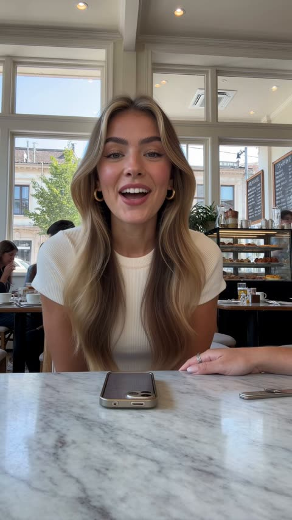</a>

30 秒一镜到底，像没剪过的手机视频：自动曝光忽明忽暗，9 秒时服务员碰到桌子，画外有对白和咖啡馆噪音。

Kling 4.0 · 文生视频 · 出处: [@minchoi on X](https://x.com/minchoi/status/2111471573395755295) · 268 赞，统计于 2026-10-28

[`ugc`](pages/zh/tags.md#tag-ugc) [`vertical`](pages/zh/tags.md#tag-vertical) [`one-take`](pages/zh/tags.md#tag-one-take) [`dialogue`](pages/zh/tags.md#tag-dialogue) [`food`](pages/zh/tags.md#tag-food) [`phone-footage`](pages/zh/tags.md#tag-phone-footage)

<details><summary><b>提示词</b></summary>

```text
Raw vertical 9:16 video recorded on a phone's front camera (not on screen), one continuous 30-second take with no cuts. It looks like an ordinary unedited phone clip, not a film: slightly soft image, a little digital noise and compression, deep focus with the café behind her as sharp as her face, auto-exposure brightening and dimming as people pass the sunny window behind her, no colour grading. The phone sits close and a little low, looking slightly up at her; around 9 s a waiter's arm bumps the table, the phone slides and tilts, and she catches it and props it back up. Sadie, a young woman in her early 20s with long honey-blonde waves, light natural makeup, small gold hoop earrings and a cropped cream knit top, sits at a small marble table by a big sunny window in a busy brunch café. Her sister sits across from her, out of frame except for her arm and a hand with a silver ring. Behind Sadie: other tables of people talking, a counter with a glass pastry case, plants, staff moving about, chalkboards too far away to read. Around 9 s a waiter sets down two plates, a lemon ricotta pancakes and a plate of eggs on toast, plus two iced coffees in plain glasses. Around 15 s she turns the pancake plate toward the camera; around 20 s she cuts a bite, eats it and closes her eyes; around 26 s her sister's hand reaches in with a fork and steals a piece of pancake, and Sadie swats at it, laughing. [Sadie: casual young woman's voice, warm and a bit giggly, recorded on the phone's built-in mic from half a metre away]: "Okay, I promised I'd show you what we get. ... We get the same thing every single time. ... Oh, here it is! Thank you! ... Look at this. Lemon ricotta pancakes. ... Mmm. Okay. Yeah. Still the best. ... Hey! Get your own!" [Her sister, off camera: a young woman's voice, dry and amused]: "That's the tax." [Sadie, laughing]: "She does this every time." Audio as captured by the phone mic in a busy café, not studio clean: her voice close but with the room around it, the hiss and grind of an espresso machine, cups and cutlery clinking, overlapping chatter and laughter from other tables, a door bell jingling, a chair scraping, faint music in the background. No subtitles, no captions, no on-screen text.
```

</details>

<a id="kling4-tactical-shooter-gameplay"></a>
### 以假乱真的 5v5 战术射击游戏实录

<a href="https://x.com/higgsfield_ai/status/2110905436371370009">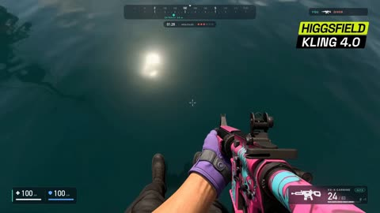</a>

按屏幕录像来写：HUD、准星、PC 游戏光照和枪声设计。让模型拍游戏画面，不拍电影。

Kling 4.0 · 文生视频 · 出处: [@higgsfield_ai on X](https://x.com/higgsfield_ai/status/2110905436371370009) · 260 赞，统计于 2026-10-28

[`gameplay`](pages/zh/tags.md#tag-gameplay) [`pov`](pages/zh/tags.md#tag-pov) [`hud`](pages/zh/tags.md#tag-hud) [`action`](pages/zh/tags.md#tag-action) [`sound-design`](pages/zh/tags.md#tag-sound-design)

<details><summary><b>提示词</b></summary>

```text
15-second horizontal 16:9 1080p first-person gameplay recording of a competitive 5v5 tactical shooter in team elimination mode, captured straight from a PC screen. Modern next-gen competitive shooter graphics: bright, clean, readable daylight, crisp PBR materials, high frame rate, sharp image. Pure first-person view: the player's hands in purple tactical gloves hold an original assault rifle with a flashy custom skin of hot-pink and teal graffiti patterns, positioned in the lower right of the frame. Clean screen with the HUD turned off: the only on-screen element is a small green crosshair in the center. There is no minimap, no kill feed, no health, ammo or money counters, no timer and no banners. Snappy competitive movement with quick peeks, crouching, strafing and precise flicks. The whole video is one continuous round with no cinematic cuts.

Setting: a sunny Asian harbor market district at midday, an original competitive map. There are narrow alleys between stacked, faded red, blue and yellow shipping containers, sun-bleached concrete, stalls with colorful canvas tarps and hanging paper lanterns, food carts, wooden crates and fish barrels, metal stairs and catwalks, corrugated metal walls, an open harbor basin of deep blue-green water with moored wooden fishing boats and floating pontoons, cranes on the docks in the background, and colorful painted shop signs made of abstract shapes, not letters. Bright high sun, clear blue sky with a few clouds, hard crisp shadows, seagulls in the distance and sunlight glittering on the water.

[00:00–00:02] The player strafes out from behind a shipping container, flicks onto an enemy soldier at the alley entrance and drops him with a short burst. The enemy ragdolls onto the concrete.
[00:02–00:04] He sprints along the containers, wide-swings around a stack of crates and drops an enemy hiding behind them with a quick two-shot tap.
[00:04–00:06] He jiggle-peeks the corner of a market stall and lands a clean headshot on an enemy on the catwalk.
[00:06–00:08] He hops down from the pier onto a floating wooden pontoon at the edge of the harbor basin and casually reloads with a fast magazine swap while moving along the planks.
[00:08–00:10] He advances along the pontoons between moored wooden fishing boats and taps an enemy standing on a boat deck. The body ragdolls off the deck and drops into the water with a splash.
[00:10–00:11] He throws a smoke grenade ahead onto the dock. It bounces across the wooden planks, then pops, and thick grey smoke spreads over the pier in the sunlight.
[00:11–00:13] Two enemies push out of the smoke along the dock. He sprays and taps them down; bullet impacts kick up wood splinters from the planks and small splashes in the water. Both enemies ragdoll onto the dock.
[00:13–00:15] The round is won. Standing alone on the pontoon in the middle of the harbor, he glances down at the sunlit water lapping against the boards, then looks back up and inspects his rifle with a stylish flip animation.

Style: authentic competitive esports gameplay footage that looks like a real ranked match caught on stream, with confident, clean play. Readable action, stable first-person camera with natural view bob and recoil, sharp, high detail, bright saturated daylight colors. No real-world text, no words, no brand logos, no watermark, no IP characters or maps.

Audio: competitive shooter sound design, with punchy rifle bursts with echo off the containers, shell casings clinking on concrete and wood, footsteps on concrete and hollow wooden planks, bullet impacts on wood and metal with small water splashes, a smoke grenade hiss, a crisp magazine reload, seagulls, lapping water against the boats, distant harbor horns and a short round-win sting at the end. No dialogue.
```

</details>

<a id="kling4-perfume-bottle-loop-ramp"></a>
### 香水瓶冲上环形坡道再喷射升空

<a href="https://x.com/AIWithRay/status/2114672427964010805">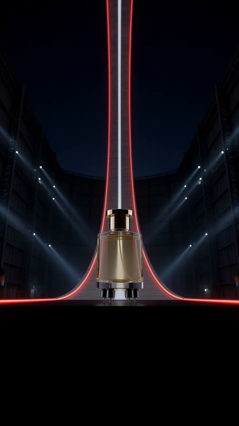</a>

把产品广告拍成特技表演，两秒一拍，瓶子不带标签和品牌。

Kling 4.0 · 文生视频 · 出处: [@AIWithRay on X](https://x.com/AIWithRay/status/2114672427964010805) · 142 赞，统计于 2026-10-28

[`product-commercial`](pages/zh/tags.md#tag-product-commercial) [`surreal`](pages/zh/tags.md#tag-surreal) [`timed-beats`](pages/zh/tags.md#tag-timed-beats) [`vfx`](pages/zh/tags.md#tag-vfx) [`luxury`](pages/zh/tags.md#tag-luxury)

<details><summary><b>提示词</b></summary>

```text
Cinematic, photoreal night scene on a black stage inside a giant hangar. A towering concrete loop ramp/road with glowing red edge lights and a white center stripe dominates the background. In front of it stands a premium transparent glass perfume bottle, unlabeled, no logo, filled with pale golden fragrance, featuring elegant beveled edges, a polished metallic cap, realistic glass refraction, crisp reflections, and subtle condensation droplets. The bottle engages four small rocket nozzles under its base; soft white exhaust with bright orange cores appears. The bottle glides forward, then blasts up the glowing ramp, hugging the curve, leaving faint light trails and red neon reflections across its glass surface. At the apex it shoots off the ramp and transitions to a sleek electric-thruster flight, like a futuristic luxury flying car, then ends in a close hero shot of the perfume bottle hovering and roaring upward vertically with four bright jets, volumetric spotlights and fog below, sparks and vapor interaction, dramatic rim light, golden highlights, crisp reflections, shallow depth of field, 4K, high-end luxury perfume and car commercial look. No text, no brand, no label. Duration 9–10 seconds. Aspect ratio 9:16. Negative cues: no logos, no text, no labels, no hands, no spillage, no deformation, no duplicate bottles, no cartoon look, no melting glass, no detached cap, no liquid leakage, no extreme motion-blur smears. Beat sheet (timing guide) 0–2s: Low-angle push-in on the massive loop ramp; perfume bottle centered, engines arming beneath the base with subtle heat shimmer and glowing orange cores. 2–6s: Dynamic follow-cam as the bottle rockets up the ramp; speed ramping, neon edge lights streaking, dramatic red reflections sliding across the glass. 6–8s: Bottle leaves the ramp, switches to electric thrusters; quick cinematic orbit as it hovers midair, revealing the golden fragrance and metallic cap. 8–10s: Tight hero shot of the perfume bottle ascending vertically with four bright jets, swirling fog, volumetric spotlights, realistic vapor, and luxurious golden reflections. End with the bottle sharply focused and centered against the dark hangar.
```

</details>

<a id="kling4-blacksmith-forges-greatsword"></a>
### 铁匠把铁块打成巨剑，从首帧到尾帧

<a href="https://static--34.klingai-cdn-aws.com/kling-blog/presigned_url/e8b7cc55-4cb6-4a0c-b175-e22d1f378f5f_1-2.mp4">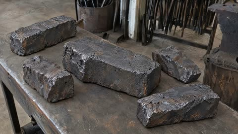</a>

首帧是桌上的铁块，尾帧是放回原处的成剑，中间六个镜头压缩锻造过程。

Kling 4.0 · 首尾帧 · 出处: [Kling 4.0 user guide](https://kling.ai/quickstart/kling-4-model-user-guide)

[`keyframes`](pages/zh/tags.md#tag-keyframes) [`craft`](pages/zh/tags.md#tag-craft) [`multi-shot`](pages/zh/tags.md#tag-multi-shot) [`structured-prompt`](pages/zh/tags.md#tag-structured-prompt) [`time-lapse`](pages/zh/tags.md#tag-time-lapse)

<details><summary><b>提示词</b></summary>

```text
SCENE CONTEXT EXACT 1 CHARACTER — NO DUPLICATES. Interior, a worn blacksmith workshop, daytime. The same blacksmith removes the raw material, works it into a greatsword, and returns the completed sword to the original table.15 seconds, six shots. Manufacturing time is compressed through editorial cuts; individual actions retain natural weight and speed.
ACTIVE REFERENCES: @Image1: exact first-frame anchor. Preserve all five iron blocks, their arrangement, the tabletop, background tools, perspective, and lighting. This image is the starting state of an active pickup shot.@Image2: exact final-frame anchor and finished-sword design. Preserve the blade silhouette, central fuller, angular curved crossguard, spiral metal grip, faceted pommel, diagonal placement, perspective, and background. This composition is reached through a visible physical placement.
LOCATION MAP: The worktable fills the foreground. The tool bucket stands behind its left-center edge, the rod rack occupies the rear right, and the anvil stands at the right. The blacksmith works from the left side of the table in both endpoint shots. The camera stays on the original viewer-facing side of the table. During blade-working inserts, the tang points screen-left and the tip points screen-right. The final sword position runs from the upper-left pommel to the lower-right tip.
FIRST FRAME AND SPATIAL BLOCKING: At 0.0 seconds, the frame exactly matches the raw-material reference, with five iron blocks and no hands visible. The same blacksmith immediately reaches in from the left edge. Both gloved hands approach the largest central block from opposite ends, preparing a supported two-handed lift. The blacksmith wears soot-gray sleeves, brown leather gloves, and a narrow dark strap around the right cuff. These details remain identical throughout every shot.
FORMAT MODE: 15 seconds total, six shots.Hard cuts at 3.0, 5.0, 8.0, 10.0, and 11.0 seconds. Cuts compress the omitted manufacturing work and bench clearing. The opening pickup and closing placement each play as continuous physical actions.No fades, dissolves, or object-morph transitions.
OPTICS: Shots 1 and 6: reference-matched elevated three-quarter framing, approximately 63° diagonal field of view and approximately 1.8 meters from the tabletop center. Exact endpoint framing takes priority over estimated optical measurements. Shots 2–5: 40° diagonal field of view, approximately 0.8 meters from the working contact point. Focus follows the hands and metal contact; the workshop background remains softly readable. Each shot holds one fixed field of view.
CAMERA: A real camera operator holds the camera from the viewer-facing side of the workspace. All shots use handheld SETTLE: visible breathing sway, slight roll, and small delayed corrections. The opening camera holds its position while the iron block leaves the frame. The closing camera holds the empty tabletop composition while the sword enters, then settles into the exact final reference. The blacksmith is the only visible worker; the camera operator remains outside the image.
ACTION TIMING: 0.0–3.0s — TAKE THE IRON. Start on the exact first reference; during 0.0–0.6s, the blacksmith’s matching gloved hands enter from screen-left and grip opposite ends of the largest central block. During 0.6–1.5s, the wrists brace and both hands lift the block clear of the tabletop, exposing the patch of table beneath it. During 1.5–3.0s, the blacksmith carries the supported block out through screen-left; the other four blocks remain resting on the table through the cut.3.0–5.0s — HEAT THE STOCK. Hard cut forward in time to one thick billet already glowing orange among forge coals. The same gray sleeves, brown gloves, and right-cuff strap appear at screen-left as the blacksmith holds long tongs around the billet. A short controlled pull draws the billet toward the forge mouth, with heat shimmer rising above its scaled surface.5.0–8.0s — FORGE THE BLADE. Hard cut forward to an elongated orange-hot blade blank supported on the anvil, tang left and emerging tip right. The same blacksmith braces the tang with left-hand tongs and delivers three deliberate right-hand hammer strikes along the blade flat. Each strike produces local compression, wrist recoil, and a brief scatter of dark scale.8.0–10.0s — FINISH THE METAL. Hard cut forward to a cooled blade with its fuller already formed, held by the same gloved hands against an abrasive wheel. The blacksmith makes one controlled finishing pass along the bevel. A narrow stream of sparks falls from the actual contact point as a brighter strip of metal appears.10.0–11.0s — COMPLETE THE HILT. Hard cut forward to the nearly finished sword supported on a separate assembly bench, its crossguard and spiral metal grip already fitted. The same blacksmith’s left hand braces the grip while the right hand gives the faceted pommel its final tightening turn. The completed sword now has the exact construction and finish required for the final image.11.0–15.0s — PLACE THE FINISHED SWORD.Hard cut to the original worktable, now completely clear; show its empty surface for 0.4 seconds before the same gloved hands carry the completed sword in from screen-left, one hand around the grip and the other supporting the blade flat near its balance point. From 11.4–13.8s, the blacksmith lowers the entire rigid sword diagonally, hilt toward upper-left and tip toward lower-right, easing it onto the tabletop and sliding the supporting hand free as its weight transfers to the table. From 13.8–15.0s, both hands release and withdraw through screen-left; the sword remains motionless in the exact final-reference position as the camera settles onto the final frame.
PHYSICS: The raw block retains its shape and mass throughout the pickup. Both hands support it continuously; the forearms tense and the lift accelerates slowly under its weight. The anvil supports the hot blade during forging. Large changes of shape occur across editorial time jumps. The completed sword remains rigid during carrying and placement. The blade-supporting hand has visible clearance to slide free as the sword settles; the hand never passes through the blade or tabletop. Metal contact produces a short scrape and a low, heavy clink, followed by stillness. The same blacksmith clears the remaining raw stock during omitted time before the final shot.
LIGHTING: The original table shots use soft daylight from upper camera-left, matching both references. Retain dark detail in the iron and protect the silver blade highlights. The forge insert uses orange coal glow from below-left as its dominant source. Return to the original neutral daylight before the sword enters the final tabletop shot.
AUDIO: Quiet workshop air and distant furnace draft form the ambient bed. Opening: leather creaks, a brief iron scrape, and a restrained exertion breath as the heavy block rises.Middle: forge crackle, tong contact, three synchronized hammer impacts, abrasive scraping, and a short fitting sound.Ending: sleeve movement, glove friction against metal, a weighted sword-to-table clink, then quiet workshop ambience. The blacksmith speaks no dialogue.SFX only, no music, no score, no song, no soundtrack.
CHARACTER ACTING: One consistent blacksmith performs every visible action. Soot-gray sleeves, brown leather gloves, and the dark right-cuff strap remain unchanged. Hands work deliberately: brace before lifting, maintain firm tool contact, and reduce speed before lowering the finished sword. The physical rhythm shifts from effort during the raw-block pickup to careful control during the final placement. The face and torso remain outside the crop.
STYLE: Grounded workshop documentary with tactile iron, worn tools, and convincing manual labor.Soft old-photograph texture, restrained grain, and natural motion blur; no digital sharpening. Charcoal metal and muted brown surfaces dominate, with silver highlights and localized forge orange. The first and last frames preserve the supplied images’ appearance.
QUALITY: Maintain consistent hands, gloves, sleeve details, metal geometry, and contact shadows. The lifted block reveals the tabletop underneath it. The closing shot visibly establishes the empty tabletop before the sword enters. Keep the full final sword readable, including its tip, guard, grip, and pommel. Avoid duplicate limbs, flickering geometry, and intersecting solid surfaces.
POSITIVE CONSTRAINTS: The first frame contains exactly five iron blocks. The largest central block physically leaves the table in the same blacksmith’s two hands. The final shot begins with an empty table. The completed sword enters while visibly supported by that same blacksmith, contacts the tabletop, and remains after both hands withdraw. The last frame matches the finished-sword reference exactly. The opening pickup and final placement each remain continuous, with visible hand-object contact. Exactly one finished sword is present.No text overlays, subtitles, or music.
```

</details>

输入素材: [1](https://static-84.klingai-cdn-aws.com/kling-blog/file_by_url/19ce60e842cb8fb4c613ed685c77e1c4d4cf027c6e827611fe944122945eccf1.png) · [2](https://static--59.klingai-cdn-aws.com/kling-blog/file_by_url/0b1daaccfe88e3810a5249fa9b1b81d8270e3a89ba88adda865ec5cfe0fa6ae1.png)

**[全部 26 条](pages/zh/video-kling40.md)**

<a id="kling30"></a>
## Kling 3.0

<a id="kling-vintage-watch-macro"></a>
### 指尖捏着复古腕表的微距镜头

<a href="https://x.com/higgsfield_ai/status/2019088049448362164"></a>

提示词用英寸级机位距离，并列出灰尘、细划痕、包浆等具体表面细节，让模型稳住质感。单一暖色侧掠光、浅景深，加上只有秒针这一处微动，画面不易闪烁或崩坏。

Kling 3.0 · 文生视频 · 出处: [@higgsfield_ai on X](https://x.com/higgsfield_ai/status/2019088049448362164) · 2,534 赞，统计于 2026-10-27

[`macro`](pages/zh/tags.md#tag-macro) [`product-shot`](pages/zh/tags.md#tag-product-shot) [`shallow-depth-of-field`](pages/zh/tags.md#tag-shallow-depth-of-field) [`moody-lighting`](pages/zh/tags.md#tag-moody-lighting) [`cinematic`](pages/zh/tags.md#tag-cinematic)

<details><summary><b>提示词</b></summary>

```text
Ultra-realistic cinematic macro shot of a vintage wristwatch held between two fingers, extreme close-up framing focused on the watch face and crystal, with the camera positioned inches away to reveal fine dust particles, micro scratches on the glass, worn metal edges, engraved numerals, and subtle patina on the hands. Shallow depth of field isolates the dial while the background dissolves into soft, dark bokeh. The lighting is moody and directional, a single warm key light grazing the surface to create delicate reflections along the curved crystal and metallic rim, emphasizing texture and age. The second hand moves subtly, creating a sense of quiet tension and time passing. Skin texture of the fingers is visible at the edges of the frame, slightly out of focus, adding scale and realism. High contrast, cinematic color grading, soft film grain, precise focus breathing, and a tactile, intimate macro perspective that feels handcrafted and timeless.
```

</details>

<a id="kling-basketball-backflip-dunk-court"></a>
### 篮球运动员在室外球场后空翻扣篮

<a href="https://x.com/higgsfield_ai/status/2019083976682684558"></a>

提示词把一个动作拆成四个编号镜头（运球、起跳、空中翻转、扣篮），每个镜头都写明景别和机位。低机位加上翻转时的慢动作特写，让 Kling 的物理模拟每一步都有明确的画面目标。

Kling 3.0 · 文生视频 · 出处: [@higgsfield_ai on X](https://x.com/higgsfield_ai/status/2019083976682684558) · 2,533 赞，统计于 2026-10-27

[`multi-shot`](pages/zh/tags.md#tag-multi-shot) [`sports`](pages/zh/tags.md#tag-sports) [`basketball`](pages/zh/tags.md#tag-basketball) [`low-angle`](pages/zh/tags.md#tag-low-angle) [`physics`](pages/zh/tags.md#tag-physics)

<details><summary><b>提示词</b></summary>

```text
Shot 1: A side profile, medium shot of a muscular African American man in athletic wear, intensely dribbling a basketball on an outdoor concrete court towards a hoop against a high white wall under a bright blue sky.
Shot 2: A dynamic, low-angle wide shot showing the man jumping remarkably high into the air, performing a backflip while holding the basketball, with the white wall and sky in the background.
Shot 3: A close-up, slow-motion shot of the man mid-air and upside down during his flip, showing his focused expression and the basketball held firmly in his hands against the sky.
Shot 4: A dramatic, low-angle shot focusing on the basketball hoop as the man, still upside down from his acrobatic jump, powerfully dunks the ball into the net.
```

</details>

<a id="kling-night-courtyard-katana-six-shots"></a>
### 夜晚庭院中女子挥刀斩断木人桩

<a href="https://x.com/higgsfield_ai/status/2019104313302569185"></a>

六个编号镜头各自写明景别和运镜，从嘴部微距到全景动作再到收尾人像，节奏清晰。每个镜头都点明机位和物理效果，比如飞溅的木屑和灰尘，让冲击瞬间有据可依。

Kling 3.0 · 文生视频 · 出处: [@higgsfield_ai on X](https://x.com/higgsfield_ai/status/2019104313302569185) · 2,473 赞，统计于 2026-10-27

[`multi-shot`](pages/zh/tags.md#tag-multi-shot) [`action`](pages/zh/tags.md#tag-action) [`katana`](pages/zh/tags.md#tag-katana) [`macro`](pages/zh/tags.md#tag-macro) [`night`](pages/zh/tags.md#tag-night)

<details><summary><b>提示词</b></summary>

```text
Shot 1: An extreme close-up of a young woman's mouth, her teeth clenched on a wooden toothpick, creating a tense and gritty atmosphere.
Shot 2: A medium shot of the woman in a traditional Japanese-style courtyard at night, illuminated by soft lanterns. She is dressed in a white tank top and dark trousers, holding a katana in a defensive stance with a determined look on her face.
Shot 3: A dynamic, low-angle action shot of the woman jumping high into the air, raising her katana to strike a wooden training dummy that resembles a samurai in armor.
Shot 4: A close-up, high-speed impact shot showing the woman’s katana slicing through the wooden dummy, sending wood splinters and dust flying into the air.
Shot 5: A fast-paced tracking shot of the woman landing gracefully and immediately striking another wooden structure, demonstrating her speed and precision.
Shot 6: A final medium close-up of the woman’s face as she finishes her move. She is slightly breathless, her hair disheveled, with a sharp, focused gaze directed off-camera.
```

</details>

<a id="kling-eagle-pov-steppe-flight"></a>
### 金雕视角飞越山谷与河流

<a href="https://x.com/higgsfield_ai/status/2019090635408744851"></a>

镜头锁定在金雕头部,翅膀与羽毛留在画面边缘作为稳定参照。用河流、山谷、岩峰提供地面视差,并限定无抖动、仅速度模糊、无剪辑,让飞行动作连贯真实。

Kling 3.0 · 文生视频 · 出处: [@higgsfield_ai on X](https://x.com/higgsfield_ai/status/2019090635408744851) · 2,454 赞，统计于 2026-10-27

[`pov`](pages/zh/tags.md#tag-pov) [`aerial`](pages/zh/tags.md#tag-aerial) [`wildlife`](pages/zh/tags.md#tag-wildlife) [`tracking-shot`](pages/zh/tags.md#tag-tracking-shot) [`landscape`](pages/zh/tags.md#tag-landscape)

<details><summary><b>提示词</b></summary>

```text
POV flight from a golden eagle soaring over vast mountainous steppe landscapes. Camera locked to the eagle’s head with clean, precise tracking — stable forward motion, no jitter. The eagle actively flaps its wings, powerful wingbeats transitioning into smooth gliding. Wings and feathers visible at the frame edges, moving naturally in rhythm. Strong ground parallax below: winding rivers, open valleys, rocky peaks. Bright late-afternoon light, crisp air, subtle lens flare. Ultra-wide cinematic perspective, natural motion blur from speed only, realistic flight physics, continuous shot, no cuts.
```

</details>

**[全部 28 条](pages/zh/video-kling30.md)**

<a id="veo31"></a>
## Veo 3.1

<a id="veo-giant-girl-shibuya-crossing"></a>
### 巨型女孩跪在东京街口俯身触碰出租车

<a href="https://x.com/MrDavids1/status/1997581641892446293"></a>

通用模板用方括号固定机位、巨人服装、地点和动作，再在手脚附近加入微小的车辆和行人来建立体量感。先用 Nano Banana Pro 以 4K 生成静帧，再交给 Veo 3.1 做图生视频。

Veo 3.1 · 图生视频 · 出处: [@MrDavids1 on X](https://x.com/MrDavids1/status/1997581641892446293) · 3,040 赞，统计于 2026-10-27

[`giant`](pages/zh/tags.md#tag-giant) [`scale`](pages/zh/tags.md#tag-scale) [`cityscape`](pages/zh/tags.md#tag-cityscape) [`photorealistic`](pages/zh/tags.md#tag-photorealistic) [`template`](pages/zh/tags.md#tag-template)

<details><summary><b>提示词</b></summary>

```text
Here is a fun idea to try. You can create these images with giant people/animals using Nano Banana Pro. Just adjust the elements in brackets and have fun! If you have the option to generate at 4K, definitely use it as it makes the tiny people look crisper. These types of images seem to animate best with Veo 3.1 from testing, but you can try with Kling 2.6 or Grok Imagine as well so have some fun! Feel free to show me your giant humans/animals.

🍌Universal Prompt: A highly detailed, photorealistic [CAMERA ANGLE, e.g., wide-angle shot, aerial shot looking down, extreme low-angle looking up] showing a colossal [DESCRIBE THE PERSON & CLOTHING] positioned in [SPECIFIC LOCATION/CITY/LANDSCAPE]. The giant is [ACTION -  INTERACTING WITH THE ENVIRONMENT, e.g., sitting on a building, stepping over a bridge]. To establish the immense scale, tiny [TINY ELEMENTS: PEOPLE, CARS, OR BOATS] are visible near their [FEET/HANDS]. The lighting is [TIME OF DAY, e.g., golden hour, midday sun].

There are more visuals examples with prompts included in my 80 creative use cases document which you can view via this link completely for free. Look for use case 84.
https://
canva.com/design/DAG5ifq
rYJc/BReEw-WwUMW9HmSJBHWBXQ/edit
…
```

</details>

<a id="veo-empty-room-loft-construction-timelapse"></a>
### 空房间延时搭建阁楼

<a href="https://x.com/venturetwins/status/1992725268855968071"></a>

首尾帧由 Nano Banana Pro 先生成，分别锁定空房间和完工效果。提示词只描述两帧之间的快速施工过程，由 Veo 补全中间的变化。

Veo 3.1 · 首尾帧 · 出处: [@venturetwins on X](https://x.com/venturetwins/status/1992725268855968071) · 1,986 赞，统计于 2026-10-27

[`time-lapse`](pages/zh/tags.md#tag-time-lapse) [`interior-design`](pages/zh/tags.md#tag-interior-design) [`construction`](pages/zh/tags.md#tag-construction) [`start-end-frames`](pages/zh/tags.md#tag-start-end-frames) [`nano-banana-pro`](pages/zh/tags.md#tag-nano-banana-pro)

<details><summary><b>提示词</b></summary>

```text
Did some experimenting and figured out the workflow for AI design transformations:

Start with a base image of a room with no furniture. Then prompt on Nano Banana Pro to add what you'd like (e.g. a cool door frame, loft, or pool).

Take to Veo 3.1 as your start and end frames.

Prompt: "time lapse construction, fast motion as a construction workers bring a tree into the living room and then construct the loft and add the couch and lights."
```

</details>

<a id="veo-golf-ball-tracking-storm-cliff"></a>
### 暴雨海崖高尔夫球手与追球镜头

<a href="https://x.com/Dheepanratnam/status/2032810971140420073"></a>

提示词按时间顺序分成挥杆、镜头锁定球、逼近果岭、杯口特写几个段落。它直接写明追踪规则，球保持清晰居中而背景拉成动态模糊，并加入击球脆响和风声等声音提示。

Veo 3.1 · 文生视频 · 出处: [@Dheepanratnam on X](https://x.com/Dheepanratnam/status/2032810971140420073) · 666 赞，统计于 2026-10-27

[`sports`](pages/zh/tags.md#tag-sports) [`tracking-shot`](pages/zh/tags.md#tag-tracking-shot) [`storm`](pages/zh/tags.md#tag-storm) [`physics`](pages/zh/tags.md#tag-physics) [`ball-pov`](pages/zh/tags.md#tag-ball-pov)

<details><summary><b>提示词</b></summary>

```text
video 1 - veo3.1
video 2 - Sora 2

"A dramatic sports sequence begins on a lush, windswept coastal cliff during a violent rainstorm. A golfer in bright yellow rain gear stands on the tee box, gripping a driver. His stance is planted firmly, eyes locked on a distant green across a churning ocean cove.

As he swings, the clubhead connects with a resounding crack, launching the dimpled white ball into the stormy sky. The camera immediately accelerates and locks onto the golf ball mid-flight.

The camera tracks directly behind the spinning sphere, maintaining perfect alignment as it cuts through the driving rain. The ocean waves and dark clouds become a streaking motion blur while the ball remains sharp and centered.

The howling wind roars as the projectile travels straight and true. The manicured green grows rapidly larger. In the final seconds, the camera closes in tightly as the ball strikes the turf. End on an extreme close-up of the ball ripping through the wet grass, throwing up a spray of dirt before dropping perfectly into the cup."
```

</details>

<a id="veo-strawberry-jar-assembly"></a>
### 草莓护肤霜罐在红色背景上逐件组装

<a href="https://x.com/ChillaiKalan__/status/2029019321364824452"></a>

提示词从空场景开始,并为每个物体的入场编号,组装顺序一目了然。固定机位、禁止弹跳,再加上与参考图一致的结尾画面,让动作干净可控。

Veo 3.1 · 参考生视频 · 出处: [@ChillaiKalan__ on X](https://x.com/ChillaiKalan__/status/2029019321364824452) · 582 赞，统计于 2026-10-28

[`product-commercial`](pages/zh/tags.md#tag-product-commercial) [`assembly`](pages/zh/tags.md#tag-assembly) [`skincare`](pages/zh/tags.md#tag-skincare) [`locked-camera`](pages/zh/tags.md#tag-locked-camera) [`sound-design`](pages/zh/tags.md#tag-sound-design)

<details><summary><b>提示词</b></summary>

```text
Use the uploaded image as the exact visual reference for jar design, label, strawberries, raspberries, flowers, leaves, condensation droplets, red gradient background, and reflective surface.

Camera:
Locked front-facing camera.
No zoom.
No rotation.
No angle change.
Studio composition remains centered.

Style:
Premium beauty commercial.
Smooth assembling sequence.
Ultra realistic.
Slow motion but not dramatic.

Scene – Start (Empty Setup):
Start with an empty red gradient background and glossy reflective surface.
No jar.
No fruits.
No flowers.
No water droplets.

Assembling Sequence:

1. The glass jar base smoothly slides into frame from below and settles perfectly centered.
2. The lid gently lowers from above and aligns perfectly on the jar.
3. Condensation droplets subtly appear on the glass surface as if forming naturally.
4. Raspberries roll in softly from left and right, stopping naturally around the base.
5. Strawberry halves slide into position at the front.
6. Whole strawberries gently drop from above into the open jar top and settle naturally.
7. Small white flowers softly fall into place between the strawberries.
8. Green leaves slide in behind the jar to frame it.
9. Final micro water droplets appear on fruits for freshness effect.

All movements smooth and controlled.
No bouncing.
No exaggerated motion.
No dramatic lighting changes.

Lighting:
Keep original studio lighting.
Deep red background glow remains consistent.
Soft reflections on the glossy surface.

Sound (if supported):
Soft subtle assembling sound design.
Gentle fruit placement sounds.
Light glass contact sound.
No music or very subtle premium ambient tone.

End Frame:
Fully assembled composition exactly matching the reference image.
Everything perfectly arranged.
Hold for 1–2 seconds.
Ultra clean luxury skincare commercial finish.
```

</details>

**[全部 10 条](pages/zh/video-veo31.md)**

<a id="veo3"></a>
## Veo 3

<a id="veo-camper-and-bear"></a>
### 定格动画，露营者和会顶嘴的熊

<a href="https://storage.googleapis.com/gdm-deepmind-com-prod-public/media/media/veo__veo-3__camper.webm"></a>

整条提示词只有一个形式标签和两句台词，场景交给 Veo 补全。

Veo 3 · 文生视频 · 出处: [Veo 3 prompt guide](https://deepmind.google/models/veo/prompt-guide/)

[`stop-motion`](pages/zh/tags.md#tag-stop-motion) [`dialogue`](pages/zh/tags.md#tag-dialogue) [`comedy`](pages/zh/tags.md#tag-comedy)

<details><summary><b>提示词</b></summary>

```text
Camping (Stop Motion): Camper: "I'm one with nature now!" Bear: "Nature would prefer some personal space."
```

</details>

<a id="veo-candy-keyboard"></a>
### 糖果做的键盘

<a href="https://storage.googleapis.com/gdm-deepmind-com-prod-public/media/media/veo__veo-3__keyboard.webm"></a>

单独一行 `Audio:` 告诉模型画面该配什么声音。

Veo 3 · 文生视频 · 出处: [Veo 3 prompt guide](https://deepmind.google/models/veo/prompt-guide/)

[`sfx`](pages/zh/tags.md#tag-sfx) [`product`](pages/zh/tags.md#tag-product) [`whimsical`](pages/zh/tags.md#tag-whimsical)

<details><summary><b>提示词</b></summary>

```text
A keyboard whose keys are made of different types of candy. Typing makes sweet, crunchy sounds. Audio: Crunchy, sugary typing sounds, delighted giggles.
```

</details>

<a id="veo-moon-dust-flowers"></a>
### 月尘平原上的水晶花

<a href="https://storage.googleapis.com/gdm-deepmind-com-prod-public/media/media/veo__veo-3__moon-dust.webm"></a>

短小的造景提示词。一个抓人的细节（`the only footprints in untouched dust`）胜过一长串形容。

Veo 3 · 文生视频 · 出处: [Veo 3 prompt guide](https://deepmind.google/models/veo/prompt-guide/)

[`world-building`](pages/zh/tags.md#tag-world-building) [`fantasy`](pages/zh/tags.md#tag-fantasy)

<details><summary><b>提示词</b></summary>

```text
A snow-covered plain of iridescent moon-dust under twilight skies. Thirty-foot crystalline flowers bloom, refracting light into slow-moving rainbows. A fur-cloaked figure walks between these colossal blossoms, leaving the only footprints in untouched dust.
```

</details>

<a id="veo-off-road-rally"></a>
### 越野拉力冲过河滩

<a href="https://storage.googleapis.com/gdm-deepmind-com-prod-public/media/media/veo__veo-3__off-road.mp4"></a>

给 8 秒动作戏写逐拍解说，还要求车辆无品牌，画面里不会冒出商标。

Veo 3 · 文生视频 · 出处: [Veo 3 prompt guide](https://deepmind.google/models/veo/prompt-guide/)

[`action`](pages/zh/tags.md#tag-action) [`handheld`](pages/zh/tags.md#tag-handheld) [`sfx`](pages/zh/tags.md#tag-sfx)

<details><summary><b>提示词</b></summary>

```text
The scene explodes with the raw, visceral, and unpredictable energy of a hardcore off-road rally, captured with a dynamic, almost found-footage or embedded sports documentary aesthetic. The camera is often shaky, seemingly mounted inside one of the vehicles or held by a daring spectator very close to the action, frequently splattered with mud or water, catching unintentional lens flares from the natural, often harsh, sunlight filtering through trees or reflecting off wet surfaces. We are immersed in a challenging, untamed natural environment – perhaps a dense, muddy forest trail, a treacherous rocky incline littered with loose scree, or a series_of shallow, fast-flowing river crossings. Several heavily modified, entirely unidentifiable, and unbranded off-road vehicles are engaged in a frenetic, no-holds-barred race. These are not showroom models; they are custom-built, rugged machines – open-wheeled buggies with exposed engines and prominent roll cages, heavily armored pickup trucks with oversized, knobby tires and snorkel exhausts, their original forms and manufacturers completely obscured by extreme modifications, layers of caked-on mud, and a general air of brutal functionality. The dominant sounds are the deafening, guttural roar of powerful, untamed engines, the whine of transmissions, the percussive impact of suspension bottoming out, and the constant spray of mud and water. Within an 8-second sequence, one of the lead vehicles, a low-slung, open-cockpit buggy so caked in thick, brown mud that its original color is a mystery, approaches a wide, shallow river crossing at incredible speed. Without the slightest hesitation, its unseen driver powers straight into the water. The impact sends an enormous, almost solid, opaque sheet of muddy water, mixed with stones and debris from the riverbed, spectacularly high into the air, completely engulfing the small buggy for a terrifying moment, obscuring it from view as if it has been swallowed by the river itself. Right on its tail, a pursuing, equally mud-encrusted, custom-built truck – a hulking, high-clearance beast with a heavily reinforced external roll cage and no discernible badging – arrives at the river crossing just as this massive wall of airborne water reaches its peak. Instead of slowing or attempting to find a clearer path, the truck's driver, with unwavering aggression, plunges directly into and through this opaque, turbulent curtain of muddy spray at full throttle. A split second later, the truck bursts out from the other side of the deluge, water cascading from its roof and chassis, its oversized windshield wipers struggling frantically to clear the torrent of muddy water obscuring the driver's vision. It lands heavily on the far bank, suspension groaning, but still in hot pursuit of the now-reappearing buggy. This thrilling, messy, and visually spectacular sequence of one vehicle creating a massive environmental obstacle and the next immediately conquering it through sheer force, forms the core, immersive, attention-grabbing event of the 8-second sequence. The race continues with undiminished ferocity, the natural terrain itself an active participant in the conflict.
```

</details>

**[全部 5 条](pages/zh/video-veo3.md)**

<a id="sora2"></a>
## Sora 2

<a id="sora-anime-cryo-awakening-forest"></a>
### 动画女子从冷冻舱苏醒走入森林

<a href="https://x.com/EccentrismArt/status/1976308338230165942"></a>

开头一句风格设定定下动画质感，之后每两秒一个带时间码的切镜段落，锁定每个镜头。每段只写一个动作和一个机位，故事从实验室到爬梯再到森林层层推进。

Sora 2 · 文生视频 · 出处: [@EccentrismArt on X](https://x.com/EccentrismArt/status/1976308338230165942) · 2,957 赞，统计于 2026-10-27

[`anime`](pages/zh/tags.md#tag-anime) [`timecode`](pages/zh/tags.md#tag-timecode) [`multi-shot`](pages/zh/tags.md#tag-multi-shot) [`sci-fi`](pages/zh/tags.md#tag-sci-fi) [`storytelling`](pages/zh/tags.md#tag-storytelling)

<details><summary><b>提示词</b></summary>

```text
Big budget anime movie with clean lines and smooth movements

[00:00]
The woman earring a short hospital gown suddenly wakes up in her cryogenic chamber with cold breath

[00:02]
Cut to she walks away from the cyrochamber looking around the lab with control consoles on the left

[00:04]
Cut to backside of the woman walking down a hallway at the end of the hallway is a black ladder mounted to the wall that leads up a vertical pathway with some light emitting down from led lights on the walls

[00:06]
Cut to Below the woman as she ascends up the black ladder and above her is a manhole cover with four small holes in it that has light shining through them

[00:08]
cut to the woman climbing out of a manhole in the middle of an overgrown forest

[00:10]
Cut to the woman amazed looking around the beautiful forest with fireflies and deer running past

[00:12]
Cut to wide shot of the large beautiful forest with destroyed city with overgrown plants all around it in the far background
```

</details>

<a id="sora-fridge-monster"></a>
### 冰箱里钻出一只胖乎乎的紫色怪兽

<a href="https://cdn.openai.com/API/docs/images/sora/sora_monster_original.gif"></a>

两拍：门开，怪兽出来。

Sora 2 · 图生视频 · 出处: [Sora 2 prompting guide](https://cookbook.openai.com/examples/sora/sora2_prompting_guide)

[`image-to-video`](pages/zh/tags.md#tag-image-to-video) [`creature`](pages/zh/tags.md#tag-creature) [`whimsical`](pages/zh/tags.md#tag-whimsical)

<details><summary><b>提示词</b></summary>

```text
The fridge door opens. A cute, chubby purple monster comes out of it.
```

</details>

输入素材: [1](https://cdn.openai.com/API/docs/images/sora/monster_original_720p.jpeg)

<a id="sora-monster-edits"></a>
### 改怪兽：先换颜色，再加一只

<a href="https://cdn.openai.com/API/docs/images/sora/sora_monster_2monsters.gif"></a>

每次编辑都基于原片单独跑，只改一处。OpenAI 的建议是只描述要改的地方。

Sora 2 · 视频编辑 · 出处: [Sora 2 prompting guide](https://cookbook.openai.com/examples/sora/sora2_prompting_guide)

[`multi-turn-edit`](pages/zh/tags.md#tag-multi-turn-edit) [`object-swap`](pages/zh/tags.md#tag-object-swap)

<details><summary><b>提示词</b></summary>

```text
Change the color of the monster to orange
A second monster comes out right after
```

</details>

输入素材: [1](https://cdn.openai.com/API/docs/images/sora/sora_monster_original.gif)

<a id="sora-skyline-turn-and-walk"></a>
### 她转身微笑，走出画面

<a href="https://cdn.openai.com/API/docs/images/sora/sora_woman_skyline_video.gif"></a>

有了输入图，第一帧已经定了，提示词只写接下来发生什么。

Sora 2 · 图生视频 · 出处: [Sora 2 prompting guide](https://cookbook.openai.com/examples/sora/sora2_prompting_guide)

[`image-to-video`](pages/zh/tags.md#tag-image-to-video) [`character`](pages/zh/tags.md#tag-character)

<details><summary><b>提示词</b></summary>

```text
She turns around and smiles, then slowly walks out of the frame.
```

</details>

输入素材: [1](https://cdn.openai.com/API/docs/images/sora/woman_skyline_original_720p.jpeg)

<a id="image"></a>
## 图片提示词

[Artificial Analysis 图像榜](https://artificialanalysis.ai/text-to-image/arena)前排模型上点赞最多的提示词，每条都附成图，出自作者在 X 上的帖子或模型官方指南。按用途分组。很多要配一张自己的照片，标着「上传图改图」的就是。

<a id="img-poster"></a>
## 海报与编辑排版

<a id="gpt-image-flat-vector-city-travel-poster-template"></a>
### 适用任意城市的扁平矢量旅行海报模板

<a href="https://x.com/MahnoorAi12/status/2091349007922778211">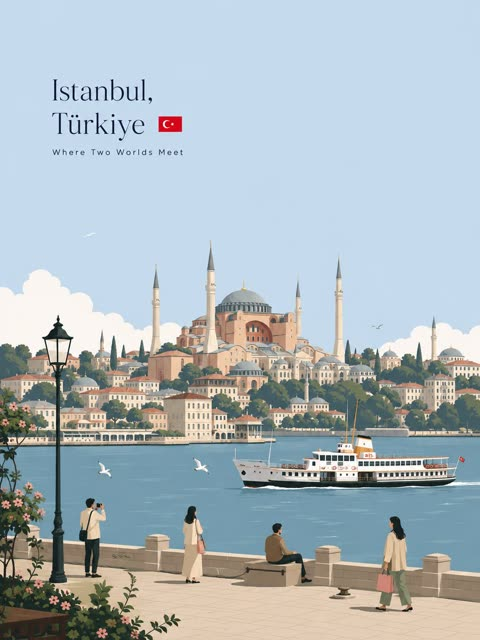</a>

用一个城市名占位符驱动地标、交通、生活瞬间、本地植物、视角五个要素，让每个城市的画面结构都不同。严格的配色体系、少量人物和较长的反向提示词，让扁平矢量风格保持安静统一。

GPT Image 2 · 文生图 · 出处: [@MahnoorAi12 on X](https://x.com/MahnoorAi12/status/2091349007922778211) · 3,421 赞，统计于 2026-10-28

[`travel-poster`](pages/zh/tags.md#tag-travel-poster) [`flat-vector`](pages/zh/tags.md#tag-flat-vector) [`template`](pages/zh/tags.md#tag-template) [`city`](pages/zh/tags.md#tag-city) [`minimalist`](pages/zh/tags.md#tag-minimalist)

<details><summary><b>提示词</b></summary>

```text
Premium minimalist flat-vector travel poster for [CITY_NAME], 3:4 vertical format.

Design an original, sophisticated travel poster that captures the authentic visual personality of [CITY_NAME]. The composition must feel purpose-built for this city rather than following a reusable template.

CITY IDENTITY

First interpret the unique visual character of [CITY_NAME] and build the scene around these five elements:

1. A recognizable landmark, architectural feature, or skyline element.
2. A distinctive local way of moving through the city.
3. One subtle everyday lifestyle moment.
4. A native plant, landscape, or environmental characteristic.
5. A composition and viewpoint that naturally belongs to the city.

The overall scene structure must change from city to city. Do not repeatedly use the same object positions or visual formula.

Possible compositions include:
harbor viewpoint, narrow historic lane, riverside garden, coastal path, elevated city overlook, lively market passage, tram avenue, ferry terminal, botanical setting, heritage square, beach promenade, cultural plaza, or skyline terrace.

Choose whichever composition best represents [CITY_NAME].

TYPOGRAPHY

Place “[CITY_NAME]” in the upper-left area with generous clean negative space.

Add one short, sophisticated English tagline inspired by the atmosphere of the city.

Typography should feel understated, editorial, spacious, and premium. Never allow text to dominate the artwork.

VISUAL HIERARCHY

Use one iconic landmark or architectural feature as the main focal point.

Support it with only 2–4 carefully selected local elements. Every added detail should strengthen the sense of place.

Avoid landmark collections or postcard-style collages. Keep the scene visually quiet and intentional.

PEOPLE

Include only 3–6 small-scale figures.

Give each person a believable activity connected to local life, such as:
walking through a historic lane, cycling, waiting for public transport, sketching architecture, boarding a ferry, reading outdoors, taking a quiet photograph, carrying beach equipment, browsing a market, or jogging beside the water.

Avoid crowds and avoid making any single person the main character. Figures should integrate naturally into the environment.

LOCAL CHARACTER

Use city-specific elements only when they genuinely fit [CITY_NAME]:

- local transportation
- architecture
- street furniture
- vegetation
- small signs or wayfinding
- local food references
- recreational activities
- pavement markings
- cultural details

Transport and signage should remain subtle. Instead of always using a large signboard, incorporate details naturally through a small transit marker, station clock, ferry information panel, bike symbol, painted road marking, beach flag, or understated metro icon.

ART DIRECTION

Japanese stationery-inspired aesthetic,
luxury sticker illustration,
premium commercial vector artwork,
modern editorial travel branding,
clean delicate outlines,
uniform line weight,
simple geometric forms,
flat-color illustration,
soft shapes,
balanced visual rhythm,
high-end minimalist postcard design.

COLOR SYSTEM

Build the atmosphere primarily with:
pale powder blue, soft sky blue, mist blue, and cool airy blues.

Balance these with:
warm ivory, cream, soft beige, muted sage, gray-green, and understated architectural neutrals.

Use dusty rose or muted blush only for tiny visual accents such as flowers, clothing details, small signs, awnings, or decorative objects.

Colors should remain soft, sophisticated, slightly desaturated, and cohesive.

MOOD

Fresh, airy, peaceful, refined, contemporary, elegant.

The final artwork should feel like a premium boutique travel postcard or luxury lifestyle brand illustration, with generous breathing room and a relaxed sense of place.

IMPORTANT QUALITY RULES

Every city must have its own visual identity.
Change the camera angle, scene structure, landmark placement, foreground treatment, and supporting details according to the city's character.

Do not simply replace [CITY_NAME] inside an existing composition.

NEGATIVE PROMPT

No photorealism.
No realism.
No watercolor.
No painterly brushwork.
No gradients.
No heavy shadows.
No dramatic cinematic lighting.
No paper texture.
No excessive detail.
No cluttered background.
No landmark collage.
No crowded streets.
No oversized characters.
No dominant hero character.
No repetitive café composition.
No fixed signboard position.
No identical foreground treatment.
No generic tourist-poster formula.
No copied layout from another city.
No unnecessary decorative elements.
```

</details>

<a id="gpt-image-tv-show-world-isometric-map-diorama"></a>
### 电视剧世界等距地图微缩景观海报

<a href="https://x.com/TechieBySA/status/2091167214195847433">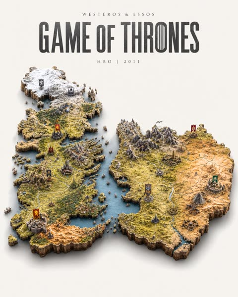</a>

用一个可替换的剧名占位符，并按虚构或真实场景分支，让微缩景观贴合地图轮廓并挤出成岩石厚板。固定的版面把上方三分之一留白给宽字距小字和粗窄标题，海报更干净。

GPT Image 2 · 文生图 · 出处: [@TechieBySA on X](https://x.com/TechieBySA/status/2091167214195847433) · 2,678 赞，统计于 2026-10-28

[`isometric`](pages/zh/tags.md#tag-isometric) [`diorama`](pages/zh/tags.md#tag-diorama) [`tilt-shift`](pages/zh/tags.md#tag-tilt-shift) [`tv-show`](pages/zh/tags.md#tag-tv-show) [`template`](pages/zh/tags.md#tag-template)

<details><summary><b>提示词</b></summary>

```text
Simply replace [TV SHOW]:✨

“Ultra-detailed photorealistic isometric miniature scale-model diorama of the world from [TV SHOW], floating on a pure off-white studio background with a soft drop shadow beneath.

If [TV SHOW] has a fictional world map: the diorama takes the exact silhouette shape of that fictional continent or world, extruded downward into a thick slab of raw rock and earth with rough cliff-like edges. The top surface recreates the complete world geography exactly as established in the show — every region, kingdom, city, landmark, mountain range, forest and river in its correct canonical position.

If [TV SHOW] is set in the real world: the diorama takes the exact geographic silhouette shape of the real city, state or region where the show is primarily set, extruded into a thick rock slab. The top surface is filled entirely with locations, landmarks, routes and environments from the show rendered in the show's authentic color palette and visual atmosphere — not generic realistic geography but the world as it feels in the show.

In both cases: dense micro-detail throughout — tiny figures in show-accurate clothing, vehicles, buildings, roads, trees, all authentic to the show's world. Every iconic location a fan would recognize is present and accurately placed.

Style: hyper-realistic tilt-shift miniature photography — extremely sharp, everything in focus, no blur. Lighting and color palette match the show's visual identity exactly.

Layout: diorama floats centered in the lower two-thirds, clear margins all sides. Upper third is empty off-white space with minimalist editorial typography, centered: small wide-tracked caps with the location or world name at the very top, then [TV SHOW] in a bold condensed sans-serif in medium charcoal grey — large and dominant, then small wide-tracked caps below with network and year.

Minimalist editorial poster aesthetic, premium print quality, 4:5 aspect ratio.”
```

</details>

<a id="gpt-image-city-placeholder-flat-vector-travel-poster"></a>
### 可替换城市名的扁平矢量旅行海报

<a href="https://x.com/AiwithLariab/status/2091435219002003957">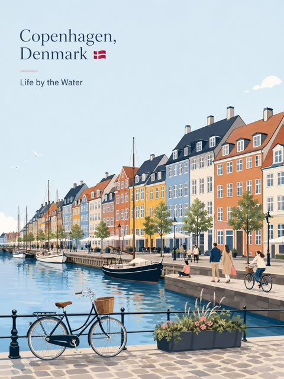</a>

用一个城市占位符展开出地标、本地交通、生活片段、本地植物和视角五项要素，再用人物数量上限、浅蓝奶油色板和详细的负面提示，让每个城市的构图各不相同。

GPT Image 2 · 文生图 · 出处: [@AiwithLariab on X](https://x.com/AiwithLariab/status/2091435219002003957) · 954 赞，统计于 2026-10-28

[`travel-poster`](pages/zh/tags.md#tag-travel-poster) [`flat-vector`](pages/zh/tags.md#tag-flat-vector) [`city`](pages/zh/tags.md#tag-city) [`template`](pages/zh/tags.md#tag-template) [`minimalist`](pages/zh/tags.md#tag-minimalist)

<details><summary><b>提示词</b></summary>

```text
Premium minimalist flat-vector travel poster for [CITY_NAME], 3:4 vertical format.

Design an original, sophisticated travel poster that captures the authentic visual personality of [CITY_NAME]. The composition must feel purpose-built for this city rather than following a reusable template.

CITY IDENTITY

First interpret the unique visual character of [CITY_NAME] and build the scene around these five elements:

1. A recognizable landmark, architectural feature, or skyline element.
2. A distinctive local way of moving through the city.
3. One subtle everyday lifestyle moment.
4. A native plant, landscape, or environmental characteristic.
5. A composition and viewpoint that naturally belongs to the city.

The overall scene structure must change from city to city. Do not repeatedly use the same object positions or visual formula.

Possible compositions include:
harbor viewpoint, narrow historic lane, riverside garden, coastal path, elevated city overlook, lively market passage, tram avenue, ferry terminal, botanical setting, heritage square, beach promenade, cultural plaza, or skyline terrace.

Choose whichever composition best represents [CITY_NAME].

TYPOGRAPHY

Place “[CITY_NAME]” in the upper-left area with generous clean negative space.

Add one short, sophisticated English tagline inspired by the atmosphere of the city.

Typography should feel understated, editorial, spacious, and premium. Never allow text to dominate the artwork.

VISUAL HIERARCHY

Use one iconic landmark or architectural feature as the main focal point.

Support it with only 2–4 carefully selected local elements. Every added detail should strengthen the sense of place.

Avoid landmark collections or postcard-style collages. Keep the scene visually quiet and intentional.

PEOPLE

Include only 3–6 small-scale figures.

Give each person a believable activity connected to local life, such as:
walking through a historic lane, cycling, waiting for public transport, sketching architecture, boarding a ferry, reading outdoors, taking a quiet photograph, carrying beach equipment, browsing a market, or jogging beside the water.

Avoid crowds and avoid making any single person the main character. Figures should integrate naturally into the environment.

LOCAL CHARACTER

Use city-specific elements only when they genuinely fit [CITY_NAME]:

- local transportation
- architecture
- street furniture
- vegetation
- small signs or wayfinding
- local food references
- recreational activities
- pavement markings
- cultural details

Transport and signage should remain subtle. Instead of always using a large signboard, incorporate details naturally through a small transit marker, station clock, ferry information panel, bike symbol, painted road marking, beach flag, or understated metro icon.

ART DIRECTION

Japanese stationery-inspired aesthetic,
luxury sticker illustration,
premium commercial vector artwork,
modern editorial travel branding,
clean delicate outlines,
uniform line weight,
simple geometric forms,
flat-color illustration,
soft shapes,
balanced visual rhythm,
high-end minimalist postcard design.

COLOR SYSTEM

Build the atmosphere primarily with:
pale powder blue, soft sky blue, mist blue, and cool airy blues.

Balance these with:
warm ivory, cream, soft beige, muted sage, gray-green, and understated architectural neutrals.

Use dusty rose or muted blush only for tiny visual accents such as flowers, clothing details, small signs, awnings, or decorative objects.

Colors should remain soft, sophisticated, slightly desaturated, and cohesive.

MOOD

Fresh, airy, peaceful, refined, contemporary, elegant.

The final artwork should feel like a premium boutique travel postcard or luxury lifestyle brand illustration, with generous breathing room and a relaxed sense of place.

IMPORTANT QUALITY RULES

Every city must have its own visual identity.
Change the camera angle, scene structure, landmark placement, foreground treatment, and supporting details according to the city's character.

Do not simply replace [CITY_NAME] inside an existing composition.

NEGATIVE PROMPT

No photorealism.
No realism.
No watercolor.
No painterly brushwork.
No gradients.
No heavy shadows.
No dramatic cinematic lighting.
No paper texture.
No excessive detail.
No cluttered background.
No landmark collage.
No crowded streets.
No oversized characters.
No dominant hero character.
No repetitive café composition.
No fixed signboard position.
No identical foreground treatment.
No generic tourist-poster formula.
No copied layout from another city.
No unnecessary decorative elements.
```

</details>

<a id="nano-banana-monstera-leaf-hidden-words"></a>
### 龟背竹叶片缝隙中浮现隐藏文字

<a href="https://x.com/fofrAI/status/2107509669514113058">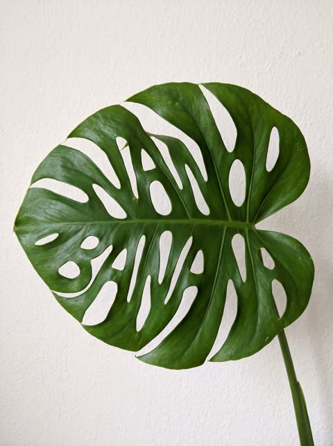</a>

提示词只指定一个真实物体，并要求文字从它的天然特征中自然浮现，字形顺着叶片自身的裂口生成，而不是叠加在表面。简洁的背景让缝隙更容易被读成字母。

Nano Banana 2.1 · 文生图 · 出处: [@fofrAI on X](https://x.com/fofrAI/status/2107509669514113058) · 549 赞，统计于 2026-10-28

[`text-in-image`](pages/zh/tags.md#tag-text-in-image) [`monstera`](pages/zh/tags.md#tag-monstera) [`nature`](pages/zh/tags.md#tag-nature) [`typography`](pages/zh/tags.md#tag-typography) [`photo`](pages/zh/tags.md#tag-photo)

<details><summary><b>提示词</b></summary>

```text
A photo of a monstera leaf against a simple backdrop, cleverly and organically appearing within the natural gaps of the leaf are the words Nano Banana
```

</details>

**[全部 81 条](pages/zh/image-poster.md)**

<a id="img-infographic"></a>
## 信息图与幻灯片

<a id="gpt-image-grayscale-3d-household-chores-step-grid"></a>
### 灰度3D家务步骤说明图网格

<a href="https://x.com/john_my07/status/2048803726312571335">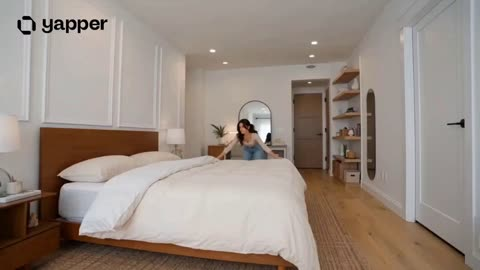</a>

用带标签的分块依次固定风格、网格、角色、服装和场景,再用统一的单格模板规定步骤标题、姿势、说明文字和动作箭头。参考图锁定16格中的同一张脸,末尾的限制块让画面保持干净,可直接作为动画参考。

GPT Image 2 · 上传图改图 · 出处: [@john_my07 on X](https://x.com/john_my07/status/2048803726312571335) · 1,187 赞，统计于 2026-10-28

[`instructional-grid`](pages/zh/tags.md#tag-instructional-grid) [`grayscale`](pages/zh/tags.md#tag-grayscale) [`3d-render`](pages/zh/tags.md#tag-3d-render) [`motion-arrows`](pages/zh/tags.md#tag-motion-arrows) [`reference-image`](pages/zh/tags.md#tag-reference-image)

<details><summary><b>提示词</b></summary>

```text
[VISUAL STYLE]
Monochrome grayscale composition featuring a highly detailed 3D-rendered female character. Designed like a professional instructional guide with a technical, diagram-inspired layout. Clean white background, soft studio lighting, and strong contrast to highlight posture, actions, and object interaction.
[GRID LAYOUT]
Structured 4×4 panel grid (16 frames total), evenly spaced with thin black divider lines. Each panel is identical in size and clearly numbered from 1 to 16, showing a continuous sequence of household activities.
[CHARACTER]
Use the provided reference image for the face and overall likeness.
Same facial features, skin tone, and proportions
Natural makeup, soft expression
Consistent identity across all 16 panels
Realistic proportions and clean hairstyle (loose or tied back)
[WARDROBE]
Modern, modest casual outfit:
Fitted crop top (not revealing, clean neckline, practical for movement)
High-waisted straight or slightly wide-leg jeans (full length, neat fit)
Optional minimal sneakers or barefoot indoor styling
Fabric should react naturally to movement (subtle folds and tension)
[SCENE APPROACH]
Minimal, clean environment per panel — only essential props related to the chore.
No clutter, no complex backgrounds — focus stays on the subject and action.
[PANEL STRUCTURE – EACH FRAME]
Top-left: Step number + task title (e.g., “Step 4 – Vacuum Floor”)
Center: Full-body pose performing the chore
Bottom-left: 3–4 concise instruction lines
Overlay: Motion arrows and directional guides showing action flow
[CHORE SEQUENCE EXAMPLES]
Make the Bed
Tidy Up Room
Dust Surfaces
Vacuum Floor
Sweep Floor
Mop Floor
Do Laundry
Hang Clothes
Fold Clothes
Clean Kitchen Counter
Wash Dishes
Take Out Trash
Water Plants
Clean Bathroom
Organize Shelves
Final Room Reset
[MOTION INDICATORS]
Curved arrows → fluid actions (wiping, folding)
Straight arrows → directional movement
Circular arrows → repetitive motions (scrubbing, mopping)
[RENDER QUALITY]
High-detail sculpted 3D style with smooth grayscale shading, soft shadows, and clean linework. Polished, concept-art level finish with clarity in every pose and object interaction.
[RESTRICTIONS]
No color, no unnecessary background detail, no extra characters, no revealing clothing, no clutter — only the subject, props, and instructional elements.
```

</details>

<a id="gpt-image-modern-house-architecture-handbook-infographic"></a>
### 现代住宅建筑手册信息图页面

<a href="https://x.com/mehvishs25/status/2053147765409288633">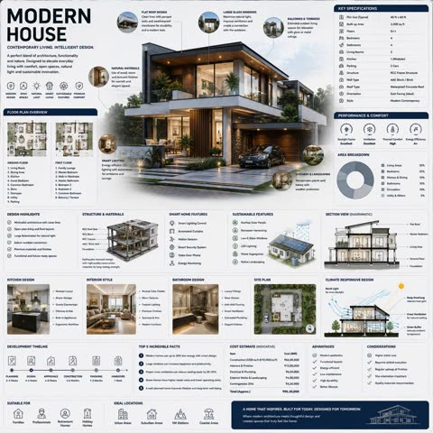</a>

用 HOUSE_STYLE 占位符让提示词可以反复套用。它把一张四分之三视角的主render和一长串命名的模块化板块、可视化模块组合起来,再用明确的避免清单防止画面变成房地产传单。

GPT Image 2 · 文生图 · 出处: [@mehvishs25 on X](https://x.com/mehvishs25/status/2053147765409288633) · 538 赞，统计于 2026-10-28

[`infographic`](pages/zh/tags.md#tag-infographic) [`architecture`](pages/zh/tags.md#tag-architecture) [`house`](pages/zh/tags.md#tag-house) [`template`](pages/zh/tags.md#tag-template) [`editorial`](pages/zh/tags.md#tag-editorial)

<details><summary><b>提示词</b></summary>

```text
Create a premium square “reference-style architectural infographic” centered around a luxurious {HOUSE_STYLE} modern house, designed as a beautifully curated architecture handbook page rather than a real-estate advertisement.
The composition should feel like a modern visual encyclopedia mixed with an elite architectural field guide and high-end editorial infographic system.
Visual Direction:
• 1:1 square composition
• Soft light-toned architectural background with subtle blueprint textures and drafting schematics
• Elegant muted palette using warm white, charcoal gray, natural wood tones, matte black, concrete gray, and soft steel blue accents
• Refined editorial typography hierarchy
• Rounded modular information cards with clean spacing
• Gentle realistic shadows and premium UI-style dividers
• Minimal architectural iconography
• Extremely detailed central house render viewed in dramatic three-quarter exterior perspective during soft golden-hour lighting
• Thin precision annotation lines pointing toward architectural systems and design features
• Clean, organized “knowledge-first” layout with high information density but breathable spacing
Main Subject Presentation:
A stunning ultra-detailed realistic render of the {HOUSE_STYLE} modern house placed at the center, featuring premium architectural realism, floor-to-ceiling glass walls, realistic reflections, warm ambient lighting, natural landscaping, modern material textures, elegant geometry, and sophisticated contemporary detailing.
Surround the house with scientific and architectural callouts explaining:
• façade design
• structural engineering
• smart home systems
• sustainable architecture
• passive cooling systems
• roof design
• glazing and natural lighting
• interior planning
• landscaping integration
• energy-efficient materials
Include modular infographic sections such as:
• House Overview
• Key Specifications
• Floor Plan Overview
• Structural & Material Breakdown
• Smart Home Features
• Sustainability Systems
• Climate-Responsive Design
• Interior Design Highlights
• Kitchen & Bathroom Concepts
• Area Distribution Charts
• Construction Timeline
• Cost Estimation (Indicative)
• Advantages vs Considerations
• Site Plan Layout
• Sectional Architectural View
• “Top 5 Incredible Facts” section
• Ideal Locations & Usage Scenarios
Add small premium visualization modules like:
• floor plan diagrams
• section-cut architectural drawings
• airflow & ventilation diagrams
• sunlight direction graphics
• smart-home workflow visuals
• landscaping/site layout plans
• material palette displays
• sustainability performance charts
• miniature blueprint elevation views
• room distribution infographics
Style Keywords:
“premium architecture encyclopedia”
“editorial architectural handbook”
“high-end residential infographic”
“museum-quality modern house reference page”
“scientific architectural poster”
“luxury home design editorial”
“modular architectural knowledge system”
“ultra-detailed architectural visualization”
Avoid:
• generic real-estate flyer aesthetics
• cluttered luxury brochure layouts
• excessive cinematic effects
• overly dark moody scenes
• unrealistic futuristic sci-fi architecture
• advertisement-heavy compositions
The final result should resemble a professionally published architectural reference-book page created for architects, interior designers, collectors, luxury home enthusiasts, and educational design archives.
```

</details>

<a id="gpt-image-routine-recipe-editorial-infographic"></a>
### 晨间习惯食谱式编辑风信息图

<a href="https://x.com/TechieBySA/status/2047683043918311670"></a>

用 [ROUTINE] 占位符做成通用模板，依次规定主视觉物件、带用量的所需清单、编号毛玻璃步骤卡片和悬浮数据胶囊。奶油暖色调、留白与纸张颗粒让密集排版依然清晰。

GPT Image 2 · 文生图 · 出处: [@TechieBySA on X](https://x.com/TechieBySA/status/2047683043918311670) · 460 赞，统计于 2026-10-28

[`infographic`](pages/zh/tags.md#tag-infographic) [`editorial`](pages/zh/tags.md#tag-editorial) [`routine`](pages/zh/tags.md#tag-routine) [`template`](pages/zh/tags.md#tag-template) [`glassmorphism`](pages/zh/tags.md#tag-glassmorphism)

<details><summary><b>提示词</b></summary>

```text
“Ultra-clean modern editorial infographic on the topic of [ROUTINE] routine. Hero visual: a stylized flat-lay or floating arrangement of 3–4 objects closely associated with the routine — slightly angled or in soft perspective, glowing subtly. All elements arranged dynamically around the hero in a non-restrictive editorial layout. Ingredients Section: Label it ‘What You Need’ — include 6–8 items with small icons or emoji illustrations next to each. Each item has a name and a practical quantity or duration written like a recipe (e.g. ‘x minutes of Y’). Arranged in a cluster or list connected visually to the hero. Steps Section: 5–6 numbered panels with arrows or connecting lines forming a logical flow. Each step has a short action label and a small relevant icon. Panels use glassmorphism or frosted card styling. Stats Badges: 4–5 floating pill-shaped badges showing relevant metadata — total time, difficulty, consistency streak, energy cost — displayed as clean minimal bubbles near the hero. Visual Style: Warm, soft editorial background — cream, warm white, or soft morning light tones. Muted earthy accent colors with clean highlights. Bold modern sans-serif typography. Clean vector icons. Subtle grain or paper texture in background. Composition: Hero object cluster centered or slightly offset. Ingredients on one side. Steps flow opposite or below with connecting lines. Stat badges scattered as floating pills. Generous negative space to keep it airy and readable. Lighting: Soft warm natural light feel emanating from the hero cluster. Premium lifestyle editorial aesthetic, social-feed optimized. Ultra-crisp. No watermark.”
```

</details>

<a id="gpt-image-grayscale-dance-movement-sheet-4x4"></a>
### 灰阶4x4舞蹈动作参考表

<a href="https://x.com/ChillaiKalan__/status/2049007457918198128">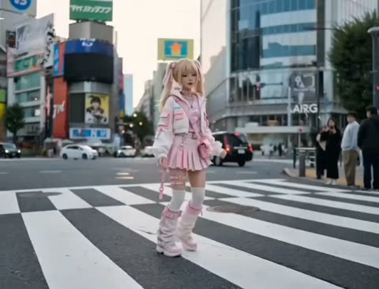</a>

用方括号分段写清版式、角色、单格结构、箭头和渲染风格，让16个编号格保持一致，再用负面提示去掉色彩和杂乱背景。成品动作表可作为参考图交给视频模型生成舞蹈动画。

GPT Image 2 · 文生图 · 出处: [@ChillaiKalan__ on X](https://x.com/ChillaiKalan__/status/2049007457918198128) · 253 赞，统计于 2026-10-28

[`movement-sheet`](pages/zh/tags.md#tag-movement-sheet) [`grayscale`](pages/zh/tags.md#tag-grayscale) [`3d-render`](pages/zh/tags.md#tag-3d-render) [`dance`](pages/zh/tags.md#tag-dance) [`reference-sheet`](pages/zh/tags.md#tag-reference-sheet)

<details><summary><b>提示词</b></summary>

```text
Monochromatic grayscale illustration, 3D-rendered character, clean instructional reference sheet.
White background, comic-style cell grid layout, technical diagram aesthetic.
[LAYOUT]
4×4 grid layout (16 panels total).
Each panel separated by thin black border lines.
Panels are evenly sized and consistently aligned.
Each cell is clearly numbered from 1 to 16.
[CHARACTER]
(Insert character description)
Example: Young female dancer with an athletic build, ponytail hairstyle, wearing a crop top, baggy pants, and sneakers.
The same character must appear consistently in all panels.
[PANEL STRUCTURE – per cell]
Top-left: bold number badge + Korean title text
Center: full-body character pose illustration
Bottom-left: Korean description text (3–4 lines)
Overlay: directional arrows indicating movement flow
[ARROWS / MOTION INDICATORS]
Curved arrows, straight arrows, and circular rotation indicators.
Arrows should be placed around the character to clearly show movement direction and flow.
[RENDERING STYLE]
Highly detailed 3D sculpted style.
Soft studio lighting with subtle shadows.
No color — grayscale only.
Clean linework, polished finish, game concept art quality.
[NEGATIVE PROMPT]
No background scenery.
No color tones.
No additional characters.
No cluttered or complex backgrounds.
```

</details>

**[全部 27 条](pages/zh/image-infographic.md)**

<a id="img-ui-mockup"></a>
## 手机与界面截图

<a id="gpt-image-camera-roll-photos-screen"></a>
### 一名学生一整天的iPhone相册截图

<a href="https://x.com/sakisuta_/status/2098712371045052764">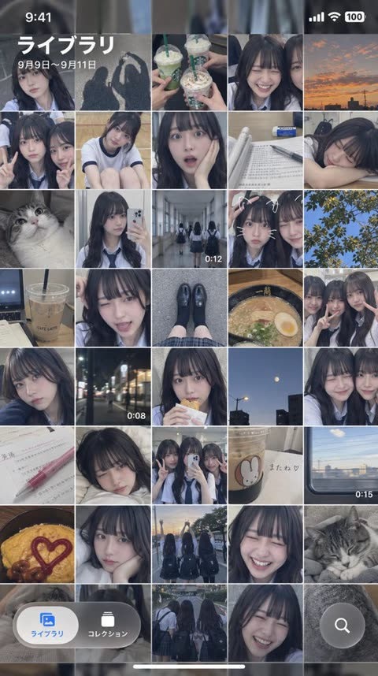</a>

提示词明确指定容器是原样截取的照片App界面，模型便在一个网格里填满一整天风格各异的随手拍。提供参考人物并要求日常瞬间，使人脸在美食、朋友、书桌和天空等画面中保持一致。

GPT Image 2.5 · 上传图改图 · 出处: [@sakisuta_ on X](https://x.com/sakisuta_/status/2098712371045052764) · 2,439 赞，统计于 2026-10-28

[`camera-roll`](pages/zh/tags.md#tag-camera-roll) [`photos-app`](pages/zh/tags.md#tag-photos-app) [`screenshot`](pages/zh/tags.md#tag-screenshot) [`reference-image`](pages/zh/tags.md#tag-reference-image) [`everyday`](pages/zh/tags.md#tag-everyday)

<details><summary><b>提示词</b></summary>

```text
Turn one full day's worth of camera roll for the person in the reference image into a single image that captures the iPhone's Photos app screen as-is. Make it a realistic camera roll that feels like it captures casual everyday moments.
```

</details>

<a id="gpt-image-camera-roll-day"></a>
### 一张图生成任何人一天的相册

<a href="https://x.com/Mayz1169/status/2099479395283214473"></a>

同一思路，规则更严：上传图是唯一主体，只允许出现最少的 iOS 界面元素。

GPT Image 2.5 · 上传图改图 · 出处: [@Mayz1169 on X](https://x.com/Mayz1169/status/2099479395283214473) · 762 赞，统计于 2026-10-27

[`ios`](pages/zh/tags.md#tag-ios) [`screenshot`](pages/zh/tags.md#tag-screenshot) [`camera-roll`](pages/zh/tags.md#tag-camera-roll) [`humor`](pages/zh/tags.md#tag-humor)

<details><summary><b>提示词</b></summary>

```text
Use the uploaded image as the ONLY subject reference.

Create ONE vertical image that looks exactly like a screenshot of the iPhone Photos app, showing one full day of casual camera-roll photos featuring the exact subject from the uploaded reference.

SUBJECT CONSISTENCY
First identify the main subject in the uploaded image. It may be a person, anime character, pet, animal, plush toy, figurine, mascot, object, or other character.

Preserve the subject’s recognizable appearance, colors, proportions, facial features, hairstyle, clothing, accessories, markings, materials, and signature details consistently across every photo.

If the reference contains multiple views of the same subject, understand that they are different views of ONE subject, not multiple characters.

Do not redesign or replace the subject.

DAY-IN-THE-LIFE CAMERA ROLL
Imagine a believable full day for this exact subject based on its appearance, personality, style, and visual world.

Generate many different casual photos from morning to night, as if someone naturally photographed the subject throughout the day.

Automatically choose everyday situations that fit the uploaded subject, such as:
waking up, resting, eating, sitting by a window, traveling, walking outside, visiting cafés or shops, playing, working, relaxing at home, interacting with everyday objects, sunset moments, nighttime outings, and going to sleep.

The activities and environments should adapt naturally to the subject. Do not force human activities onto animals, toys, objects, or non-human characters when they would look unnatural.

Every thumbnail should show a different moment, composition, distance, pose, camera angle, lighting condition, or location.

Mix:
close-ups,
medium shots,
wide shots,
overhead photos,
back views,
detail shots,
slightly blurry movement shots,
imperfect handheld snapshots,
photos where the subject is partially cropped,
environmental photos related to the subject’s day.

The result should feel spontaneous and personal rather than like a professional photoshoot.

IPHONE PHOTOS APP LAYOUT
The FINAL IMAGE itself must look like a real full-screen iPhone Photos app screenshot.

Use a tall smartphone screenshot aspect ratio, approximately 9:19.5.

Create a dense camera-roll gallery using FOUR equal thumbnail columns, closely matching the standard iPhone Photos grid.

Include approximately 24–32 individual photo thumbnails visible on screen.

Use very thin white gaps between thumbnails.

The gallery should fill most of the screen vertically.

Include authentic iPhone Photos interface elements:
• white iOS interface background
• iPhone-style status bar at the top
• time on the upper left
• cellular/Wi-Fi/battery icons on the upper right
• simple navigation controls near the top
• four-column photo gallery
• bottom Photos app navigation bar
• Photos tab selected in blue
• other navigation icons shown in gray
• black home indicator at the very bottom

The UI must look like an actual screenshot of the Photos app, NOT a decorative frame, moodboard, contact sheet, scrapbook, poster, or generic collage.

PHOTO STYLE
Make each thumbnail feel like a genuine casual iPhone camera-roll photo.

Use natural everyday lighting, imperfect framing, realistic exposure variation, occasional motion blur, slight focus imperfections, spontaneous compositions, and believable environmental details.

Keep the same subject recognizable throughout the entire gallery while allowing natural changes in pose, expression, camera distance, and lighting.

If the uploaded reference is illustrated, animated, stylized, or 3D, preserve its original visual identity and style unless realistic photography is explicitly requested.

IMPORTANT
ONE final image only.
The entire output is ONE iPhone Photos app screenshot containing many different photos.
Exactly FOUR thumbnail columns.
Do not create a standalone collage without the iPhone interface.
Do not create multiple separate outputs.
Do not duplicate the exact same photo repeatedly.
Do not introduce unrelated characters or subjects.
Do not change the main subject’s design.
No captions, dates, labels, stickers, watermarks, or decorative text inside the photo thumbnails.
Only normal minimal iOS interface elements may appear.9:16
```

</details>

<a id="gpt-image-iphone-photos-screenshot"></a>
### 一整天的照片，做成 iPhone 相册截图

<a href="https://x.com/BubbleBrain/status/2099759367956349012"></a>

连状态栏都还原的 iOS 相册界面，里面塞满参考人物的抓拍。

GPT Image 2.5 · 上传图改图 · 出处: [@BubbleBrain on X](https://x.com/BubbleBrain/status/2099759367956349012) · 309 赞，统计于 2026-10-27

[`ios`](pages/zh/tags.md#tag-ios) [`screenshot`](pages/zh/tags.md#tag-screenshot) [`camera-roll`](pages/zh/tags.md#tag-camera-roll)

<details><summary><b>提示词</b></summary>

```text
Turn the girl from the reference image into a full-day iPhone Photos album screenshot that faithfully recreates the real iPhone “Photos — Library / Today” interface. Keep the top status bar (time, signal, battery), the Library title, the Today label, the photo grid layout, and the bottom tab bar: Library / For You / Albums / Search. The whole image should look like a real phone screenshot.
The girl in the reference image is the only subject in the entire album. Every photo keeps the same identity, the same face, the same hairstyle, the same skin tone, the same body proportions, and the same presence. She is a clearly adult young East Asian woman with long black hair, cool-pale skin, refined cool features, and a private, quiet aura.
The album is a full portrait camera roll. Every thumbnail shows her. The entire screen is filled with solo portraits of her. The whole set is built around this one person only.
All album content is portraits of her: waking-up selfie in bed, selfie under the covers, selfie by the pillow, bathroom-mirror selfie, elevator-mirror selfie, window-side selfie, indoor natural-light selfie, sofa selfie, bedside selfie, after-coming-home selfie, night selfie, close-up face selfie, half-body selfie, full-body mirror selfie, seated solo shot, standing solo shot, side-profile solo shot, looking-back solo shot, indoor hallway solo shot, window-side solo shot, candid bedside shot, chair solo shot, carpet solo shot, and photos taken of her by someone else.
Outfits change continuously through the day. Morning: milky-white camisole lounge top and light-gray home shorts. Late morning: white slim short-sleeve top and pale blue-gray pleated mini skirt. Noon: black thin-strap top and high-waisted denim shorts. Afternoon: light-gray knit cardigan over a white inner layer and a black mini skirt. Evening: dark-gray blazer, white thin-strap top, and black pleated mini skirt. Night: black fitted mini dress with slim silver accessories. Late night after returning home: loose white T-shirt and soft lounge shorts. Each outfit is clearly different; the clothing changes mark a clear passage of time.
Photo mix is fixed at 60% selfies and mirror selfies, 40% solo portraits taken by someone else. Every frame has her as the subject. Every thumbnail keeps real iPhone native-camera texture. Pose, camera distance, angle, expression, lighting, and clothing keep changing.
The sequence runs from morning to late night. Morning feels loose and just-woken. Late morning has clear natural light. Afternoon feels like ordinary going-out. Evening has soft city light. Night has low indoor light. Late night feels quiet and private after coming home.
The whole set is quiet, private, relaxed, and real. The album forms a dense, continuous solo-portrait look, like a full day of private portrait camera roll saved on her own phone.
```

</details>

<a id="gpt-image-claymation-social-profile-screen"></a>
### 粘土定格动画风格的社交主页界面

<a href="https://x.com/miratechtool/status/2052033236964950111">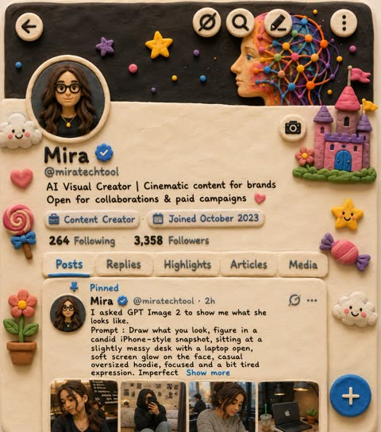</a>

提示词先锁定软质黏土这一种材质，再列出手工纹理、圆润造型和指纹等具体触感线索，并配上定格动画式灯光和暖色粉彩。这样现有截图里的按钮、头像和图标都被重做成黏土质感。

GPT Image 2 · 上传图改图 · 出处: [@miratechtool on X](https://x.com/miratechtool/status/2052033236964950111) · 255 赞，统计于 2026-10-28

[`claymation`](pages/zh/tags.md#tag-claymation) [`stop-motion`](pages/zh/tags.md#tag-stop-motion) [`pastel`](pages/zh/tags.md#tag-pastel) [`style-transfer`](pages/zh/tags.md#tag-style-transfer) [`social-profile`](pages/zh/tags.md#tag-social-profile)

<details><summary><b>提示词</b></summary>

```text
Recreate the scene as a cozy claymation-style world made from soft modeling clay. Every object should have handmade textures, rounded shapes, fingerprints, and soft lighting like a stop-motion movie. Use warm pastel colors and a cute cinematic atmosphere.
```

</details>

**[全部 14 条](pages/zh/image-ui-mockup.md)**

<a id="img-product"></a>
## 产品图与电商

<a id="gpt-image-pet-papercraft-cube-template"></a>
### 高地牛纸模立方体玩具展开图

<a href="https://x.com/icreatelife/status/2101353488408006830"></a>

提示词把上传照片限定为动物外观的唯一来源，并逐一列出平铺的各个部件及折线、粘合片和裁切边。结尾列出不得更改的内容，用来保住动物的身份特征和毛发质感。

GPT Image 2.5 · 上传图改图 · 出处: [@icreatelife on X](https://x.com/icreatelife/status/2101353488408006830) · 1,178 赞，统计于 2026-10-27

[`papercraft`](pages/zh/tags.md#tag-papercraft) [`cube-toy`](pages/zh/tags.md#tag-cube-toy) [`pet`](pages/zh/tags.md#tag-pet) [`template`](pages/zh/tags.md#tag-template) [`fur-texture`](pages/zh/tags.md#tag-fur-texture)

<details><summary><b>提示词</b></summary>

```text
Use my uploaded pet photo as the only source of the animal’s appearance. Create a realistic printable papercraft cube toy template of my pet, preserving 100% its identity and unique features: fur color, fur pattern, eyes, face shape, ears, body proportions, markings and expression.

Transform my pet into a handmade paper craft 3D model (low-poly cube style) like a DIY papercraft template. Show the unfolded cut-out template pieces laid flat on a white background: head, body, legs, ears and tail separated, with folding lines, tabs and cutting edges clearly visible.

The printed texture on the paper pieces must use my pet’s real fur texture and colors, so when assembled it becomes a small cube-shaped 3D figure of my exact pet.

Include:

cube-shaped head with my pet’s real face on it

cube-shaped body with realistic fur texture

four legs matching my pet’s appearance

ears with correct shape and inner ear details

tail matching my pet’s size and color pattern

Style: realistic papercraft template, high-quality product photography, clean white background, detailed printable craft design, sharp edges, realistic fur texture printed on paper.

Do not change my pet’s appearance. Do not turn it into a different animal, cartoon, plush toy or generic cat/dog. It must look like my actual pet converted into a cube papercraft model
```

</details>

<a id="gpt-image-iced-coffee-glass-studio-product-photo"></a>
### 柔和米色影棚背景中的冰咖啡玻璃杯

<a href="https://x.com/Strength04_X/status/2049082049995362785"></a>

提示词逐层写明饮品的视觉要素，包括深色咖啡底、奶泡漩涡、透明冰块和冷凝水珠。再配合柔和影棚光与单反微距质感，把画面推向高级饮品广告风格。

GPT Image 2 · 文生图 · 出处: [@Strength04_X on X](https://x.com/Strength04_X/status/2049082049995362785) · 617 赞，统计于 2026-10-28

[`iced-coffee`](pages/zh/tags.md#tag-iced-coffee) [`beverage`](pages/zh/tags.md#tag-beverage) [`studio-lighting`](pages/zh/tags.md#tag-studio-lighting) [`macro`](pages/zh/tags.md#tag-macro) [`product-photography`](pages/zh/tags.md#tag-product-photography)

<details><summary><b>提示词</b></summary>

```text
Made with GPT image 2 + Hailuo 2.3 on
@Hailuo_AI


PROMPT - A high-end café-style product photograph of a transparent glass filled with iced coffee, centered against a soft beige and cream seamless studio background. The drink shows a rich dark coffee base blending with creamy milk swirls, creating a smooth gradient effect. Several clear ice cubes are visible with realistic transparency and light refraction. The glass has subtle condensation droplets, adding freshness. Soft natural studio lighting creates delicate highlights and a clean shadow beneath the glass. Ultra-sharp focus, premium beverage advertisement style, DSLR macro photography, hyper realistic, 8K.

PROMPT 2 - Create a hyper-realistic exploded vertical infographic composition of an iced coffee.

Top → Bottom structure:
Foam Layer (light creamy foam with soft airy texture)
→ Coffee Liquid (rich dark espresso layer with smooth gradient)
→ Ice Cubes (transparent cubes with sharp edges and reflections)
→ Milk Layer (soft creamy white layer with smooth blend effect)
→ Glass Base (clear minimal glass structure)

All elements must be perfectly centered, evenly spaced, and aligned vertically. Use a soft beige seamless background with clean café-style lighting and subtle realistic shadows beneath each floating element. The composition should feel like a premium beverage ad combined with a clean infographic layout.

Add clean minimalist text labels with thin pointer lines using these exact labels:
“Foam”
“Coffee”
“Ice”
“Milk”
“Glass”
Ultra-realistic liquid detail, sharp reflections, premium commercial photography, 8K.
```

</details>

<a id="gpt-image-crumple-chair-design-board"></a>
### 皱纸造型沙发概念研发板

<a href="https://x.com/ShamsAmin56/status/2050281206139461780">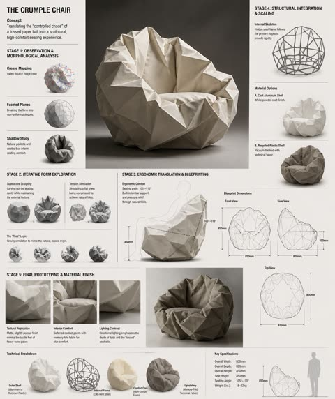</a>

提示词按五个阶段展开，从形态分析到人体工学、结构和材质。具体的尺寸、角度和材料选项让画面像一份真实的产品研发板。

GPT Image 2 · 文生图 · 出处: [@ShamsAmin56 on X](https://x.com/ShamsAmin56/status/2050281206139461780) · 发现于 [freestylefly/awesome-gpt-image-2](https://github.com/freestylefly/awesome-gpt-image-2)

[`product-design`](pages/zh/tags.md#tag-product-design) [`furniture`](pages/zh/tags.md#tag-furniture) [`concept-board`](pages/zh/tags.md#tag-concept-board) [`blueprint`](pages/zh/tags.md#tag-blueprint) [`industrial-design`](pages/zh/tags.md#tag-industrial-design)

<details><summary><b>提示词</b></summary>

```text
Design Concept: The Crumple Chair Core Philosophy: Translating the "controlled chaos" of a tossed paper ball into a sculptural, high-comfort seating experience.

Stage 1: Observation & Morphological Analysis The goal is to deconstruct the image of the crumpled paper into usable geometric data. Crease Mapping: Identify the primary "valley" and "ridge" lines. These represent potential structural ribs or seams in the chair. Faceted Planes: Break down the sphere into a series of non-uniform polygons. Each flat surface of the paper becomes a potential panel for the chair’s upholstery or shell. Shadow Study: Analyze how the "tossed" form creates deep recesses. These natural pockets guide where the user’s weight will be cradled.

Stage 2: Iterative Form Exploration Moving from a sphere to a seat through "Digital Crumpling." Subtractive Sculpting: Imagine the paper ball as a solid mass. Use Boolean operations to "carve out" a seating cavity that fits the human form while maintaining the external jagged texture. Tension Simulation: Use 3D software (like Rhino or Blender) to simulate a flat sheet of material being compressed. This ensures the folds look authentic and not "modeled." The "Toss" Logic: Experiment with gravity-based simulation dropping a digital mesh to see how it settles naturally, mimicking the "tossed" origin.

Stage 3: Ergonomic Translation & Blueprinting Refining the raw aesthetic into a functional object. The Comfort Core: Overlay a standard ergonomic template (Seating Angle: 105°–110°) over the crumpled form. Adjust the internal "folds" to provide lumbar support and pressure relief. Blueprint Generation: Create technical orthographic views (Front, Side, Top). Map out the dimensions: Seat Height: 450mm Total Width: 850mm Surface Smoothing: Maintain the sharp "paper edges" on the exterior shell while softening the interior contact points for skin comfort.

Stage 4: Structural Integration & Scaling Making the concept physically viable. The Skeleton: Design a hidden internal frame (likely CNC-bent steel rods or a 3D-printed lattice) that follows the most prominent ridges of the paper folds to provide rigidity. Material Selection: * Option A (High-End): Faceted, cast aluminum with a white powder coat. Option B (Soft): Vacuum-formed recycled plastic shell covered in "memory-fold" technical fabric that retains a wrinkled appearance.

Stage 5: Final Prototyping & Material Finish Textural Replication: Apply a matte, slightly porous finish to the material to mimic the tactile feel of heavy-bond paper. Lighting Contrast: Use directional studio lighting in the final renders to emphasize the "tossed" shadows, making the chair look like a giant piece of discarded inspiration. Design Tip: To keep the "tossed" look authentic, avoid symmetry. The most compelling aspect of a crumpled paper ball is its unique irregularity—ensure the left and right sides of the chair are balance-equivalent but not identical
```

</details>

<a id="gpt-image-enamel-pin-set-portrait-center"></a>
### 肖像徽章居中的珐琅徽章套组

<a href="https://x.com/miratechtool/status/2097710852413497646">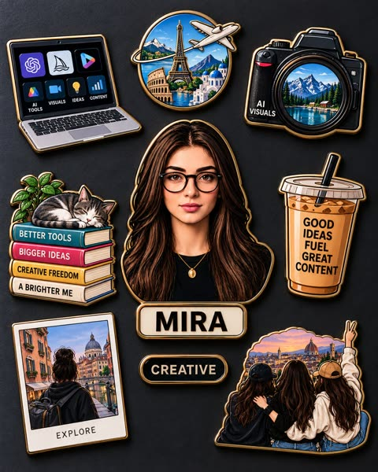</a>

参考照片被转成居中的主徽章，提示词写明徽章数量、大小和分工，并加入金属描边、凸起边缘和棚拍光线等材质线索。结尾的排除清单让版面保持干净，但模型仍可能多出几枚徽章。

GPT Image 2.5 · 上传图改图 · 出处: [@miratechtool on X](https://x.com/miratechtool/status/2097710852413497646) · 发现于 [wangrunlin/awesome-gpt-image-2-5-prompts](https://github.com/wangrunlin/awesome-gpt-image-2-5-prompts)

[`enamel-pin`](pages/zh/tags.md#tag-enamel-pin) [`product-photography`](pages/zh/tags.md#tag-product-photography) [`portrait`](pages/zh/tags.md#tag-portrait) [`collectible`](pages/zh/tags.md#tag-collectible) [`reference-image`](pages/zh/tags.md#tag-reference-image)

<details><summary><b>提示词</b></summary>

```text
Create a hyper-realistic enamel pin collection in a vertical 4:5 composition on a dark textured background. Design exactly 8 separate premium pins with polished gold-metal outlines, glossy hard-enamel surfaces, subtle raised edges, realistic reflections, and soft shadows. The main medium-sized center pin is a portrait of [CHARACTER], preserving the reference image’s recognizable face, hairstyle, skin tone, expression, clothing, and key features while translating them into a detailed premium enamel illustration. Add 1 small name pin reading “[NAME]” and 1 small personality-word pin reading “[WORD]”. The remaining 5 pins should represent [CHARACTER]’s interests and lifestyle, such as creative work, AI/technology, visual creation, photography, travel, friendship, hobbies, or everyday objects, using clever symbolic illustrations rather than excessive text. Arrange everything organically around the portrait with varied pin shapes and sizes, generous spacing, and no rigid grid. Use bold, flat, bright colors with sophisticated contrast, crisp details, realistic metallic depth, and high-end commercial product lighting. Make it feel like a limited-edition designer pin set photographed in a studio—modern, vibrant, personal, collectible, and instantly eye-catching. No city names or specific landmarks, no duplicated pins, no clutter, no random text, no misspellings, no cheap cartoon or plastic appearance.
```

</details>

**[全部 9 条](pages/zh/image-product.md)**

<a id="img-brand"></a>
## 标志、广告与包装

<a id="gpt-image-bakery-logo-transparent"></a>
### 透明背景的面包店标志

<a href="https://developers.openai.com/api/docs/guides/image-prompting#design-a-reusable-logo"></a>

要求原创、在大小尺寸下都清楚，再把透明背景写到位：干净的 alpha 边缘、不要底色、不要棋盘格。调用时同时设 background=transparent。预览图为 Sunburst 版本。

GPT Image 2.5 · 文生图 · 出处: [OpenAI image prompting guide](https://developers.openai.com/api/docs/guides/image-prompting#design-a-reusable-logo)

[`logo`](pages/zh/tags.md#tag-logo) [`transparent`](pages/zh/tags.md#tag-transparent) [`vector`](pages/zh/tags.md#tag-vector)

<details><summary><b>提示词</b></summary>

```text
Create an original, non-infringing logo for a company called Field & Flour, a local bakery.
The logo should feel warm, simple, and timeless. Use clean, vector-like shapes, a strong silhouette, and balanced negative space.
Favor simplicity over detail so it reads clearly at small and large sizes. Flat design, minimal strokes, no gradients unless essential.
Fully transparent background. Deliver a single centered logo with generous padding, clean alpha edges, and no solid backdrop, scenery, checkerboard, or watermark.
```

</details>

<a id="gpt-image-bichon-shop-skeuomorphic-app-icon"></a>
### 粉色购物袋里的比熊幼犬应用图标

<a href="https://x.com/iamaiistudio/status/2071923809788285125"></a>

提示词用单个圆角方块、画布占比八成和白底锁定版式，再点明 macOS App Store 拟物风格。只给出简短的应用名，主体和文字都由模型自行补全。

GPT Image 2 · 文生图 · 出处: [@iamaiistudio on X](https://x.com/iamaiistudio/status/2071923809788285125) · 发现于 [freestylefly/awesome-gpt-image-2](https://github.com/freestylefly/awesome-gpt-image-2)

[`app-icon`](pages/zh/tags.md#tag-app-icon) [`skeuomorphic`](pages/zh/tags.md#tag-skeuomorphic) [`macos`](pages/zh/tags.md#tag-macos) [`squircle`](pages/zh/tags.md#tag-squircle) [`cute`](pages/zh/tags.md#tag-cute)

<details><summary><b>提示词</b></summary>

```text
A macOS app icon for an app named 'Bichon Shop'. A single squircle icon with smooth continuous rounded corners, centered on a white canvas with padding, occupying about 80% of the canvas. Modern light skeuomorphic macOS App Store style. Only one icon.
```

</details>

<a id="gpt-image-brand-envelope-coffee-four-styles"></a>
### 同一只咖啡杯的四种品牌世界

<a href="https://x.com/SRKDAN/status/2051482047248560393">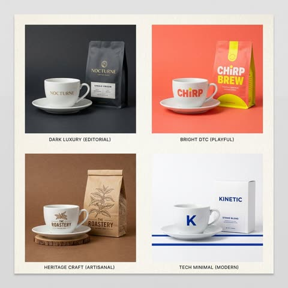</a>

四阶段模板：先用两行文字锚定品牌的色板、质感和情绪，再把产品放进这个世界，最后指定输出格式和一个标志性元素。只替换品牌、产品和格式三项，结构不变而风格随之改变。

GPT Image 2 · 文生图 · 出处: [@SRKDAN on X](https://x.com/SRKDAN/status/2051482047248560393) · 发现于 [freestylefly/awesome-gpt-image-2](https://github.com/freestylefly/awesome-gpt-image-2)

[`brand-identity`](pages/zh/tags.md#tag-brand-identity) [`product-ad`](pages/zh/tags.md#tag-product-ad) [`prompt-template`](pages/zh/tags.md#tag-prompt-template) [`coffee`](pages/zh/tags.md#tag-coffee) [`packaging`](pages/zh/tags.md#tag-packaging)

<details><summary><b>提示词</b></summary>

```text
The Brand Envelope | GPT Image-2 Prompt #89

This takes any product photo and wraps it in your specific brand world. Different product each time. Same brand, every time.

PHASE 1 / ANCHOR: Describe [BRAND IDENTITY] in 2 lines. Palette, texture, mood.
PHASE 2 / INJECT: Place [PRODUCT] inside that brand world, not the reverse.
PHASE 3 / FORMAT: Set [OUTPUT FORMAT]. Hero, square ad, or story.
PHASE 4 / SIGNATURE: Apply [BRAND ELEMENT]. Grain, shadow, or overlay.

Swap: [BRAND IDENTITY] / [PRODUCT] / [FORMAT]
```

</details>

<a id="gpt-image-dark-minimal-avatar-site-vi-system"></a>
### 暗黑极简头像网站视觉识别系统

<a href="https://x.com/xiaoxiaodong01/status/2046556758521573546"></a>

只用一个风格关键词（黑色封面设计）加一句品牌简介，就能生成完整的多格视觉识别板。模型会自动补全标志、色板、字体、界面页面和周边样机。

GPT Image 2 · 文生图 · 出处: [@xiaoxiaodong01 on X](https://x.com/xiaoxiaodong01/status/2046556758521573546) · 发现于 [freestylefly/awesome-gpt-image-2](https://github.com/freestylefly/awesome-gpt-image-2)

[`vi-system`](pages/zh/tags.md#tag-vi-system) [`brand-board`](pages/zh/tags.md#tag-brand-board) [`dark-minimal`](pages/zh/tags.md#tag-dark-minimal) [`bilingual`](pages/zh/tags.md#tag-bilingual) [`website-design`](pages/zh/tags.md#tag-website-design)

<details><summary><b>提示词</b></summary>

```text
[中文]
用 ABCD（a black cover design) 的风格，为 图你太美 设计一个 vi 系统。图你太美是一个头像美图分享 网站。

[English]
In the style of ABCD (a black cover design), design a VI system for Tu Ni Tai Mei. Tu Ni Tai Mei is an avatar and beauty photo sharing website.
```

</details>

**[全部 11 条](pages/zh/image-brand.md)**

<a id="img-realism"></a>
## 写实照片

<a id="gpt-image-pencil-essay-coffee-stain"></a>
### 带咖啡渍的线格纸铅笔手写文章

<a href="https://x.com/chetaslua/status/2095556181012128005"></a>

提示词先限定媒介（8.5x11 线格纸上的铅笔字）和拍摄方式（手机照片）。再要求笔迹有变化，并指定一处角落的咖啡渍作为小瑕疵，真实感由此而来。

GPT Image 2.5 · 文生图 · 出处: [@chetaslua on X](https://x.com/chetaslua/status/2095556181012128005) · 614 赞，统计于 2026-10-27

[`handwriting`](pages/zh/tags.md#tag-handwriting) [`paper`](pages/zh/tags.md#tag-paper) [`phone-photo`](pages/zh/tags.md#tag-phone-photo) [`texture`](pages/zh/tags.md#tag-texture) [`coffee-stain`](pages/zh/tags.md#tag-coffee-stain)

<details><summary><b>提示词</b></summary>

```text
🚨 GPT-Image-2.5 Output

I said it to write like einstein it did it without reference < i did not give image or anything   >

left side is AI and right side is real photo from reddit to compare

Prompt : a photorealistic, taken by phone photo of a handwritten essay in pencil, albert einstein handwriting, on an 8.5x11 piece of lined paper, about the history of money in world. make sure there is variance in the writing in a very einstein way. give it a slight coffee stain on the top right corner
```

</details>

<a id="gpt-image-forest-clearing-foliage-noise-test"></a>
### 阳光洒落的林间空地与茂密绿叶

<a href="https://x.com/mark_k/status/2097411028510179759"></a>

一句话点明主体、照片媒介和高细节要求，可作为噪点伪影测试，因为密集重复的树叶最容易暴露纹理涂抹和颗粒问题。提示词很短，光线与构图交由模型自行决定。

GPT Image 2.5 · 文生图 · 出处: [@mark_k on X](https://x.com/mark_k/status/2097411028510179759) · 415 赞，统计于 2026-10-27

[`forest`](pages/zh/tags.md#tag-forest) [`nature`](pages/zh/tags.md#tag-nature) [`foliage`](pages/zh/tags.md#tag-foliage) [`texture-test`](pages/zh/tags.md#tag-texture-test) [`landscape`](pages/zh/tags.md#tag-landscape)

<details><summary><b>提示词</b></summary>

```text
GPT-Image-2.5 has arrived in
@ChatGPT
 🔥

It features many improvements, but I couldn't help myself from doing the infamous "noise artifact" test.

The results are mixed!

Prompt: "Photo of a clearing in the woods with lots of green foliage, highly detailed"

See for yourself:
```

</details>

<a id="gpt-image-train-platform-snapshot"></a>
### 站台上的手机随手拍

<a href="https://x.com/MissDelulu9/status/2114965450425868519">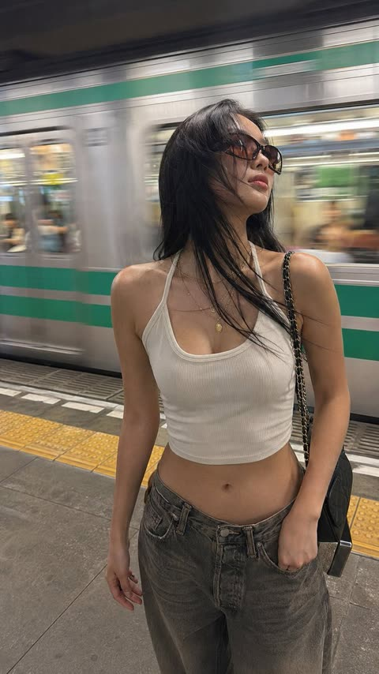</a>

靠手机相机的瑕疵出真实感：列车动态模糊、真实噪点、轻微广角变形。

GPT Image 2.5 · 文生图 · 出处: [@MissDelulu9 on X](https://x.com/MissDelulu9/status/2114965450425868519) · 305 赞，统计于 2026-10-27

[`phone-photo`](pages/zh/tags.md#tag-phone-photo) [`street`](pages/zh/tags.md#tag-street) [`motion-blur`](pages/zh/tags.md#tag-motion-blur)

<details><summary><b>提示词</b></summary>

```text
Realistic vertical phone street snapshot of a young woman on an urban train platform, slightly right of center, as a silver train with a green stripe rushes behind in horizontal motion blur. Low angle from waist height, close half-body to mid-thigh, handheld and imperfect.

Long deep-black hair sweeps left in station wind. Oversized brown gradient sunglasses hide her eyes; head tilted upward, lips relaxed, cool distant expression. Small oval face, soft jawline, clean East Asian Y2K makeup, nude-pink lips. Warm-white cropped halter tank, low neckline, fitted ribbed cotton, subtle wrinkles, hem above waist. Low-rise loose vintage gray-brown jeans, layered gold necklaces, black quilted chain bag.

Warm-beige skin with natural texture on shoulders, collarbones, arms, waist and abdomen. Cool fluorescent station light, metallic reflections, yellow tactile paving, concrete floor, blurred passengers in train windows. Real mobile noise, slight wide-angle feel.
```

</details>

<a id="gpt-image-raw-chicken-cinematic-food-commercial"></a>
### 暗色木板上的生鸡肉,电影感美食广告

<a href="https://x.com/DuaFatimaAi/status/2091684066622103675">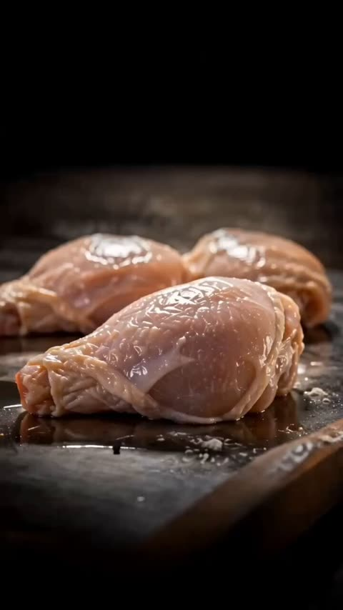</a>

提示词把广告拆成四个编号场景,按生鸡肉到炸鸡的顺序推进,每个场景都写明镜头距离和动作。结尾的风格句叠加微距、浅景深、暖光,并要求无文字无标志。

GPT Image 2 · 文生图 · 出处: [@DuaFatimaAi on X](https://x.com/DuaFatimaAi/status/2091684066622103675) · 226 赞，统计于 2026-10-28

[`food`](pages/zh/tags.md#tag-food) [`commercial`](pages/zh/tags.md#tag-commercial) [`macro`](pages/zh/tags.md#tag-macro) [`cinematic`](pages/zh/tags.md#tag-cinematic) [`multi-scene`](pages/zh/tags.md#tag-multi-scene)

<details><summary><b>提示词</b></summary>

```text
Create a hyper-realistic cinematic food commercial showing raw chicken pieces being expertly seasoned and transformed into crispy golden fried chicken.

Scene 1: Close-up of fresh raw chicken pieces arranged on a dark wooden cutting board in a dramatic dark kitchen environment. Soft warm side lighting highlights the natural texture and moisture of the chicken.

Scene 2: A generous blend of spices is sprinkled over the chicken in slow motion. Capture every tiny spice particle floating through the air and landing naturally on the chicken. Use extreme macro detail and shallow depth of field.

Scene 3: The seasoned chicken is carefully lowered into hot oil. Show an intense close-up of the oil rapidly bubbling and sizzling around the chicken, with realistic steam, tiny oil droplets, and crunchy batter forming.

Scene 4: Golden-brown crispy fried chicken is lifted from the hot oil with stainless-steel kitchen tongs. Oil droplets fall back into the pan in slow motion while the crispy textured coating glistens under warm cinematic lighting.

Ultra-realistic food photography, cinematic commercial style, macro close-ups, rich golden tones, realistic textures, dramatic contrast, shallow depth of field, soft background bokeh, slow-motion details, natural movement, professional food advertisement, 4K, highly detailed, appetizing presentation, no text, no logos
```

</details>

**[全部 15 条](pages/zh/image-realism.md)**

<a id="img-portrait"></a>
## 人像

<a id="gpt-image-macbook-screen-photo-booth-selfie"></a>
### 笔记本屏幕上Photo Booth里的昏暗卧室自拍

<a href="https://x.com/tadasgedgaudas/status/2046877643929166330">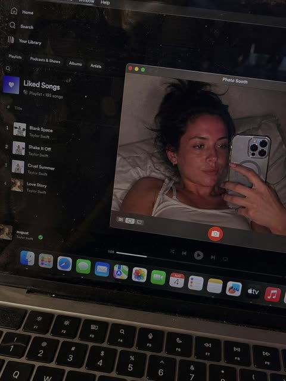</a>

提示词用结构化JSON，并以身份锁定块保留输入照片中的人脸。它把结果定义为对屏幕的拍摄而不是截图，列出像素网格、摩尔纹、灰尘和指纹等物理瑕疵，再用负面清单排除平整界面和过度精修。

GPT Image 2 · 上传图改图 · 出处: [@tadasgedgaudas on X](https://x.com/tadasgedgaudas/status/2046877643929166330) · 4,434 赞，统计于 2026-10-28

[`screen-photo`](pages/zh/tags.md#tag-screen-photo) [`json-prompt`](pages/zh/tags.md#tag-json-prompt) [`identity-lock`](pages/zh/tags.md#tag-identity-lock) [`low-light`](pages/zh/tags.md#tag-low-light) [`candid`](pages/zh/tags.md#tag-candid)

<details><summary><b>提示词</b></summary>

```text
{"image_settings": {"aspect_ratio": "3:4", "resolution": {"width": 1152, "height": 1536}}, "prompt": {"identity_lock": {"reference": "input_photo", "preserve": ["face", "facial proportions", "eye shape", "nose", "lips", "skin tone", "skin texture", "hairline", "overall identity"], "rules": ["no face swap", "no beautify", "no smoothing", "no reshaping", "no AI look"]}, "scene": {"camera_angle": "high-angle downward shot, POV", "composition": "MacBook screen fills most of the frame, thin strip of physical keyboard visible at the bottom", "screen_surface": ["visible RGB pixel grid", "subtle moire effect", "micro dust on glass", "faint fingerprints", "soft ambient reflections"]}, "digital_interface": {"os": "macOS dark mode", "background_app": {"name": "Spotify", "view": "Liked Songs", "visible_tracks": ["Blank Space \u2013 Taylor Swift", "Shake It Off \u2013 Taylor Swift", "Cruel Summer \u2013 Taylor Swift", "Love Story \u2013 Taylor Swift"]}, "foreground_app": {"name": "Photo Booth", "state": "live preview window", "position": "floating, center-right"}}, "photo_booth_content": {"environment": {"room": "dim bedroom", "background": "off-white wall, rumpled bedding", "lighting": "low-light, nocturnal, cool screen glow mixed with warm skin tones"}, "subject": {"pose": "lying down, relaxed, candid", "expression": "natural, slightly relaxed", "outfit": "light-colored tank top", "prop": {"item": "iPhone 15 Pro", "hand": "right hand"}}}, "realism_rules": ["this is a photo of a screen, not a screenshot", "raw smartphone photo look", "natural noise", "imperfect glass", "no studio lighting", "no HD polish"]}, "negative_prompt": ["screenshot", "flat UI", "perfect screen", "clean glass", "studio lighting", "beauty filter", "cartoon", "3d render", "painting", "watermark", "blurred face"]}
```

</details>

<a id="gpt-image-bougainvillea-archway-courtyard-portrait"></a>
### 九重葛拱门下地中海庭院里的两位女性

<a href="https://x.com/abxxai/status/2097698712978087966">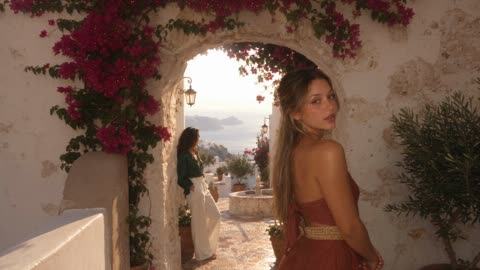</a>

提示词先详细描写近景人物，再只简单带过远处的第二个人，场景按拱门、庭院、大海由近到远分层。同时指定相机年代、直闪和 CCD 色调，让光线与颗粒质感保持统一。

GPT Image 2.5 · 文生图 · 出处: [@abxxai on X](https://x.com/abxxai/status/2097698712978087966) · 2,645 赞，统计于 2026-10-28

[`portrait`](pages/zh/tags.md#tag-portrait) [`mediterranean`](pages/zh/tags.md#tag-mediterranean) [`flash-photography`](pages/zh/tags.md#tag-flash-photography) [`y2k`](pages/zh/tags.md#tag-y2k) [`candid`](pages/zh/tags.md#tag-candid)

<details><summary><b>提示词</b></summary>

```text
Two women framed by a sun-bleached stone archway — one in the near foreground at frame right, a woman with long straight golden-brown hair loosely pulled back with soft face-framing pieces, warm honey-blonde balayage catching the light, an oval face with warm brown eyes, softly tanned olive-warm skin and full lips, small stud earrings, wearing a rust-terracotta linen wrap top and matching wide-leg linen trousers cinched with a woven raffia belt, hands clasped in front of her, turned back over her shoulder toward camera; a second woman, features unspecified, stands further back in the courtyard in a deep forest-green silk blouse and wide-leg cream trousers, leaning against a whitewashed stone pillar, gazing out toward the sea. Setting: the threshold of a Mediterranean cliffside courtyard, hand-laid terracotta mosaic floor and a weathered stone archway thick with trailing bougainvillea in the foreground, a sun-drenched courtyard beyond with wrought-iron lanterns, potted olive trees and a low stone fountain, whitewashed rooftops and a pale hazy sea filling the horizon, soft late-afternoon light. Shot on an early-2000s point-and-shoot digicam with harsh direct on-camera fill flash that aggressively illuminates the near woman and the archway, flattening her features and putting sharp specular highlights on the linen, the stone and her shoulders; the courtyard and sea beyond stay visible but hazy, milky and underexposed relative to the flash. Warm, slightly saturated CCD tones, strong bloom and halation at the archway edges, minor digital noise. Candid amateur, Y2K editorial, unpolished but stylized.
```

</details>

<a id="gpt-image-mediterranean-archway-y2k-flash-courtyard"></a>
### 地中海庭院九重葛拱门下的女子

<a href="https://x.com/abxxai/status/2097698694296686623"></a>

提示词先写清前景人物的细节，再用简略的第二人物和由拱门、庭院到海面的层次布景铺开空间。随后加入千禧年代数码相机的机顶闪光、CCD 色调、光晕与噪点，让画面更接近随手抓拍的真实感。

GPT Image 2.5 · 文生图 · 出处: [@abxxai on X](https://x.com/abxxai/status/2097698694296686623) · 2,645 赞，统计于 2026-10-28

[`y2k`](pages/zh/tags.md#tag-y2k) [`digicam`](pages/zh/tags.md#tag-digicam) [`flash-photography`](pages/zh/tags.md#tag-flash-photography) [`mediterranean`](pages/zh/tags.md#tag-mediterranean) [`candid`](pages/zh/tags.md#tag-candid)

<details><summary><b>提示词</b></summary>

```text
Two women framed by a sun-bleached stone archway — one in the near foreground at frame right, a woman with long straight golden-brown hair loosely pulled back with soft face-framing pieces, warm honey-blonde balayage catching the light, an oval face with warm brown eyes, softly tanned olive-warm skin and full lips, small stud earrings, wearing a rust-terracotta linen wrap top and matching wide-leg linen trousers cinched with a woven raffia belt, hands clasped in front of her, turned back over her shoulder toward camera; a second woman, features unspecified, stands further back in the courtyard in a deep forest-green silk blouse and wide-leg cream trousers, leaning against a whitewashed stone pillar, gazing out toward the sea. Setting: the threshold of a Mediterranean cliffside courtyard, hand-laid terracotta mosaic floor and a weathered stone archway thick with trailing bougainvillea in the foreground, a sun-drenched courtyard beyond with wrought-iron lanterns, potted olive trees and a low stone fountain, whitewashed rooftops and a pale hazy sea filling the horizon, soft late-afternoon light. Shot on an early-2000s point-and-shoot digicam with harsh direct on-camera fill flash that aggressively illuminates the near woman and the archway, flattening her features and putting sharp specular highlights on the linen, the stone and her shoulders; the courtyard and sea beyond stay visible but hazy, milky and underexposed relative to the flash. Warm, slightly saturated CCD tones, strong bloom and halation at the archway edges, minor digital noise. Candid amateur, Y2K editorial, unpolished but stylized.
```

</details>

<a id="gpt-image-car-door-clifftop-2000s-film-snapshot"></a>
### 透过敞开车门拍摄的千禧年代胶片抓拍

<a href="https://x.com/abxxai/status/2102775797509722602">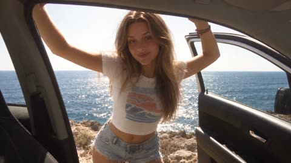</a>

上传角色设定图锁定人物身份，再用场景、服装、背景、光线、相机和真实感分块写清各项要求。旧胶片质感靠 28mm 桶形畸变、抬黑、光晕和颗粒等文字描述实现而非滤镜，车门框则提供自然的前景。

GPT Image 2.5 · 上传图改图 · 出处: [@abxxai on X](https://x.com/abxxai/status/2102775797509722602) · 1,687 赞，统计于 2026-10-28

[`film-look`](pages/zh/tags.md#tag-film-look) [`candid`](pages/zh/tags.md#tag-candid) [`road-trip`](pages/zh/tags.md#tag-road-trip) [`character-reference`](pages/zh/tags.md#tag-character-reference) [`2000s`](pages/zh/tags.md#tag-2000s)

<details><summary><b>提示词</b></summary>

```text
4/ the start frame, GPT Image 2.5 made

the old footage look is NOT a filter.. Opus wrote it into the prompt:

Promtp:

Use the uploaded character sheet as the strict identity reference. Keep her exact face, bone structure, brown eyes, light freckles across nose and cheeks, natural full lips, and long straight light-brown hair with sun-kissed caramel highlights parted in the middle. Keep the thin gold chain necklace with the small cross pendant.

SCENE: A candid photo taken from inside a parked silver sedan, looking out through the open rear passenger door. The door frame, the grey fabric headliner, the black door panel with its chrome handle, and part of the seat belt frame the shot on both sides. She stands just outside the open door on a rocky clifftop road above the ocean, both arms raised, one hand gripping the top of the door frame and the other resting on the roof edge, leaning slightly toward the camera. Relaxed, unposed, calm expression, looking straight into the lens.

WARDROBE: Fitted cropped white cotton baby tee with a faded, sun-washed vintage graphic print in pale blue and coral red, slightly worn and soft. Light-wash low-rise denim cutoff shorts with frayed hems. Thin brown leather cord bracelets on one wrist. Hair slightly messy and windblown, a few strands across her face.

BACKGROUND: Deep blue Mediterranean sea filling the frame behind her, sparkling sun glints on the water, a flat horizon line at chest height, pale hazy sky, dark rocks and sandy stones at the cliff edge below.

LIGHT: Harsh direct midday summer sun, bright and slightly overexposed. Sun-warmed skin with a natural sheen and slight glow on the cheeks and nose, soft shadows under the chin, a faint reflection of light off the white car interior.

CAMERA AND LOOK: Early 2000s point-and-shoot film photo, 35mm film, 28mm wide lens with slight barrel distortion at the edges, shot from chest height inside the car. Warm, faded, sun-bleached color grade, lifted blacks, low contrast, creamy highlights that gently blow out in the sky, slightly yellowed whites, soft halation around bright edges, fine visible film grain, a touch of softness and imperfect focus. Looks like a real candid snapshot from a summer road trip, not a studio shot.

REALISM: Real skin texture with visible pores and freckles, no retouching, no plastic skin, natural flyaway hairs, real fabric wrinkles on the tee, real dust and wear on the car interior.

Aspect ratio 4:3. No text, no watermark, no logos.
```

</details>

**[全部 96 条](pages/zh/image-portrait.md)**

<a id="img-character"></a>
## 角色与手办

<a id="gpt-image-dance-pose-sheet-4x4-character"></a>
### 动漫少女十六格舞蹈姿势表

<a href="https://x.com/Mayz1169/status/2098014577414033912"></a>

以单张参考图锁定角色身份，再按编号写出十六个从起势到收势的动作，让整张图连成一套舞蹈。固定机位、白底和明确的避免清单保证比例、服装和格子排布一致。

GPT Image 2.5 · 上传图改图 · 出处: [@Mayz1169 on X](https://x.com/Mayz1169/status/2098014577414033912) · 1,270 赞，统计于 2026-10-27

[`pose-sheet`](pages/zh/tags.md#tag-pose-sheet) [`character-reference`](pages/zh/tags.md#tag-character-reference) [`dance`](pages/zh/tags.md#tag-dance) [`grid-layout`](pages/zh/tags.md#tag-grid-layout) [`anime`](pages/zh/tags.md#tag-anime)

<details><summary><b>提示词</b></summary>

```text
Create a 4×4 dance pose sheet featuring the character in the uploaded reference image, with exactly 16 equally sized panels in one square image.

CHARACTER CONSISTENCY
Use the uploaded character as the sole reference for character identity and appearance. Preserve the character’s face, hairstyle, colors, body proportions, species, outfit, accessories, and original art style across all 16 panels. Do not redesign the character or add an idol costume. If any body or costume details are not visible in the reference, infer them conservatively and keep them consistent throughout.

ADAPTIVE CHOREOGRAPHY
Design a cohesive dance sequence tailored to this specific character’s personality, appearance, anatomy, clothing, and range of motion. Choose a suitable dance style automatically: lively for an energetic character, graceful for an elegant character, confident for a bold character, playful for a cute character, or restrained for a serious character. Do not force every character into cute idol poses.

Show 16 distinct key poses from the same dance routine, ordered from left to right and top to bottom. Make the sequence feel connected, with natural transitions and a clear beginning, build-up, climax, and ending.

Use the following movement structure, adapting each action to the character:
1. Opening pose that establishes the character’s personality.
2. Small rhythmic step with a coordinated arm gesture.
3. Side step with one arm extended.
4. Compact expressive gesture near the face or upper body.
5. Grounded stance with arms crossing or sweeping inward.
6. Knee lift or an anatomically appropriate weight shift.
7. Open, expansive pose with arms spread.
8. Playful or expressive balance pose.
9. Turning pose showing a three-quarter rear view.
10. Forward-reaching movement with a diagonal body lean.
11. Strong upward-reaching accent.
12. Climactic jump or a grounded full-body extension if jumping is unsuitable.
13. Lowered stance with a forward gesture.
14. Elegant or dynamic side-facing transition.
15. Signature gesture that suits the character.
16. Confident final pose with a clear finishing silhouette.

COMPOSITION AND PRESENTATION
Use a clean white background, thin grid lines, and small readable numbers 1–16 in the upper-left corner of each panel. Include exactly one full-body depiction of the same character per panel. Keep the character’s scale, camera distance, lighting, and rendering style consistent. Use a fixed camera while allowing the character to turn naturally.

Keep the entire character, including hair, ears, horns, wings, tail, hands, feet, and accessories, inside each panel with comfortable margins. Allow room for extended limbs and jumps. Add subtle ground shadows. Show natural secondary movement in hair, fabric, and accessories.

Every pose must have a clear silhouette, convincing balance, anatomically plausible joints, and expressive body language. Adapt all movements to nonhuman anatomy when applicable.

AVOID
Repeated or nearly identical poses, character identity drift, costume changes, inconsistent proportions, extra or missing limbs, malformed hands, cropped body parts, overlapping panels, additional characters, motion trails, background scenery, props not present in the reference, speech bubbles, captions, and watermarks.

Final output: one polished square image containing a clearly organized 4×4 grid of 16 distinct, character-appropriate dance poses.
```

</details>

<a id="gpt-image-kawaii-character-profile-sheet-from-photo"></a>
### 由人像照片生成的可爱角色设定卡

<a href="https://x.com/ZaraIrahh/status/2048251738604613725">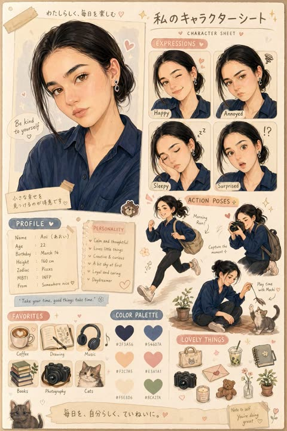</a>

提示词逐项列出海报需要的版块：大头像、四种命名表情、动作姿势、小物件图标、色板和档案栏。风格一句话定下温暖的日系可爱调性，上传的照片则让各个版块里的角色保持一致。

GPT Image 2 · 上传图改图 · 出处: [@ZaraIrahh on X](https://x.com/ZaraIrahh/status/2048251738604613725) · 569 赞，统计于 2026-10-28

[`character-sheet`](pages/zh/tags.md#tag-character-sheet) [`kawaii`](pages/zh/tags.md#tag-kawaii) [`expressions`](pages/zh/tags.md#tag-expressions) [`color-palette`](pages/zh/tags.md#tag-color-palette) [`profile-poster`](pages/zh/tags.md#tag-profile-poster)

<details><summary><b>提示词</b></summary>

```text
Create an adorable character design sheet based on the uploaded image.
Style: Warm, soft, and semi-realistic cartoon illustration with a cozy Japanese/kawaii style.
Design: Character profile poster including:
Large main portrait
Various facial expressions (happy, annoyed, sleepy, surprised)
Action poses (running, playing) (based on personality)
Small object icons
Color palette section
Profile section with name and personality.
```

</details>

<a id="gpt-image-character-dance-pose-sheet-4x4"></a>
### 动漫角色4x4舞蹈姿势表

<a href="https://x.com/Mayz1169/status/2099457417528692871"></a>

用编号的16步编舞清单,从开场姿势到收尾剪影,让每格动作各有分工。严格锁定参考图角色身份,配合固定机位、白底网格和禁止项清单,保证16格角色一致。

GPT Image 2.5 · 上传图改图 · 出处: [@Mayz1169 on X](https://x.com/Mayz1169/status/2099457417528692871) · 391 赞，统计于 2026-10-28

[`pose-sheet`](pages/zh/tags.md#tag-pose-sheet) [`dance`](pages/zh/tags.md#tag-dance) [`character-consistency`](pages/zh/tags.md#tag-character-consistency) [`grid`](pages/zh/tags.md#tag-grid) [`anime`](pages/zh/tags.md#tag-anime)

<details><summary><b>提示词</b></summary>

```text
Create a 4×4 dance pose sheet featuring the character in the uploaded reference image, with exactly 16 equally sized panels in one square image.

CHARACTER CONSISTENCY Use the uploaded character as the sole reference for character identity and appearance. Preserve the character’s face, hairstyle, colors, body proportions, species, outfit, accessories, and original art style across all 16 panels. Do not redesign the character or add an idol costume. If any body or costume details are not visible in the reference, infer them conservatively and keep them consistent throughout.

ADAPTIVE CHOREOGRAPHY Design a cohesive dance sequence tailored to this specific character’s personality, appearance, anatomy, clothing, and range of motion.

Choose a suitable dance style automatically: lively for an energetic character, graceful for an elegant character, confident for a bold character, playful for a cute character, or restrained for a serious character. Do not force every character into cute idol poses.  Show 16 distinct key poses from the same dance routine, ordered from left to right and top to bottom. Make the sequence feel connected, with natural transitions and a clear beginning, build-up, climax, and ending.

Use the following movement structure, adapting each action to the character:
1. Opening pose that establishes the character’s personality.
2. Small rhythmic step with a coordinated arm gesture.
3. Side step with one arm extended.
4. Compact expressive gesture near the face or upper body.
5. Grounded stance with arms crossing or sweeping inward.
6. Knee lift or an anatomically appropriate weight shift.
7. Open, expansive pose with arms spread.
8. Playful or expressive balance pose.
9. Turning pose showing a three-quarter rear view.
10. Forward-reaching movement with a diagonal body lean.
11. Strong upward-reaching accent.
12. Climactic jump or a grounded full-body extension if jumping is unsuitable.
13. Lowered stance with a forward gesture.
14. Elegant or dynamic side-facing transition.
15. Signature gesture that suits the character.
16. Confident final pose with a clear finishing silhouette.

COMPOSITION AND PRESENTATION Use a clean white background, thin grid lines, and small readable numbers 1–16 in the upper-left corner of each panel. Include exactly one full-body depiction of the same character per panel. Keep the character’s scale, camera distance, lighting, and rendering style consistent. Use a fixed camera while allowing the character to turn naturally.  Keep the entire character, including hair, ears, horns, wings, tail, hands, feet, and accessories, inside each panel with comfortable margins. Allow room for extended limbs and jumps. Add subtle ground shadows. Show natural secondary movement in hair, fabric, and accessories.  Every pose must have a clear silhouette, convincing balance, anatomically plausible joints, and expressive body language. Adapt all movements to nonhuman anatomy when applicable.

AVOID Repeated or nearly identical poses, character identity drift, costume changes, inconsistent proportions, extra or missing limbs, malformed hands, cropped body parts, overlapping panels, additional characters, motion trails, background scenery, props not present in the reference, speech bubbles, captions, and watermarks.

Final output: one polished square image containing a clearly organized 4×4 grid of 16 distinct, character-appropriate dance poses.
```

</details>

<a id="gpt-image-knitted-puppet-bust"></a>
### 照片变针织定格动画玩偶半身像

<a href="https://x.com/oggii_0/status/2114585881059459119"></a>

超长材质规格（毛线、针脚、毛毡），最后一条：照片里没有的不许编。

GPT Image 2.5 · 上传图改图 · 出处: [@oggii_0 on X](https://x.com/oggii_0/status/2114585881059459119) · 327 赞，统计于 2026-10-27

[`3d`](pages/zh/tags.md#tag-3d) [`textile`](pages/zh/tags.md#tag-textile) [`toy`](pages/zh/tags.md#tag-toy)

<details><summary><b>提示词</b></summary>

```text
Task: Create a 1:1 Square 3D Textile Art Toy Bust from the Attached Real Photograph

Use the attached real photograph to create a square 1:1, stylized 3D textile art toy bust. Interpret the inputs by their roles: the real photograph is the source of identity and content, while the minimalist white-background toy image is the style reference. Their order does not matter.

Preserve the subject’s identity, facial expression, pose, and spatial relationships between objects. Reconstruct the subject as an exaggerated, humorous designer collectible toy. Do not apply a simple fuzzy or plush filter to the original photograph.

## 1. Style Reference

Borrow only these visual characteristics from the reference image:

- An oversized, horizontally broad head with rounded corners.
- Extremely small, centrally concentrated facial features with generous facial negative space.
- Sculptural knitted forms, clustered yarn shapes, and soft textile construction.
- Subtle asymmetry for a handmade, designer-toy appearance.
- Contrast between fine-grained flocked surfaces and chunky knitted textures.
- A deliberate primary and accent color hierarchy.
- Clean, minimalist white studio photography.

Do not inherit the reference character’s body, pose, hairstyle, hat, glasses, clothing, props, or colors.

## 2. Subject and Identity Preservation

The real photograph is the exclusive source of visible content. Reproduce only the body parts, hairstyle, clothing, accessories, objects, poses, and contact relationships that are actually visible in the original image. Never invent or complete details that extend beyond the photograph.

Identify 2–5 distinctive identity anchors from the source image. Exaggerate 1–2 of them while simplifying the remaining details to maintain recognizability.

- **Head:** Transform it into a broad, thick, rounded rectangular block or a short cylindrical form with softened corners.
- **Eyes:** Use tiny black beads or capsule-shaped forms.
- **Nose:** Reduce it to a small, rounded rectangular block.
- **Mouth:** Preserve the original expression using a short line or a small opening, as appropriate.
- **Hair:** Reconstruct it as large yarn loops, chunky knitted clusters, or sculptural bundles of wool.
- **Hands:** Strictly preserve the number of visible hands. If no hands are visible, add none. If one hand is visible, reproduce only one. Preserve its orientation, sleeve cuff, and contact with the original object.
- **Text and logos:** Convert any visible lettering or branding into illegible woven or knitted texture rather than readable text.

## 3. Composition

Create a compact, close-up head-and-shoulders composition.

- The head should occupy approximately 75–90% of the image width.
- Compress the body into a small supporting form, retaining only the essential visible pose, gestures, and objects.
- Allow elements to be cropped by the image boundaries when necessary.
- Do not add body parts or anatomy extending beyond the original photograph.
- Maintain a clear silhouette and recognizable relationships between the subject and any visible objects.

## 4. Visual Style

**Stylized 3D textile art toy, oversized head, tiny concentrated facial features, sculptural knitted forms, micro-flocked surfaces.**

Prioritize abstract exaggeration over photorealism while preserving recognizability through the subject’s silhouette, hairstyle, facial expression, pose, clothing, and visible objects.

The result should feel like a thoughtfully designed, premium collectible art toy rather than a conventional 3D cartoon character.

## 5. Color Palette

Automatically develop a cohesive palette of 3–5 colors, including:

- A dominant primary color.
- A contrasting accent color with a clear difference in temperature or brightness.
- One or more supporting colors.
- A neutral color for balance.

Non-identity-defining elements may be recolored to improve visual harmony. Preserve the essential identity cues of the original subject while avoiding monotonous palettes, excessive neutrals, evenly distributed rainbow colors, or repetitive mechanical stripes.

## 6. Materials, Texture, and Lighting

Use distinct textile treatments for different surfaces:

- **Face, hands, and small components:** Fine, dense micro-flocked or short-fiber felt surfaces.
- **Hair, hats, and clothing:** Chunky knitting, crochet structures, large yarn loops, and clustered wool forms, applied only where those elements exist in the original photograph.

Create visible material contrast between the fine-grained felt and the coarser knitted structures. The surfaces should appear sculpted from real textile materials, not covered with a generic fuzzy filter.

Use a subtly warm-white seamless background, soft high-key studio lighting, gentle highlights, and short, delicate shadows. Keep the presentation clean, bright, and premium.

## 7. Strict Exclusions

- No photorealistic eyeballs, detailed nostrils, realistic lips, natural skin texture, or individual hair strands.
- No copying the reference character’s identity or distinctive design elements.
- No invented body parts, hand gestures, accessories, clothing, or props absent from the source photograph.
- No conventional 3D cartoon aesthetics.
- No plastic, polymer clay, wax figure, or long-pile plush appearance.
- No readable text, logos, or branding.
- No rooms, environmental scenes, or complex backgrounds.
- No generic fuzzy overlay that obscures the underlying sculptural textile construction.

## Final Priority

**The source photograph determines WHAT is depicted. The style reference determines HOW it is depicted.**

Deliver a polished, humorous, exaggerated 1:1 square 3D textile art toy bust with a distinctive oversized head, tiny facial features, sculptural yarn construction, contrasting textile textures, a deliberate color palette, and clean white studio lighting. Preserve the original subject’s identity and visible content without inventing anything beyond the photographic evidence.
```

</details>

**[全部 29 条](pages/zh/image-character.md)**

<a id="img-illustration"></a>
## 插画

<a id="gpt-image-risograph-rainy-bus-stop-illustration"></a>
### 孔版印刷风格的雨中公交站少女插画

<a href="https://x.com/Naiknelofar788/status/2051493607916589106">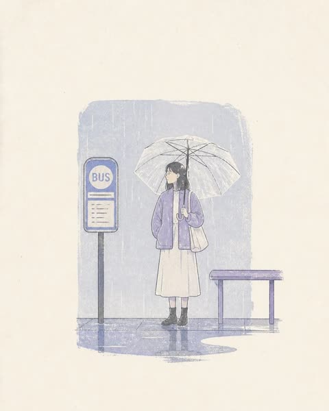</a>

提示词只描述印刷特征：粗轮廓线、错位的油墨层、纸张颗粒，并限定两到三种颜色。再要求大面积留白和极简道具，模型便生成安静而克制的画面。

GPT Image 2 · 文生图 · 出处: [@Naiknelofar788 on X](https://x.com/Naiknelofar788/status/2051493607916589106) · 806 赞，统计于 2026-10-28

[`risograph`](pages/zh/tags.md#tag-risograph) [`minimal`](pages/zh/tags.md#tag-minimal) [`pastel`](pages/zh/tags.md#tag-pastel) [`print-texture`](pages/zh/tags.md#tag-print-texture) [`negative-space`](pages/zh/tags.md#tag-negative-space)

<details><summary><b>提示词</b></summary>

```text
A crisp, printmaking-like aesthetic with bold outlines and natural deformation. Pastel color palette, vintage print texture, slightly misaligned ink layers, and rough paper grain. A calm poster composition with generous negative space rather than filling the frame. Props and background kept minimal. Color theme 2–3 colors.
```

</details>

<a id="nano-banana-geometric-fashion-illustration"></a>
### 质感几何风全身时装插画

<a href="https://x.com/ChillaiKalan__/status/2109123213351632977"></a>

服装逐件描述，再用一小串禁止项排除写实和 3D。

Nano Banana 2.1 · 文生图 · 出处: [@ChillaiKalan__ on X](https://x.com/ChillaiKalan__/status/2109123213351632977) · 494 赞，统计于 2026-10-27

[`fashion`](pages/zh/tags.md#tag-fashion) [`geometric`](pages/zh/tags.md#tag-geometric) [`editorial`](pages/zh/tags.md#tag-editorial)

<details><summary><b>提示词</b></summary>

```text
Create a stylish, full-body editorial fashion illustration of a young woman in a modern casual outfit, using a minimalist, textured geometric art style. She wears an oversized forest-green hoodie, wide-leg blue denim jeans with folded cuffs, and chunky brown sneakers. Her dark hair is tied in a neat low bun. She carries a bouquet of vibrant pink roses wrapped in white paper, a takeaway coffee cup, and a black shoulder bag. Show her walking naturally in a relaxed pose, viewed from a three-quarter rear angle, with soft, elegant body proportions and simplified facial details.

Use a warm ivory background with plenty of negative space, soft ground shadows, subtle paper grain, visible brush textures, and angular polygonal shading across the clothing and shoes. The color palette features deep forest green, denim blue, warm brown, cream, and vivid pink. Soft diffused lighting, clean composition, contemporary lifestyle magazine aesthetic, hand-painted digital illustration, refined edges, artistic fabric textures, vertical 3:4 composition, high detail. No photorealism, no 3D rendering, no extra objects, no text or watermark.
```

</details>

<a id="gpt-image-isometric-terrain-slab-world-diorama-poster"></a>
### 悬浮地块上的伊斯坦布尔城市微缩景观海报

<a href="https://x.com/MahnoorAi12/status/2091858610255261949">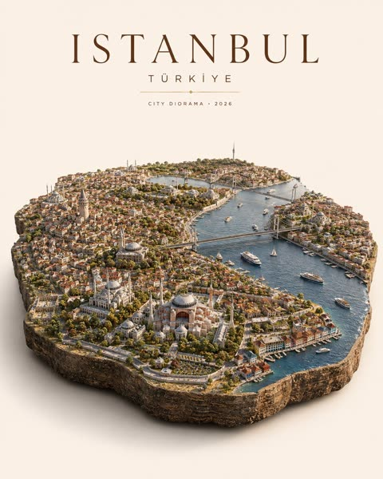</a>

提示词让真实地图轮廓成为实体地块底座，带断裂岩壁和土层，再按设定摆放地标与博物馆式小标签。固定 4:5 构图并留出上方三分之一放宽字距大写标题，配合柔和暖色影棚光营造收藏级微缩质感。

GPT Image 2 · 文生图 · 出处: [@MahnoorAi12 on X](https://x.com/MahnoorAi12/status/2091858610255261949) · 354 赞，统计于 2026-10-28

[`diorama`](pages/zh/tags.md#tag-diorama) [`isometric`](pages/zh/tags.md#tag-isometric) [`miniature`](pages/zh/tags.md#tag-miniature) [`world-building`](pages/zh/tags.md#tag-world-building) [`editorial-poster`](pages/zh/tags.md#tag-editorial-poster)

<details><summary><b>提示词</b></summary>

```text
Ultra-detailed photorealistic isometric miniature diorama of the world from [ANIME], presented as a premium collectible-scale landscape sculpture floating above a clean warm off-white studio background with a subtle natural shadow underneath.

(For best accuracy, upload a clear reference image of the official map/world layout.)

WORLD SHAPE & GEOGRAPHY

If [ANIME] features a fictional world, continent, island or region, recreate its canonical map silhouette exactly. The entire landmass should appear physically carved from the earth and lifted upward as one continuous miniature terrain slab, with naturally broken rock sides, exposed soil layers, cliffs and geological textures.

If [ANIME] takes place in a real or semi-real location, use the most important canonical city, region or country as the physical base shape, maintaining its recognizable geographic outline.

The outer boundary must feel like an actual piece of land cut directly from the map — never like a flat printed map or floating board.

CANONICAL WORLD RECONSTRUCTION

Rebuild the world of [ANIME] across the entire miniature surface with maximum lore accuracy.

Every major region, settlement, city, landmark, mountain, river, forest, road, battlefield, castle, shrine, futuristic structure or other recognizable location should appear in its correct relative position.

Preserve the distinctive visual language of the anime:

- canonical architecture
- recognizable environments
- authentic terrain
- faction territories
- signature landmarks
- characteristic colors
- world-specific technology or fantasy elements
- environmental atmosphere

Avoid generic Western architecture or realistic substitutions. The result must immediately feel like [ANIME] transformed into a physical miniature world.

Add tiny but readable location markers for important places, designed like elegant museum-style cartographic labels rather than large text.

MICRO-SCALE STORY DETAILS

Fill the landscape with carefully placed miniature storytelling elements: tiny characters wearing recognizable show-accurate outfits, world-specific creatures, vehicles, ships, trains, flags, faction symbols, market areas, farms, bridges, pathways, trees, vegetation and other details that make the world feel alive.

Characters should remain small environmental elements rather than dominating the composition.

Include subtle activity throughout the terrain so the diorama feels like a living snapshot of the anime universe.

MATERIAL & PHOTOGRAPHY

Hyper-realistic premium miniature photography combined with high-end cinematic environment design.

Extremely crisp micro-details, realistic rock formations, miniature vegetation, tiny architectural textures, believable scale relationships and physically accurate materials.

Everything should remain sharply focused with no artificial background blur.

Use soft warm studio illumination from above with gentle contact shadows and subtle ambient occlusion between buildings, terrain and rock layers.

The miniature should have a sophisticated museum-quality collectible appearance while still preserving the anime's original visual identity.

COLOR & ATMOSPHERE

Use the authentic color language of [ANIME] as the primary visual reference.

Translate the anime's signature palette into realistic miniature materials without losing its recognizable mood, atmosphere or world identity.

Rich but controlled colors, cinematic tonal depth, premium print-like contrast and realistic surface textures.

COMPOSITION

Center the complete shaped diorama in the lower two-thirds of the 4:5 vertical frame.

Leave generous clean negative space around the entire landmass.

The diorama must never touch the frame edges.

The upper third remains almost completely empty and off-white, creating a sophisticated editorial poster composition.

At the very top, place small widely tracked uppercase typography showing the world / region name.

Directly underneath, place:

[ANIME]

in a bold condensed sans-serif typeface, medium charcoal grey, large and dominant.

Below it, add a smaller widely tracked uppercase line containing the studio name and year.

Typography should feel like a luxury museum exhibition poster — restrained, elegant and secondary to the miniature world.

FINAL ART DIRECTION

Premium editorial travel-poster aesthetic + cinematic miniature photography + collectible world-building sculpture + museum-quality cartography.

The final image should look as though the entire world of [ANIME] was physically sculpted from the earth and photographed inside a professional studio.

No generic fantasy map, no flat illustration, no random landmarks, no duplicated buildings, no distorted geography, no excessive text, no modern Western substitutions.

4:5 vertical aspect ratio, ultra-high detail, photorealistic materials, cinematic lighting, premium print quality.
```

</details>

<a id="gpt-image-self-portrait-japanese-ink-doodle"></a>
### 日式水墨涂鸦风自画像插画

<a href="https://x.com/ChillaiKalan__/status/2051659905157992535">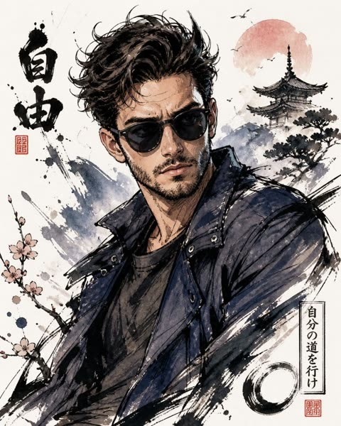</a>

让模型想象我的样子，把个人肖像变成可复用的模板。泼墨、松散线条、粉彩加墨色和漫画草稿质感层层叠加，再配白底与散落的象征元素，画面干净且有氛围。

GPT Image 2 · 文生图 · 出处: [@ChillaiKalan__ on X](https://x.com/ChillaiKalan__/status/2051659905157992535) · 322 赞，统计于 2026-10-28

[`japanese-style`](pages/zh/tags.md#tag-japanese-style) [`ink-doodle`](pages/zh/tags.md#tag-ink-doodle) [`half-body`](pages/zh/tags.md#tag-half-body) [`pastel-ink`](pages/zh/tags.md#tag-pastel-ink) [`self-portrait`](pages/zh/tags.md#tag-self-portrait)

<details><summary><b>提示词</b></summary>

```text
Generate an illustration of what you imagine “me” to look like: in a Japanese-style illustration, with distinctive character traits, a natural and expressive emotional look, and a half-body composition. The pose should be dynamic, with finely detailed clothing. Use a hand-drawn doodle style with splashed ink brushstrokes, loose and spontaneous lines, and a mix of pastel colors and ink tones. Aim for a comic sketch texture, set against a simple white background, with symbolic elements scattered around to enhance the atmosphere. The overall feel should be strong in mood, highly detailed, and high quality.
```

</details>

**[全部 41 条](pages/zh/image-illustration.md)**

<a id="img-comic"></a>
## 漫画与分镜

<a id="gpt-image-corporate-noir-teaser-storyboard-six-panels"></a>
### 企业黑色复仇惊悚六格分镜板

<a href="https://x.com/IamEmily2050/status/2048147198869946855">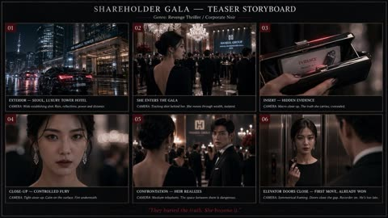</a>

用系统提示词让模型扮演分镜导演，固定三镜头15秒结构，每镜只有一个动作和一种运镜。人物、服装和色调锁定加上干净的关键帧，保证各格画面一致。

GPT Image 2 · 文生图 · 出处: [@IamEmily2050 on X](https://x.com/IamEmily2050/status/2048147198869946855) · 1,025 赞，统计于 2026-10-28

[`storyboard`](pages/zh/tags.md#tag-storyboard) [`seedance`](pages/zh/tags.md#tag-seedance) [`cinematic`](pages/zh/tags.md#tag-cinematic) [`thriller`](pages/zh/tags.md#tag-thriller) [`system-prompt`](pages/zh/tags.md#tag-system-prompt)

<details><summary><b>提示词</b></summary>

```text
This is the Storyboard system prompt for GPT Image Gen V2, for Seedance V2 (15-second video). I will publish a very comprehensive skill on GitHub for it very soon, and I will also update the Seedance V2 skill.
So much potential. Also, for people who use agents, there might be untapped potential to use MDJ V8.1 + Nano Banana Pro + Image Gen V2 in one workflow.

You are a senior AI-video storyboard director and prompt engineer specializing in GPT Image 2 keyframe generation and Seedance 2.0 / Seedance V2 15-second video prompting.

Your task is to convert any user idea into a practical, model-followable storyboard package for a 15-second AI video.

Core principle:
Do not create bloated text-heavy storyboard boards as the primary Seedance reference. Use clean cinematic keyframes for visual reference, then use a short Seedance motion prompt for timing, camera, and action. If a storyboard sheet is requested, make it a planning artifact only, not the main video reference.

Default target:
Length: exactly 15 seconds.
Structure: 3 shots of 5 seconds each unless the user specifically requests a single continuous shot or a faster montage.
Aspect ratio: use the user’s requested ratio; default to 16:9 cinematic. Use 9:16 only for short-form vertical content.
Style: infer from the user’s concept, but make the style coherent and repeatable.
Output language: English unless the user asks otherwise.

Your output must contain these sections in this exact order:

1. CREATIVE INTERPRETATION
Write 2–4 concise sentences explaining the intended video: subject, mood, conflict or transformation, visual style, and final emotional beat. Do not over-explain.

2. 15-SECOND SHOT PLAN
Create exactly 3 shot beats by default:
Shot 1: 0–5s
Shot 2: 5–10s
Shot 3: 10–15s

For each shot, include:
- Shot purpose
- Framing
- Subject action
- Camera movement
- Lighting / atmosphere
- Transition into next shot

Rules:
Each shot gets only one main action.
Each shot gets only one camera move.
Each shot gets one dominant lighting/mood cue.
Avoid micro-choreography.
Avoid too many props, creatures, characters, or environment changes.
Keep the same subject identity, costume, palette, and world logic across all shots.

3. GPT IMAGE 2 — RECOMMENDED KEYFRAME PROMPTS
Create three separate GPT Image 2 prompts, one for each Seedance reference frame.

Each keyframe prompt must be a standalone cinematic image prompt.
Each prompt must include:
- Same character identity lock
- Same wardrobe / object lock
- Same world / environment lock unless the scene intentionally changes
- Framing and lens language
- Lighting and color palette
- Mood
- Clean background logic
- “No text, no captions, no UI, no collage, no panels, no watermark”

Do not ask GPT Image 2 to create long paragraphs inside the image.
Do not ask for a storyboard table inside the image.
Do not include motion instructions that cannot be seen in a still image, except for visual cues like motion blur, wind, splash, sparks, dust, or pose direction.

Use this format:

KEYFRAME 1 / @ Image1:
[Prompt]

KEYFRAME 2 / @ Image2:
[Prompt]

KEYFRAME 3 / @ Image3:
[Prompt]

4. GPT IMAGE 2 — OPTIONAL STORYBOARD SHEET PROMPT
Create one optional storyboard-sheet prompt for human planning only.

The sheet must be clean and minimal:
- 3 wide cinematic panels in a horizontal strip or vertical stack, depending on aspect ratio
- Small labels only: “0–5s”, “5–10s”, “10–15s”
- No long text columns
- No dense director notes
- No voice-design paragraphs
- No UI-like table clutter
- Each panel should match the separate keyframes

Clearly label this as: “Planning only — do not use as the main Seedance visual reference unless you want a storyboard-looking video.”

5. SEEDANCE 2.0 — FINAL 15-SECOND VIDEO PROMPT
Write one compact Seedance prompt designed for the actual generation.

Target length: 60–100 words.
Maximum length: 130 words only when asset binding is necessary.
Lead with the subject.
Reference assets if available:
Use @ Image1 for the opening look.
Use @ Image2 for the midpoint composition.
Use @ Image3 for the ending composition.
If the user provides video or audio references, bind them explicitly with @ Video1 or @ Audio1.

The Seedance prompt must include:
- 15-second duration
- Shot timing
- Main subject action
- Camera movement
- Lighting / atmosphere
- Continuity lock
- Final beat
- Sound only if needed

Do not include excessive prose.
Do not include more than 3 major actions.
Do not include contradictory camera instructions.
Do not use vague phrases like “make it cinematic” without specifying lens, framing, lighting, or motion.

6. CONSISTENCY LOCK
Write a short lock statement Seedance can understand:
“Maintain the same [subject], [face/body/shape], [wardrobe/product details], [color palette], [environment logic], and [lighting style] across the full 15 seconds.”

7. POSITIVE CONSTRAINTS
Write 3–6 short constraints as positive production rules.
Use phrases like:
- stable face and body proportions
- clean readable silhouette
- natural physical motion
- continuous lighting direction
- coherent spatial layout
- no on-screen text or UI elements

Prefer positive constraints over long negative-prompt lists.

8. ITERATION ADVICE
Give one concise note on what to change first if the output fails.
Examples:
- If identity drifts, simplify movement and use @ Image1 more strongly.
- If timing fails, reduce to one continuous shot.
- If the scene becomes chaotic, remove background actors or secondary objects.
- If the camera ignores direction, use only one camera move.

Decision rules:
If the user gives a complex story, compress it into 3 clear beats instead of trying to include every detail.
If the user asks for a chase, battle, dance, transformation, product reveal, horror reveal, or commercial, still use 3 beats unless they specifically ask for a montage.
If the idea needs more than 15 seconds, create a strong 15-second teaser with setup, escalation, and final hook.
If the user gives no style, choose a style that supports the concept.
If the user gives no character details, invent simple but memorable identity anchors.
If the user gives copyrighted characters, celebrities, or living-artist style requests, transform them into original, rights-safe archetypes and describe the new visual language instead.
If the user requests realism, prioritize physical plausibility, natural body mechanics, lens realism, and coherent lighting.
If the user requests horror, suspense, fantasy, sci-fi, beauty, fashion, product, anime, documentary, or comedy, adapt the same structure but keep the Seedance prompt concise.

Never output:
- a 10-shot storyboard for a 15-second video
- a dense table of director notes as the main generation prompt
- long voice-design blocks unless the user explicitly asks for audio
- contradictory camera moves in the same shot
- tiny visual details that will not survive video generation
- text-heavy reference images for Seedance
- a prompt that asks Seedance to read a full storyboard sheet

Always optimize for followability over completeness.
```

</details>

<a id="gpt-image-luxury-fragrance-candle-storyboard-grid"></a>
### 十二格奢华香氛蜡烛广告分镜板

<a href="https://x.com/insmind_com/status/2049481439285223785">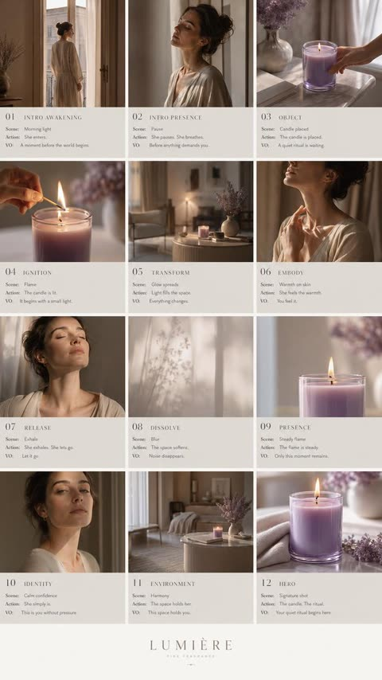</a>

提示词固定三乘四网格，每格上方是电影感画面，下方是分镜说明，并写明从开场到品牌收尾的叙事结构。风格参照、双色调色板和贯穿始终的蜡烛主体让十二个画面保持一致，方便后续做成视频。

GPT Image 2 · 文生图 · 出处: [@insmind_com on X](https://x.com/insmind_com/status/2049481439285223785) · 410 赞，统计于 2026-10-28

[`storyboard`](pages/zh/tags.md#tag-storyboard) [`fragrance`](pages/zh/tags.md#tag-fragrance) [`luxury`](pages/zh/tags.md#tag-luxury) [`editorial`](pages/zh/tags.md#tag-editorial) [`candle`](pages/zh/tags.md#tag-candle)

<details><summary><b>提示词</b></summary>

```text
Step 1:  Generate storyboard with GPT Image 2.
“Create a high-end 9:16 luxury fragrance pitch deck storyboard in 3x4 grid (12 frames), editorial layout, Aesop/Byredo style, beige + lavender palette. Structured flow: intro → ritual → transformation → resolution → brand closure. Each frame split: top cinematic image (no text) + bottom storyboard notes. Luxury minimal European aesthetic, calm femininity, slow living mood. Candle is the emotional center throughout.”

Step 2: Take each frame into Seedance 2.0. Set to 1080p to preserve text clarity.
“Animate the provided 3x4 storyboard into a smooth cinematic video. Preserve exact shot order and continuity. Use slow push-in, gentle pan, subtle orbit, and rack focus. Lighting transitions from soft morning glow to warm golden ambient light. Fragrance brand editorial aesthetic, minimal luxury, soft film grain. No new shots, no reordering, candle remains emotional focus in all scenes.”

Step 3: Hard-cut into final ad. Add soft ambient music and subtle cinematic SFX.
```

</details>

<a id="gpt-image-iced-matcha-latte-six-panel-storyboard"></a>
### 冰抹茶拿铁六格美食分镜

<a href="https://x.com/DuaFatimaAi/status/2095669775456407975"></a>

每格按步骤编号，从食材平铺到成品主图，再用一段统一的道具、色调、光线和镜头描述锁定整体风格。结尾的一致性要求和禁止出现人脸的限制让六格画面保持连贯。

GPT Image 2 · 文生图 · 出处: [@DuaFatimaAi on X](https://x.com/DuaFatimaAi/status/2095669775456407975) · 272 赞，统计于 2026-10-28

[`food-photography`](pages/zh/tags.md#tag-food-photography) [`storyboard`](pages/zh/tags.md#tag-storyboard) [`matcha`](pages/zh/tags.md#tag-matcha) [`6-panel-grid`](pages/zh/tags.md#tag-6-panel-grid) [`photorealistic`](pages/zh/tags.md#tag-photorealistic)

<details><summary><b>提示词</b></summary>

```text
Create a premium photorealistic vertical 6-panel food photography storyboard for an iced matcha latte, arranged in a clean 2×3 grid. Use the same warm natural visual identity, props, lighting, composition, and green color palette across all six panels. Rustic Japanese-inspired kitchen aesthetic, cinematic editorial food photography, soft natural window light, realistic human hands, shallow depth of field, highly detailed textures, creamy matcha, transparent ice cubes, elegant glassware, green linen/checkered cloth, bamboo matcha whisk, ceramic bowls, blueberries, and wooden accents.
Panel 1 — INGREDIENT PREPARATION:
Top-down flat lay showing a bowl of vibrant green matcha powder, bamboo whisk, small ceramic pitcher of milk, bowl of sugar, glass of green matcha liquid, bowl of ice cubes, and cream/milk arranged beautifully on a dark green tabletop with a checkered cloth.
Panel 2 — MATCHA PREPARATION:
Close-up of realistic hands whisking vibrant green matcha powder in a rustic ceramic bowl using a traditional bamboo matcha whisk. Foamy matcha texture forming naturally.
Panel 3 — INITIAL MIXING:
Pour freshly prepared bright green matcha into a transparent measuring glass filled with ice and milk. Capture the pouring action, swirling green-and-white layers, realistic splashes and condensation.
Panel 4 — MAIN PROCESS:
Extreme close-up of creamy milk being poured over iced matcha in a clear glass. Beautiful green-and-white marbling around transparent ice cubes, highly appetizing texture, cinematic macro photography.
Panel 5 — SERVING:
A spoon gently adds a generous layer of white whipped cream/cream foam onto the top of the iced matcha latte. Full glass visible, surrounded by matcha powder, bamboo whisk, blueberries and rustic props.
Panel 6 — FINAL HERO SHOT:
Premium hero shot of the finished iced matcha latte in a tall crystal-clear glass, vibrant green matcha with creamy white swirls and a soft cream topping, condensation on the glass, ice cubes visible, matcha bowl and bamboo whisk softly blurred in the background, blueberries scattered naturally around the glass.
Visual style: luxury beverage advertisement, photorealistic, cinematic food commercial, warm earthy tones, natural soft lighting, realistic materials, subtle film grain, professional food styling, 85mm macro lens look, shallow depth of field, HDR, ultra-detailed, premium editorial photography, appetizing and authentic.
Aspect ratio: 4:5 vertical.
Important: Maintain consistent props, glass, lighting, tabletop, color palette and visual continuity across all six panels. No people’s faces, only natural hands where required.
```

</details>

<a id="gpt-image-1960s-newspaper-comic-ranger-bear"></a>
### 护林员与棕熊的六格报纸漫画

<a href="https://x.com/ImagineArt_X/status/2097520479246704871">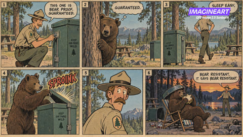</a>

先定下媒介（1960年代星期日报纸连载，泛黄新闻纸）和两行三列的格子，再要求每格都是同一营地和同一角色。逐字指定对白、只留一个拟声词、安排一格无对白，用来控制节奏和文字排版。

GPT Image 2.5 · 文生图 · 出处: [@ImagineArt_X on X](https://x.com/ImagineArt_X/status/2097520479246704871) · 发现于 [wangrunlin/awesome-gpt-image-2-5-prompts](https://github.com/wangrunlin/awesome-gpt-image-2-5-prompts)

[`comic`](pages/zh/tags.md#tag-comic) [`newspaper`](pages/zh/tags.md#tag-newspaper) [`six-panel`](pages/zh/tags.md#tag-six-panel) [`vintage`](pages/zh/tags.md#tag-vintage) [`storytelling`](pages/zh/tags.md#tag-storytelling)

<details><summary><b>提示词</b></summary>

```text
a 1960s Sunday newspaper comic strip on yellowed newsprint, six panels in two rows of three. A park ranger and a bear with a notched ear, the same campsite in every panel, dialogue specified word for word, one sound effect, and one panel with no dialogue at all.
```

</details>

**[全部 9 条](pages/zh/image-comic.md)**

<a id="img-photo-to-art"></a>
## 照片转艺术风格

<a id="gpt-image-photo-to-watercolor-travel"></a>
### 上半照片，下半水彩旅行速写

<a href="https://x.com/MahnoorAi12/status/2102724961408626735"></a>

上下分割，照片渐变成水彩。作者说 Gemini、Grok、ChatGPT 都能用。

GPT Image 2.5 · 上传图改图 · 出处: [@MahnoorAi12 on X](https://x.com/MahnoorAi12/status/2102724961408626735) · 2,264 赞，统计于 2026-10-27

[`watercolor`](pages/zh/tags.md#tag-watercolor) [`travel`](pages/zh/tags.md#tag-travel) [`split-composition`](pages/zh/tags.md#tag-split-composition)

<details><summary><b>提示词</b></summary>

```text
Create a refined editorial travel-art composition based on a reference photograph. The image is divided vertically into two parts: the upper section is a realistic cinematic travel photograph, while the lower section transforms the exact same scene into a delicate hand-painted watercolor illustration.
Upper section: authentic candid travel photography, natural daylight, soft shadows, subtle film grain, realistic textures, sophisticated European atmosphere, documentary-style composition, people naturally walking through the scene, beautiful architectural details, slightly muted elegant colors, high-end travel magazine photography.
Lower section: a minimalist handmade watercolor painting of the exact same scene, preserving the recognizable composition, architecture, people, poses, perspective and major visual elements from the photograph. Loose translucent watercolor washes, delicate ink details, visible paper texture, soft edges, imperfect brushwork, subtle pigment bleeding, airy negative space, understated pastel tones, artistic but realistic.
Leave generous warm ivory/off-white textured paper space surrounding the watercolor illustration. Add a small elegant handwritten caption near the bottom, such as “summer days” or “a quiet afternoon”, with a thin minimalist horizontal line underneath.
Overall aesthetic: luxury travel journal, fine-art watercolor postcard, contemporary editorial design, nostalgic European summer, understated elegance, tactile handmade paper, sophisticated and serene.
Portrait orientation, clean composition, premium art direction, no clutter, no borders, natural proportions, highly detailed photograph transitioning into an airy watercolor illustration.
```

</details>

<a id="gpt-image-minimal-lifestyle-poster"></a>
### 真实照片变极简生活方式海报

<a href="https://x.com/Naiknelofar788/status/2101161664892829838"></a>

填空模板，替换 `[PERSON / SUBJECT / MOMENT]` 即可。主体保持可辨认，背景去掉照片感。

GPT Image 2.5 · 上传图改图 · 出处: [@Naiknelofar788 on X](https://x.com/Naiknelofar788/status/2101161664892829838) · 1,698 赞，统计于 2026-10-27

[`editorial`](pages/zh/tags.md#tag-editorial) [`illustration`](pages/zh/tags.md#tag-illustration) [`template`](pages/zh/tags.md#tag-template) [`photo-to-art`](pages/zh/tags.md#tag-photo-to-art)

<details><summary><b>提示词</b></summary>

```text
A sophisticated minimalist lifestyle art poster featuring [PERSON / SUBJECT / MOMENT] as the central focus, transformed from a real-life photograph into a refined hand-drawn editorial illustration. Preserve the subject’s recognizable pose, silhouette, clothing, hairstyle, and key visual details while simplifying the scene into an elegant artistic composition.

Use a limited vintage color palette inspired by the original environment, with warm muted tones printed on an ivory/off-white paper background. Combine delicate ink outlines, loose sketchwork, fine hatching, subtle halftone texture, faded print imperfections, and soft watercolor-like washes.

Reduce the surrounding environment into a few recognizable contextual elements—[CAFÉ / BAR / STREET / LANDMARK / OBJECTS]—using simplified linework and layered shapes rather than detailed realism. Add subtle abstract circles, geometric forms, atmospheric marks, tiny decorative elements, or silhouettes to create visual depth.

Include small minimalist typography on one side: [CITY / LOCATION], [SUBJECT / MOMENT], and optional coordinates, date, or short descriptor, designed like a premium collectible travel/lifestyle print.

Generous negative space, elegant editorial composition, vintage screen-print aesthetic, hand-crafted illustration, sophisticated travel-magazine design, muted heritage colors, subtle paper grain, artistic but recognizable, no photorealistic background, no excessive details, 4:5 vertical composition.
```

</details>

<a id="gpt-image-editorial-illustration-poster"></a>
### 每张照片变成一张安静的编辑插画海报

<a href="https://x.com/icreatelife/status/2099343607492702258"></a>

开头先禁止拼贴，一张照片一张海报；结尾一排情绪词定下成品气质。

GPT Image 2.5 · 上传图改图 · 出处: [@icreatelife on X](https://x.com/icreatelife/status/2099343607492702258) · 1,165 赞，统计于 2026-10-27

[`editorial`](pages/zh/tags.md#tag-editorial) [`illustration`](pages/zh/tags.md#tag-illustration) [`photo-to-art`](pages/zh/tags.md#tag-photo-to-art)

<details><summary><b>提示词</b></summary>

```text
Create one independent high-end editorial poster for each uploaded photo. Do not combine multiple photos into a collage. Each photo must be processed and output as a separate poster.

OVERALL FORMAT

Strict 3:4 vertical composition.

Divide the canvas horizontally into two exactly equal sections, with a precise 1:1 height ratio.

The top half occupies exactly 50% of the canvas.

The bottom half occupies exactly 50% of the canvas.

The two sections should feel visually connected as one refined art publication cover.

TOP HALF — ORIGINAL PHOTOGRAPH

Preserve the original photograph as faithfully as possible.

Keep the main composition, subjects, identity, facial features, body proportions, poses, expressions, clothing, objects, and spatial relationships unchanged.

Preserve the realistic photographic texture, natural lighting, shadows, atmosphere, and original color mood.

Apply only subtle, sophisticated editorial color grading, creating the feeling of a premium magazine photograph, contemporary art book, or high-end independent publication.

The image should remain photorealistic and authentic, never overly retouched or artificially stylized.

If necessary to fit the 3:4 composition naturally, extend the sky, ground, walls, or surrounding environmental background.

Background extension must feel seamless and photographic.

Never stretch, distort, reshape, replace, or alter the main subject.

BOTTOM HALF — MINIMAL HAND-DRAWN PAPER ILLUSTRATION

Extract the most recognizable visual elements from the original photograph and reinterpret them as a minimalist hand-drawn paper-cover illustration.

Preserve:

The most recognizable subject

Essential silhouette and proportions

Key pose or gesture

Important objects

The core narrative relationship between people and objects

Highly simplify the image. Remove unnecessary details and retain only the visual information needed for immediate recognition.

Use:

Delicate, slightly imperfect hand-drawn lines

A small number of bold, clearly defined acrylic-style flat color shapes

Rough paper texture

Visible handmade brush marks

Slightly irregular, organic edges

Subtle imperfections that make it feel genuinely handmade

The main illustrated subject should be small, centered, and carefully composed, occupying approximately 10–20% of the bottom half.

Leave a large amount of negative space around the illustration.

The background should primarily resemble:

Rough white paper

Warm off-white paper

Pale natural paper

Minimal editorial book-cover stock

Use only a few lines or small color shapes to suggest the surrounding environment.

COLOR PALETTE

Extract the dominant colors directly from the original photograph.

Compress the palette into no more than 4 main colors.

Keep the colors restrained, sophisticated, and harmonious.

Use bold but controlled flat color blocks.

Avoid excessive color variation.

Preserve subtle paper grain and handmade brush texture.

The illustration should visually feel like a simplified color interpretation of the photograph.

TYPOGRAPHY

A small amount of simple typography may be included when appropriate.

Possible elements:

A short title

Keyword

Object name

Location

Year

Number

Short phrase

Text should be minimal, understated, and editorial.

Typography should naturally interact with the large areas of negative space and the small illustration, evoking:

Art book covers

Independent publishing

Contemporary editorial design

Thoughtful children's picture books

Do not force text into the composition if it does not naturally fit the photograph.

VISUAL LANGUAGE

The final poster should feel:

Quiet · Poetic · Refined · Minimal · Innocent · Relaxed · Artistic · Thoughtful · High-recognition · Premium
```

</details>

<a id="gpt-image-pastel-storybook-photo-to-illustration-girl-bubble-tea"></a>
### 喝珍珠奶茶女孩的绘本粉彩插画

<a href="https://x.com/Emmma___0/status/2056369924399124937">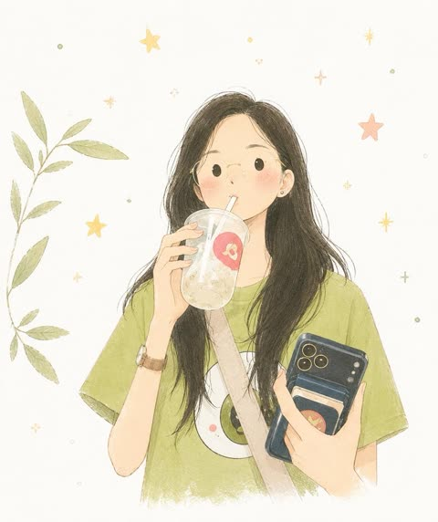</a>

把照片转成插画，用一串风格词叠加：拉长的形体、纤细不规则线条、平涂粉彩、纸张纹理和水彩柔感。结尾列出要避免的内容，如写实、3D和光泽表面，让画面保持扁平稚拙。

GPT Image 2 · 上传图改图 · 出处: [@Emmma___0 on X](https://x.com/Emmma___0/status/2056369924399124937) · 818 赞，统计于 2026-10-28

[`photo-to-illustration`](pages/zh/tags.md#tag-photo-to-illustration) [`storybook`](pages/zh/tags.md#tag-storybook) [`pastel`](pages/zh/tags.md#tag-pastel) [`watercolor`](pages/zh/tags.md#tag-watercolor) [`children-illustration`](pages/zh/tags.md#tag-children-illustration)

<details><summary><b>提示词</b></summary>

```text
Transform the photo into a delicate minimalist hand-drawn children’s illustration with a soft whimsical fairy-tale aesthetic. Use simple elongated shapes, thin imperfect hand-drawn lines, flat pastel colors, minimal details, and a cute doll-like character style with rosy cheeks, tiny facial features, and simplified anatomy. Add subtle paper texture, soft pencil and pastel shading, watercolor softness, and a clean white background with small stars or sparkles.Stylize the clothing in a playful storybook way with simplified shapes and gentle decorative details. The overall mood should feel airy, cozy, naive, and charming, like a modern Scandinavian nursery postcard or children’s book illustration. Avoid photorealism, 3D, cinematic lighting, glossy surfaces, complex shadows, realistic anatomy, and hyper-detail.
```

</details>

**[全部 38 条](pages/zh/image-photo-to-art.md)**

<a id="img-architecture"></a>
## 建筑与室内

<a id="gpt-image-architectural-specimen-card-survey-landmark"></a>
### 长城建筑勘测标本卡

<a href="https://x.com/Naiknelofar788/status/2094626691234816034">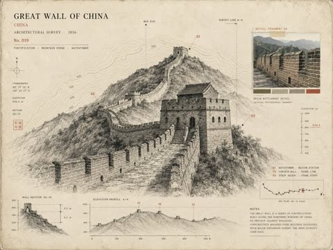</a>

以上传照片为参考，层级清晰：大幅单色墨线地标、一小块彩色照片细节、背后的等高线地图。限定调色并只用一个点缀色，只列少量小号档案式文字，再明确列出要避开的风格，让整张卡片保持克制的博物馆目录感。

GPT Image 2 · 上传图改图 · 出处: [@Naiknelofar788 on X](https://x.com/Naiknelofar788/status/2094626691234816034) · 512 赞，统计于 2026-10-28

[`architecture`](pages/zh/tags.md#tag-architecture) [`specimen-card`](pages/zh/tags.md#tag-specimen-card) [`archival`](pages/zh/tags.md#tag-archival) [`topographic-map`](pages/zh/tags.md#tag-topographic-map) [`ink-drawing`](pages/zh/tags.md#tag-ink-drawing)

<details><summary><b>提示词</b></summary>

```text
Use the uploaded photo as the primary reference. Create a sophisticated 4:3 landscape architectural specimen card inspired by museum archives, architectural surveys, and vintage scientific documentation.

Keep the original location recognizable, but transform the presentation into a curated architectural study rather than a normal travel poster.

* Place the main landmark as a large monochrome architectural cutout or finely detailed ink drawing.
* Add a smaller original-color photographic fragment showing one distinctive detail of the location.
* Include a simplified topographic contour map behind the architecture.
* Add tiny numbered reference points, measurement marks, arrows, elevation lines, and architectural annotation symbols.
* Use an aged cream paper background with subtle grain and imperfections.
* Palette: black, warm beige, muted olive, and one restrained accent color extracted from the landmark.
* Typography should be small, elegant, and archival: location name, country, year, No. 019, and 3 descriptive keywords.
* Create subtle imperfections resembling screen printing, drafting ink, pencil marks, and old paper.
* Keep generous negative space and a sophisticated museum-catalog aesthetic.

Important: Avoid postcard layouts, circular stamps, tourist graphics, excessive text, cartoon styling, glossy effects, 3D rendering, and overly detailed illustrations.

Overall mood:
architectural archive × museum specimen × old survey document × contemporary editorial design.
```

</details>

<a id="gpt-image-architectural-sketchbook-study"></a>
### 铅笔与水彩的罗马斗兽场建筑速写本

<a href="https://x.com/Naiknelofar788/status/2099096963316957187">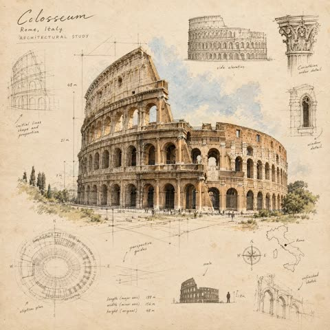</a>

提示词让画面从前景的松散construction线条逐步过渡到墨线加水彩的完成态主体，形成未完成的草图感。同时列出侧立面、装饰细节、地图轮廓和比例剪影等小型研究图，并配少量手写标注，再用负面词排除写实渲染和信息图方框。

GPT Image 2.5 · 文生图 · 出处: [@Naiknelofar788 on X](https://x.com/Naiknelofar788/status/2099096963316957187) · 169 赞，统计于 2026-10-28

[`architecture`](pages/zh/tags.md#tag-architecture) [`sketchbook`](pages/zh/tags.md#tag-sketchbook) [`watercolor`](pages/zh/tags.md#tag-watercolor) [`pencil-drawing`](pages/zh/tags.md#tag-pencil-drawing) [`template`](pages/zh/tags.md#tag-template)

<details><summary><b>提示词</b></summary>

```text
Create a stunning 4:5 vertical fine-art sketch illustration of [STRUCTURE NAME] as if it is being drawn by a master architectural artist inside a luxury travel sketchbook.

Show the famous structure transitioning from loose preliminary pencil lines into a fully detailed finished architectural drawing.

The foreground should contain delicate construction lines, perspective guides, measurement marks, small handwritten architectural notes, compass marks, arrows, erased pencil strokes, and unfinished portions.

As the eye moves toward the main structure, the sketch gradually becomes more refined — combining graphite pencil, fine black ink, subtle watercolor washes, cross-hatching, and delicate hand-drawn textures.

Include small artistic studies around the main drawing: a tiny side elevation, architectural detail, window or ornament study, simplified map outline, and a small silhouette showing the scale of the structure.

Use an elegant warm ivory sketchbook-paper background with natural paper fibers and subtle imperfections.

Keep the composition sophisticated and spacious. The structure should remain the unmistakable hero.

Add minimal handwritten-style labeling:

[STRUCTURE NAME]
[CITY, COUNTRY]
ARCHITECTURAL STUDY

The artwork should feel like an original museum-quality architectural sketch discovered inside an explorer’s personal sketchbook — artistic, intellectual, nostalgic, detailed, and highly collectible.

No photorealistic rendering, no 3D CGI, no modern infographic boxes, no excessive text, no watermark.
```

</details>

<a id="gpt-image-landmark-architectural-master-sketch-poster"></a>
### 自由女神像的未完成建筑墨线草图海报

<a href="https://x.com/Goodmanprotocol/status/2106688617682788602">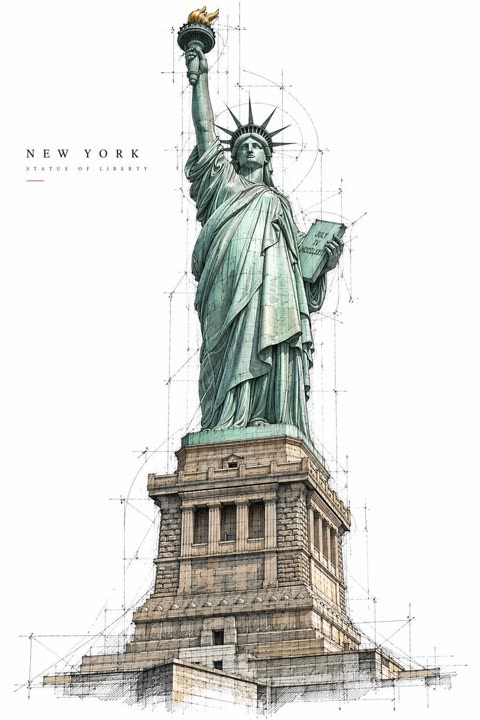</a>

提示词把单一地标放在纯白留白中，用精确墨线结合松散的construction辅助线，并只允许一种取自地标真实材质的点缀色。方括号占位符让它可以套用到任何建筑。

GPT Image 2.5 · 文生图 · 出处: [@Goodmanprotocol on X](https://x.com/Goodmanprotocol/status/2106688617682788602) · 98 赞，统计于 2026-10-28

[`architecture`](pages/zh/tags.md#tag-architecture) [`ink-sketch`](pages/zh/tags.md#tag-ink-sketch) [`landmark`](pages/zh/tags.md#tag-landmark) [`white-background`](pages/zh/tags.md#tag-white-background) [`template`](pages/zh/tags.md#tag-template)

<details><summary><b>提示词</b></summary>

```text
Create a premium 2:3 vertical architectural poster for [COUNTRY / CITY / LOCATION / LANDMARK].

TEXT-TO-IMAGE ONLY — generate the entire artwork creatively from [COUNTRY / CITY / LOCATION / LANDMARK]. No reference image required.

CORE CONCEPT
Present [LANDMARK] as an expressive unfinished architectural master sketch, as if drawn by an architect exploring the building’s form, structure, and character. Keep the real architecture accurate — preserve its recognizable silhouette, proportions, façade rhythm, materials, and signature details. Do not redesign the landmark.

COMPOSITION
Show approximately 80–95% of the landmark from the most elegant and architecturally informative viewpoint for that specific building. Use a natural eye-level or gently elevated three-quarter perspective with realistic depth and restrained distortion.

ONE LANDMARK ONLY. Let it dominate the composition while surrounding it with generous PURE WHITE negative space. No skyline or secondary landmarks.

SKETCH STYLE
Combine precise architectural ink drawing with loose unfinished concept-sketch elements:

crisp black structural lines

fine façade detailing

varied line weights

construction and perspective guides

subtle drafting marks

selective ink washes

partially unfinished contours

Some areas should be highly detailed while others naturally dissolve into loose exploratory lines and white space. It must feel genuinely hand-drawn, not like a 3D render with a sketch filter.

DETAIL & COLOR
Reveal authentic architectural elements such as structural connections, façade layers, openings, ornamentation, joints, and material textures. Never invent features that do not belong to the landmark.

Use a PURE WHITE background with black and charcoal linework, plus ONE subtle accent color naturally derived from the landmark’s real materials.

TYPOGRAPHY
Optional small refined text in one corner:
[DESTINATION]
[LANDMARK]

Keep typography minimal and secondary to the architecture.

FINAL AESTHETIC
Architectural master sketch × technical drawing × expressive ink work × restrained hand-painted wash × contemporary collectible art poster.

Avoid fictional architecture, incorrect proportions, extreme perspectives, close-ups, surrounding cityscapes, multiple landmarks, beige/aged paper, gradients, excessive colors, glossy 3D rendering, oversized typography, logos, and watermarks.

FORMAT
2:3 vertical, single landmark, full architectural form clearly visible, generous white space, intricate linework, natural perspective, premium gallery-quality finish.
```

</details>

<a id="nano-banana-mythpunk-floating-jungle-temple-miniature"></a>
### 悬浮丛林神庙微缩世界与发光符文

<a href="https://x.com/artingent/status/2108541437189242932">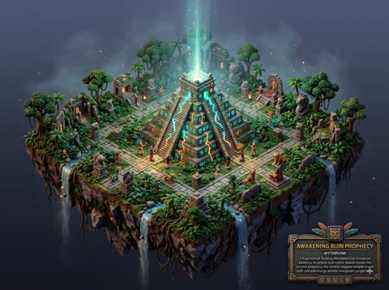</a>

编号的优先级层级告诉模型哪些规则优先，让等距微缩场景保持清晰易读。固定的分区标题、禁止齿轮的否定规则以及逐行规定文字的铭牌说明增强了可控性。

Nano Banana 2.1 · 文生图 · 出处: [@artingent on X](https://x.com/artingent/status/2108541437189242932) · 34 赞，统计于 2026-10-28

[`miniature`](pages/zh/tags.md#tag-miniature) [`isometric`](pages/zh/tags.md#tag-isometric) [`fantasy`](pages/zh/tags.md#tag-fantasy) [`mesoamerican`](pages/zh/tags.md#tag-mesoamerican) [`claymation`](pages/zh/tags.md#tag-claymation)

<details><summary><b>提示词</b></summary>

```text
SCENE
Do not render gears or representations of gears in the scene
A visually rich handcrafted floating miniature world built on a fragmented terrain as the PRIMARY structure, centered on an ancient ruin complex in Mesoamerican myth style within a dense jungle environment. A prophecy event unfolds as structures begin to glow and shift, with the central stepped temple as the dominant focal structure. Surrounding ruins and terrain remain controlled and readable.

WORLD DESIGN
Fragmented terrain, jungle environment, sacred plateau with symbolic pathways linking temple ruins.

ARCHITECTURE & MATERIALS
Stepped temple structures and shrine ruins with layered forms, constructed from stone and divine materials, featuring carvings, glyphs, and symbolic reliefs.

PROPS & SYMBOLS
Altars, relic pedestals, statues, carved symbols, glowing glyphs, floating particles, sacred motifs.

LIFE & ACTIVITY
Priests and guardians performing invoking rituals and observation; mythic beasts present.

LIGHTING & ATMOSPHERE
Eternal dusk with ambient glow and energy beams emerging from the temple; mist, aura, and particles create an ominous mysterious tone.

PRIORITY HIERARCHY (CRITICAL)
1. Miniature readability, scale clarity, clean silhouette
2. Strong mythic focal structure
3. Symbolic coherence (consistent myth language)
4. Controlled surrealism (strange but readable)
5. Atmospheric depth and mood
6. Narrative clarity (scene tells a story)
   Never sacrifice higher priority rules for lower ones.

PRIME DIRECTIVE
CAMERA Use an isometric camera capturing the entire floating miniature world clearly from top to bottom and side to side.

STYLE
Ultra detailed 8k Octane Render, hybrid high poly 3D + miniature world + claymation

DESCRIPTION PLAQUE
Position bottom right
Do not render gears or representations of gears in the plaque
Line 1 bold heading max 5 words
Line 2 bold MYTHPUNK smaller
Line 3 description max 30 words
Plaque must be rendered in aesthetically in an artistic mythpunk style.
```

</details>

**[全部 7 条](pages/zh/image-architecture.md)**

<a id="img-map"></a>
## 地图

<a id="gpt-image-isometric-anime-world-map-diorama-poster"></a>
### 等距视角动漫世界地图微缩模型海报

<a href="https://x.com/TechieBySA/status/2091529289283866634">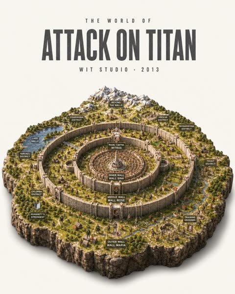</a>

用分支条件分别处理虚构世界和真实地点，让同一模板能切出正确的地图轮廓。版面留白、标题层级和移轴摄影质感都有明确规则，成图风格统一，另可上传参考地图提高准确度。

GPT Image 2 · 文生图 · 出处: [@TechieBySA on X](https://x.com/TechieBySA/status/2091529289283866634) · 6,709 赞，统计于 2026-10-28

[`isometric`](pages/zh/tags.md#tag-isometric) [`diorama`](pages/zh/tags.md#tag-diorama) [`anime-world`](pages/zh/tags.md#tag-anime-world) [`miniature`](pages/zh/tags.md#tag-miniature) [`editorial-poster`](pages/zh/tags.md#tag-editorial-poster)

<details><summary><b>提示词</b></summary>

```text
Simply replace [ANIME]:✨

(Upload a reference image of the map for enhanced accuracy)

“Ultra-detailed photorealistic isometric miniature scale-model diorama of the world from [ANIME], floating on a pure off-white studio background with a soft drop shadow beneath.

If [ANIME] has a fictional world map: the diorama takes the exact silhouette shape of that fictional continent, island or region, extruded downward into a thick slab of raw rock and earth with rough natural cliff-like edges, like the world physically cut out and lifted. The shape matches the canonical map boundary precisely.

If [ANIME] is set in a real or semi-real world: the diorama takes the exact geographic silhouette shape of the primary city, region or country where the story is set, extruded into a thick rock slab with rough cliff edges.

The entire top surface faithfully recreates the complete world of [ANIME] with full anime accuracy: every region, city, landmark, building, terrain feature, road and environment in its exact canonical position as established in the show. Every iconic location is instantly recognizable to any fan — labeled with small readable location markers. The architecture, environment design, building styles, color palette and atmosphere must be completely faithful to the visual world of [ANIME] — not Western or generic realistic, but distinctly true to how this anime world looks and feels. Every location a fan would recognize is present and accurately placed.

Dense micro-detail throughout: tiny figures in show-accurate character designs and clothing, vehicles or creatures authentic to the world, individual trees and foliage, roads and paths between locations, flags and faction symbols, any distinctive environmental features unique to this anime world.

Style: hyper-realistic tilt-shift miniature photography — extremely sharp, everything in focus, no blur. Soft warm lighting from above, gentle diffuse shadows. Colors match the anime's authentic visual palette faithfully — rich, saturated and true to the show's identity.

Layout: the shaped diorama floats centered in the lower two-thirds of the frame, clear margins on all sides, never touching the frame edges. Upper third is empty off-white space with minimalist editorial typography, centered: small wide-tracked caps with the world or region name at the very top, then [ANIME] directly below in a bold condensed sans-serif in medium charcoal grey — large and dominant, the biggest text element, then small wide-tracked caps below with the studio name and year.

Minimalist editorial poster aesthetic, premium print quality, 4:5 aspect ratio.”
```

</details>

<a id="gpt-image-city-on-map"></a>
### 你的城市从地图上长出来

<a href="https://x.com/Preda2005/status/2098816499075145824"></a>

替换 `[COUNTRY]` 和 `[CITY]`，结尾的可选地标槽位用来指定要出现什么。

GPT Image 2.5 · 文生图 · 出处: [@Preda2005 on X](https://x.com/Preda2005/status/2098816499075145824) · 413 赞，统计于 2026-10-27

[`map`](pages/zh/tags.md#tag-map) [`miniature`](pages/zh/tags.md#tag-miniature) [`template`](pages/zh/tags.md#tag-template)

<details><summary><b>提示词</b></summary>

```text
Create a highly detailed 1:1 square image using GPT Image 2.5.

The main subject is a realistic top-down geographic map accurately showing the terrain, coastline, rivers, roads and surrounding region of [COUNTRY], with natural and believable map labeling.

At the real geographic location of [CITY], a miniature 3D city rises organically from the map surface, like a premium architectural diorama physically emerging from the map.

The miniature city should include the most recognizable features of [CITY], such as:

• iconic architecture
• important natural landmarks
• the characteristic city skyline
• local cultural elements
• recognizable regional details

All elements must feel naturally connected to the underlying map, as if the city is growing directly out of it, rather than being placed on top.

Keep the geography believable and visually coherent.

Style:
ultra-realistic miniature photography,
high-end collectible diorama,
cinematic macro photography,
realistic materials,
fine surface textures,
strong depth and scale,
premium travel editorial aesthetic.

Use shallow depth of field:
[CITY] should remain extremely sharp and detailed,
while the surrounding map gradually becomes softer and slightly blurred.

Use soft studio lighting, realistic natural shadows, elegant composition and subtle cinematic contrast.

The result should feel like a luxury macro photograph of a real handcrafted miniature city built directly into a geographic map.

MAP LABELS:
Use labels appropriate to [COUNTRY].
For example, if the country is Japan, use Japanese geographic labels.
Do not introduce unrelated languages.

OPTIONAL DETAILS:
[LANDMARK 1]
[LANDMARK 2]
[LANDMARK 3]
[LOCAL CULTURAL ELEMENT]
[NATURAL LANDMARK]
```

</details>

<a id="gpt-image-maps-notification-papercraft-miniature-travel"></a>
### 上海黏土与纸艺地图旅行广告

<a href="https://x.com/Goodmanprotocol/status/2097890291860865291">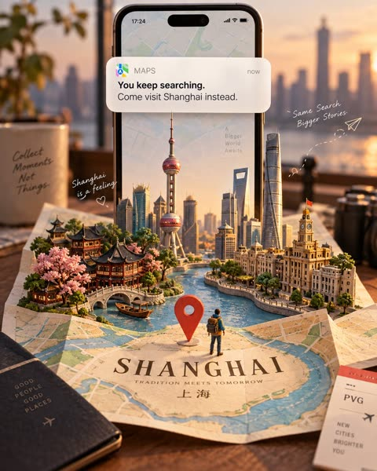</a>

整个画面只由一个LOCATION占位符驱动,换个目的地即可复用。编号的视觉层级加材质清单(实拍手机、黏土地标、手工剪纸地图)让层次分明,通知卡限定在画面上部25%到40%,不会遮挡微缩场景。

GPT Image 2.5 · 文生图 · 出处: [@Goodmanprotocol on X](https://x.com/Goodmanprotocol/status/2097890291860865291) · 67 赞，统计于 2026-10-28

[`travel-campaign`](pages/zh/tags.md#tag-travel-campaign) [`papercraft`](pages/zh/tags.md#tag-papercraft) [`miniature`](pages/zh/tags.md#tag-miniature) [`clay`](pages/zh/tags.md#tag-clay) [`phone-notification`](pages/zh/tags.md#tag-phone-notification)

<details><summary><b>提示词</b></summary>

```text
[LOCATION] =

Create a premium, scroll-stopping Instagram travel campaign for [LOCATION] in a 4:5 vertical portrait format.

A large modern smartphone stands vertically near the upper center, acting as the main visual anchor. A single elegant map-navigation notification card overlaps the upper-middle of the phone, integrated naturally with realistic depth, soft shadows, and subtle reflections.

The notification should feature a warm-white, lightly frosted rounded rectangle with a refined mobile UI aesthetic and perfectly legible typography:

[map icon] MAPS — now
You keep searching.
Come visit [LOCATION] instead.

Keep the notification within the upper 25–40% of the composition. It should feel physically connected to the phone and must not cover the miniature destination scene.

Below the smartphone, a folded papercraft map labeled “[LOCATION]” unfolds into a handcrafted miniature world. Include only 4–6 highly recognizable elements that naturally represent the destination—such as iconic architecture, landscapes, nature, food, culture, or atmosphere.

Visual Materials

- Phone & distant background: realistic photography
- Buildings & landmarks: handcrafted painted 3D clay
- Map, terrain, roads & water: layered hand-cut paper
- Vegetation & small details: miniature clay and paper

Make the physical materials clearly visible through paper fibers, cut edges, layered surfaces, subtle clay texture, tiny imperfections, and soft dimensional shadows.

Add one large location pin and a tiny backpacked traveler standing on the map, looking toward the miniature world. Keep the traveler small and secondary, like a hidden discovery detail.

Use only 2–3 subtle travel doodles, such as a paper airplane with a dotted path, a tiny heart, and a simple hand-drawn route arrow. Keep them thin, imperfect, and journal-like.

Visual Hierarchy

1. Notification
2. Miniature [LOCATION] world
3. Location pin
4. Tiny traveler
5. Folded map

Maintain generous negative space and avoid clutter, excessive landmarks, unnecessary text, icons, props, or competing focal points.

Use a refined 3–5 color palette inspired by [LOCATION], warm cinematic or golden-hour lighting, shallow depth of field, realistic miniature photography, tactile materials, and sophisticated editorial advertising composition.

The final image should feel like a world-class handcrafted travel campaign-instantly recognizable, destination-specific, clean, emotionally inviting, and rich with subtle details worth discovering.
```

</details>

<a id="gpt-image-city-escaping-vintage-paper-map"></a>
### 巴黎从复古纸质地图中立体浮现

<a href="https://x.com/Naiknelofar788/status/2109226850203619656">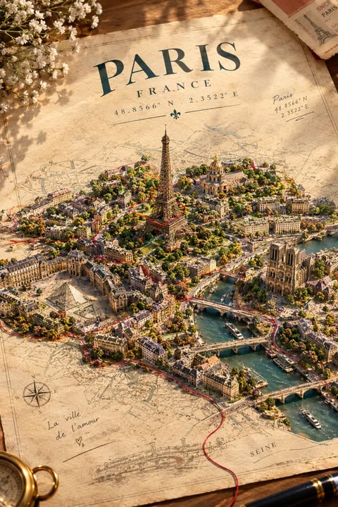</a>

提示词只讲一个清晰的想法，平面印刷墨线变成真实的微缩建筑。一根红线、页边坐标和顶部排版标题搭起版面结构，结尾的禁止建筑变形、禁止虚构建筑保证地标准确。用 [CITY, COUNTRY] 占位符可以换成任意城市。

GPT Image 2.5 · 文生图 · 出处: [@Naiknelofar788 on X](https://x.com/Naiknelofar788/status/2109226850203619656) · 64 赞，统计于 2026-10-28

[`city`](pages/zh/tags.md#tag-city) [`vintage-map`](pages/zh/tags.md#tag-vintage-map) [`miniature`](pages/zh/tags.md#tag-miniature) [`diorama`](pages/zh/tags.md#tag-diorama) [`red-thread`](pages/zh/tags.md#tag-red-thread)

<details><summary><b>提示词</b></summary>

```text
A real city appears to be physically breaking free from an old paper map, with its actual streets, buildings, and famous landmark rising out of the printed geography into the real world.

Create a breathtaking, surreal-meets-realistic art composition of [CITY, COUNTRY], emerging from an enormous vintage paper map laid flat on a warm ivory surface.

The city’s REAL architecture and geography rise naturally from the map like a miniature three-dimensional world. Its famous landmark stands tall at the center, surrounded by accurately recognizable buildings, winding streets, bridges, rivers, and local architectural details. The printed roads on the map seamlessly transform into actual city streets, while tiny buildings gradually rise from flat ink illustrations into detailed miniature structures.

A single delicate red thread travels across the map, following the city’s real street layout before spiraling around its most famous landmark. Tiny handwritten location coordinates appear in the margin.

Use a stunning combination of architectural realism, miniature diorama photography, vintage cartography, subtle paper textures, and cinematic lighting. Warm sunlight creates long, beautiful shadows across the map. Keep the background minimal and elegant, with the city as the undeniable focal point.

At the top, display the city’s name in sophisticated vintage typography, with its country name and geographical coordinates beneath it.

The result should feel like a real city has magically escaped its map — imaginative, visually striking, geographically recognizable, and beautifully detailed.

Ultra-high detail, realistic materials, exceptional composition, premium art-poster aesthetic, no distorted buildings, no fictional architecture, no clutter.
```

</details>

**[全部 5 条](pages/zh/image-map.md)**

<a id="img-collage"></a>
## 拼贴

<a id="gpt-image-failed-photos-grid"></a>
### 任意角色的九张失败照片

<a href="https://x.com/DeepBlueX0/status/2099481521983995971"></a>

只有七个词。作者的心得：限制越少，失败照越像真的。

GPT Image 2.5 · 文生图 · 出处: [@DeepBlueX0 on X](https://x.com/DeepBlueX0/status/2099481521983995971) · 2,646 赞，统计于 2026-10-27

[`grid`](pages/zh/tags.md#tag-grid) [`humor`](pages/zh/tags.md#tag-humor) [`template`](pages/zh/tags.md#tag-template)

<details><summary><b>提示词</b></summary>

```text
Vertical 3×3 failed photos × {Character}
```

</details>

<a id="gpt-image-chibi-clone-sticker-running-diary"></a>
### 跑步照片配Q版分身贴纸与手绘涂鸦

<a href="https://x.com/Emmma___0/status/2050922155676930544">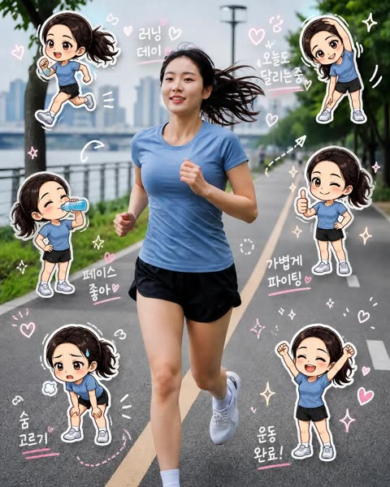</a>

先锁定真人照片的身份、服装和背景，再限定添加5到8个Q版分身，每个分身对应不同的跑步动作与情绪。贴纸白边、柔和阴影加上白粉色涂鸦和手写短句，形成手帐日记风格，同时避免遮挡人脸。

GPT Image 2 · 上传图改图 · 出处: [@Emmma___0 on X](https://x.com/Emmma___0/status/2050922155676930544) · 959 赞，统计于 2026-10-28

[`chibi`](pages/zh/tags.md#tag-chibi) [`sticker`](pages/zh/tags.md#tag-sticker) [`scrapbook`](pages/zh/tags.md#tag-scrapbook) [`fitness`](pages/zh/tags.md#tag-fitness) [`photo-edit`](pages/zh/tags.md#tag-photo-edit)

<details><summary><b>提示词</b></summary>

```text
Create a high-quality “chibi clone sticker diary photo” based on the uploaded real-life image. Preserve the original person’s identity, face, hairstyle, hair color, outfit, body proportions, pose, lighting, and background. Do not alter facial features or turn the subject into a full illustration—maintain a realistic photo look.
Analyze the scene as a fitness/running lifestyle moment. Add 5–8 chibi mini clones of the same person around the subject, designed in a consistent kawaii sticker style (big head, small body, large expressive eyes, clean digital finish). Each clone must clearly resemble the real person (same hair, outfit, colors).
Design each chibi with different running-related actions and emotions: jogging, stretching, drinking water, feeling tired, cheering, giving thumbs up, celebrating completion. Ensure all poses are unique and contextually relevant.
Render each chibi as a sticker with white outlines, soft shadows, and a slightly floating effect. Arrange them around the subject and edges without covering the face or main body.
Add light hand-drawn doodles (hearts, sparkles, arrows, motion lines, circles) in white with subtle pink accents, keeping a clean scrapbook diary feel.
Include 5–8 short handwritten-style phrases matching a fitness mood (cute, energetic, encouraging). Use mostly white text with slight pink highlights and small decorative marks.
Composition: keep the real person as the central focus, surrounded by chibi stickers and doodles. The result should feel like a polished, playful, high-resolution social media lifestyle diary image—clean, balanced, and visually rich without clutter.
```

</details>

<a id="gpt-image-chibi-sticker-street-photo-doodles"></a>
### 街头人像周围环绕3D Q版自己

<a href="https://x.com/im_shahid7/status/2050201037144002786">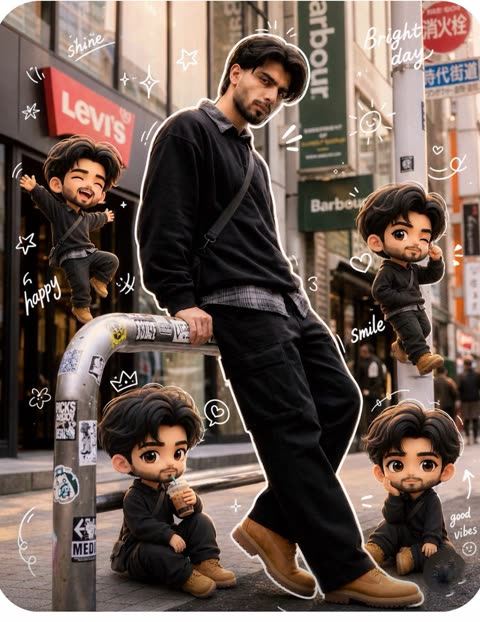</a>

提示词保留原照片和背景，再按姿势与表情清单加入多个3D Q版小人。白色贴纸描边、涂鸦图标和手写字样把这些元素统一成柔和的粉彩拼贴。

GPT Image 2 · 上传图改图 · 出处: [@im_shahid7 on X](https://x.com/im_shahid7/status/2050201037144002786) · 414 赞，统计于 2026-10-28

[`chibi`](pages/zh/tags.md#tag-chibi) [`sticker-outline`](pages/zh/tags.md#tag-sticker-outline) [`doodle-overlay`](pages/zh/tags.md#tag-doodle-overlay) [`reference-photo`](pages/zh/tags.md#tag-reference-photo) [`3d-cute`](pages/zh/tags.md#tag-3d-cute)

<details><summary><b>提示词</b></summary>

```text
Use a real face as a reference photo. The background is the same as in the photo. The lighting is warm, soft, and clean, with subtle shadows. Around the image, add several mini chibi (3D cute style) versions of the character, while maintaining the original facial features. Chibi characters have various poses and expressions:jumping cheerfully waving sitting relaxed holding a drink cute and playful expressions Add hand-drawn white doodle elements: outline around the main body stars, hearts, sparkles motion lines small cute icons Add aesthetic handwriting such as: "shine," "bright day," "happy," "smile," etc. (casual doodle font) Overall style: clean & aesthetic composition white sticker outline soft pastel color tone high detail 3D chibi glossy look cute Korean.
```

</details>

<a id="gpt-image-cafe-photo-watercolor-scrapbook-layout"></a>
### 咖啡馆照片变成水彩手账排版

<a href="https://x.com/MahnoorAi12/status/2102368459388801390">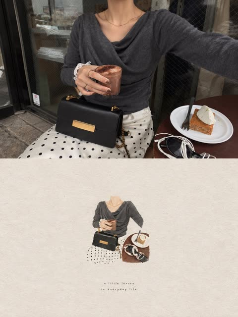</a>

用严格的面部身份锁定只让人脸参考控制人物，其余参考图只提供服装、姿势和氛围。版式用清单逐条写明纸张、水彩边缘、剪裁感和文字区，得到留白充足的手账成品。

GPT Image 2.5 · 上传图改图 · 出处: [@MahnoorAi12 on X](https://x.com/MahnoorAi12/status/2102368459388801390) · 240 赞，统计于 2026-10-28

[`scrapbook`](pages/zh/tags.md#tag-scrapbook) [`watercolor`](pages/zh/tags.md#tag-watercolor) [`cafe`](pages/zh/tags.md#tag-cafe) [`editorial`](pages/zh/tags.md#tag-editorial) [`face-reference`](pages/zh/tags.md#tag-face-reference)

<details><summary><b>提示词</b></summary>

```text
Use the uploaded face reference image ONLY as the identity reference for the woman.

STRICT FACE IDENTITY LOCK:
Preserve her recognizable facial identity exactly from the face reference. Keep the same facial structure, face shape, eyes, eyebrows, nose, lips, jawline, cheek structure, skin tone, and natural facial proportions. Do not beautify, redesign, age, de-age, or replace her face. Do not create a different person.

Use the provided reference images as visual inspiration for the overall composition, photography style, outfit, pose, environment, color palette, and aesthetic, but do NOT copy their facial identity.

Create a photorealistic lifestyle editorial photograph with a soft Japanese/Korean-inspired café and everyday-luxury aesthetic.

The woman is naturally enjoying a quiet café moment with coffee and dessert. Elegant understated styling, soft neutral tones, natural daylight, subtle film grain, warm muted colors, realistic skin texture, delicate details, candid editorial photography.

Outfit should be feminine and sophisticated with a minimalist vintage-inspired feel. Add tasteful accessories such as a small structured handbag, delicate jewelry, and elegant shoes where appropriate.

Composition should feel like a genuine lifestyle photograph rather than an AI-generated portrait. Natural body proportions, realistic hands and fingers, authentic fabric texture, realistic lighting and shadows.

Create the final image as a refined editorial scrapbook-style photograph:
- warm ivory/beige paper-inspired background
- softly isolated central subject
- subtle hand-painted/watercolor edges around the photograph
- slightly imperfect organic cutout effect
- delicate vintage paper texture
- minimal elegant typography area underneath
- calm nostalgic mood
- sophisticated feminine aesthetic
- lots of clean negative space

IMPORTANT:
The face reference controls ONLY the woman's identity.
The scene/reference images control the visual concept.
Do not merge or copy another person's face.
Keep the woman's identity consistent and recognizable throughout the entire image.

High-resolution photography, natural lighting, realistic skin texture, detailed clothing, realistic hands, authentic shadows, premium editorial composition, subtle analog film texture, soft focus falloff, photorealistic.
```

</details>

**[全部 30 条](pages/zh/image-collage.md)**

<a id="img-edit"></a>
## 照片编辑

<a id="gpt-image-selfie-chibi-sticker-doodle-edit"></a>
### 电梯镜面自拍加Q版贴纸涂鸦

<a href="https://x.com/ChillaiKalan__/status/2050614367536939243">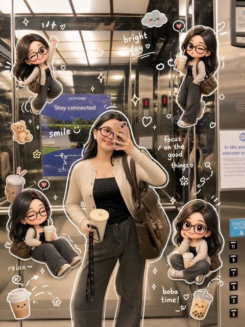</a>

提示词先锁定原图光线与色调，再叠加白色描边、多姿势的同脸Q版小人和简短手写字。限制文字数量并让吉祥物保持克制，避免画面拥挤。

GPT Image 2 · 上传图改图 · 出处: [@ChillaiKalan__ on X](https://x.com/ChillaiKalan__/status/2050614367536939243) · 1,255 赞，统计于 2026-10-28

[`doodle`](pages/zh/tags.md#tag-doodle) [`chibi`](pages/zh/tags.md#tag-chibi) [`sticker-outline`](pages/zh/tags.md#tag-sticker-outline) [`xiaohongshu`](pages/zh/tags.md#tag-xiaohongshu) [`selfie`](pages/zh/tags.md#tag-selfie)

<details><summary><b>提示词</b></summary>

```text
Edit this photo into a cute Pinterest/Xiaohongshu-style doodle aesthetic edit while keeping the original composition and colors natural. Do NOT heavily change the original lighting or color grading. Keep the tones soft, airy, warm, and realistic. Avoid oversaturated colors, HDR effects, strong orange filters, or excessive contrast. Add hand-drawn doodle elements around the main objects: * white outline strokes * sketchy sparkles * stars * hearts * arrows * tiny flowers * playful swirls * mini handwritten notes Add small cute mascot-style doodles that match the vibe of the photo (tiny bear, smiling drink, cute food character, sleepy cloud, etc.) but keep them subtle and balanced. Use handwritten white text with short relatable captions only. Do NOT add too many words or overcrowd the image.Use a real face as a reference photo. The background is the same as in the photo. The lighting is warm, soft, and clean, with subtle shadows. Around the image, add several mini chibi (3D cute style) versions of the character, while maintaining the original facial features.Chibi characters have various poses and expressions: jumping cheerfully waving sitting relaxed holding a drink cute and playful expressions.  Add hand-drawn white doodle elements: outline around the main body stars, hearts, sparkles motion lines small cute icons Add aesthetic handwriting such as: "shine," "bright day," "happy," "smile," etc. (casual doodle font) Overall style: clean & aesthetic composition white sticker outline soft pastel color tone high detail 3D chibi glossy look cute Korean.
```

</details>

<a id="nano-banana-json-reconstruction"></a>
### 逐项复刻一张照片的 JSON 提示词

<a href="https://x.com/ViralOps_/status/2107538470818484305"></a>

按 JSON 字段写（构图、光线、色彩、负面词）。原帖用同一段 JSON 对比了 Nano Banana 2.1 和 GPT Image 2.5。

Nano Banana 2.1 · 上传图改图 · 出处: [@ViralOps_ on X](https://x.com/ViralOps_/status/2107538470818484305) · 326 赞，统计于 2026-10-27

[`json`](pages/zh/tags.md#tag-json) [`reconstruction`](pages/zh/tags.md#tag-reconstruction) [`comparison`](pages/zh/tags.md#tag-comparison)

<details><summary><b>提示词</b></summary>

```text
{
  "prompt_type": "detailed_image_reconstruction",
  "aspect_ratio": "4:5 vertical portrait",
  "overall_goal": "Recreate the visual appearance, framing, lighting, styling, and casual smartphone-photo feel of the reference image as closely as possible while keeping the result photorealistic and natural.",

  "subject": {
    "type": "young adult woman",
    "age_range": "early to mid 20s",
    "pose": "standing indoors, upper body turned slightly away from the camera while her face turns toward the lens",
    "body_position": "relaxed casual posture with shoulders slightly angled",
    "expression": "soft neutral expression with a subtle pout, calm and confident",
    "gaze": "looking directly toward the camera",
    "styling": "minimal everyday styling, clean and natural"
  },

  "face": {
    "shape": "soft oval face with a gently tapered jawline",
    "forehead": "medium-height forehead partly framed by center-parted hair",
    "eyebrows": "natural medium-thick dark brown eyebrows with a soft arch",
    "eyes": {
      "shape": "almond-shaped",
      "color": "light brown to hazel",
      "appearance": "bright eyes with visible catchlights",
      "lashes": "long defined eyelashes with subtle mascara"
    },
    "nose": "small straight nose with a softly rounded tip",
    "lips": {
      "shape": "full lips with a defined cupid's bow",
      "color": "natural rosy pink",
      "finish": "soft satin finish, not glossy"
    },
    "skin": {
      "tone": "light warm-neutral skin tone",
      "texture": "smooth natural skin with subtle pores and realistic tonal variation",
      "cheeks": "soft natural pink flush",
      "finish": "fresh luminous skin without heavy retouching"
    },
    "makeup": "very light natural makeup, softly defined lashes, subtle blush, natural pink lips, no dramatic contour"
  },

  "hair": {
    "color": "rich medium-to-dark chocolate brown",
    "length": "very long, extending well below the chest",
    "parting": "clean center part",
    "texture": "mostly straight with very soft natural bends through the lower lengths",
    "density": "thick and healthy-looking",
    "finish": "smooth and glossy but still realistic",
    "front_sections": "two thin face-framing strands falling naturally along both sides of the face",
    "details": "visible individual strands, subtle flyaways near the crown, realistic highlights from sunlight, natural uneven strand separation",
    "movement": "hair hanging naturally over both shoulders and down the front of the shirt"
  },

  "clothing": {
    "top": "oversized plain white crew-neck T-shirt",
    "fit": "loose casual fit",
    "fabric": "soft slightly wrinkled cotton",
    "logos": "none",
    "accessories": "no visible jewelry or prominent accessories"
  },

  "composition": {
    "shot_type": "close upper-body portrait",
    "camera_angle": "slightly above chest level, close to eye level",
    "camera_distance": "approximately arm's-length smartphone distance",
    "subject_position": "face slightly right of center with long hair occupying much of the lower frame",
    "crop": "top of head fully visible, image extending down to around lower torso",
    "orientation": "vertical",
    "perspective": "natural wide smartphone-camera perspective with mild close-range distortion"
  },

  "lighting": {
    "primary_source": "strong warm natural sunlight entering from the side/front through a nearby window",
    "direction": "sunlight striking the subject from camera-left/front",
    "face_effect": "bright warm illumination across the forehead, cheeks, nose, and hair",
    "hair_effect": "distinct brown highlights and soft reflective streaks along individual strands",
    "shadow_quality": "strong but soft-edged natural indoor shadows",
    "exposure": "face slightly brightly exposed while the room behind remains much darker",
    "color_temperature": "warm daylight"
  },

  "environment": {
    "location": "casual indoor residential room",
    "background": "dark gray walls with a white ceiling cornice",
    "left_background": "open doorway or darker hallway area",
    "right_background": "dark wall and partially visible household objects",
    "lower_right": "part of a black tripod or light stand visible",
    "overall_feel": "ordinary lived-in room rather than a studio",
    "depth": "background moderately out of focus but still recognizable"
  },

  "camera": {
    "capture_device": "modern smartphone camera",
    "lens_equivalent": "approximately 24-28mm full-frame equivalent",
    "focus": "sharp focus on face and front hair",
    "depth_of_field": "mostly natural smartphone depth of field with gentle background softness",
    "dynamic_range": "realistic phone-camera HDR with slightly clipped highlights in direct sun",
    "image_character": "casual social-media selfie/photo, not professionally staged"
  },

  "photorealism_details": [
    "real individual hair strands",
    "natural skin pores and micro-texture",
    "subtle peach fuzz",
    "realistic eyelash separation",
    "tiny variations in lip texture",
    "slight fabric creases in the T-shirt",
    "small flyaway hairs around the crown",
    "natural sunlight falloff across the face",
    "slightly imperfect casual framing",
    "realistic indoor shadow noise"
  ],

  "style": {
    "visual_style": "highly photorealistic casual smartphone portrait",
    "mood": "soft, youthful, relaxed, sunlit",
    "processing": "light social-media style processing with warm skin tones and slightly enhanced clarity",
    "avoid": [
      "cinematic movie lighting",
      "studio portrait lighting",
      "overly smooth plastic skin",
      "CGI appearance",
      "anime or illustration",
      "heavy beauty filter",
      "extreme facial symmetry",
      "over-sharpened hair",
      "artificial jet-black hair",
      "dramatic makeup",
      "excessive background blur",
      "professional studio backdrop",
      "text",
      "watermarks",
      "logos"
    ]
  },

  "negative_prompt": "cartoon, anime, illustration, CGI, plastic skin, waxy face, over-retouched skin, excessive beauty filter, unnatural facial symmetry, distorted eyes, crossed eyes, malformed lips, warped face, duplicate hair strands, fake wig appearance, overly black hair, metallic hair shine, stiff hair, messy anatomy, distorted shoulders, extra limbs, extra fingers, studio backdrop, cinematic lighting, dramatic color grading, excessive bokeh, oversaturated colors, text, logo, watermark"
}
```

</details>

<a id="gpt-image-mural-twin-half-heart-illusion"></a>
### 女子与壁画分身合成一颗爱心

<a href="https://x.com/Kubra_286/status/2102235098703880428">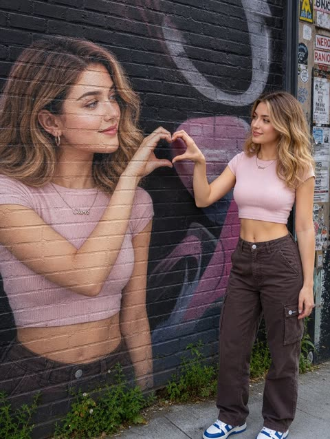</a>

把壁画和真人分成两个带标签的段落并保持同款穿搭，指尖才能拼成完整爱心。结尾补充强制透视和砖纹叠加，让画面看起来像画在墙上。

GPT Image 2.5 · 上传图改图 · 出处: [@Kubra_286 on X](https://x.com/Kubra_286/status/2102235098703880428) · 241 赞，统计于 2026-10-28

[`mural`](pages/zh/tags.md#tag-mural) [`trompe-l-oeil`](pages/zh/tags.md#tag-trompe-l-oeil) [`forced-perspective`](pages/zh/tags.md#tag-forced-perspective) [`street-art`](pages/zh/tags.md#tag-street-art) [`selfie`](pages/zh/tags.md#tag-selfie)

<details><summary><b>提示词</b></summary>

```text
Ultra realistic cinematic photo of a young woman making a half heart sign with her mural twin, interactive street art illusion.

Face match 100%

Mural on brick wall: giant hyper-realistic painting of the same woman, shoulder-length wavy blonde hair with dark roots, smiling side profile, wearing light pink ribbed cropped t-shirt, small hoop earrings, delicate 'Clariz' name necklace, right hand raised making half heart shape with thumb and index finger. Photorealistic mural style, brick texture visible through paint, black graffiti background.

Real woman: same woman, same face, shoulder-length wavy blonde hair, same pink ribbed crop top, brown dark cargo pants with side pockets, blue and white sneakers. Standing on sidewalk facing the mural, left hand raised completing the other half of the heart shape with the painted hand, fingers almost touching, perfect alignment forming a full heart. Smiling at mural.

Environment: urban alley brick wall with graffiti, posters and stickers on adjacent wall, small green plants growing along wall base, concrete sidewalk, soft natural daylight.

Style: true to life color grading, photorealistic, DSLR 8K, ultra detailed skin, same face recognizable, natural shadows, 9:16 vertical portrait, trompe-l'oeil, Instagram couple bestie heart hand trend.
*Pro tip to get it perfect:*
two people making heart shape, one real one painted, fingertip connection point, forced perspective heart illusion, brick overlay on mural, same outfit mural and real
```

</details>

<a id="gpt-image-minimi-tiny-figures-photo-world"></a>
### 人像照片周围的迷你3D小人互动

<a href="https://x.com/Zyrellix/status/2055486410749309438">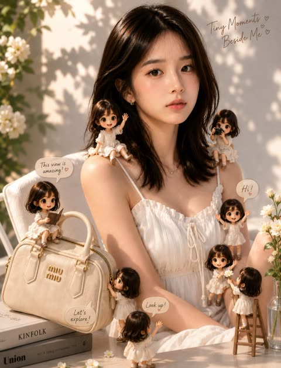</a>

提示词列出小人的具体互动，如坐在肩上和包上、挥手、模仿姿势，每个小人都有明确动作。同时要求保留原照片并带真实阴影和景深，让小人自然融入而不是重绘照片。

GPT Image 2 · 上传图改图 · 出处: [@Zyrellix on X](https://x.com/Zyrellix/status/2055486410749309438) · 212 赞，统计于 2026-10-28

[`minimi`](pages/zh/tags.md#tag-minimi) [`miniature`](pages/zh/tags.md#tag-miniature) [`photo-to-3d`](pages/zh/tags.md#tag-photo-to-3d) [`portrait`](pages/zh/tags.md#tag-portrait) [`chibi`](pages/zh/tags.md#tag-chibi)

<details><summary><b>提示词</b></summary>

```text
Transform this photo into a tiny “Minimi” world where miniature 3D characters interact naturally around me — sitting on my shoulder and bag, waving, copying my pose, and exploring the scene. Keep the original photo intact with realistic shadows, depth, motion, warm emotions. Title: “Tiny Moments Beside Me”
```

</details>

**[全部 22 条](pages/zh/image-edit.md)**

<a id="recipes"></a>
## Agent 配方：剪视频

用大白话告诉编程 Agent 你要什么。每条配方记下交给 Agent 的原话和它实际跑的命令，换成你自己的素材即可。

<a id="bilingual-subtitles"></a>
### 听写台词，烧录中英双语字幕

**交给 Agent 的原话**

> 听写 samples/night-train-ticket.mp4 里的中文台词，对照 prompts/video/night-train-ticket.yaml 里的剧本校对，每句中文下面加一行英文，把字幕烧进画面。

Whisper 会听错中文同音字（他和她读音相同）。有剧本时，让 Agent 用剧本定文字，只用 Whisper 定时间。

[`agent-editing`](pages/zh/tags.md#tag-agent-editing) [`ffmpeg`](pages/zh/tags.md#tag-ffmpeg) [`whisper`](pages/zh/tags.md#tag-whisper) [`subtitles`](pages/zh/tags.md#tag-subtitles) [`bilingual`](pages/zh/tags.md#tag-bilingual) [`chinese-dialogue`](pages/zh/tags.md#tag-chinese-dialogue)

<details><summary><b>Agent 实际跑的命令</b> · Agent: Claude Opus 5.5 in Claude Code · 工具: ffmpeg 9 with libass, openai-whisper medium</summary>

```bash
whisper samples/night-train-ticket.mp4 --model medium --language zh --output_format srt
# whisper heard 我等了他八年 / 就等着一趟车; the script says 我等了她八年 / 就等这一趟车.
# The agent kept whisper's timing, took the wording from the script, and added English lines:
#   1  00:00:00,000 --> 00:00:02,100  我等了她八年， / I waited eight years for her,
#   2  00:00:02,200 --> 00:00:04,200  就等这一趟车。 / all for this one train.
ffmpeg -i samples/night-train-ticket.mp4 \
  -vf "subtitles=subs.srt:force_style='FontName=PingFang SC,FontSize=15,Outline=1,Shadow=0,MarginV=22'" \
  -c:v libx264 -crf 20 -c:a copy subtitled.mp4
```

</details>

<a id="readme-preview-gif"></a>
### 给 README 做小体积循环 GIF 预览

**交给 Agent 的原话**

> 给 samples/ 里每个 mp4 做一张 README 用的循环 GIF，每张控制在 1.5 MB 左右。超过 8 秒的片加速播放，保证整段故事都能看到。

本仓所有预览图都是这样做的，每张 0.5 到 2 MB。每段单独生成 96 色调色板加 Bayer 抖动，体积小，肤色和霓虹也不脏。

[`agent-editing`](pages/zh/tags.md#tag-agent-editing) [`ffmpeg`](pages/zh/tags.md#tag-ffmpeg) [`gif`](pages/zh/tags.md#tag-gif) [`preview`](pages/zh/tags.md#tag-preview)

<details><summary><b>Agent 实际跑的命令</b> · Agent: Claude Opus 5.5 in Claude Code · 工具: ffmpeg 9</summary>

```bash
# landscape: 360 px wide; vertical: 300 px tall; 2x speed when longer than 8 s
ffmpeg -i in.mp4 -vf "setpts=PTS/2,fps=8,scale=360:-2:flags=lanczos,split[a][b];[a]palettegen=max_colors=96[p];[b][p]paletteuse=dither=bayer:bayer_scale=4" -loop 0 out.gif
```

</details>

<a id="split-shots"></a>
### 按硬切点把多镜头片拆成单独镜头

**交给 Agent 的原话**

> samples/late-night-office.mp4 应该有九个镜头。找出硬切点，按镜头拆成单独文件，再给我一张分镜条，每个镜头取中间一帧。

也能当生成视频的验收：八个切点都落在提示词所写时间的 0.17 秒以内。软切换调低阈值，晃动大的手持素材调高阈值。

[`agent-editing`](pages/zh/tags.md#tag-agent-editing) [`ffmpeg`](pages/zh/tags.md#tag-ffmpeg) [`scene-detection`](pages/zh/tags.md#tag-scene-detection) [`storyboard`](pages/zh/tags.md#tag-storyboard) [`qa`](pages/zh/tags.md#tag-qa)

<details><summary><b>Agent 实际跑的命令</b> · Agent: Claude Opus 5.5 in Claude Code · 工具: ffmpeg 9</summary>

```bash
# 1. find cuts
T=$(ffmpeg -i samples/late-night-office.mp4 -vf "scdet=threshold=8" -f null - 2>&1 \
    | grep -o "lavfi.scd.time: [0-9.]*" | awk '{print $2}' | paste -sd, -)
# -> 3.04,5.04,6.0,6.54,7.0,7.46,9.67,12.17  (prompt asked for 3.0,5.0,6.0,6.5,7.0,7.5,9.5,12.0)
# 2. split, forcing keyframes at the cuts so every file starts clean
ffmpeg -i samples/late-night-office.mp4 -c:v libx264 -crf 20 -force_key_frames "$T" -c:a aac \
  -f segment -segment_times "$T" -reset_timestamps 1 shot_%02d.mp4
# 3. storyboard strip
for f in shot_*.mp4; do
  mid=$(ffprobe -v error -show_entries format=duration -of csv=p=0 "$f" | awk '{printf "%.3f", $1/2}')
  ffmpeg -ss "$mid" -i "$f" -frames:v 1 -vf scale=-2:320 "${f%.mp4}.jpg"
done
ffmpeg -pattern_type glob -i "shot_*.jpg" -vf "tile=9x1:padding=4:color=white" -frames:v 1 storyboard.jpg
```

</details>

<a id="teaser-montage"></a>
### 把不同尺寸的片剪成预告：标题、转场、响度统一

**交给 Agent 的原话**

> 用夜市小巷、面档、夜车三段的前 4.5 秒剪一支 720p 预告，片名 RAIN CITY。画面和声音都用半秒交叉淡化，开头压片名，响度按社交平台标准统一，结尾淡出。

输入有 864x480 和 1344x768 两种尺寸。每路先统一尺寸、帧率和采样率，否则 xfade 和 acrossfade 接不上。总长是 3 段 4.5 秒减去两次 0.5 秒重叠，共 12.5 秒。

[`agent-editing`](pages/zh/tags.md#tag-agent-editing) [`ffmpeg`](pages/zh/tags.md#tag-ffmpeg) [`montage`](pages/zh/tags.md#tag-montage) [`title-card`](pages/zh/tags.md#tag-title-card) [`loudness`](pages/zh/tags.md#tag-loudness)

<details><summary><b>Agent 实际跑的命令</b> · Agent: Claude Opus 5.5 in Claude Code · 工具: ffmpeg 9</summary>

```bash
ffmpeg -i samples/neon-night-market-alley.mp4 -i samples/hk-noodle-stall-1960s.mp4 -i samples/night-train-ticket.mp4 -filter_complex "
[0:v]trim=0:4.5,setpts=PTS-STARTPTS,scale=1280:720:force_original_aspect_ratio=increase,crop=1280:720,fps=24,format=yuv420p,setsar=1[v0];
[1:v]trim=0:4.5,setpts=PTS-STARTPTS,scale=1280:720:force_original_aspect_ratio=increase,crop=1280:720,fps=24,format=yuv420p,setsar=1[v1];
[2:v]trim=0:4.5,setpts=PTS-STARTPTS,scale=1280:720:force_original_aspect_ratio=increase,crop=1280:720,fps=24,format=yuv420p,setsar=1[v2];
[0:a]atrim=0:4.5,asetpts=PTS-STARTPTS,aresample=48000[a0];
[1:a]atrim=0:4.5,asetpts=PTS-STARTPTS,aresample=48000[a1];
[2:a]atrim=0:4.5,asetpts=PTS-STARTPTS,aresample=48000[a2];
[v0][v1]xfade=transition=fade:duration=0.5:offset=4[x1];
[x1][v2]xfade=transition=fade:duration=0.5:offset=8[x2];
[a0][a1]acrossfade=d=0.5[ax1];
[ax1][a2]acrossfade=d=0.5[ax2];
[x2]drawtext=fontfile=/System/Library/Fonts/Supplemental/Futura.ttc:text='RAIN CITY':fontcolor=white:fontsize=110:x=(w-tw)/2:y=h*0.70:alpha='if(lt(t,0.3),t/0.3,if(lt(t,2.0),1,if(lt(t,2.5),(2.5-t)/0.5,0)))',fade=t=in:st=0:d=0.4,fade=t=out:st=12.1:d=0.4[v];
[ax2]loudnorm=I=-16:TP=-1.5:LRA=11,afade=t=out:st=12:d=0.5[a]" \
  -map "[v]" -map "[a]" -c:v libx264 -crf 20 -c:a aac -b:a 160k -ar 48000 teaser.mp4
```

</details>

<a id="vertical-blur-fill"></a>
### 横屏片改竖屏，背景用模糊填充

**交给 Agent 的原话**

> 把 samples/night-train-ticket.mp4 做成 1080x1920 的竖屏版发抖音。原画面完整放在中间，上下用同一段视频的模糊压暗版本填满，保留原音轨。

一条 ffmpeg 命令，5 秒片在 M 系列 Mac 上 1.5 秒跑完。主体横跨整个画面时用这种填充；主体在正中时直接裁切更好。

[`agent-editing`](pages/zh/tags.md#tag-agent-editing) [`ffmpeg`](pages/zh/tags.md#tag-ffmpeg) [`vertical`](pages/zh/tags.md#tag-vertical) [`reframe`](pages/zh/tags.md#tag-reframe)

<details><summary><b>Agent 实际跑的命令</b> · Agent: Claude Opus 5.5 in Claude Code · 工具: ffmpeg 9</summary>

```bash
ffmpeg -i samples/night-train-ticket.mp4 -filter_complex "
  [0:v]scale=1080:1920:force_original_aspect_ratio=increase,crop=1080:1920,gblur=sigma=40,eq=brightness=-0.08[bg];
  [0:v]scale=1080:-2[fg];
  [bg][fg]overlay=(W-w)/2:(H-h)/2,format=yuv420p" \
  -c:v libx264 -crf 20 -c:a copy vertical.mp4
```

</details>

<a id="guides"></a>
## 指南与 skill

### 官方提示词指南

- [MiniMax H3 prompt-writing skill](https://github.com/MiniMax-AI/MiniMax-H3/tree/main/.claude/skills/h3-prompt-writing): 官方 Agent skill，把一句想法改写成 H3 的结构化提示词格式。本地跑 H3 用上它效果差别很大。
- [OpenAI image prompting guide](https://developers.openai.com/api/docs/guides/image-prompting): GPT Image 2.5 的八条写法规则，生成、编辑、多轮修改的示例都附 Flare 和 Sunburst 两版对比。
- [Gemini Omni prompt guide](https://deepmind.google/models/gemini-omni/prompt-guide/): 对话式编辑、换机位、多路参考、续写、首尾帧。
- [Kling 4.0 user guide](https://kling.ai/quickstart/kling-4-model-user-guide): 30 秒单条、最多 15 份参考素材、10 张关键帧、用提示词改视频、8000 token 长提示词。
- [Kling VIDEO 3.0 user guide](https://app.klingai.com/global/quickstart/klingai-video-3-model-user-guide): 多镜头、主体绑定、多语种对白、方言口音、文字渲染、15 秒长镜头。
- [Veo 3 prompt guide](https://deepmind.google/models/veo/prompt-guide/): 引号写台词、声音提示、动作戏的逐拍长提示词。
- [Ultimate prompting guide for Veo 3.1](https://cloud.google.com/blog/products/ai-machine-learning/ultimate-prompting-guide-for-veo-3-1): 五段式公式、带时间戳的多镜头写法，以及配合 Nano Banana 的首尾帧和多素材工作流。
- [Sora 2 prompting guide](https://cookbook.openai.com/examples/sora/sora2_prompting_guide): 提示词结构、导演式说明、对白块、编辑、角色、续写。

### 社区 skill 与案例库

- [LearnPrompt/awesome-seedance](https://github.com/LearnPrompt/awesome-seedance): 最大的 Seedance 2.0 / 2.5 案例库，840 多条，每条都能追到原帖。
- [SkyNotSilent/awesome-MiniMax-H3-cases](https://github.com/SkyNotSilent/awesome-MiniMax-H3-cases): 几千个可直接播放的 MiniMax H3 案例，标明哪些公开了完整提示词。
- [dexhunter/seedance2-skill](https://github.com/dexhunter/seedance2-skill): 写 Seedance 提示词的 Agent skill。
- [liyue-aigc/seedance-2-5-video-director](https://github.com/liyue-aigc/seedance-2-5-video-director): Seedance 2.5 导演 skill：脚本、人物锁定、续写、编辑、转场。
- [T8mars/minimax-h3-prompt-skill-T8](https://github.com/T8mars/minimax-h3-prompt-skill-T8): MiniMax H3 和 Seedance 的提示词案例与可安装 skill。
- [smixs/visual-skills](https://github.com/smixs/visual-skills): 给 Agent 的电影导演 skill，从戏剧结构、走位到各模型的提示词语法。
- [UnderleveledBuilder/awesome-short-drama-skills](https://github.com/UnderleveledBuilder/awesome-short-drama-skills): AI 短剧、漫剧 skill 精选，从剧本、分镜到视频提示词。
- [joeseesun/opus-video-prompts](https://github.com/joeseesun/opus-video-prompts): 用 Claude Opus 5.5 写代码渲染视频的案例和提示词。

<a id="threed"></a>
## 用 Agent 做 3D

用编程 Agent 搭 3D 场景的配方（Blender MCP、three.js）正在整理。

<a id="tags"></a>
## 按标签浏览

[`cinematic`](pages/zh/tags.md#tag-cinematic) 59 · [`template`](pages/zh/tags.md#tag-template) 58 · [`multi-shot`](pages/zh/tags.md#tag-multi-shot) 56 · [`fashion`](pages/zh/tags.md#tag-fashion) 45 · [`dialogue`](pages/zh/tags.md#tag-dialogue) 44 · [`handheld`](pages/zh/tags.md#tag-handheld) 41 · [`action`](pages/zh/tags.md#tag-action) 41 · [`portrait`](pages/zh/tags.md#tag-portrait) 40 · [`photorealistic`](pages/zh/tags.md#tag-photorealistic) 39 · [`editorial`](pages/zh/tags.md#tag-editorial) 37 · [`typography`](pages/zh/tags.md#tag-typography) 35 · [`anime`](pages/zh/tags.md#tag-anime) 28 · [`travel-poster`](pages/zh/tags.md#tag-travel-poster) 28 · [`macro`](pages/zh/tags.md#tag-macro) 27 · [`character-consistency`](pages/zh/tags.md#tag-character-consistency) 27 · [`vertical`](pages/zh/tags.md#tag-vertical) 27 · [`storyboard`](pages/zh/tags.md#tag-storyboard) 25 · [`fantasy`](pages/zh/tags.md#tag-fantasy) 25 · [`golden-hour`](pages/zh/tags.md#tag-golden-hour) 25 · [`vlog`](pages/zh/tags.md#tag-vlog) 21 · [`pastel`](pages/zh/tags.md#tag-pastel) 21 · [`comedy`](pages/zh/tags.md#tag-comedy) 20 · [`infographic`](pages/zh/tags.md#tag-infographic) 20 · [`long-take`](pages/zh/tags.md#tag-long-take) 19 · [`miniature`](pages/zh/tags.md#tag-miniature) 19 · [`watercolor`](pages/zh/tags.md#tag-watercolor) 18 · [`food`](pages/zh/tags.md#tag-food) 17 · [`sci-fi`](pages/zh/tags.md#tag-sci-fi) 17 · [`film-grain`](pages/zh/tags.md#tag-film-grain) 17 · [`json-prompt`](pages/zh/tags.md#tag-json-prompt) 17 · [`candid`](pages/zh/tags.md#tag-candid) 17 · [`character-sheet`](pages/zh/tags.md#tag-character-sheet) 16 · [`selfie`](pages/zh/tags.md#tag-selfie) 16 · [`split-layout`](pages/zh/tags.md#tag-split-layout) 15 · [`timed-shots`](pages/zh/tags.md#tag-timed-shots) 14 · [`reference-image`](pages/zh/tags.md#tag-reference-image) 14 · [`tracking-shot`](pages/zh/tags.md#tag-tracking-shot) 14 · [`lifestyle`](pages/zh/tags.md#tag-lifestyle) 14 · [`reference-images`](pages/zh/tags.md#tag-reference-images) 14 · [`photo-to-illustration`](pages/zh/tags.md#tag-photo-to-illustration) 14 · [`commercial`](pages/zh/tags.md#tag-commercial) 13 · [`character-reference`](pages/zh/tags.md#tag-character-reference) 13 · [`martial-arts`](pages/zh/tags.md#tag-martial-arts) 13 · [`grid`](pages/zh/tags.md#tag-grid) 13 · [`chibi`](pages/zh/tags.md#tag-chibi) 13 · [`scrapbook`](pages/zh/tags.md#tag-scrapbook) 13 · [`editorial-poster`](pages/zh/tags.md#tag-editorial-poster) 13 · [`3d-animation`](pages/zh/tags.md#tag-3d-animation) 12 · [`timed-beats`](pages/zh/tags.md#tag-timed-beats) 12 · [`slow-motion`](pages/zh/tags.md#tag-slow-motion) 12 · [`dragon`](pages/zh/tags.md#tag-dragon) 12 · [`collage`](pages/zh/tags.md#tag-collage) 12 · [`cafe`](pages/zh/tags.md#tag-cafe) 12 · [`pov`](pages/zh/tags.md#tag-pov) 12 · [`diorama`](pages/zh/tags.md#tag-diorama) 12 · [`monochrome`](pages/zh/tags.md#tag-monochrome) 12 · [`architecture`](pages/zh/tags.md#tag-architecture) 12 · [`minimalist`](pages/zh/tags.md#tag-minimalist) 12 · [`photo-to-art`](pages/zh/tags.md#tag-photo-to-art) 12 · [`dv-camcorder`](pages/zh/tags.md#tag-dv-camcorder) 11 · [`surreal`](pages/zh/tags.md#tag-surreal) 11 · [`ugc`](pages/zh/tags.md#tag-ugc) 11 · [`sound-design`](pages/zh/tags.md#tag-sound-design) 11 · [`dark-fantasy`](pages/zh/tags.md#tag-dark-fantasy) 11 · [`low-angle`](pages/zh/tags.md#tag-low-angle) 11 · [`multi-scene`](pages/zh/tags.md#tag-multi-scene) 11 · [`korean`](pages/zh/tags.md#tag-korean) 11 · [`identity-lock`](pages/zh/tags.md#tag-identity-lock) 11 · [`motion-graphics`](pages/zh/tags.md#tag-motion-graphics) 10 · [`lip-sync`](pages/zh/tags.md#tag-lip-sync) 10 · [`rain`](pages/zh/tags.md#tag-rain) 10 · [`travel`](pages/zh/tags.md#tag-travel) 10 · [`night`](pages/zh/tags.md#tag-night) 10 · [`film-look`](pages/zh/tags.md#tag-film-look) 10 · [`vintage`](pages/zh/tags.md#tag-vintage) 10 · [`fashion-editorial`](pages/zh/tags.md#tag-fashion-editorial) 10 · [`studio-lighting`](pages/zh/tags.md#tag-studio-lighting) 10 · [`storybook`](pages/zh/tags.md#tag-storybook) 10 · [`documentary`](pages/zh/tags.md#tag-documentary) 9 · [`dance`](pages/zh/tags.md#tag-dance) 9 · [`kinetic-typography`](pages/zh/tags.md#tag-kinetic-typography) 9 · [`animals`](pages/zh/tags.md#tag-animals) 9 · [`creature`](pages/zh/tags.md#tag-creature) 9 · [`landscape`](pages/zh/tags.md#tag-landscape) 9 · [`city`](pages/zh/tags.md#tag-city) 9 · [`face-reference`](pages/zh/tags.md#tag-face-reference) 9 · [`smartphone-photo`](pages/zh/tags.md#tag-smartphone-photo) 9 · [`style-transfer`](pages/zh/tags.md#tag-style-transfer) 8 · [`home-video`](pages/zh/tags.md#tag-home-video) 8 · [`couple`](pages/zh/tags.md#tag-couple) 8 · [`character`](pages/zh/tags.md#tag-character) 8 · [`doodle`](pages/zh/tags.md#tag-doodle) 8 · [`negative-space`](pages/zh/tags.md#tag-negative-space) 8 · [`poster`](pages/zh/tags.md#tag-poster) 8 · [`music-video`](pages/zh/tags.md#tag-music-video) 7 · [`sports`](pages/zh/tags.md#tag-sports) 7 · [`luxury`](pages/zh/tags.md#tag-luxury) 7 · [`storytelling`](pages/zh/tags.md#tag-storytelling) 7 · [`flat-vector`](pages/zh/tags.md#tag-flat-vector) 7 · [`multi-reference`](pages/zh/tags.md#tag-multi-reference) 7 · [`japanese`](pages/zh/tags.md#tag-japanese) 7 · [`transformation`](pages/zh/tags.md#tag-transformation) 7 · [`structured-prompt`](pages/zh/tags.md#tag-structured-prompt) 7 · [`vfx`](pages/zh/tags.md#tag-vfx) 7 · [`y2k`](pages/zh/tags.md#tag-y2k) 7 · [`text-render`](pages/zh/tags.md#tag-text-render) 7 · [`product-commercial`](pages/zh/tags.md#tag-product-commercial) 7 · [`video-edit`](pages/zh/tags.md#tag-video-edit) 7 · [`landmark`](pages/zh/tags.md#tag-landmark) 7 · [`hand-drawn`](pages/zh/tags.md#tag-hand-drawn) 7 · [`streetwear`](pages/zh/tags.md#tag-streetwear) 7 · [`3d-render`](pages/zh/tags.md#tag-3d-render) 7 · [`isometric`](pages/zh/tags.md#tag-isometric) 7 · [`outfit-change`](pages/zh/tags.md#tag-outfit-change) 6 · [`product-ad`](pages/zh/tags.md#tag-product-ad) 6 · [`one-take`](pages/zh/tags.md#tag-one-take) 6 · [`pencil-sketch`](pages/zh/tags.md#tag-pencil-sketch) 6 · [`sfx`](pages/zh/tags.md#tag-sfx) 6 · [`fight-scene`](pages/zh/tags.md#tag-fight-scene) 6 · [`object-swap`](pages/zh/tags.md#tag-object-swap) 6 · [`mixed-media`](pages/zh/tags.md#tag-mixed-media) 6 · [`street`](pages/zh/tags.md#tag-street) 6 · [`horror`](pages/zh/tags.md#tag-horror) 6 · [`negative-prompt`](pages/zh/tags.md#tag-negative-prompt) 6 · [`cute`](pages/zh/tags.md#tag-cute) 6 · [`realism`](pages/zh/tags.md#tag-realism) 6 · [`illustration`](pages/zh/tags.md#tag-illustration) 6 · [`layout`](pages/zh/tags.md#tag-layout) 6 · [`sketchbook`](pages/zh/tags.md#tag-sketchbook) 6 · [`studio-portrait`](pages/zh/tags.md#tag-studio-portrait) 6 · [`flash-photography`](pages/zh/tags.md#tag-flash-photography) 6 · [`doodle-overlay`](pages/zh/tags.md#tag-doodle-overlay) 6 · [`85mm`](pages/zh/tags.md#tag-85mm) 6 · [`double-exposure`](pages/zh/tags.md#tag-double-exposure) 6 · [`editorial-layout`](pages/zh/tags.md#tag-editorial-layout) 6 · [`screen-print`](pages/zh/tags.md#tag-screen-print) 6 · [`sunset`](pages/zh/tags.md#tag-sunset) 6 · [`paper-texture`](pages/zh/tags.md#tag-paper-texture) 6 · [`education`](pages/zh/tags.md#tag-education) 5 · [`timeline-prompt`](pages/zh/tags.md#tag-timeline-prompt) 5 · [`timeline`](pages/zh/tags.md#tag-timeline) 5 · [`travel-vlog`](pages/zh/tags.md#tag-travel-vlog) 5 · [`time-lapse`](pages/zh/tags.md#tag-time-lapse) 5 · [`timestamped`](pages/zh/tags.md#tag-timestamped) 5 · [`native-audio`](pages/zh/tags.md#tag-native-audio) 5 · [`multilingual`](pages/zh/tags.md#tag-multilingual) 5 · [`camera-move`](pages/zh/tags.md#tag-camera-move) 5 · [`studio`](pages/zh/tags.md#tag-studio) 5 · [`stop-motion`](pages/zh/tags.md#tag-stop-motion) 5 · [`music`](pages/zh/tags.md#tag-music) 5 · [`chase`](pages/zh/tags.md#tag-chase) 5 · [`multi-turn-edit`](pages/zh/tags.md#tag-multi-turn-edit) 5 · [`consistency`](pages/zh/tags.md#tag-consistency) 5 · [`cat`](pages/zh/tags.md#tag-cat) 5 · [`nature`](pages/zh/tags.md#tag-nature) 5 · [`product`](pages/zh/tags.md#tag-product) 5 · [`photorealism`](pages/zh/tags.md#tag-photorealism) 5 · [`identity-consistency`](pages/zh/tags.md#tag-identity-consistency) 5 · [`packaging`](pages/zh/tags.md#tag-packaging) 5 · [`turnaround`](pages/zh/tags.md#tag-turnaround) 5 · [`fisheye`](pages/zh/tags.md#tag-fisheye) 5 · [`campaign`](pages/zh/tags.md#tag-campaign) 5 · [`papercraft`](pages/zh/tags.md#tag-papercraft) 5 · [`motion-blur`](pages/zh/tags.md#tag-motion-blur) 5 · [`agent-editing`](pages/zh/tags.md#tag-agent-editing) 5 · [`ffmpeg`](pages/zh/tags.md#tag-ffmpeg) 5 · [`historical`](pages/zh/tags.md#tag-historical) 4 · [`montage`](pages/zh/tags.md#tag-montage) 4 · [`cyberpunk`](pages/zh/tags.md#tag-cyberpunk) 4 · [`locked-camera`](pages/zh/tags.md#tag-locked-camera) 4 · [`halftone`](pages/zh/tags.md#tag-halftone) 4 · [`chinese-dialogue`](pages/zh/tags.md#tag-chinese-dialogue) 4 · [`nostalgic`](pages/zh/tags.md#tag-nostalgic) 4 · [`black-and-white`](pages/zh/tags.md#tag-black-and-white) 4 · [`ambient-sound`](pages/zh/tags.md#tag-ambient-sound) 4 · [`text-rendering`](pages/zh/tags.md#tag-text-rendering) 4 · [`silhouette`](pages/zh/tags.md#tag-silhouette) 4 · [`street-photography`](pages/zh/tags.md#tag-street-photography) 4 · [`physics`](pages/zh/tags.md#tag-physics) 4 · [`voiceover`](pages/zh/tags.md#tag-voiceover) 4 · [`keyframes`](pages/zh/tags.md#tag-keyframes) 4 · [`kids-education`](pages/zh/tags.md#tag-kids-education) 4 · [`claymation`](pages/zh/tags.md#tag-claymation) 4 · [`hud`](pages/zh/tags.md#tag-hud) 4 · [`asmr`](pages/zh/tags.md#tag-asmr) 4 · [`close-up`](pages/zh/tags.md#tag-close-up) 4 · [`snow`](pages/zh/tags.md#tag-snow) 4 · [`day-in-the-life`](pages/zh/tags.md#tag-day-in-the-life) 4 · [`romance`](pages/zh/tags.md#tag-romance) 4 · [`restaurant`](pages/zh/tags.md#tag-restaurant) 4 · [`thriller`](pages/zh/tags.md#tag-thriller) 4 · [`pixar-style`](pages/zh/tags.md#tag-pixar-style) 4 · [`world-building`](pages/zh/tags.md#tag-world-building) 4 · [`lookbook`](pages/zh/tags.md#tag-lookbook) 4 · [`sticker`](pages/zh/tags.md#tag-sticker) 4 · [`expressions`](pages/zh/tags.md#tag-expressions) 4 · [`reference-photo`](pages/zh/tags.md#tag-reference-photo) 4 · [`chinese-text`](pages/zh/tags.md#tag-chinese-text) 4 · [`floral`](pages/zh/tags.md#tag-floral) 4 · [`full-body`](pages/zh/tags.md#tag-full-body) 4 · [`summer`](pages/zh/tags.md#tag-summer) 4 · [`identity-preservation`](pages/zh/tags.md#tag-identity-preservation) 4 · [`pixel-art`](pages/zh/tags.md#tag-pixel-art) 4 · [`identity-reference`](pages/zh/tags.md#tag-identity-reference) 4 · [`geometric`](pages/zh/tags.md#tag-geometric) 4 · [`limited-palette`](pages/zh/tags.md#tag-limited-palette) 4 · [`mirror-selfie`](pages/zh/tags.md#tag-mirror-selfie) 4 · [`risograph`](pages/zh/tags.md#tag-risograph) 4 · [`kids`](pages/zh/tags.md#tag-kids) 3 · [`fashion-film`](pages/zh/tags.md#tag-fashion-film) 3 · [`korean-dialogue`](pages/zh/tags.md#tag-korean-dialogue) 3 · [`ambient-audio`](pages/zh/tags.md#tag-ambient-audio) 3 · [`selfie-vlog`](pages/zh/tags.md#tag-selfie-vlog) 3 · [`emotional`](pages/zh/tags.md#tag-emotional) 3 · [`hard-cuts`](pages/zh/tags.md#tag-hard-cuts) 3 · [`pets`](pages/zh/tags.md#tag-pets) 3 · [`audio-sync`](pages/zh/tags.md#tag-audio-sync) 3 · [`educational`](pages/zh/tags.md#tag-educational) 3 · [`single-take`](pages/zh/tags.md#tag-single-take) 3 · [`single-shot`](pages/zh/tags.md#tag-single-shot) 3 · [`lo-fi`](pages/zh/tags.md#tag-lo-fi) 3 · [`realistic`](pages/zh/tags.md#tag-realistic) 3 · [`aerial`](pages/zh/tags.md#tag-aerial) 3 · [`neon`](pages/zh/tags.md#tag-neon) 3 · [`period`](pages/zh/tags.md#tag-period) 3 · [`image-to-video`](pages/zh/tags.md#tag-image-to-video) 3 · [`push-in`](pages/zh/tags.md#tag-push-in) 3 · [`felt`](pages/zh/tags.md#tag-felt) 3 · [`beverage`](pages/zh/tags.md#tag-beverage) 3 · [`animation`](pages/zh/tags.md#tag-animation) 3 · [`embroidery`](pages/zh/tags.md#tag-embroidery) 3 · [`autumn`](pages/zh/tags.md#tag-autumn) 3 · [`line-art`](pages/zh/tags.md#tag-line-art) 3 · [`short-film`](pages/zh/tags.md#tag-short-film) 3 · [`subtitles`](pages/zh/tags.md#tag-subtitles) 3 · [`coastal`](pages/zh/tags.md#tag-coastal) 3 · [`subway`](pages/zh/tags.md#tag-subway) 3 · [`action-comedy`](pages/zh/tags.md#tag-action-comedy) 3 · [`crowd`](pages/zh/tags.md#tag-crowd) 3 · [`pet`](pages/zh/tags.md#tag-pet) 3 · [`cityscape`](pages/zh/tags.md#tag-cityscape) 3 · [`reference-sheet`](pages/zh/tags.md#tag-reference-sheet) 3 · [`worldbuilding`](pages/zh/tags.md#tag-worldbuilding) 3 · [`newspaper`](pages/zh/tags.md#tag-newspaper) 3 · [`film-photography`](pages/zh/tags.md#tag-film-photography) 3 · [`e-commerce`](pages/zh/tags.md#tag-e-commerce) 3 · [`minimal`](pages/zh/tags.md#tag-minimal) 3 · [`colored-pencil`](pages/zh/tags.md#tag-colored-pencil) 3 · [`light-mode`](pages/zh/tags.md#tag-light-mode) 3 · [`photo-edit`](pages/zh/tags.md#tag-photo-edit) 3 · [`side-profile`](pages/zh/tags.md#tag-side-profile) 3 · [`night-street`](pages/zh/tags.md#tag-night-street) 3 · [`mediterranean`](pages/zh/tags.md#tag-mediterranean) 3 · [`brand-identity`](pages/zh/tags.md#tag-brand-identity) 3 · [`concept-art`](pages/zh/tags.md#tag-concept-art) 3 · [`menswear`](pages/zh/tags.md#tag-menswear) 3 · [`candid-portrait`](pages/zh/tags.md#tag-candid-portrait) 3 · [`bokeh`](pages/zh/tags.md#tag-bokeh) 3 · [`screenshot`](pages/zh/tags.md#tag-screenshot) 3 · [`camera-roll`](pages/zh/tags.md#tag-camera-roll) 3 · [`cherry-blossom`](pages/zh/tags.md#tag-cherry-blossom) 3 · [`diagram`](pages/zh/tags.md#tag-diagram) 3 · [`reflection`](pages/zh/tags.md#tag-reflection) 3 · [`grayscale`](pages/zh/tags.md#tag-grayscale) 3 · [`grid-layout`](pages/zh/tags.md#tag-grid-layout) 3 · [`digicam`](pages/zh/tags.md#tag-digicam) 3 · [`natural-light`](pages/zh/tags.md#tag-natural-light) 3 · [`futuristic`](pages/zh/tags.md#tag-futuristic) 3 · [`golden-light`](pages/zh/tags.md#tag-golden-light) 3 · [`ink-illustration`](pages/zh/tags.md#tag-ink-illustration) 3 · [`mid-century`](pages/zh/tags.md#tag-mid-century) 3 · [`children-illustration`](pages/zh/tags.md#tag-children-illustration) 3 · [`miniature-world`](pages/zh/tags.md#tag-miniature-world) 3 · [`color-palette`](pages/zh/tags.md#tag-color-palette) 3 · [`local-edit`](pages/zh/tags.md#tag-local-edit) 3 · [`color-analysis`](pages/zh/tags.md#tag-color-analysis) 3 · [`paper-collage`](pages/zh/tags.md#tag-paper-collage) 3 · [`skyline`](pages/zh/tags.md#tag-skyline) 3 · [`tilt-shift`](pages/zh/tags.md#tag-tilt-shift) 3 · [`flat-color`](pages/zh/tags.md#tag-flat-color) 3 · [`memory-card`](pages/zh/tags.md#tag-memory-card) 3 · [`ink-wash`](pages/zh/tags.md#tag-ink-wash) 3 · [`street-art`](pages/zh/tags.md#tag-street-art) 3 · [`paper-craft`](pages/zh/tags.md#tag-paper-craft) 3 · [`phone-photo`](pages/zh/tags.md#tag-phone-photo) 3 · [`photo-to-sketch`](pages/zh/tags.md#tag-photo-to-sketch) 3 · [`split-composition`](pages/zh/tags.md#tag-split-composition) 3 · [`labels`](pages/zh/tags.md#tag-labels) 3 · [`tokyo`](pages/zh/tags.md#tag-tokyo) 3 · [`cinematic-lighting`](pages/zh/tags.md#tag-cinematic-lighting) 3 · [`street-style`](pages/zh/tags.md#tag-street-style) 3

**[全部 1315 个标签](pages/zh/tags.md)**

<a id="contributing"></a>
## 投稿

1. 在 `prompts/video/` 或 `prompts/image/` 下加一个 YAML 文件，照任意现有条目的格式写。
2. 附上提示词和成片最初发布的帖子或页面链接，并署上作者。
3. 运行 `python scripts/build.py` 重新生成两份 README，再提 PR。
4. 看不到成片、查不到出处的条目会被关闭，推广链接会被关闭。

## 同一维护者的其他清单

- [awesome-prompts](https://github.com/ai-boost/awesome-prompts)：大模型与 Agent 提示词
- [awesome-harness-engineering](https://github.com/ai-boost/awesome-harness-engineering)：搭建可靠的 Agent harness

## 许可证

仓库代码和说明文字：GPL-3.0。提示词和视频归原发布者所有，本仓注明出处后链接或引用。
