<div align="center">

<h1>Awesome Image & Video Prompts</h1>

<p>主流 AI 视频和图片模型的提示词，拿来就能用。每条都附真实成品和出处链接。另有用 Agent 剪视频的配方。</p>

<p><a href="README.md">English</a> · <b>简体中文</b></p>

<p><a href="https://awesome.re"></a></p>

<a href="#seedance-seoul-subway-revenge"></a> <a href="#wan-time-space-train"></a> <a href="#h3-starship-hyperspace-jump"></a> <a href="#omni-four-style-progression"></a> <a href="#kling-moonlit-garden-run"></a> <a href="#veo-off-road-rally"></a> 

</div>

> 本仓原名 **Awesome-GPTs**，原来的 GPTs 清单保存在 [legacy/awesome-gpts_zh.md](legacy/awesome-gpts_zh.md)。

## 目录

- [视频提示词](#video) (70 条)
  - [Wan 3.0](#wan30) (12)
  - [MiniMax H3](#minimaxh3) (3)
  - [Seedance 2.5](#seedance25) (19)
  - [Gemini Omni Flash](#geminiomniflash) (13)
  - [Kling 3.0](#kling30) (15)
  - [Veo 3](#veo3) (5)
  - [Sora 2](#sora2) (3)
- [图片提示词](#image) (23 条)
  - [海报与编辑排版](#img-poster) (6)
  - [照片转艺术风格](#img-photo-to-art) (4)
  - [写实照片](#img-realism) (5)
  - [人像](#img-portrait) (2)
  - [插画](#img-illustration) (2)
  - [手机与界面截图](#img-ui-mockup) (2)
  - [地图](#img-map) (1)
  - [拼贴](#img-collage) (1)
- [Agent 配方：剪视频](#recipes) (5 条)
- [指南与 skill](#guides)
- [用 Agent 做 3D](#threed)
- [按标签浏览](#tags)
- [投稿](#contributing)

<a id="video"></a>
## 视频提示词

下面每条提示词都原样摘自出处：模型厂商自己的指南或模型卡，或创作者在 X 上附带成片发布的帖子。点缩略图看带声音的原片。分组顺序按 [Artificial Analysis 视频榜](https://artificialanalysis.ai/video/leaderboard/text-to-video)排名，创作者帖子按点赞数排序，点赞数以标注日期为准。

<a id="wan30"></a>
## Wan 3.0

<a id="wan-camera-angle-swap"></a>
### 动作不变，换机位重拍你的视频

<a href="https://x.com/Framer_X/status/2101324357108658433"></a>

上传一段连续镜头作动作参考，Wan 从新角度重拍；某个镜头跑偏就重生成。

Wan 3.0 · 视频编辑 · 出处: [@Framer_X on X](https://x.com/Framer_X/status/2101324357108658433) · 1,170 赞，统计于 2026-10-27

[`camera-angle`](#tag-camera-angle) [`video-reference`](#tag-video-reference) [`workflow`](#tag-workflow)

<details><summary><b>提示词</b></summary>

```text
STEP 1: Upload your video (must be continuous one shot) to any platform that supports WAN 3.0

STEP 2: Use the prompt below (adjust it to your video):

"Use the original video @ TAG ORIGINAL VIDEO as the exact action reference

0–1s: Camera stays exactly as in the original video as the wolf walks toward the scooter.

1–3s: Hard cut to a tight front close-up as the wolf continues walking toward and reaches the scooter.

3–5s: Hard cut to a high angle above as the wolf as he gets onto the scooter and starts riding.

5–7s: Hard cut to a full shot as the wolf rides the scooter down the street.

7–9s: Hard cut to a side tracking shot as he keeps riding down the street.

9-10s: Hard cut to an over the shoulder shot as he rides forward and notices the banana peel in his path.

10–12s: hard cut to a birds eye view shot as the fallen wolf is rolling over the asphalt.

12-13s : hard cut to an insert shot of his fist as wolf slams it into the asphalt.

Only the camera angle and framing change. Make sure every action, movement, timing and performance exactly identical to the original video @ TAG ORIGINAL VIDEO. The action continues seamlessly across every cut."

NOTE: If some scenes didn't work (action was different than original video) simply regenerate the video, that usually fixes the problem.
```

</details>

<a id="wan-anime-monster-fight"></a>
### 手绘动画风，对战巨型怪物

<a href="https://x.com/aimikoda/status/2103790524637528348"></a>

两个带标签的参考（主角、怪物），要求保留手绘线条。Wan 的动画有自己的味道。

Wan 3.0 · 参考生视频 · 出处: [@aimikoda on X](https://x.com/aimikoda/status/2103790524637528348) · 502 赞，统计于 2026-10-27

[`anime`](#tag-anime) [`action`](#tag-action) [`reference-images`](#tag-reference-images)

<details><summary><b>提示词</b></summary>

```text
Use @[character ref] for the hero's exact identity and appearance; @[monster ref] for the monster's anatomy, scale, pale body, black projections and luminous horns. Preserve their angular hand-drawn contours, sparse sketch lines, matte cel-shadows, muted lavender and ash gray, blue-black shadows, peach rim light and fine grain. City and effects share this 2D anime style. References bind appearance, not framing or poses.

Five epic shots: the monster destroys the city as it charges toward the rooftop hero. ONE sudden, thick white line bursts from his index fingertip and instantly punches through it, leaving one enormous hole.

The hero stays at one skyscraper's avenue-facing edge, level with the monster's upper torso. The monster approaches directly IN FRONT OF him along the avenue. All cameras stay on one side of their shared axis: hero and tower screen-left, monster screen-right advancing left. The hero faces right. In his profile close-ups, the monster remains ahead, offscreen right, never behind his head or shoulders. No axis-crossing angles or orbits.

Shot 1. Low lateral wide tracking beside the monster charging right-to-left. Its shoulder tears through a building; the facade folds into the street as its next footfall buckles the roadway, hurling rubble forward. Debris whips past the lens through lavender dust. Widen and tilt upward to reveal the target tower ahead on screen-left, the tiny hero at its edge facing the approaching monster on screen-right. Keep the gap between them readable.

Shot 2. Right-side profile of the hero facing screen-right toward the offscreen monster. Face and right hand share the frame against sky and rooftop. Wind pulls his hair and coat; he stays relaxed. With a knowing smile, he extends his right arm toward the target: index straight, thumb raised, other fingers curled. Cut as the finger aligns with the target; no charging glow, gathering energy or held aiming pause.

Shot 3. Steady rear three-quarter view outside the hero's right shoulder, on the established side. Keep a clear gap between his fingertip screen-left and the monster's upper torso screen-right. It reaches for the rooftop directly ahead. Immediately on the cut, ONE thick, straight, brilliant-white line snaps from the index fingertip through the upper torso, below the neck between the shoulders. Its entire length appears instantly, connecting finger, target and the space beyond. Release and penetration happen together: no projectile travel, growing beam or drilling. One tiny finger recoil coincides with a building-sized circular section being punched through the body. The white line switches off immediately, leaving an enormous EMPTY opening, its broken dark rim framing the skyline. The torso jolts and tips sideways at once, the reaching arm knocked off course. Read the hole during the uninterrupted fall. No charging, stunned pause, slow motion or hit-stop. No sphere, pressure ring or full-screen whiteout obscures the contact. One abrupt discharge, never a sustained beam or repeated pulse.

Shot 4. Cut as that sideways tilt begins, keeping the same viewing direction and matching the ALREADY OPEN hole on the first frame. The monster's arm drops short of the roof; its weight carries it diagonally sideways into the blocks beside the avenue before reaching the tower, still in front of the hero. Track downward with the chest exposed: no edge-on turn or face-down roll. The SAME hole stays fixed below the neck between the shoulders, with the same physical diameter, broken rim and missing volume. Its outline foreshortens naturally as the torso tilts; background buildings slide visibly through the opening. Keep dust below the chest and clear of the aperture. Follow the fall through contact with the ruins and briefly show the fallen torso with its hole still open. The rim does not regrow, the opening does not fill, and the torso never returns to its intact state.

Shot 5. Return to the hero's right-side profile, facing screen-right, face and right hand together against sky and rooftop. The fallen monster remains OFFSCREEN ahead to the right. He bends his right elbow and brings the SAME extended index fingertip just in front of his lips. Only after it arrives, he gently purses his lips and visibly blows across it. A fine white wisp bends away in his breath. He lowers the hand slightly with a satisfied smile. Collapse thunder rolls in from ahead and a gust lifts his coat. Hold his effortless composure.

One instantaneous fingertip discharge, one impact, one permanent through-hole carried through the uninterrupted fall and landing. The hero keeps the same hand and facing. Sound: masonry and heavy footfalls, one dry electrical crack and a deep impact report together at the instant of contact, then the intimate breath against distant collapse. No dialogue or subtitles.
```

</details>

<a id="wan-tokyo-travel-vlog"></a>
### 东京旅行 vlog，一秒一个节拍

<a href="https://x.com/joshesye/status/2094723798679400808"></a>

中文描述配日语台词。每一秒都写清地点、动作、台词和到下一秒的转场。

Wan 3.0 · 文生视频 · 出处: [@joshesye on X](https://x.com/joshesye/status/2094723798679400808) · 421 赞，统计于 2026-10-27

[`vlog`](#tag-vlog) [`travel`](#tag-travel) [`japanese-dialogue`](#tag-japanese-dialogue) [`timed-beats`](#tag-timed-beats)

<details><summary><b>提示词</b></summary>

```text
一位20岁出头的年轻韩国偶像风格女性。长发直顺，黑色，自然蓬松，肤如凝脂，大而明亮的灵动的眼睛，精致的V形脸，小巧的鼻子，自然光泽的嘴唇，清新的淡妆，毫不费力地可爱又平易近人的表情。休闲日式街头穿搭（白色连帽衫 / 深色宽松连帽衫 / 宽大夹克）。26mm手机镜头，深景深，真实肤质，轻度HDR，中性iPhone色彩风格，未经编辑的抓拍，无电影级调色，无影棚灯光，无光轨，无动态模糊效果。

(0:00–0:01) —— 行走镜头，东京塔亮相自拍，低角度。塔在她身后，天空过曝。自然微笑。中性自然光，深景深。台词：「ついに東京に来た……！」 过渡：硬切 / 节奏重拍

(0:01–0:02) —— 涩谷十字路口，步入人群中间。转头看向镜头。身后霓虹灯牌清晰锐利。真实夜景曝光。过渡：节奏快切

(0:02–0:03) —— 便利店，将饭团举向镜头，挑眉。室内荧光灯强烈。冷白光，真实肤质。过渡：节奏闪切

(0:03–0:04) —— 代代木公园，坐姿，视线移向别处。斑驳光影，镜头可见污渍。音乐重拍落下——风、鸟鸣——随即切回。过渡：自然动作剪接

(0:04–0:06) —— 章鱼烧反应，咬下一口，瞪大眼睛，后仰大笑。温暖的实际灯笼光。琥珀色光下的真实肤质。台词：「アツッ！めっちゃ美味しい！」 过渡：笑声结束时剪接

(0:06–0:07) —— 自动售货机夜景，站在发光的售货机前。混合LED灯光映在脸上。微微坏笑。无光效处理。过渡：单拍剪接

(0:07–0:08) —— 电车车窗，面部倒映在车窗上。窗外城市自然模糊。她向外看，不看镜头。过渡：闪切

(0:08–0:09) —— 鸟居，低角度。走向并穿过神社大门。大门占据画面上方。自然日光。过渡：闪切

(0:09–0:11) —— 数字灯光展 ★ 标志性镜头 缓缓抬头。蓝、紫、金色投影映在脸上。焦点转移——面部清晰，灯光柔和散射。只有投影打在皮肤上，无眩光。速度：约60%慢动作 过渡：在抬头过程中柔化剪接

(0:11–0:12) —— 高达亮相，面部→镜头上摇→完整雕像入画。小小的赞赏微笑。广角，自然日光。过渡：微笑后锐利剪接

(0:12–0:13) —— 灯笼小巷，跟随跟拍。灯笼暖色，阴影暗部。自然低光。她回头瞥了一眼。过渡：向前运动时剪接

(0:13–0:14) —— 屋顶天际线，近距自拍→手臂伸远→天际线显现。风吹动发丝。自然夜景手机曝光。台词：「こんな夜景、初めて見た。」 过渡：最后一句台词处硬切

(0:14–0:15) —— 奈良鹿公园，她蹲下，递出鹿仙贝。鹿向她鞠躬——她突然大笑。另一只鹿从背后轻顶她，她几乎站不稳。手持拍摄，略有晃动。全部真实拍摄。台词：「ちょっと！本当にお辞儀した！」 过渡：淡出至黑屏
```

</details>

<a id="wan-four-gunmen-standoff"></a>
### 四个持枪男人的无声对峙

<a href="https://x.com/VictorInFocus/status/2088029679341261198"></a>

按编号节拍写，表演克制，在有人开枪前一刻切断。

Wan 3.0 · 文生视频 · 出处: [@VictorInFocus on X](https://x.com/VictorInFocus/status/2088029679341261198) · 261 赞，统计于 2026-10-27

[`thriller`](#tag-thriller) [`beats`](#tag-beats) [`tension`](#tag-tension)

<details><summary><b>提示词</b></summary>

```text
All four men are armed. Performances are restrained, dry and quietly tense, with subtle micro-expressions.

BEAT 1
Quick individual shots of each man holding his gun and staring at someone just outside frame.  Small eye movements, tightened jaws, slow blinks, controlled breathing. Each man is trying to look completely unfazed.

Cut between them, gradually suggesting they are all aiming at one another.

BEAT 2
Cut wide to reveal all four men several metres apart in a loose circle, each pointing his gun at another man in a four-way standoff.  Hold the wide shot. Wind lightly moves their suits. Nobody lowers their weapon.

The man in the cream suit glances around the circle.  CREAM SUIT, completely calm in a British accent:

“Anyone care to explain how we got here?”

A brief silence.  The older man in pink barely shifts his expression.  OLDER MAN IN PINK, dry in an American accent:

“Bad manners, mostly.”

BEAT 3
Hold on the group.  A tiny smirk. A raised eyebrow. Eyes flick between faces and guns. One man subtly adjusts his grip.

Slow, almost imperceptible push toward the group as the silence becomes uncomfortable.  Nobody fires.  Cut just as it feels like someone is about to.
```

</details>

<a id="wan-street-photographer-cold-face"></a>
### 嘴上说不要，照片却笑得很甜

<a href="https://x.com/johnAGI168/status/2093342672605913225"></a>

中文分块提示词。笑点在冷脸视频和甜笑写真之间的硬切，规则明确禁止渐变过渡。

Wan 3.0 · 参考生视频 · 出处: [@johnAGI168 on X](https://x.com/johnAGI168/status/2093342672605913225) · 240 赞，统计于 2026-10-27

[`chinese-dialogue`](#tag-chinese-dialogue) [`comedy`](#tag-comedy) [`vertical`](#tag-vertical) [`reference-images`](#tag-reference-images)

<details><summary><b>提示词</b></summary>

```text
【时长】18秒
【画幅】9:16竖屏
【风格】真人街头摄影短视频，手机纪实影像与专业写真照片交替剪辑，傍晚黄金时刻，真实皮肤质感，长焦浅景深，时尚街拍氛围，轻喜剧反差
【语言】中文对白，无字幕
【人物数量】画面中始终只有女主一人；摄影师只出现画外男声，不能实体出镜

【人物角色卡】
  @ 命名“方圆”，街头偶遇摄影师的女生。人物脸部、身形、发型、妆容、服装及原有配饰完全继承参考图。增加一部手机和一只单肩托特包作为剧情道具。

【核心情绪反差】

动态视频状态：
方圆表现得冷淡、拽、有距离感。下巴微抬，嘴唇轻抿，眉毛略微压低，眼神像是在审视镜头。说话时不撒娇、不害羞、不甜笑，拒绝动作干脆从容。

写真照片状态：
只要硬切进入写真，方圆的表情瞬间改变。眉眼完全舒展开，眼睛弯起，脸颊抬高，露出明亮、自然、毫无防备的甜美笑容。笑容必须明显比动态视频更温柔、更亲近、更有感染力。

情绪切换不能渐变：

动态冷脸 → 快门声与硬切 → 写真甜笑；
写真甜笑 → 硬切回视频 → 笑容立即消失，恢复冷淡。

这条“冷脸视频与甜笑照片”的反差是全片最重要的喜剧效果。

[00:00-00:04.20] 镜头1｜第一次冷脸拒绝

方圆站在现代创意园区的林荫道路旁，肩背托特包，低头看手机。

手持摄影机从侧前方缓慢靠近，由中远景推进到胸部近景。

00:00-00:00.80
方圆低头操作手机，完全没有注意镜头。右手拿手机，另一只手轻点屏幕，嘴唇闭合，表情平静冷淡。

00:00.80-00:02.40
听见陌生人搭话，她的手指先停下来。

她没有立刻抬头，而是停顿半拍，先把眼睛从手机屏幕移向镜头，随后才缓慢抬起头。

下巴微微上扬，眉毛轻压，眼神带有明显的审视感，脸上没有笑容。

【画外年轻男声】
“哎，你好，我是一名街头摄影师，可以邀请你拍两张照片吗？”

男声礼貌、自然，带一点试探感。

00:02.40-00:03.90
方圆先冷冷看着镜头，停顿约0.2秒，再开口：

【方圆】
“不要拿镜头对着我。”

语气平静、直接、有距离感，不能带娇嗔语气。

说“不要”时，她才抬起空闲的左手。

说“拿镜头”时，左手五指逐渐打开，掌心朝向摄影机。

说“对着我”时，左掌从容地靠近镜头，遮挡大半画面。右手始终拿着手机。

她从手掌旁边继续冷冷盯着镜头，嘴角不笑，也不害羞躲闪。

00:03.90-00:04.20
方圆收回手掌，干脆转身离开。肩膀先转，头部随后转动，头发产生真实甩动惯性。

[00:04.20-00:07.80] 镜头2｜第一组甜笑写真

在方圆冷脸转身之后，伴随清脆快门声，画面突然硬切成专业写真。

照片中的她不再冷漠，而是立即露出非常甜美、明亮的笑容。

照片一｜00:04.20-00:05.10
半身逆光回眸写真。

方圆身体朝前，脸回转看向镜头，露出灿烂的露齿甜笑。脸颊明显抬起，眼睛弯成柔和月牙形，整个人突然变得亲近温柔。

人物、发丝和背景完全静止。

照片二｜00:05.10-00:06.00
林荫道路全身写真。

方圆保持交叉迈步的优雅走姿，低头露出自然甜笑，像是被摄影师逗笑。笑容柔软放松，没有任何冷漠感。

照片三｜00:06.00-00:06.85
黄金逆光中近景写真。

一只手放在头顶发间，另一条手臂扶住托特包。方圆直视镜头，露出明亮甜美的露齿笑，眼尾弯起，脸颊饱满上扬。

照片四｜00:06.85-00:07.80
面部与上胸特写写真。

方圆头部轻轻侧歪，双眼温柔看向镜头，露出整组照片中最甜、最有感染力的笑容。牙齿自然露出，眼睛弯起，背景形成金色散景。

四张照片全部是真正静止的写真成片，不眨眼、不呼吸、不飘发。相邻照片通过快门声和硬切切换，不使用大面积白闪。

[00:07.80-00:10.30] 镜头3｜切回视频，笑容立即消失

硬切回手机动态视频。

切回的第一帧，方圆脸上的甜美笑容必须完全消失，重新恢复冷淡、拽、不耐烦的状态。

00:07.80-00:08.50
摄影机从侧后方跟拍。

方圆背对镜头继续向前走，手机拿在胸腰之间，托特包随脚步轻微晃动。

【画外年轻男声】
“很快很快，就两张。”

听见摄影师继续央求，方圆没有马上停下。

她先用眼角向后看，再缓慢转动头部和肩膀。她的眼神冷淡，下巴微抬，嘴唇轻抿，像是觉得摄影师很烦。

00:08.50-00:10.00
方圆一边走一边看向镜头：

【方圆】
“我没有配合你的义务。”

语气平静、坚定、带明显边界感，不能微笑。

说“我没有”时，她直视镜头，眉毛轻轻压低。

说“配合你的”时，空闲手从胸前抬起，五指逐渐打开。

说“义务”时，掌心正对摄影机并向前靠近，形成明确的“停止拍摄”手势。

她嘴上拒绝得很冷，但肩膀已经自然打开，腰部形成漂亮侧转，头部角度和手掌位置都非常适合拍照。

00:10.00-00:10.30
她放下手掌，冷淡地转回前方继续走。整个过程中不能出现甜笑。

[00:10.30-00:13.50] 镜头4｜第二组甜笑写真

就在方圆冷着脸转身离开时，快门声响起，画面再次硬切成甜美写真。

照片五｜00:10.30-00:11.10
大腿以上中景写真。

方圆双手在腰前拿着手机，身体微侧，脸转向镜头，突然露出放松明亮的露齿甜笑。眼睛弯起，肩膀柔和，与上一秒的冷脸形成强烈反差。

照片六｜00:11.10-00:11.90
道路边全身写真。

方圆一只手叉腰，另一只手抓住托特包肩带，髋部自然侧移。虽然姿势利落时尚，但表情非常甜，嘴角明显上扬，露出自然牙齿，眼神温柔亲近。

照片七｜00:11.90-00:12.70
林荫道路全身回眸写真。

身体保持向前迈步，后脚脚跟抬起，头和上胸向后回转。方圆回头看镜头时露出灿烂笑容，脸颊抬起，像是在开心地回应摄影师。

照片八｜00:12.70-00:13.50
胸腰以上近景写真。

方圆双手拿着手机，头部轻轻侧歪，双眼直视镜头，露出温柔甜美的笑容。笑意同时出现在嘴角和眼睛里，不能只是机械地咧嘴。

四张写真全部完全冻结，不能出现眨眼、呼吸、头发移动或背景运动。

[00:13.50-00:15.20] 镜头5｜再次切回冷脸动态视频

硬切回动态视频的第一帧，甜笑再次立即消失。

摄影机位于方圆侧后方，以腰胸以上中近景跟拍。

【画外年轻男声】
“就两分钟，两分钟，真的，就两……”

男声带一点执着和央求感，最后一句没有说完。

方圆没有台词，不跟随画外声音张嘴。

00:13.50-00:14.00
她回头冷冷看摄影机一眼。嘴唇闭合，眉毛略压，下巴微抬，表情像在说：“你怎么还在拍？”

00:14.00-00:14.50
她把脸转回前方，背对镜头继续走。长发自然覆盖背部，托特包随脚步轻轻晃动。

00:14.50-00:15.20
她借着下一步突然向镜头方向回身。

肩膀先转，头部随后转回，大束头发因惯性向外甩开，形成真实流畅的发丝弧线。

她的脸仍然保持冷淡，不能在甩发过程中提前微笑。

[00:15.20-00:18.00] 镜头6｜冷着脸却已经摆好Pose

摄影机由侧后方绕到侧前方，并缓慢推进至胸部近景。

00:15.20-00:15.80
方圆完成回身，左手抬到后脑和头顶发根，手肘自然向外打开。

眼睛准确找到镜头，目光稳定直接；嘴唇轻抿，下巴微抬，依然是一副不愿意配合的冷淡表情。

00:15.80-00:16.40
左手沿头发外侧向下滑动，把甩到脸前的发束拨开。

头发依靠真实惯性继续向一侧飘动。与此同时，她的肩膀自然打开，身体逐渐转成三分之二侧身。

00:16.40-00:17.10
左手落到托特包上缘，把包轻轻抱稳在身体侧面。

她把重心放到一条腿上，腰部轻微侧移，一侧肩膀向后打开，已经形成完整的专业模特Pose。

她的脸仍然冷淡，不能出现与写真相同的甜笑。

00:17.10-00:18.00
摄影机缓慢推进至近景。

方圆保持侧身抱包姿势，下巴先微抬，再缓慢压低一点；双眼从略低的眉骨位置直视镜头，嘴唇维持冷淡的闭合状态。

最后0.4秒，她只让一侧嘴角出现极其轻微、几乎看不出来的得意弧度，像是在说：

“我没有答应拍照，只是刚好会摆Pose。”

结尾仍是动态视频，保留轻微呼吸与发丝余动，不能变成甜笑写真。

【声音设计】
使用节奏利落的时尚流行音乐。

动态视频段保留脚步声、手机握持声、衣料摩擦声、托特包摆动声和甩发声。

每次从冷脸动态视频切入甜笑写真时，必须加入清脆机械快门声，并与画面硬切和音乐重拍同步。

摄影师始终为镜头后的画外男声。只有方圆说两句拒绝台词时产生口型。

【主要约束】
动态视频中的方圆必须冷淡、拽、不甜笑；
写真照片中的方圆必须笑得明亮、自然、甜美；
冷脸和甜笑只能通过硬切瞬间切换，禁止缓慢渐变；
写真段必须完全静止，动态段保持真实连续运动；
禁止换脸、人物外观漂移、口型错位、额外人物、字幕、Logo和水印。
```

</details>

<a id="wan-finger-dance-one-take"></a>
### 固定机位一镜到底的手指舞

<a href="https://x.com/johnAGI168/status/2092625479521931699"></a>

人物只命名一次（`粉宝`），后文都用名字指代，连哪只手做哪个动作都写清。

Wan 3.0 · 参考生视频 · 出处: [@johnAGI168 on X](https://x.com/johnAGI168/status/2092625479521931699) · 194 赞，统计于 2026-10-27

[`dance`](#tag-dance) [`long-take`](#tag-long-take) [`vertical`](#tag-vertical) [`reference-images`](#tag-reference-images)

<details><summary><b>提示词</b></summary>

```text
【人物角色卡】
@   ​→ 命名为“粉宝”，全片唯一人物。后文所有“粉宝”均指同一人，不再重复调用参考图。
粉宝的脸部身份、五官比例、发型、妆容、服装和配饰全部沿用参考图，不重新描述、不擅自改造。
全程严格保持同一张脸，不换脸、不改变年龄感、脸型、肤色和五官比例。

【风格】真人竖屏手指舞短视频（Finger Dance Performance），固定机位一镜到底（Locked-off One Take），轻快甜美、自然手机摄影质感，4K清晰度，真实皮肤纹理
【时长】15秒
【画幅】9:16
【人物】仅粉宝一人
【对白形式】粉宝本人面对镜头进行中文节奏念唱，必须准确对口型
【字幕】无字幕、无贴纸文字、无水印
【转场】全片不剪辑、不变装、不使用特效转场

【场景】
温暖整洁的居家房间，浅色墙壁和木地板；画面左侧是一台关闭的黑色电视和简洁矮柜，右侧是一扇关闭的棕色木门。背景装饰尽量简化，不摆放动物玩偶或动物照片。
前景保持完全空旷，只出现粉宝一个生命主体。画面中绝对不出现狗、其他动物、动物尾巴、动物毛发或动物影子。

【摄影机】
竖屏固定手机机位，摄影机位于粉宝正前方、约胸口高度，等效35mm镜头。中全景构图，从头顶拍到大腿上部，保留双手向左右和头顶伸展的空间。
摄影机全程锁定，不推拉、不摇移、不变焦、不跟随；手指伸向镜头时产生自然的近大远小（Forced Perspective），但镜头本身不能移动。

【表演内核】
粉宝像在和镜头另一端的人玩方向游戏：先认真介绍左边和右边，再把两边说成“可爱的两边”，随后从指方向逐渐变成指向观众，最后用爱心动作完成“我在你的心里面”。
情绪递进：俏皮示范 → 笑意增加 → 主动逗观众 → 甜蜜直球。
不要从第一帧就保持最大笑容；笑容随着手势逐步变亮，最强的笑容和眼神只留给最后一句。

[00:00-00:03.80] 镜头1：左边与右边（Locked Medium Full Shot）

[00:00-00:00.50]
粉宝跪坐在画面中央，身体正对镜头。右手从身体右侧向外轻快扫出，再弯曲手肘，将右手食指竖起；左手自然垂在左侧大腿旁。
头部随着右手轻轻晃动，先露出张嘴的明亮笑容，再迅速收成小幅度微笑。目光始终看镜头。
此段没有台词，嘴巴不能提前念词。

[00:00.50-00:01.40]
右手食指从竖直状态向内划出一小段弧线，落到人物自身右侧脸颊，也就是观众看到的画面左侧脸颊；其余四指自然收拢。
【台词】“这是左边。”
【口型】“这”字嘴唇短促向前；“左”字下颌稍微打开；“边”字嘴角向两侧收紧后闭合。
【微表情】说“这”时眉毛轻抬、眼睛睁开；说到“左边”时头部向指尖稍微倾斜，眼尾收窄，右侧脸颊被食指轻轻点出一个小凹陷，句尾变成带牙齿的小笑容。
【声音】清亮、俏皮、中等偏快语速，“左”字稍微加重，句尾轻轻上扬。

[00:01.40-00:02.00]
右手食指离开脸颊，两条手臂短暂向左右打开，肩膀和上半身跟随节拍轻轻摆动。嘴唇闭合成笑，不发出新台词。

[00:02.00-00:03.05]
左手抬起，左手食指点向人物自身左侧脸颊，也就是观众看到的画面右侧脸颊；右手自然落到右侧大腿旁。
【台词】“这是右边。”
【口型】每个字完整清楚，不能吞掉“右”字；“边”字结束后嘴唇自然闭合。
【微表情】头部向左手指尖方向倾斜；眼睛先看镜头，再短暂形成玩笑式单眼轻眯，双颊抬起，嘴角由小幅度微笑逐渐扩大。
【声音】保持与上一句相同的旋律和速度，“右”字落在重拍，句尾同样轻微上扬。

[00:03.05-00:03.80]
左手食指在脸颊旁做一次极小的离开—点回动作，然后双臂向外松开，为下一组双手动作蓄力。粉宝闭唇笑一下，眼睛轻眯，不说话。

[00:03.80-00:07.05] 镜头2：可爱的两边（Symmetrical Cheek Gesture）

[00:03.80-00:06.08]
两只手同时抬到脸部两侧，左右食指分别指向对应脸颊，其余手指自然弯曲，双肘向外展开，形成完全对称的双脸颊动作。
【台词】“这是可爱的两边。”
【动作同步】
“这是”——两根食指刚刚到达脸颊旁，头部保持居中；
“可爱”——两根食指同时轻点脸颊一次，头部向一侧小幅倾斜；
“的两边”——两根食指继续指住脸颊，上半身随节拍向另一侧轻摆，最后回到中央。
【口型】“可爱”必须清楚形成两个分开的音节；“两边”不能连成模糊笑声。句尾“边”字结束后嘴唇闭合半拍。
【微表情】“这是”时眼睛明亮直视镜头；“可爱”时眼尾压成弯月、双颊明显抬起；“两边”时露出整齐牙齿，最后加入一次快速俏皮眨眼。不能全程眯眼，也不能从开头就保持最大笑容。
【声音】童谣式轻快念唱，“可爱”略微拉长，“两边”落在节拍重音上。

[00:06.08-00:07.05]
双手从脸颊释放。右臂先向下外侧划开，左手食指在脸侧短暂停留；粉宝做一次清楚但自然的单眼眨眼，然后两只手都降至腰部附近。
嘴巴从笑容收成闭唇状态，准备下一句，不能在间奏中继续乱动口型。

[00:07.05-00:11.03] 镜头3：前面与后面（Direct-to-Camera Point）

[00:07.05-00:08.55]
左手食指重新竖起，手臂迅速向摄影机方向伸展。开始时食指朝上，伸近镜头后手腕向下旋转，使食指准确指向镜头中央；其余手指收拢，拇指自然搭在弯曲手指旁。
手掌靠近镜头后产生明显近大远小，粉宝的脸仍在后方保持清晰可辨。

【台词】“这是指前面。”
【口型】“指”字短促，“前面”两个音节要清楚分开；“前”字略加重。
【微表情】伸手前眉毛轻抬，像突然想到一个答案；指尖对准镜头时眼神沿着手指直接锁定观众，眼睛微微收窄，嘴角形成带一点得意的小笑容。
【声音】比前两句更有直接交流感，“前面”句尾下降，不拖音。

[00:08.55-00:10.07]
左手食指继续对准镜头保持半拍，然后缓慢收回。收回过程中手腕向侧面转动，食指从指向观众变为指向自己左肩后方；头部同步向该方向轻轻转动，视线先跟随指尖扫向肩后，再迅速回看镜头。

【台词】“这是指后面。”
【口型】“后”字嘴唇先收圆再放开，“面”字结束后闭唇。
【微表情】说“后面”时眉梢轻轻抬高，眼神短暂朝肩后看；回看镜头时眼睛弯起，像故意和观众开玩笑。笑容不能遮挡口型。
【声音】“后”字加重，语气带一点调皮的提示感，句尾轻轻落下。

[00:10.07-00:11.03]
左手落到腰侧。右手食指短暂指向右肩或胸口上方，左手沿原视频中的低位运动轨迹自然落在左侧大腿上。
原视频此处存在抚摸狗背的动作，重制时必须改成左手轻落大腿：不要抚摸空气、不要看向地面、不要生成任何动物。
粉宝闭唇笑，肩膀跟随节拍轻轻弹动一次。

[00:11.03-00:15.00] 镜头4：指向你与心里面（Finger Heart to Overhead Heart）

[00:11.03-00:12.55]
右手从肩侧向镜头伸出。先短暂握成面向镜头的小拳头，再缓慢松开，将拇指与弯曲的食指交叠，组成清晰的韩式手指爱心；中指、无名指和小指保持收拢。手指爱心位于镜头前方，不能挡住粉宝的双眼。

【台词】“这是指你。”
【口型】“你”字必须清楚，嘴角先收窄再上扬；不能念成“地”或其他字。
【微表情】小拳头伸出时目光直接、眉毛微抬；手指爱心成形的一瞬间，眼尾轻轻收窄，嘴角变成带牙齿的顽皮笑容，头部向一侧小幅倾斜。
【声音】“你”字加重并略微拉长，像直接点名镜头前的人，语气甜但不嗲。

[00:12.55-00:14.80]
右手爱心释放，两条手臂同时向左右展开，再沿大弧线举过头顶。双臂形成宽大的心形轮廓，两只手在头顶上方弯曲，左右指尖轻轻接触，组成完整的头顶爱心。
爱心完成后，粉宝保持手臂形状，身体先向一侧轻摆，再回到中央。

【台词】“我在你的心里面。”
【动作与台词同步】
“我在”——双臂向左右打开；
“你的”——双臂向上形成宽阔V形；
“心里”——两臂在头顶弯曲，双手指尖合拢成爱心；
“面”——爱心完全闭合并保持，头部位于心形正中央。

【口型】“我在你的”保持连贯但不能抢拍；“心里面”四个音节清晰，“心”字加重，“面”字稍微延长至动作完成。
【微表情】双臂打开时眼睛明亮、嘴角逐渐扩大；听到“心”字时双颊明显抬起、眼尾变弯；“里面”结束时呈现全片最明亮的笑容，牙齿自然露出，眼神牢牢看向镜头。不要提前达到最大笑容。
【声音】前半句轻快，念到“心”时音高略微上升，“里面”温柔落下，保持清晰中文发音。

[00:14.80-00:15.00]
头顶爱心的指尖向两侧分开，两条手臂顺势向下外侧打开；粉宝略微向摄影机靠近，维持明亮笑容和直接眼神，在动作仍有轻微惯性的状态下结束。
最后一帧不说新台词、不突然恢复中性表情、不淡出。

【完整台词】
“这是左边。
这是右边。
这是可爱的两边。
这是指前面，这是指后面。
这是指你，我在你的心里面。”

【声音控制】
同一位女性声线完成全部念唱，普通话清晰，甜美轻快但不过度夹嗓。每句“这是”使用相近节奏，左右、两边、前面、后面分别与对应手势严格同步。
只保留轻快的低音量节拍伴奏，不增加第二个人声、合唱、旁白、笑声音效或额外台词。

【动作连续性】
全片是一镜到底，所有动作必须由上一个动作自然过渡到下一个动作。手臂有真实惯性，手指先伸展再定型、先释放再移动；不能在相邻帧中突然瞬移。
人物自身左右手不能交换：右手负责第一段画面左侧脸颊，左手负责第二段画面右侧脸颊及指向镜头；右手负责最后的手指爱心，两只手共同组成头顶爱心。
```

</details>

<a id="wan-photo-editor-chase-comedy"></a>
### 修图工具变成实物的街头追逐

<a href="https://x.com/johnAGI168/status/2106723741602546165"></a>

光标、选框、变换框作为实物出现在街上，有投影有遮挡；长长的禁止项防止画面卡通化。

Wan 3.0 · 文生视频 · 出处: [@johnAGI168 on X](https://x.com/johnAGI168/status/2106723741602546165) · 189 赞，统计于 2026-10-27

[`comedy`](#tag-comedy) [`vfx`](#tag-vfx) [`chase`](#tag-chase) [`multi-shot`](#tag-multi-shot)

<details><summary><b>提示词</b></summary>

```text
Duration：30秒

Aspect ratio：16:9横屏

Overall style：电影实拍质感的都市白天喜剧。真人演员，真实街道，手持跟拍的能量感。图像编辑软件的工具和界面元素以实物形态出现在真实街道上，包括光标、虚线选框、变换框、白色方形把手和灰白透明格子，它们有透视、有遮挡，地面上有淡淡的投影。所有编辑都瞬间完成，干净利落，滑稽无害。动作物理动量连续，严禁静止发呆，严禁塑料CG感。

SUBJECT / 角色与道具绑定：

图片1 命名为【Iaro】，容貌、发型、服装、配饰全部以参考图为准，全片保持一致；

（@只在此处声明一次，正文严禁再出现@）

道具【光标】：巨型电脑光标，带细黑描边的白色哑光实物，常态高约1.2米，悬浮在离地1到1.8米之间，地面上有淡灰色投影。光标有三种形态，切换时"啪"地瞬间变形：

- 箭头形态：经典左上指向的白色箭头；

- 油漆桶形态：白色倾斜的小桶图标，桶口朝下；

- 橡皮擦形态：白色长方体橡皮块，长约1米。

每次"点击"时，光标整体向前点约10厘米，伴随清脆的咔哒声。性格固执又狡猾。

路人与动物：

【遛狗姑娘】年轻女性，浅蓝色卫衣，手牵红色狗绳；

【小白】白色小型卷毛狗，常态肩高约25厘米，被放大后肩高约1.5米，性格欢快，见到会动的东西就想追。

ENVIRONMENT / 空间轴线：

现代城市商业街，晴朗白天。自然阳光从画面右上方45度照下，色温约5600K，阴影清晰柔和。人行道上有木质长椅、路边停着一辆白色厢式货车，有一面红砖墙，街角有一条两侧是砖墙、尽头被墙堵死的窄巷。追逐方向全片统一：Iaro始终从画面右侧往左侧逃，光标始终从画面右侧追来。所有招牌、车身、墙面上都没有任何文字、数字或Logo。

AUDIO / 声音位置，严格按时间（全片无台词，无人声）：

① 0.0s起：城市环境声（远处车流、鸟鸣、路人脚步），原创轻快放克配乐（贝斯加军鼓，无人声），低电平进入；

② 1.2s–2.4s：四声连续的"啵、啵、啵、啵"，冰淇淋球被复制出来；

③ 4.0s"咔哒"；5.6s第二声"咔哒"，长椅被复制，"咚"一声落地；6.2s四个冰淇淋球摔在地上，"啪嗒"；

④ 9.4s"咔哒"，接一声弹性拉伸的"啵——"；10.2s巨犬欢快地低沉吠叫"汪！"；

⑤ 13.2s油漆倾泻的"哗——"；16.2s橡皮摩擦的"擦擦擦"；

⑥ 19.0s光标放大，低频上扬"呜——"；20.0s巨犬吠叫，接着"嗷呜"一口，然后是撕咬玩具的"吱吱"声；

⑦ 23.5s甩水声"噗噜噜"；

⑧ 25.5s配乐戛然而止，只剩环境声；25.8s"咔哒"；26.0s爆炸头弹开，"嘭"的一声；26.8s拍头时头发的弹簧声"啵嘤"；

⑨ 28.0s–30.0s安静，光标晃动时两声俏皮的电子音"嘀嘀"，巨犬尾巴拍地"啪、啪、啪"。

--------------------------------------------------------------------------------

SHOT 1（0.0s–3.5s）｜【冰淇淋复制】

Subject：Iaro，光标

Action：Iaro坐在木质长椅中间，右手握一支单球香草冰淇淋甜筒，正伸舌头要舔。0.6s，箭头光标从画面右侧滑入，停在冰淇淋上方30厘米处。1.0s，一个小号虚线选框框住冰淇淋球。1.2s起，"咔哒"四连击，每0.3秒在顶上复制出一个完全一样的冰淇淋球，摞成5个球、约40厘米高的冰淇淋塔，微微摇晃。2.6s，Iaro眼睛睁大，嘴张开，抬头看光标，咧嘴笑，对光标点了点头。

Environment：长椅背后是人行道和店铺，有零星路人走过。

Camera：35mm，平视中景，Iaro在画面左三分之一处，光标在右三分之一处。1.2s起镜头轻微上摇，跟住长高的冰淇淋塔。

Style：冰淇淋表面有真实的奶油质感和阳光高光，球与球接触处轻微压扁。

Performance：从准备舔，到发愣，再到惊喜，要一气呵成。

Constraints：禁止冰淇淋球悬空分离，每个球必须压在下一个上面。禁止光标碰到Iaro。

SHOT 2（3.5s–7.5s）｜【目标换成Iaro】

Subject：Iaro，光标

Action：3.5s，光标慢慢把箭头转向Iaro。4.0s"咔哒"，一个黑白虚线矩形选框"啪"地合拢，把坐着的Iaro连同身下的长椅一起框住，虚线沿边缘流动。4.3s，Iaro的笑容收住，眼睛往下瞟虚线，再瞟回光标。4.8s，Iaro保持右手举着冰淇淋塔不动，屁股贴着椅面向画面左侧一点点平移，左脚先落地，身体侧滑出选框。选框留在原地。5.6s第二声"咔哒"：选框里的长椅被复制，一张一模一样的长椅"咚"地出现在原长椅右边，紧挨着。5.8s，落地震动让冰淇淋塔剧烈摇晃。6.2s，上面4个球依次滑落，"啪嗒"砸在人行道上，只剩最底下1个。6.6s，Iaro低头看剩下的1个球，再抬头看光标，嘴角下拉。7.0s，Iaro转身向画面左侧起跑，右脚蹬地，身体前倾。

Environment：两张长椅紧挨着并排，掉落的冰淇淋在地上摊开。

Camera：35mm，平视中景，与SHOT 1同轴线。7.0s镜头向左甩，跟住起跑。

Style：选框虚线约3厘米粗，在人身上和长椅上投下极淡的虚线影子。

Performance：侧滑时动作慢而小心，像怕吵醒什么，和后面的爆发起跑形成反差。

Constraints：长椅复制必须在5.6s瞬间完成，不得渐变。Iaro的外观不得发生任何变化。

SHOT 3（7.5s–12.0s）｜【小白变巨犬】

Subject：Iaro，光标，遛狗姑娘，小白

Action：Iaro在人行道上全速向画面左侧冲刺，双臂大幅摆动，光标在Iaro右后方2米处追赶。8.4s，前方遛狗姑娘牵着小白迎面走来。8.8s，Iaro右脚起跳，双膝收起，从小白头顶跃过，左脚先落地，继续跑。9.0s，光标的选框套向Iaro，Iaro已经跳过去，选框落在小白身上。9.4s"咔哒"：小白身上出现带8个白色方形把手的变换框，四角的把手同时向外拉，小白在0.5秒内被等比放大到肩高1.5米，像一匹小马。狗绳仍握在遛狗姑娘手里，姑娘的手臂被一下拉到头顶。10.2s，巨犬欢快地"汪"一声，尾巴猛摇，脑袋跟着光标转来转去，眼睛死死盯着光标，前爪在地上跃跃欲试。11.0s，Iaro边跑边回头，看到巨犬，瞪大眼睛，又回头看第二眼。

Environment：路人纷纷后退给巨犬让出空间，巨犬的卷毛逐根清晰，在阳光下发亮。

Camera：24mm，横移跟拍，机位在Iaro右侧3米处，与Iaro同速向左平移，腰部高度，轻微手持颠簸。

Style：放大后的狗毛质感真实，脚掌接地有重量感。

Performance：巨犬全程开心，不凶，像看见一个大号玩具球。

Constraints：禁止狗变形或变丑，只能等比放大。禁止遛狗姑娘摔倒。禁止Iaro碰到小白。

SHOT 4（12.0s–15.0s）｜【油漆桶：货车染紫】

Subject：Iaro，光标

Action：12.0s，Iaro冲到一辆停在路边的白色厢式货车旁，后背和双手掌心紧贴车身侧面，憋住呼吸，屏息躲藏。12.6s，光标"啪"地变成油漆桶形态，悬停在货车车尾上方。13.0s"咔哒"，桶口点在车尾，鲜艳的亮紫色从点击处向车头方向扩散，像水波一样漫过白色车身，0.6秒内覆盖整辆车。13.3s，Iaro瞥见紫色从右侧涌来，在紫色到达后背前0.2秒，双手一推车身，向画面左侧弹开半米。13.8s，整辆货车变成纯亮紫色，Iaro站在旁边，低头看自己的双手，确认没被染色，长出一口气，继续跑。

Environment：紫色只停在车身漆面上，车窗、轮胎、车灯都保持原样。

Camera：35mm，平视中景，侧面拍货车和Iaro，货车占画面右三分之二，Iaro在画面左侧边缘。

Style：紫色漆面在阳光下有真实的车漆反光。

Performance：贴车躲藏时双眼圆睁，嘴唇紧抿。

Constraints：Iaro身上不得沾到任何紫色。禁止油漆液体溅出车身之外，变色只发生在车身表面。

SHOT 5（15.0s–18.0s）｜【橡皮擦：墙上擦出透明格子】

Subject：Iaro，光标

Action：Iaro沿红砖墙向画面左侧奔跑。15.5s，光标"啪"地变成橡皮擦形态，从Iaro右后方追上来，在头部高度从右向左横扫过来。15.9s，Iaro双膝一弯，上身前折，向下滑铲，橡皮擦从Iaro头顶上方擦过，扫在砖墙上。16.2s，"擦擦擦"三下来回摩擦，砖墙被擦掉一块约1米见方的区域。缺口里不是墙洞，而是一块平整的灰白相间的棋盘格透明背景图案，边缘干净。16.8s，Iaro从滑铲中站起，停下回头，把脸凑近那块棋盘格，用右手食指轻戳一下，指尖碰到的是一个平面，Iaro的眉毛挑起。17.4s，橡皮擦又扫过来，Iaro转身拔腿就跑。

Environment：棋盘格每格约5厘米，灰白两色，平铺在墙面上，周围砖块完好。

Camera：35mm，跟拍转为静止中景。16.8s镜头轻推，Iaro的侧脸和棋盘格同时在画面里。

Style：棋盘格像墙面的一部分，同样被阳光照亮，有砖墙一致的透视。

Performance：戳棋盘格时的好奇和怀疑，是这段的笑点。

Constraints：禁止橡皮擦碰到Iaro。棋盘格禁止发光，禁止出现文字或数字。

SHOT 6（18.0s–22.5s）｜【死胡同：巨犬救场】

Subject：Iaro，光标，小白

Action：18.0s，Iaro拐进窄巷，跑到尽头，被墙堵住，转身背贴墙面，双手摊在墙上。18.5s，光标变回箭头形态，飘到巷口，周身出现变换框，从1.2米膨胀到3米高，堵住整个巷口。19.4s，光标拖出一个虚线矩形选框，框住整条巷子和Iaro。Iaro闭上眼，脸扭向一边。20.0s，巨犬从光标身后的巷口跃起，前爪腾空，一口咬住光标的尾端，叼在嘴里，落地后左右猛甩脑袋，像甩玩具一样。光标的变换框和选框同时闪两下消失，光标在狗嘴里缩回1.2米，被甩得左右乱晃。21.0s，巨犬叼着光标趴下，前爪按住，开心地啃咬，尾巴拍地。21.5s，Iaro睁开一只眼，再睁开另一只，背贴着墙慢慢滑坐到地上，喘着气笑出来。

Environment：窄巷两侧是红砖墙，地面有一些积水，巨犬落地时溅起水花。

Camera：18.0s–19.4s，24mm低机位，从Iaro身后、贴近墙角处拍出去，光标在巷口逆光。20.0s切35mm侧面中景，拍巨犬跃起叼住光标的完整动作弧线。

Style：光标在狗嘴里被咬出真实的压痕，有弹性。

Performance：巨犬全程是玩耍，不是攻击。

Constraints：禁止狗撕碎光标。禁止Iaro在本镜头被选中编辑。禁止出现文字。

SHOT 7（22.5s–25.5s）｜【以为结束了】

Subject：Iaro，光标，小白

Action：22.5s，Iaro站起来，拍了拍裤子，走到巨犬面前，伸手挠它的下巴，脸上是得意的笑。23.0s，巨犬张嘴吐舌头哈气，光标从嘴里滑出，湿漉漉、皱巴巴地掉在地上。23.5s，光标晃晃悠悠浮起，飘到Iaro后脑后方1米处，像狗一样抖身，"噗噜噜"甩出一圈水珠，皱褶瞬间恢复平整。Iaro背对着光标，正在摸狗，毫无察觉。

Environment：甩出的水珠在阳光下闪亮，落在地上。

Camera：35mm，平视中景，Iaro和巨犬在画面左侧，光标在画面右侧Iaro的身后升起，镜头静止。

Style：浅景深，Iaro和光标都清晰。

Performance：Iaro完全放松，甚至有点得意，和下一镜形成反差。

Constraints：Iaro不得回头。光标抖水时不得碰到Iaro。

SHOT 8（25.5s–28.0s）｜【红色爆炸头】

Subject：Iaro，光标

Action：25.8s"咔哒"，一个虚线矩形选框"啪"地合拢，只框住Iaro的头部。26.0s，无论Iaro原本是什么发型，都在0.4秒内"嘭"地膨胀成一个巨大的鲜红色爆炸头：直径约60厘米，正圆形，由紧密的小卷组成，整颗都是同一种正红色，比Iaro的肩膀还宽。26.4s，选框消失。26.6s，Iaro整个人僵住，手还停在狗下巴上。Iaro的右手慢慢抬起来，拍了一下头顶，爆炸头像弹簧一样上下弹了两下。

Environment：爆炸头的边缘在阳光下透出红色的光晕。

Camera：35mm，从Iaro侧后方的中景开始，26.0s起缓慢推近，让爆炸头的体积和形状一目了然。

Style：发卷逐根清晰，有真实的蓬松度和弹性，绝不能是一块头套或一颗毛球。

Performance：从僵住到拍头，脸上没有表情，只有手在动。

Constraints：发型变化只能发生在26.0s–26.4s之间。只有发型改变，Iaro的脸、服装、配饰必须与参考图完全一致。爆炸头禁止出现红色以外的颜色。

SHOT 9（28.0s–30.0s）｜【"真的假的？"】

Subject：Iaro，光标，小白

Action：28.0s，Iaro慢慢转身，用0.8秒转过来面向光标，爆炸头随转身轻微颤动。28.8s，Iaro停住，面无表情地瞪着光标，眉毛压低，嘴角下拉，长长地从鼻子呼出一口气。29.0s，光标在画面右侧左右轻快地摇摆两下，一副无辜的样子。29.3s，画面左下角，巨犬的眼睛盯住了这颗又圆又弹的红色爆炸头，脑袋一歪，尾巴越摇越快，前爪压低身体，摆出扑球前的预备姿势。29.6s，Iaro的眼珠慢慢斜向巨犬。30.0s定格。

Environment：巷子里的阳光打在爆炸头上，背景微虚。

Camera：50mm近景，Iaro在画面中央，胸部以上加爆炸头完整入画，光标在右侧边缘，巨犬的脑袋从左下角入画。镜头静止。

Style：喜剧节奏靠最后的停顿和眼神来出效果。

Performance："真的假的？"只靠表情：先是无语，再是警惕，绝不开口。

Constraints：禁止Iaro说话或张口。巨犬禁止真的扑上去，停在预备姿势。禁止出现字幕或文字。

--------------------------------------------------------------------------------

NEGATIVE / 全片负面约束：

禁止任何文字、字母、数字、Logo、水印、字幕，禁止软件界面的文字菜单和工具栏。禁止对白和人声。禁止开场静止发呆。禁止Iaro的脸、服装、配饰偏离参考图或在镜头间漂移（只有SHOT 8的发型变化例外）。禁止假发套感的头发、塑料皮肤、浮肿卧蚕、CG蜡像脸。禁止变形带有恐怖、血腥或伤害感，巨犬禁止凶狠。禁止光标穿过人体，光标漂浮时必须有投影。禁止追逐方向反转。禁止物体悬空。禁止画面卡通化，所有编辑元素都必须像实物一样嵌在真实光线里。
```

</details>

<a id="wan-jeweled-creatures-to-heels"></a>
### 珠宝生物变成高跟鞋

<a href="https://x.com/TaliaAariz/status/2093213718540636649"></a>

重复的变形：每踩一只生物就变成一只鞋。规律只说一次，模型自己重复。

Wan 3.0 · 文生视频 · 出处: [@TaliaAariz on X](https://x.com/TaliaAariz/status/2093213718540636649) · 186 赞，统计于 2026-10-27

[`fashion`](#tag-fashion) [`transformation`](#tag-transformation) [`cg`](#tag-cg)

<details><summary><b>提示词</b></summary>

```text
A hyper-realistic high-fashion CGI animation set in an opulent palace with marble floors, featuring a sequence where bare feet with matching manicured toenails step onto ornate, jewel-encrusted luxury creatures that magically transform into high-heeled shoes. First, a foot with red polished toes steps onto a ruby-and-gold jeweled snail, which unfolds and morphs into a breathtaking crimson gem-studded stiletto pump with delicate gold ankle straps. Next, a foot with blue nails steps onto a sapphire-blue jewel dragonfly, which transforms into a royal blue high heel adorned with shimmering iridescent wings at the heel. Finally, a foot with green nails steps onto a faceted emerald scarab beetle, which transforms into an elegant emerald stiletto featuring delicate butterfly wings, completing each transformation as the wearer steps forward in a luxury fashion showcase.
```

</details>

<a id="wan-shadow-puppet-battle"></a>
### 皮影戏台上，一把剪刀对阵百名刺客

<a href="https://x.com/FellMentKE/status/2092617578338504970"></a>

先写风格块（CG、光照、渲染术语），再写打斗，最后两条禁令：不要配乐，不要字幕。

Wan 3.0 · 文生视频 · 出处: [@FellMentKE on X](https://x.com/FellMentKE/status/2092617578338504970) · 184 赞，统计于 2026-10-27

[`action`](#tag-action) [`martial-arts`](#tag-martial-arts) [`cg`](#tag-cg)

<details><summary><b>提示词</b></summary>

```text
Style
Hyper-realistic CG cinematography with detailed facial features, realistic skin and hair, cinematic lighting, soft shadows, physically accurate reflections, SSS, global illumination, RTX ray tracing, 4K HDR quality, and realistic cloth and rigid-body physics.

Scene

An ancient theater stage illuminated by flickering candlelight, surrounded by translucent shadow-puppet screens and hundreds of faceless wooden assassins.

The female hero, based on Image 2, wears a dark-red opera costume with copper bells and oversized flowing sleeves. She remains elegant, cold, and completely composed throughout the battle.

Shot 1 — 0–3s

Low-angle FPV fly-through

The camera moves beneath the theater stage as hundreds of wooden puppet assassins close in.

The heroine calmly draws a tiny pair of black iron scissors from her sleeve, holding them delicately between her fingertips.

Shot 2 — 3–5s

Extreme close-up

She gently blows cold air onto the scissors, creating visible white mist.

The tiny scissors rapidly expand into enormous black iron shears.

She says:

“The performance is over. Time to take the final bow.”

Shot 3 — 5–9s

Rapid 180-degree orbit

She launches into an elegant, theatrical combat sequence inspired by shadow puppetry.

Each movement of the giant shears releases razor-sharp black energy blades that slice through the wooden assassins like paper puppets.

Shot 4 — 9–13s

Fast tracking shot

She moves between the wooden pillars, using the environment to propel herself forward.

The giant shears crack the floor and pillars while wood splinters and debris fill the air.

Her flowing sleeves, hair, and copper bells react naturally to every movement.

Shot 5 — 13–15s

Low-angle wide shot · Dutch-angle dolly-in

She lands and rests the giant shears on her shoulder.

Behind her, the motionless assassins stand covered in precise cuts.

With a small flick of her wrist, the entire theater cracks apart and collapses.

Smoke, fire, and black ash fill the background as the image freezes on her cold, confident expression and fades to black.

Audio

Diegetic and action sounds only: wooden boards, copper bells, cold wind, breath, metallic transformation, weapon impacts, energy whooshes, splintering wood, and collapsing debris.

No background music. No subtitles.
```

</details>

<a id="wan-steampunk-detective-montage"></a>
### 蒸汽朋克侦探，五个地点快剪

<a href="https://x.com/socialwithaayan/status/2092581849650593830"></a>

从动作中途切入，每个镜头底下都垫同一条大提琴，把快剪串成一体。

Wan 3.0 · 文生视频 · 出处: [@socialwithaayan on X](https://x.com/socialwithaayan/status/2092581849650593830) · 152 赞，统计于 2026-10-27

[`montage`](#tag-montage) [`fast-cut`](#tag-fast-cut) [`steampunk`](#tag-steampunk) [`score`](#tag-score)

<details><summary><b>提示词</b></summary>

```text
A cinematic, fast cutting steampunk detective montage in high fidelity live action, set in a fog choked industrial city at night. Open mid motion on a detective in a soot stained long coat crouched at the edge of a canal, gloved fingers pulling a cracked pocket watch from the water, gaslight smearing through the mist behind him. The camera pushes in hard on the watch face, second hand stuttering, then whip pans into a railway station where steam floods the platform and a torn ticket spins down onto wet cobbles. Cut to a low angle inside the clock tower, brass gears the size of wagon wheels turning past the lens while dust hangs in a single shaft of moonlight. Cut to the boiler room, orange furnace light raking across riveted pipes, water dripping off every surface, the detective's shoes ringing on the iron catwalk. Sudden zoom onto a brass plate bolted to a laboratory door, etched Qwen Create, condensation running down between the letters, his glove wiping it clean. Cut inside to the secret laboratory, copper coils throwing electric sparks that light one half of a face in the dark. Finish on the detective's eyes in tight close up as recognition hits, breath fogging, jaw setting.

Keep the same fog density and gaslight warmth in every shot. Colour lives in the materials: wet black stone, green oxidised copper, worn brass, deep burgundy velvet, white steam.

Handheld throughout, urgent but readable, one snap zoom per location and nothing else fancy.

Diegetic sound only, no score: clock ticking, steam venting, a far off train whistle, leather soles on cobblestone, one low cello note under it all.

Final frame holds two seconds on black, then clean white lettering fades up centre frame reading Qwen Create, and under it
http://
create.qwen.com. No other text or subtitles anywhere in the film.
```

</details>

<a id="wan-time-space-train"></a>
### 时空列车，30 秒一镜到底

<a href="https://x.com/johnAGI168/status/2092180177690194162"></a>

开头是参数表（时长、比例、形式、风格），后面列出场景必须遵守的物理规则，比如乘客不能瞬移。

Wan 3.0 · 文生视频 · 出处: [@johnAGI168 on X](https://x.com/johnAGI168/status/2092180177690194162) · 129 赞，统计于 2026-10-27

[`long-take`](#tag-long-take) [`sci-fi`](#tag-sci-fi) [`world-building`](#tag-world-building)

<details><summary><b>提示词</b></summary>

```text
Duration: 30 seconds
Aspect Ratio: 16:9 Landscape
Format: A truly continuous, uncut, no-frame-jump cinematic long take
Overall Style: Hollywood sci-fi adventure blockbuster, hyper-realistic, epic scale, authentic physical motion, cinematic lighting and depth of field, delicate film grain, high dynamic range, cold-to-warm color shifts layer by layer.

Subject:
A modern and realistic urban train with an entire massive curved panoramic glass window. The shot is positioned at the rear of the carriage, capturing the front of the carriage with a 24mm wide-angle oblique angle: the left two-thirds is the panoramic window, the right one-third is handrails, hanging straps, and ordinary passengers. Passengers wear modern dark commuter attire, initially quiet and heads down on their phones. The train, carriage structure, seats, passenger positions, clothing, camera height, and focal length remain completely consistent throughout the 30 seconds. All time-space changes occur only outside the window.

ONE CONTINUOUS TAKE (0-30 seconds):

0-4 seconds:
The train speeds through the edge of a modern city under overcast skies, with buildings, rivers, and utility poles outside the window creating realistic lateral motion blur. Carriage lights are steady, passengers heads down on phones. The shot maintains an oblique wide-angle composition, with only subtle realistic train vibrations. A calm female voice comes over the broadcast: "The time-space train is about to activate. Please remain seated."

4-6 seconds:
The train enters a dim tunnel, the city replaced by concrete walls, overhead lights quickly sweeping across the glass. The carriage gradually darkens. The tunnel walls continuously transform into rough, damp natural rock faces, using rocks close to the glass for a natural occlusion transition, with absolutely no cuts.

6-12 seconds — Dinosaur Era:
The rock cave suddenly opens, revealing sunlight piercing through mist outside the window: a prehistoric rainforest and vast Jurassic valley. Herds of Parasaurolophus run alongside the train, massive Apatosauruses slowly cross distant woodlands, Pteranodons soar across the sky. Foreground plants create fast motion blur, midground dinosaurs are sharp, distant volcanoes shrouded in mist form strong depth and parallax.
At 10 seconds, a massive Tyrannosaurus Rex bursts from the woods, briefly paralleling the train, roaring thunderously close to the glass. Passengers simultaneously look up and turn toward the window, but without exaggerated scrambling. Golden sunlight and forest greens realistically project into the carriage.

12-19 seconds — Volcanic Apocalypse:
The T-Rex's enormous body sweeps across the frame, creating a natural occlusion. After the occlusion clears, the same prehistoric world has transformed into a volcanic wasteland in the midst of destruction. A super-volcano erupts violently in the distance, black volcanic clouds roiling upward, red-hot lava cascading from cliffs, ground fissures extending all the way to the train.
The train races through a lava canyon at high speed, volcanic bombs streaking across the sky but not striking the carriage, a scorching shockwave chasing from behind. The glass reflects real firelight, the carriage shifting from golden to intense red-orange, passengers gripping handrails tightly, staring in shock out the window. Maintain realistic gravity, smoke, dust, and volcanic debris motion.

19-22 seconds — Time-Space Submersion:
The train plunges into a massive wall of volcanic steam, thick smoke, and white water vapor, the frame naturally obscured but the shot never interrupts. Red firelight rapidly shifts to deep blue, steam condensing into water droplets streaking across the glass. The train seamlessly crosses the time-space boundary into the deep sea; the carriage interior remains dry and intact, with no seawater intrusion.

22-28 seconds — Undersea World:
The white water vapor clears, revealing a vast, clear, profound blue ocean outside the window. Sunbeams pierce from the surface, colorful corals, seagrasses, schools of fish, sea turtles, and manta rays pass by at varying depths, creating spectacular parallax. A massive blue whale glides slowly overhead, its belly nearly covering the entire panoramic window, the scale utterly breathtaking. Cool blue rippling light flows naturally across the carriage and passengers' faces, all passengers gazing upward in quiet awe.

28-30 seconds — Ultimate Reveal:
The blue whale's tail fluke sweeps across the glass, forming the final natural occlusion. As the tail fluke departs, a grand lost civilization spanning the underwater canyon suddenly appears outside the window: glowing crystal spires, massive domes, ancient temples, and suspended tracks extending to the deep-sea horizon, countless manta rays weaving through the city skies. The train continues toward the brightly glowing time-space gate at the city's center.
The shot maintains the original carriage composition, ending amid the silhouetted shocked gazes of all passengers, no fade-out, no cuts.

Camera:
Throughout: 24mm cinematic wide-angle, eye-level height, fixed two-thirds composition from the rear of the carriage obliquely forward; stabilizer texture combined with subtle train vibrations; realistic depth of field, glass reflections, foreground motion blur, and multi-layered parallax. The camera never leaves the carriage, never changes axis, never suddenly pushes in, rotates, or drifts.

Sound:
Continuous unified train track sounds as the audio anchor; tunnel echoes, dinosaur low-frequency footsteps and roars, volcanic explosions and lava rumbles, steam impact sounds, deep-sea submersion into low underwater ambience, whale songs. Sounds transition smoothly with scenes, cinematic surround sound, no background music, no excess dialogue.

Continuity Constraints:
The same train, same carriage, same group of passengers, same clothing, same seating layout, same window structure, same camera position throughout 30 seconds; scenes can only transition continuously via the train's forward motion, rock wall occlusions, smoke, steam, darkness, or large creatures passing by. The carriage does not deform, passengers do not teleport, creatures outside the window never enter the carriage.
```

</details>

<a id="wan-temple-kung-fu"></a>
### 黄昏寺院庭院的功夫对决

<a href="https://x.com/LudovicCreator/status/2091103231753457853"></a>

用方括号分节（`[PROJECT TYPE]`、`[Global Setting]` 等），结尾列出打戏必须呈现的要点。

Wan 3.0 · 文生视频 · 出处: [@LudovicCreator on X](https://x.com/LudovicCreator/status/2091103231753457853) · 114 赞，统计于 2026-10-27

[`martial-arts`](#tag-martial-arts) [`action`](#tag-action) [`structured-prompt`](#tag-structured-prompt)

<details><summary><b>提示词</b></summary>

```text
[PROJECT TYPE] Text-to-video. 30-second cinematic action sequence. Intense kung
fu battle.

[Global Setting] Traditional Chinese temple courtyard at dusk. Stone ground, red
lanterns, ancient pillars. Dramatic atmospheric lighting. Gritty realistic combat
cinematography.

[Character 1  Master Martial Artist] Age 35-40, lean muscular build, traditional
black kung fu gi, intense focused eyes, weathered face. Precise controlled
movements. Absolute master of combat.

[Character 2  Multiple Opponents] 3-4 trained fighters in red/dark gi attacking
simultaneously. Skilled but facing a master. Brutal choreography.

[Scene Description]

[Opening, 0–3s] Wide shot of temple courtyard. Master stands alone, perfectly
still, centered. Opponents circle him from all angles. Tension building. Rain
begins falling. The master's breathing is calm and controlled. Opponents tense,
ready. Silence before the storm.

[First Exchange, 3–9s] FIRST OPPONENT ATTACKS  fast combination of kicks and
punches. Master sidesteps with minimal movement, pure efficiency. Counter-strike
master's hand snaps out HARD, opponent staggers backward violently. Second
opponent presses in from different angle. Master blocks incoming kick with
explosive impact (sparks from boot contact on stone). Sweeping kick from master
opponent flies backward, crashes into pillar. HARD impacts, no mercy. Fast-cut
action, realistic combat sounds.

[Escalation, 9–18s] Multiple opponents attack SIMULTANEOUSLY now  coordinated
assault. Master becomes ABSOLUTE WARRIOR. Rapid-fire strikes and blocks. Every
movement is purpose-driven and brutal. One opponent launches spinning kick  master
catches the leg mid-spin and THROWS them across the courtyard (hard slam on
ground). Another attacks  master's palm strike connects with chest , opponent
drops gasping. Third opponent attempts combo master weaves through each strike
with minimal energy expenditure, then delivers devastating elbow strike to the
face. Blood. Gritty realistic impacts. Master is untouched, breathing controlled.
Opponents are outmatched completely.

[SLOW-MOTION PEAK, 18–24s] Final standing opponent makes last desperate attempt
launching powerful overhead strike. Time slows to 40% speed. Master's hand rises
in perfect defensive position. Slow-motion shows the IMPACT  the sound echoes,
slow and resonant. Master's muscles tense absorbing the strike. Master's face
shows absolute concentration. Then master's OTHER hand moves in slow-motion
palm strike aimed at opponent's chest in devastating counter. Slow-motion shows
the movement trajectory, the focus, the power building. Impact happens in slow
opponent's body recoils violently. Return to normal speed.

[Final Moment, 24–30s] Last opponent flies backward, crashes hard against stone
wall, crumples to ground. All opponents are down. Master stands in center of
courtyard, completely untouched, breathing steady. Rain falling on his face. His
expression is calm but intense. He takes one slow controlled breath. Stone ground
is marked with impact points. Red lanterns flicker in wind. Master's presence is
absolute and undeniable. Final frame: master looking directly forward, absolute
confidence and skill.

[Audio] Rain falling. Tense atmospheric buildup. Master's controlled breathing.
Opponent footsteps and positioning. HARD impact sounds (realistic, meaty, brutal
— not cartoonish). Bone-on-bone cracks. Heavy breathing from opponents. Master's
breathing calm throughout. During slow-motion: all sounds deepen and stretch
(impact becomes resonant). Final moment: just rain and master's steady breathing.

[Visual Style]
— Cinematic realistic martial arts
— Dynamic camera angles (tracking, close-ups, wide shots)
— Slow-motion on key impacts
— Rain and atmospheric lighting
— Blood and gritty realism
— Precise choreography showing skill
— Temple setting cinematic framing
— Master dominates completely

[Tone] Serious, brutal, masterful. This is a display of absolute martial skill.
Respect for the combat but no mercy. Dark and gritty. The master is unstoppable.

[Consistency]
— One master throughout (untouched, calm)
— Multiple opponents (becoming increasingly desperate)
— Temple courtyard location
— Rain constant
— Action escalates then peaks
— Master's superiority clear
— Realistic brutal combat
```

</details>

<a id="minimaxh3"></a>
## MiniMax H3

<a id="h3-pink-suit-lip-sync-edit"></a>
### 让现成视频里的人开口说话，声音借参考音频

<a href="https://huggingface.co/MiniMaxAI/MiniMax-H3/resolve/main/assets/r2va_2k.mp4"></a>

编辑模式的六字段写法。`retention_analysis` 逐个说明每路输入留多少：原视频全留，原音乐留一部分，第二段音频只借音色。

MiniMax H3 · 视频编辑 · 出处: [MiniMax H3 model card](https://huggingface.co/MiniMaxAI/MiniMax-H3)

[`lip-sync`](#tag-lip-sync) [`voice-reference`](#tag-voice-reference) [`multi-reference`](#tag-multi-reference) [`structured-prompt`](#tag-structured-prompt) [`dialogue`](#tag-dialogue)

<details><summary><b>提示词</b></summary>

```text
subject_definitions:
<Subject 1> is the young man with short wavy blonde hair, wearing a bright pink suit jacket, matching pink trousers, an unbuttoned white shirt, and silver rings, holding a small black lamb in his arms in <Video 1>.
<Video 1> is the source video for the editing task.
<Audio 1> is the synchronized audio track of <Video 1>, providing the background music.
<Audio 2> is the voice timbre reference for <Subject 1>'s voice, containing a spoken male voiceover.

summary:
[video editing + audio reference + audio reuse] The target video is an edited version of <Video 1>. <Subject 1>, wearing a bright pink suit and holding a black lamb, stands in a grassy field with other white lambs in the background. The edit animates <Subject 1>'s face to speak the user-provided dialogue. <Audio 1> is partially reused as the continuous background music, while the target references the calm male voice timbre of <Audio 2> for <Subject 1>'s spoken lines.

retention_analysis:
<Subject 1> (appears in [Shot 1]): fully_preserved - the man retains his identity, wavy blonde hair, pink suit, white shirt, accessories, and the black lamb he holds, with his mouth newly animated to speak.
<Video 1> (source video editing): fully_preserved - the original camera framing, warm golden hour lighting, grassy hill setting, and background white lambs are maintained while the central character is edited.
<Audio 1>: partially_copy - the atmospheric background music from <Audio 1> is reused in the target video, mixed beneath the newly added spoken dialogue.
<Audio 2>: reference - the target audio references the male voice timbre from <Audio 2> to generate <Subject 1>'s spoken dialogue.

detailed_description:
The target video is in realistic photographic style.
[Shot 1] The shot begins from the source <Video 1>, showing <Subject 1>, a young man with short wavy blonde hair, wearing a bright pink suit jacket, matching pink trousers, and a casually unbuttoned white shirt. He stands confidently in a sunlit green pasture, gently holding a small black lamb securely in his arms. The warm, golden hour lighting casts soft shadows across his face and the bright pink fabric of his suit. Behind him, several white lambs stand and graze on the rolling grassy hill against a clear, pale blue sky. The atmospheric background music from <Audio 1> plays continuously throughout the scene. <Subject 1> physically speaks, his mouth movements naturally syncing to the new dialogue, with his voice timbre referencing the calm male delivery from <Audio 2>. Looking thoughtfully forward, <Subject 1> (S1) speaks softly, <d>[English] Follow the wind, live free.</d> As he delivers the line, he subtly shifts his weight, cradling the resting black lamb while the camera slowly pushes in. <Subject 1> (S1) continues his thought, <d>[English] Leave worries behind, enjoy the moment.</d> Exactly as his voice stops, his lips meet in a relaxed, peaceful smile, and his jaw ceases speaking motion. He then turns his gaze slightly away toward the horizon, gently stroking the black lamb's fleece with his fingers as the camera holds on this tranquil, sunlit state through the end of the video.

overall_soundscape:
The soundscape consists of the continuous, atmospheric background music from <Audio 1>, overlaid with the clear, calm male dialogue spoken by the main character, referencing the voice timbre of <Audio 2>.

non_diegetic_music:
The atmospheric, sustained background music from <Audio 1> is reused as the continuous score, playing quietly beneath the spoken dialogue.
```

</details>

<a id="h3-ramen-focus-pull"></a>
### 前景拉面，后景家宴，一次焦点转移

<a href="https://huggingface.co/MiniMaxAI/MiniMax-H3/resolve/main/assets/i2va_2k.mp4"></a>

第一行把输入图钉在第 0 帧，后面把八秒写成一个固定机位，唯一的变化是焦点从拉面移到家人身上。

MiniMax H3 · 图生视频 · 出处: [MiniMax H3 model card](https://huggingface.co/MiniMaxAI/MiniMax-H3)

[`focus-pull`](#tag-focus-pull) [`static-camera`](#tag-static-camera) [`structured-prompt`](#tag-structured-prompt) [`food`](#tag-food) [`sfx`](#tag-sfx)

<details><summary><b>提示词</b></summary>

```text
For the target video, at 0.00 seconds into the target video, <Picture 1> (from [Shot 1]) is fully referenced.

integrated_multimodal_description: [Shot 1] This is a live-action, cinematic shot with a shallow depth of field. The camera holds a perfectly static shot throughout the entire eight-second duration, capturing a cozy family gathering in a traditional Japanese dining room. The scene opens with a large, intricately patterned blue and white ceramic bowl of ramen in the immediate foreground, rendered in crisp, sharp focus. The bowl sits on a smooth, polished long wooden table. Inside the bowl, a rich, oily golden-brown broth surrounds yellow wavy noodles, topped with two thick, round slices of chashu pork featuring visible fat marbling and a distinct spiral meat pattern. A generous mound of freshly chopped, bright green scallions rests in the center, and a crisp, dark green rectangular sheet of nori seaweed is tucked into the right edge. To the left of the bowl, a pair of light brown wooden chopsticks rests horizontally on a small, dark rectangular chopstick rest, near a small cylindrical ceramic teacup with blue painted patterns. On the right side of the table, a spherical paper lantern with a ribbed bamboo frame sits on a black wooden base. In the background, a large family of seven is gathered around the table, initially appearing as a soft, blurred presence. Behind them, traditional Japanese sliding shoji screens with wooden lattice frames are open, revealing a bright outdoor scene with lush green trees. Early in the clip, the thick, white steam rising from the hot ramen broth immediately intensifies, billowing upwards in thick, swirling clouds that dance continuously above the bowl. As the clip progresses into the middle seconds, the camera maintains its static position while the focus begins a deliberate, smooth shift deeper into the room. The foreground ramen bowl, its vibrant ingredients, and the rising steam gradually soften into a hazy, out-of-focus blur. Simultaneously, the family members in the background come into sharp, detailed clarity. The heavy steam continues to rise from the foreground, creating a dynamic, translucent veil between the camera and the family. With the focus now firmly locked on the background, the vibrant family dinner comes alive. The man in the dark navy blue long-sleeved shirt on the left leans forward, his mouth moving animatedly in a silent exchange. The young girl in the crisp white short-sleeved t-shirt beside him smiles brightly, looking toward the center of the table. The woman on the far left, wearing a soft light blue long-sleeved blouse, turns her head slightly, smiling gently. Across the table, the woman in the light grey button-down shirt smiles broadly, her eyes crinkling, as she rests her hands near her plate. The woman in the dark grey top further back uses her wooden chopsticks to pick up a small piece of food from a central ceramic dish filled with bright red pickled vegetables. The woman in the center back in the light grey sweater smiles gently, her hands clasped softly in front of her, observing the interaction. Throughout the remainder of the clip, the family continues their lively physical interaction, their mouths moving in continuous, silent cadences of conversation, while the thick, white steam from the blurred ramen bowl in the foreground never stops rising, adding a comforting atmosphere to the warm gathering.

overall_soundscape: The soundscape begins with a quiet room tone mixed with the faint, airy rustle of the thick steam billowing from the hot ramen bowl in the foreground, accompanied by the subtle, continuous hissing and bubbling of the rich broth. As the visual focus shifts deeper into the room, the physical sounds of the bustling family dinner become dominant in the foreground. The clear, sharp clinking of ceramic bowls and wooden chopsticks touching plates is clearly heard as the family members reach for food. This is followed by the faint, muffled thud of a cup being set down on the smooth wooden table, and the subtle, rhythmic rustle of cotton and wool clothing as the family members lean forward and gesture, perfectly capturing the lively, physical atmosphere of the shared meal.

non_diegetic_music: A gentle, heartwarming acoustic guitar melody plays softly in the background, accompanied by the subtle, resonant notes of a traditional Japanese koto. The music maintains a slow, comforting tempo that enhances the cozy, nostalgic, and joyful atmosphere of the family gathering.
```

</details>

<a id="h3-starship-hyperspace-jump"></a>
### 星舰舰桥，舰队跃迁

<a href="https://huggingface.co/MiniMaxAI/MiniMax-H3/resolve/main/assets/t2va_2k.mp4"></a>

完整的 H3-Context-IR 格式：编号镜头加 00:04.500 的定时切换，声音和配乐各占一个字段。本地跑 H3 多半跳过了这一步改写，所以画面发平。

MiniMax H3 · 文生视频 · 出处: [MiniMax H3 model card](https://huggingface.co/MiniMaxAI/MiniMax-H3)

[`multi-shot`](#tag-multi-shot) [`timed-cut`](#tag-timed-cut) [`structured-prompt`](#tag-structured-prompt) [`sfx`](#tag-sfx) [`score`](#tag-score) [`sci-fi`](#tag-sci-fi)

<details><summary><b>提示词</b></summary>

```text
integrated_multimodal_description: [Shot 1] Cinematic, medium wide shot, pushing in slowly. In the cavernous, dimly lit bridge of a starship, sleek metallic consoles with glowing amber displays flank a massive, curved observation window. A female captain, in her late 40s with an athletic build and short silver-streaked black hair, stands in the center midground. She wears a structured, high-collared dark navy military tunic with silver chest insignias. Her back is to the camera, silhouetted against the cool, ambient starlight pouring through the thick glass. She stands perfectly still with her hands clasped tightly behind her back. Outside the window, a massive armada of jagged, dark grey dreadnoughts hovers in tight formation against a deep purple space nebula. The fleet's massive rear thrusters begin to glow with an intense, escalating bright blue light. [Shot 2] At 00:04.500, the camera cuts to a close-up of the captain's face and shakes strongly. The brilliant blue-white light from the fleet's gathering energy reflects vividly in her dark eyes. Suddenly, a blinding white flash floods through the window, completely washing out the background as the fleet jumps to hyperspace. The sheer spatial force violently jolts the bridge, causing the captain from Shot 1 to stagger slightly forward, her shoulders tensing as she visibly braces herself against the physical tremors. As the intense white light fades abruptly, leaving only the dim, empty expanse of the purple nebula reflected on her starkly lit skin, her jaw clenches, and she slowly closes her eyes in the newly emptied space.
overall_soundscape: A low, resonant hum of the ship's ambient life support systems serves as the baseline, soon drowned out by an audible, escalating, high-pitched electronic whine as the fleet outside charges its hyperdrives. A massive, deafening, bass-heavy boom and sharp crackle erupts during the blinding flash, accompanied by the loud metallic creaking, rattling, and deep thuds of the bridge's bulkheads vibrating under immense physical stress. The intense roaring impact then cuts abruptly back to a hollow, echoing room tone, leaving only the faint, steady hum of the isolated bridge.
non_diegetic_music: Cinematic space-opera orchestral score, slow tempo, featuring a solitary, mournful French horn melody over deep, sustained string dissonances that build rapidly in volume and intensity, swelling to a massive orchestral peak before snapping immediately into silence right after the jump.
```

</details>

<a id="seedance25"></a>
## Seedance 2.5

<a id="seedance-seoul-subway-revenge"></a>
### 首尔地铁站复仇喜剧

<a href="https://x.com/AIwithSynthia/status/2108760866422415701"></a>

第一行先定镜头语言（手持、荧光灯、实时），再按节拍写笑点，结尾点明哪些画面必须拍清楚。

Seedance 2.5 · 文生视频 · 出处: [@AIwithSynthia on X](https://x.com/AIwithSynthia/status/2108760866422415701) · 10,056 赞，统计于 2026-10-27

[`action`](#tag-action) [`comedy`](#tag-comedy) [`handheld`](#tag-handheld) [`subtitles`](#tag-subtitles)

<details><summary><b>提示词</b></summary>

```text
Create a live-action cinematic revenge-comedy video set in a Seoul subway station. Use realistic handheld camera movement, cold fluorescent lighting, teal-green accents, and real-time action.

A Korean woman in her 20s with a black bob, sunglasses on her head, a fitted crop top, high-waisted blue jeans, black boots, and a brown shoulder bag descends the subway stairs holding a takeaway coffee. A Korean man with messy dark hair and blonde tips, wearing a dark-green bomber jacket, suddenly hits her from behind and laughs as she stumbles against the handrail. Furious, she chases him onto the platform as he boards a train and mocks her through the closing glass doors.

She punches the glass, creating a dramatic crack and opening. As she confronts him, her coffee cup slips from her hand, falls to the platform, and spills visibly across the floor. She grabs his jacket, forcefully throws him through the air, and sends him crashing into a large metal rubbish bin. The bin rattles and wobbles as he lands inside, looking terrified and humiliated.

She leans toward him and says, "Don't mess around." She then calmly walks away while he remains stuck in the bin.

Maintain identical faces, hairstyles, outfits, and location throughout. Include realistic physics, expressive reactions, cinematic close-ups, subway ambience, and clear white subtitles. Keep the action non-gory, the coffee spill visible, and the final dustbin landing unmistakable.
```

</details>

<a id="seedance-seoul-summer-evening-vlog"></a>
### 首尔夏夜，家庭录像质感

<a href="https://x.com/AIwithkhan/status/2092971211169100048"></a>

纯文字，没有参考图。真实感来自要求小意外和不完美的手持摄像。

Seedance 2.5 · 文生视频 · 出处: [@AIwithkhan on X](https://x.com/AIwithkhan/status/2092971211169100048) · 6,187 赞，统计于 2026-10-27

[`vlog`](#tag-vlog) [`ugc`](#tag-ugc) [`realism`](#tag-realism) [`home-video`](#tag-home-video)

<details><summary><b>提示词</b></summary>

```text
Create a 30-second, 1080p ultra-realistic personal home-video showing an ordinary summer evening in the life of a young Korean woman. No reference image.

MAIN SUBJECT

Young Korean woman in her early 20s, naturally pretty, realistic skin texture, minimal makeup, relaxed and approachable personality.

Long black hair loosely tied into a messy side ponytail with a few loose strands around her face. Wearing a fitted pastel-blue short top, loose cream pajama-style pants, black sneakers and a simple silver necklace.

Maintain the same face, hairstyle, clothing, body proportions and overall appearance throughout the entire video.

SETTING

A quiet older Seoul residential neighborhood during a warm summer evening. Narrow concrete lanes, small houses, potted plants, bicycles, old walls, utility poles, overhead wires, a tiny neighborhood bakery, a public water tap and large leafy trees casting shadows across the street.

Everything should feel lived-in, ordinary and peaceful. No tourist attractions, advertisements, recognizable brands or commercial activity.

CAMERA / VISUAL AESTHETIC

Raw personal footage casually recorded by a friend on an early-2000s consumer DV camcorder.

Strong handheld shake, imperfect framing, autofocus hunting, exposure shifts, occasional motion blur, faded colors, soft digital detail, mild noise, accidental zooms and natural camera imperfections.

No stabilization, drone footage, gimbal movement, dramatic lighting or polished commercial cinematography.

 — OUTSIDE THE HOUSE

She steps outside carrying a small reusable shopping bag. She locks the door, adjusts her messy ponytail and looks toward the camera with a relaxed smile.

A light summer breeze moves her hair as she starts walking down the lane.

 — BAKERY STOP

She reaches a tiny neighborhood bakery and buys a warm pastry.

She steps outside, takes her first bite and immediately smiles because it tastes good.

She notices her friend filming and holds the pastry toward the camera playfully before taking another bite.

— WALKING HOME

She continues down the narrow street while eating.

A neighborhood cat follows her for a few steps. She notices it, crouches down and gently pets it.

The cat walks away and she laughs before continuing.

 — SMALL ACCIDENT

She walks beneath a large tree when a few leaves fall onto her hair.

She stops, looks confused, then realizes what happened and laughs.

She brushes the leaves away while her friend zooms awkwardly toward her face.

She looks directly into the camera and says:

"Seriously?"

 — QUIET MOMENT

She reaches a low concrete wall beside the street and sits down for a moment.

She finishes the pastry while watching bicycles and neighbors passing through the lane.

A gentle breeze moves her hair. She casually fixes her ponytail and looks around peacefully.

 — FINAL MOMENT

She stands up and continues walking home.

After a few steps, she turns back toward the camera with a small playful smile and says:

"Come on."

She keeps walking down the sunny lane while the camera follows behind.

She disappears around the corner and the recording abruptly cuts to black.

AUDIO

Natural location sound only: birds, summer insects, footsteps, bicycle bells, distant scooters, leaves moving in the breeze, bakery sounds, neighborhood conversations and subtle camera-handling noise.

No music. No narration. No artificial sound effects.

Only the two spoken lines specified above.

FINAL FEEL

The entire video should feel like a forgotten summer recording from the early 2000s.

Warm, feminine, casual, slightly playful, intimate and nostalgic.

No dramatic events, no exaggerated acting, no model poses and no polished cinematic shots.

The realism should come from ordinary surroundings, natural expressions, small accidents, realistic environmental movement and imperfect camcorder operation.
```

</details>

<a id="seedance-katsudon-anime-cooking"></a>
### 快剪动画风格做猪排饭

<a href="https://x.com/Goodmanprotocol/status/2098845134326808734"></a>

开头明确禁止模仿任何现有动画，再一步步写菜谱，让每个镜头都有事做。

Seedance 2.5 · 文生视频 · 出处: [@Goodmanprotocol on X](https://x.com/Goodmanprotocol/status/2098845134326808734) · 4,935 赞，统计于 2026-10-27

[`anime`](#tag-anime) [`food`](#tag-food) [`fast-cut`](#tag-fast-cut)

<details><summary><b>提示词</b></summary>

```text
Create a 30-second fast-paced cinematic Japanese anime cooking video showing the preparation of authentic katsudon, entirely from the text description below.

IMPORTANT: Do not display, recreate, trace, reference, or imitate any storyboard, sketch, reference image, panel, annotation, or source material. Generate only original anime-style animation.

STYLE

High-quality Japanese anime film style, cinematic summer lighting, ultra-detailed food textures, realistic cooking physics, visible steam and moisture, shallow depth of field, macro close-ups, smooth camera movement, warm Japanese kitchen atmosphere. Fast rhythmic editing with natural match cuts based on movement, shape, texture, and composition.

TIMELINE

0–2.5s — Prepare Pork
Close-up of hands pounding a thick pork loin with a wooden mallet on a cutting board. The meat gradually flattens and its fibers loosen. Sprinkle salt and pepper evenly. Crisp rhythmic impacts.

2.5–5s — Bread the Pork
Quick match cuts: press the pork into flour, dip into beaten egg, then firmly coat with coarse panko breadcrumbs. Show realistic egg dripping and breadcrumbs adhering to the surface.

5–7.5s — Fry
Lower the breaded pork into hot golden oil. Intense bubbling surrounds the cutlet as the crust turns golden brown and crispy. Warm cinematic lighting and detailed oil movement.

7.5–9.5s — Slice
Place the fried tonkatsu on a wooden board. A sharp knife cuts it into even strips. The crispy crust cracks naturally, revealing juicy white pork with gentle steam escaping.

9.5–12s — Simmer Dashi & Onion
Thinly sliced onions gently simmer in amber dashi inside a shallow pan. Small bubbles rise while the onions become translucent. Chopsticks gently move them through the broth.

12–14s — Add Tonkatsu
Place the sliced tonkatsu carefully over the simmering onions using chopsticks. The broth begins soaking into the crispy edges while steam rises.

14–16.5s — Pour Egg
Slowly pour beaten golden egg over the tonkatsu and onions. The egg spreads naturally through the gaps and begins setting around the hot edges.

16.5–19s — Set the Egg
Close-up of the egg gently coagulating over low heat. Edges become soft and golden while the center remains glossy, slightly runny, and trembling. No stirring.

19–21s — Prepare Rice
A white ceramic donburi bowl receives a generous mound of steaming Japanese short-grain rice. The rice looks fluffy and slightly glossy.

21–24s — Assemble
Carefully slide the egg-and-tonkatsu mixture from the pan onto the rice. The egg settles naturally in a soft wave while dashi lightly absorbs into the rice.

24–26s — Final Close-Up
The finished katsudon rests on the counter. Glossy egg slowly settles over the tonkatsu and rice, gently trembling. Slow cinematic push-in.

26–30s — Hero Reveal
Present the finished katsudon in a traditional blue-and-white ceramic bowl on a wooden surface. Golden egg covers crispy tonkatsu over glossy rice, topped with fresh mitsuba. Steam rises as the camera slowly arcs around the bowl for a beautiful anime-food-film ending.

AUDIO

Bright 1980s-inspired Japanese city-pop instrumental, 110–120 BPM, with subtle koto and light chime percussion. Synchronize realistic ASMR cooking sounds: mallet impacts, knife slicing, frying sizzle, bubbling dashi, chopsticks, egg pouring, steam, and a soft ceramic clink.

End with one delicate wind-chime tone during the final reveal.

NEGATIVE

No storyboard, reference image, sketch, panels, borders, numbers, arrows, annotations, subtitles, captions, UI, logos, or text overlays. No unrelated ingredients or dishes. Katsudon only. Keep the food, hands, utensils, lighting, and environment visually consistent throughout.
```

</details>

<a id="seedance-rainy-morning-university-vlog"></a>
### 雨天早晨，咖啡，走去学校

<a href="https://x.com/nawalsehar/status/2103337966416621703"></a>

30 秒只用不到 1000 字：一条紧凑的日常流程，加一小串要避免的毛病。

Seedance 2.5 · 文生视频 · 出处: [@nawalsehar on X](https://x.com/nawalsehar/status/2103337966416621703) · 4,181 赞，统计于 2026-10-27

[`vlog`](#tag-vlog) [`realism`](#tag-realism) [`morning-routine`](#tag-morning-routine)

<details><summary><b>提示词</b></summary>

```text
Create a 30-second ultra-photorealistic live-action university vlog of a European brunette in her mid-20s waking to a rainy morning, making coffee, getting ready, grabbing her umbrella, walking through a wet city, and arriving at university just before class.

Modern smartphone vlog style: natural handheld movement, subtle shake, autofocus changes, realistic rain, puddles, reflections, traffic, umbrellas, wet clothing, natural expressions and believable human movement.

Dialogue: “Good morning… apparently, it’s raining.” → “First coffee. Then lecture.” → “Two minutes early. I’m impressed.” → “Okay, made it.”

Natural diegetic audio only. No music, narration, CGI look, artificial rain, face changes, distorted anatomy, impossible physics, subtitles, logos or watermark.

16:9 • 24fps • 4K • Ultra-photorealistic live action
```

</details>

<a id="seedance-diner-frozen-time-rewind"></a>
### 1950 年代餐馆：时间静止再倒流

<a href="https://x.com/techhalla/status/2083389002552664385"></a>

一个特效撑满 30 秒。先把餐馆写细，静止和倒流才看得清。

Seedance 2.5 · 文生视频 · 出处: [@techhalla on X](https://x.com/techhalla/status/2083389002552664385) · 2,873 赞，统计于 2026-10-27

[`vfx`](#tag-vfx) [`time-freeze`](#tag-time-freeze) [`period`](#tag-period)

<details><summary><b>提示词</b></summary>

```text
Photorealistic cinematic 1950s American diner, chrome stools, red vinyl, neon glow and checkerboard floor, shot with modern lived-in realism and soft natural window light. Subtle handheld texture, warm practicals, rich period detail, heavy film grain.

0-4s: [Medium Wide] A striking young woman in her early 20s sits alone at the counter, calm and slightly amused, slowly sipping a tall thick milkshake through a straw. Behind her a young waitress in classic uniform approaches with a tray of eggs and bacon in one hand and a full glass coffee pot in the other. An older lady starts rising from a nearby booth.

4-8s: [Dynamic Tracking] The older lady collides hard into the waitress. Tray, plate, eggs, bacon and coffee pot explode upward in chaotic slow motion. Coffee erupts into long liquid ribbons and perfect suspended droplets. Camera immediately begins a smooth continuous orbit around the impact. Time locks completely at the peak of the spill. Every face freezes in pure shock. Only the girl at the counter keeps moving, completely unfazed.

8-17s: [Slow 360° Orbital] Camera glides in a full elegant orbit through the frozen diner. Coffee hangs in mid-air as glassy ribbons and spheres with perfect volume and surface tension. Bacon strips, eggs and the spinning tray float weightlessly. Patrons and waitress remain locked in startled expressions. The girl at the counter takes one slow, deliberate sip, eyes half-lidded, almost bored, while the entire frozen world (except her) begins an elegant reverse: every droplet, every piece of food and every person rewinds smoothly back to the exact starting positions.

17-24s: [Medium Shot] Rewind lands perfectly. Waitress stands balanced again with tray and coffee pot. The girl lifts her eyes, raises two fingers in a small casual gesture and softly calls the waitress by name. The waitress turns toward her just before the older lady begins to stand, completely avoiding the collision. A tiny private smile crosses the girl’s face.

24-30s: [Extreme Close-Up] Hard cut to her face as she takes one last slow sip. Soft knowing smile, eyes almost closed in quiet satisfaction, like she has done this a hundred times. Shallow depth of field, creamy bokeh of the neon diner behind her.

Photorealistic, ultra-detailed fluid physics, perfect motion blur only on moving elements, stable characters, cinematic lighting, heavy natural film grain, no artifacts, movie-level temporal coherence, high rewatch value.
```

</details>

<a id="seedance-lab-containment-breach"></a>
### 实验室收容失效，科幻恐怖

<a href="https://x.com/auqibhabib/status/2099725768310009982">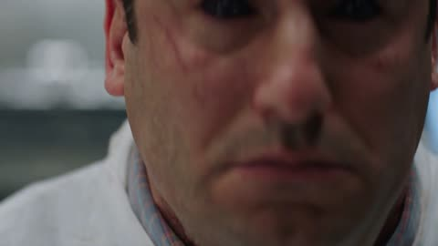</a>

要求开场即钩子、用实拍特效质感，怪物不会显得像 CG。

Seedance 2.5 · 文生视频 · 出处: [@auqibhabib on X](https://x.com/auqibhabib/status/2099725768310009982) · 2,425 赞，统计于 2026-10-27

[`horror`](#tag-horror) [`sci-fi`](#tag-sci-fi) [`action`](#tag-action)

<details><summary><b>提示词</b></summary>

```text
Cinematic sci-fi horror-action short film set in a research laboratory, opens with an immediate strong hook, natural realistic pacing, grounded practical-effects style. Lab filled with steel equipment, glass containment tubes, monitors, specimen tables, harsh fluorescent lighting. Five scientists in lab coats work at various stations. Natural handheld camera work, muted authentic color grading, all sound fully natural and diegetic — no music, no artificial sound design until the tension score kicks in.
>
> **[0-1s]** Hard cut: a containment tube shatters violently, glass exploding across the lab floor.
>
> **[1-2s]** A small dark parasite creature skitters out fast, latching instantly onto a scientist's neck.
>
> **[2-3s]** He screams, collapsing to his knees, the others recoiling in shock.
>
> **[3-4s]** Dark veins pulse rapidly beneath his skin, visible even through his collar, his body convulsing.
>
> **[4-5s]** His eyes turn a deep obsidian black — he rises, movements jerky and unnatural.
>
> **[5-6s]** He lunges at the nearest colleague, parasite tendrils extending from his mouth toward her.
>
> **[6-7s]** She's caught, tendrils latching onto her neck, her scream cutting short.
>
> **[7-8s]** Veins spread fast across her too, body convulsing against a lab table, equipment crashing down.
>
> **[8-9s]** She rises seconds later, eyes black, joining him, both turning toward the remaining three.
>
> **[9-10s]** The three scientists scramble back, one grabbing a fire axe from an emergency case on the wall.
>
> **[10-11s]** The two infected charge fast, jerky inhuman movements, tendrils whipping from their jaws.
>
> **[11-12s]** The lead scientist swings the axe hard into the first infected — a solid impact, it staggers into a specimen table, equipment shattering.
>
> **[12-13s]** A second scientist grabs a fire extinguisher, blasting the other infected in the face, it recoils, tendrils flailing.
>
> **[13-14s]** The third scientist shoves a steel cart into the staggering infected's path, sending it crashing down.
>
> **[14-15s]** Both infected collapse motionless, twitching, tendrils retracting slowly.
>
> **[15-16s]** The three survivors regroup, breathing hard, scanning the wrecked lab for more movement.
>
> **[16-17s]** Wide shot: broken glass and toppled equipment everywhere, alarm lights beginning to flash red.
>
> **[17-18s]** A third containment tube behind them starts cracking, unnoticed by the group.
>
> **[18-19s]** It shatters suddenly — another parasite creature launches out fast.
>
> **[19-20s]** The lead scientist spins just in time, swinging the axe and slicing it out of the air mid-leap.
>
> **[20-21s]** It hits the floor, motionless, dark fluid spreading slightly beneath it.
>
> **[21-23s]** The group presses their backs together, weapons raised, scanning every corner of the lab.
>
> **[23-25s]** Emergency lights flash steadily red, alarm klaxon blaring through the facility.
>
> **[25-27s]** The lead scientist gestures toward the exit; they move together cautiously, stepping over debris and fallen colleagues.
>
> **[27-29s]** They reach the heavy lab door, the lead scientist sealing it shut behind them with a hard mechanical clang.
>
> **[29-30s]** Final shot: the three survivors lean against the sealed door, breathing hard, alarm lights flashing red across their exhausted faces. Cut to black.
>
> Natural diegetic sound throughout — glass shattering, guttural convulsions, screaming, metal impacts, alarm klaxon, heavy breathing — layered with a tense instrumental score building through the fight and easing at the end. No text overlay, no watermark. Natural handheld camera with realistic shake during action, muted clinical color grading.
```

</details>

<a id="seedance-woman-in-storm-crowd"></a>
### 人群齐动，她一动不动

<a href="https://x.com/AIwithkhan/status/2099707375943066094">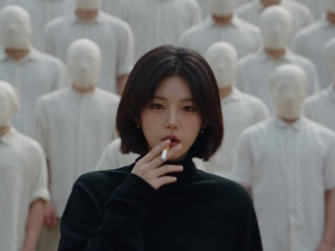</a>

上传的图锁定人物、人群和构图，文字只管动作和禁止项。

Seedance 2.5 · 参考生视频 · 出处: [@AIwithkhan on X](https://x.com/AIwithkhan/status/2099707375943066094) · 2,128 赞，统计于 2026-10-27

[`fashion`](#tag-fashion) [`crowd`](#tag-crowd) [`reference-images`](#tag-reference-images)

<details><summary><b>提示词</b></summary>

```text
Create a ultra-realistic cinematic fashion video using the uploaded images as exact visual references for the woman, crowd, wardrobe, framing, and atmosphere.
A young woman with the same short dark bob wears a fitted black turtleneck, black trousers, and black shoes, standing confidently at the center of a large crowd.
Start with her walking slowly toward the middle of the crowd, calm and expressionless, with a lit cigarette naturally held between her lips.
She reaches the center, stops, and faces directly into the camera.
She takes one slow drag from the cigarette, then removes it from her mouth.
She slowly exhales a visible stream of smoke toward the camera, with the smoke naturally drifting across her face.
She lowers her hand and becomes completely still, staring directly into the lens.
The entire crowd behind her remains frozen for a brief moment.
Suddenly, everyone behind her begins moving in perfect synchronization — sharp head turns, shoulder jerks, folding forward and snapping upright.
The movement should feel rhythmic, strange, powerful, and physically realistic.
The woman does not move at all while the entire crowd moves behind her.
Slowly push the camera closer to her, keeping her sharply focused while the crowd has subtle depth-of-field blur.
Dark, cold, mysterious lighting with deep shadows, realistic skin, hair, clothing, cigarette ember, and physically accurate smoke.
Photorealistic live-action quality, cinematic composition, natural human movement; no animation, CGI look, duplicated woman, distorted bodies, excessive smoke, text, subtitles, or logos.
```

</details>

<a id="seedance-ugc-night-yacht"></a>
### 朋友用手机拍的夜游

<a href="https://x.com/mightyking/status/2089299068514148655"></a>

开头先交代谁在拍（跟着大家走的朋友），晃动和构图都由此而来。

Seedance 2.5 · 文生视频 · 出处: [@mightyking on X](https://x.com/mightyking/status/2089299068514148655) · 2,038 赞，统计于 2026-10-27

[`ugc`](#tag-ugc) [`vertical`](#tag-vertical) [`realism`](#tag-realism) [`handheld`](#tag-handheld)

<details><summary><b>提示词</b></summary>

```text
Raw vertical phone video (UGC), handheld throughout, filmed by a friend who walks with the group, casual sway, natural night lighting, wide-angle lens, deep focus.

Characters: The hero is a young woman with long dark hair in a deep-purple one-shoulder dress with a small shoulder bag. Her three friends: one in a dark brown dress, a blonde in a black wrap dress, a blonde in a white mini dress — party dresses and sandals. Laughing, spontaneous night-out energy.

Setting: A luxury marina at night — a stone quay along a narrow water slip flanked on both sides by large moored luxury yachts, big white hulls rising on either side, masts and rigging above, fenders on the hulls. Warm orange street lamps, palm trees, distant city lights. The yachts glow with blue-turquoise underwater LED lights spilling into the water; a yellow mooring line runs to the stone.

[0.0s–4.0s] — Wide tracking shot, eye level, camera moving backward. The camera walks backward ahead of the four women as they stroll toward it down the marina promenade, framed head-to-toe, laughing and chatting in French; warm lamplight and palm trees behind, slight handheld bob.

[4.0s–6.0s] — Medium shot, eye level, backward track + quick left pan. The woman in the purple dress surges ahead of the group toward the lens, one arm raised, hair flying; the camera, on their left, keeps tracking back and pans to hold her.

[6.0s–8.0s] — Medium-wide, camera tilts down-left to follow, whip motion. She reaches the quay edge between the moored luxury yachts and launches headfirst over the edge; the handheld camera whips left and tilts down to chase her off the stone.

[8.0s–10.0s] — High-angle wide, looking down at the water, slight jolt. From up on the quay the camera looks down as she plunges headfirst into the blue-turquoise water in the slip between the big yacht hulls — a big splash, the underwater lights glowing around the impact; the handheld frame jolts slightly with the motion.

[10.0s–13.0s] — High-angle medium, looking down, small handheld drift. She surfaces in the teal water, gasping and laughing up at the camera, hair slicked back, treading water.

[13.0s–16.0s] — Handheld tilt up and back down, slight zoom. The camera lifts off the water and tilts up to a person leaning on the deck railing of one of the moored luxury yachts, watching her in the water, then tilts back down and zooms slightly in on her still treading and laughing.

[16.0s–20.0s] — High-angle medium, tilting to follow her up. She swims to the stone quay wall, reaches up and grabs a thick dark mooring pole, and hauls herself out; the camera tilts upward with her as she rises from the water, legs braced on the stone.

[20.0s–23.0s] — Low/close medium at the quay edge, static handheld. She climbs onto the stone lip, rolls onto her side, soaked dress clinging, then pushes up to her feet; the camera holds close, catching the water running off her.

[23.0s–27.0s] — Medium shot, eye level, loose handheld reframe. Back on the promenade, dripping wet, she flips her long wet hair forward and wrings it out, laughing, as her friends and passing pedestrians move behind her.

[27.0s–30.0s] — Medium shot, eye level, camera settles. Still dripping, she straightens up and strikes a confident, playful pose for the camera — hand on hip, tossing her wet hair back with a big smile — her friends laughing around her; the camera holds on the pose to end.

Audio: Live sync sound — friends laughing and shouting excitedly in French, a scream at the leap, a big water splash, water sloshing against the yacht hulls, wet footsteps on stone, ambient night marina sounds. No music.

Style: Raw amateur vertical phone footage, natural night lighting, warm street lamps mixing with the turquoise underwater yacht glow, authentic handheld motion.
```

</details>

<a id="seedance-dragon-bakes-bread"></a>
### 女孩教巨龙烤心形面包

<a href="https://x.com/ElsaSofia__AI/status/2113089111699673461">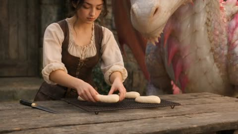</a>

短而具体：龙的配色、一条硬规则（面包全是心形）、最后落一个情绪词。

Seedance 2.5 · 文生视频 · 出处: [@ElsaSofia__AI on X](https://x.com/ElsaSofia__AI/status/2113089111699673461) · 1,430 赞，统计于 2026-10-27

[`fantasy`](#tag-fantasy) [`creature`](#tag-creature) [`food`](#tag-food)

<details><summary><b>提示词</b></summary>

```text
Photorealistic medieval fantasy film. Warm sunlight, stone cottage, wooden table, iron grill. Colossal dragon with pale pink-white scales, pink spines and golden eyes. All bread must be heart-shaped. Realistic fire, food textures, natural physics.
0-5s: Heroine arranges raw heart-shaped dough on the grill. Dragon sniffs eagerly, then blasts enormous flames! Fire engulfs the dough. She jumps back: "Whoa! Easy! You're making bread, not dragon food!"
5-10s: A charred heart-shaped loaf smokes on the grill. Dragon looks guilty, hiding its head. She shows the burnt bread, then smiles and replaces it: "Look. Just a little flame. Can you do that?"
10-17s: Dragon carefully releases a tiny steady flame beneath the grill. Heart-shaped dough rises, forming a golden crust. Steam rises as dragon watches nervously.
17-23s: She cuts open the crispy heart-shaped bread, revealing a soft fluffy center. "You did it! Perfect!" Dragon tries to eat it all. She laughs and feeds it a small piece.
23-30s: Dragon nuzzles her for affection. She strokes its scales, shares more heart-shaped bread. Dragon closes its eyes happily, tail wagging. Wide sunset shot, warm and healing.
Cinematic lighting, detailed scales, realistic flames, expressive acting. No subtitles, narration, logos or watermark.
```

</details>

<a id="seedance-toddler-copies-shaving"></a>
### 小宝宝学爸爸刮胡子

<a href="https://x.com/Zarnab_with_Ai/status/2106560621932384657">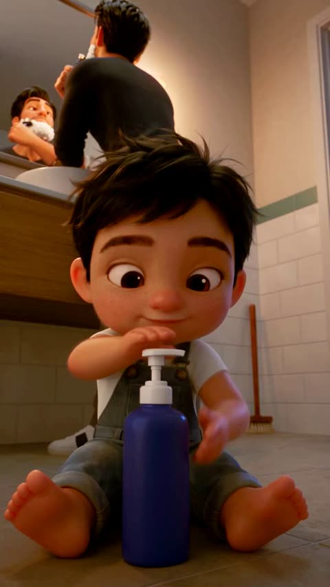</a>

竖屏 3D 家庭喜剧：一个铺垫，一个笑点，一次大笑。

Seedance 2.5 · 文生视频 · 出处: [@Zarnab_with_Ai on X](https://x.com/Zarnab_with_Ai/status/2106560621932384657) · 1,379 赞，统计于 2026-10-27

[`3d-animation`](#tag-3d-animation) [`family`](#tag-family) [`comedy`](#tag-comedy) [`vertical`](#tag-vertical)

<details><summary><b>提示词</b></summary>

```text
Create a heartwarming and funny ultra-realistic 3D animated cinematic video in vertical 9:16 format.

Scene: A cute little toddler boy is sitting on the bathroom floor in front of a dark blue liquid soap dispenser. His father is standing behind him in front of a large bathroom mirror, shaving his own face with a razor.

The toddler curiously watches his father and decides to imitate him. He presses the soap dispenser and playfully covers his eyebrows, cheeks, upper lip, and chin with thick white shaving foam, creating a funny oversized Santa-style beard and eyebrows.

The father notices what the child has done and looks surprised and amused. The toddler proudly stands up, grabs a wooden floor broom, and walks toward the bathroom doorway as if he is going to help clean.

The mother appears at the doorway holding folded white towels. She looks at the toddler, realizes what happened, and starts laughing. The father also looks at his little son and bursts into laughter.

End with the toddler standing proudly between his laughing parents, still covered in shaving foam, smiling innocently at the camera.

Style: high-quality 3D animated family comedy, adorable toddler expressions, realistic body movement, detailed facial animation, warm bathroom lighting, cinematic depth of field, soft shadows, realistic textures, natural camera movement, expressive reactions, wholesome family humor.

Keep the characters consistent throughout the entire video. Preserve the toddler's hairstyle, clothing, facial features, and proportions. Smooth motion, believable hand movements, natural eye direction, cinematic composition, highly detailed animation, no text, no subtitles, no watermark.
```

</details>

<a id="seedance-friday-morning-seoul"></a>
### 首尔老街区的周五早晨

<a href="https://x.com/AIwithkhan/status/2103329257149898940">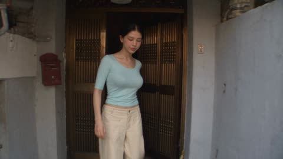</a>

人物来自参考图。结尾一串禁止项（美颜、换装）让她 30 秒都不走样。

Seedance 2.5 · 参考生视频 · 出处: [@AIwithkhan on X](https://x.com/AIwithkhan/status/2103329257149898940) · 1,124 赞，统计于 2026-10-27

[`vlog`](#tag-vlog) [`character-consistency`](#tag-character-consistency) [`reference-images`](#tag-reference-images)

<details><summary><b>提示词</b></summary>

```text
Create a 30-second ultra-realistic personal home-video of a young Korean woman enjoying a relaxed Friday morning in an older Seoul residential neighborhood. Use the attached image as the character reference and keep her face, long black messy side ponytail, pastel-blue fitted top, loose cream pants, black sneakers, silver necklace, and overall appearance perfectly consistent.

She leaves her home with a cheerful expression and walks casually through the quiet neighborhood. She reaches a nearby outdoor water tap, stops, splashes cool water onto her face, wipes her face with her hands, smiles and continues walking.

She arrives at a small neighborhood shop and buys a colorful lollipop for herself. She unwraps it immediately, puts it in her mouth and happily enjoys the candy while walking through the street.

A few school children pass by carrying their backpacks. She smiles, waves at them and casually says, “Hello!” as they walk past.

She then approaches a newspaper seller outside a small local shop, picks up a newspaper, gives him a few coins, thanks him with a smile and starts walking back toward home while holding the newspaper.

Near the end, she looks toward the camera with a happy smile, still enjoying her lollipop, and says, “Happy Friday!” before continuing home.

Use raw early-2000s consumer DV-camera footage: handheld shake, imperfect framing, autofocus hunting, exposure shifts, soft digital detail, mild digital noise, natural motion blur, occasional awkward zooms and authentic home-video imperfections. Natural Seoul neighborhood ambience only — footsteps, running water, children talking, shop sounds, newspaper rustling, distant traffic, birds and summer insects. No music, no narration, no subtitles, no polished commercial cinematography, no beauty-filter skin, no CGI look, no duplicate characters, no changing face, hairstyle or outfit.
```

</details>

<a id="seedance-selfie-skincare-ugc"></a>
### 自拍式护肤品 UGC 广告

<a href="https://x.com/abxxai/status/2095179656802844727">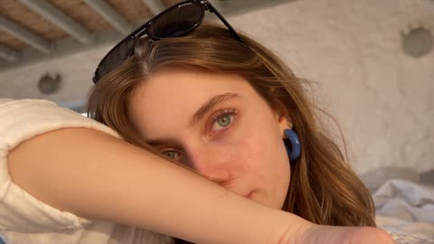</a>

线程的第三步：人物设定图和产品图作参考，提示词强调 `Not an ad`，换来自拍的真实感。

Seedance 2.5 · 参考生视频 · 出处: [@abxxai on X](https://x.com/abxxai/status/2095179656802844727) · 1,017 赞，统计于 2026-10-27

[`ugc`](#tag-ugc) [`product-ad`](#tag-product-ad) [`vertical`](#tag-vertical) [`reference-images`](#tag-reference-images)

<details><summary><b>提示词</b></summary>

```text
A 15-second vertical (9:16) ultra-photorealistic close-up vlog clip, filmed on a phone held at arm's length. Not an ad. A girl talking to her own camera at the end of the day, the way people actually film themselves.
TALENT —
Young woman, early-to-mid 20s. Long light-brown hair with soft caramel balayage, middle part, loose undone waves, a few strands stuck to her cheek. Fair-to-light-tan skin with visible freckles across the nose and cheeks, thick natural brows, blue-green eyes, bare face, small blue resin hoop earrings, thin gold chain with a small pearl pendant. Face, freckles, hair and eye color must 100% match the reference. Oversized white linen button-down over a fitted white ribbed top, fully covered, collar slightly crooked, sleeves pushed up.
PRODUCT —
LANEIGE Water Sleeping Mask_EX, 70 ml. Frosted translucent light-blue glass jar, smooth matte cobalt-blue screw lid. Front label reads, in this exact order: "LANEIGE" in wide-spaced capitals, "WATER SLEEPING MASK_EX" below it, then "SLEEPING MICROBIOME" and "BRIGHTENING · HYDRATING · SOFTENING" in smaller pale-yellow type, then "70 ml" at the base. Inside, thick pale mint-blue gel with a wet glossy surface that holds a soft peak. Shape, color, gel texture and all label text must 100% match the reference, correctly spelled, legible whenever in focus.
LOCATION
A villa bedroom at golden hour. Only fragments read in frame because the camera is so tight: white stucco wall, a corner of rumpled white linen bedding, blurred bougainvillea and olive leaves through an open door behind her. The background stays soft and mostly out of focus the entire time.
LIGHTING
One condition, unchanged across all four beats. Low warm sun from frame-left through the open door, roughly 4800K, soft white-wall bounce filling the shadow side of her face. Warm rim on the left edge of her hair and jaw. Slight blown highlight where the sun clips her cheek. No ring light, no fill, no glam lighting.
FRAMING
Close-up throughout. Her face fills most of the frame in every beat, chin to just above the hairline, never wider than upper-chest. The jar enters frame close to her face, never held out toward the lens.
0:00–0:04
Visual: Tight front-camera close-up, slightly below eye level. She's mid-motion already, pushing hair off her face with the back of her wrist. She glances just off-lens, checking her own image, then back. The jar comes up beside her cheek, held low and casual, only the top half in frame, lid already off. A slow exhale through the nose.
Camera: Selfie camera, arm's length, natural handheld drift, one quick autofocus hunt between her face and the jar.
Dialogue: "Okay. Last thing, then bed."
0:04–0:07
Visual: She tips the jar slightly and drags two fingertips through the gel. Macro-tight: her fingertips, the wet mint-blue surface, a fine thread of gel stretching and snapping. The "LANEIGE" and "WATER SLEEPING MASK_EX" lines cross the frame in focus for a beat. Her face stays partly in frame at the edge, out of focus.
Camera: Same front camera pushed in close, shallow focus, rack from the label to the gel on her fingers.
Dialogue: "It's cold, by the way."
0:07–0:11
Visual: Back to her face, closer now. She taps the gel across one cheek, her forehead, her chin, then presses it in flat-palmed, working outward. The gel flashes milky over her skin, then settles clear with a faint sheen. She winces at the cold, blinks it off, keeps going. Freckles, pores and natural under-eye shadows stay visible right through the layer. She's talking while working, not pausing for the line.
Camera: Selfie camera, very close, small handheld corrections, a slow drift as she turns her cheek toward the light.
Dialogue: "Thin layer. You don't wash it off."
0:11–0:15
Visual: Closest framing of the clip. She presses two fingertips against her cheek and lets them lift, feeling the faint tack. Turns her head slowly through the low sun, checking the sheen along her cheekbone, eyes tracking her own reflection in the screen rather than the lens. A short nod. The corner of the blue jar sits soft-focus in the lower frame edge, label partly readable. She reaches to stop the recording and the frame tilts as her hand moves.
Camera: Selfie camera, slow handheld orbit from three-quarter profile to straight-on, ending on her face filling the frame, then a small tilt as she reaches.
Dialogue: "Morning me is gonna be so happy."
PERFORMANCE
End-of-day, low energy, unperformed. She talks the way someone talks while doing something else, lines half-thrown-away, not projected. Micro-behavior carries the beats: a slow blink, a genuine flinch at the cold, a half-smile that arrives late, eyes checking her own reflection instead of the lens, one natural swallow, visible breath, a small unconscious head tilt. No presenter voice, no bright delivery, no exaggerated reactions, no pointing at the product.
VOICE
Soft, slightly flat, close to the mic because the phone is at arm's length. Natural room tone around it. Unhurried, a little tired. Ordinary speaking volume with a touch of breath on the ends of words.
REALISM
Pore-level skin realism: visible pores across the nose and cheeks, fine forehead texture, natural freckling, faint under-eye shadows, a small blemish near the jaw, stray flyaway hairs catching the backlight, vellus hair on the cheek edge. Wet living eyes with catch-lights and natural asymmetric blinking. The gel reads as a real cosmetic layer refracting light on top of her skin, never replacing its texture.
PHYSICS
Gel holds a soft peak on her fingertip and slumps under pressure. Hair moves with real inertia and a few strands fall back across her face. Linen creases and drapes naturally. The jar has real weight and correct contact shadow against her hand. Camera weight shifts naturally with her arm.
CAMERA CHARACTER
Authentic modern smartphone selfie footage. Natural handheld tremor throughout, small framing corrections, quick autofocus hunts, mild wide-angle distortion at close range, natural rolling shutter, real motion blur, slight sensor noise in the shadow side. Never feels stabilized or operated by anyone else.
STYLE
Real personal vlog, iPhone-shot look, high-end photorealistic quality. Warm golden-hour daylight, real ambient evening atmosphere, no retouching, no skin smoothing, no product-hero framing, no before/after transformation, no commercial polish.
OUTPUT SETTINGS
9:16 vertical. 15 seconds. Real-time motion. High-detail photorealistic 8K intent. Natural smartphone motion blur and subtle sensor noise.
POSITIVE LOCKS
 keeps the same face, freckles, hair, earrings, necklace and white linen shirt over white ribbed top in every beat, fully covered throughout.
 stays the same frosted blue jar with matte cobalt lid, correct one-hand size, label text correctly spelled and legible whenever in focus, sharpest in the 0:04–0:07 beat.
Exactly two arms and two hands visible, anatomically correct with five fingers, one hand always holding the phone.
Same room, same wardrobe, same golden-hour lighting from first frame to last.
Close-up framing held throughout, her face dominant in every beat.
Spoken dialogue exactly as written, in order, at the stated timings, with accurate natural lip-sync.
Natural ambient audio only: faint breeze, distant birds, the small click of the lid, room tone. No music, no on-screen text, no captions, no subtitles, no logos other than the product's own packaging.
```

</details>

<a id="seedance-mall-zombie-outbreak"></a>
### 商场突发丧尸潮

<a href="https://x.com/auqibhabib/status/2104107269206237325">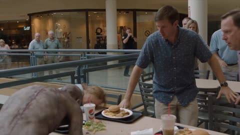</a>

从正常营业写起，丧尸才有东西可打破；结尾落在安静的一拍，不是爆炸。

Seedance 2.5 · 文生视频 · 出处: [@auqibhabib on X](https://x.com/auqibhabib/status/2104107269206237325) · 1,002 赞，统计于 2026-10-27

[`horror`](#tag-horror) [`action`](#tag-action) [`crowd`](#tag-crowd)

<details><summary><b>提示词</b></summary>

```text
Create a photorealistic live action horror short film set inside a busy modern shopping mall during normal operating hours. The scene must feel like a real emergency captured by a human handheld camera operator, not a choreographed action movie. Prioritize realistic human behavior, believable physics, natural body movement, consistent character appearance, spatial continuity, practical effects and authentic environmental detail.

MAIN CHARACTER: A male mall security guard in his late 30s wearing a realistic dark security uniform and carrying a radio. Keep his face, clothing, body proportions and equipment identical throughout the entire video.

SURVIVORS: A small group of ordinary shoppers with realistic clothing and consistent appearances. Their faces, clothing and body proportions must remain unchanged throughout the sequence.

0–4 SECONDS:
Begin immediately in the food court with shoppers eating and walking normally. Without warning, an infected man suddenly attacks a nearby shopper. The attack is chaotic and physically messy rather than theatrical. The victim falls against a table, knocking over food and drinks. Nearby shoppers freeze for a moment because they do not understand what is happening.

4–8 SECONDS:
Several shoppers back away. One person briefly tries to help before realizing the attacker is dangerous. Chairs scrape across the floor as people retreat. The security guard hears the disturbance and runs toward the food court. His reaction is confused and concerned, not heroic.

8–12 SECONDS:
The infected attacker suddenly rushes toward another shopper. The crowd finally realizes something is seriously wrong. Panic spreads naturally. People run in different directions instead of moving together. Some hide behind storefronts while others run toward exits. Shopping bags and personal belongings fall naturally as people flee.

12–16 SECONDS:
The security guard reaches the food court and sees two infected people approaching. He grabs a nearby metal crowd-control barrier for protection. He initially backs away while watching them. One infected suddenly charges. The guard swings the barrier defensively and knocks the attacker off balance. The movement must look heavy, awkward and physically difficult, never like professional choreography.

16–20 SECONDS:
A few shoppers help each other retreat behind a storefront entrance. One person pulls an injured shopper away from the food court. Nobody performs exaggerated combat moves. The guard keeps backing toward the survivors while maintaining distance from the infected.

20–24 SECONDS:
One infected suddenly charges again. The guard sidesteps at the last moment. The infected crashes into the glass railing from its own momentum. The glass cracks realistically but does not explode into an unrealistic shower of fragments. The guard immediately moves the survivors farther away.

24–27 SECONDS:
The survivors move together toward a partially closed storefront. The guard stays behind them and keeps watching the infected. Distant screaming comes from another section of the mall, suggesting the outbreak is larger than what the camera has witnessed without showing an unnecessary crowd of zombies.

27–30 SECONDS:
The group reaches temporary safety behind the storefront. The guard slowly looks through the gap toward the food court. The mall has become eerily quiet. An escalator continues running in the background while abandoned shopping bags, overturned chairs and spilled food remain scattered across the floor. A distant infected figure briefly crosses the far end of the mall. The guard quietly raises one finger, signaling everyone to stay silent.Cut naturally to black.
```

</details>

<a id="seedance-2000s-birthday-dv"></a>
### 2000 年代初的韩国生日，DV 摄像机

<a href="https://x.com/saniaspeaks_/status/2105146792681832481">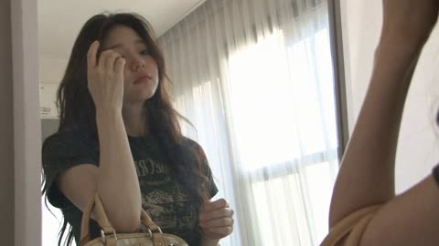</a>

用设备定年代感。场景编号，并要求严格按顺序出现。

Seedance 2.5 · 文生视频 · 出处: [@saniaspeaks_ on X](https://x.com/saniaspeaks_/status/2105146792681832481) · 918 赞，统计于 2026-10-27

[`home-video`](#tag-home-video) [`period`](#tag-period) [`dv-camcorder`](#tag-dv-camcorder)

<details><summary><b>提示词</b></summary>

```text
Create a 30-second ultra-realistic Korean birthday vlog set in South Korea in the early 2000s, filmed casually by a friend on an authentic consumer DV camcorder. It must feel like genuine home-video footage, not a modern video with a retro filter.

EXACT ORDER — 7 SCENES:

0–4s — GETTING READY: The same young Korean birthday girl gets ready in her early-2000s bedroom, fixes her hair, adjusts makeup, picks up her handbag and smiles toward the camera.

4–8s — MEETING FRIENDS: She walks through an authentic Korean neighborhood, meets the same 2–3 friends, they congratulate her and walk together toward a bakery.

8–11s — BAKERY: They enter a small early-2000s Korean bakery, browse cakes and choose one birthday cake.

11–14s — BUYING CAKE: A friend pays with cash. The worker puts the cake into a box and hands it over. The same cake box remains visible as they walk to the café.

14–23s — CAFÉ CELEBRATION: They sit in a cozy early-2000s café. The cake is opened, a candle is lit, everyone sings Happy Birthday, the girl makes a wish and blows it out. They clap and laugh. She then cuts the cake, places pieces on plates, personally gives a piece to each friend, watches them eat, then takes a piece herself. Keep the entire sequence clearly visible and in order.

23–26s — PHOTOS: After eating, they take group photos using a small early-2000s disposable film camera. No smartphones or modern digital cameras. They pose, the shutter clicks and they laugh afterward.

26–30s — EVENING WALK: They leave the café and walk through the same neighborhood as it becomes evening. The girl carries her handbag, a friend carries the empty cake box/bag, and they chat and laugh while the camera follows from behind.

CONTINUITY: Same girl, friends, outfits, hairstyles, handbag and cake throughout. No teleporting, identity drift, outfit changes, disappearing props or reordered actions.

ERA: Everything must look authentically early 2000s Korean—fashion, hair, bakery, café, cars, signs, furniture, cake packaging and technology. No smartphones, AirPods, modern cars, LED screens or contemporary interiors.

CAMERA: Raw consumer DV footage with subtle handheld shake, imperfect framing, autofocus hunting, exposure shifts, soft digital detail, mild CCD/DV noise, motion blur, compression and occasional awkward zooms. Natural candid behavior, realistic skin and movement. No cinematic stabilization, 4K sharpness, beauty filters, VHS effects or professional filmmaking.

FINAL FEEL: A genuine Korean birthday memory from the early 2000s, with every scene and action clearly shown in the exact requested order.
```

</details>

<a id="seedance-mini-dv-coffee-asmr"></a>
### Mini DV 咖啡 ASMR 小片

<a href="https://x.com/Strength04_X/status/2083094742682787939">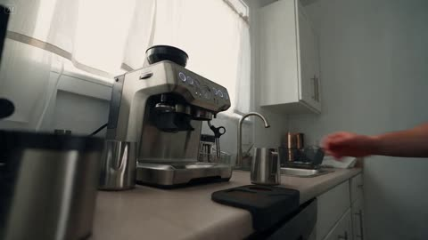</a>

按标签分块写（`CAMERA / LOOK`、主体、动作、声音），拿来当模板很方便。

Seedance 2.5 · 文生视频 · 出处: [@Strength04_X on X](https://x.com/Strength04_X/status/2083094742682787939) · 833 赞，统计于 2026-10-27

[`asmr`](#tag-asmr) [`vlog`](#tag-vlog) [`dv-camcorder`](#tag-dv-camcorder)

<details><summary><b>提示词</b></summary>

```text
CAMERA / LOOK: Handheld mini DV camcorder footage filmed by the subject herself. Slight hand shake, occasional focus hunting, imperfect framing, natural zoom adjustments, soft tape-like image quality, subtle grain, realistic auto-exposure shifts from bright kitchen morning light. Natural skin tones, mild motion blur, authentic consumer camcorder aesthetic.
STYLE: Cozy coffee-prep vlog with gentle ASMR elements. Relaxed pacing, minimal dialogue, candid moments. Focus on satisfying sounds: bean grinder whirring, portafilter tamping, steam wand hissing, cup clinking, milk frothing.
SUBJECT: Young man in his mid-20s, plain t-shirt, hair slightly tousled, minimal accessories. Calm, focused energy while making his morning coffee.
SETTING: Small kitchen counter with an espresso machine on a bright morning. Natural daylight, coffee beans and a mug nearby, quiet atmosphere.
STORYBOARD:
→ (3s, propped medium shot) Places camera on the counter, switches on the machine. "Morning coffee, the proper way."
→ (3s, overhead shot) Grinds fresh coffee beans, fine grounds falling into the portafilter.
→ (3s, close-up) Tamps the grounds down firmly and evenly.
→ (3s, handheld shot) Locks the portafilter into the machine. "Here we go."
→ (3s, detail shot) Espresso streams slowly into a small cup. No dialogue.
→ (3s, medium shot) Pours cold milk into a small steel pitcher. "Time for the milk."
→ (3s, macro shot) Steam wand hissing as it froths the milk.
→ (3s, propped shot) Pours frothed milk carefully over the espresso, forming light layers.
→ (3s, warm ending shot) Holds the finished cup, takes a small sip, satisfied smile. "That's exactly what I needed."
→ (3s, final shot) Reaches toward camera, still holding the cup. "See you later." Hand covers lens as recording ends.
AUDIO NOTES: Natural kitchen ambience — grinder whirring, tamping, steam hissing, milk pouring should be clearly audible. Dialogue quiet and casual.
REALISM NOTES: Authentic body language, natural blinking, genuine focused smiles, occasional careful pauses while pouring, imperfect framing, focus breathing, bright morning light shifts. Should resemble a genuine personal coffee vlog on a consumer camcorder, not a commercial or AI-generated production.
```

</details>

<a id="seedance-dragon-hatchlings-dungeon"></a>
### 藏起三只幼龙，追兵已到门口

<a href="https://x.com/Adnan_Ai2/status/2113945930185732358">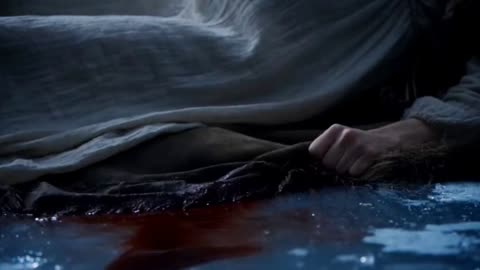</a>

按续集写：第一行声明接着上一段，系列片的基调和人物更容易保持一致。

Seedance 2.5 · 文生视频 · 出处: [@Adnan_Ai2 on X](https://x.com/Adnan_Ai2/status/2113945930185732358) · 781 赞，统计于 2026-10-27

[`fantasy`](#tag-fantasy) [`drama`](#tag-drama) [`continuation`](#tag-continuation)

<details><summary><b>提示词</b></summary>

```text
A dark, emotionally charged medieval fantasy drama, cinematic 16:9 widescreen format, continuing directly from the earlier cave-birth and bonding story with full character and tonal continuity. Moody low-key lighting throughout, deep cold-blue tones contrasted sharply against warm amber torch and firelight, photorealistic non-cartoonish creature texture work, handheld intimate camera movement, prestige dark-fantasy television visual quality, 24fps cinematic film grain.

**Scene 1 (0–10s):** Inside a vast glowing ice cave, walls shimmering with deep blue bioluminescent light reflecting off frozen crystalline formations. On the icy cave floor, three baby dragons huddle close together for warmth — one with frost-blue scales, sharp little horns, and piercing blue eyes; one pure white with crystalline, feather-like frills and pale grey-blue eyes; and one soft pink-toned with warm coral fins and large amber eyes. A woman's scarred, bandaged hand slowly reaches into frame, palm open, as the dragons lean curiously toward it, sniffing and nuzzling her fingers with cautious trust. Wide shot establishes the vast, cold, otherworldly isolation of the ice cave.

**Scene 2 (10–20s):** Close-up, emotionally raw shot of the young woman — long dark wavy hair damp and disheveled, wrapped in a thick, heavy fur cloak — her face streaked with tears and dirt, eyes closed in anguish. She presses her forehead gently against the huddled trio of baby dragons, pulling all three into a tight, desperate embrace against her chest. A visible wound bleeds along her forearm, blood smeared on her hands and the dragons' scales, hinting at a recent struggle or sacrifice to protect them. Her expression carries a mixture of exhaustion, grief, and fierce, unwavering maternal protectiveness.

**Scene 3 (20–28s):** A quieter, tender beat — inside a dim hidden nest made of piled hay and straw, the three baby dragons poke their heads out side by side in a neat row, their large reflective eyes blinking in the low light, ears/frills perked with alertness as if sensing an approaching threat. Shallow depth of field keeps focus tightly on their expressive faces, background falling into soft shadow.

**Scene 4 (28–38s):** Setting shifts to a dim, damp stone dungeon or underground cellar, pale light filtering through a small barred window high on the wall. The woman kneels low on the cold stone floor, her fur cloak draped protectively over her shoulders and partially covering the three dragons huddled behind and beneath her. She glances anxiously toward the doorway, body angled to shield the creatures from view, every muscle tense with the instinct to protect at any cost.

**Scene 5 (38–45s):** Intimate close-up — she gently cradles the pink baby dragon in both arms, rocking it slightly to keep it calm and quiet as its small mouth opens in a near-silent chirp or whimper. Her face is soft with tenderness toward the creature but tight with fear of discovery, eyes darting toward unseen danger beyond the frame.

**Scene 6 (45–55s):** Hard cut to a shadowy stone corridor elsewhere in the same fortress/castle. A stern, heavyset older man dressed in dark, heavy medieval robes strides purposefully down the corridor, a large lit torch held firmly in one hand, flames casting flickering, dangerous light across ancient carved stone walls. His expression is grim, suspicious, and resolute as he approaches a heavy iron-banded wooden door — the entrance to the dungeon where the woman and dragons are hiding. Low-angle, slightly ominous camera framing builds mounting dread and tension, the gap between pursuer and protector closing with every step.

**Overall tone and continuity:** A visceral, high-stakes escalation of the established dark-fantasy saga — shifting from tender nurturing (birth, feeding, warmth) toward active danger and sacrifice, as the same woman now harbors not one but three dragon hatchlings and must risk everything to keep them hidden from a clearly hostile authority figure. Visual and character continuity fully maintained: same actress/character design, same practical-effect creature rendering (wet-look skin on younger dragons, fine scale and frill texture, anatomically grounded proportions), same desaturated cold-exterior/warm-interior lighting philosophy established in prior installments. Sound design implied: distant echoing footsteps, crackling torch flame, soft dragon chirps, the woman's held breath. Aspect ratio 16:9, prestige-drama cinematography, emotionally driven pacing building toward confrontation.
```

</details>

<a id="seedance-outfit-change-one-take"></a>
### 一镜到底连换装，中文对白

<a href="https://x.com/cnyzgkc/status/2099029556434985065">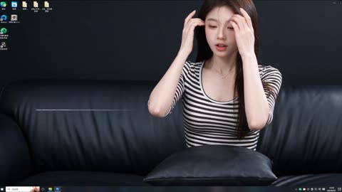</a>

图 1 只锁脸和发型，服装逐次描述；还专门要求画外男声说话时女主闭嘴倾听。

Seedance 2.5 · 参考生视频 · 出处: [@cnyzgkc on X](https://x.com/cnyzgkc/status/2099029556434985065) · 676 赞，统计于 2026-10-27

[`outfit-change`](#tag-outfit-change) [`long-take`](#tag-long-take) [`chinese-dialogue`](#tag-chinese-dialogue) [`reference-images`](#tag-reference-images)

<details><summary><b>提示词</b></summary>

```text
Duration 29 seconds, aspect ratio 16:9 landscape, language Chinese.
Character reference: Reference only image 1 to lock facial features, hairstyle, skin tone, and character identity; clothing strictly changes as described below. Character requirements: Adult female lead. Same character throughout, no face swaps, no changes to body proportions; increase weight to prioritize rigidly locking facial features, hairstyle, skin tone, and identity.

Overall style: Hyper-realistic AI dynamic desktop interactive video, simulating a full-screen computer desktop screen recording. Retain a simple taskbar at the bottom, a few desktop icons in the upper left corner; the main screen features a dynamic wallpaper that interacts in real time. Black leather sofa, cool-toned soft lighting, dark background. Fixed camera position, continuous single shot throughout, no cuts, no pans or zooms. Female lead primarily positioned on the right side of the frame, leaving the left side for the voice subtitle interface.

Subtitle interface (retain, overriding "prohibited text" constraints): Subtitles must appear in the middle left of the frame, not at the bottom. Slim modern sans-serif Chinese font, medium size, no background box, subtle soft glow and shadow. Female lead speaking: Light purple text, with a speaker icon on the left. Male voice speaking: White text, with a microphone icon on the left. A thin white audio waveform always runs below the subtitles, jumping in real time with the sound. All subtitles input word by word following pronunciation, about 0.08–0.12 seconds per word, like manual typing on a keyboard; after the current sentence finishes, pause for about 0.4 seconds, then fade out entirely. No sudden full-sentence appearances, no displaying upcoming text in advance.

Clothing design (three outfits unified, changing only the neckline: low round neck/shallow V-neck, slightly revealing cleavage, otherwise fully covered):
Initial outfit: Black-and-white horizontal stripe fitted short three-quarter sleeve top (low round neck/shallow V-neck, slightly revealing cleavage, otherwise fully covered), black low-waist drawstring casual long pants, silver thin necklace.
First schoolgirl style: Top with low round neck/shallow V-neck, slightly revealing cleavage, otherwise fully covered, blue-and-black plaid pleated short skirt, white knee-high socks, white cross-strap garter, overall fresh and playful.
Second schoolgirl style: Black fitted suit jacket, white shirt (shirt low round neck/shallow V-neck, slightly revealing cleavage, otherwise fully covered), burgundy plaid tie, burgundy-and-black plaid pleated short skirt, light nude sheer stockings, black loafers, refined and mature.

SINGLE CONTINUOUS SHOT (00:00-00:29)

00:00-00:02.80
Female lead in initial outfit sits on the right side of the black leather sofa, holding a black throw pillow on her lap. She gently adjusts her hair with both hands, then looks at the camera, showing a warm, slightly playful smile.
Female lead speaks naturally: "So, spill it... what do you wanna see today?"
Subtitles display word by word: "So, spill it...
What do you wanna see today?"

00:03.00-00:03.80
Male lead never shows his face, only off-screen male voice, tone direct and eager: "Wanna see JK."
Female lead listens quietly, her smile deepens slightly, and she nods gently.
Subtitles display word by word: "Wanna see JK"

00:04.70-00:06.00
Female lead replies cheerfully: "Alright, give me a sec."
She sets the pillow aside, right hand bracing the sofa as she prepares to stand.
Subtitles display word by word: "Alright, give me a sec."

00:06.00-00:08.80
Female lead stands quickly. Due to the fixed camera and close distance, her waist and legs sweep upward across the frame, her face exiting via the top edge; she then steps out to the right side. The motion includes a light "whoosh" sound, but no teleporting, no direct morphing.

00:08.80-00:11.50
Outfit change completed entirely off-screen. Sofa lingers empty for about one second. Accompanied by a playful reveal sound effect, female lead in first blue schoolgirl outfit re-enters from the right. She stands close to the camera, frame mainly showing waist, plaid skirt hem, and knee-high socks, head naturally above the top edge.
Female lead says in a playful tone showcasing the new outfit: "Ta-da... hubby... whaddya think?"
Subtitles display word by word: "Ta-da...
Hubby... whaddya think?"

00:11.70-00:12.50
Male off-screen voice pauses briefly, then answers approvingly: "Mm... not bad."
Female lead holds her stance, subtly swaying her waist left and right to let the plaid skirt hem sway naturally.
Subtitles display word by word: "Mm... not bad"

00:12.90-00:14.40
Female lead suddenly recalls another outfit and says lightly: "Wait, there's one more."
She immediately turns and exits to the right, skirt hem swaying with the motion.
Subtitles display word by word: "Wait, there's one more"

00:14.40-00:17.40
Outfit change completed entirely off-screen. Sofa lingers empty for about one second. Then a short, smooth "whoosh" of changing echoes, female lead in second burgundy schoolgirl outfit enters from the right. Fixed lens first captures black suit hem, burgundy plaid skirt, stockings, and loafers; clothing must be realistically complete, no melting or altering during the walk.

00:17.40-00:19.00
Female lead stops on the right side of the frame, slightly adjusting her stance to let the suit hem and skirt pleats fall naturally, then asks: "What about this one?"
Subtitles display word by word: "What about this one?"

00:19.50-00:20.50
Male off-screen voice immediately praises: "This one's good too."
Female lead chuckles softly upon hearing it, body beginning to lower as she prepares to sit.
Subtitles display word by word: "This one's good too"

00:20.50-00:24.80
Accompanied by faint fabric rustling, female lead sits back on the sofa swiftly and naturally. She repositions the black throw pillow on her lap, smooths hair on both sides and her tie, then leans slightly against the sofa. The lens recaptures her full face. She keeps looking at the camera, expression confident, intimate, with a hint of teasing.

00:25.00-00:28.20
Female lead hugs the pillow, first flashing a smug little smile, then says to the camera: "Chances used up. Which one does hubby wanna keep?"
"Chances used up" in a tone like announcing game rules; "Which one does hubby wanna keep?" slowed slightly, with rising inflection at the end, carrying an intimate questioning vibe.
Subtitles display word by word: "Chances used up.
Which one does hubby wanna keep?"

00:28.20-00:29.00
Subtitles linger fully. Female lead maintains eye contact, tilts her head gently, lips holding the playful smile. Waveform gradually calms, frame fades out naturally.

Audio: Female lead's realistic on-site human voice, precise lip sync; male lead as off-screen Chinese male voice, no face shown. Retain subtle electronic ambient music (auto-lowers during dialogue, increase weight), outfit "whoosh" sounds, reveal chimes, fabric rustles; all dialogue clear and discernible.

Performance constraints: Female lead not exaggeratedly cutesy. Smiles, nods, hair adjustments, outfit displays all natural and restrained; opening warm, first change playful, second change more confident, ending with light teasing. When male voice speaks, female lead must close her mouth and listen naturally.
```

</details>

<a id="seedance-kpop-two-idol-mv"></a>
### 双人 K-pop MV，逐镜头

<a href="https://x.com/Just_sharon7/status/2083422886686031982">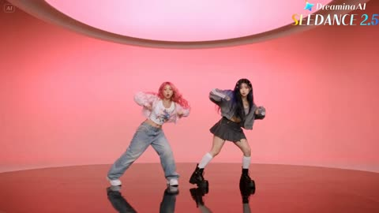</a>

30 秒 MV 按 2 到 4 秒的时间段排开，在三个布景间来回切。

Seedance 2.5 · 文生视频 · 出处: [@Just_sharon7 on X](https://x.com/Just_sharon7/status/2083422886686031982) · 547 赞，统计于 2026-10-27

[`music-video`](#tag-music-video) [`dance`](#tag-dance) [`timed-beats`](#tag-timed-beats)

<details><summary><b>提示词</b></summary>

```text
30-second ultra-realistic K-pop MV featuring two young East Asian women with flawless synchronization, cinematic lighting, glossy skin, realistic hair and fabric physics, natural body motion, and 4K live-action quality. Vibrant hot pink, electric blue, and silver color palette. 0–2s: Wide shot in a bright circular pink studio with reflective floor. Pink-haired woman (left) and black-haired woman (right) perform energetic opening pose and synchronized dance. 2–4s: Medium close-up of the black-haired woman on a blue spotlight stage, confidently pointing at the camera. 4–6s: Pink-haired woman dances before shimmering blue-silver tinsel curtains, dramatic hair flip and fluid arm movements. 6–8s: Back to the pink studio. Both perform synchronized choreography with sharp arm waves, hip sways, and strong formations. 8–10s: Extreme close-up of both faces against a blue background, glossy makeup, subtle smiles, and direct eye contact. 10–14s: Solo shots at the tinsel backdrop. Pink-haired woman mouths lyrics and gestures confidently, followed by the black-haired woman with relaxed jacket styling. 14–18s: Pink studio. Coordinated jacket choreography, hair flips, powerful synchronized dance, ending hands-on-hips. 18–22s: Glamour close-ups. Black-haired woman under glittering bokeh lights, then pink-haired woman with wind-blown hair against a soft pink background. 22–24s: Blue spotlight stage. Mirrored black-haired performer effect with synchronized spins and flowing hair. 24–26s: Both walk confidently toward the camera in front of shimmering tinsel curtains, reflections visible on the floor. 26–29s: Final synchronized dance and ending pose in the pink circular studio, standing together and looking into the camera. Style: Hyper-realistic live action, Seedance 2.5-quality motion realism, perfect lip sync, natural weight shifts, flowing hair, realistic fabric simulation, polished K-pop music video cinematography.
```

</details>

<a id="seedance-kitchen-fight"></a>
### 餐厅后厨一打三

<a href="https://x.com/Alina_with_Ai/status/2113816556140675163">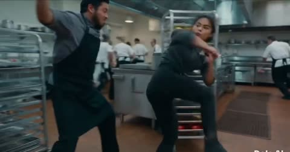</a>

10 秒打戏，开头定死调色和机位，结尾列音效，不要配乐。

Seedance 2.5 · 文生视频 · 出处: [@Alina_with_Ai on X](https://x.com/Alina_with_Ai/status/2113816556140675163) · 514 赞，统计于 2026-10-27

[`action`](#tag-action) [`martial-arts`](#tag-martial-arts) [`sfx`](#tag-sfx)

<details><summary><b>提示词</b></summary>

```text
Cinematic live-action martial arts fight, 10 seconds, wide 16:9, handheld camera with fast whip-pans and slight shake, gritty high-contrast grade with warm brown tile floor and cool steel tones, motion blur on strikes, realistic physics.

Setting: a busy professional restaurant kitchen. Brown quarry-tile floor with black rubber mats, stainless steel prep tables, a rolling rack of fresh vegetables (carrots, greens, red tomatoes), copper pots hanging from a ceiling rail that swing with every impact, gas range and hood, steel refrigerators, wooden produce crates stacked against a white-tiled back wall. In the far background, chefs in white uniforms keep working.

Characters: a young woman with dark hair tied back, grey button-up work shirt with sleeves pushed up and black pants and black boots. She fights 3 men in grey shirts and black aprons (one bearded, one heavyset, one Asian man with short hair), all trying to attack her, one wielding a kitchen knife.

0-1s: She dodges a swinging punch from the bearded man, then blocks the heavyset man's arm with a crossed-arm block, copper pots swaying above.
1-2s: She drops into a low lunge and kicks, sending the man flipping backward over the stainless prep table, legs in the air.
2-3s: She spins toward the next man by the cutting board with vegetables, camera whip-pans with motion blur.
3-4s: She throws a high side kick that knocks a knife aside as a man raises it overhead, third man stepping in behind.
4-5s: Camera cuts wider: she lands a spinning back kick, a man crashes to the floor, wooden crates and papers on the wall behind.
5-6s: She leaps high in the air in a flying kick pose against the white wall, whole body visible.
6-7s: She lands in a ready stance, focused and breathing hard, two men lying defeated on the floor behind the crates, spilled apples on the ground, a knife visible in the background.
7-8s: A man in a grey shirt charges, she counters with a sharp fist strike.
8-10s: Tight shot over her shoulder, a man with a knife lunges at her from the right, copper pots overhead, she steps in to meet him.

Sound: impact thuds, fabric whooshes, shoes squeaking on tile, clattering pots and crates, kitchen ambience, no music.
```

</details>

<a id="geminiomniflash"></a>
## Gemini Omni Flash

<a id="omni-astronaut-three-swaps"></a>
### 飞船改折纸，宇航员改海葵，小飞船改魟鱼

<a href="https://storage.googleapis.com/gdm-deepmind-com-prod-public/media/FfbFqJ8qhY_ZWZyz/gemini-omni__prompt-guide_astro-stingray.webm"></a>

同一个镜头连改三轮，场景和机位每一轮都保持一致。

Gemini Omni Flash · 视频编辑 · 出处: [Gemini Omni prompt guide](https://deepmind.google/models/gemini-omni/prompt-guide/)

[`multi-turn-edit`](#tag-multi-turn-edit) [`object-swap`](#tag-object-swap) [`consistency`](#tag-consistency)

<details><summary><b>提示词</b></summary>

```text
Change the ships to be made from white origami paper.
Change the astronaut to a sea anemone.
Change the small ships to stingrays.
```

</details>

输入素材: [1](https://storage.googleapis.com/gdm-deepmind-com-prod-public/media/FfbFqJ8qhY_ZWZyz/gemini-omni__prompt-guide_astro-spaceship.webm)

<a id="omni-birds-form-a-bird"></a>
### 鸟群聚成一只鸟的形状，随音乐起落

<a href="https://storage.googleapis.com/deepmind-media/DeepMind.com/Models/gemini-omni/prompt-guide/gemini-omni__prompt-guide__birds-shape.webm"></a>

三路输入各有标签：`<video>` 管运动，`<image>` 管形状，`<audio>` 管节奏。

Gemini Omni Flash · 参考生视频 · 出处: [Gemini Omni prompt guide](https://deepmind.google/models/gemini-omni/prompt-guide/)

[`multi-reference`](#tag-multi-reference) [`audio-sync`](#tag-audio-sync)

<details><summary><b>提示词</b></summary>

```text
The birds from <video> loosely form the imperfect shape of a bird based on <image>. They move to the music from <audio> and dissipate as they fly
```

</details>

输入素材: [1](https://storage.googleapis.com/deepmind-media/DeepMind.com/Models/gemini-omni/prompt-guide/gemini-omni__reference-anything-inputs__bird-shape.webm) · [2](https://storage.googleapis.com/deepmind-media/DeepMind.com/Models/gemini-omni/prompt-guide/gemini-omni__reference-anything-combine-multi-ingredient-01.webp)

<a id="omni-butterfly-bee-fireflies"></a>
### 蝴蝶改蜜蜂再改萤火虫，一轮只改一处

<a href="https://storage.googleapis.com/gdm-deepmind-com-prod-public/media/FfbFqJ8qhY_ZWZyz/gemini-omni__prompt-guide__firefly.webm"></a>

同一段视频连改两轮，每轮只点名一个对象和它的替换物，其余画面原样保留。

Gemini Omni Flash · 视频编辑 · 出处: [Gemini Omni prompt guide](https://deepmind.google/models/gemini-omni/prompt-guide/)

[`multi-turn-edit`](#tag-multi-turn-edit) [`object-swap`](#tag-object-swap)

<details><summary><b>提示词</b></summary>

```text
Change the butterfly to a bee.
Change the bee into a small swarm of fireflies.
```

</details>

输入素材: [1](https://storage.googleapis.com/gdm-deepmind-com-prod-public/media/FfbFqJ8qhY_ZWZyz/gemini-omni__prompt-guide__butterfly.webm)

<a id="omni-drummer-whip-pan"></a>
### 从鼓手甩镜到萨克斯手和芭蕾舞者

<a href="https://storage.googleapis.com/gdm-deepmind-com-prod-public/media/YMgFKThN-vej75eW/gemini-omni__first-last-frame__dummer-ballet.webm"></a>

首尾帧定住两端，提示词写清中间怎么动，结尾加 `One continuous shot, no jump cuts`。

Gemini Omni Flash · 首尾帧 · 出处: [Gemini Omni prompt guide](https://deepmind.google/models/gemini-omni/prompt-guide/)

[`first-last-frame`](#tag-first-last-frame) [`camera-move`](#tag-camera-move) [`long-take`](#tag-long-take) [`music`](#tag-music)

<details><summary><b>提示词</b></summary>

```text
A close-up low-angle shot of a stylish drummer in a beige suit playing a red drum kit in a grand hall transitions as the camera whip-pans to the side, revealing an older saxophonist playing alongside a ballet dancer spinning in a white outfit under soft purple stage lights. One continuous shot, no jump cuts.
```

</details>

<a id="omni-four-style-progression"></a>
### 同一段视频依次变成蜡笔、铅笔、玻璃、孔版

<a href="https://storage.googleapis.com/gdm-deepmind-com-prod-public/media/FfbFqJ8qhY_ZWZyz/gemini_omni__prompt-guide__astro-sketch-valley.webm"></a>

把参考视频分四段换风格，每段都有自己的质感词，转场一眼能分清。

Gemini Omni Flash · 视频编辑 · 出处: [Gemini Omni prompt guide](https://deepmind.google/models/gemini-omni/prompt-guide/)

[`style-transfer`](#tag-style-transfer) [`animation`](#tag-animation)

<details><summary><b>提示词</b></summary>

```text
Create a four-part stylistic progression of the video reference that begins with a vibrant colored crayon aesthetic, featuring rich, waxy, textured strokes and playful, hand-drawn character designs against a backdrop of heavily granulated paper. Transition seamlessly into a graphite pencil sketch on textured paper, utilizing cross-hatching, varying line weights, and a 12fps "line boiling" effect to emphasize a hand-drawn feel. Next, morph into a hyper-realistic 3D translucent glass style, characterized by complex light refractions, caustic patterns, and soft internal glows within a minimalist studio setting. Conclude the sequence with a tactile risograph print look, applying a limited three-color palette, grainy halftone textures, and intentional registration overlays for a retro, mechanical finish.
```

</details>

输入素材: [1](https://storage.googleapis.com/gdm-deepmind-com-prod-public/media/FfbFqJ8qhY_ZWZyz/gemini_omni__prompt-guide__astro-sketch-valley_input.webm)

<a id="omni-harbour-extend"></a>
### 港口对话，连续续写两段

<a href="https://storage.googleapis.com/gdm-deepmind-com-prod-public/media/YMgFKThN-vej75eW/gemini-omni__extend__boats_1080.webm"></a>

每次续写只交代接下来发生什么：先一句对白，再一个后拉镜头加配乐提示。

Gemini Omni Flash · 续写 · 出处: [Gemini Omni prompt guide](https://deepmind.google/models/gemini-omni/prompt-guide/)

[`extend`](#tag-extend) [`dialogue`](#tag-dialogue) [`long-take`](#tag-long-take)

<details><summary><b>提示词</b></summary>

```text
The man in the blue sweater replies: "Did your father go out on the boat too?"
The camera pulls back in one continuous movement as he continues his story: "He used to say that this harbour had a soul. And that the boats were a part of us." The music swells.
```

</details>

<a id="omni-lights-sync-to-music"></a>
### 公寓的灯跟着音乐节拍一盏盏亮起

<a href="https://storage.googleapis.com/gdm-deepmind-com-prod-public/media/FfbFqJ8qhY_ZWZyz/gemini-omni__prompt-guide__building-light.webm"></a>

一句话同时点名画面事件和音轨，就能让两者对拍，不用写时间点。

Gemini Omni Flash · 视频编辑 · 出处: [Gemini Omni prompt guide](https://deepmind.google/models/gemini-omni/prompt-guide/)

[`audio-sync`](#tag-audio-sync) [`music`](#tag-music)

<details><summary><b>提示词</b></summary>

```text
The lights of the apartments start turning on in sync with the music.
```

</details>

输入素材: [1](https://storage.googleapis.com/gdm-deepmind-com-prod-public/media/FfbFqJ8qhY_ZWZyz/gemini-omni__prompt-guide__building-no-light.webm)

<a id="omni-quantum-explainer"></a>
### 孔版印刷扁平风，讲清量子计算

<a href="https://storage.googleapis.com/gdm-deepmind-com-prod-public/media/FfbFqJ8qhY_ZWZyz/gemini-omni__prompt-guide__quantum.webm"></a>

只提要讲什么，内容交给模型自己的知识，提示词只管把画风定死。

Gemini Omni Flash · 文生视频 · 出处: [Gemini Omni prompt guide](https://deepmind.google/models/gemini-omni/prompt-guide/)

[`explainer`](#tag-explainer) [`motion-graphics`](#tag-motion-graphics) [`style-lock`](#tag-style-lock)

<details><summary><b>提示词</b></summary>

```text
Explain the difference between regular computing and quantum computing. Visualize this sentence using a contemporary flat-media style that blends minimalist vector shapes with rich organic textures. The aesthetic is defined by a high-contrast, "electric" color palette of neon pinks, cyans, and limes set against a deep navy background. A hallmark of this style is the use of stipple shading and grainy gradients, which adds a tactile, risograph-like quality to the otherwise simple geometric forms. By combining sharp edges with these softened, speckled transitions, the illustration achieves a playful, editorial feel.
```

</details>

<a id="omni-shoes-tilt-up"></a>
### 从鞋子起幅，上摇，再拉开

<a href="https://storage.googleapis.com/gdm-deepmind-com-prod-public/media/FfbFqJ8qhY_ZWZyz/gemini-omni__prompt-guide__boots.webm"></a>

一行里按发生顺序串起三个运镜。

Gemini Omni Flash · 视频编辑 · 出处: [Gemini Omni prompt guide](https://deepmind.google/models/gemini-omni/prompt-guide/)

[`camera-move`](#tag-camera-move) [`multi-turn-edit`](#tag-multi-turn-edit)

<details><summary><b>提示词</b></summary>

```text
Change the camera angle, a close-up on his shoes, quickly tilting up to medium shot, then widening.
```

</details>

<a id="omni-skateboard-motion-fx"></a>
### 给真人滑板加卡通动效

<a href="https://storage.googleapis.com/gdm-deepmind-com-prod-public/media/FfbFqJ8qhY_ZWZyz/gemini-omni__prompt-guide__skateboard.webm"></a>

`keeping everything the same` 先锁住原片，改动只叠加特效。

Gemini Omni Flash · 视频编辑 · 出处: [Gemini Omni prompt guide](https://deepmind.google/models/gemini-omni/prompt-guide/)

[`vfx`](#tag-vfx) [`mixed-media`](#tag-mixed-media)

<details><summary><b>提示词</b></summary>

```text
Edit this keeping everything the same. Add animated motion effects coming out of the skateboard.
```

</details>

<a id="omni-storyboard-to-video"></a>
### 给一张分镜图，直接出片

<a href="https://storage.googleapis.com/deepmind-media/DeepMind.com/Models/gemini-omni/prompt-guide/gemini_omni__prompt-guide__storyboard.webm"></a>

剧情全在分镜图里，文字只交代阅读顺序、总时长和基调。

Gemini Omni Flash · 参考生视频 · 出处: [Gemini Omni prompt guide](https://deepmind.google/models/gemini-omni/prompt-guide/)

[`storyboard`](#tag-storyboard) [`multi-shot`](#tag-multi-shot)

<details><summary><b>提示词</b></summary>

```text
Show me in this story. Follow the story exactly in order starting top left. Entire story in 10 seconds. Cinematic
```

</details>

输入素材: [1](https://storage.googleapis.com/deepmind-media/DeepMind.com/Models/gemini-omni/prompt-guide/gemini-omni__reference-anything-storyboard-ingredient-01.webp) · [2](https://storage.googleapis.com/deepmind-media/DeepMind.com/Models/gemini-omni/prompt-guide/gemini-omni__reference-anything-storyboard-ingredient-02.webp)

<a id="omni-violinist-over-shoulder"></a>
### 把机位挪到小提琴手肩后

<a href="https://storage.googleapis.com/gdm-deepmind-com-prod-public/media/3cYlYfozIFs5_Ngj/gemini-omni__edit-over-multiple-turns-with-consistency__angle.webm"></a>

改机位只用一句大白话，Omni 用新角度重拍同一段演奏。

Gemini Omni Flash · 视频编辑 · 出处: [Gemini Omni prompt guide](https://deepmind.google/models/gemini-omni/prompt-guide/)

[`multi-turn-edit`](#tag-multi-turn-edit) [`camera-angle`](#tag-camera-angle)

<details><summary><b>提示词</b></summary>

```text
Change the camera angle to be over the violinist’s shoulder.
```

</details>

输入素材: [1](https://storage.googleapis.com/gdm-deepmind-com-prod-public/media/3cYlYfozIFs5_Ngj/gemini-omni__edit-over-multiple-turns-with-consistency__invisible.webm)

<a id="omni-word-by-word-sizzle"></a>
### 动态文字，一拍一个词

<a href="https://storage.googleapis.com/gdm-deepmind-com-prod-public/media/FfbFqJ8qhY_ZWZyz/gemini-omni__prompt-guide__text.webm"></a>

按顺序列出每个词，要求每个词换一种动画样式，很适合测屏幕文字。

Gemini Omni Flash · 文生视频 · 出处: [Gemini Omni prompt guide](https://deepmind.google/models/gemini-omni/prompt-guide/)

[`text-render`](#tag-text-render) [`motion-graphics`](#tag-motion-graphics)

<details><summary><b>提示词</b></summary>

```text
word by word, one word on a the screen at a time: did, you, know, that, this, model, can, do, pretty, good, text!? each word appears with a different animated style, perfect pacing to a rhythm, sizzle reel.
```

</details>

<a id="kling30"></a>
## Kling 3.0

<a id="kling-baseball-bat-logo"></a>
### 挥棒全程，球棒上的字保持清晰

<a href="https://static-54.klingai-cdn-aws.com/kling-blog/presigned_url/50fdd9a7-e3d7-4d62-8715-edaa9b3003bc_文字_棒球.mp4"></a>

一句话把镜头钉在运动物体的字上，用来快速测文字稳定性。

Kling 3.0 · 图生视频 · 出处: [Kling VIDEO 3.0 user guide](https://app.klingai.com/global/quickstart/klingai-video-3-model-user-guide)

[`text-render`](#tag-text-render) [`sports`](#tag-sports)

<details><summary><b>提示词</b></summary>

```text
The camera remains fixed on the word "KLING" emblazoned on the baseball bat as the player swings and hits the ball.
```

</details>

输入素材: [1](https://static-3.klingai-cdn-aws.com/kling-blog/file_by_url/a8527e3967d0a358562fddac74c2c9e13c98135619da9af77ea326fe756fb0ff.png)

<a id="kling-family-reacts-to-twist"></a>
### 一家四口对剧情反转的反应

<a href="https://static-86.klingai-cdn-aws.com/kling-blog/presigned_url/8aa6f5a2-b121-4b08-840d-827cc670c4be_kling_20260202_作品_居家环境_背景有轻微_5022_0.mp4"></a>

四个说话人，每个都标角色和语气（`Mom (softly, in a surprised tone)`），台词能对上正确的人。

Kling 3.0 · 图生视频 · 出处: [Kling VIDEO 3.0 user guide](https://app.klingai.com/global/quickstart/klingai-video-3-model-user-guide)

[`dialogue`](#tag-dialogue) [`multi-speaker`](#tag-multi-speaker) [`ambience`](#tag-ambience)

<details><summary><b>提示词</b></summary>

```text
Home setting with a faint hum of the living room air conditioner in the background for a realistic daily vibe. Mom (softly, in a surprised tone): Wow, I didn’t expect this plot at all. Dad (in a low voice, agreeing, in a calm tone): Yeah, it’s totally unexpected. Never thought that would happen. Boy (in an excited tone): It’s the best twist ever! Girl (nodding along, in an enthusiastic tone): I can’t believe they did that!
```

</details>

输入素材: [1](https://static--49.klingai-cdn-aws.com/kling-blog/file_by_url/006b3efc9ecef758c2aac2e8765f63e4b0f7d684de4d8e6e40e50a90fdb426ce.png)

<a id="kling-indian-accent-order"></a>
### 带印度口音点餐

<a href="https://static-78.klingai-cdn-aws.com/kling-blog/presigned_url/29736974-c5c6-46d2-a9af-ec0413fb74ef_kling_20260204_作品_多镜头_一位中年男子_5210_1.mp4"></a>

口音在台词前点一次。两句话之间的停顿写成动作（`then he looks up`）。

Kling 3.0 · 图生视频 · 出处: [Kling VIDEO 3.0 user guide](https://app.klingai.com/global/quickstart/klingai-video-3-model-user-guide)

[`dialogue`](#tag-dialogue) [`accent`](#tag-accent) [`multi-shot`](#tag-multi-shot)

<details><summary><b>提示词</b></summary>

```text
A middle-aged man is ordering food in a Western restaurant. He speaks in English with an Indian accent and says: "excuse me, I would like to order a seafood pasta, and a filet mignon. medium-rare", then he looks up and continues: “And, do you have any drink recommendations?”
```

</details>

输入素材: [1](https://static--52.klingai-cdn-aws.com/kling-blog/file_by_url/4a06a8651731e50c212477bcb626257d4e1ba3576eb48ff57aa077cd6a5d9d4f.png)

<a id="kling-japanese-station-bento"></a>
### 晨雾小站递便当，日语对白

<a href="https://static--87.klingai-cdn-aws.com/kling-blog/presigned_url/3d106f34-7b24-462f-9238-0a9d4c3981dc_kling_20260204_作品_清晨薄雾的小站_男生_5550_3.mp4"></a>

日语台词用直角引号，说话人只写 `the boy` 和 `the girl`，展示可灵的日语口型。

Kling 3.0 · 图生视频 · 出处: [Kling VIDEO 3.0 user guide](https://app.klingai.com/global/quickstart/klingai-video-3-model-user-guide)

[`dialogue`](#tag-dialogue) [`multilingual`](#tag-multilingual) [`japanese`](#tag-japanese)

<details><summary><b>提示词</b></summary>

```text
On a small station shrouded in morning mist, the boy smiled and handed over the bento: 「急いで作ったけど、大丈夫？ お母さんのレシピだよ。」The girl took it with a smile: 「うん、きっと美味しい！ 到着したら LINE するね。」
```

</details>

输入素材: [1](https://static-39.klingai-cdn-aws.com/kling-blog/file_by_url/1e96651baca4447550008b624ccb8723fb4d5aa383734b8744042d031532e619.jpg)

<a id="kling-joseon-lady-and-maid"></a>
### 朝鲜贵族小姐与侍女

<a href="https://static-41.klingai-cdn-aws.com/kling-blog/presigned_url/d7236484-7cf3-4092-a019-4321dbc661b4_kling_20260202_作品_镜头聚焦两人的互动__4898_0.mp4"></a>

韩语古装戏。语气词（`warm, gentle`、`with deference`）交代两人的身份高低。

Kling 3.0 · 图生视频 · 出处: [Kling VIDEO 3.0 user guide](https://app.klingai.com/global/quickstart/klingai-video-3-model-user-guide)

[`dialogue`](#tag-dialogue) [`multilingual`](#tag-multilingual) [`period`](#tag-period)

<details><summary><b>提示词</b></summary>

```text
The camera lingers on their interaction— the noble lady’s gaze soft and mild, her maid listening with her head bowed. The lady lifts a hand to smooth her sleeve gently, and speaks in a warm, gentle tone: “오늘 후원에서 피어난 꽃을 보니, 시원한 바람이 분다. 너도 함께 걸어볼까?” The maid inclines her body slightly forward, and replies with deference: “네, 아씨님. 따라갈게요.
```

</details>

输入素材: [1](https://static-10.klingai-cdn-aws.com/kling-blog/file_by_url/6ea73c8a737512559f23bb74328f56539882634fa386241b340d5af0c0314b93.jpg)

<a id="kling-korean-rooftop"></a>
### 韩国高中天台夜聊

<a href="https://static-74.klingai-cdn-aws.com/kling-blog/presigned_url/43cd806c-13a5-4375-906d-7c29f632b04c_kling_20260202_作品_韩国高中屋顶场景下__5286_0.mp4"></a>

语言写在每个说话人标签里：`Boy (casual tone, Korean)`。

Kling 3.0 · 图生视频 · 出处: [Kling VIDEO 3.0 user guide](https://app.klingai.com/global/quickstart/klingai-video-3-model-user-guide)

[`dialogue`](#tag-dialogue) [`multilingual`](#tag-multilingual) [`korean`](#tag-korean)

<details><summary><b>提示词</b></summary>

```text
On the rooftop of a Korean high school, distant city lights glimmer in the background with a soft wind rustling, and stars twinkle in the night sky. The girl leans against the railing, lost in thought. The boy walks over with two cans of cola, hands one to her, and she takes it and pops the tab open. Boy (casual tone, Korean): "숙제 다 했어? 왜 여기 있어?" Girl (sighing, Korean): "시험이 너무 무서워". Boy (gentle tone, Korean): “걱정 마, 넌 잘할 거야.”
```

</details>

输入素材: [1](https://static-46.klingai-cdn-aws.com/kling-blog/file_by_url/f04a52d4d7bbeb30091cb136cd8623e84bd995776b765099fcc5ddcbbaf07391.png)

<a id="kling-madrid-asking-directions"></a>
### 马德里问路，磕磕绊绊的西班牙语

<a href="https://static-45.klingai-cdn-aws.com/kling-blog/presigned_url/10902407-6b2f-4e1c-86f4-ae81f9da21c2_kling_20260204_作品_阳光洒满马德里老街__3484_0.mp4"></a>

三个说话人流利度不同：游客要求说得慢、口音别扭，店员轻快。

Kling 3.0 · 图生视频 · 出处: [Kling VIDEO 3.0 user guide](https://app.klingai.com/global/quickstart/klingai-video-3-model-user-guide)

[`dialogue`](#tag-dialogue) [`multilingual`](#tag-multilingual) [`spanish`](#tag-spanish) [`accent`](#tag-accent)

<details><summary><b>提示词</b></summary>

```text
Sunlight fills the old streets of Madrid. In front of a street-side bakery, a Chinese female tourist and a male tourist wearing a gray hoodie walk toward the shop clerk, both wearing polite smiles. Female tourist (speaking slightly slowly, with an awkward accent, in Spanish):Disculpe, ¿dónde está la plaza mayor? A white-haired Spanish shop clerk (turning slightly and pointing forward, with a light and cheerful tone, in Spanish):Por allí, a dos calles. Muy cerca. The female tourist nods to express her thanks. The male tourist also nods in agreement and says (in Spanish): Muchas gracias. The shop clerk smiles and nods in response. The two tourists then turn and walk in the indicated direction.
```

</details>

输入素材: [1](https://static--53.klingai-cdn-aws.com/kling-blog/file_by_url/e4699b0ea66d1a1b6b94dcc1dedc462be6136f1a4fe5d263b719f7bd54dc8992.png)

<a id="kling-moonlit-garden-run"></a>
### 绿裙女子奔过月下花园，15 秒

<a href="https://static--79.klingai-cdn-aws.com/kling-blog/presigned_url/3f219e9a-5e38-46ed-af01-9831ebce2f2a_kling_20260203_作品_超广角中远景横向跟拍_4556_0.mp4"></a>

15 秒连续镜头，按导演段落写：镜头、稳定器高度、调色，再按顺序写动作。

Kling 3.0 · 图生视频 · 出处: [Kling VIDEO 3.0 user guide](https://app.klingai.com/global/quickstart/klingai-video-3-model-user-guide)

[`long-take`](#tag-long-take) [`film-look`](#tag-film-look) [`camera-move`](#tag-camera-move)

<details><summary><b>提示词</b></summary>

```text
Opening with an ultra-wide-angle medium-long shot tracking horizontally, the stabilizer moves low to the ground, with a highly contrasting romantic cinematic tone of cold blue night and silvery white starry sky, exuding a strong poetic realism and classical epic temperament. The protagonist is a young woman in a dark green long dress, running with all her might on the garden lawn illuminated by moonlight; her skirt billows in the wind forming surging dynamic curves, she clutches a small white flower in her right hand and lifts the hem of her dress with her left, breathing rapidly yet with a firm gaze. At the 4th second, the camera accelerates forward with her, and multiple men and women in old-era ball gowns break into the frame one after another from the left and right sides in the background, running alongside her—some try to approach, some turn back to shout, yet none truly touch her, implying pursuit and escape. At the 8th second, the camera gradually zooms in to a medium shot, pans to track forward in front of the protagonist and lifts slightly; she glances back briefly at a young male character behind her, their gazes meet for a split second, emotions erupt mid-run, and the woman and man join hands to run together. At the 12th second, the music and movement reach a climax; the camera moves forward close to her side face and fluttering hair, she releases the white flower and tosses it into the air, the flower drifting down in slow motion as the crowd behind brushes past it. In the final 3 seconds, the camera keeps moving forward, the woman and man break through the crowd and dash toward the starry sky at the end of the garden, their figures gradually taking over the center of the frame. The overall atmosphere is fiery, romantic and resolute, a burst of narrative about fate, choice and freedom.
```

</details>

输入素材: [1](https://static--91.klingai-cdn-aws.com/kling-blog/file_by_url/21ef15bece0400c220dd7db92c388544a486345d867b33673fec8ba66b1ee2c6.png)

<a id="kling-office-long-take"></a>
### 一镜到底，跟拍女人从电梯走到工位

<a href="https://static--46.klingai-cdn-aws.com/kling-blog/presigned_url/cf695909-2395-4433-a0b1-caeb28df578d_kling_20260201_作品_平稳跟拍长镜头一镜到_3635_0.mp4"></a>

首帧加绑定的人物主体。提示词写清机位怎么跟：她走就跟，她停就停。

Kling 3.0 · 图生视频 · 出处: [Kling VIDEO 3.0 user guide](https://app.klingai.com/global/quickstart/klingai-video-3-model-user-guide)

[`long-take`](#tag-long-take) [`character-consistency`](#tag-character-consistency) [`tracking-shot`](#tag-tracking-shot)

<details><summary><b>提示词</b></summary>

```text
Authentic workplace texture, one continuous long take without any cuts. The camera follows the professional woman steadily in a medium shot throughout, moving in sync with her: the camera tracks her as she walks and freezes instantly when she pauses, with natural and smooth movements and fluid camera work. The woman walks forward out of the elevator, and the elevator doors close slowly and naturally behind her; she steps into the office area, takes off her sunglasses by hand, tucks them into her commuter bag casually, and nods politely to colleagues passing by; she pauses briefly, the camera freezes in sync, she hangs her commuter bag on the coat rack in the office area, then takes off her outer coat and hangs it on the same rack; after hanging up her clothes, she walks forward again, the camera tracks her in sync; a young man in a formal shirt walks towards her, hands her a document and a signature pen, she pauses, the camera freezes in sync, takes them and signs the document; after signing, she walks forward again, the camera tracks her in sync; finally, she walks to her desk, sits down by the chair, reaches out to pick up a cup of tea on the desk, and sips it with her head down, her movements relaxed and natural.
```

</details>

输入素材: [1](https://static-44.klingai-cdn-aws.com/kling-blog/file_by_url/f810ae350b11c0469938a2dc73724c09618b56830d84f506027187df168c830e.png)

<a id="kling-orbit-to-smile"></a>
### 镜头绕到正面，她抬头微笑

<a href="https://static-36.klingai-cdn-aws.com/kling-blog/presigned_url/53d2490e-3ad9-4d84-b74f-bc0b1fcc4151_kling_20260204_作品_镜头逐渐环绕至女孩的_4266_2.mp4"></a>

同一句提示词跑两遍，一遍绑定主体，一遍只用首帧，页面上两版并排，能直接比脸的一致性。

Kling 3.0 · 图生视频 · 出处: [Kling VIDEO 3.0 user guide](https://app.klingai.com/global/quickstart/klingai-video-3-model-user-guide)

[`character-consistency`](#tag-character-consistency) [`orbit`](#tag-orbit) [`image-to-video`](#tag-image-to-video)

<details><summary><b>提示词</b></summary>

```text
The camera gradually moves around to the front of the girl, who then lifts her head and smiles warmly at the camera, as if seeing an old friend after many years.
```

</details>

输入素材: [1](https://static--64.klingai-cdn-aws.com/kling-blog/file_by_url/445147e8acb2e81e4c06a4a819081baeacbdbcf1824946cf1cd9b5a2f0c4e0f5.png)

<a id="kling-perfume-paris-ad"></a>
### 巴黎窗边的香水广告

<a href="https://static--72.klingai-cdn-aws.com/kling-blog/presigned_url/27107c4f-403c-412d-94b7-20a8835c8ffa_kling_20260202_作品_巴黎公寓窗边场景下__5018_0.mp4"></a>

产品镜头，瓶身印字保持清晰。旁白、口音、背景音乐都写在提示词里。

Kling 3.0 · 图生视频 · 出处: [Kling VIDEO 3.0 user guide](https://app.klingai.com/global/quickstart/klingai-video-3-model-user-guide)

[`product-ad`](#tag-product-ad) [`text-render`](#tag-text-render) [`voiceover`](#tag-voiceover)

<details><summary><b>提示词</b></summary>

```text
By the window of a Parisian apartment, with soft French piano BGM in the background, the gilded afternoon sunlight filters through the shutters onto the perfume bottle, casting dappled light and shadow. The camera pans slowly in from the scattered rose petals, shifting focus to the faceted cut of the Kling perfume bottle. Voiceover (lazy French female voice, British accent, slow pace): Bathe in the golden hour. The camera orbits the perfume bottle in slow motion, capturing the play of light and shadow on the golden lettering and bottle body. Voiceover: Kling, a whisper of Parisian elegance. The camera pulls back and freezes on the complete scene—the Kling perfume bottle standing on a velvet pedestal, with Parisian buildings faintly visible outside the window. Voiceover: Wrap yourself in luxury with every breath.
```

</details>

输入素材: [1](https://static--74.klingai-cdn-aws.com/kling-blog/file_by_url/3de2fbc80df150e68fc05823f829a0fd88e2145ed4b4dbfb2f6a6a4fd5dbea87.png)

<a id="kling-plaster-tower-dinosaur"></a>
### 石膏像塔里，与恐龙重逢

<a href="https://static-17.klingai-cdn-aws.com/kling-blog/presigned_url/9d0eec96-49d3-4229-a2c0-f38ceb5974e0_没想到吧Alex是只恐龙.mp4"></a>

开头先声明 `single unbroken shot with no edited transitions`，再写一条从绝望到重逢的情绪线。

Kling 3.0 · 图生视频 · 出处: [Kling VIDEO 3.0 user guide](https://app.klingai.com/global/quickstart/klingai-video-3-model-user-guide)

[`long-take`](#tag-long-take) [`emotion`](#tag-emotion) [`creature`](#tag-creature)

<details><summary><b>提示词</b></summary>

```text
This is a 15-second cinematic long take, a single unbroken shot with no edited transitions. The scene is set inside a tower of plaster statues dappled with light and shadow, surrounded by towering white plaster sculptures, evoking an air of mystery and oppression. The shot opens with the protagonist skidding to a halt at the center of the scene after a frantic run, chest heaving, expression dazed and helpless, fear glinting in their eyes. The camera orbits the protagonist in a smooth 360-degree pan. As the camera rotates, the protagonist glances anxiously around and shouts: "Alex! Alex where are you! Are you here?" A cute dinosaur cry then echoes in the background, and the camera pushes in over the protagonist’s shoulder to their back— a small to medium-sized, adorable baby dinosaur steps out from behind a plaster pillar, letting out a sweet chirp. Startled by the sound, the protagonist whips around; catching sight of the dinosaur, they burst into tears instantly and rush forward without hesitation to clasp it tightly in their arms. The dinosaur nestles obediently against them. Sobbing, the protagonist strokes the dinosaur gently and trembles: "I found you! Thank God, I’m so scared!" The overall lighting and shadow boast a cinematic texture, with the emotion shifting from despair to an overwhelmingly touching reunion.
```

</details>

输入素材: [1](https://static-47.klingai-cdn-aws.com/kling-blog/file_by_url/fe49a43ec06b9e0cdf7f555268cbe2a18c35175ab6cc25fc2b1150218076b6d9.png)

<a id="kling-snowmobile-six-shots"></a>
### 雪地摩托，六个镜头

<a href="https://static-14.klingai-cdn-aws.com/kling-blog/presigned_url/fbf5a59b-e1c0-45ee-9ec8-13726d3d3887_kling_20260202_作品_镜头_1_2s_后远_4947_0.mp4"></a>

六个镜头只写角度和运镜，环境只在最后一个镜头写一次。

Kling 3.0 · 图生视频 · 出处: [Kling VIDEO 3.0 user guide](https://app.klingai.com/global/quickstart/klingai-video-3-model-user-guide)

[`multi-shot`](#tag-multi-shot) [`camera-move`](#tag-camera-move) [`action`](#tag-action)

<details><summary><b>提示词</b></summary>

```text
Shot 1, Low-angle rear wide shot, tracking behind the rider as they move forward. Shot 2, Low-angle side close-up, a detailed shot of the motorcycle wheel. Shot 3, First-person POV from the rider, with the handlebars and instrument panel visible ahead. Shot 4, Frontal medium shot, tracking backward in front of the motorcycle, the rider’s helmet facing the camera. Shot 5, Side-on eye-level tracking shot with slight lateral movement. Shot 6, High-angle wide shot with a gentle downward tilt. The camera rises as the snowmobile rides deeper into the snowfield, leaving winding tracks carved into the pristine white snow, with snow-covered forests scattered on both sides.
```

</details>

输入素材: [1](https://static-29.klingai-cdn-aws.com/kling-blog/file_by_url/ef7ccbdcafe3af9d5fbbe492976b10793b302cc4ecab0778734b129dc7db9570.png)

<a id="kling-truck-driver-four-shots"></a>
### 卡车司机，四个手持镜头

<a href="https://static-94.klingai-cdn-aws.com/kling-blog/presigned_url/b77930c4-755d-4035-ba98-842446609ea8_Dave_multi.mp4"></a>

可灵创作伙伴 Dave Clark 的自定义多镜头。每个镜头都重复 `cinematic handheld`，切镜后质感不跳。

Kling 3.0 · 图生视频 · 出处: [Kling VIDEO 3.0 user guide](https://app.klingai.com/global/quickstart/klingai-video-3-model-user-guide)

[`multi-shot`](#tag-multi-shot) [`handheld`](#tag-handheld) [`film-look`](#tag-film-look)

<details><summary><b>提示词</b></summary>

```text
shot 1, profile shot of black man driving a truck, cinematic handheld. Shot 2, frontal macro shot of black man driving a truck, cinematic handheld. Shot 3, macro shot of hands on the steering wheel, cinematic handheld. Shot 4, macro shot of a weathered picture of a young black child laying on the passenger side seat, cinematic handheld.
```

</details>

输入素材: [1](https://static--56.klingai-cdn-aws.com/kling-blog/file/0c5b8af23bea126e21beac535408c4cf6020f44cc773e2985ab1c32c42756216.jpg)

<a id="kling-villa-terrace-dialogue"></a>
### 别墅露台，夏日双人对话

<a href="https://static-37.klingai-cdn-aws.com/kling-blog/presigned_url/206908e5-edd9-4f12-a7cb-2baca6a0f2bd_kling_20260203_作品_欧洲别墅户外露台场景_4118_0.mp4"></a>

开启多镜头后，模型从一段动作加对白里自己排出正反打。

Kling 3.0 · 图生视频 · 出处: [Kling VIDEO 3.0 user guide](https://app.klingai.com/global/quickstart/klingai-video-3-model-user-guide)

[`multi-shot`](#tag-multi-shot) [`dialogue`](#tag-dialogue) [`shot-reverse-shot`](#tag-shot-reverse-shot)

<details><summary><b>提示词</b></summary>

```text
Outdoor terrace of a European villa, by a dining table with a blue and white checkered tablecloth, a young white woman in a blue and white striped short-sleeve shirt and khaki shorts, with a brown belt, sits barefoot, opposite a young white man in a white T-shirt. The camera zooms in, the woman swirls the juice in a glass, her eyes looking at the distant woods, and says "These trees will turn yellow in a month, won't they?". Close-up of the man, he lowers his head and says, "but they'll be green again next summer.". Then the woman turns her head, smiles at the man opposite, and says, "Are you always this optimistic? Or just about summer?". Then the man lifts his head, looks at the woman and says, “Only about summers with you.”
```

</details>

输入素材: [1](https://static-6.klingai-cdn-aws.com/kling-blog/file_by_url/1e8ad2ce90036c01aa7fe86c89178590aaf136880206c40d8fc0f99e68d93445.png)

<a id="veo3"></a>
## Veo 3

<a id="veo-camper-and-bear"></a>
### 定格动画，露营者和会顶嘴的熊

<a href="https://storage.googleapis.com/gdm-deepmind-com-prod-public/media/media/veo__veo-3__camper.webm"></a>

整条提示词只有一个形式标签和两句台词，场景交给 Veo 补全。

Veo 3 · 文生视频 · 出处: [Veo 3 prompt guide](https://deepmind.google/models/veo/prompt-guide/)

[`stop-motion`](#tag-stop-motion) [`dialogue`](#tag-dialogue) [`comedy`](#tag-comedy)

<details><summary><b>提示词</b></summary>

```text
Camping (Stop Motion): Camper: "I'm one with nature now!" Bear: "Nature would prefer some personal space."
```

</details>

<a id="veo-candy-keyboard"></a>
### 糖果做的键盘

<a href="https://storage.googleapis.com/gdm-deepmind-com-prod-public/media/media/veo__veo-3__keyboard.webm"></a>

单独一行 `Audio:` 告诉模型画面该配什么声音。

Veo 3 · 文生视频 · 出处: [Veo 3 prompt guide](https://deepmind.google/models/veo/prompt-guide/)

[`sfx`](#tag-sfx) [`product`](#tag-product) [`whimsical`](#tag-whimsical)

<details><summary><b>提示词</b></summary>

```text
A keyboard whose keys are made of different types of candy. Typing makes sweet, crunchy sounds. Audio: Crunchy, sugary typing sounds, delighted giggles.
```

</details>

<a id="veo-moon-dust-flowers"></a>
### 月尘平原上的水晶花

<a href="https://storage.googleapis.com/gdm-deepmind-com-prod-public/media/media/veo__veo-3__moon-dust.webm"></a>

短小的造景提示词。一个抓人的细节（`the only footprints in untouched dust`）胜过一长串形容。

Veo 3 · 文生视频 · 出处: [Veo 3 prompt guide](https://deepmind.google/models/veo/prompt-guide/)

[`world-building`](#tag-world-building) [`fantasy`](#tag-fantasy)

<details><summary><b>提示词</b></summary>

```text
A snow-covered plain of iridescent moon-dust under twilight skies. Thirty-foot crystalline flowers bloom, refracting light into slow-moving rainbows. A fur-cloaked figure walks between these colossal blossoms, leaving the only footprints in untouched dust.
```

</details>

<a id="veo-off-road-rally"></a>
### 越野拉力冲过河滩

<a href="https://storage.googleapis.com/gdm-deepmind-com-prod-public/media/media/veo__veo-3__off-road.mp4"></a>

给 8 秒动作戏写逐拍解说，还要求车辆无品牌，画面里不会冒出商标。

Veo 3 · 文生视频 · 出处: [Veo 3 prompt guide](https://deepmind.google/models/veo/prompt-guide/)

[`action`](#tag-action) [`handheld`](#tag-handheld) [`sfx`](#tag-sfx)

<details><summary><b>提示词</b></summary>

```text
The scene explodes with the raw, visceral, and unpredictable energy of a hardcore off-road rally, captured with a dynamic, almost found-footage or embedded sports documentary aesthetic. The camera is often shaky, seemingly mounted inside one of the vehicles or held by a daring spectator very close to the action, frequently splattered with mud or water, catching unintentional lens flares from the natural, often harsh, sunlight filtering through trees or reflecting off wet surfaces. We are immersed in a challenging, untamed natural environment – perhaps a dense, muddy forest trail, a treacherous rocky incline littered with loose scree, or a series_of shallow, fast-flowing river crossings. Several heavily modified, entirely unidentifiable, and unbranded off-road vehicles are engaged in a frenetic, no-holds-barred race. These are not showroom models; they are custom-built, rugged machines – open-wheeled buggies with exposed engines and prominent roll cages, heavily armored pickup trucks with oversized, knobby tires and snorkel exhausts, their original forms and manufacturers completely obscured by extreme modifications, layers of caked-on mud, and a general air of brutal functionality. The dominant sounds are the deafening, guttural roar of powerful, untamed engines, the whine of transmissions, the percussive impact of suspension bottoming out, and the constant spray of mud and water. Within an 8-second sequence, one of the lead vehicles, a low-slung, open-cockpit buggy so caked in thick, brown mud that its original color is a mystery, approaches a wide, shallow river crossing at incredible speed. Without the slightest hesitation, its unseen driver powers straight into the water. The impact sends an enormous, almost solid, opaque sheet of muddy water, mixed with stones and debris from the riverbed, spectacularly high into the air, completely engulfing the small buggy for a terrifying moment, obscuring it from view as if it has been swallowed by the river itself. Right on its tail, a pursuing, equally mud-encrusted, custom-built truck – a hulking, high-clearance beast with a heavily reinforced external roll cage and no discernible badging – arrives at the river crossing just as this massive wall of airborne water reaches its peak. Instead of slowing or attempting to find a clearer path, the truck's driver, with unwavering aggression, plunges directly into and through this opaque, turbulent curtain of muddy spray at full throttle. A split second later, the truck bursts out from the other side of the deluge, water cascading from its roof and chassis, its oversized windshield wipers struggling frantically to clear the torrent of muddy water obscuring the driver's vision. It lands heavily on the far bank, suspension groaning, but still in hot pursuit of the now-reappearing buggy. This thrilling, messy, and visually spectacular sequence of one vehicle creating a massive environmental obstacle and the next immediately conquering it through sheer force, forms the core, immersive, attention-grabbing event of the 8-second sequence. The race continues with undiminished ferocity, the natural terrain itself an active participant in the conflict.
```

</details>

<a id="veo-old-sailor-verse"></a>
### 老水手念诗

<a href="https://storage.googleapis.com/gdm-deepmind-com-prod-public/media/media/veo__veo-3__sailor.webm"></a>

先写人物（帽子、胡子、烟斗），再把台词放进引号，Veo 3 会按引号里的内容对口型。

Veo 3 · 文生视频 · 出处: [Veo 3 prompt guide](https://deepmind.google/models/veo/prompt-guide/)

[`dialogue`](#tag-dialogue) [`character`](#tag-character)

<details><summary><b>提示词</b></summary>

```text
A medium shot frames an old sailor, his knitted blue sailor hat casting a shadow over his eyes, a thick grey beard obscuring his chin. He holds his pipe in one hand, gesturing with it towards the churning, grey sea beyond the ship's railing. "This ocean, it's a force, a wild, untamed might. And she commands your awe, with every breaking light"
```

</details>

<a id="sora2"></a>
## Sora 2

<a id="sora-fridge-monster"></a>
### 冰箱里钻出一只胖乎乎的紫色怪兽

<a href="https://cdn.openai.com/API/docs/images/sora/sora_monster_original.gif"></a>

两拍：门开，怪兽出来。

Sora 2 · 图生视频 · 出处: [Sora 2 prompting guide](https://cookbook.openai.com/examples/sora/sora2_prompting_guide)

[`image-to-video`](#tag-image-to-video) [`creature`](#tag-creature) [`whimsical`](#tag-whimsical)

<details><summary><b>提示词</b></summary>

```text
The fridge door opens. A cute, chubby purple monster comes out of it.
```

</details>

输入素材: [1](https://cdn.openai.com/API/docs/images/sora/monster_original_720p.jpeg)

<a id="sora-monster-edits"></a>
### 改怪兽：先换颜色，再加一只

<a href="https://cdn.openai.com/API/docs/images/sora/sora_monster_2monsters.gif"></a>

每次编辑都基于原片单独跑，只改一处。OpenAI 的建议是只描述要改的地方。

Sora 2 · 视频编辑 · 出处: [Sora 2 prompting guide](https://cookbook.openai.com/examples/sora/sora2_prompting_guide)

[`multi-turn-edit`](#tag-multi-turn-edit) [`object-swap`](#tag-object-swap)

<details><summary><b>提示词</b></summary>

```text
Change the color of the monster to orange
A second monster comes out right after
```

</details>

输入素材: [1](https://cdn.openai.com/API/docs/images/sora/sora_monster_original.gif)

<a id="sora-skyline-turn-and-walk"></a>
### 她转身微笑，走出画面

<a href="https://cdn.openai.com/API/docs/images/sora/sora_woman_skyline_video.gif"></a>

有了输入图，第一帧已经定了，提示词只写接下来发生什么。

Sora 2 · 图生视频 · 出处: [Sora 2 prompting guide](https://cookbook.openai.com/examples/sora/sora2_prompting_guide)

[`image-to-video`](#tag-image-to-video) [`character`](#tag-character)

<details><summary><b>提示词</b></summary>

```text
She turns around and smiles, then slowly walks out of the frame.
```

</details>

输入素材: [1](https://cdn.openai.com/API/docs/images/sora/woman_skyline_original_720p.jpeg)

<a id="image"></a>
## 图片提示词

[Artificial Analysis 图像榜](https://artificialanalysis.ai/text-to-image/arena)前排模型上点赞最多的提示词，每条都是作者在 X 上连同成图一起发的。按用途分组。很多要配一张自己的照片，标着「上传图改图」的就是。

<a id="img-poster"></a>
## 海报与编辑排版

<a id="gpt-image-minimal-lifestyle-poster"></a>
### 真实照片变极简生活方式海报

<a href="https://x.com/Naiknelofar788/status/2101161664892829838"></a>

填空模板，替换 `[PERSON / SUBJECT / MOMENT]` 即可。主体保持可辨认，背景去掉照片感。

GPT Image 2.5 · 上传图改图 · 出处: [@Naiknelofar788 on X](https://x.com/Naiknelofar788/status/2101161664892829838) · 1,698 赞，统计于 2026-10-27

[`editorial`](#tag-editorial) [`illustration`](#tag-illustration) [`template`](#tag-template) [`photo-to-art`](#tag-photo-to-art)

<details><summary><b>提示词</b></summary>

```text
A sophisticated minimalist lifestyle art poster featuring [PERSON / SUBJECT / MOMENT] as the central focus, transformed from a real-life photograph into a refined hand-drawn editorial illustration. Preserve the subject’s recognizable pose, silhouette, clothing, hairstyle, and key visual details while simplifying the scene into an elegant artistic composition.

Use a limited vintage color palette inspired by the original environment, with warm muted tones printed on an ivory/off-white paper background. Combine delicate ink outlines, loose sketchwork, fine hatching, subtle halftone texture, faded print imperfections, and soft watercolor-like washes.

Reduce the surrounding environment into a few recognizable contextual elements—[CAFÉ / BAR / STREET / LANDMARK / OBJECTS]—using simplified linework and layered shapes rather than detailed realism. Add subtle abstract circles, geometric forms, atmospheric marks, tiny decorative elements, or silhouettes to create visual depth.

Include small minimalist typography on one side: [CITY / LOCATION], [SUBJECT / MOMENT], and optional coordinates, date, or short descriptor, designed like a premium collectible travel/lifestyle print.

Generous negative space, elegant editorial composition, vintage screen-print aesthetic, hand-crafted illustration, sophisticated travel-magazine design, muted heritage colors, subtle paper grain, artistic but recognizable, no photorealistic background, no excessive details, 4:5 vertical composition.
```

</details>

<a id="gpt-image-editorial-illustration-poster"></a>
### 每张照片变成一张安静的编辑插画海报

<a href="https://x.com/icreatelife/status/2099343607492702258"></a>

开头先禁止拼贴，一张照片一张海报；结尾一排情绪词定下成品气质。

GPT Image 2.5 · 上传图改图 · 出处: [@icreatelife on X](https://x.com/icreatelife/status/2099343607492702258) · 1,165 赞，统计于 2026-10-27

[`editorial`](#tag-editorial) [`illustration`](#tag-illustration) [`photo-to-art`](#tag-photo-to-art)

<details><summary><b>提示词</b></summary>

```text
Create one independent high-end editorial poster for each uploaded photo. Do not combine multiple photos into a collage. Each photo must be processed and output as a separate poster.

OVERALL FORMAT

Strict 3:4 vertical composition.

Divide the canvas horizontally into two exactly equal sections, with a precise 1:1 height ratio.

The top half occupies exactly 50% of the canvas.

The bottom half occupies exactly 50% of the canvas.

The two sections should feel visually connected as one refined art publication cover.

TOP HALF — ORIGINAL PHOTOGRAPH

Preserve the original photograph as faithfully as possible.

Keep the main composition, subjects, identity, facial features, body proportions, poses, expressions, clothing, objects, and spatial relationships unchanged.

Preserve the realistic photographic texture, natural lighting, shadows, atmosphere, and original color mood.

Apply only subtle, sophisticated editorial color grading, creating the feeling of a premium magazine photograph, contemporary art book, or high-end independent publication.

The image should remain photorealistic and authentic, never overly retouched or artificially stylized.

If necessary to fit the 3:4 composition naturally, extend the sky, ground, walls, or surrounding environmental background.

Background extension must feel seamless and photographic.

Never stretch, distort, reshape, replace, or alter the main subject.

BOTTOM HALF — MINIMAL HAND-DRAWN PAPER ILLUSTRATION

Extract the most recognizable visual elements from the original photograph and reinterpret them as a minimalist hand-drawn paper-cover illustration.

Preserve:

The most recognizable subject

Essential silhouette and proportions

Key pose or gesture

Important objects

The core narrative relationship between people and objects

Highly simplify the image. Remove unnecessary details and retain only the visual information needed for immediate recognition.

Use:

Delicate, slightly imperfect hand-drawn lines

A small number of bold, clearly defined acrylic-style flat color shapes

Rough paper texture

Visible handmade brush marks

Slightly irregular, organic edges

Subtle imperfections that make it feel genuinely handmade

The main illustrated subject should be small, centered, and carefully composed, occupying approximately 10–20% of the bottom half.

Leave a large amount of negative space around the illustration.

The background should primarily resemble:

Rough white paper

Warm off-white paper

Pale natural paper

Minimal editorial book-cover stock

Use only a few lines or small color shapes to suggest the surrounding environment.

COLOR PALETTE

Extract the dominant colors directly from the original photograph.

Compress the palette into no more than 4 main colors.

Keep the colors restrained, sophisticated, and harmonious.

Use bold but controlled flat color blocks.

Avoid excessive color variation.

Preserve subtle paper grain and handmade brush texture.

The illustration should visually feel like a simplified color interpretation of the photograph.

TYPOGRAPHY

A small amount of simple typography may be included when appropriate.

Possible elements:

A short title

Keyword

Object name

Location

Year

Number

Short phrase

Text should be minimal, understated, and editorial.

Typography should naturally interact with the large areas of negative space and the small illustration, evoking:

Art book covers

Independent publishing

Contemporary editorial design

Thoughtful children's picture books

Do not force text into the composition if it does not naturally fit the photograph.

VISUAL LANGUAGE

The final poster should feel:

Quiet · Poetic · Refined · Minimal · Innocent · Relaxed · Artistic · Thoughtful · High-recognition · Premium
```

</details>

<a id="gpt-image-halftone-architecture-poster"></a>
### 建筑照片变半调拼贴旅行海报

<a href="https://x.com/Naiknelofar788/status/2100067049288634730"></a>

长篇规格，结尾给出优先级：先保建筑准确，再谈半调效果。

GPT Image 2.5 · 上传图改图 · 出处: [@Naiknelofar788 on X](https://x.com/Naiknelofar788/status/2100067049288634730) · 497 赞，统计于 2026-10-27

[`halftone`](#tag-halftone) [`architecture`](#tag-architecture) [`travel`](#tag-travel) [`collage`](#tag-collage)

<details><summary><b>提示词</b></summary>

```text
Turn this structure photo into a single high-end halftone architectural travel-collage poster. Output one poster per uploaded photo — never merge multiple structures or photos into one frame.

FORMAT

3:4 vertical canvas. Split into two roughly equal zones — real architectural photo on top, printed reconstruction below — divided by one clean, sharp horizontal line.

Do not stretch, warp, tilt, or unnaturally reposition the structure to force the proportions.

TOP HALF — THE REAL SHOT

Preserve the original structure faithfully: same architecture, proportions, perspective, distinctive details, surrounding elements, natural light and shadow, and original color mood.

Keep recognizable features such as:

* façade
* windows and arches
* towers or domes
* doors and structural details
* roofline
* surrounding landscape or street elements

Add only a subtle high-end color grade and the faintest film grain. Do not redesign or reinterpret the architecture.

BOTTOM HALF — THE PRINTED RECONSTRUCTION

Rebuild the same structure as an experimental printed architectural collage using:

torn photographic fragments + fixed-width ASCII character fields + photocopy halftone dots + architectural linework.

The structure must remain immediately recognizable.

* Torn-edge photographic fragments preserve the most important architectural details.
* Brick, stone, glass, metal, shadows, windows, and surrounding textures gradually dissolve outward into ASCII characters, black halftone dots, fragmented print grain, and fine architectural drafting lines.
* Use thin technical construction lines to subtly trace the structure’s geometry.
* Let selected areas break apart into paper fibers and halftone fragments, creating the feeling that the building is emerging from an archival print.
* Keep the main silhouette strong and readable.
* Texture: rough white paper-fiber edges, subtle photocopy imperfections, slight print misregistration, faded ink, old-paper stains, a few restrained crop marks, and one small red calibration bar.
* Color: warm gray old-paper background + black ink + the structure’s original muted colors + a single restrained red accent.
* Never fully desaturate the structure.

The structure should occupy roughly 60–88% of the frame width, scaled according to what reads best for the architecture.

Leave 22–38% of the paper visibly untouched and empty, creating generous negative space so the poster feels like an archival architectural specimen rather than a packed digital screen.

TYPOGRAPHY

Add one clean, readable fixed-width architectural title based on the structure:

[STRUCTURE NAME]

Below it include:

[CITY, COUNTRY]
REC. STUDY 01

Add one short observational caption related to the architecture, such as:

“A monumental study in geometry, time, and place.”

Typography should feel like an old architectural archive mixed with an underground experimental design journal.

A few loose ASCII glyphs may trace the outer silhouette or architectural edges as texture only — never use ASCII to invent windows, doors, structural details, or technical specifications.

MOOD

Early digital systems × analog photocopy × architectural archive × underground zine × modern travel editorial.

The structure should feel like it is surfacing from an old printed document — half photograph, half architectural drawing, half experimental print.

Sophisticated, minimal, tactile, intellectual, slightly mysterious, and highly collectible.

AVOID

Solid black terminal backgrounds, dense walls of code, cyberpunk neon, excessive ASCII, distorted architecture, impossible geometry, invented architectural details, fake technical specifications, random symbols with no meaning, garbled text, excessive colors, brand logos, QR codes, watermarks, author credits, or tourist-poster clichés.

Priority: Preserve the structure’s identity and architectural accuracy first. The experimental halftone/ASCII treatment should enhance the architecture, not hide it.
```

</details>

<a id="nano-banana-photo-ink-split-poster"></a>
### 一半照片一半水墨的海报

<a href="https://x.com/ChillaiKalan__/status/2110581440085987751"></a>

要求严格五五分，再分别规定两半如何处理同一主体。

Nano Banana 2.1 · 上传图改图 · 出处: [@ChillaiKalan__ on X](https://x.com/ChillaiKalan__/status/2110581440085987751) · 414 赞，统计于 2026-10-27

[`split-composition`](#tag-split-composition) [`ink`](#tag-ink) [`photo-to-art`](#tag-photo-to-art)

<details><summary><b>提示词</b></summary>

```text
Using the uploaded reference image, create a single high-resolution vertical 2:3 editorial art poster.

Divide the canvas into two perfectly equal horizontal sections, each occupying exactly 50% of the total height. Separate them with a clean, perfectly straight horizontal dividing line.

1. TOP HALF — ORIGINAL REFERENCE PHOTOGRAPH

Use the uploaded reference photograph directly in the upper 50% of the poster.

Preserve its original photographic quality, sharpness, natural lighting, and color relationships.

Allow only subtle, intelligent cropping around the outer edges when necessary, without compromising the main subject.

If required, naturally extend a small portion of the surrounding environment to fit the composition.

Do not redraw, illustrate, stretch, blur, or modify the subject's appearance, structure, or spatial relationships.

Do not introduce black borders, white margins, or empty edges.

2. BOTTOM HALF — MINIMALIST EDITORIAL ILLUSTRATION

Use a warm, near-white ivory paper background with an extremely subtle paper texture.

Analyze the main subject and visual story of the uploaded reference image.

Extract only the primary subject, preserving one or two essential identifying elements.

Remove or heavily simplify all secondary details, including background architecture, crowds, vehicles, fences, signs, trees, and other unnecessary elements.

Transform the primary subject into a sophisticated black-ink editorial illustration.

ILLUSTRATION STYLE:

Use natural, clean pen strokes with varied line weight.

Preserve an authentic hand-drawn appearance with expressive but controlled linework.

Avoid overly precise engraving aesthetics, excessive internal details, and dense cross-hatching.

Place a large, nearly pure-black rectangular ink block behind the illustrated subject.

The rectangular block should have subtly imperfect, handmade print-style edges.

Keep the black background clean, with only fine paper grain and minimal noise.

Avoid obvious hatching, scratches, architectural lines, or complex textures.

ILLUSTRATION SCALE AND COMPOSITION:

The illustrated subject must occupy approximately 72–77% of the canvas width and 58–64% of the bottom section's height.

Maintain a clear visual focal point with generous negative space surrounding the illustration.

3. COLOR RULES

The bottom illustration must follow a strictly black-and-white color palette by default.

Preserve only one localized accent color if the original reference image contains a clearly distinctive, concentrated color element with meaningful narrative importance.

Ordinary blue skies, green vegetation, stone surfaces, skin tones, and environmental colors must not be treated as accent colors.

Any preserved accent color must remain strictly localized to the relevant subject or area.

Never allow accent colors to spread across the entire illustration.

4. TYPOGRAPHY AND EDITORIAL LAYOUT

Automatically generate concise, meaningful English typography based on the content of the uploaded reference photograph.

The typography must resemble handwritten editorial annotations from an independent art publication.

TOP-LEFT CORNER:

Generate a short handwritten title consisting of 2–5 words, arranged across two lines.

Directly beneath the title, include three short English action verbs relevant to the photograph.

TOP-RIGHT CORNER:

Display only two lines of geographic coordinates:

Latitude
Longitude

Do not include any additional text in this area.

BOTTOM-LEFT CORNER:

Display the location name followed by the word "DIARY."

Directly beneath it, add one short descriptive English sentence inspired by the photograph.

TYPOGRAPHY STYLE:

Use a rough, upright, slightly irregular handwritten typeface.

Maintain subtle imperfections and a natural editorial annotation aesthetic.

Avoid elegant cursive, calligraphy, overly decorative lettering, and excessively polished typography.

5. FINAL ART DIRECTION

The finished poster must combine:

Authentic, high-quality photography.
Minimalist black-and-white editorial illustration.
Generous negative space.
Independent art publication aesthetics.
Quiet, restrained, sophisticated visual storytelling.
Natural handwritten typography.
A balanced relationship between documentary realism and expressive hand-drawn artwork.

The overall result should resemble a carefully designed, collectible editorial art print.

6. FINAL OUTPUT REQUIREMENTS

ASPECT RATIO:
2:3 vertical.

RESOLUTION:
High-resolution, sharp, print-quality output.

COMPOSITION:

Exactly 50% original reference photography on top.

Exactly 50% editorial illustration on the bottom.

One perfectly straight horizontal dividing line.

One complete, standalone poster.

RESTRICTIONS:

No collages.
No multi-poster layouts.
No combined images.
No unnecessary decorative elements.
No modifications to the original subject's identity or appearance.
No excessive illustration details.
No changes to the original photograph's natural color relationships.

FINAL GOAL:

Create a sophisticated, visually balanced editorial art poster that faithfully preserves the uploaded reference photograph while transforming its primary subject into an expressive, minimalist black-ink illustration.
```

</details>

<a id="nano-banana-photo-sketch-editorial"></a>
### 上面照片下面素描的编辑海报模板

<a href="https://x.com/ChillaiKalan__/status/2111332272670417236"></a>

填 `[SUBJECT]` 和 `[SETTING]`。禁止项针对分割海报的常见毛病：粗边框、上下脸不一致。

Nano Banana 2.1 · 文生图 · 出处: [@ChillaiKalan__ on X](https://x.com/ChillaiKalan__/status/2111332272670417236) · 266 赞，统计于 2026-10-27

[`split-composition`](#tag-split-composition) [`template`](#tag-template) [`editorial`](#tag-editorial)

<details><summary><b>提示词</b></summary>

```text
Create a premium editorial poster featuring a two-part visual composition. The upper half shows a photorealistic photograph of [SUBJECT] in [SETTING], captured in warm natural sunlight with realistic skin texture, authentic expressions, soft highlights, and cinematic depth of field. The lower half transforms the exact same scene into a beautiful hand-painted digital illustration, preserving the subject’s pose, hairstyle, clothing, colors, and key visual details.

Place the illustrated scene inside a clean rectangular frame on a warm ivory, subtly textured paper background. Use a charming contemporary illustration style with delicate brush textures, simplified organic shapes, pastel colors, soft outlines, and a nostalgic summer-magazine aesthetic. Add tasteful decorative elements that complement the scene.

Below the illustration, include a centered minimalist editorial title reading “[MAIN TITLE]” in thin, widely spaced uppercase typography, followed by a smaller subtitle reading “[TAGLINE]” in elegant letter-spaced text. Add a short, thin pastel-colored line underneath.

Maintain balanced spacing, refined art direction, a cohesive color palette, and a sophisticated print-design finish. Vertical 3:4 composition, high resolution, natural lighting, polished editorial layout, aesthetically pleasing, realistic-to-illustration transformation.

Avoid clutter, excessive text, distorted anatomy, inconsistent facial features, harsh colors, heavy borders, and unnecessary graphic elements.
```

</details>

<a id="nano-banana-artbook-spread"></a>
### 照片做成怀旧杂志画册跨页

<a href="https://x.com/Just_sharon7/status/2107574724041769179">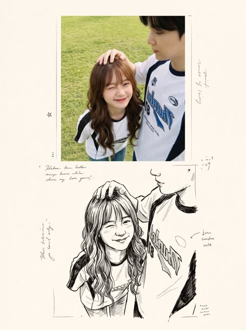</a>

保留原照片的人物，再加一份素描呼应，排成印刷跨页的样子。

Nano Banana 2.1 · 上传图改图 · 出处: [@Just_sharon7 on X](https://x.com/Just_sharon7/status/2107574724041769179) · 183 赞，统计于 2026-10-27

[`magazine`](#tag-magazine) [`photo-to-art`](#tag-photo-to-art) [`nostalgic`](#tag-nostalgic)

<details><summary><b>提示词</b></summary>

```text
Create a nostalgic, magazine-inspired photo-and-illustration artbook spread using the reference image as the visual foundation. Maintain the original subjects, identities, poses, expressions, wardrobe, framing, and emotional tone without altering their recognizable appearance.

Design the composition as two vertically flowing interpretations of the same moment.

In the upper portion, recreate the reference as an intimate cinematic photograph. Use gentle natural light, realistic skin and fabric textures, muted authentic colors, delicate analog film grain, soft background separation, and shallow depth of field. The image should feel spontaneous and personal, like a quiet memory captured on film rather than a staged portrait.

In the lower portion, reinterpret that identical moment as a raw black-and-white ink drawing printed on warm ivory sketchbook paper. Preserve the characters, pose, proportions, and composition while replacing photographic detail with expressive hand-drawn linework, irregular pen strokes, loose cross-hatching, unfinished contours, and restrained shading. Allow small imperfections so the illustration feels genuinely handmade rather than digitally traced.

Blend both sections naturally so the photograph appears to dissolve into the drawing, creating the impression of a memory gradually becoming an illustration.

Surround the lower artwork with restrained editorial design elements: a small numbered chapter heading, a brief poetic handwritten annotation, tiny archival or documentary notes, and subtle typographic details. Keep all typography secondary to the imagery.

Use generous cream-toned negative space, tactile paper grain, faint printing imperfections, understated vintage publishing details, and an elegant minimalist layout inspired by contemporary photography journals and Japanese visual diaries.

Overall mood: nostalgic, intimate, poetic, cinematic, handcrafted, sophisticated, and emotionally warm.

Maintain realistic anatomy, natural body proportions, recognizable faces, believable hands, and consistent clothing throughout both versions. High-detail editorial finish, cohesive photo-to-sketch transition, no branding, no logos, and no watermark.
```

</details>

<a id="img-photo-to-art"></a>
## 照片转艺术风格

<a id="gpt-image-photo-to-watercolor-travel"></a>
### 上半照片，下半水彩旅行速写

<a href="https://x.com/MahnoorAi12/status/2102724961408626735"></a>

上下分割，照片渐变成水彩。作者说 Gemini、Grok、ChatGPT 都能用。

GPT Image 2.5 · 上传图改图 · 出处: [@MahnoorAi12 on X](https://x.com/MahnoorAi12/status/2102724961408626735) · 2,264 赞，统计于 2026-10-27

[`watercolor`](#tag-watercolor) [`travel`](#tag-travel) [`split-composition`](#tag-split-composition)

<details><summary><b>提示词</b></summary>

```text
Create a refined editorial travel-art composition based on a reference photograph. The image is divided vertically into two parts: the upper section is a realistic cinematic travel photograph, while the lower section transforms the exact same scene into a delicate hand-painted watercolor illustration.
Upper section: authentic candid travel photography, natural daylight, soft shadows, subtle film grain, realistic textures, sophisticated European atmosphere, documentary-style composition, people naturally walking through the scene, beautiful architectural details, slightly muted elegant colors, high-end travel magazine photography.
Lower section: a minimalist handmade watercolor painting of the exact same scene, preserving the recognizable composition, architecture, people, poses, perspective and major visual elements from the photograph. Loose translucent watercolor washes, delicate ink details, visible paper texture, soft edges, imperfect brushwork, subtle pigment bleeding, airy negative space, understated pastel tones, artistic but realistic.
Leave generous warm ivory/off-white textured paper space surrounding the watercolor illustration. Add a small elegant handwritten caption near the bottom, such as “summer days” or “a quiet afternoon”, with a thin minimalist horizontal line underneath.
Overall aesthetic: luxury travel journal, fine-art watercolor postcard, contemporary editorial design, nostalgic European summer, understated elegance, tactile handmade paper, sophisticated and serene.
Portrait orientation, clean composition, premium art direction, no clutter, no borders, natural proportions, highly detailed photograph transitioning into an airy watercolor illustration.
```

</details>

<a id="gpt-image-paper-texture-cover"></a>
### 照片变纸张质感极简封面

<a href="https://x.com/Ciri_ai/status/2113501433471656120"></a>

按小标题组织（构图、配色、质感），最后点明参照物：独立艺术书封面。

GPT Image 2.5 · 上传图改图 · 出处: [@Ciri_ai on X](https://x.com/Ciri_ai/status/2113501433471656120) · 561 赞，统计于 2026-10-27

[`paper-texture`](#tag-paper-texture) [`minimal`](#tag-minimal) [`cover`](#tag-cover)

<details><summary><b>提示词</b></summary>

```text
MINIMAL HAND-DRAWN PAPER ILLUSTRATION

Transform the uploaded photo into a minimalist, hand-drawn, paper-textured artistic cover.

Composition

- The main subject should occupy only 10–20% of the frame.
- Position the subject near the bottom center of the composition.
- Leave generous negative space throughout the image.
- Suggest the environment using only a few lines or small blocks of color.

Preserve

- The most recognizable features of the original subject.
- The essential silhouette and proportions.
- The original pose or primary action.
- Important objects and defining details.
- The core story, relationships, and emotional atmosphere.

Color Palette

- Extract the dominant colors from the original photograph.
- Limit the palette to no more than four main colors.
- Use bold yet restrained, flat color blocks.
- Maintain a harmonious, muted color combination.
- Add subtle paper grain and handmade brush textures.

Simplification
Remove unnecessary details and visual clutter. Retain only the essential visual information needed to make the subject instantly recognizable.

Typography

- Optionally incorporate a small amount of simple text.
- Keep typography short, subtle, and aesthetically refined.
- Integrate the text naturally into the composition.
- Aim for the visual language of an art-book cover, independent publishing, modern editorial design, or a contemplative picture book.
- Do not force typography into the image if it doesn't improve the composition.

Style and Materials

- Delicate, slightly imperfect hand-drawn lines.
- A few clearly defined acrylic-like flat color blocks.
- Rough, tactile paper texture.
- Visible handmade brushstrokes.
- Organic, irregular, natural contours.
- Subtle imperfections that make the artwork feel genuinely handmade.

Overall Mood
Quiet, poetic, sophisticated, minimalist, innocent, relaxed, artistic, thoughtful, distinctive, and premium.

Avoid

- Colored-pencil rendering.
- Dry-brush effects.
- Watercolor washes or bleeding.
- Pure line-art illustration.
- Overly detailed or realistic illustrations.
- Heavy impasto or thick oil-paint textures.
- Smooth, polished digital illustration.
- 3D rendering, glossy surfaces, or artificial lighting effects.
- Generic commercial cartoon styles.
- E-commerce advertising aesthetics.
- Generic poster templates.
- Excessive decorative elements.
- Overly complex compositions.
- Too much text.

Final Result: A refined, minimalist, hand-crafted paper illustration with generous negative space, restrained colors, subtle tactile textures, and the sophistication of an independent art-book cover.
```

</details>

<a id="gpt-image-knitted-puppet-bust"></a>
### 照片变针织定格动画玩偶半身像

<a href="https://x.com/oggii_0/status/2114585881059459119"></a>

超长材质规格（毛线、针脚、毛毡），最后一条：照片里没有的不许编。

GPT Image 2.5 · 上传图改图 · 出处: [@oggii_0 on X](https://x.com/oggii_0/status/2114585881059459119) · 327 赞，统计于 2026-10-27

[`3d`](#tag-3d) [`textile`](#tag-textile) [`toy`](#tag-toy)

<details><summary><b>提示词</b></summary>

```text
Task: Create a 1:1 Square 3D Textile Art Toy Bust from the Attached Real Photograph

Use the attached real photograph to create a square 1:1, stylized 3D textile art toy bust. Interpret the inputs by their roles: the real photograph is the source of identity and content, while the minimalist white-background toy image is the style reference. Their order does not matter.

Preserve the subject’s identity, facial expression, pose, and spatial relationships between objects. Reconstruct the subject as an exaggerated, humorous designer collectible toy. Do not apply a simple fuzzy or plush filter to the original photograph.

## 1. Style Reference

Borrow only these visual characteristics from the reference image:

- An oversized, horizontally broad head with rounded corners.
- Extremely small, centrally concentrated facial features with generous facial negative space.
- Sculptural knitted forms, clustered yarn shapes, and soft textile construction.
- Subtle asymmetry for a handmade, designer-toy appearance.
- Contrast between fine-grained flocked surfaces and chunky knitted textures.
- A deliberate primary and accent color hierarchy.
- Clean, minimalist white studio photography.

Do not inherit the reference character’s body, pose, hairstyle, hat, glasses, clothing, props, or colors.

## 2. Subject and Identity Preservation

The real photograph is the exclusive source of visible content. Reproduce only the body parts, hairstyle, clothing, accessories, objects, poses, and contact relationships that are actually visible in the original image. Never invent or complete details that extend beyond the photograph.

Identify 2–5 distinctive identity anchors from the source image. Exaggerate 1–2 of them while simplifying the remaining details to maintain recognizability.

- **Head:** Transform it into a broad, thick, rounded rectangular block or a short cylindrical form with softened corners.
- **Eyes:** Use tiny black beads or capsule-shaped forms.
- **Nose:** Reduce it to a small, rounded rectangular block.
- **Mouth:** Preserve the original expression using a short line or a small opening, as appropriate.
- **Hair:** Reconstruct it as large yarn loops, chunky knitted clusters, or sculptural bundles of wool.
- **Hands:** Strictly preserve the number of visible hands. If no hands are visible, add none. If one hand is visible, reproduce only one. Preserve its orientation, sleeve cuff, and contact with the original object.
- **Text and logos:** Convert any visible lettering or branding into illegible woven or knitted texture rather than readable text.

## 3. Composition

Create a compact, close-up head-and-shoulders composition.

- The head should occupy approximately 75–90% of the image width.
- Compress the body into a small supporting form, retaining only the essential visible pose, gestures, and objects.
- Allow elements to be cropped by the image boundaries when necessary.
- Do not add body parts or anatomy extending beyond the original photograph.
- Maintain a clear silhouette and recognizable relationships between the subject and any visible objects.

## 4. Visual Style

**Stylized 3D textile art toy, oversized head, tiny concentrated facial features, sculptural knitted forms, micro-flocked surfaces.**

Prioritize abstract exaggeration over photorealism while preserving recognizability through the subject’s silhouette, hairstyle, facial expression, pose, clothing, and visible objects.

The result should feel like a thoughtfully designed, premium collectible art toy rather than a conventional 3D cartoon character.

## 5. Color Palette

Automatically develop a cohesive palette of 3–5 colors, including:

- A dominant primary color.
- A contrasting accent color with a clear difference in temperature or brightness.
- One or more supporting colors.
- A neutral color for balance.

Non-identity-defining elements may be recolored to improve visual harmony. Preserve the essential identity cues of the original subject while avoiding monotonous palettes, excessive neutrals, evenly distributed rainbow colors, or repetitive mechanical stripes.

## 6. Materials, Texture, and Lighting

Use distinct textile treatments for different surfaces:

- **Face, hands, and small components:** Fine, dense micro-flocked or short-fiber felt surfaces.
- **Hair, hats, and clothing:** Chunky knitting, crochet structures, large yarn loops, and clustered wool forms, applied only where those elements exist in the original photograph.

Create visible material contrast between the fine-grained felt and the coarser knitted structures. The surfaces should appear sculpted from real textile materials, not covered with a generic fuzzy filter.

Use a subtly warm-white seamless background, soft high-key studio lighting, gentle highlights, and short, delicate shadows. Keep the presentation clean, bright, and premium.

## 7. Strict Exclusions

- No photorealistic eyeballs, detailed nostrils, realistic lips, natural skin texture, or individual hair strands.
- No copying the reference character’s identity or distinctive design elements.
- No invented body parts, hand gestures, accessories, clothing, or props absent from the source photograph.
- No conventional 3D cartoon aesthetics.
- No plastic, polymer clay, wax figure, or long-pile plush appearance.
- No readable text, logos, or branding.
- No rooms, environmental scenes, or complex backgrounds.
- No generic fuzzy overlay that obscures the underlying sculptural textile construction.

## Final Priority

**The source photograph determines WHAT is depicted. The style reference determines HOW it is depicted.**

Deliver a polished, humorous, exaggerated 1:1 square 3D textile art toy bust with a distinctive oversized head, tiny facial features, sculptural yarn construction, contrasting textile textures, a deliberate color palette, and clean white studio lighting. Preserve the original subject’s identity and visible content without inventing anything beyond the photographic evidence.
```

</details>

<a id="nano-banana-second-world"></a>
### 第二世界：把你的照片重建成另一个世界

<a href="https://x.com/Just_sharon7/status/2107741881329205516">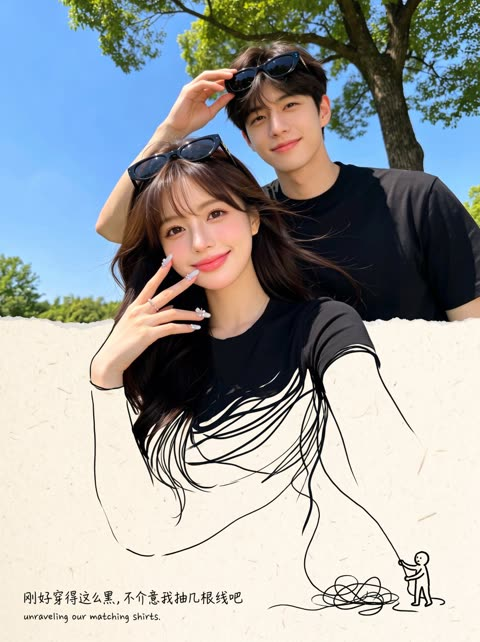</a>

带版本号（v1.2）的 JSON 提示词，作者 @hx831126，由 @Just_sharon7 转发。自带接缝和文字的自检步骤。

Nano Banana 2.1 · 上传图改图 · 出处: [@Just_sharon7 on X](https://x.com/Just_sharon7/status/2107741881329205516) · 263 赞，统计于 2026-10-27

[`json`](#tag-json) [`world-building`](#tag-world-building) [`photo-to-art`](#tag-photo-to-art)

<details><summary><b>提示词</b></summary>

```text
{   "name": "Second World",   "version": "1.2",   "task": "Using each uploaded photo as an independent source, generate one complete poster per photo. Do not merge multiple photos onto the same canvas.",   "output": {     "aspect_ratio": "3:4",     "orientation": "vertical",     "one_poster_per_photo": true,     "layout": "Canvas horizontally divided at exactly 50% height, with upper and lower sections each occupying 50%, same width",     "no_mockup": true   },   "core_principle": "The Second World is already hidden in the photo. Let the same scene pass through the midline and continue downward, changing only the physical rules in the lower half. Continuity of the cross-boundary structure is the highest visual priority.",   "upper_half": {     "source": "The current uploaded photo",     "preserve": [       "Subject identity and appearance",       "Character poses, expressions, and actions",       "Spatial relationships, proportions, and perspective",       "Original color atmosphere",       "Natural lighting and shadows",       "Environment and important details"     ],     "allowed_change": "Only necessary proportional cropping to fit the upper half, avoiding cutting off key subjects or connection structures",     "forbidden": [       "Redesigning the photo",       "Redrawing or replacing the subject",       "Rearranging characters and objects",       "Changing the photo's colors",       "Fictional lighting or background"     ],     "fidelity_rule": "Prioritize directly reusing the original photo; do not claim generative redrawing as lossless preservation of the original. If the tool cannot meet original preservation and precise layout, state the limitations—do not lower requirements and claim full compliance."   },   "continuity": {     "choose_one_source_structure": "Identify a structure from the original photo that can naturally extend to the midline, such as a road, shoreline, water surface, reflection, tree branch, light beam, architectural line, clothing flow, or body movement",     "requirements": [       "The structure must continue into the lower half at the exact midline meeting point",       "Maintain believable continuity in direction, position, scale, and occlusion relationships",       "Establish a visible connection first, then develop the lower half's imagination",       "Both halves must read as the same scene, not like two independent images stacked vertically"     ],     "transition_edge": {       "optional": "Allow irregular torn paper edges",       "rule": "Tearing must follow the original image's structure, not just as decoration, and avoid using the same tearing shape for every image",       "interaction": "Source elements can touch, cling to, pass through, or cross over the torn edge"     }   },   "lower_half": {     "background": "Warm ivory paper texture, with subtle visible fibers, rich negative space",     "media": [       "Restrained photo fragments",       "Simple cut-paper shapes",       "Minimal black hand-drawn lines"     ],     "construction": "Extend downward from where the upper half's source structure meets the midline, then gradually reinterpret it as the Second World",     "prohibited": "Do not turn it into an isolated entrance, window, stage, platform, or floating vignette, unless the form clearly grows continuously from the original photo",     "density": "Bright, airy, restrained—avoid dense drawing or collage buildup"   },   "second_world_logic": {     "question": "If the structure in the photo could be touched, used, entered, folded, stretched, or changed, what would it naturally become?",     "interaction_count": 1,     "instruction": "Establish only one specific, clear, and interesting interaction per image, prioritizing possibilities discovered from the original image's shapes and actions, not reverse-engineering from fixed props or templates.",     "examples_for_logic_only": [       "Water surface remains connected to the lake while being rolled up or stretched",       "Road extends onto the paper, becoming a path that can be continued by drawing",       "An existing light beam extends downward, becoming something gently graspable"     ],     "variation": "Judge each work individually—do not mechanically repeat actions, connection structures, compositions, or jokes. Examples are not required content."   },   "tiny_figures": {     "count": "0–3",     "appearance": "Minimalist, tiny black line figures",     "add_only_if": "Figures can engage in necessary and explicit physical interaction with the extending structure",     "omit_if": "Source photo already contains strong human actions",     "forbidden": "Using little figures as irrelevant decorations or adding crowds just for liveliness"   },   "copy": {     "language": "Primarily Chinese, paired with a short English accent",     "main_text": "A short, witty, cute, humorous Chinese marginal note, or one with a slight surprising insight",     "english": "Shorter, lighter English supplement; can complement the Chinese without word-for-word translation",     "intent": "Make viewers smile knowingly after seeing the image and then the small text, or suddenly understand one more layer",     "requirements": [       "Recreate based on this photo's specific interaction with the Second World",       "Don't just name the action or mechanically describe the image",       "Can include anthropomorphism, slight contrasts, deadpan little jokes, or gentle self-deprecation",       "Can have a wake-up-call vibe, but no grand life lessons",       "Don't force self-love, motivational, or emotional comfort templates",       "Humor targets the situation, without belittling characters' appearance, identity, or circumstances"     ],     "avoid": [       "Vague inspirational fluff",       "Grand maxims",       "Preachiness",       "Ad slogans",       "Irrelevant internet memes",       "Fixed 'same..., different...' sentence structures",       "Reusing the same copy for every image"     ],     "examples_for_tone_only": [       {         "context": "Taking away the sunset",         "chinese": "这个不算超重吧",         "english": "just a little sunset"       },       {         "context": "Rolling the lake surface into a paper ribbon",         "chinese": "不用袋子，我卷着走",         "english": "no bag, thanks"       },       {         "context": "Shadow rolled into a bed corner",         "chinese": "影子先躺了，我再走会儿",         "english": "five more minutes"       }     ],     "example_rule": "Borrow only the humor mechanism—do not fix example sentences into new works."   },   "handwriting": {     "scale": "Small marginal notes, English even smaller—no huge titles stealing the scene",     "placement": "In natural white space, not obscuring subjects, cross-boundary connection points, or key interactions",     "chinese": "Truly natural, slightly messy handwriting, not neat computer-generated script",     "english": "Similarly like casually scribbled, relaxed and irregular",     "details": [       "Slight variations in character size",       "Baseline with minor undulations",       "Tilt angles not perfectly consistent",       "Natural variations in spacing",       "Strokes with pressure and pauses",       "Minimal overlapping or incomplete ink traces"     ],     "corrections": {       "allowed": true,       "frequency": "Occasional only—not required for every image",       "method": "Can gently strike through a mistaken or revised word, adding the correct version nearby or above",       "limit": "Usually at most 1–2 instances—don't turn the whole page into a repeatedly scribbled draft",       "legibility": "Final meaning must be clear—no simulating handwriting with gibberish or meaningless errors"     }   },   "overall_style": {     "mood": [       "Indie magazine vibe",       "Bright and airy",       "Warm paper texture",       "Restrained",       "Lightly humorous",       "Subtle handmade traces"     ],     "hierarchy": [       "Original photo and cross-boundary structure",       "Clear interaction in the lower half",       "Small bilingual handwritten marginal notes"     ],     "finish": "Like gently unveiling a hidden world in the photo, not pasting an extra illustration below it"   },   "negative_prompt": [     "Detached lower-half illustrations",     "Broken cross-boundary continuity",     "Generic torn-paper templates",     "Isolated entrances or windows",     "Irrelevant vignettes",     "Dense illustrations",     "Random decorations",     "Decorative crowds",     "Altering original photo colors",     "Redesigning the upper photo",     "Glossy 3D",     "Scrapbook clutter",     "Huge titles",     "Neat printed-style handwriting",     "Nonsensical text",     "Motivational fluff",     "Watermarks",     "Logos",     "UI elements",     "Merging multiple photos",     "Grid layouts"   ],   "final_check": [     "Does each original image correspond to one independent 3:4 poster?",     "Do upper and lower sections strictly each occupy 50%?",     "Is the upper half's original photo faithfully preserved, with only necessary cropping?",     "Is there one authentic source structure accurately continuing at the midline?",     "Does the lower half belong to the same scene as the original image, not an isolated illustration?",     "Is there only one clear, natural, and non-repetitive templated interaction?",     "Is the Chinese interesting and lingering, not just a simple action label or preachiness?",     "Are the Chinese and English in small, natural, messy, and readable handwriting?",     "Is sufficient negative space preserved?"   ] }  Note: The above are target requirements; generated results still need checking for original image preservation, seams, and text—do not treat generative redrawing as lossless original preservation.
```

</details>

<a id="img-realism"></a>
## 写实照片

<a id="gpt-image-failed-photos-grid"></a>
### 任意角色的九张失败照片

<a href="https://x.com/DeepBlueX0/status/2099481521983995971"></a>

只有七个词。作者的心得：限制越少，失败照越像真的。

GPT Image 2.5 · 文生图 · 出处: [@DeepBlueX0 on X](https://x.com/DeepBlueX0/status/2099481521983995971) · 2,646 赞，统计于 2026-10-27

[`grid`](#tag-grid) [`humor`](#tag-humor) [`template`](#tag-template)

<details><summary><b>提示词</b></summary>

```text
Vertical 3×3 failed photos × {Character}
```

</details>

<a id="gpt-image-six-photo-portrait-grid"></a>
### 同一个人的六宫格人像

<a href="https://x.com/john_my07/status/2112737725430554781"></a>

先把人物写细一次，再写六个画面；要求不留缝，九宫格读起来像一整张。

GPT Image 2.5 · 文生图 · 出处: [@john_my07 on X](https://x.com/john_my07/status/2112737725430554781) · 651 赞，统计于 2026-10-27

[`portrait`](#tag-portrait) [`grid`](#tag-grid) [`consistency`](#tag-consistency)

<details><summary><b>提示词</b></summary>

```text
Create an ultra-realistic 6-photo portrait collage arranged in a seamless 3×2 grid, featuring a naturally beautiful young Portuguese woman in her early 20s. She has warm olive-toned skin, expressive hazel-brown eyes, long chestnut-brown hair with subtle natural highlights, soft face-framing layers, naturally full eyebrows, and delicate, distinctive facial features. Her appearance should feel authentic and individual, with realistic skin texture, tiny imperfections, and minimal everyday makeup.

Visual aesthetic: Effortless European Instagram photo dump, reminiscent of candid photographs taken on a Canon PowerShot G7 X Mark III. Direct built-in camera flash, crisp details, bright facial highlights, hard shadows, slightly imperfect framing, subtle digital noise, and a nostalgic early-2000s point-and-shoot feel.

Setting and styling: A warm off-white bedroom wall with subtle texture, a few natural shadows, and no distracting decorations. She wears a fitted burgundy scoop-neck top, tiny gold hoop earrings, and a delicate necklace. Her makeup is understated, with softly flushed cheeks, natural glossy lips, and lightly defined lashes. Her long hair remains the same color and length but falls differently in every photograph.

Six distinct photographs:

1. Sweet candid: Sitting close to the camera, resting her cheek against one hand, smiling gently with relaxed eyes and loose hair framing her face.
2. Playful snapshot: Looking directly into the lens with a mischievous half-smile, one eyebrow slightly raised, fingers casually tucked behind her ear.
3. Messy-girl moment: Eyes closed and laughing softly, both hands lifting her hair away from her shoulders, a few loose strands catching the flash.
4. Effortless confidence: Turning her face over one shoulder, giving the camera a subtle side-eye, with one hand lightly resting against her neck.
5. Caught laughing: Looking toward someone outside the frame, laughing naturally with her head tilted to the side and hair falling across one cheek.
6. Quiet evening mood: Leaning against the wall, gazing thoughtfully into the lens, lips relaxed, fingertips gently twisting a strand of hair.

Identity consistency: The same Portuguese woman must appear in all six frames, with identical facial proportions, eye color, skin tone, hair color, and recognizable features. Each photograph should have a different pose, expression, head angle, and hair arrangement, as if captured within the same casual photo session.

Photography details: Realistic compact-camera flash, authentic skin pores, fine baby hairs, natural facial asymmetry, believable hands, sharp eyes, slight variations in exposure, and candid framing. Avoid excessive retouching, artificial skin smoothing, exaggerated beauty standards, duplicated expressions, malformed fingers, distorted anatomy, or the overly polished appearance of AI-generated portraits.

Output: Vertical 3:4 aspect ratio, exactly six photographs in a balanced 3-column × 2-row grid, clean alignment, no gutters, no text, no watermark. Photorealistic, youthful, spontaneous, intimate, and effortlessly stylish.
```

</details>

<a id="nano-banana-json-reconstruction"></a>
### 逐项复刻一张照片的 JSON 提示词

<a href="https://x.com/ViralOps_/status/2107538470818484305"></a>

按 JSON 字段写（构图、光线、色彩、负面词）。原帖用同一段 JSON 对比了 Nano Banana 2.1 和 GPT Image 2.5。

Nano Banana 2.1 · 上传图改图 · 出处: [@ViralOps_ on X](https://x.com/ViralOps_/status/2107538470818484305) · 326 赞，统计于 2026-10-27

[`json`](#tag-json) [`reconstruction`](#tag-reconstruction) [`comparison`](#tag-comparison)

<details><summary><b>提示词</b></summary>

```text
{
  "prompt_type": "detailed_image_reconstruction",
  "aspect_ratio": "4:5 vertical portrait",
  "overall_goal": "Recreate the visual appearance, framing, lighting, styling, and casual smartphone-photo feel of the reference image as closely as possible while keeping the result photorealistic and natural.",

  "subject": {
    "type": "young adult woman",
    "age_range": "early to mid 20s",
    "pose": "standing indoors, upper body turned slightly away from the camera while her face turns toward the lens",
    "body_position": "relaxed casual posture with shoulders slightly angled",
    "expression": "soft neutral expression with a subtle pout, calm and confident",
    "gaze": "looking directly toward the camera",
    "styling": "minimal everyday styling, clean and natural"
  },

  "face": {
    "shape": "soft oval face with a gently tapered jawline",
    "forehead": "medium-height forehead partly framed by center-parted hair",
    "eyebrows": "natural medium-thick dark brown eyebrows with a soft arch",
    "eyes": {
      "shape": "almond-shaped",
      "color": "light brown to hazel",
      "appearance": "bright eyes with visible catchlights",
      "lashes": "long defined eyelashes with subtle mascara"
    },
    "nose": "small straight nose with a softly rounded tip",
    "lips": {
      "shape": "full lips with a defined cupid's bow",
      "color": "natural rosy pink",
      "finish": "soft satin finish, not glossy"
    },
    "skin": {
      "tone": "light warm-neutral skin tone",
      "texture": "smooth natural skin with subtle pores and realistic tonal variation",
      "cheeks": "soft natural pink flush",
      "finish": "fresh luminous skin without heavy retouching"
    },
    "makeup": "very light natural makeup, softly defined lashes, subtle blush, natural pink lips, no dramatic contour"
  },

  "hair": {
    "color": "rich medium-to-dark chocolate brown",
    "length": "very long, extending well below the chest",
    "parting": "clean center part",
    "texture": "mostly straight with very soft natural bends through the lower lengths",
    "density": "thick and healthy-looking",
    "finish": "smooth and glossy but still realistic",
    "front_sections": "two thin face-framing strands falling naturally along both sides of the face",
    "details": "visible individual strands, subtle flyaways near the crown, realistic highlights from sunlight, natural uneven strand separation",
    "movement": "hair hanging naturally over both shoulders and down the front of the shirt"
  },

  "clothing": {
    "top": "oversized plain white crew-neck T-shirt",
    "fit": "loose casual fit",
    "fabric": "soft slightly wrinkled cotton",
    "logos": "none",
    "accessories": "no visible jewelry or prominent accessories"
  },

  "composition": {
    "shot_type": "close upper-body portrait",
    "camera_angle": "slightly above chest level, close to eye level",
    "camera_distance": "approximately arm's-length smartphone distance",
    "subject_position": "face slightly right of center with long hair occupying much of the lower frame",
    "crop": "top of head fully visible, image extending down to around lower torso",
    "orientation": "vertical",
    "perspective": "natural wide smartphone-camera perspective with mild close-range distortion"
  },

  "lighting": {
    "primary_source": "strong warm natural sunlight entering from the side/front through a nearby window",
    "direction": "sunlight striking the subject from camera-left/front",
    "face_effect": "bright warm illumination across the forehead, cheeks, nose, and hair",
    "hair_effect": "distinct brown highlights and soft reflective streaks along individual strands",
    "shadow_quality": "strong but soft-edged natural indoor shadows",
    "exposure": "face slightly brightly exposed while the room behind remains much darker",
    "color_temperature": "warm daylight"
  },

  "environment": {
    "location": "casual indoor residential room",
    "background": "dark gray walls with a white ceiling cornice",
    "left_background": "open doorway or darker hallway area",
    "right_background": "dark wall and partially visible household objects",
    "lower_right": "part of a black tripod or light stand visible",
    "overall_feel": "ordinary lived-in room rather than a studio",
    "depth": "background moderately out of focus but still recognizable"
  },

  "camera": {
    "capture_device": "modern smartphone camera",
    "lens_equivalent": "approximately 24-28mm full-frame equivalent",
    "focus": "sharp focus on face and front hair",
    "depth_of_field": "mostly natural smartphone depth of field with gentle background softness",
    "dynamic_range": "realistic phone-camera HDR with slightly clipped highlights in direct sun",
    "image_character": "casual social-media selfie/photo, not professionally staged"
  },

  "photorealism_details": [
    "real individual hair strands",
    "natural skin pores and micro-texture",
    "subtle peach fuzz",
    "realistic eyelash separation",
    "tiny variations in lip texture",
    "slight fabric creases in the T-shirt",
    "small flyaway hairs around the crown",
    "natural sunlight falloff across the face",
    "slightly imperfect casual framing",
    "realistic indoor shadow noise"
  ],

  "style": {
    "visual_style": "highly photorealistic casual smartphone portrait",
    "mood": "soft, youthful, relaxed, sunlit",
    "processing": "light social-media style processing with warm skin tones and slightly enhanced clarity",
    "avoid": [
      "cinematic movie lighting",
      "studio portrait lighting",
      "overly smooth plastic skin",
      "CGI appearance",
      "anime or illustration",
      "heavy beauty filter",
      "extreme facial symmetry",
      "over-sharpened hair",
      "artificial jet-black hair",
      "dramatic makeup",
      "excessive background blur",
      "professional studio backdrop",
      "text",
      "watermarks",
      "logos"
    ]
  },

  "negative_prompt": "cartoon, anime, illustration, CGI, plastic skin, waxy face, over-retouched skin, excessive beauty filter, unnatural facial symmetry, distorted eyes, crossed eyes, malformed lips, warped face, duplicate hair strands, fake wig appearance, overly black hair, metallic hair shine, stiff hair, messy anatomy, distorted shoulders, extra limbs, extra fingers, studio backdrop, cinematic lighting, dramatic color grading, excessive bokeh, oversaturated colors, text, logo, watermark"
}
```

</details>

<a id="gpt-image-dusk-film-portrait"></a>
### 黄昏低角度人像，胶片颗粒

<a href="https://x.com/chatgptpaglu/status/2105219509791678731"></a>

不到 600 字：一个机位、一处服装细节、一个光源、一种胶片感。

GPT Image 2.5 · 文生图 · 出处: [@chatgptpaglu on X](https://x.com/chatgptpaglu/status/2105219509791678731) · 318 赞，统计于 2026-10-27

[`portrait`](#tag-portrait) [`film-grain`](#tag-film-grain) [`golden-hour`](#tag-golden-hour)

<details><summary><b>提示词</b></summary>

```text
A low-angle, close-up photograph capturing a young woman with wavy brown hair outdoors at dusk. She is wearing a grey cropped t-shirt with a blue and white graphic text that reads 'DESTINED' above 'SET 1958' and black denim bottoms. Her head is tilted, and she is looking directly into the camera lens. The dark blue evening sky serves as the background, with silhouetted tree branches visible at the bottom of the frame. Strong flash lighting is directed from the front, illuminating her face and highlighting strands of her hair. The composition has a grainy film photography aesthetic.
```

</details>

<a id="gpt-image-train-platform-snapshot"></a>
### 站台上的手机随手拍

<a href="https://x.com/MissDelulu9/status/2114965450425868519"></a>

靠手机相机的瑕疵出真实感：列车动态模糊、真实噪点、轻微广角变形。

GPT Image 2.5 · 文生图 · 出处: [@MissDelulu9 on X](https://x.com/MissDelulu9/status/2114965450425868519) · 305 赞，统计于 2026-10-27

[`phone-photo`](#tag-phone-photo) [`street`](#tag-street) [`motion-blur`](#tag-motion-blur)

<details><summary><b>提示词</b></summary>

```text
Realistic vertical phone street snapshot of a young woman on an urban train platform, slightly right of center, as a silver train with a green stripe rushes behind in horizontal motion blur. Low angle from waist height, close half-body to mid-thigh, handheld and imperfect.

Long deep-black hair sweeps left in station wind. Oversized brown gradient sunglasses hide her eyes; head tilted upward, lips relaxed, cool distant expression. Small oval face, soft jawline, clean East Asian Y2K makeup, nude-pink lips. Warm-white cropped halter tank, low neckline, fitted ribbed cotton, subtle wrinkles, hem above waist. Low-rise loose vintage gray-brown jeans, layered gold necklaces, black quilted chain bag.

Warm-beige skin with natural texture on shoulders, collarbones, arms, waist and abdomen. Cool fluorescent station light, metallic reflections, yellow tactile paving, concrete floor, blurred passengers in train windows. Real mobile noise, slight wide-angle feel.
```

</details>

<a id="img-portrait"></a>
## 人像

<a id="nano-banana-half-face-name-portrait"></a>
### 半张脸，名字竖排在旁

<a href="https://x.com/Emmma___0/status/2108777847800426542"></a>

名字每个字母里藏着另一半脸的细节。填名字、背景和光线即可。

Nano Banana 2.1 · 上传图改图 · 出处: [@Emmma___0 on X](https://x.com/Emmma___0/status/2108777847800426542) · 244 赞，统计于 2026-10-27

[`typography`](#tag-typography) [`studio`](#tag-studio) [`template`](#tag-template)

<details><summary><b>提示词</b></summary>

```text
Transform the uploaded image into a modern studio portrait. Preserve the subject’s identity and features. Show half the face on the left; stack [NAME] vertically on the right, with each letter filled by matching details from the hidden half. Seamless alignment, [BACKGROUND] backdrop, [LIGHTING], modern typography.
```

</details>

<a id="nano-banana-chiaroscuro-portrait"></a>
### 把你的照片拍成明暗对比强烈的电影特写

<a href="https://x.com/rovvmut_/status/2107691827323392159"></a>

单侧光，明确要求看得见毛孔，皮肤就不会像磨过皮。

Nano Banana 2.1 · 上传图改图 · 出处: [@rovvmut_ on X](https://x.com/rovvmut_/status/2107691827323392159) · 170 赞，统计于 2026-10-27

[`chiaroscuro`](#tag-chiaroscuro) [`cinematic`](#tag-cinematic) [`skin-detail`](#tag-skin-detail)

<details><summary><b>提示词</b></summary>

```text
A hyper-realistic, 8K resolution cinematic close-up portrait of the person in the uploaded image. The image features dramatic chiaroscuro lighting, heavily illuminating the left side of his face while casting deep, moody shadows on the right against a solid black background. He has an intense, direct gaze, dark brown eyes with square catchlights, and textured, wet-styled hair. He is wearing a plain black t-shirt. Render with 35mm film grain and a shallow depth of field, prioritizing extreme character consistency and highly detailed skin texture, including visible pores.
```

</details>

<a id="img-illustration"></a>
## 插画

<a id="nano-banana-geometric-fashion-illustration"></a>
### 质感几何风全身时装插画

<a href="https://x.com/ChillaiKalan__/status/2109123213351632977"></a>

服装逐件描述，再用一小串禁止项排除写实和 3D。

Nano Banana 2.1 · 文生图 · 出处: [@ChillaiKalan__ on X](https://x.com/ChillaiKalan__/status/2109123213351632977) · 494 赞，统计于 2026-10-27

[`fashion`](#tag-fashion) [`geometric`](#tag-geometric) [`editorial`](#tag-editorial)

<details><summary><b>提示词</b></summary>

```text
Create a stylish, full-body editorial fashion illustration of a young woman in a modern casual outfit, using a minimalist, textured geometric art style. She wears an oversized forest-green hoodie, wide-leg blue denim jeans with folded cuffs, and chunky brown sneakers. Her dark hair is tied in a neat low bun. She carries a bouquet of vibrant pink roses wrapped in white paper, a takeaway coffee cup, and a black shoulder bag. Show her walking naturally in a relaxed pose, viewed from a three-quarter rear angle, with soft, elegant body proportions and simplified facial details.

Use a warm ivory background with plenty of negative space, soft ground shadows, subtle paper grain, visible brush textures, and angular polygonal shading across the clothing and shoes. The color palette features deep forest green, denim blue, warm brown, cream, and vivid pink. Soft diffused lighting, clean composition, contemporary lifestyle magazine aesthetic, hand-painted digital illustration, refined edges, artistic fabric textures, vertical 3:4 composition, high detail. No photorealism, no 3D rendering, no extra objects, no text or watermark.
```

</details>

<a id="nano-banana-paper-cut-fashion"></a>
### 多层 3D 剪纸时装插画

<a href="https://x.com/ChillaiKalan__/status/2109534297367724221"></a>

和几何风那条结构相同，只换了媒介，适合对比风格。

Nano Banana 2.1 · 文生图 · 出处: [@ChillaiKalan__ on X](https://x.com/ChillaiKalan__/status/2109534297367724221) · 188 赞，统计于 2026-10-27

[`fashion`](#tag-fashion) [`paper-cut`](#tag-paper-cut) [`3d`](#tag-3d)

<details><summary><b>提示词</b></summary>

```text
Create a high-end editorial fashion illustration of a stylish woman wearing a bold, contemporary designer outfit. Use a polished 3D paper-cut illustration aesthetic with smooth surfaces, layered shapes, subtle paper-like textures, and clean, elegant edges. Feature vibrant color combinations such as pastel pink, sky blue, mint green, sunshine yellow, and emerald green, paired with contrasting patterns like polka dots or vertical stripes. Add fashionable accessories, including statement sunglasses, earrings, a structured handbag, and modern shoes. Give the character a confident, expressive pose with natural body proportions and a stylish attitude. Use a minimalist warm ivory background with soft studio lighting, gentle shadows beneath the feet, and a refined luxury fashion-campaign composition. Full-body character, beautifully detailed clothing folds, crisp silhouettes, sophisticated color blocking, playful yet elegant styling, premium fashion magazine aesthetic, clean negative space, high-resolution digital illustration. No text, no logos, no watermark.
```

</details>

<a id="img-ui-mockup"></a>
## 手机与界面截图

<a id="gpt-image-camera-roll-day"></a>
### 一张图生成任何人一天的相册

<a href="https://x.com/Mayz1169/status/2099479395283214473"></a>

同一思路，规则更严：上传图是唯一主体，只允许出现最少的 iOS 界面元素。

GPT Image 2.5 · 上传图改图 · 出处: [@Mayz1169 on X](https://x.com/Mayz1169/status/2099479395283214473) · 762 赞，统计于 2026-10-27

[`ios`](#tag-ios) [`screenshot`](#tag-screenshot) [`camera-roll`](#tag-camera-roll) [`humor`](#tag-humor)

<details><summary><b>提示词</b></summary>

```text
Use the uploaded image as the ONLY subject reference.

Create ONE vertical image that looks exactly like a screenshot of the iPhone Photos app, showing one full day of casual camera-roll photos featuring the exact subject from the uploaded reference.

SUBJECT CONSISTENCY
First identify the main subject in the uploaded image. It may be a person, anime character, pet, animal, plush toy, figurine, mascot, object, or other character.

Preserve the subject’s recognizable appearance, colors, proportions, facial features, hairstyle, clothing, accessories, markings, materials, and signature details consistently across every photo.

If the reference contains multiple views of the same subject, understand that they are different views of ONE subject, not multiple characters.

Do not redesign or replace the subject.

DAY-IN-THE-LIFE CAMERA ROLL
Imagine a believable full day for this exact subject based on its appearance, personality, style, and visual world.

Generate many different casual photos from morning to night, as if someone naturally photographed the subject throughout the day.

Automatically choose everyday situations that fit the uploaded subject, such as:
waking up, resting, eating, sitting by a window, traveling, walking outside, visiting cafés or shops, playing, working, relaxing at home, interacting with everyday objects, sunset moments, nighttime outings, and going to sleep.

The activities and environments should adapt naturally to the subject. Do not force human activities onto animals, toys, objects, or non-human characters when they would look unnatural.

Every thumbnail should show a different moment, composition, distance, pose, camera angle, lighting condition, or location.

Mix:
close-ups,
medium shots,
wide shots,
overhead photos,
back views,
detail shots,
slightly blurry movement shots,
imperfect handheld snapshots,
photos where the subject is partially cropped,
environmental photos related to the subject’s day.

The result should feel spontaneous and personal rather than like a professional photoshoot.

IPHONE PHOTOS APP LAYOUT
The FINAL IMAGE itself must look like a real full-screen iPhone Photos app screenshot.

Use a tall smartphone screenshot aspect ratio, approximately 9:19.5.

Create a dense camera-roll gallery using FOUR equal thumbnail columns, closely matching the standard iPhone Photos grid.

Include approximately 24–32 individual photo thumbnails visible on screen.

Use very thin white gaps between thumbnails.

The gallery should fill most of the screen vertically.

Include authentic iPhone Photos interface elements:
• white iOS interface background
• iPhone-style status bar at the top
• time on the upper left
• cellular/Wi-Fi/battery icons on the upper right
• simple navigation controls near the top
• four-column photo gallery
• bottom Photos app navigation bar
• Photos tab selected in blue
• other navigation icons shown in gray
• black home indicator at the very bottom

The UI must look like an actual screenshot of the Photos app, NOT a decorative frame, moodboard, contact sheet, scrapbook, poster, or generic collage.

PHOTO STYLE
Make each thumbnail feel like a genuine casual iPhone camera-roll photo.

Use natural everyday lighting, imperfect framing, realistic exposure variation, occasional motion blur, slight focus imperfections, spontaneous compositions, and believable environmental details.

Keep the same subject recognizable throughout the entire gallery while allowing natural changes in pose, expression, camera distance, and lighting.

If the uploaded reference is illustrated, animated, stylized, or 3D, preserve its original visual identity and style unless realistic photography is explicitly requested.

IMPORTANT
ONE final image only.
The entire output is ONE iPhone Photos app screenshot containing many different photos.
Exactly FOUR thumbnail columns.
Do not create a standalone collage without the iPhone interface.
Do not create multiple separate outputs.
Do not duplicate the exact same photo repeatedly.
Do not introduce unrelated characters or subjects.
Do not change the main subject’s design.
No captions, dates, labels, stickers, watermarks, or decorative text inside the photo thumbnails.
Only normal minimal iOS interface elements may appear.9:16
```

</details>

<a id="gpt-image-iphone-photos-screenshot"></a>
### 一整天的照片，做成 iPhone 相册截图

<a href="https://x.com/BubbleBrain/status/2099759367956349012"></a>

连状态栏都还原的 iOS 相册界面，里面塞满参考人物的抓拍。

GPT Image 2.5 · 上传图改图 · 出处: [@BubbleBrain on X](https://x.com/BubbleBrain/status/2099759367956349012) · 309 赞，统计于 2026-10-27

[`ios`](#tag-ios) [`screenshot`](#tag-screenshot) [`camera-roll`](#tag-camera-roll)

<details><summary><b>提示词</b></summary>

```text
Turn the girl from the reference image into a full-day iPhone Photos album screenshot that faithfully recreates the real iPhone “Photos — Library / Today” interface. Keep the top status bar (time, signal, battery), the Library title, the Today label, the photo grid layout, and the bottom tab bar: Library / For You / Albums / Search. The whole image should look like a real phone screenshot.
The girl in the reference image is the only subject in the entire album. Every photo keeps the same identity, the same face, the same hairstyle, the same skin tone, the same body proportions, and the same presence. She is a clearly adult young East Asian woman with long black hair, cool-pale skin, refined cool features, and a private, quiet aura.
The album is a full portrait camera roll. Every thumbnail shows her. The entire screen is filled with solo portraits of her. The whole set is built around this one person only.
All album content is portraits of her: waking-up selfie in bed, selfie under the covers, selfie by the pillow, bathroom-mirror selfie, elevator-mirror selfie, window-side selfie, indoor natural-light selfie, sofa selfie, bedside selfie, after-coming-home selfie, night selfie, close-up face selfie, half-body selfie, full-body mirror selfie, seated solo shot, standing solo shot, side-profile solo shot, looking-back solo shot, indoor hallway solo shot, window-side solo shot, candid bedside shot, chair solo shot, carpet solo shot, and photos taken of her by someone else.
Outfits change continuously through the day. Morning: milky-white camisole lounge top and light-gray home shorts. Late morning: white slim short-sleeve top and pale blue-gray pleated mini skirt. Noon: black thin-strap top and high-waisted denim shorts. Afternoon: light-gray knit cardigan over a white inner layer and a black mini skirt. Evening: dark-gray blazer, white thin-strap top, and black pleated mini skirt. Night: black fitted mini dress with slim silver accessories. Late night after returning home: loose white T-shirt and soft lounge shorts. Each outfit is clearly different; the clothing changes mark a clear passage of time.
Photo mix is fixed at 60% selfies and mirror selfies, 40% solo portraits taken by someone else. Every frame has her as the subject. Every thumbnail keeps real iPhone native-camera texture. Pose, camera distance, angle, expression, lighting, and clothing keep changing.
The sequence runs from morning to late night. Morning feels loose and just-woken. Late morning has clear natural light. Afternoon feels like ordinary going-out. Evening has soft city light. Night has low indoor light. Late night feels quiet and private after coming home.
The whole set is quiet, private, relaxed, and real. The album forms a dense, continuous solo-portrait look, like a full day of private portrait camera roll saved on her own phone.
```

</details>

<a id="img-map"></a>
## 地图

<a id="gpt-image-city-on-map"></a>
### 你的城市从地图上长出来

<a href="https://x.com/Preda2005/status/2098816499075145824"></a>

替换 `[COUNTRY]` 和 `[CITY]`，结尾的可选地标槽位用来指定要出现什么。

GPT Image 2.5 · 文生图 · 出处: [@Preda2005 on X](https://x.com/Preda2005/status/2098816499075145824) · 413 赞，统计于 2026-10-27

[`map`](#tag-map) [`miniature`](#tag-miniature) [`template`](#tag-template)

<details><summary><b>提示词</b></summary>

```text
Create a highly detailed 1:1 square image using GPT Image 2.5.

The main subject is a realistic top-down geographic map accurately showing the terrain, coastline, rivers, roads and surrounding region of [COUNTRY], with natural and believable map labeling.

At the real geographic location of [CITY], a miniature 3D city rises organically from the map surface, like a premium architectural diorama physically emerging from the map.

The miniature city should include the most recognizable features of [CITY], such as:

• iconic architecture
• important natural landmarks
• the characteristic city skyline
• local cultural elements
• recognizable regional details

All elements must feel naturally connected to the underlying map, as if the city is growing directly out of it, rather than being placed on top.

Keep the geography believable and visually coherent.

Style:
ultra-realistic miniature photography,
high-end collectible diorama,
cinematic macro photography,
realistic materials,
fine surface textures,
strong depth and scale,
premium travel editorial aesthetic.

Use shallow depth of field:
[CITY] should remain extremely sharp and detailed,
while the surrounding map gradually becomes softer and slightly blurred.

Use soft studio lighting, realistic natural shadows, elegant composition and subtle cinematic contrast.

The result should feel like a luxury macro photograph of a real handcrafted miniature city built directly into a geographic map.

MAP LABELS:
Use labels appropriate to [COUNTRY].
For example, if the country is Japan, use Japanese geographic labels.
Do not introduce unrelated languages.

OPTIONAL DETAILS:
[LANDMARK 1]
[LANDMARK 2]
[LANDMARK 3]
[LOCAL CULTURAL ELEMENT]
[NATURAL LANDMARK]
```

</details>

<a id="img-collage"></a>
## 拼贴

<a id="nano-banana-newspaper-collage"></a>
### 任何图都能变成报纸拼贴

<a href="https://x.com/aimikoda/status/2108682052665290854"></a>

一句话改图，照片和插画都适用。

Nano Banana 2.1 · 上传图改图 · 出处: [@aimikoda on X](https://x.com/aimikoda/status/2108682052665290854) · 171 赞，统计于 2026-10-27

[`collage`](#tag-collage) [`newspaper`](#tag-newspaper) [`one-liner`](#tag-one-liner)

<details><summary><b>提示词</b></summary>

```text
recreate this image as a collage made from newspaper parts.
```

</details>

<a id="recipes"></a>
## Agent 配方：剪视频

用大白话告诉编程 Agent 你要什么。每条配方记下交给 Agent 的原话和它实际跑的命令，换成你自己的素材即可。

<a id="bilingual-subtitles"></a>
### 听写台词，烧录中英双语字幕

**交给 Agent 的原话**

> 听写 samples/night-train-ticket.mp4 里的中文台词，对照 prompts/video/night-train-ticket.yaml 里的剧本校对，每句中文下面加一行英文，把字幕烧进画面。

Whisper 会听错中文同音字（他和她读音相同）。有剧本时，让 Agent 用剧本定文字，只用 Whisper 定时间。

[`agent-editing`](#tag-agent-editing) [`ffmpeg`](#tag-ffmpeg) [`whisper`](#tag-whisper) [`subtitles`](#tag-subtitles) [`bilingual`](#tag-bilingual) [`chinese-dialogue`](#tag-chinese-dialogue)

<details><summary><b>Agent 实际跑的命令</b> · Agent: Claude Opus 5.5 in Claude Code · 工具: ffmpeg 9 with libass, openai-whisper medium</summary>

```bash
whisper samples/night-train-ticket.mp4 --model medium --language zh --output_format srt
# whisper heard 我等了他八年 / 就等着一趟车; the script says 我等了她八年 / 就等这一趟车.
# The agent kept whisper's timing, took the wording from the script, and added English lines:
#   1  00:00:00,000 --> 00:00:02,100  我等了她八年， / I waited eight years for her,
#   2  00:00:02,200 --> 00:00:04,200  就等这一趟车。 / all for this one train.
ffmpeg -i samples/night-train-ticket.mp4 \
  -vf "subtitles=subs.srt:force_style='FontName=PingFang SC,FontSize=15,Outline=1,Shadow=0,MarginV=22'" \
  -c:v libx264 -crf 20 -c:a copy subtitled.mp4
```

</details>

<a id="readme-preview-gif"></a>
### 给 README 做小体积循环 GIF 预览

**交给 Agent 的原话**

> 给 samples/ 里每个 mp4 做一张 README 用的循环 GIF，每张控制在 1.5 MB 左右。超过 8 秒的片加速播放，保证整段故事都能看到。

本仓所有预览图都是这样做的，每张 0.5 到 2 MB。每段单独生成 96 色调色板加 Bayer 抖动，体积小，肤色和霓虹也不脏。

[`agent-editing`](#tag-agent-editing) [`ffmpeg`](#tag-ffmpeg) [`gif`](#tag-gif) [`preview`](#tag-preview)

<details><summary><b>Agent 实际跑的命令</b> · Agent: Claude Opus 5.5 in Claude Code · 工具: ffmpeg 9</summary>

```bash
# landscape: 360 px wide; vertical: 300 px tall; 2x speed when longer than 8 s
ffmpeg -i in.mp4 -vf "setpts=PTS/2,fps=8,scale=360:-2:flags=lanczos,split[a][b];[a]palettegen=max_colors=96[p];[b][p]paletteuse=dither=bayer:bayer_scale=4" -loop 0 out.gif
```

</details>

<a id="split-shots"></a>
### 按硬切点把多镜头片拆成单独镜头

**交给 Agent 的原话**

> samples/late-night-office.mp4 应该有九个镜头。找出硬切点，按镜头拆成单独文件，再给我一张分镜条，每个镜头取中间一帧。

也能当生成视频的验收：八个切点都落在提示词所写时间的 0.17 秒以内。软切换调低阈值，晃动大的手持素材调高阈值。

[`agent-editing`](#tag-agent-editing) [`ffmpeg`](#tag-ffmpeg) [`scene-detection`](#tag-scene-detection) [`storyboard`](#tag-storyboard) [`qa`](#tag-qa)

<details><summary><b>Agent 实际跑的命令</b> · Agent: Claude Opus 5.5 in Claude Code · 工具: ffmpeg 9</summary>

```bash
# 1. find cuts
T=$(ffmpeg -i samples/late-night-office.mp4 -vf "scdet=threshold=8" -f null - 2>&1 \
    | grep -o "lavfi.scd.time: [0-9.]*" | awk '{print $2}' | paste -sd, -)
# -> 3.04,5.04,6.0,6.54,7.0,7.46,9.67,12.17  (prompt asked for 3.0,5.0,6.0,6.5,7.0,7.5,9.5,12.0)
# 2. split, forcing keyframes at the cuts so every file starts clean
ffmpeg -i samples/late-night-office.mp4 -c:v libx264 -crf 20 -force_key_frames "$T" -c:a aac \
  -f segment -segment_times "$T" -reset_timestamps 1 shot_%02d.mp4
# 3. storyboard strip
for f in shot_*.mp4; do
  mid=$(ffprobe -v error -show_entries format=duration -of csv=p=0 "$f" | awk '{printf "%.3f", $1/2}')
  ffmpeg -ss "$mid" -i "$f" -frames:v 1 -vf scale=-2:320 "${f%.mp4}.jpg"
done
ffmpeg -pattern_type glob -i "shot_*.jpg" -vf "tile=9x1:padding=4:color=white" -frames:v 1 storyboard.jpg
```

</details>

<a id="teaser-montage"></a>
### 把不同尺寸的片剪成预告：标题、转场、响度统一

**交给 Agent 的原话**

> 用夜市小巷、面档、夜车三段的前 4.5 秒剪一支 720p 预告，片名 RAIN CITY。画面和声音都用半秒交叉淡化，开头压片名，响度按社交平台标准统一，结尾淡出。

输入有 864x480 和 1344x768 两种尺寸。每路先统一尺寸、帧率和采样率，否则 xfade 和 acrossfade 接不上。总长是 3 段 4.5 秒减去两次 0.5 秒重叠，共 12.5 秒。

[`agent-editing`](#tag-agent-editing) [`ffmpeg`](#tag-ffmpeg) [`montage`](#tag-montage) [`title-card`](#tag-title-card) [`loudness`](#tag-loudness)

<details><summary><b>Agent 实际跑的命令</b> · Agent: Claude Opus 5.5 in Claude Code · 工具: ffmpeg 9</summary>

```bash
ffmpeg -i samples/neon-night-market-alley.mp4 -i samples/hk-noodle-stall-1960s.mp4 -i samples/night-train-ticket.mp4 -filter_complex "
[0:v]trim=0:4.5,setpts=PTS-STARTPTS,scale=1280:720:force_original_aspect_ratio=increase,crop=1280:720,fps=24,format=yuv420p,setsar=1[v0];
[1:v]trim=0:4.5,setpts=PTS-STARTPTS,scale=1280:720:force_original_aspect_ratio=increase,crop=1280:720,fps=24,format=yuv420p,setsar=1[v1];
[2:v]trim=0:4.5,setpts=PTS-STARTPTS,scale=1280:720:force_original_aspect_ratio=increase,crop=1280:720,fps=24,format=yuv420p,setsar=1[v2];
[0:a]atrim=0:4.5,asetpts=PTS-STARTPTS,aresample=48000[a0];
[1:a]atrim=0:4.5,asetpts=PTS-STARTPTS,aresample=48000[a1];
[2:a]atrim=0:4.5,asetpts=PTS-STARTPTS,aresample=48000[a2];
[v0][v1]xfade=transition=fade:duration=0.5:offset=4[x1];
[x1][v2]xfade=transition=fade:duration=0.5:offset=8[x2];
[a0][a1]acrossfade=d=0.5[ax1];
[ax1][a2]acrossfade=d=0.5[ax2];
[x2]drawtext=fontfile=/System/Library/Fonts/Supplemental/Futura.ttc:text='RAIN CITY':fontcolor=white:fontsize=110:x=(w-tw)/2:y=h*0.70:alpha='if(lt(t,0.3),t/0.3,if(lt(t,2.0),1,if(lt(t,2.5),(2.5-t)/0.5,0)))',fade=t=in:st=0:d=0.4,fade=t=out:st=12.1:d=0.4[v];
[ax2]loudnorm=I=-16:TP=-1.5:LRA=11,afade=t=out:st=12:d=0.5[a]" \
  -map "[v]" -map "[a]" -c:v libx264 -crf 20 -c:a aac -b:a 160k -ar 48000 teaser.mp4
```

</details>

<a id="vertical-blur-fill"></a>
### 横屏片改竖屏，背景用模糊填充

**交给 Agent 的原话**

> 把 samples/night-train-ticket.mp4 做成 1080x1920 的竖屏版发抖音。原画面完整放在中间，上下用同一段视频的模糊压暗版本填满，保留原音轨。

一条 ffmpeg 命令，5 秒片在 M 系列 Mac 上 1.5 秒跑完。主体横跨整个画面时用这种填充；主体在正中时直接裁切更好。

[`agent-editing`](#tag-agent-editing) [`ffmpeg`](#tag-ffmpeg) [`vertical`](#tag-vertical) [`reframe`](#tag-reframe)

<details><summary><b>Agent 实际跑的命令</b> · Agent: Claude Opus 5.5 in Claude Code · 工具: ffmpeg 9</summary>

```bash
ffmpeg -i samples/night-train-ticket.mp4 -filter_complex "
  [0:v]scale=1080:1920:force_original_aspect_ratio=increase,crop=1080:1920,gblur=sigma=40,eq=brightness=-0.08[bg];
  [0:v]scale=1080:-2[fg];
  [bg][fg]overlay=(W-w)/2:(H-h)/2,format=yuv420p" \
  -c:v libx264 -crf 20 -c:a copy vertical.mp4
```

</details>

<a id="guides"></a>
## 指南与 skill

### 官方提示词指南

- [MiniMax H3 prompt-writing skill](https://github.com/MiniMax-AI/MiniMax-H3/tree/main/.claude/skills/h3-prompt-writing): 官方 Agent skill，把一句想法改写成 H3 的结构化提示词格式。本地跑 H3 用上它效果差别很大。
- [Gemini Omni prompt guide](https://deepmind.google/models/gemini-omni/prompt-guide/): 对话式编辑、换机位、多路参考、续写、首尾帧。
- [Kling VIDEO 3.0 user guide](https://app.klingai.com/global/quickstart/klingai-video-3-model-user-guide): 多镜头、主体绑定、多语种对白、方言口音、文字渲染、15 秒长镜头。
- [Veo 3 prompt guide](https://deepmind.google/models/veo/prompt-guide/): 引号写台词、声音提示、动作戏的逐拍长提示词。
- [Ultimate prompting guide for Veo 3.1](https://cloud.google.com/blog/products/ai-machine-learning/ultimate-prompting-guide-for-veo-3-1): 五段式公式、带时间戳的多镜头写法，以及配合 Nano Banana 的首尾帧和多素材工作流。
- [Sora 2 prompting guide](https://cookbook.openai.com/examples/sora/sora2_prompting_guide): 提示词结构、导演式说明、对白块、编辑、角色、续写。

### 社区 skill 与案例库

- [LearnPrompt/awesome-seedance](https://github.com/LearnPrompt/awesome-seedance): 最大的 Seedance 2.0 / 2.5 案例库，840 多条，每条都能追到原帖。
- [dexhunter/seedance2-skill](https://github.com/dexhunter/seedance2-skill): 写 Seedance 提示词的 Agent skill。
- [liyue-aigc/seedance-2-5-video-director](https://github.com/liyue-aigc/seedance-2-5-video-director): Seedance 2.5 导演 skill：脚本、人物锁定、续写、编辑、转场。
- [T8mars/minimax-h3-prompt-skill-T8](https://github.com/T8mars/minimax-h3-prompt-skill-T8): MiniMax H3 和 Seedance 的提示词案例与可安装 skill。
- [smixs/visual-skills](https://github.com/smixs/visual-skills): 给 Agent 的电影导演 skill，从戏剧结构、走位到各模型的提示词语法。
- [UnderleveledBuilder/awesome-short-drama-skills](https://github.com/UnderleveledBuilder/awesome-short-drama-skills): AI 短剧、漫剧 skill 精选，从剧本、分镜到视频提示词。
- [joeseesun/opus-video-prompts](https://github.com/joeseesun/opus-video-prompts): 用 Claude Opus 5.5 写代码渲染视频的案例和提示词。

<a id="threed"></a>
## 用 Agent 做 3D

用编程 Agent 搭 3D 场景的配方（Blender MCP、three.js）正在整理。

<a id="tags"></a>
## 按标签浏览

- <a id="tag-3d"></a>`3d` (2): [照片变针织定格动画玩偶半身像](#gpt-image-knitted-puppet-bust), [多层 3D 剪纸时装插画](#nano-banana-paper-cut-fashion)
- <a id="tag-3d-animation"></a>`3d-animation` (1): [小宝宝学爸爸刮胡子](#seedance-toddler-copies-shaving)
- <a id="tag-accent"></a>`accent` (2): [带印度口音点餐](#kling-indian-accent-order), [马德里问路，磕磕绊绊的西班牙语](#kling-madrid-asking-directions)
- <a id="tag-action"></a>`action` (9): [雪地摩托，六个镜头](#kling-snowmobile-six-shots), [餐厅后厨一打三](#seedance-kitchen-fight), [实验室收容失效，科幻恐怖](#seedance-lab-containment-breach), [商场突发丧尸潮](#seedance-mall-zombie-outbreak), [首尔地铁站复仇喜剧](#seedance-seoul-subway-revenge), [越野拉力冲过河滩](#veo-off-road-rally), [手绘动画风，对战巨型怪物](#wan-anime-monster-fight), [皮影戏台上，一把剪刀对阵百名刺客](#wan-shadow-puppet-battle), [黄昏寺院庭院的功夫对决](#wan-temple-kung-fu)
- <a id="tag-agent-editing"></a>`agent-editing` (5): [听写台词，烧录中英双语字幕](#bilingual-subtitles), [给 README 做小体积循环 GIF 预览](#readme-preview-gif), [按硬切点把多镜头片拆成单独镜头](#split-shots), [把不同尺寸的片剪成预告：标题、转场、响度统一](#teaser-montage), [横屏片改竖屏，背景用模糊填充](#vertical-blur-fill)
- <a id="tag-ambience"></a>`ambience` (1): [一家四口对剧情反转的反应](#kling-family-reacts-to-twist)
- <a id="tag-animation"></a>`animation` (1): [同一段视频依次变成蜡笔、铅笔、玻璃、孔版](#omni-four-style-progression)
- <a id="tag-anime"></a>`anime` (2): [快剪动画风格做猪排饭](#seedance-katsudon-anime-cooking), [手绘动画风，对战巨型怪物](#wan-anime-monster-fight)
- <a id="tag-architecture"></a>`architecture` (1): [建筑照片变半调拼贴旅行海报](#gpt-image-halftone-architecture-poster)
- <a id="tag-asmr"></a>`asmr` (1): [Mini DV 咖啡 ASMR 小片](#seedance-mini-dv-coffee-asmr)
- <a id="tag-audio-sync"></a>`audio-sync` (2): [鸟群聚成一只鸟的形状，随音乐起落](#omni-birds-form-a-bird), [公寓的灯跟着音乐节拍一盏盏亮起](#omni-lights-sync-to-music)
- <a id="tag-beats"></a>`beats` (1): [四个持枪男人的无声对峙](#wan-four-gunmen-standoff)
- <a id="tag-bilingual"></a>`bilingual` (1): [听写台词，烧录中英双语字幕](#bilingual-subtitles)
- <a id="tag-camera-angle"></a>`camera-angle` (2): [把机位挪到小提琴手肩后](#omni-violinist-over-shoulder), [动作不变，换机位重拍你的视频](#wan-camera-angle-swap)
- <a id="tag-camera-move"></a>`camera-move` (4): [绿裙女子奔过月下花园，15 秒](#kling-moonlit-garden-run), [雪地摩托，六个镜头](#kling-snowmobile-six-shots), [从鼓手甩镜到萨克斯手和芭蕾舞者](#omni-drummer-whip-pan), [从鞋子起幅，上摇，再拉开](#omni-shoes-tilt-up)
- <a id="tag-camera-roll"></a>`camera-roll` (2): [一张图生成任何人一天的相册](#gpt-image-camera-roll-day), [一整天的照片，做成 iPhone 相册截图](#gpt-image-iphone-photos-screenshot)
- <a id="tag-cg"></a>`cg` (2): [珠宝生物变成高跟鞋](#wan-jeweled-creatures-to-heels), [皮影戏台上，一把剪刀对阵百名刺客](#wan-shadow-puppet-battle)
- <a id="tag-character"></a>`character` (2): [她转身微笑，走出画面](#sora-skyline-turn-and-walk), [老水手念诗](#veo-old-sailor-verse)
- <a id="tag-character-consistency"></a>`character-consistency` (3): [一镜到底，跟拍女人从电梯走到工位](#kling-office-long-take), [镜头绕到正面，她抬头微笑](#kling-orbit-to-smile), [首尔老街区的周五早晨](#seedance-friday-morning-seoul)
- <a id="tag-chase"></a>`chase` (1): [修图工具变成实物的街头追逐](#wan-photo-editor-chase-comedy)
- <a id="tag-chiaroscuro"></a>`chiaroscuro` (1): [把你的照片拍成明暗对比强烈的电影特写](#nano-banana-chiaroscuro-portrait)
- <a id="tag-chinese-dialogue"></a>`chinese-dialogue` (3): [一镜到底连换装，中文对白](#seedance-outfit-change-one-take), [嘴上说不要，照片却笑得很甜](#wan-street-photographer-cold-face), [听写台词，烧录中英双语字幕](#bilingual-subtitles)
- <a id="tag-cinematic"></a>`cinematic` (1): [把你的照片拍成明暗对比强烈的电影特写](#nano-banana-chiaroscuro-portrait)
- <a id="tag-collage"></a>`collage` (2): [建筑照片变半调拼贴旅行海报](#gpt-image-halftone-architecture-poster), [任何图都能变成报纸拼贴](#nano-banana-newspaper-collage)
- <a id="tag-comedy"></a>`comedy` (5): [首尔地铁站复仇喜剧](#seedance-seoul-subway-revenge), [小宝宝学爸爸刮胡子](#seedance-toddler-copies-shaving), [定格动画，露营者和会顶嘴的熊](#veo-camper-and-bear), [修图工具变成实物的街头追逐](#wan-photo-editor-chase-comedy), [嘴上说不要，照片却笑得很甜](#wan-street-photographer-cold-face)
- <a id="tag-comparison"></a>`comparison` (1): [逐项复刻一张照片的 JSON 提示词](#nano-banana-json-reconstruction)
- <a id="tag-consistency"></a>`consistency` (2): [飞船改折纸，宇航员改海葵，小飞船改魟鱼](#omni-astronaut-three-swaps), [同一个人的六宫格人像](#gpt-image-six-photo-portrait-grid)
- <a id="tag-continuation"></a>`continuation` (1): [藏起三只幼龙，追兵已到门口](#seedance-dragon-hatchlings-dungeon)
- <a id="tag-cover"></a>`cover` (1): [照片变纸张质感极简封面](#gpt-image-paper-texture-cover)
- <a id="tag-creature"></a>`creature` (3): [石膏像塔里，与恐龙重逢](#kling-plaster-tower-dinosaur), [女孩教巨龙烤心形面包](#seedance-dragon-bakes-bread), [冰箱里钻出一只胖乎乎的紫色怪兽](#sora-fridge-monster)
- <a id="tag-crowd"></a>`crowd` (2): [商场突发丧尸潮](#seedance-mall-zombie-outbreak), [人群齐动，她一动不动](#seedance-woman-in-storm-crowd)
- <a id="tag-dance"></a>`dance` (2): [双人 K-pop MV，逐镜头](#seedance-kpop-two-idol-mv), [固定机位一镜到底的手指舞](#wan-finger-dance-one-take)
- <a id="tag-dialogue"></a>`dialogue` (11): [让现成视频里的人开口说话，声音借参考音频](#h3-pink-suit-lip-sync-edit), [一家四口对剧情反转的反应](#kling-family-reacts-to-twist), [带印度口音点餐](#kling-indian-accent-order), [晨雾小站递便当，日语对白](#kling-japanese-station-bento), [朝鲜贵族小姐与侍女](#kling-joseon-lady-and-maid), [韩国高中天台夜聊](#kling-korean-rooftop), [马德里问路，磕磕绊绊的西班牙语](#kling-madrid-asking-directions), [别墅露台，夏日双人对话](#kling-villa-terrace-dialogue), [港口对话，连续续写两段](#omni-harbour-extend), [定格动画，露营者和会顶嘴的熊](#veo-camper-and-bear), [老水手念诗](#veo-old-sailor-verse)
- <a id="tag-drama"></a>`drama` (1): [藏起三只幼龙，追兵已到门口](#seedance-dragon-hatchlings-dungeon)
- <a id="tag-dv-camcorder"></a>`dv-camcorder` (2): [2000 年代初的韩国生日，DV 摄像机](#seedance-2000s-birthday-dv), [Mini DV 咖啡 ASMR 小片](#seedance-mini-dv-coffee-asmr)
- <a id="tag-editorial"></a>`editorial` (4): [每张照片变成一张安静的编辑插画海报](#gpt-image-editorial-illustration-poster), [真实照片变极简生活方式海报](#gpt-image-minimal-lifestyle-poster), [质感几何风全身时装插画](#nano-banana-geometric-fashion-illustration), [上面照片下面素描的编辑海报模板](#nano-banana-photo-sketch-editorial)
- <a id="tag-emotion"></a>`emotion` (1): [石膏像塔里，与恐龙重逢](#kling-plaster-tower-dinosaur)
- <a id="tag-explainer"></a>`explainer` (1): [孔版印刷扁平风，讲清量子计算](#omni-quantum-explainer)
- <a id="tag-extend"></a>`extend` (1): [港口对话，连续续写两段](#omni-harbour-extend)
- <a id="tag-family"></a>`family` (1): [小宝宝学爸爸刮胡子](#seedance-toddler-copies-shaving)
- <a id="tag-fantasy"></a>`fantasy` (3): [女孩教巨龙烤心形面包](#seedance-dragon-bakes-bread), [藏起三只幼龙，追兵已到门口](#seedance-dragon-hatchlings-dungeon), [月尘平原上的水晶花](#veo-moon-dust-flowers)
- <a id="tag-fashion"></a>`fashion` (4): [人群齐动，她一动不动](#seedance-woman-in-storm-crowd), [珠宝生物变成高跟鞋](#wan-jeweled-creatures-to-heels), [质感几何风全身时装插画](#nano-banana-geometric-fashion-illustration), [多层 3D 剪纸时装插画](#nano-banana-paper-cut-fashion)
- <a id="tag-fast-cut"></a>`fast-cut` (2): [快剪动画风格做猪排饭](#seedance-katsudon-anime-cooking), [蒸汽朋克侦探，五个地点快剪](#wan-steampunk-detective-montage)
- <a id="tag-ffmpeg"></a>`ffmpeg` (5): [听写台词，烧录中英双语字幕](#bilingual-subtitles), [给 README 做小体积循环 GIF 预览](#readme-preview-gif), [按硬切点把多镜头片拆成单独镜头](#split-shots), [把不同尺寸的片剪成预告：标题、转场、响度统一](#teaser-montage), [横屏片改竖屏，背景用模糊填充](#vertical-blur-fill)
- <a id="tag-film-grain"></a>`film-grain` (1): [黄昏低角度人像，胶片颗粒](#gpt-image-dusk-film-portrait)
- <a id="tag-film-look"></a>`film-look` (2): [绿裙女子奔过月下花园，15 秒](#kling-moonlit-garden-run), [卡车司机，四个手持镜头](#kling-truck-driver-four-shots)
- <a id="tag-first-last-frame"></a>`first-last-frame` (1): [从鼓手甩镜到萨克斯手和芭蕾舞者](#omni-drummer-whip-pan)
- <a id="tag-focus-pull"></a>`focus-pull` (1): [前景拉面，后景家宴，一次焦点转移](#h3-ramen-focus-pull)
- <a id="tag-food"></a>`food` (3): [前景拉面，后景家宴，一次焦点转移](#h3-ramen-focus-pull), [女孩教巨龙烤心形面包](#seedance-dragon-bakes-bread), [快剪动画风格做猪排饭](#seedance-katsudon-anime-cooking)
- <a id="tag-geometric"></a>`geometric` (1): [质感几何风全身时装插画](#nano-banana-geometric-fashion-illustration)
- <a id="tag-gif"></a>`gif` (1): [给 README 做小体积循环 GIF 预览](#readme-preview-gif)
- <a id="tag-golden-hour"></a>`golden-hour` (1): [黄昏低角度人像，胶片颗粒](#gpt-image-dusk-film-portrait)
- <a id="tag-grid"></a>`grid` (2): [任意角色的九张失败照片](#gpt-image-failed-photos-grid), [同一个人的六宫格人像](#gpt-image-six-photo-portrait-grid)
- <a id="tag-halftone"></a>`halftone` (1): [建筑照片变半调拼贴旅行海报](#gpt-image-halftone-architecture-poster)
- <a id="tag-handheld"></a>`handheld` (4): [卡车司机，四个手持镜头](#kling-truck-driver-four-shots), [首尔地铁站复仇喜剧](#seedance-seoul-subway-revenge), [朋友用手机拍的夜游](#seedance-ugc-night-yacht), [越野拉力冲过河滩](#veo-off-road-rally)
- <a id="tag-home-video"></a>`home-video` (2): [2000 年代初的韩国生日，DV 摄像机](#seedance-2000s-birthday-dv), [首尔夏夜，家庭录像质感](#seedance-seoul-summer-evening-vlog)
- <a id="tag-horror"></a>`horror` (2): [实验室收容失效，科幻恐怖](#seedance-lab-containment-breach), [商场突发丧尸潮](#seedance-mall-zombie-outbreak)
- <a id="tag-humor"></a>`humor` (2): [一张图生成任何人一天的相册](#gpt-image-camera-roll-day), [任意角色的九张失败照片](#gpt-image-failed-photos-grid)
- <a id="tag-illustration"></a>`illustration` (2): [每张照片变成一张安静的编辑插画海报](#gpt-image-editorial-illustration-poster), [真实照片变极简生活方式海报](#gpt-image-minimal-lifestyle-poster)
- <a id="tag-image-to-video"></a>`image-to-video` (3): [镜头绕到正面，她抬头微笑](#kling-orbit-to-smile), [冰箱里钻出一只胖乎乎的紫色怪兽](#sora-fridge-monster), [她转身微笑，走出画面](#sora-skyline-turn-and-walk)
- <a id="tag-ink"></a>`ink` (1): [一半照片一半水墨的海报](#nano-banana-photo-ink-split-poster)
- <a id="tag-ios"></a>`ios` (2): [一张图生成任何人一天的相册](#gpt-image-camera-roll-day), [一整天的照片，做成 iPhone 相册截图](#gpt-image-iphone-photos-screenshot)
- <a id="tag-japanese"></a>`japanese` (1): [晨雾小站递便当，日语对白](#kling-japanese-station-bento)
- <a id="tag-japanese-dialogue"></a>`japanese-dialogue` (1): [东京旅行 vlog，一秒一个节拍](#wan-tokyo-travel-vlog)
- <a id="tag-json"></a>`json` (2): [逐项复刻一张照片的 JSON 提示词](#nano-banana-json-reconstruction), [第二世界：把你的照片重建成另一个世界](#nano-banana-second-world)
- <a id="tag-korean"></a>`korean` (1): [韩国高中天台夜聊](#kling-korean-rooftop)
- <a id="tag-lip-sync"></a>`lip-sync` (1): [让现成视频里的人开口说话，声音借参考音频](#h3-pink-suit-lip-sync-edit)
- <a id="tag-long-take"></a>`long-take` (8): [绿裙女子奔过月下花园，15 秒](#kling-moonlit-garden-run), [一镜到底，跟拍女人从电梯走到工位](#kling-office-long-take), [石膏像塔里，与恐龙重逢](#kling-plaster-tower-dinosaur), [从鼓手甩镜到萨克斯手和芭蕾舞者](#omni-drummer-whip-pan), [港口对话，连续续写两段](#omni-harbour-extend), [一镜到底连换装，中文对白](#seedance-outfit-change-one-take), [固定机位一镜到底的手指舞](#wan-finger-dance-one-take), [时空列车，30 秒一镜到底](#wan-time-space-train)
- <a id="tag-loudness"></a>`loudness` (1): [把不同尺寸的片剪成预告：标题、转场、响度统一](#teaser-montage)
- <a id="tag-magazine"></a>`magazine` (1): [照片做成怀旧杂志画册跨页](#nano-banana-artbook-spread)
- <a id="tag-map"></a>`map` (1): [你的城市从地图上长出来](#gpt-image-city-on-map)
- <a id="tag-martial-arts"></a>`martial-arts` (3): [餐厅后厨一打三](#seedance-kitchen-fight), [皮影戏台上，一把剪刀对阵百名刺客](#wan-shadow-puppet-battle), [黄昏寺院庭院的功夫对决](#wan-temple-kung-fu)
- <a id="tag-miniature"></a>`miniature` (1): [你的城市从地图上长出来](#gpt-image-city-on-map)
- <a id="tag-minimal"></a>`minimal` (1): [照片变纸张质感极简封面](#gpt-image-paper-texture-cover)
- <a id="tag-mixed-media"></a>`mixed-media` (1): [给真人滑板加卡通动效](#omni-skateboard-motion-fx)
- <a id="tag-montage"></a>`montage` (2): [蒸汽朋克侦探，五个地点快剪](#wan-steampunk-detective-montage), [把不同尺寸的片剪成预告：标题、转场、响度统一](#teaser-montage)
- <a id="tag-morning-routine"></a>`morning-routine` (1): [雨天早晨，咖啡，走去学校](#seedance-rainy-morning-university-vlog)
- <a id="tag-motion-blur"></a>`motion-blur` (1): [站台上的手机随手拍](#gpt-image-train-platform-snapshot)
- <a id="tag-motion-graphics"></a>`motion-graphics` (2): [孔版印刷扁平风，讲清量子计算](#omni-quantum-explainer), [动态文字，一拍一个词](#omni-word-by-word-sizzle)
- <a id="tag-multi-reference"></a>`multi-reference` (2): [让现成视频里的人开口说话，声音借参考音频](#h3-pink-suit-lip-sync-edit), [鸟群聚成一只鸟的形状，随音乐起落](#omni-birds-form-a-bird)
- <a id="tag-multi-shot"></a>`multi-shot` (7): [星舰舰桥，舰队跃迁](#h3-starship-hyperspace-jump), [带印度口音点餐](#kling-indian-accent-order), [雪地摩托，六个镜头](#kling-snowmobile-six-shots), [卡车司机，四个手持镜头](#kling-truck-driver-four-shots), [别墅露台，夏日双人对话](#kling-villa-terrace-dialogue), [给一张分镜图，直接出片](#omni-storyboard-to-video), [修图工具变成实物的街头追逐](#wan-photo-editor-chase-comedy)
- <a id="tag-multi-speaker"></a>`multi-speaker` (1): [一家四口对剧情反转的反应](#kling-family-reacts-to-twist)
- <a id="tag-multi-turn-edit"></a>`multi-turn-edit` (5): [飞船改折纸，宇航员改海葵，小飞船改魟鱼](#omni-astronaut-three-swaps), [蝴蝶改蜜蜂再改萤火虫，一轮只改一处](#omni-butterfly-bee-fireflies), [从鞋子起幅，上摇，再拉开](#omni-shoes-tilt-up), [把机位挪到小提琴手肩后](#omni-violinist-over-shoulder), [改怪兽：先换颜色，再加一只](#sora-monster-edits)
- <a id="tag-multilingual"></a>`multilingual` (4): [晨雾小站递便当，日语对白](#kling-japanese-station-bento), [朝鲜贵族小姐与侍女](#kling-joseon-lady-and-maid), [韩国高中天台夜聊](#kling-korean-rooftop), [马德里问路，磕磕绊绊的西班牙语](#kling-madrid-asking-directions)
- <a id="tag-music"></a>`music` (2): [从鼓手甩镜到萨克斯手和芭蕾舞者](#omni-drummer-whip-pan), [公寓的灯跟着音乐节拍一盏盏亮起](#omni-lights-sync-to-music)
- <a id="tag-music-video"></a>`music-video` (1): [双人 K-pop MV，逐镜头](#seedance-kpop-two-idol-mv)
- <a id="tag-newspaper"></a>`newspaper` (1): [任何图都能变成报纸拼贴](#nano-banana-newspaper-collage)
- <a id="tag-nostalgic"></a>`nostalgic` (1): [照片做成怀旧杂志画册跨页](#nano-banana-artbook-spread)
- <a id="tag-object-swap"></a>`object-swap` (3): [飞船改折纸，宇航员改海葵，小飞船改魟鱼](#omni-astronaut-three-swaps), [蝴蝶改蜜蜂再改萤火虫，一轮只改一处](#omni-butterfly-bee-fireflies), [改怪兽：先换颜色，再加一只](#sora-monster-edits)
- <a id="tag-one-liner"></a>`one-liner` (1): [任何图都能变成报纸拼贴](#nano-banana-newspaper-collage)
- <a id="tag-orbit"></a>`orbit` (1): [镜头绕到正面，她抬头微笑](#kling-orbit-to-smile)
- <a id="tag-outfit-change"></a>`outfit-change` (1): [一镜到底连换装，中文对白](#seedance-outfit-change-one-take)
- <a id="tag-paper-cut"></a>`paper-cut` (1): [多层 3D 剪纸时装插画](#nano-banana-paper-cut-fashion)
- <a id="tag-paper-texture"></a>`paper-texture` (1): [照片变纸张质感极简封面](#gpt-image-paper-texture-cover)
- <a id="tag-period"></a>`period` (3): [朝鲜贵族小姐与侍女](#kling-joseon-lady-and-maid), [2000 年代初的韩国生日，DV 摄像机](#seedance-2000s-birthday-dv), [1950 年代餐馆：时间静止再倒流](#seedance-diner-frozen-time-rewind)
- <a id="tag-phone-photo"></a>`phone-photo` (1): [站台上的手机随手拍](#gpt-image-train-platform-snapshot)
- <a id="tag-photo-to-art"></a>`photo-to-art` (5): [每张照片变成一张安静的编辑插画海报](#gpt-image-editorial-illustration-poster), [真实照片变极简生活方式海报](#gpt-image-minimal-lifestyle-poster), [照片做成怀旧杂志画册跨页](#nano-banana-artbook-spread), [一半照片一半水墨的海报](#nano-banana-photo-ink-split-poster), [第二世界：把你的照片重建成另一个世界](#nano-banana-second-world)
- <a id="tag-portrait"></a>`portrait` (2): [黄昏低角度人像，胶片颗粒](#gpt-image-dusk-film-portrait), [同一个人的六宫格人像](#gpt-image-six-photo-portrait-grid)
- <a id="tag-preview"></a>`preview` (1): [给 README 做小体积循环 GIF 预览](#readme-preview-gif)
- <a id="tag-product"></a>`product` (1): [糖果做的键盘](#veo-candy-keyboard)
- <a id="tag-product-ad"></a>`product-ad` (2): [巴黎窗边的香水广告](#kling-perfume-paris-ad), [自拍式护肤品 UGC 广告](#seedance-selfie-skincare-ugc)
- <a id="tag-qa"></a>`qa` (1): [按硬切点把多镜头片拆成单独镜头](#split-shots)
- <a id="tag-realism"></a>`realism` (3): [雨天早晨，咖啡，走去学校](#seedance-rainy-morning-university-vlog), [首尔夏夜，家庭录像质感](#seedance-seoul-summer-evening-vlog), [朋友用手机拍的夜游](#seedance-ugc-night-yacht)
- <a id="tag-reconstruction"></a>`reconstruction` (1): [逐项复刻一张照片的 JSON 提示词](#nano-banana-json-reconstruction)
- <a id="tag-reference-images"></a>`reference-images` (7): [首尔老街区的周五早晨](#seedance-friday-morning-seoul), [一镜到底连换装，中文对白](#seedance-outfit-change-one-take), [自拍式护肤品 UGC 广告](#seedance-selfie-skincare-ugc), [人群齐动，她一动不动](#seedance-woman-in-storm-crowd), [手绘动画风，对战巨型怪物](#wan-anime-monster-fight), [固定机位一镜到底的手指舞](#wan-finger-dance-one-take), [嘴上说不要，照片却笑得很甜](#wan-street-photographer-cold-face)
- <a id="tag-reframe"></a>`reframe` (1): [横屏片改竖屏，背景用模糊填充](#vertical-blur-fill)
- <a id="tag-scene-detection"></a>`scene-detection` (1): [按硬切点把多镜头片拆成单独镜头](#split-shots)
- <a id="tag-sci-fi"></a>`sci-fi` (3): [星舰舰桥，舰队跃迁](#h3-starship-hyperspace-jump), [实验室收容失效，科幻恐怖](#seedance-lab-containment-breach), [时空列车，30 秒一镜到底](#wan-time-space-train)
- <a id="tag-score"></a>`score` (2): [星舰舰桥，舰队跃迁](#h3-starship-hyperspace-jump), [蒸汽朋克侦探，五个地点快剪](#wan-steampunk-detective-montage)
- <a id="tag-screenshot"></a>`screenshot` (2): [一张图生成任何人一天的相册](#gpt-image-camera-roll-day), [一整天的照片，做成 iPhone 相册截图](#gpt-image-iphone-photos-screenshot)
- <a id="tag-sfx"></a>`sfx` (5): [前景拉面，后景家宴，一次焦点转移](#h3-ramen-focus-pull), [星舰舰桥，舰队跃迁](#h3-starship-hyperspace-jump), [餐厅后厨一打三](#seedance-kitchen-fight), [糖果做的键盘](#veo-candy-keyboard), [越野拉力冲过河滩](#veo-off-road-rally)
- <a id="tag-shot-reverse-shot"></a>`shot-reverse-shot` (1): [别墅露台，夏日双人对话](#kling-villa-terrace-dialogue)
- <a id="tag-skin-detail"></a>`skin-detail` (1): [把你的照片拍成明暗对比强烈的电影特写](#nano-banana-chiaroscuro-portrait)
- <a id="tag-spanish"></a>`spanish` (1): [马德里问路，磕磕绊绊的西班牙语](#kling-madrid-asking-directions)
- <a id="tag-split-composition"></a>`split-composition` (3): [上半照片，下半水彩旅行速写](#gpt-image-photo-to-watercolor-travel), [一半照片一半水墨的海报](#nano-banana-photo-ink-split-poster), [上面照片下面素描的编辑海报模板](#nano-banana-photo-sketch-editorial)
- <a id="tag-sports"></a>`sports` (1): [挥棒全程，球棒上的字保持清晰](#kling-baseball-bat-logo)
- <a id="tag-static-camera"></a>`static-camera` (1): [前景拉面，后景家宴，一次焦点转移](#h3-ramen-focus-pull)
- <a id="tag-steampunk"></a>`steampunk` (1): [蒸汽朋克侦探，五个地点快剪](#wan-steampunk-detective-montage)
- <a id="tag-stop-motion"></a>`stop-motion` (1): [定格动画，露营者和会顶嘴的熊](#veo-camper-and-bear)
- <a id="tag-storyboard"></a>`storyboard` (2): [给一张分镜图，直接出片](#omni-storyboard-to-video), [按硬切点把多镜头片拆成单独镜头](#split-shots)
- <a id="tag-street"></a>`street` (1): [站台上的手机随手拍](#gpt-image-train-platform-snapshot)
- <a id="tag-structured-prompt"></a>`structured-prompt` (4): [让现成视频里的人开口说话，声音借参考音频](#h3-pink-suit-lip-sync-edit), [前景拉面，后景家宴，一次焦点转移](#h3-ramen-focus-pull), [星舰舰桥，舰队跃迁](#h3-starship-hyperspace-jump), [黄昏寺院庭院的功夫对决](#wan-temple-kung-fu)
- <a id="tag-studio"></a>`studio` (1): [半张脸，名字竖排在旁](#nano-banana-half-face-name-portrait)
- <a id="tag-style-lock"></a>`style-lock` (1): [孔版印刷扁平风，讲清量子计算](#omni-quantum-explainer)
- <a id="tag-style-transfer"></a>`style-transfer` (1): [同一段视频依次变成蜡笔、铅笔、玻璃、孔版](#omni-four-style-progression)
- <a id="tag-subtitles"></a>`subtitles` (2): [首尔地铁站复仇喜剧](#seedance-seoul-subway-revenge), [听写台词，烧录中英双语字幕](#bilingual-subtitles)
- <a id="tag-template"></a>`template` (5): [你的城市从地图上长出来](#gpt-image-city-on-map), [任意角色的九张失败照片](#gpt-image-failed-photos-grid), [真实照片变极简生活方式海报](#gpt-image-minimal-lifestyle-poster), [半张脸，名字竖排在旁](#nano-banana-half-face-name-portrait), [上面照片下面素描的编辑海报模板](#nano-banana-photo-sketch-editorial)
- <a id="tag-tension"></a>`tension` (1): [四个持枪男人的无声对峙](#wan-four-gunmen-standoff)
- <a id="tag-text-render"></a>`text-render` (3): [挥棒全程，球棒上的字保持清晰](#kling-baseball-bat-logo), [巴黎窗边的香水广告](#kling-perfume-paris-ad), [动态文字，一拍一个词](#omni-word-by-word-sizzle)
- <a id="tag-textile"></a>`textile` (1): [照片变针织定格动画玩偶半身像](#gpt-image-knitted-puppet-bust)
- <a id="tag-thriller"></a>`thriller` (1): [四个持枪男人的无声对峙](#wan-four-gunmen-standoff)
- <a id="tag-time-freeze"></a>`time-freeze` (1): [1950 年代餐馆：时间静止再倒流](#seedance-diner-frozen-time-rewind)
- <a id="tag-timed-beats"></a>`timed-beats` (2): [双人 K-pop MV，逐镜头](#seedance-kpop-two-idol-mv), [东京旅行 vlog，一秒一个节拍](#wan-tokyo-travel-vlog)
- <a id="tag-timed-cut"></a>`timed-cut` (1): [星舰舰桥，舰队跃迁](#h3-starship-hyperspace-jump)
- <a id="tag-title-card"></a>`title-card` (1): [把不同尺寸的片剪成预告：标题、转场、响度统一](#teaser-montage)
- <a id="tag-toy"></a>`toy` (1): [照片变针织定格动画玩偶半身像](#gpt-image-knitted-puppet-bust)
- <a id="tag-tracking-shot"></a>`tracking-shot` (1): [一镜到底，跟拍女人从电梯走到工位](#kling-office-long-take)
- <a id="tag-transformation"></a>`transformation` (1): [珠宝生物变成高跟鞋](#wan-jeweled-creatures-to-heels)
- <a id="tag-travel"></a>`travel` (3): [东京旅行 vlog，一秒一个节拍](#wan-tokyo-travel-vlog), [建筑照片变半调拼贴旅行海报](#gpt-image-halftone-architecture-poster), [上半照片，下半水彩旅行速写](#gpt-image-photo-to-watercolor-travel)
- <a id="tag-typography"></a>`typography` (1): [半张脸，名字竖排在旁](#nano-banana-half-face-name-portrait)
- <a id="tag-ugc"></a>`ugc` (3): [自拍式护肤品 UGC 广告](#seedance-selfie-skincare-ugc), [首尔夏夜，家庭录像质感](#seedance-seoul-summer-evening-vlog), [朋友用手机拍的夜游](#seedance-ugc-night-yacht)
- <a id="tag-vertical"></a>`vertical` (6): [自拍式护肤品 UGC 广告](#seedance-selfie-skincare-ugc), [小宝宝学爸爸刮胡子](#seedance-toddler-copies-shaving), [朋友用手机拍的夜游](#seedance-ugc-night-yacht), [固定机位一镜到底的手指舞](#wan-finger-dance-one-take), [嘴上说不要，照片却笑得很甜](#wan-street-photographer-cold-face), [横屏片改竖屏，背景用模糊填充](#vertical-blur-fill)
- <a id="tag-vfx"></a>`vfx` (3): [给真人滑板加卡通动效](#omni-skateboard-motion-fx), [1950 年代餐馆：时间静止再倒流](#seedance-diner-frozen-time-rewind), [修图工具变成实物的街头追逐](#wan-photo-editor-chase-comedy)
- <a id="tag-video-reference"></a>`video-reference` (1): [动作不变，换机位重拍你的视频](#wan-camera-angle-swap)
- <a id="tag-vlog"></a>`vlog` (5): [首尔老街区的周五早晨](#seedance-friday-morning-seoul), [Mini DV 咖啡 ASMR 小片](#seedance-mini-dv-coffee-asmr), [雨天早晨，咖啡，走去学校](#seedance-rainy-morning-university-vlog), [首尔夏夜，家庭录像质感](#seedance-seoul-summer-evening-vlog), [东京旅行 vlog，一秒一个节拍](#wan-tokyo-travel-vlog)
- <a id="tag-voice-reference"></a>`voice-reference` (1): [让现成视频里的人开口说话，声音借参考音频](#h3-pink-suit-lip-sync-edit)
- <a id="tag-voiceover"></a>`voiceover` (1): [巴黎窗边的香水广告](#kling-perfume-paris-ad)
- <a id="tag-watercolor"></a>`watercolor` (1): [上半照片，下半水彩旅行速写](#gpt-image-photo-to-watercolor-travel)
- <a id="tag-whimsical"></a>`whimsical` (2): [冰箱里钻出一只胖乎乎的紫色怪兽](#sora-fridge-monster), [糖果做的键盘](#veo-candy-keyboard)
- <a id="tag-whisper"></a>`whisper` (1): [听写台词，烧录中英双语字幕](#bilingual-subtitles)
- <a id="tag-workflow"></a>`workflow` (1): [动作不变，换机位重拍你的视频](#wan-camera-angle-swap)
- <a id="tag-world-building"></a>`world-building` (3): [月尘平原上的水晶花](#veo-moon-dust-flowers), [时空列车，30 秒一镜到底](#wan-time-space-train), [第二世界：把你的照片重建成另一个世界](#nano-banana-second-world)

<a id="contributing"></a>
## 投稿

1. 在 `prompts/video/` 或 `prompts/image/` 下加一个 YAML 文件，照任意现有条目的格式写。
2. 附上提示词和成片最初发布的帖子或页面链接，并署上作者。
3. 运行 `python scripts/build.py` 重新生成两份 README，再提 PR。
4. 看不到成片、查不到出处的条目会被关闭，推广链接会被关闭。

## 同一维护者的其他清单

- [awesome-prompts](https://github.com/ai-boost/awesome-prompts)：大模型与 Agent 提示词
- [awesome-harness-engineering](https://github.com/ai-boost/awesome-harness-engineering)：搭建可靠的 Agent harness

## 许可证

仓库代码和说明文字：GPL-3.0。提示词和视频归原发布者所有，本仓注明出处后链接或引用。
