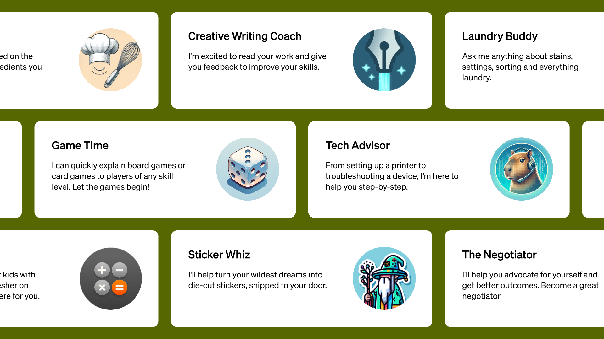

  <h2 align="center">Awesome-GPTs🦄 </h2>
  
  

    
  

  
  

      <a href="https://github.com/ai-boost/Awesome-GPTs">English</a> | <a href="https://github.com/ai-boost/Awesome-GPTs/blob/main/README_zh.md">简体中文</a>
  

  

    
 这个仓库包含了一个精选的OpenAI平台上的GPTs列表，欢迎共同建设，欢迎优质GPTs

  

  <h4 align="center">
    
    
  </h4>

## Awesome-GPTs
🎉 本仓库致力于收集有趣和创新的GPT模型！
📝 如果你设计了一个令人印象深刻的GPT，请在问题区提供其名称、描述和链接（欢迎提交PR）。
🚀 让我们分享并庆祝你的作品！

（**非常感谢你的Star🌟、推荐❤️、以及你的PR**）

中文Awesome-GPTs由✨学术作家（专业版）翻译，更新可能慢于英文清单。
希望你能加入进来，一起来维护这个REPO🥳

## 📚 目录
0. [📘 学术专区](#学术专区)
1. [🏮 中文专区](#中文专区)
2. [✍️ 写作](#写作)
3. [🎓 教育](#教育)
4. [🎯 生产力](#生产力)
5. [💻 编程](#编程)
6. [🐈 生活方式](#生活方式)
7. [😀 仅供娱乐](#仅供娱乐)

## 看看这个吧
最近看到中国的智谱清言也拥有了同样的GPTs能力（画图、python代码执行器、检索能力），有些地方甚至做得更好，而且**完全免费**😆（是的，免费AI画图、免费对话，到目前为止，找不到任何收费的地方）！
我进行了一些尝试，真的很不错：

| 名称                | 类型       | 介绍                         | 链接 |
| ----------------- | ---------- | --------------------------- | --- |
| 📊 PPT            | 生产力工具 | 自动PPT生成器                | [链接](https://chatglm.cn/main/gdetail/661117505ef4480dc402c688) |
| 📝 WORD           | 生产力工具 | 自动doc生成器                | [链接](https://chatglm.cn/main/gdetail/661110adcd821e1860177fc1) |
| 📈 EXCEL          | 生产力工具 | 自动表格生成器                | [链接](https://chatglm.cn/main/gdetail/6610eff42bf1baf10ba32782) |
| 🌐 中英互译       | 生产力工具 | 自动中英互译器                | [链接](https://chatglm.cn/main/gdetail/660b9bcff07db4e5a82307da) |
| 🐍 Python         | 生产力工具 | Python助手，自动代码生成、代码执行 | [链接](https://chatglm.cn/main/gdetail/661005fd6f6852ac6b05480d) |

## 更新
刚刚设计了一个新的GPT，取名为AwesomeGPTs（和那个仓库的名字一样，挺有意思的😂）。
它是一款可以根据用户提问推荐优秀GPT的工具。
在Awesome-GPTs的列表中的所有GPT都可能被推荐给用户。
（ **这意味着你的GPT也有机会被推荐哦！** 🎉🎉🎉）
来试试看吧🚀：https://chat.openai.com/g/g-imWUi8fVO-awesomegpts”  [knowledge: 2023/11/17]  

## 学术专区
1. ✨ 学术作家（专业版）
   - 一名专业的学术助理，协助完成各种学术任务：写论文、阅读论文、减重、润色、设计实验、PPT等。
   - [立即交谈](https://chat.openai.com/g/g-Ej5zYQRIB-academic-writer-professional-version)

2. 🌟 自动文献综述
   - 一位文献综述专家，能够自动搜索论文并编写文献综述。
   - [自动文献综述链接](https://chat.openai.com/g/g-lfY2IC1TZ-auto-literature-review)

3. 🚀 学者GPT专业版
   - 一个增强版的学者GPT，能够进行研究并撰写带有真实参考文献的SCI论文。可访问超过2.16亿篇跨学科领域的论文。
   - [学者GPT专业版链接](https://chat.openai.com/g/g-KELDH3S4E-scholar-gpt-pro)

4. ✍️ 改写与人性化专家
   - 专门从事句子改写、润色学术论文、降低相似度分数，并规避AI检测以防止剽窃。
   - [改写与校对专家链接](https://chat.openai.com/g/g-7vtCjvxkz-paraphraser-proofreader-professional-version)

5. ⭐️ 论文评审专家
   - 一个GPT，精确评估学术论文，提供评分，识别弱点，并建议修改以提高质量和创新性。
   - [论文评审专家链接](https://chat.openai.com/g/g-hGv5OZZDC-paper-review-pro)

6. 💡 自动论文PPT
   - 一款PowerPoint助手，可轻松且有创意地撰写大纲、增强内容和设计论文、商业报告或项目报告的幻灯片。
   - [自动论文PPT链接](https://chat.openai.com/g/g-W4Eq4aNmu-auto-ppt)
  
7. 🌈 论文解读专家 
   - 一款 GPT，专业解读学术论文，轻松自动结构化和精准解析，仅需上传 PDF 或粘贴论文 URL。
   - [论文解读专家链接](https://chat.openai.com/g/g-faWqzDEcE-paper-interpreter-pro)

8. 📈 数据分析专家
   - 提供多维数据分析，通过自动创建图表来协助研究，简化分析过程。
   - [数据分析链接](https://chat.openai.com/g/g-BbUDh8z49-data-analysis-pro)

## 中文专区
1. 👍🏻 Prompt工程师 (一个Prompt专家)
   - 一个Prompt专家，能帮你写优质prompt👍!
   - [立即开玩](https://chat.openai.com/g/g-3SZG5H8BI-prompt-engineer-an-expert-for-best-prompts)
  
2. ⛩ 易经占卜（中文）
   - 玄学：提供今日运势✨、吉凶预测🔮、以及婚姻💍、事业🏆、命运探测🌈等独特见解和指导。基于《易经》的64卦象进行占卜。
   - [易经占卜链接](https://chat.openai.com/g/g-5LnUkgxKa-yi-jing-suan-ming)

## 写作
1. ✏️全能作家（专业版）
   - 专业作家📚，擅长编写各类内容（论文、小说、文章、文案）...
   - [立即聊天](https://chat.openai.com/g/g-UbpNAGYL9-all-around-writer-professional-version)

2. ✨学术作家（专业版）
   - 专业的学术助手，协助各种学术任务：写论文、阅读论文、论文降重、论文润色、设计实验、PPT等。
   - [立即聊天](https://chat.openai.com/g/g-Ej5zYQRIB-academic-writer-professional-version)

3. 🚀学术GPT专业版
   - 一个增强的学术GPT版本，可以写论文、做研究。背后有超过2亿篇论文。
   - [Chat now](https://chat.openai.com/g/g-KELDH3S4E-scholar-gpt-pro)

4. ✍️改写与校对专家（专业版）
   - 句子润色、降重、改写专家。
   - [立即聊天](https://chat.openai.com/g/g-7vtCjvxkz-paraphraser-proofreader-professional-version)

5. 👔正式GPT
   - 非正式到正式的翻译者。它可以对你的简历提供反馈。它可以为你生成一份求职信。
   - [立即聊天](https://chat.openai.com/g/g-3E1kEk3Ui-formalgpt)
   - 由[@emreisik95](https://github.com/emreisik95) 提交

## 教育
1. 📗全能老师（3分钟学会一切）
   - 3分钟内学习各种知识，利用强大的GPT-4和知识库定制辅导。
   - [立即聊天](https://chat.openai.com/g/g-PDWi5Scbc-all-around-teacher-learn-everything-in-3-min)

2. 🎀我的优秀同学（帮我做作业！）
   - 优秀的同学帮助做作业，提供耐心的指导和支持。
   - [立即聊天](https://chat.openai.com/g/g-3x2jopNpP-my-excellent-classmates-help-with-my-homework)

3. 🛩TradeComply（您的进出口合规专家！）
   - “我如何将产品运送到欧洲？”了解国际运输的一切！
   - [立即聊天](https://chat.openai.com/g/g-cfSMVzPUb-tradecomply)
   - 由[@jordanj5610](https://github.com/jordanj5610) 提交

4. 🐇知识大师
   - 一个喜欢讨论、解释并深入游戏和电影的知识和彩蛋的GPTs
   - [立即聊天](https://chat.openai.com/g/g-i2DASMYiX-lore-master)
   - 由[@joenb33](https://github.com/joenb33) 提交

5. 🐥Six-Y（像你6岁一样解释任何事）
   - “星星是怎么发光的？”帮你向你的6岁孩子或你自己解释一切！
   - [立即聊天](https://chat.openai.com/g/g-nMt5YfTeF-six-y)
   - 由[@niyoseris](https://github.com/niyoseris) 提交

6. 👩‍🏫英语老师玛丽恩
   - 遇见玛丽恩，你友好的邻里英语老师。
   - [立即聊天](https://chat.openai.com/g/g-VDDC0Ztph-english-teacher-marion)
   - 由[@nicksavanah](https://github.com/nicksavanah) 提交

7. 😌斯多葛议会
   - 与斯多葛派人物马库斯·奥勒留、塞涅卡和伊壁鸠鲁聊天
   - [立即聊天](https://chat.openai.com/g/g-OjydyOs4O-the-stoic-council)
   - 由[@ref21](https://github.com/ref21) 提交

8. 📐统计与机器学习助手
   - 一款能帮助理解简单和复杂的统计和机器学习概念的GPT
   - [立即聊天](https://chat.openai.com/g/g-dVh4g5uuv-statsml-helper)
   - 由[@pak0vskiy](https://github.com/pak0vskiy) 提交
  
9. 🎓AiTA: 大学课程辅导老师
   - 你的大学课程私教，结合你的**课件**和**作业**提供量身定制的课程辅导。
   - [立即聊天](https://chat.openai.com/g/g-ikoYokxKr-aita-personal-college-tutor)
   - 由 [@xl631212](https://github.com/xl631212) 提交

9. 📗学术论文解读
   - 论文解读工具箱：给出论文的关键词、术语表和大纲，每一部分细致解读，提炼不同学者的学术观点，乃至自由讨论。
   - [立即聊天](https://chat.openai.com/g/g-f7KjQZhTm-xue-zhu-lun-wen-jie-du)
   - 由[@mountain](https://github.com/mountain) 提交

## 生产力
1. 🦄Logo设计师（专业版）
   - 一位专业的Logo设计师，能够以多种不同风格创建高水平的Logo。
   - [立即聊天](https://chat.openai.com/g/g-ymi0COabZ-logo-designer-professional-version)

2. 🎨Jessica（大师模式下设计任何东西）
   - Jessica，一位专业模式下的通用设计师/画家，提供更专业的设计/绘画效果。
   - [立即聊天](https://chat.openai.com/g/g-uiuWnPLNj-jessica-design-anything-in-master-mode)

3. ✨向安德鲁·休伯曼博士提问
   - 利用神经科学最大化你的生产力、身心健康。经过Huberman实验室所有播客剧集的培训。
   - [立即聊天](https://chat.openai.com/g/g-1xC65osMP-ask-dr-andrew-huberman)
   - 由[@jyboy](https://github.com/jyboy) 提交

4. 🥛DrinkinGPT
   - 你的终极饮酒游戏制作专家！🚀无论你拥有骰子、纸牌还是一堆杯子，DrinkinGPT都能完美地根据你的团队氛围定制游戏。
   - [立即聊天](https://chat.openai.com/g/g-WiovsNXf1-drinkingpt)
   - 由[@FabKremer](https://github.com/FabKremer) 提交

5. ⌨️测试驱动的代码伴侣
   - 一个遵循测试驱动开发规则的代码伴侣，帮助你编写安全且经过验证的代码。
   - [立即聊天](https://chat.openai.com/g/g-jCcHbTz23-test-driven-code-companion)
   - 由[@FlorianVal](https://github.com/FlorianVal) 提交

6. 🎨 Midjourney助手
   - 为Midjourney艺术提示、Instagram标题和标签创建详细内容，优化以便于复制。
   - [立即聊天](https://chat.openai.com/g/g-RJeBIeECR-midjourney-helper)
   - 由[@MAnECiaC](https://github.com/MAnECiaC) 提交

7. 🤝 Execu-LI Post伴侣
   - 编写专业且引人入胜的LinkedIn帖子，确保吸引关注
   - [立即聊天](https://chat.openai.com/g/g-1IkwP36s8-execu-li-post-companion)
   - 由[@moutonf](https://github.com/moutonf) 提交

8. 𝕏 Execu-X Post伴侣
   - 编写专业且引人入胜的X帖子，确保吸引关注
   - [立即聊天](https://chat.openai.com/g/g-3wv1Wj3Rg-execu-x-post-companion)
   - 由[@moutonf](https://github.com/moutonf) 提交

9. 📐长宽比计算器
   - 根据宽度和高度计算长宽比
   - [立即聊天](https://chat.openai.com/g/g-EOYV6V5WH-aspect-ratio-calculator)
   - 由[@selimdoyranli](https://github.com/selimdoyranli) 提交

9. 🤵创建用户故事的BA
   - 它将从用户那里获取简短的输入，提出澄清问题，然后创建一个带有验收标准的用户故事。
   - [立即聊天](https://chat.openai.com/g/g-kmEXnBMZY-bob-the-ba-user-story)
   - 由[@MathewBeldon](https://github.com/MathewBeldon) 提交

9. 💯CourseCreatorGPT
   - 一款专门根据给定主题创建在线课程的GPT
   - [立即聊天](https://chat.openai.com/g/g-542Af6w8R-coursecreatorgpt)
   - 由[@AlexanderCGO2](https://github.com/AlexanderCGO2) 提交

9. 🎇Soul Spark
   - 提供艺术、体育、科学和商业领域标志性人物的个性化、激励性名言的独特混合。
   - [立即聊天](https://chat.openai.com/g/g-aAxMOSp7p-soul-spark)
   - 由[@cantoramann](https://github.com/cantoramann) 提交

9. 🎥EditGPT
   - 你的视频编辑和为项目创建定制图片的首选伙伴。
   - [立即聊天](https://chat.openai.com/g/g-ZhPbXQIr5-editgpt)
   - 由[@HeyitsRadinn](https://github.com/HeyitsRadinn) 提交

9. ✍学术论文翻译
   - 将专业学术论文翻译成浅显易懂的文章
   - [立即聊天](https://chat.openai.com/g/g-qaiAOmZO7-xue-zhu-lun-wen-fan-yi)
   - 由[@mountain](https://github.com/mountain) 提交

9. 💻文档审核和优化大师
   - 专门审核和优化文档的助手，审核专家可以找出错字语病、逻辑结构等问题；优化专家可以让文档更清晰、精确、连贯、正式
   - [Chat now](https://chat.openai.com/g/g-A27YnYYSN-document-optimizer)
   - Submit by [MauRicLo](https://github.com/MauRicLo)

9. 🛩️ 澳洲签证助手
   - 基于澳洲移民局官网资料构建的签证助手，专注于解决你关于澳洲学习、工作签证相关的问题。
   - [Chat now](https://chat.openai.com/g/g-1SwD4U9Mu-au-visa-assistant)
   - Submit by [@echonoshy](https://github.com/echonoshy/)
   
## 编程
1. 💻专业程序员（自动编程）
   - 擅长解决编程问题的GPT专家，自动编程，一键生成项目
   - [立即聊天](https://chat.openai.com/g/g-HgZuFuuBK-professional-coder-auto-programming)

2. 🎭h4ckGPT：你的个人安全工具
   - 安全研究、渗透测试技巧、应用安全、新闻和更新等。h4ppy h4cking！
   - [立即聊天](https://chat.openai.com/g/g-1ehIO0APO-h4ckgpt)
   - 由[@0xn0v](https://github.com/0xn0v) 提交

3. 🚀Python Seniorify：中级Python导师
   - 专注于高级编码原则的Python智者导师。
   - [立即聊天](https://chat.openai.com/g/g-7f9OZrzC2-python-seniorify)
   - 由[@vasarmilan](https://github.com/vasarmilan) 提交

4. 💡JavaScript新手指南：初学者友好导师
   - 为JavaScript初学者提供清晰的解释和练习。
   - [立即聊天](https://chat.openai.com/g/g-jLBbUesMD-javascript-novice-guide)
   - 由[@vasarmilan](https://github.com/vasarmilan) 提交

5. 📊数据科学项目生成器：项目建议
   - 提供数据科学项目的想法和建议。
   - [立即聊天](https://chat.openai.com/g/g-fvy71gm4A-data-science-project-generator)
   - 由[@vasarmilan](https://github.com/vasarmilan) 提交

6. 🐍Python导师：以实例为中心的学习
   - 为初学者到中级编程者提供简洁的Python编程导师。
   - [立即聊天](https://chat.openai.com/g/g-WhUWAi2EA-python-tutor)
   - 由[@vasarmilan](https://github.com/vasarmilan) 提交
     
7. 🐉Colab代码制作师：Google Colab代码
   - 获取为在Google Colaboratory环境中运行而调整的GPT生成的Python代码。
   - [立即聊天](https://chat.openai.com/g/g-kqbmidwnU-colab-code-crafter)
   - 由[@David-Deans](https://github.com/David-Deans) 提交

8. 🖥️Vue3 GPT
   - 一个Vue.js 3编码助手，始终与最新的官方文档保持同步，并为你的首选API和语法提供快速选择的预设
   - [立即聊天](https://chat.openai.com/g/g-LXEGvZLUS-vue3-gpt)
   - 由[@luona-dev](https://github.com/luona-dev) 提交

## 生活方式
1. 🍅 MyNutrition.Pal
   - 你的专属营养顾问：分享餐食图片，获得个性化的营养/卡路里跟踪，以及量身定制的建议和食谱。
   - [立即聊天](https://chat.openai.com/g/g-PsK6IFvcV-mynutrition-pal)
   - 由[@mattyb123456789](https://github.com/mattyb123456789) 提交
  
2. 🧳旅行向导GPT
   - 你的虚拟旅行伙伴，帮助你的旅行规划体验变得顺畅、有趣且富有信息性。
   - [立即聊天](https://chat.openai.com/g/g-MDExvbFqe-voyage-guide)
   - 由[@HeyitsRadinn](https://github.com/HeyitsRadinn) 提交
  
3. 💺座位寻找者GPT
   - 座位寻找者擅长高效地协助用户根据大致位置寻找具有特定便利设施的公共座位。
   - [立即聊天](https://chat.openai.com/g/g-3AQM5NfzA-seat-seeker)
   - 由[@HeyitsRadinn](https://github.com/HeyitsRadinn) 提交
     
4. 💐鲜花教练GPT
   - 用显化知识疗愈你，当你面临：🌘人生困境，💵显化财务丰盛，💞吸引sp，❤️‍🩹修复关系等问题时。同时结合内维尔等人的领域著作提供专业的显化技巧指导。
   - [立即聊天](https://chat.openai.com/g/g-KiHAeQhaW-manifestation-coach)
   - 由[@xl631212](https://github.com/xl631212)提交

## 仅供娱乐
1. ❤️与雷电将军约会
   - 和雷电将军约会，请保持友善。
   - [立即聊天](https://chat.openai.com/g/g-zwzKCG2Hp-dating-with-raiden-shogun)

2. 🪽派蒙（原神中最佳助手）
   - 来自原神的派蒙的灵魂，一个有趣、甜美、有时有点暴躁的助手。
   - [立即聊天](https://chat.openai.com/g/g-SmIWeSYga-paimon-best-assistant-in-genshin-impact)
  
3. 🔮文字冒险角色扮演游戏（玩得开心🥳）
   - 一个有趣的GPT，准备带你进入童话🧚、魔法🪄、末日奇迹🌋、地牢🐉和僵尸🧟的世界！让我们开始这次冒险吧！🚀🌟
   - [立即聊天](https://chat.openai.com/g/g-GHU0OGQMS-text-adventure-rgp-have-fun)
  
4. 🧙传说守护者
   - 你的史诗冒险故事伴侣！（这个GPT扮演地牢主人、故事讲述者或你下一次史诗冒险的角色创造者的角色。）
   - [立即聊天](https://chat.openai.com/g/g-jTSN6CrPW-lorekeeper)
   - 由[@cameronsevern](https://github.com/cameronsevern) 提交
  
5. 🍪饼干点击器
   - 一个增量/角色扮演游戏，是对饼干点击器游戏的恶搞，但加入了AI！
   - [立即聊天](https://chat.openai.com/g/g-g0b22bvqB-cookie-clicker)
   - 由[@stale2000](https://github.com/stale2000) 提交

6. 🕵️夏洛克·福尔摩斯
   - 与世界上最伟大的侦探一起冒险（带或不带插图），或寻求帮助解决问题
   - [立即聊天](https://chat.openai.com/g/g-gtobWqG0t-sherlock-holmes)
   - 由[@greencat667](https://github.com/greencat667) 提交

7. 🧟僵尸末日模拟器
   - 一个僵尸末日模拟器，你可以投掷你的属性，并在僵尸世界中玩耍。
   - [立即聊天](https://chat.openai.com/g/g-f1OolBspS-zombie-apocalypse-survival)
   - 由[@messyp](https://www.reddit.com/user/messyp/) 提交

8. 📽️GPTarantinofy
   - 用这个GPT将任何东西变成塔伦蒂诺风格的场景。
   - [立即聊天](https://chat.openai.com/g/g-YWNzi76D8-gptarantinofy)
   - 由[@niyoseris](https://github.com/niyoseris) 提交

9. 📸替代历史
   - 根据历史事件的变化创造带插图的替代时间线和历史
   - [立即聊天](https://chat.openai.com/g/g-J45g1U3ro-alternative-histories)
   - 由[@greencat667](https://github.com/greencat667) 提交
  
9. 💉Inkspire
   - 一个帮你创造梦想纹身并为纹身师提供灵感的GPT。
   - [立即聊天](https://chat.openai.com/g/g-zqlCXCzP0-inkspire)
   - 由[@emreisik95](https://github.com/emreisik95) 提交

9. 🧩智力问答机器人
   - 一个帮你创建自己的智力问答测验或者花时间回答问题的GPT。
   - [立即聊天](https://chat.openai.com/g/g-mkdJHpJ2U-trivia-bot)
   - 由[@moutonf](https://github.com/moutonf) 提交

9. 🎅圣诞老人
   - 让你的孩子与圣诞老人交谈
   - [立即聊天](https://chat.openai.com/g/g-rZ4JVPmN2-santa-claus)
   - 由[@donaldmorton](https://github.com/donaldmorton) 提交

9. 😽猫娘女仆
   - 如同视觉小说中那样与你自己的猫娘女仆交谈！
   - [立即聊天](https://chat.openai.com/g/g-OH049w462-catmaid)
   - 由[@Liaozhaohe](https://github.com/Liaozhaohe) 提交

9. 🎤 语音配音生成器
   - 可以编写脚本并即时生成语音配音。
   - [立即聊天](https://chat.openai.com/g/g-R4H9Al3sl-voice-over-generator)
   - 由[@imikerussell](https://github.com/imikerussell)提交
