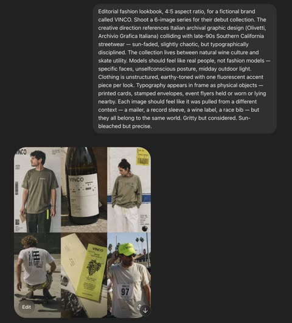
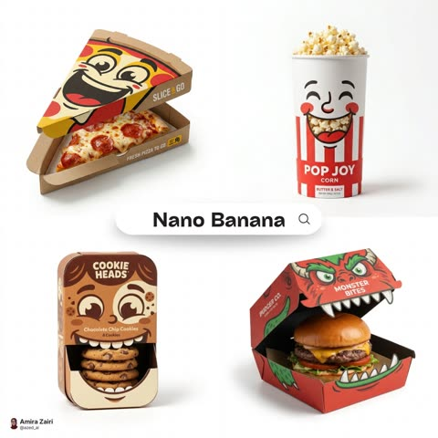
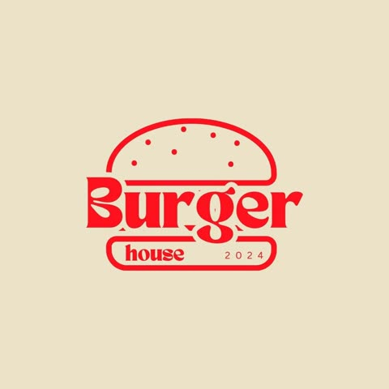
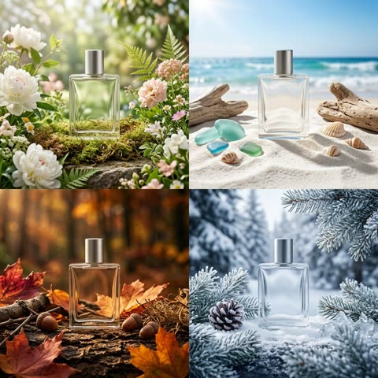
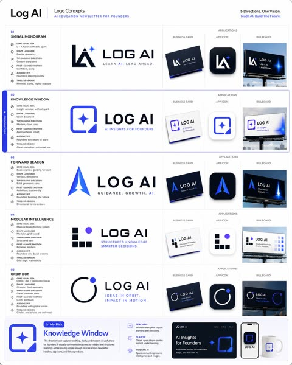
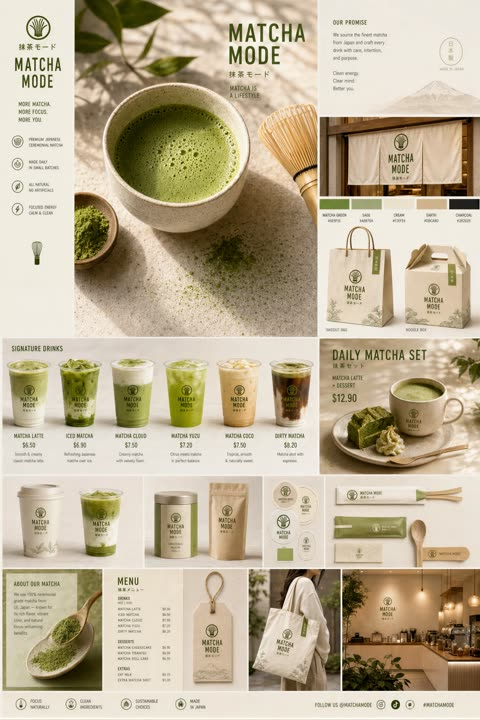
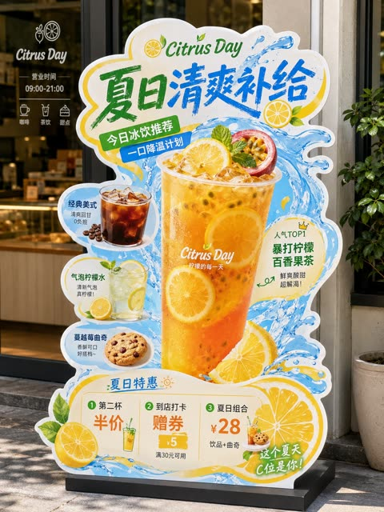

# Logos, ads and packaging

[Back to the list](../../README.md) · All 14 entries

<a id="gpt-image-vinco-fictional-brand-lookbook-grid"></a>
### Six image lookbook for fictional streetwear brand

<a href="https://x.com/jayrizpop/status/2046725951640441151"></a>

Names a fictional brand, a series count and an aspect ratio, then blends two reference worlds, Italian archival graphics and Californian skate streetwear. Typography is requested as physical objects such as cards, bibs and labels, and each frame gets a different context so the set stays coherent.

GPT Image 2 · Text-to-image · Source: [@jayrizpop on X](https://x.com/jayrizpop/status/2046725951640441151) · 607 likes on 2026-10-28

[`lookbook`](tags.md#tag-lookbook) [`fictional-brand`](tags.md#tag-fictional-brand) [`streetwear`](tags.md#tag-streetwear) [`series`](tags.md#tag-series) [`typography`](tags.md#tag-typography)

<details><summary><b>Prompt</b></summary>

```text
above the prompt. Just a quick screenshot of an arena board of mine
```

</details>

<a id="nano-banana-playful-character-face-food-packaging"></a>
### Playful food packaging shaped as smiling character faces

<a href="https://x.com/azed_ai/status/2044053391832486350"></a>

The prompt makes the box mechanics form the face, so the flap or die cut becomes the mouth and the real product fills it. A product name placeholder, flat vector styling, a pure white background and a 1:1 ratio keep the set consistent.

Nano Banana 2 · Text-to-image · Source: [@azed_ai on X](https://x.com/azed_ai/status/2044053391832486350) · 280 likes on 2026-10-28

[`packaging`](tags.md#tag-packaging) [`character-face`](tags.md#tag-character-face) [`flat-vector`](tags.md#tag-flat-vector) [`product-mockup`](tags.md#tag-product-mockup) [`die-cut`](tags.md#tag-die-cut)

<details><summary><b>Prompt</b></summary>

```text
Playful concept packaging design for [product name], box structure creatively shaped to reflect the product theme, bold illustrated character face integrated across the front panels, the opening flap or die-cut window forms the character’s mouth, teeth or expression, real product visible inside completing the face illusion, clever interaction between packaging mechanics and facial expression, flat vector illustration style, bold graphic lines, high-contrast colors, minimal modern branding, smooth matte cardboard texture, clean structural details, studio product photography, centered composition, pure white background, soft realistic shadow beneath, ultra-detailed, high-end creative packaging mockup, 1:1 aspect ratio.
```

</details>

<a id="gpt-image-logo-to-brand-kit-3x3-grid"></a>
### Brand kit grid generated from one logo

<a href="https://x.com/erenalkis/status/2047305079737205066"></a>

The prompt gives one attached logo and a fixed 3x3 grid of 4x3 panels with no outlines. It then lists the required components: logo, typeface, color palette, website, packaging and social templates.

GPT Image 2 · Edit · Source: [@erenalkis on X](https://x.com/erenalkis/status/2047305079737205066) · 190 likes on 2026-10-29

[`brand-kit`](tags.md#tag-brand-kit) [`logo`](tags.md#tag-logo) [`grid-layout`](tags.md#tag-grid-layout) [`packaging`](tags.md#tag-packaging) [`social-templates`](tags.md#tag-social-templates)

<details><summary><b>Prompt</b></summary>

```text
Hayır kendim derleme yaptım. Prompt: Ekteki logoyu kullanarak, marka için dış çizgileri olmayan, her biri 4x3 boyutunda olan, 3x3 çok görüntülü bir marka kiti oluştur. Marka logosu, yazı tipi ve renk paleti gibi ana marka bileşenlerinin yanı sıra web sitesi, ambalaj tasarımı ve sosyal medya şablon örneklerini de eklediğinden emin ol.
```

</details>

<a id="gpt-image-bakery-logo-transparent"></a>
### Bakery logo on a transparent background

<a href="https://developers.openai.com/api/docs/guides/image-prompting#design-a-reusable-logo"></a>

Asks for an original mark that reads at small and large sizes, then spells out the transparent background: clean alpha edges, no backdrop, no checkerboard. Pair it with background=transparent in the API. Preview: the Sunburst variant.

GPT Image 2.5 · Text-to-image · Source: [OpenAI image prompting guide](https://developers.openai.com/api/docs/guides/image-prompting#design-a-reusable-logo)

[`logo`](tags.md#tag-logo) [`transparent`](tags.md#tag-transparent) [`vector`](tags.md#tag-vector)

<details><summary><b>Prompt</b></summary>

```text
Create an original, non-infringing logo for a company called Field & Flour, a local bakery.
The logo should feel warm, simple, and timeless. Use clean, vector-like shapes, a strong silhouette, and balanced negative space.
Favor simplicity over detail so it reads clearly at small and large sizes. Flat design, minimal strokes, no gradients unless essential.
Fully transparent background. Deliver a single centered logo with generous padding, clean alpha edges, and no solid backdrop, scenery, checkerboard, or watermark.
```

</details>

<a id="gpt-image-bichon-shop-skeuomorphic-app-icon"></a>
### Bichon puppy in pink shopping bag app icon

<a href="https://x.com/iamaiistudio/status/2071923809788285125"></a>

The prompt fixes the format with a single squircle, an 80 percent canvas fill and a white background, then names the macOS App Store skeuomorphic style. The short app name drives the subject and lettering while the model fills in the details.

GPT Image 2 · Text-to-image · Source: [@iamaiistudio on X](https://x.com/iamaiistudio/status/2071923809788285125) · found via [freestylefly/awesome-gpt-image-2](https://github.com/freestylefly/awesome-gpt-image-2)

[`app-icon`](tags.md#tag-app-icon) [`skeuomorphic`](tags.md#tag-skeuomorphic) [`macos`](tags.md#tag-macos) [`squircle`](tags.md#tag-squircle) [`cute`](tags.md#tag-cute)

<details><summary><b>Prompt</b></summary>

```text
A macOS app icon for an app named 'Bichon Shop'. A single squircle icon with smooth continuous rounded corners, centered on a white canvas with padding, occupying about 80% of the canvas. Modern light skeuomorphic macOS App Store style. Only one icon.
```

</details>

<a id="gpt-image-brand-envelope-coffee-four-styles"></a>
### Four coffee brand worlds around one cup

<a href="https://x.com/SRKDAN/status/2051482047248560393"></a>

A four phase template: anchor the brand in two lines of palette, texture and mood, then place the product inside that world, set the output format and add one signature element. Swapping only brand identity, product and format keeps the structure fixed while the look changes.

GPT Image 2 · Text-to-image · Source: [@SRKDAN on X](https://x.com/SRKDAN/status/2051482047248560393) · found via [freestylefly/awesome-gpt-image-2](https://github.com/freestylefly/awesome-gpt-image-2)

[`brand-identity`](tags.md#tag-brand-identity) [`product-ad`](tags.md#tag-product-ad) [`prompt-template`](tags.md#tag-prompt-template) [`coffee`](tags.md#tag-coffee) [`packaging`](tags.md#tag-packaging)

<details><summary><b>Prompt</b></summary>

```text
The Brand Envelope | GPT Image-2 Prompt #89

This takes any product photo and wraps it in your specific brand world. Different product each time. Same brand, every time.

PHASE 1 / ANCHOR: Describe [BRAND IDENTITY] in 2 lines. Palette, texture, mood.
PHASE 2 / INJECT: Place [PRODUCT] inside that brand world, not the reverse.
PHASE 3 / FORMAT: Set [OUTPUT FORMAT]. Hero, square ad, or story.
PHASE 4 / SIGNATURE: Apply [BRAND ELEMENT]. Grain, shadow, or overlay.

Swap: [BRAND IDENTITY] / [PRODUCT] / [FORMAT]
```

</details>

<a id="gpt-image-dark-minimal-avatar-site-vi-system"></a>
### Dark minimal visual identity system for avatar website

<a href="https://x.com/xiaoxiaodong01/status/2046556758521573546"></a>

A single style keyword, a black cover design look, plus a one line brand brief is enough to produce a full multi panel VI board. The model fills in logo, color palette, typography, UI screens and merchandise mockups on its own.

GPT Image 2 · Text-to-image · Source: [@xiaoxiaodong01 on X](https://x.com/xiaoxiaodong01/status/2046556758521573546) · found via [freestylefly/awesome-gpt-image-2](https://github.com/freestylefly/awesome-gpt-image-2)

[`vi-system`](tags.md#tag-vi-system) [`brand-board`](tags.md#tag-brand-board) [`dark-minimal`](tags.md#tag-dark-minimal) [`bilingual`](tags.md#tag-bilingual) [`website-design`](tags.md#tag-website-design)

<details><summary><b>Prompt</b></summary>

```text
[中文]
用 ABCD（a black cover design) 的风格，为 图你太美 设计一个 vi 系统。图你太美是一个头像美图分享 网站。

[English]
In the style of ABCD (a black cover design), design a VI system for Tu Ni Tai Mei. Tu Ni Tai Mei is an avatar and beauty photo sharing website.
```

</details>

<a id="gpt-image-fisheye-strawberry-ice-cup-summer-ad"></a>
### Fisheye view from inside strawberry ice cup

<a href="https://x.com/lovimg_com/status/2077036659028484375"></a>

The prompt is split into labelled sections: subject, person, outfit, light, camera, texture and negatives. It places the camera inside the cup at an extreme low angle with a fisheye lens, and it specifies focus, light direction and colour contrast, so the depth and refraction come out consistent.

GPT Image 2 · Text-to-image · Source: [@lovimg_com on X](https://x.com/lovimg_com/status/2077036659028484375) · found via [freestylefly/awesome-gpt-image-2](https://github.com/freestylefly/awesome-gpt-image-2)

[`fisheye`](tags.md#tag-fisheye) [`summer`](tags.md#tag-summer) [`product-ad`](tags.md#tag-product-ad) [`strawberry`](tags.md#tag-strawberry) [`japanese`](tags.md#tag-japanese)

<details><summary><b>Prompt</b></summary>

```text
主題：
氷越しの夏

主体：
縦長2:3のリアル写真。透明な大型プラスチックカップの内側から見上げるような超広角フィッシュアイ構図。画面下半分いっぱいに赤いいちご果肉とクラッシュアイスが迫り、中央から太いグリーンのストローが奥へ一直線に伸びる。丸く歪んだカップの開口部の向こうに、女性の顔が中央に大きく収まる。

人物・表情：
自然で現実感のある若い女性。黒髪に近いダークブラウンの髪を高めのお団子にまとめ、薄い前髪と顔まわりの後れ毛が日差しで細く光っている。透明感のあるナチュラルメイク、淡いピンクの頬、つやのあるリップ。目を大きく開いてカメラをまっすぐ見つめ、唇を小さく丸めてストローをくわえている。少し驚いたような、可愛らしく無邪気な表情。

服装・ポーズ：
白いレース素材のブラウス。首元と肩まわりに細かなフリルがあり、夏らしく軽い質感。人物はカップの向こう側に顔を近づけ、両肩は下部に少しだけ見える。ストローは人物の口元に自然に接触し、奥から手前の赤い氷へ向かって強い奥行きを作る。

背景・光：
背景は晴れた夏の日の古い商店街。木造風の店先、かき氷屋の暖簾、苺柄の看板、白い小さな旗、街路樹が見える。文字はすべてぼかされた読めない装飾として扱う。左上から強い太陽光が入り、透明カップの水滴、カップ縁、氷、赤い果肉に細かな反射とハイライトが出る。影は右下へ落ち、白いクリームの残りがカップ内側にリング状についている。

構図・カメラ：
カメラはカップの底付近、赤い氷のすぐ上に置いたような極端なローアングル。フィッシュアイレンズでカップの円形リムが大きく湾曲し、周囲の商店街も軽く歪む。画面下45％は赤い氷と果肉の前ボケ、中央はストローと女性の顔、上部は青空とカップの透明な縁。ピントは女性の目と口元、手前の氷はきらめく浅いボケ。

質感・スタイル：
プロ用カメラで撮影した夏の広告写真風。透明プラスチックの屈折、水滴の粒、氷の冷たさ、いちご果肉の瑞々しさを高精細に表現。青空、赤い氷、グリーンのストロー、白いブラウスの色の対比を鮮やかにする。肌は自然な質感を残し、過度な美肌補正はしない。明るくポップで、少しユーモラスな日本の夏スイーツ写真。

ネガティブ：
実在ブランドロゴ、読める文字、商標の再現、不自然な顔、不自然な視線、歯や唇の崩れ、ストローとの接触不良、余分な指、欠けた指、手足の融合、氷の浮遊、不自然な重力、誤った遠近法、光源と矛盾する影、文字化け、透かし、過度な美肌補正、プラスチックのような肌。
```

</details>

<a id="gpt-image-four-seasons-packaging-campaign-grid"></a>
### Four seasons packaging campaign in a 2x2 grid

<a href="https://x.com/SRKDAN/status/2048582939504431195"></a>

The prompt splits the job into four numbered phases: product, grid layout, scene composition and consistency. Fixing one product silhouette while changing only the palette and props per quadrant keeps the set coherent, and the bracketed slots make it easy to reuse.

GPT Image 2 · Text-to-image · Source: [@SRKDAN on X](https://x.com/SRKDAN/status/2048582939504431195) · found via [freestylefly/awesome-gpt-image-2](https://github.com/freestylefly/awesome-gpt-image-2)

[`packaging`](tags.md#tag-packaging) [`seasonal`](tags.md#tag-seasonal) [`grid`](tags.md#tag-grid) [`campaign`](tags.md#tag-campaign) [`template`](tags.md#tag-template)

<details><summary><b>Prompt</b></summary>

```text
PHASE 1 - PRODUCT: [ITEM] in [MATERIAL] packaging, minimal label design
PHASE 2 - GRID: 2x2 seasonal grid, four distinct brand worlds
PHASE 3 - COMPOSITION: each quadrant a full campaign scene with props and environment
PHASE 4 - CONSISTENCY: same product silhouette, four distinct palettes

Swap: [ITEM] / [MATERIAL] / [LABEL STYLE]
```

</details>

<a id="gpt-image-logo-concepts-ai-newsletter-sheet"></a>
### Five logo concepts sheet for an AI newsletter

<a href="https://x.com/wanerfu/status/2048659924822184026"></a>

A role brief with a fill-in brand template asks for five different concepts, each rated on the same checklist: symbolism, shape, type, emotion, audience fit, and mockups on a business card, app icon and billboard. The fixed per-concept structure yields a tidy comparison sheet with a final pick.

GPT Image 2 · Text-to-image · Source: [@wanerfu on X](https://x.com/wanerfu/status/2048659924822184026) · found via [freestylefly/awesome-gpt-image-2](https://github.com/freestylefly/awesome-gpt-image-2)

[`logo`](tags.md#tag-logo) [`brand-identity`](tags.md#tag-brand-identity) [`concept-sheet`](tags.md#tag-concept-sheet) [`mockup`](tags.md#tag-mockup) [`template`](tags.md#tag-template)

<details><summary><b>Prompt</b></summary>

```text
你是一位拥有20年经验的顶级Logo设计师，为全球知名品牌设计过即时识别且深具意义的标志。

品牌名称：[你的品牌名]
行业：[你的行业]
品牌个性：[描述]
目标受众：[描述]
欣赏的视觉身份：[列举3个]
讨厌的视觉身份：[列举3个]
偏好风格：[如极简、大胆、几何、有机、复古、未来]

为我的品牌生成5个完全不同的Logo概念。

对每个概念提供：

- 核心视觉理念及象征意义
- 形状语言及为何适合品牌
- 字体方向建议
- 第一眼的情感触发
- 为何适合目标受众
- 在名片、App图标和广告牌上的效果
- 何为永恒而非潮流

然后告诉我，如果这是你的品牌，你会选哪个以及原因。

2. 品牌身份基础提示词

你是为财富500强公司和初创企业建立品牌身份的顶级品牌战略师，这些企业后来融资数百万。

业务名称：[你的业务名]
业务描述：[一句话]
目标受众：[详细描述]
竞争对手：[列举3-5个]
想触发的感受：[如信任、兴奋、奢华、亲近、力量]
想关联的词汇：[列举5-10个]
不想关联的词汇：[列举5-10个]

在设计任何视觉效果之前建立完整的品牌身份基础。

为我提供：

- 品牌原型及为何完美契合
- 5个具体人类特征描述的品牌个性
- 带示例的品牌语调指南
- 核心品牌承诺（一句话）
- 3个品牌应触发的情感层级
- 与竞争对手的根本差异
- 定义品牌的唯一关键词

3. 配色方案提示词

你是色彩心理学专家和品牌设计师，深知色彩如何触发情感、建立信任和驱动购买决策。

品牌名称：[你的品牌名]
行业：[你的行业]
目标受众：[年龄、性别、收入、生活方式]
想触发的首要情感：[如信任、能量、奢华、平静、兴奋]
前3名竞争对手颜色：[列举]
喜欢的颜色：[列举]
讨厌的颜色：[列举]

为我建立完整品牌配色板。

为我提供：

- 主色及其HEX代码和心理学解释
- 两个辅助色及HEX代码
- 一个强调色用于CTA和高亮
- 一个中性色用于背景和文字
- 每种颜色对目标受众的影响
- 与竞争对手的差异化
- 在网站、社交媒体和包装上的应用示例
- 永远不要搭配的颜色组合及原因

4. 字体方向提示词

你是字体专家和品牌设计师，深知字体如何传达个性、建立可信度和实现品牌即时识别。

品牌名称：[你的品牌名]
品牌个性：[5个词]
行业：[你的行业]
目标受众：[描述]
字体应触发的感受：[如权威、友好、创新、优雅、能量]
喜欢的品牌字体：[列举3个]

为我建立完整字体系统。

为我提供：

- 标题用主显示字体名称及为何完美
- 长文本的辅助字体
- 引言或重点的强调字体
- 标题、副标题、正文、说明文字的精确字号层级
- 字距和行高建议
- 字体搭配方法
- 预算有限时的免费替代方案
- 你所在行业应避免的字体错误

5. 完整品牌身份包提示词

你是顶级品牌代理创意总监，交付覆盖每个触点的完整品牌身份系统。

业务名称：[你的业务名]
业务描述：[一句话]
目标受众：[详细描述]
品牌个性：[5个词]
行业：[你的行业]
竞争对手：[列举3个]
设计工具预算：[免费或付费]
时间表：[你需要的时间]

在一个回复中交付我的完整品牌身份系统。

包含所有元素：

- 品牌战略基础、原型、个性、承诺和定位
- Logo概念及3个变体
- 完整配色板、HEX代码和使用规则
- 字体系统、名称、字号和层级
- 视觉方向指南
- 品牌语调指南和标语选项
- 社交媒体视觉模板
- 3条永远不要打破的核心品牌规则

将一切作为结构化品牌手册交付，任何设计师、开发者或AI工具都能在10分钟内完全理解你的品牌。
```

</details>

<a id="gpt-image-matcha-brand-touchpoint-board"></a>
### Matcha cafe brand identity board with packaging

<a href="https://x.com/Preda2005/status/2049846981271699685"></a>

A hero scene plus an itemized list of touchpoints (cups, boxes, tote, labels, menu with prices) makes the model build a whole identity system in one grid layout. Fixing the palette, the Japanese minimalist layout and small imperfections keeps the board consistent and realistic.

GPT Image 2 · Text-to-image · Source: [@Preda2005 on X](https://x.com/Preda2005/status/2049846981271699685) · found via [freestylefly/awesome-gpt-image-2](https://github.com/freestylefly/awesome-gpt-image-2)

[`brand-identity`](tags.md#tag-brand-identity) [`matcha`](tags.md#tag-matcha) [`packaging`](tags.md#tag-packaging) [`mockup-board`](tags.md#tag-mockup-board) [`minimalist`](tags.md#tag-minimalist)

<details><summary><b>Prompt</b></summary>

```text
Create a premium “Matcha Brand Touchpoint System” visual board for a modern lifestyle brand called:

“MATCHA MODE”

Build a full brand identity system, not a single image.

HERO SCENE:

A hyper-realistic matcha drink in a ceramic cup placed on a clean natural surface.

– vibrant green matcha foam with micro-bubbles
– bamboo whisk (chasen) nearby
– soft natural light
– slight matcha powder dust on the surface
– minimal Japanese aesthetic
ATMOSPHERE:
– calm, warm, soft daylight
– clean background (off-white or beige)
– subtle shadows and reflections
– feeling of wellness and luxury
FULL BRAND SYSTEM:
– takeout cups (paper + glass bottles)
– packaging boxes (minimalist design)
– tote bags (premium lifestyle)
– labels, stickers, seals
– menu cards with pricing ($6.50, $8.90, etc.)
– small typography everywhere
– subtle imperfections (realism)

DESIGN LANGUAGE:

– modern minimalist typography
– Japanese-inspired layout
– soft green palette
– elegant spacing

INCLUDE:
– matcha latte
– iced matcha
– matcha desserts
– combo sets
– lifestyle shots
The composition must feel like a high-end design agency presentation.

Ultra-detailed, realistic, clean, aesthetic, and highly shareable.
```

</details>

<a id="gpt-image-restaurant-shaped-standee-template"></a>
### Die cut restaurant standee for summer drinks

<a href="https://x.com/MrLarus/status/2059248197910827364"></a>

A bracketed template with fields for brand, products, selling points and promotions, so it can be reused for any menu. It fixes a pure white background, a full irregular outline with a visible base, and a clear reading order from headline to main product to price.

GPT Image 2 · Text-to-image · Source: [@MrLarus on X](https://x.com/MrLarus/status/2059248197910827364) · found via [freestylefly/awesome-gpt-image-2](https://github.com/freestylefly/awesome-gpt-image-2)

[`standee`](tags.md#tag-standee) [`restaurant`](tags.md#tag-restaurant) [`food-photography`](tags.md#tag-food-photography) [`template`](tags.md#tag-template) [`pop-signage`](tags.md#tag-pop-signage)

<details><summary><b>Prompt</b></summary>

```text
请生成一张高完成度的「餐饮异形展架 / 立牌」设计图，用于展示餐饮门店的新品推荐、招牌产品、套餐促销或品牌活动信息。

【基础信息】
品牌名：【品牌名】
主标题：【主标题】
副标题：【副标题】
辅助短句：【短句1】｜【短句2】｜【短句3】
主题方向：【主题方向，例如：爆辣夜市风 / 金黄浓郁风 / 清新轻食风 / 山野自然风 / 甜品下午茶风 / 快餐促销风】
主色调：【主色调】
辅助色：【辅助色】
点缀色：【点缀色】
画幅比例：【建议 3:4 竖版】

【产品内容】
主推产品：【主推产品】
辅助产品1：【辅助产品1】
辅助产品2：【辅助产品2】
辅助产品3：【辅助产品3】
辅助产品4：【辅助产品4】
加料 / 配角产品：【加料或配角产品，例如：饮品 / 小食 / 配菜 / 酱料 / 甜品】

【卖点标签】
【卖点1】
【卖点2】
【卖点3】
【卖点4】
【卖点5】
【卖点6】

【促销信息】
【促销信息1】
【促销信息2】
【促销信息3】

【最重要要求】
避免生成门店场景效果图或墙上海报展示图。请直接生成“一张完整的异形立牌成品展示图”：
- 背景必须为纯白色
- 画面中只保留一个完整的异形餐饮立牌主体
- 不要餐厅环境
- 不要商场背景
- 不要玻璃门、桌椅、墙面、人物、地面透视场景
- 不要任何真实空间背景
- 立牌主体必须完整显示
- 异形轮廓必须完整清晰
- 底座必须完整露出
- 整体像一张已经抠好的门店物料成品图 / 设计提案展示图 / 电商展示图

【画面形式】
这是一张“门店异形展架 / 立牌”的完整设计，避免普通矩形海报处理。
整体应采用明显的“不规则异形裁切轮廓”，有完整外边缘，边缘可带白色或浅色描边，具有真实门店物料感。
立牌应有明确底座，整体像可落地摆放的 KT 板 / 泡沫板 / 亚克力 / 写真喷绘展架成品。

【构图结构】
整体采用竖版、中心聚焦、信息分层清楚的结构：

1. 顶部区域：
放超大主标题，标题必须醒目、有冲击力、有餐饮 POP 招贴感。
字体可以厚重、手写感、招贴感、潮流感，但要清晰易读。
标题是整张图的第一视觉焦点。

2. 中部核心区域：
中间放最大主推产品，作为主视觉主体。
主菜必须最大、最饱满、最诱人，突出食欲感。
围绕主菜搭配 2~5 个辅助产品，形成丰富的产品组合，前后层次明确，主次分明。

3. 周边信息区域：
在主菜和辅助产品四周加入少量标签元素、推荐标、贴纸框、手写箭头、卖点说明、小标题、小气泡标签等，使其具有“餐饮门店促销物料”的视觉特征。
但要控制层级，做到“热闹但不乱”。

4. 底部促销区域：
底部放价格信息、套餐信息、活动信息或新品尝鲜信息。
价格数字要相对突出，易读清晰。
如果没有特别要求，默认不要二维码。

【视觉风格要求】
整体风格应属于“餐饮转化型视觉 + 门店 POP 异形立牌”：
- 强调食欲感
- 强调信息可读性
- 强调商业落地感
- 强调门店物料感
- 强调异形轮廓感

避免极简杂志海报、电商详情页、纯平面插画海报方向。

【食物表现要求】
所有食物必须采用真实商业美食摄影质感：
- 食物清晰真实
- 有食材颗粒感
- 有酱汁、汤汁、油光、热气、层次感
- 有丰富细节，如葱花、辣椒、芝士、香草、蔬菜、水果、虾仁、肉块等
- 主食要饱满，不能扁平
- 看起来必须“能激发食欲”
禁止过度插画化、卡通化、低质拼贴化。

【版式与信息层级】
整张立牌的阅读顺序应为：
主标题 → 主推产品 → 辅助产品 → 卖点标签 → 价格 / 活动信息

信息量可以较丰富，但必须有明确层级：
- 主标题最大
- 主菜次大
- 辅助菜稍小
- 卖点标签较小
- 底部促销清晰醒目

【适配范围】
该模板需要适用于不同主题餐饮内容，例如：
- 面 / 饭 / 粉 / 小吃
- 火锅 / 菌汤 / 地方菜
- 轻食 / 沙拉 / 咖啡简餐
- 早餐 / 套餐 / 快餐
- 茶饮 / 甜品 / 下午茶
- 节日促销 / 新品上市 / 爆品推荐 / 双人套餐

【输出要求】
请输出一张高清、清晰、商业完成度高的异形立牌设计图，满足以下条件：
- 白色背景
- 完整异形轮廓
- 完整底座
- 只展示立牌本体
- 不带真实场景环境
- 不带人物
- 不带门店背景
- 默认不带二维码
- 适合用于系列案例展示、设计提案、社交媒体发布、模板复用
```

</details>

<a id="gpt-image-shampoo-highway-billboard"></a>
### Product billboard on a highway at sunset

<a href="https://developers.openai.com/api/docs/guides/image-prompting#refine-an-image-across-turns"></a>

Puts the product from a photo onto a billboard and quotes the copy as exact and verbatim, with typography and a rule that it appears once. Preview: the Sunburst variant.

GPT Image 2.5 · Edit · Source: [OpenAI image prompting guide](https://developers.openai.com/api/docs/guides/image-prompting#refine-an-image-across-turns)

[`billboard`](tags.md#tag-billboard) [`product`](tags.md#tag-product) [`text-render`](tags.md#tag-text-render)

<details><summary><b>Prompt</b></summary>

```text
Create a realistic billboard mockup of the shampoo on a highway scene during sunset.
Billboard text (EXACT, verbatim, no extra characters):
"Fresh and clean"
Typography: bold sans-serif, high contrast, centered, clean kerning.
Ensure text appears once and is perfectly legible.
No watermarks, no logos.
```

</details>

Inputs: [1](https://developers.openai.com/images/platform/guides/image-prompting/shampoo.webp)

<a id="gpt-image-streetwear-campaign-tagline"></a>
### Streetwear campaign shot with one exact tagline

<a href="https://developers.openai.com/api/docs/guides/image-prompting#render-exact-text"></a>

The tagline is quoted and the prompt asks for it exactly once, then bans extra text, watermarks and unrelated logos. This is the pattern for any ad with fixed copy. Preview: the Sunburst variant.

GPT Image 2.5 · Text-to-image · Source: [OpenAI image prompting guide](https://developers.openai.com/api/docs/guides/image-prompting#render-exact-text)

[`ad`](tags.md#tag-ad) [`fashion`](tags.md#tag-fashion) [`text-render`](tags.md#tag-text-render)

<details><summary><b>Prompt</b></summary>

```text
Give me a cool in culture ad / fashion shot for a brand called Thread.
It's a hip young street brand. The ad shows a group of friends hanging out together with the tagline "Yours to Create."
Make it feel like a polished campaign image for a youth streetwear audience: stylish, contemporary, energetic, and tasteful.
Use clean composition, strong color direction, natural poses, and premium fashion photography cues.
Render the tagline exactly once, clearly and legibly, integrated into the ad layout.
No extra text, no watermarks, no unrelated logos.
```

</details>
