# Logos, ads and packaging

[Back to the list](../../README.md) · All 25 entries

<a id="nano-banana-inflated-3d-logotype-spikes"></a>
### Inflated 3D logotypes with spikes in one colour

<a href="https://x.com/AmirMushich/status/2043381172646920237">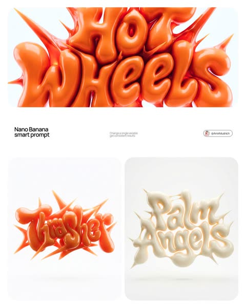</a>

Locking the whole sculpture to one latex material and one colour family, with a white studio backdrop, means swapping only the brand and colour variables keeps results consistent. Subsurface scattering, soft elongated highlights and a frontal camera slightly above centre make it read as a CGI product render.

Nano Banana 2 · Text-to-image · Source: [@AmirMushich on X](https://x.com/AmirMushich/status/2043381172646920237) · 2,640 likes on 2026-10-29

[`3d-typography`](tags.md#tag-3d-typography) [`logotype`](tags.md#tag-logotype) [`inflated-latex`](tags.md#tag-inflated-latex) [`studio-render`](tags.md#tag-studio-render)

<details><summary><b>Prompt</b></summary>

```text
(access Nano Banana 2 here:
https://
amirmushich.link/LTX26)

[BRAND NAME] | [COLOR]

Act as a 3D Type Designer and CGI Artist working at the intersection of streetwear culture, Y2K aesthetics, and high-end digital sculpture. Your references: Nigo, Futura, Guccimaze, Soulwax art direction.

---

PHASE 1: TYPOGRAPHIC CONCEPT

Render the word or logotype [BRAND NAME] as a fully 3D sculptural object — not a flat text with extrusion, but a living, inflated, organic type sculpture. Style: Wildstyle graffiti DNA fused with inflatable balloon morphology. Letters are not separate — they flow into each other as one continuous organic mass. Each letterform has: bulbous pneumatic body as if inflated under high pressure from within, stretching the surface taut. Aggressive spike extensions — sharp tapered protrusions erupting between and around letters, directional, asymmetric, energetic, some long and blade-like, others short and thorn-like. Wildstyle overlaps — letters partially occlude each other creating depth layers, classic graffiti ambiguity where readability fights with visual complexity. Organic connective tissue — negative spaces between letters filled with stretched membrane forms, like rubber pulled between two inflated surfaces.

---

PHASE 2: MATERIAL & SURFACE

Single unified material across the entire sculpture — no color variation between letters. Material type: high-gloss latex / inflated rubber / soft silicone — the surface behaves like a balloon skin stretched to near-bursting point. Subsurface scattering: active — light penetrates slightly into the material, creating a translucent inner glow at thin edges and spike tips. Thinner areas read lighter, denser volumes read darker. Specular highlights: large, soft, slightly elongated — the kind you get on inflated latex, not hard plastic. Multiple secondary highlights in concave zones. Apply [COLOR] as the sole material color of the entire sculpture — this is non-negotiable. [COLOR] defines the pure midtone of the material. Highlights push toward the most luminous near-white version of [COLOR]. Shadow zones and deep crevices push toward the darkest most saturated version of [COLOR]. The entire chromatic range of the sculpture lives within the [COLOR] family — no hue deviation, no neutral grays.

---

PHASE 3: COMPOSITION & STAGING

Background: pure white (#FFFFFF) — clinical studio isolation. Zero texture, zero gradient. Shadow: none, or absolute minimum contact shadow directly beneath the sculpture — the object appears to float slightly. Orientation: horizontal spread — the sculpture is wider than tall, expanding laterally. Spike elements breach the invisible bounding box on all sides — top spikes reach upward, side extensions push outward. Camera angle: straight-on frontal, slightly elevated 5 to 10° above center — reveals the full typographic mass while showing the 3D depth of overlapping elements. Depth of field: none — sharp from foreground spikes to background letter bodies, every detail in focus. Scale feel: monumental — as if the sculpture is 2 meters wide in physical space, photographed in a white infinity studio.

---

PHASE 4: TECH SPECS

Render engine: Octane Render or Redshift — physically accurate subsurface scattering mandatory. Global illumination: large soft HDRI dome light, neutral white temperature 5500K. No directional shadows. No rim lights. No background elements. Ray tracing: on — for accurate specular and inter-reflection between letter surfaces. Anti-aliasing: maximum — edges must be razor-clean against white background. Output feel: this is a CGI product render, not AI art. Precision over expressionism. Aspect ratio: 1:1 square — centered composition with breathing room on all four sides.
```

</details>

<a id="nano-banana-embroidered-brand-crest-waffle-knit"></a>
### Embroidered heritage crests on waffle-knit cotton

<a href="https://x.com/AmirMushich/status/2044829425464656123">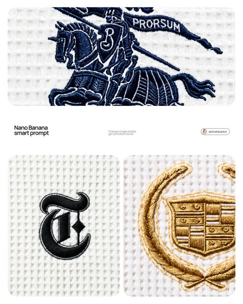</a>

A single brand slot drives a phased spec that turns the logo into satin stitch, a lighter backing outline and shifting thread tones. Flat overhead light, a perpendicular camera and a fixed waffle grid keep the result looking like textile documentation rather than a stylised render.

Nano Banana 2 · Text-to-image · Source: [@AmirMushich on X](https://x.com/AmirMushich/status/2044829425464656123) · 1,604 likes on 2026-10-29

[`embroidery`](tags.md#tag-embroidery) [`macro-photo`](tags.md#tag-macro-photo) [`textile`](tags.md#tag-textile) [`logo`](tags.md#tag-logo)

<details><summary><b>Prompt</b></summary>

```text
(access Nano Banana 2 here:
https://
amirmushich.link/AMIR-LTX)

[BRAND NAME]

Act as a Macro Product Photographer and Textile Art Director shooting a close-up editorial campaign of a premium embroidered garment. References: Loro Piana fabric campaigns, Brunello Cucinelli texture photography, A.P.C. garment detail shoots, Japanese boro textile documentation.

PHASE 0: BRAND LOGO INTELLIGENCE

Retrieve the canonical logotype or primary mark of [BRAND NAME] from training data. Identify the core geometric essence of the logo — its fundamental shapes, stroke relationships, and compositional balance. Translate this identity into an embroidery-native form language: sharp geometric elements become satin stitch bars and needle-point spikes, circular elements become dense satin stitch ovals or French knot clusters, complex letterforms are simplified into their most essential strokes while remaining recognizable. The embroidery interpretation must feel like a deliberate premium interpretation of the brand mark — as if [BRAND NAME]'s design team commissioned an embroidery artist to translate their logo into thread. Autonomously determine the thread color most iconic to [BRAND NAME] — this becomes the primary embroidery thread color. If [BRAND NAME] has no dominant single color, default to deep navy #1A2332.

PHASE 1: TEXTILE BACKGROUND

The background is a premium waffle-knit cotton fabric — the weave structure is a precise geometric grid of raised square cells, each cell approximately 2×2mm equivalent, separated by thin recessed channels running both horizontally and vertically. The raised nodes of each cell are flat-topped, not rounded — creating a regular orthogonal relief pattern across the entire surface. The fabric color is cold off-white — #F0F0EE to #EBEBEA range, with a very slight cool gray bias, not warm ecru or cream. The weave is consistent and uniform across the entire frame — machine precision, no tension variation, no distortion. Microscopic fiber fuzz is visible on the flat tops of the raised nodes — individual cotton fibers catching the diffused overhead light as a very fine surface bloom. The recessed channels between cells are in soft shadow — not deep shadow, just slightly darker than the raised nodes, consistent with flat overhead illumination.

PHASE 2: EMBROIDERY CONSTRUCTION SYSTEM

The logo mark of [BRAND NAME] rendered as machine or hand embroidery using these specific stitch techniques. Satin stitch: the primary technique for all filled areas and stroke elements — dense parallel threads laid side by side with zero gap, creating a smooth glossy surface. Thread direction follows the long axis of each stroke element — horizontal strokes have horizontal threads, diagonal strokes have diagonal threads. The characteristic sheen of satin stitch is critical: threads catch light along their length creating bright reflective zones on thread-parallel surfaces and darker zones on thread-perpendicular surfaces, creating a directional shimmer across the embroidery surface. Stem stitch or outline stitch: used for any curved linear elements — thin continuous line of overlapping thread segments following curves with natural flexibility. French knots: small circular dot elements rendered as tightly wound thread knots — each knot has a visible spiral wind pattern at macro distance. Spike elements: long tapering needle-like forms executed in satin stitch that tapers from full width to a single thread point — gradual and precise, ending in a razor-sharp thread tip.

Edge treatment: every embroidered element has a thin visible backing outline — 1 to 2 thread widths of the base fabric visible between the embroidery and the surrounding textile. This underlay/backing edge is slightly lighter than the main embroidery thread — it outlines every form and confirms the physical layering of embroidery over fabric.

Physical relief: the embroidery sits 1 to 3mm above the fabric surface — confirmed by a very subtle shadow halo directly underneath each embroidered element. The shadow is symmetrical around the embroidery perimeter, soft-edged, 1 to 2mm wide — consistent with flat overhead illumination, not directional raking light.

PHASE 3: THREAD MATERIAL

Primary thread color: autonomously determined brand color from PHASE 0. Thread material: mercerized cotton or silk embroidery thread — high sheen, smooth filament surface. The thread color is never flat — it shifts in value along its length based on light angle. Directly lit zones approach a lighter more luminous version of the base color. Shadow zones approach a deeper more saturated version. The overall embroidery reads as one unified color but contains a full tonal range within that color family. Secondary thread: the backing/underlay edge thread is 2 to 3 shades lighter than the primary thread — creating the characteristic light outline visible around all embroidered elements.

PHASE 4: COMPOSITION & CAMERA

Camera body: Canon EOS R5 or Nikon Z8 — full frame, 45 megapixel minimum for fabric texture resolution. Lens: Canon RF 100mm f/2.8L Macro IS USM or Nikon Z MC 105mm f/2.8 VR S — used at moderate close-up distance, not at maximum 1:1 magnification. Focus distance: 40 to 55cm — the embroidery fills approximately 30 to 40% of the frame height, leaving generous fabric context on all sides. This is a moderate close-up, not extreme macro — the full embroidery composition is visible with substantial textile surround. Aperture: f/8 to f/11 — deep depth of field, the entire embroidery and all surrounding fabric texture are in crisp simultaneous focus from corner to corner. No visible bokeh anywhere in the frame. Shutter speed: 1/200s with continuous light source. ISO: 100 — base ISO, zero noise, maximum tonal resolution in the subtle gray shadows of the waffle recesses. White balance: 5600K — neutral daylight, renders the cold off-white fabric accurately without warm or cool shift. Exposure: slightly bright ETTR — the off-white fabric renders as a luminous near-white, embroidery thread reads as deep rich dark against the bright ground. Aspect ratio: 4:5 portrait. Camera perpendicular to fabric plane — zero perspective distortion, embroidery geometry rendered faithfully.

PHASE 5: LIGHTING

Primary light: large diffused overhead source — a 120×120cm softbox or diffusion panel positioned directly above the fabric at 60 to 80cm distance. The light is as close to flat and directionless as possible. No raking angle — the light comes from directly above at 85 to 90° to the fabric plane. This flat overhead lighting creates: uniform brightness across the entire fabric field with no hot spots or falloff. Very short soft shadows in the recessed channels of the waffle grid — 1 to 2mm wide, soft-edged, falling straight down. Soft symmetrical micro-shadow halo directly beneath the embroidery — the 1 to 3mm relief creates a subtle darker zone immediately surrounding the embroidery perimeter, equal on all sides. No directional shadow — the shadow is not cast to one side. Secondary light: none. No fill, no rim, no accent. The single large overhead diffused source is the complete lighting setup. Overall mood: clinical, precise, bright — consistent with product documentation or high-end textile editorial photography where the subject must be seen with maximum clarity and zero atmospheric distraction.

PHASE 6: TECH SPECS

Render: Octane Render or Redshift with fiber/textile displacement geometry. Thread geometry: actual 3D cylindrical thread strands — each thread strand is a real geometric object casting real shadows on adjacent threads, not texture maps. Fabric weave: real geometric displacement mesh for waffle structure — not normal map. Ray tracing: on — for accurate micro-shadow casting between individual thread strands and between embroidery and fabric surface. Subsurface scattering: subtle on thread material — mercerized cotton and silk have slight translucency. Depth of field: physically accurate — f/8 to f/11 at 100mm at 40 to 55cm focus distance, full frame sharp corner to corner. Anti-aliasing: maximum. Sampling: minimum 2048 samples — zero noise in shadow zones, full tonal resolution in the off-white fabric field. Output feel: this image should be indistinguishable from a photograph taken with a Canon 100mm macro in a textile documentation studio. The viewer must feel the urge to touch the fabric.
```

</details>

<a id="gpt-image-liquid-metal-brand-glyph-white-bg"></a>
### Liquid metal angular brand glyph on white background

<a href="https://x.com/AmirMushich/status/2084353216666345517">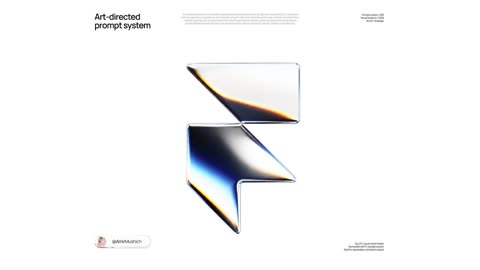</a>

A two variable template with bracketed brand and background slots applies the same material and lighting setup to any logo. A near orthographic front camera, one large softbox, black flags for graphite reflections and sparse thin film accents at light and dark transitions keep the render clean and studio grade.

GPT Image 2 · Text-to-image · Source: [@AmirMushich on X](https://x.com/AmirMushich/status/2084353216666345517) · 779 likes on 2026-10-29

[`liquid-metal`](tags.md#tag-liquid-metal) [`3d`](tags.md#tag-3d) [`logo`](tags.md#tag-logo) [`prompt-template`](tags.md#tag-prompt-template)

<details><summary><b>Prompt</b></summary>

```text
(more pro AI/design workflows:
http://
amirmushich.gumroad.com)

[BRAND NAME = ______________]
[BACKGROUND COLOR = _____]

Create a premium square 1:1 studio product render of the authentic standalone logo or primary symbol of [BRAND NAME], transformed into a refined sculptural glyph and isolated against a perfectly uniform [BACKGROUND COLOR] background.

LOGO ACCURACY

Use the authentic, immediately recognizable geometry and canonical proportions of the official [BRAND NAME] mark.

If the brand has a standalone symbol, use the symbol only. If no standalone symbol exists, use its official wordmark.

Do not redesign, reinterpret, simplify, distort or invent a new logo. Preserve all characteristic curves, cutouts, spacing, terminals and negative spaces. Do not add the brand name, slogans, badges or secondary graphic elements.

FORM

Transform the logo into a shallow, precision-manufactured sculptural relief rather than a flat graphic or a heavy extruded block.

The object should feel like a continuous folded ribbon or a fluid CNC-milled glyph:

— broad, clean frontal surfaces;
— slightly convex surface curvature;
— moderate physical thickness;
— softly rounded outer corners;
— narrow polished bevels along exposed edges;
— precise internal cutouts;
— smooth transitions between connected sections;
— minimal visible sidewalls;
— no excessive extrusion or bulky depth.

Disconnected parts of the logo must use exactly the same construction, scale of depth and material treatment.

Keep the front-facing silhouette extremely accurate and dominant. The dimensional treatment must support the original logo rather than alter it.

MATERIAL

Render the entire glyph in a pristine pearl-white liquid-metal material covered by a thin transparent dichroic PVD clear coat.

The material should appear primarily neutral and achromatic:

— luminous pearl white;
— pale silver;
— soft cool gray;
— deep smoked graphite;
— occasional near-black reflected areas.

Create broad dark graphite regions through reflections of large black studio flags, not through black paint or separate materials.

Add restrained thin-film interference only along selected transitions between bright and dark reflections. Use narrow localized bands of icy cyan, pale electric blue, deep indigo, warm amber, soft yellow and burnt orange.

The spectral colors must remain sparse, elegant and physically integrated into the reflections. They should follow the curvature of the glyph.

Do not cover the entire logo in rainbow colors. Do not create holographic foil, colorful gradients, neon illumination or an oil-slick texture.

The surface must feel perfectly smooth, cool, dense and tactile, combining the precision of polished metal with the softness of glazed ceramic.

No scratches, brushed texture, fingerprints, dust, grain, distressed details or surface imperfections.

SHADING AND REFLECTIONS

Build the visual character around flowing transitions between broad luminous white reflections and deep smoked-black reflections.

Between selected white and dark regions, introduce a narrow spectral transition containing cool cyan and blue on one side and restrained amber or orange on the other.

The reflection shapes must wrap naturally around the logo geometry and reveal its curvature.

Use smooth highlight roll-off, subtle edge reflections and delicate white contour highlights around selected internal cutouts.

Avoid random color placement. Every reflection and spectral band must respond coherently to the physical shape of the logo.

LIGHTING

Use a controlled luxury product-photography setup:

— one very large diffused frontal softbox positioned slightly above the camera;
— large black studio flags producing broad sculpted graphite reflections;
— one subtle cool strip-light reflection;
— one subtle warm strip-light reflection;
— soft global illumination;
— restrained specular bloom;
— no visible light sources.

The frontal surfaces should alternate elegantly between luminous pearl white and deep graphite, with small localized iridescent accents.

Do not use hard point-light hotspots, strong rim lighting, emissive edges or dramatic cinematic backlighting.

CAMERA

Use an almost perfectly front-facing camera with the sensor parallel to the primary face of the glyph.

Simulate an 85–105 mm premium product lens with mild telephoto compression and almost orthographic perspective.

Keep perspective distortion extremely low so the official logo proportions remain intact.

Use a moderately closed aperture so the entire glyph remains in focus. Do not create noticeable shallow depth of field or bokeh.

Add only very subtle optical diffusion, soft highlight halation and creamy antialiasing. The result should feel optically refined rather than digitally oversharpened.

COMPOSITION

Place the logo precisely in the center of the square frame.

The glyph should occupy approximately 42–48% of the image width, surrounded by generous negative space.

Show the object completely, without cropping or touching the frame edges.

Use a perfectly flat, seamless [BACKGROUND COLOR] field with no gradient, texture, vignette, environment or visible horizon.

Do not add a floor plane, pedestal, cast shadow, contact shadow, reflection beneath the object or surrounding scenery.

Adapt the balance of pearl-white and graphite reflections enough to keep the silhouette clearly readable against [BACKGROUND COLOR], but do not add an artificial outline.

RENDER QUALITY

Produce a physically believable, ray-traced premium CGI product render with clean geometry, precise bevels, coherent reflections, smooth tonal transitions and high-quality antialiasing.

The final image should feel minimal, mysterious, luxurious and tactile — like an experimental optical material photographed for a high-end technology or fashion identity.

Avoid conventional chrome, fully mirrored surfaces, rainbow metal, translucent glass, glossy plastic, inflated lettering, deep block extrusion, neon cyberpunk lighting, excessive bloom, aggressive sharpness, visible grain or decorative background elements.
```

</details>

<a id="gpt-image-mitsubishi-metallic-glyph-logo-render"></a>
### Mitsubishi three diamond mark as dark metal glyph

<a href="https://x.com/AmirMushich/status/2084003622753354096">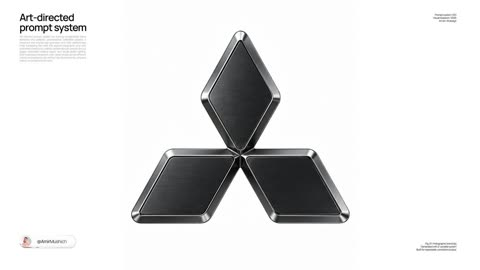</a>

A fill in template with brand, background and object colour slots keeps the logo geometry locked while fixed rules control the bevel, inset matte panels and studio lighting. Explicit bans on redesign, extra text and cast shadow keep the official mark clean.

GPT Image 2 · Text-to-image · Source: [@AmirMushich on X](https://x.com/AmirMushich/status/2084003622753354096) · 687 likes on 2026-10-29

[`logo-render`](tags.md#tag-logo-render) [`metallic`](tags.md#tag-metallic) [`studio-lighting`](tags.md#tag-studio-lighting) [`product-render`](tags.md#tag-product-render)

<details><summary><b>Prompt</b></summary>

```text
(my free & pro AI/design workflows:
http://
amirmushich.gumroad.com)

***

[BRAND NAME = _______]
[BACKGROUND COLOR = _______]
[OBJECT COLOR = ________]

Create a premium (AR 1:1) studio product render of the official logo or primary symbol of [BRAND NAME], transformed into a single precision-manufactured sculptural metal glyph.

LOGO ACCURACY

Use the authentic, immediately recognizable geometry and canonical proportions of the official [BRAND NAME] mark.

Do not redesign, reinterpret, simplify or invent a new logo.

Preserve the exact front-facing silhouette, internal negative spaces, spacing relationships and characteristic proportions of the original mark.

If the brand has an official standalone symbol, use the symbol only. If no standalone symbol exists, use its official wordmark.

Ignore the brand’s native colors and render the entire object using [OBJECT COLOR] as the single dominant material color family.

Do not add the brand name, captions or secondary typography unless typography is an inseparable part of the official primary logo.

FORM AND CONSTRUCTION

Convert the logo into a physically believable, precision-manufactured object rather than a basic flat extrusion.

The object should feel like a continuous architectural glyph, CNC-milled component or cast industrial emblem:

— broad, clean primary surfaces;
— substantial physical thickness;
— softly rounded outer corners;
— accurate internal cutouts;
— smooth structural transitions;
— controlled variation in depth;
— physically believable edge construction;
— no unsupported floating parts.

The object must remain elegant and minimal.

Do not add screws, visible mounting hardware, decorative seams, random panels or mechanical details that are not required by the original logo geometry.

EDGE ARCHITECTURE

Build a clearly visible metallic perimeter around the primary faces of the glyph.

The outer bevel must be moderately wide and visually substantial, closely matching the proportion and presence of the reference image.

It should be wider than a conventional narrow chamfer, but must not become oversized, inflated or decorative.

The bevel should:

— remain clearly readable at normal viewing size;
— follow the logo geometry with precision;
— transition smoothly around corners;
— catch long, controlled studio reflections;
— create a strong but restrained metallic contour;
— preserve the canonical silhouette of the logo.

Avoid razor-thin highlight lines, excessively sharp edges or oversized chrome borders.

INSET MATTE PANELS

Treat the broad front-facing areas of the logo as precision-fitted matte material inserts embedded inside the surrounding metallic structure.

Each primary matte face should feel slightly inset into the outer metal frame, as though it has been manufactured separately and carefully inserted, bonded or press-fitted into the sculptural body.

The inset panel must include:

— a very shallow recessed position;
— a soft, subtle bevel around its perimeter;
— an extremely fine separation gap between the matte insert and the surrounding metal frame;
— a microscopic slit-like shadow line inside this gap;
— delicate ambient occlusion where the two materials meet;
— clean and consistent spacing around the entire perimeter.

The separation gap must be extremely subtle: visible enough to distinguish the materials and communicate precision engineering, but never wide enough to resemble a decorative outline, deep groove or assembled plastic panel.

The matte insert, its micro-bevel, the narrow separation seam and the wider metallic outer bevel should create a refined hierarchy of edges.

Do not flatten the matte face and metallic frame into one continuous surface.

Do not add multiple unnecessary borders, concentric outlines or excessive panel layering.

MATERIAL AND OBJECT COLOR

Use [OBJECT COLOR] as the dominant color of the complete sculptural object.

Interpret [OBJECT COLOR] as a premium metallic finish such as anodized aluminium, PVD-coated metal, blackened titanium, coated steel or another physically believable high-end industrial material.

The broad inset faces should use a darker, softer and more matte variation of [OBJECT COLOR], with:

— refined satin roughness;
— extremely subtle directional brushing;
— fine micro-texture;
— restrained tonal variation;
— dense, tactile material depth.

The surrounding structural frame and wider outer bevel should use the same [OBJECT COLOR] family but with a smoother, more polished and more reflective finish.

The object should remain monochromatic. Create contrast through roughness, reflection, depth and lighting rather than through unrelated colors.

Selected bevels may catch pale metallic or near-white reflections from the studio lights, but the underlying material must remain visibly connected to [OBJECT COLOR].

The material must feel cold, dense, heavy and precisely manufactured.

Avoid mirror chrome across the entire object, liquid metal, glossy plastic, rubber, carbon fiber, glass, translucent material, glitter or cheap metallic paint.

LIGHTING

Use controlled high-end studio lighting against a perfectly uniform [BACKGROUND COLOR] background.

Place one large cool-white rectangular softbox above and slightly to the left of the object.

This source should create broad, smooth gradients across the upper surfaces and clearly reveal the width of the polished outer bevel.

Add a narrower strip light from the upper-right and slightly behind the object, creating a clean rim reflection along selected edges.

Use very weak frontal fill.

Keep recessed areas, microscopic material gaps, internal cavities and undersides deep enough to preserve dimensionality.

Use delicate ambient occlusion:

— inside internal cutouts;
— around overlapping or converging sections;
— inside the microscopic separation gap;
— beneath the softly beveled edges of the matte inserts.

The lighting must reveal the construction hierarchy:

outer polished frame,
wide bevel,
microscopic separation seam,
softly beveled matte insert,
deep structural body.

Do not illuminate the object evenly.

REFLECTIONS

Show only controlled abstract reflections produced by large professional studio softboxes and strip lights.

Reflections should appear as long, smooth, carefully placed bands that follow the object’s geometry.

Use the reflections to describe:

— the width of the outer bevel;
— the physical thickness of the glyph;
— the transition between polished frame and matte insert;
— the curvature of softly rounded corners.

Do not reflect a room, photographer, camera, windows, horizon, scenery or identifiable environment.

Avoid colorful environmental reflections, random hotspots, excessive specular noise and uncontrolled mirror-like glare.

CAMERA AND COMPOSITION

Photograph the object almost frontally using the visual character of a premium 90–110 mm product photography lens.

Use very low perspective distortion.

Introduce only a subtle three-quarter rotation and a slightly elevated camera position, allowing the physical depth, upper surfaces and wider bevels to remain visible without distorting the official logo silhouette.

Keep the logo centered horizontally and positioned near the vertical middle of the frame.

The object should occupy approximately 70–75% of the image width while remaining fully visible.

Surround it with generous, calm negative space.

The object should appear suspended in the studio environment without a visible support system.

DEPTH OF FIELD AND RENDER QUALITY

Keep nearly the entire glyph sharply focused.

Use only minimal natural depth falloff on the most distant edges.

No obvious bokeh, exaggerated macro blur or artificial focus effects.

Render with:

— physically accurate PBR materials;
— path-traced global illumination;
— realistic micro-roughness;
— precise ambient occlusion;
— clean anti-aliasing;
— high-resolution surface detail;
— smooth tonal transitions;
— accurate reflections;
— refined edge highlights.

The final result should feel like an actual luxury industrial object photographed in a professional studio: restrained, tactile, architectural, cinematic, precisely engineered and art-directed down to the microscopic material transitions.

Do not add extra text, captions, labels, particles, smoke, pedestal, floor, visible support, cast shadow, glow, neon light, lens flare, scenery or surrounding objects.
```

</details>

<a id="nano-banana-pepsi-phone-screen-pour"></a>
### Pepsi pouring from bottle into giant phone screen

<a href="https://x.com/HaniaAi12/status/2028309848429846690">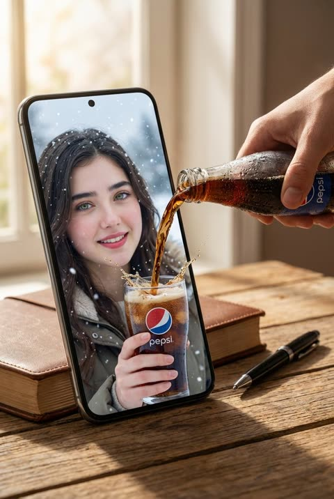</a>

The oversized phone next to real props like a closed book and a pen sets the scale, and a real hand pouring at the screen edge makes the liquid look like it crosses from the table into the glass on screen. The reference portrait keeps the on-screen person consistent.

Nano Banana 2 · Edit · Source: [@HaniaAi12 on X](https://x.com/HaniaAi12/status/2028309848429846690) · 413 likes on 2026-10-29

[`surreal`](tags.md#tag-surreal) [`advertising`](tags.md#tag-advertising) [`liquid-splash`](tags.md#tag-liquid-splash) [`scale-illusion`](tags.md#tag-scale-illusion)

<details><summary><b>Prompt</b></summary>

```text
A hyper-realistic surreal composite scene set on a wooden tabletop. A large oversized smartphone dominates the frame, creating a strong dimensional-break illusion. On the phone screen, the woman from the reference image appears much larger in a close-up winter environment, smiling happily while holding a clear glass with a visible Pepsi logo on it.

A real human hand pours dark Pepsi cola from a cold bottle covered in condensation droplets directly toward the phone screen. The liquid visually breaks through the display and flows into the glass she is holding inside the screen, creating a powerful surreal effect.

A closed book and a black pen sit on the wooden table beside the oversized phone to emphasize scale distortion. Warm natural lighting, soft cinematic shadows, ultra-sharp liquid splash details, hyper-realistic skin texture, realistic reflections on glass and screen, surreal cinematic advertising look, professional commercial photography quality, 8K realism.
```

</details>

<a id="gpt-image-kia-logo-blue-amber-metal-emblem"></a>
### Kia logo as blue black polished metal emblem

<a href="https://x.com/AmirMushich/status/2085055575117697113">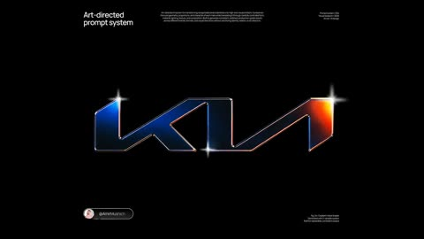</a>

A two variable template fixes the metal, edge and lighting rules, with a cool cobalt softbox on the left and an amber softbox on the right, so the colour comes from reflections rather than painted gradients. The emblem floats on a black field with no cast shadow, which keeps the logo a clean standalone object.

GPT Image 2 · Text-to-image · Source: [@AmirMushich on X](https://x.com/AmirMushich/status/2085055575117697113) · 346 likes on 2026-10-29

[`logo`](tags.md#tag-logo) [`metal`](tags.md#tag-metal) [`emblem`](tags.md#tag-emblem) [`template`](tags.md#tag-template)

<details><summary><b>Prompt</b></summary>

```text
(more pro AI/design workflows:
http://
amirmushich.gumroad.com)

[BRAND NAME = ______________]
[BACKGROUND COLOR = _____]

Create a square 1:1 studio CGI visualization of the authentic official logo of [BRAND NAME], translated into a shallow, precisely machined dark-metal emblem with satin blue-black front faces and mirror-polished contour bevels.

Use the brand’s most recognizable official standalone symbol whenever one exists. Preserve the authentic silhouette, canonical proportions, stroke relationships, internal negative spaces, counterforms, component spacing and characteristic curves. Do not redesign, simplify, combine or reinterpret the identity. Use the official wordmark only when the brand has no recognizable standalone symbol.

Ignore the logo’s native colors. Apply the fixed material and lighting system described below.

FORM AND CONSTRUCTION

Construct the logo as a real rigid CNC-machined or precision-cast metal emblem.

Keep the original component structure of the logo. If the official mark contains multiple separated elements, preserve them as separate physical pieces with narrow dark gaps between them. Do not connect them and do not add a backing plate.

Use a shallow badge-like extrusion rather than a thick freestanding sculpture.

Total extrusion depth should equal approximately 8–12% of the average local stroke width of the logo. Keep visible sidewalls narrow so the object remains visually close to a graphic symbol.

The main front surfaces must be broad, clean and almost flat, with only an extremely subtle convex optical curvature allowing large reflections to roll gently across the surface.

Do not inflate, pillow or soften the logo. Preserve straight edges, controlled diagonals and the original geometry.

EDGE ARCHITECTURE

Build a precise two-stage edge system around every exterior contour, interior cutout and negative space.

Create a primary rounded bevel approximately 4–7% of the local stroke width. The bevel should be narrow enough to preserve the graphic silhouette but wide enough to carry visible strip-light reflections.

Add an extremely narrow outer micro-bevel where the polished bevel meets the dark sidewall. This secondary edge should occasionally produce a second hairline reflection.

Convex exterior corners should have restrained mechanical rounding, approximately 1.5–2 times the width of the primary bevel.

Concave interior corners should use slightly larger smooth fillets, approximately 2–3 times the bevel width, creating continuous curled specular reflections around internal transitions.

Blend diagonals, horizontal sections and curved junctions tangentially. Avoid sharp miter spikes, broken bevels, melted transitions or irregular edge widths.

The bevel must follow the real logo geometry continuously. It must not appear as a separately drawn outline.

MATERIAL SYSTEM

Use one coherent blackened-metal material family with controlled roughness variation.

Front faces:

deep blue-black blackened nickel, dark titanium or very dark anodized metal;

smooth satin to semi-gloss finish;

roughness approximately 0.24–0.32;

high specular response;

subtle blue-green undertone;

extremely fine micro-roughness;

no visible brushing, scratches, dirt or coarse texture.

Primary bevels:

exposed mirror-polished nickel or chrome;

roughness approximately 0.02–0.06;

highly reflective;

capable of producing narrow white, blue, cyan, red and orange reflection bands.

Sidewalls:

the same blue-black metal;

darker than the front faces;

semi-polished;

roughness approximately 0.10–0.16;

visually restrained and visible only in narrow localized areas.

The surface should feel dense, smooth, cold and precisely manufactured.

Do not use a rainbow coating, holographic film, iridescent material, colored plastic, transparent glass or emissive surfaces. All blue, cyan, magenta, red and orange coloration must come from physically reflected studio lights rather than painted gradients.

LIGHTING ARCHITECTURE

Build a controlled product-photography lighting environment using large rectangular reflection sources and strong negative fill.

The object-lighting environment and the visible background must be treated independently. Preserve the dark studio reflection system on the metal even when [BACKGROUND COLOR] is bright or white.

Place one large cobalt-blue rectangular softbox above and to the left of the camera, approximately 25–35 degrees off the viewing axis.

This cool source should create:

a broad cobalt, navy and subtle teal reflection across the left and upper portions of the satin front faces;

narrow cyan-blue reflection lines along selected upper, left and interior bevels;

soft blue tonal information inside otherwise near-black surfaces.

Place one large amber-orange rectangular softbox above and to the right of the camera, approximately 35–45 degrees off the viewing axis.

This warm source should create:

a broad amber, orange and red reflection wedge across selected right-hand portions of the front faces;

hot orange-to-white reflections along right-facing and diagonal polished bevels;

small restrained red and magenta transitions where the warm and cool reflections overlap.

Add one narrow neutral-white strip light high on the right side. Position it so it appears only as a sharp, locally clipped white pinline on selected polished bevels.

Keep frontal fill extremely restrained. Use black flags and negative fill so the central parts of the logo remain deep blue-black rather than evenly illuminated.

Do not allow the visible background to flatten the material through excessive ambient fill.

REFLECTION BEHAVIOR

Treat reflections as a structural part of the object.

On the satin front faces, reflections should be broad and softly bounded, occupying approximately 15–35% of the relevant surface.

On the polished bevels, the same sources should compress into narrow high-intensity bands approximately 1–3% of the local stroke width.

Allow some polished edges to become nearly white, while other contours remain blue, red or almost completely black according to their physical orientation.

Do not create a continuous uniform illuminated outline around the logo.

Reflection lines must change width, intensity and color naturally as the bevel rotates through space.

Create especially strong curved reflections around concave internal fillets and smooth diagonal-to-horizontal transitions.

Use physically plausible Fresnel response, ray-traced reflections, restrained ambient occlusion inside cutouts and deep shadow separation between disconnected logo components.

Do not paint a blue-orange gradient directly onto the object.

FLOATING BEHAVIOR AND SHADOW CONTROL

The complete 3D emblem must visibly float in open space, parallel to the image plane.

It must not rest on, touch, lean against or appear mounted onto the background.

Maintain a clear visual separation between the object and the backdrop without using a floor, pedestal, support, wire, mounting hardware or visible attachment.

For white, off-white, pale gray, pastel or otherwise light [BACKGROUND COLOR] values:

— create absolutely no cast shadow on the background;

— no contact shadow;

— no drop shadow;

— no shadow halo;

— no gray grounding patch;

— no ambient-occlusion stain behind the object;

— no dark edge contamination caused by the background;

— no suggestion that the object is lying on a surface.

The background behind and around the logo must remain clean and evenly colored.

The floating effect must be communicated through the object’s shallow sidewalls, controlled lighting, internal shading and isolated silhouette—not through a projected shadow.

For dark backgrounds, an extremely subtle tonal separation may appear immediately around the silhouette, but it must not read as a directional cast shadow or contact shadow.

BACKGROUND AND COMPOSITION

Use [BACKGROUND COLOR] as the actual visible color of a seamless studio background.

When [BACKGROUND COLOR] is white or another bright color, preserve it as a genuinely bright, clean background. Do not automatically darken it to charcoal or near-black.

For light backgrounds:

— use an evenly illuminated seamless field;

— maintain subtle natural tonal softness rather than an artificial pure digital cutout;

— keep texture extremely fine and nearly invisible;

— avoid vignette darkening directly behind the object;

— preserve clean separation from the dark emblem;

— do not create shadows or grounding effects.

For dark backgrounds:

— use a low-reflectance near-black or deeply tinted surface;

— allow an extremely subtle velvety painted-paper or studio-fabric texture;

— use only a restrained vignette.

Do not allow the background color to create strong ambient spill on the logo.

Do not create a visible horizon, corner, wall-to-floor transition or physical supporting surface.

Place the complete logo in the center of the square frame. Keep the entire official mark visible and uncropped.

The emblem should occupy approximately 64–68% of the image width and height, with calm negative space around it.

Float the emblem freely in the center of the frame, parallel to the background and separated from it by an implied distance.

Do not create a floor, pedestal, mounting plate, ground reflection or cast shadow.

CAMERA AND FOCUS

Use a 105–135 mm product-photography lens character with strong depth compression and almost orthographic geometry.

Position the camera at the vertical center of the logo and almost perfectly perpendicular to the front surface.

Use only a minimal 2–4 degree yaw or pitch, enough to reveal the bevel and narrow sidewalls without turning the object into a three-quarter product shot.

Avoid wide-angle distortion, dramatic perspective and exaggerated extrusion.

Use approximately f/8–f/11 depth-of-field behavior.

Keep the complete logo, all contours and internal cutouts sharply focused.

Allow only the background texture to soften slightly.

Do not use background blur as a substitute for physical separation.

RENDER CHARACTER

Render as physically based, high-dynamic-range, path-traced advertising CGI with precise geometric shading.

Preserve deep near-black shading within the object, saturated complementary blue-orange reflections and locally clipped white highlights on the polished bevels.

Add extremely restrained halation around the brightest white specular lines.

Add a tiny red-cyan optical fringe only around the most intense high-contrast highlights. It must feel like subtle lens or analog-print behavior, not a digital glitch.

Apply very fine uniform film grain and slight optical softness across the final image. The grain should belong primarily to the image finish, not make the metal appear coarse or sandy.

The final result should feel like a heavy, cold, precision-machined industrial emblem floating weightlessly in open space, photographed with a controlled studio reflection environment and a restrained late-analog advertising finish.

NEGATIVE CONSTRAINTS

No redesigned logo.

No generic substitute symbol.

No backing plate.

No additional text unless the official identity only exists as a wordmark.

No cropping.
No thick block-like extrusion.
No inflated or pillow-shaped geometry.
No soft plastic.
No glass.
No liquid metal.
No holographic or rainbow material.
No painted multicolor gradient.
No neon.
N LED outline.
No emissive edges.
No uniform glowing contour.
No artificial vector stroke around the logo.
No bloom halo around the entire object.
No random environment reflections.
No visible room or landscape reflected in the metal.
No floor.
No pedestal.
No support structure.
No mounting hardware.
No visible attachment.
No object touching the background.
No object resting on a surface.
No cast shadow on light backgrounds.
No contact shadow on light backgrounds.
No drop shadow on light backgrounds.
No shadow halo on light backgrounds.
No ambient-occlusion stain behind the object on light backgrounds.
No gray grounding patch beneath or behind the object.
No glossy ground reflection.
No dramatic three-quarter angle.
No wide-angle perspective.
No strong macro blur.
No bokeh.
No coarse grain.
No heavy scratches, fingerprints, dust or distressed texture.
No razor-sharp unfinished edges.
No oversized rounded corners.
No excessive bevel width.
```

</details>

<a id="gpt-image-kfc-giant-bucket-woman-ad"></a>
### Woman in white leaning on giant KFC bucket

<a href="https://x.com/MrDasCreates/status/2049527944905982314">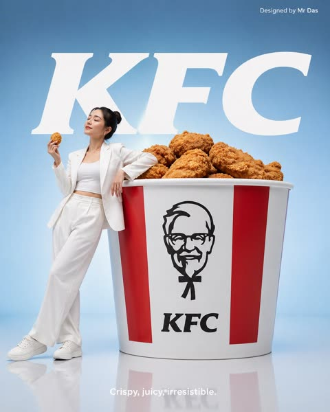</a>

Each element is listed with its position, such as the top-right credit and bottom-center tagline, so every text block lands where the prompt asks. Placing a person beside an oversized product and specifying soft studio light and a reflective floor gives it a clean commercial look.

GPT Image 2 · Text-to-image · Source: [@MrDasCreates on X](https://x.com/MrDasCreates/status/2049527944905982314) · 312 likes on 2026-10-29

[`ad`](tags.md#tag-ad) [`kfc`](tags.md#tag-kfc) [`text-layout`](tags.md#tag-text-layout) [`studio-lighting`](tags.md#tag-studio-lighting)

<details><summary><b>Prompt</b></summary>

```text
GPT Image 2 on ChatGPT app

Prompt: Minimalist commercial ad featuring oversized KFC bucket, ultra-clean design. A young woman in all-white outfit leans casually against the giant bucket, relaxed confident pose, eyes closed, also holding a piece of fried chicken. Soft gradient blue background with large bold white “KFC” text behind. Glossy reflective floor, soft studio lighting, modern high-end fashion/product photography. Small top-right text “Designed by Mr Das”. Bottom center tagline in small white font: “Crispy, juicy, irresistible.”
```

</details>

<a id="nano-banana-ana-de-armas-kitkat-dark-campaign"></a>
### Ana de Armas biting dark KitKat Delights bar

<a href="https://x.com/Just_sharon7/status/2030224774526632093">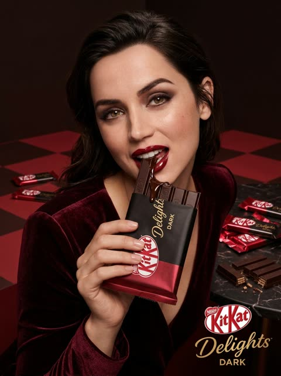</a>

Naming the celebrity together with the exact product name and a fixed red and black palette keeps the person and the branding consistent across the frame. The stated 3:4 ratio, studio lighting and editorial advertising style set the campaign look.

Nano Banana 2 · Text-to-image · Source: [@Just_sharon7 on X](https://x.com/Just_sharon7/status/2030224774526632093) · 140 likes on 2026-10-29

[`celebrity`](tags.md#tag-celebrity) [`food-photography`](tags.md#tag-food-photography) [`brand-campaign`](tags.md#tag-brand-campaign) [`chocolate`](tags.md#tag-chocolate)

<details><summary><b>Prompt</b></summary>

```text
Ana de Armas starring in a bold luxury advertising campaign for KitKat Delights DARK chocolate, ultra-detailed product photography, glamorous Ana de Armas with glossy red lips and confident expression biting into a thick dark chocolate KitKat bar, rich molten dark chocolate dripping and splashing dramatically, stacked KitKat bars and broken wafers revealing crispy layers, shiny metallic red KitKat wrappers everywhere, intense deep red and dark brown color palette, powerful red KitKat branding, Ana de Armas in a stylish maroon fashion outfit pushing a shopping cart overflowing with KitKat Delights DARK packs on a red checkered floor, molten chocolate pouring from above onto towering stacks of chocolate blocks and KitKat bars, dramatic studio lighting with strong shadows and highlights, indulgent premium mood, high fashion editorial advertising aesthetic, clean minimal background in deep red and black, cinematic lighting, photorealistic, ultra sharp focus, 8k commercial food photography, luxurious and eye-catching campaign --ar 3:4 --stylize 250 --v 6
```

</details>

<a id="nano-banana-nestle-chocolate-logo-plate"></a>
### Nestlé logo drawn in melted chocolate on plate

<a href="https://x.com/Goodmanprotocol/status/2038979200795934955">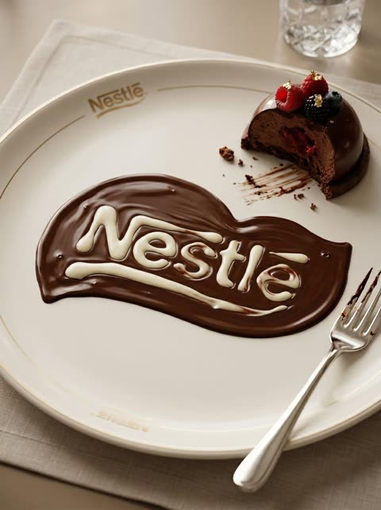</a>

Uploading the logo and asking for an exact shape transform keeps the mark readable. Fluid vocabulary such as high viscosity, pooling, streaks and air bubbles makes the chocolate look like real poured liquid, and the same logo engraved on the plate beside a partly eaten dessert ties the brand into a natural table setting.

Nano Banana 2 · Edit · Source: [@Goodmanprotocol on X](https://x.com/Goodmanprotocol/status/2038979200795934955) · 109 likes on 2026-10-29

[`food`](tags.md#tag-food) [`chocolate`](tags.md#tag-chocolate) [`brand-integration`](tags.md#tag-brand-integration) [`macro`](tags.md#tag-macro)

<details><summary><b>Prompt</b></summary>

```text
Transform the uploaded logo into a realistic dessert scene where the logo silhouette is formed naturally by melted chocolate spread across a plate, while the plate and dessert presentation are also subtly designed around the same logo as a brand identity.The logo must keep its exact shape and proportions, appearing both as a clean branded element (engraved or printed on the plate) and as a naturally melted chocolate formation created through real fluid behavior.

Material details:
Rich dark chocolate with high viscosity and glossy reflective surface.
Thicker areas forming smooth pools, thinner areas creating soft fading edges.
Visible chocolate streaks where it has been dragged or spread naturally.
Subtle ripples and surface tension curves, with occasional small air bubbles.

Physics behavior:
Chocolate should behave realistically — slow flow, rounded edges, gravity pulling it into thicker pools.
Slight directional flow suggesting it was poured or spread.
Variations in thickness depending on how it settled on the plate.
Natural imperfections — no perfectly sharp lines.

Surface interaction:
Ceramic or porcelain dessert plate with subtle gloss finish.
Plate includes a minimal branded logo (engraved, embossed, or printed).
Chocolate partially overlaps or interacts with the plate’s logo design for realism.
Small chocolate smears or residue near edges.

Environment & atmosphere:
Fine dining or café dessert setting.
Partially eaten dessert (cake, pastry, or mousse) nearby.
Subtle crumbs, fork marks, and realistic usage details.
Refined but not overly staged.

Lighting:
Soft warm lighting (restaurant or café ambiance).
Highlights reflecting on chocolate surface.
Gentle shadows adding depth to textures.

Camera & composition:
Slightly angled top-down macro shot.
Logo clearly visible through chocolate formation.
Balanced composition showing both dessert and branding.

Format:
Aspect ratio: STRICT 4:5 vertical.
No text overlays.

Style:
Hyper-real food photography.
Luxury dessert aesthetic with natural fluid realism.
Brand integrated into environment.
```

</details>

<a id="nano-banana-reebok-sports-equipment-logo"></a>
### Reebok logo sculpted from sports equipment

<a href="https://x.com/ShamsAmin56/status/2069718453821559218">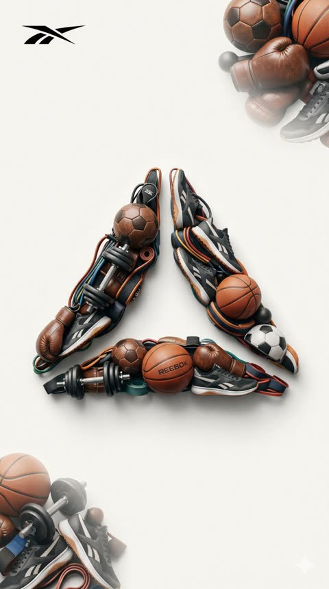</a>

A bracketed brand placeholder makes the template reusable for any brand, while the explicit #F5F5F0 background and 9:16 frame keep the layout stable. Cropped equipment clusters in the corners frame the centered symbol without competing with it.

Nano Banana 2 · Text-to-image · Source: [@ShamsAmin56 on X](https://x.com/ShamsAmin56/status/2069718453821559218) · 83 likes on 2026-10-29

[`sports`](tags.md#tag-sports) [`logo`](tags.md#tag-logo) [`3d`](tags.md#tag-3d) [`product-visualization`](tags.md#tag-product-visualization)

<details><summary><b>Prompt</b></summary>

```text
Create a premium 3D sports logo for [BRAND NAME], the main logo symbol realistically sculpted from a rich mix of sports equipment including soccer balls, basketballs, running shoes, tennis rackets, footballs, boxing gloves, dumbbells, and cricket bats fused together in dynamic floating 3D form, highly detailed textures and materials, cinematic studio lighting.

Top-left: small monochrome black [BRAND] logo.
Top-right corner: half-visible, slightly cropped cluster of sports equipment softly faded into background.
Bottom-left corner: half-visible, slightly cropped cluster of sports equipment softly faded.

Clean off-white background #F5F5F0, minimalist premium product visualization, 9:16 aspect ratio, sharp focus, 8k --stylize 250.

How to Use the Template

Replace the placeholders:
[BRAND NAME] → e.g. Nike, Adidas, Puma, Jordan Brand

[LOGO DESCRIPTION] → Describe the main logo shape/symbol (very important for good results)
```

</details>

<a id="nano-banana-coca-cola-can-snow-mountain"></a>
### Giant Coca Cola can frosted over snowy mountain peak

<a href="https://x.com/auqibhabib/status/2043220082881671596">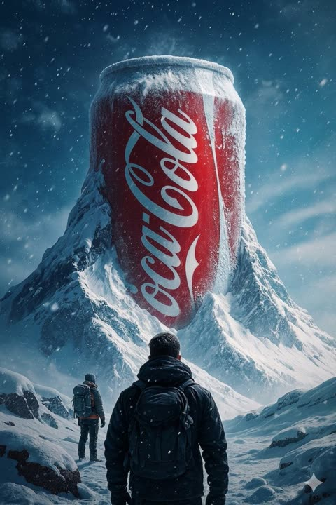</a>

A lone figure in the foreground facing away from the camera sets the scale for the giant can. Frost, falling snow and cool cinematic light blend the object into the rock so it reads as part of the mountain.

Nano Banana 2 · Text-to-image · Source: [@auqibhabib on X](https://x.com/auqibhabib/status/2043220082881671596) · 82 likes on 2026-10-29

[`surreal-scale`](tags.md#tag-surreal-scale) [`snow`](tags.md#tag-snow) [`brand`](tags.md#tag-brand) [`cinematic`](tags.md#tag-cinematic)

<details><summary><b>Prompt</b></summary>

```text
A monumental-scale, hyper-realistic photo of a colossal Coca-Cola soda can towering over a vast, snow-covered mountain range, much like a mountain peak itself. In the foreground, a single, lone explorer with a large backpack stands with their back to the camera, staring up at the titanic structure. The red can features the classic white "Coca-Cola" script logo and is partially covered in frost, snow, and ice, seamlessly integrating with the rugged, icy rock of the surrounding mountain range. The entire landscape is a sprawling, snow-laden valley under a dark, dramatic, cold blue sky filled with a flurry of fine, falling snow. Atmospheric perspective enhances the sense of awe and scale. Crisp, hyper-detailed textures on the metal, the explorer's clothing, the backpack, and the rugged, icy terrain. Dramatic, cool-toned cinematic lighting with deep shadows and soft, scattered light from the snowy atmosphere. Shot from a slightly low angle to emphasize the titanic scale. High resolution, 8k
```

</details>

<a id="gpt-image-nike-brand-identity-system-board"></a>
### Nike brand guideline board with palettes and mockups

<a href="https://x.com/Ziha_ai/status/2055681687284293991">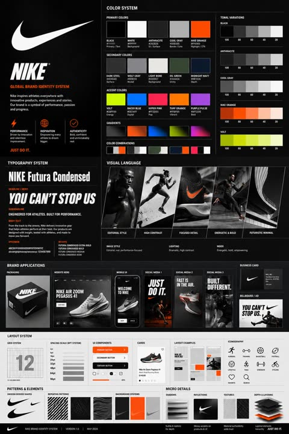</a>

Uploading the logo as a reference and filling the brand name into a fixed slot keeps every panel tied to one identity. Listing each section explicitly, with HEX codes, usage labels, a type hierarchy, a 4pt/8pt grid and mockups, forces a dense structured board instead of a loose mood piece.

GPT Image 2 · Edit · Source: [@Ziha_ai on X](https://x.com/Ziha_ai/status/2055681687284293991) · 80 likes on 2026-10-29

[`brand-identity`](tags.md#tag-brand-identity) [`style-guide`](tags.md#tag-style-guide) [`logo-reference`](tags.md#tag-logo-reference) [`mockup`](tags.md#tag-mockup)

<details><summary><b>Prompt</b></summary>

```text
Using the uploaded logo for (Brand name) generate a high-end, agency-grade brand identity system poster.

OBJECTIVE
Create a complete, presentation-ready brand guideline board that looks like it was designed by a top branding studio. The result must feel commercial, realistic, and client-deliverable, not conceptual.

INTELLIGENCE RULE (THIS IS WHAT YOU WERE MISSING)
Before designing, analyze the logo and infer:
3 identity traits (based on analysis)

COLOR SYSTEM (SMART GENERATION)
Extract palette from logo automatically
Include:
Primary colors (3–5)
Secondary colors (3–5)
Accent colors

Each must show:
HEX codes
labeled usage (primary / UI / highlight / background)

Also generate:
gradients
color combinations
tonal variations

TYPOGRAPHY SYSTEM (MATCH PERSONALITY)
Select typography style based on brand:
luxury → elegant serif
tech → geometric sans
street → bold condensed
corporate → clean neutral sans

Show:
headline / subheadline / body
real text examples (brand-relevant, not lorem ipsum)
clear hierarchy

VISUAL LANGUAGE
Define and visualize:
image style (editorial / lifestyle / futuristic / minimal)
lighting (soft / dramatic / high contrast)
mood (energetic / premium / calm / disruptive)

Show:
3–5 visual tiles

BRAND APPLICATIONS (REALISM BOOST)
Generate consistent mockups:
packaging or product
website hero
mobile UI
3 social media creatives
business card
billboard / ad

All must feel real-world usable.

LAYOUT SYSTEM
grid system
spacing scale (4pt / 8pt system)

Show:
UI components
cards
buttons
layout examples

ICONOGRAPHY
6–10 icons style derived from brand (rounded / sharp / minimal / filled)

PATTERNS & ELEMENTS
shapes derived from logo
repeating motifs
background systems

MICRO DETAILS (THIS CREATES “PREMIUM FEEL”)
shadows
reflections
textures
depth layering

VISUAL STYLE CONTROL
modern editorial + system design hybrid
strong hierarchy
layered composition
controlled spacing

DENSITY RULE
minimum 30–50 elements
mix of macro + micro components
no empty or filler space

HARD RESTRICTIONS
no placeholders
no generic UI
no inconsistent styles
no random colors

FINAL OUTPUT
A high-end brand system poster that looks:
Behance feature-worthy
agency presentation-ready
visually consistent and detailed
```

</details>

<a id="gpt-image-plush-apple-logo-warm-healing-pillow"></a>
### Fluffy cream Apple logo pillow in sunlit garden

<a href="https://x.com/DeepBlueX0/status/2106744078834765911">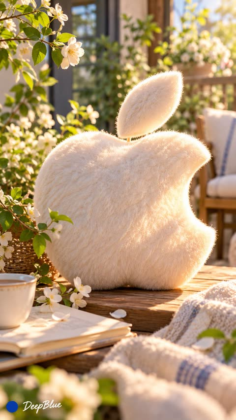</a>

The template keeps the brand as a slot and stacks mood, palette and material terms so a logo becomes a tactile product scene. These cues steer the lighting, texture and colour toward a soft cream and warm look.

GPT Image 2.5 · Text-to-image · Source: [@DeepBlueX0 on X](https://x.com/DeepBlueX0/status/2106744078834765911) · 27 likes on 2026-10-29

[`plush`](tags.md#tag-plush) [`logo`](tags.md#tag-logo) [`warm-tones`](tags.md#tag-warm-tones) [`product-photo`](tags.md#tag-product-photo)

<details><summary><b>Prompt</b></summary>

```text
[Brand] Logo × Warm and Healing Style × Softened Brand Colors × Soft Plush Material
```

</details>

<a id="nano-banana-concept-word-typography-2x2-grid"></a>
### Four concept words shaped into typographic symbols

<a href="https://x.com/Gdgtify/status/2109259469557563658">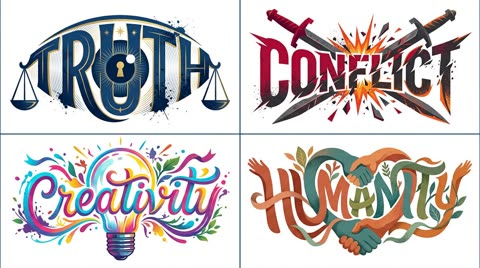</a>

A single template with a bracketed word slot and AI_INFER placeholders lets the model pick the symbol, texture and palette for each word. Numeric weights after each clause (::5 for the main idea, a negative weight for 3D and illegible text) steer the layout, and a 2x2 grid request gives four concepts in one render.

Nano Banana 2.1 · Text-to-image · Source: [@Gdgtify on X](https://x.com/Gdgtify/status/2109259469557563658) · 22 likes on 2026-10-29

[`typography`](tags.md#tag-typography) [`logo-design`](tags.md#tag-logo-design) [`gestalt`](tags.md#tag-gestalt) [`vector-style`](tags.md#tag-vector-style) [`grid`](tags.md#tag-grid)

<details><summary><b>Prompt</b></summary>

```text
Nano Banana 2.1's timing couldn't be any better. I have TONS of logo prompts to test.

Prompt: 2x2 grid, do this for truth, conflict, creativity, and humanity:      A clever, striking typographic illustration on a pure white background::5  The Typography: The word "[WORD/CONCEPT]" written in massive, bold font. The letters stretch, bend, and warp to perfectly form the physical shape of AI_INFER(a symbol representing the word)::5  The Details: AI_INFER(Highly stylized textures, flowing ribbons, ink splatters, or mechanical parts seamlessly blending into the letters)::4  The Palette: AI_INFER(A bold, thematic color scheme fitting the concept), high contrast, graphic design, vector art style::4  Style: Award-winning typography, Dribbble shot, logo design, gestalt illusion::3  3D render, messy, illegible, text overlay, unreadable, photography::-4
```

</details>

<a id="nano-banana-scientist-typographic-wordmarks-grid"></a>
### Four scientist surnames as experimental typographic wordmarks

<a href="https://x.com/Gdgtify/status/2113000873714442552">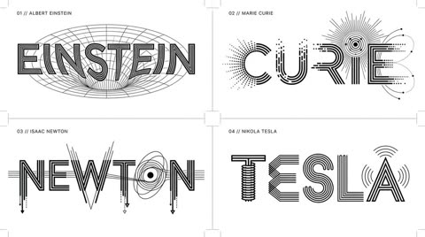</a>

Four concept anchors (geometric wordmark, semantic symbol type, technical lettering, Swiss minimalism) are fused into one visual DNA, then a subject analysis step maps each name to its own symbols. Strict rules for pure black on white and at least two transformed letters keep the result readable and consistent across the grid.

Nano Banana 2.1 · Text-to-image · Source: [@Gdgtify on X](https://x.com/Gdgtify/status/2113000873714442552) · 15 likes on 2026-10-29

[`typography`](tags.md#tag-typography) [`wordmark`](tags.md#tag-wordmark) [`swiss-minimalism`](tags.md#tag-swiss-minimalism) [`black-and-white`](tags.md#tag-black-and-white) [`grid`](tags.md#tag-grid)

<details><summary><b>Prompt</b></summary>

```text
Another fun experiment for scientists. This one was done with Nano Banana 2.1

Prompt: 2x2 grid, 16:9, do this for 4 famous scientists: CONCEPT ANCHOR 1:
"Experimental geometric wordmark — custom-built uppercase
letterforms, monoline geometry, alternating thick and thin
strokes, deliberately interrupted character segments,
mechanically precise shapes, optical alignment,
architectural negative space."

::

CONCEPT ANCHOR 2:
"Semantic symbol typography — recognizable visual symbols
integrated directly into the anatomy of letters, including
modified counters, transformed stems, symbolic crossbars,
illustrative terminals, and conceptual ligatures."

::

CONCEPT ANCHOR 3:
"Vintage scientific and engineering lettering — parallel
technical lines, concentric rings, rotational diagrams,
rhythmic stroke repetition, exploded mechanical shapes,
technical-drawing precision, scientific schematic clarity."

::

CONCEPT ANCHOR 4:
"Swiss modernist minimalist identity — immaculate white
background, pure black graphic elements, striking negative
space, precisely controlled typography, asymmetrical visual
balance, intellectually playful reduction."

INSTRUCTION:

Find the precise visual intersection of these four concepts.

Ignore the literal technological terminology
and subject matter in the references.

Extract only their visual design DNA.

Create an extraordinary experimental typographic
wordmark for $ SUBJECT.

The letters must become an intelligent visual
expression of the subject's defining meaning.

This is not ordinary text decorated with icons.

The word itself must transform into a symbolic
piece of visual engineering.

SUBJECT ANALYSIS:

First determine:

1. The most recognizable word or short phrase
   representing $ SUBJECT.

2. Its strongest defining visual characteristic.

3. Its dominant conceptual properties.

4. Three to five relevant visual symbols.

5. The geometric behaviors that best communicate
   the subject.

6. Which letters offer the most promising
   opportunities for transformation.

SEMANTIC TRANSFORMATION:

If the subject represents:

MOTION:
Use directional strokes, displacement, repeated
contours, kinetic breaks, and rhythmic geometry.

NATURE:
Translate growth, branching, organic repetition,
and environmental forms into letter anatomy.

SCIENCE:
Use scientific geometry, orbital paths, schematic
forms, diagrams, and precision linework.

MUSIC:
Incorporate visual rhythm, wave structures,
oscillations, and musical relationships.

ARCHITECTURE:
Transform stems and counters into arches,
structural supports, beams, and architectural voids.

TECHNOLOGY:
Use mechanical precision, circuitry, modular
systems, communication patterns, or interface geometry.

EMOTION:
Use spatial tension, expansion, compression,
contrast, distortion, or expressive continuity.

HISTORY:
Use carefully selected era-specific geometric
or typographic influences.

ABSTRACT CONCEPTS:
Invent a meaningful visual metaphor and
translate it into letter construction.

OTHER SUBJECTS:
Infer a unique transformation appropriate
to the subject's actual meaning.

LETTERFORM CONSTRUCTION:

Start with a custom geometric uppercase wordmark.

Transform selected characters through:

- parallel stroke multiplication
- interrupted or fragmented stems
- negative-space symbols
- custom ligatures
- extended horizontal bars
- geometric letter substitutions
- contour-line repetition
- directional stroke bending
- optical illusion effects
- embedded subject-specific pictograms
- carefully controlled line thickness
- mathematical relationships between shapes

Preserve character recognition.

At least two characters should exhibit
meaningful custom transformations.

Every transformation must serve the
concept rather than exist as decoration.

COMPOSITION:

Present ONE unified wordmark centered within
a generous white canvas.

Use a horizontal composition for longer names.

Use a compact stacked lockup when the text
naturally benefits from multiple lines.

Allow selected characters to extend beyond
the standard letter height when necessary.

Maintain carefully balanced optical spacing.

Let negative space contribute as much
as the black geometry.

VISUAL STYLE:

- pure black lettering
- clean white background
- high-contrast vector-like precision
- crisp geometric contours
- controlled thin parallel lines
- variable stroke density
- subject-driven symbolic elements
- elegant modular structure
- visually clever typographic surprises

STRICT RULES:

No unnecessary illustrations.
No photographic objects.
No gradients.
No 3D extrusion.
No decorative backgrounds.
No mockups.
No unrelated symbols.
No default electrical motifs.

Do not sacrifice readability for cleverness.

OUTPUT:

A visually ingenious minimalist typographic
identity for $ SUBJECT where the wordmark itself
becomes a symbolic machine, diagram, sculpture,
or optical expression of the subject.

Elegant from far away.
Surprisingly intelligent up close.
Immediately recognizable.
Distinctly original.
```

</details>

<a id="gpt-image-bakery-logo-transparent"></a>
### Bakery logo on a transparent background

<a href="https://developers.openai.com/api/docs/guides/image-prompting#design-a-reusable-logo"></a>

Asks for an original flat mark that reads at small and large sizes, then spells out the transparent background with clean alpha edges and no backdrop, checkerboard or watermark. Pair it with background=transparent in the API.

GPT Image 2.5 · Text-to-image · Source: [OpenAI image prompting guide](https://developers.openai.com/api/docs/guides/image-prompting#design-a-reusable-logo)

[`logo`](tags.md#tag-logo) [`transparent`](tags.md#tag-transparent) [`vector`](tags.md#tag-vector)

<details><summary><b>Prompt</b></summary>

```text
Create an original, non-infringing logo for a company called Field & Flour, a local bakery.
The logo should feel warm, simple, and timeless. Use clean, vector-like shapes, a strong silhouette, and balanced negative space.
Favor simplicity over detail so it reads clearly at small and large sizes. Flat design, minimal strokes, no gradients unless essential.
Fully transparent background. Deliver a single centered logo with generous padding, clean alpha edges, and no solid backdrop, scenery, checkerboard, or watermark.
```

</details>

<a id="gpt-image-bichon-shop-skeuomorphic-app-icon"></a>
### Bichon puppy in pink shopping bag app icon

<a href="https://x.com/iamaiistudio/status/2071923809788285125"></a>

The prompt fixes the format with a single squircle, an 80 percent canvas fill and a white background, then names the macOS App Store skeuomorphic style. The short app name drives the subject and lettering while the model fills in the details.

GPT Image 2 · Text-to-image · Source: [@iamaiistudio on X](https://x.com/iamaiistudio/status/2071923809788285125) · found via [freestylefly/awesome-gpt-image-2](https://github.com/freestylefly/awesome-gpt-image-2)

[`app-icon`](tags.md#tag-app-icon) [`skeuomorphic`](tags.md#tag-skeuomorphic) [`macos`](tags.md#tag-macos) [`squircle`](tags.md#tag-squircle) [`cute`](tags.md#tag-cute)

<details><summary><b>Prompt</b></summary>

```text
A macOS app icon for an app named 'Bichon Shop'. A single squircle icon with smooth continuous rounded corners, centered on a white canvas with padding, occupying about 80% of the canvas. Modern light skeuomorphic macOS App Store style. Only one icon.
```

</details>

<a id="gpt-image-brand-envelope-coffee-four-styles"></a>
### Four coffee brand worlds around one cup

<a href="https://x.com/SRKDAN/status/2051482047248560393"></a>

A four phase template: anchor the brand in two lines of palette, texture and mood, then place the product inside that world, set the output format and add one signature element. Swapping only brand identity, product and format keeps the structure fixed while the look changes.

GPT Image 2 · Text-to-image · Source: [@SRKDAN on X](https://x.com/SRKDAN/status/2051482047248560393) · found via [freestylefly/awesome-gpt-image-2](https://github.com/freestylefly/awesome-gpt-image-2)

[`brand-identity`](tags.md#tag-brand-identity) [`product-ad`](tags.md#tag-product-ad) [`prompt-template`](tags.md#tag-prompt-template) [`coffee`](tags.md#tag-coffee) [`packaging`](tags.md#tag-packaging)

<details><summary><b>Prompt</b></summary>

```text
The Brand Envelope | GPT Image-2 Prompt #89

This takes any product photo and wraps it in your specific brand world. Different product each time. Same brand, every time.

PHASE 1 / ANCHOR: Describe [BRAND IDENTITY] in 2 lines. Palette, texture, mood.
PHASE 2 / INJECT: Place [PRODUCT] inside that brand world, not the reverse.
PHASE 3 / FORMAT: Set [OUTPUT FORMAT]. Hero, square ad, or story.
PHASE 4 / SIGNATURE: Apply [BRAND ELEMENT]. Grain, shadow, or overlay.

Swap: [BRAND IDENTITY] / [PRODUCT] / [FORMAT]
```

</details>

<a id="gpt-image-corporate-brochure-visual-system-preview"></a>
### Dark tech corporate brochure system preview sheet

<a href="https://x.com/MrLarus/status/2056974720893939950">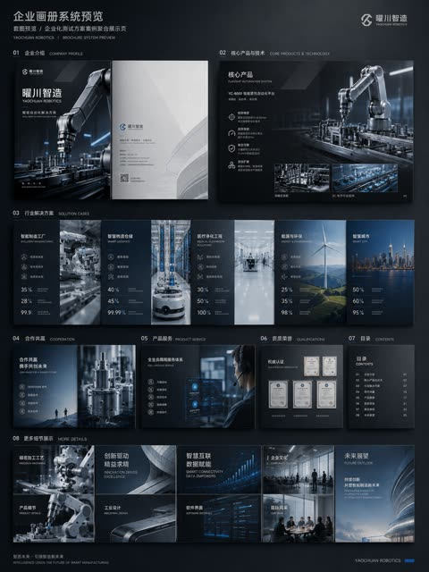</a>

The prompt lists every spread (cover, company profile, products, scenarios, cases, system preview) and sets a swappable style slot, so the output holds one brand system. Asking for a full set preview image, and warning against text only layouts, pushes it toward finished print collateral instead of a template.

GPT Image 2 · Text-to-image · Source: [@MrLarus on X](https://x.com/MrLarus/status/2056974720893939950) · found via [freestylefly/awesome-gpt-image-2](https://github.com/freestylefly/awesome-gpt-image-2)

[`brochure`](tags.md#tag-brochure) [`brand-system`](tags.md#tag-brand-system) [`corporate`](tags.md#tag-corporate) [`layout`](tags.md#tag-layout) [`dark-tech`](tags.md#tag-dark-tech)

<details><summary><b>Prompt</b></summary>

```text
请生成一套企业级商用画册视觉方案，主题为【品牌名称】的【行业 / 产品 / 解决方案】宣传画册。

整体风格：高端、专业、具有强视觉冲击力；避免传统 Word 排版感和普通 PPT 感。采用【深色科技美学 / 白色极简商务 / 高端工业风 / 艺术化品牌画册】风格。

画册内容包括：
1、封面与封底
2、企业介绍与品牌理念
3、核心产品与技术优势
4、应用场景与解决方案
5、客户案例与合作方式
6、全册系统预览图

要求：
版式要有设计感，图片、标题、数据、图标、留白和层级关系清晰；保持整套画册统一的品牌视觉系统；重点体现真实商业物料的完成度，避免简单文字排版。

结构规划：
1、封面 / 封底：建立品牌门面、行业气质和整体视觉调性。
2、企业介绍页：说明公司定位、能力边界和服务对象。
3、产品技术页：展示核心产品、技术优势和解决方案。
4、应用场景页：让用户看到产品能用在哪些行业。
5、案例 / 合作页：补充可信度和商业转化信息。
6、全册系统预览：验证风格统一性和整本画册的系统感。

如果已有企业资料，可以上传旧版企业画册、公司介绍文档、产品说明书、官网内容、PPT 提案、产品图片或案例图片，让 ChatGPT 完成三件事：
1、重新梳理内容结构，判断哪些内容适合做封面、企业介绍、产品页、案例页和合作页。
2、提炼画册主线，避免只堆资料，需要形成清晰的商业叙事。
3、统一视觉方向，让整本画册看起来像同一个品牌系统，避免不同页面拼贴感。

避坑：
1、避免一上来只说“生成一本画册”，否则容易变成模板图。
2、避免只堆文字，画册一定要有产品视觉、场景图、数据模块和设计层级。
3、避免只生成单页，最好补一张全册预览图，才能体现完整系统感。
```

</details>

<a id="gpt-image-dark-minimal-avatar-site-vi-system"></a>
### Muted minimal VI board for avatar sharing site

<a href="https://x.com/xiaoxiaodong01/status/2046556758521573546"></a>

One style keyword and a one line brand brief are enough for a full multi panel VI board. The model adds the logo, muted palette, typography, UI screens and merchandise mockups on its own.

GPT Image 2 · Text-to-image · Source: [@xiaoxiaodong01 on X](https://x.com/xiaoxiaodong01/status/2046556758521573546) · found via [freestylefly/awesome-gpt-image-2](https://github.com/freestylefly/awesome-gpt-image-2)

[`vi-system`](tags.md#tag-vi-system) [`brand-board`](tags.md#tag-brand-board) [`dark-minimal`](tags.md#tag-dark-minimal) [`bilingual`](tags.md#tag-bilingual) [`website-design`](tags.md#tag-website-design)

<details><summary><b>Prompt</b></summary>

```text
[中文]
用 ABCD（a black cover design) 的风格，为 图你太美 设计一个 vi 系统。图你太美是一个头像美图分享 网站。

[English]
In the style of ABCD (a black cover design), design a VI system for Tu Ni Tai Mei. Tu Ni Tai Mei is an avatar and beauty photo sharing website.
```

</details>

<a id="gpt-image-disco-mosaic-cube-app-icon"></a>
### Disco mosaic cube app icon with letter N

<a href="https://x.com/vista8/status/2056308962778296715">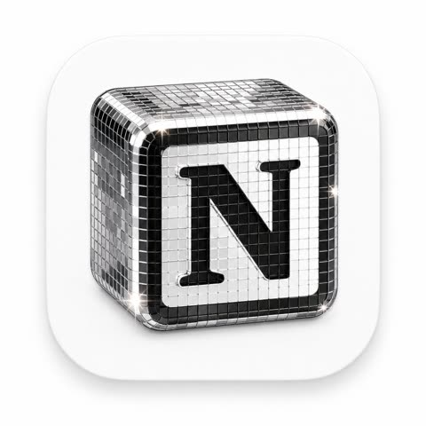</a>

Fixed material terms (chrome, mirror mosaic tiles, studio light) set the surface look, while the rounded white tile frames the icon on a clean background. Naming Blender and ultra detailed steers the result toward a polished product render.

GPT Image 2 · Text-to-image · Source: [@vista8 on X](https://x.com/vista8/status/2056308962778296715) · found via [freestylefly/awesome-gpt-image-2](https://github.com/freestylefly/awesome-gpt-image-2)

[`app-icon`](tags.md#tag-app-icon) [`disco-mosaic`](tags.md#tag-disco-mosaic) [`chrome`](tags.md#tag-chrome) [`3d-render`](tags.md#tag-3d-render)

<details><summary><b>Prompt</b></summary>

```text
为【品牌名】生成一个高级 3D App 图标，圆角方形底板，玻璃与金属铬材质，迪斯科球镜面马赛克小方块质感，闪亮高光，柔和工作室灯光，干净极简背景，高端产品图标风格，Blender 3D 渲染，超精细

英文版：

A premium 3D app icon for 【Product Name】, rounded square tile, glossy glass and chrome material, disco-ball mosaic mirror tiles, sparkling highlights, soft studio lighting, clean minimal background, high-end icon, Blender 3D render, ultra detailed
```

</details>

<a id="gpt-image-logo-concepts-ai-newsletter-sheet"></a>
### Five logo concepts with mockups for an AI newsletter

<a href="https://x.com/wanerfu/status/2048659924822184026"></a>

A role brief with a brand template to fill in sets one fixed structure for every concept, so each is described on the same fields and shown on business card, app icon and billboard mockups. The forced final pick turns the sheet into a side-by-side decision tool.

GPT Image 2 · Text-to-image · Source: [@wanerfu on X](https://x.com/wanerfu/status/2048659924822184026) · found via [freestylefly/awesome-gpt-image-2](https://github.com/freestylefly/awesome-gpt-image-2)

[`logo`](tags.md#tag-logo) [`brand-identity`](tags.md#tag-brand-identity) [`concept-sheet`](tags.md#tag-concept-sheet) [`mockup`](tags.md#tag-mockup) [`template`](tags.md#tag-template)

<details><summary><b>Prompt</b></summary>

```text
你是一位拥有20年经验的顶级Logo设计师，为全球知名品牌设计过即时识别且深具意义的标志。

品牌名称：[你的品牌名]
行业：[你的行业]
品牌个性：[描述]
目标受众：[描述]
欣赏的视觉身份：[列举3个]
讨厌的视觉身份：[列举3个]
偏好风格：[如极简、大胆、几何、有机、复古、未来]

为我的品牌生成5个完全不同的Logo概念。

对每个概念提供：

- 核心视觉理念及象征意义
- 形状语言及为何适合品牌
- 字体方向建议
- 第一眼的情感触发
- 为何适合目标受众
- 在名片、App图标和广告牌上的效果
- 何为永恒而非潮流

然后告诉我，如果这是你的品牌，你会选哪个以及原因。

2. 品牌身份基础提示词

你是为财富500强公司和初创企业建立品牌身份的顶级品牌战略师，这些企业后来融资数百万。

业务名称：[你的业务名]
业务描述：[一句话]
目标受众：[详细描述]
竞争对手：[列举3-5个]
想触发的感受：[如信任、兴奋、奢华、亲近、力量]
想关联的词汇：[列举5-10个]
不想关联的词汇：[列举5-10个]

在设计任何视觉效果之前建立完整的品牌身份基础。

为我提供：

- 品牌原型及为何完美契合
- 5个具体人类特征描述的品牌个性
- 带示例的品牌语调指南
- 核心品牌承诺（一句话）
- 3个品牌应触发的情感层级
- 与竞争对手的根本差异
- 定义品牌的唯一关键词

3. 配色方案提示词

你是色彩心理学专家和品牌设计师，深知色彩如何触发情感、建立信任和驱动购买决策。

品牌名称：[你的品牌名]
行业：[你的行业]
目标受众：[年龄、性别、收入、生活方式]
想触发的首要情感：[如信任、能量、奢华、平静、兴奋]
前3名竞争对手颜色：[列举]
喜欢的颜色：[列举]
讨厌的颜色：[列举]

为我建立完整品牌配色板。

为我提供：

- 主色及其HEX代码和心理学解释
- 两个辅助色及HEX代码
- 一个强调色用于CTA和高亮
- 一个中性色用于背景和文字
- 每种颜色对目标受众的影响
- 与竞争对手的差异化
- 在网站、社交媒体和包装上的应用示例
- 永远不要搭配的颜色组合及原因

4. 字体方向提示词

你是字体专家和品牌设计师，深知字体如何传达个性、建立可信度和实现品牌即时识别。

品牌名称：[你的品牌名]
品牌个性：[5个词]
行业：[你的行业]
目标受众：[描述]
字体应触发的感受：[如权威、友好、创新、优雅、能量]
喜欢的品牌字体：[列举3个]

为我建立完整字体系统。

为我提供：

- 标题用主显示字体名称及为何完美
- 长文本的辅助字体
- 引言或重点的强调字体
- 标题、副标题、正文、说明文字的精确字号层级
- 字距和行高建议
- 字体搭配方法
- 预算有限时的免费替代方案
- 你所在行业应避免的字体错误

5. 完整品牌身份包提示词

你是顶级品牌代理创意总监，交付覆盖每个触点的完整品牌身份系统。

业务名称：[你的业务名]
业务描述：[一句话]
目标受众：[详细描述]
品牌个性：[5个词]
行业：[你的行业]
竞争对手：[列举3个]
设计工具预算：[免费或付费]
时间表：[你需要的时间]

在一个回复中交付我的完整品牌身份系统。

包含所有元素：

- 品牌战略基础、原型、个性、承诺和定位
- Logo概念及3个变体
- 完整配色板、HEX代码和使用规则
- 字体系统、名称、字号和层级
- 视觉方向指南
- 品牌语调指南和标语选项
- 社交媒体视觉模板
- 3条永远不要打破的核心品牌规则

将一切作为结构化品牌手册交付，任何设计师、开发者或AI工具都能在10分钟内完全理解你的品牌。
```

</details>

<a id="gpt-image-lovart-gpt-image-2-launch-banner"></a>
### Lovart hero banner with floating GPT Image 2 mockups

<a href="https://x.com/dee_naliaks/status/2047319810602844206">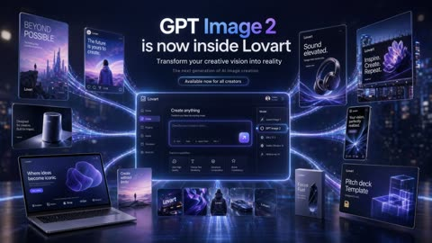</a>

A JSON spec with explicit canvas, layout, and typography fields turns a complex composition into a structured, repeatable brief. Listing each floating card with its exact label text keeps every piece of copy legible and placed where the prompt asks.

GPT Image 2 · Text-to-image · Source: [@dee_naliaks on X](https://x.com/dee_naliaks/status/2047319810602844206) · found via [YouMind-OpenLab/awesome-gpt-image-2](https://github.com/YouMind-OpenLab/awesome-gpt-image-2)

[`banner`](tags.md#tag-banner) [`text-rendering`](tags.md#tag-text-rendering) [`json-prompt`](tags.md#tag-json-prompt) [`ui-mockup`](tags.md#tag-ui-mockup)

<details><summary><b>Prompt</b></summary>

```text
{"type":"futuristic AI product launch campaign hero banner","style":"high-end 3D advertising composite with cinematic neon lighting, polished UI mockups, floating product cards, and glossy tech presentation aesthetics","theme":{"primary colors":["deep navy","electric violet","indigo","white"],"mood":"innovative, premium, futuristic, campaign-ready","lighting":"dramatic blue-violet glow, rim lighting, luminous particle trails, soft bloom, reflective floor"},"canvas":{"aspect_ratio":"16:9","background":"dark futuristic city-at-night bokeh with subtle skyscraper lights and atmospheric haze"},"headline_block":{"position":"top center","count":4,"lines":["GPT Image 2","is now inside Lovart","Transform your creative vision into reality","The next generation of AI image creation"],"cta":"Available now for all creators","typography":"clean modern sans-serif, bold white headline, smaller white and pale gray subtext, glowing rounded button"},"layout":{"centerpiece":"large glowing desktop app interface floating in the center with purple edge lighting and curved energy trails connecting all surrounding assets","sections":[{"title":"left floating posters and devices","position":"left side","count":5,"labels":["BEYOND POSSIBLE vertical sci-fi poster with futuristic skyline and tiny figure","social-style card reading 'The future is yours to create.' with a person facing a surreal landscape","small smart speaker product card reading 'Designed for creators. Built for impact.'","open laptop mockup reading 'Where ideas become iconic' with a purple abstract form on screen","small vertical card reading 'Create without limits' with a tiny landscape scene"]},{"title":"center application UI","position":"middle","count":1,"labels":["Lovart create interface with prompt box and model dropdown opened"]},{"title":"model menu items","position":"center-right inside UI","count":5,"labels":["Lovart Image 1","GPT Image 2","DALL·E 3","Stable Diffusion XL","Midjourney v6"]},{"title":"featured capability cards","position":"lower middle inside UI","count":4,"labels":["Ultra High Quality","Precise Text Rendering","Advanced Composition","Brand Consistency"]},{"title":"bottom asset strip","position":"bottom center","count":5,"labels":["Lovart logo card","abstract purple fabric-like visual","black hoodie mockup","sports car render","dark Lovart card"]},{"title":"right floating posters and packages","position":"right side","count":5,"labels":["headphone ad reading 'Sound elevated.'","large billboard-style poster reading 'Inspire. Create. Repeat.' with a purple flower image","phone-style card reading 'Your vision, perfectly realized.'","tall product box reading 'Focus Fuel'","presentation board reading 'Pitch deck Template' with glowing wireframe cubes"]}]},"ui_details":{"app_brand":"Lovart","main_panel_title":"Create anything","prompt_placeholder":"Describe your creative vision...","left_sidebar_count":6,"left_sidebar_labels":["Lovart","Home","Create","Projects","Assets","Templates"],"top_right_user_label":"Creator Pro Plan"},"composition":"symmetrical campaign composition, central software dashboard larger than all other elements, connected to surrounding posters and product mockups by multiple flowing luminous ribbons, reflective ground plane beneath all objects, crisp readable text, premium launch announcement aesthetic","quality":"ultra-detailed, sharp typography, realistic reflections, clean interface design, commercial-grade product visualization"}
```

</details>

<a id="gpt-image-matcha-brand-touchpoint-board"></a>
### Matcha cafe brand identity board with packaging

<a href="https://x.com/Preda2005/status/2049846981271699685"></a>

A hero scene plus an itemized list of touchpoints (cups, boxes, tote, labels, menu with prices) makes the model build a whole identity system in one grid layout. Fixing the palette, the Japanese minimalist layout and small imperfections keeps the board consistent and realistic.

GPT Image 2 · Text-to-image · Source: [@Preda2005 on X](https://x.com/Preda2005/status/2049846981271699685) · found via [freestylefly/awesome-gpt-image-2](https://github.com/freestylefly/awesome-gpt-image-2)

[`brand-identity`](tags.md#tag-brand-identity) [`matcha`](tags.md#tag-matcha) [`packaging`](tags.md#tag-packaging) [`mockup-board`](tags.md#tag-mockup-board) [`minimalist`](tags.md#tag-minimalist)

<details><summary><b>Prompt</b></summary>

```text
Create a premium “Matcha Brand Touchpoint System” visual board for a modern lifestyle brand called:

“MATCHA MODE”

Build a full brand identity system, not a single image.

HERO SCENE:

A hyper-realistic matcha drink in a ceramic cup placed on a clean natural surface.

– vibrant green matcha foam with micro-bubbles
– bamboo whisk (chasen) nearby
– soft natural light
– slight matcha powder dust on the surface
– minimal Japanese aesthetic
ATMOSPHERE:
– calm, warm, soft daylight
– clean background (off-white or beige)
– subtle shadows and reflections
– feeling of wellness and luxury
FULL BRAND SYSTEM:
– takeout cups (paper + glass bottles)
– packaging boxes (minimalist design)
– tote bags (premium lifestyle)
– labels, stickers, seals
– menu cards with pricing ($6.50, $8.90, etc.)
– small typography everywhere
– subtle imperfections (realism)

DESIGN LANGUAGE:

– modern minimalist typography
– Japanese-inspired layout
– soft green palette
– elegant spacing

INCLUDE:
– matcha latte
– iced matcha
– matcha desserts
– combo sets
– lifestyle shots
The composition must feel like a high-end design agency presentation.

Ultra-detailed, realistic, clean, aesthetic, and highly shareable.
```

</details>

<a id="gpt-image-pet-brand-identity-system-board"></a>
### Pet Brand Identity System Guideline Board

<a href="https://x.com/yyyole/status/2046469645155303730">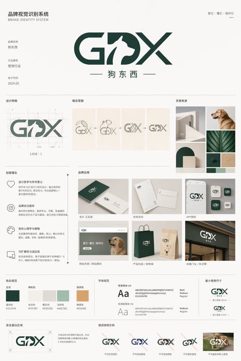</a>

A structured JSON spec names every section with its position, item count and labels, so the model lays out a strict multi-column editorial grid. Hex color swatches, a fixed 3:4 canvas and flat front-facing rendering keep the logo, mockups and rules consistent.

GPT Image 2 · Text-to-image · Source: [@yyyole on X](https://x.com/yyyole/status/2046469645155303730) · found via [YouMind-OpenLab/awesome-gpt-image-2](https://github.com/YouMind-OpenLab/awesome-gpt-image-2)

[`brand-identity`](tags.md#tag-brand-identity) [`logo`](tags.md#tag-logo) [`guideline-board`](tags.md#tag-guideline-board) [`mockup`](tags.md#tag-mockup) [`json-prompt`](tags.md#tag-json-prompt)

<details><summary><b>Prompt</b></summary>

```text
{"type":"brand identity system board","brand":{"name":"{argument name=\"brand name\" default=\"狗东西\"}","english_mark":"{argument name=\"logo letters\" default=\"GDX\"}","industry":"{argument name=\"industry\" default=\"宠物行业\"}","date":"{argument name=\"date\" default=\"2024.05\"}","tagline":"爱它・懂它・陪伴它"},"style":{"overall":"minimalist premium corporate presentation, clean Swiss-inspired layout, large white margins, light gray divider lines, muted neutral background","palette":"deep forest green and warm off-white with small accent swatches","mood":"modern, trustworthy, pet-friendly, refined"},"canvas":{"aspect_ratio":"3:4 vertical","background":"soft warm white"},"header":{"left_title_cn":"品牌视觉识别系统","left_title_en":"BRAND IDENTITY SYSTEM","right_tagline":"爱它・懂它・陪伴它","center_logo":"large custom GDX wordmark with a white dog silhouette integrated into the middle of the logo, bold geometric curves and diagonal strokes, dark green","center_subtitle":"狗东西"},"layout":{"sections":[{"title":"基础信息","position":"upper left","count":3,"labels":["品牌名称","行业属性","设计时间"]},{"title":"设计网格","position":"mid upper left","count":1,"labels":["logo construction grid with ratio 1.618:1"]},{"title":"概念草图","position":"mid upper center","count":4,"labels":["dog head and letters sketch","outline refinement","intermediate combined mark","final simplified mark"]},{"title":"灵感来源","position":"mid upper right","count":6,"labels":["minimal white architectural arch","golden retriever profile photo","curved arch block composition","green leaf close-up","dark green material square","light wood texture square"]},{"title":"创意理念","position":"middle left","count":4,"labels":["设计哲学与符号意义","品牌定位服务","色彩心理学与策略","可扩展性与适应性"]},{"title":"品牌应用","position":"middle center to right","count":7,"labels":["名片 正反面","信纸信封","APP图标","网站首页 / 网站图标","产品包装 / 购物袋","店面门头 / 标识牌","mobile app icon variants"]},{"title":"色彩规范","position":"lower middle left","count":5,"labels":["主色","辅助色","暖灰色","浅绿色","强调色"]},{"title":"字体规范","position":"lower middle center","count":2,"labels":["思源黑体 CN","思源柔黑体 CN"]},{"title":"最小使用尺寸","position":"lower middle right","count":2,"labels":["horizontal logo minimum size","stacked logo minimum size"]},{"title":"安全留白区域","position":"bottom left","count":1,"labels":["clear space diagram around logo"]},{"title":"错误使用示例","position":"bottom center to right","count":5,"labels":["do not distort","do not change colors","do not add effects","do not stretch vertically","do not place on busy photo background"]}],"grid":"strict multi-column editorial board with thin dividing rules and consistent spacing"},"logo_design":{"form":"GDX lettermark","integration":"negative-space dog silhouette embedded between G and X, reading as the letter D while showing a standing dog profile facing right","color":"dark green","subtitle":"Chinese brand name centered below with thin horizontal lines on both sides"},"color_swatches":[{"name":"墨绿色","hex":"#1E3D34"},{"name":"米白色","hex":"#F5F3EF"},{"name":"暖灰色","hex":"#E5E2DB"},{"name":"浅绿色","hex":"#A8C5B1"},{"name":"暖橙色","hex":"#E0A86E"}],"applications":{"mockups":7,"details":"business card set, stationery set, smartphone app icon screen, website hero with dog photo, dark green and kraft shopping bags, storefront signage, grouped square app icon variations"},"typography":{"families":["思源黑体 CN","思源柔黑体 CN"],"weights":["Bold","Medium","Regular"]},"rendering":"high-resolution graphic design presentation board, flat front-facing view, crisp vector logo, realistic mockup inserts, subtle shadows only inside product mockups, no perspective distortion"}
```

</details>
