# Characters and figures

[Back to the list](../../README.md) · All 83 entries

<a id="gpt-image-tanjiro-pixel-sprite-sheet-water-attack"></a>
### Tanjiro 16 frame pixel sprite sheet with water attack

<a href="https://x.com/Mayz1169/status/2097539942985728162">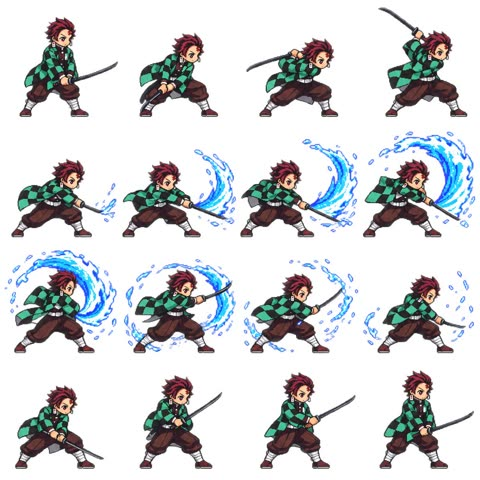</a>

Uploading a character reference and fixing a 4 by 4 grid with identical cells and a ready, anticipation, strike, impact, recovery beat order keeps the frames in sequence. Letting the attack follow the character's own ability, here water breathing, gives the effects a clear source that stays in one pixel style.

GPT Image 2.5 · Edit · Source: [@Mayz1169 on X](https://x.com/Mayz1169/status/2097539942985728162) · 1,559 likes on 2026-10-29

[`pixel-art`](tags.md#tag-pixel-art) [`sprite-sheet`](tags.md#tag-sprite-sheet) [`animation`](tags.md#tag-animation) [`anime`](tags.md#tag-anime)

<details><summary><b>Prompt</b></summary>

```text
Using the character reference image I upload, create a pixel-art battle animation. Deliver a transparent animated GIF and a 4×4 sprite sheet containing 16 sequential frames.

CHARACTER FIDELITY
Identify the character’s hairstyle, outfit, colors, weapon, proportions, and distinctive features. Translate them into a recognizable chibi pixel-art sprite. Keep the character’s identity, scale, clothing, and equipment consistent across all frames.

BATTLE DESIGN
Automatically design an attack that suits the character:
- If they carry a weapon, build the animation around it.
- If their abilities are clearly identifiable, use the appropriate effects, such as water, fire, or lightning.
- If their abilities are unclear, create a plausible physical attack based on their appearance. Do not invent unrelated powers.

Proceed without asking preliminary questions. Create one coherent battle loop:
Ready stance → Anticipation → Attack → Impact peak → Effects dissipate → Recovery.

Distribute the sequence naturally across 16 frames. The final frame must transition smoothly into the first. Animate actual changes in pose and body mechanics; do not fake movement by merely translating or rotating a static character image.

PIXEL-ART STYLE
Use crisp 16-bit game-style pixel art with readable silhouettes, sharp pixel edges, and a restrained palette. Maintain a consistent pixel scale for both the character and effects. Avoid blur, photorealistic rendering, and style drift.

SPRITE SHEET REQUIREMENTS
- Exactly 4 columns × 4 rows, totaling 16 frames.
- Frames play left to right, then top to bottom.
- All cells must have identical dimensions.
- Use a fixed camera, consistent character scale, a stable ground baseline, and consistent animation registration.
- Each cell contains exactly one character.
- Keep the entire body, weapon, and effects inside its cell.
- Leave sufficient transparent padding on every side. Nothing may cross cell boundaries or be cropped.
- No text, frame numbers, grid lines, watermarks, or background scenery.

TRANSPARENCY AND ANIMATION
Generate a genuinely transparent RGBA PNG. Do not draw a checkerboard pattern to imitate transparency.

Slice the sheet into frames and assemble a transparent, infinitely looping GIF. Adjust frame durations to emphasize anticipation and fast strikes. Aim for a total loop duration of approximately 1.5–2 seconds.

Preserve full alpha transparency in the PNG files. Use a transparent palette index and correct frame disposal in the GIF to prevent trails from previous frames.

DELIVERABLES AND QUALITY CHECK
Create the actual files, not just prompts or instructions:
1. A transparent 4×4 PNG sprite sheet.
2. A playable transparent battle GIF.
3. A ZIP containing all 16 individual transparent PNG frames.

Before delivery, verify that there are exactly 16 frames, transparency is genuine, the character remains consistent, no neighboring frames bleed into the crops, the action plays in the correct order, and the loop has no obvious positional jumps. Fix any issues before presenting the GIF preview and download links.
```

</details>

<a id="gpt-image-dance-pose-sheet-4x4-character"></a>
### Sixteen panel dance pose sheet of anime girl

<a href="https://x.com/Mayz1169/status/2098014577414033912"></a>

Locks identity to one uploaded reference, then scripts sixteen numbered moves from opening pose to finishing silhouette so the grid reads as one routine. Fixed camera, white background and an explicit avoid list keep scale, costume and panel layout consistent.

GPT Image 2.5 · Edit · Source: [@Mayz1169 on X](https://x.com/Mayz1169/status/2098014577414033912) · 1,270 likes on 2026-10-27

[`pose-sheet`](tags.md#tag-pose-sheet) [`character-reference`](tags.md#tag-character-reference) [`dance`](tags.md#tag-dance) [`grid-layout`](tags.md#tag-grid-layout) [`anime`](tags.md#tag-anime)

<details><summary><b>Prompt</b></summary>

```text
Create a 4×4 dance pose sheet featuring the character in the uploaded reference image, with exactly 16 equally sized panels in one square image.

CHARACTER CONSISTENCY
Use the uploaded character as the sole reference for character identity and appearance. Preserve the character’s face, hairstyle, colors, body proportions, species, outfit, accessories, and original art style across all 16 panels. Do not redesign the character or add an idol costume. If any body or costume details are not visible in the reference, infer them conservatively and keep them consistent throughout.

ADAPTIVE CHOREOGRAPHY
Design a cohesive dance sequence tailored to this specific character’s personality, appearance, anatomy, clothing, and range of motion. Choose a suitable dance style automatically: lively for an energetic character, graceful for an elegant character, confident for a bold character, playful for a cute character, or restrained for a serious character. Do not force every character into cute idol poses.

Show 16 distinct key poses from the same dance routine, ordered from left to right and top to bottom. Make the sequence feel connected, with natural transitions and a clear beginning, build-up, climax, and ending.

Use the following movement structure, adapting each action to the character:
1. Opening pose that establishes the character’s personality.
2. Small rhythmic step with a coordinated arm gesture.
3. Side step with one arm extended.
4. Compact expressive gesture near the face or upper body.
5. Grounded stance with arms crossing or sweeping inward.
6. Knee lift or an anatomically appropriate weight shift.
7. Open, expansive pose with arms spread.
8. Playful or expressive balance pose.
9. Turning pose showing a three-quarter rear view.
10. Forward-reaching movement with a diagonal body lean.
11. Strong upward-reaching accent.
12. Climactic jump or a grounded full-body extension if jumping is unsuitable.
13. Lowered stance with a forward gesture.
14. Elegant or dynamic side-facing transition.
15. Signature gesture that suits the character.
16. Confident final pose with a clear finishing silhouette.

COMPOSITION AND PRESENTATION
Use a clean white background, thin grid lines, and small readable numbers 1–16 in the upper-left corner of each panel. Include exactly one full-body depiction of the same character per panel. Keep the character’s scale, camera distance, lighting, and rendering style consistent. Use a fixed camera while allowing the character to turn naturally.

Keep the entire character, including hair, ears, horns, wings, tail, hands, feet, and accessories, inside each panel with comfortable margins. Allow room for extended limbs and jumps. Add subtle ground shadows. Show natural secondary movement in hair, fabric, and accessories.

Every pose must have a clear silhouette, convincing balance, anatomically plausible joints, and expressive body language. Adapt all movements to nonhuman anatomy when applicable.

AVOID
Repeated or nearly identical poses, character identity drift, costume changes, inconsistent proportions, extra or missing limbs, malformed hands, cropped body parts, overlapping panels, additional characters, motion trails, background scenery, props not present in the reference, speech bubbles, captions, and watermarks.

Final output: one polished square image containing a clearly organized 4×4 grid of 16 distinct, character-appropriate dance poses.
```

</details>

<a id="chatgpt-secret-supernatural-world-couple"></a>
### Gothic couple before a castle under red moon

<a href="https://www.tiktok.com/@nightmareinc2100/video/7690589171370528030">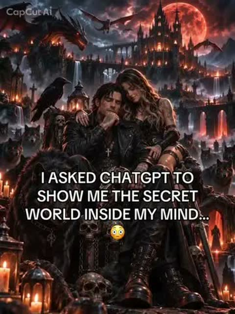</a>

The prompt sets a 3:4 cinematic frame and lists lighting and texture cues such as dramatic moonlight, fire, volumetric fog and film grain, plus a clear no text rule. The long list of world elements builds layered depth, so the castle, dragons and ravens fill the background behind the figures.

ChatGPT · Text-to-image · Source: [@nightmareinc2100 on TikTok](https://www.tiktok.com/@nightmareinc2100/video/7690589171370528030) · 1,100 likes on 2026-10-30

[`dark-fantasy`](tags.md#tag-dark-fantasy) [`gothic`](tags.md#tag-gothic) [`cinematic`](tags.md#tag-cinematic) [`no-text`](tags.md#tag-no-text)

<details><summary><b>Prompt</b></summary>

```text
Based on everything you know about me, create the SECRET SUPERNATURAL WORLD hidden inside my imagination. Do NOT ask me questions. Surprise me. Imagine my personality, memories, interests, fears, relationships, dreams, strengths, weaknesses, darker side, and things I love have somehow created an entire hidden universe. Build that universe around ME. Reveal: • The name of my world • What the name means • What the world looks like • The place where I live • What role I have there • My supernatural title • My appearance and outfit • My powers • My signature weapon • My symbol • My companion creature • The creatures living in my world • My closest ally • My greatest enemy • The forbidden location nobody enters • The most terrifying creature there • The secret hidden beneath my world • The one law everyone must obey • What happens when someone breaks it • My greatest strength • My greatest weakness • The prophecy written about me • My ultimate transformation • The final battle waiting for me • My legendary quote Make every detail symbolize something you genuinely associate with me based on what you’ve learned about my personality, interests, experiences, creative side, fears, dreams, and overall aesthetic. Then explain WHY my mind would create this particular universe. Finally, create a 3:4 cinematic image showing me standing inside my supernatural world. Make the image itself contain NO WORDS OR TEXT. Make it look like a $200-million dark fantasy/horror movie—photorealistic face and skin, realistic clothing, enormous environmental scale, practical-looking creatures, dramatic moonlight, fire, volumetric fog, storms, cinematic shadows, realistic textures, subtle film grain, atmospheric depth, and ultra-detailed 4K realism. If I upload a photo, preserve my recognizable facial features, hairstyle, body proportions, tattoos, and defining characteristics. Do not copy an existing movie, game, character, or universe. Everything must be original. No generic answers. No questions. Build the world that could only belong to ME. 👀 And finally tell me: If someone accidentally entered my world… would I protect them, hunt them, or make them prove they deserve to leave?
```

</details>

<a id="nano-banana-3d-caricature-elongated-neck-portrait"></a>
### Stylized 3D caricature portrait with elongated neck

<a href="https://x.com/Naiknelofar788/status/2032256273782358153">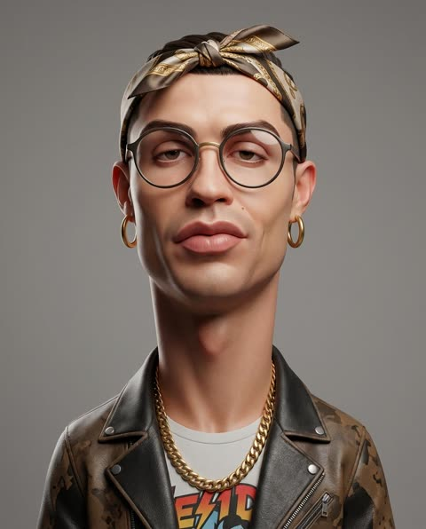</a>

Uses a reference photo and asks to keep likeness while deforming specific features such as neck length, droopy eyelids and heavy lips. A long negative list (no grain, no noise, no freckles) plus flat neutral studio light keeps the render clean and collectible.

Nano Banana 2 · Edit · Source: [@Naiknelofar788 on X](https://x.com/Naiknelofar788/status/2032256273782358153) · 1,034 likes on 2026-10-28

[`3d-caricature`](tags.md#tag-3d-caricature) [`reference-photo`](tags.md#tag-reference-photo) [`studio-lighting`](tags.md#tag-studio-lighting) [`street-fashion`](tags.md#tag-street-fashion) [`portrait`](tags.md#tag-portrait)

<details><summary><b>Prompt</b></summary>

```text
Create an exaggerated stylized 3D caricature character portrait with strong intentional deformation and a clean, controlled surface finish. Use the person from the ATTACHED REFERENCE PHOTO. Preserve the subject’s identity, facial likeness, skin tone, and defining features, but reinterpret them into a bold caricatured 3D form with an elongated neck, oversized head-to-neck ratio, droopy eyelids, heavy lips, and slightly asymmetrical facial structure.Render as a human-like 3D character with smooth, studio-clean skin and intentionally designed detail, avoiding random texture or noise. Style with bold accessories such as round or oval glasses, hoop earrings, gold chains, headscarves or bandanas, and street-luxury clothing.

Use neutral studio lighting with soft shadows and even illumination, no dramatic contrast, against a plain neutral grey or off-white background. The overall aesthetic should feel weird, fashion-forward, collectible, and character-driven rather than cute or realistic.

Ultra high definition, premium cinematic 3D render quality, hyper-realistic hyper realism, clean materials, no freckles, no dirt, no grain, no noise, no speckling, no text, no logos, no watermarks.

Aspect ratio 4:5.
```

</details>

<a id="chatgpt-rugrats-kid-reptar-bedroom"></a>
### Braided girl in Rugrats bedroom with Reptar

<a href="https://www.tiktok.com/@totalparadise/video/7685035709698297102">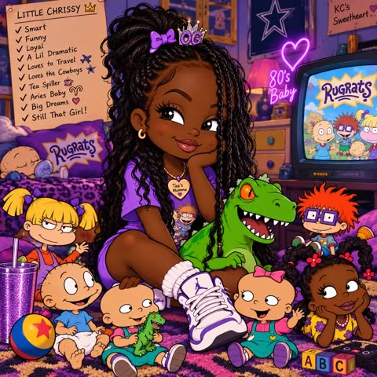</a>

Asking for personal details lets the model fill the scene with a notepad checklist, a name necklace and other props that feel custom. Naming the show, the toy Reptar and the cast keeps the cartoon look and the characters recognizable.

ChatGPT · Text-to-image · Source: [@totalparadise on TikTok](https://www.tiktok.com/@totalparadise/video/7685035709698297102) · 969 likes on 2026-10-30

[`rugrats`](tags.md#tag-rugrats) [`reptar`](tags.md#tag-reptar) [`80s-nostalgia`](tags.md#tag-80s-nostalgia) [`personalized`](tags.md#tag-personalized)

<details><summary><b>Prompt</b></summary>

```text
With everything you know about me, what would I look like as a Rugrats kid. Include the toy Reptar, other characters and things from the show.
```

</details>

<a id="nano-banana-ball-shaped-cute-animal"></a>
### Ball-shaped baby sea otter floating in kelp

<a href="https://x.com/NanoBanana/status/2027298143134478451">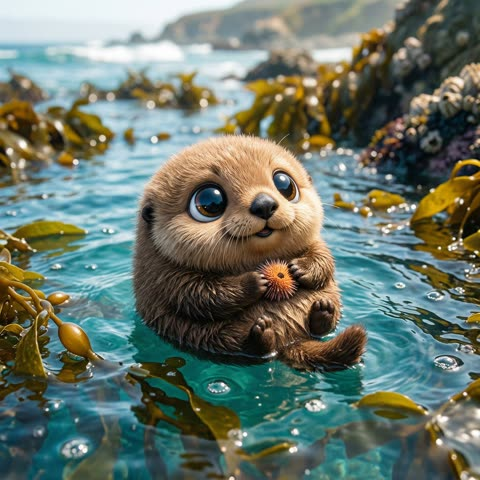</a>

A single [animal] placeholder makes the prompt reusable across species. Fusing head and body into one near sphere, adding oversized eyes with an upward glance, and placing the animal in its usual habitat keeps the result cute and coherent.

Nano Banana 2 · Text-to-image · Source: [@NanoBanana on X](https://x.com/NanoBanana/status/2027298143134478451) · 851 likes on 2026-10-28

[`cute`](tags.md#tag-cute) [`animal`](tags.md#tag-animal) [`ball-shaped`](tags.md#tag-ball-shaped) [`template`](tags.md#tag-template) [`habitat`](tags.md#tag-habitat)

<details><summary><b>Prompt</b></summary>

```text
This prompt works best with Nano Banana 2:

Prompt: Make a photo of a cute ball-shaped version of a [animal], with big adorable over-sized eyes, it has no head, instead its face is part of the ball, its head and body are one. They are in their usual habitat. Must be almost spherical and cartoonishly cute. Its eyes are looking up in the most adorable cheeky fashion.
```

</details>

<a id="nano-banana-pro-strawberry-baker-cake-bakery"></a>
### Strawberry baker character with cake in bakery

<a href="https://www.tiktok.com/@prabinbashyal100/video/7689097108044909845">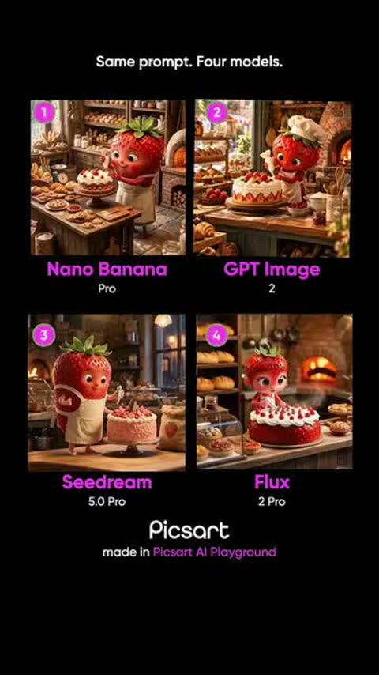</a>

Giving the subject a role and a concrete setting, a miniature bakery, lets the model build a complete scene around one character. The size contrast from the prompt is only loosely followed, so the scale cue works better as mood than as a literal instruction.

Nano Banana Pro / ChatGPT · Text-to-image · Source: [@prabinbashyal100 on TikTok](https://www.tiktok.com/@prabinbashyal100/video/7689097108044909845) · 846 likes on 2026-10-30

[`strawberry`](tags.md#tag-strawberry) [`miniature`](tags.md#tag-miniature) [`food`](tags.md#tag-food) [`character`](tags.md#tag-character)

<details><summary><b>Prompt</b></summary>

```text
A tiny strawberry baker decorating a giant strawberry cake in a miniature bakery
```

</details>

<a id="nano-banana-four-tv-shows-bathroom-mirror-selfie"></a>
### Four TV show characters in bathroom mirror selfie

<a href="https://x.com/TechieBySA/status/2032557237437116521">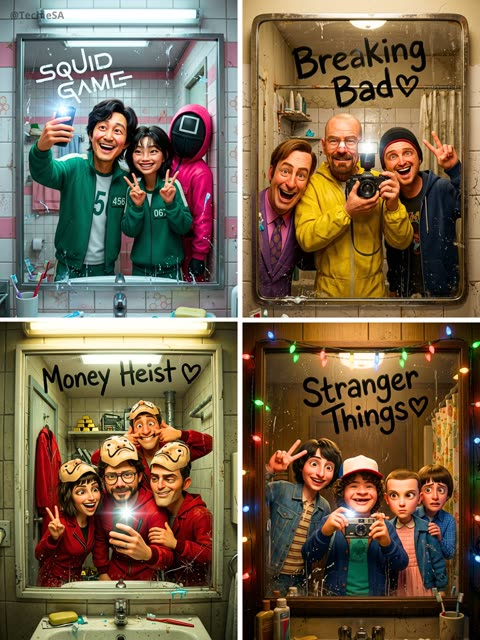</a>

A fill-in template that fixes the look to Pixar style 3D CGI in a vertical 3:4 frame, then makes one character the camera holder and crams the rest in for crowded selfie energy. The mirror lettering and set dressing are slotted per show, so every series keeps the same composition.

Nano Banana 2 · Text-to-image · Source: [@TechieBySA on X](https://x.com/TechieBySA/status/2032557237437116521) · 794 likes on 2026-10-29

[`template`](tags.md#tag-template) [`pixar-style`](tags.md#tag-pixar-style) [`selfie`](tags.md#tag-selfie) [`tv-shows`](tags.md#tag-tv-shows) [`3d-cgi`](tags.md#tag-3d-cgi)

<details><summary><b>Prompt</b></summary>

```text
Inspired by pettrusvaz on Instagram🔥

“High-quality stylized 3D CGI Pixar-style render, vertical 3:4 composition, the most iconic characters from [SHOW/MOVIE] captured as a chaotic and joyful bathroom mirror selfie; the most recognizable character holds a large vintage camera up toward the mirror, the remaining characters squeezed tightly into the frame around them, each showing their most signature expression or pose; everyone wearing their most iconic costumes and outfits faithful to the source material; all crammed together creating classic crowded selfie energy; facial proportions gently stylized in Disney/Pixar animation style with expressive eyes while faithfully preserving each character's most recognizable traits, hairstyles and costumes from [SHOW/MOVIE]; the bathroom mirror has realistic toothpaste splatters and subtle smudges; the reflection shows bold black Pixar-style lettering reading "[SHOW/MOVIE]❤️"; the bathroom background is styled to match the world of [SHOW/MOVIE] with thematic props and easter eggs relevant to [SHOW/MOVIE] placed naturally around the scene; lighting combines soft ambient bathroom lighting with a bright camera flash reflecting in the mirror creating gentle specular highlights; warm Pixar-style color grading faithful to the visual tone of [SHOW/MOVIE], smooth highlight rolloff, refined Disney/Pixar cinematic character shading, ultra-detailed 4K render, no watermark”
```

</details>

<a id="gpt-image-kawaii-character-profile-sheet-from-photo"></a>
### Kawaii character profile sheet from a portrait photo

<a href="https://x.com/ZaraIrahh/status/2048251738604613725"></a>

The prompt lists every panel the poster needs: a large portrait, four named expressions, action poses, object icons, a color palette and a profile block. The style line sets a cozy Japanese kawaii look, and the uploaded photo keeps the character consistent across all panels.

GPT Image 2 · Edit · Source: [@ZaraIrahh on X](https://x.com/ZaraIrahh/status/2048251738604613725) · 569 likes on 2026-10-28

[`character-sheet`](tags.md#tag-character-sheet) [`kawaii`](tags.md#tag-kawaii) [`expressions`](tags.md#tag-expressions) [`color-palette`](tags.md#tag-color-palette) [`profile-poster`](tags.md#tag-profile-poster)

<details><summary><b>Prompt</b></summary>

```text
Create an adorable character design sheet based on the uploaded image.
Style: Warm, soft, and semi-realistic cartoon illustration with a cozy Japanese/kawaii style.
Design: Character profile poster including:
Large main portrait
Various facial expressions (happy, annoyed, sleepy, surprised)
Action poses (running, playing) (based on personality)
Small object icons
Color palette section
Profile section with name and personality.
```

</details>

<a id="gpt-image-cute-crazy-scale-expression-grid"></a>
### Sixteen panel expression grid from cute to crazy

<a href="https://x.com/aimikoda/status/2055036470583263712">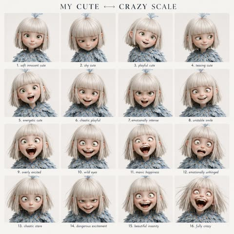</a>

The prompt numbers every panel in a fixed emotional order and forbids random intensity, so the expressions escalate steadily from top left to bottom right. A reference character locks the identity, while header text, label style and framing are specified once for the whole grid.

GPT Image 2 · Edit · Source: [@aimikoda on X](https://x.com/aimikoda/status/2055036470583263712) · 476 likes on 2026-10-28

[`expression-grid`](tags.md#tag-expression-grid) [`character-consistency`](tags.md#tag-character-consistency) [`4x4-grid`](tags.md#tag-4x4-grid) [`emotion-scale`](tags.md#tag-emotion-scale) [`typography`](tags.md#tag-typography)

<details><summary><b>Prompt</b></summary>

```text
Create a clean 4x4 emotional performance grid using the provided character as the fixed identity reference.

Visual style:
Clean modern graphic design layout. Elegant serif header at the top, soft off-white background, even spacing, small readable handwritten-style labels centered below each panel.

Header text:
“MY CUTE ↔ CRAZY SCALE”

Preserve strict facial identity consistency across all 16 panels.

Follow the exact emotional progression from top-left to bottom-right.
Do not randomize expressions or intensity.

GRID ORDER:

Row 1:
1. soft innocent cute
2. shy cute
3. playful cute
4. teasing cute

Row 2:
5. energetic cute
6. chaotic playful
7. emotionally intense
8. unstable smile

Row 3:
9. overly excited
10. wild eyes
11. manic happiness
12. emotionally unhinged

Row 4:
13. chaotic stare
14. dangerous excitement
15. beautiful insanity
16. fully crazy

Format:
4x4 grid, cinematic portrait photography style, neutral background, tight close-up framing, shallow depth of field, no watermark.
```

</details>

<a id="gpt-image-caricature-companion-holding-hands"></a>
### Realistic man holding hands with his 3D caricature

<a href="https://x.com/frametheory058/status/2065384202376556927">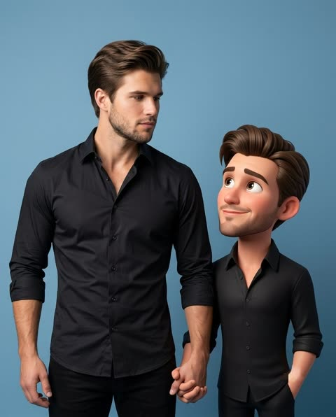</a>

The prompt keeps the real subject photorealistic and asks for a stylized copy with the same outfit, hairstyle and attitude, so the two read as one person. Naming concrete interactions like holding hands and setting the caricature at shoulder to ear height stops it from becoming a side mascot.

GPT Image 2 · Edit · Source: [@frametheory058 on X](https://x.com/frametheory058/status/2065384202376556927) · 372 likes on 2026-10-29

[`3d-caricature`](tags.md#tag-3d-caricature) [`pixar-style`](tags.md#tag-pixar-style) [`photo-composite`](tags.md#tag-photo-composite) [`companion`](tags.md#tag-companion)

<details><summary><b>Prompt</b></summary>

```text
Create a premium high-quality 3D caricature companion of the person in the reference image while keeping the original realistic person fully present and untouched. The realistic person must remain photorealistic, highly detailed and faithful to the original photo. Create a stylized 3D caricature version of the SAME person standing beside them. Preserve the same: outfit, hairstyle, accessories, fashion styling, identity, facial resemblance, attitude and vibe.The caricature must have: large expressive eyes, slightly oversized head, smooth cinematic skin, Pixar/Disney-inspired premium 3D styling, smaller body proportions, but still look fashionable and recognizable, NOT childish, toy-like or baby-sized.IMPORTANT: The caricature height should be approximately shoulder to ear level of the real person, never tiny or child-sized. The caricature and real person must be physically and emotionally interacting naturally. Examples of interaction: holding hands, looking at each other, walking together,

sharing an object, leaning, playful pose, touching shoulder, mirroring pose, reacting to each other, casual chemistry, candid companionship. The caricature should feel like a living animated version of the same person existing in the same world. Preserve original scene, lighting and perspective whenever possible. Professional photography composition,  cinematic lighting, realistic shadows, luxury editorial realism mixed with premium stylized 3D animation. No tiny companion, no side mascot, no disconnected pose, no separate standing character, no toy proportions, no plastic doll look, no replacing the original person.
```

</details>

<a id="nano-banana-character-3d-model-rpg-gameplay-sheet"></a>
### Anime knight as 3D model and RPG screen

<a href="https://x.com/AI_Kei75/status/2032736793292886320">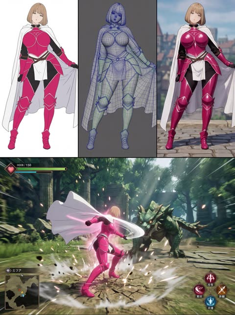</a>

A design lock clause with heavy weights keeps the same character across every panel. The top row steps from flat line art to a wireframe viewport to a lit game render, and the bottom half is a separate third person combat screenshot with a Japanese HUD. A negative prompt blocks flat 2D drawing and layout bleed.

Nano Banana 2 · Edit · Source: [@AI_Kei75 on X](https://x.com/AI_Kei75/status/2032736793292886320) · 362 likes on 2026-10-28

[`game-ui`](tags.md#tag-game-ui) [`3d-render`](tags.md#tag-3d-render) [`character-sheet`](tags.md#tag-character-sheet) [`split-layout`](tags.md#tag-split-layout) [`reference-image`](tags.md#tag-reference-image)

<details><summary><b>Prompt</b></summary>

```text
Masterpiece, best quality, (complex split screen presentation layout:1.7), (game development showcase:1.5).

(CRITICAL GLOBAL CONSTRAINT - DESIGN LOCK):
(The exact same character design, hair, and outfit MUST be used across ALL sections of the image:2.0).

[TOP HALF: 3-Panel Horizontal Grid - Static Pose]
The top half is divided into 3 horizontal panels showing the character in the EXACT SAME static pose.
Top Left: (Original 2D blueprint:1.5), flat anime illustration style. It accurately traces the original image.
Top Middle: (3D modeling UI viewport:1.5), grey clay render with visible wireframe topology.
Top Right: (Final in-game 3D render:1.7), fantasy background. (High-end 3D anime game model:1.6), (rendered in Unreal Engine 5:1.5), (volumetric lighting, specular highlights, ambient occlusion, rim light:1.5). The character has clear 3D volume, stylized PBR textures, and prominent 3D shading.

[BOTTOM HALF: Full Width Gameplay Screenshot - Action Pose]
The bottom half is a single, wide (third-person Action JRPG gameplay screenshot:1.8).
The EXACT SAME character is shown from a dynamic third-person perspective (viewed from slightly behind/side), in a (dynamic combat action pose:1.6).
Action: The character is fighting a fantasy monster in a lush, grassy open world 3D environment.
Style: (High-end 3D anime game engine graphics:1.7), identical to the Top Right panel's 3D render style. (Unreal Engine 5, ray tracing, depth of field, 3D magic particles:1.5).
Overlay Elements: (Stylish Japanese game UI HUD, minimap, character portrait, skill icons, glowing magic 3D combat effects, particle sparks:1.6). The base language used for the UI is Japanese.

(Technical Tags): (collage:1.4), (presentation sheet), sharp boundaries between panels.
(Negative prompt): (2D illustration in top right and bottom panels:2.0), (flat drawing:2.0), (anime painting:1.8), (bleeding borders:1.5), (messy layout:1.5), (changing character design:2.0), (photorealism:1.5), (missing UI in bottom half), (static pose in bottom half:1.5), low quality, text bleeding.
</prompt>
```

</details>

<a id="nano-banana-sketchbook-boy-stepping-out"></a>
### 3D cartoon boy stepping out of a sketchbook drawing

<a href="https://x.com/Emmma___0/status/2029025071009022334">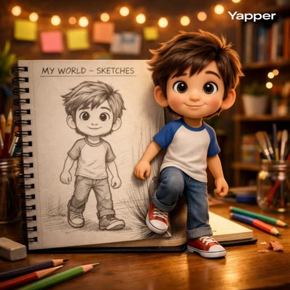</a>

The prompt shows the same character twice, as a pencil sketch on the page and as a 3D render, and a leg crossing the page edge sells the magic. Warm fairy light bokeh, scattered pencils and a shallow depth of field keep the desk scene cozy and believable.

Nano Banana 2 · Text-to-image · Source: [@Emmma___0 on X](https://x.com/Emmma___0/status/2029025071009022334) · 338 likes on 2026-10-28

[`3d-cartoon`](tags.md#tag-3d-cartoon) [`sketchbook`](tags.md#tag-sketchbook) [`character`](tags.md#tag-character) [`bokeh`](tags.md#tag-bokeh) [`cozy`](tags.md#tag-cozy)

<details><summary><b>Prompt</b></summary>

```text
A cute stylized 3D cartoon boy stepping out of a sketchbook drawing on a wooden desk, the notebook page showing a pencil sketch version of the same boy labeled "MY WORLD – SKETCHES". The boy has big expressive eyes, short messy brown hair, wearing a white and blue raglan t-shirt, blue jeans, and red sneakers. One leg is stepping out of the sketchbook into the real world. Warm cozy studio lighting, bokeh fairy lights in the background, colored pencils and art supplies scattered on the desk, shallow depth of field, Pixar-style character design, ultra-detailed, cinematic lighting, soft shadows, photorealistic textures, magical creative atmosphere, 3D render, high resolution.
```

</details>

<a id="nano-banana-3d-sticker-expression-grid-cream"></a>
### Nine 3D sticker expressions in a cream 3x3 grid

<a href="https://x.com/doctorwasif/status/2039340995322446177">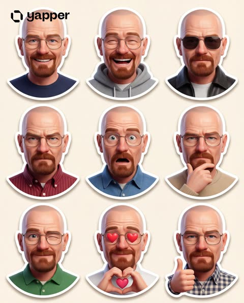</a>

Anchors identity to one uploaded face and forbids beautifying, so likeness holds across all nine variants. Each cell then changes only the expression, the outfit and the pose inside a fixed 3x3 grid on cream.

Nano Banana 2 · Edit · Source: [@doctorwasif on X](https://x.com/doctorwasif/status/2039340995322446177) · 322 likes on 2026-10-29

[`sticker-set`](tags.md#tag-sticker-set) [`pixar-style`](tags.md#tag-pixar-style) [`face-reference`](tags.md#tag-face-reference) [`expression-grid`](tags.md#tag-expression-grid)

<details><summary><b>Prompt</b></summary>

```text
Create a premium Pixar-style 3D character sticker set that is clearly recognizable as the same person. Use the uploaded image as the ONLY facial reference.
Output Requirements:
3×3 grid layout (9 stickers total)
Final aspect ratio: 4:5
Ultra high resolution (8K)
Clean cream background
Each sticker is separated with clear spacing
Add a subtle drop shadow under each sticker for depth
Character Identity (VERY IMPORTANT):
MUST preserve exact facial structure, hairstyle, grooming details, and unique features from the uploaded image
Maintain high likeness accuracy
Do NOT over beautify or alter identity beyond recognition
Style:
Pixar-style 3D animation
Glossy, high-end rendering
Soft global illumination
Smooth shading
High-detail facial textures
Framing:
All stickers must be head and shoulders (portrait close-up) only
No full-body or mid-body shots allowed
Focus tightly on face and upper shoulders to emphasize expressions
Outfit:
Modern casual and slightly stylized clothing
Each sticker must have a different outfit (no repetition at all)
Clean, minimal, and visually appealing for sticker use
Expressions & Poses (9 variations):
1. Happy smile
2. Laughing
3. Cool (with sunglasses)
4. Angry/serious
5. Surprised
6. Thinking
7. Wink
8. Love (heart eyes and heart gesture)
9. Thumbs up
Sticker Design:
Bold, clean outline
Slightly exaggerated cartoon proportions
Strong emphasis on facial expressions
Optimized for digital sticker platforms
Each sticker must have a smooth rounded bottom cutout (semi-curved base)
No text
Lighting:
Soft studio lighting
Subtle rim light for depth and separation
Goal:
Create a highly engaging, cute, and expressive sticker pack that feels premium and collectable.
```

</details>

<a id="gpt-image-character-profile-poster-expressions-poses"></a>
### Dark Character Profile Poster With Expressions And Poses

<a href="https://x.com/miratechtool/status/2049036432451215756">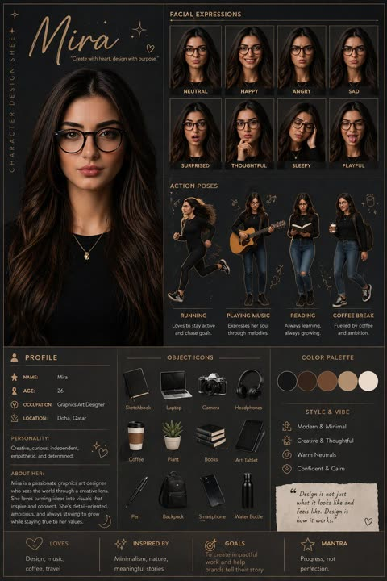</a>

A numbered checklist of sections (main portrait, expression grid, action poses, object icons, color palette, profile) gives the model a clear layout to fill. Asking for poses based on personality makes the poses and profile text agree with the uploaded face.

GPT Image 2 · Edit · Source: [@miratechtool on X](https://x.com/miratechtool/status/2049036432451215756) · 294 likes on 2026-10-28

[`character-sheet`](tags.md#tag-character-sheet) [`profile-poster`](tags.md#tag-profile-poster) [`expressions`](tags.md#tag-expressions) [`reference-image`](tags.md#tag-reference-image) [`layout`](tags.md#tag-layout)

<details><summary><b>Prompt</b></summary>

```text
Create a character design chart based on the uploaded image.
Design: Character Profile Poster
Include:

1. Large main portrait

2. Various facial expressions (happy angry, sleepy, surprised, etc.)

3. Action poses (running, playing) (based on personality)

4. Small object icons 5. Color scheme section

5. Profile section, including name and personality
```

</details>

<a id="gpt-image-character-dance-pose-grid"></a>
### Sixteen Dance Poses of a Bunny Hat Girl

<a href="https://x.com/Mayz1169/status/2098050289819652321">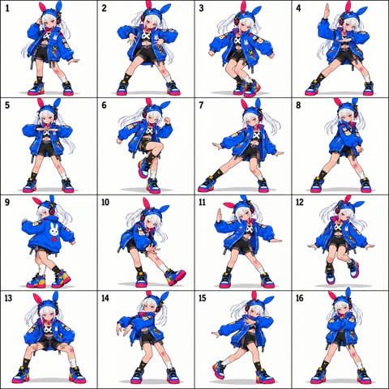</a>

The prompt asks the model to read the character's personality and invent a matching dance vocabulary, then fixes a strict 4×4 numbered grid with one camera distance and white backgrounds. Explicit identity locks and an avoid list keep outfit and proportions consistent across all 16 panels.

GPT Image 2.5 · Edit · Source: [@Mayz1169 on X](https://x.com/Mayz1169/status/2098050289819652321) · 283 likes on 2026-10-28

[`character-sheet`](tags.md#tag-character-sheet) [`dance`](tags.md#tag-dance) [`pose-grid`](tags.md#tag-pose-grid) [`anime`](tags.md#tag-anime) [`seedance-reference`](tags.md#tag-seedance-reference)

<details><summary><b>Prompt</b></summary>

```text
Create a single square image featuring a 4×4 grid of 16 unique full-body dance poses based on the uploaded character.

CHARACTER-DRIVEN CHOREOGRAPHY
First, visually interpret the character’s personality and aesthetic through their expression, silhouette, outfit, accessories, proportions, and overall visual style. Use this interpretation to invent a personalized dance vocabulary that feels natural and distinctive to THIS character.

Do not apply a generic dance routine or a predetermined list of poses. Let the character’s attitude determine the rhythm, energy, gestures, posture, footwork, and use of space.

For example, a mischievous character might use cheeky gestures, unexpected weight shifts, and playful hops; a reserved character might favor controlled steps and subtle hand movements; a bold character might use grounded footwork and sharp accents; an ethereal character might move through soft curves and floating transitions. These are illustrative possibilities, not required categories or moves. Combine traits when the design suggests a more nuanced personality.

Develop a recognizable movement motif unique to this character and reinterpret it across several panels without repeating the same pose. Incorporate distinctive design features naturally: flowing sleeves may follow sweeping gestures, heavy boots may inspire grounded steps, and a tail or wings may contribute to balance and expression if present. Do not invent accessories or anatomy.

Make the result feel like this character is expressing themselves through dance, rather than performing an interchangeable pose pack. Keep the movement appropriate to the character’s apparent age, anatomy, clothing, and mobility.

SEQUENCE AND VARIETY
Show 16 distinct key poses from one cohesive, character-specific dance phrase, read left to right and top to bottom. Build a natural progression from an opening gesture through variations and a climax to a signature finish.

Include meaningful variation in silhouette, arm placement, footwork, body orientation, and movement level only where it suits the character. Do not force jumps, squats, exaggerated expressions, or dramatic poses onto a character whose personality calls for restraint. Even subtle choreography should produce clearly distinguishable poses.

Maintain believable balance and natural joints. Use facial expressions, head tilts, hands, and posture to reinforce the same personality throughout. Hair, clothing, and accessories should react naturally to movement.

IDENTITY AND STYLE
Preserve the uploaded character’s identity exactly: face, hairstyle, body proportions, outfit, colors, footwear, and accessories. Maintain the reference image’s rendering style throughout all 16 panels. Do not redesign, recolor, or change costumes. Infer any unseen details conservatively and keep them consistent.

GRID AND PRESENTATION
Exactly four rows and four columns, with 16 equally sized square panels separated by thin black lines. Plain white backgrounds and subtle grounding shadows. Number the panels 1–16 in the upper-left corners.

One full-body character per panel, including all extremities and accessories, with comfortable margins. Consistent character scale, camera distance, lighting, and ground level. Use a fixed eye-level camera; different views should result from the character turning.

If a separate dance-grid reference is provided, use it only for the grid layout and presentation. Do not copy its character, outfit, dance poses, or attitude. The uploaded character must determine the choreography.

OUTPUT
A polished dance reference sheet with strong character identity and 16 individually readable poses. Output only the image, without written analysis.

AVOID
Generic choreography, copied reference poses, repetitive or mirrored duplicates, personality mismatches, forced cuteness or swagger, inconsistent identity, altered outfits, cropped extremities, extra limbs, distorted anatomy, motion trails, missing or extra panels, and text other than panel numbers.
```

</details>

<a id="nano-banana-pixar-style-3d-portrait-gradient-background"></a>
### Pixar style 3D portrait on orange pink gradient

<a href="https://x.com/Taaruk_/status/2041366570149265865">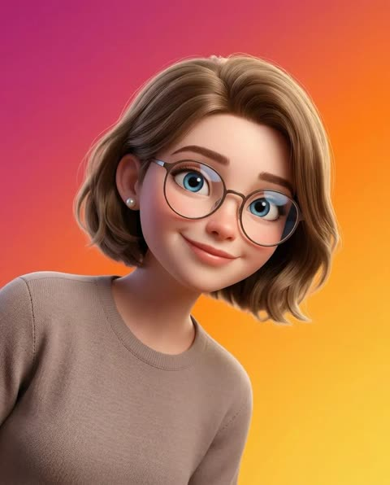</a>

The prompt stacks character traits (eyes, glasses, hairstyle, outfit, head tilt) before the lighting and render keywords. A bold gradient background with soft rim light keeps the subject separated and clean.

Nano Banana 2 · Text-to-image · Source: [@Taaruk_ on X](https://x.com/Taaruk_/status/2041366570149265865) · 226 likes on 2026-10-28

[`pixar-style`](tags.md#tag-pixar-style) [`3d-render`](tags.md#tag-3d-render) [`portrait`](tags.md#tag-portrait) [`gradient-background`](tags.md#tag-gradient-background) [`character`](tags.md#tag-character)

<details><summary><b>Prompt</b></summary>

```text
A stylized Pixar-style 3D portrait of a young person with smooth skin, large expressive blue eyes, soft facial features, wearing round transparent glasses, modern hairstyle (short styled hair / soft bob cut), casual outfit (hoodie or minimal sweater), slight head tilt and warm smile, friendly and approachable expression, ultra-clean character design, vibrant orange-to-pink gradient background, soft studio lighting with subtle rim light, cinematic depth of field, ultra-detailed, 8K render, octane render style.
```

</details>

<a id="chatgpt-inuyasha-character-card"></a>
### Inuyasha style character profile of a moonlit shrine priestess

<a href="https://www.tiktok.com/@kathy_scorpio13/video/7681313938935500062">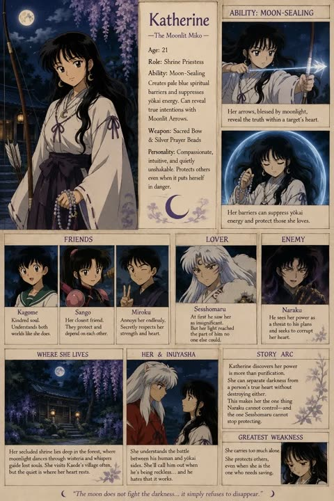</a>

The prompt turns a questionnaire into a structured character sheet, so each question becomes its own labelled panel that the model fills in turn by turn. Naming the franchise and asking for the exact series artwork keeps the anime style consistent across all panels.

ChatGPT · Edit · Source: [@kathy_scorpio13 on TikTok](https://www.tiktok.com/@kathy_scorpio13/video/7681313938935500062) · 193 likes on 2026-10-30

[`anime`](tags.md#tag-anime) [`inuyasha`](tags.md#tag-inuyasha) [`character-sheet`](tags.md#tag-character-sheet)

<details><summary><b>Prompt</b></summary>

```text
Using my photo as reference, turn me into character in the Inuyasha universe with the exact artwork from series. With everything you know about me Pick who my Character would be. What friends I would have if any, would I have a lover ? Who is my enemy where would I live. What ability do I have.
```

</details>

<a id="gpt-image-paper-cutout-rabbit-mail-carrier"></a>
### Paper cut-out rabbit mail carrier walking on grass

<a href="https://x.com/Just_sharon7/status/2084594642507776470">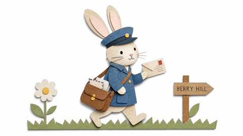</a>

A style-first template with a [subject] slot: layered paper shapes, visible cut edges and soft shadows between layers give a handmade depth. Flat paper colors, a plain white background and a simple readable action keep the character clear.

GPT Image 2 · Text-to-image · Source: [@Just_sharon7 on X](https://x.com/Just_sharon7/status/2084594642507776470) · 178 likes on 2026-10-28

[`paper-cutout`](tags.md#tag-paper-cutout) [`storybook`](tags.md#tag-storybook) [`stop-motion`](tags.md#tag-stop-motion) [`character`](tags.md#tag-character) [`template`](tags.md#tag-template)

<details><summary><b>Prompt</b></summary>

```text
Paper cut-out animation style, [subject], full body character shot, layered paper shapes, handmade paper texture, visible cut edges, soft shadow between layers, simple readable action, charming storybook character design, flat paper colors, slightly imperfect handcrafted details, paper collage background, minimal folk tale scenery, gentle stop-motion animation feel, poetic children’s story atmosphere, clean white background with simple paper elements.
```

</details>

<a id="gpt-image-photo-to-character-sheet-poses"></a>
### Photo to editorial character sheet with poses

<a href="https://x.com/Arzoo12sh/status/2102350375076626738"></a>

The prompt locks identity to a reference photo and fixes the outfit and held prop, so every view stays consistent. It then lists the sheet modules by name (turnaround views, expressions, action poses, material close ups, palette) to drive a labeled editorial layout.

GPT Image 2.5 · Edit · Source: [@Arzoo12sh on X](https://x.com/Arzoo12sh/status/2102350375076626738) · 178 likes on 2026-10-28

[`character-sheet`](tags.md#tag-character-sheet) [`reference-photo`](tags.md#tag-reference-photo) [`turnaround`](tags.md#tag-turnaround) [`editorial-layout`](tags.md#tag-editorial-layout) [`consistency`](tags.md#tag-consistency)

<details><summary><b>Prompt</b></summary>

```text
Create a high-resolution professional character sheet of the same young woman from the reference image. Show front, side, and back full-body views, plus multiple facial expressions and dynamic poses. She wears an all-black sweatshirt and black cargo pants, white chunky sneakers, and a black crossbody shoulder bag, holding the same clear cup/bottle of yellow iced drink in her hand. Keep her long brown hair and facial features consistent with the reference. Use a clean light beige/gray studio background, realistic photography, consistent face and body across every pose, editorial character-design sheet layout, neat typography, thin dividers, material close-ups, color palette, and professional poster composition.
```

</details>

<a id="gpt-image-photo-to-character-reference-sheet-natalie"></a>
### Photoreal character reference sheet from one photo

<a href="https://x.com/SadiaMalik182/status/2102988748732715426">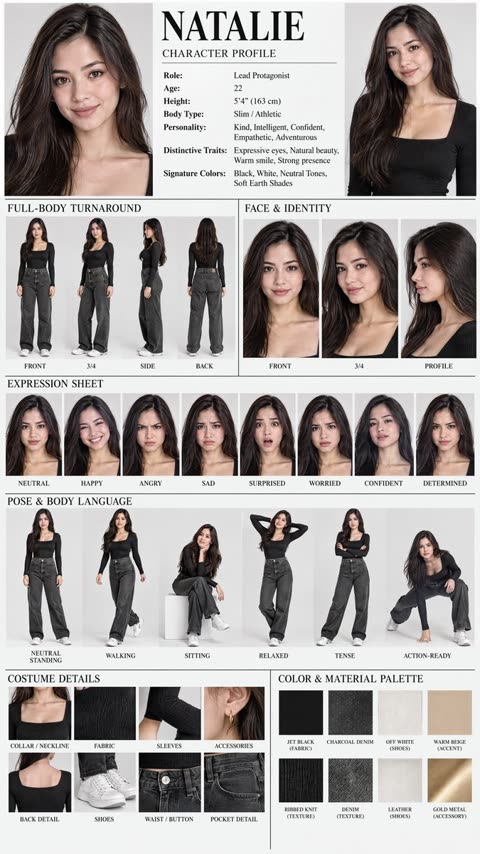</a>

Section headers in capitals (profile, turnaround, expressions, poses, costume, palette) turn one uploaded photo into a full editorial grid on a white background. Fill-in brackets for the profile fields and an explicit same person across every panel instruction keep identity consistent.

GPT Image 2.5 · Edit · Source: [@SadiaMalik182 on X](https://x.com/SadiaMalik182/status/2102988748732715426) · 162 likes on 2026-10-28

[`character-sheet`](tags.md#tag-character-sheet) [`turnaround`](tags.md#tag-turnaround) [`expression-sheet`](tags.md#tag-expression-sheet) [`identity-consistency`](tags.md#tag-identity-consistency) [`photorealistic`](tags.md#tag-photorealistic)

<details><summary><b>Prompt</b></summary>

```text
Use the uploaded photo as the ONLY identity reference and create a premium professional CHARACTER REFERENCE SHEET of the exact same person.

Preserve the person's recognizable identity exactly, including facial structure, eyes, eyebrows, nose, lips, jawline, skin tone, hair color, hair texture, hairline and hairstyle.

Create a clean Hollywood-style character design sheet with a professional editorial grid layout and white studio background.

CHARACTER PROFILE
Name: [NAME]
Role: [ROLE / PROFESSION]
Age: [AGE]
Height: [HEIGHT]
Body Type: [BODY TYPE]
Personality: [3–5 TRAITS]
Distinctive Traits: [IMPORTANT FEATURES]
Signature Colors: [COLORS]

FULL-BODY TURNAROUND
Show the same person in front view, 3/4 view, side profile and back view.

FACE & IDENTITY DETAILS
Show detailed front face, 3/4 face and side profile.

EXPRESSION SHEET
Show neutral, happy, angry, sad, surprised, worried, confident and determined expressions.

POSE & BODY LANGUAGE
Show neutral standing, walking, sitting, relaxed, tense and action-ready poses.

COSTUME DETAILS
Show close-up details of the neckline, fabric texture, sleeves, accessories, back details and shoes.

COLOR & MATERIAL PALETTE
Include coordinated color swatches and material references matching the character.

VISUAL STYLE:
Premium Hollywood character reference sheet, photorealistic cinematic photography, realistic skin texture, natural studio lighting, highly detailed, clean white background, professional typography, thin divider lines, balanced spacing and polished commercial presentation.

IMPORTANT:
Keep the exact same person consistent across every panel.
Do not change the face, hairstyle, age appearance or body proportions.
Do not copy the original photo's background or pose.
Do not add watermarks, logos, social media handles or promotional text.


@WizstarAI
```

</details>

<a id="nano-banana-real-person-pixar-twin-pastel-sweater"></a>
### Real man beside his matching Pixar style twin

<a href="https://x.com/Sheldon056/status/2029351307451260938">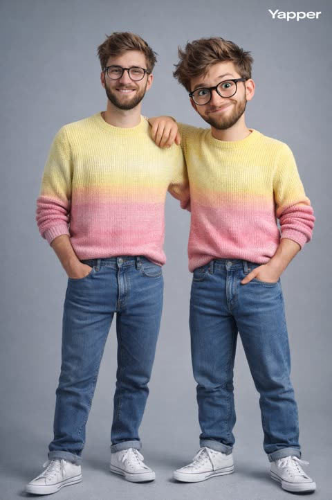</a>

Locks the face, the gradient sweater outfit and the proportions of both figures to one uploaded reference, and lets only the Pixar twin differ through a smirk, a raised eyebrow and big eyes. A plain studio backdrop and a long negative prompt keep the clothing and pose consistent.

Nano Banana 2 · Edit · Source: [@Sheldon056 on X](https://x.com/Sheldon056/status/2029351307451260938) · 160 likes on 2026-10-29

[`pixar-style`](tags.md#tag-pixar-style) [`reference-image`](tags.md#tag-reference-image) [`identity-lock`](tags.md#tag-identity-lock) [`studio-portrait`](tags.md#tag-studio-portrait) [`negative-prompt`](tags.md#tag-negative-prompt)

<details><summary><b>Prompt</b></summary>

```text
Generated with Nano Banana 2 on Yapper

Prompt: Ultra-high-quality hyper-realistic photo showing a real person and a giant 3D Pixar-style version of the SAME person, both strictly based on the uploaded reference image. The real person and the Pixar character must have identical facial structure, hairstyle, facial expression, body proportions, height, and clothing. Both are wearing a knitted sweater with a gradient from light yellow to pink, high-waisted blue jeans, and white high-top sneakers. The pose must exactly match the reference: the real person stands relaxed with a friendly smile, with one hand naturally resting on the Pixar character’s shoulder. The Pixar version stands slightly wider, with hands confidently positioned near the pockets, with a playful mischievous smirk, a raised eyebrow, and expressive Pixar-style eyes. The size of the Pixar character should be proportionally larger but anatomically identical to the real person. The facial expression, head tilt, posture, and body language must precisely replicate the reference image. Clean grey-blue studio background, soft even studio lighting, realistic shadows, crisp fabric texture, smooth Pixar skin shading, cinematic sharpness. Do NOT change the pose, reaction, clothing, or proportions. Strict adherence to the reference.

Negative prompt: incorrect clothing, different pose, different facial expression, mismatched face, exaggerated cartoon style, thin or bulky body, incorrect Pixar proportions, incorrect height ratio, smile instead of smirk, neutral face, realistic render instead of Pixar, distorted anatomy, different clothing colors, weak resemblance, generic Pixar face.
```

</details>

<a id="nano-banana-3d-cgi-fur-coat-character"></a>
### Bald 3D character in fur coat and red sneakers

<a href="https://x.com/Xaroon_x/status/2031735211772317828">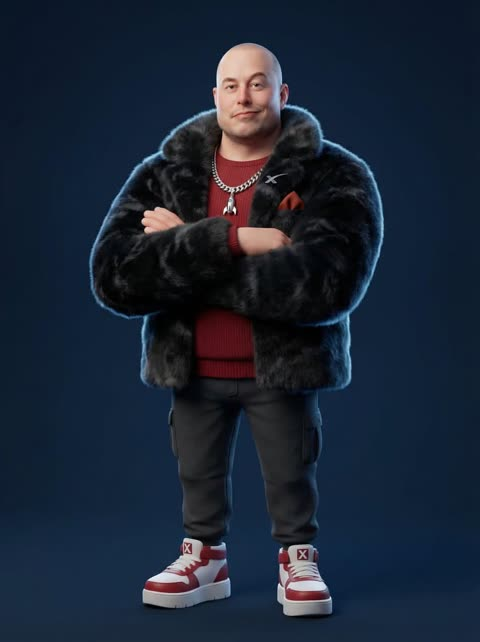</a>

A structured JSON spec splits the request into labelled fields for render engine, proportions, skin, materials, lighting and camera, so each part of the look is controlled on its own. The three-point lighting and 35 to 50mm lens fields fix a full body studio framing, while the fur and clothing fields add material detail.

Nano Banana 2 · Text-to-image · Source: [@Xaroon_x on X](https://x.com/Xaroon_x/status/2031735211772317828) · 152 likes on 2026-10-29

[`3d`](tags.md#tag-3d) [`cgi`](tags.md#tag-cgi) [`character`](tags.md#tag-character) [`fashion`](tags.md#tag-fashion)

<details><summary><b>Prompt</b></summary>

```text
{
  "renderEngine": "Blender Cycles / Unreal Engine 5 Lumen",
  "baseStyle": "Stylized 3D CGI character — Pixar meets high-fashion editorial",
  "proportions": "Slightly enlarged head (1.3x natural), compact torso, simplified facial features, exaggerated chunky feet/shoes",
  "skinShader": "Subsurface scattering with physically-based roughness, no pores, smooth cartoon-like finish",
  "clothingPhysics": "Marvelous Designer simulation baked in, wrinkle maps, fabric-specific material shaders",
  "furTech": "XGen or Ornatrix volumetric fur for faux-fur pieces, physics-simulated",
  "resolution": "8192x8192px minimum, 300DPI",
  "backgroundStyle": "Solid flat color, no gradient, no texture — studio seamless backdrop",
  "lightingRig": "Three-point studio: key (45° front-top), fill (opposite side soft), rim (back edge definition)",
  "cameraLens": "35-50mm equivalent, slight vignette, no fisheye",
  "postProcessing": "Subtle chromatic aberration on edges, mild film grain 2%, slight color grade"
}
```

</details>

<a id="gpt-image-editorial-fashion-character-sheet-face-reference"></a>
### Editorial fashion character sheet from one face photo

<a href="https://x.com/Alina_with_Ai/status/2102234488562655721">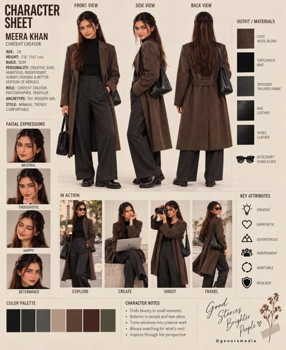</a>

The prompt separates identity from styling: the uploaded photo supplies only the face, while the outfit is locked item by item and repeated in a closing consistency block. A fixed panel grid of three views, four expressions, four action poses, materials and palette keeps one character coherent across the whole sheet.

GPT Image 2.5 · Edit · Source: [@Alina_with_Ai on X](https://x.com/Alina_with_Ai/status/2102234488562655721) · 138 likes on 2026-10-28

[`character-sheet`](tags.md#tag-character-sheet) [`face-reference`](tags.md#tag-face-reference) [`fashion`](tags.md#tag-fashion) [`editorial`](tags.md#tag-editorial) [`consistency`](tags.md#tag-consistency)

<details><summary><b>Prompt</b></summary>

```text
Create a premium editorial-style CHARACTER REFERENCE SHEET using the uploaded photo as the PRIMARY FACE REFERENCE.

IMPORTANT IDENTITY INSTRUCTION:
Use ONLY the face and identity from the uploaded reference photo. Preserve her facial structure, eyes, eyebrows, nose, lips, jawline, skin tone, natural facial proportions and overall recognizable appearance consistently in every panel.

DO NOT copy the clothing, outfit, accessories, pose, or background from the reference photo.
ONLY use the uploaded photo as the FACE/IDENTITY REFERENCE.

CHARACTER:
24-year-old woman, 5'6" (167 cm), slim build, long naturally wavy dark-brown hair, warm natural skin tone, expressive brown eyes, soft feminine facial features.

OUTFIT — MUST REMAIN EXACTLY THIS:
Long tailored dark-brown wool-blend coat
Black fitted ribbed turtleneck knit
High-waisted wide-leg dark charcoal tailored trousers
Black leather loafers
Black leather shoulder bag
Black sunglasses as an optional accessory

Do NOT replace or redesign the outfit.

CHARACTER SHEET LAYOUT:

TOP SECTION:
Show THREE consistent full-body views of the same woman:

1. FRONT VIEW
Standing naturally with one hand in her trouser pocket and the other holding the black shoulder bag.

2. SIDE VIEW
Natural three-quarter side profile, clearly showing her face, long hair, coat silhouette and shoulder bag.

3. BACK VIEW
Full back view showing the long brown coat, hairstyle, trousers and shoulder bag.

FACIAL EXPRESSIONS:
Create four close-up portraits using the EXACT SAME FACE:
• Neutral
• Thoughtful
• Happy
• Determined

Keep facial identity consistent across all expressions.

IN ACTION:
Create four lifestyle poses:
• EXPLORE — walking outdoors with sunglasses and coffee
• CREATE — sitting with a laptop
• SHOOT — holding a professional camera
• TRAVEL — walking confidently with shoulder bag

OUTFIT / MATERIALS:
Show clean visual material references for:
• Brown wool-blend coat
• Black ribbed turtleneck
• Dark charcoal tailored trousers
• Black leather shoulder bag
• Black leather loafers
• Black sunglasses

KEY ATTRIBUTES:
Creative
Empathetic
Adventurous
Independent
Adaptable
Resilient

COLOR PALETTE:
Black, charcoal gray, warm brown, beige, dark burgundy, muted olive green.

CHARACTER NOTES:
Finds beauty in small moments.
Believes in people and new ideas.
Turns emotions into creative work.
Always searching for what's next.
Sees the world from her own perspective.

DESIGN:
Luxury fashion editorial character sheet, premium magazine layout, warm beige background, elegant typography, clean professional grid, realistic studio photography, subtle shadows, cinematic soft lighting, natural skin texture, photorealistic, highly detailed, cohesive visual identity.

CRITICAL CONSISTENCY:
The SAME WOMAN must appear in every panel.
The uploaded reference photo is the ONLY source of truth for her face.
Do not change her facial identity between panels.
Do not copy the uploaded photo's clothing.
Keep the specified brown coat, black turtleneck, dark trousers, black loafers and black shoulder bag in every relevant panel.

Add tasteful editorial typography:
“CHARACTER SHEET”
“CREATIVE GIRL”
“Good Stories, Brighter People”

Make it look like a professional AI character reference sheet created for a film, fashion campaign, or visual storytelling project.
```

</details>

<a id="gpt-image-character-dance-reference-sheet-4x4"></a>
### Chibi character 16 frame dance reference sheet

<a href="https://x.com/Scenario_gg/status/2099797670516695385">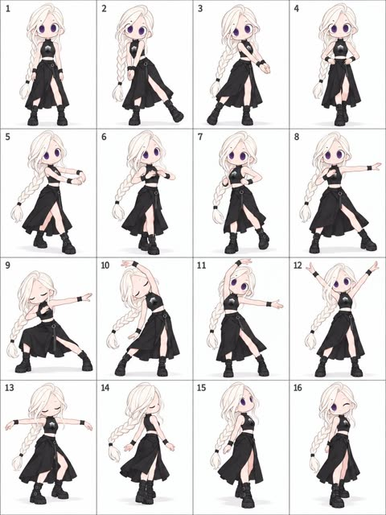</a>

Numbered choreography steps give each of the 16 panels a distinct pose, so the sequence reads as one continuous routine. Explicit rules for identity lock, secondary motion of hair and fabric, and a fixed camera keep the character consistent across panels.

GPT Image 2.5 · Edit · Source: [@Scenario_gg on X](https://x.com/Scenario_gg/status/2099797670516695385) · 123 likes on 2026-10-28

[`dance`](tags.md#tag-dance) [`pose-sheet`](tags.md#tag-pose-sheet) [`grid`](tags.md#tag-grid) [`character-reference`](tags.md#tag-character-reference) [`choreography`](tags.md#tag-choreography)

<details><summary><b>Prompt</b></summary>

```text
Create a polished square-format dance reference sheet featuring the character from the uploaded reference image. The final image should be arranged as a clean 4×4 grid containing exactly 16 equally sized panels. Each panel represents the next key pose in a single uninterrupted dance sequence, read from left to right and then top to bottom.

Reference Fidelity

Treat the uploaded character as the definitive visual reference throughout the sheet.

Across all 16 frames, keep the character’s identity completely stable, including:

face and facial features
hairstyle and hair length
color palette
body proportions and species
clothing and garment construction
accessories
overall illustration and rendering style

Any part of the character that is not visible in the reference should be inferred conservatively and then depicted the same way throughout the entire sequence.

Choose a style of dance that feels natural for the character’s personality, anatomy, outfit, and available range of motion.

Movement Logic

The sixteen images are consecutive moments from one continuous routine, not sixteen unrelated dance poses.

Every pose should flow naturally into the next through small steps, weight transfers, pivots, or continuing arm gestures. Keep the supporting limbs and direction of rotation physically consistent from frame to frame.

Changes in orientation, body height, balance, and momentum should happen progressively rather than suddenly.

Each frame should remain visually distinct while the overall routine develops through a clear progression: a relaxed opening, gradual build-up, expressive peak, and controlled settling finish.

Choreography

Follow this exact movement sequence:

1. Begin with feet comfortably apart, knees relaxed, and arms resting low.

2. Shift weight left, tapping the right foot outward as the hands drift left.

3. Transfer weight onto the right foot, letting both hands sweep low toward the right.

4. Draw the left foot inward while the hands continue upward to waist height.

5. Step the left foot forward diagonally, turning the torso slightly left as the arms round forward.

6. Rock onto the front left foot, allowing the rounded arms to rise toward chest height.

7. Push gently back onto the right foot, drawing the elbows toward the ribs.

8. Step the left foot out to the left, opening the left arm in the same direction.

9. Settle into a shallow left lunge while the right arm sweeps across the chest toward the left.

10. Deepen the lunge slightly as the right arm continues its arc overhead into a gentle left side bend.

11. Straighten gradually, keeping the right arm overhead while the left arm opens outward.

12. Reach the routine’s peak in a tall, grounded stance, extending both arms into an open upward diagonal.

13. Soften the knees and lower both arms outward through shoulder height.

14. Shift weight onto the left foot and pivot a quarter-turn left, letting the arms continue downward.

15. Bring the right foot forward into a small staggered stance, lifting the chest as the arms settle low behind the hips.

16. Finish in that same stance, turning the head toward the viewer with a character-appropriate expression and relaxed, deliberate hands.

If the character has nonhuman anatomy, reinterpret the steps and gestures as the closest anatomically appropriate equivalents while preserving the same order, rhythm, direction, and continuity.

Secondary Motion

Hair, loose garments, and hanging accessories should react naturally to the choreography rather than remaining static.

Their movement should follow the character’s momentum:

hair and fabric lag slightly behind steps and sweeping gestures
loose elements swing naturally during turns
hair and garments fall with gravity during bends
movement gradually settles as the routine approaches the final pose
light fabrics flutter subtly
heavier fabrics move with greater weight and slower follow-through
fitted clothing develops believable folds around bending and twisting joints

Keep all secondary motion proportional to this relatively gentle routine.

Hair length, clothing construction, and accessory placement must remain consistent in every frame.

Communicate movement through the changing shapes and positions of the hair and fabric themselves. Do not use motion lines, speed lines, ghosting, or movement trails.

Sheet Presentation

Use a square canvas containing a precise 4×4 grid.

The presentation should include:

exactly 16 equally sized panels
one full-body character in every panel
small, clearly readable numbers 1–16 in the upper-left corner of their corresponding panels
a clean white background
thin grid lines
consistent character scale
a fixed camera viewpoint
consistent lighting and rendering
comfortable empty space around every limb, hairstyle, ear, wing, tail, garment, and accessory
subtle ground shadows
clear silhouettes
anatomically plausible joints
convincing weight distribution and balance

The character should never be cropped by the panel boundaries.

Constraints

Do not introduce repeated or near-identical poses, abrupt movement transitions, identity drift, costume changes, additional characters, new props, scenery, captions, or watermarks.

Avoid extra or missing limbs, malformed hands, implausible joints, inconsistent supporting feet, accidental panel overlap, cropped features, sudden changes in character scale, or unexplained changes in orientation.

The finished sheet should read immediately as sixteen carefully selected consecutive keyframes from one coherent dance performance by the same character.
```

</details>

<a id="nano-banana-year-end-line-sticker-set"></a>
### Chibi LINE sticker grid of end of year phrases

<a href="https://x.com/hAru_mAki_ch/status/1993162367816085840">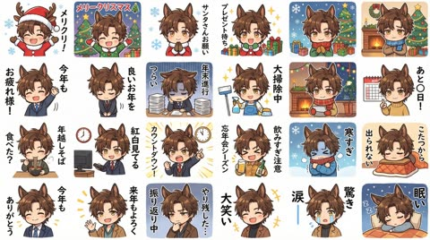</a>

A reference character image is paired with a sticker sheet spec: a 4 by 6 grid, 16:9, an explicit list of Japanese phrases to cover, and a rule to draw an original illustration rather than copy the reference. Winter props such as snowflakes, illumination and fir trees are named as background accents, so each cell reads as a seasonal scene.

Nano Banana Pro · Edit · Source: [@hAru_mAki_ch on X](https://x.com/hAru_mAki_ch/status/1993162367816085840) · 117 likes on 2026-10-29

[`christmas`](tags.md#tag-christmas) [`line-sticker`](tags.md#tag-line-sticker) [`chibi`](tags.md#tag-chibi) [`year-end`](tags.md#tag-year-end)

<details><summary><b>Prompt</b></summary>

```text
Higgsfield の Nano Banana Pro お試し㊵
LINEスタンププロンプト使ってみた
年末年始スタイルも良い！！！
これで年越しイベントはスタンプ押しまくろう！！！

ーーー📒プロンプトー年末版（クリスマス〜大晦日）ーー
画像のキャラクターをベースに、Q版（デフォルメ/ちびキャラ）のLINEスタンプ風バストアップ表情集を作成してください。

【テーマ】年末・クリスマス〜大晦日

【スタイル】
- カラフルな手描き風
- 頭飾り・髪飾りは正確に再現すること
- 元画像をそのままコピーせず、オリジナルのイラストとして描くこと
- 冬らしい装飾（雪の結晶、イルミネーション、もみの木など）を背景やアクセントに

【レイアウト】
- 4×6のグリッド配置（計24種類）
- 4K解像度、アスペクト比16:9

【表情・テキスト内容】
年末によく使うフレーズを網羅：
- メリクリ！、メリークリスマス🎄、サンタさんお願い、プレゼント待ち
- 今年もお疲れ様！、良いお年を、年末進行つらい、大掃除中
- 年越しそば食べた？、紅白見てる、カウントダウン！、あと○日！
- 忘年会シーズン、飲みすぎ注意、寒すぎ、こたつから出られない
- 今年もありがとう、来年もよろしく、振り返り中、やり残した…

すべてのテキストは手書き風の日本語で表記

ーーー📒プロンプトー年始版（お正月〜新年）ーー
画像のキャラクターをベースに、Q版（デフォルメ/ちびキャラ）のLINEスタンプ風バストアップ表情集を作成してください。

【テーマ】年始・お正月

【スタイル】
- カラフルな手描き風
- 頭飾り・髪飾りは正確に再現すること
- 元画像をそのままコピーせず、オリジナルのイラストとして描くこと
- 和風・お正月らしい装飾（門松、鏡餅、梅の花、だるま、富士山など）を背景やアクセントに

【レイアウト】
- 4×6のグリッド配置（計24種類）
- 4K解像度、アスペクト比16:9

【表情・テキスト内容】
年始によく使うフレーズを網羅：
- あけおめ！、あけましておめでとう🎍、謹賀新年、今年もよろしく
- 初詣行った？、おみくじ引いた、大吉！、凶だった…
- お年玉ちょうだい、お年玉あげる、福袋ゲット、初売り参戦
- お餅食べすぎ、おせち最高、寝正月、三が日満喫中
- 新年の抱負、今年こそは！、正月太り、仕事始めつらい
- 巳年だね🐍、今年も頑張ろう、初夢見た？、書き初めした

すべてのテキストは手書き風の日本語で表記

---
今なら、Higgsfieldで65% OFF ＆ これから3日以内に
@higgsfield_ai
 に参加した人は Nano Banana Pro を1年間無制限で利用できます。
```

</details>

<a id="nano-banana-photorealistic-character-sheet-three-views"></a>
### Photorealistic character sheet with portrait and three views

<a href="https://x.com/MrDavids1/status/2027869658313826744">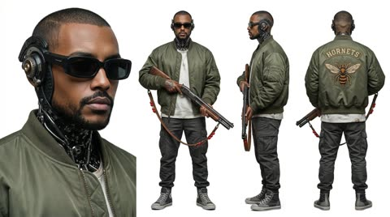</a>

The prompt fixes the layout in plain terms: a left aligned closeup, then front, side and back full body views on white with no text or borders. The outfit and props sit in a bracketed block that can be swapped, while an uploaded reference photo keeps the identity consistent.

Nano Banana 2 · Edit · Source: [@MrDavids1 on X](https://x.com/MrDavids1/status/2027869658313826744) · 112 likes on 2026-10-29

[`character-sheet`](tags.md#tag-character-sheet) [`turnaround`](tags.md#tag-turnaround) [`identity-consistency`](tags.md#tag-identity-consistency) [`reference-image`](tags.md#tag-reference-image) [`photorealistic`](tags.md#tag-photorealistic)

<details><summary><b>Prompt</b></summary>

```text
I'm definitely noticing some improvements to character identity with Nano Banana 2 making it super useful for character sheets. Tested one of myself. Just upload your own image as reference and adjust the character description in brackets in the prompt as needed. I'm using character sheets with video models that have an OMNI feature as you can easily insert yourself into any location in a video with a character sheet.

🗒️Prompt: Create a photorealistic character sheet. Include a closeup portrait which is left aligned, no borders, with a neutral expression and then also include a full view shot that shows the front, side and back of the character. The character is placed on a white background. Don't include any text. No borders, no soft gradients. [The character is a male. He is wearing an oversized olive jacket, insignia on the back of the jacket shows a logo with a hornet and arched text that says HORNETS. He also wears a weathered white t-shirt and dark grey cargo pants, with grey and black converse sneakers. He stands in a confident pose holding a customized shotgun with African wood engravings and a leather shoulder strap attached to the shotgun that has red beads as a decoration.]

You can use Nano Banana 2 via
@Hailuo_AI
```

</details>

<a id="gpt-image-explorer-boy-mascot-compass-3d"></a>
### 3D explorer boy mascot holding a compass

<a href="https://x.com/ZephyraLeigh/status/2063953406797213742">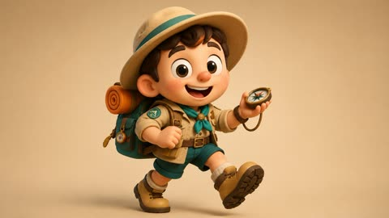</a>

A reusable template with blank slots for subject, action and palette, so one brief yields a consistent family of 3D mascots. Naming material, studio lighting and a minimal background pins the look to a clean CGI render.

GPT Image 2 · Text-to-image · Source: [@ZephyraLeigh on X](https://x.com/ZephyraLeigh/status/2063953406797213742) · 110 likes on 2026-10-29

[`mascot`](tags.md#tag-mascot) [`3d-render`](tags.md#tag-3d-render) [`explorer`](tags.md#tag-explorer) [`template`](tags.md#tag-template)

<details><summary><b>Prompt</b></summary>

```text
Cute stylized 3D [SUBJECT] mascot, original character design, rounded body proportions, expressive face, [DOING ACTION] pose, smooth matte material, colorful contemporary animation aesthetic, vibrant [COLOR1], [COLOR2], and [COLOR3] palette, studio lighting, high-detail CGI render, minimalist background.
```

</details>

<a id="gpt-image-anime-rpg-coastal-megacity-game-hud"></a>
### Anime RPG HUD over a sunset coastal megacity

<a href="https://x.com/xRahultripathi/status/2053331477224739071">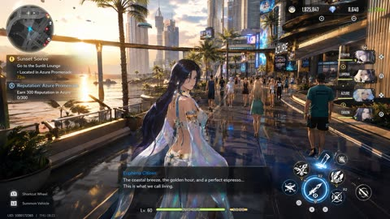</a>

The shot is framed as an over the shoulder gameplay capture with the character walking and glancing back, so it reads as a real console screenshot rather than a posed showcase. Each HUD element is named with its screen position, and the warm sunset is set against cyan neon to give the lighting its contrast.

GPT Image 2 · Text-to-image · Source: [@xRahultripathi on X](https://x.com/xRahultripathi/status/2053331477224739071) · 108 likes on 2026-10-29

[`anime`](tags.md#tag-anime) [`game-ui`](tags.md#tag-game-ui) [`screenshot`](tags.md#tag-screenshot) [`sunset-city`](tags.md#tag-sunset-city)

<details><summary><b>Prompt</b></summary>

```text
Ultra-detailed authentic in-game screenshot from a fictional AAA open-world anime RPG set in a futuristic Mediterranean-inspired megacity at golden sunset. Completely different visual identity from previous images.

Main character: Hancock-inspired anime woman with very long midnight-blue hair, sharp elegant facial features, and a confident expression. Outfit redesigned into a luxurious white-and-teal futuristic beachwear set with holographic fabric accents, translucent silk jacket, gold jewelry, glowing anklets, and high-fashion sci-fi styling. No purple or red tones.

Environment: massive coastal smart-city with elevated highways, luxury shopping districts, digital hologram ads, floating drones, reflective wet pavement, tropical gardens, rooftop pools, monorail tracks, and ocean visible between skyscrapers. Warm orange sunset lighting mixed with cyan neon reflections creates cinematic contrast. Busy crowds of NPCs walking naturally.

Game UI must feel like a real next-gen RPG:

- circular minimap top left with roads and icons
- quest tracker with stylish typography
- party character list on right side
- stamina and HP bars at bottom
- ability wheel with futuristic glowing icons
- subtitle dialogue box with cinematic caption
- in-game currency and ping indicator
- realistic console-game HUD styling
- subtle motion blur and depth of field
- photo-real 3D cel-shaded anime rendering
- dynamic lighting and ambient occlusion
- PlayStation 5 / Unreal Engine style quality

Camera angle: over-the-shoulder cinematic gameplay screenshot, not character showcase pose. Character should be naturally walking through the city while looking slightly back toward camera.

Mood: premium stylish anime GTA-like RPG mixed with modern JRPG aesthetics and urban vacation luxury vibe. Completely fresh composition and color palette.
```

</details>

<a id="nano-banana-christmas-cartoon-ornaments-scarf"></a>
### Cartoon character ornaments with red scarves on tree

<a href="https://x.com/TechieBySA/status/1998777016775065733">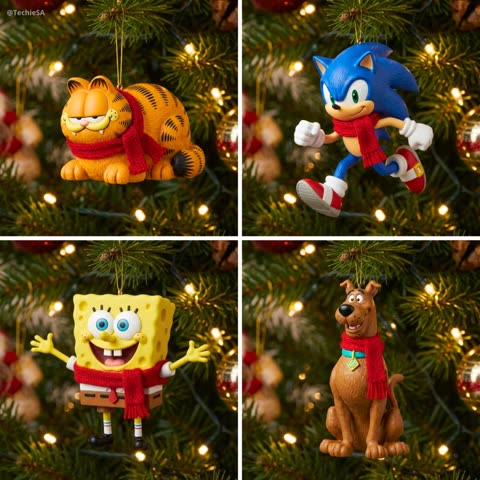</a>

The [CHARACTER] slot makes this a reusable template, and the fixed clauses hold the look: plastic material, gold thread hanger, blurred tree with warm bokeh, and a macro lens cue. Swap in one character per run for a sharp subject.

Nano Banana Pro · Text-to-image · Source: [@TechieBySA on X](https://x.com/TechieBySA/status/1998777016775065733) · 107 likes on 2026-10-29

[`christmas`](tags.md#tag-christmas) [`ornament`](tags.md#tag-ornament) [`cartoon`](tags.md#tag-cartoon) [`macro`](tags.md#tag-macro)

<details><summary><b>Prompt</b></summary>

```text
“A hyper-realistic Christmas tree ornament depicting [CHARACTER]. The ornament looks incredibly realistic thanks to its detailed facial features and natural texture. The toy is made of plastic. In the background is a slightly blurred Christmas tree with dark green needles and a warm bokeh. The overall atmosphere of coziness, festivity, and magic is created by the shallow depth of field, soft, warm lighting, and bright, festive colors. He/she/it wears a bright red wool scarf wrapped around his/her/its neck, giving him/her/it a playful, cozy look. The ornament is suspended by a thin gold thread attached to the top. High-resolution macro photography is rich in detail and offers a cinematic appeal. 1080x1080 dimension.”
```

</details>

<a id="nano-banana-isometric-pixel-art-rogue-dual-daggers"></a>
### Isometric Pixel Art Rogue With Two Daggers

<a href="https://x.com/GrilliotTodd/status/2047452990987256077">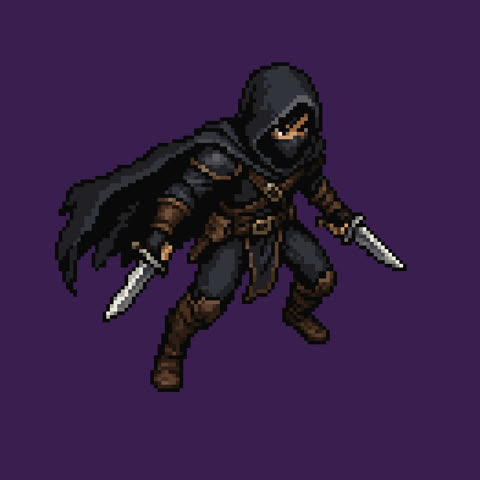</a>

A short semicolon-separated prompt that fixes the art style, facing direction, isometric view, solid background and held items in one line. Nano Banana 2 renders it at high resolution with a clean pixel grid, though it may add a floor unless told not to.

Nano Banana 2 · Text-to-image · Source: [@GrilliotTodd on X](https://x.com/GrilliotTodd/status/2047452990987256077) · 104 likes on 2026-10-28

[`pixel-art`](tags.md#tag-pixel-art) [`game-sprite`](tags.md#tag-game-sprite) [`isometric`](tags.md#tag-isometric) [`rogue`](tags.md#tag-rogue) [`solid-background`](tags.md#tag-solid-background)

<details><summary><b>Prompt</b></summary>

```text
gpt-image-2 was trained on real game art, while Nano banana was trained on high res pixel art portraits. That's my take.

gpt image 2 on the left, nano banana 2 on the right. same prompt, same pixel post processing.

> gpt image 2 - about 80px tall
> nanobanana 2 - about 150px tall, huge!

NB will always make high res pixel art characters with elaborate backgrounds if you don't carefully prompt it otherwise. - even on this prompt, it includes a floor that i didn't ask for.

gpt-image-2 loves to leave out the background for character work, you don't even have to ask most of the time. Very game ready character sprites.

Nano banana is actually better at pixel grid adherence. It keeps the grid clean at high resolutions. gpt-image-2 can make a mess at higher resoutions.

prompt: "pixel art; a rogue game character facing south east. isometric view. solid background. cape and two daggars, one in each hand."
```

</details>

<a id="nano-banana-pixar-boy-sunglasses-black-background"></a>
### Pixar style seated boy with sunglasses and coffee

<a href="https://x.com/auqibhabib/status/2045326450795094091">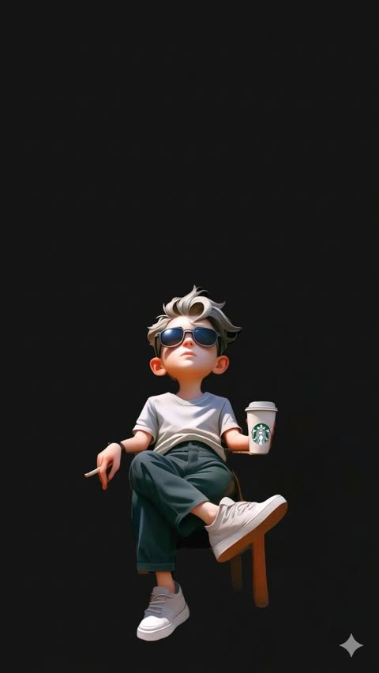</a>

The prompt fixes the subject on a pure black field and assigns each prop to a specific hand, so the layout and colours stay locked to the brief. The explicit negative space instruction keeps the figure centred with room above.

Nano Banana 2 · Text-to-image · Source: [@auqibhabib on X](https://x.com/auqibhabib/status/2045326450795094091) · 95 likes on 2026-10-29

[`pixar-style`](tags.md#tag-pixar-style) [`3d-render`](tags.md#tag-3d-render) [`character`](tags.md#tag-character) [`negative-space`](tags.md#tag-negative-space)

<details><summary><b>Prompt</b></summary>

```text
A detailed 3D Pixar-style digital illustration of a cool young boy with voluminous, wavy white hair and dark sunglasses. He is sitting on a small wooden chair in a relaxed, cross-legged pose against a stark black background. He is wearing a simple light gray t-shirt, dark teal or green trousers, and chunky white sneakers. His right hand holds a lit cigarette, and his left hand holds a white Starbucks coffee cup with the full green mermaid logo facing forward. The lighting is soft and stylized, casting clean highlights on his hair and clothes. The perspective is centered on the character, with ample negative space above and around him.
```

</details>

<a id="nano-banana-toy-character-sprinting-through-design-sheets"></a>
### Toy character sprinting through torn design sheets

<a href="https://x.com/edizkan_/status/2033783098773569785">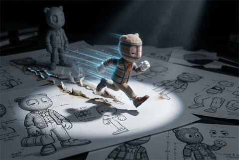</a>

A bean sized toy built from an uploaded reference runs across giant sketch pages. The prompt breaks the pose down limb by limb and sets a critical likeness lock covering both the toy and the sketches. A single hard spotlight, an 85mm macro lens and a shallow depth of field sell the scale illusion.

Nano Banana 2 · Edit · Source: [@edizkan_ on X](https://x.com/edizkan_/status/2033783098773569785) · 89 likes on 2026-10-29

[`toy-photography`](tags.md#tag-toy-photography) [`macro`](tags.md#tag-macro) [`character-sheet`](tags.md#tag-character-sheet) [`spotlight`](tags.md#tag-spotlight) [`reference-image`](tags.md#tag-reference-image)

<details><summary><b>Prompt</b></summary>

```text
The moment your character stops being designed…
and starts existing. #AKCB

Recommended generator: Nano Banana 2 (Gemini – Thinking Mode)

Try it and show your results 👇

A cinematic macro toy-photography scene.
A bean-sized version of the uploaded reference character is sprinting explosively captured at the peak stride moment of a high-speed sprint with visual effect.

Character Pose
A dynamic, mid-sprint action pose with amazing visual effects captured from a three-quarter side profile.
Torso: Leaning forward at a sharp angle to convey momentum.
Arms: One arm is bent sharply at the elbow with the fist tucked near the chest; the other arm is extended backward, trailing behind the torso.
Legs: In a full stride. The lead leg is bent forward with the knee high, while the trailing leg is fully extended back with the foot pointed.
Head: Facing forward, aligned with the direction of the run.

The character runs across the surface of several giant black-and-white character design pages fully covering the ground, featuring the same character.
Likeness Preservation (CRITICAL)
The identity of the character must remain exactly identical to the reference in both:
• the miniature physical character

• the character shown in the design sketches
The sketch pages must show the  same character, including:
• dynamic poses small sketches

• head studies and shape explorations

• proportion notes

• accessory sketches

• construction diagrams

• small handwritten annotations
Maintain the exact:
• head shape

• eye shape and spacing

• stylization

• silhouette

• materials and clothing design
If the character wears a balaclava, mask, helmet, or covered face, the sketches must not invent facial anatomy.
No added nose.

No added mouth.

No visible skin where the reference does not show it.
Do not humanize the character.

Do not reinterpret anatomy.
Subject & Action
The miniature character sprints explosively across the design pages, tearing through the sketch sheet as it runs.
The character is captured at the peak stride moment of a full-speed sprint.
Running pose details:
• the body leans sharply forward as if accelerating

• one leg is fully extended forward while the other drives powerfully backward

• arms pump in opposite running motion

• the torso twists slightly creating a dynamic curved spine line

• the pose feels like a high-speed comic-book sprint
The character’s momentum rips through the paper, creating a jagged torn path behind it.
A trail of torn paper curls and fragments with vfx follows behind the running character as if it burst out of its own design.
Oversized design sheets surround the character, each page showing different stages of development of the same character.
One small grey 3d print of the character is in the background as an exact copy of the uploaded image.
Camera & Perspective
Captured from a medium camera distance above the desk, allowing a wider portion of the surrounding design pages to be visible.
Shot with an 85mm macro lens, creating natural compression while keeping the environment readable.
The camera sits slightly elevated and angled downward toward the running character.
The character remains the focal point but occupies roughly one third of the frame, revealing more of the design sheets and workspace around it.
The character remains slightly off-center within the spotlight.
Depth of Field
Extremely shallow depth of field.
The sprinting miniature character and the immediate section of the torn sketch page are razor sharp.
Surrounding pages and distant elements fall into soft blur.
Lighting (VERY DRAMATIC)
A single narrow spotlight / flashlight beam hits the character.
The beam comes from a side-front direction, creating a bright circular pool of light on the design page.
Lighting characteristics:
• extremely hard light

• very high contrast

• no ambient fill light

• the surrounding elements fades into near-total darkness

• sharp dramatic shadows stretch across the paper

• edges of the light beam fall rapidly into black
The environment outside the spotlight should feel almost completely swallowed by darkness, as if the character has been suddenly caught under a stage light.
Dust particles float through the beam.
Environment & Surface Detail
Macro-level detail of the design pages:
• ink texture

• pencil strokes

• paper fibers

• subtle reflections on graphite lines
The torn paper edge reveals fibrous paper layers and curled fragments along the ripped path.

Subtle Heat Burn Detail
Along parts of the torn path, the paper shows light scorching caused by extreme speed friction:
• edges of some tears are slightly darkened and singed

• faint burnt browning transitions into the white paper fibers

• tiny ember-like glowing specks appear briefly along the freshest tear points

• very subtle wisps of heat distortion or smoke rise from a few edges
The burn effect must remain minimal, believable, and physically grounded, enhancing realism without turning into flames or overpowering the scene.

Color Grade
Desaturated sketch pages and environment.
The character receives cool cinematic highlights from the spotlight.
Moody macro photography atmosphere.
Rendering Style
Photorealistic macro toy photography, emphasizing scale illusion between the tiny character and the giant design pages.
Speed Energy VFX
A stylized high-speed energy trail follows behind the running character, emphasizing the explosive sprint.
The trail consists of thin luminous motion streaks and glowing particles streaming backward from the character’s movement direction.
Characteristics:
• energy streaks originate from behind the character’s shoulders, arms, and legs

• streaks extend diagonally backward, following the direction of motion

• the lines are semi-transparent glowing blue light trails

• small sparkling particles scatter along the trail

• the effect should feel like comic-book speed energy, not smoke or fire

• the VFX enhances motion but does not cover or obscure the character
The light streaks interact subtly with the environment:
• faint glow reflecting on the torn paper edges

• slight blue rim light on the character’s silhouette

• a few glowing particles floating through the spotlight beam
The energy trail should feel fast, sharp, and directional, reinforcing the sense that the character is sprinting at extreme speed.
ar 3:2
```

</details>

<a id="gpt-image-good-morning-chibi-scene"></a>
### Chibi woman sitting on pastel GOOD MORNING letters

<a href="https://x.com/codewithhajra/status/2083130474075918811">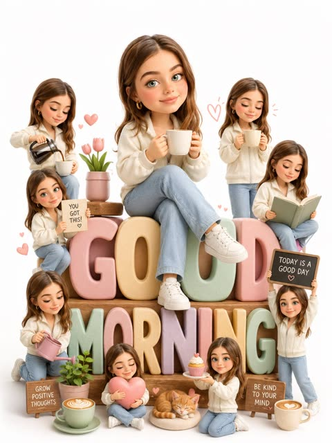</a>

An identity lock block that repeats facial features, outfit and proportions keeps one face across the main figure and eight mini versions. Each mini character gets its own activity clause, while the giant letters act as the fixed central structure of the scene.

GPT Image 2 · Edit · Source: [@codewithhajra on X](https://x.com/codewithhajra/status/2083130474075918811) · 83 likes on 2026-10-29

[`chibi`](tags.md#tag-chibi) [`pixar-style`](tags.md#tag-pixar-style) [`greeting-card`](tags.md#tag-greeting-card) [`identity-lock`](tags.md#tag-identity-lock)

<details><summary><b>Prompt</b></summary>

```text
Transform the uploaded person into a heartwarming Pixar-inspired 3D chibi scene while preserving the exact facial identity, facial structure, hairstyle, skin tone, expression, outfit, colors, and recognizable appearance from the reference image.

FORMAT LOCK
Vertical 3:4 composition. Clean white seamless studio background. Bright centered composition. Premium greeting-card aesthetic. The giant text remains the central structure of the scene.

IDENTITY LOCK
Preserve the exact facial features, hairstyle, skin tone, body proportions, outfit, shoes, and overall identity from the uploaded image. Do not redesign the face or change the clothing.

MAIN CHARACTER
Create a premium Pixar-style 3D chibi version of the uploaded person sitting comfortably on top of giant pastel 3D letters spelling "GOOD MORNING." The character should have a warm smile and relaxed pose while holding a ceramic coffee mug. The mug should remain simple with no visible text or logo.

MINI CHARACTERS
Surround the main character with multiple adorable miniature versions of the same person, each performing a different cheerful morning activity: pouring coffee, holding an encouraging sign, enjoying a coffee, reading a book, watering a small plant, hugging a pink heart, serving a cupcake, and raising a motivational chalkboard. Every mini character must preserve the same recognizable facial identity in a playful Pixar-style design.

DECORATION
Include cute coffee cups, latte art, tiny plants, tulips, a small orange kitten, wooden signs with positive messages, soft hearts, subtle doodles, and cozy decorative elements. Keep the scene balanced, clean, and uncluttered.

LIGHTING & STYLE
Soft natural studio lighting. Warm pastel color palette. Premium Pixar-inspired 3D character design. Expressive faces. High-quality textures. Cozy morning atmosphere. Minimal yet vibrant composition. Luxury animated-film aesthetic. Ultra-detailed 8K rendering.

NEGATIVE PROMPT
Avoid low quality, blurry details, distorted face, changed identity, altered outfit, extra limbs, duplicate main character, bad anatomy, plastic textures, cluttered composition, dark lighting, harsh shadows, logos, watermarks, text artifacts, or unrealistic 3D rendering.
```

</details>

<a id="nano-banana-zootopia-rabbit-fox-snowman-christmas"></a>
### Zootopia style rabbit and fox build a snowman

<a href="https://x.com/oggii_0/status/2005557307476943269">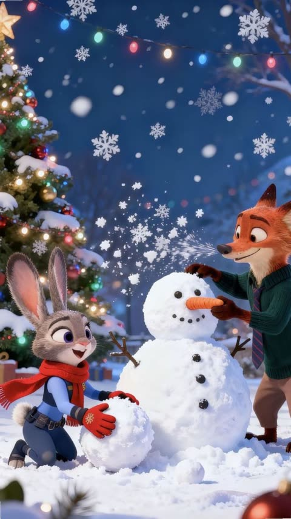</a>

The structured fields (subject, clothing, action, environment, lighting, camera, style) pin each character, prop and the rendering look one at a time. Naming the franchise locks the animated character design, and the explicit eye-level medium shot and twilight lighting keep the framing and glow steady.

Nano Banana Pro · Text-to-image · Source: [@oggii_0 on X](https://x.com/oggii_0/status/2005557307476943269) · 79 likes on 2026-10-29

[`christmas`](tags.md#tag-christmas) [`animation`](tags.md#tag-animation) [`winter`](tags.md#tag-winter) [`snowman`](tags.md#tag-snowman)

<details><summary><b>Prompt</b></summary>

```text
"subject": "Animated rabbit and fox building a snowman (Zootopia style)",
  "clothing": "Rabbit in blue vest and red scarf; Fox in green sweater and tie",
  "action": "Rabbit rolling snow, Fox placing carrot nose",
  "accessories": "Snowman with stick arms and coal buttons",
  "environment": "Winter holiday scene, decorated Christmas tree, colorful string lights, falling snowflakes",
  "lighting": "Magical twilight blue background with warm holiday light glow",
  "camera": "Medium shot, eye-level, central composition",
  "style": "3D animation style, Disney/Pixar aesthetic, festive, vibrant colors, high detail"
}
```

</details>

<a id="gpt-image-fox-pixel-art-idle-sprite-sheet"></a>
### Pixel art fox idle animation sprite sheet

<a href="https://x.com/higgsfield_ai/status/2097849478506320056">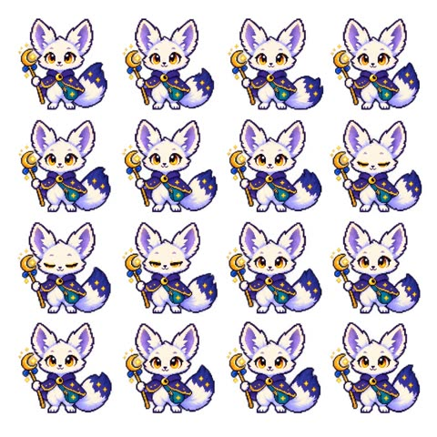</a>

The prompt fixes character design, palette and art direction first, then specifies a frame by frame blink schedule. It also gives exact grid, cell size and padding rules so all 16 sprites stay aligned.

GPT Image 2.5 · Text-to-image · Source: [@higgsfield_ai on X](https://x.com/higgsfield_ai/status/2097849478506320056) · 75 likes on 2026-10-28

[`pixel-art`](tags.md#tag-pixel-art) [`sprite-sheet`](tags.md#tag-sprite-sheet) [`animation`](tags.md#tag-animation) [`game-asset`](tags.md#tag-game-asset) [`fox`](tags.md#tag-fox)

<details><summary><b>Prompt</b></summary>

```text
"Create a polished pixel-art animation sprite sheet featuring an original character named Noxa, a tiny fox who collects lost stars.

CHARACTER DESIGN
Noxa is an adorable upright arctic fox with silvery ivory fur, oversized pointed ears with lavender inner fur, enormous amber eyes, a tiny dark nose, and one large fluffy tail with a midnight-blue tip. Animal face and paws, cute chibi proportions, an oversized head and a compact little body.
She wears a short midnight-indigo cape with a scalloped hem, a golden crescent clasp, and a few embroidered stars. A small teal satchel hangs at her hip. In her right paw she holds a short brass staff topped with a crescent moon enclosing a tiny warm-yellow star. Her expression is curious, slightly mischievous, and lovable.

ART DIRECTION
Premium hand-crafted pixel art for a cozy fantasy RPG. Clearly visible square pixels, precise dark-purple outlines, controlled clusters of color, and restrained highlights. Use ivory, indigo, lavender, teal, and warm gold. Front-facing full-body view with a readable silhouette. Keep the moonlight effect contained in crisp pixels. Avoid realistic fur, painted shading, soft gradients, blur, and 3D rendering.

MOTION
Show a single restrained idle cycle across 16 sequential frames. Her chest gently rises and settles; the tail tip and cape follow with a slight delay. Include one quick blink near the middle of the sequence: eyes open in frames 1-7, half closed in frame 8, closed in frame 9, half open in frame 10, open in frames 11-16. Her paws stay planted, and the staff remains firmly held. Maintain identical anatomy, costume details, proportions, and scale throughout. The final pose should flow naturally into the opening pose.

SHEET LAYOUT
One square 1024 x 1024 image divided into four rows and four columns of equally sized 256 x 256 cells. Read frames across each row, then continue below. Repeat the same centered placement and foot baseline in every cell. Every sprite fits entirely inside the central 208 x 208 area of its cell, leaving at least 24 pixels of empty padding on all sides. Show exactly 16 complete sprites without borders, captions, or extra characters. No sprite or accessory may touch any cell edge.

Use a transparent background with real alpha, without a painted checkerboard, scenery, ground plane, or cast shadows. Output the sprite sheet as one image."
```

</details>

<a id="nano-banana-caped-animal-character-trio"></a>
### Gray cat in teal cape, storybook style

<a href="https://x.com/iamrealsnow/status/2113141068929826897">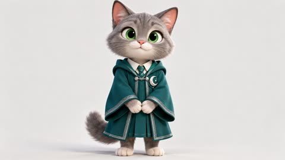</a>

One template is repeated for three animals, and only the species, fur colour, cape colour and clasp shape change. The fixed pose, front view, full body and plain light background keep the set consistent.

Nano Banana 2.1 · Text-to-image · Source: [@iamrealsnow on X](https://x.com/iamrealsnow/status/2113141068929826897) · 60 likes on 2026-10-28

[`character-design`](tags.md#tag-character-design) [`storybook`](tags.md#tag-storybook) [`animals`](tags.md#tag-animals) [`cape`](tags.md#tag-cape) [`character-sheet`](tags.md#tag-character-sheet)

<details><summary><b>Prompt</b></summary>

```text
Cat
A cute gray cat character with green eyes, wearing a simple teal hooded cape with a small silver crescent clasp. Standing pose, front view, full body, soft storybook illustration style, plain light background.

Squirrel
A cute orange-brown squirrel character with a big bushy tail, wearing a simple navy cape with a small gold leaf-shaped clasp. Standing pose, front view, full body, soft storybook illustration style, plain light background.

Rabbit
A cute cream-colored rabbit character with tall ears, wearing a simple plum cape with a small gold round clasp. Standing pose, front view, full body, soft storybook illustration style, plain light background.
```

</details>

<a id="chatgpt-scooby-doo-sixth-member-lore-sheet"></a>
### Scooby Doo style sixth Mystery Inc. member lore sheet

<a href="https://www.tiktok.com/@ericadebesis/video/7682936309811268895">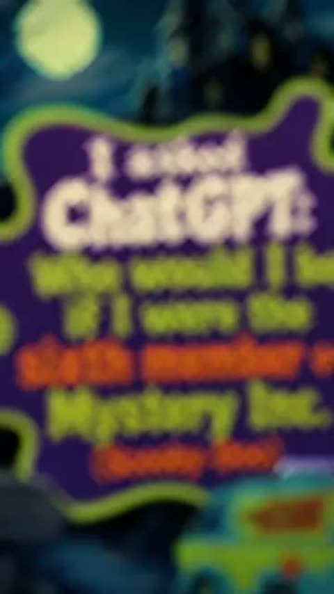</a>

The model designs the character from the user's profile first, then uses the uploaded photo only as a facial identity reference and forbids reproducing the photo itself. The prompt lists every required section and a 9:16 cinematic layout so the profile stays complete and readable.

ChatGPT · Edit · Source: [@ericadebesis on TikTok](https://www.tiktok.com/@ericadebesis/video/7682936309811268895) · 54 likes on 2026-10-30

[`scooby-doo`](tags.md#tag-scooby-doo) [`character-sheet`](tags.md#tag-character-sheet) [`lore`](tags.md#tag-lore) [`vertical`](tags.md#tag-vertical)

<details><summary><b>Prompt</b></summary>

```text
Take everything you know about me and imagine who I’d be as an ORIGINAL 6th member of Mystery Inc. alongside Fred, Daphne, Velma, Shaggy & Scooby-Doo. Keep my real name, (“your name”) but TRANSLATE my skills, personality, interests, and quirks into the Scooby-Doo universe rather than simply copying me into it. Create my role in the gang, personality, specialty, catchphrase, outfit, strengths, weaknesses, mystery-solving style, relationships with each member, signature gear, and any other traits that make me feel like an authentic classic Scooby-Doo character. Make me complement the existing gang rather than replace any of them. Using the character you just created, make a cinematic 9:16 character/lore sheet in a classic Scooby-Doo animation-inspired style. Use my uploaded reference photo ONLY as a reference for my facial identity. Keep the character recognizable as me, but DO NOT show or reproduce the reference photo. Use the outfit you designed for the character. Include readable sections for: Name & Role, Personality, Specialty, Catchphrase, Outfit, Signature Gear, Mystery-Solving Method, Strengths & Weaknesses, Relationships with Fred/Daphne/Velma/Shaggy/Scooby, and key character/lore details. Make it feel like an authentic Mystery Inc. character profile, with expressive character poses, illustrations, props, and retro Scooby-Doo visual design.
```

</details>

<a id="nano-banana-christmas-desk-figurines-computer"></a>
### Christmas figurine sets on computer desks

<a href="https://x.com/KanaWorks_AI/status/2001272403314516199">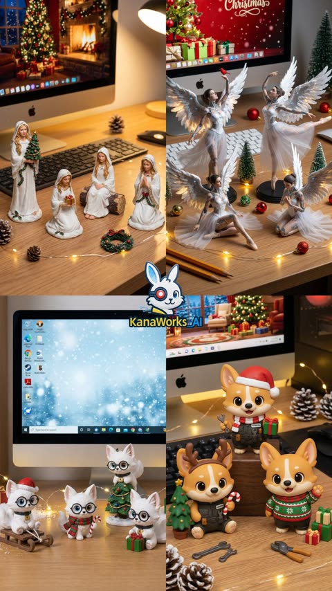</a>

Feeding a reference character and asking for several poses at once yields a consistent set of miniature figures. Naming the desk and the computer in front of it anchors the scale, the warm lamp light and the fairy-light props.

Nano Banana Pro · Edit · Source: [@KanaWorks_AI on X](https://x.com/KanaWorks_AI/status/2001272403314516199) · 51 likes on 2026-10-29

[`christmas`](tags.md#tag-christmas) [`figurine`](tags.md#tag-figurine) [`desk-scene`](tags.md#tag-desk-scene) [`multi-pose`](tags.md#tag-multi-pose)

<details><summary><b>Prompt</b></summary>

```text
Turn the character in the reference image into tabletop Christmas creative figurines in different poses, and place them on a desk in front of a computer.
```

</details>

<a id="nano-banana-christmas-snow-globe-sulky-character"></a>
### Four sulky characters sealed inside Christmas snow globes

<a href="https://x.com/KanaWorks_AI/status/2001583779274743896">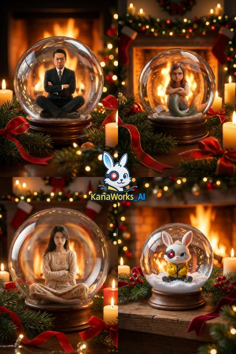</a>

A reference image slot lets one template place any character inside the globe, while the seated pose, folded arms and sulky stare set the mood. Macro framing, shallow depth of field and firelight refracted through the glass create the warm, melancholy atmosphere.

Nano Banana Pro · Edit · Source: [@KanaWorks_AI on X](https://x.com/KanaWorks_AI/status/2001583779274743896) · 49 likes on 2026-10-29

[`christmas`](tags.md#tag-christmas) [`snow-globe`](tags.md#tag-snow-globe) [`macro`](tags.md#tag-macro) [`reference-image`](tags.md#tag-reference-image)

<details><summary><b>Prompt</b></summary>

```text
Close-up shot.
On a fireplace mantel filled with Christmas atmosphere sits a crystal-clear snow globe. Warm flames burn softly in the background, and the orange-golden firelight refracts through the glass, creating a gentle glow.
Inside the snow globe, 【the character from the reference image 】is trapped within. He sits cross-legged in a sulky pose, arms folded across his chest, staring angrily at the camera with a look of helpless resignation. Around the scene are Christmas pine branches, red ribbons, candles, and softly blurred festive lights, giving the image a warm feeling tinged with subtle tension and fairytale-like melancholy.
Macro photography, shallow depth of field, highly detailed glass reflections, volumetric lighting, warm color palette, cinematic mood, fantasy realism style
```

</details>

<a id="nano-banana-christmas-rainbow-devil-ugly-sweater"></a>
### Rainbow devil in ugly Christmas sweater

<a href="https://x.com/GlennHasABeard/status/1997651720550121815">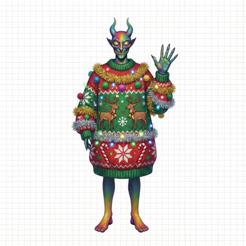</a>

The [IMAGE REFERENCE] slot takes any subject photo or character, so the same sweater recipe can be reused on different people. The comma separated list pins the knit details, reindeer, tinsel, pom poms and clashing red and green, while the oversized fit and proud grin set the cozy tacky mood.

Nano Banana Pro · Edit · Source: [@GlennHasABeard on X](https://x.com/GlennHasABeard/status/1997651720550121815) · 46 likes on 2026-10-29

[`christmas`](tags.md#tag-christmas) [`ugly-sweater`](tags.md#tag-ugly-sweater) [`image-reference`](tags.md#tag-image-reference)

<details><summary><b>Prompt</b></summary>

```text
Here's another fun Nano Banana Pro prompt to get festive

{
  "theme": "ugly_christmas_sweater",
  "prompt": "[IMAGE REFERENCE] wearing chunky knit ugly Christmas sweater, garish holiday patterns, embroidered reindeer and snowflakes, tacky tinsel trim, pom pom accents, clashing red and green, oversized cozy fit, proud grin"
}

Change it up a bit and let's get this Ugly Christmas Sweater party started!
```

</details>

<a id="gpt-image-naruto-pixel-sprite-energy-blast"></a>
### Chibi Naruto pixel sprite in fighting stance

<a href="https://x.com/MahnoorAi12/status/2097633800058769496">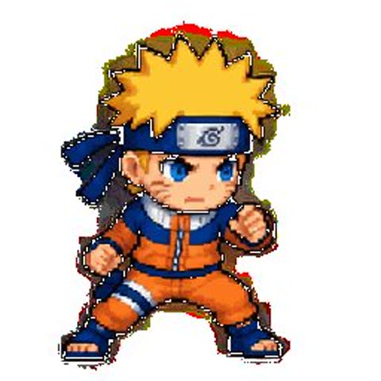</a>

A locked character spec covering traits, palette and outfit, plus a fixed 4 by 4 grid of 256 pixel cells, keeps the design and baseline steady across frames. Explicit transparency and nearest neighbor rules stop the usual blur and background fill from creeping in.

GPT Image 2.5 · Text-to-image · Source: [@MahnoorAi12 on X](https://x.com/MahnoorAi12/status/2097633800058769496) · 45 likes on 2026-10-29

[`pixel art`](tags.md#tag-pixelart) [`sprite-sheet`](tags.md#tag-sprite-sheet) [`anime`](tags.md#tag-anime) [`character`](tags.md#tag-character)

<details><summary><b>Prompt</b></summary>

```text
Turn the character described below into an adorable pixel-art sprite with a looping energy blast cast animation.
CHARACTER
The character is Naruto Uzumaki: spiky blond hair, orange and blue ninja jumpsuit, whisker marks on cheeks, forehead headband with metal plate. Preserve the character's recognizable features, colors, hairstyle/texture, outfit, accessories, and distinctive silhouette. Adapt its original anatomy into cute chibi proportions without forcing non-human characters into a human body.
STYLE
Create crisp pixel art with clearly defined square pixels, clean outlines, and a cohesive limited palette. No blurry edges, smooth vector styling, or realistic rendering.
ANIMATION
Create 16 consecutive frames of one seamless energy blast cast animation:
Character raises a hand or weapon, channels glowing energy, and releases a burst outward.
Energy particles grow from a small spark to a full burst, then fade on the return frames.
Slight recoil/lean-back on the release frame.
Keep the design, proportions, camera angle, and scale consistent across all frames.
Keep the character anchored within the cell (no drifting off-center) unless the motion described requires a small in-place shift.
Make the last frame transition smoothly back to the first for a perfect loop.
SPRITE SHEET
Arrange the 16 frames in exactly 4 columns × 4 rows, ordered left to right, top to bottom.
Canvas: 1024 × 1024 pixels. Each cell: 256 × 256 pixels.
Use identical alignment and a fixed baseline across all cells.
Keep the entire character inside each cell, with at least 16 pixels of transparent padding on every side, including around moving accessories or effects.
No overlapping cells, grid lines, labels, text, or watermarks.
TRANSPARENCY
Use a genuinely transparent RGBA background with alpha zero outside the character. Do not draw a checkerboard or add a solid background, floor, or cast shadow. Preserve white and pale details inside the character.
DELIVERABLES
A transparent 4×4 PNG sprite sheet.
A transparent animated GIF of the single character, using all 16 frames at 256×256 pixels, looping forever with an approximately 2.2-second cycle.
A ZIP containing all 16 individual transparent PNG frames.
Use nearest-neighbor sampling if resizing is needed to preserve crisp pixels. Before finalizing, ensure no stray pixels, clipping, or background artifacts remain, and that the background is truly transparent.
```

</details>

<a id="gpt-image-christmas-wednesday-addams-mirror-selfie"></a>
### Wednesday Addams mirror selfie in gothic Christmas room

<a href="https://x.com/KeorUnreal/status/2003876249983143966">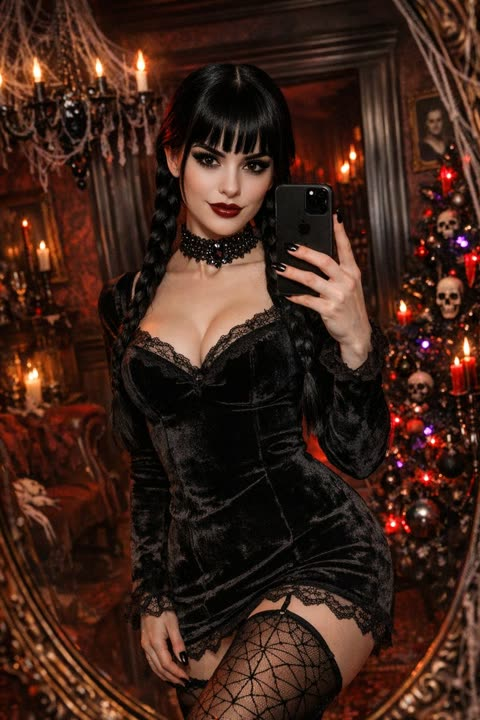</a>

A first-person mirror selfie sets the pose and phone, while the prompt pins the wardrobe, makeup and tree details (black ornaments, skulls, red candles) so the decor reads as goth Christmas. Moody high-contrast lighting and the open doorway into a dark room add depth.

GPT Image 1.5 · Text-to-image · Source: [@KeorUnreal on X](https://x.com/KeorUnreal/status/2003876249983143966) · 43 likes on 2026-10-29

[`christmas`](tags.md#tag-christmas) [`wednesday-addams`](tags.md#tag-wednesday-addams) [`goth`](tags.md#tag-goth) [`mirror-selfie`](tags.md#tag-mirror-selfie)

<details><summary><b>Prompt</b></summary>

```text
{
  "prompt": "Sultry mirror selfie of beautiful adult Wednesday Addams in gothic Victorian living room of Addams mansion, dramatic black-crimson lighting with subtle Christmas accents. Pale porcelain skin, intense dark brown eyes with sharp winged liner, arched brows, glossy pout smirk. Jet-black hair: blunt bangs, long straight with twin braids. Sparkling onyx choker, fitted short black velvet gothic minidress with lace-trimmed deep sweetheart neckline, sheer black spiderweb stockings. Holding black iPhone to ornate mirror, piercing confident gaze. Background: open door to opulent dark living room with sinister Christmas tree (black ornaments, skulls, red candles, purple lights), macabre portraits, cobweb chandelier, flickering candles. Moody high-contrast goth Christmas vibe, ultra-realistic textures, eerie glamorous atmosphere."
}
```

</details>

<a id="nano-banana-felt-designer-toy-history-dioramas"></a>
### Felt designer toy dioramas of four historic days

<a href="https://x.com/Gdgtify/status/2107781229164556402">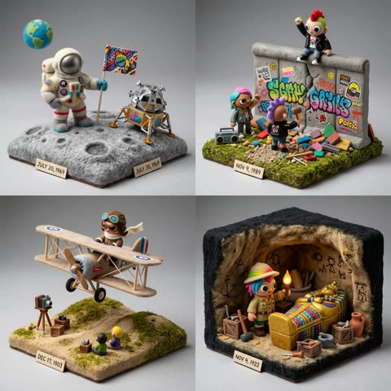</a>

Three concept anchors are fused into one style, with an instruction to ignore their literal subjects and keep only the material logic. Explicit style rules for felt, moss and vinyl surfaces, small street details, a calm gray backdrop and limited bright accents make the 2x2 grid consistent across different subjects.

Nano Banana 2.1 · Text-to-image · Source: [@Gdgtify on X](https://x.com/Gdgtify/status/2107781229164556402) · 29 likes on 2026-10-28

[`designer-toy`](tags.md#tag-designer-toy) [`felt`](tags.md#tag-felt) [`diorama`](tags.md#tag-diorama) [`grid`](tags.md#tag-grid) [`template`](tags.md#tag-template)

<details><summary><b>Prompt</b></summary>

```text
do this for 4 unforgettable days in human history , 2x2 grid: CONCEPT ANCHOR 1: "Stylized 3D animated rebel character — expressive oversized eyes, strong attitude pose, streetwear details, colorful hair, soft cinematic toy-like rendering"

::

CONCEPT ANCHOR 2: "Fuzzy green minimalist toy-world — mossy texture, rounded trees, soft felt surfaces, tiny houses, gentle surreal creatures, quiet gray background"

::

CONCEPT ANCHOR 3: "Isometric miniature scene — small props, tiny environmental storytelling, dollhouse-scale staging, clean studio lighting"

INSTRUCTION:
Find the exact visual center of these three concepts.
Ignore the literal character, trash can, animals, and room references.
Extract only the style and material logic.

Render $ SUBJECT as a soft but rebellious designer-toy diorama.

STYLE RULES:
- Convert the subject into a stylized 3D character, object, creature, or environment with clear attitude and expressive shape language.
- Use soft felt, moss, knitted fiber, fuzzy flocking, matte clay, and vinyl-like surfaces.
- Add small street or everyday details: stickers, scuffs, props, miniature objects, signs, containers, tools, or personal items inferred from the subject.
- Keep the world minimal and gallery-like, with calm gray or muted pastel background.
- Use bright accent colors only where they matter: hair-like forms, graffiti-like marks, symbols, accessories, tiny props.
- Blend softness with rebellion: cute surface texture, but confident pose and graphic edge.
- Use shallow studio lighting and clean product-shot presentation.

OUTPUT:
A collectible fuzzy designer-toy scene where $ SUBJECT becomes soft, expressive, slightly punk, and highly tactile.
```

</details>

<a id="nano-banana-claymation-gothic-castle-hoodie"></a>
### Claymation man in gothic castle set

<a href="https://x.com/arsalannazir07/status/2035948877019316516">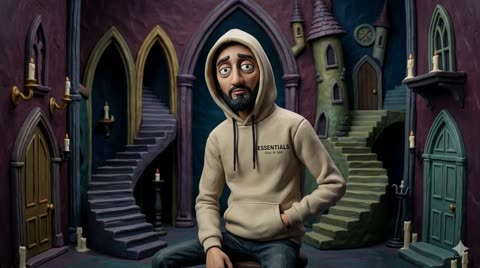</a>

Names the medium early (claymation film still, macro lens, shallow focus) so the model commits to a physical clay look. A reference image anchors the subject, and the exact logo text is spelled out so it stays legible.

Nano Banana 2 · Edit · Source: [@arsalannazir07 on X](https://x.com/arsalannazir07/status/2035948877019316516) · 18 likes on 2026-10-29

[`claymation`](tags.md#tag-claymation) [`gothic`](tags.md#tag-gothic) [`fashion`](tags.md#tag-fashion) [`stop-motion`](tags.md#tag-stop-motion)

<details><summary><b>Prompt</b></summary>

```text
A hyperrealistic, detailed close-up photograph of a meticulously crafted stop-motion claymation figure, sculpted with a textured, tactile matte finish. The figure, inspired by the subject and clothing from image_0.png, portrays the man with his distinct full beard, intense gaze, and slightly elongated, stylized features reminiscent of Tim Burton's 'Corpse Bride' characters. He is wearing the light beige ESSENTIALS Fear of God hoodie (with clear, legible text and black drawstrings) and dark jeans, leaning casually with one hand in his pocket. He is positioned center frame, staring directly at the viewer. The background is a dense, atmospheric, claymation miniature set of a surreal gothic castle interior, heavily influenced by German Expressionism and 'The Nightmare Before Christmas' and 'Corpse Bride.' It's a bizarre, asymmetric structure of crooked stone towers, winding purple and teal staircases, arched doorways with gold and mint green doors, crooked bookshelves, and a myriad of lit candles creating pools of soft, flickering, dramatic light (chiaroscuro). The entire environment is made of sculpted, painted clay. The textures are tangible and raw, highlighting the artisanal quality. Multiple small candles on sconces and platforms illuminate the figure and the labyrinthine architecture. Shot with a macro lens, shallow depth of field, natural film grain. Grainy, textural, dark, and whimsical mood. Visible stop-motion elements and slight character movement. Film still quality.
```

</details>

<a id="gpt-image-anime-character-line-art-setting-sheet"></a>
### Elf Girl Anime Character Line Art Sheet

<a href="https://x.com/Eris_Create_Lab/status/2058807276828565803">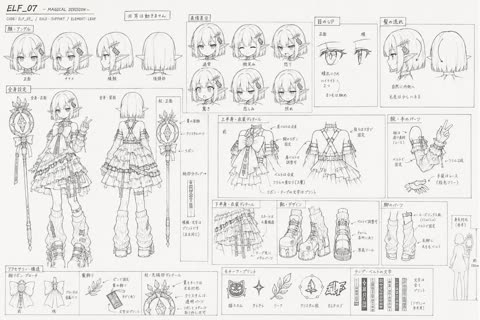</a>

The prompt names the production use, anime staff as the audience, and lists every required panel, from face angles to shoes and accessories. It bans color and rendering, and asks for handwritten notes, arrows and scan texture so the page reads as a real 90s to 2000s setting book.

GPT Image 2 · Edit · Source: [@Eris_Create_Lab on X](https://x.com/Eris_Create_Lab/status/2058807276828565803) · found via [YouMind-OpenLab/awesome-gpt-image-2](https://github.com/YouMind-OpenLab/awesome-gpt-image-2)

[`character-sheet`](tags.md#tag-character-sheet) [`line-art`](tags.md#tag-line-art) [`anime`](tags.md#tag-anime) [`reference-image`](tags.md#tag-reference-image) [`japanese`](tags.md#tag-japanese)

<details><summary><b>Prompt</b></summary>

```text
参照画像をキャラクターデザインのベースとして使用し、「商業アニメ制作現場で使用される、プロ仕様のキャラクター線画設定資料」を描く。

キャラクターの顔、髪型、髪色、瞳、輪郭、体型、シルエット、衣装デザイン、頭身、全体の印象を正確に維持すること。

キャラクターのアイデンティティを絶対に崩さない。
別キャラクターとして描き直さない。

完成イラストではない。
コンセプトアートではない。
ポスターではない。

目的は、
アニメーター・作画監督・動画担当へ向けた、
作画共有用の設定資料。

画面は、
白背景の設定資料レイアウト。

複数の線画を、
資料ページとして整理して配置する。

以下を含める：

・正面顔
・斜め顔
・横顔
・表情差分
・目のアップ
・髪の流れ確認
・全身正面
・全身背面
・腕や手の形状確認
・衣装ディテール
・靴デザイン
・アクセサリー構造

キャラクターは、
クリーンなアニメ線画のみで描写する。

彩色しない。
ベタ塗りしない。
厚塗りしない。
レンダリングしない。

線は、
日本のTVアニメ制作現場のような、
細めで整理された鉛筆線画またはクリーンアップ線。

ラフすぎない。
漫画線にならない。
スケッチ感を出しすぎない。

現場用設定資料として、
読みやすさと構造理解を最優先する。

ページ内には、
小さな手書きメモ、
矢印、
パーツ指示、
簡易注釈、
衣装構造メモ、
髪の流れ指示などを自然に追加する。

レイアウトは、
日本の90年代〜2000年代アニメ設定資料集のような空気感。

情報密度は高いが、
見やすく整理されている。

紙面として自然な余白を持たせる。

誌面全体は、
スキャンされた実物の設定資料集のような空気感。

軽微な紙の質感、
わずかな印刷感、
コピー紙感、
スキャン感を自然に加える。

完成されたアート作品ではなく、
「実際の制作資料」に見えることを最優先する。
```

</details>

<a id="gpt-image-anime-character-reference-sheet-kana"></a>
### Anime Character Reference Sheet With Turnaround

<a href="https://x.com/REd8358/status/2047465795005849818">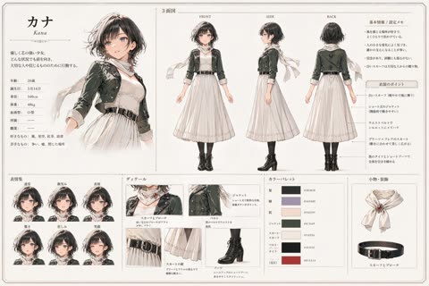</a>

A JSON prompt lists each layout section with its position, item count and exact Japanese labels, so the sheet comes out as a tidy grid. Named argument placeholders for hair, jacket and dress colors make it easy to swap the character.

GPT Image 2 · Text-to-image · Source: [@REd8358 on X](https://x.com/REd8358/status/2047465795005849818) · found via [YouMind-OpenLab/awesome-gpt-image-2](https://github.com/YouMind-OpenLab/awesome-gpt-image-2)

[`character-sheet`](tags.md#tag-character-sheet) [`anime`](tags.md#tag-anime) [`turnaround`](tags.md#tag-turnaround) [`json-prompt`](tags.md#tag-json-prompt) [`layout`](tags.md#tag-layout)

<details><summary><b>Prompt</b></summary>

```text
{
  "type": "anime character reference sheet",
  "style": "clean Japanese character design board, elegant watercolor and ink illustration, soft neutral paper background, thin decorative borders, editorial layout, refined fantasy-fashion concept art",
  "character": {
    "name": "{argument name=\"character name\" default=\"カナ\"}",
    "romanized_name": "Kana",
    "gender_presentation": "young woman",
    "age": "20",
    "birthday": "3月14日",
    "height": "160cm",
    "weight": "48kg",
    "blood_type": "O型",
    "personality_summary": "gentle but strong-willed girl who always faces forward no matter the situation and acts for the people she cares about",
    "likes": "wind, scenery, black tea, reading",
    "dislikes": "conflict, noise, closed spaces"
  },
  "outfit": {
    "silhouette": "modest long white dress with cropped jacket, scarf, waist belt, black tights, short lace-up boots",
    "pieces": [
      "white scarf with a red jewel brooch",
      "short jacket in dark muted green",
      "long-sleeved white dress with soft pleated skirt",
      "black waist belt with silver buckle",
      "black tights",
      "black heeled lace-up short boots"
    ]
  },
  "layout": {
    "orientation": "landscape",
    "sections": [
      {
        "title": "character profile",
        "position": "top-left",
        "count": 1,
        "labels": ["カナ", "Kana"]
      },
      {
        "title": "3面図",
        "position": "top-center to top-right",
        "count": 3,
        "labels": ["FRONT", "SIDE", "BACK"]
      },
      {
        "title": "基本情報 / 設定メモ",
        "position": "upper-right",
        "count": 1,
        "labels": ["基本情報 / 設定メモ"]
      },
      {
        "title": "衣装のポイント",
        "position": "right side under notes",
        "count": 5,
        "labels": [
          "白いスカーフ",
          "ショート丈のジャケット",
          "ウエストベルト",
          "プリーツスカーフ風スカート",
          "黒のタイツとショートブーツ"
        ]
      },
      {
        "title": "表情集",
        "position": "bottom-left",
        "count": 6,
        "labels": ["通常", "微笑み", "真剣", "驚き", "悲しみ", "笑顔"]
      },
      {
        "title": "ディテール",
        "position": "bottom-center",
        "count": 5,
        "labels": ["スカーフとブローチ", "ジャケット", "ベルト", "スカートの裾", "ブーツ"]
      },
      {
        "title": "カラーパレット",
        "position": "bottom center-right",
        "count": 7,
        "labels": ["髪", "瞳", "肌", "ジャケット", "スカート・スカーフ", "ベルト・ブーツ", "アクセント（宝石）"]
      },
      {
        "title": "小物・装飾",
        "position": "bottom-right",
        "count": 2,
        "labels": ["scarf with brooch", "belt"]
      }
    ],
    "centerpiece": "large three-quarter portrait of the character on the left, looking gentle and composed, scarf flowing in the wind",
    "spacing": "balanced grid with thin divider lines and generous margins"
  },
  "visual_details": {
    "hair": {
      "color": "{argument name=\"hair color\" default=\"soft dark brown with ash highlights\"}",
      "style": "short wavy bob with layered ends, side-swept bangs, slightly tousled"
    },
    "eyes": {
      "color": "muted gray-violet",
      "expression": "kind, calm, quietly determined"
    },
    "palette": {
      "paper": "warm ivory",
      "main_dark": "deep charcoal brown",
      "accent_violet": "dusty lavender gray",
      "skin": "soft pale peach",
      "jacket": "{argument name=\"jacket color\" default=\"muted forest green\"}",
      "dress": "{argument name=\"dress color\" default=\"cream white\"}",
      "boots_and_belt": "near-black",
      "gem_accent": "deep muted red"
    },
    "rendering": "delicate linework, subtle shading, lightly textured watercolor washes, polished concept-sheet presentation"
  },
  "text_language": "Japanese with small English labels for view directions",
  "quality": "highly polished, cohesive, professional game/anime preproduction sheet"
}
```

</details>

<a id="gpt-image-anime-character-rooftop-livestream-screenshot"></a>
### Anime Elf Maid in Rooftop Livestream Screenshot

<a href="https://x.com/Eris_Create_Lab/status/2057294055911116941">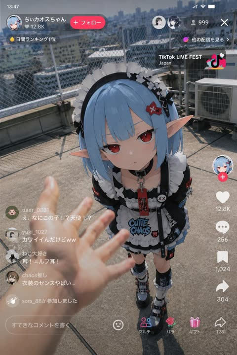</a>

A reference image locks the character design while a photoreal hand enters the foreground with shallow depth of field. Smartphone artifacts such as sensor noise, JPEG compression and handheld shake, plus bans on cinematic polish, make it read as an accidental live capture.

GPT Image 2 · Edit · Source: [@Eris_Create_Lab on X](https://x.com/Eris_Create_Lab/status/2057294055911116941) · found via [YouMind-OpenLab/awesome-gpt-image-2](https://github.com/YouMind-OpenLab/awesome-gpt-image-2)

[`anime`](tags.md#tag-anime) [`livestream`](tags.md#tag-livestream) [`smartphone-ui`](tags.md#tag-smartphone-ui) [`mixed-reality`](tags.md#tag-mixed-reality) [`reference-image`](tags.md#tag-reference-image)

<details><summary><b>Prompt</b></summary>

```text
参照画像をキャラクターデザインのベースとして使用し、「アニメキャラクターが現実世界のライブ配信に現れてしまった瞬間」を描く。

キャラクターのアニメイラストとしての空気感を正確に維持する。

キャラクターのアイデンティティを絶対に崩さない。
実写人間化しない。
キャラクター部分はアニメイラスト表現を維持する。

縦型スマートフォン配信画面。
TikTok LIVE、
YouTube Live、
Instagram Live、
一般的な縦型ライブ配信風UI。

背景は固定しない。

現実的な都市空間、
または生活感のある現実空間をランダムに生成する。

例:
ビル屋上、
コンビニ前、
ゲームセンター、
駅前、
住宅街、
雑居ビルの階段、
深夜の路地、
河川敷、
カラオケ前、
深夜の自販機周辺、
配信部屋、
オタク部屋、
地方都市の駅前、
雨の歩道、
商店街など。

背景は綺麗すぎない。
生活感、
雑多感、
現実のノイズ感を重視する。

画面手前に実写級の人間の手や腕を自然にフレームインさせる。

人間側は、
少女へ触れようとしている、
指を差している、
距離を測っている、
驚いて反応している、
食べ物や飲み物を差し出している、
配信中に思わず干渉してしまったような動き。

手前の手は浅い被写界深度で少しだけボケる。

「誰かがライブ配信中に偶然撮影してしまった映像」のようなリアリティを重視する。

映画ポスター風にしない。
過剰なシネマティック演出禁止。
綺麗すぎる構図禁止。
過剰な発光エフェクト禁止。
AI特有の glossy rendering を避ける。
情報量を盛りすぎない。

ライブ配信UIには、
コメント欄、
同接数、
LIVE表示、
いいね、
ギフト通知などを含める。

コメント欄は、半信半疑でざわつくリアルな反応にする。

ライティングは自然に統一する。

自然光、
街灯、
コンビニ照明、
モニター光など、
背景とキャラクターの環境光を一致させる。

スマートフォン撮影風の質感を追加する。

軽いHDR処理、
微細なセンサーノイズ、
わずかなJPEG圧縮感、
自然な露出、
微弱な色収差、
軽いレンズブルーム、
オートフォーカス的な空気感、
わずかな手ブレ、
手持ち撮影らしい不安定感。

完璧な作品ではなく、
「SNSに投稿された謎の目撃配信スクショ」
のような偶然感を重視する。
```

</details>

<a id="gpt-image-anime-girl-streetwear-sixteen-pose-sheet"></a>
### Anime Girl Streetwear Sixteen Pose Sheet

<a href="https://x.com/muku_sns/status/2102743895843156425">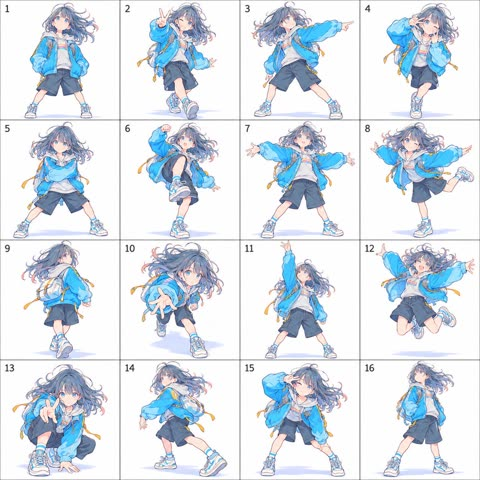</a>

The prompt fixes one detailed outfit and hair description, then fixes a 4x4 numbered grid on a white background. A numbered list of 16 short pose lines gives each panel its own action while keeping the character consistent.

GPT Image 2.5 · Text-to-image · Source: [@muku_sns on X](https://x.com/muku_sns/status/2102743895843156425)

[`anime`](tags.md#tag-anime) [`character-sheet`](tags.md#tag-character-sheet) [`pose-sheet`](tags.md#tag-pose-sheet) [`streetwear`](tags.md#tag-streetwear) [`grid`](tags.md#tag-grid)

<details><summary><b>Prompt</b></summary>

```text
A character turnaround sheet featuring a cute anime girl in a dynamic streetwear outfit, arranged in a 4x4 grid of 16 distinct poses. The character has messy, shoulder-length blue-grey hair with subtle pink highlights and large, expressive blue eyes. She wears an oversized bright blue bomber jacket over a white hoodie, dark grey cargo shorts, high-top sneakers, and a small backpack. Each panel is numbered 1 through 16 in the top-left corner against a clean white background.

Pose breakdown:
1: Standing straight, hands in pockets, looking forward.
2: Winking playfully while making a peace sign near her face.
3: Pointing confidently to the side with one hand on hip.
4: A cheerful pose with both hands framing her face.
5: Arms crossed tightly, standing with feet apart.
6: High-kick action pose, balancing on one leg.
7: Arms spread wide in a welcoming or 'ta-da' gesture.
8: Running motion with arms outstretched for balance.
9: Walking away but looking back over her shoulder.
10: Crouching low, reaching a hand toward the viewer.
11: Reaching upward with one arm extended high.
12: Jumping mid-air with legs tucked behind her.
13: Squatting down, resting chin on hand, looking up.
14: Walking profile view, swinging arms naturally.
15: Leaning forward with hands near ears, playful expression.
16: Standing relaxed with hands in jacket pockets.
```

</details>

<a id="gpt-image-anime-idol-dance-storyboard-grid"></a>
### Anime Idol Dance Storyboard Grid

<a href="https://x.com/OiiOii_AI_JP/status/2099738831755092209">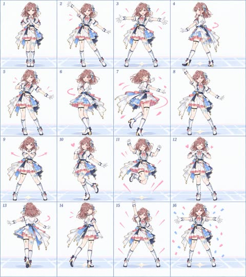</a>

A detailed outfit description is fixed once, then 16 numbered frames each name a pose, camera angle and effect such as motion arrows, hearts or confetti. Layout rules for a 4x4 grid, panel borders, number labels and a shared floor keep the character consistent across frames.

GPT Image 2.5 · Text-to-image · Source: [@OiiOii_AI_JP on X](https://x.com/OiiOii_AI_JP/status/2099738831755092209)

[`anime`](tags.md#tag-anime) [`storyboard`](tags.md#tag-storyboard) [`dance`](tags.md#tag-dance) [`idol`](tags.md#tag-idol) [`character-sheet`](tags.md#tag-character-sheet)

<details><summary><b>Prompt</b></summary>

```text
A storyboard grid of 16 numbered frames (4x4 layout) showing a cute anime idol girl performing a continuous dance sequence. The character has shoulder-length wavy brown hair with small blue and white flower accessories, large expressive eyes, and wears an elaborate idol outfit: a white short-sleeved top with blue plaid accents and red ribbon details at the collar, a layered skirt combining white fabric with blue plaid panels and pink ruffled underskirt, thigh-high white socks with blue diamond patterns, and black heeled shoes with gold buckles. She also wears white gloves with blue trim.

Frame 1: Standing straight with hands clasped together in front of chest, smiling gently.
Frame 2: Right arm raised high above head, left arm extended down to side, weight shifted slightly.
Frame 3: Both arms spread wide horizontally, palms facing forward, energetic pose with motion lines.
Frame 4: Side profile view, body turned right, one hand on hip, other arm extended back, curved arrow indicating rotation.
Frame 5: Hands near shoulders making cute gestures, head tilted, sparkle effects around.
Frame 6: Mid-spin with flowing hair, arms crossed in front of torso, curved arrow showing rotation direction.
Frame 7: Dynamic jump pose, legs bent underneath, arms swinging out, pink petal-like motion trails swirling around.
Frame 8: One fist pumped upward triumphantly, other arm extended outward, confident smile.
Frame 9: Arms crossed over chest in X-shape, legs apart in power stance, arrows pointing outward from shoulders.
Frame 10: Playful pose with one leg kicked up behind, hands forming heart shape near face, floating hearts around.
Frame 11: Jumping with both fists raised overhead, knees tucked up, excited expression with radiating energy lines.
Frame 12: Standing with hands forming heart shape at chest level, sweet smile, two hearts floating beside her.
Frame 13: Back view mid-turn, arms spread wide, skirt flaring out, curved arrow indicating spin continuation.
Frame 14: Three-quarter rear view looking over shoulder, one hand extended gracefully, hair flowing.
Frame 15: Wide stance with one arm thrust straight up, other arm angled down, powerful finishing pose with star burst effect.
Frame 16: Final pose with arms spread wide welcomingly, confetti pieces (blue and pink rectangles) falling around her, big joyful smile.

Background is clean white with subtle light blue floor tiles visible in lower portion of each frame. Each panel has a thin gray border and number label in top-left corner. Style is polished Japanese anime illustration with soft cel shading, consistent character design across all frames, and dynamic action poses suitable for animation reference.
```

</details>

<a id="gpt-image-brutalist-freestyle-soccer-character-sheet"></a>
### Brutalist freestyle soccer character production sheet

<a href="https://x.com/ShamsAmin56/status/2071590431725670517">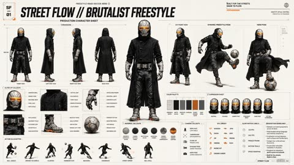</a>

A reference image locks the silhouette and materials, then a labelled layout of turnarounds, callouts, palette, expressions and camera notes builds a full production sheet. Exact hex background, fixed section order and a guidelines block keep the 16:9 sheet clean and consistent across views.

GPT Image 2 · Edit · Source: [@ShamsAmin56 on X](https://x.com/ShamsAmin56/status/2071590431725670517) · found via [freestylefly/awesome-gpt-image-2](https://github.com/freestylefly/awesome-gpt-image-2)

[`character-sheet`](tags.md#tag-character-sheet) [`turnaround`](tags.md#tag-turnaround) [`brutalist`](tags.md#tag-brutalist) [`sci-fi`](tags.md#tag-sci-fi) [`concept-art`](tags.md#tag-concept-art)

<details><summary><b>Prompt</b></summary>

```text
Use the uploaded reference image as the primary character design reference, preserving the overall silhouette, proportions, futuristic apparel layering, helmet geometry, visor shape, stone-like brutalist armor surfaces, black hooded coat, tactical streetwear construction, gloves, boots, utility belt, and monochrome industrial aesthetic.

Create a premium production character sheet for a 2D stylized futuristic freestyle road soccer protagonist inspired by Brutalist architecture, industrial concrete textures, geometric forms, and minimalist sci-fi design language.  The presentation should resemble a AAA game character turnaround sheet mixed with a Nike commercial concept presentation.

The character should feel agile, stylish, confident, athletic, and built for urban freestyle football.  Maintain the concrete-textured helmet with glowing orange visor, oversized hood, tactical long coat, mechanical gauntlets, armored boots, and industrial detailing exactly as the design language.  The football should be integrated naturally into the presentation.  Minimal off-white background (#F7F5F0).

Professional production sheet layout.  Extremely clean linework.  Cinematic concept art.  Premium graphic design.  No photorealism.  High-end stylized illustration.  CHARACTER ANGLES Front View  Neutral hero pose.  Left Side View Right Side View Back View 3/4 Front View Dynamic Freestyle Pose  Standing on one foot while balancing the football.  Hero Pose  Football under foot.  Long coat flowing.  Confident posture.  CLOSE-UP CALLOUTS  Helmet Design  Orange illuminated visor  Concrete brutalist surface  Industrial wear  Panel breakdown  Upper Body  Coat construction  Buckles  Fabric folds  Armor integration  Mechanical Gloves  Finger articulation  Industrial joints  Material breakdown  Utility Belt  Equipment  Fasteners  Soccer accessory pouch  Boot Design  Heavy brutalist geometry  Street football grip  Orange illuminated sole accents  Football Design  Minimal futuristic street football  Concrete-inspired panel graphics  Orange accent details  MATERIAL CALLOUTS  Concrete Composite Armor  Carbon Tactical Fabric  Matte Black Nylon  Industrial Rubber  Forged Titanium Components  Orange Energy Lighting  COLOR PALETTE  Concrete White  Matte Black  Graphite Gray  Charcoal  Burnt Orange Glow  Dark Steel  EXPRESSION SHEET  Neutral  Focused  Competitive  Confident Smile  Game Face  Victory Expression  ACTION SILHOUETTES  Ball Juggle  Around The World  Elastico  Rainbow Flick  Backheel  Crossover  Street Sprint  Ball Stall  CAMERA CALLOUTS  Hero Shot Low Angle  Turnaround Orthographic  Close-up Macro Lens  Dynamic Pose 35mm Tracking Camera  Hero Pose 24mm Cinematic Lens  SFX LABELS  WHOOSH  SWISH  TAP  BOUNCE  THUD  ZIP  SPIN  SKRT  VROOM  RUSH  MUSIC HIT  CROWD CHEER  SLOW MOTION LABELS  120 FPS  240 FPS  Freeze Frame  Motion Trails  Speed Ramping  GUIDELINES  Maintain consistent proportions across all views.  Keep the brutalist design language consistent.  Emphasize concrete-inspired hard surfaces contrasted with flexible tactical fabrics.  Preserve the glowing orange visor as the primary focal point.  Use clean production callouts with arrows and labels.  Include measurement guides, material notes, and design annotations.  Keep presentation minimal and premium.  Avoid clutter.  Professional concept art quality suitable for AAA game development, cinematic production, and advertising pitch decks.  LAYOUT  16:9 Landscape  Top Center: MAIN TITLE STREET FLOW // BRUTALIST FREESTYLE  Below: Production Character Sheet  Center: Large Hero Character  Left: Front • Side • Back Views  Right: 3/4 View • Action Pose • Hero Pose  Bottom: Close-ups • Materials • Color Palette • Equipment • Football Design • Expressions • Camera Notes • SFX • Slow Motion • Production Annotations  Minimal off-white background with subtle grid guides, technical drawing arrows, clean typography, and premium commercial presentation quality.
```

</details>

<a id="gpt-image-cat-girl-penguin-line-sticker-sheet"></a>
### Cat Girl and Penguin LINE Sticker Sheet

<a href="https://x.com/tetumemo/status/2057301723124040164">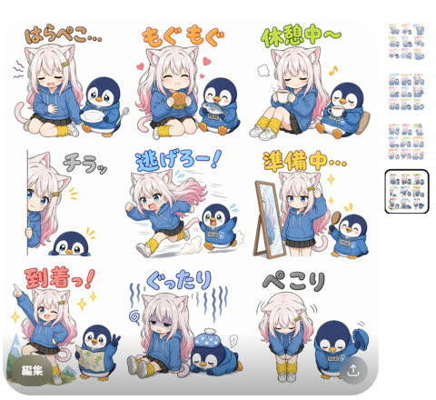</a>

Fixes the canvas, a 3 by 3 grid and exact sticker count first, then gives detailed character descriptions for consistency. Each cell lists its pose, props and a Japanese text colour, and the constraints block rules out extra characters and English text.

GPT Image 2 · Text-to-image · Source: [@tetumemo on X](https://x.com/tetumemo/status/2057301723124040164) · found via [YouMind-OpenLab/awesome-gpt-image-2](https://github.com/YouMind-OpenLab/awesome-gpt-image-2)

[`sticker-sheet`](tags.md#tag-sticker-sheet) [`chibi`](tags.md#tag-chibi) [`line-stickers`](tags.md#tag-line-stickers) [`japanese-text`](tags.md#tag-japanese-text) [`mascot`](tags.md#tag-mascot)

<details><summary><b>Prompt</b></summary>

```text
Goal: Create a cute LINE sticker sheet featuring a white-haired cat-eared anime girl and a small blue penguin mascot in a soft chibi style, with exactly 9 separate sticker illustrations arranged in a 3 by 3 grid on a clean white background.

Canvas: Square 1:1 image, high resolution, lots of white space between stickers, each sticker isolated with no panel borders. Use pastel colors, thick clean outlines, gentle shading, expressive poses, and playful handwritten Japanese sticker text above or near each pose.

Character details: The main girl is a chibi anime cat girl with long fluffy white hair with pale pink tips, white cat ears, blue eyes, a small tail, a blue oversized hoodie, yellow leg warmers, white shoes, and cute hair clips. The mascot is a round navy-blue penguin wearing a matching blue hoodie with a tiny pouch label, orange beak and feet, and simple cheerful expressions.

Text style: Use large rounded handwritten Japanese lettering with colored outlines and drop shadows, matching the mood of each sticker. Keep the text readable and cute.

Sticker layout: Include exactly 9 stickers:
1. Top left: Girl sitting tired and hungry with eyes closed, holding her stomach; penguin offers an empty plate and spoon. Text: はらぺこ... in brown.
2. Top center: Girl happily eating a burger while the penguin eats popcorn; small pink hearts around them. Text: もぐもぐ in orange.
3. Top right: Girl and penguin sitting relaxed with mugs of tea or coffee, eyes closed; cozy rest mood with a steam puff and music note. Text: 休憩中〜 in green.
4. Middle left: Girl peeking from the left edge holding a vertical sign or pole, penguin peeking from below; shy suspicious mood. Text: 「チラッ」 in gray.
5. Middle center: Girl running away quickly with long hair trailing, motion blur and dust clouds; penguin looks surprised and follows. Text: 「逃げろー！」 in blue.
6. Middle right: Girl getting ready in front of a standing mirror, brushing her hair with sparkles; penguin cheers while holding a brush. Text: 「準備中...」 in yellow-orange.
7. Bottom left: Girl sitting on luggage or a stump and pointing upward energetically; penguin holds a travel map, mountains in the background, sparkles. Text: 「到着っ！」 in red.
8. Bottom center: Girl slumped on the floor looking exhausted and dizzy, with blue vertical stress lines; penguin lies flattened nearby with an ice pack on its head. Text: 「ぐったり」 in blue-gray.
9. Bottom right: Girl bowing apologetically with head down; penguin also bows deeply. Text: ぺこり in dark gray.

Constraints: Make all 9 stickers consistent in character design and scale, with transparent-sticker-like clean edges on white. Do not add extra characters, extra stickers, UI elements, watermarks, or English text. Keep the composition balanced and suitable for a LINE sticker set preview.
```

</details>

<a id="gpt-image-character-identity-consistency-reference-sheet"></a>
### Character identity reference sheet with angles and expressions

<a href="https://x.com/Mrpinecone888/status/2082748531736244518">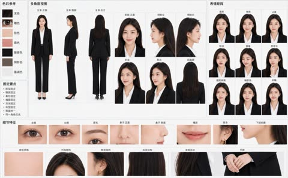</a>

The prompt treats the reference character as a hard constraint and lists every facial, hair and body trait to lock. It then assigns each zone of the board a fixed job: angle views, an expression matrix, detail anchors and colour swatches. A fallback rule drops repeated panels before it allows smaller text or a drifting identity.

GPT Image 2 · Edit · Source: [@Mrpinecone888 on X](https://x.com/Mrpinecone888/status/2082748531736244518) · found via [YouMind-OpenLab/awesome-gpt-image-2](https://github.com/YouMind-OpenLab/awesome-gpt-image-2)

[`character-sheet`](tags.md#tag-character-sheet) [`consistency`](tags.md#tag-consistency) [`reference-board`](tags.md#tag-reference-board) [`expression-matrix`](tags.md#tag-expression-matrix) [`multi-angle`](tags.md#tag-multi-angle)

<details><summary><b>Prompt</b></summary>

```text
根据附带角色原图创建一张“角色身份固定参考图表”，横向 16:10，浅灰白背景，专业视觉资料板布局。首要目标是让所有面板一眼看出是完全相同的角色，而不是多个相似人物。

将参考图中的角色身份视为不可更改的硬性约束。严格锁定：

- 脸部宽高比例、颧骨、脸颊、下颌和下巴
- 眼睛轮廓、眼距、眼睑结构和视线气质
- 眉毛弧度、粗细、颜色和眉眼距离
- 鼻梁、鼻尖、鼻翼以及侧脸鼻形
- 上下唇厚度、唇峰、嘴角和自然唇色
- 肤色、毛孔、血色和自然皮肤凹凸
- 发际线、分线、刘海、侧发、后发长度和发丝流向
- 年龄印象、骨架、肩宽、四肢长度和整体体型
- 原图服装、原始画风、光线质感和整体氛围

画面中央用较大面板展示：

- 全身 正面
- 全身 侧面
- 全身 后方
- 脸部 正面
- 侧脸左
- 侧脸右
- 斜左
- 斜右
- 后脑部

每个角度保持完全一致的头骨结构、五官相对位置、头发体积和身体比例。侧脸必须准确延续正面的鼻梁、嘴唇、下巴和额头结构，禁止生成不同人物式侧脸。

右侧配置小型表情矩阵：

- 通常
- 微笑
- 认真
- 惊讶
- 害羞
- 思考中
- 困扰表情
- 稍悲伤
- 平静

保持相同瞳孔、眼睛基础尺寸、鼻形、唇形和脸型。笑容自然克制，不改变角色年龄或气质。

下部配置精细身份锚点：

- 左眼
- 右眼
- 眉毛
- 鼻子 正面
- 鼻子 侧面
- 嘴唇
- 耳朵
- 下颌轮廓
- 皮肤质感
- 刘海结构
- 侧发结构
- 后发结构
- 发梢流动
- 手部

左侧加入 5—7 个准确色样：发色、瞳色、肤色、唇色、服装色、阴影色、基调色。加入极简“固定要点”：脸型固定、眼周固定、鼻形固定、嘴唇固定、刘海固定、体型固定、服装统一、同一角色优先。

背景干净，柔和均匀光线，无电影式灯光、强烈景深或装饰元素。实写角色保留自然毛孔、汗毛和微小肤色差异；非实写角色严格保持原图线条、色块、阴影和材质，不得擅自转换风格。

所有标签仅使用清晰简体中文，字号适中，不覆盖人物。若版面空间不足，优先保留身份锚点和主要角度，减少重复面板，不得通过缩小文字或牺牲角色一致性强行塞满。
```

</details>

<a id="gpt-image-character-photo-book-japanese"></a>
### Japanese photo book cover for a chibi character

<a href="https://x.com/Kashiko_AIart/status/2046492817804099794"></a>

A reference character image carries the identity, and one short instruction asks for a professional designer photo book in Japanese. The result is a cover with a hero shot, a grid of varied scenes and small info badges. Adding lines such as rich scenes and large amount of information pushes the layout to be denser.

GPT Image 2 · Edit · Source: [@Kashiko_AIart on X](https://x.com/Kashiko_AIart/status/2046492817804099794) · found via [freestylefly/awesome-gpt-image-2](https://github.com/freestylefly/awesome-gpt-image-2)

[`photo-book`](tags.md#tag-photo-book) [`character`](tags.md#tag-character) [`japanese-text`](tags.md#tag-japanese-text) [`layout`](tags.md#tag-layout) [`chibi`](tags.md#tag-chibi)

<details><summary><b>Prompt</b></summary>

```text
・丰富的场景
・信息量较多

[English]
Please use this character to create a photo book crafted by a professional designer. The language should be Japanese.

Adding prompts according to your preferences will make it more colorful and rich
・Rich scenes
・Large amount of information
```

</details>

<a id="gpt-image-character-production-reference-sheet"></a>
### Character production sheet from a reference photo

<a href="https://x.com/meAsifAi/status/2097949170594193427"></a>

An identity lock paragraph up front, then nine numbered panel sections (portrait, turnaround, expressions, poses, callouts, materials, palette, proportions, continuity). This keeps one face and costume consistent across every panel of a 16:9 board.

GPT Image 2.5 · Edit · Source: [@meAsifAi on X](https://x.com/meAsifAi/status/2097949170594193427) · found via [wangrunlin/awesome-gpt-image-2-5-prompts](https://github.com/wangrunlin/awesome-gpt-image-2-5-prompts)

[`character-sheet`](tags.md#tag-character-sheet) [`turnaround`](tags.md#tag-turnaround) [`reference-image`](tags.md#tag-reference-image) [`identity-lock`](tags.md#tag-identity-lock) [`layout`](tags.md#tag-layout)

<details><summary><b>Prompt</b></summary>

```text
Create a premium professional character design reference sheet / production model sheet based strictly on the provided reference image.

REFERENCE & IDENTITY LOCK:
Use the uploaded reference as the single source of truth for the character's identity. Preserve the exact facial identity, facial structure, hairstyle, hairline, eye shape and color, eyebrows, nose, lips, skin tone, body proportions, physique, age appearance, distinctive features, costume design, accessories, footwear, colors, patterns and all recognizable visual details. Do not redesign, beautify, simplify, age, de-age, or reinterpret the character.
CHARACTER DESIGN ANALYSIS:
Before constructing the sheet, internally analyze and lock the character's:

facial construction
head-to-body ratio

body proportions

shoulder width and torso structure

limb length and joint placement

silhouette

hairstyle and hair volume

costume construction

accessory placement

color relationships

material characteristics

distinctive identity anchors

All subsequent views must represent the exact same character design.

PAGE FORMAT:
Create one sophisticated studio-grade character reference board, landscape 16:9, clean neutral/off-white studio background, refined editorial production-board aesthetic, highly organized hierarchy, generous spacing, subtle technical guide lines, restrained professional typography-style labels where appropriate, no decorative clutter.

01 — HERO CHARACTER PORTRAIT

Place one larger polished head-and-shoulders or three-quarter portrait as the visual identity anchor.
Show the character's canonical facial identity clearly with neutral professional expression and accurate hairstyle, skin, costume and accessories.

02 — FULL-BODY TURNAROUND

Create a clearly organized full-body turnaround showing the same character at identical scale and proportions:

FRONT VIEW

3/4 FRONT VIEW

SIDE PROFILE

3/4 BACK VIEW

BACK VIEW

Use a neutral standing pose with consistent posture and anatomical alignment.

Keep head height, eye line, shoulder line, waist, hips, knees and feet consistently aligned across every view.

The costume, hairstyle, accessories, seams, patterns, footwear and silhouette must remain identical from every angle.

03 — EXPRESSION STUDY

Include a clean expression grid containing approximately 6 expressions:

Neutral

Happy / subtle smile

Serious

Angry / determined

Surprised

Sad / emotional

Maintain the exact same facial identity, head proportions, hairstyle and facial construction in every expression.

Expressions should demonstrate believable facial acting rather than exaggerated deformation.

04 — SIGNATURE POSE STUDIES

Include 4–6 full-body pose studies that communicate the character's personality and physical behavior.

Use varied but believable poses such as:

relaxed standing

confident stance

walking

sitting

interacting with an object

dynamic signature pose

Maintain exact character proportions, costume construction and recognizable silhouette in every pose.

05 — COSTUME & DETAIL CALLOUTS

Add several clean close-up detail panels showing the most important design elements:

hairstyle / hair detail

face detail

collar / neckline

sleeves / garment construction

footwear

jewelry or accessories

distinctive emblem / pattern / texture

important prop if present

Show construction and material clearly without turning the sheet into a decorative fashion collage.

06 — MATERIAL STUDIES

Visually communicate the primary materials present in the design:

fabric, leather, metal, denim, silk, knit, plastic, glass, jewelry, hair, skin or other relevant materials.

Show realistic surface behavior, texture, reflectivity and construction appropriate to each material.

07 — COLOR PALETTE

Include a compact professional color palette strip containing the dominant character colors.

Organize colors according to their visual role:

skin

hair

primary costume

secondary costume

accent color

accessories / materials

Keep the palette faithful to the reference.

08 — PROPORTION & SILHOUETTE GUIDE

Include a subtle technical proportion guide beside the turnaround.

Show:

overall height

head-to-body ratio

major horizontal alignment guides

key body proportions

clean silhouette thumbnail

Keep this section understated and production-oriented.

09 — DESIGN CONTINUITY

Treat the entire page as a single canonical character source of truth.

Every panel must depict the SAME person/character with:

identical facial identity

identical body proportions

identical hairstyle

identical costume

identical accessory placement

identical color palette

identical design language

consistent left/right details

No accidental costume changes, missing accessories, duplicated accessories, altered facial features, changing body proportions, inconsistent hairstyles or unexplained design variations.

VISUAL DIRECTION:
High-end professional character design presentation, studio production reference quality, sophisticated concept-art discipline, clean polished rendering, precise construction, controlled neutral lighting, realistic material definition, excellent anatomical consistency, crisp readable details, refined editorial layout, premium art-direction quality.

The sheet should feel like an actual professional animation / game / visual-development production document, not a collection of random AI images.

COMPOSITION:
Clear information hierarchy, balanced negative space, aligned panels, consistent character scale, clean grid system, logical visual flow, no overlapping figures, no cropped bodies, no confusing perspective, no unnecessary scenery.

CAMERA / VIEW CONTROL:
Turnaround views should use consistent orthographic-like framing and neutral perspective. Expression studies should use a consistent head framing. Pose studies may use natural perspective while preserving character proportions.
LIGHTING:
Neutral studio illumination designed for design inspection rather than cinematic drama. Soft, even, physically believable light with controlled shadows and accurate material readability.

PHOTOGRAPHIC / RENDER FINISH:
Ultra-clean high-end visual development presentation, realistic surface detail, natural skin and hair rendering, physically believable materials, sharp but refined detail, professional production-board finish.

OUTPUT QUALITY:
16K: 15360 × 8640 ≈ 132.7 million pixels, high-resolution professional quality.
NEGATIVE CONSTRAINTS:
No character redesign, no identity drift, no inconsistent proportions, no changing face, no changing hairstyle, no costume variations, no missing accessories, no duplicated accessories, no extra limbs, no malformed hands, no distorted anatomy, no random props, no dramatic scenery, no cinematic background, no excessive effects, no clutter, no watermark, no logo, no cropped views.
```

</details>

<a id="gpt-image-cherry-blossom-schoolgirl-anime-wallpaper"></a>
### Shy twin tail schoolgirl under cherry blossoms

<a href="https://x.com/joshesye/status/2046593124646928397"></a>

The prompt splits character, style, background and pose into labeled sections and states each detail once, which keeps the outfit and palette consistent. Naming the 16:9 phone wallpaper format leaves open sky and blossom space around the figure.

GPT Image 2 · Text-to-image · Source: [@joshesye on X](https://x.com/joshesye/status/2046593124646928397) · found via [freestylefly/awesome-gpt-image-2](https://github.com/freestylefly/awesome-gpt-image-2)

[`anime`](tags.md#tag-anime) [`cherry-blossom`](tags.md#tag-cherry-blossom) [`school-uniform`](tags.md#tag-school-uniform) [`wallpaper`](tags.md#tag-wallpaper)

<details><summary><b>Prompt</b></summary>

```text
[中文]
生成一张高质量二次元美少女图片。

 角色设定：

- 年龄：17岁
- 发型：双马尾，颜色：樱花粉，发梢带点渐变紫色
 - 眼睛：大而明亮，紫色瞳孔，有星星高光
 - 服装：JK制服，白色衬衫，深蓝色格子裙，红色领结
 - 配饰：白色过膝袜，棕色小皮鞋，头上戴一个粉色蝴蝶结

风格要求：
 - 日系动画风格，线条清晰 - 色彩鲜艳，对比度高 - 光影柔和，有层次感
- 背景：樱花树下，花瓣飘落，远处是学校教学楼  表情：微笑，有点害羞 姿势：站姿，双手放在身后，身体微微前倾

比例：16:9（手机壁纸） 质量：8K，超精细，细节丰富

[English]
Generate a high-quality anime beautiful girl image.

 Character setting:

- Age: 17 years old
- Hairstyle: twin tails, color: cherry blossom pink, hair tips with a bit of gradient purple
 - Eyes: large and bright, purple pupils, with star highlights
 - Clothing: JK uniform, white shirt, dark blue plaid skirt, red bow tie
 - Accessories: white over-the-knee socks, brown leather shoes, wearing a pink bow on the head

 Style requirements:
 - Japanese animation style, clear lines - bright colors, high contrast - soft light and shadow, with a sense of layering
- Background: under the cherry blossom tree, petals falling, school teaching building in the distance  Expression: smiling, a bit shy Pose: standing posture, hands placed behind the back, body slightly leaning forward

Proportion: 16:9 (mobile wallpaper) Quality: 8K, ultra-fine, rich in details
```

</details>

<a id="gpt-image-chibi-anger-progression-expression-grid"></a>
### Chibi Boy Anger Progression 16 Panel Grid

<a href="https://x.com/aresotik/status/2100125134162194942"></a>

A precise 4x4 grid with numbered cells, and each panel is described one by one so the emotion escalates step by step. Grouping panels into stages and fixing the character design and flat vector style keep the figure consistent throughout.

GPT Image 2.5 · Text-to-image · Source: [@aresotik on X](https://x.com/aresotik/status/2100125134162194942)

[`expression-sheet`](tags.md#tag-expression-sheet) [`chibi`](tags.md#tag-chibi) [`grid`](tags.md#tag-grid) [`flat-vector`](tags.md#tag-flat-vector) [`emotion`](tags.md#tag-emotion)

<details><summary><b>Prompt</b></summary>

```text
Create a clean, high-resolution character expression sheet featuring a single chibi-style young man with messy black hair, round glasses, and a grey hoodie. The image must be arranged in a precise 4x4 grid (16 panels total), numbered 1 through 16 in the top-left corner of each cell. 

The sequence depicts an escalating emotional journey from calm to extreme rage:
- Panels 1-4: Neutral states. Panel 1 is blank-faced; Panel 2 is smiling; Panel 3 is annoyed/skeptical; Panel 4 is confused with a question mark.
- Panels 5-8: Growing irritation. Panel 5 has hands on hips with anger marks; Panel 6 is gritting teeth; Panel 7 is shaking with clenched fists; Panel 8 is squinting in frustration.
- Panels 9-12: Active anger. Panel 9 is leaning forward aggressively; Panel 10 is screaming with arms raised; Panel 11 is roaring with motion lines; Panel 12 is kicking the ground.
- Panels 13-16: Peak rage and aftermath. Panel 13 has steam shooting from ears; Panel 14 has a red face and popping veins; Panel 15 is a monstrous scream with dark aura and debris; Panel 16 shows the character collapsed on the floor, exhausted and defeated.

Style: Flat vector illustration, thick outlines, white background for each panel, consistent character design throughout.
```

</details>

<a id="gpt-image-chibi-fighter-pixel-sprite-sheet"></a>
### Chibi Schoolgirl Fighter Pixel Art Sprite Sheet

<a href="https://x.com/8co28/status/2097423580229521849"></a>

Fixes the grid at exactly 16 frames and lists every pose by number in reading order, so the animation cycle stays coherent. Locks the outfit colors, outline weight and baseline alignment, and asks for wide gaps between sprites so they can be sliced cleanly.

GPT Image 2.5 · Text-to-image · Source: [@8co28 on X](https://x.com/8co28/status/2097423580229521849)

[`sprite-sheet`](tags.md#tag-sprite-sheet) [`pixel-art`](tags.md#tag-pixel-art) [`chibi`](tags.md#tag-chibi) [`game-asset`](tags.md#tag-game-asset) [`animation`](tags.md#tag-animation)

<details><summary><b>Prompt</b></summary>

```text
Goal: Create a 2D pixel-art combat motion sprite sheet for a cute chibi anime schoolgirl fighter, designed for animation use.

Canvas: Square 1:1 sprite-sheet canvas with a transparent-background checkerboard preview. Arrange exactly 16 separate sprites in a clean 4 x 4 grid, evenly spaced, all facing mostly to the right. No labels, numbers, UI, borders, shadows, or extra effects.

Character details: A small chibi girl with blue messy medium hair, side ponytail, and one curled ahoge strand on top. She has a simple cute anime face with dark blue eyes and a determined but cheerful expression. Outfit: bright yellow open jacket with oversized sleeves, lavender shirt, dark navy pleated skirt, white legs, and chunky red ankle boots. Use thick dark navy pixel outlines, crisp 16-bit/32-bit game sprite style, limited palette, clean cel shading, and consistent character proportions across all frames.

Sprite count and poses: Include exactly 16 discrete frames in this order, left to right and top to bottom: 1 standing guard stance with both fists raised, 2 low ready crouched guard, 3 wind-up punch with rear arm pulled back, 4 forward lunge preparation with jacket sweeping back, 5 straight punch extended, 6 deeper straight punch with body leaning forward, 7 returning to guard, 8 balanced guard stance, 9 knee raise preparation, 10 higher knee lift, 11 side kick starting with leg extended horizontally, 12 full high side kick with leg raised near head height, 13 compact knee-up guard, 14 low crouch recovery with one hand near the ground, 15 neutral guard stance, 16 final relaxed guard stance.

Composition constraints: Each frame should show the full body, preserve consistent scale and baseline alignment, keep large empty gaps between sprites so they can be sliced cleanly, and make the character readable at small size. The sprite sheet should look like a fighting-game animation cycle for a cheerful chibi schoolgirl martial artist.
```

</details>

<a id="gpt-image-clay-skateboard-cat-animation-loop"></a>
### Clay cat skateboard animation loop frames

<a href="https://x.com/nett0eth/status/2097683441298944340"></a>

The prompt lists the full action sequence from ride to flip to landing so the frames form a loop. Strict framing rules cover a solid background, uncropped limbs and only a faint ground shadow, and asking for choppy handmade motion keeps the plasticine look instead of smooth CGI.

GPT Image 2.5 · Text-to-image · Source: [@nett0eth on X](https://x.com/nett0eth/status/2097683441298944340) · found via [wangrunlin/awesome-gpt-image-2-5-prompts](https://github.com/wangrunlin/awesome-gpt-image-2-5-prompts)

[`clay`](tags.md#tag-clay) [`stop-motion`](tags.md#tag-stop-motion) [`cat`](tags.md#tag-cat) [`skateboard`](tags.md#tag-skateboard) [`loop`](tags.md#tag-loop)

<details><summary><b>Prompt</b></summary>

```text
Create a 24-frame clay stop-motion loop of an orange-and-white cat riding a skateboard. Handmade plasticine texture, black pixel sunglasses, studded collar, cigarette in mouth. The cat rides, crouches, pops, jumps, flips the board, catches it, lands and loops back. Square 1:1, solid off-white background, full character always visible, no cropped ears/tail/skate, no frame leakage, only a subtle horizontal ground shadow. Slightly choppy handcrafted motion, not smooth CGI.
```

</details>

<a id="gpt-image-crochet-doll-lantern-template"></a>
### Crochet doll with glowing lantern in cozy nook

<a href="https://x.com/azed_ai/status/2067925399947067728"></a>

A fill in template with slots for subject, two garment colors, prop and setting, so one structure yields many dolls. Naming yarn texture, knit detail and amigurumi style anchors the material, while a warm muted atmosphere keeps the light soft.

GPT Image 2 · Text-to-image · Source: [@azed_ai on X](https://x.com/azed_ai/status/2067925399947067728) · found via [freestylefly/awesome-gpt-image-2](https://github.com/freestylefly/awesome-gpt-image-2)

[`crochet`](tags.md#tag-crochet) [`amigurumi`](tags.md#tag-amigurumi) [`handmade`](tags.md#tag-handmade) [`template`](tags.md#tag-template) [`cozy`](tags.md#tag-cozy)

<details><summary><b>Prompt</b></summary>

```text
A handcrafted crochet doll of a [subject], made with soft yarn textures and intricate knitted details. Dressed in a vivid [color1] accent and a delicate [color2] garment, holding a small [prop]. Set in a cozy [setting], warm muted atmosphere, charming handmade aesthetic, nostalgic amigurumi style.
```

</details>

<a id="gpt-image-cybernetic-horror-skull-mask-monochrome"></a>
### Monochrome cybernetic horror portrait with cabled skull mask

<a href="https://x.com/meng_dagg695/status/2097558679956664521"></a>

The prompt lists concrete asymmetric details, one void socket and one metallic ring, plus cables and bobbin attachments, so the mask reads as specific. Low key lighting, a black background, an 85mm lens and shallow depth keep the monochrome frame dramatic.

GPT Image 2.5 · Text-to-image · Source: [@meng_dagg695 on X](https://x.com/meng_dagg695/status/2097558679956664521) · found via [wangrunlin/awesome-gpt-image-2-5-prompts](https://github.com/wangrunlin/awesome-gpt-image-2-5-prompts)

[`cybernetic`](tags.md#tag-cybernetic) [`horror`](tags.md#tag-horror) [`monochrome`](tags.md#tag-monochrome) [`portrait`](tags.md#tag-portrait) [`low-key`](tags.md#tag-low-key)

<details><summary><b>Prompt</b></summary>

```text
Cybernetic horror portrait, gaunt humanoid figure with cracked porcelain-white skull-like mask, mismatched hollow eye sockets (one sunken void, one recessed metallic ring), jagged exposed teeth, surrounded by a chaotic tangle of thick black cables and industrial bobbin/coil attachments wired into the head, tattered dark fabric top, dramatic low-key lighting, deep black background, high contrast monochrome, horror photography, cinematic, hyperdetailed texture, 85mm lens, shallow depth.
```

</details>

<a id="gpt-image-cyberpunk-hacker-girl-character-sheet"></a>
### Cyberpunk hacker girl character design sheet

<a href="https://x.com/Kashberg_0/status/2055865126335762902"></a>

The prompt asks for a turnaround of front, side and back views plus a portrait and accessory callouts on a white background, so the model lays the image out like a real reference sheet. A fixed palette, a named typography string and style references keep the colors and graphics consistent across views.

GPT Image 2 · Text-to-image · Source: [@Kashberg_0 on X](https://x.com/Kashberg_0/status/2055865126335762902) · found via [freestylefly/awesome-gpt-image-2](https://github.com/freestylefly/awesome-gpt-image-2)

[`character-sheet`](tags.md#tag-character-sheet) [`cyberpunk`](tags.md#tag-cyberpunk) [`anime`](tags.md#tag-anime) [`turnaround`](tags.md#tag-turnaround) [`concept-art`](tags.md#tag-concept-art)

<details><summary><b>Prompt</b></summary>

```text
Ultra-detailed cyberpunk anime character design sheet of a teenage genius hacker girl named “NEO // RIN”, full body turnaround (front, side, back) plus close-up portrait and accessory callouts. Short silver-white bob haircut with neon cyan and magenta gradient streaks, glowing translucent cyber visor over one eye, pale skin, sharp violet eyes, calm confident expression. Oversized techwear jacket with black tactical cargo pants, belts, straps, dangling utility tags, cropped top, futuristic sneakers, holographic accessories, barcode decals, warning symbols, “BYTE//NULL” typography, hacker aesthetic.
Color palette: matte black, dark gray, white, neon cyan, neon pink.
Style inspired by high-end Japanese concept art, futuristic streetwear, cyberpunk fashion, Akira + Ghost in the Shell + modern anime key visual aesthetics.
Include clean character reference sheet layout with labeled details, logo designs, UI graphics, gadget closeups, and color palette on white background.
Highly polished cel shading, crisp lineart, soft glow effects, intricate clothing folds, layered accessories, dynamic fashion silhouette, professional game concept art quality, 4k, ultra detailed.
```

</details>

<a id="gpt-image-facs-expression-reference-grid-anime-girl"></a>
### Labelled FACS expression grid of one anime girl

<a href="https://x.com/gufutokuku999/status/2053000139275641034"></a>

The prompt numbers all 49 FACS action units with English labels and Japanese glosses. The model then renders one labelled cell per unit in a single sheet and keeps the same face across every expression and head pose.

GPT Image 2 · Edit · Source: [@gufutokuku999 on X](https://x.com/gufutokuku999/status/2053000139275641034) · found via [YouMind-OpenLab/awesome-gpt-image-2](https://github.com/YouMind-OpenLab/awesome-gpt-image-2)

[`facs`](tags.md#tag-facs) [`expression-control`](tags.md#tag-expression-control) [`reference-grid`](tags.md#tag-reference-grid) [`anime-girl`](tags.md#tag-anime-girl) [`character-sheet`](tags.md#tag-character-sheet)

<details><summary><b>Prompt</b></summary>

```text
表情変更 FACS AU46\n\n顔面動作符号化システム（FACS）一覧表\nFemale Character Reference Grid\n\n1. AU1 - Inner Brow Raiser（内眉を上げる）\n2. AU2 - Outer Brow Raiser（外眉を上げる）\n3. AU4 - Brow Lowerer（眉を下げる）\n4. AU5 - Upper Lid Raiser（上まぶたを上げる）\n5. AU6 - Cheek Raiser（頬を上げる）\n6. AU7 - Lid Tightener（まぶたを引き締める）\n7. AU9 - Nose Wrinkler（鼻にしわを寄せる）\n8. AU10 - Upper Lip Raiser（上唇を上げる）\n9. AU11 - Nasolabial Deepener（鼻唇溝を深める）\n10. AU12 - Lip Corner Puller（口角を引き上げる）\n11. AU13 - Sharp Lip Puller（口角を鋭く引く）\n12. AU14 - Dimpler（えくぼを作る）\n13. AU15 - Lip Corner Depressor（口角を下げる）\n14. AU16 - Lower Lip Depressor（下唇を下げる）\n15. AU17 - Chin Raiser（あごを上げる）\n16. AU18 - Lip Pucker（唇をすぼめる）\n17. AU20 - Lip Stretcher（唇を横に引き伸ばす）\n18. AU22 - Lip Funneler（唇を漏斗状にすぼめる）\n19. AU23 - Lip Tightener（唇を引き締める）\n20. AU24 - Lip Pressor（唇を押しつける）\n21. AU25 - Lips Part（唇を開く）\n22. AU26 - Jaw Drop（あごを下げる）\n23. AU27 - Mouth Stretch（口を大きく開く）\n24. AU28 - Lip Suck（唇を吸い込む）\n25. AU41 - Lid Droop（まぶたを垂らす）\n26. AU42 - Slit Eyes（目を細める）\n27. AU43 - Eyes Closed（目を閉じる）\n28. AU44 - Squint（しかめ目・目をすぼめる）\n29. AU45 - Blink（まばたき）\n30. AU46 - Wink（ウインク）\n31. AU51 - Head Turn Left（頭を左に向ける）\n32. AU52 - Head Turn Right（頭を右に向ける）\n33. AU53 - Head Up（頭を上げる）\n34. AU54 - Head Down（頭を下げる）\n35. AU55 - Head Tilt Left（頭を左に傾ける）\n36. AU56 - Head Tilt Right（頭を右に傾ける）\n37. AU57 - Head Forward（頭を前に出す）\n38. AU58 - Head Back（頭を後ろに引く）\n39. AU61 - Eyes Turn Left（目線を左に向ける）\n40. AU62 - Eyes Turn Right（目線を右に向ける）\n41. AU63 - Eyes Up（目線を上に向ける）\n42. AU64 - Eyes Down（目線を下に向ける）\n43. AU71 - Brow Furrow（眉間にしわを寄せる）\n44. AU72 - Brow Bulge（眉を盛り上げる）\n45. AU81 - Chewing（噛む動作）\n46. AU82 - Nostril Dilator（鼻孔を広げる）\n47. AU83 - Nostril Compressor（鼻孔を狭める）\n48. AU84 - Tongue Up（舌を上げる）\n49. AU85 - Tongue Out（舌を出す）
```

</details>

<a id="gpt-image-fantasy-rpg-pixel-art-sprite-sheet"></a>
### Fantasy RPG Pixel Art Character Sprite Sheet

<a href="https://x.com/givros/status/2056118349570965857"></a>

The prompt fixes the grid with exact counts (4 columns, 9 rows, 36 sprites) and spells out every row's pose per action column. It also lists the allowed text and bans extras, which keeps the labels and cell alignment consistent.

GPT Image 2 · Text-to-image · Source: [@givros on X](https://x.com/givros/status/2056118349570965857) · found via [YouMind-OpenLab/awesome-gpt-image-2](https://github.com/YouMind-OpenLab/awesome-gpt-image-2)

[`sprite-sheet`](tags.md#tag-sprite-sheet) [`pixel-art`](tags.md#tag-pixel-art) [`game-asset`](tags.md#tag-game-asset) [`chibi`](tags.md#tag-chibi) [`fantasy`](tags.md#tag-fantasy)

<details><summary><b>Prompt</b></summary>

```text
Goal: Create a clean fantasy RPG pixel-art character sprite sheet for game asset reference, showing a blue-and-gold knight, a blonde elf archer, a purple dark mage, a red-bearded dwarf warrior, and a black-hooded rogue in chibi proportions with detailed armor, weapons, capes, and magical effects.

Canvas: Square white canvas with a thin pale-gray grid, like a professional 2D game animation sheet. Use crisp, high-detail isometric/chibi pixel-art styling with painterly shading, transparent-looking white backgrounds inside each cell, and no scenery.

Layout: Make exactly 4 action columns labeled across the top in bold dark uppercase text: IDLE, ATTACK, DEFEND, DEATH. Add a narrow left label column with stacked row labels in bold dark uppercase. The sheet contains exactly 9 labeled sprite rows and 36 total character sprites, one sprite per grid cell.

Rows and contents, from top to bottom:
1. FRONT VIEW: blue-and-gold knight with messy black hair, sword and fleur-de-lis shield; idle front, slashing attack with pale blue arc, shield block with spark, death lying face down with sword and shield dropped.
2. BACK VIEW: same knight from behind with blue cape; idle back, back-view sword slash with pale blue arc, back-view shield stance, back-view death lying prone.
3. FRONT VIEW: blonde elf archer in green cloak and leather armor; idle with bow, firing green energy arrow, defensive crouch with green crescent effect, death collapsed beside broken bow and scattered arrows.
4. BACK VIEW: same elf archer from behind; idle, firing green arrow, defensive green crescent, death face down with cloak visible.
5. FRONT VIEW: purple-haired dark mage in ornate black-and-gold robes holding a glowing purple staff; idle, casting a purple energy orb, defending inside a purple magic shield aura, death lying with staff dropped and purple splatter.
6. BACK DOS: same mage from behind, preserving the typo label “BACK DOS”; idle, back-view purple orb cast, back-view purple magic barrier, death lying prone with staff nearby.
7. FRONT VIEW: red-bearded dwarf warrior in heavy dark armor with hammer and shield; idle, hammer swing with golden arc, shield block, death lying down with hammer and shield dropped.
8. BACK VIEW: black-hooded rogue assassin with red scarf, dual daggers, dark leather armor; idle rear view, lunging slash with smoky black/purple motion trails, defensive stance with purple crescent aura, death lying in a dark blood pool with daggers nearby.
9. BACK DOS: same rogue from rear, preserving the typo label “BACK DOS”; idle, fast dagger attack with shadow trails, defensive purple aura, death collapsed with weapons scattered.

Visual style: high-detail chibi fantasy pixel art, strong silhouettes, small heads and compact bodies, readable weapons, dramatic motion arcs, bright magic effects, and consistent scale across all cells. Keep the top labels and grid perfectly aligned, like a game development sprite atlas.

Constraints: Use exactly 4 columns, exactly 9 rows, and exactly 36 sprites. Do not add extra characters, UI panels, watermarks, signatures, scenery, or additional text beyond the column headers and left-side row labels. Keep the background white and the grid subtle.
```

</details>

<a id="gpt-image-forest-hero-character-sheet"></a>
### Watercolor forest hero for a children's book

<a href="https://developers.openai.com/api/docs/guides/image-prompting#keep-a-character-consistent"></a>

Character, theme, style and constraints sit in separate labeled blocks, so the outfit, the animal companions and the picture book proportions all come through. The constraints block asks for an original character and no text, which keeps the result clean enough to reuse across pages.

GPT Image 2.5 · Text-to-image · Source: [OpenAI image prompting guide](https://developers.openai.com/api/docs/guides/image-prompting#keep-a-character-consistent)

[`character`](tags.md#tag-character) [`childrens-book`](tags.md#tag-childrens-book) [`watercolor`](tags.md#tag-watercolor)

<details><summary><b>Prompt</b></summary>

```text
Create a children’s book illustration introducing a main character.

Character:
A young, storybook-style hero inspired by a little forest outlaw,
wearing a simple green hooded tunic, soft brown boots, and a small belt pouch.
The character has a kind expression, gentle eyes, and a brave but warm demeanor.
Carries a small wooden bow used only for helping, never harming.

Theme:
The character protects and rescues small forest animals like squirrels, birds, and rabbits.

Style:
Children’s book illustration, hand-painted watercolor look,
soft outlines, warm earthy colors, whimsical and friendly.
Proportions suitable for picture books (slightly oversized head, expressive face).

Constraints:
- Original character (no copyrighted characters)
- No text
- No watermarks
- Plain forest background to clearly showcase the character
```

</details>

<a id="gpt-image-forest-hero-squirrel-rescue"></a>
### Same forest hero rescues a squirrel in snow

<a href="https://developers.openai.com/api/docs/guides/image-prompting#keep-a-character-consistent"></a>

Feeds the earlier character image back in and lists its defining details under Character Consistency, so the green hooded tunic and face carry into a new scene. A Do not redesign constraint stops the model from drifting while the watercolor style block sets the mood.

GPT Image 2.5 · Edit · Source: [OpenAI image prompting guide](https://developers.openai.com/api/docs/guides/image-prompting#keep-a-character-consistent)

[`character`](tags.md#tag-character) [`consistency`](tags.md#tag-consistency) [`childrens-book`](tags.md#tag-childrens-book)

<details><summary><b>Prompt</b></summary>

```text
Continue the children’s book story using the same character.

Scene:
The same young forest hero is gently helping a frightened squirrel
out of a fallen tree after a winter storm.
The character kneels beside the squirrel, offering reassurance.

Character Consistency:
- Same green hooded tunic
- Same facial features, proportions, and color palette
- Same gentle, heroic personality

Style:
Children’s book watercolor illustration,
soft lighting, snowy forest environment,
warm and comforting mood.

Constraints:
- Do not redesign the character
- No text
- No watermarks
```

</details>

Inputs: [1](https://developers.openai.com/images/platform/guides/image-prompting/childrens-book-illustration-1-gpt-image-2-5-sunburst.webp)

<a id="gpt-image-girl-breaking-out-of-glass-phone-screen"></a>
### Girl stepping out of shattering glass phone

<a href="https://x.com/MrGafish/status/2052632520563528051"></a>

A forced low angle perspective pushes one foot toward the viewer, while glass cracks and glowing pixel shards radiate along the direction of her motion. A warm beige, pink and purple gradient with golden sunset bokeh and a Pixar meets semi-realistic style keeps the scene cohesive.

GPT Image 2 · Text-to-image · Source: [@MrGafish on X](https://x.com/MrGafish/status/2052632520563528051) · found via [freestylefly/awesome-gpt-image-2](https://github.com/freestylefly/awesome-gpt-image-2)

[`3d-render`](tags.md#tag-3d-render) [`glass-phone`](tags.md#tag-glass-phone) [`digital-particles`](tags.md#tag-digital-particles) [`pixar-style`](tags.md#tag-pixar-style) [`sunset-glow`](tags.md#tag-sunset-glow)

<details><summary><b>Prompt</b></summary>

```text
将一位气质绝佳的女孩放置在一个显示小红书帖文的3D透明玻璃手机画面中，并重新调整她的身体姿势，使她看起来像是正从屏幕中突破、进入现实世界。其中一只脚必须强烈地朝向观者延伸，采用戏剧化的 3D 透视效果，创造出强烈的深度感与沉浸感。整体姿势需要具有动态感、自然且符合人体结构，就像是在从屏幕中跨步而出的瞬间。

手机屏幕边缘出现真实细腻的玻璃裂纹与数字粒子效果，大量发光的像素碎片与光粒向外扩散，形成富有未来感的“数字破屏”视觉特效。所有碎片与光效自然围绕人物运动方向展开，具有电影级空间层次感。

整体画面采用温暖米色、柔粉色与梦幻紫色渐变背景，结合金粉色夕阳光斑与电影级柔光渲染。Pixar风格与半现实主义融合，超精细材质，柔和景深，电影感光影，8K超高清品质。

将画面优化为竖版【9:16】比例（1080×1440），适用于社交媒体展示。
```

</details>

<a id="gpt-image-kawaii-character-design-sheet"></a>
### Kawaii Girl Character Design Sheet with Expressions

<a href="https://x.com/xRahultripathi/status/2050152865566708134"></a>

The prompt lists every panel of the sheet (portrait, six named expressions, full body poses, accessory icons, palette, profile box), so the model lays out a complete animation style sheet. Style anchors such as pastel tones, smooth shading and clean lineart keep the look consistent across panels.

GPT Image 2 · Edit · Source: [@xRahultripathi on X](https://x.com/xRahultripathi/status/2050152865566708134) · found via [freestylefly/awesome-gpt-image-2](https://github.com/freestylefly/awesome-gpt-image-2)

[`character-sheet`](tags.md#tag-character-sheet) [`kawaii`](tags.md#tag-kawaii) [`pastel`](tags.md#tag-pastel) [`expressions`](tags.md#tag-expressions) [`image-reference`](tags.md#tag-image-reference)

<details><summary><b>Prompt</b></summary>

```text
Create a cute female character design sheet inspired by the uploaded image.

Style: warm, soft, semi-realistic cartoon illustration with a cozy Japanese kawaii vibe (pastel tones, smooth shading, clean lineart).

Make it a clean character concept poster layout including:

One large main female portrait (front view, detailed)

Facial expression set (happy, shy, annoyed, sleepy, surprised, excited)

2–3 full-body poses (standing, walking/running, playful pose)

Small accessory/object icons that match her personality (hair clip, cute bag, phone charm, coffee cup, keychain)

A simple color palette section (skin, hair, outfit, accent colors)

A profile info box with: name, age range, personality traits, likes/dislikes, short description

Overall look should feel charming, cozy, feminine, and professionally arranged like an animation character design sheet.
High quality, clean background, soft lighting.
```

</details>

<a id="gpt-image-latte-cup-sleeping-miniature-girl"></a>
### Miniature chibi girl sleeping on latte cup

<a href="https://x.com/Zyrellix/status/2059443447602561444"></a>

A tiny scale subject is placed on an everyday object, and the latte foam is told to spell the greeting text in handwriting. Material cues such as satin pillow, speckled ceramic and soft natural light keep the 3D miniature look.

GPT Image 2 · Text-to-image · Source: [@Zyrellix on X](https://x.com/Zyrellix/status/2059443447602561444) · found via [freestylefly/awesome-gpt-image-2](https://github.com/freestylefly/awesome-gpt-image-2)

[`miniature`](tags.md#tag-miniature) [`chibi`](tags.md#tag-chibi) [`latte`](tags.md#tag-latte) [`3d-render`](tags.md#tag-3d-render) [`cute`](tags.md#tag-cute)

<details><summary><b>Prompt</b></summary>

```text
Create ultra-fine highly detailed 3D realistic miniature chibi-like cute girl, wearing cream colour top and jeans, resting and floating on creamy latte cup, stylized textured ceramic cup, sleeping expression, satin soft pillow tucked behind her head. The latte cream forms a text "Good Morning" in a cute handwriting. Soft-focus minimalist background, bright natural light, 8K UHD.
```

</details>

<a id="gpt-image-lavender-demoness-armor-portrait"></a>
### Lavender demoness portrait in golden armor

<a href="https://x.com/tmesic2/status/2099519186418769952"></a>

The prompt opens with a hyper realistic 3D render label, then lists the character traits in order: skin, hair, eyes, ears, horns, armor. Naming materials such as gold filigree, a green gemstone and plum velvet, plus a close high angle viewpoint, keeps the render coherent.

GPT Image 2.5 · Text-to-image · Source: [@tmesic2 on X](https://x.com/tmesic2/status/2099519186418769952)

[`fantasy`](tags.md#tag-fantasy) [`3d-render`](tags.md#tag-3d-render) [`portrait`](tags.md#tag-portrait) [`horns`](tags.md#tag-horns) [`armor`](tags.md#tag-armor)

<details><summary><b>Prompt</b></summary>

```text
A hyper-realistic, high-fidelity 3D render of a female fantasy character with pale lavender-blue skin and shimmering, dewy highlights on her face. She has long, straight lilac hair with bangs framing her forehead, large amber-gold eyes, and pointed elven ears. Two curved, dark ram horns protrude from the top of her head. She is wearing ornate armor featuring gold filigree detailing over dark leather or metal plates, with a prominent green gemstone set in the center of her chest piece. The perspective is a close-up portrait looking slightly down at her as she lies back against soft, textured plum-colored velvet fabric.
```

</details>

<a id="gpt-image-line-style-blowing-kiss-sticker-gif"></a>
### LINE style blowing kiss sticker animation frames

<a href="https://x.com/Gorden_Sun/status/2097508341992083824"></a>

Asks for a 4x4 grid of sequential frames that loop back to the first, with whitespace between panels and a solid white background so the frames crop cleanly. Fixed caption text on every frame and a rule to reuse only the figure from the reference keep the character consistent without copying the source.

GPT Image 2.5 · Edit · Source: [@Gorden_Sun on X](https://x.com/Gorden_Sun/status/2097508341992083824) · found via [wangrunlin/awesome-gpt-image-2-5-prompts](https://github.com/wangrunlin/awesome-gpt-image-2-5-prompts)

[`sticker`](tags.md#tag-sticker) [`gif-frames`](tags.md#tag-gif-frames) [`grid`](tags.md#tag-grid) [`line-style`](tags.md#tag-line-style) [`chinese-text`](tags.md#tag-chinese-text)

<details><summary><b>Prompt</b></summary>

```text
Generate a set of individual frames for a cartoon-style (LINE sticker aesthetic) half-body GIF animation based on the character in the image; ensure the headwear and hairstyle are accurate.
Generate 16 small images arranged in a 4x4 grid. These 16 images should represent a continuous, sequential animation (“飞吻”) that forms a complete, seamless loop with fluid, realistic movement; the final frame should transition smoothly back to the first. Each of the 16 images must include the Chinese text (“爱你哦”) rendered in a font that complements the image style. Leave sufficient whitespace between the 16 images to facilitate later cropping, ensuring no image extends beyond its designated area. Do not copy the original image exactly; use only the figure from the image. Use a solid white background and do not draw dividing lines. Image aspect ratio: 1:1.

After generating the image, crop it into individual square panels—minimizing whitespace during cropping—and then compile them into an animated GIF.
```

</details>

<a id="gpt-image-obsessed-fan-artist-sketchbook-page"></a>
### Chaotic fan artist sketchbook page of one character

<a href="https://x.com/Ciri_ai/status/2060211436232786357"></a>

The prompt names a persona, an obsessed fan artist, and lists the mix of content: full body poses, tiny chibi doodles, exaggerated expressions and close ups of hands or eyes. Asking for a white background with no grid and no order gives a loose overlapping layout, and a color placeholder for the clothes makes it easy to reuse.

GPT Image 2 · Edit · Source: [@Ciri_ai on X](https://x.com/Ciri_ai/status/2060211436232786357) · found via [freestylefly/awesome-gpt-image-2](https://github.com/freestylefly/awesome-gpt-image-2)

[`sketchbook`](tags.md#tag-sketchbook) [`character-sheet`](tags.md#tag-character-sheet) [`chibi`](tags.md#tag-chibi) [`doodle`](tags.md#tag-doodle) [`fan-art`](tags.md#tag-fan-art)

<details><summary><b>Prompt</b></summary>

```text
Draw me as if an obsessed fan artist filled an entire sketchbook page - messy, overlapping, full-body poses, tiny chibi doodles, exaggerated expressions, and random close-ups of their hands or eyes.
White background. No grid, no order. Pure chaos energy. With (any color) aesthetic clothes
```

</details>

<a id="gpt-image-pastel-anime-perplexed-doodle-portrait"></a>
### Perplexed Blue Haired Anime Girl Pastel Doodle

<a href="https://x.com/fofrAI/status/2046636804648927446"></a>

A short prompt names the medium (digital color doodle), the expression (perplexed) and key features (long hair, big blue eyes). Exclusions like no text and no embellishments plus flat pastel coloring keep the result clean.

GPT Image 2 · Text-to-image · Source: [@fofrAI on X](https://x.com/fofrAI/status/2046636804648927446) · found via [YouMind-OpenLab/awesome-gpt-image-2](https://github.com/YouMind-OpenLab/awesome-gpt-image-2)

[`anime`](tags.md#tag-anime) [`doodle`](tags.md#tag-doodle) [`pastel`](tags.md#tag-pastel) [`flat-color`](tags.md#tag-flat-color) [`character-sketch`](tags.md#tag-character-sketch)

<details><summary><b>Prompt</b></summary>

```text
a digitally sketched color doodle of a perplexed an anime character with long hair and big blue eyes character, no text, no embellishments, flat pastel coloring
```

</details>

<a id="gpt-image-pastel-teen-character-turnaround-sheet"></a>
### Pastel lavender teen character design sheet

<a href="https://x.com/johnAGI168/status/2046841289291821458"></a>

A structured JSON spec fixes the layout: four turnaround panels on the left, five labeled expression crops top right, and five accessory cutouts bottom right. Exact labels, counts and a repeated consistency instruction keep the outfit and hair identical across every panel.

GPT Image 2 · Text-to-image · Source: [@johnAGI168 on X](https://x.com/johnAGI168/status/2046841289291821458) · found via [YouMind-OpenLab/awesome-gpt-image-2](https://github.com/YouMind-OpenLab/awesome-gpt-image-2)

[`character-sheet`](tags.md#tag-character-sheet) [`turnaround`](tags.md#tag-turnaround) [`expressions`](tags.md#tag-expressions) [`accessories`](tags.md#tag-accessories) [`pastel`](tags.md#tag-pastel)

<details><summary><b>Prompt</b></summary>

```text
{"type":"advanced character card","style":"clean fashion character design sheet, photorealistic studio catalog aesthetic, soft even lighting, minimal shadows, muted gray background, thin white panel dividers, polished single-canvas layout","subject":{"gender_presentation":"teen girl","age_appearance":"young teenager","identity":"face intentionally obscured and de-emphasized","hair":{"color":"dark brown","style":"center-parted long hair in two braids"},"outfit":{"count":5,"pieces":["oversized pastel lavender hoodie with drawstrings and kangaroo pocket","short white pleated skirt visible below hoodie hem","white crew socks","chunky white sneakers","no visible jewelry"]},"overall_look":"cute casual pastel streetwear, soft youthful styling"},"layout":{"sections":[{"title":"turnaround views","position":"left half","count":4,"labels":["FRONT VIEW","BACK VIEW","SIDE PROFILE","ACTION POSE"],"details":"full-body character shown in four separate vertical panels; front standing straight with arms relaxed, back standing straight, side profile standing neutrally, and playful action pose with one leg bent backward and body turned slightly toward camera"},{"title":"FACIAL EXPRESSIONS","position":"top right","count":5,"labels":["NEUTRAL","ANGRY","HAPPY","SAD","FOCUSED"],"details":"five tightly cropped head-and-shoulders portraits in a horizontal row, each with the same hairstyle and hoodie, subtle expression changes, face area softly blurred"},{"title":"ACCESSORIES","position":"bottom right","count":5,"labels":["lavender backpack","white smartphone","lavender scrunchie","white over-ear headphones","lavender compact camera"],"details":"accessories evenly spaced on gray background like product cutouts"}],"centerpiece":"the 4-view full-body outfit turnaround dominates the composition"},"color_palette":{"count":4,"colors":["pastel lavender","white","soft gray","dark brown"]},"prompt":"Create a single-canvas advanced character card for {argument name=\"character name\" default=\"a teen girl\"} in a photorealistic studio fashion-sheet style. Show a consistent young girl with {argument name=\"hair color\" default=\"dark brown\"} hair in two braids, wearing an oversized {argument name=\"hoodie color\" default=\"pastel lavender\"} hoodie, a short white pleated skirt, white crew socks, and chunky white sneakers. Use a clean gray background with thin white dividers and neatly organized panels. On the left half, include 4 full-body turnaround panels labeled FRONT VIEW, BACK VIEW, SIDE PROFILE, and ACTION POSE. On the top right, include 5 headshot expression panels labeled NEUTRAL, ANGRY, HAPPY, SAD, and FOCUSED. On the bottom right, include 5 accessory items arranged horizontally: a lavender backpack, a white smartphone, a lavender scrunchie, white over-ear headphones, and a lavender compact camera. Keep lighting soft and even, composition symmetrical and professional, emphasizing 100% character consistency across all views. Preserve the minimal pastel aesthetic and use {argument name=\"background color\" default=\"soft gray\"} as the backdrop."}
```

</details>

<a id="gpt-image-photoreal-character-reference-sheet-six-panel"></a>
### Photoreal Japanese woman character reference sheet, six panels

<a href="https://x.com/YuhooGang_KR/status/2073527624568287252"></a>

The prompt fixes the canvas as a 3:2 white grid and names exactly six labeled sections, each with an exact view count and layout. It locks the face, hairstyle and outfit across every panel and adds Japanese expression labels, so identity stays consistent across views.

GPT Image 2 · Text-to-image · Source: [@YuhooGang_KR on X](https://x.com/YuhooGang_KR/status/2073527624568287252) · found via [YouMind-OpenLab/awesome-gpt-image-2](https://github.com/YouMind-OpenLab/awesome-gpt-image-2)

[`character-sheet`](tags.md#tag-character-sheet) [`photoreal`](tags.md#tag-photoreal) [`reference-sheet`](tags.md#tag-reference-sheet) [`consistency`](tags.md#tag-consistency) [`grid-layout`](tags.md#tag-grid-layout)

<details><summary><b>Prompt</b></summary>

```text
Goal: Create a clean photorealistic character reference sheet for a young Japanese woman, designed to keep the same face and outfit consistent across future image generation.

Canvas: Wide 3:2 landscape sheet, white background, thin light-gray grid lines dividing the page into six panels. Minimal studio lighting, sharp realistic photography, neutral shadows, all panels aligned like a professional model sheet.

Subject details: The same young woman appears throughout, with long straight black hair with soft bangs, fair skin, natural makeup, large dark eyes, delicate nose and lips, slim build, and a calm youthful appearance. She wears a white sleeveless ruffled blouse, pale blue wide-leg jeans, and white sneakers in all body-view panels. Keep her face, hairstyle, proportions, and clothing identical in every view.

Layout and section count: Use exactly 6 labeled sections: 1) FULL BODY, 2) CLOSE UP, 3) EXPRESSION, 4) SIDE & BACK, 5) FACE PARTS, 6) OTHER ANGLES.

Section 1, FULL BODY: Top-left large panel. Show exactly 3 full-body standing views labeled FRONT, SIDE, and BACK. The model stands upright with arms relaxed, front view looking at camera, side view in profile, back view showing long hair and outfit from behind.

Section 2, CLOSE UP: Top-middle panel. Show exactly 3 close-up portraits: 1 large frontal head-and-shoulders portrait at the top, and 2 smaller three-quarter face close-ups underneath, one angled left and one angled right. All cropped around the head and shoulders.

Section 3, EXPRESSION: Top-right large panel. Show exactly 8 bust portraits in a 2-row by 4-column grid. Use the visible expression label set ノーマル, 笑顔, 驚き, 照れ, 真剣, 悲しい, 考え中, にっこり. The expressions are: neutral, smiling, surprised open mouth, shy/embarrassed looking down, serious, sad, thinking with finger near chin, and bright cheerful smile.

Section 4, SIDE & BACK: Bottom-left panel. Show exactly 4 full-body standing views: left side profile, right side profile, rear view, and rear three-quarter view. Same outfit and shoes, clean white studio background, evenly spaced.

Section 5, FACE PARTS: Bottom-middle panel. Show exactly 6 square detail crops in a 2-row by 3-column grid: eye close-up, nose close-up, mouth close-up, eyebrow/closed-eye detail, ear close-up, and hair texture with sideburn/bangs detail. Use small simple labels above each crop.

Section 6, OTHER ANGLES: Bottom-right panel. Show exactly 4 bust portraits: diagonal left three-quarter angle, diagonal right three-quarter angle, view from above with eyes lowered, and view from below with chin slightly raised. Use the same lighting and realistic facial identity.

Visual style: Photorealistic Japanese idol/model reference sheet, high-resolution studio photography, soft even light, white and pale gray palette, crisp thin dividers, black uppercase English section headings, small labels above each image. No watermark, no logos, no extra people, no decorative background, no inconsistent face changes.
```

</details>

<a id="gpt-image-pixel-art-pet-animation-sheet"></a>
### Pixel art pet idle animation from a reference photo

<a href="https://x.com/Mayz1169/status/2097575677130379754"></a>

Locks the pet's species, markings and anatomy from the reference, then fixes a 4 by 4 grid of 256 pixel cells with a set anchor and transparent padding so the 16 frames loop without jitter. Motion is limited to breathing, one secondary movement and an optional blink suited to the species.

GPT Image 2.5 · Edit · Source: [@Mayz1169 on X](https://x.com/Mayz1169/status/2097575677130379754) · found via [wangrunlin/awesome-gpt-image-2-5-prompts](https://github.com/wangrunlin/awesome-gpt-image-2-5-prompts)

[`pixel-art`](tags.md#tag-pixel-art) [`sprite-sheet`](tags.md#tag-sprite-sheet) [`pet`](tags.md#tag-pet) [`animation`](tags.md#tag-animation) [`transparent-background`](tags.md#tag-transparent-background)

<details><summary><b>Prompt</b></summary>

```text
Turn the pet in my uploaded reference image into an adorable pixel-art sprite with a subtle, seamless looping animation.

PET REFERENCE
Use the uploaded image as the visual reference. Preserve the pet’s species, recognizable colors, markings, body shape, eye color, and distinctive features, including any visible accessories.

Adapt the pet into cute chibi proportions while keeping its natural anatomy recognizable. Preserve species-appropriate legs, paws, wings, fins, tails, ears, shells, or other features. Do not add limbs or features the animal does not have. Do not turn the pet into a human-shaped character or default to a cat-like design.

If the reference is cropped, infer the missing body details naturally from the visible animal. If multiple pets appear, use the most prominent pet unless I specify otherwise.

STYLE
Create crisp, charming pixel art with clearly defined square pixels, clean outlines, gentle shading, and a cohesive limited palette.
Use expressive features appropriate to the animal.
No blurry edges, smooth vector styling, photorealistic rendering, or anti-aliased outlines.

POSE AND ANIMATION
Create 16 consecutive frames of one gentle, species-appropriate idle animation.

Choose a comfortable resting, standing, perched, or hovering pose that suits this pet’s anatomy. Prefer a front-facing or slight three-quarter view that shows its recognizable features.

Include:
- A subtle breathing or resting motion appropriate to the species.
- One small secondary motion, such as an ear twitch, tail sway, feather settling, antenna movement, or gentle fin movement.
- One brief natural blink only if the species has movable eyelids.

Choose only movements that make sense for this animal. Animals without movable eyelids must not blink. Do not force paw gestures, sitting poses, or mammal-like expressions onto other species.

Keep the animation restrained and readable:
- Keep the pet in the same position.
- Anchor feet or other contact points for grounded animals.
- For swimming or hovering animals, keep the body centered with minimal drift.
- Keep the anatomy, markings, accessories, proportions, camera angle, and scale consistent.
- No walking, turning, large gestures, camera movement, or scene changes.
- Make the last frame transition smoothly back to the first.

SPRITE SHEET
Arrange the 16 frames in exactly 4 columns × 4 rows, ordered left to right, top to bottom.

Canvas: 1024 × 1024 pixels.
Each cell: 256 × 256 pixels.

Use identical alignment, a fixed body anchor, and a consistent baseline across all cells.
Choose a scale that accommodates the pet’s widest animation pose.
Keep the entire pet inside each cell, with at least 16 pixels of transparent padding on every side, including around moving tails, wings, fins, ears, and accessories.

These are consecutive frames of the SAME pet, not separate character variations.
No overlapping cells, grid lines, labels, text, or watermarks.

TRANSPARENCY
Use a genuinely transparent RGBA background with alpha zero outside the pet.
Do not draw a checkerboard or add a solid background, scenery, floor, water, or cast shadow.
Preserve white and pale details inside the pet.

If background removal is necessary, use a careful foreground mask. Do not globally erase a color that also appears in the pet’s body, markings, or accessories.

DELIVERABLES
Complete the actual files, not just instructions:

1. A transparent 4 × 4 PNG sprite sheet at 1024 × 1024 pixels.
2. A transparent animated GIF of the single pet, using all 16 frames at 256 × 256 pixels, looping forever with a 2.4-second cycle: 150 milliseconds per frame.
3. A ZIP containing all 16 individual transparent PNG frames, named frame_01.png through frame_16.png in playback order.

Use available image-generation and file-processing tools to generate the artwork, split the sheet, and assemble the GIF.

Split the sheet into equal cells. Keep every exported frame on the same 256 × 256 canvas. Do not independently crop or scale frames, as this can cause jitter.
Use nearest-neighbor sampling if resizing is needed to preserve crisp pixels.
Configure GIF transparency and frame disposal so previous frames leave no trails.

QUALITY CHECK
Before exporting, inspect all 16 frames and preview the assembled animation.

Check for:
- Consistent species, anatomy, markings, and limb count.
- Stable body position, scale, and contact points.
- Clipped ears, tails, wings, fins, or accessories.
- Stray pixels or fragments from neighboring cells.
- Accidental removal of pale or white body details.
- Background artifacts, unwanted position jumps, or GIF trails.
- A smooth transition from the last frame back to the first.

Fix any issues before delivering. Ensure the PNG files and GIF have genuinely transparent backgrounds.

Provide the finished files with a GIF preview and download links.

If your environment cannot create or attach an animated GIF or ZIP, clearly state which deliverables could not be completed. Do not present a static image as a completed animation.
```

</details>

<a id="gpt-image-rogue-viper-game-concept-art-sheet"></a>
### Stealth action game concept sheet with four panels

<a href="https://x.com/KimAkiyama81/status/2059394334378566063"></a>

A 2x2 panel layout with exact label text, hex color palette chips and a header and footer makes the sheet read as studio documentation. Each panel gets its own camera and lighting brief, and a universal style constraint block keeps all four panels photorealistic.

GPT Image 2 · Text-to-image · Source: [@KimAkiyama81 on X](https://x.com/KimAkiyama81/status/2059394334378566063) · found via [freestylefly/awesome-gpt-image-2](https://github.com/freestylefly/awesome-gpt-image-2)

[`game-concept-art`](tags.md#tag-game-concept-art) [`character-sheet`](tags.md#tag-character-sheet) [`turntable`](tags.md#tag-turntable) [`unreal-engine`](tags.md#tag-unreal-engine) [`color-palette`](tags.md#tag-color-palette)

<details><summary><b>Prompt</b></summary>

```text
**ROGUE VIPER — VIDEO GAME CONCEPT ART SHEET PROMPT**

---

Official AAA video game concept art sheet titled **'ROGUE VIPER'** for an Unreal Engine 5 third-person action-stealth game. Professional game development documentation layout on a dark charcoal #1A1A1A background with gold stencil label typography throughout. Four clearly labeled panels arranged in a 2×2 grid with a header and footer.

---

**SHEET HEADER** — Bold gold stencil font title text: **ROGUE VIPER** centered at top. Subtitle beneath in smaller tracking-heavy label font: **CHARACTER & ENVIRONMENT CONCEPT SHEET | UNREAL ENGINE 5 | ACTION / STEALTH — THIRD PERSON**

---

**PANEL 1 — TOP LEFT — Label: "PROTAGONIST: MEI LIU / ROGUE VIPER"**

Full-body character turntable reference of a 30-year-old East Asian Chinese-American female operative. Athletic and toned, 5'8", long straight black hair worn loose, calm neutral expression with sharp eyes. Wearing a form-fitting matte black tactical bodysuit with gold accent seams running along the shoulders, forearms, and thighs, gold cobra snake belt buckle at the waist, calf-high black tactical boots with subtle gold trim. Armed with twin suppressed 9mm pistols holstered on each hip with custom viper-scale grip texture, a serrated combat knife sheathed vertically on the right thigh, and a compact pneumatic grappling hook launcher mounted on the left forearm. Three views arranged side-by-side: front, 3/4, and back. Unreal Engine 5 physically-based rendering, photorealistic skin and fabric materials, neutral 3-point studio lighting for maximum clarity, gold and matte black color scheme throughout.

---

**PANEL 2 — TOP RIGHT — Label: "ENEMY TYPE 01: OBSIDIAN PROTOCOL ENFORCER"**

Three enemy soldiers shown as character references against a dark background. These are elite private military contractors working for a shadow arms cartel called Obsidian Protocol. Their uniform: slate-gray and black modular plate carriers with deep crimson geometric hex-patch insignia on the shoulder, full-face ballistic visors with a dark red tinted lens, black tactical gloves, reinforced combat boots. Armed with compact bullpup assault rifles with red laser sights. One figure standing in neutral patrol stance, one crouched in a ready alert position, one depicted mid-aim with rifle raised. All three shown at the same scale for comparison. Same UE5 photorealistic PBR render style. Crimson and slate-gray color language to contrast Viper's gold and black.

---

**PANEL 3 — BOTTOM LEFT — Label: "STEALTH ENVIRONMENT: OBSIDIAN PROTOCOL BLACK SITE — ALPINE RESEARCH FACILITY"**

Wide cinematic establishing shot of a stealth mission environment. A hidden high-altitude research facility buried inside a snow-covered mountain, accessible only via an underground tram. Interior architecture is brutalist concrete and frosted glass, dimly lit with cold white fluorescent overhead strips and amber emergency lighting casting long dramatic shadows across polished concrete floors. Rows of classified server terminals and cryogenic storage units line the walls. Ventilation shafts visible in the ceiling above catwalks. A security camera sweeps a slow arc over a central corridor below. In the foreground, Rogue Viper is pressed flat against a concrete pillar in deep shadow, body low, watching two Obsidian Protocol enforcers on patrol below, one holding a flashlight. The scene communicates tension, patience, and tactical opportunity. Unreal Engine 5 Lumen global illumination, volumetric cold air haze, photorealistic ice and concrete materials, deep crushed blacks with cold white and amber lighting contrast. Cinematic wide 2.39:1 style composition within the panel.

---

**PANEL 4 — BOTTOM RIGHT — Label: "ACTION SET PIECE: OBSIDIAN PROTOCOL FREIGHT DEPOT — COLLAPSED BRIDGE CANYON"**

Wide cinematic action shot of a high-octane firefight environment. A sprawling open-air industrial freight depot at the edge of a sheer cliff canyon at dusk, with a collapsed suspension bridge dangling over the chasm below. Shipping containers and heavy crane equipment provide cover geometry. Rogue Viper is captured mid-movement in a dynamic gunfight pose — body low, both suppressed pistols raised and firing, muzzle flashes illuminating her face with sharp white light. Three Obsidian Protocol enforcers are positioned around her — one diving behind a container, one firing from atop a crane platform, one falling backward off the edge of the depot platform. Background: deep canyon with a river of orange reflected sunset light far below, dust and smoke rising from the firefight, a military helicopter approaching in the far distance. Warm dusk amber and cool canyon shadow blue provide dramatic color contrast. UE5 ray-traced reflections on metal container surfaces, particle systems for dust and muzzle smoke, cinematic depth of field on background elements.

---

**SHEET FOOTER** — Color palette chip row along the bottom of the sheet: matte black #1A1A1A, dark charcoal #2B2B2B, viper gold #D4AF37, gunmetal #3E3E3E, obsidian crimson #8B1A1A, slate gray #6B7280, cold white #E8EEF4. Label above chips: **COLOR PALETTE**. Footer text beneath: **ACTION / STEALTH — THIRD PERSON — UNREAL ENGINE 5 — © ROGUE VIPER GAME STUDIOS**

---

**UNIVERSAL STYLE CONSTRAINTS — APPLY TO ALL PANELS:**
Photorealistic only throughout the entire sheet. No anime, no cartoon, no stylized illustration, no cel shading, no comic book rendering. Unreal Engine 5 cinematic render quality with physically-based materials. Anamorphic lens character on all environment shots. Crushed blacks and desaturated mid-tones across all panels. Professional AAA game studio concept documentation format comparable to Naughty Dog, Ubisoft, or Guerrilla Games internal production art.
```

</details>

<a id="gpt-image-street-dancer-character-sheet-industrial"></a>
### Street dancer character sheet with four poses

<a href="https://x.com/ChangningL29508/status/2052229452080591276"></a>

The layout is specified by count: four large full body dance poses plus a side strip of three head views (front, profile, three quarter). Cutting text elements frees pixels for facial detail, and a gritty industrial backdrop with realistic lighting sets the mood.

GPT Image 2 · Text-to-image · Source: [@ChangningL29508 on X](https://x.com/ChangningL29508/status/2052229452080591276) · found via [freestylefly/awesome-gpt-image-2](https://github.com/freestylefly/awesome-gpt-image-2)

[`character-sheet`](tags.md#tag-character-sheet) [`street-dance`](tags.md#tag-street-dance) [`multi-angle`](tags.md#tag-multi-angle) [`industrial`](tags.md#tag-industrial) [`full-body`](tags.md#tag-full-body)

<details><summary><b>Prompt</b></summary>

```text
角色设定图布局，聚焦于一位18岁的亚裔女性街舞舞者。包含4个大型、高细节度的全身动态舞姿（突出舞蹈动作，面部清晰）。侧边附一条清晰的多角度参考条，仅含3个精细头部特写（正面、侧面、3/4侧面）。最大限度减少文字元素，将像素空间优先用于面部细节刻画。背景为粗砺工业风，搭配写实光影效果
```

</details>

<a id="gpt-image-tengu-mask-wandering-samurai-concept"></a>
### Tengu Masked Wandering Samurai Character Concept

<a href="https://x.com/0xInk_/status/2076528960880750664"></a>

The prompt lists every costume piece with its color and material, and fixes the pose as a relaxed contrapposto with a sword balanced across the shoulders. Style cues such as angular painterly brushwork, cel shaded planes, a plain off-white background and negative space keep the result clean and usable as concept art.

GPT Image 2 · Text-to-image · Source: [@0xInk_ on X](https://x.com/0xInk_/status/2076528960880750664) · found via [YouMind-OpenLab/awesome-gpt-image-2](https://github.com/YouMind-OpenLab/awesome-gpt-image-2)

[`concept-art`](tags.md#tag-concept-art) [`samurai`](tags.md#tag-samurai) [`character-design`](tags.md#tag-character-design) [`full-body`](tags.md#tag-full-body) [`negative-space`](tags.md#tag-negative-space)

<details><summary><b>Prompt</b></summary>

```text
Create a full-body character concept illustration of a Happy Samurai: a tall, lean, shirtless wandering samurai standing relaxed against a plain warm off-white background. He wears a vivid red tengu/oni-style mask with an extremely long pointed nose, two tall horns, dark expressive eye openings, and a wide laughing open mouth, giving him a mischievous happy expression. Small purple flowers are tucked near the mask and hair. Pose him in a casual contrapposto stance, one arm draped lazily over a long black sheathed katana or staff balanced horizontally across his shoulders, the weapon stretching far beyond both sides of his body; the right end has a black-and-gold diamond-wrapped handle and dangling tassel, the left end is a dark scabbard with subtle fittings. Dress him in tattered layered samurai clothing: a loose pale gray-blue haori slipping off one shoulder, dark green inner robe panels hanging raggedly, oversized dark blue hakama pants cropped above the ankles, a thick tan rope belt tied in a large knot at the waist, and straw rope sandals on bare feet. Use angular painterly brushwork, high-fashion character design proportions, sharp cel-shaded planes, rough ink-like edges, visible fabric tears and folds, earthy muted colors with strong black accents, minimal ground shadow, and lots of negative space. No text, no border, no watermark.
```

</details>

<a id="gpt-image-vocaloid-mv-nine-panel-character-grid"></a>
### Nine Panel Vocaloid Style Anime Music Video Grid

<a href="https://x.com/8co28/status/2097412340274934097"></a>

A numbered plan of exactly nine panels fixes the crop, pose, angle and background of every cut, while the reference image keeps the character consistent. A limited palette of red, blue, cyan and white and a ban on UI or captions give the grid a unified flat MV look.

GPT Image 2.5 · Edit · Source: [@8co28 on X](https://x.com/8co28/status/2097412340274934097)

[`anime`](tags.md#tag-anime) [`storyboard`](tags.md#tag-storyboard) [`grid`](tags.md#tag-grid) [`vocaloid`](tags.md#tag-vocaloid) [`reference-character`](tags.md#tag-reference-character)

<details><summary><b>Prompt</b></summary>

```text
Using REFERENCE_1 as the character base, create a 16:9 image made of exactly 9 equal panels in a 3×3 grid, like energetic Vocaloid music-video cuts. Keep the character design consistent, but vary pose, camera angle, crop, facial expression, and background in every panel. Use a flat, clean anime MV style with bold red, blue, cyan, and white graphic shapes, crisp line art, high contrast, and no UI, captions, watermark, or screenshot frame.

Panel plan, exactly 9 cuts:
1. Extreme close-up crop of the character’s eyes and bangs with a blue-and-white spiral graphic background.
2. Full-body dynamic jump/dance pose on a red-and-white checkerboard floor against a deep blue background.
3. Side-profile close-up with eyes closed, hair flowing dramatically, and a large white circle on a red background.
4. Chibi-like forced-perspective shot reaching one gloved hand toward the camera inside a bold blue-and-white circular graphic.
5. Front upper-body idol pose, winking and pointing both fingers toward the cheeks, with red, cyan, and white burst shapes and sparkles.
6. Three-quarter back view looking over the shoulder in front of a blue nighttime city window scene.
7. Close-up of the red sneakers and legs running or stepping across cyan speed lines.
8. Tiny full-body running figure across floating white piano-key platforms, with red circles and cyan audio-wave graphics on a dark blue background.
9. Happy close-up reaching one gloved hand toward the viewer, smiling with eyes closed, surrounded by red and blue confetti.

Overall direction: make the grid feel like a polished animated opening or Vocaloid MV storyboard for this character; preserve the reference character’s identity while prioritizing varied cinematic cuts and rhythmic graphic backgrounds.
```

</details>

<a id="gpt-image-winged-donkey-knight-pixel-sprite-sheet"></a>
### Winged Donkey Knight Eight Direction Sprite Sheet

<a href="https://x.com/asynkimo/status/2058161647789723891"></a>

Fixes the canvas, a 3-2-3 grid layout and a numbered list of eight named viewing angles, so the model keeps one character consistent across rotations. A locked palette, pixel style and an explicit constraints block (no labels, extra frames or scenery) keep the sheet clean.

GPT Image 2 · Text-to-image · Source: [@asynkimo on X](https://x.com/asynkimo/status/2058161647789723891) · found via [YouMind-OpenLab/awesome-gpt-image-2](https://github.com/YouMind-OpenLab/awesome-gpt-image-2)

[`pixel-art`](tags.md#tag-pixel-art) [`sprite-sheet`](tags.md#tag-sprite-sheet) [`game-asset`](tags.md#tag-game-asset) [`fantasy`](tags.md#tag-fantasy) [`multi-view`](tags.md#tag-multi-view)

<details><summary><b>Prompt</b></summary>

```text
Goal: Create a clean pixel-art sprite sheet for a fantasy game asset: a medieval knight riding a winged donkey.

Canvas: Square 768×768 image on a plain white background, no borders, no UI, no text. Use a crisp retro RPG pixel-art style with visible chunky pixels, dark outlines, limited palette, and subtle dithering/shading.

Layout: Show exactly 8 separate sprites of the same mount-and-rider character, evenly spaced with large white gaps, arranged as 3 sprites on the top row, 2 sprites on the middle row, and 3 sprites on the bottom row. Each sprite should be roughly the same scale and read like an animation/rotation sheet.

Sprite count and views: 1) top-left: rear three-quarter view facing upper-left, 2) top-center: straight rear view, 3) top-right: rear three-quarter view facing upper-right, 4) middle-left: side view traveling left, 5) middle-right: side view traveling right, 6) bottom-left: front three-quarter view facing lower-left, 7) bottom-center: straight front view, 8) bottom-right: front three-quarter view facing lower-right.

Subject details: The mount is a small gray-brown donkey with long upright ears, pale muzzle, black hooves, simple bridle and saddle, and a pair of white feathered wings extended from its sides like a small pegasus. The rider is a compact armored knight wearing a rounded steel helmet with vertical visor slits, a bright red plume, a red cape or cloth drape, brown leather tack, and a blue shield with a gold cross emblem strapped at the side. Use steel gray, red, blue and gold, and gray-brown. Maintain the same proportions and costume details across all 8 sprites.

Visual style: Classic 16-bit fantasy RPG sprite sheet, isometric/top-down compatible proportions, high readability at small size, black and dark-brown pixel outlines, soft shadowless presentation, minimal anti-aliasing, no blur, no gradients beyond pixel shading.

Constraints: Keep exactly 8 sprites, do not add extra frames, labels, weapons, scenery, background texture, watermark, or character variations. All sprites must depict the same mounted knight and winged donkey from different directions.
```

</details>

<a id="gpt-image-woman-matching-chibi-studio-portrait"></a>
### Woman Beside Matching 3D Chibi Self

<a href="https://x.com/ElsaSofia__AI/status/2095467491334205827"></a>

The prompt says exactly two subjects and fixes their positions, with the hand resting on the chibi's head. It gives both figures the same outfit, then asks for realistic leather on the woman and toy-like 3D materials on the chibi. Negative constraints such as no extra people and no cropped feet keep the full-body framing intact.

GPT Image 2 · Text-to-image · Source: [@ElsaSofia__AI on X](https://x.com/ElsaSofia__AI/status/2095467491334205827) · found via [YouMind-OpenLab/awesome-gpt-image-2](https://github.com/YouMind-OpenLab/awesome-gpt-image-2)

[`chibi`](tags.md#tag-chibi) [`studio-portrait`](tags.md#tag-studio-portrait) [`full-body`](tags.md#tag-full-body) [`matching-outfit`](tags.md#tag-matching-outfit) [`3d-toy`](tags.md#tag-3d-toy)

<details><summary><b>Prompt</b></summary>

```text
Create a photorealistic full-body studio portrait featuring exactly two subjects: one real young woman and one cute miniature 3D chibi version of the same woman standing beside her. The real woman is a young adult woman with fair skin, delicate features, blue-green eyes, full brows, and dark brown hair in a loose messy updo with face-framing tendrils; she stands upright on the left, facing the camera with a calm neutral expression. Her right arm rests naturally at her side, and her left hand gently rests on top of the chibi character’s head. The chibi version stands on the right, about knee-to-thigh height compared with the woman, with an oversized head, large glossy expressive eyes, rosy cheeks, a small smiling mouth, and matching dark brown messy-bun hair; she looks upward toward the real woman with a sweet admiring expression. Both subjects wear matching outfits: a burgundy leather biker jacket with silver zippers and snaps, a black top, high-waisted wide-leg black trousers, and chunky black shoes. Use realistic fabric and leather textures on the real woman and polished stylized 3D toy-like materials on the chibi while keeping the same outfit details. Place them on a seamless neutral gray studio backdrop with a soft floor shadow, centered composition, full bodies visible from head to shoes, vertical portrait framing, soft diffused studio lighting, subtle cinematic realism, high detail, natural skin texture, no text, no watermark, no extra people, no cropped feet.
```

</details>

<a id="gpt-image-zodiac-chibi-cells-sticker-poster"></a>
### Zodiac sign poster with 3D chibi mini selves

<a href="https://x.com/Kashberg_0/status/2052916429859827932"></a>

Keeps the subject's face unchanged and surrounds it with mini 3D chibi copies, each acting out one trait of the chosen sign. Swap the sign name and its traits to reuse the layout, with doodles and white sticker outlines tying the 9:16 poster together.

GPT Image 2 · Edit · Source: [@Kashberg_0 on X](https://x.com/Kashberg_0/status/2052916429859827932) · found via [YouMind-OpenLab/awesome-gpt-image-2](https://github.com/YouMind-OpenLab/awesome-gpt-image-2)

[`zodiac`](tags.md#tag-zodiac) [`chibi`](tags.md#tag-chibi) [`3d-sticker`](tags.md#tag-3d-sticker) [`doodle`](tags.md#tag-doodle) [`personalized-poster`](tags.md#tag-personalized-poster)

<details><summary><b>Prompt</b></summary>

```text
I am “TAURUS.” Create a poster inspired by Yumi’s Cells with the same soft, aesthetic, slice-of-life vibe and background style, while fully reflecting the Taurus zodiac theme in the design. The subject’s face must remain completely unchanged and untouched. Surround the subject with multiple small, raw yet realistic cute chibi-style mini 3D versions of the subject, designed like expressive “cells” with oversized heads, glossy high-detail finishes, and playful emotions. Each mini character should reflect Taurus traits such as calmness, loyalty, comfort-loving energy, stubbornness, sensuality, patience, and love for luxury and food. Show them in different actions: one clinging onto the subject’s arm, one relaxing with a cozy blanket, one reading a book peacefully, one drinking coffee or tea, one holding snacks or dessert, one lying down using a phone, one refusing to move with a stubborn expression, one looking sleepy and unbothered, and one with soft messy “just woke up” energy. Add playful hand-drawn doodles interacting directly with the subject and chibi characters—outlining poses, sketching comfy cushions, steam from drinks, tiny flowers, sparkle details, and calm motion accents to enhance storytelling. Use a clean aesthetic composition, white sticker outlines, soft pastel sage green, cream, beige, dusty pink, and warm earthy tones, high-detail glossy 3D chibi look, cute Korean-inspired design, with a raw natural poster feel in a 9:16 vertical aspect ratio, and the Taurus identity clearly integrated into the overall concept.
```

</details>
