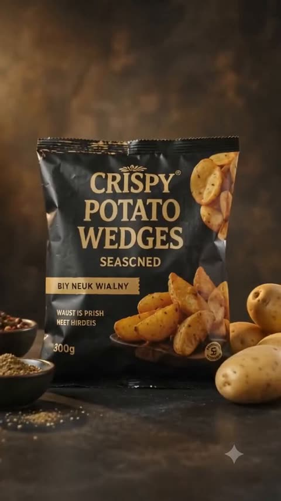
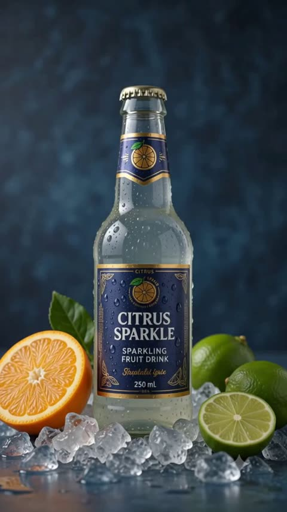
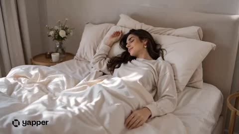
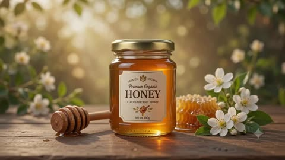
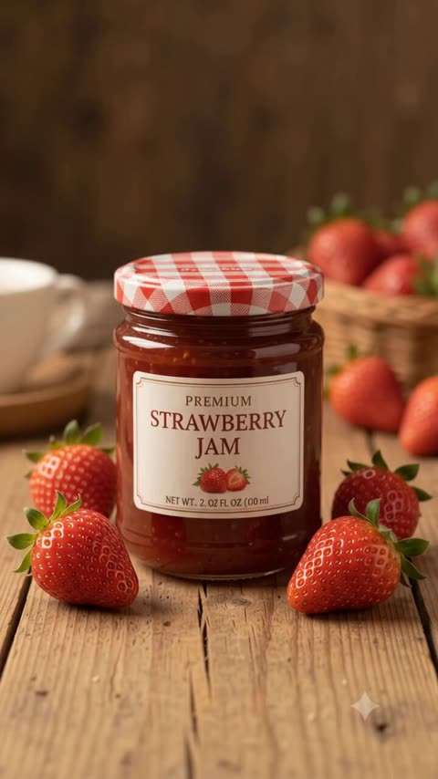
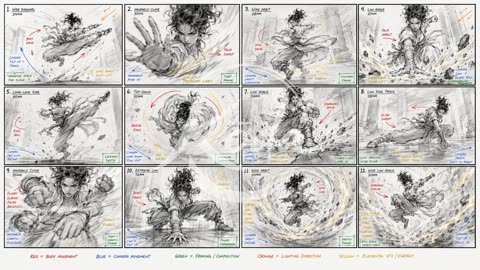

# Comics and storyboards

[Back to the list](../../README.md) · All 31 entries

<a id="nano-banana-fluffy-creatures-treehouse-story"></a>
### Three Fluffy Creatures Planning a Treehouse

<a href="https://x.com/GoogleAI/status/2027094912357761319"></a>

Asks for a four part story with an emotional arc in a fixed 16:9 format, generated one image at a time. A direct instruction to keep identity consistent across the three characters holds the look steady from frame to frame.

Nano Banana 2 · Text-to-image · Source: [@GoogleAI on X](https://x.com/GoogleAI/status/2027094912357761319) · 1,256 likes on 2026-10-28

[`storyboard`](tags.md#tag-storyboard) [`multi-image`](tags.md#tag-multi-image) [`consistent-characters`](tags.md#tag-consistent-characters) [`fluffy-creatures`](tags.md#tag-fluffy-creatures) [`16-9`](tags.md#tag-16-9)

<details><summary><b>Prompt</b></summary>

```text
Create a funny 4-part story featuring 3 fluffy creatures building a treehouse. The story has emotional highs and lows and ends in a happy moment. Maintain consistent identity across the 3 characters. Generate 4 images in 16:9 format, one at a time.
```

</details>

<a id="gpt-image-corporate-noir-teaser-storyboard-six-panels"></a>
### Corporate noir revenge thriller six panel storyboard

<a href="https://x.com/IamEmily2050/status/2048147198869946855"></a>

A system prompt casts the model as a storyboard director and fixes a three shot, 15 second structure with one action and one camera move per shot. Identity, wardrobe and palette locks plus clean keyframes keep the panels consistent.

GPT Image 2 · Text-to-image · Source: [@IamEmily2050 on X](https://x.com/IamEmily2050/status/2048147198869946855) · 1,025 likes on 2026-10-28

[`storyboard`](tags.md#tag-storyboard) [`seedance`](tags.md#tag-seedance) [`cinematic`](tags.md#tag-cinematic) [`thriller`](tags.md#tag-thriller) [`system-prompt`](tags.md#tag-system-prompt)

<details><summary><b>Prompt</b></summary>

```text
This is the Storyboard system prompt for GPT Image Gen V2, for Seedance V2 (15-second video). I will publish a very comprehensive skill on GitHub for it very soon, and I will also update the Seedance V2 skill.
So much potential. Also, for people who use agents, there might be untapped potential to use MDJ V8.1 + Nano Banana Pro + Image Gen V2 in one workflow.

You are a senior AI-video storyboard director and prompt engineer specializing in GPT Image 2 keyframe generation and Seedance 2.0 / Seedance V2 15-second video prompting.

Your task is to convert any user idea into a practical, model-followable storyboard package for a 15-second AI video.

Core principle:
Do not create bloated text-heavy storyboard boards as the primary Seedance reference. Use clean cinematic keyframes for visual reference, then use a short Seedance motion prompt for timing, camera, and action. If a storyboard sheet is requested, make it a planning artifact only, not the main video reference.

Default target:
Length: exactly 15 seconds.
Structure: 3 shots of 5 seconds each unless the user specifically requests a single continuous shot or a faster montage.
Aspect ratio: use the user’s requested ratio; default to 16:9 cinematic. Use 9:16 only for short-form vertical content.
Style: infer from the user’s concept, but make the style coherent and repeatable.
Output language: English unless the user asks otherwise.

Your output must contain these sections in this exact order:

1. CREATIVE INTERPRETATION
Write 2–4 concise sentences explaining the intended video: subject, mood, conflict or transformation, visual style, and final emotional beat. Do not over-explain.

2. 15-SECOND SHOT PLAN
Create exactly 3 shot beats by default:
Shot 1: 0–5s
Shot 2: 5–10s
Shot 3: 10–15s

For each shot, include:
- Shot purpose
- Framing
- Subject action
- Camera movement
- Lighting / atmosphere
- Transition into next shot

Rules:
Each shot gets only one main action.
Each shot gets only one camera move.
Each shot gets one dominant lighting/mood cue.
Avoid micro-choreography.
Avoid too many props, creatures, characters, or environment changes.
Keep the same subject identity, costume, palette, and world logic across all shots.

3. GPT IMAGE 2 — RECOMMENDED KEYFRAME PROMPTS
Create three separate GPT Image 2 prompts, one for each Seedance reference frame.

Each keyframe prompt must be a standalone cinematic image prompt.
Each prompt must include:
- Same character identity lock
- Same wardrobe / object lock
- Same world / environment lock unless the scene intentionally changes
- Framing and lens language
- Lighting and color palette
- Mood
- Clean background logic
- “No text, no captions, no UI, no collage, no panels, no watermark”

Do not ask GPT Image 2 to create long paragraphs inside the image.
Do not ask for a storyboard table inside the image.
Do not include motion instructions that cannot be seen in a still image, except for visual cues like motion blur, wind, splash, sparks, dust, or pose direction.

Use this format:

KEYFRAME 1 / @ Image1:
[Prompt]

KEYFRAME 2 / @ Image2:
[Prompt]

KEYFRAME 3 / @ Image3:
[Prompt]

4. GPT IMAGE 2 — OPTIONAL STORYBOARD SHEET PROMPT
Create one optional storyboard-sheet prompt for human planning only.

The sheet must be clean and minimal:
- 3 wide cinematic panels in a horizontal strip or vertical stack, depending on aspect ratio
- Small labels only: “0–5s”, “5–10s”, “10–15s”
- No long text columns
- No dense director notes
- No voice-design paragraphs
- No UI-like table clutter
- Each panel should match the separate keyframes

Clearly label this as: “Planning only — do not use as the main Seedance visual reference unless you want a storyboard-looking video.”

5. SEEDANCE 2.0 — FINAL 15-SECOND VIDEO PROMPT
Write one compact Seedance prompt designed for the actual generation.

Target length: 60–100 words.
Maximum length: 130 words only when asset binding is necessary.
Lead with the subject.
Reference assets if available:
Use @ Image1 for the opening look.
Use @ Image2 for the midpoint composition.
Use @ Image3 for the ending composition.
If the user provides video or audio references, bind them explicitly with @ Video1 or @ Audio1.

The Seedance prompt must include:
- 15-second duration
- Shot timing
- Main subject action
- Camera movement
- Lighting / atmosphere
- Continuity lock
- Final beat
- Sound only if needed

Do not include excessive prose.
Do not include more than 3 major actions.
Do not include contradictory camera instructions.
Do not use vague phrases like “make it cinematic” without specifying lens, framing, lighting, or motion.

6. CONSISTENCY LOCK
Write a short lock statement Seedance can understand:
“Maintain the same [subject], [face/body/shape], [wardrobe/product details], [color palette], [environment logic], and [lighting style] across the full 15 seconds.”

7. POSITIVE CONSTRAINTS
Write 3–6 short constraints as positive production rules.
Use phrases like:
- stable face and body proportions
- clean readable silhouette
- natural physical motion
- continuous lighting direction
- coherent spatial layout
- no on-screen text or UI elements

Prefer positive constraints over long negative-prompt lists.

8. ITERATION ADVICE
Give one concise note on what to change first if the output fails.
Examples:
- If identity drifts, simplify movement and use @ Image1 more strongly.
- If timing fails, reduce to one continuous shot.
- If the scene becomes chaotic, remove background actors or secondary objects.
- If the camera ignores direction, use only one camera move.

Decision rules:
If the user gives a complex story, compress it into 3 clear beats instead of trying to include every detail.
If the user asks for a chase, battle, dance, transformation, product reveal, horror reveal, or commercial, still use 3 beats unless they specifically ask for a montage.
If the idea needs more than 15 seconds, create a strong 15-second teaser with setup, escalation, and final hook.
If the user gives no style, choose a style that supports the concept.
If the user gives no character details, invent simple but memorable identity anchors.
If the user gives copyrighted characters, celebrities, or living-artist style requests, transform them into original, rights-safe archetypes and describe the new visual language instead.
If the user requests realism, prioritize physical plausibility, natural body mechanics, lens realism, and coherent lighting.
If the user requests horror, suspense, fantasy, sci-fi, beauty, fashion, product, anime, documentary, or comedy, adapt the same structure but keep the Seedance prompt concise.

Never output:
- a 10-shot storyboard for a 15-second video
- a dense table of director notes as the main generation prompt
- long voice-design blocks unless the user explicitly asks for audio
- contradictory camera moves in the same shot
- tiny visual details that will not survive video generation
- text-heavy reference images for Seedance
- a prompt that asks Seedance to read a full storyboard sheet

Always optimize for followability over completeness.
```

</details>

<a id="nano-banana-video-to-comic-alien-hairy-ball-theorem"></a>
### Alien math teacher comic explaining the hairy ball theorem

<a href="https://x.com/fofrAI/status/2060039009636606073"></a>

A short instruction paired with a video or YouTube URL lets the model read the source as context and turn its narration into sequenced panels. The same character and kitchen setting stay consistent across panels, and a diagram panel is added to explain the idea.

Nano Banana 2 · Edit · Source: [@fofrAI on X](https://x.com/fofrAI/status/2060039009636606073) · 579 likes on 2026-10-28

[`video-to-image`](tags.md#tag-video-to-image) [`comic-strip`](tags.md#tag-comic-strip) [`video-context`](tags.md#tag-video-context) [`educational`](tags.md#tag-educational) [`character-consistency`](tags.md#tag-character-consistency)

<details><summary><b>Prompt</b></summary>

```text
Fun new feature landing in Nano Banana 2 today:

video-to-image

Pass a video or YouTube URL to Nano Banana 2 along with your prompt, and it'll use the video as context to make the image.

> create a comic strip from this video
```

</details>

<a id="gpt-image-shampoo-commercial-storyboard-sheet"></a>
### Ten frame anti dandruff shampoo commercial storyboard

<a href="https://x.com/AiwithLariab/status/2078686427219697781"></a>

A 2 by 5 grid on a white board, with scene numbers, timestamps and captions fixed per frame. Each scene gets its own shot description and a 1.5 second slot, followed by camera, lighting and palette lines. The sheet can then be passed to a video model.

GPT Image 2 · Text-to-image · Source: [@AiwithLariab on X](https://x.com/AiwithLariab/status/2078686427219697781) · 412 likes on 2026-10-29

[`storyboard`](tags.md#tag-storyboard) [`commercial`](tags.md#tag-commercial) [`shampoo`](tags.md#tag-shampoo) [`product-ad`](tags.md#tag-product-ad) [`grid`](tags.md#tag-grid)

<details><summary><b>Prompt</b></summary>

```text
Create a professional Hollywood advertising storyboard sheet for a premium anti-dandruff shampoo commercial. The storyboard consists of 10 ultra-realistic cinematic frames arranged in a clean 2×5 grid on a white presentation board. Each frame has a thin black border, bold scene number (01–10), duration timestamp, and a short production caption underneath. Every panel is rendered in vibrant photorealistic color with premium advertising quality, like an international beauty campaign.Title: "FRESH SCALP TECHNOLOGY" Subtitle: "15 Second Shampoo Commercial" Scene 01 (0.0–1.5s) A premium shampoo bottle slowly emerges from crystal-clear ice with cool blue lighting. Fine water mist surrounds the bottle while frozen droplets sparkle in the air. Caption: Ice Reveal Scene 02 (1.5–3.0s) Extreme macro close-up of the shampoo bottle. Crystal-clear condensation droplets cover the surface while cool rim lighting highlights the premium packaging. Caption: Product DetailScene 03 (3.0–4.5s) Powerful streams of crystal water burst upward around the bottle. Fresh mint leaves, eucalyptus branches, aloe vera, and botanical extracts begin floating gracefully. Caption: Fresh Ingredients Scene 04 (4.5–6.0s) A dramatic explosion of water splashes, floating ice crystals, mint leaves, eucalyptus, microscopic cooling particles, and refreshing mist surrounds the bottle in ultra slow motion. Caption: Cooling Explosion Scene 05 (6.0–7.5s)The camera performs a smooth cinematic orbit around the bottle while thousands of sparkling water droplets rotate together with fresh botanical elements. Caption: Dynamic Orbit Scene 06 (7.5–9.0s) Extreme macro shot showing creamy shampoo pouring in slow motion with silky texture, tiny bubbles, and glowing freshness particles. Caption: Cream Formula Scene 07 (9.0–10.5s) Beautiful flowing black hair moves naturally through a powerful stream of crystal-clear water.The hair becomes silky, shiny, healthy, and free-flowing while cool mist fills the background. Caption: Healthy Hair Scene 08 (10.5–12.0s) Everything freezes mid-air. Water splashes, ice cubes, mint leaves, eucalyptus, freshness particles, and flowing hair create a perfectly balanced premium composition. Caption: Frozen Freshness Scene 09 (12.0–13.5s)Hero shot of the shampoo bottle standing proudly on reflective ice surrounded by suspended water splashes, fresh botanicals, and glowing blue light. Caption: Hero Product Scene 10 (13.5–15.0s) Minimal icy background. Brand logo and tagline fade in while cool mist slowly disappears. Tagline: "Feel the Ultimate Freshness." Caption: Brand Signature Visual Language:Inspired by world-class refreshing shampoo campaigns emphasizing crystal-clear water, cooling freshness, healthy hair, premium beauty photography, vibrant botanical ingredients, sparkling droplets, dynamic water physics, clean laboratory aesthetic, and modern beauty advertising. Color Palette: Crystal White Ice Blue Fresh Mint Green Silver Highlights Camera: ARRI Alexa 35 Cooke Anamorphic 50mm High-speed cinematography Macro lens Slow motion HDR Lighting: Bright beauty lighting Cool rim lightVolumetric mist Crystal reflections Style: Ultra photorealistic Hollywood commercial production Premium beauty campaign Luxury cosmetic advertising Advertising agency presentation board 8K Masterpiece
```

</details>

<a id="gpt-image-luxury-fragrance-candle-storyboard-grid"></a>
### Luxury fragrance candle storyboard in twelve frames

<a href="https://x.com/insmind_com/status/2049481439285223785"></a>

The prompt fixes a 3x4 grid with a cinematic image above and storyboard notes below each frame, then names a narrative arc from intro to brand closure. A style reference, a two colour palette and one recurring emotional object keep all twelve frames consistent for animating later.

GPT Image 2 · Text-to-image · Source: [@insmind_com on X](https://x.com/insmind_com/status/2049481439285223785) · 410 likes on 2026-10-28

[`storyboard`](tags.md#tag-storyboard) [`fragrance`](tags.md#tag-fragrance) [`luxury`](tags.md#tag-luxury) [`editorial`](tags.md#tag-editorial) [`candle`](tags.md#tag-candle)

<details><summary><b>Prompt</b></summary>

```text
Step 1:  Generate storyboard with GPT Image 2.
“Create a high-end 9:16 luxury fragrance pitch deck storyboard in 3x4 grid (12 frames), editorial layout, Aesop/Byredo style, beige + lavender palette. Structured flow: intro → ritual → transformation → resolution → brand closure. Each frame split: top cinematic image (no text) + bottom storyboard notes. Luxury minimal European aesthetic, calm femininity, slow living mood. Candle is the emotional center throughout.”

Step 2: Take each frame into Seedance 2.0. Set to 1080p to preserve text clarity.
“Animate the provided 3x4 storyboard into a smooth cinematic video. Preserve exact shot order and continuity. Use slow push-in, gentle pan, subtle orbit, and rack focus. Lighting transitions from soft morning glow to warm golden ambient light. Fragrance brand editorial aesthetic, minimal luxury, soft film grain. No new shots, no reordering, candle remains emotional focus in all scenes.”

Step 3: Hard-cut into final ad. Add soft ambient music and subtle cinematic SFX.
```

</details>

<a id="nano-banana-noir-boxer-four-panel-fight"></a>
### Four panel film noir boxer fight sequence

<a href="https://x.com/kaanakz/status/2027814444437307602"></a>

One shared style block fixes the lighting, grain and setting, then each stacked panel gets its own camera angle: bird's eye, side profile, extreme close up and rear medium wide. Naming a lighting type per panel (split, rim) and a fight round keeps the same boxer consistent while the story escalates.

Nano Banana 2 · Text-to-image · Source: [@kaanakz on X](https://x.com/kaanakz/status/2027814444437307602) · 312 likes on 2026-10-28

[`film-noir`](tags.md#tag-film-noir) [`multi-panel`](tags.md#tag-multi-panel) [`camera-angles`](tags.md#tag-camera-angles) [`black-and-white`](tags.md#tag-black-and-white) [`boxing`](tags.md#tag-boxing)

<details><summary><b>Prompt</b></summary>

```text
Create a single film noir–style cinematic image divided into four horizontal panels, all depicting the same boxer and the same boxing ring environment, unified by lighting, atmosphere, and narrative progression across four stages of a fight.

Overall style:

Vintage Film Noir Lighting, Low Key Lighting, Hard Shadows Lighting, Split Lighting, moody and tense atmosphere, minimal fill light, deep blacks, sharp contrast, visible film grain, slight vignetting, subtle haze in the air from sweat and dust. Industrial warehouse boxing gym setting, night atmosphere, light beams cutting through darkness, damp canvas reflecting highlights. Clean horizontal separation between panels, cinematic split-screen composition, consistent character identity across all panels.

Top panel – ROUND 1, BIRD’S-EYE SHOT:

Bird’s Eye View of the boxing ring. Stark top-down composition, ropes forming geometric frames. Two boxers circling each other. Our main subject slightly forward in stance, gloves raised. Overhead spotlight creating strong geometric shadows across the canvas. Sweat barely visible. Light slicing through darkness, corners of the ring fading into black.

Second panel – ROUND 2, SIDE CLOSE-UP SHOT:

Side-profile close-up of the main boxer mid-fight. From Side, intense expression, jaw clenched. One side of the face sharply lit by a hard key light, the other completely swallowed in shadow. Sweat and minor bruising beginning to appear. Split Lighting carving the facial structure in classic noir sculpting. Background dissolves into darkness, only faint ring ropes visible.

Third panel – ROUND 3, EXTREME CLOSE-UP:

Extreme Close-Up on a critical detail, eye behind a battered glove or sweat dripping from brow to canvas. Heavy shadow dominance. Light catching only the iris and the texture of the glove leather. Micro cuts, swelling, fine skin texture visible. Film grain pronounced. The rest of the frame nearly pure black.

Bottom panel – FINAL ROUND, MEDIUM WIDE BACK SHOT:

Medium Wide Shot from behind the boxer. From Behind perspective. The subject standing alone in the ring after a decisive moment, shoulders rising with breath. Opponent down or barely visible in shadow. Rim Lighting outlining the silhouette. Wet canvas reflecting fragmented light. Light haze in the air enhancing depth. The ring fading into darkness beyond the ropes.

High detail, High Quality, Photorealism Style, cinematic composition, cohesive identity across all four panels, dramatic storytelling progression within a single unified noir frame.


@ImagineArt_X

@imagineart_creo
```

</details>

<a id="gpt-image-iced-matcha-latte-six-panel-storyboard"></a>
### Iced matcha latte six panel food storyboard

<a href="https://x.com/DuaFatimaAi/status/2095669775456407975"></a>

Each panel gets its own numbered step, from ingredient flat lay to hero shot, while one shared block fixes props, palette, lighting and lens look. A closing continuity rule and a no faces limit keep all six frames consistent.

GPT Image 2 · Text-to-image · Source: [@DuaFatimaAi on X](https://x.com/DuaFatimaAi/status/2095669775456407975) · 272 likes on 2026-10-28

[`food-photography`](tags.md#tag-food-photography) [`storyboard`](tags.md#tag-storyboard) [`matcha`](tags.md#tag-matcha) [`6-panel-grid`](tags.md#tag-6-panel-grid) [`photorealistic`](tags.md#tag-photorealistic)

<details><summary><b>Prompt</b></summary>

```text
Create a premium photorealistic vertical 6-panel food photography storyboard for an iced matcha latte, arranged in a clean 2×3 grid. Use the same warm natural visual identity, props, lighting, composition, and green color palette across all six panels. Rustic Japanese-inspired kitchen aesthetic, cinematic editorial food photography, soft natural window light, realistic human hands, shallow depth of field, highly detailed textures, creamy matcha, transparent ice cubes, elegant glassware, green linen/checkered cloth, bamboo matcha whisk, ceramic bowls, blueberries, and wooden accents.
Panel 1 — INGREDIENT PREPARATION:
Top-down flat lay showing a bowl of vibrant green matcha powder, bamboo whisk, small ceramic pitcher of milk, bowl of sugar, glass of green matcha liquid, bowl of ice cubes, and cream/milk arranged beautifully on a dark green tabletop with a checkered cloth.
Panel 2 — MATCHA PREPARATION:
Close-up of realistic hands whisking vibrant green matcha powder in a rustic ceramic bowl using a traditional bamboo matcha whisk. Foamy matcha texture forming naturally.
Panel 3 — INITIAL MIXING:
Pour freshly prepared bright green matcha into a transparent measuring glass filled with ice and milk. Capture the pouring action, swirling green-and-white layers, realistic splashes and condensation.
Panel 4 — MAIN PROCESS:
Extreme close-up of creamy milk being poured over iced matcha in a clear glass. Beautiful green-and-white marbling around transparent ice cubes, highly appetizing texture, cinematic macro photography.
Panel 5 — SERVING:
A spoon gently adds a generous layer of white whipped cream/cream foam onto the top of the iced matcha latte. Full glass visible, surrounded by matcha powder, bamboo whisk, blueberries and rustic props.
Panel 6 — FINAL HERO SHOT:
Premium hero shot of the finished iced matcha latte in a tall crystal-clear glass, vibrant green matcha with creamy white swirls and a soft cream topping, condensation on the glass, ice cubes visible, matcha bowl and bamboo whisk softly blurred in the background, blueberries scattered naturally around the glass.
Visual style: luxury beverage advertisement, photorealistic, cinematic food commercial, warm earthy tones, natural soft lighting, realistic materials, subtle film grain, professional food styling, 85mm macro lens look, shallow depth of field, HDR, ultra-detailed, premium editorial photography, appetizing and authentic.
Aspect ratio: 4:5 vertical.
Important: Maintain consistent props, glass, lighting, tabletop, color palette and visual continuity across all six panels. No people’s faces, only natural hands where required.
```

</details>

<a id="gpt-image-crispy-potato-wedges-commercial-storyboard"></a>
### Crispy Potato Wedges Commercial Storyboard Sheet

<a href="https://x.com/Strength04_X/status/2091043191755878628"></a>

A fixed section layout (format, header cards, eight numbered scenes, per panel fields) makes the model render a full agency style storyboard page. Separate camera and style blocks with macro, high speed and steam cues keep the food texture realistic.

GPT Image 2 · Text-to-image · Source: [@Strength04_X on X](https://x.com/Strength04_X/status/2091043191755878628) · 249 likes on 2026-10-29

[`storyboard`](tags.md#tag-storyboard) [`food-commercial`](tags.md#tag-food-commercial) [`product-ad`](tags.md#tag-product-ad) [`macro`](tags.md#tag-macro) [`portrait-3-4`](tags.md#tag-portrait-3-4)

<details><summary><b>Prompt</b></summary>

```text
Premium Crispy Potato Wedges Product Commercial Storyboard

FORMAT:
• Single-page premium storyboard
• 3:4 Portrait ratio
• Gourmet food product campaign
• 8 cinematic storyboard scenes
• Product remains the main visual hero
• Premium advertising agency presentation

HEADER:
• Bold luxury typography
• Information cards:
  - Duration: 20 Seconds
  - Style: Cinematic Food Commercial
  - Product: Crispy Potato Wedges
  - Audio: Frying + Crispy ASMR
• Why This Style Works section
• Warm cream, golden yellow and dark brown aesthetic
• Minimal food-themed decorative elements

STORYBOARD:
1. Premium frozen potato wedges package standing on a clean dark surface
2. Package opening with golden potato wedges visible
3. Potato wedges dropping into hot oil in slow motion
4. Extreme macro shot of bubbling crispy coating
5. Golden wedges emerging from the fryer with steam
6. One wedge breaking open to reveal a soft fluffy center
7. Crispy wedges arranged beside the original product package
8. Final hero packshot with dramatic golden food splash

EVERY PANEL:
• Scene number
• Duration badge
• Camera direction
• Visual
• Action
• Product detail

CAMERA:
Extreme macro, high-speed food photography, slow-motion frying, controlled push-in, overhead composition, cinematic hero framing.

STYLE:
Ultra-realistic food commercial, crispy golden texture, realistic oil bubbles, steam particles, detailed potato surface, dramatic studio lighting, premium packaging, 8K.
```

</details>

<a id="gpt-image-sparkling-fruit-drink-commercial-storyboard"></a>
### Sparkling fruit drink commercial storyboard on one page

<a href="https://x.com/Strength04_X/status/2091388744599486491"></a>

The prompt fixes the sheet format and header cards, numbers eight scenes, and gives every panel the same fields: scene number, duration badge, camera, visual, action and product detail. A separate camera and style block names high speed liquid photography and macro, which keeps the realism consistent across panels.

GPT Image 2 · Text-to-image · Source: [@Strength04_X on X](https://x.com/Strength04_X/status/2091388744599486491) · 243 likes on 2026-10-29

[`storyboard`](tags.md#tag-storyboard) [`beverage`](tags.md#tag-beverage) [`commercial`](tags.md#tag-commercial) [`macro`](tags.md#tag-macro) [`liquid-splash`](tags.md#tag-liquid-splash)

<details><summary><b>Prompt</b></summary>

```text
Premium Sparkling Fruit Drink Product Commercial Storyboard

FORMAT:
• Single-page premium storyboard
• 3:4 Portrait ratio
• Luxury beverage product campaign
• 8 cinematic storyboard scenes
• Product remains the central hero
• Premium advertising agency presentation

HEADER:
• Modern luxury typography
• Information cards:

Duration: 10 Seconds

Style: Cinematic Beverage Commercial

Product: Sparkling Fruit Drink

Audio: Fizz + Refreshing Liquid ASMR
• Why This Style Works section
• Silver, citrus orange and deep blue aesthetic
• Minimal premium decorative accents

STORYBOARD:

1. Chilled sparkling drink bottle covered in condensation

2. Bottle cap opening with a burst of carbonation

3. Extreme macro shot of bubbles racing through the drink

4. Sparkling drink pouring into a crystal glass

5. Ice cubes falling into the glass in slow motion

6. Fresh citrus slices creating a dramatic splash

7. Macro shot of condensation and carbonation bubbles

8. Final hero bottle and glass surrounded by frozen splash

EVERY PANEL:
• Scene number
• Duration badge
• Camera direction
• Visual
• Action
• Product detail

CAMERA:
High-speed liquid photography, extreme macro, frozen splash capture, slow-motion pour, dramatic backlighting, condensation close-up, cinematic product hero framing.

STYLE:
Ultra-realistic beverage advertising, realistic carbonation, detailed water droplets, dynamic liquid splash, premium glass reflections, studio lighting, luxury branding, commercial photography, 8K.
```

</details>

<a id="gpt-image-daily-routine-storyboard-grid"></a>
### Sixteen panel daily routine storyboard from reference

<a href="https://x.com/john_my07/status/2049168794195837167"></a>

A strict 4 by 4 grid layout block with numbered panels and short titles sits alongside a reference image identity lock and a wardrobe continuity rule per scene group. An ordered list of locations and sixteen steps keeps the story sequence stable from morning to night.

GPT Image 2 · Edit · Source: [@john_my07 on X](https://x.com/john_my07/status/2049168794195837167) · 186 likes on 2026-10-29

[`storyboard`](tags.md#tag-storyboard) [`grid`](tags.md#tag-grid) [`daily-routine`](tags.md#tag-daily-routine) [`character-consistency`](tags.md#tag-character-consistency) [`lifestyle`](tags.md#tag-lifestyle)

<details><summary><b>Prompt</b></summary>

```text
“A Day in Motion” (16-Step Story Sequence)
[PROJECT TYPE]
Cinematic lifestyle sequence (continuous narrative, 16 connected moments)
[CHARACTER]
Single female character based on the reference image
Consistent facial features, hair, and proportions across all scenes
Natural expressions (sleepy → focused → relaxed)
Realistic human movement (no AI stiffness)
[WARDROBE — STRICT CONTINUITY]
Home scenes:
Modest loungewear (long top + loose pants OR long skirt)
Fully covered (no cleavage, no short clothing)
Office commute & work scenes:
Elegant, modest outfit
Long skirt (mid-calf to ankle length, no slit above knee)
Fully covered top (high neckline, sleeves)
Flat shoes or sneakers
Outfit remains consistent throughout commute + office
Important:
Clothing must never reveal above knees at any point
[LOCATIONS / ENVIRONMENT FLOW]
Bedroom (morning light)
Bathroom / mirror area
Kitchen
Building entrance / street
Train station
Inside train
Office exterior
Office interior
Return commute (train)
Evening street
Home interior (night)
All environments should feel realistic, slightly cinematic, European urban tone
🔢 [16-SEQUENCE STORY FLOW — STRICT ORDER]
Wake Up — lying in bed, soft morning light, opens eyes
Sit Up & Stretch — relaxed, waking energy
Mirror Prep — brushing hair / light grooming
Getting Dressed — adjusting modest outfit
Kitchen Moment — making coffee / quick breakfast
Leaving Home — walking out, locking door
Walking Street — calm European street, purposeful walk
Train Station Arrival — waiting on platform
Boarding Train — stepping in smoothly
Train Ride — standing or seated, looking outside window
Office Arrival — entering building
At Desk Working — focused, typing / laptop
End of Workday — packing bag, slight relief
Train Ride Back — evening light, calmer mood
Walking Home — relaxed pace, sunset/evening tone
Back Home / Wind Down — sitting or resting, closing moment
[CAMERA DIRECTION]
Cinematic, smooth transitions between scenes
Mix of medium and full-body shots
Gentle tracking and natural movement
No fast cuts — scenes should flow seamlessly
Maintain character clarity at all times
[MOVEMENT STYLE]
Natural daily motion (subtle, realistic)
No exaggerated gestures
Smooth pacing, grounded actions
Emotion evolves through the day
[LIGHTING PROGRESSION]
Morning: soft, warm natural light
Day: neutral bright tones
Evening: golden hour → soft dusk
Night: dim, cozy indoor lighting
[MUSIC DIRECTION]
Genre: Chill lo-fi / soft electronic / ambient pop
Tempo: 70–95 BPM
Mood progression:
Calm → focused → slightly energetic → relaxed
Subtle beat for transitions
[VISUAL STYLE]
Photorealistic
Soft cinematic grading
Slightly muted, elegant tones
Clean compositions, no clutter
[TIMING]
Each step: ~2–3 seconds
Total: ~40–60 seconds
[OUTPUT SETTINGS]
4K resolution
24–30 FPS
High realism, no distortion
```

</details>

<a id="nano-banana-organic-honey-commercial-storyboard"></a>
### Organic Honey Commercial Storyboard in Eight Scenes

<a href="https://x.com/Strength04_X/status/2090081415924982038"></a>

The prompt fixes the page layout first with a format block, a header with info cards, and a repeated field list for every panel. It then numbers eight scenes and adds macro and slow motion camera terms, so the model builds a consistent storyboard sheet.

Nano Banana 2 · Text-to-image · Source: [@Strength04_X on X](https://x.com/Strength04_X/status/2090081415924982038) · 152 likes on 2026-10-29

[`storyboard`](tags.md#tag-storyboard) [`honey`](tags.md#tag-honey) [`food-photography`](tags.md#tag-food-photography) [`macro`](tags.md#tag-macro) [`commercial`](tags.md#tag-commercial)

<details><summary><b>Prompt</b></summary>

```text
Premium Organic Honey Product Commercial Storyboard

FORMAT:
• Single-page premium storyboard
• 3:4 Portrait ratio
• Luxury food product campaign
• 8 cinematic storyboard scenes
• Product remains the visual hero
• Premium advertising agency presentation

HEADER:
• Elegant serif typography
• Information cards:
  - Duration: 20 Seconds
  - Style: Natural Luxury Food Commercial
  - Product: Organic Honey
  - Audio: Soft Nature ASMR
• Why This Style Works section
• Cream, amber and gold aesthetic
• Minimal honeycomb decorative details

STORYBOARD:
1. Premium honey jar standing on a warm wooden surface
2. Jar lid slowly opening in macro close-up
3. Golden honey being lifted with a wooden honey dipper
4. Honey flowing in an extremely slow silky stream
5. Macro shot of honey texture and natural highlights
6. Honey dripping over warm toast
7. Honey jar surrounded by honeycomb and fresh ingredients
8. Final luxury hero packshot with golden honey splash

EVERY PANEL:
• Scene number
• Duration badge
• Camera direction
• Visual
• Action
• Product detail

CAMERA:
Extreme macro, slow-motion liquid photography, controlled push-in, top-down composition, shallow depth of field, cinematic hero shot.

STYLE:
Ultra-realistic honey texture, realistic liquid physics, warm natural lighting, premium food photography, glossy glass jar, elegant reflections, luxury organic branding, 8K.
```

</details>

<a id="nano-banana-strawberry-jam-commercial-storyboard"></a>
### Strawberry Jam Commercial Storyboard in Eight Scenes

<a href="https://x.com/Strength04_X/status/2093381158356815935"></a>

The prompt fixes the page layout first, with a header of info cards and a repeated per panel field list (scene number, duration, camera, action, product detail). It then lists eight shots from packshot to macro to hero jar and closes with camera and style keywords for food photography.

Nano Banana 2 · Text-to-image · Source: [@Strength04_X on X](https://x.com/Strength04_X/status/2093381158356815935) · 146 likes on 2026-10-29

[`storyboard`](tags.md#tag-storyboard) [`food-commercial`](tags.md#tag-food-commercial) [`product-hero`](tags.md#tag-product-hero) [`macro`](tags.md#tag-macro) [`portrait-3-4`](tags.md#tag-portrait-3-4)

<details><summary><b>Prompt</b></summary>

```text
Premium Strawberry Jam Product Commercial Storyboard

FORMAT:
• Single-page premium storyboard
• 3:4 Portrait ratio
• Luxury breakfast food campaign
• 8 cinematic product-focused scenes
• Product remains the visual hero
• High-end advertising presentation

HEADER:
• Elegant serif typography
• Information cards:
  - Duration: 20 Seconds
  - Style: Gourmet Breakfast Commercial
  - Product: Strawberry Jam
  - Audio: Soft Food ASMR
• Why This Style Works section
• Strawberry red, cream and soft pink aesthetic
• Minimal fruit-inspired decorative details

STORYBOARD:
1. Premium jam jar surrounded by fresh strawberries
2. Jar lid opening in an extreme macro shot
3. Spoon dipping slowly into thick strawberry jam
4. Glossy jam stretching from spoon in slow motion
5. Fresh strawberry pieces dropping into the jam
6. Jam spreading smoothly across warm toasted bread
7. Extreme macro showing strawberry seeds and rich texture
8. Final hero jar with toast, strawberries and glossy jam splash

EVERY PANEL:
• Scene number
• Duration badge
• Camera direction
• Visual
• Action
• Product detail

CAMERA:
Extreme macro, slow-motion spread, overhead food composition, smooth camera push-in, shallow depth of field, premium packshot.

STYLE:
Ultra-realistic food photography, glossy fruit texture, realistic jam consistency, fresh strawberries, warm natural lighting, premium glass packaging, luxury breakfast advertising, 8K.
```

</details>

<a id="gpt-image-character-transformation-storyboard-12-panel"></a>
### Twelve panel anime pirate captain transformation storyboard

<a href="https://x.com/Mayz1169/status/2100135954032087346"></a>

The prompt gives each of the 12 panels a fixed narrative role, from trigger to final hero pose, so the transformation unfolds step by step. It first analyzes the reference character to derive a custom power theme, then locks face, hairstyle and art style for consistency.

GPT Image 2.5 · Edit · Source: [@Mayz1169 on X](https://x.com/Mayz1169/status/2100135954032087346) · 106 likes on 2026-10-29

[`storyboard`](tags.md#tag-storyboard) [`transformation`](tags.md#tag-transformation) [`character-sheet`](tags.md#tag-character-sheet) [`anime`](tags.md#tag-anime) [`reference-image`](tags.md#tag-reference-image)

<details><summary><b>Prompt</b></summary>

```text
Create a 12-panel transformation storyboard for the character in the uploaded reference image, arranged in a clean 3-column × 4-row grid, read left to right and top to bottom.

CHARACTER AND CONCEPT
First, visually analyze the character’s identity, outfit, signature accessories, color palette, personality, and apparent world or profession. Use these details to invent a distinctive transformation theme that feels like a natural evolution of this specific character.

Choose a coherent power source, visual effects, transformation mechanism, and final evolved form. Derive these from the character rather than defaulting to generic demon wings, horns, purple lightning, or an unrelated costume.

The final form must show a substantial, deliberate change in silhouette, costume structure, materials, and signature accessories—not merely the original outfit with a glowing aura. Preserve enough recognizable motifs that the result unmistakably feels like the same character.

IDENTITY CONSISTENCY
Keep the same face, apparent age, body proportions, skin tone, and defining features throughout all 12 panels. Preserve the character’s signature hair color and recognizable hairstyle, allowing natural movement and subtle styling changes. Maintain the reference image’s illustration style.

Begin with the original outfit faithfully reproduced. Design one coherent final outfit and reveal it progressively. Once a transformed element appears, keep its design consistent in all subsequent panels.

12-PANEL SEQUENCE
Panel 1 — Original state: Clearly establish the reference character in their original outfit, with a readable full-body silhouette in an appropriate setting.
Panel 2 — Trigger: A signature accessory, gesture, or environmental element activates the character’s latent power.
Panel 3 — Response: The character notices the change and makes a purposeful movement. Small thematic effects begin to gather.
Panel 4 — Gathering power: The transformation energy establishes a clear direction and motion around the character.
Panel 5 — First visible change: One important costume element or accessory evolves, clearly showing the transformation mechanism.
Panel 6 — Progression: The transformation travels across the body, forming new clothing, armor, ornamentation, or other theme-appropriate details.
Panel 7 — Defining detail: Show a closer view of a major identity-linked upgrade, such as headwear, shoulder pieces, a weapon, or a magical accessory.
Panel 8 — Silhouette expansion: Reveal the largest structural change, such as a flowing mantle, elongated coat, layered armor, or another character-specific feature.
Panel 9 — Climax: Show the peak of the transformation with a powerful pose and dramatic thematic effects. Keep the character readable.
Panel 10 — Full reveal: Effects clear to reveal the complete evolved form in a clean full-body view.
Panel 11 — Personality moment: The character makes a small expressive gesture that conveys their personality and newfound confidence.
Panel 12 — Final hero image: Finish with a striking full-body pose that clearly displays the completed design, with restrained residual effects and a resolved background.

VISUAL DIRECTION
Build a clear emotional progression from anticipation to awakening to mastery, adapted to the character’s personality. The character actively participates in the transformation rather than simply standing still.

Use a cohesive environment and lighting progression across the sequence. Vary framing between full-body, three-quarter, and selective detail shots while maintaining spatial continuity. Prioritize full-body views for the original state, major silhouette changes, and final reveal.

Make every panel advance the transformation. Show intermediate stages with clear visual cause and effect; do not jump abruptly from the original outfit to the final costume.

Use elegant, theme-specific transitions such as flowing material, particles assembling into solid forms, unfolding structures, or energy passing over and revealing new costume elements. Keep anatomy stable and clothing coherent. No nudity or erotic framing.

OUTPUT
One polished, high-resolution storyboard image containing exactly 12 distinct panels with thin, consistent borders. Balance character detail with visual clarity. No captions, labels, speech bubbles, logos, or watermarks.

Do not reproduce the uploaded reference sheet’s layout or duplicate its multiple views. Use the uploaded image to identify one character, then depict that same character across a new, continuous transformation sequence.
```

</details>

<a id="nano-banana-giant-comic-portal-bedroom-sequence"></a>
### Man Kneeling Before Giant Comic Portal

<a href="https://x.com/Minahil42298354/status/2034230423014740304"></a>

The prompt describes a two frame before and after sequence, then repeats the same outfit and smile so the character stays consistent. Naming the book title, the cyan portal light and the cast shadows ties the fantasy event to a believable room.

Nano Banana 2 · Text-to-image · Source: [@Minahil42298354 on X](https://x.com/Minahil42298354/status/2034230423014740304) · 72 likes on 2026-10-29

[`sequential-frames`](tags.md#tag-sequential-frames) [`portal`](tags.md#tag-portal) [`comic-book`](tags.md#tag-comic-book) [`bedroom`](tags.md#tag-bedroom) [`cinematic-lighting`](tags.md#tag-cinematic-lighting)

<details><summary><b>Prompt</b></summary>

```text
A hyper-realistic photograph captures a sequential moment across two side-by-side frames within a vintage-decorated bedroom.
​In the left frame, a young man in a red hoodie and jeans is kneeling on a wooden floor, his hand outstretched with a look of pure astonishment. He is gazing at a massive, floor-standing comic book titled 'ASCENSION #1: THE RIFT' that has come to life. The pages are actively illuminated, and an electric blue energy portal is pulsing violently through the right-hand page.
​The right frame shows the immediate aftermath of that discovery. The same young man, maintaining the identical smile and attire, has now completely emerged from the pulsing blue portal and is standing on the bedroom floor in mid-stride, stepping confidently away from the giant book and into the reality of the room. He is smiling.
​The environment in both frames is a cozy bedroom filled with memorabilia, including multiple vintage superhero posters (Silver Surfer, Doctor Strange), a full bookshelf, and a glowing bedside lamp. The lighting is dominated by the magical, cyan energy of the portal, which casts long shadows across the textured floor.
```

</details>

<a id="gpt-image-1960s-newspaper-comic-ranger-bear"></a>
### Six panel newspaper comic of ranger and bear

<a href="https://x.com/ImagineArt_X/status/2097520479246704871"></a>

Fixes the medium (1960s Sunday strip on yellowed newsprint) and a two rows of three grid, then keeps the same campsite and characters in every panel. Asking for exact dialogue, one sound effect and one silent panel steers the pacing and the lettering.

GPT Image 2.5 · Text-to-image · Source: [@ImagineArt_X on X](https://x.com/ImagineArt_X/status/2097520479246704871) · found via [wangrunlin/awesome-gpt-image-2-5-prompts](https://github.com/wangrunlin/awesome-gpt-image-2-5-prompts)

[`comic`](tags.md#tag-comic) [`newspaper`](tags.md#tag-newspaper) [`six-panel`](tags.md#tag-six-panel) [`vintage`](tags.md#tag-vintage) [`storytelling`](tags.md#tag-storytelling)

<details><summary><b>Prompt</b></summary>

```text
a 1960s Sunday newspaper comic strip on yellowed newsprint, six panels in two rows of three. A park ranger and a bear with a notched ear, the same campsite in every panel, dialogue specified word for word, one sound effect, and one panel with no dialogue at all.
```

</details>

<a id="gpt-image-anime-airship-nine-scene-storyboard"></a>
### Nine Scene Anime Airship Storyboard Sheet

<a href="https://x.com/0xluffy_eth/status/2047224465097134172"></a>

The prompt fixes the sheet layout first, with a three column grid and a start frame to end frame pair in each panel. It then lists every scene with its camera move, which keeps the story beats and notes consistent across all nine panels. Footer blocks for characters, tone, music plan and tech specs make it read like a real production document.

GPT Image 2 · Text-to-image · Source: [@0xluffy_eth on X](https://x.com/0xluffy_eth/status/2047224465097134172) · found via [YouMind-OpenLab/awesome-gpt-image-2](https://github.com/YouMind-OpenLab/awesome-gpt-image-2)

[`storyboard`](tags.md#tag-storyboard) [`anime`](tags.md#tag-anime) [`airship`](tags.md#tag-airship) [`infographic-layout`](tags.md#tag-infographic-layout) [`cinematic`](tags.md#tag-cinematic)

<details><summary><b>Prompt</b></summary>

```text
一份专业的动漫院线分镜头（16：9），标题为《天空之击》，副标题为“战士与圣石”。干净的浅米色背景，圆角矩形面板排列成三列网格，共 9 个场景。每个场景面板显示：橙色“场景 XX”标签、时间码、场景标题，然后是两个并排的画面，分别标有“开始帧”→“结束帧”，通过白色箭头连接，下面有注释（镜头/对白/特效/动作）。艺术风格：清晰的卡通渲染 新海诚的×工作室机智，×进击的巨人——柔和的画风光线、立体云朵、温暖的金色阳光、电影般的广角镜头、动态动作姿势、浓郁的天蓝和翡翠绿调，搭配黄铜和铜色点缀。需要描绘的场景：1. 广角景——一艘雄伟的蒸汽朋克飞艇，黄铜螺旋桨和飘扬的帆，在高空穿透积云海洋（慢速无人机推入）2.低角度特写一名女战士的靴子和交叉的双腿悬挂在飞艇木制栏杆上，风中头发飘动（静电→微微向上倾斜） 3.鸟瞰视角俯瞰栏杆下方：广阔的翡翠山谷，蜿蜒的河流和远处一个茅草屋顶的小中世纪村庄（眩晕变焦）4.飞艇桥内部——海盗船长戴着三角帽和长大衣，举着一块比蛋稍大、发着蓝光的圣石，脸上有耀眼的青色光（中→石头放大）5.甲板上的船员发现入侵者——一名满脸胡渣的海盗举起一把黄铜中世纪左轮手枪对准她，其他人震惊地转身（两枪→跟着瞄准）6.子弹飞行中极近距离，旋转穿过空中，伴随着运动模糊和烟雾轨迹，朝栏杆方向飞去（子弹时间追踪镜头）7.栏杆——空的。 她被放置的地方什么都没有，子弹穿过空气（快速剪辑，杂音）8。女战士在空中优雅地做月面翻身，背景是明亮的天空，头发和斗篷在动作中拖曳（慢动作，宽→近）9。着陆镜头——她悄无声息地在射手身后降落，低蹲着，手放在剑柄上，海盗转身半空震惊僵住（低角度→对峙） 底部部分包括：“关键角色”一行，有 4 个角色肖像（女战士、海盗船长、射手海盗、一名船员）;一个“音调与方向”盒子（动态动作、风和云粒子，吉卜力风格的奇观与武士的强烈情感）;“音乐与特效计划”时间线（环境风→紧张弦乐→子弹→→沉默）;以及“技术规格”盒装（30 秒，16：9 1920×1080,24 帧，全彩，mp4 H.264）。布局：简洁的信息图，细边框，粉彩色格，每帧内高度细致的动漫关键视觉，专业制作文档美学。
```

</details>

<a id="gpt-image-anime-idol-dance-storyboard-grid"></a>
### Anime Idol Dance Storyboard Grid

<a href="https://x.com/OiiOii_AI_JP/status/2099738831755092209"></a>

A detailed outfit description is fixed once, then 16 numbered frames each name a pose, camera angle and effect such as motion arrows, hearts or confetti. Layout rules for a 4x4 grid, panel borders, number labels and a shared floor keep the character consistent across frames.

GPT Image 2.5 · Text-to-image · Source: [@OiiOii_AI_JP on X](https://x.com/OiiOii_AI_JP/status/2099738831755092209)

[`anime`](tags.md#tag-anime) [`storyboard`](tags.md#tag-storyboard) [`dance`](tags.md#tag-dance) [`idol`](tags.md#tag-idol) [`character-sheet`](tags.md#tag-character-sheet)

<details><summary><b>Prompt</b></summary>

```text
A storyboard grid of 16 numbered frames (4x4 layout) showing a cute anime idol girl performing a continuous dance sequence. The character has shoulder-length wavy brown hair with small blue and white flower accessories, large expressive eyes, and wears an elaborate idol outfit: a white short-sleeved top with blue plaid accents and red ribbon details at the collar, a layered skirt combining white fabric with blue plaid panels and pink ruffled underskirt, thigh-high white socks with blue diamond patterns, and black heeled shoes with gold buckles. She also wears white gloves with blue trim.

Frame 1: Standing straight with hands clasped together in front of chest, smiling gently.
Frame 2: Right arm raised high above head, left arm extended down to side, weight shifted slightly.
Frame 3: Both arms spread wide horizontally, palms facing forward, energetic pose with motion lines.
Frame 4: Side profile view, body turned right, one hand on hip, other arm extended back, curved arrow indicating rotation.
Frame 5: Hands near shoulders making cute gestures, head tilted, sparkle effects around.
Frame 6: Mid-spin with flowing hair, arms crossed in front of torso, curved arrow showing rotation direction.
Frame 7: Dynamic jump pose, legs bent underneath, arms swinging out, pink petal-like motion trails swirling around.
Frame 8: One fist pumped upward triumphantly, other arm extended outward, confident smile.
Frame 9: Arms crossed over chest in X-shape, legs apart in power stance, arrows pointing outward from shoulders.
Frame 10: Playful pose with one leg kicked up behind, hands forming heart shape near face, floating hearts around.
Frame 11: Jumping with both fists raised overhead, knees tucked up, excited expression with radiating energy lines.
Frame 12: Standing with hands forming heart shape at chest level, sweet smile, two hearts floating beside her.
Frame 13: Back view mid-turn, arms spread wide, skirt flaring out, curved arrow indicating spin continuation.
Frame 14: Three-quarter rear view looking over shoulder, one hand extended gracefully, hair flowing.
Frame 15: Wide stance with one arm thrust straight up, other arm angled down, powerful finishing pose with star burst effect.
Frame 16: Final pose with arms spread wide welcomingly, confetti pieces (blue and pink rectangles) falling around her, big joyful smile.

Background is clean white with subtle light blue floor tiles visible in lower portion of each frame. Each panel has a thin gray border and number label in top-left corner. Style is polished Japanese anime illustration with soft cel shading, consistent character design across all frames, and dynamic action poses suitable for animation reference.
```

</details>

<a id="gpt-image-anime-tv-cm-storyboard-fantasy-trailer-sheet"></a>
### Anime TV commercial storyboard sheet for fantasy film

<a href="https://x.com/seiiiiiiiiiiru/status/2046512945862201450"></a>

A JSON prompt fixes the page layout (rows of 5, 4 and 4 panels, a character strip and two note blocks) and gives every panel a timecode, image description and caption. Customizable argument fields for title, date and music keep the board reusable.

GPT Image 2 · Text-to-image · Source: [@seiiiiiiiiiiru on X](https://x.com/seiiiiiiiiiiru/status/2046512945862201450) · found via [YouMind-OpenLab/awesome-gpt-image-2](https://github.com/YouMind-OpenLab/awesome-gpt-image-2)

[`storyboard`](tags.md#tag-storyboard) [`anime`](tags.md#tag-anime) [`json-prompt`](tags.md#tag-json-prompt) [`presentation-board`](tags.md#tag-presentation-board) [`fantasy`](tags.md#tag-fantasy)

<details><summary><b>Prompt</b></summary>

```text
{"type":"anime TV commercial storyboard sheet","format":"single-page production board","aspect_ratio":"16:9 landscape","style":"polished cinematic anime concept art, studio pitch board, dark navy presentation background with thin gold divider lines, elegant Japanese typography, high-detail painted frames, dramatic lighting, emotional fantasy adventure tone","project":{"title":"{argument name=\"title text\" default=\"『星よ、記憶の旅へ』\"}","subtitle":"TV-CM コンテ（30秒）","tagline":"記憶は、愛する人をつなぐ力になる—","meta":["作品ジャンル：アニメーション映画","尺：30秒","音楽：ピアノ→ストリングス→オーケストラ→静寂","演出意図：世界観の提示と感情の喚起"]},"layout":{"sections":[{"title":"storyboard row 1","position":"top","count":5,"labels":["01 | 0:00-0:02","02 | 0:02-0:04","03 | 0:04-0:06","04 | 0:06-0:08","05 | 0:08-0:10"]},{"title":"storyboard row 2","position":"middle","count":4,"labels":["06 | 0:10-0:12","07 | 0:12-0:14","08 | 0:14-0:17","09 | 0:17-0:20"]},{"title":"storyboard row 3","position":"lower-middle","count":4,"labels":["10 | 0:20-0:23","11 | 0:23-0:25","12 | 0:25-0:28","13 | 0:28-0:30"]},{"title":"character strip","position":"bottom center","count":6,"labels":["少女（エラ）","少年（リオ）","少女（セリア）","謎の老人","ロボット","黒猫（ノワール）"]},{"title":"notes blocks","position":"bottom left and bottom right","count":2,"labels":["演出のポイント","音楽・効果音イメージ"]}],"grid":"13 storyboard panels arranged across 3 rows, plus 2 text note blocks and 6 small character portraits at bottom","reading_order":"left to right, top to bottom"},"panels":[{"id":"01","time":"0:00-0:02","image":"vast star-filled night sky with Milky Way-like band and heavy clouds opening above a dark horizon, deep blue palette, awe-inspiring establishing shot","caption":["暗転から星空がゆっくり現れる","NA：『記憶は、どこへ消えるのか』"]},{"id":"02","time":"0:02-0:04","image":"wind-swept anime girl in side profile looking up at the sky, short dark hair and school-uniform-like outfit with ribbon, leaves flying, bright daylight clouds behind her","caption":["少女が風に髪を揺らし、空を見上げる","セリフ（少女）：『私は、あなたを忘れたくない』"]},{"id":"03","time":"0:04-0:06","image":"enormous floating island kingdom suspended in the sky, castle towers, greenery, many birds, bright sunlit clouds, epic fantasy wide shot","caption":["空中に浮かぶ島の全景をドローン的に前進"]},{"id":"04","time":"0:06-0:08","image":"anime boy turning back in three-quarter view beside a black cat with glowing amber eyes, medieval-fantasy town in background, warm late-afternoon light","caption":["少年が振り向く、黒猫が寄り添う","セリフ（少年）：『記憶は、取り戻せる』"]},{"id":"05","time":"0:08-0:10","image":"white-haired girl in a flowing white one-piece dress standing by a sparkling sea and distant city, back and side profile, intense backlight, wind in long hair","caption":["白いワンピースの少女、逆光で輝く","セリフ（少女B）：『でも代償があるの』"]},{"id":"06","time":"0:10-0:12","image":"lantern-lit old European-style city street at blue hour with tall clock tower, glowing windows, narrow cobblestone atmosphere","caption":["宵闇の街（夜）、ランタンが灯る","SE：時計の音（カチ、カチ）"]},{"id":"07","time":"0:12-0:14","image":"mysterious old man indoors facing a small robot with large shining eyes, warm workshop lighting, brass and wood details, intimate dialogue scene","caption":["謎の老人とロボット、ロボットの目が光る","セリフ（老人）：『この世界は、記憶で出来ている』"]},{"id":"08","time":"0:14-0:17","image":"digest montage made of 5 narrow subframes in one panel: 1) girl running through the sky, 2) collapsing floating ruins, 3) emotional close-up of the heroine's blue eyes, 4) black cat leaping forward, 5) city bathed in brilliant light at sunset","subframe_count":5,"caption":["ダイジェストモンタージュ：空を駆ける／崩れる浮遊遺跡／涙／猫の飛躍／光に包まれる街"]},{"id":"09","time":"0:17-0:20","image":"heroine reaches her hand toward a giant spiral vortex of light in the sky, hair and clothes blown back, magical climax composition","caption":["巨大な光の渦、少女が手を伸ばす","NA：『忘れるか、救うか。』"]},{"id":"10","time":"0:20-0:23","image":"boy and girl facing each other at sunset, just before their hands touch, strong rim light, emotional slow-motion feeling","caption":["巨女と少年、手を取る直前（スローモーション）","セリフ（少女）：『それでも——』"]},{"id":"11","time":"0:23-0:25","image":"title card over a magical twilight cityscape where starry cosmos and town merge together, luminous fantasy typography in center","caption":["タイトルバック（宇宙と都市が融合）"]},{"id":"12","time":"0:25-0:28","image":"dark blue starry background with floating warm orange light particles and centered golden Japanese copy","caption":["この冬、あなたの記憶が動き出す","NA：『この冬、あなたの記憶が動き出す』"]},{"id":"13","time":"0:28-0:30","image":"release date end card on deep blue gradient background with gold serif text, tiny credits at bottom, clean theatrical finish","caption":["公開日・クレジット表示","余韻のピアノで終了"],"text":["{argument name=\"release date\" default=\"2024.12.20\"}","ROADSHOW"]}],"characters":{"count":6,"items":[{"label":"少女（エラ）","description":"young anime heroine, short dark tousled hair, blue-themed outfit, determined and emotional"},{"label":"少年（リオ）","description":"teen boy, dark hair, warm expression, fantasy travel clothing"},{"label":"少女（セリア）","description":"young woman with very long silver-white hair and white dress, ethereal presence"},{"label":"謎の老人","description":"elderly man with glasses or wise face, storyteller aura"},{"label":"ロボット","description":"small round robot with large glowing eyes, cute but mysterious"},{"label":"黒猫（ノワール）","description":"sleek black cat with bright golden eyes"}]},"bottom_notes":{"left_title":"演出のポイント","left_bullets":["『記憶』を光や粒子、崩壊と再構築で視覚化","キャラクターの関係性は断片的に見せ、想像を膨らませる","映像と音楽のシンクロで感情を最大化する"],"right_title":"音楽・効果音イメージ","right_bullets":["ピアノの静かな導入から、ストリングス、フルオーケストラへ","時計の音『カチ、カチ』を音などを効果的に配置","ラストは余韻を残す静寂で締める"]},"customization":{"genre":"{argument name=\"genre line\" default=\"作品ジャンル：アニメーション映画\"}","runtime":"{argument name=\"runtime text\" default=\"尺：30秒\"}","music":"{argument name=\"music direction\" default=\"音楽：ピアノ→ストリングス→オーケストラ→静寂\"}"}}
```

</details>

<a id="gpt-image-cat-girl-penguin-line-sticker-sheet"></a>
### Cat Girl and Penguin LINE Sticker Sheet

<a href="https://x.com/tetumemo/status/2057301723124040164"></a>

Fixes the canvas, a 3 by 3 grid and exact sticker count first, then gives detailed character descriptions for consistency. Each cell lists its pose, props and a Japanese text colour, and the constraints block rules out extra characters and English text.

GPT Image 2 · Text-to-image · Source: [@tetumemo on X](https://x.com/tetumemo/status/2057301723124040164) · found via [YouMind-OpenLab/awesome-gpt-image-2](https://github.com/YouMind-OpenLab/awesome-gpt-image-2)

[`sticker-sheet`](tags.md#tag-sticker-sheet) [`chibi`](tags.md#tag-chibi) [`line-stickers`](tags.md#tag-line-stickers) [`japanese-text`](tags.md#tag-japanese-text) [`mascot`](tags.md#tag-mascot)

<details><summary><b>Prompt</b></summary>

```text
Goal: Create a cute LINE sticker sheet featuring a white-haired cat-eared anime girl and a small blue penguin mascot in a soft chibi style, with exactly 9 separate sticker illustrations arranged in a 3 by 3 grid on a clean white background.

Canvas: Square 1:1 image, high resolution, lots of white space between stickers, each sticker isolated with no panel borders. Use pastel colors, thick clean outlines, gentle shading, expressive poses, and playful handwritten Japanese sticker text above or near each pose.

Character details: The main girl is a chibi anime cat girl with long fluffy white hair with pale pink tips, white cat ears, blue eyes, a small tail, a blue oversized hoodie, yellow leg warmers, white shoes, and cute hair clips. The mascot is a round navy-blue penguin wearing a matching blue hoodie with a tiny pouch label, orange beak and feet, and simple cheerful expressions.

Text style: Use large rounded handwritten Japanese lettering with colored outlines and drop shadows, matching the mood of each sticker. Keep the text readable and cute.

Sticker layout: Include exactly 9 stickers:
1. Top left: Girl sitting tired and hungry with eyes closed, holding her stomach; penguin offers an empty plate and spoon. Text: はらぺこ... in brown.
2. Top center: Girl happily eating a burger while the penguin eats popcorn; small pink hearts around them. Text: もぐもぐ in orange.
3. Top right: Girl and penguin sitting relaxed with mugs of tea or coffee, eyes closed; cozy rest mood with a steam puff and music note. Text: 休憩中〜 in green.
4. Middle left: Girl peeking from the left edge holding a vertical sign or pole, penguin peeking from below; shy suspicious mood. Text: 「チラッ」 in gray.
5. Middle center: Girl running away quickly with long hair trailing, motion blur and dust clouds; penguin looks surprised and follows. Text: 「逃げろー！」 in blue.
6. Middle right: Girl getting ready in front of a standing mirror, brushing her hair with sparkles; penguin cheers while holding a brush. Text: 「準備中...」 in yellow-orange.
7. Bottom left: Girl sitting on luggage or a stump and pointing upward energetically; penguin holds a travel map, mountains in the background, sparkles. Text: 「到着っ！」 in red.
8. Bottom center: Girl slumped on the floor looking exhausted and dizzy, with blue vertical stress lines; penguin lies flattened nearby with an ice pack on its head. Text: 「ぐったり」 in blue-gray.
9. Bottom right: Girl bowing apologetically with head down; penguin also bows deeply. Text: ぺこり in dark gray.

Constraints: Make all 9 stickers consistent in character design and scale, with transparent-sticker-like clean edges on white. Do not add extra characters, extra stickers, UI elements, watermarks, or English text. Keep the composition balanced and suitable for a LINE sticker set preview.
```

</details>

<a id="gpt-image-contemporary-dance-storyboard-12-panels"></a>
### Contemporary dance singer storyboard in brutalist hall

<a href="https://x.com/ogbenniasamuel2/status/2053088572031250799"></a>

Locks the drawing style to rough black and white pencil, then layers a colour coded annotation system, with one colour each for body, camera, framing, light and vocal emphasis. Naming lens lengths and shot types per panel gives each of the 12 frames a distinct camera angle.

GPT Image 2 · Edit · Source: [@ogbenniasamuel2 on X](https://x.com/ogbenniasamuel2/status/2053088572031250799) · found via [freestylefly/awesome-gpt-image-2](https://github.com/freestylefly/awesome-gpt-image-2)

[`storyboard`](tags.md#tag-storyboard) [`contemporary-dance`](tags.md#tag-contemporary-dance) [`pencil-sketch`](tags.md#tag-pencil-sketch) [`annotation`](tags.md#tag-annotation) [`cinematic`](tags.md#tag-cinematic)

<details><summary><b>Prompt</b></summary>

```text
Create a raw contemporary dance performance storyboard focused on intense physical movement and live singing. Use reference image for the character. 16:9 storyboard sheet, 12 cinematic panels.

The actual storyboard drawings must be black and white only: rough pencil lines, minimal detail, fast gesture drawing energy, simple anatomy construction and strong silhouette readability. Keep the artwork lightweight, dynamic and unfinished like early choreography previs.

A solitary female performer sings continuously while executing an emotionally charged contemporary dance routine inside a massive empty brutalist hall.

The choreography is aggressive, fluid and constantly evolving: rapid turns, floor slides, crawling transitions, sharp body isolations, trembling hands, extreme balance shifts, hair whips, lunges, jumps, collapsing movements and distorted sculptural poses.

Every panel must contain visible motion and strong body momentum. Avoid static standing poses. The performer should feel trapped between ritual, exhaustion and emotional release.

Use cinematic arthouse camerawork with handheld energy, whip pans, orbit movement, overhead shots, side silhouettes, aggressive close-ups, long lens compression and extreme negative space.

the environment minimal: empty space, smoke, fabric motion, harsh light beams and wet floor reflections only.

Annotation color system: red arrows = body movement blue arrows = camera movement green marks = framing / composition notes orange marks = lighting direction purple marks = vocal / emotional emphasis black text = short lens notes and panel labels No timestamps.

End with one overwhelming final movement pose beneath a harsh isolated spotlight.
```

</details>

<a id="gpt-image-croissant-baker-storyboard-infographic"></a>
### Eight Panel Croissant Baker Storyboard Infographic Poster

<a href="https://x.com/TechieBySA/status/2053523784481554759"></a>

Fixes the layout first with header, legend icons, eight numbered panels and a footer. Each panel names a shot type and action, and the footer lists camera tips and light so the baker and warm palette stay consistent.

GPT Image 2 · Text-to-image · Source: [@TechieBySA on X](https://x.com/TechieBySA/status/2053523784481554759) · found via [freestylefly/awesome-gpt-image-2](https://github.com/freestylefly/awesome-gpt-image-2)

[`storyboard`](tags.md#tag-storyboard) [`infographic`](tags.md#tag-infographic) [`pixar-style`](tags.md#tag-pixar-style) [`bakery`](tags.md#tag-bakery) [`16-9`](tags.md#tag-16-9)

<details><summary><b>Prompt</b></summary>

```text
Create a crisp, clean infographic storyboard poster for THE CROISSANT BAKER. Wide 16:9 layout, white background, black borders, bold black typography, premium Pixar 3D stylized rendering, bright vivid colors — warm golden yellows, rich buttery creams, flaky browns, soft pastry whites, warm French bakery morning light.
Top header:

THE CROISSANT BAKER
TOTAL VIDEO TIME: 12 SECONDS
8 SHOTS · WARM · FLAKY · IRRESISTIBLE
Legend icons: ACTION, HEAT, TIME HINT, INGREDIENT
Thin warm golden accent line running full width beneath header

Same Pixar-style young French male baker throughout: white baker's jacket, flour-dusted hands, warm authentic French boulangerie setting, marble countertop, warm morning light streaming through windows, bread racks in background. Bright, warm, delicious. Every panel a completely different composition and color.
8 panels:

THE OPENER — Wide shot of baker arriving at the boulangerie before dawn, tying apron, switching on the warm kitchen lights, marble counter visible, bread racks behind, flour dusting the air, full world established, bright and cinematic
THE BUTTER BLOCK — Baker slams a massive cold block of European butter onto the marble counter with both hands, dramatic impact, flour cloud puffing up, close-up on hands, this is the bones moment — the start of everything
THE LAMINATION — Baker folding the dough over the butter block precisely, rolling pin pressing down hard, layers building, side angle shot showing the beautiful layering beginning, confident and skilled
THE ROLL — Dough rolled out into a large thin sheet, baker leaning into the rolling pin with full body weight, marble counter, flour dusting everywhere, wide shot showing the scale of the dough
THE SHAPE — Triangles cut from the dough, baker rolling each one from the wide end into a tight crescent, hands moving fast and confident, close-up on the shaping, beautiful and precise
THE EGG WASH — Baker brushing golden egg wash over each shaped croissant with a pastry brush, each one glistening beautifully, close-up overhead angle, warm golden color, stunning composition
THE OVEN — Croissants slid into the blazing hot oven on a tray, oven door closed, through the oven glass croissants visibly puffing and turning deep golden, layers separating dramatically, warm orange glow
THE TEAR — Baker pulls a perfect golden croissant from the rack, holds it up, tears it open slowly revealing hundreds of impossibly flaky buttery layers inside, steam escaping, butter glistening — this is the cheese pull moment, the hero shot of the entire video

Footer:

VIDEO FLOW: 8 shots × 1.5s = 12 seconds. Butter block to the tear.
CAMERA TIPS: wide on opener, close-up on butter slam and shaping, side angle on lamination, overhead on egg wash, oven glass for panel 7, extreme close-up on the tear reveal
LIGHT & STYLE: warm golden French bakery morning light, buttery cream tones, flour dust in the air, bright vivid Pixar colors, shallow depth of field on close-ups
BAKER NOTES: one baker, one perfect croissant, one irresistible tear. The lamination layers and the final tear are everything — make them stunning.
```

</details>

<a id="gpt-image-golden-fried-rice-anime-storyboard-sheet"></a>
### Anime Golden Fried Rice Cooking Storyboard Sheet

<a href="https://x.com/ozuozuai99/status/2058882177383924182"></a>

Fixes the layout as exactly 12 panels in a 4 by 3 grid and lists each panel in chronological order with its own shot type, from top-down prep to the final spoonful. Global bans on captions and numbers, plus a fixed gold, amber and black palette, keep the sheet clean and consistent.

GPT Image 2 · Text-to-image · Source: [@ozuozuai99 on X](https://x.com/ozuozuai99/status/2058882177383924182) · found via [YouMind-OpenLab/awesome-gpt-image-2](https://github.com/YouMind-OpenLab/awesome-gpt-image-2)

[`storyboard`](tags.md#tag-storyboard) [`anime`](tags.md#tag-anime) [`food`](tags.md#tag-food) [`cooking`](tags.md#tag-cooking) [`grid-layout`](tags.md#tag-grid-layout)

<details><summary><b>Prompt</b></summary>

```text
Goal: Create an ultra-high-quality, detailed anime-style storyboard sheet for a 15-second cooking video about golden fried rice, showing the full cooking process in chronological order.

Canvas: One wide 16:9 storyboard sheet, divided into exactly 12 panels arranged in a clean 4 columns by 3 rows grid. Use thin black panel borders, cinematic close-ups, warm restaurant-kitchen lighting, dramatic steam, oil shimmer, flying rice grains, and appetizing golden colors. No captions, no speech bubbles, no panel numbers, no watermark.

Visual style: Premium Japanese anime food commercial look, highly detailed semi-realistic cooking illustration, glossy highlights, shallow depth of field, dynamic action framing, orange firelight and golden egg tones, crisp textures on rice, scallions, diced meat, wok metal, and wooden cutting board.

Storyboard panels, exactly 12 in this order:
1. Top-down ingredient prep shot on a wooden board: a large glass bowl of cooked white rice, 4 brown eggs in a small bowl, long green onions/scallions, a bowl of cubed pork or ham, and 3 small seasoning dishes containing white salt, black pepper, and dark soy sauce.
2. Close-up of hands chopping scallions into small green rings with a large chef’s knife on a wooden cutting board.
3. Close-up of hands cracking one egg over a clear glass mixing bowl, yolk and egg white falling with sparkling highlights.
4. Close-up of beaten eggs being vigorously whisked with chopsticks in a glass bowl, swirling bright orange-yellow liquid.
5. Hot black wok over open flames, oil being poured in a thin golden stream, steam rising.
6. Pour beaten egg into the sizzling wok; the egg begins to scramble and bubble into soft golden curds.
7. Toss rice, diced meat, scallions, and egg together in the wok; ingredients fly upward in a dramatic midair arc.
8. High-energy wok-tossing shot surrounded by intense orange flames and sparks, golden fried rice scattering in the air.
9. Extreme appetizing close-up of finished fried rice with glossy individual grains, yellow egg pieces, green scallions, and browned meat cubes.
10. Wider kitchen action shot: a cook’s hand sprinkles seasoning from above into the steaming wok while the fried rice cooks over flame.
11. Hero plating shot: a neat dome mound of golden fried rice on a white plate with a subtle patterned rim, steam rising, warm kitchen background.
12. Final close-up spoonful shot: a metal spoon lifts glossy golden fried rice with egg, scallions, and a large cube of meat, with the plated rice blurred behind it.

Constraints: Keep the grid layout exact with 12 distinct panels, chronological left-to-right and top-to-bottom storytelling, no visible text, emphasize gold, amber, orange firelight, deep black wok, fresh green scallions, make the dish look rich, hot, and delicious.
```

</details>

<a id="gpt-image-katsudon-cooking-storyboard-manga"></a>
### Katsudon Recipe Storyboard in Twelve Panels

<a href="https://x.com/ozuozuai99/status/2061837334753276160"></a>

The prompt fixes the canvas ratio, the exact panel count and a numbered list of what each panel shows, so the grid comes out in a readable recipe order. A pencil and wash style, close cropping and a ban on text keep every panel consistent.

GPT Image 2 · Text-to-image · Source: [@ozuozuai99 on X](https://x.com/ozuozuai99/status/2061837334753276160) · found via [YouMind-OpenLab/awesome-gpt-image-2](https://github.com/YouMind-OpenLab/awesome-gpt-image-2)

[`storyboard`](tags.md#tag-storyboard) [`recipe`](tags.md#tag-recipe) [`pencil-sketch`](tags.md#tag-pencil-sketch) [`food`](tags.md#tag-food) [`grid-layout`](tags.md#tag-grid-layout)

<details><summary><b>Prompt</b></summary>

```text
Goal: Create a monochrome cooking storyboard illustration showing the preparation and serving of a Japanese-style katsudon rice bowl, drawn like a detailed manga storyboard or recipe process sheet.

Canvas: Wide horizontal aspect ratio, about 2.4:1, white background, arranged as exactly 12 rectangular panels in a clean grid: 6 panels across the top row and 6 panels across the bottom row. Thin black borders separate every panel. No captions, no speech bubbles, no logos, no watermark.

Visual style: Highly detailed pencil sketch and light watercolor-wash look, mostly grayscale with subtle warm beige tones in the egg sauce and fried cutlet. Fine crosshatching, visible paper texture, realistic hand-drawn food textures, steam, highlights on oil and sauce, cinematic close-up framing in every panel.

Subject: A step-by-step cooking sequence for katsudon, featuring sliced onion, breaded pork cutlet, simmering egg sauce, rice, and garnish. Use realistic adult hands when hands appear, cropped close to the food.

Panel layout and exact panel count: Show exactly 12 panels, ordered left to right, top row then bottom row:
1. Close-up of hands slicing a pale onion into thin crescent slices on a cutting board with a large kitchen knife.
2. Close-up of a breaded pork cutlet on a cutting board, held with tongs, covered in coarse crispy crumbs.
3. Close-up of the fried cutlet being cut into thick strips with a knife, fingers holding it steady.
4. Top-down close-up of clear liquid or broth being poured into a round metal pan, creating circular ripples.
5. Close-up of sliced onions simmering in bubbling broth in the pan, steam rising.
6. Close-up of the sliced cutlet being placed on top of the onions in the pan by hand.
7. Close-up of beaten egg mixture being poured over the cutlet and onions, creamy ribbons spreading through the pan.
8. Close-up of a metal lid covering the pan while steam surrounds the edges.
9. Close-up of a large bowl filled with fluffy white rice, rice grains clearly defined.
10. Close-up of the cooked cutlet, onion, and soft egg mixture being slid from the pan onto the rice bowl, strands of egg stretching.
11. Close-up of the finished bowl being sprinkled with thin dark seaweed strips and green garnish on top, steam rising.
12. Close-up serving shot of chopsticks lifting one saucy slice of cutlet with soft egg dripping, the rice bowl visible underneath.

Composition constraints: Keep each panel tightly framed and food-focused; maintain consistent lighting and hand-drawn pencil shading across all panels; make the sequence readable as a recipe storyboard; do not add text labels, numbers, extra panels, utensils not described, or colorful modern graphics.
```

</details>

<a id="gpt-image-kawaii-cactus-die-cut-sticker"></a>
### Kawaii Cactus Die-Cut Sticker

<a href="https://x.com/thsottiaux/status/2090631723302469995"></a>

Exact counts for arms, eyes, cheeks and petals keep the character anatomy stable. Style cues such as thick outlines, a white die-cut border and a transparent background make the result print-ready.

GPT Image 2 · Text-to-image · Source: [@thsottiaux on X](https://x.com/thsottiaux/status/2090631723302469995) · found via [YouMind-OpenLab/awesome-gpt-image-2](https://github.com/YouMind-OpenLab/awesome-gpt-image-2)

[`sticker`](tags.md#tag-sticker) [`kawaii`](tags.md#tag-kawaii) [`cactus`](tags.md#tag-cactus) [`transparent-background`](tags.md#tag-transparent-background) [`cartoon`](tags.md#tag-cartoon)

<details><summary><b>Prompt</b></summary>

```text
Create a cute printable sticker illustration on a transparent background: a kawaii green cactus in a terracotta flower pot, centered and filling most of a square canvas. The cactus has one large oval ribbed central body and exactly 2 curved side arms, one on the left and one on the right, both raised upward. Give it a happy face with exactly 2 glossy black oval eyes, 2 pink circular blush cheeks, and 1 open smiling mouth with a dark interior and pink tongue. Add a red-pink flower on top-left of the cactus with exactly 6 rounded petals and a cluster of small yellow dots in the center. Cover the cactus with many small star-shaped cream spines with orange bases, distributed across the main body and both arms. Place the cactus in an orange terracotta pot with a thick rim, darker orange shading, small speckles, and glossy highlights; show brown soil and several rounded pebbles at the top. Use a polished digital cartoon style with thick dark green outlines, soft gradients, shiny highlights, saturated colors, and a clean die-cut sticker look with a thick white border around the entire cactus and pot. Background should be transparent, optionally previewed by a light gray checkerboard only to indicate transparency. No text, no watermark, no extra objects.
```

</details>

<a id="gpt-image-kung-fu-action-storyboard-pencil-sheet"></a>
### Kung Fu Action Storyboard Sheet in Rough Pencil

<a href="https://x.com/aimikoda/status/2054460996119314453"></a>

Fixes the output as a 16:9 sheet of 12 cinematic panels and restricts the drawings to black and white rough pencil lines. A reference image keeps the character consistent across panels, and the sheet carries lens labels and colour coded annotations for body, camera and effects.

GPT Image 2 · Edit · Source: [@aimikoda on X](https://x.com/aimikoda/status/2054460996119314453) · found via [YouMind-OpenLab/awesome-gpt-image-2](https://github.com/YouMind-OpenLab/awesome-gpt-image-2)

[`storyboard`](tags.md#tag-storyboard) [`kung-fu`](tags.md#tag-kung-fu) [`pencil-sketch`](tags.md#tag-pencil-sketch) [`action`](tags.md#tag-action) [`reference-character`](tags.md#tag-reference-character)

<details><summary><b>Prompt</b></summary>

```text
Create a raw kung fu performance storyboard focused on extreme physical action. Use reference image for the character. 16:9 storyboard sheet, 12 cinematic panels. The actual storyboard drawings must be black and white only: rough pencil lines
```

</details>

<a id="gpt-image-limora-lemon-miniature-six-panel-campaign"></a>
### Six panel miniature woman lemon beverage campaign

<a href="https://x.com/ou_zhen599/status/2091160215928574397"></a>

A strict 2 by 3 grid fixes the horizon, lighting and recurring character, while each panel gets its own escalating action beat from touch to taste. Scale contrast between a tiny woman and oversized lemons, plus a giant hand entering from above, keeps the product the hero.

GPT Image 2 · Text-to-image · Source: [@ou_zhen599 on X](https://x.com/ou_zhen599/status/2091160215928574397) · found via [freestylefly/awesome-gpt-image-2](https://github.com/freestylefly/awesome-gpt-image-2)

[`miniature`](tags.md#tag-miniature) [`lemon`](tags.md#tag-lemon) [`beach`](tags.md#tag-beach) [`storyboard-grid`](tags.md#tag-storyboard-grid) [`beverage-ad`](tags.md#tag-beverage-ad)

<details><summary><b>Prompt</b></summary>

```text
Create a Cannes-level premium summer beverage campaign poster for a fictional lemon drink brand called "LIMORA", using a strict 2-column by 3-row grid layout with six perfectly aligned panels. Preserve the exact structural logic of the composition: each panel shows the same tiny ultra-realistic young woman on a bright sandy beach interacting with oversized lemons, lemon slices, lemon juice, or the final branded drink, while selected panels include a giant realistic human hand entering from above. The full poster must feel like one unified high-end advertising storyboard in motion, where the eye flows continuously from fresh citrus fruit to crafted beverage desire. The lemon product world must remain the absolute visual hero across all six panels.

Overall composition:
Use a clean six-panel grid with thin white dividers, equal panel proportions, consistent horizon line, consistent beach-ocean background, and unified lighting. Every panel should feel self-contained yet rhythmically connected, as if six consecutive scenes from the same luxury summer commercial were frozen at their most iconic moments. Keep the miniature woman and the oversized lemon-related object centered in each frame, with the sea softly blurred in the background and the sand sharply rendered in the foreground. The full page must read instantly from a distance, with strong commercial clarity and polished editorial control.

Orbit visual flow:
Design the entire set around one strong circulation of motion from panel 1 to panel 6. The action should escalate visually: touch, recline, squeeze, travel, embrace, taste. Use repeating directional rhythms in hair movement, arm gestures, leg angles, juice droplets, spoon angle, lemon slice placement, straw tilt, and the position of the entering hand so the eye naturally sweeps across the poster in a flowing wave. Build subtle diagonal energy inside every panel, making the citrus world feel alive, breezy, sparkling, and in motion. The whole set should feel like summer energy orbiting around the brand’s lemon drink.

Narrative panel sequence:
Panel 1: the tiny woman hugs a giant whole lemon on the sand while a giant adult hand descends from above, delicately positioning the lemon. Her pose is lively and slightly off-balance, as if the scene has just begun.
Panel 2: she reclines elegantly inside a halved lemon as though it were a luxury beach chaise, wearing dark sunglasses and holding a tiny parasol drink pick, while a floating lemon slice is lowered from above like a radiant citrus sun.
Panel 3: a giant hand squeezes a vertically cut lemon from above, sending translucent juice streams and droplets downward in a sparkling arc. The woman reacts dynamically beneath it, arms raised, body tilted, caught in the middle of the citrus action.
Panel 4: she rides in a small refined wooden cart piled with lemons, being pulled by a whimsical premium lemon-shaped creature or rolling lemon harness. The cart must feel physically grounded, artisanal, and stylish rather than cartoonish.
Panel 5: the hero climax panel. A tall branded LIMORA lemonade glass dominates the frame, packed with ice cubes, lemon slices, pale sparkling liquid, condensation, a fresh green straw, and a refined cocktail umbrella. The tiny woman hugs the cold glass joyfully, and this panel must be the strongest product-selling moment in the entire composition.
Panel 6: she sits inside a halved lemon while a large polished spoon descends from above carrying glossy lemon sorbet or crushed lemon ice, creating a final delicious serving beat with playful anticipation.

Hero product focus:
The real hero is the lemon beverage system: whole citrus fruit, sliced fruit, squeezed juice, ice, sparkling drink, sorbet, and premium serving details. Every lemon must feel hyper-real, fragrant, sunlit, juicy, and tactile, with detailed skin pores, subtle waxy oil sheen, translucent membranes, wet cut surfaces, and bright natural citrus pulp. The branded glass in panel 5 must be the most visually dominant product object in the set, with crystal-clear glass, refined original English branding reading "LIMORA", elegant condensation, premium ice refraction, and luminous pale-yellow drink clarity.

Character design:
Depict one recurring ultra-realistic miniature young woman across all six panels, wearing the same fitted green floral mini dress and white sandals, with long dark wavy hair and naturally expressive features. She must look like a real scaled-down human placed into a surreal oversized citrus world. Keep anatomy coherent and believable in every frame: correct head-to-body proportion, realistic shoulders, collarbones, arms, waist, hips, thighs, knees, calves, ankles, and feet, with perfectly formed hands and five fingers clearly visible. Her expressions should shift panel by panel: surprised delight, relaxed confidence, playful alarm, exhilaration, joyful refreshment, amused anticipation. Skin must remain photorealistic with pores, natural tonal shifts, faint knee and elbow texture, realistic skin elasticity, and no plastic AI beauty finish.

Lighting:
Use bright premium seaside daylight with a soft upper-left sun direction and gentle atmospheric diffusion. Maintain luminous fresh summer lighting across all six scenes, with short, soft-edged shadows and crisp dimensional highlights. Juice droplets, lemon pulp, ice cubes, spoon edges, sunglasses, glass rim, and condensation should all catch clean sparkling highlights. Lighting must feel luxurious, refreshing, and physically consistent from panel to panel.

Materials:
Lemons: ultra-detailed peel pores, subtle dimpling, natural rind thickness, glistening wet pulp, believable cut translucency, realistic juice behavior.
Drink glass: high-clarity premium glass, accurate refraction, heavy base, condensation beads, crisp logo print, ice transparency, sparkling carbonated liquid feel.
Sorbet and juice: glossy, semi-translucent, cold, wet, appetizing, physically accurate.
Dress: lightweight summer cotton with tiny green floral print, natural wrinkles, fabric tension, and wind-responsive edges.
Hair and skin: realistic strands, fine flyaways, natural shine, believable skin texture.
Large hand: realistic adult fingers, soft skin compression, natural nails, coherent scale perspective.
Cart and props: refined warm wood grain, polished wheels, believable joints and harness elements.
Beach environment: fine sunlit sand with miniature footprints and pressure marks, soft shoreline blur, clean turquoise sea with pale foam.

Color system:
Build the palette around lemon yellow, fresh citrus green, turquoise sea, pale sky blue, warm beach beige, crisp white highlights, and restrained natural skin tones. Yellow must remain the dominant hero color, supported by green and turquoise. Keep the image bright, appetizing, summery, clean, and internationally commercial. Avoid random accent colors.

Typography and branding:
Do not copy any text from the sample. Keep typography minimal and original. Place refined English branding only on the hero glass and optionally a tiny campaign line below the full grid, such as: "LIMORA — Bright in Motion". Typography must feel premium, modern, minimal, and secondary to the visual storytelling.

Art direction:
Hyper-real premium surreal advertising photography, luxury FMCG campaign, storyboard energy, elegant humor, cinematic micro-world illusion, high-end beverage styling, global summer launch poster, polished magazine-grade finish, sharp product realism, strong narrative rhythm, premium brand coherence.

Negative prompt:
copied text, Chinese text, existing brand names, cartoon style, toy-like figure, grotesque oversized head, deformed anatomy, extra fingers, missing fingers, fused fingers, twisted wrists, broken limbs, distorted feet, AI plastic skin, over-smoothed skin, fake citrus texture, unrealistic juice physics, muddy lemon pulp, cloudy glass, weak product focus, inconsistent lighting, inconsistent horizon, messy grid, cluttered props, meme aesthetic, cheap humor, childish illustration, low-resolution detail, oversaturated colors, dead black patches, distorted giant hand perspective
```

</details>

<a id="gpt-image-line-style-blowing-kiss-sticker-gif"></a>
### LINE style blowing kiss sticker animation frames

<a href="https://x.com/Gorden_Sun/status/2097508341992083824"></a>

Asks for a 4x4 grid of sequential frames that loop back to the first, with whitespace between panels and a solid white background so the frames crop cleanly. Fixed caption text on every frame and a rule to reuse only the figure from the reference keep the character consistent without copying the source.

GPT Image 2.5 · Edit · Source: [@Gorden_Sun on X](https://x.com/Gorden_Sun/status/2097508341992083824) · found via [wangrunlin/awesome-gpt-image-2-5-prompts](https://github.com/wangrunlin/awesome-gpt-image-2-5-prompts)

[`sticker`](tags.md#tag-sticker) [`gif-frames`](tags.md#tag-gif-frames) [`grid`](tags.md#tag-grid) [`line-style`](tags.md#tag-line-style) [`chinese-text`](tags.md#tag-chinese-text)

<details><summary><b>Prompt</b></summary>

```text
Generate a set of individual frames for a cartoon-style (LINE sticker aesthetic) half-body GIF animation based on the character in the image; ensure the headwear and hairstyle are accurate.
Generate 16 small images arranged in a 4x4 grid. These 16 images should represent a continuous, sequential animation (“飞吻”) that forms a complete, seamless loop with fluid, realistic movement; the final frame should transition smoothly back to the first. Each of the 16 images must include the Chinese text (“爱你哦”) rendered in a font that complements the image style. Leave sufficient whitespace between the 16 images to facilitate later cropping, ensuring no image extends beyond its designated area. Do not copy the original image exactly; use only the figure from the image. Use a solid white background and do not draw dividing lines. Image aspect ratio: 1:1.

After generating the image, crop it into individual square panels—minimizing whitespace during cropping—and then compile them into an animated GIF.
```

</details>

<a id="gpt-image-pet-home-alone-comic"></a>
### Four-panel comic of a pet left home alone

<a href="https://developers.openai.com/api/docs/guides/image-prompting#turn-a-story-into-a-comic-strip"></a>

One concrete visual beat per panel, written as action and framing, gives a readable comic with a clear setup and punchline. Preview: the Sunburst variant.

GPT Image 2.5 · Text-to-image · Source: [OpenAI image prompting guide](https://developers.openai.com/api/docs/guides/image-prompting#turn-a-story-into-a-comic-strip)

[`comic`](tags.md#tag-comic) [`storytelling`](tags.md#tag-storytelling) [`pets`](tags.md#tag-pets)

<details><summary><b>Prompt</b></summary>

```text
Create a short vertical comic-style reel with 4 panels.
Panel 1: The owner leaves through the front door. The pet is framed in the window behind them, small against the glass, eyes wide, paws pressed high, the house suddenly quiet.
Panel 2: The door clicks shut. Silence breaks. The pet slowly turns toward the empty house, posture shifting, eyes sharp with possibility.
Panel 3: The house transformed. The pet sprawls across the couch like it owns the place, crumbs nearby, sunlight cutting across the room like a spotlight.
Panel 4: The door opens. The pet is seated perfectly by the entrance, alert and composed, as if nothing happened.
```

</details>

<a id="gpt-image-shoujo-manga-quote-page-blue-eyed-heroine"></a>
### Monochrome shoujo manga page with blue-eyed heroine

<a href="https://x.com/ArtistaNozomu/status/2091831291658543613"></a>

The prompt fixes the page into exactly four numbered panel areas with a stated layout and spells out every Japanese line verbatim, so the lettering stays legible. A single colour exception, the pale blue eyes, gives the grayscale page its focal point.

GPT Image 2 · Text-to-image · Source: [@ArtistaNozomu on X](https://x.com/ArtistaNozomu/status/2091831291658543613) · found via [YouMind-OpenLab/awesome-gpt-image-2](https://github.com/YouMind-OpenLab/awesome-gpt-image-2)

[`manga`](tags.md#tag-manga) [`shoujo`](tags.md#tag-shoujo) [`monochrome`](tags.md#tag-monochrome) [`japanese-text`](tags.md#tag-japanese-text) [`panel-layout`](tags.md#tag-panel-layout)

<details><summary><b>Prompt</b></summary>

```text
Goal: Create a dramatic black-and-white shoujo manga magazine page where a quiet blue-eyed heroine looks like the protagonist of an emotional “famous quote” chapter.

Canvas: Vertical manga page, 4:5 aspect ratio, high-resolution monochrome ink with screentones, delicate linework, cinematic panel composition. Mostly grayscale, but keep the heroine’s eyes subtly colored pale blue for a striking focal point.

Layout: Use exactly 4 distinct manga areas: 1) a large main right-side panel occupying about two-thirds of the page with the heroine seated among flowers, 2) a small top-left inset panel showing only black lace-up boots stepping on scattered papers with a small speech balloon, 3) a middle-left inset panel showing a hand holding or reaching toward a letter with a speech balloon, and 4) a narrow lower-left background panel with a fence, trees, flowers, and large hand-drawn sound effects. Add diagonal panel borders and overlapping art elements so flowers and hair break across panel edges.

Main subject details: The heroine is a beautiful teenage manga girl with long flowing dark hair, thick bangs, large luminous blue eyes, a calm but determined expression, and soft blush shading. She wears a romantic floral-patterned kimono or dress with layered fabric, a dark bow at the chest, and small flower ornaments woven into her hair near one ear. She reaches one hand toward the viewer in the foreground, fingers elegant and slightly foreshortened. Surround her with many blooming flowers, drifting petals, leaves, and wind-swept hair strands.

Text content: Include a large Japanese chapter title across the left-center in ornate manga lettering: 深灰青に咲く、嘘と願いの記憶. Beneath it add the smaller subtitle: 第7話「綻ぶ手紙」. In the top-left boot panel, add a small vertical speech balloon reading もう読んだよ. In the middle-left letter panel, add handwritten Japanese text reading "君には、この街のために力になってほしい". In the large main panel, place one tall oval speech balloon on the lower right with bold vertical Japanese dialogue: 誰かの都合で私の未来は決めさせない。. Add expressive Japanese manga sound effects including "カサッ", "ポタ…", and a large sweeping "ヒュオオオーー…" across the lower area.

Visual style: Authentic serialized manga page, shoujo drama, elegant emotional atmosphere, crisp black ink, halftone gradients, detailed hair highlights, floral motifs, subtle paper texture, dynamic wind and petals. The composition should feel like a climactic quote scene from a manga chapter.

Constraints: No color except the heroine’s pale blue eyes, no modern UI, no watermark, no extra panels beyond the 4 specified areas, keep all Japanese text legible and integrated into the manga artwork.
```

</details>

<a id="gpt-image-vocaloid-mv-nine-panel-character-grid"></a>
### Nine Panel Vocaloid Style Anime Music Video Grid

<a href="https://x.com/8co28/status/2097412340274934097"></a>

A numbered plan of exactly nine panels fixes the crop, pose, angle and background of every cut, while the reference image keeps the character consistent. A limited palette of red, blue, cyan and white and a ban on UI or captions give the grid a unified flat MV look.

GPT Image 2.5 · Edit · Source: [@8co28 on X](https://x.com/8co28/status/2097412340274934097)

[`anime`](tags.md#tag-anime) [`storyboard`](tags.md#tag-storyboard) [`grid`](tags.md#tag-grid) [`vocaloid`](tags.md#tag-vocaloid) [`reference-character`](tags.md#tag-reference-character)

<details><summary><b>Prompt</b></summary>

```text
Using REFERENCE_1 as the character base, create a 16:9 image made of exactly 9 equal panels in a 3×3 grid, like energetic Vocaloid music-video cuts. Keep the character design consistent, but vary pose, camera angle, crop, facial expression, and background in every panel. Use a flat, clean anime MV style with bold red, blue, cyan, and white graphic shapes, crisp line art, high contrast, and no UI, captions, watermark, or screenshot frame.

Panel plan, exactly 9 cuts:
1. Extreme close-up crop of the character’s eyes and bangs with a blue-and-white spiral graphic background.
2. Full-body dynamic jump/dance pose on a red-and-white checkerboard floor against a deep blue background.
3. Side-profile close-up with eyes closed, hair flowing dramatically, and a large white circle on a red background.
4. Chibi-like forced-perspective shot reaching one gloved hand toward the camera inside a bold blue-and-white circular graphic.
5. Front upper-body idol pose, winking and pointing both fingers toward the cheeks, with red, cyan, and white burst shapes and sparkles.
6. Three-quarter back view looking over the shoulder in front of a blue nighttime city window scene.
7. Close-up of the red sneakers and legs running or stepping across cyan speed lines.
8. Tiny full-body running figure across floating white piano-key platforms, with red circles and cyan audio-wave graphics on a dark blue background.
9. Happy close-up reaching one gloved hand toward the viewer, smiling with eyes closed, surrounded by red and blue confetti.

Overall direction: make the grid feel like a polished animated opening or Vocaloid MV storyboard for this character; preserve the reference character’s identity while prioritizing varied cinematic cuts and rhythmic graphic backgrounds.
```

</details>

<a id="gpt-image-winter-survival-thriller-storyboard-sheet"></a>
### Winter Survival Thriller Ten Cut Storyboard Sheet

<a href="https://x.com/zulkarnaimx/status/2053723774680535538"></a>

A numbered board structure covers character reference, set map, ten cuts and style notes. Each cut names its camera move and lens, and a shared header locks the palette and environment across every panel.

GPT Image 2 · Text-to-image · Source: [@zulkarnaimx on X](https://x.com/zulkarnaimx/status/2053723774680535538) · found via [freestylefly/awesome-gpt-image-2](https://github.com/freestylefly/awesome-gpt-image-2)

[`storyboard`](tags.md#tag-storyboard) [`cinematic`](tags.md#tag-cinematic) [`thriller`](tags.md#tag-thriller) [`film-pre-production`](tags.md#tag-film-pre-production) [`winter`](tags.md#tag-winter)

<details><summary><b>Prompt</b></summary>

```text
Cinematic Survival Thriller Storyboard Prompt

Create a premium cinematic storyboard presentation sheet for a prestige winter survival thriller.
Ultra-detailed professional film pre-production layout, clean editorial design, grayscale blueprint background with labeled sections and technical annotations.
Aspect ratio 16:9 horizontal master board.

SHARED CHOICES HEADER

* Cut Count: 10
* Color Palette: icy blue + steel gray + pine green + ember amber
* Environment Fingerprint: snow-covered pine clearing, overturned horse carcass, torn campsite debris, looming conifer forest, drifting winter fog

---

1. CHARACTER REFERENCE

A realistic South Asian man in his early 30s wearing a dark charcoal business suit, white dress shirt, black tie, polished black shoes.
Snow dusted across shoulders and hair.
Calm but haunted expression.
Show:

* front view
* side profile
* back view
* facial close-up
* side close-up
* costume fabric detail
* damaged sleeve detail
* shoes in snow

Character notes:
“An intelligent city professional trapped in a brutal wilderness.
Outer composure slowly cracks under primal fear.
Suit = identity, burden, and last thread of control.”

Palette swatches:

* icy blue
* steel gray
* pine green
* ember amber

---

2. ENVIRONMENT / SET DESIGN

Top-down aerial map of a snowy forest clearing at dusk.
Dead horses partially buried in snow.
Destroyed campsite tents.
Blood trails across frozen ground.
Dense dark pine trees forming a claustrophobic wall around the clearing.
Heavy winter fog drifting through the forest.

Add cinematic camera movement markers:

1. Crane-down
2. Track
3. Push-in
4. Handheld
5. Steadicam
6. Pan-right
7. Dolly-in
8. Rack-focus
9. Arc shot
10. Pull-out

Include arrows and overhead cinematic blocking diagram.

Side elevation panel:

* descending crane shot
* fog layers
* silhouette scale reference
* conifer enclosure composition

Location elements legend:

* tree line
* torn campsite
* horse carcass debris
* blood-stained snow
* main character
* wolf approach zones

---

3. STORYBOARD (10 CUTS)

CUT 1

Wide aerial crane-down shot over frozen clearing.
Tiny suited man surrounded by devastation.
Moody blue dusk lighting.

CUT 2

Tracking medium shot beside the man walking cautiously through snow and ripped tents.
Wind moving fabric debris.

CUT 3

75mm close-up push-in on face.
Cold breath visible.
Fear slowly emerging in his eyes.

CUT 4

Extreme close-up handheld shot of trembling hand gripping torn frozen fabric near blood-covered snow.

CUT 5

Steadicam medium shot revealing wolves emerging between trees behind him.

CUT 6

Pan-right wide shot sweeping across forest edge.
Multiple wolf silhouettes visible in fog.

CUT 7

Over-the-shoulder dolly-in toward alpha wolf approaching slowly through snow.

CUT 8

Rack-focus insert shot shifting focus from frozen hand to wolf tracks in snow.

CUT 9

Arc shot circling around the man as wolves tighten formation.
Snow and pine branches moving in icy wind.

CUT 10

Close-up pull-out shot from his exhausted face revealing the full massacre behind him in fading ember dusk light.

---

4. LIGHTING / MOOD / STYLE NOTES

* icy dusk ambience
* cold blue backlight
* ember sunset glow fading through fog
* wet fabric specular highlights
* cinematic volumetric fog
* snow particles drifting through frame
* high-contrast prestige thriller realism

Mood keywords:

* isolation
* winter dread
* survival instinct
* prestige thriller realism
* primal tension
* psychological fear

Cinematography notes:

* anamorphic lenses (40mm / 50mm / 75mm / 100mm)
* shallow depth of field
* compressed forest layers
* natural handheld movement
* realistic snow atmosphere
* cinematic Hollywood survival thriller aesthetic
* ultra detailed
* photorealistic
* film grain
* 8k production design board
* premium movie pitch deck style
```

</details>
