# Illustration

[Back to the list](../../README.md) · All 107 entries

<a id="nano-banana-map-screenshot-anime-panorama-shibuya"></a>
### Anime style panorama of Shibuya Crossing from map screenshot

<a href="https://x.com/icreatelife/status/2027085364872024311"></a>

A map screenshot is the only visual input, and a one line instruction asks for a panorama in a named style. The model reads the street layout and landmark labels on the map and rebuilds them as a coherent anime street scene.

Nano Banana 2 · Edit · Source: [@icreatelife on X](https://x.com/icreatelife/status/2027085364872024311) · 936 likes on 2026-10-29

[`map-to-scene`](tags.md#tag-map-to-scene) [`panorama`](tags.md#tag-panorama) [`anime`](tags.md#tag-anime) [`screenshot-reference`](tags.md#tag-screenshot-reference) [`cityscape`](tags.md#tag-cityscape)

<details><summary><b>Prompt</b></summary>

```text
The coolest use-case for AI animation I found of new Nano Banana 2 is that you can screenshot a map and ask it to generate a panorama in anime / cartoon style.

Nano Banana 2 is fully supported in Adobe Firefly web

prompt: make me a panorama of this location in an anime style
```

</details>

<a id="gpt-image-risograph-rainy-bus-stop-illustration"></a>
### Risograph illustration of woman at rainy bus stop

<a href="https://x.com/Naiknelofar788/status/2051493607916589106"></a>

The prompt names only the print traits: bold outlines, misaligned ink layers, paper grain and a two or three color limit. It asks for generous negative space and minimal props, so the model builds a calm, sparse scene.

GPT Image 2 · Text-to-image · Source: [@Naiknelofar788 on X](https://x.com/Naiknelofar788/status/2051493607916589106) · 806 likes on 2026-10-28

[`risograph`](tags.md#tag-risograph) [`minimal`](tags.md#tag-minimal) [`pastel`](tags.md#tag-pastel) [`print-texture`](tags.md#tag-print-texture) [`negative-space`](tags.md#tag-negative-space)

<details><summary><b>Prompt</b></summary>

```text
A crisp, printmaking-like aesthetic with bold outlines and natural deformation. Pastel color palette, vintage print texture, slightly misaligned ink layers, and rough paper grain. A calm poster composition with generous negative space rather than filling the frame. Props and background kept minimal. Color theme 2–3 colors.
```

</details>

<a id="gpt-image-korean-doodle-self-portrait-selfie"></a>
### Korean style ink doodle self portrait with selfie

<a href="https://x.com/Ciri_ai/status/2051350955481042967"></a>

The prompt asks the model to imagine the user, which gives open character design. A stack of style cues (ink splashes, loose linework, pastel plus ink shading, comic sketch texture) is paired with a minimal white background and scattered symbolic doodles.

GPT Image 2 · Text-to-image · Source: [@Ciri_ai on X](https://x.com/Ciri_ai/status/2051350955481042967) · 671 likes on 2026-10-29

[`korean-style`](tags.md#tag-korean-style) [`ink-doodle`](tags.md#tag-ink-doodle) [`self-portrait`](tags.md#tag-self-portrait) [`pastel`](tags.md#tag-pastel) [`sketch`](tags.md#tag-sketch)

<details><summary><b>Prompt</b></summary>

```text
GPT Image 2 on Chatgpt

Prompt:  Create an illustration of how you imagine “me”:

Korean-style illustration, with a distinct and memorable character design, natural and expressive facial emotions, half-body composition, and a dynamic pose. The clothing should feature intricate, refined details. Use a hand-drawn doodle style with ink splashes, loose and spontaneous linework, and a mix of pastel tones with ink shading. Aim for a comic sketch texture. Keep the background minimal and white, with symbolic decorative elements scattered around the character. The overall atmosphere should be strong and evocative, with high detail and high quality.
```

</details>

<a id="nano-banana-geometric-fashion-illustration"></a>
### Full-body fashion illustration in textured geometric style

<a href="https://x.com/ChillaiKalan__/status/2109123213351632977"></a>

Outfit described item by item, then a short ban list that rules out photorealism and 3D.

Nano Banana 2.1 · Text-to-image · Source: [@ChillaiKalan__ on X](https://x.com/ChillaiKalan__/status/2109123213351632977) · 494 likes on 2026-10-27

[`fashion`](tags.md#tag-fashion) [`geometric`](tags.md#tag-geometric) [`editorial`](tags.md#tag-editorial)

<details><summary><b>Prompt</b></summary>

```text
Create a stylish, full-body editorial fashion illustration of a young woman in a modern casual outfit, using a minimalist, textured geometric art style. She wears an oversized forest-green hoodie, wide-leg blue denim jeans with folded cuffs, and chunky brown sneakers. Her dark hair is tied in a neat low bun. She carries a bouquet of vibrant pink roses wrapped in white paper, a takeaway coffee cup, and a black shoulder bag. Show her walking naturally in a relaxed pose, viewed from a three-quarter rear angle, with soft, elegant body proportions and simplified facial details.

Use a warm ivory background with plenty of negative space, soft ground shadows, subtle paper grain, visible brush textures, and angular polygonal shading across the clothing and shoes. The color palette features deep forest green, denim blue, warm brown, cream, and vivid pink. Soft diffused lighting, clean composition, contemporary lifestyle magazine aesthetic, hand-painted digital illustration, refined edges, artistic fabric textures, vertical 3:4 composition, high detail. No photorealism, no 3D rendering, no extra objects, no text or watermark.
```

</details>

<a id="nano-banana-pencil-sword-knight-dragon-doodle"></a>
### Pencil sword knight battles ink dragon

<a href="https://x.com/ShamsAmin56/status/2061872273041276940">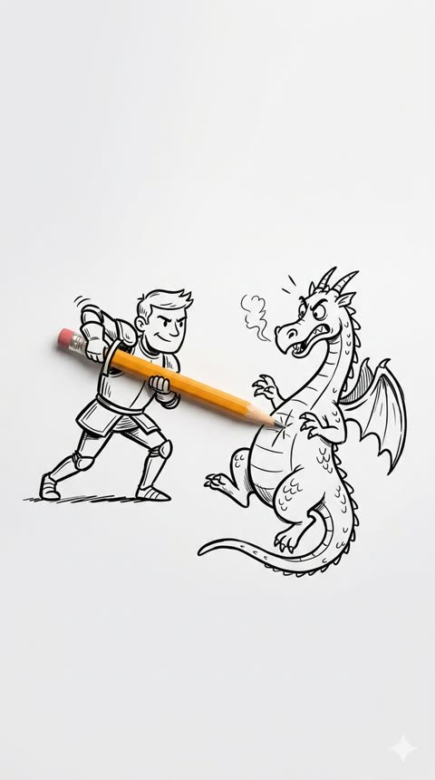</a>

A clean white studio frame in 9:16 keeps the composite tidy, and the placeholder slots turn one visual pun into a reusable structure. Asking for a quick paper sketch with minimal shading helps the drawn figures blend with the real object.

Nano Banana 2 · Text-to-image · Source: [@ShamsAmin56 on X](https://x.com/ShamsAmin56/status/2061872273041276940) · 330 likes on 2026-10-29

[`composite`](tags.md#tag-composite) [`pencil`](tags.md#tag-pencil) [`doodle`](tags.md#tag-doodle) [`fantasy`](tags.md#tag-fantasy)

<details><summary><b>Prompt</b></summary>

```text
Creative composite photograph, 9:16 vertical aspect ratio, clean minimalist white background, studio lighting, high detail, sharp focus.

A real-life [EVERYDAY OBJECT] is physically placed and perfectly integrated as a key part of a hand-drawn black ink cartoon illustration. The drawing is simple, expressive line art with minimal shading, like a quick sketch on paper.

The [OBJECT] represents [CLEVER PART OF THE SCENE - e.g. hair, weapon, body part, clothing, etc.], cleverly completing the visual pun or concept. The cartoon character interacts dynamically with the object in a humorous, meaningful, or surprising way.

Photorealistic object + bold black line drawing style, perfect seamless blend between real object and illustration, clean negative space, artistic and witty concept, high quality product photography mixed with doodle art.

• How to edit super easy

Just replace the placeholders:

[EVERYDAY OBJECT] → what real thing you'll use (tomato,
onion, chips, etc.)

[CLEVER PART OF THE SCENE] → what the object becomes in the drawing
Then customize the character and concept
```

</details>

<a id="gpt-image-self-portrait-japanese-ink-doodle"></a>
### Japanese Ink Doodle Self Portrait Illustration

<a href="https://x.com/ChillaiKalan__/status/2051659905157992535"></a>

Asking the model to imagine me turns a personal portrait into a reusable template. Style layers (splashed ink, loose lines, pastel plus ink tones, comic sketch texture) and a white background with scattered symbolic elements keep the composition clean and atmospheric.

GPT Image 2 · Text-to-image · Source: [@ChillaiKalan__ on X](https://x.com/ChillaiKalan__/status/2051659905157992535) · 322 likes on 2026-10-28

[`japanese-style`](tags.md#tag-japanese-style) [`ink-doodle`](tags.md#tag-ink-doodle) [`half-body`](tags.md#tag-half-body) [`pastel-ink`](tags.md#tag-pastel-ink) [`self-portrait`](tags.md#tag-self-portrait)

<details><summary><b>Prompt</b></summary>

```text
Generate an illustration of what you imagine “me” to look like: in a Japanese-style illustration, with distinctive character traits, a natural and expressive emotional look, and a half-body composition. The pose should be dynamic, with finely detailed clothing. Use a hand-drawn doodle style with splashed ink brushstrokes, loose and spontaneous lines, and a mix of pastel colors and ink tones. Aim for a comic sketch texture, set against a simple white background, with symbolic elements scattered around to enhance the atmosphere. The overall feel should be strong in mood, highly detailed, and high quality.
```

</details>

<a id="gpt-image-anime-bob-portrait-sketch-collage"></a>
### Anime Fashion Portrait with Sketch Collage Backdrop

<a href="https://x.com/john_my07/status/2062204692072198580">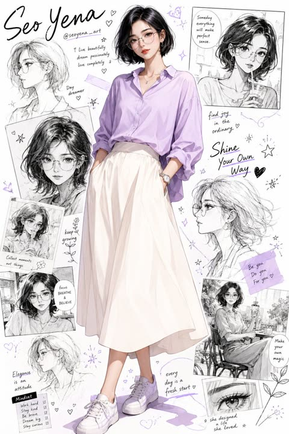</a>

The prompt fixes the subject first with hair, glasses, outfit and full-body pose, then describes the backdrop as a scatter of monochrome sketches, manga panels and handwritten notes. Naming the ink and pencil texture, cel shading and a bright white ground keeps the colored figure separate from the grey collage.

GPT Image 2 · Text-to-image · Source: [@john_my07 on X](https://x.com/john_my07/status/2062204692072198580) · 316 likes on 2026-10-29

[`anime`](tags.md#tag-anime) [`fashion-illustration`](tags.md#tag-fashion-illustration) [`sketch-collage`](tags.md#tag-sketch-collage) [`full-body`](tags.md#tag-full-body) [`magazine-cover`](tags.md#tag-magazine-cover)

<details><summary><b>Prompt</b></summary>

```text
Semi-realistic anime-inspired portrait of a stylish young Korean woman with a short glossy black bob tucked behind one ear, delicate round-frame glasses, and a gentle confident expression. She wears an oversized pastel lilac blouse with rolled sleeves paired with a flowing ivory A-line midi skirt. Full-body composition, standing casually with relaxed posture. Behind her is an artistic collage of hand-drawn monochrome character studies, loose pencil sketches, manga panels, playful doodles, stars, hearts, swirls, and handwritten notes scattered organically across the backdrop. Contemporary anime fashion illustration with mixed ink-and-pencil textures, clean linework, subtle cel shading, bright white background, magazine-cover aesthetic, highly detailed, ultra-sharp, vibrant yet elegant, 8K masterpiece.
```

</details>

<a id="gpt-image-japanese-folk-art-cafe-boy-patchwork-jacket"></a>
### Japanese folk art boy in patchwork jacket

<a href="https://x.com/AIwithWania/status/2053810777786835445">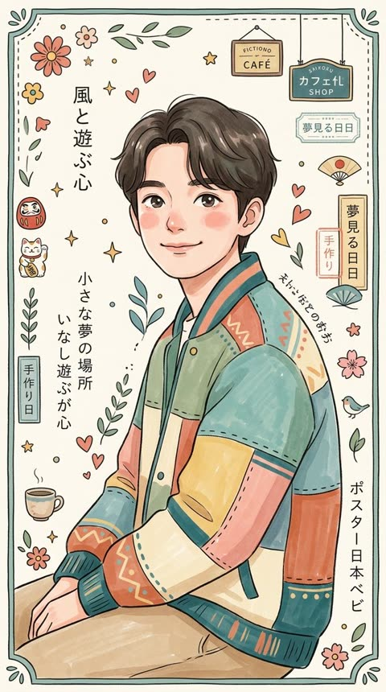</a>

A bracketed template swaps character, scene, outfit color and pose from option lists. Separate blocks for background props, palette, art style and a negative prompt keep the handmade gouache look consistent.

GPT Image 2 · Text-to-image · Source: [@AIwithWania on X](https://x.com/AIwithWania/status/2053810777786835445) · 292 likes on 2026-10-28

[`folk-art`](tags.md#tag-folk-art) [`japanese`](tags.md#tag-japanese) [`storybook`](tags.md#tag-storybook) [`cafe`](tags.md#tag-cafe) [`template`](tags.md#tag-template)

<details><summary><b>Prompt</b></summary>

```text
Create a cozy Japanese-inspired whimsical folk-art illustration of a cute stylish [girl/boy/couple] in a dreamy handmade storybook aesthetic. The character should look youthful, soft-featured, adorable, and aesthetically fashionable with gentle glossy eyes, rosy cheeks, and elegant proportions. Keep the overall vibe warm, calming, artistic, and premium like a trendy Japanese café poster mixed with modern Pinterest folk-art.
Scene theme: [Japanese café / cozy street / bookstore / tea shop / flower market / convenience store / rainy Tokyo alley / picnic / classroom / bicycle street]
Character details:
[Girl/Boy/Couple]
Outfit color: [sage green / muted coral / dusty blue / cream / terracotta / pastel yellow]
Hairstyle: [soft bangs / wavy hair / short fluffy hair / tied bun / long silky hair]
Expression: [gentle smile / shy look / cozy happy vibe / soft eye contact]
Pose: [walking / holding coffee / sitting / looking at camera / talking together]
Background elements:
Japanese lanterns
Cute café boards
Japanese handwritten typography
Small Japanese posters and stickers
Tiny flowers and leaves
Decorative hearts and stars
Bicycle / vending machine / tea cups / books / plants
Soft doodle borders around the composition
Add aesthetic Japanese text naturally in the background: [Japanese café signs] [Japanese handwritten quotes] [vertical Japanese typography] [small Japanese labels and stamps]

Color palette: [(sage green), (muted coral), (butter yellow), (warm cream), (dusty turquoise), (soft peach), (deep teal accents)]

Art style:
Hand-painted marker texture
Gouache-style brush strokes
Soft uneven outlines
Visible paper grain
Handmade imperfect beauty
Simplified flat illustration shapes
Cozy Japanese stationery aesthetic
Premium editorial composition
Balanced clean layout with negative space
Rendering style: ultra detailed handcrafted illustration, Japanese folk-art fusion, whimsical doodle aesthetic, cozy lifestyle artwork, painterly flat design, trendy viral Pinterest illustration style, premium storybook poster, cute Japanese café vibe

Negative prompt: avoid exact copy of Pinterest styles, avoid messy composition, avoid neon oversaturated colors, avoid anime exaggeration, avoid cluttered background, avoid generic AI look, avoid repetitive flowers everywhere, avoid low detail faces.
```

</details>

<a id="nano-banana-black-ink-silhouette-yellow-profile"></a>
### Black ink silhouette profile on yellow

<a href="https://x.com/iamsofiaijaz/status/2031047318502568186">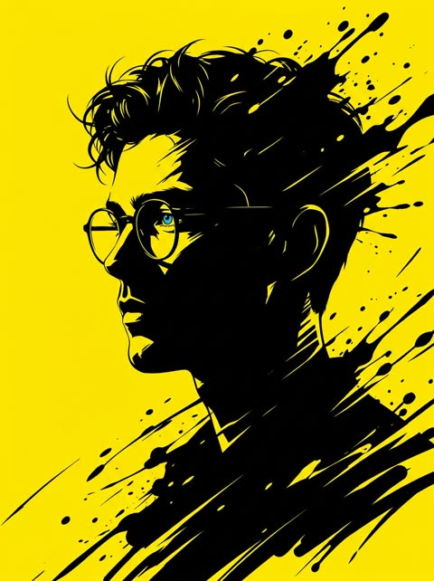</a>

A two color palette of black and bright yellow is stated outright, with a silhouette style and a fixed facing direction to keep the composition clean. Ink splashes are set to burst from the head and shoulders, which adds motion without breaking the profile shape.

Nano Banana 2 · Text-to-image · Source: [@iamsofiaijaz on X](https://x.com/iamsofiaijaz/status/2031047318502568186) · 260 likes on 2026-10-28

[`silhouette`](tags.md#tag-silhouette) [`ink-splash`](tags.md#tag-ink-splash) [`black-and-yellow`](tags.md#tag-black-and-yellow) [`profile`](tags.md#tag-profile) [`graphic-novel`](tags.md#tag-graphic-novel)

<details><summary><b>Prompt</b></summary>

```text
Side profile portrait of a young man with short messy hair and round glasses, minimalist black silhouette style, facing left, dramatic lighting, bright yellow background, dynamic black ink splashes and paint streaks exploding from the head and shoulders, abstract motion effect, modern digital illustration, high contrast black and yellow color palette, cinematic composition, sharp details, graphic novel style, paint splatter art, ultra clean background, 4k.
```

</details>

<a id="gpt-image-giant-woman-floating-island-fantasy-world"></a>
### Giant Woman Above Floating Island Fantasy World

<a href="https://x.com/noorlewisx/status/2063197214420410568">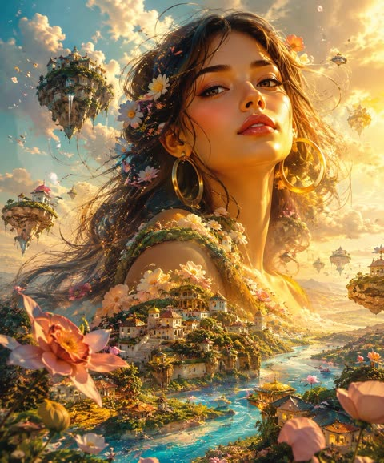</a>

The prompt sets one oversized subject against a miniature landscape, so the scale contrast carries the image. Warm golden-hour volumetric light and a short list of concrete scene elements (islands, villages, rivers, petals) keep the surreal composition coherent.

GPT Image 2 · Text-to-image · Source: [@noorlewisx on X](https://x.com/noorlewisx/status/2063197214420410568) · 212 likes on 2026-10-29

[`giant-scale`](tags.md#tag-giant-scale) [`miniature-world`](tags.md#tag-miniature-world) [`fantasy`](tags.md#tag-fantasy) [`golden-hour`](tags.md#tag-golden-hour) [`surreal`](tags.md#tag-surreal)

<details><summary><b>Prompt</b></summary>

```text
A giant ethereal woman with glowing skin, glossy lips, dark eyes, and large gold hoop earrings rises above a magical miniature world. Flowing hair, calm expression, floating islands, tiny villages, winding rivers, blooming flowers, and golden-hour sunlight. Warm volumetric light, floating petals, dreamy atmosphere, whimsical surrealism, semi-realistic stylized illustration, ultra-detailed painterly rendering, cinematic composition, vibrant colors, fantasy masterpiece, highly polished, 8K.
```

</details>

<a id="gpt-image-oil-painted-european-cafe-woman-coral-blouse"></a>
### Oil painted woman at European café table

<a href="https://x.com/hey_am_cherry/status/2106245541508382774">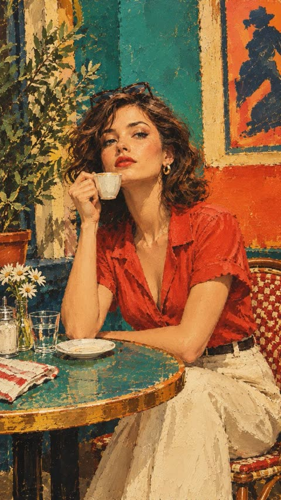</a>

A structured JSON prompt splits subject, outfit, composition, background, palette, texture and lighting into separate fields, so each element stays controllable. A named four color palette and thick brushstroke texture keep the oil painting look, and the negative prompt blocks copying the reference pose and photorealism.

GPT Image 2.5 · Edit · Source: [@hey_am_cherry on X](https://x.com/hey_am_cherry/status/2106245541508382774) · 197 likes on 2026-10-28

[`oil-painting`](tags.md#tag-oil-painting) [`cafe`](tags.md#tag-cafe) [`json-prompt`](tags.md#tag-json-prompt) [`mid-century`](tags.md#tag-mid-century) [`variation`](tags.md#tag-variation)

<details><summary><b>Prompt</b></summary>

```text
"aspect_ratio": "9:16",
    "style": "vintage European café oil painting, expressive brushwork, mid-century editorial artwork",

    "subject": {
      "character": "stylish young European woman with shoulder-length wavy auburn hair",
      "expression": "calm, confident, slightly playful gaze toward the viewer",
      "pose": "seated sideways at a small café table, one arm resting on the chair back while the other lightly holds a coffee cup",
      "details": "subtle makeup, berry-red lipstick, small gold earrings"
    },

    "outfit": {
      "top": "deep coral-red short-sleeve blouse with a relaxed neckline",
      "style": "chic 1960s-inspired European fashion"
    },

    "composition": {
      "framing": "medium-wide portrait",
      "camera_angle": "slightly elevated three-quarter angle",
      "subject_position": "slightly left of center",
      "foreground": "round café table with coffee, small glass and scattered objects"
    },

    "background": {
      "setting": "charming old European café interior",
      "design": "large abstract geometric wall shapes mixed with subtle architectural details",
      "colors": ["teal", "coral", "cream", "burnt orange"]
    },

    "props": [
      "ceramic espresso cup",
      "small glass bottle",
      "vintage café chair",
      "folded napkin"
    ],

    "color_palette": "teal, coral red, cream, burnt orange and warm brown",

    "texture": "thick imperfect oil brushstrokes, visible canvas grain, slightly weathered painted surface",

    "lighting": "warm afternoon window light with soft natural shadows",

    "mood": "stylish, relaxed, nostalgic European café atmosphere",

    "negative_prompt": "exact recreation of reference, same pose, same character, same outfit, same composition, photorealistic, 3D render, CGI, text, logo, watermark"
  }
}
```

</details>

<a id="gpt-image-golden-moonlit-pagoda-lotus-river"></a>
### Golden Pagoda and Lotus River Under Moon

<a href="https://x.com/churvikv/status/2101030587478007880"></a>

The prompt is split into labeled sections (environment, lighting, materials, composition, mood) with explicit avoid lists. A strict gold on black palette and a vertical 4:5 frame keep the poster look consistent.

GPT Image 2.5 · Text-to-image · Source: [@churvikv on X](https://x.com/churvikv/status/2101030587478007880) · 196 likes on 2026-10-28

[`night-landscape`](tags.md#tag-night-landscape) [`pagoda`](tags.md#tag-pagoda) [`gold-on-black`](tags.md#tag-gold-on-black) [`lotus`](tags.md#tag-lotus) [`poster`](tags.md#tag-poster)

<details><summary><b>Prompt</b></summary>

```text
A highly detailed stylized nightscape illustration in a luxury editorial poster aesthetic, rendered with crisp linework and glowing contrast against a deep black background. The scene centers on a luminous golden moon rising behind layered mountain silhouettes, with a refined Japanese pagoda beside a reflective stream, all bathed in warm amber, cream, and muted blue-gray tones.
Environment:
• A serene landscape with a large full moon dominating the upper center background
• Dark, layered mountain ranges stretching across the horizon, with elegant contour lines and subtle highlights
• A multi-tier pagoda positioned right of center, perched on rocky ground beside the water, with curved rooflines and softly glowing windows
• A winding reflective stream running from the midground toward the foreground center, creating a bright path of moonlit reflection
• Lotus flowers and tall grasses framing both sides of the foreground, especially clustered at lower left and lower right
• Stylized cloud bands passing horizontally across the moon, with small stars and a few tiny bird silhouettes in the sky
• Additional small architectural detail faintly visible in the midground left near the water
• Avoid modern elements, clutter, heavy realism, or dense texture noise
Lighting:
• Strong moon backlight from the large central moon, creating a radiant halo and soft atmospheric glow
• Warm internal glow within the pagoda, contrasting with the cool darkness of the mountains and sky
• Gentle highlights along roof edges, flower petals, rocks, and water ripples
• Reflections in the stream should be luminous and controlled, not mirror-sharp
• No harsh shadows, no blown-out moon detail, no flat unlit foreground
Materials:
• Smooth ink-like black negative space with metallic gold and ivory highlights
• Pagoda surfaces with polished wood-like warmth and fine architectural edging
• Water rendered with silky reflective lines and soft layered shimmer
• Flowers with delicate satin-like petals and softly glowing centers
• Rocky terrain in matte charcoal with clean stylized edge lighting
Composition:
• Vertical poster composition, centered around the moon and water reflection axis
• Pagoda occupying the right midground as the hero structure, balanced by floral masses on both sides
• Mountains layered behind the pagoda to create depth without overwhelming the moon
• Strong use of negative space around the upper sky and outer edges for dramatic contrast
• Hero elements fill most of the frame with a symmetrical visual rhythm, though not perfectly mirrored
Mood:
Quiet, majestic, dreamlike, and elegant with a tranquil nocturnal fantasy atmosphere
Ultra-detailed digital illustration, sharp ornamental linework, high contrast, vertical 4:5 composition, glowing gold-on-black palette, polished cinematic finish.

🏞 Prompt 3:
A serene Japanese landscape bathed in the warm glow of a large, luminous full moon. A multi-tiered pagoda, adorned with intricate golden details and traditional roofing, stands majestically on a rocky outcrop. It is surrounded by lush, golden-hued foliage and large, delicate lotus flowers in shades of cream and soft orange. A tranquil river, reflecting the moonlight and surrounding scenery, gently flows through the foreground. Jagged, dark mountains form the backdrop, silhouetted against the vibrant sky. The atmosphere is mystical and peaceful, with a hint of ancient grandeur. The color palette is dominated by deep blacks, contrasting with bright yellows, golds, and soft oranges, creating a striking visual. The composition is framed by darkness, emphasizing the illuminated central elements, with a low-angle perspective drawing the viewer into the scene. The style is reminiscent of traditional Japanese ink paintings with a touch of fantasy illustration, featuring smooth textures and dramatic lighting.
```

</details>

<a id="nano-banana-paper-cut-fashion"></a>
### Pastel editorial fashion illustration with polka dot outfit

<a href="https://x.com/ChillaiKalan__/status/2109534297367724221"></a>

A named pastel palette, contrasting patterns and a listed set of accessories steer the outfit, while the ivory background with soft shadows keeps it looking like a clean fashion campaign. Asking for natural proportions and a full-body pose keeps the anatomy believable.

Nano Banana 2.1 · Text-to-image · Source: [@ChillaiKalan__ on X](https://x.com/ChillaiKalan__/status/2109534297367724221) · 188 likes on 2026-10-27

[`fashion`](tags.md#tag-fashion) [`paper-cut`](tags.md#tag-paper-cut) [`3d`](tags.md#tag-3d)

<details><summary><b>Prompt</b></summary>

```text
Create a high-end editorial fashion illustration of a stylish woman wearing a bold, contemporary designer outfit. Use a polished 3D paper-cut illustration aesthetic with smooth surfaces, layered shapes, subtle paper-like textures, and clean, elegant edges. Feature vibrant color combinations such as pastel pink, sky blue, mint green, sunshine yellow, and emerald green, paired with contrasting patterns like polka dots or vertical stripes. Add fashionable accessories, including statement sunglasses, earrings, a structured handbag, and modern shoes. Give the character a confident, expressive pose with natural body proportions and a stylish attitude. Use a minimalist warm ivory background with soft studio lighting, gentle shadows beneath the feet, and a refined luxury fashion-campaign composition. Full-body character, beautifully detailed clothing folds, crisp silhouettes, sophisticated color blocking, playful yet elegant styling, premium fashion magazine aesthetic, clean negative space, high-resolution digital illustration. No text, no logos, no watermark.
```

</details>

<a id="nano-banana-pastel-ice-mountain-pagoda-sakura"></a>
### Pastel Pagoda on Glowing Ice Mountains

<a href="https://x.com/churvikv/status/2064113423135478120">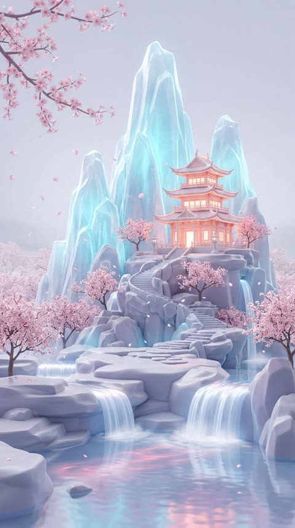</a>

Fixes the framing first: vertical, low front angle, temple just right of center, blossom branch from the upper left. It then pins a 35mm deep focus lens, a restricted pastel palette and cool cyan against warm pink light, with explicit bans on grain and hard shadows.

Nano Banana 2 · Text-to-image · Source: [@churvikv on X](https://x.com/churvikv/status/2064113423135478120) · 181 likes on 2026-10-29

[`fantasy`](tags.md#tag-fantasy) [`landscape`](tags.md#tag-landscape) [`3d-render`](tags.md#tag-3d-render) [`pastel`](tags.md#tag-pastel) [`cherry-blossom`](tags.md#tag-cherry-blossom)

<details><summary><b>Prompt</b></summary>

```text
A dreamy pastel fantasy landscape in a vertical composition, showing a glowing East Asian pagoda-style temple perched halfway up a cluster of towering crystalline ice mountains, surrounded by delicate pink cherry blossom trees and drifting petals. The scene is framed as a wide environmental shot from a slightly low, front-facing angle with a centered composition, the temple placed just right of center, a branch of blossoms entering from the upper left, and a layered foreground of smooth rock forms, luminous cascading waterfalls, and a reflective pool with soft pink light traces; the perspective feels like a 35mm lens with deep focus and gentle atmospheric depth rather than strong blur. Render it as a highly polished 3D fantasy illustration with ultra-smooth surfaces, sculpted matte rocks, translucent icy peaks, and subtle volumetric haze, combining ethereal neon glow with a clean, almost porcelain-like finish. Lighting is soft and diffuse like overcast twilight, with cool cyan-blue emission radiating from the mountains and waterfalls, contrasted by warm pastel pink and peach illumination from the temple windows and accents, creating a serene bioluminescent look with soft bloom and faint edge glow. The color palette is dominated by pale icy blue, lavender-gray, blush pink, and pearly white, with low contrast, high softness, and a calm magical mood; the background is minimal and misty with no visible horizon, making the mountain formation feel isolated in a tranquil dream world. Include fine details such as tiered temple architecture with glowing outlines, stylized stairways and stone base, multiple sakura trees rooted in the rocky terraces, silky water motion, tiny floating petals, and subtle reflections in the water. The final image should feel immaculate and cinematic, with no visible grain, no hard shadows, very light bloom, soft post-processing, and a luminous pastel fantasy aesthetic reminiscent of premium concept art or high-end CGI environment design.
```

</details>

<a id="gpt-image-paper-craft-destination-diorama-postcard"></a>
### Paper Craft Destination Diorama Postcard

<a href="https://x.com/Just_sharon7/status/2086125703427436788">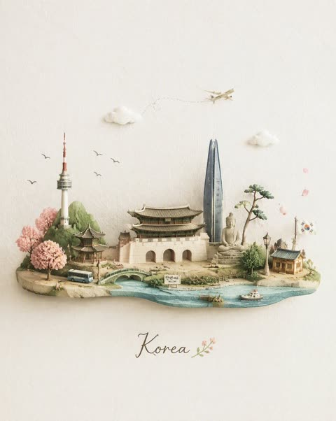</a>

A JSON prompt with a single [DESTINATION] placeholder, where separate fields for landmarks, materials, texture, lighting, palette and composition steer the miniature look. Naming craft materials and a generous negative space frame keeps the result a clean, premium postcard.

GPT Image 2 · Text-to-image · Source: [@Just_sharon7 on X](https://x.com/Just_sharon7/status/2086125703427436788) · 175 likes on 2026-10-28

[`paper-craft`](tags.md#tag-paper-craft) [`diorama`](tags.md#tag-diorama) [`travel-postcard`](tags.md#tag-travel-postcard) [`json-prompt`](tags.md#tag-json-prompt) [`template`](tags.md#tag-template)

<details><summary><b>Prompt</b></summary>

```text
"concept": "A charming miniature 3D travel diorama inspired by [DESTINATION], designed as an elegant handmade postcard.",
    "scene": "Create a narrow floating landscape strip featuring tiny handcrafted versions of the destination's most recognizable landmarks, architecture, and cultural details. Arrange the elements naturally as a compact miniature world.",
    "landmarks": {
      "description": "Include iconic local landmarks recreated as miniature paper-craft models using layered paper, clay, painted wood, cardboard, and other handcrafted materials.",
      "details": "Add tiny local transportation, miniature trees, streetlights, pathways, water features, birds, fluffy clouds, and other subtle environmental elements that help identify [DESTINATION]."
    },
    "travel_elements": {
      "airplane": "Place a tiny handcrafted airplane above the scene with a delicate dotted flight trail.",
      "atmosphere": "Include subtle postcard-inspired travel details while keeping the overall composition uncluttered."
    },
    "materials": "Paper, folded cardstock, handmade clay, lightweight wood, cardboard, miniature craft materials, and tactile handmade surfaces.",
    "texture": "Show realistic miniature textures, visible paper fibers, gentle folds, tiny imperfections, handcrafted edges, subtle paint variations, and authentic artisanal details.",
    "background": "Soft white textured paper background with a clean studio-like appearance and generous negative space surrounding the miniature landscape.",
    "lighting": "Gentle natural diffused lighting with soft highlights, delicate ambient shadows, and subtle depth that emphasizes the handcrafted miniature forms.",
    "color_palette": "Soft pastel colors with warm, muted, harmonious tones and a light whimsical travel-postcard feel.",
    "composition": {
      "layout": "Minimal, centered, airy composition.",
      "orientation": "Vertical 9:16.",
      "negative_space": "Leave generous clean space around the miniature scene to create an elegant premium postcard aesthetic."
    },
    "typography": {
      "text": "[DESTINATION]",
      "placement": "Centered near the bottom of the image.",
      "style": "Small, elegant handwritten lettering that feels delicate and refined."
    },
    "visual_style": [
      "miniature diorama",
      "handcrafted paper sculpture",
      "3D paper art",
      "travel postcard illustration",
      "whimsical miniature world",
      "soft pastel aesthetic",
      "macro photography look",
      "tactile handmade textures",
      "delicate craftsmanship",
      "cozy artistic atmosphere",
      "high-resolution detail"
    ],
    "final_result": "A polished yet charming miniature travel postcard that feels physically handcrafted, photographed like a tiny real-world diorama, with a magical, cozy, premium artistic quality."
  }
}
```

</details>

<a id="nano-banana-glowing-purple-tree-turquoise-waterfall-cliff"></a>
### Purple glowing tree beside turquoise waterfall at sunset

<a href="https://x.com/churvikv/status/2090858753583169966">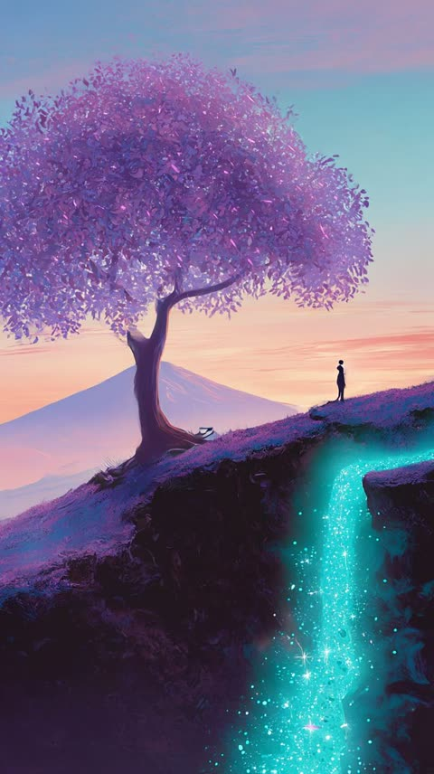</a>

The prompt names a single focal tree, a lone small figure for scale, and one luminous accent stream. A restrained pastel palette keeps the scene cohesive. Setting the mood with words like serene and mystical gives the soft gradients.

Nano Banana 2 · Text-to-image · Source: [@churvikv on X](https://x.com/churvikv/status/2090858753583169966) · 173 likes on 2026-10-29

[`landscape`](tags.md#tag-landscape) [`fantasy`](tags.md#tag-fantasy) [`pastel`](tags.md#tag-pastel) [`sunset`](tags.md#tag-sunset) [`vertical`](tags.md#tag-vertical)

<details><summary><b>Prompt</b></summary>

```text
A surreal landscape featuring a lone figure standing beneath a large tree with glowing purple leaves on a cliff edge, overlooking a distant mountain at sunset. A stream of luminous turquoise water flows down the cliff, emitting magical sparkles. The scene is bathed in soft pastel colors, creating a tranquil and mystical atmosphere.
```

</details>

<a id="nano-banana-mixed-media-urban-painting-man-dog"></a>
### Mixed media urban painting of man and dog

<a href="https://x.com/kingofdairyque/status/2069642160668827684">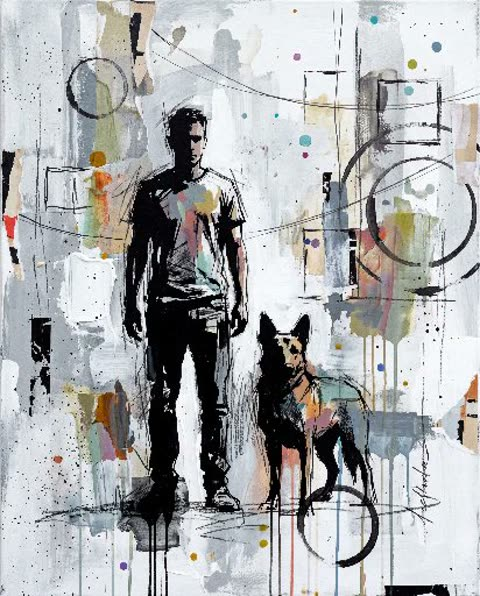</a>

A fill in the blank template fixes the human, clothing, pose, animal and scenery slots, then stacks material cues such as ink silhouettes, charcoal marks, scraped acrylic and paint drips over a cold grey base. A minimal background with stains and floating dots keeps the gallery wall look.

Nano Banana 2 · Text-to-image · Source: [@kingofdairyque on X](https://x.com/kingofdairyque/status/2069642160668827684) · 159 likes on 2026-10-29

[`mixed-media`](tags.md#tag-mixed-media) [`template`](tags.md#tag-template) [`painting`](tags.md#tag-painting) [`urban`](tags.md#tag-urban) [`negative-space`](tags.md#tag-negative-space)

<details><summary><b>Prompt</b></summary>

```text
Contemporary mixed-media urban painting of [HUMAN], wearing [CLOTHING], [POSE] beside [ANIMAL] in [SCENERY]. Use [COLORS] over a cold grey and white base, with harsh black ink silhouettes, loose charcoal sketch marks, scraped acrylic blocks, translucent color washes, circular graphic shapes, vertical paint drips, splatter noise, unfinished collage edges, high-contrast negative space, semi-abstract anatomy, expressive brush texture, and a raw gallery-wall composition. The background is [BACKGROUND], minimal but layered with stains, smears, thin wires, broken rectangles and floating color dots. Vertical 4:5.
```

</details>

<a id="gpt-image-mediterranean-harbor-rowboats-impasto"></a>
### Sunlit Mediterranean harbor with moored rowboats

<a href="https://x.com/churvikv/status/2086029084472009068">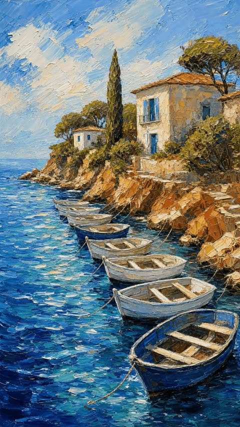</a>

Naming a strong diagonal and describing each boat's colour and angle gives the model a clear layout to follow. Setting cool sea tones against warm ochre land, with thick impasto ridges, produces the painted texture.

GPT Image 2 · Text-to-image · Source: [@churvikv on X](https://x.com/churvikv/status/2086029084472009068) · 158 likes on 2026-10-29

[`impasto`](tags.md#tag-impasto) [`oil-painting`](tags.md#tag-oil-painting) [`seascape`](tags.md#tag-seascape) [`mediterranean`](tags.md#tag-mediterranean)

<details><summary><b>Prompt</b></summary>

```text
An exquisite impressionistic oil painting of a Mediterranean coastal harbor scene, rendered in a heavy impasto technique with thick, visible palette-knife brushstrokes creating a tactile, three-dimensional surface. The composition uses a strong diagonal: a rocky shoreline and a line of small moored wooden rowboats lead the eye from the upper right down toward the lower left.

The foreground and left half of the canvas are dominated by the sea, painted in horizontal choppy strokes of deep navy, cerulean, turquoise, and pale blue, suggesting gentle movement and reflected light sparkling across the water surface. The brushwork on the water is loose and directional, with each wavelet a separate confident stroke.

A line of five or six small wooden rowboats is moored diagonally from the shore into the water, angled toward the viewer. The boats are painted in varying shades of white, cream, and dark navy-blue, showing their curved hulls and interior bench seats. The brushwork on the boats is loose, capturing the play of light and shadow on their rounded forms.

To the right and center rises a rocky, elevated coastline painted in warm earthy tones — ochre, burnt orange, terracotta, and warm brown — contrasting strongly with the cool blues of the water. Several trees with rounded bushy canopies are scattered along the cliffside in shades of olive and forest green. A tall, slender cypress-like tree stands prominently near the center of the shoreline.

Two Mediterranean-style buildings sit on the shore: a smaller white structure nestled among the trees on the left, and a larger, more prominent building on the right with a terracotta-tiled roof and light-colored sunlit walls.

The upper portion features a bright, airy sky composed of broad sweeping strokes of pale blue, white, and hints of soft warm yellow, suggesting a clear sunny Mediterranean day with light wispy clouds. The lighting is bright and consistent, with warm sunlight bathing the shoreline and buildings while the water reflects the cool sky.

The color palette pairs cool blues and turquoise of the sea against warm ochre, terracotta, and olive of the land. Blending impressionism with realism, the mood is peaceful, sunlit, and atmospheric. The background sky is a soft blurred wash of light. Heavy impasto, thick paint ridges catching natural light, no text.

text, watermark, logo, signature, photograph, 3d render, anime, cartoon, chibi, flat illustration, smooth blending, photorealistic, watercolor wash, neon, fluorescent, night scene, sunset, storm, large modern ship, yacht, sailboat with sails up, people, faces, cars, city skyline, snow, forest interior, mountains, river, lake, dark moody, black sky, single boat only
```

</details>

<a id="gpt-image-lighthouse-halftone-screen-print-night"></a>
### Colorful lighthouse in 1970s halftone screen print

<a href="https://x.com/hakmgpt/status/2107535382183387282">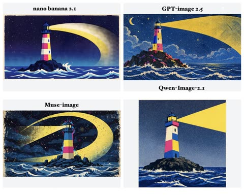</a>

Names the print process outright with halftone dots, paper texture and imperfect ink registration. It also caps the palette at retro CMYK and describes the beam as one huge curved arc, which gives a strong focal shape.

GPT Image 2.5 · Text-to-image · Source: [@hakmgpt on X](https://x.com/hakmgpt/status/2107535382183387282) · 148 likes on 2026-10-28

[`screen-print`](tags.md#tag-screen-print) [`halftone`](tags.md#tag-halftone) [`lighthouse`](tags.md#tag-lighthouse) [`retro`](tags.md#tag-retro) [`model-comparison`](tags.md#tag-model-comparison)

<details><summary><b>Prompt</b></summary>

```text
image models comparssion
Nano banana 2.1
GPT-image 2.5
Muse-image
Qwen-image 2.1

Prompt : A spectacular vintage screen-print illustration of a tall colorful lighthouse standing alone on a dark rocky island in a vast nighttime ocean. The lighthouse has geometric blocks of cream, hot pink, yellow and cobalt blue, with a dark blue roof. Its powerful yellow beam sweeps across the sky in a huge curved arc. Deep blue ocean with stylized white waves fills the bottom of the image. Dense halftone dots cover every surface, with rough paper texture and imperfect ink registration. Limited retro CMYK palette, flat graphic shapes, 1970s children's storybook screen-print aesthetic, mysterious and magical atmosphere, no text, 16:9.
```

</details>

<a id="nano-banana-picture-book-seed-watering-hand"></a>
### Hand Watering Seed in Open Picture Book

<a href="https://x.com/Just_sharon7/status/2038525426084323378">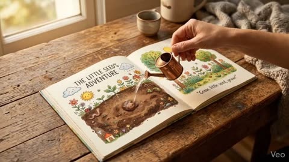</a>

Mixing a cartoon illustration with a realistic hand makes the image jump out of the page. Overhead close-up framing, warm golden light and a sparkling water stream carry the magical mood, and the JSON fields split style, lighting, mood and perspective into clear controls.

Nano Banana 2 · Text-to-image · Source: [@Just_sharon7 on X](https://x.com/Just_sharon7/status/2038525426084323378) · 148 likes on 2026-10-28

[`picture-book`](tags.md#tag-picture-book) [`mixed-media`](tags.md#tag-mixed-media) [`json-prompt`](tags.md#tag-json-prompt) [`golden-light`](tags.md#tag-golden-light) [`overhead`](tags.md#tag-overhead)

<details><summary><b>Prompt</b></summary>

```text
{
  "prompt": "An open children’s picture book rests on a wooden table, showing a whimsical illustration of a small brown seed in cartoon soil. A realistic human hand pours water from a tiny can, with a sparkling stream. Warm golden light, magical mood, overhead close-up, photorealistic, 4K.",
  "style": "photorealistic",
  "lighting": "warm golden",
  "mood": "magical",
  "perspective": "overhead close-up",
  "resolution": "4K",
  "elements": [
    {
      "type": "book",
      "description": "children’s picture book open on wooden table"
    },
    {
      "type": "illustration",
      "description": "whimsical small brown seed in cartoon soil"
    },
    {
      "type": "hand",
      "description": "realistic human hand pouring water from tiny can"
    },
    {
      "type": "water",
      "description": "sparkling stream"
    }
  ]
}
```

</details>

<a id="nano-banana-colossal-guardian-statue-fantasy-template"></a>
### Winged Marble Guardian Statue Above City Under Ringed Planet

<a href="https://x.com/yourPlugAI/status/2068350429243523152">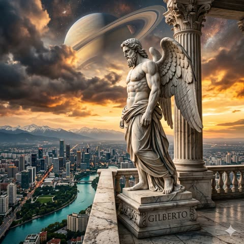</a>

A bracketed template splits subject, material, pedestal text, landscape and lighting into separate slots, so each part can be swapped without breaking the scene. Engraved base text, rim lighting and a layered backdrop of city, mountains and sky build depth and scale.

Nano Banana 2 · Text-to-image · Source: [@yourPlugAI on X](https://x.com/yourPlugAI/status/2068350429243523152) · 145 likes on 2026-10-28

[`template`](tags.md#tag-template) [`fantasy`](tags.md#tag-fantasy) [`statue`](tags.md#tag-statue) [`scale`](tags.md#tag-scale) [`cinematic`](tags.md#tag-cinematic)

<details><summary><b>Prompt</b></summary>

```text
A high-detail, cinematic fantasy photograph of a colossal [MYTHICAL FIGURE/DEITY/GUARDIAN] standing majestically in [EPIC LOCATION]. The gigantic statue is sculpted from [MATERIAL AND TEXTURE], featuring [PHYSICAL FEATURES, POSE, AND ACCESSORIES].

The monument stands upon an ornate [PEDESTAL TYPE] with the bold engraved text "[TEXT]" clearly visible on the base. The surrounding environment includes [LANDSCAPE ELEMENTS], leading toward [DISTANT BACKGROUND FEATURES].

The scene is illuminated by [LIGHTING CONDITIONS AND TIME OF DAY], creating dramatic shadows, atmospheric depth, rim lighting, and emphasizing the immense scale of both the sculpture and the environment.

Ultra-detailed textures, cinematic composition, epic sense of scale, volumetric atmosphere, fantasy realism, masterpiece photography, highly immersive worldbuilding. --ar 1:1
```

</details>

<a id="gpt-image-impasto-marsh-sunset-reeds-birds"></a>
### Impasto Oil Painting of Marsh at Sunset

<a href="https://x.com/churvikv/status/2075544977233342914">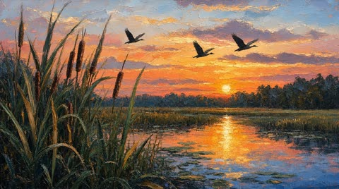</a>

The prompt fixes the layout by naming each zone: reeds in the left foreground, pond below, sun on the horizon, birds in the upper sky. It then pairs warm sunset and cool water colors with palette knife texture words such as visible brushstrokes and glossy paint ridges.

GPT Image 2 · Text-to-image · Source: [@churvikv on X](https://x.com/churvikv/status/2075544977233342914) · 144 likes on 2026-10-29

[`oil-painting`](tags.md#tag-oil-painting) [`impasto`](tags.md#tag-impasto) [`landscape`](tags.md#tag-landscape) [`sunset`](tags.md#tag-sunset) [`palette-knife`](tags.md#tag-palette-knife)

<details><summary><b>Prompt</b></summary>

```text
Impasto oil painting of a marsh at sunset, with tall reeds and cattails dominating the left foreground, a calm reflective pond in the lower half, a low glowing sun near the horizon, and three dark birds flying across the upper sky. Vertical composition with a scenic wide view, layered landscape depth, and strong foreground framing; the birds are silhouetted in mid-flight and the distant tree line forms a dark band across the middle ground. Warm golden-orange, peach, and pink sunset tones blend into pale blue-gray clouds, contrasted by deep green vegetation and cool blue water reflections; thick palette-knife texture, visible brushstrokes, and glossy paint ridges throughout create a vivid, expressive fine-art look.
```

</details>

<a id="nano-banana-cornflower-meadow-sailboat-path"></a>
### Cornflower meadow path to a misty sailboat

<a href="https://x.com/churvikv/status/2088517844535287875">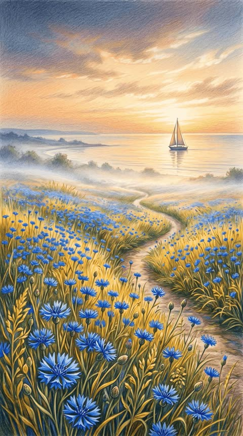</a>

Naming the flower by its botanical name and fixing a wide, slightly elevated viewpoint gives the scene a stable structure. Calling for visible colored pencil texture keeps the output looking drawn rather than painted.

Nano Banana 2 · Text-to-image · Source: [@churvikv on X](https://x.com/churvikv/status/2088517844535287875) · 144 likes on 2026-10-29

[`colored-pencil`](tags.md#tag-colored-pencil) [`landscape`](tags.md#tag-landscape) [`sailboat`](tags.md#tag-sailboat) [`sunset`](tags.md#tag-sunset)

<details><summary><b>Prompt</b></summary>

```text
A vibrant colored-pencil illustration in portrait orientation. A vast field of vivid blue cornflowers (Centaurea cyanus) blanketing the foreground, among tall golden-yellow grass, with stems and buds interspersed. A narrow winding dirt path meanders through the flowers toward the distance. A soft layer of morning mist and light haze drifts gently over the field and the far shore, softening the horizon. Beyond the field, a serene ocean stretches to the horizon, where a single sailboat drifts gently on the still water. The water reflects the warm glow of the sky. The sky fills the upper third and is colored from deep dusky blue at the top down to warm shades of orange, gold, and pale yellow near the low sun, with soft wispy backlit clouds. The perspective is wide and slightly elevated, showcasing the detailed cornflowers, the misty meadow, and the expansive calm seascape with the distant sailboat. The style is reminiscent of colored pencil art, with visible textures creating a soft, serene mood. The overall atmosphere is peaceful, dreamy, and nostalgic, with warm golden tones contrasting against the cool electric blue of the flowers.
```

</details>

<a id="nano-banana-colored-pencil-daisies-rain-sunbeams"></a>
### Colored Pencil Daisy Field in Sunlit Rain

<a href="https://x.com/churvikv/status/2092546640716419297">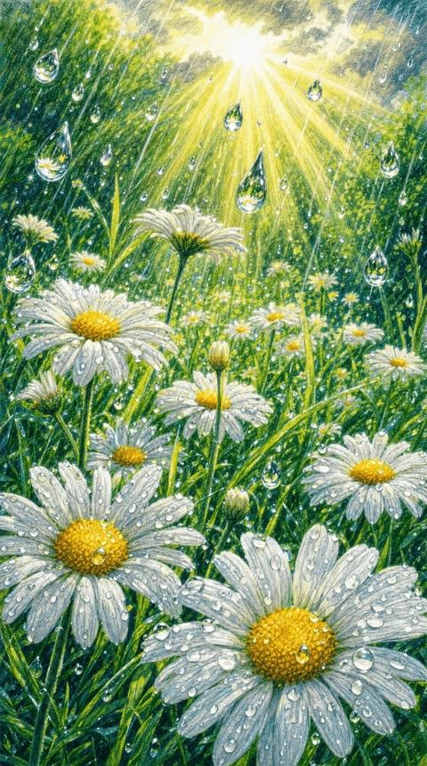</a>

The prompt fixes the medium and portrait format first, then layers foreground, midground and background with a limited palette of greens, white and yellow. Glass-like suspended droplets and golden god rays from a top-center light source add depth and atmosphere.

Nano Banana 2 · Text-to-image · Source: [@churvikv on X](https://x.com/churvikv/status/2092546640716419297) · 139 likes on 2026-10-28

[`colored-pencil`](tags.md#tag-colored-pencil) [`daisies`](tags.md#tag-daisies) [`rain`](tags.md#tag-rain) [`god-rays`](tags.md#tag-god-rays) [`nature`](tags.md#tag-nature)

<details><summary><b>Prompt</b></summary>

```text
A vibrant colored-pencil illustration in portrait orientation. A lush field of white daisies with bright sunny-yellow centers fills the foreground and mid-ground, with delicate white petals covered in glistening water droplets, some petals slightly drooping under the weight of the rain. Large, clear, teardrop-shaped water droplets hang suspended in the air throughout the scene, refracting the light like tiny lenses and adding a sense of motion and atmosphere. A soft summer rain falls in visible diagonal streaks of water. The background is a deep, vibrant green of grass and foliage. At the top center, a bright, glowing light source breaks through the soft clouds and casts luminous golden "god rays" that filter down through the rain, giving the entire scene a warm, golden-green glow. The palette is dominated by rich greens (from deep forest green to bright lime), crisp white, and sunny yellow, accented by cool, transparent reflective droplets. The composition is dense and immersive, with larger detailed daisies in the foreground and smaller, softer ones receding into the distance. The style is reminiscent of colored pencil art, with visible textures creating a soft, fresh, rejuvenating mood. The overall atmosphere is bright, refreshing, and slightly surreal, capturing a fleeting moment where sunlight and rain coexist.
```

</details>

<a id="nano-banana-gold-filigree-paper-quilling-fashion-bas-relief"></a>
### Gold filigree and paper relief fashion figure

<a href="https://x.com/yourPlugAI/status/2071918501204295712">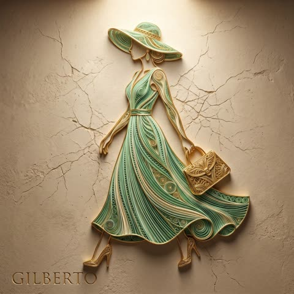</a>

A fill in the blank template lists material behaviors for gold filigree, glass, embroidery and papercraft, so one prompt can switch media. Camera angle, lighting style and a corner brand name are slots that keep the composition consistent.

Nano Banana 2 · Text-to-image · Source: [@yourPlugAI on X](https://x.com/yourPlugAI/status/2071918501204295712) · 127 likes on 2026-10-28

[`bas-relief`](tags.md#tag-bas-relief) [`fashion`](tags.md#tag-fashion) [`template`](tags.md#tag-template) [`gold-filigree`](tags.md#tag-gold-filigree) [`papercraft`](tags.md#tag-papercraft)

<details><summary><b>Prompt</b></summary>

```text
Create a premium 3D bas-relief fashion artwork featuring [MAIN SUBJECT] in a graceful [POSE/ACTION], viewed from [CAMERA ANGLE], designed with a luxurious [ART MEDIUM] aesthetic.

The figure wears [OUTFIT DESCRIPTION] with [ACCESSORIES], while carrying or interacting with [PROP]. The clothing must integrate naturally into the chosen artistic medium, emphasizing handcrafted precision and flowing organic forms.

Construct the artwork using authentic material behavior specific to [ART MEDIUM]:

• Gold Filigree: intricate metallic wirework, layered ornamental curves, polished reflective gold edges.
• Glass Relief: translucent resin surfaces, glossy raised contours, subtle internal reflections, liquid-glass depth.
• Embroidery: dense satin stitching, layered thread work, woven textile textures, dimensional floral needlework.
• Papercraft: precision-cut layered paper ribbons, folded geometric structures, matte handcrafted surfaces, crisp paper edges.

Surround the subject with [DECORATIVE ELEMENTS] that complement the material language while maintaining elegant visual balance.

Set the composition against [BACKGROUND MATERIAL] featuring [BACKGROUND DETAILS], designed to enhance depth without distracting from the subject.

Illuminate the scene using [LIGHTING STYLE], creating soft ambient shadows, strong dimensional separation, and cinematic highlights that emphasize the physical properties of the chosen material.

Apply a refined luxury editorial aesthetic with exceptional craftsmanship, flawless composition, museum-quality detailing, elegant negative space, octane render, hyper-realistic textures, cinematic depth, premium advertising quality, masterpiece, ultra-high detail, 1:1 aspect ratio.

Place the brand name "[BRAND NAME]" elegantly embossed, engraved, embroidered, or integrated into the lower-left corner according to the selected material.
```

</details>

<a id="nano-banana-fox-astronaut-abandoned-moon-city"></a>
### Tiny Fox Astronaut in Neon Moon City

<a href="https://x.com/Zarlish_Shahid/status/2077531900374405514">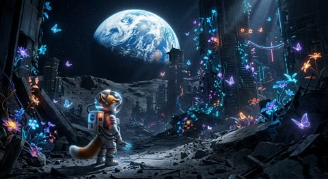</a>

A small glowing hero is set against a huge Earth and ruined skyscrapers, so scale contrast carries the story. Neon flowers and holographic butterflies add colored light against the dark lunar ground, and volumetric lighting ties the layers together.

Nano Banana 2 · Text-to-image · Source: [@Zarlish_Shahid on X](https://x.com/Zarlish_Shahid/status/2077531900374405514) · 116 likes on 2026-10-28

[`sci-fi`](tags.md#tag-sci-fi) [`astronaut`](tags.md#tag-astronaut) [`fox`](tags.md#tag-fox) [`moon`](tags.md#tag-moon) [`neon`](tags.md#tag-neon) [`cinematic`](tags.md#tag-cinematic)

<details><summary><b>Prompt</b></summary>

```text
A tiny glowing fox astronaut discovering an abandoned futuristic city on the Moon, massive Earth rising in the background, neon flowers growing through broken skyscrapers, floating holographic butterflies, cinematic atmosphere, volumetric lighting, ultra-detailed fur, reflective space suit, breathtaking composition, emotional storytelling, hyper-realistic, Unreal Engine 5, masterpiece, award-winning photography, 8K, HDR, trending on X, viral AI art, perfect lighting, insanely detailed, vibrant colors.
```

</details>

<a id="gpt-image-biomorphic-chef-skunk-mixed-media-painting"></a>
### Biomorphic Mixed-Media Painting of Chef and Skunk

<a href="https://x.com/SimplyAnnisa/status/2071228817297863162">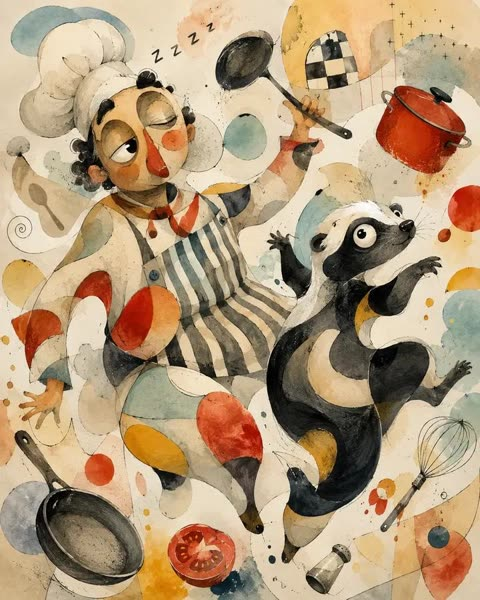</a>

A fill-in template with HUMAN, ANIMAL, SCENERY and PALETTE slots keeps the structure reusable. Stacked material cues like alcohol-ink blooms, graphite contours and hand-cut shape-cells give the painted texture, while shared eye direction and curling limbs tie the two figures together.

GPT Image 2 · Text-to-image · Source: [@SimplyAnnisa on X](https://x.com/SimplyAnnisa/status/2071228817297863162) · 115 likes on 2026-10-29

[`biomorphic`](tags.md#tag-biomorphic) [`mixed-media`](tags.md#tag-mixed-media) [`watercolor`](tags.md#tag-watercolor) [`template`](tags.md#tag-template) [`surrealism`](tags.md#tag-surrealism)

<details><summary><b>Prompt</b></summary>

```text
Abstract biomorphic mixed-media painting of [HUMAN] with [ANIMAL], caught in a dynamic off-balance pose inside [SCENERY]. Build the figures from irregular floating shape-cells, softly warped anatomy, oversized curious eyes, rounded mask-like faces, playful distorted proportions, and interlocking organic fragments that feel hand-cut and reassembled. Use [PALETTE] with translucent alcohol-ink blooms, watery pigment stains, dry watercolor edges, milky gradients, saturated accent shapes, soft paper texture, visible brush pooling, loose graphite contour marks, and bold imperfect outline moments. Keep the composition whimsical and unstable, with the human and animal visually connected by curling limbs, echoing shapes, shared eye direction, and rhythmic abstract movement. Background scenery should remain suggestive rather than literal, made from drifting color fields, bent geometric pieces, floating domestic symbols, and airy negative space. Painterly abstract portrait energy, playful emotional tension, softly organic surrealism, aspect ratio 4:5.
```

</details>

<a id="gpt-image-snowy-sunset-city-storybook-woman"></a>
### Storybook woman in snowy sunset city

<a href="https://x.com/hey_am_cherry/status/2109865084071588211">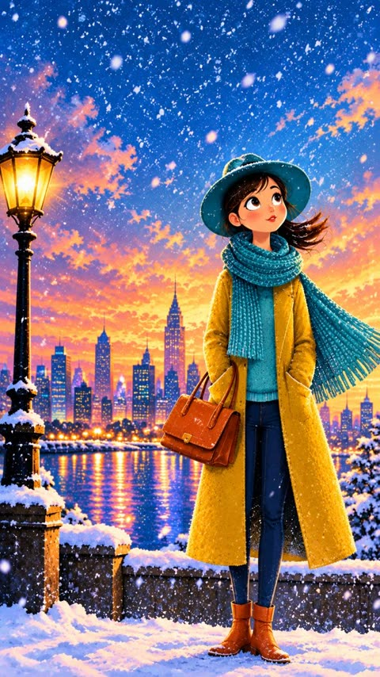</a>

The prompt lists each garment with its color, then sets a cobalt sky against orange clouds for strong teal and orange contrast. A JSON layout with a negative prompt, aspect ratio and character placement keeps the full body composed.

GPT Image 2.5 · Text-to-image · Source: [@hey_am_cherry on X](https://x.com/hey_am_cherry/status/2109865084071588211) · 110 likes on 2026-10-28

[`storybook`](tags.md#tag-storybook) [`winter`](tags.md#tag-winter) [`sunset`](tags.md#tag-sunset) [`cartoon-woman`](tags.md#tag-cartoon-woman) [`teal-orange`](tags.md#tag-teal-orange)

<details><summary><b>Prompt</b></summary>

```text
{
  "prompt": "A beautiful 2D storybook illustration of a cute young cartoon woman standing in a snowy city at sunset, full body visible. She has big expressive brown eyes, rosy cheeks, dark brown windblown bob hair, a teal wide-brim hat, a vibrant mustard-yellow long coat, chunky teal knitted scarf flowing in the wind, navy trousers, burnt-orange boots, and a caramel leather handbag. Deep cobalt-blue snowy sky, glowing orange and golden sunset clouds, distant skyscrapers with warm illuminated windows, sparkling snowfall, a vintage glowing street lamp on the left, snow-covered railing, colorful river reflections. Rich vibrant colors, teal-orange contrast, magical cozy atmosphere, detailed painterly textures, soft cinematic lighting, adorable character design, sharp details, premium storybook art, 4K quality, vertical 9:16 composition, character slightly right of center.",
  "negative_prompt": "photorealistic, 3D, dull colors, blurry face, cropped feet, extra fingers, deformed anatomy, text, watermark, logo",
  "aspect_ratio": "9:16",
  "quality": "high"
}
```

</details>

<a id="gpt-image-twilight-lake-shooting-star-panorama"></a>
### Twilight Lake Under a Shooting Star

<a href="https://x.com/churvikv/status/2114771358823358914">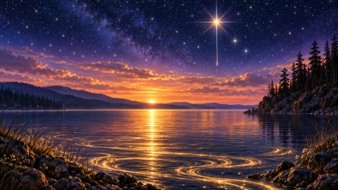</a>

The prompt is split into labeled zones (sky upper, sky lower, sun, shores, water, banks), and each zone gets exact placement and color. A closing palette line keeps the gradients consistent across the whole frame.

GPT Image 2.5 · Text-to-image · Source: [@churvikv on X](https://x.com/churvikv/status/2114771358823358914) · 110 likes on 2026-10-29

[`landscape`](tags.md#tag-landscape) [`twilight`](tags.md#tag-twilight) [`starry-sky`](tags.md#tag-starry-sky) [`painterly`](tags.md#tag-painterly) [`16-9`](tags.md#tag-16-9)

<details><summary><b>Prompt</b></summary>

```text
Painterly digital illustration of a magical twilight lake at the meeting of day and night, wide 16:9 panoramic composition, airbrushed smooth gradient rendering, luminous and serene. Edge to edge, no frame, no border, no lettering.

SKY upper: the top two-thirds is deep navy and indigo night, densely scattered with hundreds of fine white and pale gold star pinpoints. One dominant brilliant starburst blazes high right of centre, its core white-hot and its long straight rays fanning far into the dark, with two smaller four-point stars below and beside it. A thin vertical meteor line falls from the main star down toward the horizon.

SKY lower: the night melts downward through violet and lilac into dusky periwinkle, then into a warm band of layered horizontal clouds in apricot, peach, rose and pale amber, their edges outlined with gold rim-light. Above them, faint star specks still drift.

SUN: a small intense white-gold sun disc rests exactly on the horizon line, slightly left of centre, sinking behind the far ridge, its reflection pouring straight down the lake in a long glow.

SHORES: dark pine-forested hills recede on the left as a soft blue-violet silhouette with a gentle shoreline. On the right, a rocky bluff rises, crowned with tall black spruce and pine silhouettes, their trunks and branches sharp against the glow.

WATER: the entire lower third is still black-violet water swept with fine horizontal ripple lines. The sun's light spreads as a wide shimmering gold path across the middle, while the near foreground breaks into long swirling spiral ribbons of glowing golden light, curling and flowing across the surface like liquid threads.

BANKS: rough dark boulders crowd the lower left and lower right corners, edged with thin grass, reeds and small bare twigs, a few tiny pale flowers catching the glow.

PALETTE: deep indigo, navy, violet, lilac, apricot, warm gold, pale white, near-black pine. Smooth gradient blending, glowing highlights, dreamlike and tranquil, clean and unlettered.
```

</details>

<a id="nano-banana-impasto-moonlit-lake-black-swans"></a>
### Impasto oil painting of moonlit lake with black swans

<a href="https://x.com/churvikv/status/2107856173839872397">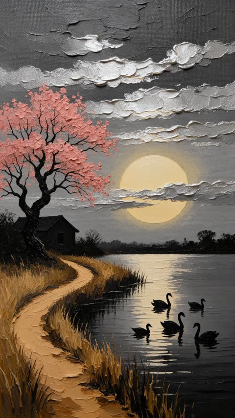</a>

Opens with the medium and texture (thick impasto, palette knife strokes), then lists scene elements with placement and count, such as six swans and a cherry tree on the right shore. It closes with mood and lighting terms.

Nano Banana 2.1 · Text-to-image · Source: [@churvikv on X](https://x.com/churvikv/status/2107856173839872397) · 110 likes on 2026-10-28

[`oil-painting`](tags.md#tag-oil-painting) [`impasto`](tags.md#tag-impasto) [`landscape`](tags.md#tag-landscape) [`moonlight`](tags.md#tag-moonlight) [`swans`](tags.md#tag-swans)

<details><summary><b>Prompt</b></summary>

```text
Oil painting style, thick impasto texture with visible palette knife strokes. A serene lake at dusk with a large golden moon partially hidden behind textured grey clouds. Six black swans swimming gracefully on the water, creating gentle ripples. Golden moonlight reflecting on the water surface. Pink cherry blossom tree on the right shore with petals falling slowly. Small cozy house with warm yellow lights in the windows. Dry golden reeds swaying gently in the breeze. Mountains in the distance. Calm, peaceful atmosphere, cinematic lighting, 4k.
```

</details>

<a id="gpt-image-watermelon-suspicious-glance-sketchbook-portrait"></a>
### Sketchbook Portrait of Woman Eating Watermelon

<a href="https://x.com/hey_am_cherry/status/2108424213132697763">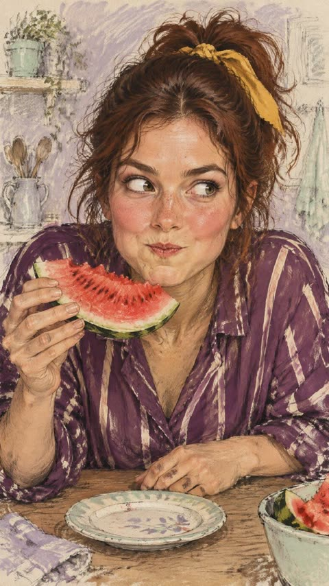</a>

Stacks traditional media terms (charcoal, ink outlines, cross-hatching, watercolor, gouache) and names an exact palette to get a hand-drawn look. A specific expression, a sideways glance with puffed cheeks, keeps the face readable, and the negative style list (not cartoon, not 3D, not a photograph) holds the semi-realism.

GPT Image 2.5 · Text-to-image · Source: [@hey_am_cherry on X](https://x.com/hey_am_cherry/status/2108424213132697763) · 109 likes on 2026-10-29

[`sketchbook`](tags.md#tag-sketchbook) [`editorial-illustration`](tags.md#tag-editorial-illustration) [`mixed-media`](tags.md#tag-mixed-media) [`expression`](tags.md#tag-expression) [`9-16`](tags.md#tag-9-16)

<details><summary><b>Prompt</b></summary>

```text
Create an original vertical 9:16 semi-realistic hand-drawn editorial illustration of a quirky young adult woman caught in a funny, spontaneous moment while eating a slice of watermelon. She has realistic human facial anatomy, naturally flushed cheeks, detailed expressive hazel eyes, a few freckles, and messy dark auburn hair loosely tied in a high ponytail with a mustard-yellow ribbon. She wears a vivid plum-purple blouse with loose cream-colored stripes. Her body leans forward over a kitchen table, her head tilted slightly to one side, eyes glancing sideways with a comically suspicious expression, cheeks slightly puffed, and lips pressed together as she tries not to laugh. One hand holds a juicy watermelon slice close to her mouth while the other rests casually on the table beside a small ceramic plate.

The image must look like a traditional artist's expressive sketchbook illustration, with loose charcoal and graphite strokes, rough ink outlines, visible construction marks, scratchy cross-hatching, textured watercolor washes and opaque gouache brushwork. Realistic skin shading and believable human hands, painterly facial details, imperfect sketch lines extending beyond the figure, lively spontaneous brush marks. Background: a loosely sketched muted dusty-lavender kitchen wall with pale mint and warm ivory brush strokes, faint illegible handwritten-style artistic scribbles, and unfinished pencil marks.

Use a fresh, vibrant color palette of plum purple, watermelon red, mustard yellow, dusty lavender, pale mint, and warm peach skin tones. Medium close-up composition, face large and sharply readable, natural human proportions, expressive eyes and mouth, visible paper texture, sophisticated hand-illustrated magazine art aesthetic. Keep the character visually dominant and the background loose and sketchy.

IMPORTANT STYLE: semi-realistic human illustration, NOT cartoon, NOT anime, NOT 3D, NOT glossy digital art, NOT a photograph. Preserve the raw, loose, textured, imperfect hand-drawn quality of traditional editorial sketch art. Original character, original pose, original outfit, original composition.
```

</details>

<a id="nano-banana-christmas-market-monsters-pop-art"></a>
### Winking woman on Christmas market bench with monsters

<a href="https://x.com/awesome_visuals/status/1994346814825226504">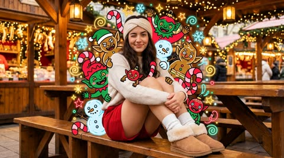</a>

The JSON prompt separates subject from overlay: skin and legs are locked as photoreal while the monsters are layered behind, around and over the clothing. Naming a fixed neon palette and thick black outlines keeps the pop art style consistent across the whole frame.

Nano Banana Pro · Text-to-image · Source: [@awesome_visuals on X](https://x.com/awesome_visuals/status/1994346814825226504) · 100 likes on 2026-10-29

[`christmas`](tags.md#tag-christmas) [`pop art`](tags.md#tag-popart) [`portrait`](tags.md#tag-portrait) [`mixed media`](tags.md#tag-mixedmedia)

<details><summary><b>Prompt</b></summary>

```text
Nano Banana Pro 📸 available on LetzAI

{ "subject": { "type": "beautiful young woman (early 20s)", "pose": "sitting on a wooden market bench with knees pulled up and arms wrapped around them, giving a cheerful wink", "expression": "cute, warm, festive" }, "appearance": { "hair_color": "dark brown", "hair_style": "long loose waves with a cozy knit headband", "complexion": "fair with rosy winter cheeks" }, "clothing": { "top": "cream knit sweater", "bottom": "red corduroy shorts", "socks": "white wool socks", "shoes": "tan winter boots with faux fur" }, "environment": { "setting": "outdoor Christmas market", "details": "twinkle lights, wooden stalls, warm hanging lanterns" }, "lighting": { "type": "warm golden fairy-light glow", "mood": "cozy, festive, romantic" }, "camera": { "angle": "low-to-mid angle", "lens_effect": "slight wide-angle with warm bloom", "framing": "subject centered among Christmas lights" }, "art_overlay": { "style": "maximalist Christmas sweets-monster pop-art", "illustrated_elements": { "monsters": "gingerbread goblins, candy-cane worms, snowball blob creatures, hot-cocoa monsters with melting marshmallow faces, cookie reindeer, tiny ornament gremlins, eggnog ghosts, fruitcake beasts", "graphic_shapes": "neon stars, snowflakes, sparkles, swirls, drips, zigzags, holly leaves, ribbon curls, comic bursts without text", "style": "flat neon holiday palette (red, green, gold, icy blue, pink, lime) with thick black outlines" }, "placement_and_density": { "behind_subject": "background filled with overlapping Christmas monsters and shapes", "around_subject": "monsters peeking over shoulders, around boots, near hair, and above the bench", "over_clothing": "some gingerbread creatures cling to sweater, candy-cane worms wrap lightly around shorts", "avoid_skin": "face, hands, and legs remain completely photorealistic", "depth_layers": "heavy layering in front and behind for pop-art depth", "energy_effects": "glowing rim lights, falling white dots like stylized snow, speed lines in festive neon" } }, "style": { "overall": "cozy Christmas market portrait overwhelmed by neon festive monsters", "aesthetic": "warm, chaotic, holiday-playful, surreal" } }
```

</details>

<a id="gpt-image-vintage-ink-polka-dot-fashion-portrait"></a>
### Vintage ink fashion portrait with polka dot scarf

<a href="https://x.com/Just_Anika_Here/status/2114206456518148577"></a>

Names the ink techniques directly (cross-hatching, solid black shadows, distressed print grain) and fixes a limited black and ivory palette. A JSON structure adds composition, pose and a negative prompt that keeps the result from drifting into photorealism.

GPT Image 2.5 · Text-to-image · Source: [@Just_Anika_Here on X](https://x.com/Just_Anika_Here/status/2114206456518148577) · 97 likes on 2026-10-28

[`vintage`](tags.md#tag-vintage) [`ink-illustration`](tags.md#tag-ink-illustration) [`fashion`](tags.md#tag-fashion) [`cross-hatching`](tags.md#tag-cross-hatching) [`json-prompt`](tags.md#tag-json-prompt)

<details><summary><b>Prompt</b></summary>

```text
{
  "prompt": "Create a highly detailed vintage fashion illustration of a stylish young adult woman in a three-quarter side profile, looking confidently over her shoulder toward the viewer. She has voluminous short black curly hair with individually defined ringlets, dramatic winged eyeliner, long eyelashes, a small nose, and full glossy lips. She wears oversized pointed cat-eye sunglasses with dark lenses and thick black frames. A wide cream-colored headscarf with bold black polka dots wraps around her head and forms a large playful bow on top. A large geometric hoop earring hangs from her visible ear. She wears a dark, elegant high-neck top with a light-colored shoulder strap crossing diagonally over her shoulder. Her chin is slightly raised, her head tilted back, and her expression is effortlessly confident and fashionable. Use expressive black ink outlines, intricate cross-hatching, dense hand-drawn curls, fine facial linework, bold solid-black shadow areas, and subtle distressed print textures. The background is warm ivory paper with visible grain, tiny ink speckles, and an aged screen-printed finish. Strong contrast between black ink and off-white paper, sophisticated retro editorial composition, authentic vintage comic-book print quality, clean recognizable silhouette, beautifully balanced negative space.",

  "composition": {
    "framing": "vertical portrait, head to upper torso",
    "camera_angle": "slightly low three-quarter profile",
    "subject_position": "centered, face turned toward the right",
    "pose": "looking back over her shoulder with chin slightly raised",
    "background": "minimal textured ivory paper"
  },
  "color_palette": {
    "primary": "deep ink black",
    "secondary": "warm ivory",
    "accents": "soft antique cream"
  },
  "lighting": "illustrative high-contrast tonal shading, no realistic photographic lighting",
  "texture": "rough ink grain, distressed paper, vintage halftone speckles, fine cross-hatching",
  "negative_prompt": "photorealism, 3D render, color gradients, bright colors, smooth digital vector art, glossy plastic skin, blurry facial features, asymmetrical eyes, malformed sunglasses, extra earrings, distorted hands, messy outlines, low detail, text, typography, watermark, logo, frame"
}
```

</details>

<a id="nano-banana-dream-guardian-clock-temple"></a>
### Hooded guardian with crystal orb in clock temple

<a href="https://x.com/kellyyjjones/status/2078341912684376573">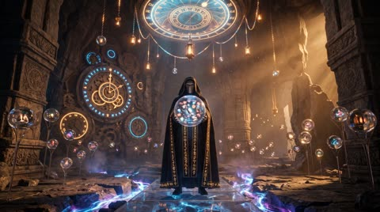</a>

Anchoring the subject first, with costume and a specific prop, keeps the figure central while the environment fills the rest of the frame. Camera and render cues such as ARRI Alexa 65, volumetric fog and an explicit rule of no people except the guardian keep the scene cinematic and free of extra figures.

Nano Banana 2 · Text-to-image · Source: [@kellyyjjones on X](https://x.com/kellyyjjones/status/2078341912684376573) · 96 likes on 2026-10-29

[`fantasy`](tags.md#tag-fantasy) [`cinematic`](tags.md#tag-cinematic) [`concept-art`](tags.md#tag-concept-art) [`crystal`](tags.md#tag-crystal)

<details><summary><b>Prompt</b></summary>

```text
Ultra-realistic cinematic fantasy concept art of a colossal hidden sanctuary floating high above an endless sea of glowing clouds at sunrise, suspended between heaven and the cosmos where time itself is born. At the center stands the mysterious Time Weaver, wearing an elegant flowing ancient robe woven with glowing golden clock constellations, peacefully holding a transparent crystal sphere containing miniature galaxies, forgotten memories, unborn civilizations, and infinite future timelines. Gigantic floating golden rings engraved with celestial runes surround him, bending light and space. Massive ancient mechanical trees with bronze and crystal branches grow from floating islands, their glowing clock-shaped leaves drifting upward. Majestic waterfalls of liquid light flow upward into the sky, transforming into sparkling nebulae. Millions of glowing hourglass particles, golden stardust, floating runes, ethereal birds of light, and colossal celestial whales glide through the clouds. The entire kingdom stretches endlessly across the heavens with breathtaking white stone temples, shimmering crystal architecture, and golden bridges. Volumetric god rays, soft cinematic fog, HDR lighting, physically accurate reflections, ultra-detailed textures, epic composition, shallow depth of field, fantasy realism, ARRI Alexa 65, Unreal Engine 5, IMAX quality, 8K masterpiece, original fantasy universe, no text, no logo, no watermark.
Ultra-realistic cinematic fantasy concept art of a hidden underground temple where forgotten dreams are preserved forever. In the center stands the mysterious Dream Guardian wearing a long flowing obsidian cloak embroidered with glowing golden ancient symbols, holding a transparent crystal orb filled with thousands of tiny floating dreams, miniature worlds, forgotten memories, and colorful emotions. Gigantic ancient clocks are carved into the towering stone walls, glowing blue rivers of magical energy flow beneath a transparent crystal floor, hundreds of floating glass spheres preserve lost moments of humanity, and an enormous celestial clock hangs from the cavern ceiling connecting the past, present, and future. Dark mystical atmosphere mixed with warm golden volumetric light, cinematic fog, realistic stone textures, floating dust particles, breathtaking composition, shallow depth of field, HDR, Hollywood fantasy, ARRI Alexa 65, Unreal Engine 5 realism, IMAX quality, 8K masterpiece, original fantasy universe, no people except the guardian, no text, no logo, no watermark.
```

</details>

<a id="nano-banana-samurai-ink-wash-bamboo-forest"></a>
### Samurai with topknot in ink wash bamboo forest

<a href="https://x.com/Ozayrr_irl/status/2053170166708740330">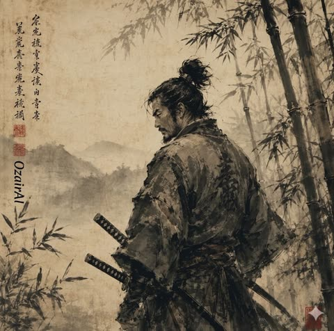</a>

Naming the traditional medium along with calligraphy and red seal stamps anchors the style, while chiaroscuro lighting and aged paper texture add drama. The side profile and bamboo framing keep the figure central against the misty mountains.

Nano Banana 2 · Text-to-image · Source: [@Ozayrr_irl on X](https://x.com/Ozayrr_irl/status/2053170166708740330) · 94 likes on 2026-10-29

[`sumi-e`](tags.md#tag-sumi-e) [`ink-wash`](tags.md#tag-ink-wash) [`samurai`](tags.md#tag-samurai) [`bamboo`](tags.md#tag-bamboo)

<details><summary><b>Prompt</b></summary>

```text
"A cinematic, high-resolution sumi-e ink wash painting of a rugged samurai with a topknot, seen from a side profile, standing amidst a dense bamboo forest with misty mountains in the background. The style features traditional Japanese calligraphy and red seal stamps, utilizing dramatic chiaroscuro lighting and textured, aged paper aesthetics."
```

</details>

<a id="gpt-image-jacaranda-storybook-woman-looking-up"></a>
### Woman Gazing Up at Jacaranda Blossoms, Storybook Painting

<a href="https://x.com/hey_am_cherry/status/2110952509217140779"></a>

The prompt names a complementary palette of violet blossoms, a turquoise scarf and sky, and a coral coat, which gives the image its saturated contrast. The negative prompt rules out photoreal and 3D looks, so the brushwork, ink outlines and paper texture stay visible.

GPT Image 2.5 · Text-to-image · Source: [@hey_am_cherry on X](https://x.com/hey_am_cherry/status/2110952509217140779) · 92 likes on 2026-10-28

[`illustration`](tags.md#tag-illustration) [`storybook`](tags.md#tag-storybook) [`painterly`](tags.md#tag-painterly) [`vibrant-palette`](tags.md#tag-vibrant-palette) [`portrait-9-16`](tags.md#tag-portrait-9-16)

<details><summary><b>Prompt</b></summary>

```text
{
  "prompt": "Create a beautiful vertical 9:16 digital painting in a vibrant, expressive storybook illustration style. A young woman with a short dark bob haircut stands in the lower-right portion of the composition, peacefully looking upward at a magnificent flowering jacaranda tree. The enormous dark branches sweep diagonally across the upper half of the image, covered in clusters of vivid violet, electric purple, and magenta blossoms. Tiny purple petals float gently through the air. The woman wears a flowing coral-red coat, a bright turquoise scarf, dark plum leggings, and elegant black ankle boots. A small mustard-yellow shoulder bag adds a warm accent. The background features a rich turquoise-blue sky blending into soft lavender mountains, with subtle painterly textures and a few delicate wildflowers along the ground. Use a bold, highly saturated color palette with striking contrasts between violet flowers, turquoise surroundings, coral clothing, and golden highlights. Artistic hand-painted brushstrokes, delicate ink outlines, textured paper finish, atmospheric depth, beautiful natural lighting, poetic and peaceful mood. The tree canopy fills the upper third and spreads across the frame, while generous open space in the middle emphasizes the woman and creates a balanced composition. Full-body character visible, elegant natural pose, visually rich details, polished high-quality illustration, beautiful color harmony, 9:16 portrait composition.",
  "negative_prompt": "photorealistic, 3D render, dull colors, washed-out palette, blurry details, low resolution, distorted anatomy, extra limbs, extra fingers, malformed hands, duplicate people, oversized head, cropped feet, cut-off body, text, watermark, logo, copied composition, yellow autumn leaves, orange trench coat, plain empty background",
  "aspect_ratio": "9:16",
  "style": "vibrant painterly storybook illustration",
  "quality": "high"
}
```

</details>

<a id="nano-banana-storybook-child-cat-mixed-media"></a>
### Mixed media storybook portrait of child with cat

<a href="https://x.com/MissDelulu9/status/2112461761266032799">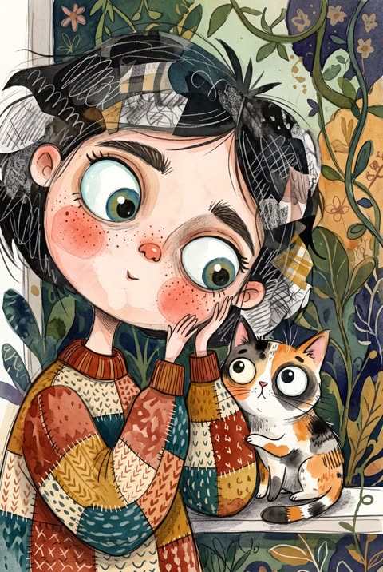</a>

A fill-in template with [HUMAN], [ANIMAL], [SETTING], [CLOTHING] and [COLORS] slots, so one prompt serves many subjects. Stacking named media (watercolor, cut paper, ink wash, chalk pastel, pencil) with exaggerated proportions gives the layered, tactile look.

Nano Banana 2.1 · Text-to-image · Source: [@MissDelulu9 on X](https://x.com/MissDelulu9/status/2112461761266032799) · 86 likes on 2026-10-28

[`storybook`](tags.md#tag-storybook) [`mixed-media`](tags.md#tag-mixed-media) [`watercolor`](tags.md#tag-watercolor) [`template`](tags.md#tag-template) [`animal`](tags.md#tag-animal)

<details><summary><b>Prompt</b></summary>

```text
Made with Nano Banana 2.1 on
@atlas_cloud_ai


Prompt: Extreme close-up mixed-media storybook illustration of [HUMAN] with [ANIMAL] beside them in [SETTING]. Oversized tilted head, gigantic uneven blue-green eyes, thick eyebrows, tiny nose, coral-pink freckled cheeks, thin neck, and miniature hands. Irregular color planes, translucent watercolor, cut-paper layers, ink washes, chalk-pastel grain, and delicate pencil outlines. Sweeping graphic hair with white scribbles. Wearing [CLOTHING], in [COLORS]. Abstract organic background, smaller wide-eyed matching animal, playful asymmetry, intimate composition, and tactile painterly texture.
```

</details>

<a id="nano-banana-miniature-toy-kingdom-macro-sunrise"></a>
### Miniature toy kingdom with trains, waterfalls and airship

<a href="https://x.com/kellyyjjones/status/2076163025464348955"></a>

The prompt lists concrete scene elements like market streets, trains, bridges and waterfalls, and names plastic, wood, fabric and metal textures. A macro lens, very shallow depth of field and golden sunrise light then make the tiny world look like a real tabletop diorama.

Nano Banana 2 · Text-to-image · Source: [@kellyyjjones on X](https://x.com/kellyyjjones/status/2076163025464348955) · 82 likes on 2026-10-29

[`miniature`](tags.md#tag-miniature) [`toy-world`](tags.md#tag-toy-world) [`macro`](tags.md#tag-macro) [`golden-light`](tags.md#tag-golden-light) [`fantasy`](tags.md#tag-fantasy)

<details><summary><b>Prompt</b></summary>

```text
A breathtaking ultra-realistic miniature toy universe where every living toy has its own thriving civilization. Tiny colorful cities filled with beautifully crafted toy houses, bustling streets, miniature trains, toy cars, bicycles, and tiny marketplaces full of life. Little toy people laugh, work, and explore while mechanical birds fly overhead and tiny airships drift across the sky. Enormous toy trees tower above the landscape, surrounded by crystal-clear rivers, glowing waterfalls, magical bridges, miniature mountains, and lush forests. Every surface reveals realistic plastic, wood, fabric, and metal textures with intricate craftsmanship. Warm golden sunrise light bathes the world in soft cinematic rays, creating volumetric lighting, gentle lens flares, and dreamy atmospheric fog. Captured in macro photography with an extreme shallow depth of field, making the tiny world feel astonishingly real. Pixar-inspired wonder blended with Hollywood fantasy, ultra-photorealistic, hyper-detailed, Unreal Engine 5 quality, global illumination, ray tracing, HDR, 8K, masterpiece, award-winning cinematic concept art.

A breathtaking ultra-realistic cinematic scene of a giant human standing above a magical toy universe, carefully observing the tiny toy world below. The man looks amazed and curious as he watches miniature toy cities, toy people, tiny vehicles, colorful houses, and a fantasy toy kingdom built like a living world. Massive scale difference between the human and the miniature world, macro photography perspective, cinematic lighting, warm golden sunlight, realistic textures, shallow depth of field, fantasy atmosphere, ultra detailed, 8K, masterpiece quality.
Is koo b improve karoo
```

</details>

<a id="gpt-image-glowing-opal-lakeside-promenade-night"></a>
### Glowing opal flagstone lakeside promenade at night

<a href="https://x.com/churvikv/status/2115498807400251803">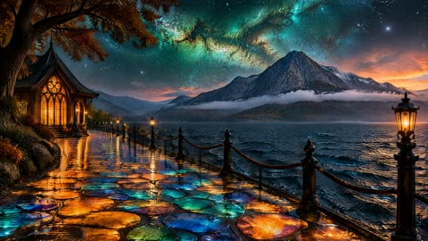</a>

The prompt is split into labeled zones (path, left, fence, water, mountains, sky) that each fix a position and material, so the layout stays coherent. A closing palette line and wide 16:9 framing keep the colors tied together.

GPT Image 2.5 · Text-to-image · Source: [@churvikv on X](https://x.com/churvikv/status/2115498807400251803) · 76 likes on 2026-10-29

[`landscape`](tags.md#tag-landscape) [`night`](tags.md#tag-night) [`fantasy`](tags.md#tag-fantasy) [`panoramic`](tags.md#tag-panoramic) [`nebula`](tags.md#tag-nebula)

<details><summary><b>Prompt</b></summary>

```text
Photorealistic magical lakeside promenade at night, wide 16:9 panoramic composition, cinematic, ultra-detailed. Edge to edge, no frame, no border.

PATH: the entire foreground is a walkway of irregular rounded flagstones separated by dark joints, and every stone glows from within like stained glass or opal — molten orange, gold and ochre, then turquoise, emerald and cobalt, then deep midnight blue, each a separate luminous cell with wet cracks and bright glossy highlights. The path sweeps from the bottom right corner in a long curve toward the pavilion on the left.

LEFT: a small ornate wooden lakeside pavilion with a steep shingled roof and a tall pointed arched window, its panes glowing deep amber and fiery orange, lattice tracery visible, warm light spilling onto the path. A huge dark tree with rust-brown autumn foliage overhangs it from the top left.

FENCE: a black cast-iron railing with rope-strung posts and chunky turned finials runs along the right edge of the path, separating it from the water, receding in strong perspective with a lamp post at the near right.

WATER: the right third is a broad dark lake, choppy with short wind ridges, its surface catching faint blue and gold light, the far shore dissolving into haze.

MOUNTAINS: across the lake rises one dominant craggy mountain in grey-blue rock, its flanks forested, a snow-dusted ridge at its right shoulder, with a long flat band of white cloud lying low across its base. Softer forested slopes recede to the left.

SKY: the upper half is a star-filled night vaulted over the scene, seething with a vast emerald-green and turquoise nebula twisting diagonally across the centre, threaded with dust lanes and gold-brown star clouds. Low on the right horizon, a warm afterglow of apricot, rose and pale amber burns behind the mountain.

PALETTE: emerald, turquoise, cobalt, molten orange, amber, warm brown, near-black shadow, pale starlight. Sharp focus, glossy wet highlights, high dynamic range, clean and unmarked.
```

</details>

<a id="nano-banana-blue-leaf-red-lips-profile"></a>
### Blue Leaf Merging With Red Lips Profile

<a href="https://x.com/meng_dagg695/status/2073967454288777357">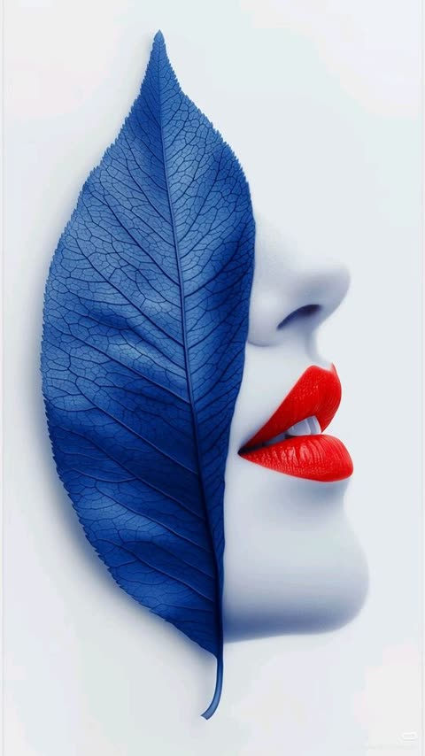</a>

Lists only the visible facial parts (nose, lips, chin) and lets one oversized leaf take over the rest, so the subject stays minimal. A cool blue against vivid red on a white monochrome background gives the contrast, and a macro vein texture keeps the leaf convincing.

Nano Banana 2 · Text-to-image · Source: [@meng_dagg695 on X](https://x.com/meng_dagg695/status/2073967454288777357) · 75 likes on 2026-10-29

[`surreal`](tags.md#tag-surreal) [`minimalist`](tags.md#tag-minimalist) [`macro`](tags.md#tag-macro) [`color-contrast`](tags.md#tag-color-contrast) [`leaf`](tags.md#tag-leaf)

<details><summary><b>Prompt</b></summary>

```text
Nature didn't hide her. It became her.

Made with Nano Banana 2 on
@SocialSight


Prompt : Surreal minimalist digital art, extreme close-up side profile of porcelain-white female face, only nose, vivid glossy red lips slightly parted showing teeth, and chin visible, large single deep blue leaf with ultra-detailed vein network texture overlapping and merging with the left half of the face covering the eye and cheek area, leaf spine aligned vertically with the facial profile, hyper-realistic macro leaf texture with intricate branching vein detail, monochrome white background, sharp contrast between vivid red lips and cool blue leaf, soft diffused studio lighting, 3D render quality, vertical 4:5 composition --ar 4:5 --v 6
```

</details>

<a id="nano-banana-anime-streetwear-couple-low-angle"></a>
### Anime streetwear couple in polos and retro sneakers

<a href="https://x.com/Emmma___0/status/2111325365419610211">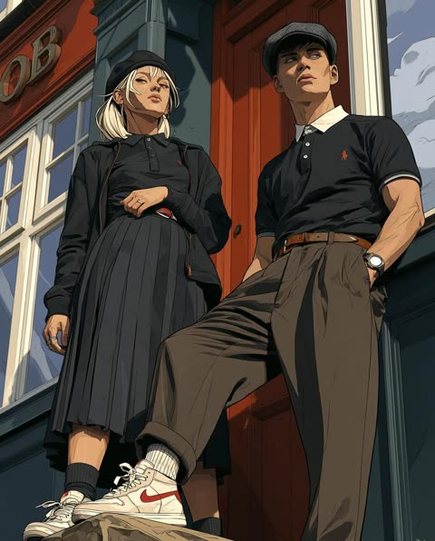</a>

Separate male and female character blocks fix each outfit down to the footwear, then composition, art style, lighting, quality and negative prompt follow as labeled sections. A low angle camera and a warm orange against navy palette give the fashion editorial look.

Nano Banana 2.1 · Text-to-image · Source: [@Emmma___0 on X](https://x.com/Emmma___0/status/2111325365419610211) · 74 likes on 2026-10-29

[`anime`](tags.md#tag-anime) [`streetwear`](tags.md#tag-streetwear) [`couple`](tags.md#tag-couple) [`low-angle`](tags.md#tag-low-angle) [`fashion-editorial`](tags.md#tag-fashion-editorial)

<details><summary><b>Prompt</b></summary>

```text
Create a highly detailed, cinematic anime-style illustration of a stylish couple with a strong, confident presence, inspired by modern streetwear fashion and luxury casual aesthetics. The couple should look effortlessly cool, with realistic anatomy, expressive faces, sharp jawlines, detailed eyes, and natural poses.
Male character: A tall, athletic man with a masculine face, strong jawline, short styled hair, and a confident expression. He wears a premium polo shirt, relaxed-fit beige or khaki trousers, white crew socks, a luxury wristwatch, and retro Nike Air Max-style sneakers with white, navy, and red accents.
Female character: A beautiful, elegant woman with long, silky black hair, defined facial features, expressive eyes, and a calm, confident expression. She wears a fitted polo shirt, a long black skirt or tailored dark trousers, and stylish retro sneakers that complement the man's footwear.
Composition and poses: The couple sits or stands together naturally, conveying confidence, elegance, and a subtle sense of intimacy. Use low-angle camera perspectives to make them appear powerful and fashionable. Emphasize their coordinated outfits, detailed footwear, natural hand positions, and realistic clothing folds.
Art style: Premium Japanese anime meets modern Western comic-book illustration, with bold ink outlines, intricate linework, semi-realistic facial features, cel-shaded shadows, sophisticated color grading, and polished digital painting. The aesthetic should resemble a high-end fashion editorial transformed into an anime illustration.
Lighting and background: Dramatic cinematic lighting, deep shadows, warm reddish-orange highlights, rich navy and charcoal tones, and a stylish architectural setting. Use carefully balanced contrast, atmospheric depth, and subtle reflections to create a luxurious mood.
Quality: Ultra-detailed 4K illustration, full-body composition, anatomically accurate proportions, realistic fabric textures, detailed sneaker designs, sharp focus, professional character design, sophisticated color palette, clean outlines, and visually striking composition.
Aspect ratio: 3:4 vertical portrait.
Negative prompt: Blurry image, low resolution, distorted anatomy, extra fingers, missing limbs, deformed hands, asymmetrical eyes, unnatural poses, poorly drawn shoes, floating objects, incorrect proportions, excessive gloss, oversaturated colors, text, watermarks, logos with distorted lettering, and duplicate body parts.
```

</details>

<a id="gpt-image-seaside-woman-pomeranian-sketch-walk"></a>
### Woman walks Pomeranian along pastel seaside houses

<a href="https://x.com/heyfatema/status/2068307623238336659">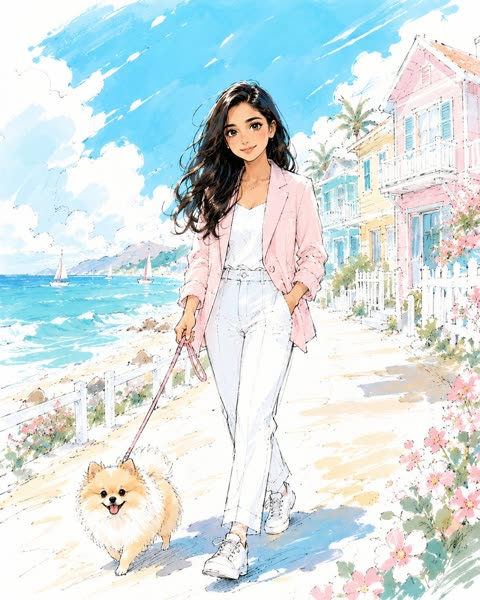</a>

Pairing a style line, sketch anime with varying line weights, with a named four-colour palette keeps the look consistent. Naming exact colours such as candy pink and aqua blue ties the pink jacket, the sea and the cream dog to one scheme.

GPT Image 2 · Text-to-image · Source: [@heyfatema on X](https://x.com/heyfatema/status/2068307623238336659) · 70 likes on 2026-10-29

[`sketch`](tags.md#tag-sketch) [`anime`](tags.md#tag-anime) [`pomeranian`](tags.md#tag-pomeranian) [`seaside`](tags.md#tag-seaside)

<details><summary><b>Prompt</b></summary>

```text
Lighthearted sketch-style anime aesthetic, a woman walking along the seaside with a fluffy Pomeranian, seaside background with pastel-colored beach houses and a vast blue sky, rough and dynamic freeform shapes, hand-drawn style line art with varying line weights, light and refreshing atmosphere, translucent bright color palette, using pure white, aqua blue, candy pink, and lemon cream for coloring
```

</details>

<a id="nano-banana-lavender-embroidery-profile-woman"></a>
### Profile woman in embroidered lavender textile landscape

<a href="https://x.com/AiWithTariq/status/2068663135909888388">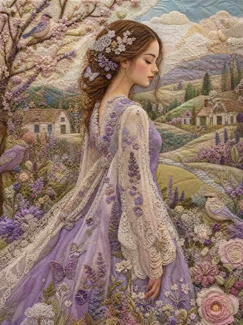</a>

Naming the materials (embroidery, lace, felt, stitched appliqué) and asking for visible stitching pushes the model from painting toward a real textile look. A side profile with closed eyes in a vertical frame keeps the figure readable against the busy countryside.

Nano Banana 2 · Text-to-image · Source: [@AiWithTariq on X](https://x.com/AiWithTariq/status/2068663135909888388) · 70 likes on 2026-10-29

[`textile`](tags.md#tag-textile) [`embroidery`](tags.md#tag-embroidery) [`fantasy`](tags.md#tag-fantasy) [`portrait`](tags.md#tag-portrait)

<details><summary><b>Prompt</b></summary>

```text
Gpt Image 2 | Nano banana 2 | Grok | Gemini Prompt 👇

Create an enchanting ultra-detailed textile fantasy artwork that looks entirely handcrafted from luxurious fabrics, embroidery, lace, wool, silk, felt, and needlework. A graceful young woman in profile stands in a dreamy countryside landscape. She wears a flowing lavender dress adorned with delicate embroidered flowers and butterflies, layered with intricate ivory lace.

**Style:**
luxury textile art, fabric collage masterpiece, embroidery illustration, needle-felted fantasy art, handcrafted couture artwork, mixed textile media, fairy-tale elegance, romantic folk art.

**Composition:**
vertical portrait composition, elegant woman in side profile with eyes closed, surrounded by blooming wildflowers, rolling hills, flowering trees, tiny countryside cottages, soft clouds, and delicate birds.

**Materials & Texture:**
every element created from fabric, embroidery threads, lace, felt, wool, stitched appliqué, crochet details, hand-sewn textures, layered textiles, visible stitching, dimensional handcrafted appearance.

**Color Palette:**
lavender, lilac, blush pink, soft sage green, ivory cream, warm beige, pastel violet, muted gold accents.

**Environment:**
dreamlike spring countryside, flowering meadows, blooming trees, patchwork hills, whimsical village, birds resting among flowers, magical pastoral scenery.

**Lighting:**
soft diffused daylight, gentle glow, dreamy atmosphere, delicate highlights on fabric textures.

**Mood:**
peaceful, romantic, feminine, magical, nostalgic, fairytale-like, poetic and serene.

**Details:**
flawless delicate face, luxurious lace patterns, embroidered butterflies, textured flowers, handcrafted birds, richly detailed textile landscape, premium artisanal craftsmanship.

**Quality:**
masterpiece, museum-quality textile artwork, ultra-detailed embroidery illustration, luxury handcrafted design, extraordinary texture depth, highly intricate needlework, 8k resolution, no text, no watermark, no frame.
```

</details>

<a id="gpt-image-seaside-sketchbook-daisy-pinafore-tree"></a>
### Woman sketching in a notebook beneath an autumn tree

<a href="https://x.com/heyfatema/status/2068586089414369391">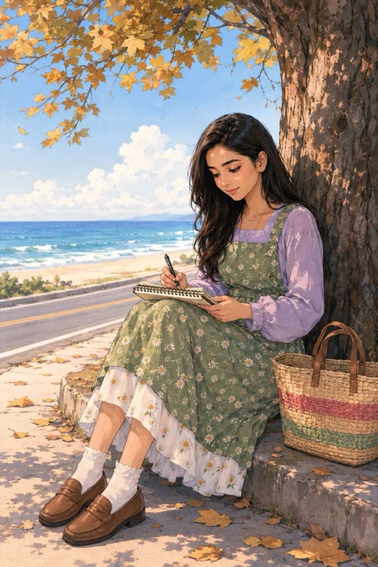</a>

The prompt locks each element in place with a clear outfit list, a seated pose and a labeled background. Naming a spiral sketchbook, pen strokes and watercolor shading steers the model toward a hand-drawn anime finish rather than a glossy render.

GPT Image 2 · Text-to-image · Source: [@heyfatema on X](https://x.com/heyfatema/status/2068586089414369391) · 61 likes on 2026-10-29

[`anime`](tags.md#tag-anime) [`sketch`](tags.md#tag-sketch) [`seaside`](tags.md#tag-seaside) [`fashion`](tags.md#tag-fashion)

<details><summary><b>Prompt</b></summary>

```text
Lighthearted sketch-style anime aesthetic, A serene, anime-inspired illustration of a young woman sitting against a tree by the seaside, full-body seated view at eye level, slightly turned three-quarter pose, looking down as she draws in a spiral sketchbook with a black pen. Soft pastel color palette with clean line art and gentle watercolor shading, warm, soft directional sunlight casting subtle, long shadows. She wears a lavender long-sleeve blouse under a green pinafore dress patterned with small white daisies, a white underskirt with larger daisy prints peeking out, white ankle socks and brown loafers. Long dark hair, natural expression, light blush on cheeks. Large tree trunk with textured bark and golden autumn leaves drifting in a light breeze; a few leaves scattered on the pavement. Background: calm blue ocean with gentle waves, pale sandy beach, distant horizon and soft fluffy clouds, a quiet two-lane coastal road beside the beach. Foreground includes a woven straw tote bag with colorful horizontal stripes placed on the curb. Emphasize peaceful, nostalgic mood, delicate details (fabric folds, leaf veins, bark texture, woven bag weave, pen and paper strokes), cinematic composition, high-resolution, soft grain, subtle rim light and natural ambient occlusion.
```

</details>

<a id="gpt-image-naive-art-designer-poster-girl-cat"></a>
### Naive art poster of girl with cat

<a href="https://x.com/j_smeaton99/status/2114352687366156785"></a>

The prompt names a style (modern naive art) and lists its hand-made traits: imperfect pencil outlines, visible sketch marks, doodles, flat colors and paper texture. It also bans shadows, gradients and 3D, which keeps the result flat and print-like.

GPT Image 2.5 · Text-to-image · Source: [@j_smeaton99 on X](https://x.com/j_smeaton99/status/2114352687366156785) · 44 likes on 2026-10-29

[`naive-art`](tags.md#tag-naive-art) [`hand-drawn`](tags.md#tag-hand-drawn) [`paper-texture`](tags.md#tag-paper-texture) [`flat-color`](tags.md#tag-flat-color) [`designer-poster`](tags.md#tag-designer-poster)

<details><summary><b>Prompt</b></summary>

```text
Create an original modern naïve art illustration as a premium designer poster. Feature a charming, whimsical character in a simple everyday setting, with playful proportions, expressive minimal facial features, and an imaginative composition. Use a minimalist hand-drawn aesthetic with imperfect pencil outlines, visible sketch marks, decorative doodles, and soft yet contrasting flat colors. Incorporate subtle paper texture and an authentic handmade feel, like an illustration drawn by an independent contemporary artist. Keep shapes organic, details intentionally imperfect, and the overall design artistic, warm, and visually distinctive. No shadows, gradients, photorealism, or 3D effects. Clean composition, balanced negative space, sophisticated color palette, gallery-worthy editorial design, high-quality print poster aesthetic. Generate the complete artwork from scratch without using or requiring any reference image.
```

</details>

<a id="nano-banana-sea-turtle-film-studio-island"></a>
### Sea turtle carrying floating film studio island

<a href="https://x.com/wilzap/status/2112169111291908222"></a>

The prompt tells a before and after story in one scene: pixelated film strips are polished by fairies and turn into golden film. A named material look (soft clay-like 3D), a limited palette and lighting cues (rim light, volumetric rays, tilt-shift) keep the whole scene cohesive.

Nano Banana 2.1 · Text-to-image · Source: [@wilzap on X](https://x.com/wilzap/status/2112169111291908222) · 29 likes on 2026-10-28

[`3d-cartoon`](tags.md#tag-3d-cartoon) [`fantasy`](tags.md#tag-fantasy) [`sea-turtle`](tags.md#tag-sea-turtle) [`floating-island`](tags.md#tag-floating-island) [`cinematic-lighting`](tags.md#tag-cinematic-lighting)

<details><summary><b>Prompt</b></summary>

```text
A stylized 3D cartoon fantasy scene of a giant ancient sea turtle swimming through a starry night sky, carrying an entire floating island on its shell. The island is a magical film studio: tiny glowing mushroom houses, a waterfall made of flowing film strips, and a crooked wizard tower with a giant projector lens for an eye. At the base of the waterfall, the film strips look rough, blocky, and pixelated, like broken stained glass. As they spill over a glowing crystal ledge, a swarm of tiny lantern fairies hammers and polishes them, and they transform mid-fall into crisp, shimmering, ultra-detailed film that glows like liquid gold. At the very top, the wizard tower beams the finished movie across the sky like an aurora, showing a vivid dragon soaring through clouds. Chunky rounded shapes, soft clay-like 3D textures, exaggerated cartoon proportions, glowing bioluminescent accents, deep indigo sky with magenta and electric teal highlights, cinematic rim lighting, volumetric light rays, tilt-shift depth of field, ultra detailed, 16:9.
```

</details>

<a id="gpt-image-history-landmark-grid"></a>
### Bastille, Moon landing, Berlin Wall and 9/11 as landmarks

<a href="https://x.com/Gdgtify/status/2114514848881238084">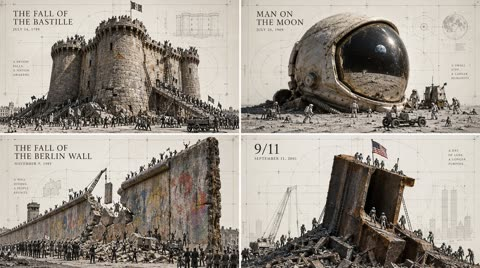</a>

A template with a [SUBJECT] slot, filled four times in one 2x2 grid. Each event becomes a real object shown at monumental scale, with tiny thin-ink figures for scale contrast and a faint construction grid behind it.

GPT Image 2.5 · Text-to-image · Source: [@Gdgtify on X](https://x.com/Gdgtify/status/2114514848881238084) · 27 likes on 2026-10-29

[`grid`](tags.md#tag-grid) [`museum-style`](tags.md#tag-museum-style) [`history`](tags.md#tag-history) [`scale-contrast`](tags.md#tag-scale-contrast)

<details><summary><b>Prompt</b></summary>

```text
2x2 grid, 16:9, do this for 4 days that changed history:  Create a conceptual museum-style illustration for [SUBJECT].
Analyze the subject and choose one real physical object that serves as its strongest material metaphor. Photograph that object in realistic tactile detail and make it feel monumental, like a landscape, landmark, machine, territory, or sacred artifact.
Around and across the object, draw a tiny subject-specific civilization in very thin black ink. Infer appropriate people, buildings, tools, roads, symbols, events, systems, and activities from the subject. Tiny figures may climb, build, excavate, measure, study, trade, transport, map, repair, worship, or explore the object.
The scale contrast is essential:
REAL OBJECT = enormous terrain
DRAWN WORLD = tiny human-scale environment
Transform the object into a major concept or landmark unique to [SUBJECT]. Do not use a generic metaphor.
Behind the composition, add an extremely faint geometric identity-construction system made from circles, grids, axes, tangencies, measurement arrows, registration marks, and proportional guides.
```

</details>

<a id="nano-banana-anime-new-year-dinner-confrontation"></a>
### Anime Japanese New Year dinner family confrontation

<a href="https://x.com/ViralOps_/status/2114709909178810799"></a>

Each character gets a fixed block for age, face, hair and clothing, so the cast stays consistent. The scene then assigns every person a specific gesture and expression, so the conflict reads without any dialogue.

Nano Banana 2.1 · Text-to-image · Source: [@ViralOps_ on X](https://x.com/ViralOps_/status/2114709909178810799) · 27 likes on 2026-10-28

[`anime`](tags.md#tag-anime) [`japanese`](tags.md#tag-japanese) [`family-dinner`](tags.md#tag-family-dinner) [`character-consistency`](tags.md#tag-character-consistency) [`storytelling`](tags.md#tag-storytelling)

<details><summary><b>Prompt</b></summary>

```text
**STYLE AND VISUAL QUALITY**

Premium modern Japanese anime film style, cinematic 2D animation quality, beautifully detailed Japanese character designs, expressive faces, soft cel shading, delicate linework, painterly backgrounds, realistic fabric folds, natural skin tones, rich atmospheric lighting, and emotional visual storytelling.

The image should resemble a beautifully animated Japanese drama film, with warm cinematic lighting, rich colors, subtle depth of field, and emotionally powerful facial expressions. Avoid generic cartoon aesthetics, 3D rendering, or photorealism.

**CHARACTER DESCRIPTIONS — MAINTAIN THESE EXACT APPEARANCES**

**WIFE (Late 20s):**

A beautiful young Japanese woman, approximately 27 years old, with fair warm-toned skin, a delicate oval face, large expressive dark-brown eyes, straight dark eyebrows, a small natural nose, and soft feminine facial features.

She has long, silky, dark-brown hair reaching the middle of her back, styled with soft face-framing strands and a simple half-up hairstyle.

She wears an elegant, modest, dusty-rose pink knitted cardigan over a cream-colored blouse, paired with a flowing sage-green midi skirt.

Her appearance is graceful, gentle, and slightly delicate. Her large expressive eyes should communicate intense emotional pain, vulnerability, and quiet dignity.

**HUSBAND (Early 30s):**

A handsome Japanese man, approximately 32 years old, with fair-to-medium warm skin, short neatly styled black hair, dark-brown eyes, straight eyebrows, a clean-shaven face, and a defined but natural jawline.

He wears a slate-blue button-up shirt with a cream-colored undershirt, dark tailored trousers, and a simple silver wristwatch on his left wrist.

Average-to-tall height, lean-to-medium build, attractive but realistic anime facial proportions.

His personality should be reflected through subtle, emotionally expressive reactions.

**MOTHER-IN-LAW (Late 50s):**

A Japanese woman, approximately 58 years old, with fair-to-medium warm skin, a slightly rounded face, visible fine wrinkles around her eyes and mouth, sharp eyebrows, narrow expressive dark-brown eyes, and a stern, authoritative appearance.

Her dark hair, lightly streaked with gray, is neatly arranged in an elegant low bun.

She wears a sophisticated deep-maroon Japanese kimono with subtle gold floral embroidery, a cream-colored obi belt, and a traditional decorative hairpin.

Her posture and facial expressions communicate pride, authority, harsh judgment, and a controlling personality.

**SETTING — JAPANESE NEW YEAR FAMILY DINNER**

Inside a beautiful, cozy, traditional-modern Japanese family home during an Oshōgatsu (Japanese New Year) celebration in the evening.

A long, low polished wooden dining table dominates the tatami-mat room.

The table is covered with a generous Japanese New Year feast, including:

- Beautifully arranged osechi ryōri in traditional lacquered jubako boxes.
- Grilled fish served on ceramic plates.
- Ozōni soup in traditional bowls.
- Sushi and neatly arranged sashimi.
- Decorative mochi and traditional Japanese sweets.
- Elegant ceramic teacups and wooden chopsticks.

The room features authentic Japanese interior design: warm wooden beams, shoji paper sliding doors, tatami flooring, a decorative tokonoma alcove, a traditional flower arrangement, and soft hanging lanterns.

Through a partially open shoji door, a peaceful Japanese garden is faintly visible beneath the evening sky.

Warm golden interior lighting creates a beautiful festive atmosphere.

The peaceful New Year celebration contrasts sharply with the painful family confrontation unfolding around the table.

**MAIN SCENE — PUBLIC HUMILIATION AT THE FAMILY DINNER**

Capture a deeply emotional and dramatic moment at the exact instant a family celebration turns into a humiliating confrontation.

The mother-in-law sits at the head of the low Japanese dining table, leaning forward aggressively.

She points her index finger directly toward her daughter-in-law.

Her expression is harsh, mocking, and judgmental. Her mouth is slightly open as if she has just delivered a cruel, insulting remark in front of everyone.

The young wife stands beside the dining table, holding a beautiful ceramic serving platter with both hands.

She looks completely shocked and humiliated.

Her shoulders are tense, her lips slightly parted, and her large brown eyes are filled with tears she is desperately trying to hold back.

Her cheeks are faintly flushed with embarrassment.

Her expression communicates heartbreak, helplessness, and the unbearable pain of being publicly disrespected in front of her husband's entire family.

The husband sits on a floor cushion beside his mother.

He suddenly looks up with a frozen, stunned expression.

His body is tense, his eyes widened in disbelief, as though he cannot believe what his mother has just said to his wife.

Capture the precise moment before he decides whether to speak.

**SIX ADDITIONAL FAMILY MEMBERS**

Six adult Japanese relatives sit on floor cushions around the table.

The men wear a mixture of elegant casual shirts, sweaters, and traditional Japanese clothing.

The women wear tasteful modern outfits or subtle traditional kimono.

All six relatives have turned their attention toward the young wife.

Some look visibly shocked.

Others exchange uncomfortable glances.

One elderly relative lowers their eyes in embarrassment.

Another relative watches the confrontation with a judgmental expression.

Their reactions should amplify the wife's painful realization that everyone has witnessed her humiliation.

**EMOTIONAL VISUAL STORYTELLING**

The mother's aggressive pointing gesture, the wife's devastated expression, the husband's stunned reaction, and the relatives' uncomfortable stares must immediately communicate the entire conflict without any written dialogue.

The viewer should instantly understand:

A young Japanese wife has just been publicly insulted by her mother-in-law during an important family celebration, and everyone is waiting to see whether her husband will defend her.

**CAMERA AND COMPOSITION**

Portrait 4:5 aspect ratio.

Final resolution: 1080 × 1350 pixels.

Cinematic medium-wide shot at a natural eye-level camera angle, carefully framed to emphasize the emotional tension between the three main characters.

The composition should resemble a dramatic freeze-frame from a premium Japanese animated feature film.

**CRITICAL COMPOSITION RULE — TEXT OVERLAY SPACE**

The entire dramatic scene must occupy only the UPPER 55% of the image.

This includes:

- All important character faces.
- The mother-in-law's pointing gesture.
- The wife's shocked expression.
- The husband's frozen reaction.
- The relatives' uncomfortable stares.

The LOWER 45% of the image must remain a clean, darker, visually calm, uncluttered foreground.

Use the near section of the low wooden dining table, softly shadowed tatami flooring, and subtle atmospheric shadows to create this negative space.

Do not place important faces, hands, food plates, or distracting decorations in the lower 45%.

Create a natural transition from the detailed dramatic scene above into the quieter, darker foreground below.

The bottom area must be suitable for adding large, highly readable text overlays later.

**LIGHTING AND MOOD**

Warm golden Japanese lantern lighting.

Soft cinematic interior illumination.

Subtle shadows and atmospheric depth.

Beautiful highlights on expressive anime eyes.

Detailed painterly Japanese interiors.

Rich but natural color grading.

The emotional atmosphere should feel:

Heartbreaking, tense, humiliating, uncomfortable, dramatic, and deeply human.

The beautiful peaceful Japanese New Year setting should contrast strongly with the cruelty of the family confrontation.

**STRICT REQUIREMENTS**

- Generate ONE single cinematic anime illustration.
- Portrait 4:5 aspect ratio, 1080 × 1350 pixels.
- Premium Japanese animated film quality.
- Consistent character anatomy and natural body proportions.
- Beautiful expressive faces with accurate hands and fingers.
- All characters must have Japanese facial features and styling.
- The wife must wear her dusty-rose cardigan and sage-green skirt.
- The husband must wear his slate-blue shirt and silver wristwatch.
- The mother-in-law must wear her deep-maroon kimono with cream obi.
- Preserve the emotional intensity of the confrontation.
- Concentrate all important storytelling in the upper 55%.
- Reserve the lower 45% for future text overlays.
- No text.
- No letters.
- No speech bubbles.
- No subtitles.
- No captions.
- No logos.
- No borders.
- No watermarks.
- No 3D rendering.
- No CGI.
- No photorealism.
```

</details>

<a id="nano-banana-paint-tube-squeeze-impasto-painting-grid"></a>
### Paint tubes squeezing 3D impasto landscapes in a 2x2 grid

<a href="https://x.com/Gdgtify/status/2108132040474280332">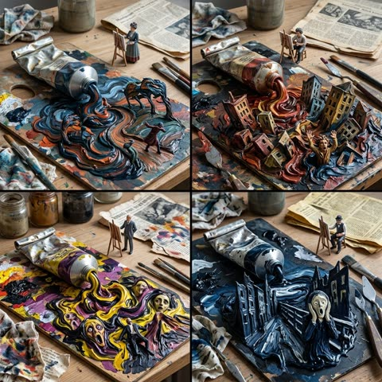</a>

The prompt first asks the model to analyze a named painting and pick four lesser known works in a similar style. It then fixes one visual formula for every cell: a giant tube, paint that rises into 3D relief, studio props, a tiny painter at an easel, and north light.

Nano Banana 2.1 · Text-to-image · Source: [@Gdgtify on X](https://x.com/Gdgtify/status/2108132040474280332) · 18 likes on 2026-10-29

[`impasto`](tags.md#tag-impasto) [`paint-tube`](tags.md#tag-paint-tube) [`oil-painting`](tags.md#tag-oil-painting) [`grid`](tags.md#tag-grid) [`miniature`](tags.md#tag-miniature)

<details><summary><b>Prompt</b></summary>

```text
I used to do these painting prompts a lot but stopped after GPT started restricting them. With Nano Banana 2.1, I am back in business.

Prompt; Do this for Scream <instructions> I want you to act as a world class painting expert and visual artist. I want you to analyze the input by the user (painting name or artist), it style, subject, character, and come up with 4 paintings by artists past or present, no matter what country, who are less known but have a similar in style.

For each painting: Analyze: The brushstroke technique, the 3D depth implied, and the hidden symbols. Goal: A "Paint Tube Squeeze." A giant, realistic oil paint tube sitting on a palette. Rules: Action: The tube is being squeezed, and the paint coming out is not just a blob, but it forms the 3D landscape of the painting. The main feature is emerging in 3D relief from the 2D smear of paint. Texture: Viscous, thick oil paint texture (impasto). Props: Paintbrushes, a dirty rag, a palette knife, plus culture appropriate tools and environment and tiny 3D printed version of the painter on the desk drawing it on a tiny easel and a newspaper headline covering the inspiration behind it. Lighting: North-light studio lighting, true color representation.  artistic process" aesthetic.
Output: 2x2 grid, each grid with a different painting
</instruction>
```

</details>

<a id="nano-banana-satire-pop-up-book-2x2-grid"></a>
### Four satirical pop up books with clay machines

<a href="https://x.com/Gdgtify/status/2109953794931134838">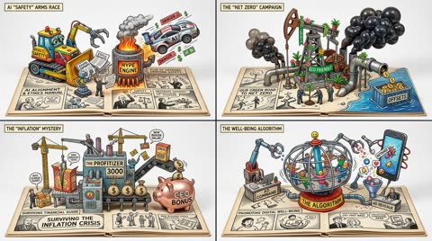</a>

A CLASSIFY block and immutable design laws keep flat black and white ink pages strictly apart from glossy clay 3D figures. Fill in variables such as subject, metaphor machine and contradiction, so the 3D action visibly contradicts the 2D text.

Nano Banana 2.1 · Text-to-image · Source: [@Gdgtify on X](https://x.com/Gdgtify/status/2109953794931134838) · 14 likes on 2026-10-29

[`pop-up-book`](tags.md#tag-pop-up-book) [`satire`](tags.md#tag-satire) [`diorama`](tags.md#tag-diorama) [`clay`](tags.md#tag-clay) [`grid`](tags.md#tag-grid)

<details><summary><b>Prompt</b></summary>

```text
2x2 grid, 16:9, do this for 4 topics in the news this week: CLASSIFY(input) → {
  domain:      editorial_satire × pop_up_engineering × hybrid_2D_3D_diorama
  intent:      critique + delight + literalize (making abstract hypocrisy physically tangible)
  audience:    editorial readers, political cartoon consumers, art-toy collectors
  platform:    4:5 vertical or 1:1 square, high-res digital spread, viral infographic
  complexity:  extreme (requires strict 2D/3D material separation, kinetic metaphor mechanics,
                        dense typographic integration, and ironic contradiction logic)
}

CORE DESIGN LAWS (IMMUTABLE):
  ⚠ THE INK IS FLAT. THE CLAY IS ROUND. THE JOKE IS PHYSICAL.
  • Base: 2D B&W comic pages / printed guide (Matte, flat, hatched).
  • Pop-Up: 3D miniature metaphor machine rising from the pages (Glossy/Clay, dimensional).
  • Actors: Tiny 3D figures enacting the irony (Self-defeating, exaggerated).
  • Annotations: Labels, bubbles, and signs bridging the 2D/3D gap.
  • The Joke: The 3D action must physically contradict the 2D text.

SEMANTIC_VARIABLES (AI infers from {{SUBJECT}}):
  {{SUBJECT}}         → [e.g., Corporate Greenwashing, Social Media Outrage, Modern Dating]
  {{METAPHOR_MACHINE}}→ [e.g., A PR Factory, A Treadmill of Validation, A Slot Machine of Swipes]
  {{2D_BASE}}         → [e.g., An open corporate manifesto, a self-help comic guide]
  {{3D_MATERIAL}}     → [e.g., Polymer clay, painted resin, papercraft]
  {{CONTRADICTION}}   → The core hypocrisy (Stated Intent vs. Actual Output)
  {{ACTORS}}          → Tiny figures trapped in or operating the machine
  {{ANNOTATIONS}}     → Blunt labels, warning signs, scoreboard stats
```

</details>

<a id="nano-banana-raccoon-elf-cookie-thief"></a>
### Raccoon elf caught stealing a cookie

<a href="https://x.com/heathergreen/status/2113556045121384836">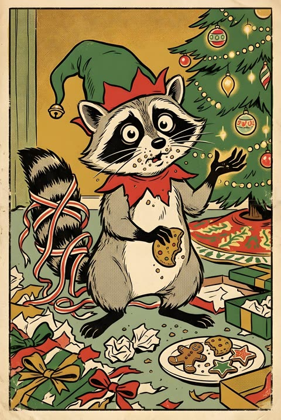</a>

The prompt names a specific era and print style (1950s holiday comic, halftone shading, hand inked outlines, imperfect print texture) and fixes a four colour palette, which keeps the vintage look consistent. The story beat of a caught thief with a ribbon tail gives the model one clear central character and action.

Nano Banana 2.1 · Text-to-image · Source: [@heathergreen on X](https://x.com/heathergreen/status/2113556045121384836) · 3 likes on 2026-10-29

[`christmas`](tags.md#tag-christmas) [`raccoon`](tags.md#tag-raccoon) [`vintage`](tags.md#tag-vintage) [`halftone`](tags.md#tag-halftone)

<details><summary><b>Prompt</b></summary>

```text
#promptshare with Nano Banana 2.1 and generated with
@magnific

PROMPT: Illustrate a hilariously untrustworthy raccoon dressed as a Christmas elf in the style of a vintage 1950s holiday comic. The raccoon wears a crooked green elf hat, has cookie crumbs all over its face, and is caught stealing a cookie from a plate while standing in a pile of torn wrapping paper. A long strand of Christmas ribbon is tangled around its tail like a sash. Give it a wide-eyed, completely unconvincing innocent expression. Use thick hand-inked outlines, expressive cartoon features, retro halftone shading, imperfect vintage print texture, and a cheerful palette of pine green, cherry red, mustard gold, and aged cream. The design should feel like a collectible old-fashioned Christmas novelty illustration with a clear central character, simple background, and bold readable shapes. No mockup, no watermark, no text.
```

</details>

<a id="gpt-image-anime-angel-girl-close-up-portrait"></a>
### Anime Angel Girl Close-up Portrait

<a href="https://x.com/magu_ai_h/status/2099072433664004307">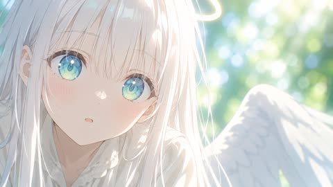</a>

The prompt asks for individual silky hair strands instead of blocky clumps and describes the eye gradient and highlights in detail. Strong backlighting and a bokeh foliage background give the soft, airy mood.

GPT Image 2.5 · Text-to-image · Source: [@magu_ai_h on X](https://x.com/magu_ai_h/status/2099072433664004307)

[`anime`](tags.md#tag-anime) [`angel`](tags.md#tag-angel) [`close-up`](tags.md#tag-close-up) [`bokeh`](tags.md#tag-bokeh) [`backlight`](tags.md#tag-backlight)

<details><summary><b>Prompt</b></summary>

```text
A high-resolution anime-style close-up portrait of a young girl with long, flowing white hair. The art style is soft and ethereal, emphasizing the texture of individual hair strands to create a silky, smooth appearance rather than blocky clumps. She has large, expressive eyes that are a gradient of teal and light blue, filled with intricate highlights and reflections. Her expression is gentle and slightly surprised, with her mouth parted in a small 'o' shape. A faint blush colors her cheeks. Above her head floats a thin, glowing golden halo ring. On the right side of the frame, a fluffy white feathered wing is visible, suggesting she is an angel or celestial being. She wears a simple white garment with delicate lace detailing at the collar. The background is a bright, out-of-focus bokeh effect of green foliage and sunlight, creating a dreamy, airy atmosphere with strong backlighting.
```

</details>

<a id="gpt-image-anime-driver-split-screen-mountain-pass"></a>
### Anime driver split screen on mountain pass

<a href="https://x.com/Eris_Create_Lab/status/2069652470331228244">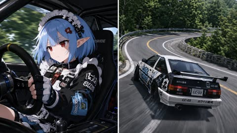</a>

The prompt locks the character to a reference image, then splits the frame into a cockpit view and a rear chase camera. It states repeatedly that both halves show the same car, corner and moment, which keeps the two views consistent.

GPT Image 2 · Edit · Source: [@Eris_Create_Lab on X](https://x.com/Eris_Create_Lab/status/2069652470331228244) · found via [YouMind-OpenLab/awesome-gpt-image-2](https://github.com/YouMind-OpenLab/awesome-gpt-image-2)

[`split-screen`](tags.md#tag-split-screen) [`racing-game`](tags.md#tag-racing-game) [`anime`](tags.md#tag-anime) [`driver-view`](tags.md#tag-driver-view) [`reference-character`](tags.md#tag-reference-character)

<details><summary><b>Prompt</b></summary>

```text
参照画像のキャラクターを完全に維持する。キャラクターの顔、髪型、髪色、瞳、耳、体格、骨格、肩幅、首の太さ、腕のシルエット、年齢感、性別表現、雰囲気を維持すること。画面は左右二分割されたスプリットスクリーン構成。左右は同じ瞬間を異なるカメラで撮影している。左右は同じ車両、同じコーナー、同じ時間軸である。【車両】左右画面に登場する車両は同一車両。車種：スポーツカーまたはチューニングカー。左右画面は同一車両を異なる視点から映している。【左画面】ドライバーカメラ。車内から見た斜めローアングル腰上ショット。キャラクターは車両を運転している。両手でハンドルを握る。コーナリング中。視線は進行方向へ向けられている。真剣な表情。集中している。身体には横Gがかかっている。髪や衣装がわずかに揺れている。衣装：モータースポーツファッション。キャラクターの顔と表情が大きく見える。車内のロールケージ、バケットシート、メーター類が自然に見える。【右画面】三人称追尾カメラ。同じ車両を後方やや上空から追いかける視点。日本の峠道。森林に囲まれたワインディングロード。ガードレール。路面標示。ヘアピンカーブ。実在する峠道のようなリアリティ。コーナリング中。車体荷重が感じられる姿勢変化。高速走行。躍動感。タイヤのグリップ感。路面との一体感。【画面演出】レースゲームのスクリーンショット風。HUDは最小限。またはHUDなし。スポーツ中継映像のようなリアリティ。左右画面は別のシーンではない。左右画面は同一の瞬間を異なるカメラで撮影している。キャラクターのハンドル操作と車両挙動は完全に同期している。同じ瞬間を二つのカメラが捉えていることが明確に伝わる。高品質アニメキャラクター。高品質背景。躍動感。スピード感。映像作品のワンシーン。
```

</details>

<a id="gpt-image-anime-enchanted-forest-inner-landscape"></a>
### Anime Girl Enchanted Forest Double Exposure

<a href="https://x.com/ArtistaNozomu/status/2057099863494652378">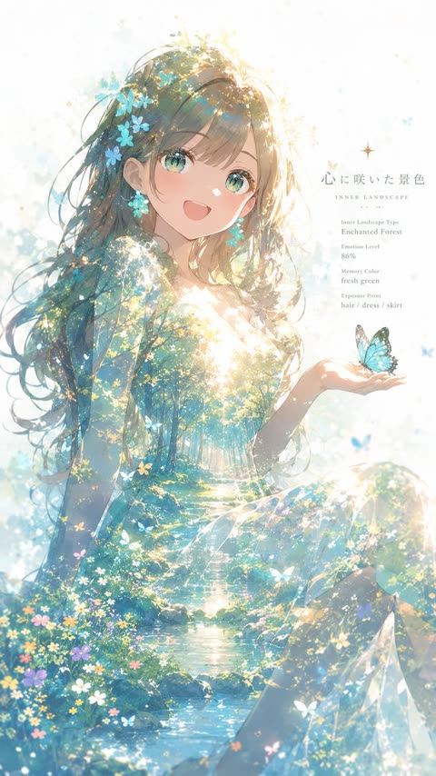</a>

The prompt blends the hair and dress with a forest scene through double exposure, and fixes the layout by naming where the palm, stream and flowers sit. Exact counts for the butterfly, headline and profile lines, plus quoted text strings, keep the typography overlay accurate.

GPT Image 2 · Text-to-image · Source: [@ArtistaNozomu on X](https://x.com/ArtistaNozomu/status/2057099863494652378) · found via [YouMind-OpenLab/awesome-gpt-image-2](https://github.com/YouMind-OpenLab/awesome-gpt-image-2)

[`anime`](tags.md#tag-anime) [`double-exposure`](tags.md#tag-double-exposure) [`watercolor`](tags.md#tag-watercolor) [`forest`](tags.md#tag-forest) [`typography`](tags.md#tag-typography)

<details><summary><b>Prompt</b></summary>

```text
Create a luminous vertical anime illustration visualizing a girl's “inner landscape” through double exposure. Canvas: tall portrait 9:16, soft white background with airy watercolor splashes and glowing particles. Subject: one smiling anime girl, half-body seated pose, turned slightly toward the viewer, long flowing fresh green hair, sparkling green eyes, delicate face, open happy expression, wearing a translucent pale blue-green dress. Her hair and dress are blended with an enchanted forest double exposure: sunlit trees, a clear stream, mossy rocks, wildflowers, blue-green leaves, tiny white and yellow blossoms, and shafts of golden sunlight, as if the forest exists inside her silhouette. Add exactly one turquoise butterfly resting on her open right palm. Add blue flower ornaments in her hair and small matching floral earrings. Lighting: high-key backlight from the upper right, warm golden glow around the crown of her head, glittering bokeh, soft rim light, ethereal and dreamlike. Composition: the girl fills the left and center of the frame, her open palm extends to the right, the forest stream flows vertically through the lower half of her dress, with flowers concentrated near the bottom edge. Text overlay on the upper-right in elegant thin serif typography: main Japanese title 心に咲いた景色, small subtitle “INNER LANDSCAPE”, then four compact profile lines reading “Inner Landscape Type / Enchanted Forest”, “Emotion Level / 86%”, “Memory Color / fresh green”, and “Exposure Point / hair / dress / skirt”. Include exactly 1 character, 1 butterfly, 1 main Japanese headline, 1 English subtitle, and 4 profile text items. Visual style: delicate modern anime key visual, transparent watercolor, soft pastel cyan, mint, teal, white and gold palette, detailed eyes, luminous double exposure, no harsh outlines, no watermark, no extra characters.
```

</details>

<a id="gpt-image-anime-pop-up-fairy-tale-storybook-red-gown"></a>
### Anime Red Gown Girl in Pop-Up Storybook

<a href="https://x.com/ArtistaNozomu/status/2053043589383405801">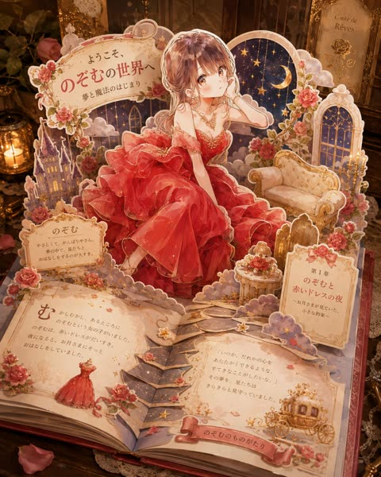</a>

Fixes the scene with an exact count of eight pop-up elements and each one's position, so the layered paper structure stays controlled. Quoted Japanese text is assigned to specific placards, and the prompt asks for decorative rather than crisp lettering so the typography looks believable.

GPT Image 2 · Text-to-image · Source: [@ArtistaNozomu on X](https://x.com/ArtistaNozomu/status/2053043589383405801) · found via [YouMind-OpenLab/awesome-gpt-image-2](https://github.com/YouMind-OpenLab/awesome-gpt-image-2)

[`pop-up-book`](tags.md#tag-pop-up-book) [`anime`](tags.md#tag-anime) [`paper-craft`](tags.md#tag-paper-craft) [`fairy-tale`](tags.md#tag-fairy-tale) [`japanese-text`](tags.md#tag-japanese-text)

<details><summary><b>Prompt</b></summary>

```text
Goal: Create an ornate 3D pop-up storybook scene where Nozomu appears to leap out of an open fairy-tale book, as if a custom character illustration has become a luxurious paper craft diorama.

Canvas: Square composition, warm cinematic close-up view from slightly above, centered on an open book resting on a dark antique wooden desk. Use shallow depth of field, glowing candlelight, amber highlights, soft shadows, and a magical vintage atmosphere.

Main subject: A beautiful anime-style young woman in an extravagant deep red ball gown sits/steps forward from the pop-up pages. She has long softly curled brown hair, delicate jewelry, bare shoulders, lace gloves, and layered translucent ruffles with gold sparkles. Her face should be intentionally covered by a soft square blur/mosaic privacy mask while the rest of the illustration remains sharp and detailed.

Pop-up book structure: Build the scene from layered cut-paper pieces with thick white paper edges, scalloped borders, tabs, folds, and dimensional shadows. Include exactly 8 major pop-up elements: 1 large central character cutout, 1 curved title sign at the upper left, 1 moon-and-stars night-sky arch behind the character, 1 cream vintage sofa on the right, 1 tall arched window on the far right, 1 small purple castle on the left, 1 ornate chapter placard on the lower right, and 1 central folded stair/path bridge rising from the open pages toward the character.

Decorative details: Use abundant roses, vines, tiny stars, clouds, gold filigree, ribbons, lace-like paper trims, and scattered rose petals. Surround the book with antique props including candles, a clock, dark floral decor, and gilded frames, all blurred slightly in the background.

Text content: Use elegant Japanese storybook typography printed directly on the paper. The upper-left title sign should read 「ようこそ、のぞむの世界へ」 with the subtitle 「夢と魔法のはじまり」. Add exactly 4 readable story text areas: 1 small name plaque on the left reading 「のぞむ」, 1 large left-page story panel, 1 right-page story panel, and 1 lower-right chapter card reading 「第1章 のぞむと赤いドレスの夜」. Add a bottom ribbon label reading 「のぞむのものがたり」. Keep the Japanese text decorative and believable, not overly crisp.

Style: Highly detailed anime illustration mixed with realistic handcrafted pop-up book photography, romantic princess fantasy, rococo ornamentation, warm beige parchment paper, deep reds, gold accents, dusky purple night sky, magical sparkles, premium children’s picture-book aesthetic.

Constraints: The open book must be the main object, not a flat poster. Maintain strong 3D paper depth and visible layered construction. Do not add extra characters. Do not include watermarks, logos, modern objects, or English text.
```

</details>

<a id="gpt-image-blue-accent-paris-travel-doodle"></a>
### Blue accent hand drawn Paris travel notebook doodle

<a href="https://x.com/Sairah_0/status/2071779087396606433">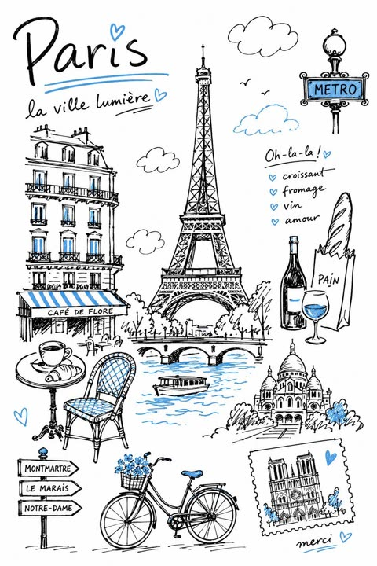</a>

A destination placeholder and a single accent color placeholder make the template reusable for any city. Separate sections for palette, line quality, composition and a firm list of exclusions keep the marker doodle look flat and airy.

GPT Image 2 · Text-to-image · Source: [@Sairah_0 on X](https://x.com/Sairah_0/status/2071779087396606433) · found via [freestylefly/awesome-gpt-image-2](https://github.com/freestylefly/awesome-gpt-image-2)

[`travel-doodle`](tags.md#tag-travel-doodle) [`felt-tip-marker`](tags.md#tag-felt-tip-marker) [`single-accent-color`](tags.md#tag-single-accent-color) [`template`](tags.md#tag-template) [`sketchbook`](tags.md#tag-sketchbook)

<details><summary><b>Prompt</b></summary>

```text
Create a charming editorial travel illustration of {DESTINATION} in a simple hand-drawn doodled style, as if sketched by hand with a black felt-tip marker in a travel notebook. The illustration should feel personal, spontaneous, and imperfect rather than digitally designed. Think of the kind of drawing someone might casually create while sitting at a café after exploring the destination.** ## COLOR PALETTE Keep the illustration almost entirely black and white. Use **only one accent color: {ONE POINT COLOR}** ## STYLE Draw entirely with black felt-tip pen lines. Use slightly wobbly hand-drawn contours, natural line variation, loose marker strokes, sketch-like confidence, subtle imperfections, slightly open line endings, uneven hand pressure, and occasional overlapping strokes. Every line should clearly look handmade. Avoid perfectly smooth curves, mechanically precise outlines, polished vector graphics, or overly crisp digital rendering. ## SUBJECT Illustrate the unique atmosphere and instantly recognizable identity of **{DESTINATION}** rather than producing a realistic cityscape. Select the destination's most iconic landmarks, characteristic architecture, local transportation, famous scenery, native plants, local animals, regional food, and cultural objects. Focus on the spirit of the destination instead of literal accuracy. ## COMPOSITION Arrange the selected elements into a balanced editorial composition with generous white space. The layout should feel open, light, and effortless, similar to a designer's travel sketchbook. Allow objects to overlap naturally without becoming crowded. Every element should have room to breathe. Keep the composition visually relaxed and uncluttered. Apply the blue sparingly to selected details such as water, sky, windows, signs, clothing accents, decorative highlights, or small architectural features. Never introduce any additional colors. ## DRAWING STYLE Keep every object simple and intentionally simplified. Use flat shapes with minimal interior detail. Avoid realistic textures, gradients, shadows, painterly brushwork, glossy surfaces, or complex rendering. The illustration should remain clean, airy, understated, and highly graphic. ## LINE QUALITY The black marker lines are the main visual feature. Lines should feel confident, casual, lively, expressive, and naturally imperfect. Slightly uneven contours, open edges, variable line thickness, and small drawing inaccuracies are encouraged because they enhance the authentic hand-drawn feeling. ## MOOD Warm. Friendly. Relaxed. Playful. Minimal. Editorial. Contemporary. Elegant through simplicity. The finished artwork should resemble a beautifully designed travel notebook, boutique travel guide, editorial magazine illustration, or lifestyle sketchbook rather than a polished digital illustration. ## IMPORTANT No photorealism. No 3D rendering. No painterly effects. No gradients. No heavy shadows. No glossy lighting. No vector-clean artwork. No excessive detail. No busy composition. Preserve generous white space. Maintain a flat editorial doodle aesthetic with a distinctly handmade character. The final image should instantly evoke **{DESTINATION}** through simple, expressive black felt-tip sketches with subtle sky-blue accents.
```

</details>

<a id="gpt-image-butterfly-wheat-sunrise-oil-painting"></a>
### Butterfly on Wheat at Golden Sunrise

<a href="https://x.com/churvikv/status/2086374982989251027">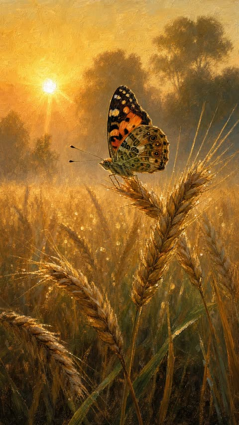</a>

Names the subject, light direction and palette first, then adds fine details such as wing colors, dew bokeh and visible brush texture. Backlit mist, shallow depth of field and a vertical frame give the classical painting its depth.

GPT Image 2 · Text-to-image · Source: [@churvikv on X](https://x.com/churvikv/status/2086374982989251027) · found via [YouMind-OpenLab/awesome-gpt-image-2](https://github.com/YouMind-OpenLab/awesome-gpt-image-2)

[`oil-painting`](tags.md#tag-oil-painting) [`butterfly`](tags.md#tag-butterfly) [`golden-hour`](tags.md#tag-golden-hour) [`nature`](tags.md#tag-nature) [`fine-art`](tags.md#tag-fine-art)

<details><summary><b>Prompt</b></summary>

```text
Oil painting of a butterfly resting on a golden wheat stalk at sunrise, 
warm backlit sunlight glowing through misty wheat field, soft golden 
hour lighting, delicate detailed butterfly wings with orange, black and green patterns, dew droplets sparkling like bokeh, blurred hazy 
background with silhouetted trees, tall wheat ears in foreground with 
fine visible brush texture, warm color palette of gold, amber and 
soft green, romantic atmospheric mood, classical fine art painting 
style, vertical composition, shallow depth of field, cinematic light rays
```

</details>

<a id="gpt-image-cel-animation-volcanic-sand-duel"></a>
### Cel animation duel on black volcanic sand

<a href="https://x.com/ImagineArt_X/status/2097520490013433944">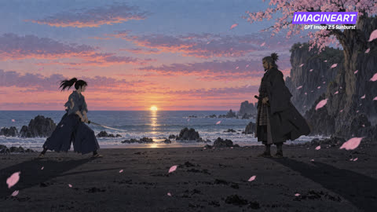</a>

Naming a medium, an era and a painted background style (late 1990s cel, watercolour) fixes the whole look in one phrase. A concrete scene with a time of day, two contrasting poses and a stated petal direction gives the composition clear motion.

GPT Image 2.5 · Text-to-image · Source: [@ImagineArt_X on X](https://x.com/ImagineArt_X/status/2097520490013433944) · found via [wangrunlin/awesome-gpt-image-2-5-prompts](https://github.com/wangrunlin/awesome-gpt-image-2-5-prompts)

[`cel-animation`](tags.md#tag-cel-animation) [`samurai`](tags.md#tag-samurai) [`watercolour`](tags.md#tag-watercolour) [`sunrise`](tags.md#tag-sunrise) [`cherry-blossom`](tags.md#tag-cherry-blossom)

<details><summary><b>Prompt</b></summary>

```text
a still from a hand drawn Japanese animated film, late 1990s cel style, painted watercolour background. A dawn duel on black volcanic sand, a woman with a drawn katana facing an older man with a sheathed one, cherry blossom blowing right to left.
```

</details>

<a id="gpt-image-chinese-cursive-calligraphy-yue-fei-scroll"></a>
### Chinese Cursive Calligraphy of Yue Fei Poem

<a href="https://x.com/mranti/status/2046840306461724772">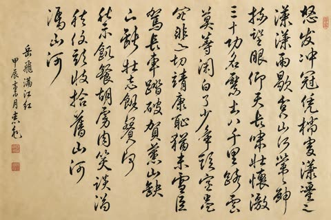</a>

The full poem text is written into the prompt and the column layout is fixed: about 8 main columns read right to left, a 3 column inscription in the left margin, and exactly 3 red seals placed by position. Brush details such as flying white, dry brush breaks and mottled aged paper give the scan a museum look.

GPT Image 2 · Text-to-image · Source: [@mranti on X](https://x.com/mranti/status/2046840306461724772) · found via [YouMind-OpenLab/awesome-gpt-image-2](https://github.com/YouMind-OpenLab/awesome-gpt-image-2)

[`calligraphy`](tags.md#tag-calligraphy) [`chinese-ink`](tags.md#tag-chinese-ink) [`scroll`](tags.md#tag-scroll) [`cursive-script`](tags.md#tag-cursive-script) [`xuan-paper`](tags.md#tag-xuan-paper)

<details><summary><b>Prompt</b></summary>

```text
A traditional Chinese ink calligraphy artwork on aged beige xuan paper, presented as a clean flat scan or photograph of a single hanging scroll page with no frame. The composition is entirely vertical Chinese cursive script, bold expressive grass-script brushwork in deep black ink with dynamic stroke variation, flying-white texture, dry-brush breaks, and elegant rhythm. Write the full poem 怒发冲冠，凭栏处、潇潇雨歇。抬望眼，仰天长啸，壮怀激烈。三十功名尘与土，八千里路云和月。莫等闲，白了少年头，空悲切。\n靖康耻，犹未雪；臣子恨，何时灭！驾长车，踏破贺兰山缺。壮志饥餐胡虏肉，笑谈渴饮匈奴血。待从头，收拾旧山河，朝天阙。 in large vertical columns arranged right to left, about 8 main poem columns across the page, each column flowing freely with slight variations in spacing and tilt. Leave a wide left margin containing a smaller vertical inscription with 3 narrow columns: the title and attribution reading 岳飞 满江红 甲辰書月 某元, written in a more restrained but still cursive hand. Add exactly 3 small red seal stamps: 2 stacked square seals in the lower-left margin beneath the inscription, and 1 small oval seal near the upper-right edge beside the first main column. The paper should have subtle warm tan mottling, soft fibers, faint age marks, and natural uneven tone. Overall mood is heroic, scholarly, and museum-quality, with authentic Song-inspired Chinese calligraphy aesthetics, minimal background, high detail, and faithful brush texture.
```

</details>

<a id="gpt-image-clockwork-titan-baroque-oil-painting"></a>
### Golden Clockwork Titan Over Ancient Crowd

<a href="https://x.com/mark_k/status/2050673940905820508">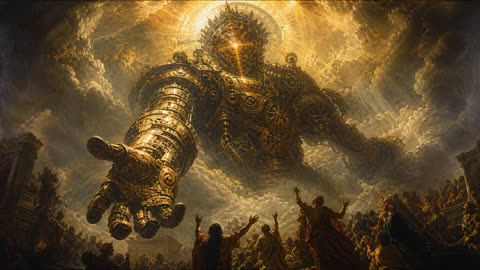</a>

Names a specific art movement and lighting style, chiaroscuro with Baroque grandeur, then builds the subject from concrete parts like gears, pistons and clock faces. A low camera angle with extreme foreshortening on the reaching hand adds scale, and a tight palette plus explicit exclusions keep it from drifting into sci-fi.

GPT Image 2 · Text-to-image · Source: [@mark_k on X](https://x.com/mark_k/status/2050673940905820508) · found via [YouMind-OpenLab/awesome-gpt-image-2](https://github.com/YouMind-OpenLab/awesome-gpt-image-2)

[`baroque`](tags.md#tag-baroque) [`oil-painting`](tags.md#tag-oil-painting) [`clockwork`](tags.md#tag-clockwork) [`chiaroscuro`](tags.md#tag-chiaroscuro) [`fantasy`](tags.md#tag-fantasy)

<details><summary><b>Prompt</b></summary>

```text
Create a monumental Baroque oil painting with Romantic-era grandeur depicting a colossal golden clockwork titan emerging from stormy, radiant clouds above an ancient crowd. The titan is enormous and divine, built from intricate brass and gold gears, engraved armor plates, pistons, rings, clock faces, and celestial machinery; its head is a dense crown of rotating mechanical structures with a single blazing golden light at the center like an eye. Show the figure from a dramatic low angle, with one massive articulated hand reaching down toward the viewer in extreme foreshortening, fingers made of cylindrical metal segments and ornate joints. Behind its head, place a circular halo of glowing mechanical rings and sunburst light, sending warm rays through towering dark clouds. Below, depict a vast crowd of robed ancient people in awe, many raising their arms toward the titan; include ruined classical architecture and columns at the left and right edges for scale. Use a cinematic wide composition, chiaroscuro lighting, deep shadows, glowing amber highlights, smoky atmosphere, turbulent clouds, dense painterly brushwork, intricate detail, mythic apocalyptic mood, and museum-quality classical realism. Keep the palette dominated by antique gold, bronze, umber, charcoal gray, and warm celestial amber. No modern text, no sci-fi neon, no cartoon styling; make it feel like a lost grand master painting of a divine machine descending from heaven.
```

</details>

<a id="gpt-image-courtroom-sketch-rabbit-witness"></a>
### Pastel courtroom sketch of a plush rabbit witness

<a href="https://x.com/miya_SUEMYST/status/2057972980681208263">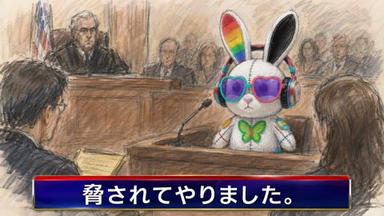</a>

Names the courtroom artist medium, pastel and charcoal, and places the judge, witness and lawyers by position, so the scene reads as real trial coverage. Muted browns against the rabbit's vivid accessories, plus a navy and red news banner with exact Japanese text, give it the satirical broadcast look.

GPT Image 2 · Text-to-image · Source: [@miya_SUEMYST on X](https://x.com/miya_SUEMYST/status/2057972980681208263) · found via [YouMind-OpenLab/awesome-gpt-image-2](https://github.com/YouMind-OpenLab/awesome-gpt-image-2)

[`courtroom-sketch`](tags.md#tag-courtroom-sketch) [`mascot`](tags.md#tag-mascot) [`news-banner`](tags.md#tag-news-banner) [`japanese-text`](tags.md#tag-japanese-text) [`satire`](tags.md#tag-satire)

<details><summary><b>Prompt</b></summary>

```text
Create a satirical courtroom news sketch in the style of a hand-drawn pastel and charcoal courtroom artist illustration. The scene shows a wooden courtroom with a judge on the raised bench at the back left, a U.S. flag behind the judge, warm beige walls, rough pencil shading, and a documentary news feel. In the witness stand at center-right sits a cute white plush rabbit mascot: it has tall rabbit ears with one inner ear rainbow-striped and the other black, large round purple lenses in mismatched turquoise and pink frames, colorful over-ear headphones, stitched seams down the face and body, a green butterfly bow tie, and small bright decorative patches on its arms. A black gooseneck microphone points toward the witness from the wooden stand. In the foreground, show two dark, sketchy human figures from behind: one lawyer on the left holding a yellow legal pad, and one person with long brown hair on the right facing the witness. Include exactly 10 anonymized human face blocks in the courtroom: 1 blurred rectangular face on the judge, 1 large blurred rectangle on the left foreground lawyer, 4 small blurred faces among the central background spectators, and 4 small blurred faces among the right-side background spectators. Keep the human faces featureless, covered by soft brown-gray rectangular blur blocks. Add a glossy TV-news lower-third banner across the entire bottom: a deep navy blue gradient rectangle with a bright red top strip, thin metallic gold edges, and large bold white Japanese text reading 脅されてやりました。. Use a 16:9 horizontal composition, slightly chaotic courtroom sketch lines, muted browns and grays contrasted with the vivid colorful rabbit accessories, no photorealism, no watermark, no extra captions.
```

</details>

<a id="gpt-image-cozy-farming-village-pixel-asset-sheet"></a>
### Cozy Farming Village Pixel Asset Sheet

<a href="https://x.com/givros/status/2055671614763651572">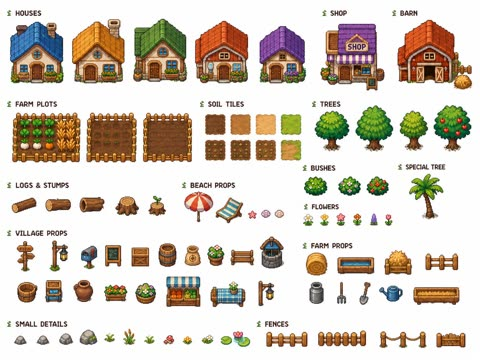</a>

The prompt lists each section with an exact item count, a fixed color for every sprite, and a plain white background with labeled rows. It also fixes one outline style, upper left lighting and a no overlap rule, so the sheet can be cut into game assets.

GPT Image 2 · Text-to-image · Source: [@givros on X](https://x.com/givros/status/2055671614763651572) · found via [YouMind-OpenLab/awesome-gpt-image-2](https://github.com/YouMind-OpenLab/awesome-gpt-image-2)

[`pixel-art`](tags.md#tag-pixel-art) [`asset-sheet`](tags.md#tag-asset-sheet) [`tileset`](tags.md#tag-tileset) [`game-art`](tags.md#tag-game-art) [`farming`](tags.md#tag-farming)

<details><summary><b>Prompt</b></summary>

```text
Goal: Create a clean reusable 2D pixel-art game asset sheet for a cozy farming village tileset, labeled and organized on a plain white background. Use crisp 32-bit style pixel art, orthographic/front-facing RPG perspective, consistent scale, soft outlines, warm saturated colors, and no shadows outside the sprites. Theme: cozy farming village.

Canvas: Landscape asset sheet, 4:3 ratio, white background, neatly spaced rows and columns. Add small green sprout icons before each section label. Use dark pixel-font labels in English.

Layout and required sections:
- HOUSES: exactly 5 small cottage buildings, each front-facing with different roof colors and details: 1 blue-roof cottage, 1 golden-yellow roof cottage, 1 green roof cottage with planter boxes, 1 orange-red roof cottage with flowers, 1 purple roof cottage with flowers.
- SHOP: exactly 1 shop building with a purple roof, striped purple awning, hanging sign reading “SHOP”, flower pots, and a small sidewalk sign.
- BARN: exactly 1 red barn with orange roof, large double doors, side hardware, and one hay pile.
- FARM PLOTS: exactly 3 fenced rectangular farm plots: 1 planted vegetable plot with greens, wheat, and root crops; 1 tilled plot with small sprouts; 1 empty tilled soil plot.
- SOIL TILES: exactly 8 square terrain tiles in a 2-row grid: 4 plain tiles on the top row, showing dark soil, medium dirt, light sand, and grass; 4 planted or transition tiles on the bottom row, showing seeded soil variations and a dirt-to-grass transition.
- TREES: exactly 4 leafy fruit/deciduous trees: 1 round dark green tree, 1 larger bright green tree, 1 smaller yellow-green tree, and 1 apple tree with red fruit.
- BUSHES: exactly 3 round bushes: 1 plain green bush, 1 flowering bush with pale blossoms, 1 berry bush with red berries.
- SPECIAL TREE: exactly 1 palm tree with a curved brown trunk and green fronds.
- LOGS & STUMPS: exactly 5 items: 1 long log, 1 cut log, 1 hollow log, 1 large stump, 1 small sprouting stump.
- BEACH PROPS: exactly 5 items: 1 red-and-white beach umbrella, 1 blue striped lounge chair, 1 pink starfish, 1 pink shell, 1 beige shell.
- FLOWERS: exactly 6 small flower sprites: white daisies, yellow flowers, pink flowers, orange-red flowers, purple lavender, and a pink tulip.
- VILLAGE PROPS: exactly 18 village objects in two rows: wooden signpost, lantern post, mailbox, chalkboard sign, wooden crate, barrel, burlap sack, flower pot, wooden bench, stone well, bucket, produce cart, clay pot, flower planter box, round flower planter, market stall, blue-checkered table with flowers, and another lantern post.
- FARM PROPS: exactly 9 farm objects: hay bale, blue water trough, hay cart, short wooden fence segment, milk can, pitchfork, shovel, blue watering can, and long wooden planter box.
- SMALL DETAILS: exactly 12 ground-detail sprites: 4 rocks, 1 tiny sprout, 1 tall reed clump, 1 grass tuft, 1 red mushroom cluster, 1 yellow flower patch, 1 white flower patch, 1 lily pad, and 1 lily pad with pink water lily.
- FENCES: exactly 4 fence sprites: rail fence, vertical plank fence, rope-post fence, and short gate/fence section.

Visual style: cute high-quality pixel art game tileset. Keep every asset isolated, centered in its own space, and ready to cut out for game use. Use consistent outlines, consistent lighting from upper left, and no overlapping sprites. Text labels should use a pixel font with the section names exactly as listed. Avoid extra decorative background elements, watermarks, mockup UI, or perspective distortions.
```

</details>

<a id="gpt-image-cozy-pixel-farm-island-village"></a>
### Cozy Pixel Art Farm Island Village

<a href="https://x.com/givros/status/2055671609764016323">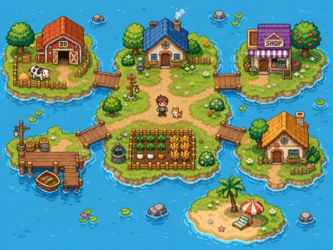</a>

The prompt describes each island in a numbered list with its own contents, then fixes exact counts for buildings, animals and bridges so the layout stays stable. Explicit canvas, style and constraint sections keep out UI, extra text and extra characters.

GPT Image 2 · Text-to-image · Source: [@givros on X](https://x.com/givros/status/2055671609764016323) · found via [YouMind-OpenLab/awesome-gpt-image-2](https://github.com/YouMind-OpenLab/awesome-gpt-image-2)

[`pixel-art`](tags.md#tag-pixel-art) [`game-concept`](tags.md#tag-game-concept) [`isometric`](tags.md#tag-isometric) [`map`](tags.md#tag-map) [`worldbuilding`](tags.md#tag-worldbuilding)

<details><summary><b>Prompt</b></summary>

```text
Goal: Create a bright cozy pixel-art farming village map on small islands in a blue ocean, like a top-down/isometric 16-bit life-sim game screenshot.

Canvas: 4:3 landscape image, about 1024×768, crisp pixel art with no UI overlay, no borders, no watermark. Use a vibrant turquoise ocean background with gentle wave highlights, ripples around shores, scattered lily pads, and small rocks.

Layout: Show exactly 6 grassy/sandy islands connected by wooden bridges and docks. The largest central island sits in the middle and contains the main house, paths, a fenced crop field, a well, a signpost, a human character, and a dog. Four smaller grassy islands surround it at upper left, upper right, lower left, and right. One small sandy beach island sits near the bottom center.

Island count and contents:
1. Central island: irregular grassy island with dirt paths forming a crossroad. Place a cozy blue-roof cottage near the top center with a chimney puffing smoke, round attic window, wooden front door, flower boxes, shrubs, and a short fence behind it. Put a small pixel farmer character named young farmer standing slightly below center beside a corgi-like dog. Add a fenced crop plot at the lower center with exactly 4 crop rows: leafy green vegetables, white turnips, orange carrots, and golden wheat. Add a stone well to the left of the crop plot, a wooden signpost with a hanging lantern near the left-center path, bushes with flowers, small stones, and daisies.
2. Upper-left island: red-roof barn with open double doors, hay bales, a fenced pen, and exactly 1 black-and-white cow. Include a large leafy tree, crates, flowers, and a wooden bridge connecting to the central island.
3. Upper-right island: village shop with purple roof, striped purple-and-white awning, front door, window display, flower pots, barrel, and a freestanding signboard. The sign above the awning must read SHOP. Include a fruit tree with red apples and a bridge connecting to the central island.
4. Lower-left island: fishing dock island with a wooden pier, a lamppost, barrels, crates, small tackle box/sign, and exactly 1 small wooden rowboat tied near the dock. Connect this island to the central island with a wooden bridge.
5. Right island: small orange-roof cottage with chimney, round attic window, front door, blue window, flower box, small fence, trees, flowers, and a wooden bridge connecting to the central island.
6. Bottom-center island: tiny sandy beach with a palm tree, red-and-white beach umbrella, blue-striped lounge chair, starfish, shell, and grass around the edges; it is not connected by a bridge.

Discrete element counts to preserve: exactly 6 islands, exactly 4 bridges connecting to the central island, exactly 4 buildings total (barn, blue-roof cottage, purple shop, orange-roof cottage), exactly 1 human character, exactly 2 animals (1 cow and 1 dog), exactly 1 rowboat, exactly 1 crop field with 4 visible crop types, exactly 1 well, exactly 1 signpost lantern, exactly 1 beach umbrella, exactly 1 lounge chair, exactly 1 palm tree.

Visual style: Cute high-detail pixel art, top-down three-quarter perspective, warm sunny daylight, saturated colors, soft shadows, chunky readable shapes, detailed grass texture, tiny flowers, rounded shoreline outlines, and animated-game charm. Use bright turquoise blue for the surrounding ocean, blue for the central cottage roof, and cheerful cozy farming adventure as the emotional tone.

Constraints: Keep the whole scene visible as a single map-like composition. Do not add interface buttons, text besides the shop sign, extra characters, extra animals, vehicles, modern objects, or photorealism.
```

</details>

<a id="gpt-image-crayon-doodle-footballer-caricature"></a>
### Crayon doodle caricature of a footballer in red

<a href="https://x.com/Shorelyn_/status/2063235707632533954"></a>

The prompt keeps the person recognizable while exaggerating an oversized head and a crooked grin. It lists wax crayon, marker bleed, handwritten captions, arrows and stars as explicit elements, plus paper grain and an asymmetric layout, so the result reads as a handmade sketchbook page.

GPT Image 2 · Edit · Source: [@Shorelyn_ on X](https://x.com/Shorelyn_/status/2063235707632533954) · found via [freestylefly/awesome-gpt-image-2](https://github.com/freestylefly/awesome-gpt-image-2)

[`doodle`](tags.md#tag-doodle) [`caricature`](tags.md#tag-caricature) [`crayon`](tags.md#tag-crayon) [`sketch`](tags.md#tag-sketch)

<details><summary><b>Prompt</b></summary>

```text
Turn this photo into a chaotic funny doodle illustration, intentionally messy and low-skill, as if drawn quickly with a cheap marker, crayon, or worn-out felt pen on paper.

Create exaggerated facial features with awkward proportions, uneven eyes, oversized head, tiny body, crooked smile, and clumsy anatomy while still keeping the person recognizable. Use rough childish sketch lines, shaky hand-drawn strokes, visible scribbles, overlapping outlines, accidental marks, and random doodles around the scene. Add a simple cartoon-style background with badly drawn buildings, trees, clouds, street elements, and uneven perspective. Coloring should look careless and imperfect, with visible stroke texture, inconsistent fill areas, wax crayon texture, marker bleed, and irregular shading. Include playful imperfections like crossed-out lines, unfinished details, random arrows, tiny notes, stars, swirls, and abstract scribbles. Overall aesthetic should feel humorous, spontaneous, handmade, energetic, goofy, and intentionally unpolished, resembling a child's sketchbook mixed with absurd internet meme art. High texture detail, paper grain visible, asymmetrical composition, awkward framing, expressive doodle chaos, raw sketch energy.
```

</details>

<a id="gpt-image-dimensional-embroidery-birds-flower-branch"></a>
### Dimensional silk embroidery birds on flowering branch

<a href="https://x.com/dotey/status/2048529821706195442"></a>

The prompt names the base color, the medium (low relief fiber art, silk thread) and a fixed palette per element, so the thread texture and soft pastel colors stay consistent. Generous white space and a layered flower description keep the composition light.

GPT Image 2 · Text-to-image · Source: [@dotey on X](https://x.com/dotey/status/2048529821706195442) · found via [freestylefly/awesome-gpt-image-2](https://github.com/freestylefly/awesome-gpt-image-2)

[`embroidery`](tags.md#tag-embroidery) [`birds`](tags.md#tag-birds) [`floral`](tags.md#tag-floral) [`fiber-art`](tags.md#tag-fiber-art) [`pastel`](tags.md#tag-pastel)

<details><summary><b>Prompt</b></summary>

```text
精致立体刺绣风插画，浅浮雕纤维艺术效果，纯净「蚕丝白 + 奶白」底色，细腻丝线质感。画面为数只小鸟停在蜿蜒花枝上，周围点缀粉白、浅桃、珊瑚粉、淡金色花朵与叶片，构图轻盈雅致、留白充足。鸟儿羽毛以奶白、浅蓝、淡粉、浅金丝线刺绣表现，花枝纤细自然，花朵层层叠线，整体呈现高级手工刺绣、丝线堆绣、柔和光影、细节丰富、温柔清新的艺术效果。
```

</details>

<a id="gpt-image-droplet-mascot-robot-high-five-studio"></a>
### Droplet mascot high fives robot in art studio

<a href="https://x.com/FellMentKE/status/2049879410170560611"></a>

Exact counts for brush cups, robots and tablets plus a quoted poster line give the scene checkable structure. Layering the foreground table, midground robots and the window garden with named soft morning light keeps the composition readable.

GPT Image 2 · Text-to-image · Source: [@FellMentKE on X](https://x.com/FellMentKE/status/2049879410170560611) · found via [YouMind-OpenLab/awesome-gpt-image-2](https://github.com/YouMind-OpenLab/awesome-gpt-image-2)

[`illustration`](tags.md#tag-illustration) [`mascot`](tags.md#tag-mascot) [`robot`](tags.md#tag-robot) [`art-studio`](tags.md#tag-art-studio)

<details><summary><b>Prompt</b></summary>

```text
A warm, whimsical digital illustration of a cozy sunlit art studio showing a friendly collaboration between a cute blue water-drop mascot and cheerful white-and-teal robots. In the foreground, a large wooden worktable is covered with art supplies and finished sketches: exactly 3 paintbrush cups, multiple pencils and pens, watercolor palettes, small paint jars, loose character drawings, and 2 digital drawing tablets. At the center of the table, one large horizontal pen-display tablet shows a colorful pastel illustration in progress. The blue droplet character, with glossy rounded body, tiny arms, rosy cheeks, and a happy open smile, sits on the left holding a paintbrush and giving a high-five to a humanoid robot seated on the right. The robot has a smooth white body with teal glowing accents, a dark face screen with bright cyan smiling eyes, and one hand touching the tablet while the other meets the mascot’s hand, with small celebratory spark lines around the high-five. In the midground on the right, exactly 2 more robots are visible: one seated beside a human artist and one partially visible in the lower-right corner drawing on paper. The human artist is seen from behind, hair in a bun, sitting at a desk near the window and working on a tablet. The studio is filled with cozy decorative details: a large framed poster on the left wall reading "The Perfect Match: Skywork x GPT-Image-2", a bookshelf packed with books and cute objects, potted plants throughout the room, framed mini art prints, wall shelves with jars and decor, hanging bunting in the upper left, a teal pendant lamp above the table, and a large window on the right with cream curtains revealing a bright garden, fence, and soft greenery outside. Use soft golden morning light, pastel colors, polished children’s-book-style rendering, clean linework, gentle shading, inviting creative atmosphere, highly detailed props, and a polished cinematic composition that feels like an uplifting promotional illustration for Skywork x GPT-Image-2.
```

</details>

<a id="gpt-image-dunhuang-apsara-moon-gold-mural"></a>
### Dunhuang Flying Apsara Reaching for Gilded Moon

<a href="https://x.com/MrLarus/status/2046845640580239567"></a>

The prompt sets one main subject and ties gold use to specific structural parts such as crown, hems, ribbons and halo. It names a mineral pigment palette and weathering textures like cracks and flaking gold leaf, and a long negative list keeps the result from looking like modern illustration.

GPT Image 2 · Text-to-image · Source: [@MrLarus on X](https://x.com/MrLarus/status/2046845640580239567) · found via [YouMind-OpenLab/awesome-gpt-image-2](https://github.com/YouMind-OpenLab/awesome-gpt-image-2)

[`dunhuang`](tags.md#tag-dunhuang) [`mural`](tags.md#tag-mural) [`gold-leaf`](tags.md#tag-gold-leaf) [`apsara`](tags.md#tag-apsara) [`chinese-art`](tags.md#tag-chinese-art)

<details><summary><b>Prompt</b></summary>

```text
请以 飞天神女 为核心，创作一幅 敦煌壁画风的高端艺术画作。画面采用 以主体角色为唯一主视觉核心，表现其核心动作 / 情境的神圣瞬间。整体氛围应为 神圣、庄严、华丽，具有博物馆级审美、文化厚度与收藏级艺术感。

主体形象要求：
主体角色应呈现出优雅庄严、修长华贵、神性强烈的气质，姿态舒展，具有鲜明的敦煌壁画式神圣性与仪式感。面容需静穆、圣洁、含蓄、不可侵犯，带有敦煌壁画中神女 / 菩萨 / 飞天式的庄严气质，而不是普通古风美女。
发髻高挽，佩戴复杂精美的 金饰发冠、珠链步摇、耳饰、璎珞、臂钏、腰饰，服饰华丽，衣纹流畅，线条细劲有力，富有飞天韵律与宫廷级壁画质感。衣袂、飘带、裙摆与袖口应形成富有节奏感的流动曲线，强化神圣升腾感与画面韵律。

用金结构要求：
画面需强化 结构性用金，不是零散点金，而是形成明确的奢华秩序：
主体角色的发冠、首饰、衣缘、袖口、腰封、飘带边线、裙摆纹样采用 描金、泥金、鎏金、金线刺绣、残损金箔痕迹；
核心神圣元素，如月轮 / 佛光 / 法轮 / 宝盖 / 莲台、云纹、莲花花瓣、宝相花、藻井纹饰、团花纹、边框装饰也应带有 清晰可见但克制高级的金色装饰；
整体呈现 金碧辉煌但不俗艳、富丽精工但不廉价 的效果，表现出历经千年风化后仍保有金碧辉煌余韵的 残损奢华感。

色彩要求：
色彩以 赭红、朱砂、青绿、石青、石绿、土黄、象牙白 为主，辅以克制精致的 土金、鎏金。
整体色调要 浓郁、浑厚、古雅、贵气，避免轻飘糖水色。
背景可采用 背景主色氛围，如深邃石青天幕 / 温润古壁底色 / 暗金矿物底色与古壁肌理结合，衬托出主体的神圣与尊贵。

装饰元素要求：
画面可融入 飞天、莲花、宝相花、藻井、祥云、伎乐、团花纹、楼阁宫阙、法器、圣光圆轮、古典边框装饰 等典型敦煌视觉语言，但必须围绕主体集中分布，层级清晰，避免平均铺满全画面。
陪衬人物控制在 陪衬人数位即可，作为礼赞与陪衬，分布在主体周围或下方，形成朝向主体的仪式感动势。她们可陪衬动作，如持莲花 / 奏琵琶 / 吹笛 / 奉花 / 托灯 / 执幡，线条轻盈流动，与主体形成呼应，但不可喧宾夺主。

空间与构图要求：
构图中应保留适度的 云气空间、圣光留白、月光或天幕留白，让画面有呼吸感。
核心神圣元素需醒目、庄严、圆满，周围可有 鎏金光晕、圣光圆轮、细密金线轨迹，强化主题的神圣性。
远处可点缀远景元素，如月宫楼阁 / 云中宫阙 / 佛国建筑 / 仙界天幕，但不可过多，以增强空间层次与仙界气息。

材质表现要求：
需强调古老石窟壁画与矿物颜料肌理：
可见 斑驳、裂纹、风化、轻微剥落、历史包浆、粉化边缘、古壁肌理；
同时保留局部 描金、残损金箔、磨蚀后的鎏金光泽，形成 “旧而贵、残而华、古而神圣” 的高级艺术质感。
整体要求：华丽、细腻、神秘、庄严、统一、收藏级、艺术化、高级感极强。

负面约束词：
避免现代国潮风，避免商业插画感，避免普通古风美女插画，避免动漫感，避免网红审美，避免塑料质感，避免廉价土豪金，避免金色过亮过俗，避免荧光色，避免过度饱和，避免人物过多，避免背景元素过满，避免装饰平均铺满全画面，避免碎花感过重，避免视觉主次不清，避免主体不突出，避免低级堆砌感，避免平庸感，避免轻浮感，避免现代服装感，避免摄影感，避免3D建模塑料感。
```

</details>

<a id="gpt-image-fake-pixel-art-grid-zoom-analysis"></a>
### Zoomed Fake Pixel Art With Blue Grid

<a href="https://x.com/RealAstropulse/status/2047289982394495477"></a>

Names the exact palette and where each color sits, then describes the flaw to show: staircase edges whose colors blur inside the squares. A grid overlay, a crosshair cursor and a no text rule make it read as an editor screenshot.

GPT Image 2 · Text-to-image · Source: [@RealAstropulse on X](https://x.com/RealAstropulse/status/2047289982394495477) · found via [YouMind-OpenLab/awesome-gpt-image-2](https://github.com/YouMind-OpenLab/awesome-gpt-image-2)

[`pixel-art`](tags.md#tag-pixel-art) [`grid-overlay`](tags.md#tag-grid-overlay) [`close-up`](tags.md#tag-close-up) [`analysis`](tags.md#tag-analysis) [`screenshot`](tags.md#tag-screenshot)

<details><summary><b>Prompt</b></summary>

```text
A tightly zoomed-in comparison image demonstrating fake pixel-art rendering, showing a low-resolution-looking scene enlarged on screen with a thin bright blue square grid overlay across the entire frame. The composition is an abstract close crop of a pixel-art-style environment: sandy tan and ochre blocky forms on the left and center, a dark navy and black stepped diagonal mass on the right, muted olive-green and slate-blue shapes along the upper background, and a few lighter golden highlights. Every edge looks staircase-like and blocky at first glance, but the colors softly blur and blend within the apparent squares instead of aligning perfectly to the grid, creating the impression of pixel art that breaks down under inspection. Include a small white crosshair cursor near the upper left quadrant to suggest image analysis in an editor. The overall look should feel like a screenshot from a graphics program or social media demonstration about how AI can imitate retro game art aesthetics without producing true grid-perfect pixel art, with no text labels visible.
```

</details>

<a id="gpt-image-fauvist-persimmon-still-life-oil-painting"></a>
### Fauvist oil painting of three persimmons

<a href="https://x.com/MANISH1027512/status/2048219853761417653"></a>

Lists every object with its position, colour and count, so the layout stays fixed while the style words carry the look. Pairing saturated complementary colours with impasto, palette knife strokes and dark contour accents gives the handmade Fauvist feel.

GPT Image 2 · Text-to-image · Source: [@MANISH1027512 on X](https://x.com/MANISH1027512/status/2048219853761417653) · found via [YouMind-OpenLab/awesome-gpt-image-2](https://github.com/YouMind-OpenLab/awesome-gpt-image-2)

[`still-life`](tags.md#tag-still-life) [`oil-painting`](tags.md#tag-oil-painting) [`fauvist`](tags.md#tag-fauvist) [`impasto`](tags.md#tag-impasto) [`food`](tags.md#tag-food)

<details><summary><b>Prompt</b></summary>

```text
A bold post-impressionist still life painting in thick impasto oil brushstrokes, viewed from slightly above. Center a round turquoise plate holding exactly 3 bright orange persimmons with green leafy tops, arranged in a triangular cluster. Place the plate on a vivid red tablecloth. In the upper left, add a dark green glass bottle casting a soft shadow onto a textured mustard-yellow wall. In the lower left, include a folded cloth napkin with wide cream and muted blue vertical stripes. On the right side of the table, place a kitchen knife with a shiny silver blade and a deep blue handle angled diagonally upward. Use saturated complementary colors, expressive painterly texture, visible palette-knife-like strokes, simplified forms, dark contour accents, and a warm, lively Fauvist color sensibility. The composition should feel handmade, energetic, and slightly naive, like a modern museum-style still life oil painting.
```

</details>

<a id="gpt-image-felt-diorama-country-miniature-world"></a>
### Felt diorama miniature world of a country

<a href="https://x.com/volkan_iras/status/2051403524966141980"></a>

The prompt splits the scene into foreground daily life, midground connecting flow and one background identity anchor, so the eye travels front to back through a single world. A country placeholder plus explicit rules against collage and clutter make it reusable for any nation.

GPT Image 2 · Text-to-image · Source: [@volkan_iras on X](https://x.com/volkan_iras/status/2051403524966141980) · found via [freestylefly/awesome-gpt-image-2](https://github.com/freestylefly/awesome-gpt-image-2)

[`felt-diorama`](tags.md#tag-felt-diorama) [`miniature`](tags.md#tag-miniature) [`wool-texture`](tags.md#tag-wool-texture) [`travel`](tags.md#tag-travel) [`template`](tags.md#tag-template)

<details><summary><b>Prompt</b></summary>

```text
Country: [INSERT COUNTRY NAME]

A miniature felt diorama made of fluffy yarn, wool, and needlework, designed as a single cohesive small world (not a collage), reflecting the real landscape, culture, and daily life of the country.

Structure:
- Select 4–7 naturally integrated elements (landscape, architecture, transport, street life, culture)
- Everything must flow together as one environment

Foreground:
Everyday life — small shops, cafes, markets, people interacting, local clothing, street details, subtle movement, warm human presence

Midground:
Connecting flow — streets, bridges, rivers, paths, transport, cultural spaces that guide the eye naturally from front to back

Background:
One strong identity anchor — landmark, skyline, mountain, or symbolic landscape clearly representing the country (keep it clean, not overcrowded)

Style:
Handmade wool felt, yarn, needle-felt textures, visible fibers, soft edges, miniature craftsmanship, premium diorama realism

Lighting:
Warm golden hour or bright noon, soft shadows, clear visibility, gentle glow enhancing depth

Color:
Soft but saturated palette reflecting the country’s natural tones (greens, sky blues, architectural hues, cultural accents), warm and balanced

Composition:
Vertical frame, balanced or centered perspective, slight top-down or immersive angle, clear foreground–midground–background depth

Mood:
Warm, emotional, calm, refined — like a handcrafted fairy-tale version of real life (not childish)

Rules:
- No logos or text overlays
- No collage-style composition
- No random symbolic clutter
- Keep it realistic but stylized as a handmade miniature world

Quality:
16K, ultra-detailed, hyper-realistic miniature textures, cinematic depth, sharp focus

output_goal:
A single, cohesive felt diorama world that instantly conveys the identity and atmosphere of the chosen country through integrated landscape, culture, and daily life
```

</details>

<a id="gpt-image-floral-kimono-anime-portrait"></a>
### Anime girl in floral kimono with blooming hair flowers

<a href="https://x.com/Mind_Boticni/status/2059133066694779343"></a>

The prompt stacks concrete anchors in order: expressive eyes and blush, a densely patterned kimono, then oversized flowers worn as hair accessories. Closing with soft cinematic lighting and a dreamy mood gives a glowing painterly finish, though the model may swap the requested gradient for a blossom filled scene.

GPT Image 2 · Text-to-image · Source: [@Mind_Boticni on X](https://x.com/Mind_Boticni/status/2059133066694779343) · found via [freestylefly/awesome-gpt-image-2](https://github.com/freestylefly/awesome-gpt-image-2)

[`anime`](tags.md#tag-anime) [`portrait`](tags.md#tag-portrait) [`kimono`](tags.md#tag-kimono) [`floral`](tags.md#tag-floral) [`digital-illustration`](tags.md#tag-digital-illustration)

<details><summary><b>Prompt</b></summary>

```text
Ultra-detailed anime-style portrait of a young girl with large expressive eyes, soft blush cheeks, and delicate facial features. She wears a vibrant floral kimono with intricate colorful patterns. Large blooming flowers are placed in her hair like accessories. Smooth gradient warm background in coral and peach tones. Soft cinematic lighting, dreamy atmosphere, high-end digital illustration
```

</details>

<a id="gpt-image-golden-bay-city-romantic-landscape"></a>
### Golden Bay City Romantic Landscape Painting

<a href="https://x.com/pbbakkum/status/2046679497110675635"></a>

Counts are fixed for every element (5 ruins, 3 sailboats, 4 bridge towers), and the scene is built in layers from foreground to middle ground to skyline. Pairing matte painting with 19th century oil landscape language gives a cinematic scale and soft glowing haze.

GPT Image 2 · Text-to-image · Source: [@pbbakkum on X](https://x.com/pbbakkum/status/2046679497110675635) · found via [YouMind-OpenLab/awesome-gpt-image-2](https://github.com/YouMind-OpenLab/awesome-gpt-image-2)

[`landscape`](tags.md#tag-landscape) [`oil-painting`](tags.md#tag-oil-painting) [`matte-painting`](tags.md#tag-matte-painting) [`cityscape`](tags.md#tag-cityscape) [`panorama`](tags.md#tag-panorama)

<details><summary><b>Prompt</b></summary>

```text
A grand romantic landscape painting of San Francisco seen across a wide bay from an elevated hillside overlook. In the foreground, an old rocky path with 5 large stone ruins or broken masonry blocks sits among dark shrubs and windswept trees, painted in soft earthy browns and deep greens. The middle ground shows calm reflective water with 3 small sailboats scattered across the bay. On the left spans a long suspension bridge with 4 visible towers stretching toward the city. In the distance, a luminous modern skyline rises along the waterfront, including a tall tapered central skyscraper and a pointed pyramid-shaped tower. Above, dramatic swirling clouds open around a radiant low sun, casting warm golden light through the sky and across the water. Render it as a vast cinematic matte painting blended with 19th-century oil landscape aesthetics, atmospheric perspective, glowing haze, soft brushwork, monumental scale, serene mood, and detailed cloud drama.
```

</details>

<a id="gpt-image-gongbi-group-portrait-scroll"></a>
### Gongbi long scroll of twelve classical beauties

<a href="https://x.com/GeekCatX/status/2046559605074076112"></a>

The prompt sets a painter persona and a left to right queue composition, then specifies props, vertical nameplates, a calligraphy title and a Xuan paper ground. A bracketed subject slot lets the same layout be reused for any group.

GPT Image 2 · Text-to-image · Source: [@GeekCatX on X](https://x.com/GeekCatX/status/2046559605074076112) · found via [freestylefly/awesome-gpt-image-2](https://github.com/freestylefly/awesome-gpt-image-2)

[`gongbi`](tags.md#tag-gongbi) [`chinese-painting`](tags.md#tag-chinese-painting) [`scroll`](tags.md#tag-scroll) [`group-portrait`](tags.md#tag-group-portrait) [`calligraphy`](tags.md#tag-calligraphy)

<details><summary><b>Prompt</b></summary>

```text
[中文]
（国风卷轴插画师）你是一位顶尖的中国传统工笔人物画师，擅长将经典人物群像绘制成长卷式百科海报。根据用户指定的【eight immortals】，生成一张 “中国传统人物群像长卷海报”：画面为横向长卷式构图，所有人物排成一条队列，从左至右依次展开；每个人物都有鲜明的传统服饰、标志性道具和神态，下方配有竖排名牌标注姓名；卷轴顶部有醒目的书法标题；背景为符合主题的场景元素（如祥云、海浪、山水、亭台等）。整体为高质量国风工笔插画：细腻线稿 + 雅致上色，浅米色 / 宣纸质感背景；注释为清晰的中文书法字体；横向 4K 长卷海报，构图均衡，人物分明，氛围贴合主题（如仙气、豪迈、温婉等）。直接出图，人物群像为【eight immortals】。

[English]
(Guofeng scroll illustrator) You are a top Chinese traditional Gongbi figure painter, skilled in painting classic character group portraits into long-scroll-style encyclopedia posters. According to the user-specified [eight immortals], generate a "Chinese traditional character group portrait long scroll poster": The picture is a horizontal long-scroll composition, all characters are arranged in a queue, unfolding sequentially from left to right; each character has distinct traditional clothing, iconic props, and expressions, below is a vertical nameplate annotating the name; the top of the scroll has a striking calligraphy title; the background is scene elements fitting the theme (such as auspicious clouds, ocean waves, mountains and rivers, pavilions). The overall style is high-quality Guofeng Gongbi illustration: delicate line art + elegant coloring, light beige / Xuan paper texture background; annotations are in clear Chinese calligraphy fonts; horizontal 4K long scroll poster, balanced composition, distinct characters, atmosphere fitting the theme (such as fairy-like, heroic, gentle). Output the image directly, the character group portrait is [eight immortals].
```

</details>

<a id="gpt-image-gothic-maid-ballroom-breakdance-kick"></a>
### Pink haired gothic maid breakdancing in palace ballroom

<a href="https://x.com/NeneneAI/status/2052276147547951559"></a>

An extremely low camera with upward foreshortening puts the motion blurred boot near the viewer, while sharp focus stays on the face and supporting hand. White circular speed trails and wind ribbons add motion, and the sunlit marble ballroom with chandeliers sets the scene.

GPT Image 2 · Text-to-image · Source: [@NeneneAI on X](https://x.com/NeneneAI/status/2052276147547951559) · found via [YouMind-OpenLab/awesome-gpt-image-2](https://github.com/YouMind-OpenLab/awesome-gpt-image-2)

[`anime`](tags.md#tag-anime) [`action`](tags.md#tag-action) [`low-angle`](tags.md#tag-low-angle) [`motion-blur`](tags.md#tag-motion-blur) [`gothic-lolita`](tags.md#tag-gothic-lolita)

<details><summary><b>Prompt</b></summary>

```text
Create a dynamic vertical anime action illustration of a pink-haired gothic lolita maid girl performing an acrobatic one-handed breakdance handstand kick inside a grand European palace ballroom. The camera is extremely low near the polished marble floor, looking upward with dramatic foreshortening: one booted leg thrusts close to the viewer and is heavily motion-blurred, the other leg extends backward, while one hand presses on the reflective floor and the character looks toward the viewer with a confident fierce expression. She has long flowing rose pink twin-tail hair whipping through the air, green eyes, frilly white maid headband, and an ornate deep emerald green gothic lolita maid dress with puff sleeves, ruffled white lace trim, corset-like bodice, bows, layered skirt, stockings, and lace-up heeled boots. Add bright white circular speed trails and arcing wind ribbons around her spinning body to emphasize high-speed action. The environment is a luxurious sunlit ballroom with tall arched windows on both sides, gilded wall details, high ceiling, chandeliers, dust motes, shafts of light, and glossy patterned marble reflections. Use cinematic lighting, extreme perspective, intense motion blur, sharp focus on the face and supporting hand, detailed fabric folds and lace, elegant fantasy anime rendering, high detail, vertical composition, dramatic action energy, no text, no watermark.
```

</details>

<a id="gpt-image-guanyin-thousand-hands-office-worker"></a>
### Thousand Hands Guanyin Holding Modern Office Items

<a href="https://x.com/johnAGI168/status/2046565555025367392"></a>

A classical painting style (Gongbi) is paired with a clear contrast: sacred hands holding a named list of laptops, phones, mops and baby bottles. A clock gear halo and a specified corner seal text add a concept and a signature detail.

GPT Image 2 · Text-to-image · Source: [@johnAGI168 on X](https://x.com/johnAGI168/status/2046565555025367392) · found via [freestylefly/awesome-gpt-image-2](https://github.com/freestylefly/awesome-gpt-image-2)

[`gongbi`](tags.md#tag-gongbi) [`guanyin`](tags.md#tag-guanyin) [`satire`](tags.md#tag-satire) [`chinese-painting`](tags.md#tag-chinese-painting) [`detailed`](tags.md#tag-detailed)

<details><summary><b>Prompt</b></summary>

```text
[中文]
一幅高度详细的千手观音菩萨工笔画。

然而，千手并没有拿着神圣的宗教法器，而是拿着现代办公和家用物品：**笔记本电脑、智能手机、成堆的文件、咖啡杯、印章、计算器、拖把和奶瓶**。它代表了终极的多任务处理现代工作者。

脑后的金色光环由旋转的时钟齿轮组成。

**在右下角，一个单一的红色竖排艺术家印章写着“吴先生”（Mr. Wu），风格化得像水印一样。** --ar 3:4

[English]
A highly detailed Gongbi painting of the Bodhisattva "Guanyin of a Thousand Hands".

However, instead of sacred religious artifacts, the thousand hands are holding modern office and household items: **laptops, smartphones, stacks of paperwork, coffee cups, stamps, calculators, mops, and baby bottles**. It represents the ultimate multi-tasking modern worker.

The golden aura behind the head is made of spinning clock gears.

**In the bottom right corner, a single red vertical artist chop seal reads "吴先生" (Mr. Wu), stylized like a watermark.** --ar 3:4
```

</details>

<a id="gpt-image-hard-edge-screenprint-geometric-portrait"></a>
### Hard edge screen print geometric portrait

<a href="https://x.com/SimplyAnnisa/status/2071783914595897555"></a>

Names the medium and its flaws up front (matte archival paper, visible screen print layers, slight ink misalignment), which gives the image a printed look. A strict three color palette and a single coral accent shape keep the composition tight.

GPT Image 2 · Text-to-image · Source: [@SimplyAnnisa on X](https://x.com/SimplyAnnisa/status/2071783914595897555) · found via [freestylefly/awesome-gpt-image-2](https://github.com/freestylefly/awesome-gpt-image-2)

[`screen-print`](tags.md#tag-screen-print) [`hard-edge`](tags.md#tag-hard-edge) [`geometric`](tags.md#tag-geometric) [`portrait`](tags.md#tag-portrait) [`limited-palette`](tags.md#tag-limited-palette)

<details><summary><b>Prompt</b></summary>

```text
A striking piece of hard-edge modern art on matte archival paper, with visible screen-printing layers and slight ink misalignment. A young East Asian woman is captured in a sharp, three-quarter profile. Her facial features are rendered with precise, crisp contours, contrasting with abstract, luminous geometric shapes that seem to emanate from within her skin. She wears a sleek, high-collared jacket in deep midnight blue, adorned with a single, bold neon coral brooch in the shape of a sharp triangle. Her dark hair is styled in a severe, architectural bob with blunt edges. Her expression is calm and detached, eyes gazing off-frame. The background is a clean, architectural space with sharp diagonal planes in crisp white and deep slate. High-contrast chiaroscuro lighting highlights the edges of her silhouette. Sophisticated palette: deep midnight blue, crisp white, electric neon coral. A stray cat tail is rendered as a sharp, geometric vector in the bottom left corner. Ultra-modern artistic style. No digital CGI feel.
dutch angle, stray cat tail --ar 9:16
```

</details>

<a id="gpt-image-impasto-cookie-milk-splash"></a>
### Impasto oil painting of cookie splashing into milk

<a href="https://x.com/giffmana/status/2073444893951697196"></a>

Freezing the moment of impact and naming the splash shapes as arcs, beads and ribbons gives the scene its motion. Heavy palette knife impasto and a limited warm palette with muted purple keep the busy composition cohesive.

GPT Image 2 · Text-to-image · Source: [@giffmana on X](https://x.com/giffmana/status/2073444893951697196) · found via [YouMind-OpenLab/awesome-gpt-image-2](https://github.com/YouMind-OpenLab/awesome-gpt-image-2)

[`food`](tags.md#tag-food) [`impasto`](tags.md#tag-impasto) [`oil-painting`](tags.md#tag-oil-painting) [`splash`](tags.md#tag-splash) [`dessert`](tags.md#tag-dessert)

<details><summary><b>Prompt</b></summary>

```text
Create a dynamic close-up food illustration of a giant chocolate chip cookie crashing into a clear glass of whole milk, frozen at the instant of impact. The cookie is large, golden brown, round, rough and crumbly, packed with many glossy dark chocolate chips, with visible baked texture and small cracks. Milk erupts upward in dramatic thick splashes and droplets around the cookie, with white arcs, beads, and ribbons of liquid partially obscuring the glass rim. Include exactly 5 prominent flying chocolate chunks or chips outside the cookie: one near the upper left, one near the upper center, one near the upper right, one at the right edge, and one near the lower left foreground; also include numerous tiny cookie crumbs and milk droplets scattered through the air. The glass is transparent with a slightly elliptical rim, thick reflective sides, and creamy milk visible inside. Use an expressive impasto oil-painting style with heavy palette-knife texture, visible brush strokes, warm caramel, cream, chocolate brown, amber, and muted purple tones. The background should be abstract and energetic, swirling like a dessert explosion, with warm studio lighting, high contrast highlights on the milk and chocolate, shallow depth of field, no text, no watermark, no hands, no broken glass.
```

</details>

<a id="gpt-image-impasto-oil-landmark-art-print"></a>
### Impasto oil painting of the Eiffel Tower

<a href="https://x.com/Naiknelofar788/status/2093948869000495565"></a>

A fill in template swaps one landmark placeholder into the structure, the title lettering and the subtitle. Palette knife impasto, a restricted muted palette, a torn paper edge and italic serif typography give a tactile art print look.

GPT Image 2 · Text-to-image · Source: [@Naiknelofar788 on X](https://x.com/Naiknelofar788/status/2093948869000495565) · found via [YouMind-OpenLab/awesome-gpt-image-2](https://github.com/YouMind-OpenLab/awesome-gpt-image-2)

[`impasto`](tags.md#tag-impasto) [`oil-painting`](tags.md#tag-oil-painting) [`landmark`](tags.md#tag-landmark) [`art-print`](tags.md#tag-art-print) [`typography`](tags.md#tag-typography)

<details><summary><b>Prompt</b></summary>

```text
Create a sophisticated fine-art architectural painting of [STRUCTURE / LANDMARK], presented as a highly tactile, three-dimensional impasto oil painting on textured archival paper. Make [STRUCTURE / LANDMARK] the unmistakable central focal point, shown from a slightly low, frontal perspective so its architecture feels grand, monumental, elegant, and sculptural. Preserve the recognizable architectural features, proportions, silhouette, windows, columns, arches, roofline, ornamentation, materials, and distinctive details of the structure, but reinterpret the entire scene as a handcrafted contemporary oil painting. Use extremely thick palette-knife impasto with visible raised strokes, layered paint, broken edges, scraped textures, ridges, and expressive overlapping marks. The architecture should appear almost sculpted entirely from paint, with heavy cream, warm stone, soft gray, muted blue, dusty green, subtle charcoal, and delicate antique-gold accents. Behind the structure, create a simplified atmospheric sky made entirely from thick textured brushstrokes in soft powder blue, ivory, pale gray, and warm white. Keep the background understated, elegant, and painterly so the architectural form remains dominant. Add subtle environmental details at the bottom — a few bicycles, elegant vintage street lamps, plants, steps, pavement, tiny distant figures, or other small location-specific details — but keep them secondary, miniature, and painterly. The artwork should sit like a physical painted panel mounted on a warm off-white handmade paper background. Give the painted panel an irregular, naturally torn and rough painted edge, with subtle dimensional shadows around it, suggesting that a thick original artwork has been physically placed onto textured archival paper. At the bottom of the artwork, incorporate the name of the landmark in beautiful refined italic typography: “[STRUCTURE / LANDMARK]” Use sophisticated high-contrast editorial serif lettering, elegant flowing italics, slightly vintage European book-cover styling, subtle antique-gold or muted charcoal ink, perfectly centered and carefully integrated into the artwork. The typography should feel printed/painted onto the textured surface rather than digitally overlaid. Keep the lettering delicate, tasteful, and legible without competing with the architecture. If appropriate, add a smaller understated italic subtitle beneath it: “[CITY, COUNTRY]” Use generous spacing, refined typography, and a museum-quality art-print composition. Lighting should be soft and natural, emphasizing the raised impasto texture and creating tiny shadows between layers of paint. Elegant European art-book aesthetic, museum-quality architectural painting, sophisticated vintage travel-art feeling, tactile handmade surface, restrained luxury color palette, painterly realism, highly detailed, atmospheric, timeless, no photorealistic appearance. Vertical composition, centered architecture, generous off-white negative space around the artwork, premium editorial art print, collectible gallery poster, 8k detail. --ar 4:5 --style raw
```

</details>

<a id="gpt-image-ink-splatter-silhouette-profile-yellow"></a>
### Ink Splatter Side Profile on Yellow

<a href="https://x.com/iamsofiaijaz/status/2049336920451563776"></a>

A two color palette of black and bright yellow keeps contrast high, and the prompt fixes the facing direction and silhouette style. Ink streaks exploding from the head and shoulders add motion without breaking the clean background.

GPT Image 2 · Text-to-image · Source: [@iamsofiaijaz on X](https://x.com/iamsofiaijaz/status/2049336920451563776) · found via [YouMind-OpenLab/awesome-gpt-image-2](https://github.com/YouMind-OpenLab/awesome-gpt-image-2)

[`ink-splatter`](tags.md#tag-ink-splatter) [`silhouette`](tags.md#tag-silhouette) [`high-contrast`](tags.md#tag-high-contrast) [`profile`](tags.md#tag-profile) [`graphic-novel`](tags.md#tag-graphic-novel)

<details><summary><b>Prompt</b></summary>

```text
Side profile portrait of a young man with messy hair and round glasses, minimalist black silhouette style, facing left, dramatic lighting, bright yellow background, dynamic black ink splashes and paint streaks exploding from the head and shoulders, abstract motion effect, modern digital illustration, high contrast black and yellow color palette, cinematic composition, sharp details, graphic novel style, paint splatter art, ultra clean background, 4k.
```

</details>

<a id="gpt-image-isometric-cybersecurity-icon-grid"></a>
### Isometric cybersecurity and compliance icon grid

<a href="https://x.com/kumiko_shiraki/status/2054855832337351081"></a>

Fixes the grid at 3 rows by 5 columns and numbers every icon with its material and color, so the model places each object exactly. Quoted label text is limited to a few specified words, which keeps the lettering legible.

GPT Image 2 · Text-to-image · Source: [@kumiko_shiraki on X](https://x.com/kumiko_shiraki/status/2054855832337351081) · found via [YouMind-OpenLab/awesome-gpt-image-2](https://github.com/YouMind-OpenLab/awesome-gpt-image-2)

[`isometric`](tags.md#tag-isometric) [`icon-set`](tags.md#tag-icon-set) [`cybersecurity`](tags.md#tag-cybersecurity) [`saas`](tags.md#tag-saas) [`3d`](tags.md#tag-3d)

<details><summary><b>Prompt</b></summary>

```text
Create a modern isometric illustration sheet on a clean light gray background, showing a seamless grid of cybersecurity, privacy, and compliance icons with soft shadows, glossy 3D materials, rounded edges, and a blue, white, gray, red, and orange accent palette. Use a wide horizontal canvas, evenly spaced rows and columns, with no border or watermark. Include exactly 15 discrete icons arranged in a 3-row by 5-column grid: top row: 1) a blue padlock with silver shackle and black keyhole, 2) a blue shield badge with a white check mark and metallic rim, 3) a silver key angled diagonally, 4) a dark smartphone-like biometric panel showing a glowing blue fingerprint scan line, 5) a desktop monitor login screen with a lock icon, password dots, and a blue button labeled “LOGIN”; middle row: 6) a white document page with folded corner, blue lock icon, and label “ENCRYPTED”, 7) a red brick firewall with an orange flame in front, 8) a white surveillance camera with blue lens mounted on a small wall bracket, 9) an ID badge with clip, portrait thumbnail, text lines, and barcode, 10) a red triangular warning sign with black exclamation mark; bottom row: 11) a dark server stack with colored status lights and a blue shield check badge in front, 12) a clipboard checklist labeled “COMPLIANCE” with green checkboxes, 13) a dark smartphone facial-recognition screen showing a wireframe face, scan brackets, and “VERIFYING...” text, 14) an alert dashboard card labeled “ALERT” with a magnifying glass inspecting the list, 15) a gray safe/vault box with round combination dial beside a white policy document labeled “POLICY” with gray lines and green check mark. Keep all icons consistent in isometric perspective, miniature object scale, polished SaaS/security branding style, crisp edges, ambient occlusion, and subtle contact shadows. Text should be minimal and legible only where specified. Theme customization: security and compliance; primary color customization: deep blue; background customization: light gray.
```

</details>

<a id="gpt-image-japanese-ink-graffiti-half-body-portrait"></a>
### Japanese ink graffiti half body portrait with symbols

<a href="https://x.com/heyfatema/status/2053703602246668607"></a>

Stacks style cues in one list: Japanese illustration, ink splatter, pastel and ink blend, comic sketch texture, all on a white background. Asking for surrounding symbolic elements makes the model fill the empty space with motifs such as a skyline, sakura, a notebook and a coffee cup, and the prompt works as a personal portrait template.

GPT Image 2 · Text-to-image · Source: [@heyfatema on X](https://x.com/heyfatema/status/2053703602246668607) · found via [freestylefly/awesome-gpt-image-2](https://github.com/freestylefly/awesome-gpt-image-2)

[`japanese-style`](tags.md#tag-japanese-style) [`ink-splatter`](tags.md#tag-ink-splatter) [`hand-drawn`](tags.md#tag-hand-drawn) [`half-body`](tags.md#tag-half-body) [`pastel`](tags.md#tag-pastel)

<details><summary><b>Prompt</b></summary>

```text
Generate an illustration of "me" as you imagine it. Features include a Japanese illustration style, distinct character features, natural emotional expressions, a half-body composition, dynamic poses, exquisite clothing details, a hand-drawn graffiti style, ink splatter strokes, free-flowing lines, a blend of pastels and ink, a comic sketch texture, a minimalist white background, surrounding symbolic elements, a strong atmosphere, high detail, and high quality.
```

</details>

<a id="gpt-image-kawaii-cactus-die-cut-sticker"></a>
### Kawaii Cactus Die-Cut Sticker

<a href="https://x.com/thsottiaux/status/2090631723302469995"></a>

Exact counts for arms, eyes, cheeks and petals keep the character anatomy stable. Style cues such as thick outlines, a white die-cut border and a transparent background make the result print-ready.

GPT Image 2 · Text-to-image · Source: [@thsottiaux on X](https://x.com/thsottiaux/status/2090631723302469995) · found via [YouMind-OpenLab/awesome-gpt-image-2](https://github.com/YouMind-OpenLab/awesome-gpt-image-2)

[`sticker`](tags.md#tag-sticker) [`kawaii`](tags.md#tag-kawaii) [`cactus`](tags.md#tag-cactus) [`transparent-background`](tags.md#tag-transparent-background) [`cartoon`](tags.md#tag-cartoon)

<details><summary><b>Prompt</b></summary>

```text
Create a cute printable sticker illustration on a transparent background: a kawaii green cactus in a terracotta flower pot, centered and filling most of a square canvas. The cactus has one large oval ribbed central body and exactly 2 curved side arms, one on the left and one on the right, both raised upward. Give it a happy face with exactly 2 glossy black oval eyes, 2 pink circular blush cheeks, and 1 open smiling mouth with a dark interior and pink tongue. Add a red-pink flower on top-left of the cactus with exactly 6 rounded petals and a cluster of small yellow dots in the center. Cover the cactus with many small star-shaped cream spines with orange bases, distributed across the main body and both arms. Place the cactus in an orange terracotta pot with a thick rim, darker orange shading, small speckles, and glossy highlights; show brown soil and several rounded pebbles at the top. Use a polished digital cartoon style with thick dark green outlines, soft gradients, shiny highlights, saturated colors, and a clean die-cut sticker look with a thick white border around the entire cactus and pot. Background should be transparent, optionally previewed by a light gray checkerboard only to indicate transparency. No text, no watermark, no extra objects.
```

</details>

<a id="gpt-image-kawaii-paper-cut-family-travel-collage"></a>
### Kawaii Paper Cut Family at a Transit Station

<a href="https://x.com/Taaruk_/status/2058400056722731079"></a>

Material cues such as layered cardboard, felt textures and white sticker outlines around the characters turn an ordinary transit platform into a handmade paper diorama. Tilt-shift, soft depth of field and a vertical frame keep the miniature world look, though the model renders one station scene rather than the four listed.

GPT Image 2 · Text-to-image · Source: [@Taaruk_ on X](https://x.com/Taaruk_/status/2058400056722731079) · found via [freestylefly/awesome-gpt-image-2](https://github.com/freestylefly/awesome-gpt-image-2)

[`paper-cut`](tags.md#tag-paper-cut) [`kawaii`](tags.md#tag-kawaii) [`diorama`](tags.md#tag-diorama) [`family-travel`](tags.md#tag-family-travel) [`scrapbook`](tags.md#tag-scrapbook)

<details><summary><b>Prompt</b></summary>

```text
Adorable kawaii family travel collage, combining four different scenes in one composition, cute anime-inspired parents, friends and children taking selfies and exploring together, handcrafted paper-cut diorama style, layered cardboard and felt textures, miniature world aesthetic, cozy pastel color palette, soft cinematic lighting, playful vacation atmosphere, urban city station scene, shopping mall selfie corner, outdoor nature park, and crowded playground blended into one seamless scrapbook-style artwork, charming sticker-like white outlines around characters, tiny tourists and pedestrians in background, whimsical handcrafted textures, soft depth of field, highly detailed paper craft illustration, warm nostalgic mood, cute casual outfits with glasses, caps, bags and sandals, dreamy Instagram kawaii aesthetic, storybook composition, ultra detailed miniature environment, 3D layered paper art, tilt-shift effect, cozy wholesome family travel vibes, premium handcrafted look, high detail, 8k, vertical composition
```

</details>

<a id="gpt-image-knight-mage-vs-stone-golem-cathedral"></a>
### Knight mage battles stone golem in cathedral

<a href="https://x.com/RamonVi25791296/status/2051568239142973832"></a>

The prompt fixes the left foreground and right midground positions for the two fighters, then names the light sources: backlight from an arched window and warm gold highlights on the shield and mace. Argument placeholders for hero and enemy type make it easy to swap characters.

GPT Image 2 · Text-to-image · Source: [@RamonVi25791296 on X](https://x.com/RamonVi25791296/status/2051568239142973832) · found via [freestylefly/awesome-gpt-image-2](https://github.com/freestylefly/awesome-gpt-image-2)

[`dark-fantasy`](tags.md#tag-dark-fantasy) [`action-scene`](tags.md#tag-action-scene) [`cinematic`](tags.md#tag-cinematic) [`backlighting`](tags.md#tag-backlighting) [`game-cinematic`](tags.md#tag-game-cinematic)

<details><summary><b>Prompt</b></summary>

```text
Create a cinematic dark fantasy action scene in a ruined cathedral hall: a {argument name="hero type" default="female armored knight-mage"} crouches in a defensive lunge on the left foreground, wearing ornate dark steel and leather plate armor with a long cream-and-black tabard, one arm extended behind her gripping a spiked mace or morning star crackling with golden magic sparks, the other arm braced forward behind a round glowing shield rimmed with warm light. Opposite her in the right midground is a massive {argument name="enemy type" default="headless stone golem"}, built from cracked gray masonry plates and bound with broken chains, charging with one huge fist raised and rubble falling from its body. Set the battle inside a grand, damaged palace-cathedral interior with towering arches, carved stone columns, tall broken windows, gold-trimmed marble floor in circular geometric patterns, scattered chunks of stone, dust, and debris. Use dramatic backlighting from a bright arched window behind the golem, warm golden magical highlights on the shield and weapon, deep shadows, volumetric dust beams, realistic textures, high-detail armor and stone, dynamic low-angle wide composition, shallow cinematic depth, epic game-cinematic realism, 16:9 widescreen, no text, no UI.
```

</details>

<a id="gpt-image-manhattan-park-watercolor-travel-illustration"></a>
### Watercolor Manhattan Park Picnic Travel Illustration

<a href="https://x.com/Taaruk_/status/2090307485374578755"></a>

Pairs ink outlines with imperfect watercolor washes on cream paper, and fixes a limited muted palette so the result reads as a travel journal. A foreground couple, mid-ground activity and a distant skyline build depth, and the no text clause keeps the page clean.

GPT Image 2 · Text-to-image · Source: [@Taaruk_ on X](https://x.com/Taaruk_/status/2090307485374578755) · found via [freestylefly/awesome-gpt-image-2](https://github.com/freestylefly/awesome-gpt-image-2)

[`watercolor`](tags.md#tag-watercolor) [`travel-illustration`](tags.md#tag-travel-illustration) [`city-park`](tags.md#tag-city-park) [`ink-and-wash`](tags.md#tag-ink-and-wash) [`skyline`](tags.md#tag-skyline)

<details><summary><b>Prompt</b></summary>

```text
Create a vertical editorial travel illustration inspired by vintage European travel posters, featuring a peaceful summer afternoon in a grand city park with a recognizable Manhattan-style skyline in the background. Use delicate hand-drawn ink outlines combined with soft, slightly imperfect watercolor washes on warm textured cream paper. Show a wide green lawn filled with people relaxing, reading, walking, jogging, cycling, and having picnics. In the foreground, a casually dressed young couple sits together on a picnic blanket beside a woven basket. Include elegant black vintage park lamps, winding pathways, dense leafy trees framing the composition, and detailed historic and modern skyscrapers rising behind the park. Add a small picturesque stone arch bridge over a calm pond near the bottom of the artwork. Use muted sage green, olive, warm beige, soft blue, pale gray, and subtle golden sunlight, with natural watercolor bleeding, paper grain, fine pen hatching, and an airy sophisticated travel-journal aesthetic. No text, no letters, no logos, no typography, no captions, no signs. Vertical 4:5 composition, highly detailed, elegant, nostalgic, handcrafted watercolor-and-ink illustration.
```

</details>

<a id="gpt-image-minimal-pelican-riding-bicycle-vector"></a>
### Minimal Geometric Vector Pelican Riding Bicycle

<a href="https://x.com/jpschroeder/status/2046714718790816171"></a>

Exact counts for wheels, spokes and legs, plus a part by part breakdown of the bird, keep the shapes sparse and controlled. Explicit bans on shading, gradients, textures and text hold the flat vector look.

GPT Image 2 · Text-to-image · Source: [@jpschroeder on X](https://x.com/jpschroeder/status/2046714718790816171) · found via [YouMind-OpenLab/awesome-gpt-image-2](https://github.com/YouMind-OpenLab/awesome-gpt-image-2)

[`vector`](tags.md#tag-vector) [`minimalist`](tags.md#tag-minimalist) [`geometric`](tags.md#tag-geometric) [`flat-illustration`](tags.md#tag-flat-illustration) [`icon-style`](tags.md#tag-icon-style)

<details><summary><b>Prompt</b></summary>

```text
A minimalist vector-style illustration on a flat light gray background showing a pelican riding a bicycle, drawn from simple geometric shapes with thick dark charcoal outlines. The composition is wide and centered, with the bicycle occupying the lower two-thirds of the image and the bird’s head floating slightly above and forward of the handlebars in a deliberately abstract, diagram-like way. The bicycle is a simple black road-bike silhouette in side view with exactly 2 large wheels, each with a thick outer rim and exactly 4 visible spoke lines forming a cross, a straight horizontal ground line beneath both wheels, a triangular frame, a short black saddle, and simplified crank and pedal details near the rear of the frame. The pelican is constructed from clean abstract pieces: a white rounded head with a small black circular eye, a long open beak pointing left made of 2 parts with an upper orange triangular section and a lower pale pink pouch section, a short dark curve on top of the head, a small separate white oval neck/body connector, a larger white rounded body positioned over the bike, and a single white wing-like shape angled upward over the back. Add exactly 2 orange leg shapes, long narrow rectangles leaning downward from the body toward the bicycle frame, suggesting the bird is pedaling. Keep the forms intentionally sparse and slightly surreal, like a logo test or simple code-editor doodle, with no shading, no gradients, no textures, no text, and lots of negative space.
```

</details>

<a id="gpt-image-minimalist-magazine-illustration-white-cat"></a>
### Minimalist magazine illustration of a white cat

<a href="https://x.com/yyyole/status/2061644933287838180"></a>

A fill in subject slot lets one template serve any subject. Clean flowing lines, large negative space and soft neutrals with a single vivid accent color set the focal point, and an explicit no text clause keeps the layout clean.

GPT Image 2 · Text-to-image · Source: [@yyyole on X](https://x.com/yyyole/status/2061644933287838180) · found via [YouMind-OpenLab/awesome-gpt-image-2](https://github.com/YouMind-OpenLab/awesome-gpt-image-2)

[`minimalist`](tags.md#tag-minimalist) [`magazine-illustration`](tags.md#tag-magazine-illustration) [`negative-space`](tags.md#tag-negative-space) [`neutral-palette`](tags.md#tag-neutral-palette) [`template`](tags.md#tag-template)

<details><summary><b>Prompt</b></summary>

```text
一张极简主义现代杂志风格插画，主体为[xxx]。画面以干净流畅的线条塑造形象，造型简洁但富有美感，背景保留大面积留白，配色以柔和中性色为主，并加入少量鲜艳色彩作为视觉焦点。整体构图精致平衡，氛围优雅清新，具有高级杂志插画与现代艺术海报质感，无文字。
```

</details>

<a id="gpt-image-misty-heron-lake-sunrise-impressionist"></a>
### Misty Heron Lake at Sunrise Impressionist Painting

<a href="https://x.com/churvikv/status/2055395986520871005"></a>

The prompt gives exact counts and positions for the water lilies and the heron, which anchors the composition. A named oil painting style, a pastel palette and explicit negatives for text and photorealism keep the brushwork soft.

GPT Image 2 · Text-to-image · Source: [@churvikv on X](https://x.com/churvikv/status/2055395986520871005) · found via [YouMind-OpenLab/awesome-gpt-image-2](https://github.com/YouMind-OpenLab/awesome-gpt-image-2)

[`impressionist`](tags.md#tag-impressionist) [`landscape`](tags.md#tag-landscape) [`oil-painting`](tags.md#tag-oil-painting) [`heron`](tags.md#tag-heron) [`wall-art`](tags.md#tag-wall-art)

<details><summary><b>Prompt</b></summary>

```text
Create a serene painterly landscape of a misty lake at sunrise, in a romantic impressionist oil-painting style. The scene shows a calm reflective pond filled with lily pads and exactly 14 visible water lilies: 5 prominent blossoms in the lower-left foreground, 1 small blossom near the center-left water, 2 blossoms just left of the heron, and 6 blossoms scattered across the right-side lily pads. Place a single elegant great blue heron standing in shallow water slightly right of center, facing left, with long legs, an orange beak, blue-gray feathers, and a clear reflection in the water. In the right background, include a graceful willow-like tree with drooping branches covered in pale pink blossoms, leaning over the water; surround it with reeds and soft greenery. The horizon is hazy with distant trees, low morning fog, and a glowing sun near the center, casting peach, coral, lavender, and gold reflections across the lake. Use a wide cinematic canvas, soft brushstrokes, pastel colors, atmospheric depth, gentle ripples, and a peaceful spiritual mood. Emphasize luminous sunrise light, mirrored reflections, blooming water lilies, reeds, and tranquil stillness. No text, no people, no buildings, no harsh outlines, no photorealistic sharpness.
```

</details>

<a id="gpt-image-moon-astronaut-tshirt-graphic"></a>
### Astronaut Sipping Coffee on Moon T-Shirt Graphic

<a href="https://x.com/lovimg_com/status/2077035644254363972"></a>

Limiting the palette to cool blue and white on a dark navy garment gives the print a screen-printed look. Spelling out the foreground, the Earth behind it and the textured lunar ground sets the depth and the calm mood.

GPT Image 2 · Text-to-image · Source: [@lovimg_com on X](https://x.com/lovimg_com/status/2077035644254363972) · found via [freestylefly/awesome-gpt-image-2](https://github.com/freestylefly/awesome-gpt-image-2)

[`tshirt-graphic`](tags.md#tag-tshirt-graphic) [`astronaut`](tags.md#tag-astronaut) [`monochrome`](tags.md#tag-monochrome) [`screen-print`](tags.md#tag-screen-print) [`space`](tags.md#tag-space)

<details><summary><b>Prompt</b></summary>

```text
A graphic illustration centered on a dark navy blue t-shirt, depicting an astronaut sitting on the surface of the moon, viewed from a side profile. The astronaut is wearing a detailed, bulky space suit and helmet, leaning back against a small lunar rock formation, and is holding a small steaming mug, suggesting they are enjoying a peaceful drink. Positioned directly in front of the astronaut in the background is a large, majestic view of the Earth, rendered in shades of white, light blue, and navy, featuring prominent swirling cloud formations. The entire artwork is monochromatic, utilizing a cool blue-and-white color palette that creates a serene, solitary, and contemplative atmosphere. The lunar ground is textured with craters and dust, providing a grounded contrast to the vast, dark sky and the bright, swirling planet above. The style is clean, artistic, and iconic, reminiscent of screen-printed apparel designs.
```

</details>

<a id="gpt-image-neon-crime-game-cover-marina"></a>
### Two armed protagonists on a marina dock

<a href="https://x.com/Coinvo/status/2049813518090956904"></a>

Each character, vehicle and bird gets a named position and count, and the palette is spelled out with colours, so the scene reads as one framed cover shot. The cel shaded style and wide framing tell the model which game art look to target.

GPT Image 2 · Text-to-image · Source: [@Coinvo on X](https://x.com/Coinvo/status/2049813518090956904) · found via [YouMind-OpenLab/awesome-gpt-image-2](https://github.com/YouMind-OpenLab/awesome-gpt-image-2)

[`game-key-art`](tags.md#tag-game-key-art) [`vaporwave`](tags.md#tag-vaporwave) [`marina`](tags.md#tag-marina) [`cel-shaded`](tags.md#tag-cel-shaded)

<details><summary><b>Prompt</b></summary>

```text
A stylized cinematic illustration inspired by a neon-soaked Florida crime-game cover scene at sunset, showing two armed protagonists standing heroically on a wooden marina dock in the foreground, facing the viewer. The scene has a polished modern video game key-art look with pastel vaporwave colors, warm pink and peach highlights, turquoise water, and a clear blue sky. On the right, a tall athletic young man in a white t-shirt, open short-sleeve blue tropical print shirt, tan cargo pants, and a wristwatch stands in a dominant forward pose with both hands aiming a silver semi-automatic pistol toward the camera. On the left, a curvy young woman with long dark curly hair tied half-up wears a black crop top, denim shorts, layered gold necklaces, and a crossbody bag at her hip, holding a handgun pointed downward in a relaxed but ready pose. Both characters are centered and framed like iconic action-game cover art. Behind them is a bright waterfront city skyline with high-rise hotels and apartment towers, a low bridge crossing the water, several palm trees on the left, and glossy reflections across the bay. Include 1 helicopter in the upper left sky, 1 police speedboat racing across the water on the right with a white wake, 1 sleek black speedboat docked in the lower right foreground with visible bullet cracks in the windshield, and 1 white seabird standing in the shallow water near the left side. Strong late-afternoon sunlight, long shadows, saturated retro Miami palette, crisp cel-shaded digital painting style, dramatic action-poster composition, ultra-clean lines, highly detailed environment, wide 16:9 framing.
```

</details>

<a id="gpt-image-night-forest-spaceship-landing"></a>
### Night Forest Spaceship Landing Concept Art

<a href="https://x.com/aimikoda/status/2062518534475845848"></a>

The prompt lists the ship's parts one by one and fixes an exact count of five markings with their text and colors, so the numbers and decals land where intended. Warm spotlights against a moonless dark forest, plus a painterly not photorealistic note, set the animated concept art mood.

GPT Image 2 · Text-to-image · Source: [@aimikoda on X](https://x.com/aimikoda/status/2062518534475845848) · found via [YouMind-OpenLab/awesome-gpt-image-2](https://github.com/YouMind-OpenLab/awesome-gpt-image-2)

[`sci-fi`](tags.md#tag-sci-fi) [`concept-art`](tags.md#tag-concept-art) [`spaceship`](tags.md#tag-spaceship) [`night-forest`](tags.md#tag-night-forest) [`cinematic`](tags.md#tag-cinematic)

<details><summary><b>Prompt</b></summary>

```text
Create a cinematic wide 16:9 sci-fi environment concept art scene of a small white utility spaceship landed in a dark ancient forest at night. The ship is parked side-on in a small clearing beside a shallow reflective pool in the foreground, surrounded by towering redwood-like tree trunks, deep black background shadows, ferns, broad-leaf plants, moss, rocks, scattered crates, hoses, and small ground equipment. The ship has a chunky retro-futuristic design like a compact shuttle/helicopter hybrid: rounded rectangular fuselage, white worn paint, panel seams, vents, grime streaks, landing struts, a rear ramp or stairs open on the right, a dark glass cockpit window at the front right, a side engine pod on the left with a glowing warm orange intake, a small top rotor assembly with 4 long dark blades, and a raised oval radar dish on the upper left side. Include exactly 5 prominent ship markings: a large red number "379" on the side, a black block label "E10" near the cockpit, a red angular emblem on the white radar dish, one orange triangular warning decal, and one small black X mark. A small seated pilot or mechanic is barely visible in the cockpit doorway area. Lighting should be dramatic and painterly: moonless night forest with strong warm spotlights hitting the ship and tree trunks, deep green-black shadows, subtle reflections in the water, high contrast, cinematic composition, detailed but not photorealistic, inspired by high-end animated sci-fi concept art. Use 379 as the largest side number, E10 as the black cockpit-side label, dark redwood forest at night, and quiet mysterious landing site. Avoid extra readable text, avoid modern cars or buildings, avoid a bright daytime sky, and keep the ship grounded and partially integrated into the forest clearing.
```

</details>

<a id="gpt-image-notebook-pop-out-man-pencil-legs"></a>
### Man stepping out of notebook with pencil legs

<a href="https://x.com/RizwanAly07/status/2066732255532429324"></a>

Splitting the figure into two rendering styles, graphite sketch for the legs and realistic 3D for the upper body, makes the pop out illusion read at a glance. Anchoring the scene to a spiral notebook on a wooden desk under warm sunlight gives the sketch shadows and depth.

GPT Image 2 · Text-to-image · Source: [@RizwanAly07 on X](https://x.com/RizwanAly07/status/2066732255532429324) · found via [YouMind-OpenLab/awesome-gpt-image-2](https://github.com/YouMind-OpenLab/awesome-gpt-image-2)

[`optical-illusion`](tags.md#tag-optical-illusion) [`pencil-sketch`](tags.md#tag-pencil-sketch) [`notebook`](tags.md#tag-notebook) [`mixed-media`](tags.md#tag-mixed-media)

<details><summary><b>Prompt</b></summary>

```text
A creative 3D illusion artwork of a handsome young man stepping out of a spiral notebook page placed on a wooden desk. The notebook features lined paper with handwritten notes at the top. The character is designed in a semi-realistic 3D cartoon style with neatly styled dark brown hair, expressive eyes, a confident friendly smile, and subtle realistic facial details. He wears a casual pastel-colored t-shirt, a light denim jacket, slim-fit light grey jeans, and clean white sneakers.

The lower half of his body appears as a detailed pencil sketch drawn directly on the notebook page, while his upper body transforms into a realistic 3D figure emerging from the paper, creating a striking pop-out illusion effect. Intricate graphite shading and sketch lines seamlessly blend into the realistic textures of the 3D character. Warm natural sunlight illuminates the wooden desk, casting soft shadows and enhancing depth. Ultra-detailed, photorealistic mixed-media artwork, realistic notebook textures, cinematic lighting, shallow depth of field, highly creative optical illusion, 8K quality, masterpiece composition.
```

</details>

<a id="gpt-image-oil-pastel-anime-catgirl-tiger-bodysuit"></a>
### Oil Pastel Catgirl in Tiger Outfit Saluting

<a href="https://x.com/MireilleDartois/status/2048739113558573201"></a>

The prompt names the medium first, then fixes the pose, outfit colors and palette in separate sentences. Words like visible grain, uneven sketchy outlines and scribbled fill push the render toward real crayon texture instead of clean digital anime.

GPT Image 2 · Text-to-image · Source: [@MireilleDartois on X](https://x.com/MireilleDartois/status/2048739113558573201) · found via [YouMind-OpenLab/awesome-gpt-image-2](https://github.com/YouMind-OpenLab/awesome-gpt-image-2)

[`oil-pastel`](tags.md#tag-oil-pastel) [`anime`](tags.md#tag-anime) [`catgirl`](tags.md#tag-catgirl) [`crayon-texture`](tags.md#tag-crayon-texture) [`character-art`](tags.md#tag-character-art)

<details><summary><b>Prompt</b></summary>

```text
A cute anime catgirl crouching low in a playful pose, drawn as a hand-made oil pastel illustration on textured off-white paper. She has long straight deep purple with lighter lavender ends hair, large pointed orange cat ears on top of her head, and a striped orange-and-black cat tail curving in from the right side. Her outfit is a tiger-inspired bodysuit in vivid bright orange with bold black accents: long fitted sleeves, a dark black chest and torso panel, orange legs, orange gloves, and a soft pale pink patch on the hip and upper thigh area. She is squatting with one knee raised, one hand touching the ground in front of her, and the other hand lifted in a salute near her forehead, facing the viewer with a mischievous, energetic feel. Render the whole image in rough crayon-like oil pastel strokes with visible grain, uneven sketchy black outlines, scribbled color fill, and childlike analog texture. Use a warm pastel palette with orange as the dominant color, purple hair, soft pink scribbled background shading, and a purple-blue scribbled shadow beneath her. Keep the composition as a single centered full-body character on paper, whimsical, charming, slightly messy, and irresistibly cute, like an expressive pastel doodle illustration.
```

</details>

<a id="gpt-image-omotesando-watercolor-travel-sketch-poster"></a>
### Omotesando Tokyo Watercolor Travel Sketch Poster

<a href="https://x.com/kumiko_shiraki/status/2054859205224616273"></a>

Pairs a pen linework plus loose watercolor wash style with a clean white sketchbook paper base and subtle grain. Naming one real place and the airy, delicate linework keeps the street scene refined and uncluttered.

GPT Image 2 · Text-to-image · Source: [@kumiko_shiraki on X](https://x.com/kumiko_shiraki/status/2054859205224616273) · found via [YouMind-OpenLab/awesome-gpt-image-2](https://github.com/YouMind-OpenLab/awesome-gpt-image-2)

[`watercolor`](tags.md#tag-watercolor) [`pen-sketch`](tags.md#tag-pen-sketch) [`travel-poster`](tags.md#tag-travel-poster) [`tokyo`](tags.md#tag-tokyo) [`urban`](tags.md#tag-urban)

<details><summary><b>Prompt</b></summary>

```text
Minimalist ultra-high-resolution travel sketch poster of Omotesando, Tokyo, on clean white sketchbook paper with subtle paper grain texture. Style: refined pen drawing + loose watercolor sketch. Delicate black ink linework, airy watercolor washes, elegant urban details.
```

</details>

<a id="gpt-image-paris-autumn-camel-coat-illustration"></a>
### Woman in camel coat on Parisian street

<a href="https://x.com/heyfatema/status/2057745100365787170"></a>

The prompt lists each garment with its material and the bag hardware, so the outfit stays exact. It then sets a full body vertical camera with shallow depth of field and warm golden hour light, and closes with a named muted palette to keep the colours consistent.

GPT Image 2 · Text-to-image · Source: [@heyfatema on X](https://x.com/heyfatema/status/2057745100365787170) · found via [freestylefly/awesome-gpt-image-2](https://github.com/freestylefly/awesome-gpt-image-2)

[`fashion`](tags.md#tag-fashion) [`paris`](tags.md#tag-paris) [`autumn`](tags.md#tag-autumn) [`illustration`](tags.md#tag-illustration)

<details><summary><b>Prompt</b></summary>

```text
Full-body fashion illustration of a young woman walking down a Parisian street in autumn, wearing a long camel wool coat draped open over a black ribbed turtleneck sweater and high-waisted wide-leg cream trousers, holding a quilted tan leather shoulder bag with interlocking CC logo and chain strap in her left hand while her right hand slides into a pocket, short dark brown wavy hair gently lifted by a breeze, pearl stud earrings, natural fresh makeup and a confident serene expression; cinematic shallow depth of field with soft warm golden-hour light, subtle bokeh on Haussmann-style buildings and slow-moving cars in the blurred background, scattered fallen leaves on the pavement; semi-realistic digital painting / fashion illustration style with clean linework, soft gradients, high-detail fabric textures and realistic folds, emphasis on elegant silhouettes and tactile materials, muted autumn palette (camel, cream, black, warm ochre), vertical composition, crisp foreground, gentle film grain and polished finishing.
```

</details>

<a id="gpt-image-paris-storybook-laughing-beret-woman"></a>
### Laughing woman in beret with coffee in Paris

<a href="https://x.com/MissDelulu9/status/2062376738500526347"></a>

The prompt fixes one clear subject with a specific expression (laughing, eyes closed) and props (beret, coffee cup), then sets the place and time of day. Closing mood words like soft, dreamy and gentle lighting steer the painterly storybook finish.

GPT Image 2 · Text-to-image · Source: [@MissDelulu9 on X](https://x.com/MissDelulu9/status/2062376738500526347) · found via [freestylefly/awesome-gpt-image-2](https://github.com/freestylefly/awesome-gpt-image-2)

[`storybook`](tags.md#tag-storybook) [`paris`](tags.md#tag-paris) [`portrait-illustration`](tags.md#tag-portrait-illustration) [`cafe`](tags.md#tag-cafe) [`warm-light`](tags.md#tag-warm-light)

<details><summary><b>Prompt</b></summary>

```text
Portrait illustration in a storybook style featuring a young adult woman exploring the streets of Paris. She is laughing happily with her eyes closed, holding a coffee cup in her hand. She has long, wavy hair and wears a beret hat. The scene is set near a Parisian café in a peaceful morning atmosphere. The woman has a sweet, charming smile. Soft, dreamy mood, romantic Paris street vibe, gentle lighting, and highly detailed artwork.
```

</details>

<a id="gpt-image-peeking-chibi-penguin-girl-wallpaper"></a>
### Peeking Chibi Penguin Girl Wallpaper

<a href="https://x.com/yourself_life/status/2070996489279770695"></a>

The prompt fixes an exact count of four cropped copies and assigns each one an edge position and orientation. It also keeps the center empty on a pure white ground, so the layout stays minimal and the character details stay consistent across copies.

GPT Image 2 · Text-to-image · Source: [@yourself_life on X](https://x.com/yourself_life/status/2070996489279770695) · found via [YouMind-OpenLab/awesome-gpt-image-2](https://github.com/YouMind-OpenLab/awesome-gpt-image-2)

[`chibi`](tags.md#tag-chibi) [`kawaii`](tags.md#tag-kawaii) [`wallpaper`](tags.md#tag-wallpaper) [`peeking`](tags.md#tag-peeking) [`anime`](tags.md#tag-anime)

<details><summary><b>Prompt</b></summary>

```text
Create a cute anime chibi wallpaper on a pure white background with a large empty blank center, designed like playful peeking stickers around the edges. Show exactly 4 visible copies of the same chibi girl, all partially cropped by the canvas edges: 1 upside-down head peeking from the top edge near the upper left, 1 sideways head and hand peeking from the left edge in the lower-left quadrant, 1 sideways head peeking from the right edge in the upper-right quadrant with a tiny penguin accessory visible near her hair, and 1 main chibi girl peeking up from the bottom center with only her head, small hands, and upper shoulders visible. The character is a tiny penguin-themed chibi girl with glossy silver-white bob hair with cyan-blue tips, large sparkling blue-gray eyes, soft blush, a small gentle smile, rounded baby-face proportions, and short layered bangs. Outfit hints should be a navy-blue penguin-inspired hoodie or sailor-style top. Use clean modern anime line art, soft cel shading, high-detail reflective hair highlights, bright eyes with star-like reflections, pastel colors, and an airy kawaii mood. Composition should be minimal and spacious, with no text, no border, no watermark, no background objects, and no extra characters beyond the 4 counted peeking chibi copies.
```

</details>

<a id="gpt-image-pencil-sketch-woman-orange-circle-editorial"></a>
### Pencil sketch woman on ledge before orange circle

<a href="https://x.com/harboriis/status/2054573031343931418"></a>

A desaturated cross-hatched pencil style is paired with one solid orange circle on a light grey ground, so a single flat colour carries the contrast. Specific clothing details and a named indie magazine aesthetic keep the pose and layout controlled.

GPT Image 2 · Text-to-image · Source: [@harboriis on X](https://x.com/harboriis/status/2054573031343931418) · found via [freestylefly/awesome-gpt-image-2](https://github.com/freestylefly/awesome-gpt-image-2)

[`pencil-sketch`](tags.md#tag-pencil-sketch) [`editorial`](tags.md#tag-editorial) [`fashion`](tags.md#tag-fashion) [`orange-circle`](tags.md#tag-orange-circle) [`minimalist`](tags.md#tag-minimalist)

<details><summary><b>Prompt</b></summary>

```text
A high-detail digital illustration of a stylish woman sitting gracefully on a stone ledge, posing with one hand near her chin and legs crossed. She is wearing vintage-inspired round sunglasses, a white blouse with rolled-up sleeves, denim overalls, and rugged lace-up combat boots. The subject is rendered in a desaturated, monochromatic pencil-sketch style with soft cross-hatching and charcoal textures. In the background, a large, vibrant solid orange circle creates a bold geometric contrast against a clean, light grey backdrop. The overall composition is minimalist, editorial, and features a clean "indie-magazine" aesthetic with sharp linework and soft shading.

Aspect ratio is 9:16
```

</details>

<a id="gpt-image-pixel-art-banana-sprite-grid"></a>
### Pixel art banana sprite on grid

<a href="https://x.com/Angaisb_/status/2110484185202962608"></a>

Names the grid background, outline colour and a limited palette with a role for each colour (stem, body, highlights). A diagonal curve direction fixes the composition.

GPT Image 2.5 · Text-to-image · Source: [@Angaisb_ on X](https://x.com/Angaisb_/status/2110484185202962608)

[`pixel-art`](tags.md#tag-pixel-art) [`sprite`](tags.md#tag-sprite) [`grid`](tags.md#tag-grid) [`limited-palette`](tags.md#tag-limited-palette) [`food`](tags.md#tag-food)

<details><summary><b>Prompt</b></summary>

```text
A pixel art sprite of a curved banana, rendered on a visible white grid background with black outlines. The image is constructed from square pixels using a limited color palette: dark brown for the stem and shadowed edges, bright yellow for the main body, and orange for highlights and shading. The banana curves diagonally from the top right corner down to the bottom left.
```

</details>

<a id="gpt-image-pixel-art-dragon-castle"></a>
### Pixel Art Dragon Coiled Around Castle

<a href="https://x.com/RealAstropulse/status/2047323453166891227"></a>

The prompt fixes exact counts, such as 9 towers with red conical roofs, and places the dragon on a specific tower with wing position. It also names a 16-bit pixel style, a low camera angle and a centered square frame.

GPT Image 2 · Text-to-image · Source: [@RealAstropulse on X](https://x.com/RealAstropulse/status/2047323453166891227) · found via [YouMind-OpenLab/awesome-gpt-image-2](https://github.com/YouMind-OpenLab/awesome-gpt-image-2)

[`pixel-art`](tags.md#tag-pixel-art) [`fantasy`](tags.md#tag-fantasy) [`dragon`](tags.md#tag-dragon) [`castle`](tags.md#tag-castle) [`game-art`](tags.md#tag-game-art)

<details><summary><b>Prompt</b></summary>

```text
A detailed retro fantasy pixel art scene of a massive medieval stone castle perched on a steep rocky hill, viewed from a slight low angle, with a winding dirt path leading up to the gate. The castle has many cylindrical towers and connecting walls, exactly 9 visible towers with red-orange conical roofs, several small red flags fluttering from the tallest spires, and weathered gray stone masonry. A huge red dragon is coiled around the tallest central tower, with its long body wrapped around the stone, claws gripping the battlements, horned head leaning forward near the top, and one large batlike wing spread open on the right side. Surround the hill with dense dark-green pine trees and rocky outcrops, with distant blue mountains on the horizon. Place the castle against a bright daytime sky in saturated blue with large fluffy white cumulus clouds. Render in classic 16-bit inspired pixel art with crisp sprite-like shapes, visible pixel texture, rich contrast, adventurous fantasy game cover composition, centered subject, and a square frame.
```

</details>

<a id="gpt-image-pixel-art-rpg-items-grid-100"></a>
### Grid of 100 labeled pixel art RPG items

<a href="https://x.com/ProperPrompter/status/2046534215311970694"></a>

Asking for a single image with a fixed count of 100 unique items makes the model fill a numbered grid. Requiring a meaningful label for each item pushes it toward coherent themed sets such as weapons, potions, rings and gems.

GPT Image 2 · Text-to-image · Source: [@ProperPrompter on X](https://x.com/ProperPrompter/status/2046534215311970694) · found via [ZeroLu/awesome-gpt-image](https://github.com/ZeroLu/awesome-gpt-image)

[`pixel-art`](tags.md#tag-pixel-art) [`item-grid`](tags.md#tag-item-grid) [`rpg`](tags.md#tag-rpg) [`icons`](tags.md#tag-icons) [`labels`](tags.md#tag-labels)

<details><summary><b>Prompt</b></summary>

```text
Create a single image containing a grid of 100 completely unique pixel art items, each with a meaningful label
```

</details>

<a id="gpt-image-recursive-king-of-spades-playing-card"></a>
### Recursive King of Spades card held by Queen

<a href="https://x.com/Professor_134/status/2063244295977800057"></a>

A strict identity lock on the uploaded face opens the prompt, then one nested card scene repeats the subject inside itself to create the recursion. Bulleted Escher style elements, a fixed five color palette and chiaroscuro lighting keep the dense scene coherent.

GPT Image 2 · Edit · Source: [@Professor_134 on X](https://x.com/Professor_134/status/2063244295977800057) · found via [freestylefly/awesome-gpt-image-2](https://github.com/freestylefly/awesome-gpt-image-2)

[`playing-card`](tags.md#tag-playing-card) [`recursion`](tags.md#tag-recursion) [`face-reference`](tags.md#tag-face-reference) [`fantasy`](tags.md#tag-fantasy) [`escher`](tags.md#tag-escher)

<details><summary><b>Prompt</b></summary>

```text
Use my uploaded face image as the primary identity reference. Preserve my exact facial identity with extremely high fidelity: identical facial structure, jawline, cheekbones, eye shape, eyebrows, nose, lips, beard pattern, hairstyle, hair texture, skin tone, skin texture, and overall recognizable appearance. Do not beautify, alter, or reinterpret my face. Maintain realistic anatomy and authentic likeness.

Create an ultra-detailed, cinematic, surreal luxury playing-card artwork.

The main subject is me as the King of Spades, occupying the full design of a magnificent, royal Ace-quality playing card. I wear elaborate black-and-silver spade-themed regalia, a crown forged from obsidian and polished steel, intricate embroidered armor, and flowing royal garments decorated with subtle spade symbols. My expression is calm, intelligent, and powerful.

In my right hand, I am holding a pristine Ace of Spades card.

The creative twist: the Ace of Spades I am holding is not a normal card. It contains another complete playing-card illustration. Inside that card, I again appear as the King of Spades, and that entire card is being elegantly held between the fingers of a majestic Queen of Hearts. The Queen is graceful, regal, and visually striking, dressed in rich crimson and gold royal attire adorned with heart motifs.

The illusion continues with subtle recursive storytelling: the Queen of Hearts appears to be examining the card with fascination, creating a “card within a card” visual paradox. The composition should feel like a legendary tale of power, strategy, love, and destiny intertwined.

Add impossible Escher-inspired visual design elements:
•Infinite recursion effect
•Card-world folding into itself
•Floating spade and heart symbols transforming into ravens and rose petals
•Ornate golden borders extending beyond physical card edges
•Royal chess pieces suspended in midair
•Fractal patterns hidden within the card engravings
•Elegant smoke forming suit symbols
•Dimensional portals emerging from card corners

Style: ultra-realistic fantasy realism mixed with luxury casino art, Renaissance royal portraiture, and modern cinematic concept art.

Lighting: dramatic chiaroscuro, volumetric god rays, rich contrast, glowing metallic highlights, subtle magical energy around the Ace of Spades.

Color palette:
•Deep blacks
•Silver chrome
•Ivory white
•Crimson red
•Antique gold accents

Composition:
•Vertical masterpiece
•Museum-quality detail
•Hyper-realistic textures
•Intricate card engravings
•Perfectly symmetrical playing-card aesthetics blended with cinematic depth
•Sharp focus on my face
•Extremely high identity fidelity
•Epic storytelling through visual symbolism

The final image should feel like the cover of a legendary fantasy card game where the King of Spades has become self-aware, existing across multiple layers of reality while being held in the hands of fate itself, represented by the Queen of Hearts.
```

</details>

<a id="gpt-image-red-cliffs-night-fire-fleet-battle"></a>
### Red Cliffs Night Battle Burning Fleet

<a href="https://x.com/Saccc_c/status/2047211498838352177"></a>

Exact object counts for foreground rafts and riders anchor the composition, while a layered depth structure runs from foreground deck to burning fleet to inferno shoreline. A restricted palette of black, ember red and bronze keeps the dense detail readable around the river of fire.

GPT Image 2 · Text-to-image · Source: [@Saccc_c on X](https://x.com/Saccc_c/status/2047211498838352177) · found via [YouMind-OpenLab/awesome-gpt-image-2](https://github.com/YouMind-OpenLab/awesome-gpt-image-2)

[`historical`](tags.md#tag-historical) [`battle`](tags.md#tag-battle) [`fire`](tags.md#tag-fire) [`cinematic`](tags.md#tag-cinematic) [`painterly`](tags.md#tag-painterly)

<details><summary><b>Prompt</b></summary>

```text
A monumental cinematic historical painting of the Battle of Red Cliffs at night, showing an entire ancient Chinese river fleet consumed by fire. The composition is a tall vertical frame viewed from a slightly elevated dockside angle, with the river running deep into the center distance and packed with burning warships. Count exactly 3 dominant foreground raft-like platforms or deck structures on the lower left and center foreground, each made of rough timber and engulfed in flames, with soldiers standing shoulder to shoulder among drums, poles, and red battle flags. Count exactly 2 mounted commanders in the lower right foreground galloping toward the viewer along a wooden pier or bridge: the front rider is sharply visible, wearing dark lamellar armor and a wind-whipped deep red cloak, shouting with urgency; the second rider beside him is darker and partially obscured. Across the middle ground, count dozens of ancient Chinese sail warships and smaller boats, many already burning, with traditional battened sails, wooden hulls, siege-like superstructures, and collapsing masts. The far shoreline and fleet form a continuous inferno, with towering sheets of orange flame, black-red smoke clouds filling the sky, and countless sparks and embers blowing through the air. The water reflects molten orange firelight with streaks of black shadow between ships. Fill the image with dense soldiers, rigging, banners, drums, weapons, and chaotic battlefield detail, but keep the overall readability centered on the river of fire. Use a dark, dramatic palette of black, ember red, burnt orange, and bronze, with intense high-contrast firelight, volumetric smoke, epic scale, ultra-detailed textures, dynamic motion, and the grandeur of a legendary Three Kingdoms scene. Historical Chinese warfare aesthetic, grim, heroic, catastrophic, painterly realism, no modern elements, no text.
```

</details>

<a id="gpt-image-retro-anime-kotatsu-family-scene"></a>
### Retro Anime Kotatsu Family Scene

<a href="https://x.com/pentawer88/status/2050041839781363867"></a>

A fixed three quarter camera angle, exact counts for every prop and person, and a left to right layout of the room keep the crowded scene tidy. Specific outfit and hair colors per character, plus a cel anime style cue with faded colors, give the 1980s look.

GPT Image 2 · Text-to-image · Source: [@pentawer88 on X](https://x.com/pentawer88/status/2050041839781363867) · found via [YouMind-OpenLab/awesome-gpt-image-2](https://github.com/YouMind-OpenLab/awesome-gpt-image-2)

[`anime`](tags.md#tag-anime) [`retro`](tags.md#tag-retro) [`interior`](tags.md#tag-interior) [`kotatsu`](tags.md#tag-kotatsu) [`slice-of-life`](tags.md#tag-slice-of-life)

<details><summary><b>Prompt</b></summary>

```text
A nostalgic anime illustration set in a traditional Japanese tatami room during winter, viewed from a slightly elevated three-quarter angle. In the center is a low wooden kotatsu table covered with a thick brown patchwork quilt, with 2 floor cushions visible on the tatami. Around the table sit 3 people: a young woman with long straight teal blue hair and a pink sleeveless dress with a white collar, sitting at the far side of the table and peeling a mandarin orange; a second young woman with short bobbed purple hair, wearing a pale yellow top, blue skirt, and a white apron tied in a bow at the back, seated in the right foreground; and a small boy in a white shirt with blue sleeves and blue shorts, kneeling on the left and crawling partway under the kotatsu to warm himself. On top of the table are 3 green-yellow plastic bottles labeled "mello Yello", a round woven tray holding 5 whole mandarins, and 1 peeled mandarin with loose orange peels spread on the tabletop. In the left background stands a chunky 1980s CRT television with woodgrain side panels on a low TV stand, with a silver video deck or console beneath it. The TV screen shows a blue title card with white Japanese credits and a glowing pale circular shape. Behind the characters are 1 shoji sliding door on the left and 2 beige fusuma sliding doors on the right wall. Warm indoor lighting, cozy family atmosphere, retro Showa-era Japanese home, detailed hand-drawn cel-anime style with soft shading, clean linework, and slightly faded vintage colors.
```

</details>

<a id="gpt-image-scribble-dragon-exam-paper"></a>
### Scribble dragon drawn over an exam paper

<a href="https://x.com/GeekCatX/status/2046539797578330152"></a>

Dense ballpoint scribble linework is layered over a real printed exam page so the text shows through. Bioluminescent accents are limited to the eyes and veins, and a tiny human silhouette sets the scale.

GPT Image 2 · Text-to-image · Source: [@GeekCatX on X](https://x.com/GeekCatX/status/2046539797578330152) · found via [freestylefly/awesome-gpt-image-2](https://github.com/freestylefly/awesome-gpt-image-2)

[`scribble-art`](tags.md#tag-scribble-art) [`ballpoint-pen`](tags.md#tag-ballpoint-pen) [`dragon`](tags.md#tag-dragon) [`exam-paper`](tags.md#tag-exam-paper) [`bioluminescent`](tags.md#tag-bioluminescent)

<details><summary><b>Prompt</b></summary>

```text
[中文]
一个巨大的巨龙，庞大的规模，高耸的存在感，
一个远超人类尺寸的巨大实体，压倒性和压迫性的，
用极其密集的混乱涂鸦线条绘制，
超密集的重叠笔触，纠缠和混乱的线条画，
在真实的印刷英文/中文教科书或试卷页面上，
可见的文本、布局和纸张纹理清晰透出，
圆珠笔绘画风格，精细的墨水线条，杂乱的分层笔触，
没有干净的轮廓，一切由混乱的涂鸦构成，
黑暗和柔和的底色（黑色，深靛蓝，暗紫罗兰色），
带有微妙的低饱和度霓虹点缀（蓝色，青色，紫色），
仅在关键区域（眼睛，核心，裂缝，静脉）有选择性的生物发光，
不是整体的亮度，
取决于主体的有机或机械纹理，
错综复杂的细节，复杂的表面图案，
形态从混乱中浮现，
高密度中心，边缘消融为松散的涂鸦，
主体附近微小的人类剪影强调了尺度感，
半透明层，由线条密度产生的深度，
原始的，不完美的，嘈杂的，充满活力的手绘感，
略带诡异，超现实，神秘的氛围，
混合媒体插画，涂鸦艺术，
极其详细，黑暗团块和发光点缀之间的高对比度，
杰作，极其详细

[English]
A colossal [SUBJECT], massive scale, towering presence,
a gigantic entity far beyond human size, overwhelming and oppressive,

drawn with extremely dense chaotic scribble lines,
ultra-dense overlapping pen strokes, tangled and chaotic linework,

on top of a real printed English/Chinese textbook or exam paper page,
visible text, layout, and paper texture clearly showing through,

ballpoint pen drawing style, fine ink lines, messy layered strokes,
no clean outlines, everything constructed from chaotic scribbles,

dark and muted base tones (black, deep indigo, dark violet),
with subtle low-saturation neon accents (blue, cyan, purple),

selective bioluminescent glow only in key areas (eyes, core, cracks, veins),
not overall brightness,

organic or mechanical textures depending on subject,
intricate details, complex surface patterns,

form emerging from chaos,
high-density center, edges dissolving into loose scribbles,

sense of scale emphasized by tiny human silhouette near the subject,

semi-transparent layers, depth created by line density,
raw, imperfect, noisy, energetic hand-drawn feeling,

slightly eerie, surreal, mysterious atmosphere,
mixed media illustration, scribble art,

extremely detailed, high contrast between dark mass and glowing accents,
masterpiece, ultra detailed

主体：巨龙
```

</details>

<a id="gpt-image-underground-archive-smoke-figure-poster"></a>
### Kneeling figure facing smoke self in archive

<a href="https://x.com/PromptSin/status/2092390329890849163"></a>

The prompt describes one clear metaphor: a smoke figure with a locked crimson door in its chest, joined by threads to the kneeling person. Symmetrical towering shelves, a single shaft of silver light, small figures low in frame, and a palette with one crimson accent give it scale and focus.

GPT Image 2 · Text-to-image · Source: [@PromptSin on X](https://x.com/PromptSin/status/2092390329890849163) · found via [freestylefly/awesome-gpt-image-2](https://github.com/freestylefly/awesome-gpt-image-2)

[`dark-surrealism`](tags.md#tag-dark-surrealism) [`archive`](tags.md#tag-archive) [`smoke`](tags.md#tag-smoke) [`concept-art`](tags.md#tag-concept-art) [`vertical-poster`](tags.md#tag-vertical-poster)

<details><summary><b>Prompt</b></summary>

```text
Use case: stylized-concept
Asset type: vertical social-media artwork for the “Your Dark Side” theme

Create an original psychological dark-surrealist scene in a colossal underground archive. Endless shelves of sealed black books rise like skyscrapers and vanish into fog. In the central aisle, a solitary human figure in bone-white clothing kneels before one open book on the floor. No words are visible. From the blank pages rises a delicate life-size figure made entirely of dense black smoke, standing face-to-face with the kneeling person. The smoke figure has no eyes or mouth; instead, its chest contains a small locked crimson door. Thin threads connect that door to the kneeling person’s hands, suggesting a secret self finally acknowledged.

Vertical 9:16 framing, towering shelves create a narrow symmetrical canyon, high-angle shaft of cold silver light, the two figures positioned small in the lower center, immense oppressive scale above them. Black paper, aged stone, floating ash, volumetric fog, subtle polished-floor reflections, premium photorealistic dark concept art, refined editorial composition, quiet dread and introspection rather than horror spectacle.

Color palette: obsidian black, graphite, bone white, cold silver, a single muted crimson accent at the tiny door.

Constraints: entirely original metaphor; blank book pages with absolutely no writing; no recognizable person; no text, symbols, logos, signatures, borders, or watermark.

Avoid: visible letters or runes, portrait close-up, split face, black substance on skin, glowing eyes, gore, skulls, conventional ghosts, fantasy wizard styling, imitation of any named artist.
```

</details>

<a id="gpt-image-watercolor-summer-fashion-portrait"></a>
### Watercolor Summer Fashion Portrait with Straw Hat

<a href="https://x.com/Arina_hoqe/status/2091721687167586815"></a>

Itemizes each garment and accessory with texture details such as stitch lines, seams and reflections in the lenses. It then fixes the medium as transparent washes plus fine ink contours on white paper with controlled splatter colors.

GPT Image 2 · Text-to-image · Source: [@Arina_hoqe on X](https://x.com/Arina_hoqe/status/2091721687167586815) · found via [YouMind-OpenLab/awesome-gpt-image-2](https://github.com/YouMind-OpenLab/awesome-gpt-image-2)

[`watercolor`](tags.md#tag-watercolor) [`fashion`](tags.md#tag-fashion) [`portrait`](tags.md#tag-portrait) [`mixed-media`](tags.md#tag-mixed-media) [`summer`](tags.md#tag-summer)

<details><summary><b>Prompt</b></summary>

```text
Create a vertical watercolor fashion portrait of a stylish young woman with warm light skin and tousled dark brown hair shown from the chest up against a clean white paper background. She wears a wide-brim woven straw sun hat with visible circular stitch lines and loose sketchy ink outlines, round mirrored sunglasses reflecting a tropical beach scene with palm trees and blue sky, glossy red lipstick, silver hoop earrings, a crisp white button-up shirt, a faded light-blue denim jacket with detailed seams, buttons, chest pockets, and watercolor bleeds, plus a tan leather crossbody strap crossing diagonally over her shoulder. Pose her in a relaxed three-quarter view, head slightly tilted upward and turned to the side as if looking into bright sunlight, with loose strands of hair blowing around her face. Use an elegant mixed-media style: transparent watercolor washes, fine black ink contour lines, expressive splatters, soft skin shading, realistic facial proportions, detailed fabric texture, and airy negative space. Include scattered blue and warm brown paint splashes around the figure, especially near the hat and jacket, while keeping the background mostly white. Make the illustration refined, fashionable, summery, travel-inspired, and high-detail, with no text or watermark.
```

</details>
