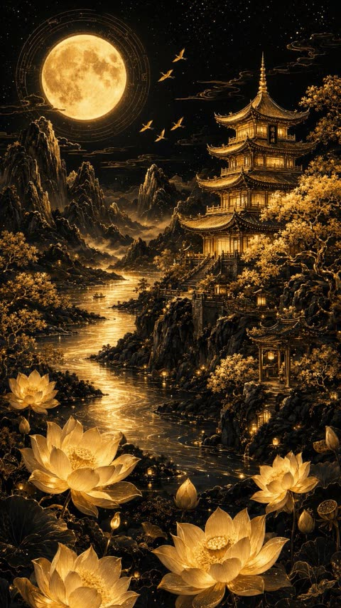
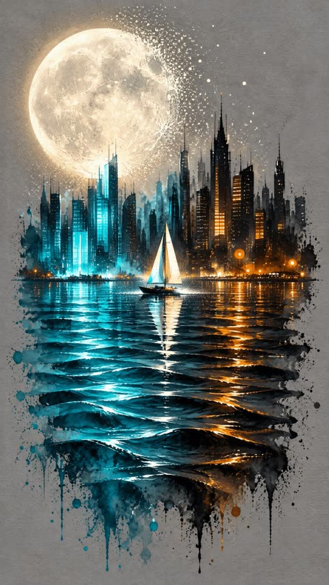
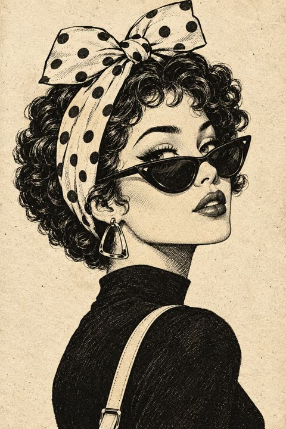
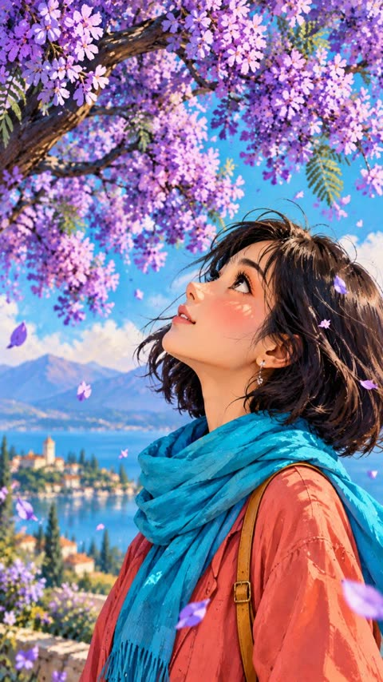
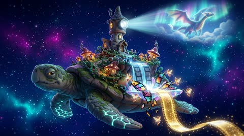
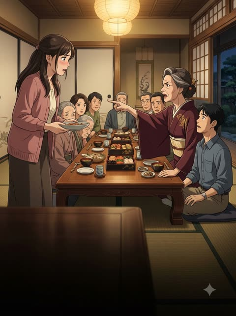
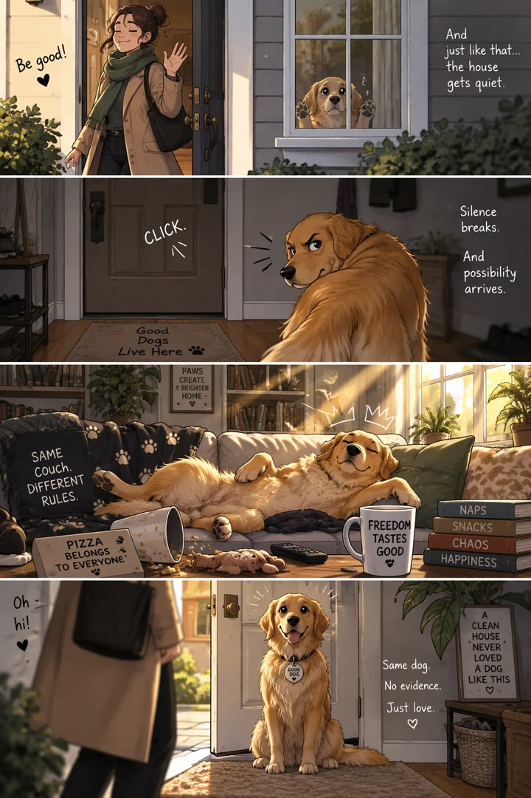

# Illustration

[Back to the list](../../README.md) · All 19 entries

<a id="gpt-image-dance-pose-sheet-4x4-character"></a>
### Sixteen panel dance pose sheet of anime girl

<a href="https://x.com/Mayz1169/status/2098014577414033912"></a>

Locks identity to one uploaded reference, then scripts sixteen numbered moves from opening pose to finishing silhouette so the grid reads as one routine. Fixed camera, white background and an explicit avoid list keep scale, costume and panel layout consistent.

GPT Image 2.5 · Edit · Source: [@Mayz1169 on X](https://x.com/Mayz1169/status/2098014577414033912) · 1,270 likes on 2026-10-27

[`pose-sheet`](tags.md#tag-pose-sheet) [`character-reference`](tags.md#tag-character-reference) [`dance`](tags.md#tag-dance) [`grid-layout`](tags.md#tag-grid-layout) [`anime`](tags.md#tag-anime)

<details><summary><b>Prompt</b></summary>

```text
Create a 4×4 dance pose sheet featuring the character in the uploaded reference image, with exactly 16 equally sized panels in one square image.

CHARACTER CONSISTENCY
Use the uploaded character as the sole reference for character identity and appearance. Preserve the character’s face, hairstyle, colors, body proportions, species, outfit, accessories, and original art style across all 16 panels. Do not redesign the character or add an idol costume. If any body or costume details are not visible in the reference, infer them conservatively and keep them consistent throughout.

ADAPTIVE CHOREOGRAPHY
Design a cohesive dance sequence tailored to this specific character’s personality, appearance, anatomy, clothing, and range of motion. Choose a suitable dance style automatically: lively for an energetic character, graceful for an elegant character, confident for a bold character, playful for a cute character, or restrained for a serious character. Do not force every character into cute idol poses.

Show 16 distinct key poses from the same dance routine, ordered from left to right and top to bottom. Make the sequence feel connected, with natural transitions and a clear beginning, build-up, climax, and ending.

Use the following movement structure, adapting each action to the character:
1. Opening pose that establishes the character’s personality.
2. Small rhythmic step with a coordinated arm gesture.
3. Side step with one arm extended.
4. Compact expressive gesture near the face or upper body.
5. Grounded stance with arms crossing or sweeping inward.
6. Knee lift or an anatomically appropriate weight shift.
7. Open, expansive pose with arms spread.
8. Playful or expressive balance pose.
9. Turning pose showing a three-quarter rear view.
10. Forward-reaching movement with a diagonal body lean.
11. Strong upward-reaching accent.
12. Climactic jump or a grounded full-body extension if jumping is unsuitable.
13. Lowered stance with a forward gesture.
14. Elegant or dynamic side-facing transition.
15. Signature gesture that suits the character.
16. Confident final pose with a clear finishing silhouette.

COMPOSITION AND PRESENTATION
Use a clean white background, thin grid lines, and small readable numbers 1–16 in the upper-left corner of each panel. Include exactly one full-body depiction of the same character per panel. Keep the character’s scale, camera distance, lighting, and rendering style consistent. Use a fixed camera while allowing the character to turn naturally.

Keep the entire character, including hair, ears, horns, wings, tail, hands, feet, and accessories, inside each panel with comfortable margins. Allow room for extended limbs and jumps. Add subtle ground shadows. Show natural secondary movement in hair, fabric, and accessories.

Every pose must have a clear silhouette, convincing balance, anatomically plausible joints, and expressive body language. Adapt all movements to nonhuman anatomy when applicable.

AVOID
Repeated or nearly identical poses, character identity drift, costume changes, inconsistent proportions, extra or missing limbs, malformed hands, cropped body parts, overlapping panels, additional characters, motion trails, background scenery, props not present in the reference, speech bubbles, captions, and watermarks.

Final output: one polished square image containing a clearly organized 4×4 grid of 16 distinct, character-appropriate dance poses.
```

</details>

<a id="nano-banana-geometric-fashion-illustration"></a>
### Full-body fashion illustration in textured geometric style

<a href="https://x.com/ChillaiKalan__/status/2109123213351632977"></a>

Outfit described item by item, then a short ban list that rules out photorealism and 3D.

Nano Banana 2.1 · Text-to-image · Source: [@ChillaiKalan__ on X](https://x.com/ChillaiKalan__/status/2109123213351632977) · 494 likes on 2026-10-27

[`fashion`](tags.md#tag-fashion) [`geometric`](tags.md#tag-geometric) [`editorial`](tags.md#tag-editorial)

<details><summary><b>Prompt</b></summary>

```text
Create a stylish, full-body editorial fashion illustration of a young woman in a modern casual outfit, using a minimalist, textured geometric art style. She wears an oversized forest-green hoodie, wide-leg blue denim jeans with folded cuffs, and chunky brown sneakers. Her dark hair is tied in a neat low bun. She carries a bouquet of vibrant pink roses wrapped in white paper, a takeaway coffee cup, and a black shoulder bag. Show her walking naturally in a relaxed pose, viewed from a three-quarter rear angle, with soft, elegant body proportions and simplified facial details.

Use a warm ivory background with plenty of negative space, soft ground shadows, subtle paper grain, visible brush textures, and angular polygonal shading across the clothing and shoes. The color palette features deep forest green, denim blue, warm brown, cream, and vivid pink. Soft diffused lighting, clean composition, contemporary lifestyle magazine aesthetic, hand-painted digital illustration, refined edges, artistic fabric textures, vertical 3:4 composition, high detail. No photorealism, no 3D rendering, no extra objects, no text or watermark.
```

</details>

<a id="gpt-image-character-dance-pose-sheet-4x4"></a>
### Anime Character 4x4 Dance Pose Sheet

<a href="https://x.com/Mayz1169/status/2099457417528692871"></a>

A numbered 16 step choreography list, from opening pose to final silhouette, gives each panel a distinct role. Strict identity locking to the uploaded reference, a fixed camera, a white grid and an avoid list keep the character consistent across panels.

GPT Image 2.5 · Edit · Source: [@Mayz1169 on X](https://x.com/Mayz1169/status/2099457417528692871) · 391 likes on 2026-10-28

[`pose-sheet`](tags.md#tag-pose-sheet) [`dance`](tags.md#tag-dance) [`character-consistency`](tags.md#tag-character-consistency) [`grid`](tags.md#tag-grid) [`anime`](tags.md#tag-anime)

<details><summary><b>Prompt</b></summary>

```text
Create a 4×4 dance pose sheet featuring the character in the uploaded reference image, with exactly 16 equally sized panels in one square image.

CHARACTER CONSISTENCY Use the uploaded character as the sole reference for character identity and appearance. Preserve the character’s face, hairstyle, colors, body proportions, species, outfit, accessories, and original art style across all 16 panels. Do not redesign the character or add an idol costume. If any body or costume details are not visible in the reference, infer them conservatively and keep them consistent throughout.

ADAPTIVE CHOREOGRAPHY Design a cohesive dance sequence tailored to this specific character’s personality, appearance, anatomy, clothing, and range of motion.

Choose a suitable dance style automatically: lively for an energetic character, graceful for an elegant character, confident for a bold character, playful for a cute character, or restrained for a serious character. Do not force every character into cute idol poses.  Show 16 distinct key poses from the same dance routine, ordered from left to right and top to bottom. Make the sequence feel connected, with natural transitions and a clear beginning, build-up, climax, and ending.

Use the following movement structure, adapting each action to the character:
1. Opening pose that establishes the character’s personality.
2. Small rhythmic step with a coordinated arm gesture.
3. Side step with one arm extended.
4. Compact expressive gesture near the face or upper body.
5. Grounded stance with arms crossing or sweeping inward.
6. Knee lift or an anatomically appropriate weight shift.
7. Open, expansive pose with arms spread.
8. Playful or expressive balance pose.
9. Turning pose showing a three-quarter rear view.
10. Forward-reaching movement with a diagonal body lean.
11. Strong upward-reaching accent.
12. Climactic jump or a grounded full-body extension if jumping is unsuitable.
13. Lowered stance with a forward gesture.
14. Elegant or dynamic side-facing transition.
15. Signature gesture that suits the character.
16. Confident final pose with a clear finishing silhouette.

COMPOSITION AND PRESENTATION Use a clean white background, thin grid lines, and small readable numbers 1–16 in the upper-left corner of each panel. Include exactly one full-body depiction of the same character per panel. Keep the character’s scale, camera distance, lighting, and rendering style consistent. Use a fixed camera while allowing the character to turn naturally.  Keep the entire character, including hair, ears, horns, wings, tail, hands, feet, and accessories, inside each panel with comfortable margins. Allow room for extended limbs and jumps. Add subtle ground shadows. Show natural secondary movement in hair, fabric, and accessories.  Every pose must have a clear silhouette, convincing balance, anatomically plausible joints, and expressive body language. Adapt all movements to nonhuman anatomy when applicable.

AVOID Repeated or nearly identical poses, character identity drift, costume changes, inconsistent proportions, extra or missing limbs, malformed hands, cropped body parts, overlapping panels, additional characters, motion trails, background scenery, props not present in the reference, speech bubbles, captions, and watermarks.

Final output: one polished square image containing a clearly organized 4×4 grid of 16 distinct, character-appropriate dance poses.
```

</details>

<a id="gpt-image-pixel-art-combat-sprite-sheet-from-character"></a>
### Pixel art combat sprite sheet from character render

<a href="https://www.reddit.com/r/aigamedev/comments/1wbmvnm/gpt_image_25_nailed_a_16_frame_combat_sprite_sheet"></a>

Attaching one full body character render and naming the pixel size (128px), the grid (4x4) and the motion type keeps hair, jacket and boots consistent across all sixteen frames. Asking for a transparent background and a follow-up GIF makes the sheet ready for animation.

GPT Image 2.5 · Edit · Source: [u/Practical_Low29 on Reddit](https://www.reddit.com/r/aigamedev/comments/1wbmvnm/gpt_image_25_nailed_a_16_frame_combat_sprite_sheet) · 303 likes on 2026-10-28

[`sprite-sheet`](tags.md#tag-sprite-sheet) [`pixel-art`](tags.md#tag-pixel-art) [`game-assets`](tags.md#tag-game-assets) [`character-design`](tags.md#tag-character-design) [`animation`](tags.md#tag-animation)

<details><summary><b>Prompt</b></summary>

```text
Make a simplified 128px pixel art combat motion sprite sheet of this character, transparent background if you can, arrange it 4x4.
```

</details>

<a id="gpt-image-character-dance-pose-grid"></a>
### Sixteen Dance Poses of a Bunny Hat Girl

<a href="https://x.com/Mayz1169/status/2098050289819652321"></a>

The prompt asks the model to read the character's personality and invent a matching dance vocabulary, then fixes a strict 4×4 numbered grid with one camera distance and white backgrounds. Explicit identity locks and an avoid list keep outfit and proportions consistent across all 16 panels.

GPT Image 2.5 · Edit · Source: [@Mayz1169 on X](https://x.com/Mayz1169/status/2098050289819652321) · 283 likes on 2026-10-28

[`character-sheet`](tags.md#tag-character-sheet) [`dance`](tags.md#tag-dance) [`pose-grid`](tags.md#tag-pose-grid) [`anime`](tags.md#tag-anime) [`seedance-reference`](tags.md#tag-seedance-reference)

<details><summary><b>Prompt</b></summary>

```text
Create a single square image featuring a 4×4 grid of 16 unique full-body dance poses based on the uploaded character.

CHARACTER-DRIVEN CHOREOGRAPHY
First, visually interpret the character’s personality and aesthetic through their expression, silhouette, outfit, accessories, proportions, and overall visual style. Use this interpretation to invent a personalized dance vocabulary that feels natural and distinctive to THIS character.

Do not apply a generic dance routine or a predetermined list of poses. Let the character’s attitude determine the rhythm, energy, gestures, posture, footwork, and use of space.

For example, a mischievous character might use cheeky gestures, unexpected weight shifts, and playful hops; a reserved character might favor controlled steps and subtle hand movements; a bold character might use grounded footwork and sharp accents; an ethereal character might move through soft curves and floating transitions. These are illustrative possibilities, not required categories or moves. Combine traits when the design suggests a more nuanced personality.

Develop a recognizable movement motif unique to this character and reinterpret it across several panels without repeating the same pose. Incorporate distinctive design features naturally: flowing sleeves may follow sweeping gestures, heavy boots may inspire grounded steps, and a tail or wings may contribute to balance and expression if present. Do not invent accessories or anatomy.

Make the result feel like this character is expressing themselves through dance, rather than performing an interchangeable pose pack. Keep the movement appropriate to the character’s apparent age, anatomy, clothing, and mobility.

SEQUENCE AND VARIETY
Show 16 distinct key poses from one cohesive, character-specific dance phrase, read left to right and top to bottom. Build a natural progression from an opening gesture through variations and a climax to a signature finish.

Include meaningful variation in silhouette, arm placement, footwork, body orientation, and movement level only where it suits the character. Do not force jumps, squats, exaggerated expressions, or dramatic poses onto a character whose personality calls for restraint. Even subtle choreography should produce clearly distinguishable poses.

Maintain believable balance and natural joints. Use facial expressions, head tilts, hands, and posture to reinforce the same personality throughout. Hair, clothing, and accessories should react naturally to movement.

IDENTITY AND STYLE
Preserve the uploaded character’s identity exactly: face, hairstyle, body proportions, outfit, colors, footwear, and accessories. Maintain the reference image’s rendering style throughout all 16 panels. Do not redesign, recolor, or change costumes. Infer any unseen details conservatively and keep them consistent.

GRID AND PRESENTATION
Exactly four rows and four columns, with 16 equally sized square panels separated by thin black lines. Plain white backgrounds and subtle grounding shadows. Number the panels 1–16 in the upper-left corners.

One full-body character per panel, including all extremities and accessories, with comfortable margins. Consistent character scale, camera distance, lighting, and ground level. Use a fixed eye-level camera; different views should result from the character turning.

If a separate dance-grid reference is provided, use it only for the grid layout and presentation. Do not copy its character, outfit, dance poses, or attitude. The uploaded character must determine the choreography.

OUTPUT
A polished dance reference sheet with strong character identity and 16 individually readable poses. Output only the image, without written analysis.

AVOID
Generic choreography, copied reference poses, repetitive or mirrored duplicates, personality mismatches, forced cuteness or swagger, inconsistent identity, altered outfits, cropped extremities, extra limbs, distorted anatomy, motion trails, missing or extra panels, and text other than panel numbers.
```

</details>

<a id="gpt-image-golden-moonlit-pagoda-lotus-river"></a>
### Golden Pagoda and Lotus River Under Moon

<a href="https://x.com/churvikv/status/2101030587478007880"></a>

The prompt is split into labeled sections (environment, lighting, materials, composition, mood) with explicit avoid lists. A strict gold on black palette and a vertical 4:5 frame keep the poster look consistent.

GPT Image 2.5 · Text-to-image · Source: [@churvikv on X](https://x.com/churvikv/status/2101030587478007880) · 196 likes on 2026-10-28

[`night-landscape`](tags.md#tag-night-landscape) [`pagoda`](tags.md#tag-pagoda) [`gold-on-black`](tags.md#tag-gold-on-black) [`lotus`](tags.md#tag-lotus) [`poster`](tags.md#tag-poster)

<details><summary><b>Prompt</b></summary>

```text
A highly detailed stylized nightscape illustration in a luxury editorial poster aesthetic, rendered with crisp linework and glowing contrast against a deep black background. The scene centers on a luminous golden moon rising behind layered mountain silhouettes, with a refined Japanese pagoda beside a reflective stream, all bathed in warm amber, cream, and muted blue-gray tones.
Environment:
• A serene landscape with a large full moon dominating the upper center background
• Dark, layered mountain ranges stretching across the horizon, with elegant contour lines and subtle highlights
• A multi-tier pagoda positioned right of center, perched on rocky ground beside the water, with curved rooflines and softly glowing windows
• A winding reflective stream running from the midground toward the foreground center, creating a bright path of moonlit reflection
• Lotus flowers and tall grasses framing both sides of the foreground, especially clustered at lower left and lower right
• Stylized cloud bands passing horizontally across the moon, with small stars and a few tiny bird silhouettes in the sky
• Additional small architectural detail faintly visible in the midground left near the water
• Avoid modern elements, clutter, heavy realism, or dense texture noise
Lighting:
• Strong moon backlight from the large central moon, creating a radiant halo and soft atmospheric glow
• Warm internal glow within the pagoda, contrasting with the cool darkness of the mountains and sky
• Gentle highlights along roof edges, flower petals, rocks, and water ripples
• Reflections in the stream should be luminous and controlled, not mirror-sharp
• No harsh shadows, no blown-out moon detail, no flat unlit foreground
Materials:
• Smooth ink-like black negative space with metallic gold and ivory highlights
• Pagoda surfaces with polished wood-like warmth and fine architectural edging
• Water rendered with silky reflective lines and soft layered shimmer
• Flowers with delicate satin-like petals and softly glowing centers
• Rocky terrain in matte charcoal with clean stylized edge lighting
Composition:
• Vertical poster composition, centered around the moon and water reflection axis
• Pagoda occupying the right midground as the hero structure, balanced by floral masses on both sides
• Mountains layered behind the pagoda to create depth without overwhelming the moon
• Strong use of negative space around the upper sky and outer edges for dramatic contrast
• Hero elements fill most of the frame with a symmetrical visual rhythm, though not perfectly mirrored
Mood:
Quiet, majestic, dreamlike, and elegant with a tranquil nocturnal fantasy atmosphere
Ultra-detailed digital illustration, sharp ornamental linework, high contrast, vertical 4:5 composition, glowing gold-on-black palette, polished cinematic finish.

🏞 Prompt 3:
A serene Japanese landscape bathed in the warm glow of a large, luminous full moon. A multi-tiered pagoda, adorned with intricate golden details and traditional roofing, stands majestically on a rocky outcrop. It is surrounded by lush, golden-hued foliage and large, delicate lotus flowers in shades of cream and soft orange. A tranquil river, reflecting the moonlight and surrounding scenery, gently flows through the foreground. Jagged, dark mountains form the backdrop, silhouetted against the vibrant sky. The atmosphere is mystical and peaceful, with a hint of ancient grandeur. The color palette is dominated by deep blacks, contrasting with bright yellows, golds, and soft oranges, creating a striking visual. The composition is framed by darkness, emphasizing the illuminated central elements, with a low-angle perspective drawing the viewer into the scene. The style is reminiscent of traditional Japanese ink paintings with a touch of fantasy illustration, featuring smooth textures and dramatic lighting.
```

</details>

<a id="nano-banana-paper-cut-fashion"></a>
### Fashion illustration in layered 3D paper-cut

<a href="https://x.com/ChillaiKalan__/status/2109534297367724221"></a>

Same structure as the geometric one, with the medium swapped. Good pair for comparing styles.

Nano Banana 2.1 · Text-to-image · Source: [@ChillaiKalan__ on X](https://x.com/ChillaiKalan__/status/2109534297367724221) · 188 likes on 2026-10-27

[`fashion`](tags.md#tag-fashion) [`paper-cut`](tags.md#tag-paper-cut) [`3d`](tags.md#tag-3d)

<details><summary><b>Prompt</b></summary>

```text
Create a high-end editorial fashion illustration of a stylish woman wearing a bold, contemporary designer outfit. Use a polished 3D paper-cut illustration aesthetic with smooth surfaces, layered shapes, subtle paper-like textures, and clean, elegant edges. Feature vibrant color combinations such as pastel pink, sky blue, mint green, sunshine yellow, and emerald green, paired with contrasting patterns like polka dots or vertical stripes. Add fashionable accessories, including statement sunglasses, earrings, a structured handbag, and modern shoes. Give the character a confident, expressive pose with natural body proportions and a stylish attitude. Use a minimalist warm ivory background with soft studio lighting, gentle shadows beneath the feet, and a refined luxury fashion-campaign composition. Full-body character, beautifully detailed clothing folds, crisp silhouettes, sophisticated color blocking, playful yet elegant styling, premium fashion magazine aesthetic, clean negative space, high-resolution digital illustration. No text, no logos, no watermark.
```

</details>

<a id="gpt-image-architectural-sketchbook-study"></a>
### Colosseum architectural sketchbook study in pencil and watercolor

<a href="https://x.com/Naiknelofar788/status/2099096963316957187"></a>

The prompt makes the drawing move from loose construction lines in the foreground to a finished inked and watercolor structure, so the image reads as a sketch in progress. Listed side studies (elevation, ornament detail, map outline, scale silhouette) and minimal handwritten labels fill the page, and the negative terms rule out photorealism and infographic boxes.

GPT Image 2.5 · Text-to-image · Source: [@Naiknelofar788 on X](https://x.com/Naiknelofar788/status/2099096963316957187) · 169 likes on 2026-10-28

[`architecture`](tags.md#tag-architecture) [`sketchbook`](tags.md#tag-sketchbook) [`watercolor`](tags.md#tag-watercolor) [`pencil-drawing`](tags.md#tag-pencil-drawing) [`template`](tags.md#tag-template)

<details><summary><b>Prompt</b></summary>

```text
Create a stunning 4:5 vertical fine-art sketch illustration of [STRUCTURE NAME] as if it is being drawn by a master architectural artist inside a luxury travel sketchbook.

Show the famous structure transitioning from loose preliminary pencil lines into a fully detailed finished architectural drawing.

The foreground should contain delicate construction lines, perspective guides, measurement marks, small handwritten architectural notes, compass marks, arrows, erased pencil strokes, and unfinished portions.

As the eye moves toward the main structure, the sketch gradually becomes more refined — combining graphite pencil, fine black ink, subtle watercolor washes, cross-hatching, and delicate hand-drawn textures.

Include small artistic studies around the main drawing: a tiny side elevation, architectural detail, window or ornament study, simplified map outline, and a small silhouette showing the scale of the structure.

Use an elegant warm ivory sketchbook-paper background with natural paper fibers and subtle imperfections.

Keep the composition sophisticated and spacious. The structure should remain the unmistakable hero.

Add minimal handwritten-style labeling:

[STRUCTURE NAME]
[CITY, COUNTRY]
ARCHITECTURAL STUDY

The artwork should feel like an original museum-quality architectural sketch discovered inside an explorer’s personal sketchbook — artistic, intellectual, nostalgic, detailed, and highly collectible.

No photorealistic rendering, no 3D CGI, no modern infographic boxes, no excessive text, no watermark.
```

</details>

<a id="gpt-image-watercolor-ink-sailboat-moonlit-skyline"></a>
### Watercolor ink sailboat before a moonlit skyline

<a href="https://x.com/churvikv/status/2109054962667864073"></a>

The prompt is split into labelled blocks (MOON, SKYLINE, CENTRE, WATER, TEXTURE) that fix each zone of the 9:16 canvas. A cool teal versus warm amber split and a grey paper ground keep the mixed-media look consistent.

GPT Image 2.5 · Text-to-image · Source: [@churvikv on X](https://x.com/churvikv/status/2109054962667864073) · 131 likes on 2026-10-28

[`watercolor`](tags.md#tag-watercolor) [`ink-wash`](tags.md#tag-ink-wash) [`sailboat`](tags.md#tag-sailboat) [`skyline`](tags.md#tag-skyline) [`mixed-media`](tags.md#tag-mixed-media)

<details><summary><b>Prompt</b></summary>

```text
Semi-abstract mixed-media digital artwork, watercolor and ink wash with painterly digital treatment, tall 9:16 vertical composition, matte mid-grey paper background filling the whole canvas. A lone sailboat with white sails and a dark hull sits on the horizon line at the exact centre, framed by a mirrored split cityscape. LEFT HALF: a dense futuristic skyline glowing electric teal, cyan and blue, towers of many heights with fine lit window grids; above it a large brilliant white four-point starburst star with radiating glow, a wide dark ink cloud behind it, and scattered white star specks. The skyline base dissolves downward into black-blue ink spatter. RIGHT HALF: a mirrored skyline in deep crimson and black, a bright glowing red-white sun disc low between the towers casting a warm red haze, fine red dots and ink splatter along the rooflines, one thin bare tree at the far right edge. CENTRE: the sailboat, small and precise, two pale cream sails catching cool light on one side and warm light on the other, a slender mast, a dark hull with a sharp vertical reflection beneath it. WATER: below the boat the surface becomes sculpted concentric ripple rings spreading outward in widening circles from the hull, built from glossy liquid-ink ribbons with bright white specular highlights, teal and ink-black on the left, crimson and ink-black on the right. The rings stack down through the lower two-thirds and thin out, the lowest breaking into drips and splatter that fade into the grey background. TEXTURE: ink wash bleeding, granulated pigment, stipple dots, splatter, distressed melting edges where the scene dissolves into the neutral grey. High contrast, glossy wet highlights against matte paper, no frame, no border, no text, no signature.
```

</details>

<a id="gpt-image-vintage-ink-polka-dot-fashion-portrait"></a>
### Vintage ink fashion portrait with polka dot scarf

<a href="https://x.com/Just_Anika_Here/status/2114206456518148577"></a>

Names the ink techniques directly (cross-hatching, solid black shadows, distressed print grain) and fixes a limited black and ivory palette. A JSON structure adds composition, pose and a negative prompt that keeps the result from drifting into photorealism.

GPT Image 2.5 · Text-to-image · Source: [@Just_Anika_Here on X](https://x.com/Just_Anika_Here/status/2114206456518148577) · 97 likes on 2026-10-28

[`vintage`](tags.md#tag-vintage) [`ink-illustration`](tags.md#tag-ink-illustration) [`fashion`](tags.md#tag-fashion) [`cross-hatching`](tags.md#tag-cross-hatching) [`json-prompt`](tags.md#tag-json-prompt)

<details><summary><b>Prompt</b></summary>

```text
{
  "prompt": "Create a highly detailed vintage fashion illustration of a stylish young adult woman in a three-quarter side profile, looking confidently over her shoulder toward the viewer. She has voluminous short black curly hair with individually defined ringlets, dramatic winged eyeliner, long eyelashes, a small nose, and full glossy lips. She wears oversized pointed cat-eye sunglasses with dark lenses and thick black frames. A wide cream-colored headscarf with bold black polka dots wraps around her head and forms a large playful bow on top. A large geometric hoop earring hangs from her visible ear. She wears a dark, elegant high-neck top with a light-colored shoulder strap crossing diagonally over her shoulder. Her chin is slightly raised, her head tilted back, and her expression is effortlessly confident and fashionable. Use expressive black ink outlines, intricate cross-hatching, dense hand-drawn curls, fine facial linework, bold solid-black shadow areas, and subtle distressed print textures. The background is warm ivory paper with visible grain, tiny ink speckles, and an aged screen-printed finish. Strong contrast between black ink and off-white paper, sophisticated retro editorial composition, authentic vintage comic-book print quality, clean recognizable silhouette, beautifully balanced negative space.",

  "composition": {
    "framing": "vertical portrait, head to upper torso",
    "camera_angle": "slightly low three-quarter profile",
    "subject_position": "centered, face turned toward the right",
    "pose": "looking back over her shoulder with chin slightly raised",
    "background": "minimal textured ivory paper"
  },
  "color_palette": {
    "primary": "deep ink black",
    "secondary": "warm ivory",
    "accents": "soft antique cream"
  },
  "lighting": "illustrative high-contrast tonal shading, no realistic photographic lighting",
  "texture": "rough ink grain, distressed paper, vintage halftone speckles, fine cross-hatching",
  "negative_prompt": "photorealism, 3D render, color gradients, bright colors, smooth digital vector art, glossy plastic skin, blurry facial features, asymmetrical eyes, malformed sunglasses, extra earrings, distorted hands, messy outlines, low detail, text, typography, watermark, logo, frame"
}
```

</details>

<a id="gpt-image-jacaranda-storybook-woman-looking-up"></a>
### Woman Under Blooming Jacaranda Storybook Painting

<a href="https://x.com/hey_am_cherry/status/2110952509217140779"></a>

The prompt fixes the composition with explicit placement, with the woman lower right, branches sweeping diagonally and the canopy filling the upper third. It also names a complementary palette of violet, turquoise and coral, and adds a negative prompt to keep the image painterly rather than photoreal.

GPT Image 2.5 · Text-to-image · Source: [@hey_am_cherry on X](https://x.com/hey_am_cherry/status/2110952509217140779) · 92 likes on 2026-10-28

[`illustration`](tags.md#tag-illustration) [`storybook`](tags.md#tag-storybook) [`painterly`](tags.md#tag-painterly) [`vibrant-palette`](tags.md#tag-vibrant-palette) [`portrait-9-16`](tags.md#tag-portrait-9-16)

<details><summary><b>Prompt</b></summary>

```text
{
  "prompt": "Create a beautiful vertical 9:16 digital painting in a vibrant, expressive storybook illustration style. A young woman with a short dark bob haircut stands in the lower-right portion of the composition, peacefully looking upward at a magnificent flowering jacaranda tree. The enormous dark branches sweep diagonally across the upper half of the image, covered in clusters of vivid violet, electric purple, and magenta blossoms. Tiny purple petals float gently through the air. The woman wears a flowing coral-red coat, a bright turquoise scarf, dark plum leggings, and elegant black ankle boots. A small mustard-yellow shoulder bag adds a warm accent. The background features a rich turquoise-blue sky blending into soft lavender mountains, with subtle painterly textures and a few delicate wildflowers along the ground. Use a bold, highly saturated color palette with striking contrasts between violet flowers, turquoise surroundings, coral clothing, and golden highlights. Artistic hand-painted brushstrokes, delicate ink outlines, textured paper finish, atmospheric depth, beautiful natural lighting, poetic and peaceful mood. The tree canopy fills the upper third and spreads across the frame, while generous open space in the middle emphasizes the woman and creates a balanced composition. Full-body character visible, elegant natural pose, visually rich details, polished high-quality illustration, beautiful color harmony, 9:16 portrait composition.",
  "negative_prompt": "photorealistic, 3D render, dull colors, washed-out palette, blurry details, low resolution, distorted anatomy, extra limbs, extra fingers, malformed hands, duplicate people, oversized head, cropped feet, cut-off body, text, watermark, logo, copied composition, yellow autumn leaves, orange trench coat, plain empty background",
  "aspect_ratio": "9:16",
  "style": "vibrant painterly storybook illustration",
  "quality": "high"
}
```

</details>

<a id="gpt-image-minimalist-ink-sketch-travel-poster"></a>
### Minimalist ink sketch travel poster of a landmark

<a href="https://x.com/Naiknelofar788/status/2115000503151231060"></a>

Fill-in placeholders for landmark and destination make it reusable. Fine ink outlines are paired with a limited pastel palette, dry-brush color patches on ivory paper and a fixed typography block with a divider. Negative prompts such as no 3D and no extra text keep the result clean.

GPT Image 2.5 · Text-to-image · Source: [@Naiknelofar788 on X](https://x.com/Naiknelofar788/status/2115000503151231060) · 87 likes on 2026-10-28

[`travel-poster`](tags.md#tag-travel-poster) [`ink-sketch`](tags.md#tag-ink-sketch) [`pastel`](tags.md#tag-pastel) [`minimalist`](tags.md#tag-minimalist) [`template`](tags.md#tag-template)

<details><summary><b>Prompt</b></summary>

```text
Create a beautiful, minimalist hand-drawn travel illustration of [LANDMARK / CITY / COUNTRY], inspired by Japanese architectural sketchbook art and contemporary minimalist travel posters.

Illustration style:

Fine black ink outlines with loose, expressive, imperfect hand-drawn strokes.
Simplified architectural forms that preserve the destination’s most recognizable features.
Soft, dry-brush pastel colour patches in the background, with a distressed, textured, almost crayon-like finish.
A limited palette of muted sage green, dusty pink, pale blue, warm beige, and soft ochre.
Warm ivory paper background with subtle natural paper grain.
Delicate sketchy trees, tiny shrubs, birds, distant mountains, clouds, or other location-specific elements.
Beautiful negative space and an airy, uncluttered composition.
Artistic imperfections, uneven ink lines, and a handmade illustration aesthetic.

Composition:
Place the iconic landmark in the lower half of the image, drawn in elegant black ink. Add a few surrounding elements to create a small, atmospheric scene. Behind the architecture, incorporate abstract vertical or irregular pastel brushstrokes that add colour without overpowering the drawing.

Typography:
At the top, write the destination name in thin, spaced-out uppercase lettering: “[DESTINATION NAME]”. Place the country name directly underneath in smaller, elegant uppercase letters. Add a fine horizontal divider with tiny circular endpoints between the title and subtitle, if appropriate.

Overall mood: Peaceful, poetic, artistic, minimalist, nostalgic, and sophisticated — like a page from a beautifully illustrated travel journal.

Technical details: Square 1:1 composition, crisp fine-line drawing, restrained pastel colours, plenty of cream negative space, no photorealism, no 3D effects, no glossy finish, no heavy shadows, no clutter, and no extra text. Ensure the destination name is spelled correctly.
```

</details>

<a id="nano-banana-caped-animal-character-trio"></a>
### Gray cat in teal cape, storybook style

<a href="https://x.com/iamrealsnow/status/2113141068929826897"></a>

One template is repeated for three animals, and only the species, fur colour, cape colour and clasp shape change. The fixed pose, front view, full body and plain light background keep the set consistent.

Nano Banana 2.1 · Text-to-image · Source: [@iamrealsnow on X](https://x.com/iamrealsnow/status/2113141068929826897) · 60 likes on 2026-10-28

[`character-design`](tags.md#tag-character-design) [`storybook`](tags.md#tag-storybook) [`animals`](tags.md#tag-animals) [`cape`](tags.md#tag-cape) [`character-sheet`](tags.md#tag-character-sheet)

<details><summary><b>Prompt</b></summary>

```text
Cat
A cute gray cat character with green eyes, wearing a simple teal hooded cape with a small silver crescent clasp. Standing pose, front view, full body, soft storybook illustration style, plain light background.

Squirrel
A cute orange-brown squirrel character with a big bushy tail, wearing a simple navy cape with a small gold leaf-shaped clasp. Standing pose, front view, full body, soft storybook illustration style, plain light background.

Rabbit
A cute cream-colored rabbit character with tall ears, wearing a simple plum cape with a small gold round clasp. Standing pose, front view, full body, soft storybook illustration style, plain light background.
```

</details>

<a id="nano-banana-felt-designer-toy-history-dioramas"></a>
### Felt designer toy dioramas of four historic days

<a href="https://x.com/Gdgtify/status/2107781229164556402"></a>

Three concept anchors are fused into one style, with an instruction to ignore their literal subjects and keep only the material logic. Explicit style rules for felt, moss and vinyl surfaces, small street details, a calm gray backdrop and limited bright accents make the 2x2 grid consistent across different subjects.

Nano Banana 2.1 · Text-to-image · Source: [@Gdgtify on X](https://x.com/Gdgtify/status/2107781229164556402) · 29 likes on 2026-10-28

[`designer-toy`](tags.md#tag-designer-toy) [`felt`](tags.md#tag-felt) [`diorama`](tags.md#tag-diorama) [`grid`](tags.md#tag-grid) [`template`](tags.md#tag-template)

<details><summary><b>Prompt</b></summary>

```text
do this for 4 unforgettable days in human history , 2x2 grid: CONCEPT ANCHOR 1: "Stylized 3D animated rebel character — expressive oversized eyes, strong attitude pose, streetwear details, colorful hair, soft cinematic toy-like rendering"

::

CONCEPT ANCHOR 2: "Fuzzy green minimalist toy-world — mossy texture, rounded trees, soft felt surfaces, tiny houses, gentle surreal creatures, quiet gray background"

::

CONCEPT ANCHOR 3: "Isometric miniature scene — small props, tiny environmental storytelling, dollhouse-scale staging, clean studio lighting"

INSTRUCTION:
Find the exact visual center of these three concepts.
Ignore the literal character, trash can, animals, and room references.
Extract only the style and material logic.

Render $ SUBJECT as a soft but rebellious designer-toy diorama.

STYLE RULES:
- Convert the subject into a stylized 3D character, object, creature, or environment with clear attitude and expressive shape language.
- Use soft felt, moss, knitted fiber, fuzzy flocking, matte clay, and vinyl-like surfaces.
- Add small street or everyday details: stickers, scuffs, props, miniature objects, signs, containers, tools, or personal items inferred from the subject.
- Keep the world minimal and gallery-like, with calm gray or muted pastel background.
- Use bright accent colors only where they matter: hair-like forms, graffiti-like marks, symbols, accessories, tiny props.
- Blend softness with rebellion: cute surface texture, but confident pose and graphic edge.
- Use shallow studio lighting and clean product-shot presentation.

OUTPUT:
A collectible fuzzy designer-toy scene where $ SUBJECT becomes soft, expressive, slightly punk, and highly tactile.
```

</details>

<a id="nano-banana-sea-turtle-film-studio-island"></a>
### Sea turtle carrying floating film studio island

<a href="https://x.com/wilzap/status/2112169111291908222"></a>

The prompt tells a before and after story in one scene: pixelated film strips are polished by fairies and turn into golden film. A named material look (soft clay-like 3D), a limited palette and lighting cues (rim light, volumetric rays, tilt-shift) keep the whole scene cohesive.

Nano Banana 2.1 · Text-to-image · Source: [@wilzap on X](https://x.com/wilzap/status/2112169111291908222) · 29 likes on 2026-10-28

[`3d-cartoon`](tags.md#tag-3d-cartoon) [`fantasy`](tags.md#tag-fantasy) [`sea-turtle`](tags.md#tag-sea-turtle) [`floating-island`](tags.md#tag-floating-island) [`cinematic-lighting`](tags.md#tag-cinematic-lighting)

<details><summary><b>Prompt</b></summary>

```text
A stylized 3D cartoon fantasy scene of a giant ancient sea turtle swimming through a starry night sky, carrying an entire floating island on its shell. The island is a magical film studio: tiny glowing mushroom houses, a waterfall made of flowing film strips, and a crooked wizard tower with a giant projector lens for an eye. At the base of the waterfall, the film strips look rough, blocky, and pixelated, like broken stained glass. As they spill over a glowing crystal ledge, a swarm of tiny lantern fairies hammers and polishes them, and they transform mid-fall into crisp, shimmering, ultra-detailed film that glows like liquid gold. At the very top, the wizard tower beams the finished movie across the sky like an aurora, showing a vivid dragon soaring through clouds. Chunky rounded shapes, soft clay-like 3D textures, exaggerated cartoon proportions, glowing bioluminescent accents, deep indigo sky with magenta and electric teal highlights, cinematic rim lighting, volumetric light rays, tilt-shift depth of field, ultra detailed, 16:9.
```

</details>

<a id="nano-banana-anime-new-year-dinner-confrontation"></a>
### Anime Japanese New Year dinner family confrontation

<a href="https://x.com/ViralOps_/status/2114709909178810799"></a>

Each character gets a fixed block for age, face, hair and clothing, so the cast stays consistent. The scene then assigns every person a specific gesture and expression, so the conflict reads without any dialogue.

Nano Banana 2.1 · Text-to-image · Source: [@ViralOps_ on X](https://x.com/ViralOps_/status/2114709909178810799) · 27 likes on 2026-10-28

[`anime`](tags.md#tag-anime) [`japanese`](tags.md#tag-japanese) [`family-dinner`](tags.md#tag-family-dinner) [`character-consistency`](tags.md#tag-character-consistency) [`storytelling`](tags.md#tag-storytelling)

<details><summary><b>Prompt</b></summary>

```text
**STYLE AND VISUAL QUALITY**

Premium modern Japanese anime film style, cinematic 2D animation quality, beautifully detailed Japanese character designs, expressive faces, soft cel shading, delicate linework, painterly backgrounds, realistic fabric folds, natural skin tones, rich atmospheric lighting, and emotional visual storytelling.

The image should resemble a beautifully animated Japanese drama film, with warm cinematic lighting, rich colors, subtle depth of field, and emotionally powerful facial expressions. Avoid generic cartoon aesthetics, 3D rendering, or photorealism.

**CHARACTER DESCRIPTIONS — MAINTAIN THESE EXACT APPEARANCES**

**WIFE (Late 20s):**

A beautiful young Japanese woman, approximately 27 years old, with fair warm-toned skin, a delicate oval face, large expressive dark-brown eyes, straight dark eyebrows, a small natural nose, and soft feminine facial features.

She has long, silky, dark-brown hair reaching the middle of her back, styled with soft face-framing strands and a simple half-up hairstyle.

She wears an elegant, modest, dusty-rose pink knitted cardigan over a cream-colored blouse, paired with a flowing sage-green midi skirt.

Her appearance is graceful, gentle, and slightly delicate. Her large expressive eyes should communicate intense emotional pain, vulnerability, and quiet dignity.

**HUSBAND (Early 30s):**

A handsome Japanese man, approximately 32 years old, with fair-to-medium warm skin, short neatly styled black hair, dark-brown eyes, straight eyebrows, a clean-shaven face, and a defined but natural jawline.

He wears a slate-blue button-up shirt with a cream-colored undershirt, dark tailored trousers, and a simple silver wristwatch on his left wrist.

Average-to-tall height, lean-to-medium build, attractive but realistic anime facial proportions.

His personality should be reflected through subtle, emotionally expressive reactions.

**MOTHER-IN-LAW (Late 50s):**

A Japanese woman, approximately 58 years old, with fair-to-medium warm skin, a slightly rounded face, visible fine wrinkles around her eyes and mouth, sharp eyebrows, narrow expressive dark-brown eyes, and a stern, authoritative appearance.

Her dark hair, lightly streaked with gray, is neatly arranged in an elegant low bun.

She wears a sophisticated deep-maroon Japanese kimono with subtle gold floral embroidery, a cream-colored obi belt, and a traditional decorative hairpin.

Her posture and facial expressions communicate pride, authority, harsh judgment, and a controlling personality.

**SETTING — JAPANESE NEW YEAR FAMILY DINNER**

Inside a beautiful, cozy, traditional-modern Japanese family home during an Oshōgatsu (Japanese New Year) celebration in the evening.

A long, low polished wooden dining table dominates the tatami-mat room.

The table is covered with a generous Japanese New Year feast, including:

- Beautifully arranged osechi ryōri in traditional lacquered jubako boxes.
- Grilled fish served on ceramic plates.
- Ozōni soup in traditional bowls.
- Sushi and neatly arranged sashimi.
- Decorative mochi and traditional Japanese sweets.
- Elegant ceramic teacups and wooden chopsticks.

The room features authentic Japanese interior design: warm wooden beams, shoji paper sliding doors, tatami flooring, a decorative tokonoma alcove, a traditional flower arrangement, and soft hanging lanterns.

Through a partially open shoji door, a peaceful Japanese garden is faintly visible beneath the evening sky.

Warm golden interior lighting creates a beautiful festive atmosphere.

The peaceful New Year celebration contrasts sharply with the painful family confrontation unfolding around the table.

**MAIN SCENE — PUBLIC HUMILIATION AT THE FAMILY DINNER**

Capture a deeply emotional and dramatic moment at the exact instant a family celebration turns into a humiliating confrontation.

The mother-in-law sits at the head of the low Japanese dining table, leaning forward aggressively.

She points her index finger directly toward her daughter-in-law.

Her expression is harsh, mocking, and judgmental. Her mouth is slightly open as if she has just delivered a cruel, insulting remark in front of everyone.

The young wife stands beside the dining table, holding a beautiful ceramic serving platter with both hands.

She looks completely shocked and humiliated.

Her shoulders are tense, her lips slightly parted, and her large brown eyes are filled with tears she is desperately trying to hold back.

Her cheeks are faintly flushed with embarrassment.

Her expression communicates heartbreak, helplessness, and the unbearable pain of being publicly disrespected in front of her husband's entire family.

The husband sits on a floor cushion beside his mother.

He suddenly looks up with a frozen, stunned expression.

His body is tense, his eyes widened in disbelief, as though he cannot believe what his mother has just said to his wife.

Capture the precise moment before he decides whether to speak.

**SIX ADDITIONAL FAMILY MEMBERS**

Six adult Japanese relatives sit on floor cushions around the table.

The men wear a mixture of elegant casual shirts, sweaters, and traditional Japanese clothing.

The women wear tasteful modern outfits or subtle traditional kimono.

All six relatives have turned their attention toward the young wife.

Some look visibly shocked.

Others exchange uncomfortable glances.

One elderly relative lowers their eyes in embarrassment.

Another relative watches the confrontation with a judgmental expression.

Their reactions should amplify the wife's painful realization that everyone has witnessed her humiliation.

**EMOTIONAL VISUAL STORYTELLING**

The mother's aggressive pointing gesture, the wife's devastated expression, the husband's stunned reaction, and the relatives' uncomfortable stares must immediately communicate the entire conflict without any written dialogue.

The viewer should instantly understand:

A young Japanese wife has just been publicly insulted by her mother-in-law during an important family celebration, and everyone is waiting to see whether her husband will defend her.

**CAMERA AND COMPOSITION**

Portrait 4:5 aspect ratio.

Final resolution: 1080 × 1350 pixels.

Cinematic medium-wide shot at a natural eye-level camera angle, carefully framed to emphasize the emotional tension between the three main characters.

The composition should resemble a dramatic freeze-frame from a premium Japanese animated feature film.

**CRITICAL COMPOSITION RULE — TEXT OVERLAY SPACE**

The entire dramatic scene must occupy only the UPPER 55% of the image.

This includes:

- All important character faces.
- The mother-in-law's pointing gesture.
- The wife's shocked expression.
- The husband's frozen reaction.
- The relatives' uncomfortable stares.

The LOWER 45% of the image must remain a clean, darker, visually calm, uncluttered foreground.

Use the near section of the low wooden dining table, softly shadowed tatami flooring, and subtle atmospheric shadows to create this negative space.

Do not place important faces, hands, food plates, or distracting decorations in the lower 45%.

Create a natural transition from the detailed dramatic scene above into the quieter, darker foreground below.

The bottom area must be suitable for adding large, highly readable text overlays later.

**LIGHTING AND MOOD**

Warm golden Japanese lantern lighting.

Soft cinematic interior illumination.

Subtle shadows and atmospheric depth.

Beautiful highlights on expressive anime eyes.

Detailed painterly Japanese interiors.

Rich but natural color grading.

The emotional atmosphere should feel:

Heartbreaking, tense, humiliating, uncomfortable, dramatic, and deeply human.

The beautiful peaceful Japanese New Year setting should contrast strongly with the cruelty of the family confrontation.

**STRICT REQUIREMENTS**

- Generate ONE single cinematic anime illustration.
- Portrait 4:5 aspect ratio, 1080 × 1350 pixels.
- Premium Japanese animated film quality.
- Consistent character anatomy and natural body proportions.
- Beautiful expressive faces with accurate hands and fingers.
- All characters must have Japanese facial features and styling.
- The wife must wear her dusty-rose cardigan and sage-green skirt.
- The husband must wear his slate-blue shirt and silver wristwatch.
- The mother-in-law must wear her deep-maroon kimono with cream obi.
- Preserve the emotional intensity of the confrontation.
- Concentrate all important storytelling in the upper 55%.
- Reserve the lower 45% for future text overlays.
- No text.
- No letters.
- No speech bubbles.
- No subtitles.
- No captions.
- No logos.
- No borders.
- No watermarks.
- No 3D rendering.
- No CGI.
- No photorealism.
```

</details>

<a id="gpt-image-forest-hero-character-sheet"></a>
### Watercolor hero for a children's book

<a href="https://developers.openai.com/api/docs/guides/image-prompting#keep-a-character-consistent"></a>

Character, theme, style and constraints are separate labeled blocks, and the plain background shows the character clearly for reuse in later pages. Preview: the Sunburst variant.

GPT Image 2.5 · Text-to-image · Source: [OpenAI image prompting guide](https://developers.openai.com/api/docs/guides/image-prompting#keep-a-character-consistent)

[`character`](tags.md#tag-character) [`childrens-book`](tags.md#tag-childrens-book) [`watercolor`](tags.md#tag-watercolor)

<details><summary><b>Prompt</b></summary>

```text
Create a children’s book illustration introducing a main character.

Character:
A young, storybook-style hero inspired by a little forest outlaw,
wearing a simple green hooded tunic, soft brown boots, and a small belt pouch.
The character has a kind expression, gentle eyes, and a brave but warm demeanor.
Carries a small wooden bow used only for helping, never harming.

Theme:
The character protects and rescues small forest animals like squirrels, birds, and rabbits.

Style:
Children’s book illustration, hand-painted watercolor look,
soft outlines, warm earthy colors, whimsical and friendly.
Proportions suitable for picture books (slightly oversized head, expressive face).

Constraints:
- Original character (no copyrighted characters)
- No text
- No watermarks
- Plain forest background to clearly showcase the character
```

</details>

<a id="gpt-image-forest-hero-squirrel-rescue"></a>
### Same hero rescues a squirrel in the snow

<a href="https://developers.openai.com/api/docs/guides/image-prompting#keep-a-character-consistent"></a>

Feeds the character image back in and repeats its defining details under Character Consistency, so the outfit and face stay the same in a new scene. Preview: the Sunburst variant.

GPT Image 2.5 · Edit · Source: [OpenAI image prompting guide](https://developers.openai.com/api/docs/guides/image-prompting#keep-a-character-consistent)

[`character`](tags.md#tag-character) [`consistency`](tags.md#tag-consistency) [`childrens-book`](tags.md#tag-childrens-book)

<details><summary><b>Prompt</b></summary>

```text
Continue the children’s book story using the same character.

Scene:
The same young forest hero is gently helping a frightened squirrel
out of a fallen tree after a winter storm.
The character kneels beside the squirrel, offering reassurance.

Character Consistency:
- Same green hooded tunic
- Same facial features, proportions, and color palette
- Same gentle, heroic personality

Style:
Children’s book watercolor illustration,
soft lighting, snowy forest environment,
warm and comforting mood.

Constraints:
- Do not redesign the character
- No text
- No watermarks
```

</details>

Inputs: [1](https://developers.openai.com/images/platform/guides/image-prompting/childrens-book-illustration-1-gpt-image-2-5-sunburst.webp)

<a id="gpt-image-pet-home-alone-comic"></a>
### Four-panel comic of a pet left home alone

<a href="https://developers.openai.com/api/docs/guides/image-prompting#turn-a-story-into-a-comic-strip"></a>

One concrete visual beat per panel, written as action and framing, gives a readable comic with a clear setup and punchline. Preview: the Sunburst variant.

GPT Image 2.5 · Text-to-image · Source: [OpenAI image prompting guide](https://developers.openai.com/api/docs/guides/image-prompting#turn-a-story-into-a-comic-strip)

[`comic`](tags.md#tag-comic) [`storytelling`](tags.md#tag-storytelling) [`pets`](tags.md#tag-pets)

<details><summary><b>Prompt</b></summary>

```text
Create a short vertical comic-style reel with 4 panels.
Panel 1: The owner leaves through the front door. The pet is framed in the window behind them, small against the glass, eyes wide, paws pressed high, the house suddenly quiet.
Panel 2: The door clicks shut. Silence breaks. The pet slowly turns toward the empty house, posture shifting, eyes sharp with possibility.
Panel 3: The house transformed. The pet sprawls across the couch like it owns the place, crumbs nearby, sunlight cutting across the room like a spotlight.
Panel 4: The door opens. The pet is seated perfectly by the entrance, alert and composed, as if nothing happened.
```

</details>
