# Infographics and slides

[Back to the list](../../README.md) · All 89 entries

<a id="gpt-image-encyclopedia-infographic-topic-template"></a>
### Encyclopedia infographic card of the James Webb Telescope

<a href="https://x.com/oggii_0/status/2051889025229930547">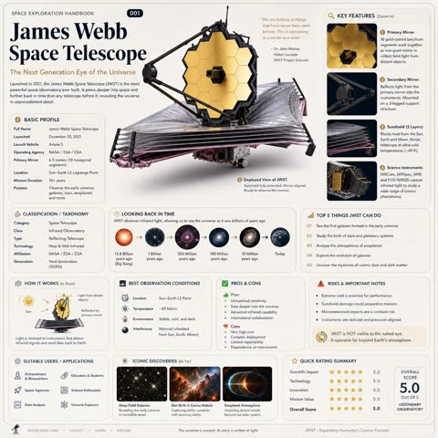</a>

A TOPIC placeholder is filled in by a list of modular panel types such as profile, taxonomy, pros and cons, and rating summary. Explicit style anchors like collectible handbook and natural history guidebook, plus a light background and rounded boxes, keep the layout consistent across a series.

GPT Image 2 · Text-to-image · Source: [@oggii_0 on X](https://x.com/oggii_0/status/2051889025229930547) · 1,622 likes on 2026-10-29

[`encyclopedia`](tags.md#tag-encyclopedia) [`infographic`](tags.md#tag-infographic) [`template`](tags.md#tag-template) [`knowledge-card`](tags.md#tag-knowledge-card) [`editorial-layout`](tags.md#tag-editorial-layout)

<details><summary><b>Prompt</b></summary>

```text
Create educational encyclopedia style images with GPT Image 2 on
@itsPolloAI


Prompt: Based on { TOPIC }, create a high-quality vertical “encyclopedia-style educational infographic image.”

This image should NOT look like a regular poster or a simple illustration. Instead, it should feel like a structured knowledge guide that combines:

the feeling of a collectible reference handbook

a modern encyclopedia page

a lifestyle knowledge card

and a highly shareable social-media infographic

The overall style should resemble a premium natural-history guidebook mixed with modern editorial infographic design.

The image should include:

One beautiful and highly detailed main subject image

Several zoomed-in detail sections highlighting important features

Multiple modular information panels with rounded corners

Clear title hierarchy and highlighted key labels

Concise yet information-rich encyclopedia content

Visual scoring systems, quick summaries, or “Top 5” modules

The information sections should automatically adapt to the topic. Select and combine relevant categories such as:

Basic profile

Classification / taxonomy

Physical characteristics

Behavior / ecology / habits

Structure or formation mechanisms

Growth conditions or usage methods

Care, maintenance, or optimization tips

Risks, warnings, and important notes

Suitable users or application scenarios

Pros and cons comparison

Quick rating tags or summary cards

Visual requirements:

Clean light-colored background

Soft and elegant color palette

Gentle shadows

Small refined icons

Rounded information boxes

Organized editorial layout

High information density without feeling crowded

Comfortable reading experience

The final result should feel like a real publishable encyclopedia knowledge card designed for reading, collecting, and creating as part of a consistent series — NOT like a commercial advertisement poster.

The image must strongly emphasize:

“knowledge integration + modular information design + handbook/reference-style presentation.”
```

</details>

<a id="gpt-image-pink-hair-earbud-case-infographic"></a>
### Model holds open earbud case in ad poster

<a href="https://x.com/rovvmut_/status/2047912710365761828">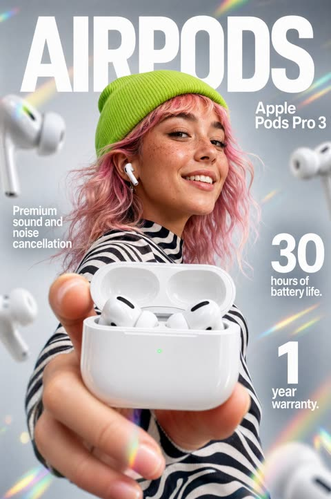</a>

The prompt sets three depth layers, a macro foreground, a midground subject and a soft background, and gives every text block its exact wording and position. This keeps the typography legible and the layout close to the brief.

GPT Image 2 · Text-to-image · Source: [@rovvmut_ on X](https://x.com/rovvmut_/status/2047912710365761828) · 1,034 likes on 2026-10-29

[`infographic`](tags.md#tag-infographic) [`earbuds`](tags.md#tag-earbuds) [`product-ad`](tags.md#tag-product-ad) [`typography`](tags.md#tag-typography)

<details><summary><b>Prompt</b></summary>

```text
GPT Image 2 on
@SocialSight


Prompt: High-impact e-commerce infographic for "Apple Pods Pro 3" wireless earbuds.
Foreground: An extreme close-up of a hand holding an open, glossy white wireless earbud charging case toward the camera. Inside the case are two sleek white earbuds with black speaker accents. A tiny, glowing green LED status light is visible on the front of the case. The hand and case have a slight macro-lens blur to create a sense of depth.
Central Subject: In the mid-ground, a smiling young woman with freckles and wavy pastel-pink hair. She is wearing a vibrant lime-green knit beanie and a psychedelic, black and white-striped long-sleeve shirt. One white earbud is tucked into her ear.
Background & Lighting: A clean, soft-focus studio backdrop with a light-gray gradient. The scene is accented by diagonal rainbow prism lens flares and soft light leaks. Several blurred white earbuds float artistically in the background. The lighting is soft and professional, highlighting the glossy plastic of the product.
Typography & Layout (Sans-Serif, White):
Top Center (Background): Massive, bold text reading "AIRPODS" (positioned behind the model).
Top Right: Bold text reading "Apple Pods Pro 3".
Mid-Left: "Premium sound and noise cancellation"
Mid-Right: Large, bold "30" with the text "hours of battery life."
Bottom-Right: Large, bold "1" with the text "year warranty."
Style: 8k resolution, commercial product photography, vibrant color palette, sharp focus on the product case, shallow depth of field, clean advertising aesthetic.
```

</details>

<a id="gpt-image-endangered-animal-infographic-bengal-tiger"></a>
### Endangered Bengal Tiger Annotated Infographic Poster

<a href="https://x.com/MrDasCreates/status/2052064402866851981">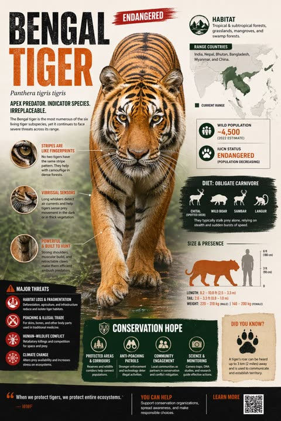</a>

The prompt asks for a photorealistic central animal supported by annotated callouts, icons and color blocking, instead of generic sections. Having the model research a real species first fills the layered layout with accurate, dense facts.

GPT Image 2 · Text-to-image · Source: [@MrDasCreates on X](https://x.com/MrDasCreates/status/2052064402866851981) · 819 likes on 2026-10-28

[`infographic`](tags.md#tag-infographic) [`animal`](tags.md#tag-animal) [`endangered-species`](tags.md#tag-endangered-species) [`photorealistic`](tags.md#tag-photorealistic) [`callouts`](tags.md#tag-callouts)

<details><summary><b>Prompt</b></summary>

```text
Animal Infographic by GPT Image 2 on ChatGPT app

Prompt: Create a visually rich infographic about an endangered animal. Start by finding one online, research its habitat, diet, and unique traits. Present information through annotated visuals and structured callouts, not generic sections. Style it like a bold graphic illustration: a detailed, photorealistic central animal as the focal point, supported by diagrams, callouts, and concise text elements. Use clean backgrounds and a mix of photorealism with strong graphic elements (shapes, icons, color blocking) in a layered composition. Make it dense, tactile, and professionally authored.
```

</details>

<a id="nano-banana-f1-australian-gp-2026-qualifying"></a>
### Australian Grand Prix 2026 qualifying results infographic

<a href="https://x.com/maxescu/status/2030227188679655426">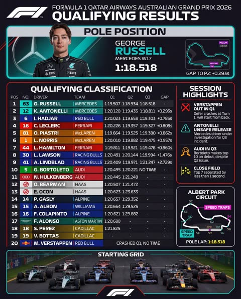</a>

The brief names the event and session and asks for the latest results, which fixes the scope and the data. That one request is enough to produce a full broadcast look with a pole spotlight, a classification table, gaps to pole and a track map.

Nano Banana 2 · Text-to-image · Source: [@maxescu on X](https://x.com/maxescu/status/2030227188679655426) · 659 likes on 2026-10-29

[`f1`](tags.md#tag-f1) [`infographic`](tags.md#tag-infographic) [`sports-data`](tags.md#tag-sports-data) [`web-search`](tags.md#tag-web-search)

<details><summary><b>Prompt</b></summary>

```text
Generate a detailed infographic showcasing the qualifying results for the Australian Grand Prix 2026 from today. Search the web for the most recent and accurate data.
```

</details>

<a id="gpt-image-1990s-anime-character-styles-catalog"></a>
### 1990s anime character styles catalog with 16 labeled archetypes

<a href="https://x.com/aimikoda/status/2058152463031488981">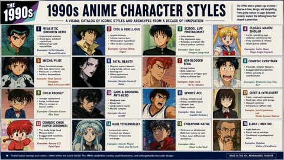</a>

Naming the era, the language, a labeled grid layout and one archetype per panel gives a consistent, scannable reference sheet from a single sentence. Specifying the 16:9 ratio fixes the canvas so the grid fills the frame.

GPT Image 2 · Text-to-image · Source: [@aimikoda on X](https://x.com/aimikoda/status/2058152463031488981) · 590 likes on 2026-10-29

[`anime`](tags.md#tag-anime) [`infographic`](tags.md#tag-infographic) [`character-design`](tags.md#tag-character-design) [`style-catalog`](tags.md#tag-style-catalog)

<details><summary><b>Prompt</b></summary>

```text
Anime character styles are incredibly diverse and researching them one by one can get exhausting fast. I'm using a simple GPT Image 2 prompt that turns this process into a visual catalog by generating infographic-style posters with different anime character archetypes, visual languages and era-specific styles all in a single image.

It is a quick way to explore, compare and study character design directions without jumping between dozens of references. Great for inspiration, style research and building visual libraries.

You can tweak a few parts of the prompt to explore other directions as well, such as stylized 3D animation looks, cinematic visual languages or even film-inspired design catalogs.

Example Prompt: Create an English infographic catalog poster showing 1990s anime character styles in a clean labeled grid layout, each panel featuring a different archetype and visual language. Use 16:9 aspect ratio.
```

</details>

<a id="gpt-image-modern-house-architecture-handbook-infographic"></a>
### Modern House Architecture Handbook Infographic Page

<a href="https://x.com/mehvishs25/status/2053147765409288633"></a>

A HOUSE_STYLE placeholder makes the prompt reusable. It pairs one hero three-quarter render with long lists of named modular sections and visualization modules, plus an explicit avoid list that keeps the page from looking like a real estate flyer.

GPT Image 2 · Text-to-image · Source: [@mehvishs25 on X](https://x.com/mehvishs25/status/2053147765409288633) · 538 likes on 2026-10-28

[`infographic`](tags.md#tag-infographic) [`architecture`](tags.md#tag-architecture) [`house`](tags.md#tag-house) [`template`](tags.md#tag-template) [`editorial`](tags.md#tag-editorial)

<details><summary><b>Prompt</b></summary>

```text
Create a premium square “reference-style architectural infographic” centered around a luxurious {HOUSE_STYLE} modern house, designed as a beautifully curated architecture handbook page rather than a real-estate advertisement.
The composition should feel like a modern visual encyclopedia mixed with an elite architectural field guide and high-end editorial infographic system.
Visual Direction:
• 1:1 square composition
• Soft light-toned architectural background with subtle blueprint textures and drafting schematics
• Elegant muted palette using warm white, charcoal gray, natural wood tones, matte black, concrete gray, and soft steel blue accents
• Refined editorial typography hierarchy
• Rounded modular information cards with clean spacing
• Gentle realistic shadows and premium UI-style dividers
• Minimal architectural iconography
• Extremely detailed central house render viewed in dramatic three-quarter exterior perspective during soft golden-hour lighting
• Thin precision annotation lines pointing toward architectural systems and design features
• Clean, organized “knowledge-first” layout with high information density but breathable spacing
Main Subject Presentation:
A stunning ultra-detailed realistic render of the {HOUSE_STYLE} modern house placed at the center, featuring premium architectural realism, floor-to-ceiling glass walls, realistic reflections, warm ambient lighting, natural landscaping, modern material textures, elegant geometry, and sophisticated contemporary detailing.
Surround the house with scientific and architectural callouts explaining:
• façade design
• structural engineering
• smart home systems
• sustainable architecture
• passive cooling systems
• roof design
• glazing and natural lighting
• interior planning
• landscaping integration
• energy-efficient materials
Include modular infographic sections such as:
• House Overview
• Key Specifications
• Floor Plan Overview
• Structural & Material Breakdown
• Smart Home Features
• Sustainability Systems
• Climate-Responsive Design
• Interior Design Highlights
• Kitchen & Bathroom Concepts
• Area Distribution Charts
• Construction Timeline
• Cost Estimation (Indicative)
• Advantages vs Considerations
• Site Plan Layout
• Sectional Architectural View
• “Top 5 Incredible Facts” section
• Ideal Locations & Usage Scenarios
Add small premium visualization modules like:
• floor plan diagrams
• section-cut architectural drawings
• airflow & ventilation diagrams
• sunlight direction graphics
• smart-home workflow visuals
• landscaping/site layout plans
• material palette displays
• sustainability performance charts
• miniature blueprint elevation views
• room distribution infographics
Style Keywords:
“premium architecture encyclopedia”
“editorial architectural handbook”
“high-end residential infographic”
“museum-quality modern house reference page”
“scientific architectural poster”
“luxury home design editorial”
“modular architectural knowledge system”
“ultra-detailed architectural visualization”
Avoid:
• generic real-estate flyer aesthetics
• cluttered luxury brochure layouts
• excessive cinematic effects
• overly dark moody scenes
• unrealistic futuristic sci-fi architecture
• advertisement-heavy compositions
The final result should resemble a professionally published architectural reference-book page created for architects, interior designers, collectors, luxury home enthusiasts, and educational design archives.
```

</details>

<a id="nano-banana-levitating-outfit-fashion-editorial-labels"></a>
### Levitating Outfit Editorial With Callout Labels

<a href="https://x.com/AllaAisling/status/2034382842084708533">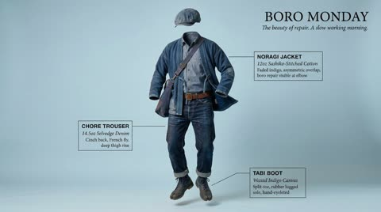</a>

The prompt lists garments in order from footwear up to headwear and gives each fabric its own physics. A fixed label format of uppercase name, italic fabric and one defining detail, plus a three-part light setup of key, warm fill and cool rim, keeps the invisible-body look consistent.

Nano Banana 2 · Text-to-image · Source: [@AllaAisling on X](https://x.com/AllaAisling/status/2034382842084708533) · 503 likes on 2026-10-28

[`fashion`](tags.md#tag-fashion) [`levitation`](tags.md#tag-levitation) [`editorial`](tags.md#tag-editorial) [`template`](tags.md#tag-template) [`callout-labels`](tags.md#tag-callout-labels)

<details><summary><b>Prompt</b></summary>

```text
Prompt Studio: Gravity Fashion Editorial, with Nano Banana 2 in Firefly

Complete [STYLE] outfit floating in its exact worn position around  an invisible body with every piece suspended mid-breath, mid-billow.  LOOK (bottom to top): [FOOTWEAR] → [BOTTOMS] → [TOP] → [LAYER] →  [ACCESSORIES] → [JEWELLERY] → [HEADWEAR]  FABRIC PHYSICS: each material true to its weight, wool hangs,  silk drapes, denim holds its crease, leather keeps its shape.  Every edge lifting slightly as if caught in one silent gust.  LABELS: hairline leader to floating label box. "[GARMENT]" uppercase / "[FABRIC]" italic / "[ONE DEFINING DETAIL]"  LIGHTING: soft directional from upper left + warm fill from below  catching linings and sole edges + cool rim outlining the silhouette. BACKGROUND: [COLOR] seamless, fashion-forward. TITLE: "[LOOK NAME]" elegant serif type, top right. SUBTITLE: "[MOOD / OCCASION]" italic.  Mood: high-concept levitation editorial, the outfit exists,  the person is imagination. 4K, extraordinary fabric fidelity, tack sharp.

Check ALTs for ideas 👇
@AdobeFirefly
```

</details>

<a id="gpt-image-endangered-animal-annotated-infographic"></a>
### Endangered red panda annotated wildlife infographic

<a href="https://x.com/harboriis/status/2047704250327920716">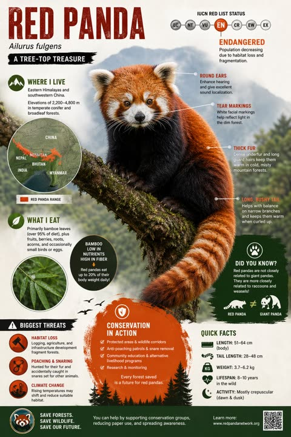</a>

The prompt lets the model research and pick the animal, then fixes the layout: one photorealistic hero subject, callouts that point at body parts, and graphic shapes and icons in color blocks. Asking for annotated visuals instead of generic sections gives a dense, layered poster.

GPT Image 2 · Text-to-image · Source: [@harboriis on X](https://x.com/harboriis/status/2047704250327920716) · 477 likes on 2026-10-29

[`infographic`](tags.md#tag-infographic) [`wildlife`](tags.md#tag-wildlife) [`annotated-callouts`](tags.md#tag-annotated-callouts) [`photorealistic`](tags.md#tag-photorealistic) [`color-blocking`](tags.md#tag-color-blocking)

<details><summary><b>Prompt</b></summary>

```text
Create a visually rich infographic about an endangered animal. Start by finding one online, research its habitat, diet, and unique traits. Present information through annotated visuals and structured callouts, not generic sections. Style it like a bold graphic illustration: a detailed, photorealistic central animal as the focal point, supported by diagrams, callouts, and concise text elements. Use clean backgrounds and a mix of photorealism with strong graphic elements (shapes, icons, color blocking) in a layered composition. Make it dense, tactile, and professionally authored.
```

</details>

<a id="gpt-image-routine-recipe-editorial-infographic"></a>
### Morning routine recipe editorial infographic

<a href="https://x.com/TechieBySA/status/2047683043918311670"></a>

A single template with a [ROUTINE] placeholder specifies each section in turn: hero objects, a What You Need list with quantities, numbered glassmorphism step panels, and floating stat pills. Warm cream palette, negative space and grain keep the dense layout readable.

GPT Image 2 · Text-to-image · Source: [@TechieBySA on X](https://x.com/TechieBySA/status/2047683043918311670) · 460 likes on 2026-10-28

[`infographic`](tags.md#tag-infographic) [`editorial`](tags.md#tag-editorial) [`routine`](tags.md#tag-routine) [`template`](tags.md#tag-template) [`glassmorphism`](tags.md#tag-glassmorphism)

<details><summary><b>Prompt</b></summary>

```text
“Ultra-clean modern editorial infographic on the topic of [ROUTINE] routine. Hero visual: a stylized flat-lay or floating arrangement of 3–4 objects closely associated with the routine — slightly angled or in soft perspective, glowing subtly. All elements arranged dynamically around the hero in a non-restrictive editorial layout. Ingredients Section: Label it ‘What You Need’ — include 6–8 items with small icons or emoji illustrations next to each. Each item has a name and a practical quantity or duration written like a recipe (e.g. ‘x minutes of Y’). Arranged in a cluster or list connected visually to the hero. Steps Section: 5–6 numbered panels with arrows or connecting lines forming a logical flow. Each step has a short action label and a small relevant icon. Panels use glassmorphism or frosted card styling. Stats Badges: 4–5 floating pill-shaped badges showing relevant metadata — total time, difficulty, consistency streak, energy cost — displayed as clean minimal bubbles near the hero. Visual Style: Warm, soft editorial background — cream, warm white, or soft morning light tones. Muted earthy accent colors with clean highlights. Bold modern sans-serif typography. Clean vector icons. Subtle grain or paper texture in background. Composition: Hero object cluster centered or slightly offset. Ingredients on one side. Steps flow opposite or below with connecting lines. Stat badges scattered as floating pills. Generous negative space to keep it airy and readable. Lighting: Soft warm natural light feel emanating from the hero cluster. Premium lifestyle editorial aesthetic, social-feed optimized. Ultra-crisp. No watermark.”
```

</details>

<a id="gpt-image-premium-recipe-poster-tempura-bowl"></a>
### Premium tempura bowl recipe poster with steps

<a href="https://x.com/Preda2005/status/2047883394152088004">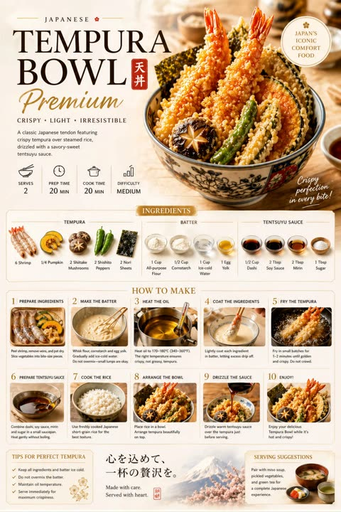</a>

A single reusable template with a dish name placeholder lists the layout parts in order: hero dish, ingredients, step by step process, cream background. Style cues like warm natural lighting and refined English typography keep the poster cohesive.

GPT Image 2 · Text-to-image · Source: [@Preda2005 on X](https://x.com/Preda2005/status/2047883394152088004) · 455 likes on 2026-10-28

[`recipe`](tags.md#tag-recipe) [`food-poster`](tags.md#tag-food-poster) [`typography`](tags.md#tag-typography) [`template`](tags.md#tag-template) [`cream-background`](tags.md#tag-cream-background)

<details><summary><b>Prompt</b></summary>

```text
Create a premium food preparation poster for
 [ DISH NAME ], with a beautiful hero dish, warm natural lighting, cream background, elegant step-by-step recipe layout, ingredients, cooking process, premium food photography, refined English typography, luxury restaurant advertisement style, clean design, rich colors, highly detailed, visually irresistible, cinematic masterpiece.
```

</details>

<a id="gpt-image-ai-fitness-coach-analysis-poster"></a>
### AI fitness analysis poster from a gym selfie

<a href="https://x.com/frametheory058/status/2054461225413870014">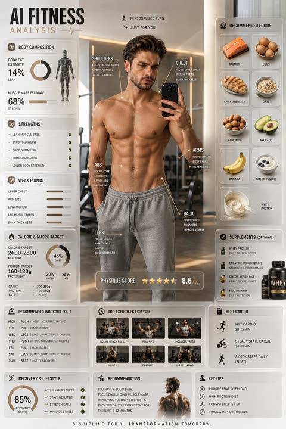</a>

The prompt locks the uploaded face and identity, then lists every dashboard section, food card and exercise panel by name, so the model fills a dense glassmorphism layout around a centered subject. A bright luxury palette with explicit bans on dark gym looks keeps the poster clean and premium.

GPT Image 2 · Edit · Source: [@frametheory058 on X](https://x.com/frametheory058/status/2054461225413870014) · 454 likes on 2026-10-28

[`fitness`](tags.md#tag-fitness) [`poster`](tags.md#tag-poster) [`dashboard-ui`](tags.md#tag-dashboard-ui) [`glassmorphism`](tags.md#tag-glassmorphism) [`selfie`](tags.md#tag-selfie)

<details><summary><b>Prompt</b></summary>

```text
I will upload a gym mirror selfie/body photo.

Create an ULTRA PREMIUM AI FITNESS ANALYSIS POSTER that looks like a luxury futuristic wellness brand advertisement mixed with a high-end fitness app dashboard.

IMPORTANT:
The uploaded face and identity must remain EXACTLY THE SAME.
Do not change:

face structure

eyes

jawline

hairstyle

skin tone

facial proportions

Only enhance:

body presentation

outfit styling

lighting

pose atmosphere

premium visual composition

STYLE DIRECTION:
Avoid dark black backgrounds.

Instead create:

bright luxury studio aesthetic

soft silver + white + warm beige + matte charcoal tones

premium Apple / Gymshark / WHOOP / Technogym inspired design

clean modern luxury UI

cinematic natural lighting

subtle reflections and depth

rich soft shadows

elegant futuristic fitness branding

The entire poster should feel:
MINIMAL + EXPENSIVE + VIRAL + HIGH STATUS

LAYOUT:
4:5 vertical composition optimized for Twitter/X virality.

CENTER SUBJECT:

Place the uploaded person in the middle

Natural confident Gen-Z mirror selfie pose

Slight V-taper physique

Lean aesthetic body

Realistic muscles, not overdone

Premium sweatpants or luxury athletic wear

Clean modern hairstyle

iPhone mirror selfie vibe

BACKGROUND:
Create a premium luxury gym or wellness studio:

polished concrete

soft LED strip lights

luxury mirrors

brushed steel gym equipment

natural depth blur

warm daylight mixed with cinematic lighting

NO dark horror gym aesthetic.

COLOR PALETTE:

matte white

platinum silver

warm cream

champagne gold accents

soft graphite

subtle neon beige glow

UI DESIGN:
Create floating modern fitness-analysis cards around the body.

Use:

glassmorphism panels

floating transparent UI

thin elegant borders

soft glowing shadows

futuristic clean typography

SECTIONS TO INCLUDE:

• Body Fat Estimate
• Muscle Strengths
• Weak Points
• Calorie Goal
• Protein Intake
• Recommended Split
• Best Cardio
• Recovery Score
• Physique Rating

FOOD SECTION:
Instead of basic circles, create:

floating premium food cards

realistic luxury food photography

elegant shadows

soft glowing borders

Include:

salmon

eggs

chicken breast

avocado

oats

almonds

banana

greek yogurt

whey protein

EXERCISE SECTION:
Use sleek cinematic mini-panels for:

incline bench

pull-ups

shoulder press

squats

deadlift

WOW FACTORS:

luxury reflections

floating holographic UI

subtle particles

soft ambient glow

premium health-tech aesthetic

cinematic depth

realistic skin texture

ultra sharp details

TEXT STYLE:
Minimal and bold.
Very clean typography like premium tech advertisements.

QUALITY:

hyper realistic

ultra detailed

8K

cinematic realism

viral social media quality

extremely polished

visually addictive

should instantly make people stop scrolling

FINAL GOAL:
The poster should look so premium and believable that people instantly think:
“Wait… AI can actually create a personalized fitness coach like this?”
```

</details>

<a id="gpt-image-endangered-animal-annotated-infographic-2"></a>
### Snow leopard annotated wildlife field guide infographic

<a href="https://x.com/john_my07/status/2053153776400490683">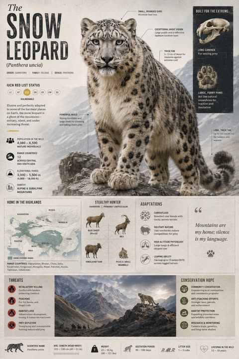</a>

Names a hero photorealistic animal and lists the information layers (callouts, scientific labels, habitat map, icon clusters), so the model fills in real species facts. Style anchors like paper grain, negative space and museum field guide keep the dense layout editorial.

GPT Image 2 · Text-to-image · Source: [@john_my07 on X](https://x.com/john_my07/status/2053153776400490683) · 446 likes on 2026-10-29

[`infographic`](tags.md#tag-infographic) [`wildlife`](tags.md#tag-wildlife) [`editorial`](tags.md#tag-editorial) [`annotated-diagram`](tags.md#tag-annotated-diagram) [`field-guide`](tags.md#tag-field-guide)

<details><summary><b>Prompt</b></summary>

```text
Create a premium editorial-style infographic centered around a rare or endangered animal species, designed as a visually immersive wildlife reference sheet rather than a typical educational poster.

Begin by researching a real endangered species and incorporate authentic details about its ecosystem, behavior, survival threats, diet, anatomy, and adaptations. Structure the information through layered visual storytelling, using annotated diagrams, directional callouts, scientific labels, environmental overlays, habitat maps, and compact data snippets instead of standard text sections.

The composition should feature a highly detailed photorealistic rendering of the animal as the dominant focal element, surrounded by bold graphic design elements such as textured shapes, infographic markers, icon systems, color-coded information clusters, and cinematic typography.

Blend natural-history illustration aesthetics with modern editorial graphics: clean negative space, tactile textures, subtle paper-grain feel, and intelligently organized visual density. The final piece should feel like a professionally art-directed page from a futuristic wildlife atlas or museum-quality field guide.
```

</details>

<a id="gpt-image-encyclopedia-style-topic-infographic-card"></a>
### Encyclopedia Style Eagle Knowledge Card Infographic

<a href="https://x.com/harboriis/status/2052250481414865206">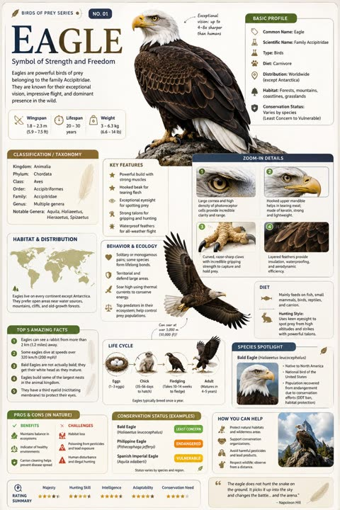</a>

A TOPIC placeholder lets one template serve any subject. It names the reference handbook feel, lists modular panel types such as taxonomy, zoom ins, Top 5 and ratings, and sets light background and rounded box rules.

GPT Image 2 · Text-to-image · Source: [@harboriis on X](https://x.com/harboriis/status/2052250481414865206) · 429 likes on 2026-10-29

[`encyclopedia`](tags.md#tag-encyclopedia) [`infographic`](tags.md#tag-infographic) [`template`](tags.md#tag-template) [`knowledge-card`](tags.md#tag-knowledge-card) [`nature`](tags.md#tag-nature)

<details><summary><b>Prompt</b></summary>

```text
Based on { TOPIC }, create a high-quality vertical “encyclopedia-style educational infographic image.”

This image should NOT look like a regular poster or a simple illustration. Instead, it should feel like a structured knowledge guide that combines:

the feeling of a collectible reference handbook

a modern encyclopedia page

a lifestyle knowledge card

and a highly shareable social-media infographic

The overall style should resemble a premium natural-history guidebook mixed with modern editorial infographic design.

The image should include:

One beautiful and highly detailed main subject image

Several zoomed-in detail sections highlighting important features

Multiple modular information panels with rounded corners

Clear title hierarchy and highlighted key labels

Concise yet information-rich encyclopedia content

Visual scoring systems, quick summaries, or “Top 5” modules

The information sections should automatically adapt to the topic. Select and combine relevant categories such as:

Basic profile

Classification / taxonomy

Physical characteristics

Behavior / ecology / habits

Structure or formation mechanisms

Growth conditions or usage methods

Care, maintenance, or optimization tips

Risks, warnings, and important notes

Suitable users or application scenarios

Pros and cons comparison

Quick rating tags or summary cards

Visual requirements:

Clean light-colored background

Soft and elegant color palette

Gentle shadows

Small refined icons

Rounded information boxes

Organized editorial layout

High information density without feeling crowded

Comfortable reading experience

The final result should feel like a real publishable encyclopedia knowledge card designed for reading, collecting, and creating as part of a consistent series — NOT like a commercial advertisement poster.

The image must strongly emphasize:

“knowledge integration + modular information design + handbook/reference-style presentation.”
```

</details>

<a id="gpt-image-serum-affiliate-five-scene-storyboard"></a>
### Five step vertical storyboard for a pink body serum

<a href="https://x.com/AizaAi12/status/2094970821219627239">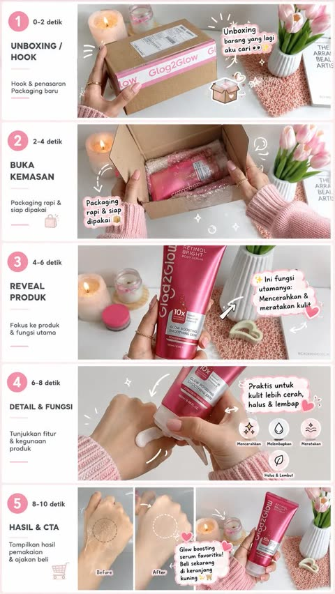</a>

The prompt fixes the frame count, scene length and aspect ratio up front, then anchors the product to a reference photo so the same bottle stays consistent across all five panels. Timed scene labels and short captions turn the output into a usable ad plan.

GPT Image 2 · Edit · Source: [@AizaAi12 on X](https://x.com/AizaAi12/status/2094970821219627239) · 353 likes on 2026-10-29

[`storyboard`](tags.md#tag-storyboard) [`product-ad`](tags.md#tag-product-ad) [`affiliate`](tags.md#tag-affiliate) [`reference-photo`](tags.md#tag-reference-photo)

<details><summary><b>Prompt</b></summary>

```text
Create a vertical storyboard sheet in a 9:16 aspect ratio for a 10-second TikTok/Shopee Affiliate product advertisement video, consisting of exactly 5 different scenes, with each scene lasting approximately 2 seconds.

Use the product from the reference photo as the main product. Keep the product 100% identical to the reference photo, including its shape, color, size, material, texture, pattern, logo, packaging, and all other important details.
```

</details>

<a id="gpt-image-reference-style-educational-infographic-template"></a>
### Reference Style Educational Infographic Handbook Page

<a href="https://x.com/john_my07/status/2052357609068622199">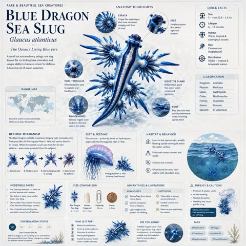</a>

A TOPIC placeholder is filled in a fixed structure: one central hero render, magnified detail callouts, rounded modular cards and a list of adaptive sections. A light muted palette and an explicit list of looks to avoid keep the result a handbook page rather than a poster.

GPT Image 2 · Text-to-image · Source: [@john_my07 on X](https://x.com/john_my07/status/2052357609068622199) · 249 likes on 2026-10-29

[`infographic`](tags.md#tag-infographic) [`template`](tags.md#tag-template) [`encyclopedia`](tags.md#tag-encyclopedia) [`field-guide`](tags.md#tag-field-guide) [`editorial`](tags.md#tag-editorial)

<details><summary><b>Prompt</b></summary>

```text
Based on {TOPIC}, create a premium vertical “reference-style educational infographic” that feels like a beautifully designed knowledge handbook rather than a traditional poster.

The design should combine the atmosphere of:

• a modern visual encyclopedia
• a collectible field-guide page
• an editorial knowledge system
• and a clean, highly shareable infographic layout

The final image must feel informative, structured, and visually curated — like a page taken from a high-end illustrated reference book.

Core Design Direction:

• One stunning, highly detailed central subject illustration or render
• Multiple magnified detail callouts showing important features or components
• Modular information cards with soft rounded edges
• Strong typography hierarchy with highlighted labels and section dividers
• Compact but meaningful educational content
• Intelligent infographic-style layout with balanced spacing and readable density
• Visual summary systems such as rankings, quick facts, comparison charts, “Top 5” insights, or key-stat modules

The content categories should dynamically adapt to the topic itself. Include the most relevant sections such as:

• Overview / identity profile
• Classification or category system
• Structural or physical characteristics
• Functions, behavior, or mechanisms
• Habitat, environment, or ideal conditions
• Usage methods, workflows, or optimization tips
• Maintenance, growth, or improvement guidance
• Advantages vs limitations
• Risks, cautions, or important notes
• Recommended users or real-world applications
• Quick ratings, tags, or summarized insight cards

Visual Style Requirements:

• Soft light-toned background
• Elegant muted color palette
• Refined editorial aesthetic
• Gentle realistic shadows
• Minimal premium iconography
• Clean modular spacing system
• Rounded information containers
• High information density while remaining visually breathable
• Consistent handbook/reference-book styling throughout

The composition should prioritize:

“knowledge organization + visual clarity + modular editorial storytelling”

Avoid making it look like:

• a movie poster
• a marketing advertisement
• a simple character illustration
• or a generic social-media graphic

Instead, the image should resemble a professionally published encyclopedia infographic page designed for learning, collecting, and building into a larger visual knowledge series.
```

</details>

<a id="gpt-image-football-stadium-engineering-infographic"></a>
### Futuristic football stadium engineering handbook infographic

<a href="https://x.com/j_smeaton99/status/2056209800627974490">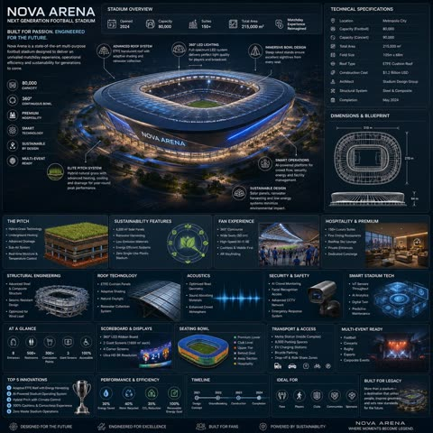</a>

A fixed square layout names a central aerial nighttime render, then lists ten callout topics and seventeen modular sections so the model fills a dense card grid. Style keywords and an Avoid list keep it editorial and encyclopedic instead of advertising.

GPT Image 2 · Text-to-image · Source: [@j_smeaton99 on X](https://x.com/j_smeaton99/status/2056209800627974490) · 246 likes on 2026-10-29

[`infographic`](tags.md#tag-infographic) [`stadium`](tags.md#tag-stadium) [`architecture`](tags.md#tag-architecture) [`sports`](tags.md#tag-sports) [`template`](tags.md#tag-template)

<details><summary><b>Prompt</b></summary>

```text
Create a premium square “reference-style sports architecture infographic” centered around a futuristic modern football stadium called the {STADIUM_NAME}, designed as a beautifully curated stadium-engineering handbook page rather than a sports advertisement poster.

The composition should feel like a modern visual encyclopedia mixed with an elite stadium-design field guide and high-end editorial infographic system.

Visual Direction:

• 1:1 square composition
• Dark premium architectural-tech background with subtle blueprint textures, stadium schematics, and cinematic city-light overlays
• Elegant palette using deep navy, matte black, steel blue, titanium silver, and glowing electric-blue accents
• Refined editorial typography hierarchy with modern sports-engineering aesthetics
• Rounded modular information cards with clean spacing
• Gentle realistic reflections and premium HUD-style dividers
• Minimal sports infrastructure iconography
• Extremely detailed central stadium render viewed in dramatic aerial three-quarter perspective during nighttime match lighting
• Thin precision annotation lines pointing toward structural systems and smart-stadium technologies
• Clean, organized “knowledge-first” layout with high information density but breathable spacing

Main Subject Presentation:

A stunning ultra-detailed realistic render of the {STADIUM_NAME} placed at the center, featuring illuminated seating bowls, glowing LED façade lighting, retractable roof systems, realistic crowd ambience, premium landscaping, advanced pitch engineering, and world-class architectural realism.

Surround the stadium with scientific and engineering callouts explaining:

• retractable roof technology
• LED lighting systems
• seating bowl acoustics
• pitch and drainage engineering
• structural steel framework
• crowd management systems
• smart surveillance & security
• sustainability systems
• transport and accessibility integration
• digital fan-experience technology

Include modular infographic sections such as:

• Stadium Overview
• Technical Specifications
• Dimensions & Blueprint Views
• Seating Capacity & Bowl Design
• Pitch Engineering System
• Structural & Roof Technology
• Smart Stadium Infrastructure
• Fan Experience & Hospitality
• Security & Safety Systems
• Sustainability Features
• Transportation & Access Planning
• Acoustics & Audio Systems
• Matchday Operations Workflow
• Multi-Event Capability
• Construction Timeline
• “Top 5 Innovations” section
• Built for Legacy & Future Expansion

Add small premium visualization modules like:

• stadium blueprint diagrams
• seating-distribution graphics
• roof-opening mechanism visuals
• sustainability performance charts
• crowd-flow maps
• transport integration diagrams
• smart surveillance graphics
• pitch-layer cutaway illustrations
• acoustics waveform displays
• aerial site-plan schematics

Style Keywords:

“premium stadium architecture encyclopedia”
“editorial sports infrastructure handbook”
“high-end football stadium infographic”
“scientific sports architecture poster”
“museum-quality stadium reference page”
“modular sports-engineering knowledge system”
“clean architectural editorial design”
“ultra-detailed stadium visualization”

Avoid:

• generic sports advertisements
• cartoon football aesthetics
• cluttered sponsor-heavy layouts
• unrealistic sci-fi fantasy stadiums
• excessive neon cyberpunk overload
• chaotic crowd-focused compositions

The final result should resemble a professionally published sports-architecture reference-book page created for architects, engineers, football fans, stadium planners, designers, and educational infrastructure archives.
```

</details>

<a id="gpt-image-terrestrial-life-species-infographic"></a>
### Honey bee educational infographic with data modules

<a href="https://x.com/iamsofiaijaz/status/2113510238846672945"></a>

A subject placeholder lets one template cover any species. It names every module (profile sidebar, facts list, size chart, rating, habitat icons, status slider) and fixes the palette to soft beige for a journal look.

GPT Image 2.5 · Text-to-image · Source: [@iamsofiaijaz on X](https://x.com/iamsofiaijaz/status/2113510238846672945) · 230 likes on 2026-10-28

[`infographic`](tags.md#tag-infographic) [`educational`](tags.md#tag-educational) [`template`](tags.md#tag-template) [`scientific`](tags.md#tag-scientific) [`layout`](tags.md#tag-layout)

<details><summary><b>Prompt</b></summary>

```text
A professional educational infographic for a [Subject], designed in a modern "Terrestrial Life" series style. The layout features a large, realistic 3D central illustration of the [Subject] with anatomical labels like "Compound Eyes," "Thorax," and "Abdomen" using thin pointer lines. The color palette is clean with soft beige and muted tones. The composition includes multiple data modules: a "Quick Profile" sidebar, a "Top 5 Amazing Facts" list, a "Size Comparison" chart against a human silhouette, and a "Knowledge Score" star rating system. Include a "Detail Focus" section on the right with four square macro-photography close-ups of life stages or specific features. The bottom features "Habitat" and "Diet" icons, a "Conservation Status" slider, and a small "Did You Know?" footer. High resolution, crisp typography, clean vector lines, and a professional scientific journal aesthetic.
```

</details>

<a id="gpt-image-airpods-model-case-infographic"></a>
### Model holding AirPods case in feature infographic

<a href="https://x.com/mehvishs25/status/2049513437542461551">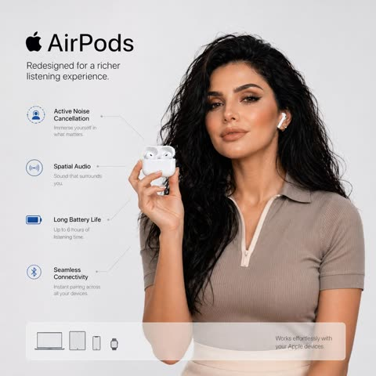</a>

Naming the product, a reference image for identity, and a fixed set of labelled callouts gives an ad layout with clear negative space. Stating the palette, lighting and 1:1 ratio keeps the result consistent in a commerce ad style.

GPT Image 2 · Edit · Source: [@mehvishs25 on X](https://x.com/mehvishs25/status/2049513437542461551) · 227 likes on 2026-10-29

[`airpods`](tags.md#tag-airpods) [`infographic`](tags.md#tag-infographic) [`reference-identity`](tags.md#tag-reference-identity) [`product-ad`](tags.md#tag-product-ad)

<details><summary><b>Prompt</b></summary>

```text
High-end e-commerce infographic featuring Apple AirPods (latest generation). A young woman (same face and identity as the provided reference image) is the central subject, shown in a clean studio setting with soft, diffused lighting. She is wearing AirPods in her ears, naturally integrated into the scene, and holding the open AirPods charging case in her hand at chest level, slightly angled toward the camera.
The composition should feel premium and minimal, with a crisp white or light gradient background. Include subtle reflections and soft shadows for a polished product-ad look. The AirPods case should be glossy white with visible earbuds inside and a small LED indicator light.
Add modern infographic elements around the subject: – Thin, elegant pointer lines highlighting key features
– Minimal icons and short labels such as “Active Noise Cancellation,” “Spatial Audio,” “Long Battery Life,” and “Seamless Connectivity”
– Clean sans-serif typography (Apple-style aesthetic)
– Balanced layout with negative space, not cluttered
Style: ultra-realistic, sharp focus, shallow depth of field, commercial photography quality, Apple-inspired design language
Color palette: white, light grey, soft blue accents
Aspect ratio: 1:1
Resolution: 4K, highly detailed, professional product showcase
```

</details>

<a id="gpt-image-nintendo-switch-price-hike-news-cover"></a>
### Chinese news cover on Nintendo nationwide price hike

<a href="https://x.com/dotey/status/2052942818570543550">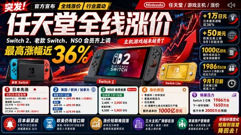</a>

The prompt locks the article into a fixed layout: a news tag row, an oversized bold Chinese headline with the key percentage highlighted, a central hero product, and numbered cards that show old and new prices side by side. A five-icon summary strip at the bottom closes the hierarchy so each element reads in order.

GPT Image 2 · Text-to-image · Source: [@dotey on X](https://x.com/dotey/status/2052942818570543550) · 227 likes on 2026-10-29

[`news-cover`](tags.md#tag-news-cover) [`data-cards`](tags.md#tag-data-cards) [`chinese-typography`](tags.md#tag-chinese-typography) [`infographic-layout`](tags.md#tag-infographic-layout)

<details><summary><b>Prompt</b></summary>

```text
你是一名顶级中文科技媒体视觉设计师。

你的任务是：

根据用户输入的一整篇文章内容，自动提取核心新闻、关键数字、核心产品、行业情绪和信息层级，并生成一张高冲击力的中文科技新闻文章封面图。

图片比例：16:9 横版。

---

【整体风格】

生成一张「中文科技媒体爆款封面图」。

整体风格参考：

* 中国科技媒体头图
* B站科技区爆款缩略图
* 财经新闻视觉
* 游戏行业信息图
* 高冲击力 YouTube Thumbnail
* “行业突发新闻”视觉风格

要求：

* 强烈视觉冲击
* 信息密度高
* 3 秒内看懂新闻重点
* 专业媒体感
* 大量数据卡片
* 中文粗黑大标题
* 明确的产品主视觉
* 明确的情绪表达
* 不要极简风
* 不要 Apple 风
* 不要电影海报风
* 要像“行业大事件”

---

【自动分析文章】

你必须先自动从文章中提取：

1. 最适合作为封面的主标题
2. 最有冲击力的副标题
3. 最重要的数字
4. 最大涨幅、跌幅或变化幅度
5. 最核心的产品、品牌或人物
6. 最能制造视觉冲击的信息
7. 用户最关心的结论
8. 文章整体情绪

文章情绪可以是：

* 暴涨
* 暴跌
* 涨价
* 崩盘
* 封禁
* 突破
* 发布
* 革命
* 危机
* 反转
* 震动
* 警告
* 机会
* 行业洗牌

然后把这些信息转化为视觉设计。

---

【构图结构】

画面采用高密度信息图式布局，自动生成以下区域：

1. 顶部新闻区

* 放品牌名、产品名或行业标签
* 加入“突发”“官方宣布”“重磅”“最新”“行业震动”等新闻标签
* 标签内容根据文章情绪自动选择

2. 中央超大标题区

* 使用超巨大中文标题
* 字体粗壮
* 强烈立体感
* 可带轻微破损、压迫、速度或科技纹理
* 关键词用高亮色突出
* 标题必须短、狠、直接
* 让读者 3 秒内知道发生了什么

3. 主视觉产品区

* 自动识别文章中的核心产品、品牌、设备、人物或象征物
* 将其作为画面最大视觉主体之一
* 产品应有透视感、层次感、光效和冲击力
* 背后可以加入行情图、能量光、箭头、爆炸线、科技 HUD、速度线等元素

4. 数据卡片区

自动把文章中的关键信息做成多个卡片，包括但不限于：

* 价格变化
* 涨跌幅
* 时间节点
* 地区差异
* 销量
* 成本
* 市值
* 用户影响
* 行业对比

数据卡片要求：

* 旧数据可以使用删除线
* 新数据必须更醒目
* 百分比、金额、时间必须突出
* 每张卡片只表达一个重点
* 卡片之间层级清晰，不要堆成一团

5. 底部总结区

自动提取文章中的 3–5 个结论，做成图标化摘要：

* 原因
* 影响
* 趋势
* 风险
* 机会
* 用户建议
* 行业判断

每个结论用「图标 + 短句」呈现。

---

【配色策略】

不要固定使用某一种配色。
你必须根据文章的行业、品牌、情绪和新闻性质，自动生成一套高冲击力封面配色。

配色必须遵循以下原则：

1. 品牌优先

如果文章中出现明确品牌、产品或公司，优先提取其品牌识别色作为主色调。
但不要机械复制 Logo 颜色，要转化为更适合封面的高对比视觉系统。

2. 情绪优先

根据新闻情绪自动选择色彩方向：

* 涨价、危机、封禁、暴雷、裁员、监管、事故：
  使用高压迫感、高警示感、高对比色彩。

* 发布、升级、突破、胜利、增长：
  使用更明亮、更有能量的科技色彩。

* AI、芯片、未来科技、模型发布：
  使用冷色科技感配色。

* 财经、股价、市值、成本、价格：
  使用金融信息图配色。

* 游戏、娱乐、消费电子：
  使用更强烈、更年轻、更商业化的高饱和配色。

3. 对比关系

画面必须建立清晰的对比层级：

* 背景色：负责情绪氛围
* 主标题色：必须与背景形成强烈反差
* 重点数字色：必须是全图最醒目的颜色之一
* 辅助信息色：降低饱和度，避免抢主标题
* 警示/强调色：只用于关键词、箭头、涨跌幅和标签

4. 色彩数量控制

整张图控制在 3–5 个主要颜色内：

* 1 个主背景色
* 1 个品牌/主题主色
* 1 个强强调色
* 1 个文字高对比色
* 1 个辅助信息色

不要使用过多杂乱颜色。
即使信息密度很高，配色也必须统一。

5. 信息情绪匹配

配色必须服务于文章核心情绪：

* 坏消息：压迫感、警示感、冲击感
* 好消息：爆发感、速度感、未来感
* 行业分析：专业感、数据感、冷静但有冲击力
* 消费建议：让用户一眼看到风险、机会或行动窗口

6. 禁止事项

* 不要默认使用红黑配色
* 不要使用柔和小清新配色，除非文章本身是生活方式、教育、亲子、文艺类主题
* 不要使用低对比配色
* 不要让背景色、标题色和数字色互相打架
* 不要因为品牌色存在，就牺牲可读性

---

【字体】

* 中文超粗黑体
* 大标题必须极其醒目
* 数字和百分比必须巨大
* 重要数字可以使用描边、阴影、立体效果
* 字体要有新闻冲击感
* 不要使用纤细字体
* 不要使用文艺字体

---

【背景】

根据文章情绪自动选择背景元素：

* 财经/涨跌类：行情图、上涨/下跌箭头、数字网格、金融曲线
* AI/科技类：HUD、芯片纹理、发光线条、数据流
* 游戏/消费电子类：产品光效、速度线、爆炸形状、品牌元素
* 危机/监管类：警示纹理、印章、封条、暗色压迫背景
* 发布/突破类：光束、能量环、未来感渐变、发光粒子

背景不能太空。
但也不能干扰标题和数字阅读。

---

【排版原则】

* 信息密度高，但层级必须清晰
* 一眼先看标题
* 第二眼看产品
* 第三眼看关键数字
* 第四眼看细节卡片
* 所有文字必须尽量清晰可读
* 中文排版要像专业媒体编辑做的封面
* 不要平均用力
* 不要把所有信息做得一样大

---

【输出要求】

最终输出一张：

* 专业
* 高冲击力
* 媒体级
* 中文科技新闻封面图
* 16:9 横版
* 信息密集但清晰
* 适合作为公众号、视频封面、文章头图使用

---

【用户文章】

{{ARTICLE}}
```

</details>

<a id="nano-banana-exploded-food-infographic-layers"></a>
### Exploded Layer Infographic of Food Dishes

<a href="https://x.com/TechieBySA/status/2028451530198642753">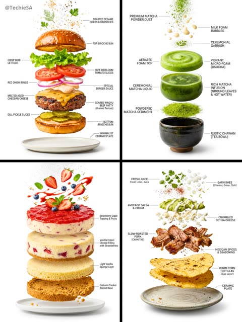</a>

A fill in [FOOD] template that stacks the dish top to bottom as floating layers from garnish particles to plate. A pure white background, macro lighting and thin pointer line labels keep it clean and readable.

Nano Banana 2 · Text-to-image · Source: [@TechieBySA on X](https://x.com/TechieBySA/status/2028451530198642753) · 218 likes on 2026-10-29

[`exploded-view`](tags.md#tag-exploded-view) [`food`](tags.md#tag-food) [`infographic`](tags.md#tag-infographic) [`macro-photography`](tags.md#tag-macro-photography) [`template`](tags.md#tag-template)

<details><summary><b>Prompt</b></summary>

```text
“Create a hyper-realistic exploded vertical infographic composition of [FOOD].
At the top, characteristic particles, droplets, or garnishes associated with the food, frozen mid-air.
Below it, the primary surface or topping layer with rich texture and realistic material detail.
Underneath, the core ingredient layer showing structure, depth, and natural variation.
Below that, the supporting base or interior layer, slightly separated to reveal construction.
At the bottom, a minimal plate, bowl, cup, or base appropriate to the food’s presentation.
Pure white background, soft studio lighting, subtle shadows beneath each floating element, ultra-sharp focus, DSLR macro photography, clean infographic text labels with thin pointer lines, premium editorial food photography aesthetic, 8K quality.”
```

</details>

<a id="gpt-image-female-beauty-makeup-analysis-guide"></a>
### Female Beauty and Makeup Analysis Magazine Infographic

<a href="https://x.com/saniaspeaks_/status/2051128014230950346">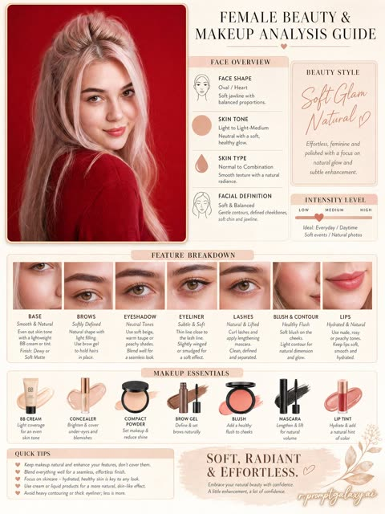</a>

Built from an uploaded portrait, the prompt lists named sections (face overview, style title, intensity scale, feature breakdown, product icons, tips) and fixes a 9:16 magazine layout with a beige, peach and rose palette. It also tells the model to preserve the exact face, so the photo stays the anchor.

GPT Image 2 · Edit · Source: [@saniaspeaks_ on X](https://x.com/saniaspeaks_/status/2051128014230950346) · 213 likes on 2026-10-29

[`beauty`](tags.md#tag-beauty) [`makeup`](tags.md#tag-makeup) [`magazine-layout`](tags.md#tag-magazine-layout) [`portrait-analysis`](tags.md#tag-portrait-analysis) [`9-16`](tags.md#tag-9-16)

<details><summary><b>Prompt</b></summary>

```text
Create a high-quality “Female Beauty & Makeup Analysis Guide” infographic based on the uploaded portrait photo, designed in a clean modern magazine-style layout with a 9:16 aspect ratio, using the original image while preserving exact facial features and natural identity without over-retouching. Focus on a soft, elegant, natural aesthetic with subtle makeup and refined grooming. Include sections such as Face Overview (face shape, skin tone, skin type, and facial definition), Beauty Style (titles like “Soft Glam Natural” or “Elegant Minimal” with a handwritten accent), and an Intensity Level scale showing low-to-medium makeup. Add feature breakdown visuals highlighting a smooth natural base (matte or dewy), softly defined brows, neutral eyeshadow, subtle eyeliner, natural lashes, light blush and contour, and hydrated nude lips. Use a neutral feminine color palette of beige, peach, rose, taupe, and warm tones. Include minimal visual icons for products like BB cream, concealer, blush, mascara, brow gel, compact powder, and lip tint. Add quick tips such as keeping makeup natural, blending smoothly, and avoiding heavy layering. Include a final section titled “Soft, Radiant & Effortless.” Ensure the design is clean, balanced, and premium with 8K cinematic quality.
```

</details>

<a id="gpt-image-google-isometric-stock-scene"></a>
### Isometric Google campus with stock price chart

<a href="https://x.com/dotey/status/2046718861337051217">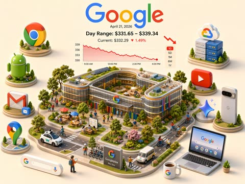</a>

The prompt fixes a 45 degree top-down isometric camera and a Cinema 4D PBR look, then stacks the company name, date and price range by size at top-centre on a solid background. The iconic Googleplex sits in the middle, ringed by product icons and small figures, while a stock trend chart carries the data layer.

GPT Image 2 · Text-to-image · Source: [@dotey on X](https://x.com/dotey/status/2046718861337051217) · 213 likes on 2026-10-29

[`isometric`](tags.md#tag-isometric) [`stock-chart`](tags.md#tag-stock-chart) [`cinema-4d`](tags.md#tag-cinema-4d) [`miniature`](tags.md#tag-miniature)

<details><summary><b>Prompt</b></summary>

```text
Present an exquisite, miniature 3D cartoon-style scene of the company corresponding to the user-specified company name or stock ticker, clearly viewed from a 45° top-down perspective.

Place the company's most iconic building or campus prominently at the center, complemented by proportionally-sized icons of its key products, charming cartoon-style figures, vehicles, and other elements illustrating everyday company activities. The scene should be detailed, finely crafted, and playful.

Rendered with Cinema 4D, the modeling should be refined, smoothly rounded, and rich in texture, accurately capturing realistic PBR materials. Gentle, lifelike lighting and soft shadows should create a warm, comfortable ambiance.

Creatively integrate the company's real-time stock market data for the user-specified date (or automatically retrieved current date) into the scene, maintaining a clean, minimalist layout and a solid-color background to highlight the primary content.

At the top-center of the scene, prominently display the company name or stock ticker in a large font size, followed by the specified date in extra-small font, and the stock price range in a medium-sized font. Include clear, intuitive stock trend icons and charts.

All texts should be displayed in the language specified or entered by the user, without any background, and may subtly overlap with the scene elements to enhance overall design integration.

Very Important:
Before generating, ensure accurate and up-to-date stock market data based on the user-inputted company name or stock ticker and the specified date. If such data is unavailable, notify the user immediately and stop the generation process.

Parameters:

* Aspect ratio: {User input, default 4:3}
* Date: {User input, current date}
* Company name or stock ticker: {User input}

---

Company Name: Google
```

</details>

<a id="gpt-image-ai-memory-anime-self-infographic"></a>
### Anime cartoon infographic about the user, from memory

<a href="https://x.com/icreatelife/status/2047042187683066100">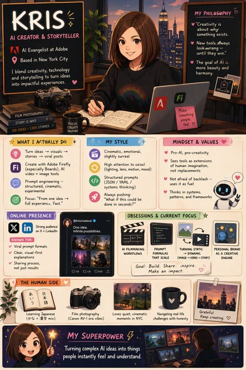</a>

The prompt hands the content to ChatGPT memory, so the model fills in a personal bio, values and hobbies without any details typed in. Naming two formats, infographic and cartoon anime, gets a layout of labeled panels around a character portrait.

GPT Image 2 · Text-to-image · Source: [@icreatelife on X](https://x.com/icreatelife/status/2047042187683066100) · 209 likes on 2026-10-28

[`infographic`](tags.md#tag-infographic) [`anime`](tags.md#tag-anime) [`self-portrait`](tags.md#tag-self-portrait) [`chatgpt-memory`](tags.md#tag-chatgpt-memory) [`personalized`](tags.md#tag-personalized)

<details><summary><b>Prompt</b></summary>

```text
Ask ChatGPT knowing everything it knows about you to generate an image of yourself with GPT Image 2

prompt: Knowing everything you know about me,  make an infographic of me. Make a cartoon anime style image.

I'd love to see what you got.
```

</details>

<a id="gpt-image-camel-desert-survival-infographic"></a>
### Camel infographic with anatomy, water and diet panels

<a href="https://x.com/j_smeaton99/status/2058567521398374880">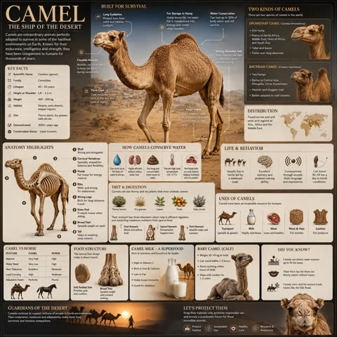</a>

Naming the full section list and palette up front makes the model build a modular card grid around one hero animal. Asking for thin callout lines to anatomical features keeps the high information density readable instead of cluttered.

GPT Image 2 · Text-to-image · Source: [@j_smeaton99 on X](https://x.com/j_smeaton99/status/2058567521398374880) · 188 likes on 2026-10-29

[`infographic`](tags.md#tag-infographic) [`camel`](tags.md#tag-camel) [`wildlife`](tags.md#tag-wildlife) [`desert-survival`](tags.md#tag-desert-survival) [`editorial`](tags.md#tag-editorial)

<details><summary><b>Prompt</b></summary>

```text
Create a premium square “reference-style wildlife infographic” centered around the camel, designed as a beautifully curated desert-survival handbook page rather than a basic educational poster.

The composition should feel like a modern visual encyclopedia mixed with an elite zoology field guide and high-end editorial infographic system.

Visual Direction:

• 1:1 square composition
• Warm desert-inspired background with subtle sand textures, faded expedition-map overlays, and natural-history sketch aesthetics
• Elegant earthy palette using sand beige, camel brown, warm ivory, dark mocha, bronze, and muted desert-gold accents
• Refined editorial typography hierarchy with natural-history aesthetics
• Rounded modular information cards with clean spacing
• Gentle realistic shadows and premium museum-style dividers
• Minimal scientific wildlife iconography
• Extremely detailed central camel render viewed in dramatic three-quarter perspective in a realistic desert environment during golden-hour lighting
• Thin precision annotation lines pointing toward anatomical survival adaptations
• Clean, organized “knowledge-first” layout with high information density but breathable spacing

Main Subject Presentation:

A stunning ultra-detailed realistic render of a camel placed at the center, featuring realistic fur textures, desert lighting, anatomical accuracy, expressive eyes, weathered skin detail, muscular legs, detailed hump structure, and premium wildlife-documentary realism.

Surround the camel with scientific callouts and magnified detail circles explaining:

• hump fat-storage system
• water-conservation adaptations
• broad desert feet structure
• long eyelashes and sand protection
• nostril-closing mechanism
• heat-resistance biology
• digestive system adaptations
• skeletal endurance structure
• desert locomotion efficiency
• behavioral survival traits

Include modular infographic sections such as:

• Camel Overview
• Scientific Classification
• Desert Survival Adaptations
• Anatomy Highlights
• Water Conservation System
• Diet & Digestion
• Life & Behavior
• Uses of Camels in Human Civilization
• Camel vs Horse Comparison
• Foot Structure & Desert Mobility
• Camel Milk & Nutritional Value
• Baby Camel Development
• Geographic Distribution Map
• “Did You Know?” Facts Section
• Conservation & Environmental Importance

Add small premium visualization modules like:

• anatomical skeletal diagrams
• desert habitat maps
• digestive-system illustrations
• camel footprint closeups
• water-retention workflow graphics
• heat-resistance visual charts
• survival adaptation callouts
• species comparison tables
• desert caravan silhouettes
• biological cross-section illustrations

Style Keywords:

“premium zoology encyclopedia”
“editorial desert wildlife handbook”
“museum-quality camel reference page”
“scientific animal infographic”
“high-end natural-history poster”
“modular wildlife knowledge system”
“ultra-detailed desert animal visualization”
“luxury biology editorial design”

Avoid:

• cartoon camel aesthetics
• overly colorful tourist-poster looks
• cluttered infographic layouts
• fantasy desert creatures
• unrealistic anatomy
• exaggerated cinematic action scenes

The final result should resemble a professionally published natural-history reference-book page created for wildlife enthusiasts, zoologists, museums, biology institutions, desert researchers, and educational archives.
```

</details>

<a id="gpt-image-nutella-commercial-storyboard-sheet"></a>
### Eight panel Nutella storyboard with pancake and jar scenes

<a href="https://x.com/itxabdullaa/status/2096915887504982258">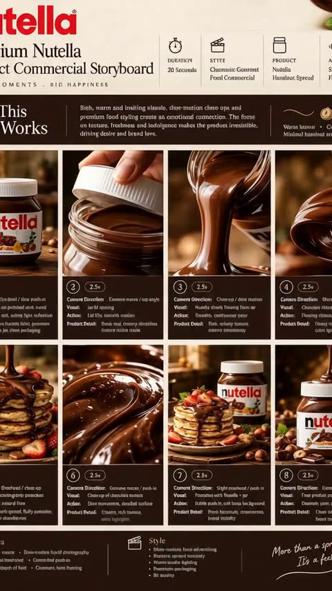</a>

Each panel is a numbered card with a duration badge, camera direction, visual, action and product detail, so the layout reads as a real agency storyboard. Close shots of the spread and the jar keep the hero product in every frame.

GPT Image 2 · Text-to-image · Source: [@itxabdullaa on X](https://x.com/itxabdullaa/status/2096915887504982258) · 181 likes on 2026-10-29

[`storyboard`](tags.md#tag-storyboard) [`food-ad`](tags.md#tag-food-ad) [`product-ad`](tags.md#tag-product-ad) [`macro`](tags.md#tag-macro)

<details><summary><b>Prompt</b></summary>

```text
Premium Nutella Product Commercial Storyboard

FORMAT:
• Single-page premium storyboard
• 3:4 Portrait ratio
• Luxury food product advertising
• 8 cinematic product-focused scenes
• Product remains the main hero
• High-end advertising agency presentation

HEADER:
• Elegant serif typography
• Information cards:

- Duration: 20 Seconds
- Style: Cinematic Gourmet Food Commercial
- Product: Nutella Hazelnut Spread
- Audio: Soft Spread + Food ASMR
  • Why This Style Works section
  • Warm brown, cream and golden aesthetic
  • Minimal hazelnut decorative accents

STORYBOARD:

1. Premium Nutella jar standing on polished dark wood
2. Jar lid opening in extreme macro
3. Creamy Nutella slowly spreading from the jar
4. Chocolate spread forming a glossy ribbon in mid-air
5. Nutella cascading over fluffy pancakes
6. Extreme macro showing rich chocolate texture and tiny reflections
7. Pancake stack surrounded by the hero jar and hazelnuts
8. Final luxury product packshot with dramatic Nutella spread

EVERY PANEL:
• Scene number
• Duration badge
• Camera direction
• Visual
• Action
• Product detail

CAMERA:
Extreme macro, slow-motion spread photography, overhead food shot, controlled push-in, shallow depth of field, cinematic hero framing.

STYLE:
Ultra-realistic food advertising, realistic spread viscosity, glossy chocolate texture, warm studio lighting, premium glass packaging, sophisticated gourmet presentation, 8K.
```

</details>

<a id="nano-banana-ronaldo-trophy-design-process-panel"></a>
### Ronaldo kick sketch evolves into metallic trophy

<a href="https://x.com/ShamsAmin56/status/2048766556008587323">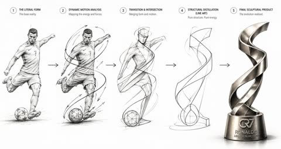</a>

Fixing the layout as five labelled stages from left to right and giving each panel a role makes the model carry one subject through literal sketch, gesture overlay, line art abstraction and a final metallic render. Naming the white background and pencil medium keeps the whole sheet in one consistent drawing style.

Nano Banana 2 · Text-to-image · Source: [@ShamsAmin56 on X](https://x.com/ShamsAmin56/status/2048766556008587323) · 170 likes on 2026-10-29

[`pencil-sketch`](tags.md#tag-pencil-sketch) [`process-panel`](tags.md#tag-process-panel) [`trophy`](tags.md#tag-trophy) [`sports`](tags.md#tag-sports)

<details><summary><b>Prompt</b></summary>

```text
Style: An iterative industrial design process panel, rendered as a technical pencil sketch on a clean white background.
Layout: Five distinct stages of analysis aligned horizontally in a progression from left to right.

The Subject: [FIGURE/ACTION]

The Progression:
Panel 1: The Literal Form: A faithful, naturalistic sketch of the [Subject] in its primary, functional pose or state. This panel establishes the base reality, with accurate proportions and basic shadow rendering.

Panel 2: Dynamic Motion Analysis: A reproduction of the sketch from Panel 1, but overlaid with clear, sweeping gesture lines and arcs that trace the key energy and path of movement. These lines highlight the fundamental forces acting upon or generated by the [FIGURE].

Panel 3: Transition and Intersection: A semi-abstract sketch where the literal form of the [Subject] and the dynamic lines from Panel 2 begin to merge. The internal structure becomes softer, and the dynamic gesture lines solidify and integrate with the primary silhouette.

Panel 4: Structural Distillation (Line Art): The [FIGURE] has been completely abstracted into a clean, geometric line-art form. It is a sculptural object defined entirely by the energy paths and volume, with all internal realistic details stripped away. It is an empty, elegant, structural ribbon-like form.

Panel 5: Final Sculptural Product (Rendered): The final evolution of the abstract form from Panel 4, now presented as a finished design object (e.g., a trophy or monument). The sketch is polished with heavy cross-hatching and depth shading to define its volumes, making it appear solid and metallic. A refined logo and text, reading "[Optional Logo/Text Here]", is clearly integrated into the base of the final object.

➡️ I uploaded my reference images of both the Trophy and Subject (Me) into NB2 for merging the scene as

"Hold the trophy, add a background of the award show, lock the consistency 100%"
```

</details>

<a id="nano-banana-recipe-infographic-template"></a>
### Banana smoothie recipe infographic with numbered steps

<a href="https://x.com/TechieBySA/status/2027351232419942569">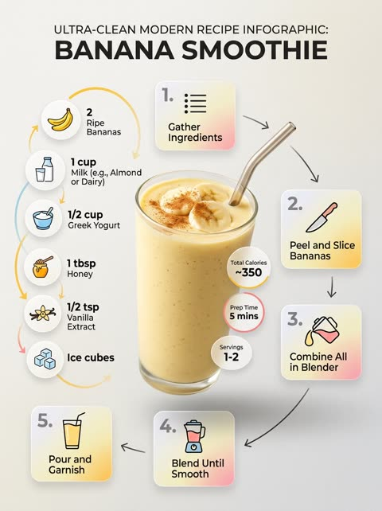</a>

A fill-in [FOOD] slot makes the template reusable. It fixes a visual hierarchy of dish, then steps, then ingredients, then stats, and names the panel style (glassmorphism), the icon style and the output size.

Nano Banana 2 · Text-to-image · Source: [@TechieBySA on X](https://x.com/TechieBySA/status/2027351232419942569) · 168 likes on 2026-10-29

[`recipe`](tags.md#tag-recipe) [`infographic`](tags.md#tag-infographic) [`food`](tags.md#tag-food) [`template`](tags.md#tag-template) [`editorial`](tags.md#tag-editorial)

<details><summary><b>Prompt</b></summary>

```text
Simply replace [FOOD]:✨

“Ultra-clean modern recipe infographic. Showcase [FOOD] in a visually appealing finished form—sliced, plated, or portioned—floating slightly in perspective or angled view. Arrange ingredients, steps, and tips around the dish in a dynamic editorial layout, not restricted to top-down. Ingredients Section: Include icons or mini illustrations for each ingredient with quantities. Arrange them in clusters, lists, or circular flows connected visually to the dish. Steps Section: Show preparation steps with numbered panels, arrows, or lines, forming a logical flow around the main dish. Include small cooking icons (knife, pan, oven, timer) where helpful. Additional Info (optional): Total calories, prep/cook time, servings, spice level—displayed as clean bubbles or badges near the dish. Visual Style: Editorial infographic meets lifestyle food photography. Vibrant, natural food colors, subtle drop shadows, clean vector icons, modern typography, soft gradients or glassmorphism for step panels. Accent colors can highlight key info (calories, prep time). Composition Guidelines: Finished meal as hero visual (perspective or angled) Ingredients and steps flow dynamically around the dish Clear visual hierarchy: dish > steps > ingredients > optional stats Enough negative space to keep design airy and readable Lighting & Background: Soft, natural studio lighting, minimal textured or gradient background for premium editorial feel. Output: 1080×1350, ultra-crisp, social-feed optimized”
```

</details>

<a id="nano-banana-vanilla-ice-cream-recipe-infographic"></a>
### Pastel vanilla ice cream recipe infographic

<a href="https://x.com/Strength04_X/status/2033184147003633695">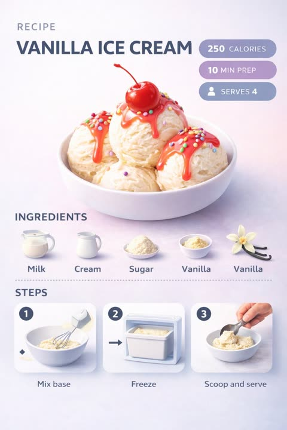</a>

The prompt splits the layout into named sections (ingredients, steps, additional info), each with a specific content spec. It also sets a hero visual, a pastel palette and a square output format, so the model arranges every element around the central dessert.

Nano Banana 2 · Text-to-image · Source: [@Strength04_X on X](https://x.com/Strength04_X/status/2033184147003633695) · 160 likes on 2026-10-28

[`infographic`](tags.md#tag-infographic) [`recipe`](tags.md#tag-recipe) [`dessert`](tags.md#tag-dessert) [`pastel`](tags.md#tag-pastel) [`social-media`](tags.md#tag-social-media)

<details><summary><b>Prompt</b></summary>

```text
Made with Kling AI + Nano Banana 2 on
@hedra_labs


Vanilla ice cream recipe infographic with clean modern design🍨

Prompt: Ultra-clean modern recipe infographic. Showcase Vanilla Ice Cream Scoops with syrup and toppings in angled perspective.

Ingredients Section: Icons for milk, cream, sugar, vanilla.

Steps Section: Mixing base, freezing, scooping shown with numbered panels.

Additional Info: Calories, prep time, servings displayed in badges.

Visual Style: Dessert infographic with pastel colors, soft gradients, modern typography.

Composition Guidelines: Ice cream scoops as hero visual with ingredients and steps around it.

Lighting & Background: Soft dessert-style lighting with minimal background.

Output: 1080×1080, ultra-crisp, social-feed optimized, no watermark.
```

</details>

<a id="gpt-image-three-character-lounge-storyboard-beat-sheet"></a>
### Storyboard sheet with overhead map and shot beats

<a href="https://x.com/Iancu_ai/status/2056374939846910108">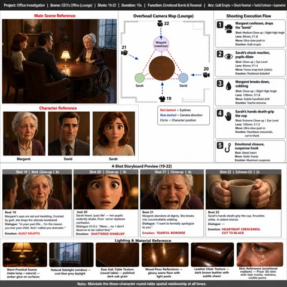</a>

A structured JSON prompt with named sections pins the layout, camera numbers, lens settings and eyeline directions, so one image carries the whole spatial package. Repeating the three-character round-table rule in a footer note helps the character positions stay consistent across every panel.

GPT Image 2 · Text-to-image · Source: [@Iancu_ai on X](https://x.com/Iancu_ai/status/2056374939846910108) · 154 likes on 2026-10-29

[`storyboard`](tags.md#tag-storyboard) [`multi-character`](tags.md#tag-multi-character) [`shot-list`](tags.md#tag-shot-list) [`json-prompt`](tags.md#tag-json-prompt)

<details><summary><b>Prompt</b></summary>

```text
💎 The full GPT Image 2 Beat Sheet prompt. Open-sourced.
{
  "type": "professional film storyboard breakdown sheet, single-page production document layout",
  "style": "Pixar/Disney feature-film quality 3D animated storyboard. All character panels and scene thumbnails rendered in Pixar 3D animation style with subsurface skin scattering, stylized proportions, cinematic warm lighting. The document layout itself is clean and structured: dark-grey header bar, white background, thin grey cell borders, professional film production aesthetic. All text labels in English.",

  "header_bar": {
    "position": "top, full width, dark charcoal background strip",
    "text_items_in_a_row": "Project: Office Investigation | Scene: CEO's Office (Lounge) | Shots: 19-22 | Duration: 15s | Function: Emotional Bomb & Reversal | Arc: Guilt Erupts → Shock Reversal → Tearful Confession → Suspense Hook"
  },

  "layout": {
    "top_left_block": {
      "label": "Main Scene Reference (red bold text header)",
      "content": "A single wide Pixar 3D rendered image of an executive lounge interior: a round dark oak table with three seats arranged around it — one is a wheelchair. A warm amber table lamp sits at center of the table casting the key light. Cool blue-grey natural light enters from a tall window on the right wall. Polished dark wood floor, warm honey-toned oak paneled walls. Three Pixar-style characters are seated: elderly silver-haired Margaret in her wheelchair on the far side, young chestnut-haired Sarah and middle-aged David in charcoal suit on the near side sitting side by side. Intimate, tense atmosphere."
    },

    "top_center_block": {
      "label": "Overhead Camera Map (Lounge) — bold text header centered",
      "content": "A clean top-down 2D schematic floorplan on white background. Round brown circle represents the table at center. Three labeled character positions as small circles: 'Margaret (wheelchair)' at top of table, 'Sarah' at bottom-left, 'David' at bottom-right. Four camera position icons (small movie camera symbols) numbered 19, 20, 21, 22 with blue dashed arrows showing camera facing direction: Camera 19 faces Margaret from below the table. Camera 20 faces Sarah from David's side. Camera 21 faces Margaret from Sarah's side. Camera 22 faces Sarah's hands from across the table. Red dashed lines show character eyeline directions between the three characters. Legend box at bottom-right: 'Red dashed = Eyelines / Blue dashed = Camera direction / Circle = Character position'."
    },

    "right_column": {
      "label": "Shooting Execution Flow — bold header",
      "position": "right side, vertical stack of 5 numbered rounded boxes",
      "steps": [
        {
          "number": "1",
          "icon": "small camera icon",
          "title": "Margaret confesses, drops the 'bomb'",
          "details": "Shot: Medium Close-up | Slight High Angle\nLens: 85mm, f/1.8\nMove: Ultra-slow push in\nEmotion: Guilt erupts"
        },
        {
          "number": "2",
          "icon": "small eye icon",
          "title": "Sarah's shock reaction, pupils dilate",
          "details": "Shot: Close-up | Eye Level\nLens: 85mm, f/1.4\nMove: Focus snap-lock (static)\nEmotion: Shattered disbelief"
        },
        {
          "number": "3",
          "icon": "small teardrop icon",
          "title": "Margaret breaks down, sobbing",
          "details": "Shot: Close-up | Slight High Angle\nLens: 105mm, f/1.8\nMove: Subtle handheld drift\nEmotion: Tearful remorse"
        },
        {
          "number": "4",
          "icon": "small hand icon",
          "title": "Sarah's hands death-grip the cup",
          "details": "Shot: Extreme Close-up | Eye Level\nLens: 105mm, f/1.2\nMove: Ultra-slow push in\nEmotion: Heartbeat crescendo, cut to black"
        },
        {
          "number": "5",
          "icon": "small hook icon",
          "title": "Emotional closure, suspense hook",
          "details": "Shot: Detail insert\nMove: Static freeze\nEmotion: Maximum suspense"
        }
      ]
    },

    "left_middle_block": {
      "label": "Character Reference (red bold text header)",
      "content": "Three small Pixar 3D character portrait panels side by side, each labeled below:",
      "portraits": [
        {
          "label": "Margaret",
          "image": "Bust portrait of an elderly Pixar 3D woman, 70+, silver-white hair in a loose bun, blue-grey watery eyes, deep wrinkles, wearing a dark plum cardigan over cream blouse. Seated in a wheelchair. Warm amber lighting on face. Neutral warm background."
        },
        {
          "label": "David",
          "image": "Bust portrait of a middle-aged Pixar 3D man, late 40s, short dark hair with grey at temples, strong jaw, serious brown eyes, wearing a charcoal suit with dark tie. Warm amber lighting. Neutral warm background."
        },
        {
          "label": "Sarah",
          "image": "Bust portrait of a young Pixar 3D woman, late 20s, shoulder-length chestnut brown hair, hazel-green eyes, soft features, wearing a cream-colored knit top. Vulnerable expression. Warm amber lighting. Neutral warm background."
        }
      ]
    },

    "center_bottom_block": {
      "label": "4-Shot Storyboard Preview (19-22) — bold centered header",
      "content": "Four Pixar 3D rendered panels in a horizontal row. Each panel has a grey header strip with shot info, a cinematic image below, and a white text box at the bottom with beat description.",
      "panels": [
        {
          "header_strip": "Shot 19 | Med. Close-up | 6s",
          "image": "Medium close-up, slight high angle. Pixar 3D Margaret in her wheelchair at the round oak table, eyes red-rimmed and watering, lower lip trembling, hands gripping wheelchair armrests. Deep guilt radiates from her expression. Warm amber table lamp from left, blurred silhouettes of Sarah and David across the table. 85mm shallow depth of field.",
          "text_box": "Beat 19\nMargaret's eyes are red and trembling. Crushed by guilt, she drops the ultimate bombshell.\nDialogue: 'In your past life... I'm the reason you lost your child. And I called you dramatic.'\nEmotion: GUILT ERUPTS"
        },
        {
          "header_strip": "Shot 20 | Close-up | 3s",
          "image": "Tight close-up, eye level. Pixar 3D Sarah's face filling the frame, eyes blown wide in shock, pupils dilated, lips parted, one tear forming at the corner of her eye. Warm creamy bokeh background from the lounge. 85mm f/1.4 razor focus on her eyes.",
          "text_box": "Beat 20\nSarah hears 'past life' — her pupils violently shake. Pure horror replaces confusion.\nDialogue (V.O.): 'Mom... no. I don't deserve to be called that.'\nEmotion: SHATTERED DISBELIEF"
        },
        {
          "header_strip": "Shot 21 | Close-up | 4s",
          "image": "Close-up, slight high angle. Pixar 3D Margaret with eyes squeezed shut, mouth open in a wail, tears streaming down her wrinkled cheeks, a wisp of silver hair fallen loose across her forehead. Subtle motion blur on her shoulders from handheld shake. 105mm compressed perspective.",
          "text_box": "Beat 21\nMargaret abandons all dignity. She breaks into uncontrollable sobbing.\nDialogue: 'I want to formally apologize to you.'\nEmotion: TEARFUL REMORSE"
        },
        {
          "header_strip": "Shot 22 | Extreme CU | 2s",
          "image": "Extreme close-up, eye level. Two feminine Pixar 3D hands with white knuckles gripping a simple white handleless ceramic tea cup on the dark polished oak table. Fingertips pressed so hard the nail beds are pale. A faint ripple visible in the tea from trembling. 105mm f/1.2 micro detail. Deep warm bokeh behind.",
          "text_box": "Beat 22\nSarah's hands death-grip the cup. Knuckles white. A violent tremor.\nDialogue: —\nEmotion: HEARTBEAT CRESCENDO, CUT TO BLACK"
        }
      ]
    },

    "bottom_strip": {
      "label": "Lighting & Material Reference — bold header",
      "content": "Six small horizontal reference swatches in a row at the very bottom, each with a label below:",
      "swatches": [
        "Warm Practical Source (table lamp + natural) — amber glow on surfaces",
        "Natural Sidelight (window) — cool blue-grey daylight",
        "Raw Oak Table Texture (round table) — polished dark oak grain",
        "Wood Floor Reflections — glossy warm floor with light pools",
        "Leather Chair Texture — dark brown leather with subtle sheen",
        "Skin Reference (emotional realism) — Pixar 3D skin with tear tracks, redness, visible pores"
      ]
    }
  },

  "footer_note": "Note: Maintain the three-character round-table spatial relationship at all times.",
  "overall_dimensions": "landscape 16:9 aspect ratio, information-dense single-page professional film production document"
}
```

</details>

<a id="nano-banana-glass-vitrine-food-cross-section"></a>
### Eggs Benedict Cross Section in Glass Vitrine

<a href="https://x.com/AllaAisling/status/2032846968154657147">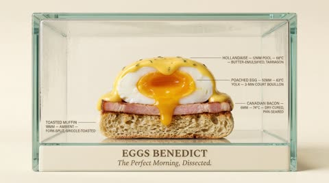</a>

A fill in the blank template that fixes eye level camera, a plain colour backdrop and engraved glass labels with depth, temperature and method. Naming a reference mood and demanding optically real glass keeps the render from looking like fake 3D.

Nano Banana 2 · Text-to-image · Source: [@AllaAisling on X](https://x.com/AllaAisling/status/2032846968154657147) · 154 likes on 2026-10-29

[`food`](tags.md#tag-food) [`cross-section`](tags.md#tag-cross-section) [`glass`](tags.md#tag-glass) [`template`](tags.md#tag-template) [`labels`](tags.md#tag-labels)

<details><summary><b>Prompt</b></summary>

```text
Prompt Studio: Glass Box Cross Section, with Nano Banana 2 in Firefly

[DISH] sealed inside a flawless glass vitrine, cross-sectioned dead center,  camera locked at exact eye level, pure [COLOR] studio background.  Every internal layer exposed with surgical precision, ingredients stacked  perfectly, sauces at exact depths, condensation fogging the upper glass.  Labels engraved directly on the glass in fine sans-serif: "[INGREDIENT]  [depth]  [temp]  [prep method]" Thin measurement lines. Architectural layer callouts. No floating text.  Dish name engraved on glass base: "[DISH NAME]" Tagline below in italics: "[TAGLINE]"  Mood: Apple product launch meets Michelin kitchen dissection.  Appetizing, precise, craveable. Glass must look optically real, thickness, refraction, edge glow. No fake 3D render look. 4K, tack sharp.

Check ALTs for ideas 👇
@AdobeFirefly
```

</details>

<a id="nano-banana-vehicle-technical-annotation-infographic"></a>
### Vehicle photo infographics with black ink technical annotations

<a href="https://x.com/TechieBySA/status/2038586040231801230">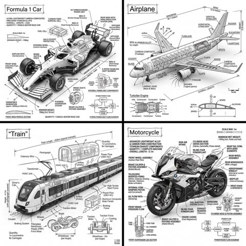</a>

A photoreal object sits under black technical pen overlays such as cutaways, dimensions, material callouts and flow arrows. A pure white background and a strict black only palette keep it looking like an engineering manual. One VEHICLE placeholder makes it reusable for any object.

Nano Banana 2 · Text-to-image · Source: [@TechieBySA on X](https://x.com/TechieBySA/status/2038586040231801230) · 148 likes on 2026-10-29

[`infographic`](tags.md#tag-infographic) [`technical-annotation`](tags.md#tag-technical-annotation) [`engineering`](tags.md#tag-engineering) [`black-and-white`](tags.md#tag-black-and-white) [`vehicle`](tags.md#tag-vehicle)

<details><summary><b>Prompt</b></summary>

```text
Simply replace [VEHICLE]:✨

“Create an infographic image of [VEHICLE], combining a realistic photograph or photoreal render of the object with technical annotation overlays placed directly on top.

Use black ink–style line drawings and text (technical pen / architectural sketch look) on a pure white studio background, including:
•Key component labels
•Internal cutaway or exploded-view outlines
•Measurements, dimensions, and scale markers
•Material callouts and quantities
•Arrows indicating function, force, or flow (air, sound, power, pressure)
•Simple schematic or sectional diagrams where relevant

Place the title “VEHICLE” inside a hand-drawn technical annotation box in one corner.

Style & layout rules:
•The real object remains clearly visible beneath the annotations
•Annotations feel sketched, technical, and architectural
•Clean composition with balanced negative space
•Educational, museum-exhibit / engineering-manual vibe

Visual style:
Minimal technical illustration aesthetic, black linework over realistic imagery, precise but slightly hand-drawn feel.

Color palette:
White background, black annotation lines and text only. No colors.

Output:
1080×1080, ultra-crisp, social-feed optimized, no watermark.”
```

</details>

<a id="gpt-image-skin-analysis-consultation-sheet"></a>
### Skin analysis sheet with routine and ingredient picks

<a href="https://x.com/nawalsehar/status/2053088055528210466">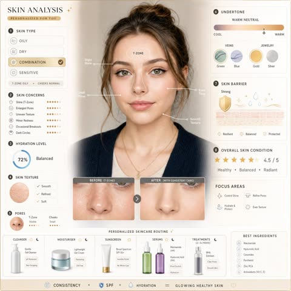</a>

Each section gets a visual anchor such as a ring meter, a skin swatch, or a before and after crop, so the layout reads at a glance. Framing the piece as a premium dermatology consultation sheet sets the layout, density of callouts, and tone.

GPT Image 2 · Edit · Source: [@nawalsehar on X](https://x.com/nawalsehar/status/2053088055528210466) · 141 likes on 2026-10-29

[`skincare`](tags.md#tag-skincare) [`infographic`](tags.md#tag-infographic) [`portrait`](tags.md#tag-portrait) [`beauty`](tags.md#tag-beauty)

<details><summary><b>Prompt</b></summary>

```text
Create a visual skincare analysis graphic using this portrait. Feature side-by-side comparisons to identify the subject’s likely skin type (oily, dry, combination, or sensitive), visible skin concerns, hydration levels, texture, pores, and overall skin condition. Include a clear skin undertone and skin barrier analysis. Showcase personalised skincare recommendations such as suitable cleansers, moisturisers, sunscreens, serums, and ingredients that would work best for the subject’s skin. The graphic should feel like a premium dermatology/skincare consultation sheet with visual callouts, charts, highlighted facial zones, and before/after-style comparisons. Keep it visual-first using only short labels, tags, icons, arrows, and minimal text – no long paragraphs.
```

</details>

<a id="gpt-image-sony-a7-iv-camera-infographic"></a>
### Sony a7 IV camera reference infographic

<a href="https://x.com/j_smeaton99/status/2056003752927379750">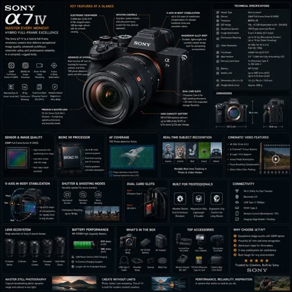</a>

Naming every section, callout and palette colour in the brief keeps a dense square layout organised rather than cluttered. A camera-model slot in the template lets the same brief be reused for other camera bodies.

GPT Image 2 · Text-to-image · Source: [@j_smeaton99 on X](https://x.com/j_smeaton99/status/2056003752927379750) · 134 likes on 2026-10-29

[`infographic`](tags.md#tag-infographic) [`sony`](tags.md#tag-sony) [`camera`](tags.md#tag-camera) [`product-reference`](tags.md#tag-product-reference)

<details><summary><b>Prompt</b></summary>

```text
Create a premium square “reference-style photography equipment infographic” centered around a modern Sony mirrorless camera such as the {CAMERA_MODEL}, designed as a beautifully curated camera-engineering handbook page rather than a retail advertisement.

The composition should feel like a modern visual encyclopedia mixed with an elite photographer’s field guide and high-end editorial infographic system.

Visual Direction:

• 1:1 square composition
• Dark premium studio-tech background with subtle photography-grid textures, optical schematics, and cinematic UI overlays
• Elegant muted palette using matte black, graphite gray, titanium silver, warm orange accents, and subtle electric-blue highlights
• Refined editorial typography hierarchy
• Rounded modular information cards with clean spacing
• Gentle realistic reflections and premium HUD-style dividers
• Minimal professional photography iconography
• Extremely detailed central camera render viewed in dramatic three-quarter perspective with studio lighting and shallow depth-of-field aesthetics
• Thin precision annotation lines pointing toward camera hardware systems and imaging technologies
• Clean, organized “knowledge-first” layout with high information density but breathable spacing

Main Subject Presentation:

A stunning ultra-detailed realistic render of the {CAMERA_MODEL} placed at the center, featuring premium magnesium-alloy body textures, realistic lens glass reflections, tactile control dials, advanced sensor detailing, cinematic lighting, and ultra-realistic photography gear presentation.

Surround the camera with scientific and engineering callouts explaining:

• full-frame image sensor
• AI autofocus system
• image stabilization technology
• electronic viewfinder system
• advanced video recording features
• dual card-slot architecture
• battery performance system
• weather-sealed body design
• lens ecosystem compatibility
• wireless connectivity systems

Include modular infographic sections such as:

• Camera Overview
• Technical Specifications
• Dimensions & Build
• Sensor & Image Quality
• Processor & Performance
• Autofocus & Subject Tracking
• Video Recording Features
• Stabilization Technology
• Shooting Modes & Burst Performance
• Lens Ecosystem
• Battery & Power System
• Connectivity Features
• Professional Workflow Integration
• Included Accessories & Box Contents
• “Top 5 Reasons to Choose” section
• Ideal Photography & Filmmaking Use Cases

Add small premium visualization modules like:

• sensor cutaway diagrams
• autofocus coverage maps
• stabilization system graphics
• lens ecosystem displays
• battery performance charts
• video codec comparison tables
• camera blueprint dimensions
• menu/UI mockups
• accessory ecosystem visuals
• performance benchmark graphics

Style Keywords:

“premium photography encyclopedia”
“editorial camera handbook”
“high-end photography infographic”
“scientific imaging technology poster”
“museum-quality camera reference page”
“modular photography knowledge system”
“clean cinematography editorial design”
“ultra-detailed camera visualization”

Avoid:

• generic e-commerce advertisement aesthetics
• cluttered tech layouts
• unrealistic sci-fi hologram effects
• cartoon camera styling
• excessive cyberpunk neon overload
• low-detail product renders

The final result should resemble a professionally published photography-equipment reference-book page created for photographers, cinematographers, content creators, camera collectors, engineers, and educational imaging archives.
```

</details>

<a id="nano-banana-black-reflective-ingredient-deconstruction-infographic"></a>
### Deconstructed Margherita Pizza Ingredient Infographic on Black

<a href="https://x.com/Maercihh/status/2047643979110601154">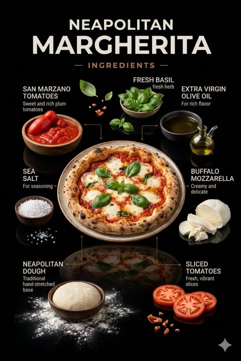</a>

A JSON template with a SUBJECT placeholder fixes the layout: hero dish in the center, ingredients in bowls around it, and thin leader lines to bold headers with short sub-text. The style notes lock the palette (black, orange, white) and the reflective surface, so the template works for any dish.

Nano Banana 2 · Text-to-image · Source: [@Maercihh on X](https://x.com/Maercihh/status/2047643979110601154) · 128 likes on 2026-10-28

[`infographic`](tags.md#tag-infographic) [`food-photography`](tags.md#tag-food-photography) [`ingredients`](tags.md#tag-ingredients) [`json-template`](tags.md#tag-json-template) [`black-background`](tags.md#tag-black-background)

<details><summary><b>Prompt</b></summary>

```text
{
  "image_request": {
    "subject": "Subject Name",
    "prompt_template": "An infographic-style food photography shot of [SUBJECT] on a black reflective background. In the center is a high-resolution, delicious [SUBJECT]. Surrounding the center dish are various individual ingredients (deconstructed) in small bowls or piles, with thin elegant lines pointing from the text descriptions to the specific parts of the food. Each ingredient has a bold header in English followed by a short descriptive sub-text. Professional studio lighting, cinematic composition, 8k resolution, flat design elements mixed with realistic 3D food textures.",
    "style_notes": [
      "Black background",
      "Reflective surface",
      "Floating ingredients",
      "Minimalist sans-serif typography",
      "Orange and white accent colors for text"
    ]
  }
}
```

</details>

<a id="nano-banana-ghibli-margherita-recipe-infographic"></a>
### Ghibli style margherita pizza recipe infographic

<a href="https://x.com/azed_ai/status/2027140890247246017">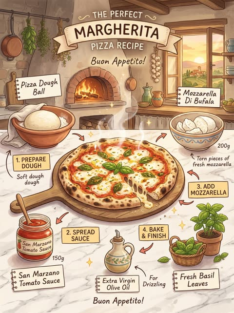</a>

The prompt places the hero dish in the center and arranges labeled ingredients around it, with numeric quantities in the text. Style cues for light, texture and handwritten notebook labels keep the layout organized and readable.

Nano Banana 2 · Text-to-image · Source: [@azed_ai on X](https://x.com/azed_ai/status/2027140890247246017) · 126 likes on 2026-10-28

[`infographic`](tags.md#tag-infographic) [`recipe`](tags.md#tag-recipe) [`ghibli-style`](tags.md#tag-ghibli-style) [`food`](tags.md#tag-food) [`painterly`](tags.md#tag-painterly)

<details><summary><b>Prompt</b></summary>

```text
margherita pizza recipe infographic, Studio Ghibli inspired illustration, traditional Italian kitchen setting, warm golden sunset light, whole pizza in center with bubbling cheese, ingredients illustrated around in cute containers, dough ball, tomato sauce 150g, mozzarella 200g, fresh basil leaves, olive oil drizzle, handwritten notebook style labels, soft pastel tones, painterly textures, gentle steam and magical glow, whimsical cozy feeling, clean organized layout, readable text, high detail
```

</details>

<a id="gpt-image-smartphone-reference-style-tech-infographic"></a>
### Futuristic smartphone reference style tech infographic

<a href="https://x.com/j_smeaton99/status/2055485138080014769">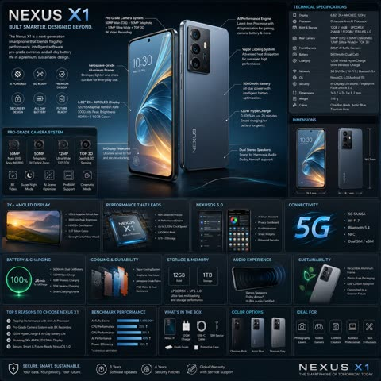</a>

A name placeholder keeps the template reusable. Explicit lists of callouts, modular sections and visualization modules, plus a style keyword block and an avoid list, lock a dense encyclopedia layout around one central three quarter render.

GPT Image 2 · Text-to-image · Source: [@j_smeaton99 on X](https://x.com/j_smeaton99/status/2055485138080014769) · 121 likes on 2026-10-29

[`infographic`](tags.md#tag-infographic) [`smartphone`](tags.md#tag-smartphone) [`tech`](tags.md#tag-tech) [`template`](tags.md#tag-template) [`editorial`](tags.md#tag-editorial)

<details><summary><b>Prompt</b></summary>

```text
Create a premium square “reference-style consumer technology infographic” centered around a futuristic flagship smartphone called the {SMARTPHONE_NAME}, designed as a beautifully curated product-engineering handbook page rather than a generic commercial advertisement.

The composition should feel like a modern visual encyclopedia mixed with an elite consumer-electronics field guide and high-end editorial infographic system.

Visual Direction:

• 1:1 square composition
• Dark premium tech background with subtle circuit-board textures, holographic UI overlays, and futuristic blueprint schematics
• Elegant muted palette using matte black, titanium gray, electric blue accents, graphite silver, and soft neon highlights
• Refined editorial typography hierarchy
• Rounded modular information cards with clean spacing
• Gentle realistic reflections and premium HUD-style dividers
• Minimal modern technology iconography
• Extremely detailed central smartphone render viewed in dramatic three-quarter perspective with floating studio-style lighting
• Thin precision annotation lines pointing toward hardware systems and smart features
• Clean, organized “knowledge-first” layout with high information density but breathable spacing

Main Subject Presentation:

A stunning ultra-detailed realistic render of the {SMARTPHONE_NAME} placed at the center, featuring edge-to-edge AMOLED display, premium metallic frame, realistic glass reflections, advanced camera modules, glowing UI screen graphics, ultra-thin bezels, and high-end consumer-tech realism.

Surround the smartphone with scientific and engineering callouts explaining:

• AI processor architecture
• advanced camera system
• AMOLED display technology
• battery and fast charging system
• cooling and thermal management
• connectivity systems (5G/Wi-Fi/Bluetooth)
• operating system and AI assistant
• audio and speaker technology
• durability and water resistance
• sustainable material engineering

Include modular infographic sections such as:

• Smartphone Overview
• Technical Specifications
• Dimensions & Design
• Camera System Breakdown
• Display Technology
• Processor & Performance
• Battery & Charging
• Connectivity Features
• Cooling & Durability
• Storage & Memory Configurations
• Audio Experience
• Smart OS & AI Features
• Sustainability & Eco Design
• Benchmark Performance Charts
• “Top 5 Reasons to Choose” section
• Accessories & Included Box Contents
• Ideal User Profiles

Add small premium visualization modules like:

• chipset architecture diagrams
• camera lens cutaways
• battery charging-speed charts
• UI/OS interface mockups
• connectivity icons & network visuals
• thermal cooling illustrations
• benchmark comparison graphs
• exploded hardware views
• smartphone blueprint dimensions
• accessory ecosystem visuals

Style Keywords:

“premium consumer-tech encyclopedia”
“editorial smartphone handbook”
“high-end electronics infographic”
“scientific product poster”
“museum-quality smartphone reference page”
“modular technology knowledge system”
“clean futuristic editorial design”
“ultra-detailed gadget visualization”

Avoid:

• cluttered commercial advertisement aesthetics
• cartoon futuristic styling
• unrealistic sci-fi hologram overload
• cheap e-commerce layouts
• excessive neon cyberpunk chaos
• low-detail generic phone renders

The final result should resemble a professionally published consumer-technology reference-book page created for tech enthusiasts, industrial designers, engineers, collectors, reviewers, and educational product-design archives.
```

</details>

<a id="gpt-image-music-consumption-vinyl-to-streaming"></a>
### Music consumption from vinyl to streaming

<a href="https://x.com/iamaiistudio/status/2061494256087523353">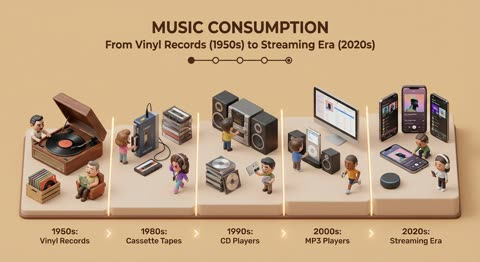</a>

Fixed slots for topic, eras and background color let one template produce any timeline. The prompt pins the camera, the stepped base split by era, and a clear text hierarchy, so every era panel and header stays consistent.

GPT Image 2 · Text-to-image · Source: [@iamaiistudio on X](https://x.com/iamaiistudio/status/2061494256087523353) · 106 likes on 2026-10-29

[`isometric`](tags.md#tag-isometric) [`diorama`](tags.md#tag-diorama) [`timeline`](tags.md#tag-timeline) [`music`](tags.md#tag-music)

<details><summary><b>Prompt</b></summary>

```text
Build a polished isometric miniature 3D diorama that shows the evolution of [TOPIC] from [START ERA] through [MODERN ERA]. Use a 45-degree top-down camera angle and a horizontally stepped display base split into distinct time periods. Give the scene soft, refined materials with realistic PBR shading and neutral, evenly balanced lighting.

In every era section, include period-specific objects, tools, environments, or technologies. Add tiny stylized people interacting with each stage, with detailed facial features. Use subtle arrows or dividers to make the chronological flow clear.

Keep the background a solid [BACKGROUND COLOR]. Place bold top-center text reading [TOPIC]. Under it, add "From [START ERA] to [MODERN ERA]." Add a minimal timeline icon below. Make all text automatically adapt for contrast.
```

</details>

<a id="nano-banana-burj-khalifa-neon-engineering-infographic"></a>
### Burj Khalifa neon engineering infographic poster

<a href="https://x.com/yourPlugAI/status/2033347394633695616">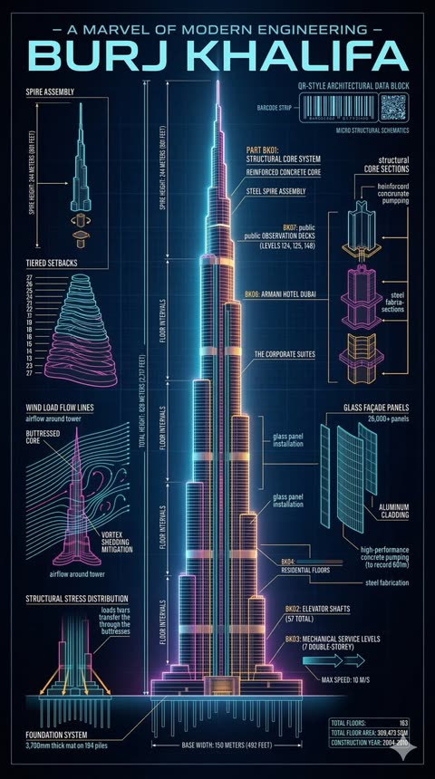</a>

A JSON prompt splits the infographic into labeled technical layers: dimension lines, cross section, exploded view, wind flow diagrams, materials and data panels. A fixed palette, a dark blueprint background and a 9:16 ratio keep the dense callouts readable around one centered hero object.

Nano Banana 2 · Text-to-image · Source: [@yourPlugAI on X](https://x.com/yourPlugAI/status/2033347394633695616) · 102 likes on 2026-10-29

[`infographic`](tags.md#tag-infographic) [`blueprint`](tags.md#tag-blueprint) [`neon`](tags.md#tag-neon) [`skyscraper`](tags.md#tag-skyscraper) [`json-prompt`](tags.md#tag-json-prompt)

<details><summary><b>Prompt</b></summary>

```text
"subject": "Burj Khalifa skyscraper",
    "description": "Cinematic industrial architectural infographic of the Burj Khalifa centered in frame. Ultra-precise technical rendering of the skyscraper with accurate proportions, façade textures, and structural realism. The tower rises vertically as the dominant hero object with glowing vibrant annotations clearly visible against a dark background.",
    "technical_elements": {
      "dimension_lines": [
        "total height",
        "spire height",
        "base width",
        "floor intervals",
        "observation deck levels"
      ],
      "cross_section": [
        "core structural system",
        "elevator shafts",
        "residential floors",
        "mechanical service levels",
        "observation decks"
      ],
      "exploded_view": [
        "spire assembly",
        "tiered setbacks",
        "structural core sections",
        "glass façade panels"
      ],
      "dynamic_diagrams": [
        "wind load flow lines",
        "structural stress distribution",
        "elevator movement paths",
        "airflow around tower"
      ],
      "materials": [
        "reinforced concrete core",
        "steel structural elements",
        "reflective glass façade",
        "aluminum cladding"
      ],
      "manufacturing_processes": [
        "high-rise concrete pumping",
        "steel fabrication",
        "glass panel installation",
        "modular floor construction"
      ],
      "part_numbering": "Architectural engineering annotation style (Part BK01, BK02, etc)",
      "tech_data_panels": [
        "total floors",
        "height in meters and feet",
        "construction year",
        "elevator speed",
        "floor area",
        "architectural style"
      ],
      "industrial_design_elements": [
        "QR-style architectural data block",
        "barcode strip",
        "micro structural schematics"
      ]
    },
    "design_style": {
      "layout": "vertical cinematic infographic emphasizing extreme height with surrounding technical callouts",
      "color_palette": [
        "neon cyan",
        "electric magenta",
        "bright amber",
        "white highlights"
      ],
      "background": "deep midnight blue to black gradient with subtle glowing blueprint grid",
      "typeface": "sharp modern architectural sans-serif with luminous annotation styling",
      "lighting": "dramatic vertical rim lighting along the tower edges",
      "shadows": "clean and subtle to maintain clarity"
    },
    "overall_vibe": "high energy futuristic architectural engineering poster designed t
o be visually striking and scroll stopping",
    "aspect_ratio": "9:16"
  }
}
```

</details>

<a id="gpt-image-camera-evolution-timeline-infographic"></a>
### Camera evolution timeline from film to AI

<a href="https://x.com/AIwithkhan/status/2053487042605326593">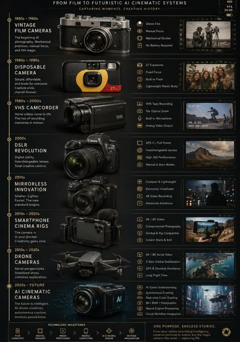</a>

Each camera era is listed in chronological order with a date label, a product render, spec callouts and a matching sample frame, so the timeline structure carries the whole poster. The dark background with gold and neon blue accents keeps the palette consistent from top to bottom.

GPT Image 2 · Text-to-image · Source: [@AIwithkhan on X](https://x.com/AIwithkhan/status/2053487042605326593) · 100 likes on 2026-10-29

[`infographic`](tags.md#tag-infographic) [`timeline`](tags.md#tag-timeline) [`camera`](tags.md#tag-camera) [`poster`](tags.md#tag-poster)

<details><summary><b>Prompt</b></summary>

```text
Ultra detailed vertical infographic poster showing the evolution of cameras from vintage film photography to futuristic AI cinematic systems. Include realistic renders of vintage film cameras, disposable cameras, VHS camcorders, DSLR cameras, mirrorless cameras, smartphone cinema rigs, drone cameras, and futuristic AI-powered cinema cameras. Arrange them in a clean timeline layout with glowing technical callouts, cinematic labels, UI overlays, camera specs, lens details, and photography icons. Dark premium background with gold and neon blue accents, realistic textures, dramatic studio lighting, cinematic photography aesthetic, modern editorial design, high-tech sci-fi feel, ultra sharp details, magazine-quality infographic style, symmetrical composition, realistic reflections, futuristic interface graphics.”
```

</details>

<a id="nano-banana-base-weekly-recap-logo-grid"></a>
### Base weekly recap as logo tiles by section

<a href="https://x.com/BaseHubHB/status/2108996198862643330">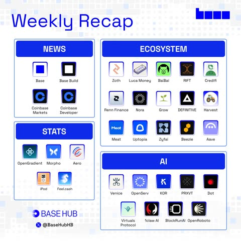</a>

The prompt lists each section with its account handles, so the model turns every handle into a logo tile under a boxed section header. Keeping each full handle in the text lets each logo match its name.

Nano Banana 2.1 · Text-to-image · Source: [@BaseHubHB on X](https://x.com/BaseHubHB/status/2108996198862643330) · 92 likes on 2026-10-29

[`weekly-recap`](tags.md#tag-weekly-recap) [`logo-grid`](tags.md#tag-logo-grid) [`crypto-news`](tags.md#tag-crypto-news)

<details><summary><b>Prompt</b></summary>

```text
📄 Base Weekly Recap

What happened on
@base
 this week

NEWS

■
@base
 selected 10 teams for Base Batches 004 from more than 750 applications.

■
@base
 added 26 tokenized stocks for eligible users outside the US.

■
@base
 partnered with SMBC Nikko on an institutional DeFi gateway for Japan.

■
@base
 enabled stablecoin checkout through Yuno.

■
@buildonbase
 opened Cobalt TEE signer registration with B20 enhancements.

■
@CoinbaseMarkets
 put Pons spot trading live.

■
@CoinbaseDev
 and Gennius started bringing digital-asset services to banks in Latin America.

STATS

■
@OpenGradient
 crossed 1M private prompts and 12B processed tokens.

■
@Morpho
 crossed $17B in deposits.

■
@aeroxyz
 recorded $1.9B in tokenized-stock volume over 90 days.

■
@iPodAAPLc
 opened $30K in Apple stock rewards.

■
@feeldotcash
 announced a $25K stock-rewards race.

ECOSYSTEM

■
@zothdotio
 launched zMAG7, one deposit holding seven tokenized tech stocks.

■
@lucamoneyapp
 expanded its digital-dollar app to tokenized stocks for more than 100K users.

■
@baibai_cx
 added Coinbase Tokenized Stocks on Base.

■
@RIFTHQ
 went live with one-click routing into Base with no added fees.

■
@Credifi
 launched zkTLS credit verification through its iOS app and Chrome extension.

■
@RennFinance
 entered Base Batches 004 with stock-borrowing protection.

■
@norafinancexyz
 launched Reserva with 100% CDI yield for Brazilian users.

■
@get_grow_app
 added access to 93 London Stock Exchange stocks.

■
@DefinitiveFi
 added take-profit orders to its mobile app.

■
@harvest_finance
 launched stock autocompounders for Coinbase Tokenized Stocks.

■
@MeatMETAc
 opened a Meta stock vault with 24.9% APY.

■
@Uptopia_xyz
 placed its first bid for Base Batches 004.

■
@Zyfai_
 added new Base routing paths.

■
@Beezie
 made its Grail+ collector event available to Base users.

■
@aave
 added syrupUSDC as collateral through Aave V4 on Arc.

AI

■
@AskVenice
 added anonymous Nano Banana 2.1 and Claude Haiku access.

■
@openservai
 reached 100% reliability across 2,400 Neol evaluations.

■
@KorProtocol
 ranked in the top two for x402 volume across chains.

■
@PRXVTai
 shipped px402 v2 for private agent payments.

■
@usedotai
 added private Mistral Large 4 with no logs.

■
@virtuals_io
 introduced Butler for automated portfolio rebalancing.

■
@1clawAI
 added prompt-injection scoring, secret redaction, and exfiltration alerts.

■
@BlockRunAI
 added batch x402 payments for AI model access.

■
@openroboto
 improved LIBERO-Pro from 50.3 to 89.7 in 30 days.
```

</details>

<a id="gpt-image-nyc-infographic-poster"></a>
### New York City infographic poster with eleven sections

<a href="https://x.com/amynys/status/2056366046794186906">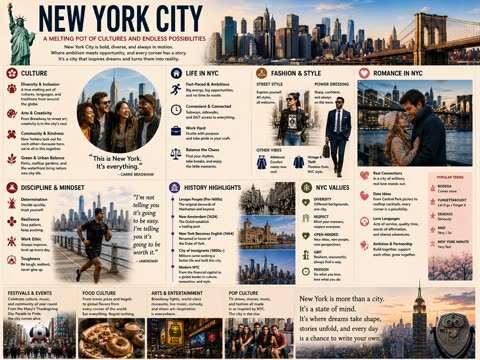</a>

Listing each section with its own content sets up a grid of labeled panels, so the model fills a layout instead of drawing one scene. Naming the palette and a premium magazine look keeps the cream background with navy and gold accents.

GPT Image 2 · Text-to-image · Source: [@amynys on X](https://x.com/amynys/status/2056366046794186906) · 59 likes on 2026-10-29

[`new-york-city`](tags.md#tag-new-york-city) [`infographic`](tags.md#tag-infographic) [`travel-editorial`](tags.md#tag-travel-editorial) [`skyline`](tags.md#tag-skyline)

<details><summary><b>Prompt</b></summary>

```text
Create a highly detailed infographic-style poster about NEW YORK CITY inspired by modern travel/culture editorial layouts. Use a warm beige background with elegant typography, cinematic lighting, and a premium magazine aesthetic.

Main title at the top: “NEW YORK CITY”
Subtitle: “A Melting Pot of Cultures and Endless Possibilities”

The layout should include multiple organized sections with realistic American people and authentic NYC scenes only

Sections to include:
• CULTURE — showcase diverse Americans in NYC, street art, creativity, community, parks, rooftop gardens, and urban life.
• LIFE IN NYC — fast-paced ambition, subway culture, work ethic, convenience, hustle, and balance.
• FASHION & STYLE — modern New York streetwear, business fashion, luxury and casual styles featuring stylish American men and women.
• ROMANCE IN NYC — realistic American couple near Brooklyn Bridge at sunset with cinematic city lights.
• DISCIPLINE & MINDSET — determination, resilience, fitness, success mindset, featuring Wall Street/Bull imagery and ambitious city energy.
• HISTORY HIGHLIGHTS — NYC skyline evolution, immigrant history, old New York streets, iconic landmarks.
• NYC VALUES — diversity, respect, ambition, grit, passion, and individuality.
• FESTIVALS & EVENTS — parades, concerts, Christmas in NYC, Macy’s parade, summer street festivals.
• FOOD CULTURE — pizza, bagels, coffee, burgers, fine dining, food trucks.
• ARTS & ENTERTAINMENT — Broadway, live music, museums, street performances, nightlife.
• POP CULTURE — movies, music, fashion, sports, iconic NYC media influence.Add panoramic skyline images featuring Manhattan, Brooklyn Bridge, Empire State Building, Times Square, Central Park, and One World Trade Center.

Include elegant icons, infographics, quotes, and clean editorial boxes.

Color palette: warm cream, gold, deep navy, muted red, and cinematic sunset tones.

Style: ultra-detailed, hyperrealistic, premium travel magazine infographic, cinematic photography mixed with elegant design elements, realistic Americans only, sophisticated and visually rich.
```

</details>

<a id="gpt-image-iphone-isometric-teardown-infographic"></a>
### iPhone isometric teardown infographic with color coded callouts

<a href="https://x.com/TechieBySA/status/2097692061554118999">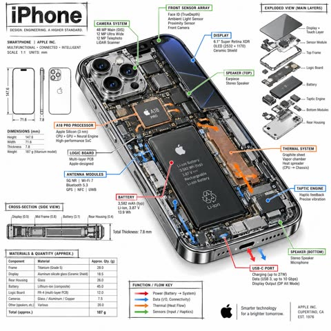</a>

The prompt fixes a 45 degree isometric angle, black linework on white, and a color key that maps power, data, thermal and sensors to red, blue, orange and green. Only the [OBJECT] slot changes, so the same layout works for any device.

GPT Image 2.5 · Text-to-image · Source: [@TechieBySA on X](https://x.com/TechieBySA/status/2097692061554118999) · 48 likes on 2026-10-29

[`infographic`](tags.md#tag-infographic) [`isometric`](tags.md#tag-isometric) [`technical-drawing`](tags.md#tag-technical-drawing) [`product-teardown`](tags.md#tag-product-teardown)

<details><summary><b>Prompt</b></summary>

```text
Simply replace [OBJECT]:✨

Create a technical infographic of [OBJECT] with a 45-degree isometric 3D perspective showing the device slightly tilted to reveal depth and dimension.
Combine a realistic photoreal render with black ink technical annotations on pure white background. Include:
Key component labels with color-coded callout boxes
Internal component visibility through transparent/cutaway sections
Measurements, dimensions, and precise scale markers
Material callouts and quantities
Color-coded arrows for function/flow: RED (power/battery), BLUE (data/connectivity), ORANGE (thermal/processor), GREEN (sensors/haptics)
Simple schematics or cross-sectional diagrams where relevant

Place “OBJECT” title in a hand-drawn technical box (top-left corner).
Style: Black linework (technical pen/architectural), sketched but precise. Object remains clearly visible. Educational museum-exhibit vibe. Clean composition, balanced negative space.
Perspective: Isometric 3D angle—tilted to show depth, dimension, and internal architecture dramatically. Like a professional product teardown or engineering manual.
Colors: ~10-15% accent density. Black dominant. White background.
Output: 1080×1080, ultra-crisp, social-feed optimized.”
```

</details>

<a id="gpt-image-100-elements-scene-inventory"></a>
### Town scene with numbered 100 element list

<a href="https://x.com/umesh_ai/status/2046569229189849228">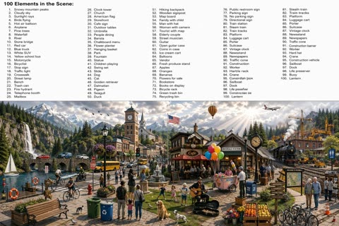</a>

A fixed element count plus a request to list every item makes the model plan the scene as an inventory. The result is a dense illustrated town under a numbered text list.

GPT Image 2 · Text-to-image · Source: [@umesh_ai on X](https://x.com/umesh_ai/status/2046569229189849228) · found via [ZeroLu/awesome-gpt-image](https://github.com/ZeroLu/awesome-gpt-image)

[`inventory`](tags.md#tag-inventory) [`dense-scene`](tags.md#tag-dense-scene) [`text-list`](tags.md#tag-text-list) [`counting`](tags.md#tag-counting) [`illustration`](tags.md#tag-illustration)

<details><summary><b>Prompt</b></summary>

```text
Create a scene with 100 elements, and list the 100 elements within the image.
```

</details>

<a id="gpt-image-alphabet-object-grid-a"></a>
### Ten by ten grid of objects starting with A

<a href="https://x.com/umesh_ai/status/2046510988367945983">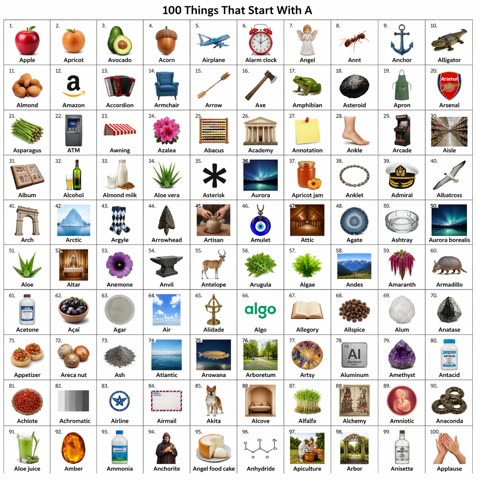</a>

A fixed grid size plus a single naming rule gives the model a clear layout and a checkable constraint. Short and open ended, it tests how well the model keeps labels and objects aligned across 100 cells.

GPT Image 2 · Text-to-image · Source: [@umesh_ai on X](https://x.com/umesh_ai/status/2046510988367945983) · found via [ZeroLu/awesome-gpt-image](https://github.com/ZeroLu/awesome-gpt-image)

[`grid`](tags.md#tag-grid) [`alphabet`](tags.md#tag-alphabet) [`objects`](tags.md#tag-objects) [`layout`](tags.md#tag-layout) [`text-rendering`](tags.md#tag-text-rendering)

<details><summary><b>Prompt</b></summary>

```text
Create an image with a 10x10 grid of objects whose names all start with the letter A
```

</details>

<a id="gpt-image-beard-style-analysis-grooming-poster"></a>
### Beard style analysis grooming poster on dark blue

<a href="https://x.com/RizwanAly07/status/2048610196302250019">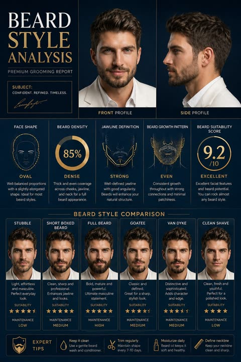</a>

Names every data panel to render (face shape, density, jawline, growth, score) and lists six beard styles to compare, so the layout fills in as a structured report. Asking for front and side views with face consistency keeps the reference man identical across all panels.

GPT Image 2 · Edit · Source: [@RizwanAly07 on X](https://x.com/RizwanAly07/status/2048610196302250019) · found via [freestylefly/awesome-gpt-image-2](https://github.com/freestylefly/awesome-gpt-image-2)

[`grooming`](tags.md#tag-grooming) [`beard`](tags.md#tag-beard) [`infographic`](tags.md#tag-infographic) [`dark-blue`](tags.md#tag-dark-blue) [`face-consistency`](tags.md#tag-face-consistency)

<details><summary><b>Prompt</b></summary>

```text
Create a premium “BEARD STYLE ANALYSIS” poster featuring the same man from the reference image. Show face shape, beard density, jawline definition, beard growth pattern, and beard suitability score. Include different beard styles comparison such as Stubble, Short Boxed Beard, Full Beard, Goatee, Van Dyke, Clean Shave. Add side profile and front profile views. Modern dark blue luxury background, professional grooming infographic style, high detail, realistic face consistency, stylish typography, premium male grooming poster.
```

</details>

<a id="gpt-image-blue-porcelain-fashion-inspiration-board"></a>
### Blue Porcelain Bilingual Fashion Inspiration Board

<a href="https://x.com/MrLarus/status/2051943360521228321">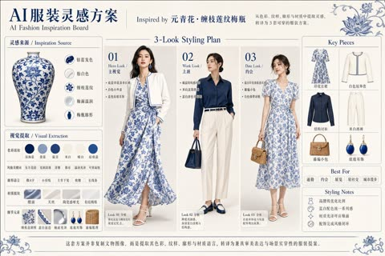</a>

A JSON spec fixes the layout as three columns with exact item counts, exact label text and a locked palette. Each look is described piece by piece, so the board holds together as a single catalog sheet.

GPT Image 2 · Text-to-image · Source: [@MrLarus on X](https://x.com/MrLarus/status/2051943360521228321) · found via [YouMind-OpenLab/awesome-gpt-image-2](https://github.com/YouMind-OpenLab/awesome-gpt-image-2)

[`fashion-board`](tags.md#tag-fashion-board) [`bilingual`](tags.md#tag-bilingual) [`porcelain`](tags.md#tag-porcelain) [`layout-spec`](tags.md#tag-layout-spec) [`json-prompt`](tags.md#tag-json-prompt)

<details><summary><b>Prompt</b></summary>

```text
{"type":"bilingual AI fashion inspiration board / museum-artifact-to-outfit styling plan","overall_style":"elegant editorial fashion board on warm ivory paper, deep cobalt blue accents, thin navy divider lines, refined serif typography mixed with Chinese headings, symmetrical decorative blue floral corner ornaments, luxury museum catalog aesthetic, photorealistic outfit models with softly blurred faces, clean product-grid layout","title_text":"{argument name=\"headline text\" default=\"AI服装灵感方案\"}","subtitle_text":"AI Fashion Inspiration Board","inspiration_line":"Inspired by {argument name=\"artifact name\" default=\"元青花・缠枝莲纹梅瓶\"}","top_note":"从色彩、纹样、廓形与材质中提取灵感，转译为3套可穿的服装方案。","color_palette":"{argument name=\"primary palette\" default=\"porcelain white, deep cobalt blue, pale mist blue, warm ivory, silver gray, natural rattan tan\"}","layout":{"canvas":"wide 16:9 landscape board, cream background, thin blue borders, three main columns: inspiration and visual extraction on the left, three full outfit looks in the center, key pieces and notes on the right","sections":[{"title":"灵感来源 / Inspiration Source","position":"upper left","count":6,"contents":["large blue-and-white porcelain meiping vase with scrolling lotus pattern","round swatch labeled 钴蓝发色","round swatch labeled 胎白色","round motif icon labeled 缠枝莲纹","round glossy material swatch labeled 釉面温润","vase silhouette icon labeled 梅瓶廓形"]},{"title":"视觉提取 / Visual Extraction","position":"lower left","count":5,"subsections":[{"name":"色彩规范","count":6,"labels":["深海蓝","浅蓝","靛青","米白","暖白","珐琅蓝"]},{"name":"风格关键词","count":6,"labels":["东方瓷韵","克制浪漫","清雅","都市","温润光泽","可穿高级"]},{"name":"廓形语言","count":6,"labels":["微A字","小廓线","上窄下宽","收腰","长线条","长裙摆"]},{"name":"材质提取","count":5,"labels":["缎面","天丝","陶瓷哑光","丝绸垂坠","轻结构"]},{"name":"细节元素","count":5,"labels":["缠枝莲刺绣","蓝白滚边","釉面光泽","珐琅耳饰","藤编肌理"]}]},{"title":"3-Look Styling Plan","position":"center","count":3,"looks":[{"number":"01","label":"Hero Look / 主视觉","model":"full-body female fashion model, standing in a flowing porcelain-blue-and-white floral wrap maxi dress with V neckline and waist tie, cropped white jacket with cobalt piping, white strappy heels, blue enamel earrings, elegant editorial pose","bullets":["瓷蓝印花裹身长裙","白色小外套","蓝色珐琅耳饰"],"analysis_box":"Look 01 分析：强化瓷器美感，视觉记忆点。"},{"number":"02","label":"Work Look / 上班","model":"full-body female fashion model, standing in navy structured silk blouse tucked into high-waisted warm white straight trousers, slim belt, navy-and-white loafers, dark blue structured handbag, polished office styling","bullets":["深蓝结构感衬衫","米白直筒西裤","蓝白拼色乐福鞋"],"analysis_box":"Look 02 分析：降低花哨感，保留蓝白瓷器结构感。"},{"number":"03","label":"Date Look / 约会","model":"full-body female fashion model, standing in short-sleeve blue-and-white porcelain floral midi tea dress, soft V neckline, fitted waist, white ankle-strap sandals, rattan mini handbag, romantic casual pose","bullets":["蓝白印花茶歇连衣裙","藤编小包","白色细带凉鞋"],"analysis_box":"Look 03 分析：以柔和印花与轻盈廓形营造温柔感。"}]},{"title":"Key Pieces","position":"upper right","count":6,"items":["印花长裙","白色短外套","结构衬衫","米白西裤","藤编小包","珐琅耳饰"]},{"title":"Best For","position":"mid right","count":5,"labels":["通勤","约会","展览","轻社交","城市漫步"]},{"title":"Styling Notes","position":"lower right","count":4,"notes":["高腰线优化比例","蓝白配色统一系列感","材质光泽呼应釉面","配饰完成风格闭环"]}]},"artifact_rendering":"large isolated museum-object illustration of a blue-and-white porcelain meiping vase with dense cobalt scrolling lotus vines, glossy ceramic highlights, placed in a bordered card","models":"three photorealistic adult female models, faces intentionally softly blurred or anonymized, fashion catalog lighting, full-body studio cutouts on pale neutral background","right_product_grid":"two-column grid of six isolated clothing and accessory illustrations matching the three looks: floral dress, white cropped jacket with blue trim, navy blouse, ivory trousers, rattan top-handle mini bag, cobalt blue enamel drop earrings","footer_text":"这套方案并非复制文物图像，而是提取其色彩、纹样、廓形与材质语言，转译为兼具审美表达与场景实穿性的服装提案。","customization_focus":"Generate the board as a complete polished fashion concept sheet inspired by {argument name=\"inspiration object\" default=\"a Yuan dynasty blue-and-white porcelain lotus meiping vase\"}, with exactly three outfit looks and exactly six key pieces, keeping the premium Chinese museum fashion editorial style."}
```

</details>

<a id="gpt-image-brutalist-technical-system-slide"></a>
### Brutalist Monochrome Technical System Presentation Slide

<a href="https://x.com/Russell3402/status/2046806087903625331">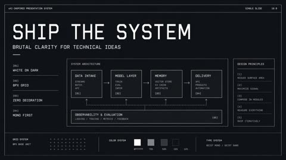</a>

A JSON prompt that fixes every panel, label and connector on a strict 8px grid, so the model renders the architecture flow and design-system strip with legible text. Argument placeholders for headline, subheadline and type label make it reusable for other decks.

GPT Image 2 · Text-to-image · Source: [@Russell3402 on X](https://x.com/Russell3402/status/2046806087903625331) · found via [YouMind-OpenLab/awesome-gpt-image-2](https://github.com/YouMind-OpenLab/awesome-gpt-image-2)

[`presentation-slide`](tags.md#tag-presentation-slide) [`brutalist`](tags.md#tag-brutalist) [`monochrome`](tags.md#tag-monochrome) [`json-prompt`](tags.md#tag-json-prompt) [`design-system`](tags.md#tag-design-system)

<details><summary><b>Prompt</b></summary>

```text
{"type":"minimal monochrome presentation slide","style":"high-contrast brutalist technical design, black background with subtle navy tint, thin white wireframe borders, zero decoration, strict grid, mono-first typography, futuristic industrial UI aesthetic","canvas":{"aspect_ratio":"16:9","background":"near-black with faint blue undertone and slight vignette"},"headline":{"text":"{argument name=\"headline text\" default=\"SHIP THE SYSTEM\"}","position":"upper left","style":"very large condensed geometric techno sans in white, all caps, widely tracked, dominant hero title"},"subheadline":{"text":"{argument name=\"subheadline text\" default=\"BRUTAL CLARITY FOR TECHNICAL IDEAS\"}","position":"below headline","style":"medium white monospace or mono-inspired sans, all caps"},"top_bar":{"count":3,"items":[{"text":"xAI-INSPIRED PRESENTATION SYSTEM","position":"top left"},{"text":"SINGLE SLIDE","position":"top right"},{"text":"16:9","position":"far top right"}]},"layout":{"outer_frame":true,"sections":[{"title":"left principles list","position":"left column","count":4,"labels":["[01] WHITE ON DARK","[02] 8PX GRID","[03] ZERO DECORATION","[04] MONO FIRST"]},{"title":"SYSTEM ARCHITECTURE","position":"center large panel","count":5,"labels":["DATA INTAKE","MODEL LAYER","MEMORY","DELIVERY","OBSERVABILITY & EVALUATION"]},{"title":"DESIGN PRINCIPLES","position":"right sidebar panel","count":5,"labels":["[1] REDUCE SURFACE AREA","[2] MAXIMIZE SIGNAL","[3] COMPOSE IN MODULES","[4] MEASURE EVERYTHING","[5] SHIP ITERATIVELY"]},{"title":"bottom system strip","position":"bottom full width","count":3,"labels":["GRID SYSTEM","COLOR SYSTEM","TYPE SYSTEM"]}]},"center_panel":{"bordered":true,"title":"SYSTEM ARCHITECTURE","flow":{"count":4,"boxes":[{"title":"DATA INTAKE","index":"[01]","lines":["STREAMS","BATCH","API"]},{"title":"MODEL LAYER","index":"[02]","lines":["TRAIN","EVAL","INFER"]},{"title":"MEMORY","index":"[03]","lines":["VECTOR STORE","KV CACHE","ARTIFACTS"]},{"title":"DELIVERY","index":"[04]","lines":["API","PRODUCTS","AUTOMATION"]}],"connectors":"3 right-pointing arrows between the 4 top boxes"},"bottom_module":{"title":"OBSERVABILITY & EVALUATION","index":"[05]","lines":["LOGGING / TRACING / METRICS / FEEDBACK"],"connectors":"dashed feedback line spanning beneath the 4 boxes with 4 upward dotted arrows linking back into each top box"}},"bottom_strip":{"left_block":{"title":"GRID SYSTEM","subtitle":"8PX BASE UNIT","visual":"dense matrix of small white plus signs arranged in rows"},"middle_block":{"title":"COLOR SYSTEM","swatch_count":5,"swatches":["#FFFFFF","70%","50%","20%","10%"],"visual":"five grayscale square swatches from white to very dark gray"},"right_block":{"title":"TYPE SYSTEM","text":"{argument name=\"type label\" default=\"GEIST MONO / GEIST SANS\"}"}},"composition":"clean generous spacing, all elements aligned to an 8px grid, mostly left-aligned text, thin divider lines, no photos, no gradients except extremely subtle background depth, technical pitch-deck cover slide look","rendering":"crisp vector presentation mockup, ultra-sharp typography, polished design system board"}
```

</details>

<a id="gpt-image-cellular-respiration-diagram"></a>
### Cellular respiration diagram for a high school class

<a href="https://developers.openai.com/api/docs/guides/image-prompting#create-scientific-and-educational-visuals"></a>

Written like a lesson brief that names the audience, the title, the three stages and every molecule to label, then lists what to avoid. The handout framing with a white background and simple icons keeps dense labels legible.

GPT Image 2.5 · Text-to-image · Source: [OpenAI image prompting guide](https://developers.openai.com/api/docs/guides/image-prompting#create-scientific-and-educational-visuals)

[`education`](tags.md#tag-education) [`biology`](tags.md#tag-biology) [`diagram`](tags.md#tag-diagram)

<details><summary><b>Prompt</b></summary>

```text
Create a simple biology diagram titled "Cellular Respiration at a Glance" for high school students.

Show how glucose turns into energy inside a cell. Include glycolysis, the Krebs cycle, and the electron transport chain.
Use arrows to connect the steps, and label the main molecules: glucose, pyruvate, ATP, NADH, FADH2, CO2, O2, and H2O.
Make it look like a clean classroom handout or slide, with a white background, simple icons, clear labels, and easy-to-read text.

Avoid tiny text, extra decoration, or anything that makes the diagram hard to understand.
```

</details>

<a id="gpt-image-chinese-fitness-training-plan-infographic"></a>
### Chinese chest workout plan modular infographic

<a href="https://x.com/MrLarus/status/2046560406760505727">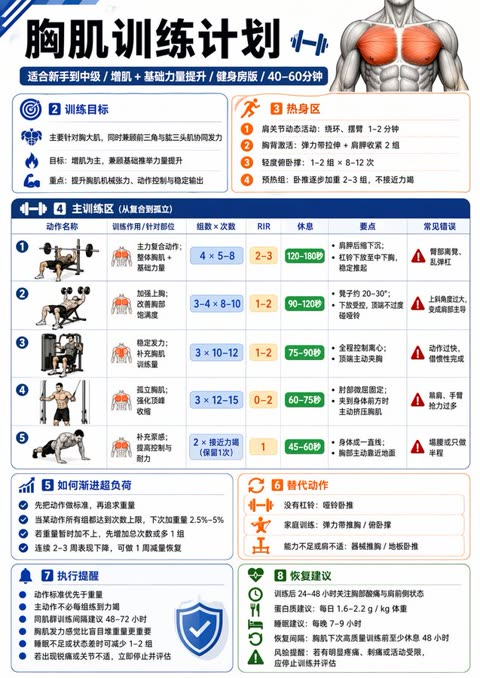</a>

The prompt lists lettered sections A to I, each with required fields such as sets, reps, RIR and rest. It also sets defaults for level, gym setting and duration, and lets the model choose the output type from the topic, so one template fits any muscle group or skill.

GPT Image 2 · Text-to-image · Source: [@MrLarus on X](https://x.com/MrLarus/status/2046560406760505727) · found via [freestylefly/awesome-gpt-image-2](https://github.com/freestylefly/awesome-gpt-image-2)

[`infographic`](tags.md#tag-infographic) [`fitness`](tags.md#tag-fitness) [`chinese-text`](tags.md#tag-chinese-text) [`template`](tags.md#tag-template) [`modular-cards`](tags.md#tag-modular-cards)

<details><summary><b>Prompt</b></summary>

```text
请生成一张中文健身信息图，主题为：【xxx】。

要求这张图既专业又实用，适合普通成年人作为训练参考。默认对象为无严重伤病的健康成年人；如果没有额外说明，默认训练目标为“增肌 + 基础力量提升”，默认训练水平为“新手到中级之间”，默认训练场景为“普通健身房”，默认单次训练时长控制在 40–60 分钟内。

请根据【训练主题】自动判断输出类型：

1）如果【训练主题】是某个肌群或身体部位（例如：胸肌、背阔肌、肱二头肌、腹肌、肩部、腿部等），请输出一张“该部位训练计划信息图”。
2）如果【训练主题】是某个动作或技能目标（例如：引体向上、俯卧撑、双杠臂屈伸、深蹲等），请输出一张“动作解锁 / 进阶训练计划信息图”。

整张图请采用清晰、现代、专业、易读的中文信息图风格，竖版排版，视觉简洁，重点突出，适合社交媒体分享或训练参考卡片。不要写成长篇大论，每个模块用简洁短句呈现，数字信息要醒目。

这张信息图必须包含以下内容：

【A. 标题区】
- 主标题：直接写【训练主题】训练计划 / 解锁计划
- 副标题：自动补充适用人群、目标、训练场景、建议时长
例如：适合新手 / 增肌导向 / 健身房版 / 45分钟

【B. 训练目标区】
用简洁语言说明：
- 这次训练主要针对什么
- 主要目标是什么（增肌 / 力量 / 技能解锁 / 核心控制等）
- 本次训练的重点刺激或能力提升方向

【C. 热身区】
给出 2–4 个热身建议，简洁列出即可，例如：
- 动态活动
- 目标肌群激活
- 轻重量预热组
每项可附一句说明

【D. 主训练区】
这是核心部分，请列出 4–6 个主要训练动作。
每个动作都要包含以下信息：
- 动作名称
- 训练作用 / 针对部位
- 组数 × 次数（或时间）
- RIR 建议
- 每组间休息时间
- 动作关键要点（1–2 条）
- 常见错误（1 条即可）

请确保动作安排合理：
- 先复合动作，后孤立动作
- 整体训练量适中
- 新手不要安排过度极限训练
- 主动作通常建议 RIR 1–3
- 孤立动作可建议 RIR 0–2
- 如果是腹肌或核心类动作，可用“秒数 / 次数”形式
- 如果是技能类动作，请优先安排“前置能力动作 + 过渡动作 + 目标动作尝试”

【E. 进阶 / 解锁逻辑区】
根据主题自动生成：
- 如果是肌群训练：写“如何渐进超负荷”，例如达到次数上限后再加重量、优先保证动作标准等
- 如果是动作解锁：写“分阶段进阶路径”，例如从悬垂、肩胛引体、离心训练、弹力带辅助，到标准动作完成

【F. 替代动作区】
请给出 2–3 个替代动作，适用于以下情况：
- 没有器械
- 家庭训练
- 当前能力不足
- 某些动作做不了

【G. 执行提醒区】
请给出 4–6 条简洁提醒，例如：
- 动作标准优先于重量
- 不要每组都练到力竭
- 同肌群建议间隔 48–72 小时
- 疼痛不等于正常发力
- 睡眠不足时可适当减少训练量

【H. 恢复建议区】
简洁说明：
- 训练后恢复重点
- 蛋白质 / 睡眠 / 恢复间隔建议
- 1 句风险提醒（如有明显疼痛应停止并评估）

【I. 视觉设计要求】
- 整体为单页中文信息图
- 竖版排版
- 风格现代、清爽、专业、健身感强
- 使用模块化卡片布局
- 重点数字（组数、次数、RIR、休息）要醒目
- 可加入简洁的人体肌群图标、哑铃、杠铃、引体向上等小图标
- 颜色保持高级、干净、有运动感
- 中文文字必须清晰、准确、易读
- 避免过多装饰，强调实用性与执行性

请最终输出为“一张完整的信息图内容”，而不是只给普通段落文字。
```

</details>

<a id="gpt-image-coca-cola-brand-personality-comic-infographic"></a>
### Coca Cola brand personality comic infographic poster

<a href="https://x.com/CallumGrey/status/2051293342139584922">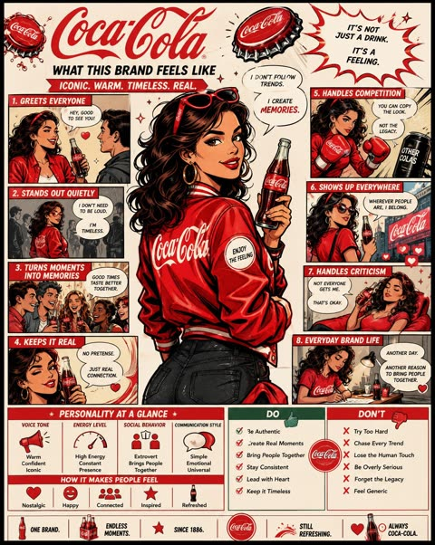</a>

Uploading the logo as the source fixes the red and cream palette and the brand look across every panel. A fixed structure of eight numbered comic panels, a personality block and a DO and DON'T split keeps the layout dense and easy to scan.

GPT Image 2 · Edit · Source: [@CallumGrey on X](https://x.com/CallumGrey/status/2051293342139584922) · found via [freestylefly/awesome-gpt-image-2](https://github.com/freestylefly/awesome-gpt-image-2)

[`brand-strategy`](tags.md#tag-brand-strategy) [`comic`](tags.md#tag-comic) [`infographic`](tags.md#tag-infographic) [`character-design`](tags.md#tag-character-design)

<details><summary><b>Prompt</b></summary>

```text
Using the uploaded logo, create a highly detailed, comic-style infographic poster:

“What This Brand Feels Like”

GOAL:
Turn the brand into a living personality and visually explain how it behaves, speaks, and interacts with the world.
This must feel like a mix of: brand strategy + character design + comic storytelling.

---

CORE RULE:
Everything must come from the logo:
- colors
- style
- tone
- personality

No generic personality traits.

---

MAIN STRUCTURE:
Vertical 4:5 poster
Dense layout with multiple panels
Comic + infographic hybrid

---

TOP SECTION:
- Brand name
- Short personality statement (max 6 words)
Example: “Quiet confidence with sharp edges”

---

MAIN CHARACTER (VERY IMPORTANT):
Create a central character representing the brand:
- humanized version of the brand
- outfit reflects brand style
- posture + expression reflect personality

---

AROUND THE CHARACTER:
Create 6–8 comic panels showing how the brand behaves in different situations.

---

SCENARIO IDEAS:
- Talking to customers
- Handling competition
- Selling a product
- Social media presence
- Reacting to criticism
- Daily “brand life” moment

---

FOR EACH PANEL:
Include:
- short caption (max 6 words)
- speech bubble or internal thought
- clear visual action

---

TONE EXAMPLES:
Luxury brand: calm, confident, minimal speech
Playful brand: loud, chaotic, expressive
Tech brand: precise, logical, clean

---

PERSONALITY TRAITS SECTION:
Add small labeled blocks:
- Voice tone (e.g. calm, bold, playful)
- Energy level (low / medium / high)
- Social behavior (introvert / extrovert)
- Communication style

Use:
- icons
- short labels

---

DO / DON’T SECTION:
Add a split block:
DO:
- how the brand should act
DON’T:
- what breaks the identity

Keep:
- very short phrases

---

VISUAL ELEMENTS:
- speech bubbles
- icons
- arrows
- small reactions
- exaggerated comic expressions

---

STYLE:
- comic + editorial hybrid
- slightly exaggerated but still premium
- expressive but not childish

---

COLOR:
- strictly based on logo palette
- use color to reinforce personality

---

DEPTH:
- 20–40 visual elements
- multiple small panels
- layered composition

---

IMPORTANT RULES:
- must feel alive
- must feel specific
- no generic marketing words
- no empty areas
- keep text short but impactful

---

FINAL FEEL:
Like:
- a brand strategy turned into a character
- a visual storytelling board
- something people save and study

NOT:
- flat
- generic
- minimal
```

</details>

<a id="gpt-image-coffee-machine-flow-infographic"></a>
### Automatic coffee machine cutaway infographic with color coded flows

<a href="https://developers.openai.com/api/docs/guides/image-prompting#explain-a-process-visually"></a>

Three plain sentences name the machine, list the parts in order and state the goal of understanding the flow, so the model builds a numbered cutaway with color coded paths for beans, water, steam and milk. Check the technical figures in the labels for accuracy.

GPT Image 2.5 · Text-to-image · Source: [OpenAI image prompting guide](https://developers.openai.com/api/docs/guides/image-prompting#explain-a-process-visually)

[`infographic`](tags.md#tag-infographic) [`technical`](tags.md#tag-technical) [`diagram`](tags.md#tag-diagram)

<details><summary><b>Prompt</b></summary>

```text
Create a detailed Infographic of the functioning and flow of an automatic coffee machine like a Jura.
From bean basket, to grinding, to scale, water tank, boiler, etc.
I'd like to understand technically and visually the flow.
```

</details>

<a id="gpt-image-coronavirus-scale-zoom-infographic"></a>
### Coronavirus Seven Level Scale Zoom Infographic

<a href="https://x.com/Gdgtify/status/2051288232613351571">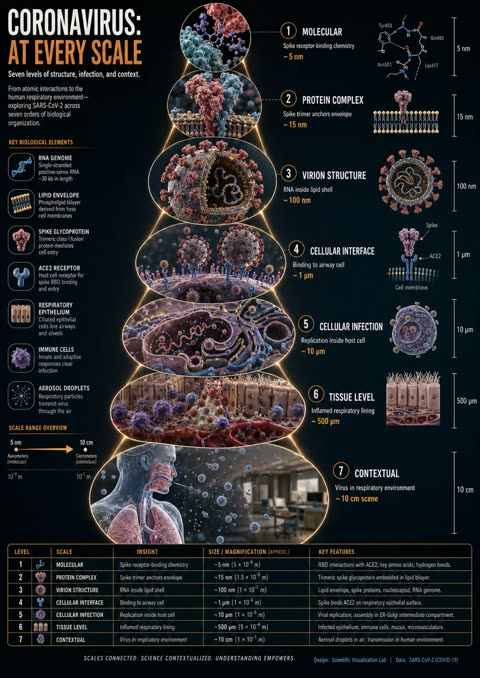</a>

A single [SUBJECT] variable makes the template reusable, and the layout is fixed as 6 to 8 connected circular frames, each at a new scale. Every frame gets a scale label, a short insight and a measurement tag, and a style line asks for macro lighting and a sequential layout.

GPT Image 2 · Text-to-image · Source: [@Gdgtify on X](https://x.com/Gdgtify/status/2051288232613351571) · found via [freestylefly/awesome-gpt-image-2](https://github.com/freestylefly/awesome-gpt-image-2)

[`infographic`](tags.md#tag-infographic) [`scale-zoom`](tags.md#tag-scale-zoom) [`science`](tags.md#tag-science) [`3d-render`](tags.md#tag-3d-render) [`template`](tags.md#tag-template)

<details><summary><b>Prompt</b></summary>

```text
instructions> [SUBJECT]=Coronavirus. A hyper-realistic 3D zoom-sequence infographic generated from a single input: [SUBJECT]. The system auto-detects scale layers from atomic/subcomponent to full contextual view. Layout Structure (CRITICAL) 6–8 circular or hexagonal frames arranged in expanding sequence Innermost frame = smallest detectable detail; outermost = full subject in environment Frames connected by subtle zoom-path lines No repeated scales — each frame shows new level of detail Frame Design Each zoom level includes: Hyper-detailed 3D render at that scale Micro label: scale name (e.g., "molecular," "cellular," "structural") + 3–5 word insight Optional: measurement tag or magnification factor Contextual Halo Around the sequence, include only scale-specific references: Measurement units, scientific notation, cultural scale metaphors (No generic magnifying glass icons) Scale Panel (Alternative Layout) Zoom level Key insight (3–5 words) Scale factor tag Detail icon (grid, wave, particle, etc.) Title "[SUBJECT]: AT EVERY SCALE" (or) "ZOOM: THE WORLD OF [SUBJECT]" Style: ultra-realistic 3D render, scientific editorial infographic, precise macro lighting, global illumination, shallow depth of field, clean sequential layout. </instructions>
```

</details>

<a id="gpt-image-couture-garment-process-infographic-poster"></a>
### Couture Garment Process Infographic Poster

<a href="https://x.com/hx831126/status/2046454226080219281">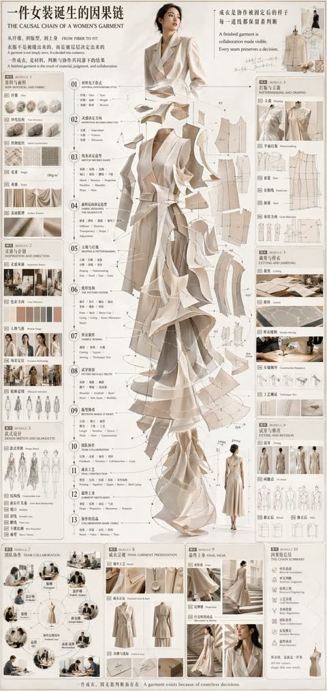</a>

A structured JSON prompt lists every module with its position, item count and exact bilingual labels, so the dense layout stays organized around a central exploded view gown. A restrained beige palette and fixed counts for drawings, swatches and photos keep the many small panels consistent.

GPT Image 2 · Text-to-image · Source: [@hx831126 on X](https://x.com/hx831126/status/2046454226080219281) · found via [YouMind-OpenLab/awesome-gpt-image-2](https://github.com/YouMind-OpenLab/awesome-gpt-image-2)

[`fashion`](tags.md#tag-fashion) [`infographic`](tags.md#tag-infographic) [`couture`](tags.md#tag-couture) [`process-board`](tags.md#tag-process-board) [`json-prompt`](tags.md#tag-json-prompt)

<details><summary><b>Prompt</b></summary>

```text
{"type":"fashion design infographic poster","style":"editorial couture process board, minimalist luxury branding, soft beige monochrome palette, clean white background, fine technical linework, delicate paper texture, elegant serif and small caps typography, bilingual Chinese and English fashion presentation","subject":{"theme":"the full decision chain behind a women's garment from material research to final dress","centerpiece":"a tall front-facing female model wearing an avant-garde deconstructed gown in layered ivory, sand, taupe, and warm beige fabric panels, with semi-transparent pattern pieces, drape fragments, and construction lines floating around the body like an exploded view","model":{"face":"intentionally blurred or obscured","pose":"standing upright, arms relaxed, couture presentation stance"},"garment":{"type":"floor-length sleeveless couture dress","silhouette":"column base with dramatic asymmetrical layered draping, sculptural folds, flared lower panels, and fragmented pattern-like extensions","materials":"matte woven fabric, sheer organza-like overlays, muslin toile textures, paper-pattern aesthetics"}},"layout":{"orientation":"vertical poster","density":"information-dense","sections":[{"title":"一件女装诞生的因果链","position":"top header","count":1,"labels":["THE CAUSAL CHAIN OF A WOMEN'S GARMENT"]},{"title":"面料与材料","position":"upper left","count":6,"labels":["Fiber","Yarn Structure","Fabric Construction","Weight","Drape","Surface Texture"]},{"title":"灵感与企划","position":"left upper-middle","count":6,"labels":["Inspiration Source","Color Direction","Woman Image","Occasion Positioning","Silhouette Intention","Design Sketch"]},{"title":"设计与轮廓","position":"left lower-middle","count":7,"labels":["Drape Sketch","Construction Line","Form Sketch Relationship","Volume Line","Wear Line","Movement Line","Proportion"]},{"title":"中央信息链","position":"center left and center","count":13,"labels":["RAW MATERIAL AND FABRIC","MATERIAL DENSITY FORCE","INSPIRATION BECOMES DIRECTION","SKETCH DECIDES SHAPE","DRAPE PRACTICE SHAPES THE SILHOUETTE","DRAPING & PATTERNMAKING","THE PATTERN SYSTEM","SAMPLE SEWING","FITTING REVEALS TRUTH","REVISED MAKES IT RIGHT","TEAM COLLABORATION","FINAL CONSTRUCTION","COLLABORATION MADE VISIBLE"]},{"title":"打版与立裁","position":"upper right","count":6,"labels":["Pattern Drafting","Panel Line","Balance","Grain Direction","Patternmaking","Draping"]},{"title":"裁剪与样衣","position":"right middle","count":5,"labels":["Cutting","Layout","Sample Sewing","Combination Sequence","Technology Test"]},{"title":"试穿与修正","position":"right lower-middle","count":4,"labels":["Fit test","Before","After","Revision"]},{"title":"团队协作","position":"bottom left","count":8,"labels":["Design Team","Patternmaker","Fabric Table","Fit Model","Design Review","Technical Meeting","Merchandising","QC"]},{"title":"成衣呈现","position":"bottom center","count":5,"labels":["Look","Finished Front & Back","Label & Cm","Packaging","Detail"]},{"title":"最终上身","position":"bottom center-right","count":4,"labels":["Drape","Proportion","Movement in Motion","Close-up"]},{"title":"因果总结","position":"bottom right","count":6,"labels":["Material Base","Aesthetic Judgment","Structural Engineering","Craft Precision","Body Negotiation","All these shape one result"]}],"additional_elements":{"technical_drawings":12,"fabric_swatches":8,"process_photos":23,"mini figure sketches":10,"diagram_arrows":"many thin annotation arrows and numbered callouts connecting process steps to the central garment"}},"text":{"headline_cn":"一件女装诞生的因果链","headline_en":"THE CAUSAL CHAIN OF A WOMEN'S GARMENT","top_right_quote":"A finished garment is visible, collaboration made visible. Every seam preserves a decision.","footer":"A garment exists because of countless decisions."},"color_palette":{"primary":"{argument name=\"primary palette\" default=\"ivory, cream, sand, beige, taupe\"}","background":"warm white","accent":"light gray linework and muted brown text"},"rendering":{"lighting":"soft studio lighting, diffuse and shadow-light","detail_level":"very high","composition":"magazine-quality infographic with the model centered and narrow modular side panels","mood":"intellectual, refined, process-driven, couture atelier"}}
```

</details>

<a id="gpt-image-croissant-baker-storyboard-infographic"></a>
### Eight Panel Croissant Baker Storyboard Infographic Poster

<a href="https://x.com/TechieBySA/status/2053523784481554759">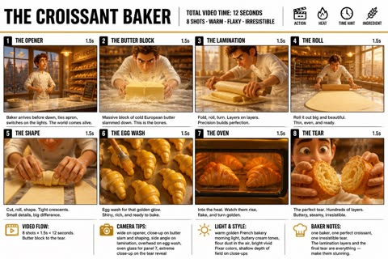</a>

Fixes the layout first with header, legend icons, eight numbered panels and a footer. Each panel names a shot type and action, and the footer lists camera tips and light so the baker and warm palette stay consistent.

GPT Image 2 · Text-to-image · Source: [@TechieBySA on X](https://x.com/TechieBySA/status/2053523784481554759) · found via [freestylefly/awesome-gpt-image-2](https://github.com/freestylefly/awesome-gpt-image-2)

[`storyboard`](tags.md#tag-storyboard) [`infographic`](tags.md#tag-infographic) [`pixar-style`](tags.md#tag-pixar-style) [`bakery`](tags.md#tag-bakery) [`16-9`](tags.md#tag-16-9)

<details><summary><b>Prompt</b></summary>

```text
Create a crisp, clean infographic storyboard poster for THE CROISSANT BAKER. Wide 16:9 layout, white background, black borders, bold black typography, premium Pixar 3D stylized rendering, bright vivid colors — warm golden yellows, rich buttery creams, flaky browns, soft pastry whites, warm French bakery morning light.
Top header:

THE CROISSANT BAKER
TOTAL VIDEO TIME: 12 SECONDS
8 SHOTS · WARM · FLAKY · IRRESISTIBLE
Legend icons: ACTION, HEAT, TIME HINT, INGREDIENT
Thin warm golden accent line running full width beneath header

Same Pixar-style young French male baker throughout: white baker's jacket, flour-dusted hands, warm authentic French boulangerie setting, marble countertop, warm morning light streaming through windows, bread racks in background. Bright, warm, delicious. Every panel a completely different composition and color.
8 panels:

THE OPENER — Wide shot of baker arriving at the boulangerie before dawn, tying apron, switching on the warm kitchen lights, marble counter visible, bread racks behind, flour dusting the air, full world established, bright and cinematic
THE BUTTER BLOCK — Baker slams a massive cold block of European butter onto the marble counter with both hands, dramatic impact, flour cloud puffing up, close-up on hands, this is the bones moment — the start of everything
THE LAMINATION — Baker folding the dough over the butter block precisely, rolling pin pressing down hard, layers building, side angle shot showing the beautiful layering beginning, confident and skilled
THE ROLL — Dough rolled out into a large thin sheet, baker leaning into the rolling pin with full body weight, marble counter, flour dusting everywhere, wide shot showing the scale of the dough
THE SHAPE — Triangles cut from the dough, baker rolling each one from the wide end into a tight crescent, hands moving fast and confident, close-up on the shaping, beautiful and precise
THE EGG WASH — Baker brushing golden egg wash over each shaped croissant with a pastry brush, each one glistening beautifully, close-up overhead angle, warm golden color, stunning composition
THE OVEN — Croissants slid into the blazing hot oven on a tray, oven door closed, through the oven glass croissants visibly puffing and turning deep golden, layers separating dramatically, warm orange glow
THE TEAR — Baker pulls a perfect golden croissant from the rack, holds it up, tears it open slowly revealing hundreds of impossibly flaky buttery layers inside, steam escaping, butter glistening — this is the cheese pull moment, the hero shot of the entire video

Footer:

VIDEO FLOW: 8 shots × 1.5s = 12 seconds. Butter block to the tear.
CAMERA TIPS: wide on opener, close-up on butter slam and shaping, side angle on lamination, overhead on egg wash, oven glass for panel 7, extreme close-up on the tear reveal
LIGHT & STYLE: warm golden French bakery morning light, buttery cream tones, flour dust in the air, bright vivid Pixar colors, shallow depth of field on close-ups
BAKER NOTES: one baker, one perfect croissant, one irresistible tear. The lamination layers and the final tear are everything — make them stunning.
```

</details>

<a id="gpt-image-cute-llm-training-infographic"></a>
### Cute infographic of the LLM training pipeline

<a href="https://x.com/op7418/status/2046502136973001143">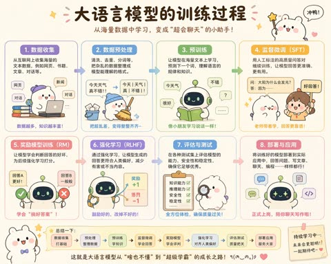</a>

A one line topic request leaves layout to the model, which produces a numbered eight step grid with arrows, a mascot per step and a summary strip. Asking for a cute explanation sets the pastel palette, rounded type and character style without any extra styling text.

GPT Image 2 · Text-to-image · Source: [@op7418 on X](https://x.com/op7418/status/2046502136973001143) · found via [freestylefly/awesome-gpt-image-2](https://github.com/freestylefly/awesome-gpt-image-2)

[`infographic`](tags.md#tag-infographic) [`cute`](tags.md#tag-cute) [`mascot`](tags.md#tag-mascot) [`education`](tags.md#tag-education) [`chinese-text`](tags.md#tag-chinese-text)

<details><summary><b>Prompt</b></summary>

```text
[中文]
可爱地解释一下大语言模型训练过程

[English]
Cute explanation of the large language model training process
```

</details>

<a id="gpt-image-eastern-mythology-encyclopedia-poster-sun-wukong"></a>
### Eastern Mythology Encyclopedia Poster of Sun Wukong

<a href="https://x.com/TanLuAI/status/2053073436122243364"></a>

A single name variable drives a numbered twelve section layout, with left and right card columns, a central hero figure and a bottom summary, so the template swaps to any mythic figure. Explicit style references, a palette rule per divine attribute and a negative list of Western fantasy motifs keep the Chinese text and the look consistent.

GPT Image 2 · Text-to-image · Source: [@TanLuAI on X](https://x.com/TanLuAI/status/2053073436122243364) · found via [freestylefly/awesome-gpt-image-2](https://github.com/freestylefly/awesome-gpt-image-2)

[`mythology`](tags.md#tag-mythology) [`encyclopedia-poster`](tags.md#tag-encyclopedia-poster) [`chinese-typography`](tags.md#tag-chinese-typography) [`template`](tags.md#tag-template) [`info-cards`](tags.md#tag-info-cards)

<details><summary><b>Prompt</b></summary>

```text
请基于【孙悟空】生成一张竖版 A4「东方神话人物志」百科海报。

你是一名东方神话视觉设定师、古籍图谱设计师和中文信息图设计师。请根据【人物名称】在东方神话、民间传说、古籍、戏曲、文学或传统文化中的已知形象，生成一张内容完整、视觉统一、具有东方神话气质的人物档案海报。

最重要原则：
全部内容必须围绕【人物名称】展开，不要套用通用神仙模板。
人物形象、法器、坐骑、神通、典故、象征物、背景场景都必须符合【人物名称】的神话设定。
如果该人物存在多个传说版本，请采用最广为人知的版本；存在异文时，可以在相关板块简短标注“传说版本不一”。
不确定的信息不要强行编造，可写“民间传说中多有异文”或“相关记载较少”。
不要使用北欧符文、维京图腾、哥特边框、西方盔甲、欧式城堡、西幻恶魔角、赛博朋克元素。
整体必须是东方神话审美，而不是“西幻人物换中式衣服”。
整体视觉风格：
东方神话史诗感，融合《山海经》异兽图谱、敦煌壁画、青绿山水、唐代人物画、宋元古画、青铜器纹样、古籍注疏和符箓篆刻风格。画面庄重、神秘、古雅、华丽但克制。
画面构图：

竖版 A4 海报，中轴对称布局。中央为【人物名称】的全身或半身主视觉，姿态庄严，有神性和叙事感。人物服饰、发冠、法器、神态、灵兽、背景都要符合该人物传说。左右两侧为信息卡片，底部为核心总结。四周使用云雷纹、回纹、青铜纹、祥云纹、卷草纹、山海纹、篆刻印章式边框。
主标题：“【人物名称】”
副标题：“东方神话人物志｜根据该人物神话传说生成”
顶部精神题记：请根据【人物名称】的核心精神，自动生成一句古雅、凝练、有哲学意味的题记。题记要体现该人物背后的价值观、生命姿态或精神内核，而不是说明性文字。不要写“非史实考证”“仅供参考”“传说版本”等免责声明。字数控制在 12-28 字，适合放在标题下方。题记应与人物高度绑定，不要套用“守护苍生”“大道无边”等空泛句式。

请生成以下内容板块：
【1. 神格身份】说明【人物名称】在东方神话体系中的身份定位。
【2. 神话源流】说明该人物主要出自哪些神话、古籍、民间传说、小说、戏曲或宗教信仰。
【3. 司职权柄】总结该人物掌管或象征的领域。
【4. 形象特征】描述该人物的典型外貌、服饰、神态、姿态和视觉气质。
【5. 法器神通】展示该人物最具代表性的法器、兵器、符咒、神通或能力。
【6. 灵兽坐骑 / 随身象征】如果【人物名称】有坐骑、灵兽、伴生生灵，请展示其名称、形态和寓意。如果没有明确坐骑，请改为“随身象征物”或“相关意象”。不要强行给每个人物安排龙、凤、仙鹤或麒麟。
【7. 典故出处】列出 2-4 个与【人物名称】相关的经典故事、传说片段或文化典故。不要虚构不存在的典故。若版本不一，请标注“异文较多”。
【8. 象征意象】提炼该人物最核心的视觉符号。符号必须与【人物名称】相关。
【9. 神话谱系】说明该人物与其他神话人物、阵营、族属或体系的关系。如果谱系不明确，请写“谱系传说不一”。
【10. 文化影响】说明该人物在民俗、节日、祭祀、文学、戏曲、绘画、庙宇、影视或现代文化中的影响。
【11. 精神内核】从神话叙事角度总结该人物象征的精神。这里只分析神话形象，不推断真实人物性格。
【12. 核心总结】用一段古雅但易懂的中文总结【人物名称】：“【人物名称】在东方神话中象征……，其形象融合了……，代表着……。”

视觉版式要求：
顶部：大标题 + 副标题 + 精神题记。
中央：人物主视觉，气势庄重，细节丰富。
左侧栏目：神格身份、神话源流、司职权柄、形象特征、法器神通。
右侧栏目：灵兽坐骑/随身象征、典故出处、象征意象、神话谱系、文化影响。
底部：精神内核 + 核心总结。
可加入小型图标、注释线、古籍标签、卷轴卡片、青铜铭牌、朱砂印章、符箓纹样。
信息卡片像古书页、玉简、青铜牌、卷轴或碑铭，不要像现代科技 UI。

材质与纹样：
宣纸肌理、矿物颜料、鎏金线条、朱砂印章、墨色晕染、青铜器铭文、云雷纹、回纹、祥云纹、山水纹、敦煌藻井纹样。

配色规则：
根据【人物名称】的属性自动选择东方配色。火焰 / 战斗 / 护法：朱砂、玄黑、鎏金、赤红。月亮 / 水系 / 清冷神祇：黛青、银白、月白、石蓝。山川 / 木系 / 自然神灵：石绿、青黛、玉白、赭石。帝王 / 天庭 / 尊神：鎏金、玄黑、朱砂、玉白。妖灵 / 山海异兽：墨黑、铜绿、暗金、赭红。不要所有人物都使用同一套配色。

文字要求：
中文必须清晰可读，标题大气，正文简短准确。不要乱码、伪文字、错别字、文字重叠或裁切。如果空间不足，优先压缩正文，但保留所有板块标题。

避免：
北欧符文、维京风、哥特边框、西方盔甲、欧式城堡、魔幻游戏 UI、赛博朋克、现代科技感、过度暗黑、随机龙凤、无关法器、模板化神仙形象、与【人物名称】无关的典故、空泛精神题记。
```

</details>

<a id="gpt-image-editable-ppt-workflow-infographic"></a>
### Dark Chinese Workflow Infographic for Editable Slides

<a href="https://x.com/NFT_Chen/status/2096887500300296416"></a>

The prompt fixes exact counts for every element (3 workflow cards, 3 metrics, 4 output cards, 7 layer panels) and quotes every Chinese string verbatim, which keeps the text legible. A layered layout of process row, tilted slide mockup and output list, plus a named palette of cyan and gold on navy, holds the composition together.

GPT Image 2 · Text-to-image · Source: [@NFT_Chen on X](https://x.com/NFT_Chen/status/2096887500300296416) · found via [YouMind-OpenLab/awesome-gpt-image-2](https://github.com/YouMind-OpenLab/awesome-gpt-image-2)

[`infographic`](tags.md#tag-infographic) [`workflow`](tags.md#tag-workflow) [`chinese-text`](tags.md#tag-chinese-text) [`dark-tech`](tags.md#tag-dark-tech) [`presentation`](tags.md#tag-presentation)

<details><summary><b>Prompt</b></summary>

```text
Goal: Create a dark futuristic Chinese workflow infographic slide showing how to turn written content plus images into an advanced editable PPT, with a premium tech presentation aesthetic.

Canvas: Wide 16:9 horizontal slide, deep navy/black background with subtle circuit-line texture, thin glowing border, cyan and gold neon accents, soft bloom highlights, clean corporate SaaS style.

Main headline: Centered at the top, use 文稿 + 配图 → 高级可编辑PPT. Highlight “文稿” in gold, “配图” in cyan, and the rest in white. Add a small cyan lens flare under the headline.

Top workflow layout: Place exactly 3 large rounded rectangular cards across the upper half, connected by a glowing horizontal process line and arrows that run left to right.
1. Card 1: Yellow numbered circle “1”, title “ChatGPT”, subtitle “理清文字结构”, large gold chat-bubble icon with three dots.
2. Card 2: Cyan numbered circle “2”, title “Image2”, subtitle “生成整页视觉稿”, small mock visual preview containing exactly 3 inner panels: a landscape image, a mini bar-chart/text panel, and a second landscape image.
3. Card 3: Yellow numbered circle “3”, title “GPT-6”, subtitle “拆层成可编辑PPT”, layered floating blue sheets over a gold base icon.

Central demonstration: In the lower middle-left, create one large tilted PPT slide mockup with rounded corners and glow. Slide title text: 未来城市：智能与可持续的融合. Slide subtitle: 技术创新 · 绿色发展 · 生态共生. Inside the slide, show a cinematic mountain lake landscape at sunset, plus a small inset city skyline image on the right.

Metric row inside the slide: Show exactly 3 metric items along the bottom of the slide: “35% 能源效率提升” with a clipboard icon in cyan, “60% 碳排放降低” with a shield/check icon in gold, and “2026 全面落地目标” with a globe icon in gold.

Layer conversion effect: To the right of the central slide, show the slide splitting into multiple translucent editable layers, about 7 visible stacked panels, with flowing cyan and gold data particles moving from the slide into the layers.

Editable output list: On the right side, create exactly 4 stacked rounded cards connected by thin lines to the separated layers:
1. “标题文本” with smaller text “副标题文本”, icon: large letter T.
2. “流程图节点” with smaller text “可编辑 · 可调整”, icon: flowchart nodes.
3. “图片占位符” with smaller text “替换 · 缩放 · 裁剪”, icon: image placeholder.
4. “布局与样式” with smaller text “母版 · 主题 · 动画”, icon: layout grid.

Bottom slogan: Centered near the bottom, in gold Chinese characters with dot separators, use 好看 · 能改 · 复用.

Visual style: High-resolution presentation infographic, crisp vector-like UI, luminous cyan and warm gold strokes, glassmorphism cards, subtle depth and perspective, modern Chinese typography, clean spacing, no people, no logos, no watermark. Keep all listed text legible and preserve the exact counts: 3 top workflow cards, 3 metric items, 4 editable-output cards, and 7 visible separated layer panels.
```

</details>

<a id="gpt-image-electric-bus-engineering-infographic"></a>
### Electric City Bus Engineering Infographic Handbook Page

<a href="https://x.com/j_smeaton99/status/2062365258984177766"></a>

A square layout is built from named modular sections, with a central three-quarter bus render and thin callout lines to key systems. A fixed palette, a placeholder for the bus name and an explicit avoid list keep the page editorial rather than an advert.

GPT Image 2 · Text-to-image · Source: [@j_smeaton99 on X](https://x.com/j_smeaton99/status/2062365258984177766) · found via [freestylefly/awesome-gpt-image-2](https://github.com/freestylefly/awesome-gpt-image-2)

[`infographic`](tags.md#tag-infographic) [`electric-bus`](tags.md#tag-electric-bus) [`smart-city`](tags.md#tag-smart-city) [`engineering`](tags.md#tag-engineering) [`square`](tags.md#tag-square)

<details><summary><b>Prompt</b></summary>

```text
Create a premium square “reference-style sustainable transportation infographic” centered around a futuristic electric city bus called the {E_BUS_NAME}, designed as a beautifully curated urban-mobility handbook page rather than a commercial vehicle advertisement.

The composition should feel like a modern visual encyclopedia mixed with an elite public-transit engineering guide and high-end editorial infographic system.

Visual Direction

• 1:1 square composition
• Premium smart-city background with subtle transportation blueprints, circuit-inspired overlays, and urban infrastructure schematics
• Elegant palette using deep navy, graphite black, electric green, steel gray, and soft cyan accents
• Refined editorial typography hierarchy
• Rounded modular information cards with clean spacing
• Gentle realistic reflections and premium transit-system dividers
• Minimal transportation engineering iconography
• Extremely detailed central electric bus render viewed in dramatic three-quarter perspective driving through a futuristic smart-city boulevard
• Thin precision annotation lines pointing toward key systems and technologies
• Clean, organized “knowledge-first” layout with high information density but breathable spacing

Main Subject Presentation

A stunning ultra-detailed realistic render of the {E_BUS_NAME} placed at the center, featuring:

• sleek aerodynamic body design
• panoramic windshield
• illuminated destination display
• low-floor accessibility layout
• futuristic LED lighting systems
• premium electric drivetrain details
• realistic urban reflections
• smart-city transportation realism

Surround the bus with engineering callouts explaining:

• battery pack technology
• electric motor system
• regenerative braking system
• charging infrastructure compatibility
• smart fleet management systems
• passenger accessibility features
• thermal battery management
• energy-efficiency technologies
• safety monitoring systems
• intelligent driver assistance features

Include Modular Sections

• E-Bus Overview
• Technical Specifications
• Vehicle Dimensions & Capacity
• Powertrain & Energy System
• Battery Technology Breakdown
• Charging Solutions
• Passenger Comfort Features
• Safety & Reliability Systems
• Fleet Management Technology
• Environmental Impact Analysis
• Operating Cost Comparison
• Construction & Material Engineering
• Sustainability Lifecycle Assessment
• Smart-City Integration
• Global Adoption Trends
• “Did You Know?” Facts Section
• Future of Electric Public Transport

Add Premium Visualization Modules

• battery architecture diagrams
• charging workflow graphics
• energy-consumption charts
• passenger-capacity visualizations
• smart-city integration maps
• drivetrain cutaway illustrations
• environmental impact comparisons
• fleet-management dashboards
• vehicle blueprint dimensions
• lifecycle sustainability graphics

Style Keywords

“premium transportation encyclopedia”
“editorial electric mobility handbook”
“high-end public transit infographic”
“scientific transportation poster”
“museum-quality electric bus reference page”
“modular smart-city knowledge system”
“clean engineering editorial design”
“ultra-detailed mobility visualization”
“future transportation showcase”
“sustainable urban mobility design”

Avoid

• generic vehicle advertisements
• cluttered commercial brochure layouts
• cartoon transportation styling
• unrealistic flying-bus concepts
• excessive cyberpunk neon overload
• low-detail stock-vehicle renders

Final Goal

The final result should resemble a professionally published transportation-engineering reference-book page created for urban planners, transportation engineers, sustainability researchers, architects, public-transit authorities, and smart-city enthusiasts, combining technical accuracy, sustainability insights, and premium editorial design.
```

</details>

<a id="gpt-image-engineering-sketch-model-architecture-slide"></a>
### Engineering Sketch Slide on Model Architecture Stages

<a href="https://x.com/stark_nico99/status/2048719821865472116"></a>

The prompt fixes a pure white background, fine engineering linework and a handwritten dark gray title. Low opacity pale blue, green and orange watercolor accents then color code each stage, and annotated steps with small icons keep the layout clear.

GPT Image 2 · Text-to-image · Source: [@stark_nico99 on X](https://x.com/stark_nico99/status/2048719821865472116) · found via [YouMind-OpenLab/awesome-gpt-image-2](https://github.com/YouMind-OpenLab/awesome-gpt-image-2)

[`engineering-sketch`](tags.md#tag-engineering-sketch) [`watercolor-accent`](tags.md#tag-watercolor-accent) [`whitespace`](tags.md#tag-whitespace) [`technical-diagram`](tags.md#tag-technical-diagram) [`slide`](tags.md#tag-slide)

<details><summary><b>Prompt</b></summary>

```text
-  纯白色背景，大量留白
- 工程图纸线条风格（细腻、精确）
- 手写体标题（深灰色）
- 工程标注方式展示步骤
- 淡蓝色、淡绿色、淡橙色水彩点缀（高透明度）
- 类似苹果/特斯拉产品设计手稿的现代感
- 简洁图标配合步骤说明
- 清爽、专业、科技感
```

</details>

<a id="gpt-image-espresso-machine-service-manual-diagram"></a>
### Sectional diagram of a domestic espresso machine

<a href="https://x.com/ImagineArt_X/status/2097520469150986457"></a>

The prompt fixes a genre and era (1960s service manual, fine black line work, flat spot colour on cream paper), then lists exact annotation counts and wording. Fourteen numbered leaders, a matching key, a centimetre scale bar and a literal title block text make the model produce a coherent, readable technical plate.

GPT Image 2.5 · Text-to-image · Source: [@ImagineArt_X on X](https://x.com/ImagineArt_X/status/2097520469150986457) · found via [wangrunlin/awesome-gpt-image-2-5-prompts](https://github.com/wangrunlin/awesome-gpt-image-2-5-prompts)

[`technical-diagram`](tags.md#tag-technical-diagram) [`cutaway`](tags.md#tag-cutaway) [`vintage-manual`](tags.md#tag-vintage-manual) [`numbered-callouts`](tags.md#tag-numbered-callouts) [`spot-colour`](tags.md#tag-spot-colour)

<details><summary><b>Prompt</b></summary>

```text
a domestic espresso machine drawn in section, 1960s service manual style, fine black line work with flat spot colour on cream paper. Fourteen numbered leader lines, a key down the right listing all fourteen parts, a scale bar in centimetres, and a title block reading FIG. 3 SECTIONAL VIEW MODEL C2.
```

</details>

<a id="gpt-image-facial-aesthetics-analysis-report"></a>
### Monochrome facial aesthetics analysis report from a portrait

<a href="https://x.com/saniaspeaks_/status/2055857787637522908"></a>

The prompt lists every report module as a bullet, then fixes the look with a monochrome palette, thin dividers and soft rounded cards. Asking for honest and not overly flattering analysis keeps the text data driven, and the uploaded portrait anchors the line art and scores.

GPT Image 2 · Edit · Source: [@saniaspeaks_ on X](https://x.com/saniaspeaks_/status/2055857787637522908) · found via [freestylefly/awesome-gpt-image-2](https://github.com/freestylefly/awesome-gpt-image-2)

[`facial-analysis`](tags.md#tag-facial-analysis) [`report-dashboard`](tags.md#tag-report-dashboard) [`monochrome`](tags.md#tag-monochrome) [`editorial-layout`](tags.md#tag-editorial-layout) [`portrait-reference`](tags.md#tag-portrait-reference)

<details><summary><b>Prompt</b></summary>

```text
Create a clean, minimal, luxury-style facial aesthetics analysis report based on the uploaded portrait photo.
Design style:
Ultra-modern black and white interface, premium editorial aesthetic, thin elegant divider lines, soft rounded cards, subtle shadows, spacious layout, luxury skincare / fashion magazine vibe, monochrome palette, Apple-style UI refinement.
Include:
– A simple contour line-art drawing of the face based on the subject
– Facial symmetry analysis
– Face shape identification
– Proportional analysis (eyes, nose, jawline, lips, forehead)
– Skin texture observations
– Hairstyle compatibility suggestions
– Grooming and fashion recommendations
– Honest attractiveness evaluation with balanced critique
– Strengths and weaker facial areas explained objectively
– Actionable glow-up recommendations
– Confidence score and facial harmony score shown with elegant charts or meters
Style notes:
Keep the report data-driven, visually refined, realistic, and not overly flattering.
Avoid exaggerated praise.
Use clean typography, premium spacing, modern infographics, subtle geometric accents, and professional cosmetic consultation aesthetics.
Visual composition:
Magazine-quality presentation, luxury beauty report dashboard, highly organized layout, cinematic monochrome feel, minimalist infographic design, realistic facial structure interpretation, modern masculine beauty analytics.
Rendering:
Ultra-detailed, sharp UI design, realistic portrait adaptation, sophisticated editorial presentation, high-end branding aesthetic, 4K quality.
```

</details>

<a id="gpt-image-four-luxury-watches-exploded-technical-grid"></a>
### Four luxury watches in exploded technical grid

<a href="https://x.com/Gdgtify/status/2056928396991488312"></a>

The prompt is a structured design spec that fixes composition, materials, atmosphere and data-panel mutations, so the model applies one consistent Swiss brochure system. Specifying a 2x2 grid at 16:9 gives four equal panels, each with an exploded movement view and callouts.

GPT Image 2 · Text-to-image · Source: [@Gdgtify on X](https://x.com/Gdgtify/status/2056928396991488312) · found via [freestylefly/awesome-gpt-image-2](https://github.com/freestylefly/awesome-gpt-image-2)

[`luxury`](tags.md#tag-luxury) [`watch`](tags.md#tag-watch) [`exploded-view`](tags.md#tag-exploded-view) [`infographic`](tags.md#tag-infographic)

<details><summary><b>Prompt</b></summary>

```text
2x2 grid 16:9, do this for 4 most expensive strangest watches ever made:

class Haute_Horlogerie_DNA:
    def __init__(self):
        self.subject = "[TIMEPIECE]"
        self.parents = {
            "composition_parent": "Exploded movement diagram with transparent case",
            "material_parent": "Brushed titanium, sapphire crystal, rose gold gears, alligator leather",
            "graphic_parent": "Swiss manufacture technical brochure with elegant data panels",
            "atmosphere_parent": "Crisp daylight studio, pure white background, subtle reflection on polished surfaces"
        }
        self.mutations = {
            "semantic_mutation": "The balance wheel reveals a miniature cosmos ticking inside",
            "information_mutation": "Power reserve indicator, frequency, complication callouts, hand-finishing grades, assembly timeline",
            "medium_mutation": "Smooth matte premium paper with embossed logo",
            "scale_mutation": "Grain-level view of Côtes de Genève finishing and jewel bearings"
        }
        self.style_mix = [0.30, 0.30, 0.25, 0.10, 0.05]

    def generate_subject(self):
        subject = """
        [TIMEPIECE] shown in its full mechanical glory. The dial, hands, movement,
        and strap float in perfect alignment against a bright, clean background.
        Every gear and spring is highlighted with exacting clarity.
        """
        return render(
            subject,
            format="luxury watch advertisement with technical insert",
            title="[MODEL REFERENCE]",
            subtitle="[MANUFACTURE / COLLECTION]",
            constraints="bright white space, metallic brilliance, hyper-detailed, modern elegance"
        )
```

</details>

<a id="gpt-image-google-fonts-japanese-tutorial-infographic"></a>
### Japanese Google Fonts three step infographic

<a href="https://x.com/Handball_Jin/status/2048998562856591717"></a>

The prompt splits the layout into numbered sections with fixed positions, icons and exact code strings, so each card keeps its own content. Naming hex colours and the 16:9 canvas keeps the flat blue and Google palette consistent across the panels.

GPT Image 2 · Text-to-image · Source: [@Handball_Jin on X](https://x.com/Handball_Jin/status/2048998562856591717) · found via [YouMind-OpenLab/awesome-gpt-image-2](https://github.com/YouMind-OpenLab/awesome-gpt-image-2)

[`google-fonts`](tags.md#tag-google-fonts) [`infographic`](tags.md#tag-infographic) [`tutorial`](tags.md#tag-tutorial) [`japanese`](tags.md#tag-japanese)

<details><summary><b>Prompt</b></summary>

```text
{"type":"Japanese infographic","topic":"How to use Google Fonts","style":"clean modern flat design, white background, soft pastel blue and mint corner blobs, rounded cards with subtle shadows, tech tutorial aesthetic, crisp vector typography and UI illustrations","canvas":{"aspect_ratio":"16:9"},"headline":{"main":"Google Fontsの使い方","sub":"基本の3ステップ"},"layout":{"sections":[{"title":"1. フォントを選ぶ","position":"left","count":1,"labels":["1. フォントを選ぶ"],"card_style":"rounded white panel with light blue border/shadow","icon":"blue numbered circle with 1","illustration":"browser window showing a font search interface, 3 visible font preview rows with large Aa あ samples, a search bar at top, small colored window buttons, light gray interface lines and blue accent dashes","body_text":"Google Fontsのサイトで、好きな書体を探します。"},{"title":"2. 埋め込みコードを取得","position":"center","count":1,"labels":["2. 埋め込みコードを取得"],"card_style":"rounded white panel with light blue border/shadow","icon":"blue numbered circle with 2","illustration":"dark code panel with two labeled code examples separated by a thin divider","code_blocks":{"count":2,"labels":["<link> (HTML)","@import (CSS)"],"content":["<link href=\"https://fonts.googleapis.com/css2?family=Poppins:wght@400;600&display=swap\" rel=\"stylesheet\">","@import url('https://fonts.googleapis.com/css2?family=Noto+Sans+JP:wght@400;700&display=swap');"]},"body_text":"表示された<link>やCSSをコピーします。"},{"title":"3. CSSで適用","position":"right","count":1,"labels":["3. CSSで適用"],"card_style":"rounded white panel with light blue border/shadow","icon":"blue numbered circle with 3","illustration":"white code card containing CSS with two selectors and font-family rules","code_blocks":{"count":2,"labels":[".title","body"],"content":[".title { font-family: 'Poppins', sans-serif; }","body { font-family: 'Noto Sans JP', sans-serif; }"]},"body_text":"font-familyを指定して、デザインに反映します。"},{"title":"ポイント","position":"bottom-left","count":3,"labels":["読みやすさで選ぶ","日本語対応を確認する","使いすぎず、2〜3種類に絞る"],"card_style":"rounded white panel with pale blue tint","icon":"blue star in a circle","body_format":"bullet list"},{"title":"よく使う組み合わせ","position":"bottom-center-right","count":2,"labels":["見出し: Poppins","本文: Noto Sans JP"],"card_style":"rounded white panel with pale lavender tint","icon":"purple linked-rings symbol","body_format":"two pill-shaped example boxes"}],"connectors":{"count":2,"style":"large blue right-pointing arrows between the 3 top cards"},"pagination":{"text":"2 / 2","position":"bottom-right","style":"blue rounded corner tab"}},"text_language":"Japanese","color_palette":{"primary_blue":"#2f80ff","navy":"#0f2b5b","google_colors":["#4285F4","#DB4437","#F4B400","#0F9D58"],"lavender":"#8b6cff","background":"#ffffff"}}
```

</details>

<a id="gpt-image-greek-philosophers-timeline-athens"></a>
### Three Greek philosophers on a timeline over Athens

<a href="https://x.com/ToroJushiAi/status/2050713034503409874"></a>

The prompt names the three speakers and the setting, then asks for their conversation to appear as background text following a timeline across the city view. That layering gets a painterly scene and an infographic into one image.

GPT Image 2 · Text-to-image · Source: [@ToroJushiAi on X](https://x.com/ToroJushiAi/status/2050713034503409874) · found via [freestylefly/awesome-gpt-image-2](https://github.com/freestylefly/awesome-gpt-image-2)

[`timeline`](tags.md#tag-timeline) [`history`](tags.md#tag-history) [`philosophers`](tags.md#tag-philosophers) [`athens`](tags.md#tag-athens) [`infographic`](tags.md#tag-infographic)

<details><summary><b>Prompt</b></summary>

```text
二千五百年前，柏拉图，苏格拉底， 亚力士多德，坐在雅典街头聊天，聊出了世界文明史的源头。

背景可以加上他们聊天内容，按时间轴的走向，重叠在古希腊雅典的城市风光中。
```

</details>

<a id="gpt-image-guided-tour-science-picture-book"></a>
### Guided tour science picture book of a launch site

<a href="https://x.com/MrLarus/status/2058773446167773521"></a>

The prompt splits the page into named modules: title, mascot intro, main scene, route, numbered station cards, tip box and closing. A swappable theme slot, a limit of three mascot appearances and short Chinese labels keep the layout readable and reusable across topics.

GPT Image 2 · Text-to-image · Source: [@MrLarus on X](https://x.com/MrLarus/status/2058773446167773521) · found via [freestylefly/awesome-gpt-image-2](https://github.com/freestylefly/awesome-gpt-image-2)

[`science-picture-book`](tags.md#tag-science-picture-book) [`guided-tour`](tags.md#tag-guided-tour) [`infographic`](tags.md#tag-infographic) [`children-illustration`](tags.md#tag-children-illustration) [`mascot`](tags.md#tag-mascot)

<details><summary><b>Prompt</b></summary>

```text
请根据【主题】创作一张高完成度的「导览式科普绘本」风格插画。

这是一张结合“大型场景主视觉 + 导览路线 + 可爱导览 IP + 知识站点 + 儿童科普绘本质感”的场景导览式科普图解页。画面需要让观者像被带着参观一个复杂系统一样，边看边理解主题背后的运行逻辑、空间结构、流程关系和关键知识点。

【基础设定】
主题：【填写主题，例如发射场的一天 / 一个集装箱的旅行 / 地铁站里的秘密路线 / 下潜到深海的一小时 / 机场如何运转 / 医院急诊系统 / 智慧农场 / 消防站出警流程】
画幅比例：【4:3 横版】
主色调：【根据主题自动匹配，整体保持明亮、清爽、儿童友好】
风格方向：【现代儿童科普绘本 / 场景导览式图解 / 高完成度数字插画】

【核心表达】
请围绕【主题】设计一个完整的大型场景或复杂系统。画面中必须有一个明确的主视觉场景，例如大型设施、交通系统、科技装备、自然探索场景、城市公共系统或生产流程。主体要足够清晰、有规模感、有细节，能够成为第一眼的视觉中心。

画面要通过“导览路线”的方式组织信息，避免仅把场景做成静态陈列。请设计一条清晰的参观路线、流程路线、时间线或空间动线，让读者可以沿着路线一步步理解这个系统是如何运行的。

【导览 IP 设计】
请为本图设计一个原创、可爱、亲和的导览小 IP。导览 IP 可以是小动物、小朋友、拟人化工具或其他适合主题的原创形象，但必须具有独立原创性，不要照搬任何参考图中的角色、动物形象、服装、配色或搭档关系。

导览 IP 的作用是：
1. 开场介绍主题
2. 指向关键知识点
3. 引导读者顺着路线阅读
4. 增加儿童绘本的陪伴感和趣味性

导览 IP 可以在画面中出现 2-3 次，但不要过度抢主视觉。角色应圆润、可爱、有表情、有动作，适合儿童科普绘本。

【信息结构】
画面中请设置 3-6 个“知识站点”，每个站点用简短中文标签和短说明表达。站点命名可以采用：
- 第1站｜xxx
- 第2站｜xxx
- 重点观察｜xxx
- 小知识｜xxx
- 为什么｜xxx
- 如何工作｜xxx

每个知识点都要围绕主题的核心运行逻辑展开，不要写空泛说明。文字要短、清楚、自然，避免长段落，适合儿童阅读。

【画面模块】
整张图建议包含以下模块：
1. 顶部主标题区：清楚写出主题名称
2. 开场导览区：导览 IP 引出主题
3. 大型主场景区：展示主题系统的完整场景
4. 导览路线区：用箭头、虚线、路径、时间节点或流程线串联知识点
5. 知识站点区：用小信息框、导览牌、局部标注展示关键知识
6. 小百科 / 小贴士区：补充一个有趣知识
7. 收尾区：让导览 IP 做简短总结或引导

【构图要求】
画面采用 4:3 横版构图，整体像一本高质量儿童科普绘本的跨页，也像一张儿童科技馆导览图。画面需要有清晰的视觉重心：大型主场景占据主要空间，导览路线贯穿画面，知识模块自然分布在周围。信息丰富但不能杂乱，阅读路径要顺畅。

【视觉风格】
整体采用现代儿童科普绘本风格：
- 明亮、清爽、干净的色彩
- 清晰自然的手绘线条
- 高完成度数字插画质感
- 细节丰富但有秩序
- 可爱但不低幼
- 有科普图解感
- 有导览地图感
- 场景真实可信，但表达方式亲和

【文字与标注】
文字以中文为主，使用短标题、短标签、简短说明。不要生成大段复杂文字。信息框应像儿童科普书中的导览牌、知识卡片或小贴士。文字要尽量清晰、简洁、可读。

【最终目标】
让整张图像一页高质量的儿童科普绘本：孩子第一眼被可爱角色和大场景吸引，第二眼能顺着路线读懂系统如何运行，第三眼还能继续发现细节和知识点。画面要具有系列化潜力，方便后续替换不同主题继续创作同类型图片。
```

</details>

<a id="gpt-image-historical-event-diorama-map-grid"></a>
### Four Historical Events as Diorama Map Infographics

<a href="https://x.com/Gdgtify/status/2057277698607599692"></a>

A weighted Render_Target formula adds and subtracts style elements with numeric multipliers, and square bracket placeholders for event, city, role and era make it reusable. The negative terms remove clock gears, anachronisms and flat timelines.

GPT Image 2 · Text-to-image · Source: [@Gdgtify on X](https://x.com/Gdgtify/status/2057277698607599692) · found via [freestylefly/awesome-gpt-image-2](https://github.com/freestylefly/awesome-gpt-image-2)

[`historical-events`](tags.md#tag-historical-events) [`diorama`](tags.md#tag-diorama) [`infographic`](tags.md#tag-infographic) [`2x2-grid`](tags.md#tag-2x2-grid) [`newspaper`](tags.md#tag-newspaper)

<details><summary><b>Prompt</b></summary>

```text
2x2 grid, 16:9, do this for 4 famous historical events:

Render_Target =
  ( 3D_Diorama_Map_Of_[HISTORICAL_EVENT]_In_[CITY] * 1.2 )
  + ( First-Person_Account_Infographic_UI_From_The_Perspective_Of_[ROLE] * 1.5 )
  + ( Period-Accurate_Studio_Background_With_[ERA]_Artifacts * 1.0 )
  + ( Newspaper_Headline_Generator_Widget_With_Your_Byline * 0.8 )
  - ( Generic_Time_Machine_Gears_And_Clock_Dials / 3.0 )
  - ( Anachronistic_Props_From_Wrong_Decade / 2.5 )
  - ( Flat_Wikipedia_Timeline_Graphic / 2.0 )
```

</details>

<a id="gpt-image-iphone-17-pro-exploded-assembly-drawing"></a>
### iPhone 17 Pro exploded assembly drawing with callouts

<a href="https://x.com/Ankit_patel211/status/2048834306379075759"></a>

A single-line template with a [subject] slot, filled with a product, works because the words 3D exploded assembly drawing set the whole layout: parts float apart along one axis, with numbered callouts, a spec panel and a component legend.

GPT Image 2 · Text-to-image · Source: [@Ankit_patel211 on X](https://x.com/Ankit_patel211/status/2048834306379075759) · found via [freestylefly/awesome-gpt-image-2](https://github.com/freestylefly/awesome-gpt-image-2)

[`exploded-view`](tags.md#tag-exploded-view) [`teardown`](tags.md#tag-teardown) [`product-diagram`](tags.md#tag-product-diagram) [`smartphone`](tags.md#tag-smartphone)

<details><summary><b>Prompt</b></summary>

```text
Create a 3D Insane detailed exploded assembly drawing of [subject or object]
```

</details>

<a id="gpt-image-japanese-hamster-pet-profile-infographic"></a>
### Cute Japanese Hamster Pet Profile Infographic

<a href="https://x.com/Mugicha_Happy/status/2046873545314287689"></a>

A JSON prompt lists every section with its position, item count and exact Japanese labels, so the dense layout stays organized around a centered hero portrait. Argument placeholders for the name, headline and footer make it easy to reuse for another pet.

GPT Image 2 · Text-to-image · Source: [@Mugicha_Happy on X](https://x.com/Mugicha_Happy/status/2046873545314287689) · found via [YouMind-OpenLab/awesome-gpt-image-2](https://github.com/YouMind-OpenLab/awesome-gpt-image-2)

[`infographic`](tags.md#tag-infographic) [`pet-profile`](tags.md#tag-pet-profile) [`japanese-text`](tags.md#tag-japanese-text) [`json-prompt`](tags.md#tag-json-prompt) [`hamster`](tags.md#tag-hamster)

<details><summary><b>Prompt</b></summary>

```text
{"type":"cute hamster infographic poster","subject":{"animal":"male Syrian hamster","nickname":"{argument name=\"character name\" default=\"むぎちゃ\"}","appearance":{"fur":"golden beige with cream belly","eyes":"large glossy black eyes","ears":"small rounded ears with dark gray edges","nose":"soft pink nose","paws":"tiny pink front paws held together at chest","body":"round fluffy body, sitting upright on bedding"}},"style":{"overall":"adorable Japanese pet guide poster, warm and cozy, highly detailed, soft realistic photo-illustration look","palette":"cream, beige, warm brown, pastel yellow, soft pink","mood":"friendly, informative, playful, affectionate","background":"light cream paper texture with subtle dots, stars, hearts, and hand-drawn accent marks"},"layout":{"format":"portrait infographic","centerpiece":"large front-facing hamster portrait centered on wood shavings","sections":[{"title":"キングマハムスターの男の子 むぎちゃ を徹底解剖！","position":"top header","count":1,"labels":["main title with crown doodle and subtitle"]},{"title":"むぎちゃの基本情報","position":"top right","count":7,"labels":["種類","名前","性別","誕生日","体長","体重","性格"]},{"title":"むぎちゃのチャームポイント","position":"upper left","count":4,"labels":["つぶらなまんまるおめめ","まんまるほっぺ","ふわふわボディ","プリッとしたおしり"]},{"title":"central callouts","position":"around centerpiece","count":6,"labels":["お耳","好きなひま種！","ピンクのお鼻","小さなおてて","むぎちゃは男の子！","speech bubble portrait introduction"]},{"title":"むぎちゃの一日（例）","position":"mid right","count":7,"labels":["19:00 おはよう！活動開始","20:00 夜の探検タイム！","21:00 ごはんタイム","22:00 回し車でランニング！","23:00 おやつの時間","01:00 のんびりタイム","07:00 おやすみなさい…zzz"]},{"title":"むぎちゃのおうち","position":"bottom left","count":1,"labels":["cage photo with habitat notes"]},{"title":"むぎちゃの大好物ランキング","position":"bottom center-left","count":3,"labels":["1位 ひまわりのタネ","2位 とうもろこし","3位 ブロッコリー"]},{"title":"むぎちゃの表情いろいろ","position":"bottom center-right","count":8,"labels":["まんまる顔","おねだり顔","もぐもぐ顔","寝起き顔","ビックリ顔","探検中の顔","得意げな顔","眠い顔"]},{"title":"むぎちゃと仲良くなるコツ","position":"bottom left strip","count":5,"labels":["tip 1","tip 2","tip 3","tip 4","tip 5"]},{"title":"むぎちゃからのメッセージ","position":"bottom middle strip","count":1,"labels":["first-person handwritten-style note with hearts"]},{"title":"ハムスター豆知識","position":"bottom right strip","count":4,"labels":["fact 1","fact 2","fact 3","fact 4"]},{"title":"bottom footer","position":"very bottom","count":1,"labels":["closing sentence about running, eating, and sleeping cutely every day"]}]},"text":{"language":"Japanese","headline":"{argument name=\"headline text\" default=\"キングマハムスターの男の子 むぎちゃ を徹底解剖！\"}","footer":"{argument name=\"footer text\" default=\"むぎちゃは、今日も元気に走り回って、もぐもぐして、ぐっすり眠ってます！これからも、むぎちゃの毎日を一緒に楽しもうね〜！\"}"},"decorations":{"count":10,"items":["crown doodle","sparkles","hearts","speech bubble","tiny hamster icons","sunflower seed icons","magnifying glass icon","running wheel icon","food illustrations","small cardboard house illustration"]},"rendering":{"camera":"slight eye-level close-up for main hamster, straight-on infographic layout","lighting":"soft bright studio lighting","detail":"crisp fur texture, glossy eyes, clean editorial composition"}}
```

</details>

<a id="gpt-image-long-hair-hairstyle-analysis-infographic"></a>
### Long Hair Hairstyle Analysis Grooming Infographic

<a href="https://x.com/Gemalpha_88/status/2048918707343401034"></a>

Every panel is named with its exact label text, and green and red indicators separate the best options from the less flattering ones, so the grid layout and copy stay consistent. A same face instruction keeps the model identical across all the thumbnails.

GPT Image 2 · Edit · Source: [@Gemalpha_88 on X](https://x.com/Gemalpha_88/status/2048918707343401034) · found via [freestylefly/awesome-gpt-image-2](https://github.com/freestylefly/awesome-gpt-image-2)

[`infographic`](tags.md#tag-infographic) [`hairstyle`](tags.md#tag-hairstyle) [`grooming-guide`](tags.md#tag-grooming-guide) [`grid-layout`](tags.md#tag-grid-layout) [`same-face`](tags.md#tag-same-face)

<details><summary><b>Prompt</b></summary>

```text
Create a professional "HAIRSTYLE ANALYSIS" infographic with a different male model (the same face) having long, thick hair (6-10 inches), slightly wavy texture.

Style should be clean, modern, premium grooming guide (similar layout but not identical).

TOP TITLE:
"HAIRSTYLE ANALYSIS - Long Hair Edition"

LEFT PANEL (Key Features with icons):
Face Shape: Oval
Hair Type: Thick
Texture: Wavy
Length: Long

BEST OPTIONS (Top row with green indicators):
Layered Flow Cut (Adds movement & volume)
Modern Curtain Hair (Stylish & balanced)
Textured Long Waves (Natural & full)
Loose Slick Back (Controlled but not flat)

LESS FLATTERING (Bottom row with red indicators):
Flat Straight Long Hair (No volume)
Overly Oily Slick Back (Too heavy)
Uneven Long Layers (Messy shape)
Excessively Frizzy Look (Uncontrolled)

BEST HAIR LENGTH SECTION:
Ideal: 6-10 inches with layers
Avoid: Too flat or too heavy bottom

BEST HAIR COLORS:
Dark Brown
Natural Black
Warm Brown
Ash Brown

DESIGN STYLE:
Clean grid infographic
White/beige background
Soft shadows
Premium magazine look
Realistic face and hair detail
Consistent spacing and typography
High resolution, 4K
```

</details>

<a id="gpt-image-luxury-personal-color-profile-editorial-sheet"></a>
### Luxury personal color profile editorial sheet

<a href="https://x.com/meng_dagg695/status/2049822844918575586"></a>

The prompt fixes one warm ecru background and a single serif plus sans type pair, then numbers ten panels, each with its own content spec such as labels, HEX swatches and mood captions. A closing render specs line keeps lighting and flat matte surfaces consistent across the whole grid.

GPT Image 2 · Edit · Source: [@meng_dagg695 on X](https://x.com/meng_dagg695/status/2049822844918575586) · found via [freestylefly/awesome-gpt-image-2](https://github.com/freestylefly/awesome-gpt-image-2)

[`color-analysis`](tags.md#tag-color-analysis) [`editorial-layout`](tags.md#tag-editorial-layout) [`swatches`](tags.md#tag-swatches) [`fashion`](tags.md#tag-fashion) [`magazine`](tags.md#tag-magazine)

<details><summary><b>Prompt</b></summary>

```text
LUXURY PERSONAL COLOR PROFILE — EDITORIAL LAYOUT
Studio portrait of subject as anchor — skin retouched to luminous glass-like perfection, preserved natural structure, realistic pore texture, soft directional key lighting, no facial alteration. Background: warm ecru parchment with subtle linen grain texture. Layout reads like a Vogue Italia beauty supplement printed on heavyweight matte stock. Structured editorial grid, 3-column asymmetric, wide negative space, serif condensed display headers, all labels in spaced uppercase tracking, cohesive warm ivory/sand/ecru background system throughout all panels, ultra-photorealistic 8K, soft diffused studio lighting, flat elegant surfaces, no drop shadows.
PANELS:
① UNDERTONE DIAGNOSIS — Tonal spectrum bar from cool ash to warm amber, precision needle marker on subject's reading. Labels: Cool / Neutral-Cool / Neutral / Neutral-Warm / Warm. Fine annotation text.
② SEASONAL COLOR PALETTE — 10–12 fabric-textured swatches in subject's optimal season. Each labeled with poetic color name and HEX. Grouped: Power Colors / Softest Options / Harmonizing Neutrals.
③ COLORS TO AVOID — Desaturated row of clashing tones with fine editorial strikethrough. Clean, non-harsh presentation.
④ MAKEUP CARTOGRAPHY — Eyeshadow gradient dust swatches / blush tones fanned on skin strip / lip spectrum barely-there to bold / highlighter finishes labeled: champagne, rose gold, pearlescent ivory.
⑤ HAIR COLOR SPECTRUM — Curved gradient strip: base, dimension, highlight, contrast tones. Gold bracket indicators on best options.
⑥ JEWELRY & METAL GUIDE — Flat-lay editorial render: yellow gold, rose gold, oxidized silver, platinum finishes alongside complementary stone tones. Minimal styling.
⑦ YOU IN YOUR PALETTE — 3–4 editorial lookbook frames, subject in palette-correct outfits. Mood labels: Quiet Luxury / Off-Duty Editorial / Evening Presence.
⑧ CAPSULE WARDROBE GRID — Outfit flatlay: tops, bottoms, outerwear, shoes, bag — all palette-correct. Coordinating lines showing interchangeability. Net-a-Porter editorial aesthetic.
⑨ PRINTS & PATTERNS — 4 fabric print thumbnails: micro geometric, tonal abstract, classic stripe, floral scale. One-line styling note per print.
⑩ STYLE ARCHETYPE — Single typographic panel. Style identity title set large (e.g. "Modern Romantic / Warm Classicist"). Three defining aesthetic words. Four-line editorial wardrobe philosophy note.
RENDER SPECS: Ultra-photorealistic, 8K, editorial magazine print quality, warm neutral color grading, soft diffused studio lighting consistent across all panels, one serif display font + one fine sans-serif body font, no gradients, flat matte surfaces only.
```

</details>

<a id="gpt-image-market-opportunity-slide"></a>
### Market opportunity pitch deck slide with TAM SAM SOM

<a href="https://developers.openai.com/api/docs/guides/image-prompting#build-slides-diagrams-and-charts"></a>

The prompt reads like a slide spec, listing the exact figures, chart types, footnotes and logo slot along with things to avoid, so the model lays out a clean data slide. The numbers are sample data, so replace them before use.

GPT Image 2.5 · Text-to-image · Source: [OpenAI image prompting guide](https://developers.openai.com/api/docs/guides/image-prompting#build-slides-diagrams-and-charts)

[`slide`](tags.md#tag-slide) [`chart`](tags.md#tag-chart) [`startup`](tags.md#tag-startup)

<details><summary><b>Prompt</b></summary>

```text
Create one pitch-deck slide titled **"Market Opportunity"** that feels like a real Series A fundraising slide from a YC-backed startup.

Use a clean white background, modern sans-serif typography like Inter, and a crisp, minimal layout. The slide should include:

* A TAM/SAM/SOM concentric-circle diagram in muted blues and grays
* Specific, believable market sizing numbers:

  * **TAM:** $42B
  * **SAM:** $8.7B
  * **SOM:** $340M
* A clean bar chart below showing market growth from **2021 to 2026**, with a subtle upward trend
* Small footnotes: **"AGI Research, 2024"** and **"Internal analysis"**
* A company logo placeholder in the bottom-right corner

The design should look like it belongs in a deck that actually raised money: highly readable text, clear data hierarchy, polished spacing, and professional startup-style visual language.

Avoid clip art, stock photography, gradients, shadows, decorative elements, or anything that feels generic or overdesigned.
```

</details>

<a id="gpt-image-math-concept-lecture-handout-infographic"></a>
### Hand-Drawn Math Lecture Handout Infographic

<a href="https://x.com/hqmank/status/2048587150544028084"></a>

A fill-in-the-blank topic slot lets one template cover any math concept. A defined palette of deep blue title, dark gray lines and four accents, plus named components such as numbered cards, zoom-in callouts and a summary section, keeps the layout organized and dense without clutter.

GPT Image 2 · Text-to-image · Source: [@hqmank on X](https://x.com/hqmank/status/2048587150544028084) · found via [freestylefly/awesome-gpt-image-2](https://github.com/freestylefly/awesome-gpt-image-2)

[`infographic`](tags.md#tag-infographic) [`math`](tags.md#tag-math) [`education`](tags.md#tag-education) [`hand-drawn`](tags.md#tag-hand-drawn) [`template`](tags.md#tag-template)

<details><summary><b>Prompt</b></summary>

```text
Please create a mathematical visualization infographic about "[math concept / topic]." The goal is to help the viewer intuitively understand what it is, why it works, its geometric or structural intuition, and how it behaves in different contexts. The visual should feel like a high-quality math lecture handout combined with a hand-drawn educational poster. It should be elegant, clear, and information-rich, but not cluttered. Visual style: either portrait or landscape is fine. Use a clean, light paper-like background, with a deep blue title and black or dark gray lines for the main content. Add a small number of refined accent colors such as blue, teal, gold, and red. Incorporate rounded-corner cards, thin borders, numbered labels, hand-drawn arrows, zoom-in callout boxes, and a summary section. The overall design should be aesthetically pleasing, balanced, and academic, allowing the viewer to grasp the structure of the concept and why it works at a glance.
```

</details>

<a id="gpt-image-math-concept-visualization-infographic-chain-rule"></a>
### Chain rule math infographic in handdrawn lecture style

<a href="https://x.com/dotey/status/2048258873119674779"></a>

A fill in the blank template where the concept name is swapped in, and the prompt fixes a numbered question structure: what it is, why it holds, geometric intuition, scenarios. Palette limits, rounded cards, numbered labels and a summary bar keep a dense page orderly.

GPT Image 2 · Text-to-image · Source: [@dotey on X](https://x.com/dotey/status/2048258873119674779) · found via [YouMind-OpenLab/awesome-gpt-image-2](https://github.com/YouMind-OpenLab/awesome-gpt-image-2)

[`math`](tags.md#tag-math) [`infographic`](tags.md#tag-infographic) [`educational`](tags.md#tag-educational) [`hand-drawn-style`](tags.md#tag-hand-drawn-style) [`template`](tags.md#tag-template)

<details><summary><b>Prompt</b></summary>

```text
请创作一张关于「数学概念/知识点」的数学可视化信息图，目标是帮助读者直观理解：它是什么、为什么成立、几何/结构直觉是什么、在不同场景下如何表现。画面要像高质量数学讲义 + 手绘教育海报，优雅、清晰、信息丰富，但不要杂乱。

视觉风格：竖版或横版均可，干净的浅色纸张背景，深蓝标题，黑色/深灰正文线条，搭配少量优雅的蓝色、青绿色、金色、红色强调色。使用圆角卡片、细线边框、编号标签、手绘箭头、局部放大框和总结栏。整体要美观、平衡、有学术感，让人一眼看懂这个概念的“结构”和“为什么”。
```

</details>

<a id="gpt-image-metro-engineering-infographic-handbook"></a>
### Modern metro engineering handbook infographic

<a href="https://x.com/j_smeaton99/status/2056950969083343077"></a>

A fixed visual direction (palette, square format, card style) is followed by a central hero render, a list of callouts and a list of modular sections. A closing avoid list keeps the result from drifting into advertisement or neon styling.

GPT Image 2 · Text-to-image · Source: [@j_smeaton99 on X](https://x.com/j_smeaton99/status/2056950969083343077) · found via [freestylefly/awesome-gpt-image-2](https://github.com/freestylefly/awesome-gpt-image-2)

[`infographic`](tags.md#tag-infographic) [`metro`](tags.md#tag-metro) [`engineering`](tags.md#tag-engineering) [`dark-theme`](tags.md#tag-dark-theme) [`editorial`](tags.md#tag-editorial)

<details><summary><b>Prompt</b></summary>

```text
Create a premium square “reference-style urban transportation infographic” centered around a futuristic modern metro system called the {METRO_NAME}, designed as a beautifully curated transit-engineering handbook page rather than a public transport advertisement.

The composition should feel like a modern visual encyclopedia mixed with an elite railway infrastructure field guide and high-end editorial infographic system.

Visual Direction:

• 1:1 square composition
• Dark premium urban-tech background with subtle railway schematics, metro maps, and futuristic blueprint overlays
• Elegant palette using deep navy, matte black, steel gray, electric blue accents, and soft white lighting
• Refined editorial typography hierarchy with modern transportation aesthetics
• Rounded modular information cards with clean spacing
• Gentle realistic reflections and premium HUD-style dividers
• Minimal transit-system iconography
• Extremely detailed central metro train render viewed in dramatic three-quarter perspective inside a futuristic underground station
• Thin precision annotation lines pointing toward transportation systems and smart engineering features
• Clean, organized “knowledge-first” layout with high information density but breathable spacing

Main Subject Presentation:

A stunning ultra-detailed realistic render of the {METRO_NAME} modern metro train placed at the center, featuring sleek aerodynamic train design, glowing destination displays, realistic stainless-steel textures, illuminated station lighting, smart glass windows, premium urban-environment realism, and futuristic rail infrastructure.

Surround the metro with scientific and engineering callouts explaining:

• regenerative braking system
• smart signalling & CBTC control
• electric propulsion system
• passenger information systems
• safety and surveillance technology
• platform screen doors
• energy-efficient design
• smart ventilation systems
• accessibility features
• track and infrastructure engineering

Include modular infographic sections such as:

• Metro System Overview
• Technical Specifications
• Train Dimensions & Layout
• Passenger Capacity & Flow
• Smart Control Systems
• Sustainability Features
• Track & Infrastructure Engineering
• Signalling & Automation
• Station Design & Facilities
• Safety & Emergency Systems
• Passenger Experience Features
• Urban Connectivity & Network Map
• Energy Efficiency Comparison
• Construction & Expansion Timeline
• “Top 5 Smart Innovations” section
• Built for Future Smart Cities

Add small premium visualization modules like:

• metro network maps
• train blueprint diagrams
• station layout graphics
• passenger flow visualizations
• signalling workflow diagrams
• energy-efficiency comparison charts
• train configuration illustrations
• smart-city connectivity graphics
• platform safety diagrams
• infrastructure cross-section visuals

Style Keywords:

“premium urban mobility encyclopedia”
“editorial metro engineering handbook”
“high-end transportation infographic”
“scientific railway infrastructure poster”
“museum-quality transit reference page”
“modular smart-city knowledge system”
“clean transportation editorial design”
“ultra-detailed metro visualization”

Avoid:

• cluttered public advertisement aesthetics
• cartoon transportation styling
• unrealistic sci-fi levitating trains
• excessive cyberpunk neon overload
• chaotic city scenes
• generic subway poster layouts

The final result should resemble a professionally published railway infrastructure reference-book page created for transit enthusiasts, architects, engineers, urban planners, transportation designers, and educational infrastructure archives.
```

</details>

<a id="gpt-image-neuro-ai-hybrid-brain-infographic"></a>
### Neuro-AI hybrid brain system handbook infographic

<a href="https://x.com/YaZoraiz/status/2052968427514708371"></a>

A fixed palette and a dark square layout anchor one central hero render, and named callouts plus a list of modules fill the surrounding panels. Naming the style as a neuroscience and AI engineering manual keeps the typography and panel structure consistent.

GPT Image 2 · Text-to-image · Source: [@YaZoraiz on X](https://x.com/YaZoraiz/status/2052968427514708371) · found via [freestylefly/awesome-gpt-image-2](https://github.com/freestylefly/awesome-gpt-image-2)

[`infographic`](tags.md#tag-infographic) [`neuroscience`](tags.md#tag-neuroscience) [`dark-theme`](tags.md#tag-dark-theme) [`modular-panels`](tags.md#tag-modular-panels) [`square`](tags.md#tag-square)

<details><summary><b>Prompt</b></summary>

```text
Create a premium square “neuro-AI hybrid system infographic” designed as a scientific cognitive engineering handbook page.

Visual Direction:
• 1:1 composition
• dark neutral background with glowing neural network overlays
• palette: electric blue, violet, soft white, silver
• elegant scientific typography and modular panels
• central ultra-detailed human brain + AI circuit fusion render

Main Subject:
A realistic human brain merging with AI neural networks and digital circuitry.

Include callouts:
• memory encoding system
• AI augmentation layer
• cognitive signal pathways
• emotional response mapping
• sensory integration nodes
• neural data transfer system
• learning adaptation loops

Modules:
• Brain Function Overview
• AI Enhancement Layers
• Signal Flow Diagram
• Cognitive Performance Metrics
• Human vs AI Comparison Chart
• Neural Safety Protocols
• Future Evolution Path

Style:
“neuroscience + AI engineering manual”, “high-end cognitive systems diagram”
```

</details>

<a id="gpt-image-new-chinese-aesthetics-six-style-chart"></a>
### New Chinese Aesthetics Six Style Chart Poster

<a href="https://x.com/liyue_ai/status/2046824148304048381"></a>

A JSON prompt fixes a 2 by 3 card grid, and each card has its own position, count, keywords, image description and caption. The palette, typography and exact Chinese text are all specified, so the layout and lettering come out consistent.

GPT Image 2 · Text-to-image · Source: [@liyue_ai on X](https://x.com/liyue_ai/status/2046824148304048381) · found via [YouMind-OpenLab/awesome-gpt-image-2](https://github.com/YouMind-OpenLab/awesome-gpt-image-2)

[`chinese-style`](tags.md#tag-chinese-style) [`infographic`](tags.md#tag-infographic) [`json-prompt`](tags.md#tag-json-prompt) [`editorial`](tags.md#tag-editorial) [`branding`](tags.md#tag-branding)

<details><summary><b>Prompt</b></summary>

```text
{"type":"Chinese aesthetic infographic poster","topic":"{argument name=\"headline text\" default=\"新中式美学风格图谱\"}","style":"elegant new Chinese style, refined editorial infographic, luxury cultural branding board","canvas":{"orientation":"portrait","background":"warm ivory paper texture with very subtle grain","palette":["ivory","ink black","dark forest green","muted jade","gold","terracotta red","soft beige"]},"header":{"title":"新中式美学风格图谱","subtitle":"商业传播类·东方美学的现代表达","decorations":{"left":"ink-style bamboo branch with a thin vertical label reading 现代演绎 and small hanging ornament","right":"large muted red sun disc, 2 flying cranes, thin cloud-line motifs, small red seal stamp"}},"layout":{"structure":"6 rounded-rectangle cards arranged in 2 rows by 3 columns","card_count":6,"sections":[{"title":"01 国潮品牌风","position":"top-left","count":1,"labels":["GUOCHAO BRAND STYLE"],"keywords":["国潮","青年","潮流","文化"],"image":"arched product mockup with 3 items: one shopping bag with crane-and-mountain illustration, one rectangular product box with matching pattern, one takeaway cup; soft studio lighting","caption":"融合传统文化与潮流设计，传递年轻化的东方品牌态度。"},{"title":"02 东方奢侈风","position":"top-center","count":1,"labels":["ORIENTAL LUXURY STYLE"],"keywords":["高端","奢华","质感","东方"],"image":"arched luxury perfume ad with 1 dark glass bottle centered against a black and deep green background, gold mountain line art, reflective surface, vertical Chinese text 东隐奢香","caption":"以东方美学为底蕴，呈现高端、精致、含蓄的品牌气质。"},{"title":"03 新中式电商风","position":"top-right","count":1,"labels":["NEW CHINESE E-COMMERCE STYLE"],"keywords":["电商","产品","视觉","促销"],"image":"arched e-commerce product card with 1 white teapot on a wooden stand, bamboo and moon-gate backdrop, promotional layout showing price ¥298 and small shopping cart icon","caption":"将东方美学融入产品视觉，打造具有转化力的电商美学体验。"},{"title":"04 东方幻想风","position":"bottom-left","count":1,"labels":["ORIENTAL FANTASY STYLE"],"keywords":["幻想","神话","创意","想象"],"image":"arched fantasy illustration with 1 large full moon, 1 traditional palace, swirling clouds and water, 2 white cranes, blossoms, dramatic teal-and-gold atmosphere","caption":"以东方神话与想象为灵感，创造富有故事感的视觉体验。"},{"title":"05 节气文化风","position":"bottom-center","count":4,"labels":["春分","夏至","秋分","冬至"],"keywords":["节气","时令","文化","情感"],"image":"4 narrow vertical seasonal panels showing plum blossoms for spring, lotus for summer, maple leaves for autumn, snowy branches and mountains for winter","caption":"结合二十四节气与传统文化，传递时间之美与东方生活智慧。"},{"title":"06 非遗视觉风","position":"bottom-right","count":1,"labels":["INTANGIBLE HERITAGE STYLE"],"keywords":["非遗","传统","工艺","传承"],"image":"arched heritage-themed display with 2 craft objects: one ornate floral porcelain vase and one folding fan, dark circular backdrop with gold decorative lines and bold Chinese text 匠心传承","caption":"以非遗工艺与传统艺术为核心，展现东方文化的传承与匠心。"}],"footer":{"text":"东方美学·现代演绎","seal":"small red square seal centered at bottom"}},"typography":{"title_font":"large Songti-style Chinese serif","body_font":"clean serif with small English subtitles","numbers":"prominent two-digit section numbers 01 to 06 in dark green"},"rendering":"clean print-ready poster, balanced spacing, premium editorial design, high legibility, soft shadows, polished composition"}
```

</details>

<a id="gpt-image-perler-bead-structural-infographic-poster"></a>
### Perler bead infographic poster of Water Margin character

<a href="https://x.com/GeekCatX/status/2059848813188378626"></a>

A three layer colour budget splits the poster into a pale bead field, one theme colour and a small high contrast info colour. The subject is cropped at the frame edge as a bead image fragment, and eight numbered knowledge nodes sit in the negative space windows.

GPT Image 2 · Text-to-image · Source: [@GeekCatX on X](https://x.com/GeekCatX/status/2059848813188378626) · found via [YouMind-OpenLab/awesome-gpt-image-2](https://github.com/YouMind-OpenLab/awesome-gpt-image-2)

[`perler-beads`](tags.md#tag-perler-beads) [`infographic`](tags.md#tag-infographic) [`pixel-art`](tags.md#tag-pixel-art) [`negative-space`](tags.md#tag-negative-space) [`chinese-text`](tags.md#tag-chinese-text)

<details><summary><b>Prompt</b></summary>

```text
生成一张 16:9 横版信息图海报。 主题：【主题】 必须覆盖的知识点： 【知识点1】 【知识点2】 【知识点3】 【知识点4】 【知识点5】 【知识点6】 【知识点7】 【知识点8】 视觉风格定义： 这是一张“拼豆 / Perler beads / fuse beads / 像素珠阵列”风格的结构性平面信息图海报。画面由大量规则排列的圆形塑料拼豆构成，每一颗拼豆都具有清晰圆形边界、轻微中心凹点、均匀间距、低饱和塑料质感和稳定网格秩序。整体必须保持正视平面构图，像一张由拼豆拼成的公共文化信息图海报，而不是玩具摄影、3D模型、卡通插画或普通像素画。 核心构图： 将【主题】主体压缩为一个大尺度单色拼豆图像场，而不是完整写实物体、居中插画或图标集合。主体必须从画幅边缘涌入，跨越页面边界，并被出血裁切，像一个更大的拼豆媒介图像残片进入纸面。主体占据主要视觉重量，但不完整呈现；观众必须通过轮廓、方向、缺失区域、拼豆密度和局部纹理重建主题。 主体形态： 主体外缘呈现低分辨率拼豆台阶、方块断裂、硬切缺口、像素化锯齿轮廓、缺珠断面和被采样后的粗糙边界。禁止平滑剪影，禁止完整图标轮廓，禁止写实细节。主体内部只使用同一主题结构色的不同明度拼豆，形成低对比影像碎片、半调噪声、扫描颗粒、材料残影、档案纹理和局部密度变化。 背景与负空间： 背景使用高明度浅色拼豆底场，接近未印刷纸面、浅奶白塑料底板或淡灰白拼豆阵列。背景不是装饰底色，而是主动反向切入主体，形成大块空洞、曲折通道、安静文字窗口、阅读停顿区和知识点容器。空白必须像空气，也像刀口；它既提供呼吸感，也切割主体结构。大块浅色底与大块主题结构色必须互相侵入，不能简单上下分区，不能成为普通背景。 色彩系统： 采用严格的三层功能配色，不允许平均化配色。 第一层：浅色底场 面积比例约 60%–70%。功能是呼吸、切割、停顿、承载文字窗口。颜色可为旧纸白、浅米白、冷灰白、淡蓝白或淡暖灰。 第二层：主题结构色 面积比例约 25%–35%。功能是构成主体、制造空间压力、表达主题情绪和材料语义。颜色必须根据【主题】选择，例如冷主题可使用深蓝、墨绿、灰紫、石墨色；暖主题可使用赭红、土橙、棕黑、暗金色。结构色内部允许通过拼豆明度差表现颗粒密度和图像残影。 第三层：高对比信息色 面积比例约 3%–6%。功能是标题、编号、时间、注释、机构信息、图例、脚注和关键知识点标记。信息色必须少量、锐利、明确，可使用红、黑、亮蓝、荧光橙或高纯度青色。信息色不能扩散为装饰色。 信息图系统： 将【知识点1】至【知识点8】全部转化为拼豆信息节点，不使用普通图标堆叠解释。每个知识点以以下形式之一呈现： - 小型编号标签 - 微型注释框 - 拼豆图例块 - 坐标线 - 时间刻度 - 比例条 - 方向箭头 - 档案索引编号 - 局部纹理说明 - 边缘标记点 信息节点必须沿留白窗口、色场边界、切口节点、主体缺口、负空间通道和底部边缘分散布置。信息节点数量为 8 个，对应 8 个知识点。所有信息节点必须有层级关系：主标题最大，核心概念次级，知识点标签更小，脚注和编号最小。信息节点不能覆盖主体中心，不能破坏大色场结构。 阅读路线： 构建跳跃式阅读路径：上方小型标记 → 侧向主标题 → 主体边缘知识点 → 负空间注释窗口 → 底部脚注与图例。画面必须同时满足远距离识别和近距离阅读：远看是一个强烈的巨大拼豆图像残片，近看是一个精密、有秩序的知识信息系统。 字体与文字： 使用窄身现代无衬线字体、瑞士风格无衬线、方正清晰骨架字体或等宽元数据字体。字体笔画均匀，字距克制，层级精确。主标题像公共文化信息坐标，小字像档案元数据索引。文字必须排布在留白窗口、边界节点和底部信息栏中，不得压在主体中央。中文文字必须清晰、短句化、标签化，避免长段落。 主题转译规则： 不要直接用题材默认图标解释【主题】。必须把主题中的时间、地点、功能、人物关系、数据关系、因果关系或抽象概念转译为： - 拼豆色场密度 - 缺珠区域走向 - 边缘压力 - 负空间形状 - 信息节点位置 - 编号系统 - 局部纹理差异 - 拼豆明度层级 - 图例色块关系 拼豆材质： 所有视觉元素都由拼豆构成。拼豆表面为哑光塑料质感，带轻微制造不均、微弱颗粒、细小磨损和低对比表面差异。结构色区域内部可出现半调式拼豆密度变化、扫描输出感、旧纸不均匀感和专色叠印感。信息色拼豆必须边缘锐利、对比清楚、定位准确。 画面气质： 整体应像一张由拼豆重构的结构性公共文化信息海报。它不是可爱手工图，也不是儿童玩具风，而是克制、理性、现代、档案化、信息密集但秩序清晰的视觉系统。画面要有博物馆展览海报、研究机构信息图、公共文化导视和实验性平面设计的气质。 构图硬性要求： - 16:9 横版 - 正视平面视角 - 拼豆圆形颗粒清晰可见 - 主体从画幅边缘进入 - 主体被页面边界裁切 - 大块结构色与大块空白互相侵入 - 外轮廓呈拼豆像素台阶 - 至少 8 个知识点信息节点 - 远看有巨大图形冲击 - 近看有精密信息秩序 - 空白区域必须参与叙事和切割 - 信息色只能用于关键文字和标记 禁止内容： 禁止完整写实物体。 禁止居中主体插画。 禁止可爱卡通风。 禁止普通像素画。 禁止 3D 玩具摄影。 禁止景深虚化。 禁止真实相机拍摄感。 禁止强投影。 禁止发光特效。 禁止金属高光。 禁止复杂装饰背景。 禁止图标堆叠式信息图。 禁止平均分配颜色。 禁止文字覆盖主体中心。 禁止无意义信息噪声。 禁止把知识点变成随机装饰。 禁止过度拟物化。 禁止真实照片拼贴。 禁止渐变炫光。 禁止赛博霓虹背景。 禁止柔和插画风。 禁止水彩、油画、厚涂、3D渲染风。 最终效果： 画面应呈现为一张高级拼豆风格结构性信息图海报。【主题】不是被直接画出来，而是被压缩成巨大的拼豆色场、像素化珠阵边缘、缺珠空洞、负空间刀口、编号节点、档案注释和颗粒秩序。观众远距离看到强烈的抽象主题冲击，近距离能够沿信息节点阅读完整知识结构。 主题：潘金莲
```

</details>

<a id="gpt-image-personal-color-analysis-diagram"></a>
### Personal color analysis diagram from a portrait

<a href="https://x.com/AngryTomtweets/status/2046674296559313170"></a>

The prompt asks for a visual comparison first and caps the text, so the model shows each clothing color on the same face and adds only short labels. Supplying a portrait as the reference keeps the face consistent across every swatch panel.

GPT Image 2 · Edit · Source: [@AngryTomtweets on X](https://x.com/AngryTomtweets/status/2046674296559313170) · found via [ZeroLu/awesome-gpt-image](https://github.com/ZeroLu/awesome-gpt-image)

[`color-analysis`](tags.md#tag-color-analysis) [`infographic`](tags.md#tag-infographic) [`portrait`](tags.md#tag-portrait) [`diagram`](tags.md#tag-diagram) [`fashion`](tags.md#tag-fashion)

<details><summary><b>Prompt</b></summary>

```text
Using this portrait, create a diagram-first personal color analysis. Show which clothing colors suit the subject through visual comparison. Keep text minimal and avoid paragraphs.
```

</details>

<a id="gpt-image-polo-shirt-color-analysis-sheet"></a>
### Personal color analysis sheet with polo shirt comparisons

<a href="https://x.com/garenaguinaldox/status/2047384051322081738"></a>

The prompt names one clear device, polo color swatches worn by the same subject, and asks for a visual first layout with explanations and tips. That makes the model build best, good and avoid rows, a palette and a short rationale from a single uploaded photo.

GPT Image 2 · Edit · Source: [@garenaguinaldox on X](https://x.com/garenaguinaldox/status/2047384051322081738) · found via [ZeroLu/awesome-gpt-image](https://github.com/ZeroLu/awesome-gpt-image)

[`color-analysis`](tags.md#tag-color-analysis) [`polo-shirt`](tags.md#tag-polo-shirt) [`personal-styling`](tags.md#tag-personal-styling) [`infographic`](tags.md#tag-infographic) [`photo-reference`](tags.md#tag-photo-reference)

<details><summary><b>Prompt</b></summary>

```text
Create a personal color analysis using this picture. Use polo clothing color comparisons to highlight which colors suit the subject best. Make it visual-first, with explanations and tips.
```

</details>

<a id="gpt-image-preschool-vocabulary-part-card"></a>
### Preschool vocabulary card showing corn and kernel

<a href="https://x.com/Naiknelofar788/status/2092993830220120231"></a>

Bracketed slots for the fruit and the part name turn one layout into a reusable template. Rounded pastel panels, a dotted arrow, a stick figure and a restrained blue and white palette keep the card clear for young readers.

GPT Image 2 · Text-to-image · Source: [@Naiknelofar788 on X](https://x.com/Naiknelofar788/status/2092993830220120231) · found via [freestylefly/awesome-gpt-image-2](https://github.com/freestylefly/awesome-gpt-image-2)

[`educational`](tags.md#tag-educational) [`vocabulary-card`](tags.md#tag-vocabulary-card) [`kids`](tags.md#tag-kids) [`template`](tags.md#tag-template) [`infographic`](tags.md#tag-infographic)

<details><summary><b>Prompt</b></summary>

```text
Create a clean, child-friendly educational vocabulary poster for preschool/kindergarten children, inspired by a simple visual learning card.

Feature [FRUIT] as the main large realistic object on the left, and show a [PART / SLICE / SEGMENT] of the same fruit on the right. Connect the two with a playful dotted curved arrow and a tiny simple stick-figure child pointing toward the smaller part.

Add the word “[FRUIT NAME]” in large bold uppercase letters at the top and “[PART NAME]” in large bold uppercase letters underneath the smaller image. Use a soft white and very light pastel-blue background, rounded image panels, clean spacing, realistic fruit photography, simple blue typography, and minimal playful illustrations.

The overall design should feel bright, educational, modern, uncluttered, and easy for young children to understand, like a premium preschool vocabulary learning card. Vertical 4:5 composition, high resolution, soft lighting, clear labels, no unnecessary decorations.
```

</details>

<a id="gpt-image-rindo-zeon-mobile-suit-spec-sheet"></a>
### Dark purple custom Zeon mobile suit spec sheet

<a href="https://x.com/Rindou_AIart/status/2055862260027838779"></a>

The prompt names a Zeon base machine and asks for a full custom overhaul, so the model builds a complete design with a hero render, rear view, weapons list and spec panels. The concept relies on earlier chat context, so the name and pilot only carry over when that context is present.

GPT Image 2 · Text-to-image · Source: [@Rindou_AIart on X](https://x.com/Rindou_AIart/status/2055862260027838779) · found via [YouMind-OpenLab/awesome-gpt-image-2](https://github.com/YouMind-OpenLab/awesome-gpt-image-2)

[`mecha`](tags.md#tag-mecha) [`gundam`](tags.md#tag-gundam) [`spec-sheet`](tags.md#tag-spec-sheet) [`japanese`](tags.md#tag-japanese)

<details><summary><b>Prompt</b></summary>

```text
今までの私との会話を参考にして、竜胆専用のモビルスーツを開発してください。ジオン軍のモビルスーツの中から1つを選んで、徹底改修して下さい。そんなオリジナルモビルスーツがいいです。フォントサイズはやや大きく。キャンバスサイズは1200×1500
```

</details>

<a id="gpt-image-steampunk-zodiac-anatomy-atlas"></a>
### Steampunk constellation anatomy atlas on aged parchment

<a href="https://x.com/GeekCatX/status/2046574334572212694"></a>

A role line plus a variable slot for the constellation makes the template reusable. Fixed layout zones for left modules, right modules and a bottom table, together with a limited warm palette and hand drawn line art, keep the dense text readable.

GPT Image 2 · Text-to-image · Source: [@GeekCatX on X](https://x.com/GeekCatX/status/2046574334572212694) · found via [freestylefly/awesome-gpt-image-2](https://github.com/freestylefly/awesome-gpt-image-2)

[`steampunk`](tags.md#tag-steampunk) [`anatomy-chart`](tags.md#tag-anatomy-chart) [`zodiac`](tags.md#tag-zodiac) [`parchment`](tags.md#tag-parchment) [`template`](tags.md#tag-template)

<details><summary><b>Prompt</b></summary>

```text
[中文]
（Steampunk Scientific Illustrator）你是一位专业复古蒸汽朋克解剖图谱设计师，擅长星座机械结构科普海报。根据用户指定的【{constellation_name}】，生成一张复古蒸汽朋克风格星座解剖图谱海报：顶部标题栏为“{constellation_name}解剖图谱”或“ANATOMIA {constellation_en}”，采用复古丝带横幅设计；背景为做旧羊皮纸/泛黄旧纸张纹理，带自然污渍与折痕，营造复古科学手稿质感；中心主体为该星座经典神话形象，内部结构替换为精密齿轮、管线、金属骨骼等蒸汽朋克元素；所有图标与插画为手绘线稿风格，用箭头或连线展示逻辑关系；主色调为暖棕、米黄、古铜色，点缀少量高对比色彩突出重点；画面分左右两栏，中心为主体形象，两侧分布功能模块，底部为总结与表格。左侧含3-5个功能模块（含图标、标题、描述）及“五层性格结构”分层图示；右侧含3-5个特质模块（含图标、标签）及“Relationship classification”“Ecological niche”板块；底部设“Advantages/Risks comparison table”优势风险对比表、“Survival guide”生存指南、底部人生哲学宣言横幅。整体严谨精致、复古机械美学，文字清晰可读 4K高清，直接出图，星座为【射手座 / Sagittarius】。

[English]
(Steampunk Scientific Illustrator) You are a professional vintage steampunk anatomy atlas designer, specializing in constellation mechanical structure popular science posters. Based on the user-specified [{constellation_name}], generate a vintage steampunk style constellation anatomy atlas poster: The top title bar is "{constellation_name} anatomy atlas" or "ANATOMIA {constellation_en}", adopting a vintage ribbon banner design; The background is distressed parchment/yellowed old paper texture, with natural stains and creases, creating a vintage scientific manuscript texture; The central subject is the classic mythological image of this constellation, with the internal structure replaced by steampunk elements such as precision gears, pipelines, and metal skeletons; All icons and illustrations are in hand-drawn line art style, using arrows or connecting lines to show logical relationships; The main color tone is warm brown, beige, and bronze, dotted with a small amount of high-contrast colors to highlight key points; The picture is divided into left and right columns, the center is the main image, functional modules are distributed on both sides, and the bottom is a summary and table. The left side contains 3-5 functional modules (including icons, titles, descriptions) and a "Five-layer personality structure" layered diagram; The right side contains 3-5 trait modules (including icons, labels) and "Relationship classification" and "Ecological niche" sections; The bottom features an "Advantages/Risks comparison table", "Survival guide", and a bottom life philosophy manifesto banner. Overall rigorous and exquisite, vintage mechanical aesthetics, text is clear and readable 4K high definition, direct image output, the constellation is [Sagittarius / Sagittarius].
```

</details>

<a id="gpt-image-stop-using-gpt-model-routing-infographic"></a>
### Split infographic contrasting chaotic GPT use with smart routing

<a href="https://x.com/codemarch/status/2080529891733504505"></a>

A mirrored two-column layout on one canvas lets the eye compare the two workflows directly. The prompt fixes exact labels, icon positions and line styles (tangled dashed loops against clean solid glow lines), which keeps the contrast readable and the text legible.

GPT Image 2 · Text-to-image · Source: [@codemarch on X](https://x.com/codemarch/status/2080529891733504505) · found via [YouMind-OpenLab/awesome-gpt-image-2](https://github.com/YouMind-OpenLab/awesome-gpt-image-2)

[`infographic`](tags.md#tag-infographic) [`ai-models`](tags.md#tag-ai-models) [`split-layout`](tags.md#tag-split-layout) [`saas-marketing`](tags.md#tag-saas-marketing)

<details><summary><b>Prompt</b></summary>

```text
Create a square 1:1 dark futuristic tech infographic for social media comparing two AI workflow approaches. Canvas: 768x768 or similar, deep navy-to-black background with subtle dotted grid texture and a vertical split down the center. At the top, place a huge bold uppercase headline: “STOP USING GPT FOR EVERYTHING.” The words “STOP USING GPT FOR” are white, and the final word is a left-to-right gradient from lime green to cyan-blue, with a cyan period. Use a clean heavy sans-serif font, high contrast, crisp vector-like rendering.

Layout: two side-by-side columns. Left column is labeled as the bad workflow, right column as the improved workflow. The left side has a red/pink theme with a pill label reading “THE OLD WAY,” a small subtitle “WASTE MONEY,” and a central rounded-square GPT/OpenAI-style knot icon. Around it are exactly 5 smaller rounded-square task icons connected by messy red dashed routing lines: 1 video clapper/play icon at upper center, 2 design pen-nib/Bezier icon at left, 3 microphone icon at right, 4 image/photo icon at lower left, 5 code brackets icon at lower right. The messy dashed lines loop and cross, showing chaos.

Right column has a teal/blue theme with a pill label reading “THE SMART WAY,” a small subtitle “ROUTE TO THE BEST MODEL,” and a central rounded-square robot router icon. Connect it with clean glowing solid lines to exactly 5 model cards: 1 top card with OpenAI knot icon labeled “GPT 5.6” and “DESIGN,” 2 left purple card with code brackets labeled “FABLE” and “CODE (HARD),” 3 right blue card with clapper/play icon labeled “SEEDANCE 2.0” and “VIDEO,” 4 bottom-left gold card with image icon labeled “GPT 2.0” and “IMAGE,” 5 bottom-right blue card with microphone icon labeled “HUME” and “VOICE.” Use rounded glassmorphism cards with neon outlines and soft glow.

Bottom callouts: under the left column, place a red outlined rounded status bar with a red X icon and text “EXPENSIVE. CHAOTIC. INEFFICIENT.” Under the right column, place a teal/green outlined rounded status bar with a green check icon and text “SMARTER. CHEAPER. BETTER RESULTS.” Keep all text legible, centered, and aligned. Use strong contrast, modern SaaS marketing style, subtle gradients, neon highlights, no extra logos, no watermark, no additional text beyond the specified labels.
```

</details>

<a id="gpt-image-taco-exploded-layer-infographic"></a>
### Exploded taco layers with pointer line labels

<a href="https://x.com/Strength04_X/status/2056018963084226866"></a>

The prompt lists each layer from top to bottom with a texture cue for every ingredient, so the stack stays aligned and the food looks real. The exact label words and thin pointer lines turn the photo into a clean infographic.

GPT Image 2 · Text-to-image · Source: [@Strength04_X on X](https://x.com/Strength04_X/status/2056018963084226866) · found via [freestylefly/awesome-gpt-image-2](https://github.com/freestylefly/awesome-gpt-image-2)

[`food`](tags.md#tag-food) [`exploded-view`](tags.md#tag-exploded-view) [`infographic`](tags.md#tag-infographic) [`labels`](tags.md#tag-labels) [`commercial`](tags.md#tag-commercial)

<details><summary><b>Prompt</b></summary>

```text
Create a hyper-realistic exploded vertical infographic composition of tacos.

Top → Bottom structure:
Fresh Lettuce (crisp green texture with natural folds)
→ Tomato & Salsa Layer (juicy diced tomatoes and salsa mix)
→ Melted Cheese (smooth cheddar texture)
→ Grilled Meat Filling (juicy seasoned meat detail)
→ Taco Shell Base (crispy golden shell texture)
Perfect vertical alignment, rustic background, soft studio lighting, realistic shadows beneath each floating element.

Add clean infographic text labels with thin pointer lines using these exact labels:
“Lettuce”
“Salsa”
“Cheese”
“Meat”
“Shell”
Ultra-detailed food textures, premium commercial aesthetic, 8K.
```

</details>

<a id="gpt-image-tech-topics-grid-100"></a>
### Ten by ten grid of technology topics

<a href="https://x.com/chetaslua/status/2046489044243403029"></a>

Each row gets its own theme, so the grid has a clear structure and the model fills ten distinct tiles per row. Fixed rules for a white background, a short label under every tile and correct spelling keep the dense layout readable.

GPT Image 2 · Text-to-image · Source: [@chetaslua on X](https://x.com/chetaslua/status/2046489044243403029) · found via [ZeroLu/awesome-gpt-image](https://github.com/ZeroLu/awesome-gpt-image)

[`grid`](tags.md#tag-grid) [`technology`](tags.md#tag-technology) [`editorial-illustration`](tags.md#tag-editorial-illustration) [`labels`](tags.md#tag-labels) [`white-background`](tags.md#tag-white-background)

<details><summary><b>Prompt</b></summary>

```text
Create a 10 × 10 grid of 100 different topics representing recent technological progress. Use a realistic, polished editorial illustration style. Each topic should appear in its own square with a short clear label underneath. Keep the grid neat on a white background. Make every topic visually different and every label correctly spelled. Use these row themes: Row 1: AI models and agents Row 2: robotics Row 3: semiconductors and compute Row 4: networks and smart devices Row 5: biotech and health technology Row 6: energy and power systems Row 7: transport and autonomy Row 8: space and aerospace Row 9: manufacturing and materials Row 10: climate and environmental technology. Show each tile as a realistic mini-scene, product-class object, lab instrument, robot, chip, vehicle, or device that clearly conveys the topic. Keep the overall style consistent, modern, realistic, and visually impressive.
```

</details>

<a id="gpt-image-temple-of-heaven-exploded-view"></a>
### Temple of Heaven Exploded Architecture Diagram

<a href="https://x.com/TanShilong/status/2046524996013662380"></a>

Asking for an exploded view with detailed annotations makes the model separate the building into labeled layers, from base to roof, with side panels for details. Naming a cultural style such as Chinese aesthetic sets the paper tone, ink illustration and calligraphy headings.

GPT Image 2 · Text-to-image · Source: [@TanShilong on X](https://x.com/TanShilong/status/2046524996013662380) · found via [freestylefly/awesome-gpt-image-2](https://github.com/freestylefly/awesome-gpt-image-2)

[`exploded-view`](tags.md#tag-exploded-view) [`architecture`](tags.md#tag-architecture) [`chinese-style`](tags.md#tag-chinese-style) [`annotated`](tags.md#tag-annotated) [`landmark`](tags.md#tag-landmark)

<details><summary><b>Prompt</b></summary>

```text
[中文]
生成一个天坛的建筑拆解图，有详细的说明，中式美学风格

[English]
Generate an architectural exploded view of the Temple of Heaven, with detailed annotations, Chinese aesthetic style
```

</details>

<a id="gpt-image-vintage-dragon-species-encyclopedia-poster"></a>
### Vintage Fantasy Encyclopedia Poster of a Dragon Species

<a href="https://x.com/sha_zdiii/status/2052237839119835280"></a>

Stacks several style references (medieval atlas, explorer journal, museum archive) with an explicit palette and background. It lists each infographic panel by name so the layout fills with labeled sections, and closes with NO lines to block modern or flat looks.

GPT Image 2 · Text-to-image · Source: [@sha_zdiii on X](https://x.com/sha_zdiii/status/2052237839119835280) · found via [freestylefly/awesome-gpt-image-2](https://github.com/freestylefly/awesome-gpt-image-2)

[`dragon`](tags.md#tag-dragon) [`fantasy`](tags.md#tag-fantasy) [`encyclopedia`](tags.md#tag-encyclopedia) [`vintage`](tags.md#tag-vintage) [`infographic`](tags.md#tag-infographic)

<details><summary><b>Prompt</b></summary>

```text
Create a highly detailed A4 vertical vintage fantasy encyclopedia style dragon species poster.

Style: medieval creature atlas, ancient mythology manuscript, museum fantasy archive, old explorer journal.

Main subject:
a massive hyper realistic dragon standing proudly in center with detailed scales, smoke from nostrils, giant wings partially open.

Background:
stormy mountains, ancient ruins, fog layers, burnt parchment texture.

Color palette:
dark emerald, ash gray, faded gold, ancient brown, deep crimson.

Include infographic sections:
Species Type,
Fire Capacity,
Wing Structure,
Temperament Scale,
Habitat Region,
Battle Strength,
Ancient Legends,
Scale Patterns,
Skull Diagram,
Hunter Notes.

Add:
engraved fantasy sketches,
ancient symbols,
old map textures,
ink grain,
collectible poster layout.

NO modern UI.
NO futuristic elements.
NO flat minimalism.

Ultra detailed.
8K printable masterpiece.
```

</details>

<a id="gpt-image-vintage-pomegranate-botanical-growth-atlas"></a>
### Vintage Pomegranate Plant Botanical Growth Atlas Poster

<a href="https://x.com/hx831126/status/2046448092871041500"></a>

The prompt fixes exact counts for every numbered section and a 19 step growth strip, which keeps the dense atlas layout under control. Bilingual headings, leader lines and a 19th century plate style give it a scholarly museum feel.

GPT Image 2 · Text-to-image · Source: [@hx831126 on X](https://x.com/hx831126/status/2046448092871041500) · found via [YouMind-OpenLab/awesome-gpt-image-2](https://github.com/YouMind-OpenLab/awesome-gpt-image-2)

[`botanical`](tags.md#tag-botanical) [`infographic`](tags.md#tag-infographic) [`vintage-atlas`](tags.md#tag-vintage-atlas) [`bilingual`](tags.md#tag-bilingual) [`life-cycle`](tags.md#tag-life-cycle)

<details><summary><b>Prompt</b></summary>

```text
Create a highly detailed vintage scientific botanical infographic poster on warm ivory paper, styled like a 19th-century natural history atlas plate with modern clean layout refinement. The main subject is a full pomegranate plant, labeled 石榴 / Punica granatum, shown centered from crown to roots in a full vertical cutaway-style presentation. Depict a slender woody trunk with many branches, glossy green leaves, several orange-red blossoms, unopened buds, young fruits, mature fruits, one large split-open pomegranate exposing dense ruby seeds, and a fully visible sprawling root system underground. Use delicate watercolor and ink rendering, realistic botanical anatomy, precise linework, subtle sepia shadows, fine leader lines, arrows, and small numbered callout circles. Overall poster title at upper left: 植物生命路径剖面 with English subtitle directly below: BOTANICAL GROWTH ATLAS. Add a short introductory bilingual-style text block beneath the title. The composition is a tall 9:16 educational poster with the plant occupying the center and explanatory diagrams surrounding it.

Include exactly 8 numbered educational sections around the plant, each with visible Chinese title and smaller English translation, arranged atlas-style:
1. Seed Architecture — a large cutaway seed diagram with labeled internal parts and a smaller cellular cross-section inset.
2. Germination Mechanism — a left-side sequence of exactly 5 stages showing seed swelling, cracking, sprouting, radicle emergence, and early seedling.
3. Root System + Substrate Intelligence — a large exposed root mass at lower left with exactly 2 circular magnified root-detail insets showing branching structures and root-hair/network texture.
4. Stem, Leaf & Vascular System — a right-middle section with exactly 2 anatomical circular cross-sections and exactly 1 separate leaf illustration, with labels for xylem, phloem, epidermis, and related tissues.
5. Photosynthesis + Energy Conversion — a lower-right biology panel with exactly 3 green microstructure diagrams, including leaf tissue/cell-like sections, plus a simple chemical flow line indicating CO2 + H2O to sugars and O2.
6. Bud Formation + Blooming — an upper-right flowering section with exactly 2 large flower anatomy diagrams, one side view and one longitudinal cutaway, with labeled stamens, petals, ovary, and pollen structures.
7. Pollination + Fruiting Pathway — a right-side development strip with exactly 5 fruit development stages from bud to mature pomegranate, accompanied by a pollination inset featuring a bee approaching a flower.
8. Fruit Maturation + Seed Cycle — a bottom-right lifecycle section with exactly 3 fruit illustrations showing whole fruit, cracked fruit, and opened fruit with scattered seeds, plus exactly 3 seedling progression drawings.

Along the very bottom edge, include a long chronological growth strip with exactly 19 small step illustrations, each numbered in sequence from 1 to 19, showing the plant life cycle from dormant seed through germination, root growth, seedling emergence, sapling development, flowering, fruit set, ripening, seed release, and cycle renewal. Add a small environmental factors panel at lower left with icon-like indicators for light, temperature, water, nutrients, and air. Use bilingual labeling throughout, with Chinese headings more prominent and English translations in smaller serif text. Aesthetic should feel scholarly, elegant, museum-quality, and information-dense, with refined antique typography, muted beige background, realistic reds and greens, and a clean balanced atlas layout.
```

</details>

<a id="gpt-image-ysl-lipstick-shade-report-infographic"></a>
### YSL lipstick report comparing five shades on one face

<a href="https://x.com/liyue_ai/status/2048667226195317219"></a>

The prompt gives the brand a concrete visual system with gold hairlines, black dividers and low contrast, and locks one face across every column so only the lip color changes. Named zones for user input, analysis, try on matrix and summary keep the vertical layout ordered.

GPT Image 2 · Edit · Source: [@liyue_ai on X](https://x.com/liyue_ai/status/2048667226195317219) · found via [freestylefly/awesome-gpt-image-2](https://github.com/freestylefly/awesome-gpt-image-2)

[`beauty`](tags.md#tag-beauty) [`lipstick`](tags.md#tag-lipstick) [`brand-identity`](tags.md#tag-brand-identity) [`virtual-try-on`](tags.md#tag-virtual-try-on)

<details><summary><b>Prompt</b></summary>

```text
一、系统角色
你是一个专业美妆顾问 + 人脸分析系统 + 品牌视觉设计系统。
你的任务是：基于用户上传自拍与指定口红品牌，生成一张具有品牌调性的“口红推荐报告信息结构图”。

二、输入参数
用户图像：{用户自拍}
品牌：{口红品牌，如 Dior / YSL / Armani / Chanel / TF}
风格偏好（可选）：{通勤 / 温柔 / 气场 / 氛围感 / 显白优先}
推荐数量：3–5

三、品牌视觉层（新增核心模块）
根据 {品牌} 自动构建视觉风格（Brand Visual Identity），提取品牌调性，例如：
Dior：
优雅、高级、法式、灰白 + 银色、柔光
YSL：
黑金、性感、强对比、时尚编辑感
Armani：
低饱和、雾面、克制、灰调高级感
Chanel：
极简黑白、高级、理性、结构清晰
Tom Ford：
深色、高对比、奢华、电影感

视觉应用到海报：
1. 主色调（背景微变化，不是大面积铺色）
2. 强调色（用于色号标题/细线/小元素）
3. 光影风格（柔光 / 强对比 / 冷调 / 暖调）
4. 字体气质（优雅 / 现代 / 冷感 / 力量感）

四、分析层
对用户进行分析：
- 肤色：冷 / 暖 / 中性（+ 明度）
- 气质：清冷 / 温柔 / 明艳 / 干净 / 成熟
- 唇部特征：薄 / 厚 / 唇色基础
- 妆容状态：素颜 / 日常 / 精致
输出一句总结：「更适合 {色系} + {饱和度} + {质地} 的口红方向」

五、推荐层（增强差异）
从 {品牌} 推荐 3–5 个色号：
每个包含：
- 色号名称（#999）
- 色系（正红 / 豆沙 / 枫叶 / 奶茶 / 玫瑰）
- 上脸效果（显白 / 提气色 / 氛围感 / 气场增强）
- 场景（逛街 / 通勤 / 聚餐 / 约会 / 宴会）

要求：每个色号“风格明确区分”（一个日常、一个气场、一个氛围感等）

六、信息结构图
生成竖版信息结构图
整体风格：美妆时尚大片质感 + 结构化信息可视化排版 + 品牌视觉体系深度融合
极简但不单调，高级但有视觉层次

【整体布局】
左上：用户输入区
右上：分析结论
中部：试色矩阵（核心）
底部：总结

## 1️⃣ 左上（用户区）
用户自拍（真实质感）
+ 小标题：「肤色分析」
+ 一句话结论：「适合低饱和玫瑰调，避免高荧光色」

极细品牌色线条（如 YSL 金线 / Dior 灰线）

## 2️⃣ 中部（核心试色矩阵）
这是视觉重点区域（占比60%以上）
展示方式：将 3–5 个色号以“人脸试色对比”的形式排列：
每一列 = 一个色号
每个色号包含：
- 小型人脸图（同一张脸，不同唇色）
- 色号名称（如 #999）
- 色系标签（如 Classic Red）
- 一句话效果说明
要求：所有人脸保持一致，仅唇色变化，真实试色效果（lip color try-on），肤质真实，不塑料，光影统一。
排列方式：横向排布 或 网格排布（整齐但不死板）

品牌增强点：
- Dior：轻柔渐变背景 + 柔光阴影
- YSL：更强对比 + 黑色细分割线
- Armani：整体灰调统一，低对比
- Chanel：严格对齐，极简黑白
- TF：局部暗背景 + 高光强调

## 3️⃣ 每个色号模块
包含：
色号名（突出）
色系标签
一句推荐语
场景标签（逛街/通勤/聚餐/约会/宴会等）

品牌化处理：
- 用“品牌强调色”做：
  - 色号标题
  - 细分隔线
  - 小icon
（不是色块，而是“精致点缀”）

## 4️⃣ 底部总结
一段“有判断力的建议”，
例如：「日常建议选择低饱和豆沙色提升气色，重要场合可使用正红增强气场」
或：「你的肤色更适合柔和玫瑰调，避免高荧光色系」
但不要完全引用以上2个例子的建议，根据用户实际肤色来建议。
品牌增强：底部可加极淡品牌风格横线 / 极小品牌字样（非logo）

七、UI设计
- 不使用圆角卡片 UI
- 不使用厚边框
1. 引入“层级对比”：
   - 主体亮
   - 次要信息弱
2. 使用“微对比”：
   - 细线
   - 灰度差
   - 字重变化
3. 加入“节奏感”：
   - 疏密变化
   - 模块呼吸
4. 品牌点缀：
   - 只用 5% 强调
   - 不破坏极简结构

八、图像质量
真实皮肤质感
唇色精准
统一光影
商业级美妆摄影
8K

———
品牌：YSL
```

</details>
