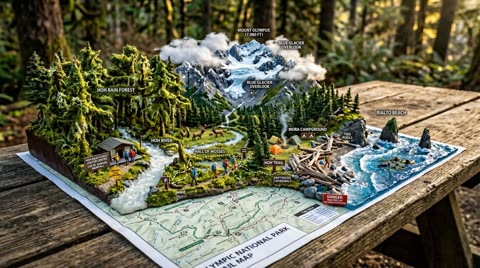
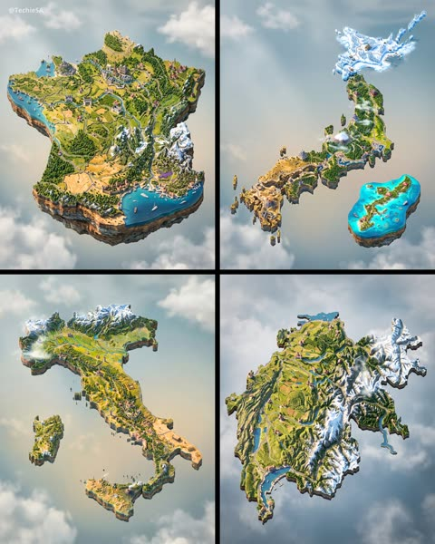
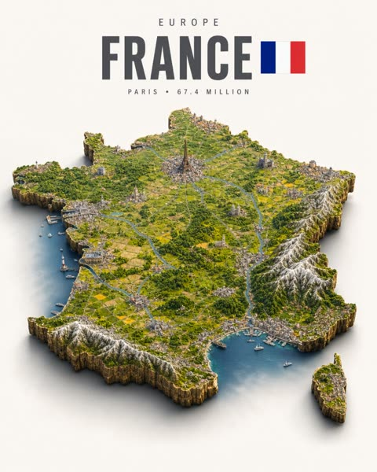
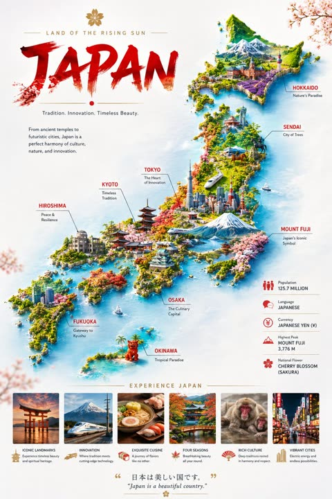
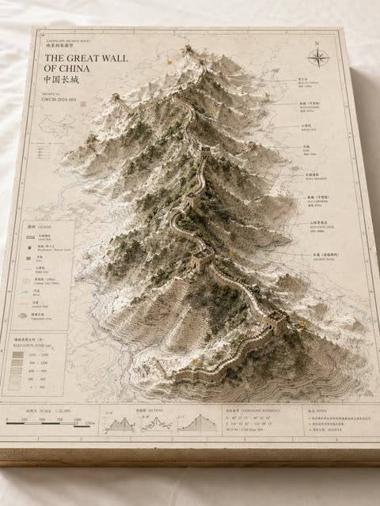
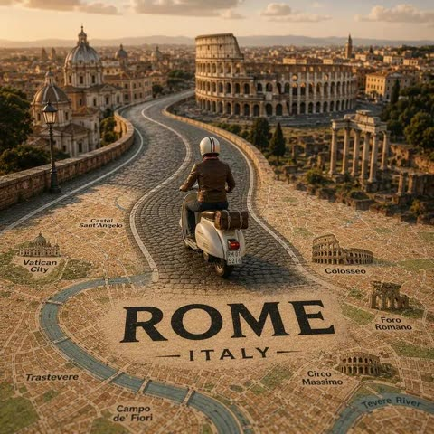

# Maps

[Back to the list](../../README.md) · All 12 entries

<a id="gpt-image-isometric-anime-world-map-diorama-poster"></a>
### Isometric Anime World Map Diorama Poster

<a href="https://x.com/TechieBySA/status/2091529289283866634"></a>

Branching conditions handle both fictional and real settings, so one template cuts the diorama to the correct map silhouette. Fixed layout rules for the margins, the title hierarchy and the tilt shift look keep the poster consistent, and an optional reference map image improves accuracy.

GPT Image 2 · Text-to-image · Source: [@TechieBySA on X](https://x.com/TechieBySA/status/2091529289283866634) · 6,709 likes on 2026-10-28

[`isometric`](tags.md#tag-isometric) [`diorama`](tags.md#tag-diorama) [`anime-world`](tags.md#tag-anime-world) [`miniature`](tags.md#tag-miniature) [`editorial-poster`](tags.md#tag-editorial-poster)

<details><summary><b>Prompt</b></summary>

```text
Simply replace [ANIME]:✨

(Upload a reference image of the map for enhanced accuracy)

“Ultra-detailed photorealistic isometric miniature scale-model diorama of the world from [ANIME], floating on a pure off-white studio background with a soft drop shadow beneath.

If [ANIME] has a fictional world map: the diorama takes the exact silhouette shape of that fictional continent, island or region, extruded downward into a thick slab of raw rock and earth with rough natural cliff-like edges, like the world physically cut out and lifted. The shape matches the canonical map boundary precisely.

If [ANIME] is set in a real or semi-real world: the diorama takes the exact geographic silhouette shape of the primary city, region or country where the story is set, extruded into a thick rock slab with rough cliff edges.

The entire top surface faithfully recreates the complete world of [ANIME] with full anime accuracy: every region, city, landmark, building, terrain feature, road and environment in its exact canonical position as established in the show. Every iconic location is instantly recognizable to any fan — labeled with small readable location markers. The architecture, environment design, building styles, color palette and atmosphere must be completely faithful to the visual world of [ANIME] — not Western or generic realistic, but distinctly true to how this anime world looks and feels. Every location a fan would recognize is present and accurately placed.

Dense micro-detail throughout: tiny figures in show-accurate character designs and clothing, vehicles or creatures authentic to the world, individual trees and foliage, roads and paths between locations, flags and faction symbols, any distinctive environmental features unique to this anime world.

Style: hyper-realistic tilt-shift miniature photography — extremely sharp, everything in focus, no blur. Soft warm lighting from above, gentle diffuse shadows. Colors match the anime's authentic visual palette faithfully — rich, saturated and true to the show's identity.

Layout: the shaped diorama floats centered in the lower two-thirds of the frame, clear margins on all sides, never touching the frame edges. Upper third is empty off-white space with minimalist editorial typography, centered: small wide-tracked caps with the world or region name at the very top, then [ANIME] directly below in a bold condensed sans-serif in medium charcoal grey — large and dominant, the biggest text element, then small wide-tracked caps below with the studio name and year.

Minimalist editorial poster aesthetic, premium print quality, 4:5 aspect ratio.”
```

</details>

<a id="gpt-image-tv-show-world-isometric-map-diorama"></a>
### Isometric TV Show World Map Diorama Poster

<a href="https://x.com/TechieBySA/status/2091167214195847433"></a>

One swappable show placeholder with branching rules for fictional or real settings makes the diorama take the exact silhouette of the world, extruded as a rock slab. A fixed layout with an empty top third for tracked caps and a bold condensed title keeps the poster clean.

GPT Image 2 · Text-to-image · Source: [@TechieBySA on X](https://x.com/TechieBySA/status/2091167214195847433) · 2,678 likes on 2026-10-28

[`isometric`](tags.md#tag-isometric) [`diorama`](tags.md#tag-diorama) [`tilt-shift`](tags.md#tag-tilt-shift) [`tv-show`](tags.md#tag-tv-show) [`template`](tags.md#tag-template)

<details><summary><b>Prompt</b></summary>

```text
Simply replace [TV SHOW]:✨

“Ultra-detailed photorealistic isometric miniature scale-model diorama of the world from [TV SHOW], floating on a pure off-white studio background with a soft drop shadow beneath.

If [TV SHOW] has a fictional world map: the diorama takes the exact silhouette shape of that fictional continent or world, extruded downward into a thick slab of raw rock and earth with rough cliff-like edges. The top surface recreates the complete world geography exactly as established in the show — every region, kingdom, city, landmark, mountain range, forest and river in its correct canonical position.

If [TV SHOW] is set in the real world: the diorama takes the exact geographic silhouette shape of the real city, state or region where the show is primarily set, extruded into a thick rock slab. The top surface is filled entirely with locations, landmarks, routes and environments from the show rendered in the show's authentic color palette and visual atmosphere — not generic realistic geography but the world as it feels in the show.

In both cases: dense micro-detail throughout — tiny figures in show-accurate clothing, vehicles, buildings, roads, trees, all authentic to the show's world. Every iconic location a fan would recognize is present and accurately placed.

Style: hyper-realistic tilt-shift miniature photography — extremely sharp, everything in focus, no blur. Lighting and color palette match the show's visual identity exactly.

Layout: diorama floats centered in the lower two-thirds, clear margins all sides. Upper third is empty off-white space with minimalist editorial typography, centered: small wide-tracked caps with the location or world name at the very top, then [TV SHOW] in a bold condensed sans-serif in medium charcoal grey — large and dominant, then small wide-tracked caps below with network and year.

Minimalist editorial poster aesthetic, premium print quality, 4:5 aspect ratio.”
```

</details>

<a id="gpt-image-city-on-map"></a>
### Your city as a tiny world growing out of a map

<a href="https://x.com/Preda2005/status/2098816499075145824"></a>

Swap `[COUNTRY]` and `[CITY]`. Optional landmark slots at the end let you steer what appears.

GPT Image 2.5 · Text-to-image · Source: [@Preda2005 on X](https://x.com/Preda2005/status/2098816499075145824) · 413 likes on 2026-10-27

[`map`](tags.md#tag-map) [`miniature`](tags.md#tag-miniature) [`template`](tags.md#tag-template)

<details><summary><b>Prompt</b></summary>

```text
Create a highly detailed 1:1 square image using GPT Image 2.5.

The main subject is a realistic top-down geographic map accurately showing the terrain, coastline, rivers, roads and surrounding region of [COUNTRY], with natural and believable map labeling.

At the real geographic location of [CITY], a miniature 3D city rises organically from the map surface, like a premium architectural diorama physically emerging from the map.

The miniature city should include the most recognizable features of [CITY], such as:

• iconic architecture
• important natural landmarks
• the characteristic city skyline
• local cultural elements
• recognizable regional details

All elements must feel naturally connected to the underlying map, as if the city is growing directly out of it, rather than being placed on top.

Keep the geography believable and visually coherent.

Style:
ultra-realistic miniature photography,
high-end collectible diorama,
cinematic macro photography,
realistic materials,
fine surface textures,
strong depth and scale,
premium travel editorial aesthetic.

Use shallow depth of field:
[CITY] should remain extremely sharp and detailed,
while the surrounding map gradually becomes softer and slightly blurred.

Use soft studio lighting, realistic natural shadows, elegant composition and subtle cinematic contrast.

The result should feel like a luxury macro photograph of a real handcrafted miniature city built directly into a geographic map.

MAP LABELS:
Use labels appropriate to [COUNTRY].
For example, if the country is Japan, use Japanese geographic labels.
Do not introduce unrelated languages.

OPTIONAL DETAILS:
[LANDMARK 1]
[LANDMARK 2]
[LANDMARK 3]
[LOCAL CULTURAL ELEMENT]
[NATURAL LANDMARK]
```

</details>

<a id="gpt-image-isometric-terrain-slab-world-diorama-poster"></a>
### Istanbul city diorama carved as floating terrain slab

<a href="https://x.com/MahnoorAi12/status/2091858610255261949"></a>

The prompt makes the real map outline the physical base, a terrain slab with broken rock sides and soil layers, then adds lore accurate landmarks and tiny museum style labels. A fixed 4:5 layout keeps the upper third empty for tracked uppercase title typography, and soft warm studio light gives a collectible miniature look.

GPT Image 2 · Text-to-image · Source: [@MahnoorAi12 on X](https://x.com/MahnoorAi12/status/2091858610255261949) · 354 likes on 2026-10-28

[`diorama`](tags.md#tag-diorama) [`isometric`](tags.md#tag-isometric) [`miniature`](tags.md#tag-miniature) [`world-building`](tags.md#tag-world-building) [`editorial-poster`](tags.md#tag-editorial-poster)

<details><summary><b>Prompt</b></summary>

```text
Ultra-detailed photorealistic isometric miniature diorama of the world from [ANIME], presented as a premium collectible-scale landscape sculpture floating above a clean warm off-white studio background with a subtle natural shadow underneath.

(For best accuracy, upload a clear reference image of the official map/world layout.)

WORLD SHAPE & GEOGRAPHY

If [ANIME] features a fictional world, continent, island or region, recreate its canonical map silhouette exactly. The entire landmass should appear physically carved from the earth and lifted upward as one continuous miniature terrain slab, with naturally broken rock sides, exposed soil layers, cliffs and geological textures.

If [ANIME] takes place in a real or semi-real location, use the most important canonical city, region or country as the physical base shape, maintaining its recognizable geographic outline.

The outer boundary must feel like an actual piece of land cut directly from the map — never like a flat printed map or floating board.

CANONICAL WORLD RECONSTRUCTION

Rebuild the world of [ANIME] across the entire miniature surface with maximum lore accuracy.

Every major region, settlement, city, landmark, mountain, river, forest, road, battlefield, castle, shrine, futuristic structure or other recognizable location should appear in its correct relative position.

Preserve the distinctive visual language of the anime:

- canonical architecture
- recognizable environments
- authentic terrain
- faction territories
- signature landmarks
- characteristic colors
- world-specific technology or fantasy elements
- environmental atmosphere

Avoid generic Western architecture or realistic substitutions. The result must immediately feel like [ANIME] transformed into a physical miniature world.

Add tiny but readable location markers for important places, designed like elegant museum-style cartographic labels rather than large text.

MICRO-SCALE STORY DETAILS

Fill the landscape with carefully placed miniature storytelling elements: tiny characters wearing recognizable show-accurate outfits, world-specific creatures, vehicles, ships, trains, flags, faction symbols, market areas, farms, bridges, pathways, trees, vegetation and other details that make the world feel alive.

Characters should remain small environmental elements rather than dominating the composition.

Include subtle activity throughout the terrain so the diorama feels like a living snapshot of the anime universe.

MATERIAL & PHOTOGRAPHY

Hyper-realistic premium miniature photography combined with high-end cinematic environment design.

Extremely crisp micro-details, realistic rock formations, miniature vegetation, tiny architectural textures, believable scale relationships and physically accurate materials.

Everything should remain sharply focused with no artificial background blur.

Use soft warm studio illumination from above with gentle contact shadows and subtle ambient occlusion between buildings, terrain and rock layers.

The miniature should have a sophisticated museum-quality collectible appearance while still preserving the anime's original visual identity.

COLOR & ATMOSPHERE

Use the authentic color language of [ANIME] as the primary visual reference.

Translate the anime's signature palette into realistic miniature materials without losing its recognizable mood, atmosphere or world identity.

Rich but controlled colors, cinematic tonal depth, premium print-like contrast and realistic surface textures.

COMPOSITION

Center the complete shaped diorama in the lower two-thirds of the 4:5 vertical frame.

Leave generous clean negative space around the entire landmass.

The diorama must never touch the frame edges.

The upper third remains almost completely empty and off-white, creating a sophisticated editorial poster composition.

At the very top, place small widely tracked uppercase typography showing the world / region name.

Directly underneath, place:

[ANIME]

in a bold condensed sans-serif typeface, medium charcoal grey, large and dominant.

Below it, add a smaller widely tracked uppercase line containing the studio name and year.

Typography should feel like a luxury museum exhibition poster — restrained, elegant and secondary to the miniature world.

FINAL ART DIRECTION

Premium editorial travel-poster aesthetic + cinematic miniature photography + collectible world-building sculpture + museum-quality cartography.

The final image should look as though the entire world of [ANIME] was physically sculpted from the earth and photographed inside a professional studio.

No generic fantasy map, no flat illustration, no random landmarks, no duplicated buildings, no distorted geography, no excessive text, no modern Western substitutions.

4:5 vertical aspect ratio, ultra-high detail, photorealistic materials, cinematic lighting, premium print quality.
```

</details>

<a id="nano-banana-national-park-trail-map-diorama"></a>
### National Park Trail Map Rising Into Miniature Diorama

<a href="https://x.com/AllaAisling/status/2029605103632580792"></a>

The template uses curly brace slots for trailhead, terrain, wildlife, water and weather, so one scene structure can be reused for any park. Concrete scale cues such as frozen hikers, tiny tent smoke and legible trail signs keep the diorama believable.

Nano Banana 2 · Text-to-image · Source: [@AllaAisling on X](https://x.com/AllaAisling/status/2029605103632580792) · 201 likes on 2026-10-29

[`map`](tags.md#tag-map) [`diorama`](tags.md#tag-diorama) [`miniature`](tags.md#tag-miniature) [`national-park`](tags.md#tag-national-park) [`template`](tags.md#tag-template)

<details><summary><b>Prompt</b></summary>

```text
Prompt Studio: National Park Trail Map with Nano Banana 2 in Firefly

A National Park trail map unfolded on a picnic table, with the wilderness rising into explorable miniature ecosystem. {TRAILHEAD} emerges with {VISITOR_ELEMENT}, the marked paths wind upward through {TERRAIN_1} featuring {WILDLIFE_1}, past {VIEWPOINT_1} with {SCENIC_ELEMENT}, toward {SUMMIT/DESTINATION} with {PAYOFF_VIEW}. {WATER_FEATURE} flows actual water down the topography. {FOREST_TYPE} trees stand at proper scale, {BIRD_SPECIES} perch in branches. Trail markers and signs are legible. Elevation changes create dramatic miniature mountains. {WEATHER_ELEMENT} affects one region while another stays clear. Camping symbols mark actual tiny tent sites with smoke rising. Day hikers frozen mid-stride, wildlife pausing mid-graze. Golden hour backcountry light, wilderness diorama perfection, 8K, the park as you imagined it from the map.

Check ALTs for ideas 👇
@AdobeFirefly
```

</details>

<a id="nano-banana-isometric-country-floating-diorama"></a>
### Isometric Floating Country Map Dioramas

<a href="https://x.com/TechieBySA/status/2031336245972922862"></a>

A single [COUNTRY] placeholder makes the prompt reusable, while per-region biome and architecture cues give each area its own look. Isometric miniature framing, cinematic soft light and explicit no people, no text, no labels constraints keep the floating landmass clean.

Nano Banana 2 · Text-to-image · Source: [@TechieBySA on X](https://x.com/TechieBySA/status/2031336245972922862) · 121 likes on 2026-10-29

[`isometric`](tags.md#tag-isometric) [`diorama`](tags.md#tag-diorama) [`miniature`](tags.md#tag-miniature) [`floating-map`](tags.md#tag-floating-map) [`template`](tags.md#tag-template)

<details><summary><b>Prompt</b></summary>

```text
“Ultra-detailed isometric miniature diorama of [COUNTRY] as a single floating map, divided into culturally and geographically distinct regions, connected by elegant winding roads.
Each region naturally reflects its real-world biome, climate and architecture — coastal areas with harbors and seaside promenades, mountainous regions with dense forests and misty cliffs, arid plains with ancient stone structures, snowy eastern landscapes with dramatic winter light, and fertile valleys with traditional rural settlements.
Iconic landmarks, local architectural styles and natural textures emerge organically from each region without labels or annotations.
Each region features unique textures, climate, colors and cultural patterns inspired by local motifs.
Isometric perspective, miniature scale, floating landmass style. Cinematic lighting, soft shadows, ultra-realistic textures. High-end architectural visualization, storytelling composition. No people, no text, no labels. 8K quality, hyper-detailed, premium aesthetic.​​​​​​​​​​​​​​​​“
```

</details>

<a id="gpt-image-maps-notification-papercraft-miniature-travel"></a>
### Shanghai clay and paper map travel campaign

<a href="https://x.com/Goodmanprotocol/status/2097890291860865291"></a>

A single LOCATION placeholder drives the whole scene, so one template works for any destination. A numbered visual hierarchy and a material list (photo phone, clay landmarks, cut paper map) keep the layers readable, and the notification is boxed into the top 25 to 40 percent so it never covers the miniature world.

GPT Image 2.5 · Text-to-image · Source: [@Goodmanprotocol on X](https://x.com/Goodmanprotocol/status/2097890291860865291) · 67 likes on 2026-10-28

[`travel-campaign`](tags.md#tag-travel-campaign) [`papercraft`](tags.md#tag-papercraft) [`miniature`](tags.md#tag-miniature) [`clay`](tags.md#tag-clay) [`phone-notification`](tags.md#tag-phone-notification)

<details><summary><b>Prompt</b></summary>

```text
[LOCATION] =

Create a premium, scroll-stopping Instagram travel campaign for [LOCATION] in a 4:5 vertical portrait format.

A large modern smartphone stands vertically near the upper center, acting as the main visual anchor. A single elegant map-navigation notification card overlaps the upper-middle of the phone, integrated naturally with realistic depth, soft shadows, and subtle reflections.

The notification should feature a warm-white, lightly frosted rounded rectangle with a refined mobile UI aesthetic and perfectly legible typography:

[map icon] MAPS — now
You keep searching.
Come visit [LOCATION] instead.

Keep the notification within the upper 25–40% of the composition. It should feel physically connected to the phone and must not cover the miniature destination scene.

Below the smartphone, a folded papercraft map labeled “[LOCATION]” unfolds into a handcrafted miniature world. Include only 4–6 highly recognizable elements that naturally represent the destination—such as iconic architecture, landscapes, nature, food, culture, or atmosphere.

Visual Materials

- Phone & distant background: realistic photography
- Buildings & landmarks: handcrafted painted 3D clay
- Map, terrain, roads & water: layered hand-cut paper
- Vegetation & small details: miniature clay and paper

Make the physical materials clearly visible through paper fibers, cut edges, layered surfaces, subtle clay texture, tiny imperfections, and soft dimensional shadows.

Add one large location pin and a tiny backpacked traveler standing on the map, looking toward the miniature world. Keep the traveler small and secondary, like a hidden discovery detail.

Use only 2–3 subtle travel doodles, such as a paper airplane with a dotted path, a tiny heart, and a simple hand-drawn route arrow. Keep them thin, imperfect, and journal-like.

Visual Hierarchy

1. Notification
2. Miniature [LOCATION] world
3. Location pin
4. Tiny traveler
5. Folded map

Maintain generous negative space and avoid clutter, excessive landmarks, unnecessary text, icons, props, or competing focal points.

Use a refined 3–5 color palette inspired by [LOCATION], warm cinematic or golden-hour lighting, shallow depth of field, realistic miniature photography, tactile materials, and sophisticated editorial advertising composition.

The final image should feel like a world-class handcrafted travel campaign-instantly recognizable, destination-specific, clean, emotionally inviting, and rich with subtle details worth discovering.
```

</details>

<a id="gpt-image-city-escaping-vintage-paper-map"></a>
### Paris rising in miniature from a vintage paper map

<a href="https://x.com/Naiknelofar788/status/2109226850203619656"></a>

The prompt names one clear idea, flat printed ink turning into real miniature buildings. A single red thread, margin coordinates and a typographic header at the top give the layout structure, and the closing no distorted buildings, no fictional architecture line keeps the landmarks accurate. The [CITY, COUNTRY] placeholder makes it reusable for any city.

GPT Image 2.5 · Text-to-image · Source: [@Naiknelofar788 on X](https://x.com/Naiknelofar788/status/2109226850203619656) · 64 likes on 2026-10-28

[`city`](tags.md#tag-city) [`vintage-map`](tags.md#tag-vintage-map) [`miniature`](tags.md#tag-miniature) [`diorama`](tags.md#tag-diorama) [`red-thread`](tags.md#tag-red-thread)

<details><summary><b>Prompt</b></summary>

```text
A real city appears to be physically breaking free from an old paper map, with its actual streets, buildings, and famous landmark rising out of the printed geography into the real world.

Create a breathtaking, surreal-meets-realistic art composition of [CITY, COUNTRY], emerging from an enormous vintage paper map laid flat on a warm ivory surface.

The city’s REAL architecture and geography rise naturally from the map like a miniature three-dimensional world. Its famous landmark stands tall at the center, surrounded by accurately recognizable buildings, winding streets, bridges, rivers, and local architectural details. The printed roads on the map seamlessly transform into actual city streets, while tiny buildings gradually rise from flat ink illustrations into detailed miniature structures.

A single delicate red thread travels across the map, following the city’s real street layout before spiraling around its most famous landmark. Tiny handwritten location coordinates appear in the margin.

Use a stunning combination of architectural realism, miniature diorama photography, vintage cartography, subtle paper textures, and cinematic lighting. Warm sunlight creates long, beautiful shadows across the map. Keep the background minimal and elegant, with the city as the undeniable focal point.

At the top, display the city’s name in sophisticated vintage typography, with its country name and geographical coordinates beneath it.

The result should feel like a real city has magically escaped its map — imaginative, visually striking, geographically recognizable, and beautifully detailed.

Ultra-high detail, realistic materials, exceptional composition, premium art-poster aesthetic, no distorted buildings, no fictional architecture, no clutter.
```

</details>

<a id="gpt-image-isometric-france-diorama-poster"></a>
### Isometric France Terrain Diorama Travel Poster

<a href="https://x.com/TechieBySA/status/2090481131762114750"></a>

The prompt fixes the canvas ratio, a text-top and map-bottom split, and an exact count of ten landmarks with compass positions, so the model spreads features across the terrain. Miniature model, relief and soft occlusion keywords give the 3D cutout its depth.

GPT Image 2 · Text-to-image · Source: [@TechieBySA on X](https://x.com/TechieBySA/status/2090481131762114750) · found via [YouMind-OpenLab/awesome-gpt-image-2](https://github.com/YouMind-OpenLab/awesome-gpt-image-2)

[`isometric`](tags.md#tag-isometric) [`diorama`](tags.md#tag-diorama) [`travel-poster`](tags.md#tag-travel-poster) [`map`](tags.md#tag-map) [`3d-render`](tags.md#tag-3d-render)

<details><summary><b>Prompt</b></summary>

```text
Create a polished isometric country diorama poster for France in a premium travel-atlas style. Use a vertical 4:5 canvas on a warm off-white background, with the country shown as a thick floating 3D terrain cutout in its real recognizable outline, including the separate island of Corsica as a smaller detached cutout at lower right. The landmass should have steep rocky vertical edges, soft studio shadows, and an isometric camera angle looking down from above.

At the top, add clean centered typography: small spaced uppercase region label "EUROPE", then a huge bold condensed uppercase title "FRANCE" in dark charcoal, with a simple vertical tricolor flag to the right of the title using blue, white, and red. Beneath the title, add a small spaced subtitle reading "PARIS • 67.4 MILLION".

The diorama should be densely detailed: green countryside, patchwork farms, forests, rivers, roads, rail-like lines, villages, towns, harbors, coastline, and mountain ranges. Include exactly 10 prominent landmark or terrain features distributed across the map: 1 central Eiffel Tower near Paris, 1 large Gothic cathedral in the northeast, 1 domed monument in the west, 1 tall cathedral or basilica in the southwest interior, 1 white coastal lighthouse on the Atlantic side, 1 Mediterranean harbor with boats along the south coast, 1 snowy mountain range across the southeast Alps, 1 snowy mountain range across the southwest Pyrenees, 1 major winding blue river running north-south through the center-east, and 1 detached Corsica island with miniature towns and green hills. Add small boats and sailboats on the surrounding blue water, especially near the Atlantic coast and Mediterranean bay.

Visual style: highly detailed miniature model, realistic 3D render, crisp topographic relief, vibrant natural greens and yellows, tiny architecture, clean editorial poster composition, soft ambient occlusion, subtle depth of field, no border, no watermark. Keep the overall image balanced with the text occupying the upper quarter and the isometric map filling the lower three quarters.
```

</details>

<a id="gpt-image-japan-isometric-travel-infographic-map"></a>
### Japan Isometric Map Travel Infographic Poster

<a href="https://x.com/miratechtool/status/2056054235393867940"></a>

The prompt fixes the layout zone by zone: a brushstroke title top left, a central isometric map with leader line labels, a facts column on the right and a thumbnail row at the bottom. Exact label text and region taglines keep the typography accurate.

GPT Image 2 · Text-to-image · Source: [@miratechtool on X](https://x.com/miratechtool/status/2056054235393867940) · found via [YouMind-OpenLab/awesome-gpt-image-2](https://github.com/YouMind-OpenLab/awesome-gpt-image-2)

[`infographic`](tags.md#tag-infographic) [`isometric-map`](tags.md#tag-isometric-map) [`japan`](tags.md#tag-japan) [`travel-poster`](tags.md#tag-travel-poster) [`typography`](tags.md#tag-typography)

<details><summary><b>Prompt</b></summary>

```text
Create a vertical infographic poster titled "JAPAN" in large, bold red brushstroke font at the top left. Below the title, include the subtitle "Land of the Rising Sun" and the tagline "Tradition. Innovation. Timeless Beauty." The central visual is a detailed, 3D isometric map of Japan, rendered as a lush green archipelago with realistic terrain, snow-capped Mount Fuji, and miniature landmarks like Tokyo Tower and Kyoto pagodas.

Label key regions on the map with leader lines: HOKKAIDO (Nature's Paradise), SENDAI (City of Trees), TOKYO (The Heart of Innovation), KYOTO (Timeless Tradition), HIROSHIMA (Peace & Resilience), MOUNT FUJI (Japan's Iconic Symbol), OSAKA (The Culinary Capital), FUKUOKA (Gateway to Kyushu), and OKINAWA (Tropical Paradise).

On the right side, list quick facts with icons: Population 125.7 Million, Language Japanese, Currency Japanese Yen (¥), Highest Peak Mount Fuji 3,776 m, National Flower Cherry Blossom (Sakura).

At the bottom, create a section titled "EXPERIENCE JAPAN" featuring six rectangular photo thumbnails labeled: ICONIC LANDMARKS, INNOVATION, EXQUISITE CUISINE, FOUR SEASONS, RICH CULTURE, and VIBRANT CITIES. End with a footer quote in Japanese and English: "日本は美しい国です。" / "Japan is a beautiful country."
```

</details>

<a id="gpt-image-landscape-archive-model-map"></a>
### Great Wall Landscape Archive Model Map

<a href="https://x.com/MrLarus/status/2047634434497622270"></a>

A fill-in template that defines the 2D map board, the 3D terrain that rises from it, and the legend and scale system. A 30 to 45 degree oblique camera plus tight palette limits keep it reading as a museum model photo.

GPT Image 2 · Text-to-image · Source: [@MrLarus on X](https://x.com/MrLarus/status/2047634434497622270) · found via [YouMind-OpenLab/awesome-gpt-image-2](https://github.com/YouMind-OpenLab/awesome-gpt-image-2)

[`landscape-model`](tags.md#tag-landscape-model) [`archive-map`](tags.md#tag-archive-map) [`terrain`](tags.md#tag-terrain) [`museum-style`](tags.md#tag-museum-style) [`template`](tags.md#tag-template)

<details><summary><b>Prompt</b></summary>

```text
请根据【主题】创作一张高完成度、高质感、适合系列化发布的「地景档案模型 / Landscape Archive Model」视觉图。

这不是普通地图，也不是普通风景插画或城市效果图，而是一张结合“二维地图图纸 + 三维立体区域模型 + 专业说明系统 + 博物馆展陈感”的高端档案式视觉图。画面需要像一件被真实制作出来的地理研究模型、城市规划沙盘、建筑提案模型或世界观设定展品，具有专业、克制、精密、可触摸的高级质感。

【基础设定】
主题：【主题，例如火山口湖 / 广州 / 重庆山城 / 海岛城市 / 古城遗址 / 末日废墟 / 幻想大陆 / 游戏主城】
主题类型：【自然地貌 / 城市空间 / 混合景观】
核心主体：【核心主体，例如火山口、峡谷、山脉、湖泊、CBD、老城区、地标群、岛屿城市、遗址群、主城区域】
内容重点：【内容重点，例如地形高差 / 城市地标 / 路网结构 / 水系关系 / 自然与城市关系 / 设定集展示】
风格方向：【风格方向，例如地理测绘风、纸雕模型风、建筑提案风、博物馆档案风、城市规划风、游戏设定集风】
主色调：【主色调，例如米白、浅灰、羊皮纸白、沙色、雪白】
辅助色：【辅助色，例如土褐、岩灰、冷灰、淡蓝、苔绿】
点缀色：【点缀色，例如黑色细线、红色路线、蓝色水文线、黄色编号标记】
画幅比例：【画幅比例，例如16:9横版 / 3:4竖版 / 4:5竖版 / 1:1方图】

【画面结构】
画面主体是一块放置在干净桌面或白色布面上的矩形地图模型板。底板具有真实厚度，边缘可见剖面结构，像一块精致的地图切片或模型底座。地图表面覆盖清晰但克制的信息层，包括等高线、道路网络、水文线、分区边界、地理纹理、坐标感、轻微标注和图纸边框。

在地图中央或偏中心区域，从二维地图中立体“生长”出一个三维主体模型，成为整张图的视觉核心。

如果【主题类型】为自然地貌：
主体可由山体、峡谷、火山口、湖泊、盆地、岛屿、冰川、断层、海岸线等构成，强调地形高差、层叠等高线结构、岩壁纹理和自然地貌起伏。

如果【主题类型】为城市空间：
主体可由核心城区、CBD、老城街区、地标建筑群、滨水区、路网节点、桥梁、水系、公园绿地等构成，强调建筑体块、城市识别度、空间层次与规划结构。

如果【主题类型】为混合景观：
需同时整合自然地形与人工建成环境，例如山城、海岛城市、古城遗址、末日废墟、幻想主城、科幻基地等，让自然地貌与城市结构共同构成核心视觉。

【细节要求】
- 模型表面保留地图图纸感与专业信息感
- 地形区域应有等高线、坡面层次、凹陷与起伏关系
- 建筑区域应有体块感、街区关系和清晰层次
- 水域使用低饱和淡蓝色表现
- 绿地、森林、公园、山体可用苔绿色或低饱和绿色表现
- 路网、路径、交通轴线或探索线路可用细线表现，但不要喧宾夺主
- 若有地标建筑或重点结构，应具备明确识别度
- 若有幻想、科幻或游戏设定元素，应保留档案模型 and 图纸展示感，而不是做成纯场景插画

【说明系统】
地图板边缘需要设计完整而克制的说明模块，包括：
- 外框线和内框线
- 比例尺
- 图例区
- 标题区
- 档案编号
- 索引标记
- 注释标签
- 简洁的符号说明
文字不必全部可读，但整体必须呈现真实、清晰、精密、有秩序的档案式排版结构。

【构图与镜头】
采用斜俯视等轴测或沙盘式构图，镜头从上方约30到45度观察整块模型板，让观众同时看到地图平面、立体主体高度、边缘厚度和说明区。视觉重心集中在中央主体模型，阅读路径为：先看核心主体，再看周边地形/路网/水系/街区信息，最后看图例、比例尺和说明区。

【材质与光影】
整体需要具有真实模型摄影质感：
- 纸张纹理
- 地图印刷质感
- 纸雕或沙盘模型感
- 建筑模型或地形切片质感
- 柔和自然光
- 细腻真实阴影
- 干净背景
- 低饱和、高级、克制
避免卡通化、廉价游戏UI感、过度杂乱、过度炫技，重点突出“地图底板 + 立体主体 + 专业说明系统”的统一视觉。

最终效果应像一张可以用于地理科普、城市研究、建筑提案、文旅视觉专题、世界观设定集或高端系列封面的地景档案模型图。
```

</details>

<a id="gpt-image-map-road-miniature-rome-scooter"></a>
### Scooter riding off a map into Rome

<a href="https://x.com/SimplyAnnisa/status/2062358269172101240"></a>

Bracketed CITY NAME and VEHICLE NAME slots make the prompt reusable for any city. A road that emerges from the printed map, a foreground vehicle as focal point and tilt shift golden hour lighting blend the flat map with the real skyline.

GPT Image 2 · Text-to-image · Source: [@SimplyAnnisa on X](https://x.com/SimplyAnnisa/status/2062358269172101240) · found via [freestylefly/awesome-gpt-image-2](https://github.com/freestylefly/awesome-gpt-image-2)

[`tilt-shift`](tags.md#tag-tilt-shift) [`city-map`](tags.md#tag-city-map) [`miniature`](tags.md#tag-miniature) [`travel-poster`](tags.md#tag-travel-poster) [`golden-hour`](tags.md#tag-golden-hour)

<details><summary><b>Prompt</b></summary>

```text
Create a highly detailed cinematic miniature tilt-shift travel scene of [CITY NAME] featuring a realistic [VEHICLE NAME] driving along a winding elevated road that emerges naturally from a printed vintage-style city map. The road should curve dramatically toward the background skyline and landmarks of [CITY NAME], while the vehicle remains the clear focal point in the foreground.

Blend the real city seamlessly with the illustrated map surface so the road appears integrated into the map itself. Include recognizable local landmarks, waterways, architecture, vegetation, and atmosphere associated with [CITY NAME], but keep the composition clean and uncluttered.

Show large bold typography of "[CITY NAME]" printed directly on the map in the foreground. Use warm golden-hour lighting, shallow depth of field, realistic textures, cinematic shadows, aerial perspective, and photorealistic detail. The overall aesthetic should feel like a premium Instagram travel poster mixed with a miniature diorama.

Aspect ratio 1:1.
```

</details>
