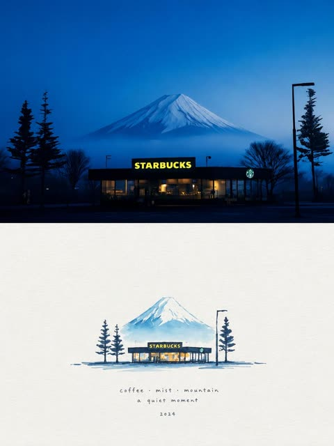
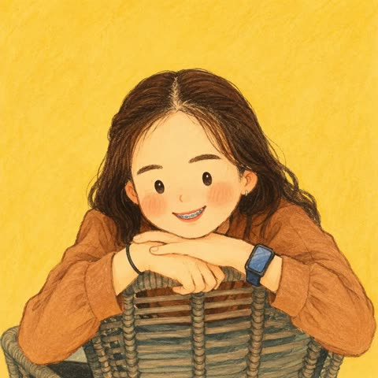
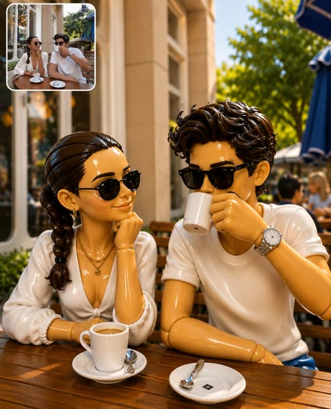
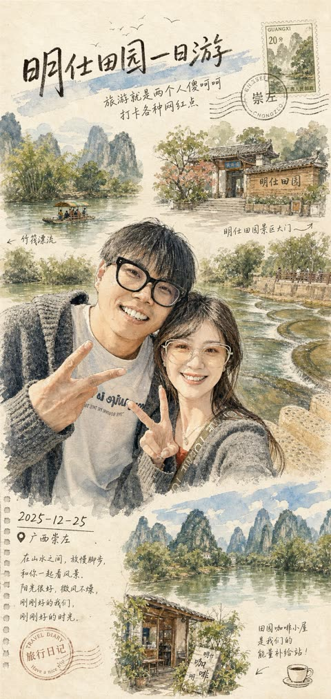
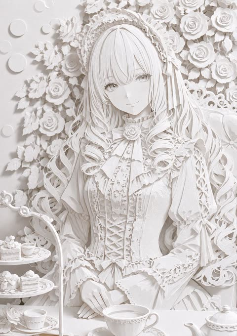

# Photo to art

[Back to the list](../../README.md) · All 123 entries · [1](image-photo-to-art.md) · **2**

<a id="gpt-image-starbucks-mountain-watercolor-comparison"></a>
### Night Starbucks under Fuji, then watercolor version

<a href="https://x.com/Alina_with_Ai/status/2096555280306000120"></a>

The prompt fixes one composition across both panels and counts every brand mark and tree, so the model keeps the scene consistent. Splitting a 3:4 canvas into a photo half and a paper half lets one image show both a realistic night photo and a watercolor postcard.

GPT Image 2 · Text-to-image · Source: [@Alina_with_Ai on X](https://x.com/Alina_with_Ai/status/2096555280306000120) · found via [YouMind-OpenLab/awesome-gpt-image-2](https://github.com/YouMind-OpenLab/awesome-gpt-image-2)

[`watercolor`](tags.md#tag-watercolor) [`night-scene`](tags.md#tag-night-scene) [`comparison`](tags.md#tag-comparison) [`brand`](tags.md#tag-brand)

<details><summary><b>Prompt</b></summary>

```text
Goal: Create a vertical comparison-style image showing a nighttime café-and-mountain scene transformed into a delicate watercolor art print.

Canvas: Portrait 3:4 composition, divided into exactly 2 horizontal panels. The top panel occupies about the upper half and is a realistic night photograph; the bottom panel occupies the lower half and is a minimalist watercolor artwork on warm off-white paper.

Top panel: A centered, single-story Starbucks café at night, seen from across a dark parking lot. Behind it is a large snow-capped Mount Fuji-like mountain rising in blue mist under a deep twilight blue sky. The café has a black roofline and glowing warm interior windows. Include exactly 2 visible Starbucks brand marks: 1 large bright yellow word sign reading STARBUCKS centered on the building, and 1 small circular green siren logo on the right side of the storefront. Surrounding silhouettes include exactly 5 prominent natural/urban elements: 2 tall conifer trees on the left, 1 leafless tree to the right of the building, 1 tall conifer tree near the far right, and 1 tall streetlamp on the far right with a simple rectangular lamp head. Keep the mood quiet, blue, misty, cinematic, and calm.

Bottom panel: Recreate the same scene as a small hand-painted watercolor vignette centered on textured cream paper with lots of empty negative space. Paint the café, mountain, trees, and streetlamp in loose blue ink and pale watercolor washes. The miniature café should again include exactly 2 visible Starbucks brand marks: 1 tiny dark rectangular sign with yellow STARBUCKS, and 1 small green circular logo on the right. The watercolor version should include exactly 4 tree silhouettes: 2 thin conifers on the left of the café, 1 thin conifer on the right, and 1 simplified streetlamp beside it. Use soft bleeding edges, sparse brush marks, muted indigo shadows, and warm yellow window glow.

Text content beneath the watercolor vignette: Add exactly 3 centered handwritten lines in small lowercase lettering: line 1 reads coffee · mist · mountain; line 2 reads a quiet moment; line 3 reads 2024. Use widely spaced, delicate gray-blue handwriting.

Visual style: The top half should feel like a crisp realistic nighttime travel photograph; the bottom half should feel like a refined Japanese-inspired watercolor postcard or art print. Preserve the same subject alignment between panels: mountain centered behind the café, café centered below the mountain, tall lamp and conifer on the right, darker trees on the left.

Constraints: No people, no cars, no extra signage beyond the counted Starbucks marks, no borders between panels except the natural transition from photo to paper, no watermark, keep the overall palette deep blue, pale cyan, cream paper, black silhouettes, and warm yellow café light.
```

</details>

<a id="gpt-image-storybook-photo-to-handdrawn-portrait"></a>
### Photo to hand-drawn storybook portrait

<a href="https://x.com/Sairah_0/status/2090321208441262454"></a>

A preserve list (face, hair, clothing, accessories) is paired with a banned list, so identity carries over while the style is rebuilt. Named media (gouache, wax crayon, pastel), irregular brown linework and a fixed warm background keep the picture-book look consistent.

GPT Image 2 · Edit · Source: [@Sairah_0 on X](https://x.com/Sairah_0/status/2090321208441262454) · found via [freestylefly/awesome-gpt-image-2](https://github.com/freestylefly/awesome-gpt-image-2)

[`storybook`](tags.md#tag-storybook) [`hand-drawn`](tags.md#tag-hand-drawn) [`avatar`](tags.md#tag-avatar) [`gouache`](tags.md#tag-gouache) [`photo-to-illustration`](tags.md#tag-photo-to-illustration)

<details><summary><b>Prompt</b></summary>

```text
Use the single uploaded photo as the only visual reference. Transform the person into an adorable hand-drawn 2D children’s storybook character, while keeping their identity immediately recognizable.

Preserve exactly from the photo:
- Facial features and skin tone
- Real hairstyle, length, texture, and color
- Exact clothing, colors, patterns, and layering
- Glasses, jewelry, headwear, bags, and all visible accessories

Do not invent or copy hairstyles, outfits, accessories, braids, pigtails, bows, bonnets, or headscarves from any reference artwork.

### Character
Use an oversized rounded head, tiny compact body, short arms, narrow shoulders, soft rounded silhouette, and cute childlike proportions. Keep the head visually dominant. Avoid realistic anatomy.

### Face
Simplify into tiny dot/oval eyes, minimal nose, tiny smiling mouth, rounded cheeks, and soft peach/pink blush. Keep recognizable facial characteristics. No realistic eyes, detailed lips, anime features, glossy 3D rendering, or heavy shading.

### Hair & Clothing
Recreate the exact hairstyle and outfit from the uploaded photo, simplified into chunky hand-drawn shapes. Preserve important colors, patterns, jewelry, glasses, and other recognizable details.

### Style
Handmade 2D picture-book aesthetic using soft gouache, wax crayon, colored pencil, and dry pastel. Use slightly irregular dark-brown linework, subtle paper grain, uneven pigment, soft brush marks, and imperfect painted edges. Avoid clean vector art, CGI, anime, or photorealism.

### Composition
Square 1:1 portrait, chest/waist-up, centered and facing mostly forward, with balanced negative space. Use a relaxed, charming pose.

### Background
Simple warm mustard, butter yellow, ochre, or cream background with subtle paper texture. No scenery, objects, text, borders, or distractions.

Final feeling: the same person lovingly redrawn as an extremely cute, warm, wholesome, nostalgic, handcrafted children’s-book character—same identity, same hair, same clothes, same accessories, completely simplified and adorable.
```

</details>

<a id="gpt-image-vinyl-toy-couple-cafe-diorama"></a>
### Vinyl toy couple at outdoor cafe table

<a href="https://x.com/AIwithkhan/status/2066858886511161451"></a>

Starts from a reference photo and describes each figure separately with hair, accessories, clothing and pose, so the likeness carries over into the toy look. Material cues (glossy vinyl, toy joints), a scene brief, a composition line and render keywords (Octane, Unreal Engine) keep the diorama consistent.

GPT Image 2 · Edit · Source: [@AIwithkhan on X](https://x.com/AIwithkhan/status/2066858886511161451) · found via [YouMind-OpenLab/awesome-gpt-image-2](https://github.com/YouMind-OpenLab/awesome-gpt-image-2)

[`3d-toy`](tags.md#tag-3d-toy) [`vinyl-figure`](tags.md#tag-vinyl-figure) [`diorama`](tags.md#tag-diorama) [`cafe`](tags.md#tag-cafe) [`reference-photo`](tags.md#tag-reference-photo)

<details><summary><b>Prompt</b></summary>

```text
Create a highly detailed 3D collectible toy diorama of a stylish young couple sitting at an outdoor café table, inspired by a real-life reference photo. Transform both people into premium designer vinyl figures with smooth glossy plastic surfaces, articulated toy-joint details, oversized expressive eyes, realistic facial features, and fashionable outfits.

The female figure has dark braided hair, black sunglasses, gold earrings, layered gold necklaces, and a white V-neck blouse. She rests her chin on her hand while smiling at her companion. The male figure has thick wavy dark hair, black sunglasses, a white t-shirt, and a silver wristwatch while drinking coffee from a white ceramic cup.

Both figures sit at a wooden café table with coffee cups, saucers, and spoons. The setting is an elegant European-style outdoor café with warm beige architecture, large windows, blue umbrellas, lush green trees, and softly blurred background guests.

Style: Pixar-inspired collectible toy, premium vinyl figure, designer toy aesthetic, ultra-realistic 3D render, glossy plastic texture, toy photography, shallow depth of field, cinematic lighting, warm golden-hour sunlight, photorealistic materials, high-end commercial product photography, sharp focus, ultra detailed, 8K resolution.

Composition: Front-facing medium shot, both characters centered, natural poses, café ambiance, depth and realism, professional advertisement quality.

Render Quality: Octane Render, Unreal Engine 5, ray tracing, global illumination, realistic reflections, HDR lighting, highly detailed textures, collectible figurine showcase.
```

</details>

<a id="gpt-image-watercolor-travel-journal-postcard"></a>
### Watercolor Travel Journal Postcard From Photo

<a href="https://x.com/zhgqthomas/status/2056633723366568387"></a>

Stacks sketchbook cues such as pen and ink linework, bleeding watercolor washes and beige paper texture, then adds a postcard layout with fillable title, notes, date and location stamp slots. A muted earthy palette keeps the result cohesive.

GPT Image 2 · Edit · Source: [@zhgqthomas on X](https://x.com/zhgqthomas/status/2056633723366568387) · found via [freestylefly/awesome-gpt-image-2](https://github.com/freestylefly/awesome-gpt-image-2)

[`watercolor`](tags.md#tag-watercolor) [`travel-journal`](tags.md#tag-travel-journal) [`postcard`](tags.md#tag-postcard) [`sketchbook`](tags.md#tag-sketchbook) [`photo-to-art`](tags.md#tag-photo-to-art)

<details><summary><b>Prompt</b></summary>

```text
Create a dreamy watercolor travel illustration style from the attached photo. Use hand-painted urban sketchbook aesthetic, delicate ink linework mixed with soft watercolor washes, highly detailed pen-and-ink drawing, loose expressive brush strokes, watercolor bleeding edges, ultra detailed watercolor texture, soft beige paper texture background, architectural sketch style, vintage travel diary and sketchbook traveler aesthetic, travel journal composition, editorial postcard layout, handwritten medium title:[自定义标题]  at top, handwritten notes:[自定义文案] , date: [自定义日期] and location: [自定义地点]  stamps, natural perspective, atmospheric depth, minimalist negative space, muted earthy palette (warm browns, faded greens, cream whites, soft blue accents), quiet, calm, soft, cozy, nostalgic vibes, cinematic slice-of-life mood, poetic composition, mixed urban sketching with Ghibli-inspired realism, vertical poster design, premium art print quality.
```

</details>

<a id="gpt-image-white-paper-craft-style-conversion"></a>
### Realistic White Paper Craft Illustration Conversion

<a href="https://x.com/notoro_ai/status/2052018043883319536"></a>

Names the physical material (laser-cut cardstock), then adds concrete cues: sharp cut edges, fine folds, layered depth and paper fiber with natural shadows. A closing line keeps the original composition and character, so the edit changes only the medium.

GPT Image 2 · Edit · Source: [@notoro_ai on X](https://x.com/notoro_ai/status/2052018043883319536) · found via [YouMind-OpenLab/awesome-gpt-image-2](https://github.com/YouMind-OpenLab/awesome-gpt-image-2)

[`paper-craft`](tags.md#tag-paper-craft) [`style-conversion`](tags.md#tag-style-conversion) [`white-paper`](tags.md#tag-white-paper) [`layered-depth`](tags.md#tag-layered-depth) [`laser-cut`](tags.md#tag-laser-cut)

<details><summary><b>Prompt</b></summary>

```text
このイラストを非常に精密でリアルな白い紙のペーパークラフト風に変換してください。厚紙をレーザーカットしたようなシャープで正確な切り口、細かい折り目、複数のレイヤーによる豊かな立体感、紙の繊維感と自然な影を高ディテールで表現してください。光の当たり方による紙の白さと微妙なグラデーションを活かし、本物のような立体的なペーパーアート作品のようなリアリティを出して。全体を洗練されていて芸術的な雰囲気に。元のイラストの構図・キャラクターを忠実に維持。
```

</details>

[1](image-photo-to-art.md) · **2**
