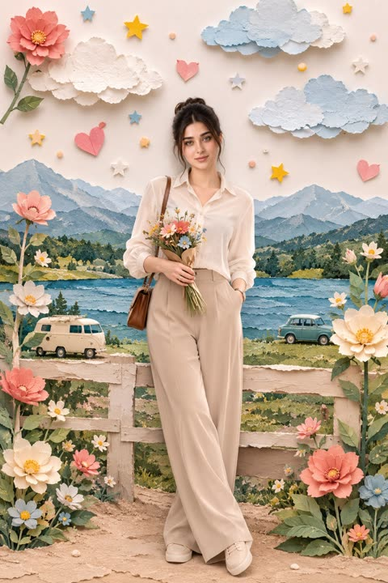

# Portraits

[Back to the list](../../README.md) · All 144 entries · [1](image-portrait.md) · **2**

<a id="gpt-image-paper-collage-countryside-portrait-diorama"></a>
### Photoreal woman in a paper collage countryside diorama

<a href="https://x.com/AiwithLariab/status/2090297565732585554"></a>

A strict face identity lock on the uploaded reference keeps the person photorealistic while the whole environment is specified as handmade paper. Separate blocks for outfit, scenery, floating decorations, art direction and composition give each layer its own constraints, and listing paper textures such as torn edges, visible fibers and layered cardstock sells the craft look.

GPT Image 2 · Edit · Source: [@AiwithLariab on X](https://x.com/AiwithLariab/status/2090297565732585554) · found via [freestylefly/awesome-gpt-image-2](https://github.com/freestylefly/awesome-gpt-image-2)

[`paper-collage`](tags.md#tag-paper-collage) [`diorama`](tags.md#tag-diorama) [`face-lock`](tags.md#tag-face-lock) [`countryside`](tags.md#tag-countryside) [`fashion-editorial`](tags.md#tag-fashion-editorial)

<details><summary><b>Prompt</b></summary>

```text
Create a premium whimsical handcrafted paper-collage diorama inspired exactly by the uploaded reference image.

Use the uploaded girl reference as the ONLY human subject. Preserve her facial identity with maximum accuracy: exact face shape, eyes, eyebrows, nose, lips, skin tone, hairstyle, hairline, and recognizable facial features. Strict face identity lock — do not redesign, beautify, stylize, age, de-age, or replace her face.

The girl stands alone in the center of the composition in a graceful, natural editorial pose. She is facing the camera with a relaxed confident expression and a subtle natural smile. Her body is slightly angled, creating a candid fashion-editorial feeling. She holds a beautiful small mixed bouquet of flowers naturally with both hands in front of her. One leg is slightly crossed in front of the other for an elegant relaxed pose.

Outfit

Change the outfit completely from the original reference while keeping it fully modest and elegant:

- elegant ivory/cream long-sleeve button-up blouse
- high-waisted wide-leg beige trousers
- full-length trousers with complete coverage
- simple cream closed-toe shoes
- small brown leather shoulder bag
- no revealing clothing
- no exposed midriff
- sophisticated countryside editorial fashion
- natural realistic fabric folds and texture

Environment

Create a beautiful handcrafted 3D paper-diorama countryside scene:

- layered blue mountains in the distance
- green forest and rolling hills
- peaceful blue lake
- grassy lakeside landscape
- textured beige paper pathway in the foreground
- rustic white wooden fence behind the girl
- dreamy pastel sky

Surround the composition with oversized handmade paper flowers in pink, peach, cream, white, and light blue, with layered green paper leaves.

Add decorative paper elements floating in the sky:

- pink paper hearts
- yellow paper stars
- blue stars
- soft white and pale-blue clouds
- tiny colorful paper dots

Place two tiny vintage vehicles near the lake in the background: a cream vintage camper van on one side and a small vintage blue-green car on the other.

Art Direction

The entire environment should look handcrafted from premium textured paper while the girl remains photorealistic and seamlessly integrated into the paper world.

Use:
hand-torn paper edges, visible paper fibers, layered cardstock, subtle imperfections, realistic paper shadows, dimensional cut-paper elements, tactile textures, soft natural daylight, cinematic depth, gentle atmospheric perspective, premium editorial photography.

The final image should feel like a luxury handmade paper storybook brought to life with a real photographic subject.

Composition

Centered full-body girl
Face clearly visible and sharply detailed
Natural elegant pose
Bouquet held naturally
Rustic fence framing the subject
Lake and mountains creating depth
Large flowers framing both lower corners
Clouds and decorative elements filling the upper background
Balanced symmetrical composition with organic handmade imperfections
Girl remains the strongest focal point

Final Look

Photorealistic girl + handcrafted paper-art environment
Dreamy pastel colors
Luxury editorial aesthetic
Whimsical miniature diorama
Soft cinematic daylight
Highly detailed paper textures
Natural realistic skin
Sharp facial identity
Professional fashion photography
Pinterest/Instagram viral visual aesthetic
Magazine-quality composition

Vertical 4:5 portrait composition, full-body framing, ultra-detailed, high resolution, clean polished finish, visually striking, aesthetically balanced, premium handcrafted paper-collage photography.
```

</details>

<a id="gpt-image-phone-screen-face-cover-store-portrait"></a>
### Woman hiding eyes behind phone showing her face

<a href="https://x.com/Ciri_ai/status/2053535379618423118"></a>

The prompt fixes the setting, a slightly elevated frontal angle and the exact hand pose, then states that the phone screen faces the camera and shows her face live. That makes the phone a frame within the frame, while the reference image keeps the identity consistent.

GPT Image 2 · Edit · Source: [@Ciri_ai on X](https://x.com/Ciri_ai/status/2053535379618423118) · found via [freestylefly/awesome-gpt-image-2](https://github.com/freestylefly/awesome-gpt-image-2)

[`iphone-style`](tags.md#tag-iphone-style) [`creative-portrait`](tags.md#tag-creative-portrait) [`frame-within-frame`](tags.md#tag-frame-within-frame) [`identity-preserved`](tags.md#tag-identity-preserved) [`street-photo`](tags.md#tag-street-photo)

<details><summary><b>Prompt</b></summary>

```text
Ultra-realistic creative portrait taken with an iPhone, identity accurately preserved from the reference image. A woman stands inside a store, facing a glass display window or a reflective wall, photographed from a slightly elevated frontal angle. She holds a smartphone horizontally in front of her face, covering her eyes and the upper part of her face. The phone's screen points at the camera and clearly displays a real-time image of her face.
```

</details>

<a id="gpt-image-pink-varsity-flower-cafe-portrait"></a>
### Pink varsity jacket woman seated at flower cafe

<a href="https://x.com/xRahultripathi/status/2050677614168391716"></a>

Strict labelled blocks for pose, framing, outfit, lighting and camera keep the edit controlled, while a keep the same face clause preserves identity. A low angle 50mm lens, a warm pastel grade and a negative list for eye contact and cropping steer the composition.

GPT Image 2 · Edit · Source: [@xRahultripathi on X](https://x.com/xRahultripathi/status/2050677614168391716) · found via [freestylefly/awesome-gpt-image-2](https://github.com/freestylefly/awesome-gpt-image-2)

[`portrait`](tags.md#tag-portrait) [`pastel`](tags.md#tag-pastel) [`flower-shop`](tags.md#tag-flower-shop) [`low-angle`](tags.md#tag-low-angle) [`face-preserve`](tags.md#tag-face-preserve)

<details><summary><b>Prompt</b></summary>

```text
Edit the provided image while preserving the same face identity, shape, and facial features without altering age, ethnicity, or structure. Maintain a calm, relaxed expression with the subject not looking at the camera.

Subject: young woman (18–23) with soft feminine beauty, smooth glowing skin, natural texture.
Pose (strict): seated on a wooden chair, body angled sideways (45–70°), legs crossed naturally, upper body slightly leaning forward, head turned away from camera, gaze to the side. She holds a drink cup with a straw using both hands.
Framing: full-body vertical (9:16), head to shoes visible, centered but slightly offset for natural composition.
Outfit: light pink varsity jacket with white stripes, soft pink inner top, modest knee-length pleated skirt, white sneakers.
Accessories: beige newsboy cap, sunglasses (on face or cap), pink shoulder bag, small earrings.
Hair: neat low bun with soft loose strands.
Environment: outdoor flower shop street scene with pastel flowers (pink, soft tones), decorative plants, floral storefront.
Lighting: bright natural daylight, soft glossy skin highlights, balanced exposure, soft shadows.
Camera: low/frog angle (slightly below, looking up), 50mm lens, shallow depth of field.
Color grading: warm pastel palette (pink, cream), clean bright lifestyle aesthetic.
Quality: ultra-photorealistic, 8K detail, DSLR realism, natural skin texture.
Negative: front-facing, eye contact, close-up, cropped body, mini/short skirt, indoor scene, dark lighting, anime, cartoon, CGI, plastic skin, distorted anatomy.
--ar 9:16 --style raw --quality high
```

</details>

<a id="gpt-image-recursive-king-of-spades-playing-card"></a>
### Recursive King of Spades card held by Queen

<a href="https://x.com/Professor_134/status/2063244295977800057"></a>

A strict identity lock on the uploaded face opens the prompt, then one nested card scene repeats the subject inside itself to create the recursion. Bulleted Escher style elements, a fixed five color palette and chiaroscuro lighting keep the dense scene coherent.

GPT Image 2 · Edit · Source: [@Professor_134 on X](https://x.com/Professor_134/status/2063244295977800057) · found via [freestylefly/awesome-gpt-image-2](https://github.com/freestylefly/awesome-gpt-image-2)

[`playing-card`](tags.md#tag-playing-card) [`recursion`](tags.md#tag-recursion) [`face-reference`](tags.md#tag-face-reference) [`fantasy`](tags.md#tag-fantasy) [`escher`](tags.md#tag-escher)

<details><summary><b>Prompt</b></summary>

```text
Use my uploaded face image as the primary identity reference. Preserve my exact facial identity with extremely high fidelity: identical facial structure, jawline, cheekbones, eye shape, eyebrows, nose, lips, beard pattern, hairstyle, hair texture, skin tone, skin texture, and overall recognizable appearance. Do not beautify, alter, or reinterpret my face. Maintain realistic anatomy and authentic likeness.

Create an ultra-detailed, cinematic, surreal luxury playing-card artwork.

The main subject is me as the King of Spades, occupying the full design of a magnificent, royal Ace-quality playing card. I wear elaborate black-and-silver spade-themed regalia, a crown forged from obsidian and polished steel, intricate embroidered armor, and flowing royal garments decorated with subtle spade symbols. My expression is calm, intelligent, and powerful.

In my right hand, I am holding a pristine Ace of Spades card.

The creative twist: the Ace of Spades I am holding is not a normal card. It contains another complete playing-card illustration. Inside that card, I again appear as the King of Spades, and that entire card is being elegantly held between the fingers of a majestic Queen of Hearts. The Queen is graceful, regal, and visually striking, dressed in rich crimson and gold royal attire adorned with heart motifs.

The illusion continues with subtle recursive storytelling: the Queen of Hearts appears to be examining the card with fascination, creating a “card within a card” visual paradox. The composition should feel like a legendary tale of power, strategy, love, and destiny intertwined.

Add impossible Escher-inspired visual design elements:
•Infinite recursion effect
•Card-world folding into itself
•Floating spade and heart symbols transforming into ravens and rose petals
•Ornate golden borders extending beyond physical card edges
•Royal chess pieces suspended in midair
•Fractal patterns hidden within the card engravings
•Elegant smoke forming suit symbols
•Dimensional portals emerging from card corners

Style: ultra-realistic fantasy realism mixed with luxury casino art, Renaissance royal portraiture, and modern cinematic concept art.

Lighting: dramatic chiaroscuro, volumetric god rays, rich contrast, glowing metallic highlights, subtle magical energy around the Ace of Spades.

Color palette:
•Deep blacks
•Silver chrome
•Ivory white
•Crimson red
•Antique gold accents

Composition:
•Vertical masterpiece
•Museum-quality detail
•Hyper-realistic textures
•Intricate card engravings
•Perfectly symmetrical playing-card aesthetics blended with cinematic depth
•Sharp focus on my face
•Extremely high identity fidelity
•Epic storytelling through visual symbolism

The final image should feel like the cover of a legendary fantasy card game where the King of Spades has become self-aware, existing across multiple layers of reality while being held in the hands of fate itself, represented by the Queen of Hearts.
```

</details>

<a id="gpt-image-red-track-low-angle-bridge-portrait"></a>
### Woman lying on red track under white arch bridge

<a href="https://x.com/Shinning1010/status/2053521749967352285"></a>

An uploaded portrait fixes the identity, while an ultra wide low angle selfie view with the arm reaching into the foreground gives depth. The symmetric arch, blue sky and hard midday shadows are named outright, and a long negative prompt guards face, hands and skin.

GPT Image 2 · Edit · Source: [@Shinning1010 on X](https://x.com/Shinning1010/status/2053521749967352285) · found via [freestylefly/awesome-gpt-image-2](https://github.com/freestylefly/awesome-gpt-image-2)

[`selfie`](tags.md#tag-selfie) [`low-angle`](tags.md#tag-low-angle) [`summer`](tags.md#tag-summer) [`red-track`](tags.md#tag-red-track) [`photorealistic`](tags.md#tag-photorealistic)

<details><summary><b>Prompt</b></summary>

```text
watermark, logo, text, caption, signature, AI label, extra fingers, deformed hands, distorted face, wrong identity, duplicate person, blurry face, low resolution, over-smoothed skin, plastic skin, unnatural anatomy, bad perspective, messy background, harsh artifacts, overexposure, underexposure
```

</details>

<a id="gpt-image-rooftop-court-sunset-varsity-portrait"></a>
### Woman in varsity jacket on rooftop court at sunset

<a href="https://x.com/HaniaAi12/status/2061313477696954522"></a>

The prompt fixes the pose in detail: weight on one leg, relaxed shoulders, one hand touching the jacket edge, body angled to the camera, direct gaze. A named location and golden hour light then set the scene, and the opening Ultra-realistic cue pushes the photographic finish.

GPT Image 2 · Text-to-image · Source: [@HaniaAi12 on X](https://x.com/HaniaAi12/status/2061313477696954522) · found via [freestylefly/awesome-gpt-image-2](https://github.com/freestylefly/awesome-gpt-image-2)

[`portrait`](tags.md#tag-portrait) [`rooftop`](tags.md#tag-rooftop) [`sunset`](tags.md#tag-sunset) [`varsity-jacket`](tags.md#tag-varsity-jacket) [`pose-direction`](tags.md#tag-pose-direction)

<details><summary><b>Prompt</b></summary>

```text
Ultra-realistic, high-quality portrait of a stylish young South Asian woman standing gracefully on a colorful urban rooftop basketball court at sunset. She is standing in a relaxed and elegant posture with her weight naturally shifted to one leg, shoulders relaxed, and one hand gently resting by her side while the other lightly touches the edge of her varsity jacket. Her body is slightly angled toward the camera, creating a confident yet sophisticated appearance. She is looking directly into the camera with a warm, natural smile, projecting confidence, charm, and effortless style.
```

</details>

<a id="gpt-image-shanghai-metro-platform-reading-portrait"></a>
### Woman Reading on Shanghai Metro Platform

<a href="https://x.com/ToroJushiAi/status/2059452471127240959"></a>

The prompt sets half-body eye-level framing and a motion-blurred train, then adds skin texture cues, a greenish fluorescent light cast and ISO 400 grain. Small imperfections such as stray hairs and asymmetry keep the result looking like a candid photo instead of a render.

GPT Image 2 · Text-to-image · Source: [@ToroJushiAi on X](https://x.com/ToroJushiAi/status/2059452471127240959) · found via [freestylefly/awesome-gpt-image-2](https://github.com/freestylefly/awesome-gpt-image-2)

[`candid`](tags.md#tag-candid) [`metro`](tags.md#tag-metro) [`street-photography`](tags.md#tag-street-photography) [`film-grain`](tags.md#tag-film-grain) [`motion-blur`](tags.md#tag-motion-blur)

<details><summary><b>Prompt</b></summary>

```text
A candid photograph of a young woman standing on a Shanghai metro platform during the summer morning commute, authentic daily life photography, natural candid moment. Half-body framing, shot at eye level from moderate distance — the arriving train a motion-blurred streak behind her, the yellow safety line at her feet.
East Asian young woman in her early 20s. Almond-shaped eyes with natural double eyelids, slightly elongated eye corners — eyes directed downward, absorbed. Straight refined nose with a delicate bridge. Skin tone fair to light beige (NC10–NC20) — skin subsurface scattering visible under cool overhead station light, specular micro-highlights on cheekbones and nose ridge, fine foundation powder grain perceptible. Summer fresh look, no heavy coverage, lightly tinted lip.
She wears a relaxed oversized white shirt dress, collar lightly open, sleeves loosely rolled above the elbow. A structured natural tan canvas tote hangs from her shoulder, a physical novel tucked under one arm — pages open at a saved page. She stands with her weight on one hip, gaze downward at the open book, entirely absorbed, occupying her own stillness inside the morning rush. Background: white and grey tiled metro wall, overhead route signage board, arriving train motion blur to one side, other commuters blurred and distant. Two or three stray hairs displaced by the train's air displacement on arrival, natural unplanned imperfection, not geometrically symmetrical.
Cool overhead fluorescent lighting with a slight greenish cast, flat frontal illumination offset by a warm spill from the platform entrance behind. Absorbed in focus, eyes downward, unaware — a private moment inside a public space, the Shanghai morning. Subtle ISO 400 film grain in shadow areas, photographic noise texture not CG render smoothness. Aspect ratio 2:3. No watermark, no text overlay, not cartoon, not digitally painted, not illustration, not anime.
```

</details>

<a id="gpt-image-summer-flower-field-portrait-motion-blur"></a>
### Woman lying in summer daisy field with motion blur

<a href="https://x.com/lovimg_com/status/2077036746198618336"></a>

The prompt is split into labeled sections for subject, expression, outfit, light, camera and texture. It keeps the face sharp and limits the diagonal motion blur to the foreground flowers, and it ends with a negative list that guards against plastic skin and broken limbs.

GPT Image 2 · Text-to-image · Source: [@lovimg_com on X](https://x.com/lovimg_com/status/2077036746198618336) · found via [freestylefly/awesome-gpt-image-2](https://github.com/freestylefly/awesome-gpt-image-2)

[`portrait`](tags.md#tag-portrait) [`flower-field`](tags.md#tag-flower-field) [`summer`](tags.md#tag-summer) [`motion-blur`](tags.md#tag-motion-blur) [`film-grain`](tags.md#tag-film-grain)

<details><summary><b>Prompt</b></summary>

```text
主題：
花風のまどろみ

主体：
縦長4:5の写真風ポートレート。白と黄色のマーガレット、オレンジ色の小花が密に咲く夏の草花畑に、成熟した大人の女性が仰向けで静かに横たわっている。人物は画面下部から中央にかけて大きく入り、顔は中央やや右、胸元から肩までは画面下側に収まる。周囲の花が画面全体を埋め、対角線方向に流れる花のモーションブラーが前景を横切る。

人物・表情：
自然で現実感のある日系ポートレート。暗めのブラウンロングヘアに、薄い前髪と顔まわりのやわらかな毛束。目を閉じ、眉は力が抜け、唇は軽く閉じた穏やかな表情。頬と鼻先に自然な血色、肌には過度な補正をせず細かな質感を残す。首筋、鎖骨、頬に夏の日差しが当たり、静かに眠っているような落ち着いた雰囲気。

服装・ポーズ：
白い夏用キャミソールワンピース。細い肩紐、胸元の控えめなレース、中央の小さなリボン、薄手のコットン素材。人物の両肩は草花に自然に沈み、片腕は画面下側で花に隠れて見切れる。体は画面左下から右上へ少し斜めに置かれ、髪は草の上に広がり、風で数本だけ額にかかる。

背景・光：
郊外にある小さな花畑のような、生活感のある自然な草花の密度。背景はすべて緑の葉と白・黄色・オレンジの花で構成し、人工物や読める文字は入れない。高めの位置から差す夏の太陽光。光はやや硬めで暖かく、顔の左側と首筋、肩に明るいハイライトが入り、花と髪の影が肌に細く落ちる。草の反射で下側に淡い緑の返り光。

構図・カメラ：
やや俯瞰の近距離撮影。85mm相当の自然な圧縮感、人物の顔にピントを合わせ、周辺の花は浅い被写界深度で少しぼける。前景の花だけが風に流され、白・黄色・オレンジの細長い光跡として左上から右下へ走る。顔まわりはブラーを弱め、表情と肌の質感をはっきり見せる。

質感・スタイル：
リアルな写真表現。夏の日差し、透明感のある肌、柔らかな髪の束感、薄手コットンのしわ、草花の細密な質感。ナチュラルな色調で、緑を深く、白い花を明るく、オレンジの花をアクセントにする。フィルム写真のようなわずかな粒子感と、雑誌ポートレートの落ち着いた仕上がり。

ネガティブ：
不自然な顔、不自然な視線、余分な指、欠けた指、手足の融合、関節の破綻、服と体の接触不良、浮遊、不自然な重力、誤った遠近法、光源と矛盾する影、過度な美肌補正、プラスチックのような肌、文字化け、ロゴ、透かし。
```

</details>

<a id="gpt-image-summer-hand-hold-backlit-portrait"></a>
### Summer Garden Portrait Glancing Back While Holding Hands

<a href="https://x.com/iamaiistudio/status/2063247373388992790"></a>

A first person POV hand in the lower corner and a backward glance give the portrait a candid couple snapshot feel. Strong side backlight on windblown hair, a lens spec and explicit skin texture and avoid lists keep it photoreal.

GPT Image 2 · Text-to-image · Source: [@iamaiistudio on X](https://x.com/iamaiistudio/status/2063247373388992790) · found via [freestylefly/awesome-gpt-image-2](https://github.com/freestylefly/awesome-gpt-image-2)

[`cinematic-portrait`](tags.md#tag-cinematic-portrait) [`backlight`](tags.md#tag-backlight) [`summer`](tags.md#tag-summer) [`pov`](tags.md#tag-pov) [`photorealistic`](tags.md#tag-photorealistic)

<details><summary><b>Prompt</b></summary>

```text
Cinematic portrait photography, ultra-photorealistic, 2160x3840 vertical composition, 50mm or 85mm portrait lens rendering, shallow depth of field, clean translucent summer natural-light color grading — not overly yellow, not over-filtered.

Subject: a young beautiful adult East Asian woman, [describe face shape and features, e.g. soft heart-shaped face, refined classical features, bright almond/fox eyes, petite nose bridge, naturally full lips], overall vibe sweet, sunny, energetic, cute with a touch of allure. Gaze highly engaging — bright, clear, natural catchlights, as if it speaks; corners of mouth slightly lifted, expression gentle, vivid, natural.

She walks along a [scene, e.g. garden stone path / tree-lined lane / European street / courtyard], right hand reaching back to hold the hand of someone behind her; only their hand appears in the lower-left corner — like a first-person couple's POV snapshot. She glances back at the camera while her body stays in a forward walking motion, posture elegant and natural, clearly a candid captured moment with a faint in-love feeling.

Long [hair color] hair, [style, e.g. naturally wavy / relaxed big waves / airy bangs / half-up], many strands tousled and flying in the wind, richly layered and dynamic. Strong natural side-backlight rims the hair edges — clean, crisp rim light and semi-translucent glow, hair edges lit as if by sunlight, light and luminous. This is the core highlight of the image.

She wears [outfit, e.g. white lace slip dress / beige slip dress / light-blue short-sleeve top with white skirt / light-pink fitted dress], fabric texture natural, material light and soft. Bright natural summer sunlight realistically warms her skin, shoulders, collarbone, and clothing with soft, clean highlight transitions.

Skin texture: extremely realistic — visible fine pores, natural skin texture, faint imperfections, subtle tone variation, soft sheen. Cheeks, nose tip, shoulders show natural delicate gradations in sunlight. Translucent, healthy, real and refined — no plastic look, no waxwork, no over-smoothing.

Background: soft atmospheric blur, never distracting.

Avoid: over-smoothing, plastic skin, CG look, anime look, wig look, stiff expression, dead eyes, stiff poses, overall yellow cast, overexposed face, distorted features, wrong fingers, deformed hands, cluttered background, heavy influencer retouching.
```

</details>

<a id="gpt-image-tokyo-backstreet-film-snapshot-fur-jacket"></a>
### Candid Tokyo street film portrait in fur jacket

<a href="https://x.com/BubbleBrain/status/2055491616392052887"></a>

Stacks film grain, overexposed highlights and phone snapshot cues such as imperfect framing and slow shutter blur to get a candid look. A detailed street inventory with wires, vending machines and fallen leaves, plus a back turned pose with a look over the shoulder, anchors the scene.

GPT Image 2 · Text-to-image · Source: [@BubbleBrain on X](https://x.com/BubbleBrain/status/2055491616392052887) · found via [freestylefly/awesome-gpt-image-2](https://github.com/freestylefly/awesome-gpt-image-2)

[`film-photography`](tags.md#tag-film-photography) [`street-snapshot`](tags.md#tag-street-snapshot) [`tokyo`](tags.md#tag-tokyo) [`candid`](tags.md#tag-candid) [`portrait`](tags.md#tag-portrait)

<details><summary><b>Prompt</b></summary>

```text
film photography, candid street snapshot aesthetic, razor-sharp focus on subject, shallow depth of field with soft blurred urban background, bright daylight, slightly overexposed highlights, vivid contrast, subtle analog film texture, heavy film grain, nostalgic cinematic atmosphere, Tokyo backstreet neighborhood scene near a quiet train station, narrow pedestrian street lined with Japanese convenience stores, vintage vending machines, small ramen shops, hanging signs with faded typography, bicycles parked along tiled sidewalks, utility poles and overhead wires stretching across the sky, scattered fallen leaves on the ground, distant pedestrians and passing taxis softly blurred in the background, warm afternoon sunlight with deep blue sky, realistic street fashion photography style, effortless cool street vibe, vibrant colors with slightly muted faded film tones, beautiful 19-year-old Chinese female influencer, fair porcelain skin with cold pale undertones, exquisite natural makeup, glossy soft lips, defined brows, delicate lashes, soft messy long black hair with natural flowing curves, wearing an off-shoulder white fluffy faux fur jacket, playful yet subtly seductive expression, lazy dreamy vintage filter, ultra high-quality details, intentionally mundane phone-camera snapshot feeling, casual accidental composition, imperfect framing, realistic iPhone photography texture, spontaneous candid energy, highly attractive girl casually posing in the middle of the sidewalk, body facing away from the camera while turning her head back toward the lens with direct eye contact, relaxed posture, soft wind moving her hair, emotional youthful atmosphere, modern Asian street fashion editorial, soft haze, layered composition, masterpiece, best quality, ultra detailed, slight motion blur from slow shutter, authentic everyday realism, “BubbleBrain” small handwritten signature text on bottom corner --ar 9:16
```

</details>

<a id="gpt-image-twelve-hairstyle-lookbook-same-face"></a>
### Twelve hairstyle lookbook grid from one reference face

<a href="https://x.com/Ciri_ai/status/2092452220768002400"></a>

A strict identity anchor lists the exact facial features to keep, and a mandatory rules block locks background, hair color, makeup and clothing so only the hairstyle varies. Each of the twelve styles gets a short physical description, and the camera specs plus numbered panels keep the grid consistent.

GPT Image 2 · Edit · Source: [@Ciri_ai on X](https://x.com/Ciri_ai/status/2092452220768002400) · found via [freestylefly/awesome-gpt-image-2](https://github.com/freestylefly/awesome-gpt-image-2)

[`hairstyle`](tags.md#tag-hairstyle) [`lookbook`](tags.md#tag-lookbook) [`grid`](tags.md#tag-grid) [`identity-lock`](tags.md#tag-identity-lock) [`studio-portrait`](tags.md#tag-studio-portrait)

<details><summary><b>Prompt</b></summary>

```text
Create a 12-panel grid (3 columns × 4 rows, numbered 1 to 12) showing the SAME person from the reference photo with 12 different hairstyles. This is a hairstyle lookbook. Final image aspect ratio: 4:5 (vertical/portrait).
THE ONLY THING THAT CHANGES BETWEEN PANELS IS THE HAIR ON THE HEAD (shape, style and length only). Everything else stays exactly as in the reference photo.
Identity Anchor (Critical)
The face must be IDENTICAL to the reference photo in every single panel. Preserve exactly: facial bone structure, jawline, cheekbones, nose shape, lips, eye shape and spacing, eyebrows, skin tone, skin texture (pores, natural imperfections), and overall facial proportions. This is the same real person in all 12 frames. Do NOT beautify, slim, or alter the face. Same age, same expression as in the reference.
Mandatory Rules (Do Not Violate)
- NO SUNGLASSES. Eyes must be fully visible in all 12 panels.
- NO ENVIRONMENTAL BACKGROUNDS. Every panel must have a plain, uniform, solid light grey studio backdrop with zero objects, zero textures, zero gradients. Just flat neutral grey.
- Hair COLOR stays exactly as it appears in the reference photo in all 12 panels. Only the shape, length and style changes, never the color.
Keep Identical in Every Panel (Do Not Change)
- MAKEUP AND SKIN: If the person in the reference photo wears makeup, replicate it identically in every panel. Same lip color, same eye makeup, same brow grooming. If they wear no makeup, keep all panels makeup-free. Do NOT add, remove, or alter makeup between panels.
- Clothing: the same clothing visible in the reference photo, replicated exactly.
- Accessories: preserve ALL visible accessories from the reference photo (earrings, necklaces, rings, bracelets, piercings, watch, glasses, etc.). Do not omit, resize, recolor, or restyle any accessory. If the person wears prescription glasses (not sunglasses), keep them in every panel.
- Background: plain solid light grey studio backdrop in every panel. No room, no furniture, no environment.
The 12 Hairstyles
1. Pixie cut: very short, textured, slightly tousled on top with tapered sides and nape
2. Classic bob: chin-length, straight, blunt ends, clean middle part
3. Long layered waves: past the shoulders, soft voluminous waves with face-framing layers
4. Sleek low bun: hair pulled back smoothly into a tight low bun at the nape, no flyaways
5. Curtain bangs with medium-length hair: soft parted fringe framing the face, hair falling just past the shoulders
6. High ponytail: hair pulled up into a sleek high ponytail, smooth crown, length falling behind
7. French bob: short bob ending at the jawline with a soft blunt micro-fringe across the forehead
8. Long straight hair with middle part: very long, sleek, pin-straight, falling well past the shoulders
9. Shaggy wolf cut: medium length, heavy layers, choppy fringe, textured and voluminous with a slightly wild look
10. Elegant updo: hair swept up into a polished chignon with soft face-framing tendrils
11. Short curly crop: short voluminous curls all over, natural texture, tapered at the sides
12. Side-swept Hollywood waves: long glamorous deep side part, sculpted vintage waves cascading over one shoulder
Photographic Specs
Shot on a Canon EOS R5 with an 85mm f/1.4 lens, studio portrait lighting (soft key light, subtle fill), shallow depth of field with sharp focus on the face. PLAIN SOLID LIGHT GREY STUDIO BACKGROUND in every panel. Natural skin rendering with visible pores and realistic hair strands (no plastic or CGI look). Consistent lighting, color grading and exposure across all 12 panels. Photorealistic, high detail, hyperrealistic, 8K. No illustration, no painterly effect, no over-smoothing. NO SUNGLASSES.
Each panel clearly numbered 1 to 12 in the top-left corner. Overall output aspect ratio 4:5.
```

</details>

<a id="gpt-image-urban-bird-street-portrait"></a>
### Woman in White Among Flying Birds

<a href="https://x.com/HaniaAi12/status/2060216757797978245"></a>

Real birds in flight are paired with black graffiti bird silhouettes on the wall, so the live and painted subjects echo each other. A named outfit list with soft daylight and depth of field keeps the fashion look consistent.

GPT Image 2 · Text-to-image · Source: [@HaniaAi12 on X](https://x.com/HaniaAi12/status/2060216757797978245) · found via [freestylefly/awesome-gpt-image-2](https://github.com/freestylefly/awesome-gpt-image-2)

[`street-portrait`](tags.md#tag-street-portrait) [`fashion`](tags.md#tag-fashion) [`birds`](tags.md#tag-birds) [`graffiti`](tags.md#tag-graffiti) [`photorealistic`](tags.md#tag-photorealistic)

<details><summary><b>Prompt</b></summary>

```text
A stylish cinematic portrait of a confident young woman leaning casually against a textured urban concrete wall, surrounded by vibrant flying birds including blue macaws, white seagulls, and a colorful hummingbird. Black graffiti-style bird silhouettes painted on the wall create an artistic street-art vibe. She is wearing a trendy all-white outfit — oversized denim jacket, fitted graphic tee, skinny jeans, and black sneakers. Soft natural daylight, realistic shadows, ultra-detailed fashion photography, urban luxury aesthetic, sharp facial features, glossy hair, high-end editorial style, dynamic composition, photorealistic, depth of field, 8K quality.
```

</details>

<a id="gpt-image-y2k-flash-mirror-selfie-skyline-bathroom"></a>
### Y2K flash mirror selfie in a skyline bathroom

<a href="https://x.com/jzaib4269/status/2062184740849930384"></a>

Smudged mirror details such as dust, water spots and flash burn are named outright, so the image reads as raw and unretouched. A cluttered counter, a neon skyline reflection and a closing camera spec line (direct flash, compact digital, 35mm equivalent, noise) anchor the early 2000s look.

GPT Image 2 · Text-to-image · Source: [@jzaib4269 on X](https://x.com/jzaib4269/status/2062184740849930384) · found via [freestylefly/awesome-gpt-image-2](https://github.com/freestylefly/awesome-gpt-image-2)

[`y2k`](tags.md#tag-y2k) [`flash-photography`](tags.md#tag-flash-photography) [`mirror-selfie`](tags.md#tag-mirror-selfie) [`night-city`](tags.md#tag-night-city) [`candid`](tags.md#tag-candid)

<details><summary><b>Prompt</b></summary>

```text
A moody late-night mirror selfie captured in a luxury high-rise bathroom overlooking a glowing city skyline. A young woman with long, slightly messy black hair leans forward over a marble sink, partially obscuring one eye with loose strands. The photo is taken through a smudged mirror with visible dust particles, water spots, and imperfections, creating an authentic raw aesthetic. A powerful direct camera flash explodes in the frame, producing harsh highlights, lens flare, and a nostalgic early-2000s digital camera look.

The bathroom counter is cluttered with luxury cosmetics, skincare products, jewelry, a smartphone, and everyday personal items, adding a lived-in editorial feel. Reflections of neon-lit skyscrapers and hotel windows shimmer in the background, emphasizing an urban nightlife atmosphere. Soft pale skin tones contrast against dark clothing and black hair. The composition feels intimate, candid, and effortlessly cool.

Style: Y2K flash photography, candid mirror selfie, Korean editorial aesthetic, indie sleaze, hotel bathroom scene, luxury lifestyle, cinematic nightlife, disposable camera look, grainy texture, flash burn, realistic skin texture, shallow depth of field, authentic imperfections, viral Pinterest mood, high-fashion casual energy, raw unfiltered photography.

Camera: direct flash, compact digital camera, 35mm equivalent, harsh lighting, slight motion blur, visible noise, natural color grading, vertical composition, ultra-realistic, high detail.
```

</details>

<a id="gpt-image-y2k-golden-hour-pink-velour-portrait"></a>
### Y2K golden hour portrait in pink velour

<a href="https://x.com/SiliconBarbie_/status/2051475105403040014"></a>

A single comma-separated line stacks subject, age, skin finish, wardrobe, hair accessories, light and setting, so each detail lands in the frame. Golden hour light with palm trees and glossy lips anchors the Y2K look, and the word candid keeps the pose natural.

GPT Image 2 · Text-to-image · Source: [@SiliconBarbie_ on X](https://x.com/SiliconBarbie_/status/2051475105403040014) · found via [freestylefly/awesome-gpt-image-2](https://github.com/freestylefly/awesome-gpt-image-2)

[`y2k`](tags.md#tag-y2k) [`golden-hour`](tags.md#tag-golden-hour) [`candid-portrait`](tags.md#tag-candid-portrait) [`velour`](tags.md#tag-velour) [`palm-trees`](tags.md#tag-palm-trees)

<details><summary><b>Prompt</b></summary>

```text
candid portrait of a beautiful young blonde woman, 21 years old, glowing sun-kissed skin, wearing a baby pink velour tracksuit and butterfly clips in her hair, smiling brightly at the camera, golden hour warm light, palm trees, y2k aesthetic, glossy lips
```

</details>

[1](image-portrait.md) · **2**
