# Portraits

[Back to the list](../../README.md) · All 272 entries · [1](image-portrait.md) · **2** · [3](image-portrait-3.md)

<a id="gpt-image-surveillance-hud-street-portrait-russian-text"></a>
### Street portrait with Russian surveillance HUD overlay

<a href="https://x.com/codewithhajra/status/2074473336327802940"></a>

A candid photo from an elevated surveillance angle is combined with a list of specific HUD parts such as a face frame, ID card, scan lines and timestamp. Forcing all overlay text into one language and banning English keeps the labels consistent, and bracketed slots for outfit, place, animal and palette make it a reusable template.

GPT Image 2 · Text-to-image · Source: [@codewithhajra on X](https://x.com/codewithhajra/status/2074473336327802940) · 111 likes on 2026-10-29

[`hud-overlay`](tags.md#tag-hud-overlay) [`surveillance-style`](tags.md#tag-surveillance-style) [`street-photography`](tags.md#tag-street-photography) [`multilingual-text`](tags.md#tag-multilingual-text) [`template`](tags.md#tag-template)

<details><summary><b>Prompt</b></summary>

```text
Cyber-core editorial photography of [your details] wearing [clothing], walking through [location] with [animal]. A realistic candid street photograph captured from a slightly elevated surveillance-style angle, featuring natural movement, stylish everyday fashion, and a calm cinematic atmosphere. Add elegant digital interface elements, including a facial detection frame, object labels, an identity card panel, subtle scan lines, thin HUD boxes, small data text, tracking points, a timestamp, and minimal biometric graphics. Keep the interface clean, refined, and well-spaced. All visible interface text, labels, captions, ID panel content, biometric data, object tags, timestamps, and digital overlay elements must be written entirely in Russian. Do not use any English text anywhere in the image. Use a [color palette] with realistic lighting, polished editorial photography, soft contrast, sharp details, and a sophisticated futuristic design language. Beautiful, minimal, and uncluttered. Aspect ratio: 4:5.
```

</details>

<a id="nano-banana-cheetah-red-velvet-sofa-luxury"></a>
### Man with cheetah on red velvet sofa

<a href="https://x.com/auqibhabib/status/2029721401033384149"></a>

Starts with a reference picture to keep the subject's face, then lists wardrobe, props, a sofa setting and blurred guards in the background for depth. Closing cues like cinematic lighting and dramatic atmosphere set the mood.

Nano Banana 2 · Edit · Source: [@auqibhabib on X](https://x.com/auqibhabib/status/2029721401033384149) · 111 likes on 2026-10-28

[`reference-image`](tags.md#tag-reference-image) [`luxury`](tags.md#tag-luxury) [`cinematic-lighting`](tags.md#tag-cinematic-lighting) [`animal`](tags.md#tag-animal) [`portrait`](tags.md#tag-portrait)

<details><summary><b>Prompt</b></summary>

```text
Using the reference picture, create A stylish man sitting on a luxurious vintage red velvet sofa, wearing black silk shirt, sunglasses, confi-dently holding a cheetah adorned with cinematic lighting, dollars are spread on sofa too and there are two guards on back side in blur bg, luxury life-style, dramatic atmosphere." 100% Real Face 8K Resolution
```

</details>

<a id="nano-banana-miniature-self-figurine-in-hand"></a>
### Woman Holding Miniature Figurine of Herself

<a href="https://x.com/HaniaAi12/status/2031190193253056883"></a>

A forced perspective setup with a 24mm lens places the figurine in the foreground and the woman in the mid ground. The uploaded face reference is reused for both, and the prompt repeats the outfit so the figurine matches. Skin detail on the hand and a soft bokeh garden background sell the scale illusion.

Nano Banana 2 · Edit · Source: [@HaniaAi12 on X](https://x.com/HaniaAi12/status/2031190193253056883) · 111 likes on 2026-10-29

[`forced-perspective`](tags.md#tag-forced-perspective) [`miniature-figurine`](tags.md#tag-miniature-figurine) [`face-reference`](tags.md#tag-face-reference) [`wide-angle`](tags.md#tag-wide-angle) [`scale-illusion`](tags.md#tag-scale-illusion)

<details><summary><b>Prompt</b></summary>

```text
A hyper-realistic, forced-perspective wide-angle photography shot captured with a 24mm lens, featuring a woman holding a highly detailed miniature figurine of herself in her outstretched right hand, creating a playful scale illusion. The woman in the mid-ground, identified by the uploaded face as reference, wears a black and grey plaid flannel shirt left unbuttoned over a black graphic t-shirt with a yellow and white logo, paired with blue jeans, and is smiling warmly with a soft focus applied to her face.

The miniature figurine in the immediate foreground is a perfect scale replica, also featuring the uploaded face as reference but with a slightly stylized, hand-painted resin texture, wearing the exact same outfit including the plaid shirt, graphic tee, distressed denim jeans with rips, and grey sneakers, standing on a small circular grey concrete base.

The hand holding the base is rendered with extreme dermatological fidelity, showing skin pores, knuckles, and fingerprints in razor-sharp focus. The background is a picturesque English countryside garden featuring a stone cottage with a chimney, a wooden archway covered in climbing purple wisteria, lush green lawns, and vibrant pink rose bushes, all bathed in soft, diffused natural daylight with a shallow depth of field that creates a creamy bokeh effect on the distant architecture and foliage.

8K resolution, cinematic lighting, photorealistic textures, 2:3 ratio.
```

</details>

<a id="nano-banana-burgundy-satin-editorial-portrait"></a>
### Editorial portrait in burgundy satin with gold earrings

<a href="https://x.com/MissDelulu9/status/2109630710642528421"></a>

The prompt is built in labeled blocks for face, hair and outfit, pose, background, lighting and photography style. Specific lens, lighting and skin texture terms (85mm, softbox, pores, champagne highlight) steer it toward a believable magazine look.

Nano Banana 2.1 · Text-to-image · Source: [@MissDelulu9 on X](https://x.com/MissDelulu9/status/2109630710642528421) · 110 likes on 2026-10-28

[`editorial`](tags.md#tag-editorial) [`fashion`](tags.md#tag-fashion) [`portrait`](tags.md#tag-portrait) [`satin`](tags.md#tag-satin) [`studio-lighting`](tags.md#tag-studio-lighting)

<details><summary><b>Prompt</b></summary>

```text
Create an ultra-realistic, high-fashion editorial portrait of a stunning adult woman with striking blue-grey eyes, naturally full lips with glossy coral-red lipstick, defined eyebrows, sharp black winged eyeliner, long eyelashes, subtle freckles, and luminous dewy skin with realistic pores and a soft champagne highlight.

Her sleek, jet-black hair is neatly center-parted and pulled back into a long, straight, low ponytail. She wears an elegant deep burgundy satin couture dress featuring an exaggerated sculptural high collar, dramatic draped fabric, and an asymmetrical sleeveless design. Large, polished gold geometric statement earrings complete the luxurious look.

Pose: Three-quarter over-the-shoulder pose, body turned away from the camera while her face looks directly toward the viewer, with a confident, elegant, slightly mysterious expression.

Background: Minimalist muted sage-green and turquoise studio backdrop with soft, atmospheric gradients.

Lighting: Professional softbox lighting, cinematic shadows, delicate highlights on the cheekbones, realistic satin reflections, beautiful skin texture, and sophisticated color grading.

Photography style: Luxury beauty campaign, Vogue-inspired editorial photography, 85mm portrait lens, shallow depth of field, sharp focus on the eyes, photorealistic details, premium fashion magazine aesthetic,  vertical 9:16 composition.
```

</details>

<a id="chatgpt-80s-studio-portrait-restyle"></a>
### Vintage 80s studio portrait with mullet and denim

<a href="https://www.tiktok.com/@ompolosbangetttt/video/7691196535828155669">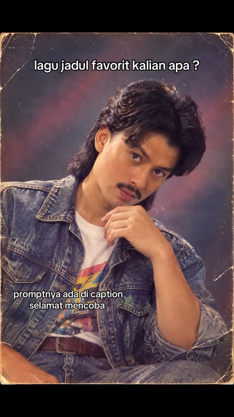</a>

One short edit instruction states the decade, the studio setting and the HD finish together, and the model supplies the aged print, scratches and faded backdrop itself. Because the look is left to the model, a brief prompt is enough to get a convincing result.

ChatGPT · Edit · Source: [@ompolosbangetttt on TikTok](https://www.tiktok.com/@ompolosbangetttt/video/7691196535828155669) · 109 likes on 2026-10-30

[`80s`](tags.md#tag-80s) [`retro`](tags.md#tag-retro) [`vintage-photo`](tags.md#tag-vintage-photo) [`studio-portrait`](tags.md#tag-studio-portrait)

<details><summary><b>Prompt</b></summary>

```text
ubah photo ini dengan tema 80an dibuat sejadul mungkin dengan mode potrait ala ala photo studio jaman dulu dengan kualitas hd
```

</details>

<a id="gpt-image-halftone-windswept-hair-portrait-ivory-paper"></a>
### Windswept Hair Halftone Portrait on Ivory Paper

<a href="https://x.com/hey_am_cherry/status/2111324127378416005"></a>

Naming the print process (halftone dots, stippled shading, screen-print texture) with a two-tone palette of deep black and cream gives a convincing vintage look. A separate negative prompt rules out color, 3D and plastic skin, and the chest-up framing is stated explicitly.

GPT Image 2.5 · Text-to-image · Source: [@hey_am_cherry on X](https://x.com/hey_am_cherry/status/2111324127378416005) · 108 likes on 2026-10-29

[`halftone`](tags.md#tag-halftone) [`monochrome`](tags.md#tag-monochrome) [`portrait`](tags.md#tag-portrait) [`vintage-print`](tags.md#tag-vintage-print) [`negative-prompt`](tags.md#tag-negative-prompt)

<details><summary><b>Prompt</b></summary>

```text
{
  "aspect_ratio": "9:16",
  "prompt": "A beautiful young woman with long, messy black hair blowing dramatically across her face, eyes closed, lips slightly parted, head tilted back, elegant elongated neck, wearing a simple black V-neck top. Chest-up portrait, slightly right of center. Vintage monochrome halftone print art, tiny black ink dots, stippled shading, high contrast, warm ivory textured paper background, deep black shadows, cream highlights, retro editorial photography, moody, dreamy, melancholic, intricate details, sharp facial features, authentic screen-print texture.",
  "negative_prompt": "color, 3D, anime, plastic skin, open eyes, exaggerated expression, deformed face, bad anatomy, extra features, busy background, text, watermark, excessive blur"
}
```

</details>

<a id="gpt-image-cream-hoodie-selfie-portrait"></a>
### Close up selfie of a woman in a cream hoodie

<a href="https://x.com/mehvishs25/status/2067641812165243390">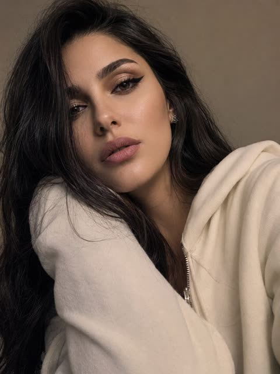</a>

Pinning identity to a reference image and naming makeup, hoodie and pose in concrete terms keeps the result tied to the source. The phone selfie framing, a plain warm wall and a sharp focus zone on the eye and sleeve give the shallow depth of field its authentic feel.

GPT Image 2 · Edit · Source: [@mehvishs25 on X](https://x.com/mehvishs25/status/2067641812165243390) · 106 likes on 2026-10-29

[`selfie`](tags.md#tag-selfie) [`portrait`](tags.md#tag-portrait) [`reference-identity`](tags.md#tag-reference-identity) [`photorealistic`](tags.md#tag-photorealistic)

<details><summary><b>Prompt</b></summary>

```text
Photorealistic close-up selfie portrait of the same girl from the reference image, using the reference as the only source for facial identity. Preserve her exact face shape, skin tone, eye shape, nose, lips, age, proportions, and all recognizable features with high accuracy. Do not alter her identity or make her appear as a different person.

She fills almost the entire frame, creating an intimate and authentic selfie composition. Her head is slightly tilted to one side, with her cheek gently resting against her shoulder and partially tucked inside the long cream-colored sleeve of an oversized zip-up hoodie draped casually over one shoulder. Long, straight dark hair with soft curtain bangs falls naturally along the left side of her face, partially covering one eye.

Her expression is calm and slightly pouting, with a relaxed, effortless mood. She looks directly into the camera, with visible eyelashes and subtle eye contact. Makeup is soft and natural, featuring laminated brows, elongated black winged eyeliner extending the eye shape, and matte dusty-pink lips.

The camera is positioned extremely close to her face, recreating the authentic feel of a webcam or phone selfie. The frame has a slight tilt and an unposed, spontaneous appearance. Sharp focus on the visible eye, lips, hair strands, skin texture, and the thick cream-colored hoodie sleeve, while the background softly blurs away.

Behind her is a simple warm gray-beige wall with no distracting details. Warm indoor ambient lighting mixed with subtle screen light from the front-left softly illuminates her face and hair, creating gentle highlights and natural shadows. The color palette is muted and cozy, dominated by cream, beige-gray, black, and dusty-pink tones.

Ultra-photorealistic, authentic smartphone selfie aesthetic, natural skin texture, realistic hair detail, subtle imperfections, shallow depth of field, intimate composition, candid everyday atmosphere, high detail, premium photography quality.
```

</details>

<a id="nano-banana-christmas-red-satin-couple-tree"></a>
### Couple in red satin and black suit by tree

<a href="https://x.com/astronomerozge1/status/2005718979411673580">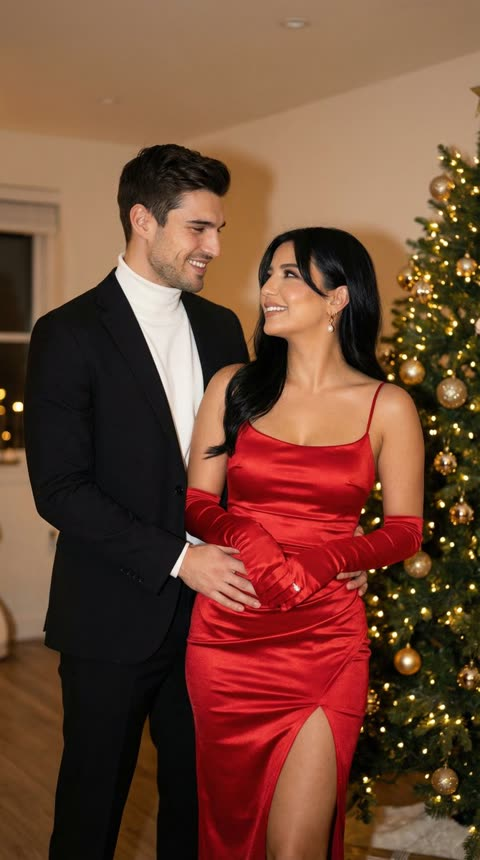</a>

Uploading a base photo and adding an identity lock block keeps both faces stable while the outfits, pose and tree are rewritten. The strict rules list and a negative prompt covering identity drift, plastic skin and extra hands fix the wardrobe colours and composition.

Nano Banana Pro · Edit · Source: [@astronomerozge1 on X](https://x.com/astronomerozge1/status/2005718979411673580) · 105 likes on 2026-10-29

[`christmas`](tags.md#tag-christmas) [`couple`](tags.md#tag-couple) [`portrait`](tags.md#tag-portrait) [`holiday`](tags.md#tag-holiday)

<details><summary><b>Prompt</b></summary>

```text
{
  "generation_request": {
    "meta_data": {
      "tool": "NanoBanana Pro",
      "task_type": "image_edit_photoreal_candid_couple_holiday_indoor",
      "version": "v1.0",
      "priority": "high"
    },
    "references": {
      "reference_images": {
        "base_image": "UPLOAD_THIS_IMAGE",
        "person_A": "UPLOAD_PERSON_A_REFERENCE_IMAGE (OPTIONAL)",
        "person_B": "UPLOAD_PERSON_B_REFERENCE_IMAGE (OPTIONAL)"
      },
      "reference_rules": {
        "preserve_identity_person_A": true,
        "preserve_identity_person_B": true,
        "identity_lock_strength_A": 0.998,
        "identity_lock_strength_B": 0.998,
        "face_similarity_priority": "MAX",
        "no_beautify_no_face_morph": true,
        "no_identity_drift": true,
        "keep_skin_tone_exact": true,
        "keep_facial_proportions_exact": true
      }
    },
    "output_settings": {
      "aspect_ratio": "1:1",
      "orientation": "square",
      "resolution": "ultra_high_res",
      "render_style": "photorealistic_editorial_indoor_flash",
      "sharpness": "natural",
      "film_grain": "subtle_35mm",
      "color_grade": "warm_holiday_film"
    },
    "creative_prompt": {
      "scene_summary": {
        "en": "Photoreal editorial holiday couple portrait indoors. EXACTLY two people, same identities as references/base image. The couple stands close, facing each other with affectionate eye contact and soft smiles. Man: black tailored suit jacket with a white turtleneck underneath, clean classic styling. Woman: elegant fitted red satin dress with thin straps, thigh-high slit, red long gloves, sleek high ponytail, glamorous evening makeup, pearl/diamond necklace. Pose: man’s hands gently around her waist/hip area (respectful, natural), woman leaning toward him with a joyful expression. Background: cozy modern interior with a decorated Christmas tree on the right side (warm lights, gold ornaments), soft bokeh. Lighting: warm indoor ambient + subtle on-camera flash vibe, gentle shadows, cinematic warmth. No text, no logos, no watermark."
      },
      "composition": {
        "framing": "square 1:1, medium-full body, both subjects fully visible from head to mid-thigh",
        "camera_angle": "eye-level",
        "distance": "intimate portrait distance, couple centered, Christmas tree visible on right edge",
        "focus": "faces crisp, background softly blurred"
      },
      "style_and_details": {
        "wardrobe_priority": "keep outfits EXACTLY as described (red satin dress + red gloves; black suit + white turtleneck)",
        "hair_makeup": "keep high ponytail, glamorous makeup, defined liner, warm blush, glossy lips",
        "material_rendering": "realistic satin sheen on dress, realistic fabric texture on suit, natural skin texture",
        "holiday_props": "tree lights with warm bokeh, gold ornaments, subtle indoor décor"
      },
      "strict_rules": [
        "EXACTLY two subjects only",
        "both faces match references/base image exactly (no identity drift)",
        "no extra people, no reflections with other faces",
        "no text, no logos, no watermark",
        "hands and fingers anatomically correct",
        "keep composition: couple centered, Christmas tree on the right"
      ]
    },
    "negative_prompt": [
      "identity drift",
      "face swap artifacts",
      "beautify filter",
      "plastic skin",
      "over-smoothed face",
      "cgi look",
      "anime",
      "cartoon",
      "text",
      "logo",
      "watermark",
      "extra people",
      "extra hands",
      "extra fingers",
      "melted hands",
      "blurred faces",
      "overexposed highlights",
      "wrong outfit colors",
      "missing christmas tree"
    ]
  }
}
```

</details>

<a id="nano-banana-blue-haze-hoodie-studio-portrait"></a>
### Cinematic blue haze studio portrait in dark hoodie

<a href="https://x.com/Emmma___0/status/2108109236555403768"></a>

A symmetrical medium close-up with cool blue edge light against one warm orange glow in the background gives the cinematic colour contrast. Skin imperfections, an 85mm lens look and a negative prompt against plastic skin and HDR keep the face realistic.

Nano Banana 2.1 · Text-to-image · Source: [@Emmma___0 on X](https://x.com/Emmma___0/status/2108109236555403768) · 102 likes on 2026-10-28

[`portrait`](tags.md#tag-portrait) [`cinematic`](tags.md#tag-cinematic) [`studio-lighting`](tags.md#tag-studio-lighting) [`photorealistic`](tags.md#tag-photorealistic) [`negative-prompt`](tags.md#tag-negative-prompt)

<details><summary><b>Prompt</b></summary>

```text
Create a highly photorealistic cinematic portrait of a person standing centered and facing the camera with a calm, serious expression. Natural facial proportions, realistic skin texture, detailed eyes, subtle skin imperfections, and naturally styled hair. The subject wears a simple oversized dark hoodie with a minimal light-colored shirt visible underneath.
Use a symmetrical composition with the subject occupying the central portion of the frame, medium close-up framing, and a clean professional presentation. The background is a dark deep-blue studio environment with atmospheric haze and subtle volumetric fog. Add cool blue lighting around the edges of the subject and a soft warm orange glow in the distant background on one side, creating a cinematic color contrast.
Dramatic but natural studio lighting, soft directional key light, subtle rim lighting, realistic shadows, controlled highlights, shallow depth of field, smooth background falloff, premium editorial photography, modern cinematic aesthetic, high contrast, realistic colors, detailed clothing texture, realistic hair and skin, professional camera photography, 85mm lens look, crisp focus, subtle film grain, ultra-photorealistic, highly detailed, 8K quality.
Negative prompt: cartoon, illustration, CGI, plastic skin, excessive HDR, oversharpening, distorted face, unnatural anatomy, extra limbs, blurry subject, low resolution, artificial skin, text, logo, watermark.
```

</details>

<a id="nano-banana-bw-seaside-windblown-portrait"></a>
### Black and white seaside portrait with windblown hair

<a href="https://x.com/SimplyAnnisa/status/2070720737426428068"></a>

Locks the face to an uploaded reference with explicit identity and no beautification rules, then stacks disposable film grain, 85mm shallow focus and an extreme macro framing line. A closing list of negatives (no clean digital sharpness, no centered portrait) keeps the result looking candid.

Nano Banana 2 · Edit · Source: [@SimplyAnnisa on X](https://x.com/SimplyAnnisa/status/2070720737426428068) · 102 likes on 2026-10-28

[`black-and-white`](tags.md#tag-black-and-white) [`film-grain`](tags.md#tag-film-grain) [`macro-portrait`](tags.md#tag-macro-portrait) [`face-reference`](tags.md#tag-face-reference) [`coastal`](tags.md#tag-coastal)

<details><summary><b>Prompt</b></summary>

```text
Nano banana 2 on
@Lart_AI


https://
lartai.com/?TG=10259
Intimate Wind Whisper
Composition: Extreme macro close-up focusing tightly on the face with wind-blown hair strands delicately framing the features and shallow focus on natural skin texture
Prompt: Using the uploaded photo as the exact face reference. Keep the face identity 100% unchanged, do not alter facial features, proportions, expression structure, or skin details. No face distortion, no beautification, no AI-looking changes. Photorealistic candid snapshot taken on a low-quality disposable film camera, black and white cinematic film photography, authentic 35mm grain, subtle imperfections, natural texture, vintage analog look. The woman has full voluminous hair slightly messy and blown by ocean wind, strands of hair falling naturally across the face, chin slightly raised, eyes gently closed, dreamy peaceful expression, soft genuine smile. She is wearing a voluminous white dress, sitting on wet textured seaside rocks. The background shows a dramatic massive coastal cliff covered in mist under a heavy overcast grey sky creating a moody coastal atmosphere with raw cinematic realism. Natural diffused daylight casts soft shadows in an emotional editorial photography style, realistic film exposure, high dynamic range, shallow depth of field, shot on 85mm lens, cinematic framing, authentic documentary feeling. Extreme close-up macro framing tightly captures her face, highlighting the texture of her skin and the delicate strands of wind-blown hair resting across her closed eyes and smile, with the white dress softly visible at the lower frame edge and the misty cliff gently out of focus behind.
no clean digital sharpness, no CGI look, no poster composition, no centered portrait, no black bars –ar 9:16
```

</details>

<a id="nano-banana-bedroom-selfie-white-duvet"></a>
### Bedroom selfie of woman under a white duvet

<a href="https://x.com/jzaib4269/status/2068317754466451676">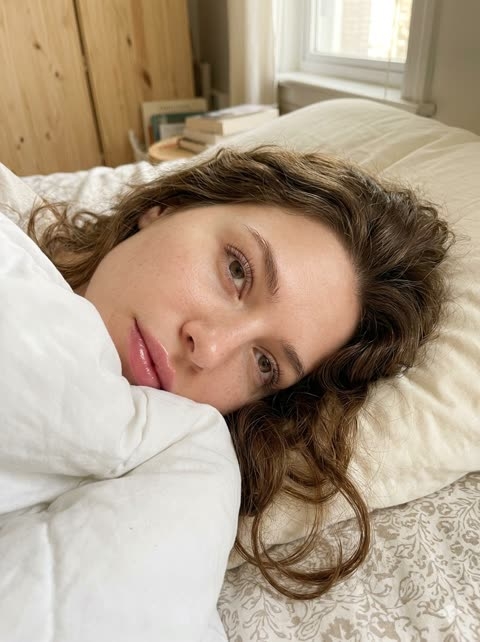</a>

A tilted phone selfie with the face filling the frame and a duvet cutting across one side reads as candid rather than posed. Naming the window light, soft neutral palette and camera angle together keeps the lighting and mood consistent.

Nano Banana 2 · Text-to-image · Source: [@jzaib4269 on X](https://x.com/jzaib4269/status/2068317754466451676) · 101 likes on 2026-10-29

[`selfie`](tags.md#tag-selfie) [`portrait`](tags.md#tag-portrait) [`bedroom`](tags.md#tag-bedroom) [`natural-light`](tags.md#tag-natural-light)

<details><summary><b>Prompt</b></summary>

```text
low quality, blurry, overprocessed skin, heavy makeup, exaggerated facial features, distorted eyes, extra fingers, duplicate features, cartoon, CGI, painting, illustration, harsh shadows, oversaturated colors, grainy image, watermark, text, logo, cropped face, unnatural pose, artificial lighting, bad anatomy, low resolution.
```

</details>

<a id="nano-banana-mirror-shard-self-reflections"></a>
### Man centered among floating broken mirror shards

<a href="https://x.com/Ozayrr_irl/status/2050471266843582688">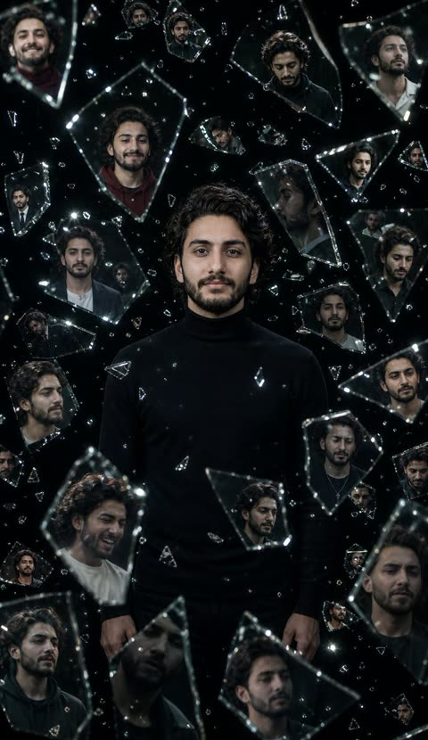</a>

A reference face is locked in with an explicit identity instruction, then each shard is described by its own angle, outfit and emotion so the repeated figure reads as many versions. A pitch black set with one cold key light makes the shards the only bright elements.

Nano Banana 2 · Edit · Source: [@Ozayrr_irl on X](https://x.com/Ozayrr_irl/status/2050471266843582688) · 100 likes on 2026-10-29

[`mirror-shards`](tags.md#tag-mirror-shards) [`reflections`](tags.md#tag-reflections) [`identity-lock`](tags.md#tag-identity-lock) [`cinematic-portrait`](tags.md#tag-cinematic-portrait)

<details><summary><b>Prompt</b></summary>

```text
"Use the facial identity given and keep the facial features exactly same, and generate a picture standing in a pitch-black studio, surrounded by dozens of broken mirror shards floating mid-air around him at different angles — each shard reflecting a different version of him, different expressions, different outfits, different emotions. He stands perfectly still in the center, wearing a crisp black turtleneck, arms at his sides, staring forward. The only light source is cold white light hitting each shard differently, fracturing the room into infinite reflections. Vertical 9:13 format. Ultra photorealistic, 8K, no text overlays, cinematic color grading."
```

</details>

<a id="nano-banana-subway-stairs-black-coat-street-portrait"></a>
### Man in black coat on subway stairs

<a href="https://x.com/pictsbyai/status/2032375474999964121"></a>

A structured JSON prompt splits the shot into composition, color profile, lighting, subject and background blocks, with hex colors, light direction and shadow placement set explicitly. Detailed hair texture and hand pose notes keep the face from looking over smoothed.

Nano Banana 2 · Text-to-image · Source: [@pictsbyai on X](https://x.com/pictsbyai/status/2032375474999964121) · 100 likes on 2026-10-28

[`street-photography`](tags.md#tag-street-photography) [`json-prompt`](tags.md#tag-json-prompt) [`fashion`](tags.md#tag-fashion) [`moody-lighting`](tags.md#tag-moody-lighting) [`editorial`](tags.md#tag-editorial)

<details><summary><b>Prompt</b></summary>

```text
{
"metadata": {
"image_type": "photograph",
"primary_purpose": "editorial"
},
"composition": {
"rule_applied": "rule of thirds",
"aspect_ratio": "4:5",
"layout": "single subject",
"focal_points": [
"Subject's face and dark sunglasses",
"Yellow fluorescent light fixture leading to the subject"
],
"visual_hierarchy": "Eye starts at the subject's face due to contrast with sunglasses, follows the V-neck down the black coat, moves outward along the metallic handrails, and catches the bright sunlight shaft on the left wall and the yellow light on the right.",
"balance": "asymmetric"
},
"color_profile": {
"dominant_colors": [
{
"color": "Black",
"hex": "#111111",
"percentage": "45%",
"role": "primary subject"
},
{
"color": "Warm Gray",
"hex": "#7A7269",
"percentage": "35%",
"role": "background"
},
{
"color": "Golden Yellow",
"hex": "#E5B05C",
"percentage": "10%",
"role": "accent"
}
],
"color_palette": "complementary",
"temperature": "warm",
"saturation": "moderate",
"contrast": "high contrast"
},
"lighting": {
"type": "mixed",
"source_count": "multiple sources",
"direction": "front",
"directionality": "highly directional",
"quality": "dramatic",
"intensity": "moody",
"contrast_ratio": "high contrast (dramatic shadows)",
"mood": "mysterious",
"shadows": {
"type": "harsh defined edges",
"density": "deep black",
"placement": "under handrails, within stair treads, and engulfing the subject's lower body",
"length": "medium"
},
"highlights": {
"treatment": "blown out",
"placement": "on upper left wall from sun shaft, fluorescent light fixture, and reflective handrails"
},
"ambient_fill": "present",
"light_temperature": "warm (golden)"
},
"technical_specs": {
"medium": "digital photography",
"style": "realistic",
"texture": "sharp",
"sharpness": "tack sharp",
"grain": "digital noise",
"depth_of_field": "medium",
"perspective": "high angle"
},
"artistic_elements": {
"genre": "street",
"influences": [
"Urban street style fashion photography",
"Cinematic cyberpunk/matrix aesthetic"
],
"mood": "sophisticated",
"atmosphere": "Gritty yet polished urban transit environment with a moody, imposing, and highly stylized fashion presence",
"visual_style": "structured"
},
"typography": {
"present": false,
"fonts": [],
"placement": "",
"integration": ""
},
"subject_analysis": {
"primary_subject": "Young male model wearing an oversized, structured long black overcoat, black V-neck top, black trousers, and dark rectangular sunglasses, walking down stairs. Hair: Medium length, textured cut (e.g., modern shag/tapered cut). Length: Roughly ear-level/temple-level on the sides, slightly longer and voluminous on top (3-4 inches), with soft layers and natural movement. Texture: Natural wavy texture, showing varied strands, slight frizz, and natural volume (imperfections visible, not 'AI smooth'), styled loosely back from the forehead without a distinct part. Evidence of light matte product application.",
"positioning": "center",
"scale": "medium",
"interaction": "interacting with environment",
"facial_expression": {
"mouth": "neutral",
"smile_intensity": "no smile",
"eyes": "direct gaze",
"eyebrows": "neutral",
"overall_emotion": "serious",
"authenticity": "posed"
},
"hands_and_gestures": {
"left_hand": "resting at waist level, lightly holding the edge of the black overcoat, silver ring visible on finger",
"right_hand": "not visible, hidden behind the coat's bulk or swinging backward",
"finger_positions": "left hand thumb and index finger slightly curled and gripping fabric, remaining fingers obscured",
"finger_interlacing": "none",
"hand_tension": "relaxed",
"interaction": "holding coat",
"naturalness": "deliberately posed"
},
"body_positioning": {
"posture": "standing",
"angle": "facing camera",
"weight_distribution": "shifted",
"shoulders": "level"
}
},
"background": {
"setting_type": "indoor",
"spatial_depth": "medium",
"elements_detailed": [
{
"item": "Stainless steel handrail",
"position": "left",
"distance": "foreground",
"size": "medium",
"condition": "worn",
"specific_features": "Tubular metal with distinct mounting brackets and subtle reflections"
},
{
"item": "Stainless steel handrail",
"position": "right",
"distance": "midground",
"size": "medium",
"condition": "worn",
"specific_features": "Tubular metal matching the left side, catching edge highlights"
},
{
"item": "Fluorescent light fixture",
"position": "top right",
"distance": "background",
"size": "medium",
"condition": "vintage",
"specific_features": "Rectangular housing emitting a strong, warm amber/yellow light"
}
],
"wall_surface": {
"material": "tile",
"surface_treatment": "finished",
"texture": "perfectly smooth",
"finish": "satin",
"color": "warm grayish-brown",
"color_variation": "patchy",
"features": "clean, distinct grid-like grout lines separating large rectangular stone/granite panels, sharp diagonal shaft of warm sunlight hitting the upper left section",
"wear_indicators": "industrial"
},
"floor_surface": {
"material": "concrete",
"color": "dark gray with yellow accents",
"pattern": "striped"
},
"objects_catalog": "Metal diamond-plate stair treads with yellow painted safety edges running horizontally across the bottom and midground, dual tubular stainless steel handrails flanking the stairs, rectangular yellow light fixture mounted to the ceiling angled directly above the stairwell, large rectangular stone tiles covering the walls.",
"background_treatment": "sharp"
},
"generation_parameters": {
"prompts": [
"Editorial street style photography, a handsome young man with medium length, textured modern shag haircut showing natural wavy movement and styled loosely back. He wears dark rectangular sunglasses, a long black oversized wool coat, and an all black outfit, walking down urban subway stairs. The walls are made of large polished brown-gray stone tiles with visible grid grout lines. A dramatic shaft of warm golden sunlight hits the upper left wall. A vintage yellow fluorescent light fixture is on the upper right ceiling. The stairs are concrete with metal edges and yellow safety paint. Stainless steel handrails. Cinematic lighting, deep dramatic black shadows, sharp focus, 85mm lens, high contrast, moody, fashionable underground matrix aesthetic.",
"Cinematic fashion portrait, male model in structural black overcoat descending transit stairs, medium length textured hair with soft waves, tinted glasses. High angle shot looking down the steps. Brutalist architecture background, granite wall panels. Mixed lighting featuring harsh geometric sunbeams on the wall contrasting with artificial yellow ambient light. Gritty texture, high dynamic range, hyper-realistic, sophisticated urban mood."
],
"keywords": [
"street style",
"oversized black coat",
"subway stairs",
"cinematic lighting",
"medium length hair",
"textured hair",
"modern shag"
],
"technical_settings": "85mm lens, f/4.0 aperture for medium depth of field keeping background architectural elements recognizable, 1/250s shutter speed, ISO 400. Metered to preserve the sun shaft highlight while letting shadows fall to deep blacks.",
"post_processing": "Color grading to enhance warm golden highlights against neutral/cool shadows, boosted contrast curve, subtle film grain introduced in the deep shadow areas for texture."
}
}
```

</details>

<a id="gpt-image-rooftop-sunset-smoke-disintegration-portrait"></a>
### Man on rooftop disintegrating into smoke at sunset

<a href="https://x.com/AiWithTariq/status/2101869465977897075"></a>

The prompt fixes the outfit, side profile pose and setting first, then limits the disintegration to one side of the body, which keeps the figure readable. Naming the smoke, ash and golden sparks separately, with warm sunset light and a wet reflective floor, gives the transition a clear light source and depth.

GPT Image 2.5 · Text-to-image · Source: [@AiWithTariq on X](https://x.com/AiWithTariq/status/2101869465977897075) · 98 likes on 2026-10-28

[`disintegration`](tags.md#tag-disintegration) [`smoke-effect`](tags.md#tag-smoke-effect) [`rooftop`](tags.md#tag-rooftop) [`sunset`](tags.md#tag-sunset) [`cinematic`](tags.md#tag-cinematic)

<details><summary><b>Prompt</b></summary>

```text
Create an ultra-realistic cinematic portrait of a young man standing on a rooftop at sunset, wearing a light grey t-shirt, beige cargo pants, white high-top sneakers, a wristwatch, and black sunglasses. The subject stands in a calm side profile pose with hands in pockets, looking downward thoughtfully.

Apply a dramatic disintegration effect where the left side of his body transforms into swirling dark smoke, floating ash, glowing golden sparks, and particle fragments, blending naturally into the environment. Use a cloudy sunset sky with warm orange light, a distant city skyline, and a wet reflective ground surface.

Make the smoke highly detailed, volumetric, and realistic, with cinematic lighting, soft depth of field, high contrast, and photorealistic textures. The final image should have an epic fantasy-action mood, ultra-detailed 8K quality, and a seamless smoke-to-human transition effect.
```

</details>

<a id="nano-banana-y2k-wardrobe-flash-portrait"></a>
### Smiling woman in wardrobe, Y2K flash snapshot

<a href="https://x.com/SimplyAnnisa/status/2083149439917867340">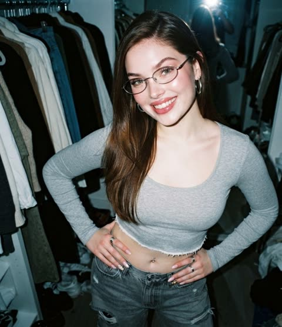</a>

A high angle camera with direct flash, film grain and light motion blur builds the early 2000s paparazzi snapshot look. Naming the clutter, the flash highlights and the specific accessories keeps the scene concrete while the camera style sets the mood.

Nano Banana 2 · Text-to-image · Source: [@SimplyAnnisa on X](https://x.com/SimplyAnnisa/status/2083149439917867340) · 98 likes on 2026-10-29

[`y2k`](tags.md#tag-y2k) [`flash-photography`](tags.md#tag-flash-photography) [`film-grain`](tags.md#tag-film-grain) [`portrait`](tags.md#tag-portrait)

<details><summary><b>Prompt</b></summary>

```text
Ultra-realistic candid dynamic portrait captured from a high top-angle perspective, creating a spontaneous, editorial fashion composition.

A young woman stands in a wardrobe/closet area, wearing a fitted light grey long-sleeve scoop-neck crop top with distressed, frayed white hem detailing and low-rise oversized grey ripped jeans, subtly revealing a delicate silver belly piercing. She accessorizes with thin silver oval-frame eyeglasses with clear lenses, medium-sized silver hoop earrings, and stacked silver rings. Her long oval-shaped nails feature a glossy soft pink manicure with elegant cream tortoiseshell accent nails.

Face & Skin
She has an elegant oval face with an extremely fair complexion and soft pink undertones. Her skin retains realistic pores and delicate natural freckles across the bridge of her nose and cheeks. The complexion appears luminous with a soft matte finish that preserves authentic skin texture without excessive retouching or artificial smoothing.

Makeup
Refined Clean Girl makeup featuring naturally full dark brows, subtle taupe eyeshadow, softly sculpted nose contour, diffused rosy blush blended across both cheeks and the bridge of the nose, and glossy overlined ombré pink lips with a wet reflective finish.
Her striking light sage-green eyes feature glass-like reflections and luxurious salon-quality manga-inspired lashes with ultra-defined D-curl spiky lash clusters. Thick upper and lower lashes, deep black mascara, crisp lash separation, and a bold doll-eye effect create dramatic yet realistic eye detail.

Hair
Deep side part with hip-length, sleek straight chestnut hair, exceptionally silky, thick, and glossy. The hair has soft natural movement with subtle flyaways and polished layering for a realistic editorial finish.

Pose & Expression
She stands with both hands resting confidently on her hips, creating a playful, dynamic silhouette. Her body is slightly angled while the camera looks down from above, emphasizing long legs and natural proportions. She looks directly into the camera with a joyful, playful, intentionally goofy ("ugly cute") expression—wide smile, expressive eyes, and an energetic candid vibe. The pose feels spontaneous, fun, and full of personality, as though captured in the middle of laughing.

Lighting
Harsh direct on-camera flash photography creates bright highlights, strong shadows, glowing overexposed skin, and high contrast, inspired by the early-2000s paparazzi aesthetic.

Camera Style
Point-and-shoot digital camera aesthetic with slight overexposure, authentic analog film grain, subtle sensor noise, slight motion blur, and slightly imperfect focus for a nostalgic Y2K snapshot feel.

Environment
Indoor wardrobe or dressing room with visible clothing racks, hanging garments, mirror reflections, and a dim cool-toned background. The setting feels authentic, lived-in, and naturally cluttered.

Mood & Vibe
Off-duty model, spontaneous, playful, intimate, candid, effortlessly stylish, Y2K fashion aesthetic, raw editorial energy, cinematic framing, shallow depth of field, realistic textures, analog film finish, and an authentic unfiltered moment.
```

</details>

<a id="nano-banana-christmas-woman-dog-reindeer-antlers-fireplace"></a>
### Woman and dog in reindeer antlers by fireplace

<a href="https://x.com/saniaspeaks_/status/2005889536342253587">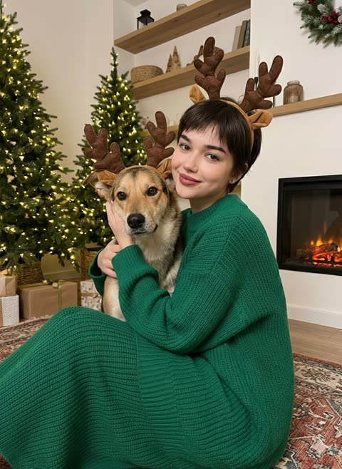</a>

The prompt names the woman and the dog as identity sources to lock to the reference photo, which keeps both faces recognizable after the edit. The medium eye level framing, 85mm lens look and the full length dress constraint keep the composition and pose under control.

Nano Banana Pro · Edit · Source: [@saniaspeaks_ on X](https://x.com/saniaspeaks_/status/2005889536342253587) · 97 likes on 2026-10-29

[`christmas`](tags.md#tag-christmas) [`portrait`](tags.md#tag-portrait) [`dog`](tags.md#tag-dog) [`identity-lock`](tags.md#tag-identity-lock)

<details><summary><b>Prompt</b></summary>

```text
"style": "hyper-realistic, cozy holiday lifestyle, cinematic portrait",
  "identity_preservation": {
    "human": {
      "use_reference_image": true,
      "strict_identity_lock": true,
      "alter_face": false,
      "notes": "Preserve 100% of the woman’s facial features, proportions, skin texture, hairstyle, and expression exactly as in the reference image."
    },
    "dog": {
      "use_reference_image": true,
      "strict_identity_lock": true,
      "alter_features": false,
      "notes": "Preserve 100% of the dog’s facial features, fur texture, proportions, and expression exactly as in the reference image."
    }
  },
  "composition": {
    "framing": "medium shot",
    "camera_angle": "eye-level",
    "focus": "sharp focus on woman and dog"
  },
  "subject": {
    "gender": "female",
    "pose": {
      "position": "sitting on a carpet with legs fully covered by the dress",
      "interaction": "holding a friendly dog in her arms"
    },
    "expression": "warm smile with an intense, direct gaze into the camera",
    "appearance": {
      "hair": {
        "color": "dark brown",
        "style": "short pixie cut with casually styled bangs"
      },
      "head_accessory": "felt reindeer antlers worn on the head",
      "makeup": {
        "style": "natural",
        "details": [
          "glowing, hydrated skin",
          "soft pink blush",
          "neutral brown eyeshadow",
          "creamy berry lipstick"
        ]
      },
      "wardrobe": {
        "outfit": "thick, oversized emerald green chunky-knit sweater dress with a long hem fully covering the legs"
      },
      "jewelry": [
        "small pearl stud earrings",
        "necklace with a red horse pendant"
      ]
    }
  },
  "dog": {
    "pose": "calm and friendly, resting comfortably in the woman’s arms",
    "accessories": "felt reindeer antlers on the head"
  },
  "environment": {
    "location": "cozy festive living room",
    "background_elements": [
      "small decorated Christmas tree with warm white lights",
      "crackling fireplace",
      "wooden shelves with holiday decorations"
    ],
    "atmosphere": "intimate, warm, festive, and cozy"
  },
  "lighting": {
    "type": "soft warm indoor lighting",
    "quality": "natural and flattering",
    "effects": [
      "gentle highlights on skin",
      "visible texture of knitted fabric",
      "detailed dog fur texture"
    ]
  },
  "camera": {
    "model": "Canon EOS R6 Mark II",
    "lens": "85mm",
    "depth_of_field": "shallow to moderate",
    "resolution": "high resolution"
  },
  "mood": {
    "emotion": "warmth, joy, holiday intimacy",
    "season": "Christmas / winter holiday"
  },
  "quality": {
    "realism": "ultra-photorealistic",
    "detail_level": "extreme detail in skin, fur, and fabric textures",
    "artifacts": "none"
  },
  "constraints": [
    "Do not alter the woman’s face",
    "Do not alter the dog’s face",
    "Legs must remain fully covered by the dress",
    "No artificial filters",
    "No distorted anatomy",
    "No text or watermarks"
  ],
  "output_goal": "Create a hyper-realistic medium-shot holiday portrait of a woman sitting on a carpet in a cozy festive living room, holding her dog, with her legs fully covered by the dress, preserving both the woman’s and the dog’s exact identities, warm lighting, and an intimate Christmas atmosphere.
```

</details>

<a id="nano-banana-sepia-flash-photobooth-linen-shirt-grid"></a>
### Sepia flash photobooth grid in linen shirt

<a href="https://x.com/SimplyAnnisa/status/2066054801226379621"></a>

A reference image locks identity while a 2x2 grid spells out each panel's pose and gaze. Direct flash with a hard wall shadow, a sepia grade and lens and camera details give the retro polaroid look.

Nano Banana 2 · Edit · Source: [@SimplyAnnisa on X](https://x.com/SimplyAnnisa/status/2066054801226379621) · 97 likes on 2026-10-29

[`photobooth`](tags.md#tag-photobooth) [`grid`](tags.md#tag-grid) [`sepia`](tags.md#tag-sepia) [`flash-photography`](tags.md#tag-flash-photography) [`identity-preserve`](tags.md#tag-identity-preserve)

<details><summary><b>Prompt</b></summary>

```text
Nano banana 2

Create an ultra-realistic  using the reference image as the identity source.
Preserve the exact facial features, bone structure, proportions, skin tone, and identity of the subject.
Do not beautify, reshape, or alter the face in any way. Maintain natural likeness and authentic facial geometry.   Subject & Core Identity
An ultra-realistic, high-fidelity portrait of a 28-year-old woman with soft, defined facial structures, an elegant jawline, full natural lips, and expressive dark eyes. The subject possesses a distinct, unaltered facial identity that must be replicated with 100% accuracy, maintaining her natural features with zero modifications and absolutely no nose piercings.
Pose & Composition
Format: A 4-panel photo grid layout (2x2 matrix) showcasing a continuous sequence of candid poses in a photo-booth style.
Top-Left Panel: Close-up, side profile angled slightly toward the camera. Her right arm is raised, hand resting casually behind her head, pulling her hair up slightly. The white linen shirt drops slightly off her right shoulder.
Top-Right Panel: Side-profile view looking slightly off-camera to the left. A contemplative, elegant posture with a neutral gaze.
Bottom-Left Panel: A direct, slightly tilted head-on shot looking straight into the lens with a soft, confident tilt.
Bottom-Right Panel: Frontal shot, eyes closed, playfully puckering her lips in a kiss-face expression, with both hands raised, fingers running lightly through the sides of her hair.
Framing: Medium close-ups focusing on the upper torso, shoulders, and head.
Hairstyle & Makeup
Hairstyle: Long, voluminous brunette hair with soft, effortless waves and natural, layered movement. The texture is textured and slightly tousled, with a relaxed, effortless middle part and occasional loose strands framing her face.
Makeup: Minimalist, "no-makeup" makeup look. Subtle, natural brow definition, clean skin texture with a soft matte finish, light mascara enhancing the eyelashes, and a natural nude-toned lip color matching the subject’s authentic features perfectly.
Wardrobe & Styling
Attire: An oversized, relaxed-fit white linen button-down shirt. The fabric texture shows visible, realistic linen creases, weave patterns, and soft folds. The collar is loosely unbuttoned to create a casual, editorial look.
Accessories: Minimalist, classic styling including a delicate silver chain bracelet on the right wrist and a classic metal link watch on the left wrist. Subtle, small metallic hoop earrings.
Setting, Lighting & Atmosphere
Setting: A minimalist, clean studio setting against a solid, neutral off-white/light gray studio wall backdrop.
Lighting: Direct, high-contrast flash photography casting a soft, distinct shadow against the wall directly behind the subject, simulating an authentic polaroid or retro photo-booth flash. The lighting creates clean highlights on her skin, shoulders, and the fabric of the shirt.
Color Grading: Monochromatic desaturated tone with a warm, muted sepia-vintage tint, reminiscent of a classic 90s fashion polaroid or silver-halide film aesthetic.
Camera Details & Texture Boosters
Camera Hardware: Shot on a high-end mirrorless camera, Sony A7R V or Canon EOS R5, paired with an 85mm f/1.4 lens for a perfect portrait perspective with zero distortion.
Image Quality: Ultra-HD, 32K resolution, capturing hyper-detailed skin texture, individual hair strands, micro-folds in the linen fabric, and a subtle, authentic fine-grain film texture. Super-sharp focus on the facial features, preserving every authentic detail with lifelike cinematic realism.   Negative Prompt
low quality, blurry, flat lighting, dull colors, bad anatomy, extra limbs, distorted face, stiff pose, cartoon, anime, CGI, plastic skin, cheap costume, repetitive outfit, watermark, logo, text
```

</details>

<a id="chatgpt-monochrome-portrait-frame-in-frame"></a>
### High contrast monochrome portrait of pensive man

<a href="https://www.tiktok.com/@djclerger/video/7688398552199892225"></a>

The prompt pairs a face reference with concrete camera cues (85 mm lens, Leica look, shallow depth of field, sharp focus on the eyes) and a blurred foreground silhouette that creates a frame within a frame. Monochrome tone and dramatic side lighting set the editorial mood.

ChatGPT · Edit · Source: [@djclerger on TikTok](https://www.tiktok.com/@djclerger/video/7688398552199892225) · 95 likes on 2026-10-30

[`portrait`](tags.md#tag-portrait) [`monochrome`](tags.md#tag-monochrome) [`fashion`](tags.md#tag-fashion) [`face-reference`](tags.md#tag-face-reference)

<details><summary><b>Prompt</b></summary>

```text
En utilisant la référence du visage ci-dessus, crée un portrait noir et blanc à fort contraste, style fashion noir, d'un jeune homme portant une chemise blanche immaculée, assis pensif avec une main près du menton. Il est encadré par une silhouette floue en premier plan, créant une composition cinématographique de « cadre dans un cadre ». Un éclairage dramatique avec de profondes ombres et de fortes lumières met en valeur la structure du visage et l'émotion. L'esthétique est éditoriale et intemporelle, avec un arrière-plan minimaliste, un léger grain de film 4K, une texture de peau ultra réaliste. un focus net sur les yeux, une faible profondeur de champ, une photographie cinématographique, une atmosphère mélancolique, style magazine de luxe, look Leica M11, objectif 85 mm, un léger contour de lumière, des tons monochrome, photoréaliste, très détaillé.
```

</details>

<a id="nano-banana-mirror-hallway-satin-slip-woman"></a>
### Woman in white satin slip dress in mirrored hallway

<a href="https://x.com/KeorUnreal/status/2109735577436275182">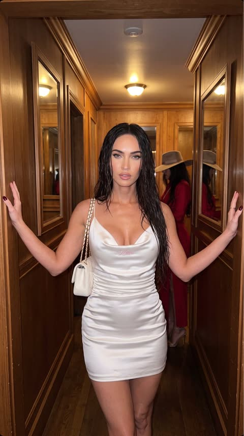</a>

The prompt is structured JSON that separates subject, outfit, secondary subject, setting, lighting and camera, so each block maps to a visible element. Placing the mystery figure in a mirror reflection and specifying a slightly high selfie angle gives the scene depth and layering.

Nano Banana 2.1 · Text-to-image · Source: [@KeorUnreal on X](https://x.com/KeorUnreal/status/2109735577436275182) · 94 likes on 2026-10-29

[`portrait`](tags.md#tag-portrait) [`structured-json`](tags.md#tag-structured-json) [`mirror-reflection`](tags.md#tag-mirror-reflection)

<details><summary><b>Prompt</b></summary>

```text
{
  "subject": {
    "description": "Young woman with fair skin, dark wet-look hair falling over her shoulders, full lips slightly parted, looking toward the camera",
    "hair": "Dark brown hair with a wet, slicked appearance, partially covering one shoulder",
    "body": "Curvy figure with a glossy sheen on the skin",
    "pose": "Standing in a narrow hallway, both arms extended to the sides with hands resting on the wooden door frames, body facing the camera",
    "expression": "Calm, direct gaze with slightly parted lips"
  },
  "outfit": {
    "dress": "White satin slip short dress with a deep cowl neckline, ruched waist, and fitted silhouette",
    "accessories": "Small white quilted shoulder bag with a gold chain strap",
    "embroidery": "A small sign reading 'Keor' embroidered in elegant lettering along the border of the dress (on the neckline or side seam)"
  },
  "secondary_subject": {
    "description": "Mystery figure of a woman in a long red outfit with high heels and a hat that completely covers her face, giving a sense of mystery",
    "placement": "Standing further down the hallway or visible in a mirror reflection in the backdrop"
  },
  "setting": {
    "location": "Narrow wood-paneled hallway with mirrors",
    "background": "Warm wooden walls, multiple mirrors reflecting the subject, ceiling lights, white walls visible in reflections"
  },
  "lighting": {
    "type": "Warm indoor ceiling lighting",
    "effects": "Soft highlights on the satin dress and skin, gentle shadows in the hallway"
  },
  "camera": {
    "angle": "Slightly high selfie-style angle looking down the hallway",
    "framing": "Three-quarter body shot, subject centered between the mirrors, mystery figure visible in the background or reflection",
    "style": "Photorealistic, high-detail indoor photography, sharp focus"
  },
  "additional_details": {
    "skin": "Smooth with a dewy, slightly glossy finish",
    "atmosphere": "Intimate hallway portrait with a mysterious second figure"
  }
}
```

</details>

<a id="nano-banana-wet-profile-close-up-green-eyes"></a>
### Wet profile portrait with green hazel eyes

<a href="https://x.com/j_smeaton99/status/2039209681789595747">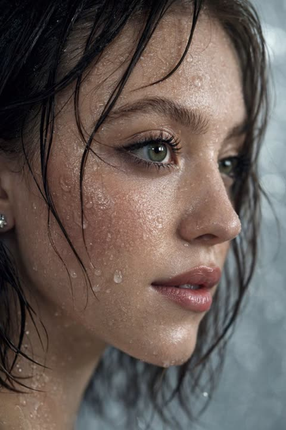</a>

Pinning identity to the uploaded reference while naming specific surface details such as droplets, sweat and clumped hair makes the wet look read as real skin. Limiting highlights to the eyes and lips and specifying a cool grey bokeh background keeps the shine under control.

Nano Banana 2 · Edit · Source: [@j_smeaton99 on X](https://x.com/j_smeaton99/status/2039209681789595747) · 93 likes on 2026-10-29

[`portrait`](tags.md#tag-portrait) [`wet-skin`](tags.md#tag-wet-skin) [`water-droplets`](tags.md#tag-water-droplets) [`reference-photo`](tags.md#tag-reference-photo)

<details><summary><b>Prompt</b></summary>

```text
Extreme wet close-up portrait. Young woman's face in profile (use uploaded pictures for proper reference) Dark wet hair naturally glued to the skin. Fine droplets of water and thin sweat glistening realistically on her face. Focus on bright natural green/hazel eyes with realistic reflection avoid excessive shine. Moist and shiny lips, soft natural texture. Soft lighting and cool shades with a light grey/white bokeh background colour. Keep same facial features
```

</details>

<a id="gpt-image-selfie-giant-portrait-beach-birthday-cake"></a>
### Giant Portrait Behind Beach Birthday Cake at Sunset

<a href="https://x.com/Adnan_Ai2/status/2104759717289681001"></a>

A reference photo locks the face, then the scene pairs a large close-up with a small full-body copy seated on the cake for a scale illusion. Exact text strings for the plaque and cake front, plus a request for clean spelling, keep the lettering legible.

GPT Image 2.5 · Edit · Source: [@Adnan_Ai2 on X](https://x.com/Adnan_Ai2/status/2104759717289681001) · 92 likes on 2026-10-28

[`selfie`](tags.md#tag-selfie) [`miniature-world`](tags.md#tag-miniature-world) [`birthday-cake`](tags.md#tag-birthday-cake) [`golden-hour`](tags.md#tag-golden-hour) [`face-reference`](tags.md#tag-face-reference)

<details><summary><b>Prompt</b></summary>

```text
Use the uploaded girl reference image as the exact facial and appearance reference. Create a highly detailed cinematic fantasy birthday portrait inspired by the provided cake-and-beach composition. Show the same girl in two versions: a large realistic close-up portrait rising behind the cake, and a smaller full-body version sitting naturally on top of the cake. Keep her recognizable facial features, hairstyle, soft smile, eyes, and overall appearance consistent with the reference image. Dress her in an elegant cozy cream-white knitted outfit with a soft feminine look.
Place everything on a beautiful beach during golden-hour sunset, with a glowing orange sky, soft clouds, ocean waves, warm sunlight, and cinematic reflections on the water. Create a huge luxurious round vanilla-and-chocolate drip cake in the foreground, covered with creamy white and chocolate frosting swirls, chocolate pieces, truffles, small decorative pearls, and realistic glossy chocolate drips. The small girl should sit naturally on the cake with a relaxed, cute pose, while the large portrait appears behind her with soft glowing edges and artistic depth.
Add a chocolate plaque beside the girl with the text “Girls Make Life Sweeter ♥” and write “Stay Awesome ♡” on the front of the cake with a small crown above it. Make the text clean, readable, and correctly spelled. Use realistic skin texture, detailed hair strands, natural fabric texture, accurate proportions, soft shadows, warm rim lighting, shallow depth of field, photorealistic details, premium editorial photography, dreamy cinematic color grading, 8K quality, highly polished composition, vertical portrait format.
```

</details>

<a id="nano-banana-colosseum-seated-man-golden-hour-portrait"></a>
### Seated man on Colosseum wall at golden hour

<a href="https://x.com/pictsbyai/status/2061848357283266661">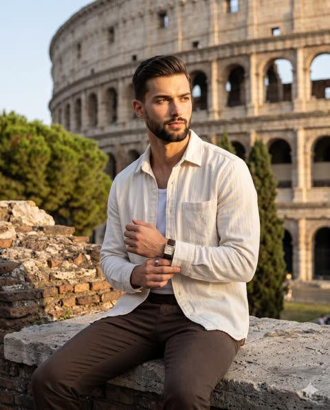</a>

The prompt fixes the pose with specific limb placement (left hand on thigh, right hand gripping the left cuff) and sets one directional light at 45 degrees from the front left, naming the shadows it casts so the lighting stays consistent. The 85mm lens and wide aperture keep the subject sharp while the landmark stays recognizable but soft behind him.

Nano Banana 2 · Text-to-image · Source: [@pictsbyai on X](https://x.com/pictsbyai/status/2061848357283266661) · 92 likes on 2026-10-29

[`portrait`](tags.md#tag-portrait) [`golden-hour`](tags.md#tag-golden-hour) [`rome`](tags.md#tag-rome) [`menswear`](tags.md#tag-menswear)

<details><summary><b>Prompt</b></summary>

```text
A young adult male sits calmly on a highly eroded, unfinished ancient stone wall, his body angled slightly to the right while his weight is comfortably centered. He wears a textured, off-white button-down shirt and deep brown trousers. His face bears a contemplative, confident expression with a neutral mouth and eyes focused distantly off to the right. His wavy brown hair features subtle, natural flyaways catching the warm light. His left hand rests naturally on his left thigh with loosely curled fingers, revealing a silver ring on the ring finger and a square-dial watch with a black leather strap, while his relaxed right hand reaches organically across his torso to gently grip and adjust the cuff of his left sleeve. He is layered over a monumental, deep background featuring the awe-inspiring architecture of the Roman Colosseum, its massive, weathered travertine stone arcades and interior ruins stretching expansively into the center and top of the frame. To the top left, the thriving dark green needle clusters of a Mediterranean pine tree and leafy midground bushes organically frame the ancient structures against a clear blue sky. The foreground seating wall beneath him features a rough, matte masonry surface of warm grays and earth tones, rich with pitted textures, deep crevices, and organic debris. A bright, highly directional single light source of warm golden hour sunlight pours in from a 45-degree front-left angle, creating a striking, high-contrast cinematic mood. This hard light preserves brilliant golden ochre highlights on the left side of his face, hair tips, left shoulder, and arm, while casting dramatic, deep black, harsh-edged shadows across the right side of his face, neck, and torso, including a distinct nose shadow cleanly defined on his right cheek. Shot as a realistic digital photograph on an 85mm lens at a wide aperture, the image maintains tack-sharp focus on the subject and the foreground stone's rugged texture, while a medium depth of field renders the architectural background slightly soft yet distinctly recognizable without any film grain. Post-processing enhances the warm golden and orange highlights, deepens the shadowy blacks for pronounced dramatic effect, and slightly lifts clarity on the fabric and masonry, perfectly encapsulating contemporary lifestyle travel portraiture framed in a 4:5 aspect ratio.
```

</details>

<a id="nano-banana-hooded-bw-eye-light-portrait"></a>
### Hooded black and white portrait with eye light

<a href="https://x.com/ChillaiKalan__/status/2073609440037597601">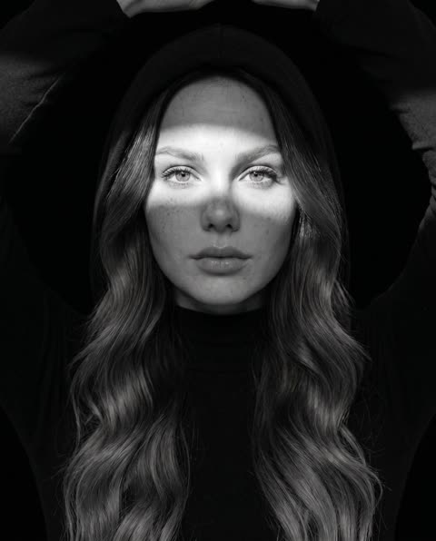</a>

Stacking lighting, lens and grading terms (Rembrandt light, 85mm f/1.8, high contrast monochrome) gives the model a precise photographic brief. The hood variation confines a narrow beam to the eyes against a pure black background for strong chiaroscuro.

Nano Banana 2 · Text-to-image · Source: [@ChillaiKalan__ on X](https://x.com/ChillaiKalan__/status/2073609440037597601) · 92 likes on 2026-10-29

[`black-and-white`](tags.md#tag-black-and-white) [`fashion-portrait`](tags.md#tag-fashion-portrait) [`chiaroscuro`](tags.md#tag-chiaroscuro) [`studio-lighting`](tags.md#tag-studio-lighting)

<details><summary><b>Prompt</b></summary>

```text
Ultra-realistic fine art black-and-white portrait, editorial fashion photography, close-up centered composition, direct eye contact, calm yet emotionally powerful expression, flawless natural skin texture with subtle freckles and pores, cinematic high-contrast monochrome grading, dramatic Rembrandt lighting with soft directional light, deep blacks and luminous highlights, razor-sharp eyes with catchlights, premium medium-format camera quality, 85mm portrait lens, f/1.8, shallow depth of field, museum-quality fine art photography, minimalist composition, timeless elegance, luxury Vogue-style editorial, rich tonal range, ultra-detailed facial features, photorealistic, HDR, 8K resolution, award-winning portrait photography.

Variation 1 (Underwater): Half-submerged underwater portrait, crystal-clear water surface crossing the forehead, natural water caustic light patterns dancing across the face and shoulders, floating hair, tiny air bubbles, soft underwater haze, blurred fish in the distant background, tranquil atmosphere, surreal yet realistic, monochrome fine-art aesthetic.

Variation 2 (Studio Hood): Black hooded outfit against a pure black background, narrow beam of light illuminating only the eyes and upper face, soft shadow falloff, symmetrical composition, dramatic chiaroscuro, elegant fashion editorial styling, mysterious cinematic mood, luxury magazine cover aesthetic.

Negative Prompt: low resolution, blurry, overprocessed skin, waxy face, plastic texture, extra limbs, deformed eyes, asymmetrical face, duplicated features, noisy image, oversharpened, artifacts, watermark, logo, text, cropped head, bad anatomy, unrealistic lighting, cartoon, CGI, low quality, distorted proportions.
```

</details>

<a id="nano-banana-seated-woman-fan-wall-vintage-portrait"></a>
### Seated woman before a wall of vintage star portraits

<a href="https://x.com/mehvishs25/status/2042256010040197281">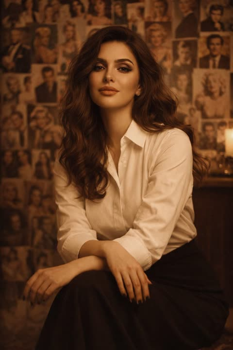</a>

The prompt pins the framing with a medium shot, centered composition and a named film look (35mm, film grain, shallow depth of field), so the color grade and layout hold together. Describing the background as a magazine cutout collage gives the scene a readable story without naming anyone.

Nano Banana 2 · Text-to-image · Source: [@mehvishs25 on X](https://x.com/mehvishs25/status/2042256010040197281) · 92 likes on 2026-10-29

[`portrait`](tags.md#tag-portrait) [`film-look`](tags.md#tag-film-look) [`vintage`](tags.md#tag-vintage) [`warm-tones`](tags.md#tag-warm-tones)

<details><summary><b>Prompt</b></summary>

```text
A cinematic portrait of a young elegant woman sitting in a softly lit room, medium shot, warm ambient lighting, vintage aesthetic. She sits calmly facing the camera with a subtle confident smile. Behind her is a wall covered with magazine cutouts and posters of famous actors and celebrities, creating a fan-wall collage. She is wearing an elegant, classy outfit — a long stylish skirt and refined top, sophisticated and graceful. Soft film grain, shallow depth of field, cozy indoor atmosphere, warm tones, cinematic color grading, realistic skin texture, 35mm film look, portrait photography, centered composition.
```

</details>

<a id="gpt-image-iphone-photo-woman-in-cafe"></a>
### Realistic iPhone photo of a woman in cafe

<a href="https://x.com/blueemi99/status/2097602273085931662"></a>

Naming the capture device and a simple scene is enough to trigger a candid phone photo look, with warm pendant lighting, soft background blur, and a casual hand on cheek pose. A very short prompt leaves the model free to choose natural composition.

GPT Image 2.5 · Text-to-image · Source: [@blueemi99 on X](https://x.com/blueemi99/status/2097602273085931662) · 91 likes on 2026-10-28

[`iphone-photo`](tags.md#tag-iphone-photo) [`cafe`](tags.md#tag-cafe) [`candid`](tags.md#tag-candid) [`short-prompt`](tags.md#tag-short-prompt) [`realistic`](tags.md#tag-realistic)

<details><summary><b>Prompt</b></summary>

```text
GPT Image 2.5

"make me a realistic iphone photo of a woman in a cafe"

I dont get how people are getting bad results from this model, genuinely few words prompt and looks so good and realistic
```

</details>

<a id="nano-banana-douyin-doll-top-down-selfie"></a>
### Top-down selfie of woman in doll makeup

<a href="https://x.com/kingofdairyque/status/2078461655726592211">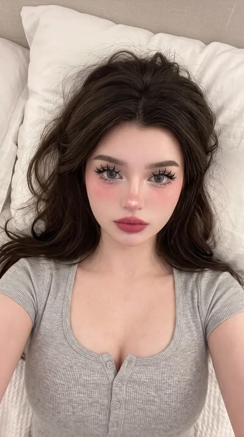</a>

Naming a style and then listing concrete details such as garment, lens colour, lash type and blush placement turns a vague beauty request into a checklist the model can follow. A direct line asking to keep the original face anchors identity in an edit.

Nano Banana 2 · Edit · Source: [@kingofdairyque on X](https://x.com/kingofdairyque/status/2078461655726592211) · 91 likes on 2026-10-29

[`douyin-makeup`](tags.md#tag-douyin-makeup) [`selfie`](tags.md#tag-selfie) [`top-down`](tags.md#tag-top-down) [`portrait`](tags.md#tag-portrait)

<details><summary><b>Prompt</b></summary>

```text
Don't change her face original—100% authentic with perfect facial symmetry. She should have a youthful, feminine appearance. Create a captivating, intimate top-down portrait selfie inspired by the popular Douyin makeup aesthetic, featuring a young woman lying comfortably on her back in a relaxed pose that radiates femininity and grace. The image is captured directly from above in a slightly tilted bird's-eye perspective, creating a spontaneous, alluring composition focused entirely on her captivating facial features and her direct gaze into the camera. She looks at the lens with wide, sharp eyes and a calm, relaxed expression without an open smile, giving the portrait a mysterious, dramatic, and confident mood. Her makeup follows the signature Douyin doll style with enchanting gray or light-blue colored contact lenses, long, thick, wispy manga-style false lashes, highlighted aegyo-sal to make the eyes appear larger and more alluring, and perfectly brushed, precisely defined eyebrows. Intense pink blush is generously applied beneath the eyes, across the cheeks, and over the tip of the nose to create a soft, flushed complexion, while a delicate beauty mark is clearly visible on the right side of her nose tip. Her lips are full, well-defined, and finished in a matte berry-pink shade that enhances their soft, attractive shape. She wears a fitted, short-sleeved ribbed Henley-style top in light gray with a wide open neckline and small front buttons. Her thick, dark chocolate-brown hair falls naturally in a loose, messy style across the pillow surrounding her head and forehead, emphasizing the relaxed atmosphere. She is lying on a cozy bed or sofa with a soft white or cream-colored pillow featuring an embossed textured pattern behind her head. Soft, diffused indoor lighting evenly illuminates her face, highlighting her velvety skin texture and intricate makeup details without harsh shadows, creating an intimate, cozy mood. Preserve her original facial features exactly without any alteration. Ultra-realistic, HD image quality, 9:16 aspect ratio.
```

</details>

<a id="nano-banana-peony-bouquet-terracotta-portrait"></a>
### Woman Behind Oversized Peony Bouquet on Terracotta

<a href="https://x.com/TheVirtualMuse/status/2109224903732089215"></a>

An identity lock block comes first and keeps the reference face intact. Then the bouquet is itemised flower by flower, the frame is placed in percentages, and the light is set with a named camera and lens.

Nano Banana 2.1 · Edit · Source: [@TheVirtualMuse on X](https://x.com/TheVirtualMuse/status/2109224903732089215) · 90 likes on 2026-10-28

[`floral`](tags.md#tag-floral) [`fashion-editorial`](tags.md#tag-fashion-editorial) [`identity-lock`](tags.md#tag-identity-lock) [`golden-hour`](tags.md#tag-golden-hour) [`studio-portrait`](tags.md#tag-studio-portrait)

<details><summary><b>Prompt</b></summary>

```text
Using the uploaded reference image as the ONLY facial identity source, create an ultra-realistic, high-end luxury fashion editorial portrait featuring the exact same person holding an oversized, beautifully arranged floral bouquet.

MASTER IDENTITY LOCK (CRITICAL):

Preserve the reference person's facial identity with maximum possible accuracy. Maintain the exact facial structure, eye shape, eyebrows, nose, lips, jawline, cheekbones, natural skin tone, age, and recognizable facial characteristics.

Retain authentic skin texture, visible pores, natural facial asymmetry, and realistic imperfections. No beautification, facial reconstruction, artificial skin smoothing, or identity changes.

SUBJECT & STYLING:

The woman stands elegantly against a warm, burnt-terracotta studio backdrop, wearing a luxurious oversized beige tailored blazer with structured shoulders, notched lapels, refined stitching, and realistic linen-wool fabric texture.

Her dark brown hair is styled in a voluminous, softly tousled side-parted bob with natural movement, individual flyaway strands, and realistic shine.

Minimal sophisticated makeup, softly defined eyebrows, natural eyelashes, subtle warm blush, and muted nude-pink lips.

Her expression is calm, intimate, and effortlessly confident, looking directly into the camera.

FLORAL ARRANGEMENT (CRITICAL):

She holds an enormous, luxurious asymmetrical bouquet covering most of her upper torso and partially concealing the left side of her face.

The arrangement features:

Large, fully bloomed coral-pink peonies with intricate layered petals and golden centers.

Three prominent ivory-white anthurium flowers with delicate veining, glossy sculptural petals, and pale cream spadices.

Smaller blush-pink peonies and unopened flower buds.

Delicate dried pink astilbe and soft peach botanical fillers.

Pale ivory blossoms scattered naturally throughout the arrangement.

Sculptural dried golden palm leaves extending upward between the flowers.

Every flower must display extraordinary botanical realism, natural petal translucency, delicate imperfections, and physically accurate textures.

The bouquet is wrapped in oversized, sculptural charcoal-black textured floral paper with dramatic angular folds, finished with a long, luxurious matte-black satin ribbon tied into an elegant bow.

POSE & COMPOSITION:

Vertical medium portrait, framed from the upper thighs to slightly above the head.

The subject stands slightly right of center, holding the bouquet naturally across her chest with both arms.

The bouquet dominates the left and central portions of the composition.

One large white anthurium partially overlaps her left eye and cheek, while her right eye remains clearly visible and sharply focused.

Her face emerges naturally from behind the flowers, creating an intimate, mysterious editorial composition.

The flowers occupy approximately 60% of the frame, with the subject's face positioned in the upper-right third.

LIGHTING & ATMOSPHERE:

Dramatic late-afternoon sunlight enters from the upper left, producing warm directional illumination across her face, blazer, and flowers.

Strong yet naturally softened shadows create beautiful dimensional contrast.

Distinct botanical shadows fall across her beige blazer and the terracotta wall behind her.

Rich burnt-orange background tones contrast elegantly with the ivory flowers, coral-pink peonies, beige tailoring, and deep-black bouquet wrapping.

Authentic golden-hour warmth, sophisticated editorial contrast, subtle film grain, natural highlight roll-off, and rich cinematic shadows.

CAMERA & IMAGE QUALITY:

Photographed as a real luxury fashion campaign using a Hasselblad X2D 100C medium-format camera with an 80mm portrait lens.

f/2.8 aperture, ISO 100, realistic optical depth of field, precise eye focus, beautifully resolved flower details, and subtle background softness.

Premium Vogue-inspired floral fashion photography, authentic medium-format rendering, refined luxury magazine color grading, extraordinary photographic detail, realistic dynamic range, and natural skin tones.

8K-quality appearance, exceptionally sharp where focused, physically accurate materials, realistic hands and fingers, and professional studio photography.

FINAL REQUIREMENTS:

The final result must look like an authentic photograph captured by a world-class fashion photographer, not an AI-generated image.

Preserve natural human anatomy, believable flower proportions, realistic shadows, and accurate fabric behavior.

No CGI, 3D rendering, illustration, plastic skin, excessive retouching, artificial HDR, oversaturation, distorted facial features, unnatural hands, duplicated flowers, text, logos, or watermarks.

Aspect Ratio: 9:16 vertical.
```

</details>

<a id="nano-banana-christmas-woman-leaps-from-gift-box"></a>
### Woman leaps from giant red gift box

<a href="https://x.com/songguoxiansen/status/2002377353855709253"></a>

Pairs a frozen mid air jump with a lid flying off the box, so the motion comes from ribbons, tags and snow scattering outward. The light is set as a glow from inside the box, which lifts the subject from below against a softly blurred fireplace room.

Nano Banana Pro · Text-to-image · Source: [@songguoxiansen on X](https://x.com/songguoxiansen/status/2002377353855709253) · 89 likes on 2026-10-29

[`christmas`](tags.md#tag-christmas) [`gift-box`](tags.md#tag-gift-box) [`portrait`](tags.md#tag-portrait) [`motion`](tags.md#tag-motion)

<details><summary><b>Prompt</b></summary>

```text
(Dynamic action photography, explosion composition, festive art style). An explosive surprise composition where a young woman bursts out from a giant Christmas gift box in a moment of pure joy.

The Action: The character is wearing a white faux fur winter coat and a red Santa hat, leaping upward with arms raised in celebration, frozen in mid-air jump. A huge red and gold wrapped gift box below her is exploding open with the lid flying off.

Dynamic Elements: Colorful ribbons and wrapping paper pieces explode outward in all directions. Snow and magical glitter burst upward like confetti. Small snow-covered pine trees with colorful Christmas lights shoot out from the box. Gift tags, ornaments, and tinsel swirl in the air. Snowflakes scatter in the explosive motion.

Background: Soft-focused cozy living room with Christmas decorations, fireplace, creating warm festive atmosphere.

Lighting: Magical glow emanating from inside the gift box, illuminating the character from below with warm golden light. Colorful Christmas lights create bokeh trails. Dynamic motion blur on flying objects.

Technical: High-speed photography freeze frame, particle explosion effects, dynamic composition, vibrant festive colors, 8k resolution, joyful and energetic aesthetic.
```

</details>

<a id="nano-banana-olive-sweater-terracotta-studio-portrait"></a>
### Seated studio portrait in olive sweater and beige trousers

<a href="https://x.com/frametheory058/status/2061830756364947855">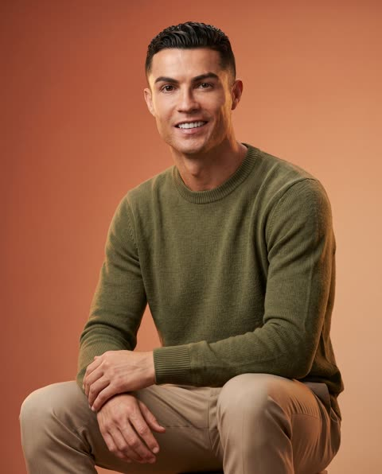</a>

Pins the reference pose, framing and hand placement while swapping identity and outfit, so the model edits the person instead of inventing a new scene. The terracotta-to-sand backdrop echoes the olive and beige clothing, and the camera body and lens line adds photographic realism.

Nano Banana 2 · Edit · Source: [@frametheory058 on X](https://x.com/frametheory058/status/2061830756364947855) · 89 likes on 2026-10-29

[`studio-portrait`](tags.md#tag-studio-portrait) [`reference-pose`](tags.md#tag-reference-pose) [`fashion-photo`](tags.md#tag-fashion-photo) [`color-palette`](tags.md#tag-color-palette)

<details><summary><b>Prompt</b></summary>

```text
Create an ultra premium studio portrait using the uploaded person’s REAL face, hairstyle, beard style, and facial identity. Do NOT copy the reference model’s facial features or hair. Preserve the uploaded person’s natural appearance completely.

Match only the EXACT sitting pose, body angle, hand placement, camera framing, composition, and relaxed posture from the reference image. Maintain the same modern editorial studio aesthetic and confident lifestyle vibe.

Dress the person in a luxurious olive green knitted sweater paired with tailored beige trousers. The background should be a smooth warm terracotta-to-soft sand gradient studio backdrop that perfectly complements the outfit tones and creates a premium harmonious color palette.

Lighting should be soft professional studio lighting with subtle warm highlights, realistic shadows, cinematic depth, and clean luxury contrast. Keep the mood minimal, modern, stylish, and highly Instagram-worthy.

Ultra realistic skin texture, natural body proportions, premium fashion photography style, shallow depth of field, soft background blur, realistic fabric texture, luxury creator-brand photoshoot aesthetic.

Shot on Sony A7 IV, 50mm lens, f/2.2, photorealistic, ultra detailed, high-end color grading, editorial magazine quality, 8k.
```

</details>

<a id="chatgpt-1980s-male-portrait-warm-lamp"></a>
### 1980s man in blazer, silk shirt and gold chain

<a href="https://www.tiktok.com/@lenardfrancisco/video/7683830698725215495">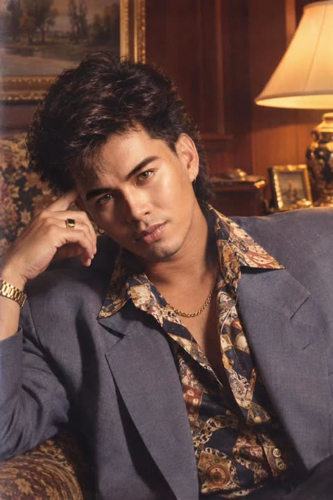</a>

The prompt locks identity with an explicit preserve list, then builds the period look in layers: teased hair, a structured blazer and patterned silk shirt, and an upscale interior. It finishes with camera cues such as soft flash, halation, a named Kodak film stock and a 35mm lens, which push the result toward a scanned print rather than a glossy AI render.

ChatGPT · Edit · Source: [@lenardfrancisco on TikTok](https://www.tiktok.com/@lenardfrancisco/video/7683830698725215495) · 86 likes on 2026-10-30

[`1980s`](tags.md#tag-1980s) [`portrait`](tags.md#tag-portrait) [`film-look`](tags.md#tag-film-look) [`identity-preserving`](tags.md#tag-identity-preserving)

<details><summary><b>Prompt</b></summary>

```text
Transform this photo into an authentic late-1980s male portrait while preserving my exact facial identity, facial proportions, skin tone, eyes, nose, lips, jawline, facial hair, and all natural facial features. Do not change my face or make me look like another person. Give me authentic 1980s voluminous men’s hair—thick, naturally teased, softly wavy, with plenty of body and realistic individual strands and subtle flyaways. Keep the hairstyle masculine and believable for the late 1980s. Dress me in an authentic late-1980s men’s fashion look: a sophisticated structured blazer with broad shoulders over a luxurious patterned silk shirt with an open collar, subtle gold chain and tasteful gold jewelry. Make the clothing fashionable, elegant, and period-accurate rather than costume-like. Set the scene in an upscale 1980s interior, such as an elegant living room or bedroom with warm table lamps, vintage furniture, framed artwork, rich fabrics, wood details, and subtle period-accurate décor. Create a glamorous but natural atmosphere. Avoid excessive neon or cheesy props. Photograph me as if using a professional 1980s 35mm film camera with a high-quality portrait lens. Use realistic soft flash photography, shallow depth of field, natural skin texture, realistic shadows, subtle halation, gentle highlight bloom, slightly warm Kodak film color rendering, authentic film grain, and minor imperfections from an actual scanned film photograph. Ultra-realistic professional portrait photography, authentic late-1980s Kodak 35mm film aesthetic, realistic skin pores and texture, detailed natural hair, cinematic composition, warm nostalgic color palette, soft flash, realistic depth of field, true-to-life facial features. Do not alter my identity. Do not feminize my face. Do not make me look like a different person. Do not make the image cartoonish, overly smooth, plastic-looking, excessively grainy, distorted, or obviously AI-generated. Avoid modern clothing, modern interiors, excessive neon, exaggerated makeup, fantasy elements, or unrealistic facial features
```

</details>

<a id="gpt-image-selfie-chibi-self-painting-cheek-canvas"></a>
### Selfie with chibi self painting her cheek

<a href="https://x.com/Arina_hoqe/status/2098966830874595582"></a>

A labeled block structure (hair, face, outfit, concept, chibi, background, style, camera) keeps the real woman and her painted twin consistent. Matching paint splatters and a fourth wall breaking gesture blend photo realism with 3D chibi art, while face reference rules preserve identity from the uploaded photo.

GPT Image 2.5 · Edit · Source: [@Arina_hoqe on X](https://x.com/Arina_hoqe/status/2098966830874595582) · 85 likes on 2026-10-28

[`selfie`](tags.md#tag-selfie) [`chibi`](tags.md#tag-chibi) [`paint-splatter`](tags.md#tag-paint-splatter) [`fourth-wall`](tags.md#tag-fourth-wall) [`art-studio`](tags.md#tag-art-studio)

<details><summary><b>Prompt</b></summary>

```text
Study the uploaded photo’s facial features and use them as inspiration to create a fun selfie-style photo of a similar-looking young woman with a creative cartoon canvas twist.

Hair: Messy, tousled dark hair with colorful paint splatters scattered naturally across the hair and face, soft loose strands, light natural texture.

Face/Skin: Preserve the recognizable facial features and overall identity from the reference image while creating a female version. Natural youthful skin with colorful paint speckles in purple, orange, and blue across the face. Big laughing open-mouth smile, playful joyful expression, expressive eyes, natural feminine appearance, no jewelry, no tattoos.

Outfit: Purple/lavender knit sweater, casual artistic look with colorful paint splatters on the clothing.

Concept: Taking a close-up selfie next to an easel canvas, where a cute chibi cartoon version of herself is painted on the canvas. The illustrated cartoon character is playfully reaching out of the canvas, holding a paintbrush and painting/touching the real woman’s cheek with colorful paint, creating a fun fourth-wall-breaking interaction between the real person and the illustration.

Chibi Cartoon on Canvas: A cute female chibi version of the same woman, with the same messy dark hair, colorful paint splatters, big expressive cartoon eyes, cheerful laughing smile, wearing a purple/lavender off-shoulder top. She is leaning out of the canvas frame with one arm extended, holding a paintbrush and playfully touching the real woman’s cheek.

Background: Cozy creative art studio, softly blurred art supplies, colorful paint bottles, brushes, canvases, and wooden shelves in the background. Warm natural window lighting. Wooden easel with clearly visible paint-splattered edges.

Art Style: Photorealistic selfie photography seamlessly blended with a vibrant high-quality 3D chibi cartoon illustration. Realistic skin texture, natural facial details, colorful paint-splatter texture throughout, playful energetic composition, premium photography, high detail.

Camera: Close-up selfie perspective, slightly wide-angle lens, natural handheld selfie framing, capturing both the real woman’s face and the full interaction with the canvas painting. Realistic depth of field, cinematic lighting, sharp facial details.

Face Reference Rules: Use the uploaded image as the primary facial reference. Preserve the same recognizable facial structure, eyes, nose, lips, face shape, skin tone, and overall identity as closely as possible. Do not replace the identity with a generic face. Keep the woman looking naturally like the reference person while adapting the appearance into a feminine version of the concept.

Text Overlay: Small stylish signature-style text in the top corner reading exactly: “Arina Ai”

Negative Prompt: blurry face, distorted facial features, extra fingers, extra limbs, duplicate person, deformed hands, bad anatomy, jewelry, tattoos, masculine body, plastic skin, unrealistic face, anime real person, low quality, excessive makeup, text errors, misspelled “Arina Ai”, watermark, logo.
```

</details>

<a id="nano-banana-london-townhouse-street-style-identity-lock"></a>
### London Townhouse Street Style in Leather Jacket

<a href="https://x.com/iamrealsnow/status/2107680165736468917"></a>

Opens by locking identity, face, hairstyle and body proportions to the reference image, then specifies the location, door and railings, and each garment with its material. Closes with overcast light, 50mm lens, shallow depth of field, film grain and a no text, no watermark line.

Nano Banana 2.1 · Edit · Source: [@iamrealsnow on X](https://x.com/iamrealsnow/status/2107680165736468917) · 85 likes on 2026-10-28

[`street-style`](tags.md#tag-street-style) [`fashion`](tags.md#tag-fashion) [`identity-reference`](tags.md#tag-identity-reference) [`london`](tags.md#tag-london) [`photorealistic`](tags.md#tag-photorealistic)

<details><summary><b>Prompt</b></summary>

```text
Use the reference image as the exact identity reference. Preserve the subject’s facial identity, facial proportions, hairstyle, body proportions and natural appearance. Create a photorealistic high-fashion street-style photograph in London. The subject is standing outside a classic British townhouse with a muted blue-gray paneled door and black wrought-iron railings. She wears a fitted black ribbed turtleneck, oversized dark brown vintage leather jacket with a soft shearling collar, brown mini skirt, and carries a structured dark brown leather handbag with gold hardware. Oversized dark sunglasses, minimal makeup, effortless model-off-duty expression. Overcast natural daylight, muted neutral color palette, realistic shadows, authentic leather texture, subtle film grain, editorial fashion photography, candid street photography, 50mm lens, shallow depth of field, extremely photorealistic, no text, no watermark.
```

</details>

<a id="chatgpt-off-shoulder-knit-studio-portrait"></a>
### Off shoulder knit portrait on pale studio backdrop

<a href="https://www.tiktok.com/@sandra.social/video/7685497499645218070">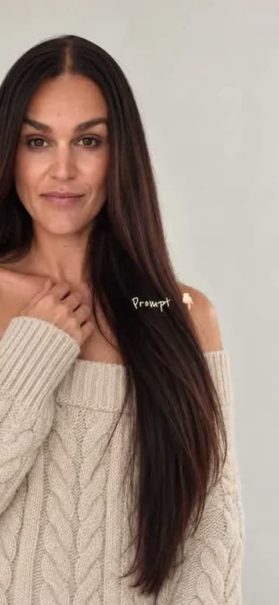</a>

The prompt anchors identity to the uploaded reference photos and fixes outfit, hair and makeup as locked details so the look stays consistent. The 50mm eye-level framing with the subject in the left third leaves open space on the right for text.

ChatGPT · Edit · Source: [@sandra.social on TikTok](https://www.tiktok.com/@sandra.social/video/7685497499645218070) · 83 likes on 2026-10-30

[`portrait`](tags.md#tag-portrait) [`editorial`](tags.md#tag-editorial) [`studio`](tags.md#tag-studio) [`knitwear`](tags.md#tag-knitwear)

<details><summary><b>Prompt</b></summary>

```text
Soft Focus Portrait editorial photoshoot. Use the uploaded reference photos as the only source for the person's face and identity. Preserve the person's facial structure, face shape, skin tone, natural skin texture, body proportions, age, hair color, and overall look from the reference photos. Scene: the same off-white to light gray studio backdrop, diffused even light from the same side, clean and uncluttered with generous negative space. Outfit: the same off-shoulder oatmeal beige ribbed knit sweater, chunky cable-knit texture, wide neckline resting below the shoulders. Hair: long straight deep black hair down and settled over one shoulder, smooth with minimal movement. Keep the person's natural hair color from the uploaded reference photos. Makeup: the same dewy soft-glow finish, warm bronze-taupe eyeshadow, mauve-brown matte lip, polished, not heavy glam. Accessories/props: none visible. No phone. No jewelry. Pose: standing straight facing the camera, shoulders squared, chin level, one hand resting lightly at the collarbone, direct steady gaze into the lens with a calm closed-lip expression. Camera + lens: shot on Canon EOS R5 with a 50mm lens, medium framing from head to chest, no wide-angle distortion. Camera angle: eye level, medium distance, camera centered directly in front. Composition: vertical 9:16, subject placed in the left third of frame, wide open negative space on the right two-thirds for text placement, background soft and evenly lit. Mood: clean, confident, calm, minimal, balanced. Color grading: warm beige and soft off-white tones, even consistent light, subtle film grain, editorial contrast with clean highlight balance. Image quality: vertical 9:16 portrait, 2K quality, minimum 1440 x 2560 px if available, crisp editorial sharpness, no blur, no low-resolution softness, no compression haze. Avoid: distorted hands, extra fingers, plastic skin, heavy glam makeup, cartoonish AI style, CGI, blur, random logos, cluttered background, uneven lighting.
```

</details>

<a id="nano-banana-cafe-woman-matcha-candid-portrait"></a>
### Young woman with matcha latte at a café

<a href="https://x.com/Sairah_0/status/2050817729767276713">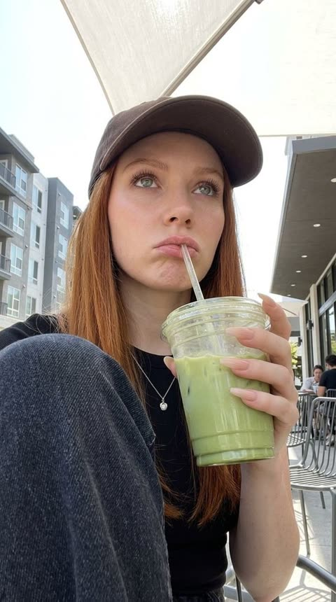</a>

Specific props, a plain outfit and soft daylight anchor the scene, and the word candid asks for an unposed, casual look. Shallow depth of field and a lifestyle framing make the result read like a real phone photo.

Nano Banana 2 · Text-to-image · Source: [@Sairah_0 on X](https://x.com/Sairah_0/status/2050817729767276713) · 83 likes on 2026-10-29

[`portrait`](tags.md#tag-portrait) [`cafe`](tags.md#tag-cafe) [`lifestyle`](tags.md#tag-lifestyle) [`natural-light`](tags.md#tag-natural-light)

<details><summary><b>Prompt</b></summary>

```text
A stylish young woman sitting in the driver’s seat of a luxury convertible car with a red leather interior, parked in front of an elegant modern building. She wears a black sheer blouse and slim black sunglasses, with wavy brown hair and minimal makeup. She turns back over her shoulder, giving a confident, composed look toward the camera. The setting has clean architectural lines and muted colors, enhancing a high-fashion, editorial vibe. Shot in soft daylight, cinematic composition, ultra-realistic, sharp focus, luxury aesthetic.
```

</details>

<a id="gpt-image-lace-dress-cafe-window-portrait"></a>
### Woman in lace dress at café window

<a href="https://x.com/DaniaSafvi/status/2071477298944164056">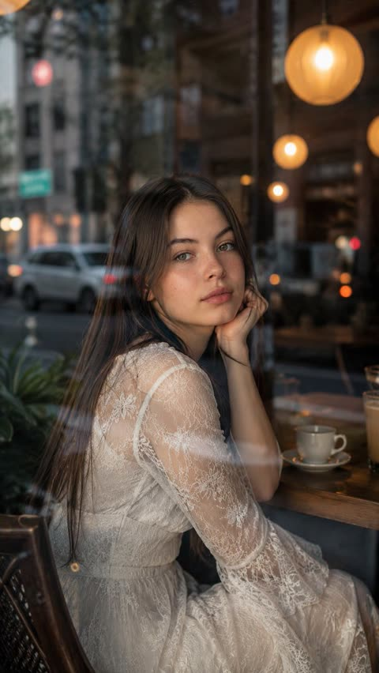</a>

Shooting from outside through the glass layers street reflections over the warm interior, which gives depth and a candid feel. Naming a body and lens such as Sony A7R V with 85mm f/1.4 plus skin texture terms steers the render toward a real photograph.

GPT Image 2 · Text-to-image · Source: [@DaniaSafvi on X](https://x.com/DaniaSafvi/status/2071477298944164056) · 82 likes on 2026-10-29

[`portrait`](tags.md#tag-portrait) [`cafe`](tags.md#tag-cafe) [`glass-reflection`](tags.md#tag-glass-reflection) [`bokeh`](tags.md#tag-bokeh)

<details><summary><b>Prompt</b></summary>

```text
Ultra-realistic cinematic street portrait photography, 9:16 vertical ratio. A young Asian woman with fair, bright skin sitting alone inside a modern cafe near a large glass window facing the city street.
Pose: sitting sideways on a chair, body slightly turned away from the camera, head turned back to gaze directly at the camera with a calm, elegant, and mysterious expression. And one of her hands is resting on her chin. Wearing a white embroidered lace dress.
Long, voluminous black hair cascading naturally, minimal natural makeup.
The shot is taken from outside the cafe through the glass window, creating a soft reflection of vehicles, city buildings, and pedestrians on the glass surface. A small wooden table beside her with a cup of white coffee and a glass of latte. The cafe interior is warm with golden-yellow round pendant lights producing large, soft bokeh. The city background appears blurred with a shallow depth of field.
Natural spotlight from nighttime street lamps, soft ambient light, cinematic mood, muted colors, premium editorial photography, candid lifestyle shot, realistic skin texture, healthy skin with visible natural pores, high detail face, sharp eyes, soft shadows, creamy bokeh, glass reflection effect, shallow depth of field, Sony A7R V, 85mm f/1.4 lens, photorealistic, HDR, 8K, masterpiece, highly detailed, magazine-quality street cafe portrait.
```

</details>

<a id="nano-banana-embroidered-dress-beige-tile-portrait"></a>
### Smiling woman in embroidered dress before beige tiles

<a href="https://x.com/HaniaAi12/status/2060664884035981663">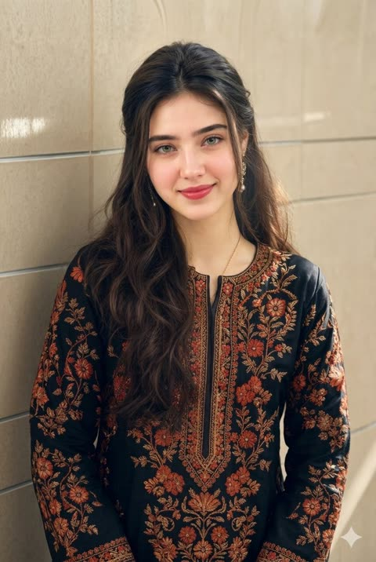</a>

Stacking a precise subject description with lighting, lens and grading cues such as soft daylight, shallow depth of field and warm colour grading produces a convincing photoreal portrait. Naming the outfit colours and the beige tiled wall keeps the palette and background consistent with the scene.

Nano Banana 2 · Text-to-image · Source: [@HaniaAi12 on X](https://x.com/HaniaAi12/status/2060664884035981663) · 82 likes on 2026-10-29

[`portrait`](tags.md#tag-portrait) [`photorealistic`](tags.md#tag-photorealistic) [`fashion`](tags.md#tag-fashion) [`natural-light`](tags.md#tag-natural-light)

<details><summary><b>Prompt</b></summary>

```text
A beautiful young woman with fair skin and long, silky dark-brown hair cascading over her shoulders, standing in front of a modern beige tiled wall. She wears a stylish black embroidered ethnic dress featuring vibrant red and orange floral patterns. Soft natural daylight illuminates her face, creating a warm, glowing complexion with subtle makeup and a gentle smile. Ultra-realistic portrait photography, shallow depth of field, soft cinematic lighting, high-detail skin texture, elegant and graceful expression, warm color grading, aesthetic social media reel style, 4K quality, DSLR photography, natural beauty, dreamy atmosphere, highly detailed, photorealistic.
```

</details>

<a id="nano-banana-low-key-studio-portrait-black-backdrop"></a>
### Low key studio portrait on seamless black

<a href="https://x.com/john_my07/status/2107801411711123546"></a>

One directional light leaves half the face fading into shadow against a seamless black backdrop. Naming skin details like pores and peach fuzz, plus a 35mm lens and film grain, pushes the result toward a real photograph and away from smooth AI skin.

Nano Banana 2.1 · Text-to-image · Source: [@john_my07 on X](https://x.com/john_my07/status/2107801411711123546) · 82 likes on 2026-10-28

[`portrait`](tags.md#tag-portrait) [`low-key`](tags.md#tag-low-key) [`studio-lighting`](tags.md#tag-studio-lighting) [`photorealistic`](tags.md#tag-photorealistic) [`skin-texture`](tags.md#tag-skin-texture)

<details><summary><b>Prompt</b></summary>

```text
Create an ultra-realistic, high-end cinematic portrait of a beautiful young woman, framed in a tight head-and-shoulders composition. She faces the camera directly with a calm yet intense expression and a confident, captivating gaze.

Use dramatic low-key studio lighting with a strong directional light illuminating one side of her face while the opposite side gradually disappears into deep, atmospheric shadow. Keep the background completely black and seamless, creating a striking contrast around her silhouette.

Her eyes are deep brown with subtle geometric catchlights. Give her naturally textured, slightly damp-looking hair with individual strands visible and realistic volume. She wears a simple, elegant black crew-neck top with no visible logos or patterns.

Capture extremely realistic skin with visible pores, fine facial texture, subtle imperfections, delicate peach fuzz, natural lips, and detailed eyelashes. Avoid overly smooth or plastic-looking skin.

Photographed with a cinematic 35mm lens aesthetic, shallow depth of field, soft optical falloff, realistic tonal range, subtle analog film grain, and premium editorial photography quality. The final image should feel like an authentic photograph captured in a professional studio — sophisticated, raw, atmospheric, and completely photorealistic, with no obvious AI-generated appearance.
```

</details>

<a id="nano-banana-striped-tee-blue-eyes-portrait"></a>
### Smiling woman with black hair in green striped tee

<a href="https://x.com/Zarlish_Shahid/status/2079734611962405293"></a>

Camera and lens cues such as DSLR, 85mm, shallow depth of field and soft sunlight lock in a realistic photo style. The itemized appearance traits give the face a specific, consistent description.

Nano Banana 2 · Text-to-image · Source: [@Zarlish_Shahid on X](https://x.com/Zarlish_Shahid/status/2079734611962405293) · 82 likes on 2026-10-29

[`portrait`](tags.md#tag-portrait) [`photorealism`](tags.md#tag-photorealism) [`85mm-lens`](tags.md#tag-85mm-lens) [`soft-sunlight`](tags.md#tag-soft-sunlight)

<details><summary><b>Prompt</b></summary>

```text
A breathtakingly beautiful young woman with long silky black hair, mesmerizing large crystal-blue eyes, flawless fair glowing skin, soft rosy pink lips, naturally defined eyebrows, and a gentle heartwarming smile. She is wearing a stylish green and white T-shirt. Ultra-realistic face, perfect symmetrical features, soft natural makeup, cinematic lighting, shallow depth of field, elegant pose, luxurious hair, photorealistic, DSLR portrait, 85mm lens, soft sunlight, highly detailed skin texture, masterpiece, 8K, ultra HD, realistic photography.
```

</details>

<a id="gpt-image-cafe-golden-hour-over-shoulder-portrait"></a>
### Golden hour cafe portrait through foreground bokeh

<a href="https://x.com/mehvishs25/status/2105280094994587829"></a>

Over-the-shoulder framing with two blurred foreground figures creates a candid peek through a gap, while the 85mm f/1.4 lens and shallow depth of field keep focus on her eyes. Backlit golden hour light plus named film stocks (Portra 400, Gold 200), grain and halation give the warm analog look.

GPT Image 2.5 · Text-to-image · Source: [@mehvishs25 on X](https://x.com/mehvishs25/status/2105280094994587829) · 78 likes on 2026-10-28

[`candid-portrait`](tags.md#tag-candid-portrait) [`golden-hour`](tags.md#tag-golden-hour) [`film-look`](tags.md#tag-film-look) [`bokeh`](tags.md#tag-bokeh) [`cafe`](tags.md#tag-cafe)

<details><summary><b>Prompt</b></summary>

```text
Candid cinematic portrait of a woman with a warm, playful, knowing smile, seated at a café table and looking directly at the camera through a gap between two out-of-focus people in the foreground. She has voluminous, tousled, shoulder-length curly hair in honey-brown and caramel tones with sun-lightened highlights, messy shaggy curtain bangs falling across her forehead and eyes, strands catching the light like a glowing halo. Her skin is sun-kissed and warm, with natural texture, minimal makeup, a soft muted-rose lip, and a slight smirk that reads as relaxed and flirtatious. She wears a black oversized knit cardigan or soft black jacket, layered with delicate thin gold necklaces of different lengths.
On the wooden table in front of her sits a white-lidded brown paper takeaway coffee cup, and beside it a small glass of amber tea. In the extreme foreground, blurred shoulders and heads frame the shot: on the left, a person in a striped beanie and white t-shirt, on the right, a person in a dark brown top with dark curly hair, both heavily out of focus.
Setting: a sunlit café interior beside a large window, with a blurred street scene, a soft peach and white building, and a pale sky visible outside.
Lighting: Strong golden-hour sunlight pouring in from the side and behind, creating a glowing rim light through her hair, warm orange highlights across her face, and deep chocolate-brown shadows. Sun-drenched, hazy, slightly overexposed highlights with a soft bloom.
Style / Mood: Warm, nostalgic, effortless, and intimate. Candid lifestyle photography with a "captured in the moment" feel. Analog film aesthetic, Kodak Portra 400 / Kodak Gold 200 look, visible film grain, lifted warm blacks, rich amber, honey, and brown color palette, gentle halation and lens glow.
Camera details: 85mm f/1.4 lens, very shallow depth of field, sharp focus on her eyes and face, layered foreground bokeh (over-the-shoulder framing), vertical 4:5 composition, eye-level shot, slight vignette.
```

</details>

<a id="nano-banana-christmas-couple-kiss-tree-editorial"></a>
### Couple kissing beside red and gold Christmas tree

<a href="https://x.com/astronomerozge1/status/2006427588495905057">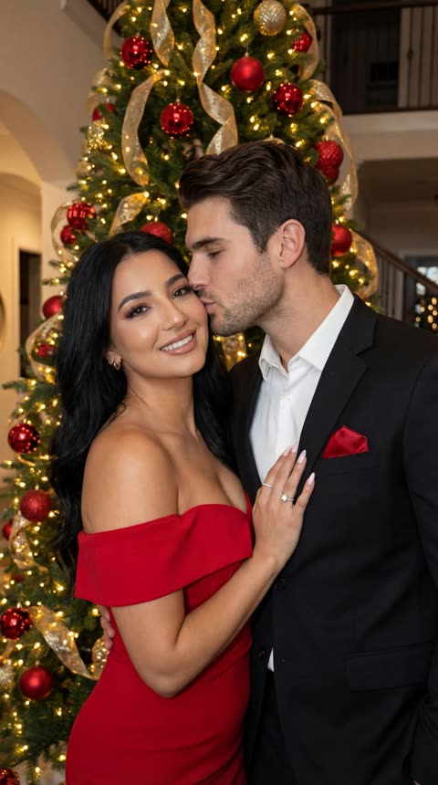</a>

A structured JSON brief pins the person count, pose, framing and no-text rule as hard constraints, and a concrete lens and lighting spec (85mm, shallow depth of field, strobe plus soft fill) steers the look toward editorial. Naming the tree and ornament colours in the prompt keeps the palette consistent across the scene.

Nano Banana Pro · Text-to-image · Source: [@astronomerozge1 on X](https://x.com/astronomerozge1/status/2006427588495905057) · 76 likes on 2026-10-29

[`christmas`](tags.md#tag-christmas) [`couple`](tags.md#tag-couple) [`portrait`](tags.md#tag-portrait) [`editorial`](tags.md#tag-editorial)

<details><summary><b>Prompt</b></summary>

```text
{
  "generation_request": {
    "meta_data": {
      "tool": "NanoBanana Pro",
      "task_type": "photorealistic_couple_holiday_editorial",
      "version": "v1.0_COUPLE_NYE_TREE_KISS_EDITORIAL",
      "priority": "highest"
    },
    "references": {
      "female_character_reference_image": "UPLOAD_FEMALE_REFERENCE (OPTIONAL: for identity lock)",
      "male_character_reference_image": "UPLOAD_MALE_REFERENCE (OPTIONAL: for identity lock)",
      "pose_reference_image": "UPLOAD_POSE_REFERENCE (OPTIONAL: use this image for same pose/framing)"
    },
    "output_settings": {
      "aspect_ratio": "2:3",
      "orientation": "portrait",
      "resolution": "ultra_high_res",
      "render_style": "ultra_photoreal_high_fashion_holiday_editorial",
      "sharpness": "crisp_but_natural",
      "film_grain": "none_or_minimal",
      "color_grade": "warm_luxury_true_to_life"
    },
    "hard_constraints": [
      "EXACTLY 2 people only: one woman and one man.",
      "If reference images are provided: perfect identity match (no face/body changes).",
      "Match the pose and framing: the couple hugging; the man kissing the woman’s cheek; the woman’s arms around his neck; close, intimate stance.",
      "No text, no logos, no watermarks.",
      "Perfect anatomy: hands/fingers/teeth correct; no extra limbs.",
      "Photoreal skin texture (no plastic smoothing).",
      "Luxury holiday vibe; no cheap party props; no neon club lighting."
    ],
    "creative_prompt": {
      "scene_summary": "Ultra-photoreal luxury holiday editorial portrait. A couple stands in front of a decorated Christmas tree with warm fairy lights and red ornaments. The woman wears a fitted elegant red dress (sleek, sophisticated; floor-length or fitted midi with a long red ribbon/scarf detail trailing down), glamorous makeup with classic red lipstick, soft bronzy blush, and defined brows; long glossy dark-to-warm brunette waves with volume. Her nails are painted red. She smiles subtly toward camera while the man kisses her cheek. The man wears a black suit with a white shirt and a red pocket square; groomed dark hair and a neat beard; one hand at her waist. Lighting: high-end editorial strobe + soft fill, warm ambient bokeh from tree lights, controlled shadows, cinematic but clean. Background: upscale indoor setting with a neutral wall, the Christmas tree positioned to the left, tasteful decorations, premium warm atmosphere. Camera: 85mm portrait look, shallow depth of field for creamy bokeh while keeping faces sharp."
    },
    "negative_prompt": [
      "any text, logo, watermark",
      "extra people",
      "blurred faces",
      "identity drift",
      "deformed hands, extra fingers, warped anatomy",
      "cartoon, anime, CGI look",
      "plastic skin, heavy smoothing, beauty blur",
      "overexposed highlights, harsh blown-out flash",
      "neon lighting, nightclub look",
      "messy background clutter",
      "duplicate limbs, double heads, distorted kiss"
    ]
  }
}
```

</details>

<a id="nano-banana-sunflower-wooden-frame-portrait"></a>
### Bearded man framed by a wooden frame in sunflowers

<a href="https://x.com/AiWithTariq/status/2068925139111358658">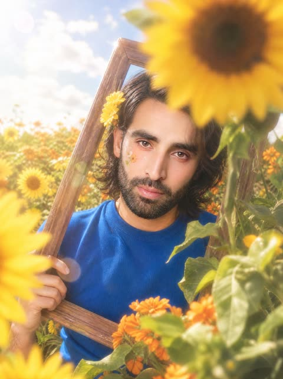</a>

The prompt fixes the crop, frame angle and foreground blur in concrete terms, then adds a preserve clause so the edit keeps framing, clothing and haze instead of redrawing them.

Nano Banana 2 · Edit · Source: [@AiWithTariq on X](https://x.com/AiWithTariq/status/2068925139111358658) · 75 likes on 2026-10-29

[`sunflower`](tags.md#tag-sunflower) [`portrait`](tags.md#tag-portrait) [`soft-focus`](tags.md#tag-soft-focus) [`framing`](tags.md#tag-framing)

<details><summary><b>Prompt</b></summary>

```text
Gpt Image 2 | Nano banana 2 | Grok | Gemini Prompt 👇

A very tight vertical frame with strong crop pressure, the subject positioned inside a dense sunflower and orange flower field while partially framed by a large tilted wooden picture frame near the center of the image. Large blurred sunflower blooms dominate the upper-right foreground and left foreground edges, partially blocking the frame and subject. The wooden frame leans diagonally from lower-left toward upper-right, surrounding the face and upper torso area while several edges are cropped by foreground flowers and frame borders. Pale blue sky with soft white clouds occupies the upper-left background, with dense green foliage and orange flowers filling the lower and middle background. Preserve the exact asymmetrical placement and tight crop without revealing more body or environment. The face appears near the upper-center area inside the wooden frame, tilted slightly downward toward viewer’s left, eyes open wide directed toward the camera axis, pupils centered, lips softly closed with a slight pout shape and faint glossy pink color. Makeup is soft and bright with pale pink blush, peach-pink eyeshadow, subtle eyeliner, glossy pink lips, smooth bright skin with warm highlights. Small flower stickers remain visible on the cheek. Dark medium-length hair falls around both sides of the face and shoulder area with loose strands near the forehead and cheek, a yellow flower accessory tucked into the hair near the viewer’s left side of the head. One hand grips the lower-left side of the wooden frame while the other arm remains lower and partly hidden by flowers and leaves. Clothing must remain unchanged: a vivid cobalt-blue short-sleeve knit top, close-fitting over the upper torso, with a simple round crew neckline sitting close to the base of the neck, smooth fine-knit fabric texture, short sleeves ending around the upper arm, sleeve edges slightly curved around the arms, fabric softly stretched across the chest and shoulder area with mild natural folds and highlights, no visible logo or pattern. Dense sunflower leaves and stems overlap the lower foreground and right side with several leaves and flowers heavily blurred and cropped by the frame edges. Bright warm sunlight creates strong dreamy haze, pale overexposed highlights, and soft translucent lens flare artifacts near the upper-left and lower-left areas. Dreamy soft-focus image quality, reduced edge sharpness, shallow depth of field, blurred foreground flowers, and soft yellow-green background separation. Preserve the soft haze, bloom lighting, blur, overexposed highlights, and dreamy low-detail quality exactly as visible.
```

</details>

<a id="gpt-image-1980s-fashion-editorial-red-suit-portrait"></a>
### 1980s editorial portrait in a red suit

<a href="https://x.com/mehvishs25/status/2098090489811746853"></a>

A reference photo locks the face while a detailed list of period outfit pieces and accessories sets the 80s look. Studio backdrop, warm analog light, film grain and lens softness give the magazine feel, and a closing list of negatives keeps modern elements out.

GPT Image 2.5 · Edit · Source: [@mehvishs25 on X](https://x.com/mehvishs25/status/2098090489811746853) · 74 likes on 2026-10-28

[`1980s`](tags.md#tag-1980s) [`fashion-editorial`](tags.md#tag-fashion-editorial) [`film-grain`](tags.md#tag-film-grain) [`reference-image`](tags.md#tag-reference-image) [`vintage`](tags.md#tag-vintage)

<details><summary><b>Prompt</b></summary>

```text
Create a vertical, ultra-photorealistic portrait of the same clearly adult woman from the reference image, preserving her facial identity, facial structure, skin tone, hair characteristics, and overall appearance.

Give her an authentic 1980s fashion-editorial look with a confident, effortless attitude. She is posing confidently with relaxed shoulders, strong posture, and a subtle self-assured expression, looking directly toward the camera. Her pose should feel natural and charismatic rather than overly staged.

Style her in an elegant vintage 80s outfit: a sophisticated fitted top or blouse with tasteful coverage, high-waisted trousers or a classic high-waisted skirt, subtle shoulder structure, and period-accurate accessories such as small statement earrings, a delicate necklace, and a vintage wristwatch. Use rich but tasteful 1980s colors and textures.

Set the scene in a classic 1980s studio fashion environment, with a softly textured backdrop, warm analog lighting, gentle film grain, subtle lens softness, and authentic vintage color rendering. The overall aesthetic should resemble a high-end fashion photograph from an 80s magazine—glamorous, confident, sophisticated, and nostalgic.

Natural skin texture, realistic fabric detail, authentic proportions, realistic hands, cinematic lighting, 35mm film photography aesthetic, subtle grain, soft highlights, shallow depth of field, no modern objects, no contemporary styling, no text or watermark.
```

</details>

<a id="nano-banana-half-face-soccer-ball-stitch-portrait"></a>
### Half face portrait stitched into a soccer ball

<a href="https://x.com/ShamsAmin56/status/2066220842485469445"></a>

The [Player Full Name] slot makes one prompt reusable for any player. Dense skin and sweat detail plus named football panels and seams keep the face-to-leather join photoreal, while the white seamless backdrop and 9:16 studio framing keep it clean.

Nano Banana 2 · Text-to-image · Source: [@ShamsAmin56 on X](https://x.com/ShamsAmin56/status/2066220842485469445) · 74 likes on 2026-10-29

[`surreal-composite`](tags.md#tag-surreal-composite) [`soccer`](tags.md#tag-soccer) [`template`](tags.md#tag-template) [`portrait`](tags.md#tag-portrait)

<details><summary><b>Prompt</b></summary>

```text
Ultra-realistic photorealistic portrait of [Player Full Name]'s half face seamlessly stitched to half of a classic soccer ball, intricate stitching details where skin meets leather, highly detailed skin texture, pores, sweat, realistic football panels and seams, dramatic cinematic lighting, sharp focus, white seamless background, 9:16 aspect ratio, professional studio photography, 4k resolution.

Super Easy to Edit:

Replace [Player Full Name] with the player’s name.
Example: Cristiano Ronaldo

Disclaimer:
AI-generated images • Creative artistic concept • Not a real photo or real stitches.
```

</details>

<a id="nano-banana-mirror-selfie-sofa-warm-light"></a>
### Woman takes warm mirror selfie on sofa

<a href="https://x.com/j_smeaton99/status/2050418977697145019">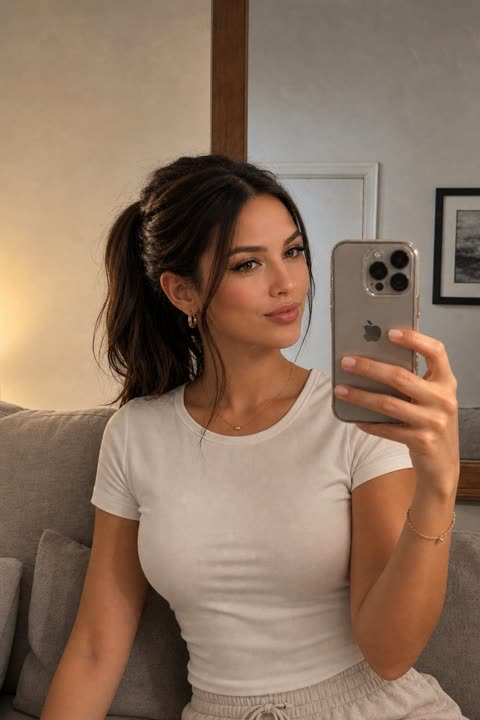</a>

A reference image anchors facial identity, then the prompt fixes framing, pose, and camera look. Cropping the lower body and asking for front-camera grain and shallow depth of field keeps the shot candid rather than studio-polished.

Nano Banana 2 · Edit · Source: [@j_smeaton99 on X](https://x.com/j_smeaton99/status/2050418977697145019) · 74 likes on 2026-10-29

[`selfie`](tags.md#tag-selfie) [`mirror`](tags.md#tag-mirror) [`portrait`](tags.md#tag-portrait) [`warm-lighting`](tags.md#tag-warm-lighting)

<details><summary><b>Prompt</b></summary>

```text
Ultra-realistic iPhone mirror selfie of a young woman indoors, with facial identity matching exactly the provided reference image. She is seated casually on a modern sofa in a softly lit, warm-toned room with a wooden-framed mirror behind her.

Framing: mid-body composition (waist-up focus), ensuring her legs are minimally visible or mostly cropped out of the frame. Slight natural perspective as seen in casual selfies.

Pose: She holds her phone in one hand at chest level, angled slightly outward. Her head is turned slightly to the side in a soft, flattering profile with a subtle pout or relaxed expression. The pose should feel candid and natural.

Outfit: She is wearing a fitted half-sleeved top (instead of sleeveless), paired with a soft-colored skirt or shorts, but the lower body is mostly out of frame.

Hair & styling: Hair tied back in a neat ponytail, with a few soft strands framing her face. Natural makeup with smooth skin tones and gentle highlights.

Lighting: Soft indoor ambient lighting with a slightly cinematic glow, subtle shadows, and warm color grading. Slight reflection imperfections on the mirror for realism.

Environment details: Minimal, cozy interior, sofa, mirror, wooden textures, possibly a framed picture in the background. Clean but lived-in aesthetic.

Camera style: iPhone front-camera look, ultra-realistic, shallow depth of field, slight grain, natural skin texture, no over-smoothing.
```

</details>

<a id="nano-banana-streetwear-motion-blur-walk"></a>
### Streetwear model walking with vertical motion blur

<a href="https://x.com/SadiaMalik182/status/2078088218462007462">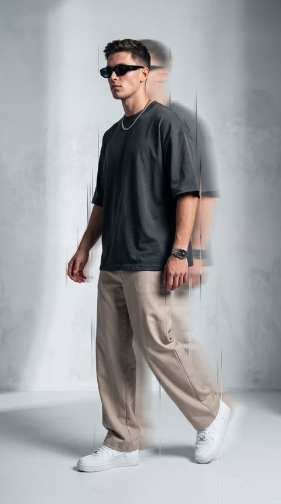</a>

Listing each garment and tying the identity to the uploaded reference keeps the person and outfit consistent across the edit. The motion blur and glitch smear are described as a separate effect layer over a clean studio backdrop, which produces the ghosted trail behind the figure.

Nano Banana 2 · Edit · Source: [@SadiaMalik182 on X](https://x.com/SadiaMalik182/status/2078088218462007462) · 73 likes on 2026-10-29

[`fashion`](tags.md#tag-fashion) [`streetwear`](tags.md#tag-streetwear) [`portrait`](tags.md#tag-portrait) [`motion-blur`](tags.md#tag-motion-blur)

<details><summary><b>Prompt</b></summary>

```text
A stylish young man in a premium editorial fashion photoshoot, wearing an oversized black/dark charcoal T-shirt, relaxed beige or white wide-leg trousers, premium Nike sneakers, optional black sunglasses, silver chain, and luxury wristwatch. Dynamic walking or standing pose with a confident expression, looking slightly away or toward the camera. Minimal clean white/light gray studio background, dramatic soft lighting, soft shadows, high contrast, artistic vertical motion blur and subtle glitch smear effect around the body, ultra-realistic skin texture, luxury streetwear campaign, Vogue-inspired fashion photography, cinematic color grading, 2K resolution, razor-sharp details, masterpiece quality, preserve the exact reference face and identity 100%, do not change my real face.
```

</details>

<a id="nano-banana-amber-glasses-beanie-side-profile-portrait"></a>
### Side profile portrait in amber glasses and beanie

<a href="https://x.com/weiinberg/status/2071813959901143140"></a>

A reference image is limited to identity so the outfit, pose and background can be rewritten. The 3/4 angle, 85mm f/1.8 lens, single side window light and a long negative prompt keep skin texture real and the eyes sharp.

Nano Banana 2 · Edit · Source: [@weiinberg on X](https://x.com/weiinberg/status/2071813959901143140) · 72 likes on 2026-10-29

[`portrait`](tags.md#tag-portrait) [`eyewear`](tags.md#tag-eyewear) [`identity-lock`](tags.md#tag-identity-lock) [`window-light`](tags.md#tag-window-light) [`shallow-depth-of-field`](tags.md#tag-shallow-depth-of-field)

<details><summary><b>Prompt</b></summary>

```text
Use the uploaded reference image only for preserving the subject's facial identity, facial proportions, skin tone, hairstyle (unless specified otherwise), and overall likeness. Do not copy the original background, pose, clothing, or lighting.

Create a hyper-realistic close-up portrait from a 3/4 side profile (30–45° angle), with the subject looking slightly away from the camera. Frame from the upper chest to the top of the head, filling 80–90% of the frame. Maintain natural facial anatomy and realistic skin texture with visible pores, subtle imperfections, and authentic details.

Style the subject with transparent amber acetate eyeglasses, a rust-colored ribbed knit beanie, a clean white crew-neck t-shirt, and a thin silver chain necklace. Keep the expression neutral, calm, and thoughtful.

Use soft diffused natural window light from one side, creating gentle shadows and smooth highlights across the face. Background should be a clean off-white or light beige studio wall with minimal distractions. Apply a very shallow depth of field with creamy bokeh and crisp focus on the eyes and face.

Editorial fashion photography, minimalist aesthetic, premium lifestyle portrait, luxury eyewear campaign, muted warm color grading, soft contrast, realistic color tones, DSLR quality, 85mm lens, f/1.8, ISO 100, ultra-sharp focus, photorealistic, HDR, 8K, magazine-quality, high-detail facial features, natural skin, cinematic composition.

Negative prompt: low quality, blurry, oversharpened, plastic skin, extra facial features, distorted anatomy, asymmetrical eyes, duplicate glasses, unrealistic beard or hair, oversaturated colors, watermark, logo, text, frame, cartoon, CGI, illustration, low resolution, noise, artifacts.
```

</details>

<a id="gpt-image-realistic-big-head-miniature-pinwheel-portrait"></a>
### Realistic big head miniature portrait holding pinwheel

<a href="https://x.com/oggii_0/status/2114231078843973707"></a>

Numeric proportion targets, such as head share of silhouette height and shoulder width relative to head width, make the exaggeration controllable. Separate sections lock pose, face, clothing and scene so the edit stays photographic.

GPT Image 2.5 · Edit · Source: [@oggii_0 on X](https://x.com/oggii_0/status/2114231078843973707) · 70 likes on 2026-10-29

[`big-head`](tags.md#tag-big-head) [`miniature`](tags.md#tag-miniature) [`photo-edit`](tags.md#tag-photo-edit) [`realistic`](tags.md#tag-realistic) [`chibi`](tags.md#tag-chibi)

<details><summary><b>Prompt</b></summary>

```text
Turn any image into realistic chibi-style portrait using Chat GPT Image 2.5

Prompt: Task: Strictly edit the uploaded original photograph to transform the person or animal into a hyper-realistic, extremely exaggerated big-head miniature figure, matching the visual style of the provided reference image.

Highest Priority: Transform the head-to-body proportions while preserving the subject's recognizable identity, natural facial features, original expression, hairstyle, clothing, accessories, pose, and overall photographic realism. The final result must resemble a real photograph, not a cartoon or CGI creation.

1. Head-to-Body Proportions (Highest Priority)

- Giant Head: Dramatically enlarge the entire head, including hair, hats, ears, and other existing head accessories. The head should dominate the figure, occupying approximately 65–75% of the total visible silhouette height in a full-body composition.
- Extremely Narrow Shoulders: Reduce shoulder width to approximately 40–50% of the head width. Create a tiny neck and narrow shoulder structure that transitions naturally into the miniature torso.
- Miniature Body: Compress the torso, waist, hips, and limbs into an extremely small body beneath the oversized head. The torso should be short and narrow, with realistic anatomical connections.
- Miniature Arms and Hands: Reduce the arms, palms, and fingers proportionally. Keep the arms naturally close to the body, preserving the original gestures and hand positions.
- Tiny Legs and Feet: Dramatically shorten and narrow the legs, feet, and shoes while preserving the original stance, footwear design, and points of contact with the ground.
- Strong Proportional Contrast: The head must be unmistakably oversized relative to the tiny body. Preserve the subject's original clothing design while naturally adapting its fit to the miniature proportions.

The transformation must create an extreme, visually striking big-head miniature effect without making the subject look like a toy, doll, or digitally assembled figure.

2. Pose and Actions (Strictly Preserve)

Preserve the original subject's exact pose, body orientation, gestures, facial expression, gaze direction, and interactions with the environment.

- If standing, keep the subject standing in the same position.
- If sitting, crouching, leaning, kneeling, or lying down, preserve that exact posture.
- Retain the original hand positions, held objects, arm placement, leg orientation, and contact points.
- Maintain the original head tilt and gaze direction unless a slight anatomical adjustment is necessary for a seamless transformation.
- Keep the subject's original framing. For full-body photographs, preserve the entire figure. For selfies, close-ups, and partial-body images, do not invent missing body parts or expand the frame unnecessarily.

The miniature body must adapt to the original pose rather than forcing the subject into a new pose.

3. Facial Features, Hair, and Clothing (Fully Preserve)

- Identity: Preserve the same recognizable person or animal from the original image. Do not replace, reinterpret, or redesign the subject.
- Face: Retain the original facial structure, eye shape, nose, lips, cheeks, skin tone, expression, and natural facial proportions. Do not apply beauty filters, artificial eye enlargement, face reshaping, or excessive skin smoothing.
- Hair: Preserve the original hairstyle, hair color, hairline, texture, volume, and distinctive strands. Scale the hair naturally with the enlarged head.
- Clothing: Preserve the exact original garments, colors, materials, prints, patterns, logos, folds, and textures. Adapt their dimensions to fit the miniature body without changing their design.
- Accessories: Retain all original jewelry, glasses, hats, bags, watches, and other visible accessories, resizing them only when necessary to fit the transformed proportions.
- Animals: Preserve the original species, recognizable features, fur patterns, ears, eyes, and expression. Apply the same oversized-head and miniature-body transformation without changing the animal's identity.

4. Scene and Composition (Fully Preserve)

Use the uploaded photograph as the sole reference for the subject and environment.

- Preserve the original background, architecture, furniture, plants, ground surface, and environmental objects.
- Maintain the original camera angle, perspective, framing, subject placement, composition, and aspect ratio.
- Keep the surrounding environment at its original scale. The subject's altered proportions should create a striking contrast with the realistic environment.
- Preserve the original lighting direction, color tones, shadows, reflections, and depth of field.
- Ensure the miniature figure remains naturally grounded in the scene, with realistic contact shadows beneath the feet and physically consistent lighting across the enlarged head and reduced body.
- Do not remove, replace, or introduce environmental elements unless a minor reconstruction is essential to repair an editing artifact.

5. Photographic Realism and Visual Quality

The entire image must retain the appearance of an authentic, high-resolution photograph.

- Realistic skin pores, fine facial details, and natural skin texture.
- Individual hair strands with believable highlights and shadows.
- Authentic fabric weave, clothing folds, and accessory details.
- Natural lighting, physically accurate shadows, and consistent reflections.
- Seamless transitions between the enlarged head, neck, and miniature body.
- Realistic anatomy, natural edges, and coherent perspective.
- Subtle photographic imperfections consistent with the original image.

The oversized head must remain fully photorealistic, with the original person's natural facial anatomy and expression intact. The miniature body must look like a physically plausible part of the same person.

6. Strictly Prohibited

- Cartoon, anime, illustration, or stylized 3D figurine aesthetics.
- Plastic skin, toy-like materials, doll faces, or artificial beauty enhancements.
- Changing the subject's identity, facial features, expression, hairstyle, or clothing design.
- Normal adult shoulder width or a body that appears too large relative to the head.
- Oversized hands, fingers, feet, or shoes.
- Disconnected heads, visible neck seams, floating limbs, malformed joints, or duplicated body parts.
- Altered poses, invented gestures, or changed interactions with the environment.
- Unnecessary background replacement, camera-angle changes, or aspect-ratio changes.
- Unnatural shadows, inconsistent lighting, visible compositing artifacts, text, watermarks, or interface elements.

Final Output

Transform the original photograph into an ultra-photorealistic big-head miniature portrait with a dramatically enlarged head, extremely narrow shoulders, a tiny compressed body, and proportionally miniature limbs.

Preserve the original subject's identity, expression, pose, clothing, accessories, background, and photographic characteristics as faithfully as possible. The exaggerated head-to-body ratio should be the defining visual transformation, producing the same realistic, charming, oversized-head aesthetic as the reference image.

Editing Rule: Change the subject's proportions only. Preserve everything else from the original photograph.
```

</details>

<a id="nano-banana-man-beside-anime-self-graffiti-mural"></a>
### Man before graffiti mural of his anime self

<a href="https://x.com/Minahil42298354/status/2032956520057414135"></a>

A realistic foreground subject is paired with a mural of the same person in cel shaded manga style, so the realistic and anime renderings sit in one frame. Naming the mural palette, katakana text and tag lettering, plus a gritty alley floor, keeps the wall vivid and the foreground photographic.

Nano Banana 2 · Text-to-image · Source: [@Minahil42298354 on X](https://x.com/Minahil42298354/status/2032956520057414135) · 70 likes on 2026-10-29

[`graffiti`](tags.md#tag-graffiti) [`anime-mural`](tags.md#tag-anime-mural) [`mixed-style`](tags.md#tag-mixed-style) [`street-art`](tags.md#tag-street-art) [`portrait`](tags.md#tag-portrait)

<details><summary><b>Prompt</b></summary>

```text
A medium shot of a real-life man with short dark hair and a beard, wearing a black hoodie, standing in a pensive pose with his fingers to his temple. He is positioned in front of a massive, vibrant graffiti mural on a concrete wall. The mural depicts an anime-style version of the same man in a dynamic action pose, holding a spray paint can. The art style is bold cel-shaded manga with thick outlines, featuring Japanese katakana text, bright orange and purple splashes, and "
http://
YAPPER.SO" tags. Hyper-realistic foreground, gritty urban alleyway floor with scattered paint cans.
```

</details>

<a id="nano-banana-concrete-passage-burgundy-fashion-portrait"></a>
### Vintage Concrete Passage Fashion Portrait in Burgundy

<a href="https://x.com/ChillaiKalan__/status/2114593231640170868"></a>

The prompt locks identity to the reference photo, then lists each garment, accessory and makeup detail by color and material. A 50mm lens and warm late afternoon light give a natural editorial depth of field.

Nano Banana 2.1 · Edit · Source: [@ChillaiKalan__ on X](https://x.com/ChillaiKalan__/status/2114593231640170868) · 69 likes on 2026-10-29

[`fashion`](tags.md#tag-fashion) [`editorial`](tags.md#tag-editorial) [`full-body`](tags.md#tag-full-body) [`reference-photo`](tags.md#tag-reference-photo) [`realistic`](tags.md#tag-realistic)

<details><summary><b>Prompt</b></summary>

```text
Use the reference photo and keep her original face identity completely unchanged. Create an ultra-realistic full-body fashion portrait in a quiet vintage concrete passage with aged textured walls, narrow architectural shadows, and warm late-afternoon light.
She wears a fitted burgundy satin blouse, charcoal-gray high-waisted wide-leg trousers, and oversized dark olive leather jacket. Add chunky black platform ankle boots with a sculptural heel. Her hair is long, sleek, and softly waved with wispy curtain bangs.
Makeup luminous matte skin, taupe smoky eyes, subtle brown eyeliner, softly sculpted cheeks, muted berry blush, and deep rose-brown glossy lips. Add a vintage watch, layered silver necklaces, small hoop earrings, and a structured mini shoulder bag. Dark burgundy nails with tiny chrome accents. Fashion editorial realism, 50mm lens, natural depth of field.Use the reference photo and keep her original face identity completely unchanged. Create an ultra-realistic full-body fashion portrait in a quiet vintage concrete passage with aged textured walls, narrow architectural shadows, and warm late-afternoon light.
She wears a fitted burgundy satin blouse, charcoal-gray high-waisted wide-leg trousers, and oversized dark olive leather jacket. Add chunky black platform ankle boots with a sculptural heel. Her hair is long, sleek, and softly waved with wispy curtain bangs.
Makeup luminous matte skin, taupe smoky eyes, subtle brown eyeliner, softly sculpted cheeks, muted berry blush, and deep rose-brown glossy lips. Add a vintage watch, layered silver necklaces, small hoop earrings, and a structured mini shoulder bag. Dark burgundy nails with tiny chrome accents. Fashion editorial realism, 50mm lens, natural depth of field.
```

</details>

<a id="nano-banana-streetwear-leather-bomber-portrait"></a>
### Full-body streetwear portrait in leather bomber

<a href="https://x.com/weiinberg/status/2083776018763157835"></a>

Plain camera settings for lens, aperture, light and a 4:5 frame give the image a campaign look. Listing each garment layer in order, from jacket over hoodie to pants and sneakers, keeps the outfit specific and easy to check.

Nano Banana 2 · Edit · Source: [@weiinberg on X](https://x.com/weiinberg/status/2083776018763157835) · 69 likes on 2026-10-29

[`fashion`](tags.md#tag-fashion) [`portrait`](tags.md#tag-portrait) [`streetwear`](tags.md#tag-streetwear) [`photorealistic`](tags.md#tag-photorealistic)

<details><summary><b>Prompt</b></summary>

```text
cartoon, anime, illustration, CGI, low quality, blurry, oversaturated, extra limbs, distorted body, deformed hands, watermark, text, logo, cropped, duplicate person, noisy background
Camera setting:
* Lens: 85mm
* Aperture: f/2.8
* Lighting: Soft overcast daylight
* Aspect Ratio: 4:5 (Instagram portrait)
* Style: Editorial, luxury streetwear, photorealistic
* Quality: Ultra detailed, 8K
If you’re replacing the person with your
```

</details>

<a id="nano-banana-double-breasted-suit-stone-steps-menswear"></a>
### Menswear portrait in charcoal suit on stone steps

<a href="https://x.com/pictsbyai/status/2112458298603479350"></a>

The prompt moves from pose and wardrobe to hair, backdrop, lighting and lens in order, so each element is fixed before the camera spec. Exact lens, aperture, shutter and ISO values plus named shadow and highlight zones push the result toward editorial photography.

Nano Banana 2.1 · Text-to-image · Source: [@pictsbyai on X](https://x.com/pictsbyai/status/2112458298603479350) · 68 likes on 2026-10-28

[`menswear`](tags.md#tag-menswear) [`editorial`](tags.md#tag-editorial) [`suit`](tags.md#tag-suit) [`street-style`](tags.md#tag-street-style) [`85mm`](tags.md#tag-85mm)

<details><summary><b>Prompt</b></summary>

```text
A confident handsome male in his late twenties or early thirties stands in a classic 45-degree turn with his weight comfortably shifted and shoulders level. He wears a meticulously tailored charcoal grey double-breasted suit, paired with a crisp white dress shirt, a dark patterned tie, and a precise white pocket square. His thick hair is scissor-cut with a classic taper and a deep side part roughly an inch and a half from the right, left three to four inches long on top to showcase a naturally wavy texture. The styling eschews artificial smoothness in favor of organic volume and movement, revealing natural imperfections, slight flyaways, and varying wave directions held by a low-shine, natural-finish paste. His candid expression features relaxed eyebrows and a softly closed mouth as his eyes gaze away toward the open negative space on the left side of the frame. His left arm extends downward with the fingers of his hand curled naturally and organically inward, exposing a silver-tone dress watch with a light dial peeking from beneath his stark white shirt cuff, while his right arm bends cleanly at the elbow, tucked deeply into his trouser pocket. He is framed straight-on outdoors against a medium-depth urban backdrop, standing upon solid, dark gray horizontal stone steps. To his left in the midground, a vintage wrought-iron door features black painted metal with decorative circular and scrolling motifs, softly out of focus. Dominating the right background is a weathered architectural stone pillar crafted from raw carved masonry. This warm taupe-gray and beige stone wall bears the authentic marks of old city buildings, showcasing a matte surface textured with horizontal carved ridges, vertical corner framing, subtle water staining, natural pitting, and patchy accumulations of soot. The scene is enveloped in a sophisticated, timeless urban elegance, illuminated by a single soft, diffused natural light source cascading from above. This moderate-intensity overhead lighting creates an asymmetrically balanced, medium-contrast palette, casting soft-edged, gray shadows subtly under his chin, beneath the structured suit lapels, and deep within the architectural recesses of the stone building. Specular highlights are beautifully preserved across his forehead, the bridge of his nose, his cheekbone, and the textured crests of his hair waves, while a gentle ambient fill maintains the rich charcoal, warm stone, black, and crisp white dominant tones. Captured as a tack-sharp digital menswear editorial photograph influenced by classic Pitti Uomo street style, the cinematic portrait utilizes an 85mm lens at an f/2.8 aperture and 1/250s shutter speed at ISO 100 for a realistic medium depth of field. Post-processing enhances the composition through a subtle warm neutral color grade, deliberately desaturated background elements to isolate the subject, gentle dodging and burning to define the jawline and structured suit lapels, and a delicate layer of film grain, all seamlessly framed in a 9:16 aspect ratio.
```

</details>

<a id="nano-banana-golden-hour-coastal-portrait-pair"></a>
### Golden hour coastal portrait of a man

<a href="https://x.com/ozansihay/status/2107565033186083128"></a>

A matched pair of prompts reuses identical framing, light direction and background wording so the man and woman portraits stay consistent. Exact face fill, eye placement, 85mm f/1.4 lens and backlight versus sky fill details keep the film still look.

Nano Banana 2.1 · Text-to-image · Source: [@ozansihay on X](https://x.com/ozansihay/status/2107565033186083128) · 68 likes on 2026-10-28

[`golden-hour`](tags.md#tag-golden-hour) [`portrait`](tags.md#tag-portrait) [`film-still`](tags.md#tag-film-still) [`backlight`](tags.md#tag-backlight) [`photoreal`](tags.md#tag-photoreal)

<details><summary><b>Prompt</b></summary>

```text
Woman
Cinematic outdoor close-up at golden hour of a beautiful woman in her late 20s with Mediterranean features, warm olive skin, dark brown eyes catching the low sun, soft freckles, natural slightly parted lips, loose dark wavy hair lifted by a light breeze across her right cheek. Head-and-shoulders, face filling about 60% of the frame, eyes on the upper third, body turned three-quarter toward camera-left while she looks just past the lens. Real sunset backlight from behind-right wrapping her hair in warm rim glow, soft open-shade fill on the face from the sky, long gentle shadows. Background: softly blurred coastal landscape with amber sky, distant hills and a hint of sea sparkle, empty of people and props. Shot like an arthouse film still on 85mm f/1.4, creamy bokeh, fine film grain, natural skin texture, warm gold highlights against cool blue shadow pockets, photoreal, no flash look, no plastic skin, no text.

Man
Cinematic outdoor close-up at golden hour of a handsome man in his early 30s, strong jaw under short dark stubble, hazel eyes catching the low sun, messy black hair with a few wind-blown strands on the forehead, natural lips slightly closed. Identical framing to the female portrait: head-and-shoulders, face filling about 60% of the frame, eyes on the upper third, body turned three-quarter toward camera-left while he looks just past the lens. Real sunset backlight from behind-right wrapping his hair and shoulders in warm rim glow, soft open-shade fill on the face from the sky, long gentle shadows. Background: the same softly blurred coastal landscape with amber sky, distant hills and a hint of sea sparkle, empty of people and props. Shot like an arthouse film still on 85mm f/1.4, creamy bokeh, fine film grain, visible pores and microtexture, warm gold highlights against cool blue shadow pockets, photoreal, no flash look, no plastic skin, no text.
```

</details>

<a id="nano-banana-seated-man-chesterfield-sofa-lamp"></a>
### Seated man on tufted leather Chesterfield by spiral lamp

<a href="https://x.com/pictsbyai/status/2071140707377512953"></a>

The prompt pins wardrobe, accessories, each hand's position and the lamp's placement, so the output stays tied to the brief. The 50mm f/2.8 lens spec and mixed front lighting set the realistic photo look.

Nano Banana 2 · Text-to-image · Source: [@pictsbyai on X](https://x.com/pictsbyai/status/2071140707377512953) · 68 likes on 2026-10-29

[`portrait`](tags.md#tag-portrait) [`lifestyle`](tags.md#tag-lifestyle) [`interior`](tags.md#tag-interior) [`leather-sofa`](tags.md#tag-leather-sofa)

<details><summary><b>Prompt</b></summary>

```text
A young man with dark hair and a beard sits in the center of the frame, angled at a 45-degree turn and leaning slightly to his right with casually tilted shoulders. His expression is intentionally posed and serious, featuring relaxed eyebrows, a neutral mouth with no trace of a smile, and eyes thoughtfully looking away. He is dressed in a black v-neck t-shirt and white trousers, accessorized with a gold digital watch, a silver pendant necklace, and a silver bracelet. His left hand rests softly on his thigh in a naturally relaxed state, while his right hand is organically draped over the back of the furniture with a comfortably loose wrist. He is seated on a dominant, vintage brown button-tufted leather Chesterfield sofa that shows slight, authentic wear in the foreground. Situated in the midground to his right is a vintage floor lamp featuring a beige fringed shade and a distinctly carved spiral wood stand. The indoor setting utilizes a shallow spatial depth that meets a rough, matte raw concrete wall, highly detailed with patchy cool gray tones, horizontal lines, realistic pitting, and industrial cracks. The calm, relaxed indoor lifestyle atmosphere is illuminated by soft, moderately directional mixed front lighting with ambient fill from multiple sources, blending neutral light with a warm practical glow. A complementary color palette of cool grays, warm browns, deep blacks, and light beiges is balanced by medium-length, soft-edged gray shadows that pool naturally under the subject and across the textured leather, paired with subtle specular highlights gently catching on his face and the sofa's surface. Captured straight on as an organically styled, realistic digital photograph using a 50mm lens at f/2.8, the composition blends contemporary lifestyle aesthetics with industrial interior design, utilizing a medium depth of field and slightly soft overall sharpness with zero grain, finished with subtle contrast enhancements and meticulously preserved shadows, framed naturally in a 1:1 aspect ratio.
```

</details>

<a id="gpt-image-traveler-sunset-chest-portal-ravens"></a>
### Traveler with sunset landscape inside chest and ravens

<a href="https://x.com/AiWithTariq/status/2103695256445477234"></a>

Blends a miniature landscape into the torso, jacket and backpack, so the portrait and the scene read as one double exposure. A cool slate sky against a molten amber core, plus a low angle 85mm lens and two ravens at the edges, adds contrast and depth.

GPT Image 2.5 · Edit · Source: [@AiWithTariq on X](https://x.com/AiWithTariq/status/2103695256445477234) · 67 likes on 2026-10-28

[`double-exposure`](tags.md#tag-double-exposure) [`selfie`](tags.md#tag-selfie) [`surreal`](tags.md#tag-surreal) [`miniature-world`](tags.md#tag-miniature-world) [`cinematic`](tags.md#tag-cinematic)

<details><summary><b>Prompt</b></summary>

```text
A breathtaking surreal double-exposure fine-art photograph and masterwork cinematic composite featuring an adventurous, reflective traveler with the uploaded face as reference, depicted in a dramatic low-angle three-quarter profile with their neck gently extended and gaze cast reverently upward toward the sky. The character is dressed in a travel-worn, dusty khaki button-down utility shirt with rolled sleeves and textured denim trousers, carrying a heavy weathered expedition backpack. Seamlessly integrated and blending directly into the wanderer’s torso, jacket, and pack is an enchanting, luminous miniature landscape centered around a colossal, incandescent golden sunset that bathes the scene in warm radiant amber brilliance. Within this surreal chest portal, a winding path of stone steps ascends toward the blazing horizon, flanked by the dark silhouette of an ancient acacia tree and fiery autumn groves of deep orange and crimson foliage that disintegrate into floating embers, billowing dust clouds, and miniature flying bird silhouettes drifting into the open air. Soaring through the surrounding atmosphere are two photorealistic, glossy black ravens with meticulously rendered wing feathers and sharp talons, one carving dynamically across the left foreground and the other descending from the upper right amid ethereal tendrils of gray smoke. The backdrop consists of expansive, muted slate-blue overcast clouds with soft diffused daylight, establishing a poignant color temperature juxtaposition between the cool, cinematic ambient exterior and the molten, hyper-saturated warm glow emanating from the core. Captured from a low-angle medium shot with a prime 85mm portrait lens, deep depth of field rendering crisp tactile details from the rugged cotton weave and feathered edges to the dynamic particulate clouds, featuring high-contrast cinematic color grading, balanced chiaroscuro lighting, and poetic surrealist visual storytelling.
```

</details>

<a id="nano-banana-brutalist-porthole-stairwell-bw-portrait"></a>
### Black and white portrait in circular concrete stairwell

<a href="https://x.com/ChillaiKalan__/status/2107688620081738000"></a>

A circular cutout on a flat charcoal field with a thin white border frames the scene. Hard sunbeam highlights, crushed blacks, and an 85mm f/1.4 shallow depth of field keep the face as the sharpest point.

Nano Banana 2.1 · Text-to-image · Source: [@ChillaiKalan__ on X](https://x.com/ChillaiKalan__/status/2107688620081738000) · 67 likes on 2026-10-29

[`black-and-white`](tags.md#tag-black-and-white) [`brutalist`](tags.md#tag-brutalist) [`architectural-portrait`](tags.md#tag-architectural-portrait) [`high-contrast`](tags.md#tag-high-contrast) [`porthole-frame`](tags.md#tag-porthole-frame)

<details><summary><b>Prompt</b></summary>

```text
Black and white fine-art architectural portrait photography, vertical 4:5 portrait format. A perfectly circular porthole-shaped cutout reveals a brutalist concrete stairwell, while everything outside the circle is flat, solid near-black charcoal (#161616), with a thin crisp white rectangular border line inset a few millimeters from the frame edge. The circle sits slightly above center, with the thick, weathered concrete ring edge visible on the left side.

Inside the circle: wide concrete steps rising diagonally from left to right, a slim dark metal handrail running parallel along the diagonal, a large curved concrete wall on the right catching a hard shaft of direct sunlight that creates a bright white diagonal shape, a dark curved ceiling overhang at the top right, and rough concrete texture on the left wall. Extremely high contrast, deep crushed blacks, bright highlights, strong geometric lines and curves.

A lone man is walking up the stairs in the lower right of the circle, caught mid-step, one hand lightly sliding along the metal handrail. His body is angled up the staircase, but his head is turned and he looks directly into the camera lens, making strong eye contact with the viewer. He is clearly visible, not a silhouette: bareheaded with short dark hair, no hat, no cap, wearing a dark long coat, face lit by the sunbeam on one side, with a calm, serious expression. His face is the sharpest point in the image, with crisp eyes, skin texture, and defined jawline, in razor-sharp focus.

Shot on an 85mm f/1.4 portrait lens, shallow depth of field, the stairs, handrail, and concrete walls behind and in front of him fall into a soft, creamy blur, with gentle compression of the stairwell geometry. Moody, minimalist, cinematic, fine film grain, no color, no text.
```

</details>

<a id="nano-banana-monochrome-editorial-lounge-portrait"></a>
### Monochrome editorial portrait in a hotel lounge

<a href="https://x.com/pictsbyai/status/2075259938234913038"></a>

Naming a rich monochrome palette, a 50mm lens and shallow depth of field sets the editorial fashion look. Concrete props like the marble table, lapel grip and palm frame give the scene clear foreground and background layers.

Nano Banana 2 · Text-to-image · Source: [@pictsbyai on X](https://x.com/pictsbyai/status/2075259938234913038) · 67 likes on 2026-10-29

[`portrait`](tags.md#tag-portrait) [`monochrome`](tags.md#tag-monochrome) [`editorial`](tags.md#tag-editorial) [`fashion`](tags.md#tag-fashion)

<details><summary><b>Prompt</b></summary>

```text
A handsome, sophisticated man with sharp facial features, a strong jawline, and perfectly groomed light stubble gazes intensely and directly into the lens with a calm, confident expression. His dark hair is swept back with a natural side part, displaying subtle texture where individual strands catch the soft ambient light. He is dressed in a sharply tailored dark suit jacket accented by a dark patterned pocket square, layered over a crisp white dress shirt left casually unbuttoned at the collar. Sitting in a relaxed posture, his hands are raised to mid-chest, gently gripping the inner edges of his jacket lapels in a subtle adjustment, revealing the glint of a metallic wristwatch on his left wrist. He is seated in a plush, curved light-colored upholstered armchair pulled up to a smooth, veined white marble table in the immediate foreground, which holds a closed black leather notebook, a pen, a pair of folded dark-rimmed eyeglasses, and the partial view of a glowing ribbed glass table lamp. Behind him in the midground, the textured, arching fronds of a large indoor palm tree frame his head, while other patrons blur slightly into the ambiance, including a man seated to the left and a blonde woman relaxing at a softly lit table to the right. The background extends into a grand, high-ceilinged interior lounge featuring tall, dramatic dark vertical drapery, imposing architectural columns, and a softly illuminated arched glass display case. Rendered entirely in a rich black-and-white monochrome palette, the lighting is soft yet directional, carving out precise specular highlights on the man's cheekbones, his watch, and the polished marble surface, while deep, velvety shadows gather in the heavy folds of his suit, the curtain pleats, and the distant recesses of the room to forge a moody, luxurious atmosphere. Captured with a classic 50mm lens for an editorial fashion aesthetic, utilizing a shallow depth of field to isolate the razor-sharp subject against the softly blurred environment, processed with a high-contrast tonal range and subtle photographic film grain, framed in a 4:5 aspect ratio.
```

</details>

<a id="gpt-image-double-exposure-travel-silhouette-portrait"></a>
### Double exposure travel portrait with European old town

<a href="https://x.com/Arina_hoqe/status/2104060103704150362"></a>

A large side profile silhouette holds the destination scene, while the same woman walks in the foreground, so the reference photo drives both layers. Burgundy, navy and ivory watercolor splashes on a clean white ground tie the layers together, and a closing negative list guards identity and skin realism.

GPT Image 2.5 · Edit · Source: [@Arina_hoqe on X](https://x.com/Arina_hoqe/status/2104060103704150362) · 65 likes on 2026-10-29

[`double-exposure`](tags.md#tag-double-exposure) [`travel`](tags.md#tag-travel) [`watercolor`](tags.md#tag-watercolor) [`selfie`](tags.md#tag-selfie) [`silhouette`](tags.md#tag-silhouette)

<details><summary><b>Prompt</b></summary>

```text
Create a premium photorealistic artistic travel portrait using the same woman from the reference photo. Preserve her facial identity, natural features, hairstyle, and realistic appearance accurately.

Create a creative double-exposure composition: a large elegant side-profile silhouette of the woman forms the background, beautifully blended with a breathtaking travel destination inside her silhouette. In the foreground, show the same woman walking naturally through the scene with a stylish travel outfit, backpack, sunglasses, and sneakers.

Inside the silhouette, include a magnificent European old-town street with grand historic architecture, warm sunset light, distant mountains, birds, and subtle atmospheric details. Add artistic watercolor splashes flowing outward from the bottom in soft burgundy, navy, and ivory tones.

Clean white background, seamless photo blending, cinematic sunset glow, realistic shadows, sophisticated travel-editorial aesthetic, highly detailed, premium magazine composition, photorealistic, 8K, elegant and visually captivating.

No cartoon, no anime, no illustration, no distorted face, no duplicate person, no extra limbs, no artificial-looking skin, no identity change.
```

</details>

<a id="nano-banana-comic-collage-dress-monarch-wings"></a>
### Comic page collage dress with monarch wings

<a href="https://x.com/Ozayrr_irl/status/2059559152024739856"></a>

The prompt names one dramatic garment material, then adds a single oversized secondary element, the monarch wing cape, so the silhouette reads at a glance. A bright white hallway, studio lighting and a red shoe accent keep the colorful dress as the focal point.

Nano Banana 2 · Text-to-image · Source: [@Ozayrr_irl on X](https://x.com/Ozayrr_irl/status/2059559152024739856) · 65 likes on 2026-10-29

[`fashion`](tags.md#tag-fashion) [`editorial`](tags.md#tag-editorial) [`pop-art`](tags.md#tag-pop-art) [`butterfly`](tags.md#tag-butterfly) [`studio-lighting`](tags.md#tag-studio-lighting)

<details><summary><b>Prompt</b></summary>

```text
Avant-garde high-fashion photography of a female model in an editorial pose. She is wearing a dramatic dress made from a collage of colorful pop art and yellow comic book pages. The back of the dress features massive, realistic yellow and black monarch butterfly wings as a cape. Elegant floral headpiece, red high heels, bright white luxury hallway background, professional studio lighting, vivid colors, photorealistic.
```

</details>

<a id="nano-banana-christmas-market-red-coat-portrait"></a>
### Bearded man in red coat at snowy Christmas market

<a href="https://x.com/NanoBanana_labs/status/1999139019075227982">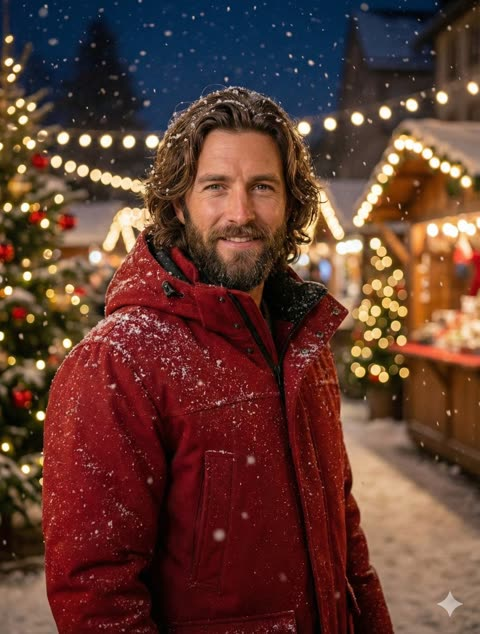</a>

Repeating the front facing, centered framing and naming the coat colour and snowflake detail pins down the composition. Listing market lights, bokeh and a decorated tree as background layers builds the nighttime holiday scene, and the face preservation clause keeps the uploaded person recognizable.

Nano Banana Pro · Edit · Source: [@NanoBanana_labs on X](https://x.com/NanoBanana_labs/status/1999139019075227982) · 63 likes on 2026-10-29

[`christmas`](tags.md#tag-christmas) [`portrait`](tags.md#tag-portrait) [`snow`](tags.md#tag-snow) [`christmas-market`](tags.md#tag-christmas-market)

<details><summary><b>Prompt</b></summary>

```text
Create a cinematic front-facing Christmas market portrait of a subject standing outdoors in softly falling snow. The shot must always be captured from the front, showing the subject clearly and centered. The subject must be wearing a red winter coat. Add natural snowflakes on the hair and coat, with warm glowing market lights, festive bokeh, and a decorated Christmas tree in the background. Preserve the uploaded person’s face, identity, and all facial features exactly as they are. Keep the atmosphere cozy, elegant, and softly illuminated for a nighttime holiday scene.
Aspect ratio 5:3
```

</details>

<a id="nano-banana-red-neon-rim-monochrome-portrait"></a>
### Black and white portrait with red neon rim

<a href="https://x.com/weiinberg/status/2069632981120250203"></a>

The prompt fixes a monochrome base and a pure black background, then makes the red neon rim the only colored element. Lens, aperture and studio lighting terms push the result toward a realistic editorial portrait.

Nano Banana 2 · Edit · Source: [@weiinberg on X](https://x.com/weiinberg/status/2069632981120250203) · 62 likes on 2026-10-29

[`portrait`](tags.md#tag-portrait) [`neon-rim-light`](tags.md#tag-neon-rim-light) [`monochrome`](tags.md#tag-monochrome) [`studio`](tags.md#tag-studio)

<details><summary><b>Prompt</b></summary>

```text
Transform the reference image into a dramatic cinematic black-and-white portrait. Pure black background with deep contrast. Subject wearing a tailored black suit jacket and black dress shirt with an open collar, luxury editorial styling.

Bright light-red neon rim light tracing the entire silhouette of the subject, creating a glowing outline around the head, shoulders, hair, ears, and clothing edges. Strong side lighting with high contrast shadows. Monochrome skin tones with detailed texture, while the neon glow remains the only colored element.

Premium magazine cover aesthetic, powerful masculine energy, luxury fashion campaign, dramatic studio lighting, intense mood, confident posture, looking away from camera. Ultra-sharp focus on face and upper torso, rich blacks, deep shadows, high dynamic range.

Professional portrait photography, cinematic color grading, black-and-white fine art portrait, neon edge lighting, volumetric glow, realistic skin detail, luxury editorial, studio photography, photorealistic, 85mm lens, f/2.0, shallow depth of field, masterpiece quality, ultra detailed, 8K resolution.
```

</details>

<a id="nano-banana-rooftop-golden-hour-menswear-portrait"></a>
### Golden Hour Rooftop Menswear Portrait

<a href="https://x.com/pictsbyai/status/2114270237004628019"></a>

Names the light direction, angle and fill color, then lists fabric, wall and skyline materials in detail. Closes with lens, aperture and palette so the bokeh and skin texture stay realistic.

Nano Banana 2.1 · Text-to-image · Source: [@pictsbyai on X](https://x.com/pictsbyai/status/2114270237004628019) · 61 likes on 2026-10-29

[`editorial`](tags.md#tag-editorial) [`menswear`](tags.md#tag-menswear) [`golden-hour`](tags.md#tag-golden-hour) [`rooftop`](tags.md#tag-rooftop) [`85mm`](tags.md#tag-85mm)

<details><summary><b>Prompt</b></summary>

```text
A candid, medium-full editorial photograph of a confident young handsome male model with a chiselled bone structure and sharp jawline, captured in a thoughtful gaze looking away toward the upper left horizon on an outdoor high-rise urban rooftop terrace during the golden hour, framed in a 9:16 aspect ratio. He stands with an asymmetrical, natural posture, his body turned at a 45-degree angle, with both hands casually inserted into the pockets of his tailored charcoal wool overcoat, slightly pulling the coat's edges forward. He wears a high-contrast cream, ribbed turtleneck sweater that frames his neck, partially visible under the heavy, textured dark overcoat. His medium-short, dark brown hair is styled in a classic cut, swept back and to the left with natural, wavy volume, featuring loose flyaway curls on his left forehead and a matte finish. Natural 45-degree side lighting from the low, golden-hour sun on the camera's left illuminates his left cheekbone, nose bridge, brow ridge, and the cream turtleneck, while casting soft, gradual shadow edges across the right side of his face, neck, and the folds of his dark coat, with a gentle, cool sky-blue fill on the shadow side. He is positioned center-right, leaning near a foreground rooftop parapet wall that features weathered gray stone coping, a tan brick base with recessed mortar joints, and a brushed steel tubular handrail. The background, captured with a shallow depth of field, blurs into a deep, creamy bokeh of an urban skyline, balanced on the far left by a tall, modern glass skyscraper reflecting the warm golden sunset, alongside aged mid-century commercial towers with boxy dark brown and terracotta tan masonry facades catching the orange sunlight. The cinematic image, characteristic of a classic menswear luxury campaign, boasts tack-sharp detail on the subject against the soft, warm golden-hour atmosphere, retaining a rich color profile of charcoal, soft sky blue-gray, cream, and warm amber, shot straight on with the characteristic natural clarity of a full-frame digital camera using an 85mm lens at f/2.0, with preserved shadow details in the wool fabric and natural skin textures.
```

</details>

<a id="gpt-image-cafe-streetwear-christmas-portrait"></a>
### Woman lounging in a café armchair with ripped jeans

<a href="https://x.com/auqibhabib/status/2070856232152559804">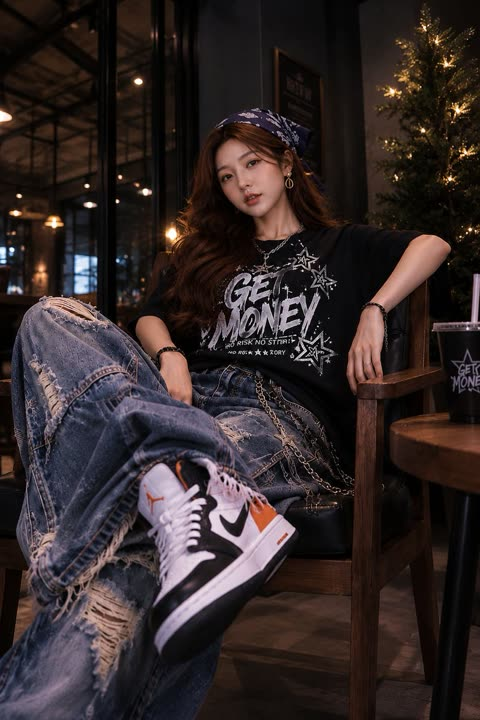</a>

A low camera angle with the crossed foreground sneaker enlarged by perspective gives the shot an editorial fashion feel. Naming the garment details, an 85mm lens at f/1.8 and warm café lighting with a lit Christmas tree sets the mood and keeps the scene consistent.

GPT Image 2 · Text-to-image · Source: [@auqibhabib on X](https://x.com/auqibhabib/status/2070856232152559804) · 60 likes on 2026-10-29

[`fashion-portrait`](tags.md#tag-fashion-portrait) [`streetwear`](tags.md#tag-streetwear) [`cafe-interior`](tags.md#tag-cafe-interior)

<details><summary><b>Prompt</b></summary>

```text
Ultra-realistic front-facing fashion portrait of a trendy young woman sitting comfortably in a leather armchair inside a cozy upscale coffee shop, both hands positioned behind her head, relaxed confident pose, oversized black streetwear t-shirt with graphic text, distressed baggy jeans with chain accessories, white-black-orange high-top sneakers, long flowing brown hair, navy paisley bandana, warm indoor lighting, glowing café ambience, wooden tables, coffee cup on side table, decorative illuminated tree, luxurious lifestyle mood, cinematic color grading, detailed skin and eyes, natural makeup, editorial fashion campaign, shallow depth of field, professional photography, 85mm lens, f/2.0, ultra realistic, 8K HDR, Vogue-style fashion shoot.
#バナ穴バナシ エンティーム #世にも奇妙な物語
```

</details>

<a id="nano-banana-coastal-street-portrait-white-tee"></a>
### Man in white tee on coastal street

<a href="https://x.com/pictsbyai/status/2110646359300649048"></a>

The prompt describes pose, hair, clothing and hand placement in detail, then layers background depth, a cool overcast palette and diffuse light. It ends with exact camera settings (35mm, f/8, 1/250s, ISO 200) and a 3:4 frame for a deep-focus street look.

Nano Banana 2.1 · Text-to-image · Source: [@pictsbyai on X](https://x.com/pictsbyai/status/2110646359300649048) · 59 likes on 2026-10-28

[`street-portrait`](tags.md#tag-street-portrait) [`male-model`](tags.md#tag-male-model) [`overcast`](tags.md#tag-overcast) [`camera-settings`](tags.md#tag-camera-settings) [`coastal`](tags.md#tag-coastal)

<details><summary><b>Prompt</b></summary>

```text
A young male adult stands asymmetrically placed with a serious, posed expression, his relaxed eyebrows set above eyes that gaze away into the distance, his mouth closed without a hint of a smile. His hair features a medium-length top of about four inches, parted deeply on the left and brushed back with a natural texture that reveals a slight wave and delicate flyaways, styled with glossy pomade for a distinctive wet look. He is dressed in a crisp white tee with sunglasses casually hanging from the neckline, paired with beige trousers and a silver watch secured on his left wrist. His body is turned at a 45-degree angle, shifting his weight to lean leftward with level shoulders as his left hand rests organically on his front waistband, thumb casually hooked with fingers visible, while his right hand lightly grips the trouser fabric on the opposite side. He leans against a worn, gray metal traffic pole with a dull finish and attached sensors in the right foreground, anchoring the composition. The scene unfolds into a deep, straight-on spatial depth, leading the eye down a beige-gray checkered concrete sidewalk that curves leftward alongside a coastal road. In the left midground, a relaxed European street vibe is established by cafe tables and chairs. To the right, thriving palm trees stretch upward with tall trunks and dark olive green fronds. The calm mood is defined by a cool, overcast, desaturated palette dominated by the cool gray of the sky and road, harmonizing with neutral earth tones. Single-source, softly diffused natural light falls from above, yielding low-contrast illumination with a cool blue temperature that casts short, soft-edged gray shadows under the subject and behind the pole, while preserving gentle specular highlights on his shoulders and forehead. Captured as a realistic digital street portrait using a 35mm lens at f/8.0, 1/250s, and ISO 200, the image employs a deep depth of field to keep the sweeping background sharply in focus. The final aesthetic features smooth textures, slightly soft overall sharpness with zero grain, and a desaturated cool-tone color grade, all beautifully framed in a 3:4 aspect ratio.
```

</details>

<a id="nano-banana-terrace-dining-man-portrait"></a>
### Man in White Shirt at Terrace Table

<a href="https://x.com/pictsbyai/status/2109559194890502544"></a>

The prompt describes the scene in layers: foreground table, subject, midground olive tree, then background walls. It ends with exact camera settings (85mm, f/2.8, 1/200s), a lighting description and a 3:4 ratio, which keep the photo realistic.

Nano Banana 2.1 · Text-to-image · Source: [@pictsbyai on X](https://x.com/pictsbyai/status/2109559194890502544) · 58 likes on 2026-10-28

[`portrait`](tags.md#tag-portrait) [`realism`](tags.md#tag-realism) [`photography`](tags.md#tag-photography) [`lifestyle`](tags.md#tag-lifestyle) [`85mm`](tags.md#tag-85mm)

<details><summary><b>Prompt</b></summary>

```text
A handsome man sits centered and facing the camera with level shoulders and a confident, deliberately posed posture, wearing a crisp white dress shirt and a rich brown tie. His medium-short hair is slicked back with a glossy product, revealing natural comb lines and a distinct, slight wave. He maintains a neutral expression with relaxed eyebrows and a direct gaze, while his left hand is raised near his collar with loosely curled fingers and his right hand rests relaxed on the arm of his chair. In the immediate foreground, a pristine dining table draped in a white tablecloth holds a white plate and silver cutlery, visually leading to the subject before gently fading into a deep, softly blurred outdoor environment. To the midground right, a thriving olive tree grows from a large terracotta pot resting on a gray cobblestone stone floor. Behind him, the setting features pristine, warm off-white plaster walls with a slightly textured matte finish and clean classical architectural moldings, subtly accompanied by an overhead heater structure and a distant building. The scene exudes a sophisticated, elegant, and calm luxury dining experience, anchored by a warm, high-contrast color profile dominated by crisp whites, deep structural blacks, rich brown accents, and soft warm yellows. Mixed, diffused front lighting of moderate intensity bathes the scene in a soft glow, casting short, soft-edged gray shadows under his chin and behind his body, while perfectly preserving specular highlights on his face, glossy hair, and bright white shirt. Captured as a tack-sharp realistic digital photograph using an 85mm lens at f/2.8 and 1/200s with a straight-on perspective, the image features zero grain and a medium depth of field that elegantly separates the subject from the European lifestyle-inspired background, finished with warm post-processing color grading, and finally framed in a 3:4 portrait aspect ratio.
```

</details>

<a id="gpt-image-fire-water-wet-portrait-reference"></a>
### Fierce wet portrait lit by fire and water

<a href="https://x.com/AiWithTariq/status/2102380695704465698"></a>

The prompt locks the face to the reference image, then splits the lighting into a warm orange side and a cool dark side. Concrete texture cues such as water droplets, wet hair strands and beard detail keep the close up raw and dramatic.

GPT Image 2.5 · Edit · Source: [@AiWithTariq on X](https://x.com/AiWithTariq/status/2102380695704465698) · 57 likes on 2026-10-29

[`close-up`](tags.md#tag-close-up) [`dramatic-lighting`](tags.md#tag-dramatic-lighting) [`fire-and-water`](tags.md#tag-fire-and-water) [`face-reference`](tags.md#tag-face-reference) [`cinematic`](tags.md#tag-cinematic)

<details><summary><b>Prompt</b></summary>

```text
Create image "A hyper-realistic, cinematic close-up portrait of a man ( use the reference image 100% ) with piercing blue eyes, wet skin glistening with water droplets, and strands of dark wet hair falling across his intense face.His expression is fierce and determined, illuminated by a dramatic fiery orange glow on one side, contrasting with the cool darkness on the other.Ultra-detailed textures of skin, beard, and water droplets create a raw and powerful atmosphere, blending elements of fire and water. Moody, high-contrast lighting, epic and dramatic tone, 8K ultra-detailed.
```

</details>

<a id="nano-banana-brown-menswear-european-street-lookbook"></a>
### Brown layered menswear walking on European street

<a href="https://x.com/pictsbyai/status/2113183073689125330"></a>

Describes the subject in strict order, from hair, face and clothing to pose, foreground, midground and light. It then fixes the camera with an 85mm lens at f/2.8, 1/500s and a 4:5 frame, and names the palette and light direction.

Nano Banana 2.1 · Text-to-image · Source: [@pictsbyai on X](https://x.com/pictsbyai/status/2113183073689125330) · 57 likes on 2026-10-28

[`menswear`](tags.md#tag-menswear) [`street-style`](tags.md#tag-street-style) [`lookbook`](tags.md#tag-lookbook) [`fashion`](tags.md#tag-fashion) [`85mm`](tags.md#tag-85mm)

<details><summary><b>Prompt</b></summary>

```text
A handsome male model walks confidently forward in a sophisticated, layered menswear ensemble, captured from a straight-on, chest-level perspective. His hair is a medium-length layered cut—shorter on the sides with three to four inches on top reaching his eyebrows—styled with a wet-look pomade that enhances its natural texture, featuring slight frizz and uneven clumping. A deep, off-center right part creates a deliberately disheveled look, allowing several loose, wavy S-curl strands to fall naturally across his forehead and right brow. His facial expression is composed and posed, with a closed neutral mouth, relaxed eyebrows, and a direct gaze framed by round tortoiseshell glasses. He wears a crisp white dress shirt with a visible collar and cuffs, paired with a brown tie and a chocolate dark espresso brown long-sleeve knit polo sweater featuring a buttoned placket. His lower half consists of dark brown double-pleated high-waisted trousers held by a cognac leather brown belt with a silver buckle, ending in black leather loafers. His left hand is tucked completely into his left front trouser pocket, pulling the fabric to create a subtle tension, while his right arm rests by his side, the hand securely gripping the dual leather handles of a large cognac brown leather tote bag with knuckles moderately visible. He strides across a foreground of worn, light gray-beige smooth concrete paving stones that bear subtle stains and natural texturing, grounding the scene in an authentic outdoor urban street setting. Behind him, the midground opens up into a slightly blurred, medium-depth classic European street featuring a warm stone beige limestone building facade. This pristine yet historically weathered ashlar masonry displays matte textures, horizontal block joints, and classical pilasters with structural reveals. To the mid-height right, a vintage black wrought-iron window balcony railing catches the eye with ornate gold and brass medallion detailing, beautifully contrasting the pale stone. The atmosphere evokes an elegant, quiet urban morning wrapped in a sophisticated monochromatic brown and neutral palette, illuminated by a single, large diffused source of open-sky daylight pouring in from above and slightly front-left. This soft, moderate-intensity outdoor light casts neutral ambient fill and short, gray shadows with soft gradual edges on the pavement beneath him, as well as subtle shading under his chin and the leather bag. Radiant, preserved specular highlights gently touch his forehead, the tip of his nose, the top curves of the leather tote bag, and the polished shoe leather, creating a dynamic, high-contrast visual hierarchy that draws the eye from his well-lit face down through the dark textures of his outfit. Rendered as tack-sharp digital photography reminiscent of high-end luxury menswear lookbooks and classic sartorial street style, the image utilizes an 85mm lens at f/2.8 with a 1/500s shutter speed to freeze motion while maintaining a crisp subject against the softened architectural backdrop, finalized with subtle warm color grading and selective clarity to enhance the intricate knitwear and leather textures, all beautifully framed in a 4:5 aspect ratio.
```

</details>

<a id="nano-banana-dual-tone-sunglasses-portrait"></a>
### Dual tone lit portrait in black sunglasses

<a href="https://x.com/harboriis/status/2109247804707348591"></a>

The prompt locks identity and composition to a reference image, then lists the wardrobe and pose. Cool blue front light against a warm orange rim light, with an 85mm lens and heavy bokeh, gives the cinematic contrast.

Nano Banana 2.1 · Edit · Source: [@harboriis on X](https://x.com/harboriis/status/2109247804707348591) · 57 likes on 2026-10-28

[`portrait`](tags.md#tag-portrait) [`cinematic-lighting`](tags.md#tag-cinematic-lighting) [`sunglasses`](tags.md#tag-sunglasses) [`bokeh`](tags.md#tag-bokeh) [`reference-image`](tags.md#tag-reference-image)

<details><summary><b>Prompt</b></summary>

```text
Use the uploaded image as the primary reference. Recreate the same person, face, and exact composition, keeping the same face impression, hairstyle, sunglasses, and outfit. A cinematic close-up portrait of a person wearing black rectangular sunglasses, a plain light-colored (white) crew-neck T-shirt, and small ear stud. Their head is slightly tilted, with calm, confident, and cool expression. Use dramatic dual-tone lighting: cool blue light from the front/left side and warm orange rim light from the right side, creating strong cinematic contrast. Keep the background heavily blurred with bokeh, no distractions. Maintain realistic skin texture, sharp facial details, shadows, DSLR quality, 85mm lens, HDR, premium cinematic color grading, ultra-realistic, highly detailed, crisp focus, photorealistic. Vertical 3:4 composition.
```

</details>

<a id="gpt-image-watercolor-seated-portrait-monochrome-face-backdrop"></a>
### Seated woman over giant graphite watercolor face

<a href="https://x.com/Enaya_ai/status/2103719141849117036"></a>

The prompt is split into labelled blocks for subject, pose, background portrait, style, palette, lighting and composition. It ties the large monochrome face to the foreground woman by asking for the same identity, and a negative prompt guards against face drift and hand errors.

GPT Image 2.5 · Text-to-image · Source: [@Enaya_ai on X](https://x.com/Enaya_ai/status/2103719141849117036) · 56 likes on 2026-10-28

[`watercolor`](tags.md#tag-watercolor) [`fashion-illustration`](tags.md#tag-fashion-illustration) [`portrait`](tags.md#tag-portrait) [`monochrome`](tags.md#tag-monochrome) [`double-exposure`](tags.md#tag-double-exposure)

<details><summary><b>Prompt</b></summary>

```text
Create a highly detailed elegant watercolor portrait composition of a beautiful South Asian woman, combining a realistic full-body seated portrait with a large monochrome artistic facial portrait in the background.

Main Subject:
A graceful young South Asian woman sitting elegantly on the floor with her legs gently crossed. She has long, thick, naturally wavy dark-black hair styled loosely with soft strands framing her face. Preserve a realistic, delicate facial structure with expressive almond-shaped eyes, naturally defined eyebrows, a refined nose, soft lips, smooth warm skin tone, and a calm gentle expression while looking toward the right side.

She is wearing an elegant lavender-gray fitted long-sleeve blouse paired with a flowing ivory-white ankle-length skirt made from soft lightweight fabric. The skirt has natural folds and realistic fabric draping. She wears delicate pearl jewelry: a fine pearl necklace, small dangling pearl earrings, and elegant pearl bracelets. Nude-beige high-heeled shoes complete the outfit.

Pose:
She is seated gracefully with both hands resting naturally over one knee, relaxed posture, shoulders slightly turned toward the right, looking peacefully into the distance. Full body visible, including shoes.

Background Portrait:
Behind her, create a large artistic black-and-white close-up portrait of the same woman’s face, occupying most of the upper-right background. The facial identity, hairstyle, eyes, nose, lips, jawline, and overall appearance should remain consistent with the foreground woman. The background portrait should look like a soft graphite-and-watercolor painting, slightly faded and atmospheric, blending naturally into the watercolor background.

Art Style:
Luxury editorial watercolor portrait, sophisticated fashion illustration, realistic watercolor painting combined with delicate pencil/ink details, soft brush strokes, subtle paint bleeding, transparent watercolor washes, cold-pressed textured paper, fine facial details, elegant artistic imperfections, gentle ink splashes and watercolor stains.

Color Palette:
Soft monochrome gray, charcoal, ivory, muted lavender, subtle beige and warm skin tones. Low saturation, sophisticated and timeless.

Lighting:
Soft diffused studio lighting, gentle highlights on the face and clothing, subtle shadows, luminous watercolor atmosphere, no harsh contrast.

Composition:
Vertical portrait composition, foreground woman positioned slightly left of center, large monochrome face extending across the upper-right background, balanced negative space, artistic watercolor splashes around the edges, premium fashion magazine aesthetic.

Quality:
Ultra-detailed, photorealistic facial rendering blended with authentic watercolor texture, realistic anatomy, natural hands and fingers, realistic fabric folds, intricate jewelry details, cinematic composition, premium fine-art portrait, high resolution.

Negative Prompt:
blurry face, distorted anatomy, extra fingers, malformed hands, duplicate person, inconsistent face, different facial identity, deformed eyes, asymmetrical eyes, bad jewelry, plastic skin, oversaturated colors, cartoon, anime, 3D render, CGI, low resolution, harsh lighting, text, watermark, logo.
```

</details>

<a id="gpt-image-pencil-sketch-ghost-portrait-seated-photo"></a>
### Seated man before giant pencil sketch of himself

<a href="https://x.com/AiWithTariq/status/2102743467449606390"></a>

Every layer gets its own EXACT block (concept, background sketch, subject, outfit, environment, lighting, grade), so the composite stays organized. An identity lock ties the foreground face to the sketch by jaw, cheek, beard, nose and lip, and a sepia monochrome wall against a full color figure creates the contrast.

GPT Image 2.5 · Edit · Source: [@AiWithTariq on X](https://x.com/AiWithTariq/status/2102743467449606390) · 55 likes on 2026-10-29

[`pencil-sketch`](tags.md#tag-pencil-sketch) [`layered-composite`](tags.md#tag-layered-composite) [`identity-lock`](tags.md#tag-identity-lock) [`seated-portrait`](tags.md#tag-seated-portrait) [`sepia`](tags.md#tag-sepia)

<details><summary><b>Prompt</b></summary>

```text
PROMPT 1 — Pencil Sketch Ghost Portrait + Sharp Seated Photo

CONCEPT — EXACT: A layered composite — a massive detailed charcoal/pencil sketch portrait fills the background, textured like a hand-drawn wall mural with visible pencil strokes and ink-splatter texture, and a sharp full-color seated photorealistic portrait of the same man sits in the foreground on a reflective dark floor.

BACKGROUND SKETCH PORTRAIT — EXACT: Large detailed black-and-white pencil/charcoal sketch, head turned slightly to the side, short spiky textured hair rendered with visible hatch-strokes, wearing thin wire-frame glasses, light beard and moustache, collared shirt with visible fabric-fold linework, rough torn-paper/ink-splatter texture surrounding the sketch blending into a warm sepia-grey wall.

MAIN SUBJECT — FOREGROUND — EXACT: Seated pose on the floor, one leg bent with the knee up and forearm resting on it, other leg extended out to the side, torso turned slightly with head tilted looking off to the side, calm thoughtful expression, short neat dark hair, thin wire-frame glasses, light beard.

MAIN SUBJECT IDENTITY LOCK: Foreground face must match the background sketch exactly — same jaw width, cheek fullness, beard density, nose shape, and lip shape, with natural head-to-body proportion.

BODY: Medium-tan skin tone, lean build, relaxed seated posture.

OUTFIT: Black hooded sweatshirt with drawstrings, light grey jogger sweatpants, white-and-grey sneakers.

BACKGROUND/ENVIRONMENT — EXACT: Warm sepia-grey textured wall filled with the large pencil-sketch portrait and rough ink-splatter marks, dark reflective floor beneath the seated figure showing a soft mirrored reflection.

LIGHTING — EXACT: Soft even studio lighting from the front, minimal harsh shadow, warm neutral tone throughout.

COLOR GRADE — EXACT: Sepia-grey monochrome background sketch contrasted with a natural full-color foreground figure, warm skin tone standing out clearly, clean high-contrast editorial poster color grad
```

</details>

<a id="nano-banana-black-outfit-elevator-selfie"></a>
### Man in black outfit takes elevator selfie

<a href="https://x.com/pictsbyai/status/2110283970508398966"></a>

The prompt fixes pose, hand placement, hair texture and the steel elevator setting in detail, then names the light source, shadow placement and a desaturated palette with one tan accent. It closes with straight on digital selfie framing, deep focus, no grain and a 9:16 ratio.

Nano Banana 2.1 · Text-to-image · Source: [@pictsbyai on X](https://x.com/pictsbyai/status/2110283970508398966) · 55 likes on 2026-10-29

[`selfie`](tags.md#tag-selfie) [`elevator`](tags.md#tag-elevator) [`monochrome`](tags.md#tag-monochrome) [`realistic-portrait`](tags.md#tag-realistic-portrait) [`vertical`](tags.md#tag-vertical)

<details><summary><b>Prompt</b></summary>

```text
A confident man stands in the center of the frame facing the camera, his weight comfortably shifted and shoulders relaxed, dressed cleanly in a sleek black button-down shirt and matching black slacks. His dark hair features faded sides transitioning into two to three inches of textured wavy curls on top, styled with a matte product and a deep side part that explicitly embraces natural flyaways. Though his face is partially obscured by the smartphone he holds perfectly at face level in his left hand—with his index finger resting naturally on the back of the device—his visible eyes convey an intense, deliberate gaze beneath relaxed eyebrows. His right hand is casually tucked into his front right trouser pocket with the thumb gently hidden, revealing a silver watch gleaming on his wrist. He is positioned within the shallow spatial depth of a polished indoor elevator, standing on a solid dark gray metal floor. In the midground to his left, a small cylindrical brushed metal handrail adds dimension, while the background is entirely dominated by pristine brushed stainless steel elevator door panels featuring clean vertical seams and a perfectly smooth satin finish that bounces cool silver-gray gradients. The cool interior is bathed in even, moderate artificial light beaming downward from two top ceiling panels fitted with grid pattern diffusion covers. This diffused overhead lighting casts soft, gradual-edged gray shadows under his chin and across his chest muscles, while striking specular highlights onto his textured hair, the bridge of his nose, and the sleek metal doors. The environment embraces a desaturated, medium-contrast monochromatic color palette heavily weighted by the silver surroundings and black attire, warmed slightly by a subtle tan accent to evoke a distinctly professional mood. Captured straight on as a digital selfie, the image boasts tack-sharp focus and a deep depth of field that renders every smooth texture crisp and entirely grain-free, finalized with careful contrast enhancement for a realistic, clean aesthetic, all framed in a 9:16 aspect ratio.
```

</details>

<a id="nano-banana-quiet-luxury-suede-menswear-editorial"></a>
### Quiet luxury menswear portrait against sandstone wall

<a href="https://x.com/iamsofiaijaz/status/2112387493178020109"></a>

The prompt is split into labeled blocks for outfit, pose, environment, lighting and photography style. It adds an 85mm f/2.8 lens, golden hour from the upper right, and a negative prompt that targets plastic skin and distorted hands.

Nano Banana 2.1 · Text-to-image · Source: [@iamsofiaijaz on X](https://x.com/iamsofiaijaz/status/2112387493178020109) · 55 likes on 2026-10-28

[`menswear`](tags.md#tag-menswear) [`fashion-editorial`](tags.md#tag-fashion-editorial) [`quiet-luxury`](tags.md#tag-quiet-luxury) [`golden-hour`](tags.md#tag-golden-hour) [`portrait`](tags.md#tag-portrait)

<details><summary><b>Prompt</b></summary>

```text
Create an ultra-realistic luxury menswear editorial photograph of a stylish, handsome young man with thick, voluminous, swept-back dark brown hair, a neatly trimmed beard and mustache, and black rectangular sunglasses. He is leaning casually against a warm, textured beige sandstone wall, adjusting his sunglasses with one hand while keeping the other hand in his trouser pocket. His expression is calm, confident, masculine, and effortlessly sophisticated.

Outfit: A premium taupe-beige suede zip-up overshirt jacket with a structured collar, double-ended metal zipper, large patch chest pocket, and relaxed tailored fit. Underneath, a crisp white button-down shirt with the collar slightly open and cuffs visible. Matching light beige tailored trousers with subtle pleats. A sophisticated luxury wristwatch with a black leather strap completes the outfit.

Pose and composition: Three-quarter to nearly full-body portrait, subject positioned slightly left of center, body leaning naturally against the wall, one elbow bent as he adjusts his sunglasses, the other hand resting inside his pocket. Relaxed posture with a refined fashion-model presence.

Environment: Minimalist architectural setting with a warm sand-colored textured plaster wall, subtle natural imperfections, earthy brown and beige tones, and no distracting background elements.

Lighting: Soft natural golden-hour sunlight entering from the upper right, creating gentle highlights on the hair, face, suede jacket, and wall. Soft shadows, warm cinematic color grading, realistic skin texture, and beautiful tonal depth.

Photography style: High-end luxury fashion campaign, quiet luxury aesthetic, old-money menswear editorial, photorealistic skin and fabric textures, 85mm portrait lens, f/2.8, shallow depth of field, sophisticated neutral color palette, natural proportions, sharp facial details, premium magazine photography, vertical 2:3 composition, 8K detail.

Negative prompt: cartoon, illustration, CGI, plastic skin, excessive retouching, distorted hands, extra fingers, asymmetrical sunglasses, unnatural body proportions, blurry face, oversaturated colors, harsh flash, artificial lighting, logos, text, watermark, cluttered background.
```

</details>

<a id="chatgpt-moana-spiritual-rebirth-eagle"></a>
### Shirtless man merging with glowing blue eagle

<a href="https://www.tiktok.com/@shadstoker/video/7682873877566999822"></a>

The prompt gives a clear reference transformation, the Moana grandmother turning into a glowing animal, so the model has a visual template for the change. Asking it to draw on past chats and memory makes the scene personal, while the cinematic style cue sets the lighting and the mountain sunset backdrop.

ChatGPT · Text-to-image · Source: [@shadstoker on TikTok](https://www.tiktok.com/@shadstoker/video/7682873877566999822) · 54 likes on 2026-10-30

[`transformation`](tags.md#tag-transformation) [`animal-spirit`](tags.md#tag-animal-spirit) [`cinematic`](tags.md#tag-cinematic) [`moana`](tags.md#tag-moana)

<details><summary><b>Prompt</b></summary>

```text
Create an image of what my spiritual rebirth would be, like grandmother Tala from Moana was turning into her glowing animal. Make the image in a cinematic and artistic style showing myself and what I would turn into. Base your answer off of all of our previous conversations and what you know about me.
```

</details>

<a id="gpt-image-golden-hour-seated-fashion-editorial-reference-identity"></a>
### Seated luxury fashion editorial in golden hour studio

<a href="https://x.com/mehvishs25/status/2109637018900951298"></a>

Locks identity to an uploaded reference by naming the face traits to preserve, then splits outfit, pose and setting into labeled blocks. It closes with lens and grading cues plus a long negative list that guards against altered faces and broken hands.

GPT Image 2.5 · Edit · Source: [@mehvishs25 on X](https://x.com/mehvishs25/status/2109637018900951298) · 54 likes on 2026-10-28

[`fashion-editorial`](tags.md#tag-fashion-editorial) [`identity-reference`](tags.md#tag-identity-reference) [`golden-hour`](tags.md#tag-golden-hour) [`studio-portrait`](tags.md#tag-studio-portrait) [`negative-prompt`](tags.md#tag-negative-prompt)

<details><summary><b>Prompt</b></summary>

```text
Create one ultra-realistic luxury fashion editorial photograph using the uploaded reference girl as the exact identity reference. Preserve her original face, green eyes, freckles, nose, lips, natural skin texture, and long, voluminous dark-brown hair. Do not alter her identity.

Outfit: A fitted deep-burgundy off-shoulder knit top, a chocolate-brown leather jacket draped over her shoulders, a flowing charcoal maxi skirt with a subtle satin sheen, cream leg warmers, chunky cream-and-brown sneakers, and a structured dark-brown shoulder bag with elegant gold hardware. Sophisticated, feminine, contemporary styling with rich textures.

Pose: She sits confidently on the studio floor, one knee raised naturally and the other leg folded comfortably beneath the flowing skirt. One hand gently touches her cheek while the other rests beside her. Her head tilts slightly as she gives the camera a bold, captivating gaze.

Setting: A warm ivory studio wall, soft golden-hour sunlight, delicate diagonal shadows, champagne highlights, and a refined luxury fashion-magazine atmosphere.

Professional DSLR photography, 85mm portrait lens, realistic anatomy, natural skin pores, detailed knitwear and leather, authentic fabric folds, soft depth of field, and premium editorial color grading.

Negative prompt: Altered identity, different face, plastic skin, excessive retouching, incorrect outfit, distorted hands, extra fingers, twisted legs, broken joints, floating feet, unnatural proportions, CGI, cartoon, blur, text, logos, or watermarks.

Output: One individual high-resolution, photorealistic fashion photograph with natural anatomy and impeccable styling.
```

</details>

<a id="gpt-image-pink-outfit-woman-beside-guitar-mural-of-herself"></a>
### Woman in pink outfit beside mural of herself

<a href="https://x.com/Kubra_286/status/2102390516792832257"></a>

The prompt describes the real woman and the mural in parallel, repeating face, outfit and ponytail so the painted double matches her. Separate lines for outfit, hair, makeup and accessories, plus a rainy alley setting and a negative prompt, keep the photoreal look.

GPT Image 2.5 · Edit · Source: [@Kubra_286 on X](https://x.com/Kubra_286/status/2102390516792832257) · 54 likes on 2026-10-29

[`mural`](tags.md#tag-mural) [`selfie`](tags.md#tag-selfie) [`photoreal`](tags.md#tag-photoreal) [`street-fashion`](tags.md#tag-street-fashion) [`vertical`](tags.md#tag-vertical)

<details><summary><b>Prompt</b></summary>

```text
Create an ultra realistic cinematic visual of a woman standing in front of a brick wall that has a large mural painting of herself playing acoustic guitar with flying musical notes, treble clefs and music staff waves, while she is listening to music with black wired headphones, both hands holding the headphones on her ears.

Woman outfit: light pink blazer, black croptop blouse, light pink pleated mini skirt fold, white mary jane doll shoes with bow.

Face match 100%

Hair: high ponytail, long wavy hair, natural black.

Makeup: pink lips, thick eyelashes, peach blush, light natural glam.

Accessories: pink gemstone necklace, pink drop earrings.

The mural painting on the bricks is similar to her — same face, same outfit (pink blazer, pink pleated skirt, black top), same high ponytail, playing brown acoustic guitar, surrounded by black musical notes and G-clefs.

The woman is standing on a sidewalk, puddles on ground, old brick wall with some green vines, urban alley background.

True to life color grading, photorealistic, DSLR 8K, cinematic natural daylight, ultra detailed skin, same face recognizable, 9:16 vertical aspect ratio.
*Negative prompt / to avoid (if your app has it):*
blurry, cartoon, anime, painting style on real person, distorted face, extra fingers, low quality, over saturated
```

</details>

<a id="nano-banana-christmas-fireplace-babe-stockings-dog"></a>
### Woman holding fluffy dog under BABE stockings

<a href="https://x.com/kingofdairyque/status/2000056327020986416">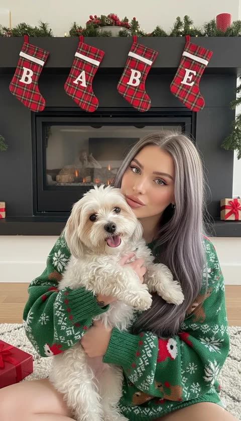</a>

The prompt sets a casual selfie style iPhone shot with the subject close to the camera, and uses a strict face reference line to keep the identity. Spelling out the exact letters on four red plaid stockings makes the text easy to check in the result.

Nano Banana Pro · Edit · Source: [@kingofdairyque on X](https://x.com/kingofdairyque/status/2000056327020986416) · 54 likes on 2026-10-29

[`christmas`](tags.md#tag-christmas) [`portrait`](tags.md#tag-portrait) [`pet`](tags.md#tag-pet) [`selfie`](tags.md#tag-selfie)

<details><summary><b>Prompt</b></summary>

```text
Gemini nano banana pro:
A cozy, festive Christmas portrait captured indoors in front of a modern fireplace, styled to feel like a casual, candid iPhone holiday photo. The main character is seated in the center of the frame, holding a small fluffy dog close to their chest. Both faces are positioned near the camera, creating an intimate, warm, selfie-like composition that feels natural and unposed.

The main character wears an oversized green Christmas sweater with playful holiday patterns, relaxed and cozy in fit.Their posture is soft and affectionate, arms gently wrapped around the dog. Use the attached photo as a strict face reference — do not alter the face in any way. The facial structure, proportions, expression, skin texture, and all facial details must remain 100% identical to the reference photo, rendered with ultra-high realism and sharp focus.

The dog appears lively and joyful, tongue slightly out, with natural fur texture and a realistic expression. It sits comfortably inthe character’s arms, interacting naturally with the scene rather than posing stiffly.

In the background, a dark fireplace frame anchors the composition. Four red plaid Christmas stockings hang above it, clearly spelling “BABE.” The décor feels festive but not cluttered, maintaining a clean, cozy holiday atmosphere. Warm indoor lighting fills the room, casting soft shadows and enhancing the Christmas mood.

The lighting is natural and iPhone-like, with warm tones,gentle highlights on the face, and soft shadow falloff. There is no harsh flash — exposure feels balanced and realistic, as if captured spontaneously during a holiday moment.

Overall mood and style are cozy, playful, and affectionate, evoking a Christmas morning vibe. Textures are highly realistic, including fabric, skin, and fur. Depth of field is slightly shallow, with subtle handheld imperfections that reinforce the candid, photorealistic holiday aesthetic.
```

</details>

<a id="nano-banana-paris-street-fashion-portrait-eiffel"></a>
### Man in black coat before the Eiffel Tower

<a href="https://x.com/pictsbyai/status/2111733521924456499"></a>

The prompt moves in order from subject, pose and styling to setting, light direction, palette and camera. It specifies an 85mm lens at f/2.8, a 45 degree front left hard light and a 9:16 frame, so the result reads as real street fashion photography.

Nano Banana 2.1 · Text-to-image · Source: [@pictsbyai on X](https://x.com/pictsbyai/status/2111733521924456499) · 53 likes on 2026-10-29

[`street-fashion`](tags.md#tag-street-fashion) [`paris`](tags.md#tag-paris) [`hard-light`](tags.md#tag-hard-light) [`85mm`](tags.md#tag-85mm) [`vertical`](tags.md#tag-vertical)

<details><summary><b>Prompt</b></summary>

```text
A stylish man in a heavy black winter coat and textured grey sweater stands centered, facing the camera at a slight angle with relaxed shoulders. He wears sunglasses and flashes a broad, candid, open-mouthed smile showing his teeth. His short-to-medium hair features a wavy top and faded sides, styled with a matte product that highlights its natural texture and delicate sunlit flyaways. His left hand rests organically on his hip and thigh, casually displaying a silver watch and gold ring, while his right hand is tucked comfortably into his pocket. He is positioned on a grey asphalt street marked with solid white crosswalk paint, surrounded by a slightly blurred midground. To the left, a pristine classic Parisian building showcases perfectly smooth, warm cream cut stone with elegant architectural moldings, arched windows, and iron balconies. Thriving autumn trees with yellowing foliage frame the street alongside faint cars and street signs. In the spatial background, the pristine lattice structure of the Eiffel Tower rises beautifully in the top right corner against a clear sky-blue backdrop. The cheerful scene is bathed in bright, highly directional natural sunlight originating from a front-left 45-degree angle, generating a warm, high-contrast aesthetic. This hard light preserves striking highlights on the left side of his face and the grey sweater's fabric, while casting short, harsh, and deep black shadows with defined edges under his chin, across the right side of his face, and along his dark coat. A complementary color palette merges moderate saturation with an energetic, sunny atmosphere, softened just enough by ambient fill light. Captured as a realistic digital photograph from a straight-on perspective, the image utilizes an 85mm lens at f/2.8 and a fast shutter speed with daylight white balance to achieve a tack-sharp, grain-free subject against a medium depth of field. Drawing from clean men's street fashion photography, the final piece features a warm color grade and contrast enhancement, elegantly framed in a 9:16 aspect ratio.
```

</details>

<a id="gpt-image-night-street-white-sweatshirt-light-trails-portrait"></a>
### Night Street Portrait with Neon Light Trails

<a href="https://x.com/iamsofiaijaz/status/2113137432254173633"></a>

The prompt splits the lighting into warm orange red backlight, cool cyan fill and on-camera flash, so the subject stays sharp while traffic turns into long exposure streaks. A film grain 35mm look, a framing instruction (hips up, centered, 4:5) and an avoid list keep the skin realistic.

GPT Image 2.5 · Text-to-image · Source: [@iamsofiaijaz on X](https://x.com/iamsofiaijaz/status/2113137432254173633) · 52 likes on 2026-10-28

[`night-street`](tags.md#tag-night-street) [`fashion-editorial`](tags.md#tag-fashion-editorial) [`long-exposure`](tags.md#tag-long-exposure) [`film-grain`](tags.md#tag-film-grain) [`streetwear`](tags.md#tag-streetwear)

<details><summary><b>Prompt</b></summary>

```text
A cinematic, photorealistic fashion editorial portrait of a young woman standing on a city street at night, with a short, voluminous dark brown wavy bob haircut, soft curtain bangs, natural glowing skin, subtle freckles, warm blush, glossy nude lips, and minimal natural makeup. She wears an oversized white crewneck sweatshirt with relaxed, voluminous sleeves and high-waisted blue denim jeans, with both hands casually tucked into her front pockets.

She is positioned in the center of the frame, photographed from the hips up, looking directly into the camera with a calm, confident, effortlessly cool expression. The background features a dark urban street with dramatic orange-red streetlights, vibrant cyan and teal illumination, and horizontal streaks of red, orange, and turquoise light created by long-exposure motion blur from passing traffic.

Lighting and color grading: Warm orange-red backlighting illuminating the background, cool cyan fill light along the lower sides, direct on-camera flash softly illuminating the subject's face and white sweatshirt, strong contrast between warm and cool tones, deep cinematic shadows, subtle film grain, slightly dreamy analog-film texture.

Photography style: Contemporary streetwear campaign, high-end fashion photography, 35mm film aesthetic, candid editorial mood, realistic skin texture, sharp facial focus, shallow depth of field, motion-blurred background, natural proportions, imperfect film-like details, balanced composition, authentic nighttime city atmosphere.

Vertical portrait, 4:5 aspect ratio, medium shot, subject centered, ultra-realistic photography, high detail, premium fashion magazine quality.

Avoid: cartoon rendering, CGI, plastic skin, excessive retouching, oversaturated colors, distorted anatomy, extra fingers, blurry face, artificial facial features, text, logos, watermarks.
```

</details>

<a id="nano-banana-lake-como-tuxedo-teacup-portrait"></a>
### Tuxedo Man Sipping Tea Beside Alpine Lake

<a href="https://x.com/pictsbyai/status/2114995012962234778"></a>

The prompt places the subject on the right third and balances him with a foreground stone pillar. It then specifies hair, hand pose, hard golden hour light, shadow edges and lens, ISO and shutter values to get a tack sharp editorial look.

Nano Banana 2.1 · Text-to-image · Source: [@pictsbyai on X](https://x.com/pictsbyai/status/2114995012962234778) · 52 likes on 2026-10-29

[`old-money`](tags.md#tag-old-money) [`golden-hour`](tags.md#tag-golden-hour) [`editorial-portrait`](tags.md#tag-editorial-portrait) [`menswear`](tags.md#tag-menswear) [`travel-photography`](tags.md#tag-travel-photography)

<details><summary><b>Prompt</b></summary>

```text
A young handsome man with light stubble along his jawline stands in profile on the right third of the frame, dressed in an impeccably tailored black shawl-lapel tuxedo, a crisp white pleated dress shirt, a black bow tie, and a neatly folded white pocket square. His sandy blonde to light brown hair is styled in a classic tapered scissor cut, cleanly tapered around the ears to the mid-neck on the back and sides, while the longer three-to-four-inch layered top is swept forward and slightly to the right, showcasing a natural wavy texture with a matte, light-hold finish, subtle golden-hour frizz, and loose flyaways at the crown without any harsh part line. With centered weight and level shoulders, he projects a calm, deliberately posed expression with relaxed eyebrows as he gazes serenely to the left across the water, his lips pursed against the rim of a crisp white ceramic cup mid-sip. His relaxed right hand is raised to his mouth, holding the teacup with his index and middle fingers curled through and around the handle, his thumb resting against the side, and his ring and pinky fingers tucked neatly underneath, while his left arm hangs naturally down along his side toward the lower frame edge. He stands on an outdoor lakeside terrace overlooking an Italian alpine lake resembling Lake Como, asymmetrically balanced by a weathered stone balcony pillar in the bottom-left foreground and a black painted iron balustrade with a curved top scroll spanning the lower third. The pillar features a smooth, warm beige-gray square limestone cap with a beveled edge and fine stone pitting atop an unfinished, patchy gray rough-cast stucco base. Beyond the terrace in the midground, pristine deep blue lake water stretches out with fine wind ripples and a tiny distant white boat wake on the left. In the background, steep mountain slopes covered in thriving, muted olive-brown mixed deciduous and evergreen alpine forests rise dramatically, with clusters of pastel lakeside village buildings nestled along the shoreline and a single small white cumulus cloud floating in the expansive clear blue sky above the peak. The scene is illuminated by bright, highly directional, hard golden-hour sunlight coming from a low angle on the front-left, creating a serene, affluent, and romantic atmosphere with high contrast and a warm complementary color palette. Preserved warm highlights catch the subject's forehead, nose bridge, cheekbone, right hand, the white ceramic cup, and the top of the limestone pillar cap, while long, deep black shadows with harsh defined edges fall across the back of his head and suit, cast a sharp diagonal line across the stone pillar cap, and drape across the distant mountain slopes, all subtly balanced by soft, cool ambient skylight filling the shaded areas. Captured straight-on as a clean, tack-sharp digital photograph typical of a 26mm to 35mm lens at f/2.8 to f/5.6, ISO 64, and 1/1000s shutter speed, the image maintains a deep depth of field that keeps the foreground pillar, the subject, the lake ripples, and the distant mountain ridges in crisp focus, blending Old Money lifestyle aesthetics, classic European luxury travel photography, and editorial menswear portraiture with grain-free realism, minimal retouching that preserves natural skin and hair textures, and subtle warm color grading in the highlights, framed in a 3:4 aspect ratio.
```

</details>

<a id="chatgpt-malaysian-hijab-lakeside-golden-hour"></a>
### Hijab woman walking by a lake at golden hour

<a href="https://www.tiktok.com/@mariahalqibtiyyah/video/7684813808413527314">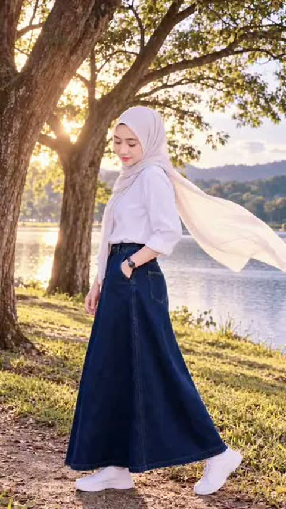</a>

The prompt is split into labelled sections for face, hijab, outfit, pose, background, lighting, camera and composition, so each detail is set separately. The fixed framing rules (trunks on the left, both shoes in frame) and the 50mm lens spec keep the full-body shot stable.

ChatGPT · Text-to-image · Source: [@mariahalqibtiyyah on TikTok](https://www.tiktok.com/@mariahalqibtiyyah/video/7684813808413527314) · 51 likes on 2026-10-30

[`portrait`](tags.md#tag-portrait) [`golden-hour`](tags.md#tag-golden-hour) [`fashion`](tags.md#tag-fashion) [`malaysia`](tags.md#tag-malaysia)

<details><summary><b>Prompt</b></summary>

```text
Create a highly photorealistic full-body outdoor portrait of a stylish young Malay Muslim woman in her mid-20s, walking naturally beneath large mature shady trees beside a peaceful lake in Malaysia during golden hour. FACE & EXPRESSION: A naturally attractive young Malaysian woman in her mid-20s with soft feminine facial features, youthful smooth flawless-looking skin while retaining realistic natural skin texture, subtle rosy cheeks, neatly shaped eyebrows and minimal natural makeup. She has a gentle soft smile. Her eyes are looking slightly downward, giving a calm, graceful and peaceful expression. Her face is shown at a natural three-quarter angle. HIJAB: She wears a soft light beige / warm ivory chiffon hijab, neatly wrapped around her head and neck in a simple elegant contemporary Malaysian style. The front framing around the face is clean and natural. One long end of the hijab extends dramatically behind her and is gently lifted by the breeze, creating a beautiful flowing translucent fabric effect illuminated by the golden sunlight. Keep the hijab modest, lightweight and realistic. OUTFIT: She wears a simple crisp white long-sleeved blouse, slightly relaxed and modest in fit, with the sleeves casually folded to approximately three-quarter length. The blouse is naturally tucked into the skirt. She wears a dark indigo-blue denim A-line maxi skirt, high-waisted and ankle-length, with a very wide graceful A-line silhouette. The denim should look substantial and realistic, with visible natural seams, stitching and side/back pocket details. The skirt gently moves as she walks. She wears clean white sporty sneakers with a slightly chunky sole and a simple modern design. A minimalist dark wristwatch is visible on one wrist. No handbag. POSE & BODY LANGUAGE: Full-body portrait from head to shoes. Capture her naturally walking slowly along the lakeside path, photographed from a slight side/three-quarter angle. One foot is stepping forward while the other is slightly lifted behind, creating a realistic walking movement. One hand rests casually inside the skirt pocket while the other arm hangs naturally beside her body. Her posture is upright, feminine, relaxed and effortless—not stiff or overly posed. BACKGROUND & ENVIRONMENT: A serene Malaysian lakeside park surrounded by large mature tropical rain trees with thick textured trunks and spreading branches. The calm lake is clearly visible behind her, reflecting warm sunlight. Across the water are softly blurred green forested hills and tropical vegetation. The ground consists of natural grass, dry leaves and a small earthy walking path beneath the trees. LIGHTING: Beautiful late-afternoon golden-hour sunlight coming through the branches behind her. Warm sun rays and subtle backlighting create a soft luminous rim around the hijab and clothing. The flowing chiffon catches the sunlight and appears slightly translucent. Natural highlights on the lake surface, gentle shadows beneath the trees and warm cinematic atmosphere. PHOTOGRAPHY STYLE: High-end lifestyle photography, photorealistic, natural Malaysian outdoor portrait, candid editorial fashion photography, realistic body proportions, authentic fabric textures, natural skin texture, soft cinematic depth of field, warm golden tones, subtle background bokeh, professional full-frame camera look, approximately 50mm lens, sharp focus on the woman, realistic exposure, highly detailed, elegant and peaceful. COMPOSITION: Vertical portrait orientation, approximately 2:3 ratio, full body completely visible including both shoes. Position the woman slightly off-centre with the large tree trunks naturally framing her on the left and the lake extending behind her. Leave sufficient space around the flowing hijab so it is not cropped.
```

</details>

<a id="gpt-image-five-color-block-outfits-seated-armchair-portrait"></a>
### Five color block outfits above a seated armchair portrait

<a href="https://x.com/Arina_hoqe/status/2104898420255453267"></a>

Each panel gets its own color, pose and outfit, and the paint drips bridge into a white lower half holding the larger seated shot. An explicit identity lock repeated across all six instances, plus separate lens notes for the panels and the seated portrait, keeps the face consistent.

GPT Image 2.5 · Edit · Source: [@Arina_hoqe on X](https://x.com/Arina_hoqe/status/2104898420255453267) · 50 likes on 2026-10-29

[`color-block`](tags.md#tag-color-block) [`paint-drip`](tags.md#tag-paint-drip) [`identity-lock`](tags.md#tag-identity-lock) [`outfit-variations`](tags.md#tag-outfit-variations) [`selfie`](tags.md#tag-selfie)

<details><summary><b>Prompt</b></summary>

```text
PROMPT 2 — Five Color-Block Outfits + Seated Portrait (Female)

CONCEPT — EXACT: A vertical poster composite — five tall color-block panels in a row across the top, each holding a standing portrait of the same woman in a different outfit matching that panel's color, with the bottom of each panel melting into dripping paint splashes in the same color over a clean white background, and below them a larger seated portrait of her on an ornate teal armchair.

PANEL COLORS (left to right): bright blue, red, green, navy, orange — each panel a solid flat color with the woman cropped from the head to mid-thigh, and the panel's lower edge dissolving into a paint splash with long vertical drips running down onto the white background.

PANEL 1 (blue): Standing straight, arms relaxed at her sides, soft calm smile, light-wash denim jacket over a white top, jeans.
PANEL 2 (red): Standing with one hand on the hip, soft calm smile, red sleeveless V-neck pleated midi dress.
PANEL 3 (green): Standing straight, arms relaxed, soft calm smile, emerald-green satin button-up blouse tucked into black bottoms.
PANEL 4 (navy): Standing straight, one hand resting lightly near the waist, soft calm smile, tailored navy blazer with a matching navy top and trousers, slim wristwatch.
PANEL 5 (orange): Standing straight, hands near the pockets, soft calm smile, casual short-sleeve graphic tee with bold abstract street-style lettering (no readable brand text) over blue jeans.

SEATED PORTRAIT — EXACT: Seated on an ornate Rococo-style teal velvet armchair with carved scrolled wooden frame, legs crossed elegantly, one arm resting along the armrest, other hand resting near the knee, torso slightly turned, head tilted with a confident warm closed-mouth smile toward camera.

MAIN SUBJECT IDENTITY LOCK: All six instances of the face (five panels + seated portrait) must match the reference photo exactly — same jaw width, cheek fullness, eyebrow shape, eye shape and color, nose bridge, lip shape, and hair as in the reference. Identical face in every instance with zero drift.

BODY: Slim build, poised confident posture in every instance.

OUTFIT (seated portrait): Deep red satin spaghetti-strap cami top, black high-waisted wide-leg trousers, black pointed-toe heels.

BACKGROUND — EXACT: Pure clean white studio background below the color-block panels, soft grounded shadow beneath the armchair, paint splashes and drips in blue, red, green, navy, and orange spreading down from the bottom edge of each color panel.

LIGHTING — EXACT: Soft even bright studio lighting on all six instances, gentle natural shadow definition, clean high-key commercial lighting.

COLOR GRADE — EXACT: Vivid saturated block colors (blue, red, green, navy, orange) against a pure white base, teal chair as a rich accent, natural warm skin tone throughout, crisp glossy editorial color grading with ultra-detailed 8K sharpness.

CAMERA: Shot on 85mm lens for the panels and 50mm for the seated portrait, sharp focus on the face in every instance.

Ultra photorealistic — zero AI artifacts, no watermark.

IMPORTANT — Use ONLY my uploaded face reference image for the facial structure and identity in ALL SIX instances of my likeness across this composite. My face must remain EXACTLY the same as my real appearance with zero identity change. Preserve my exact hairstyle, hairline, forehead shape, eyebrows, eye shape, nose structure, lips, jawline, skin tone, facial texture, and feminine proportions exactly as shown in the uploaded image. Do NOT beautify, cartoonize, smooth skin, or replace my face with a random celebrity or model face. Identity preservation is the highest priority across all instances of my likeness in this composite.

Gnrat ratio 3:4
```

</details>

<a id="gpt-image-seaside-viewpoint-smartphone-selfie"></a>
### Seaside viewpoint smartphone selfie in white cap

<a href="https://x.com/MissDelulu9/status/2115357570722566196"></a>

Fixes the framing from cap top to lower waist, then specifies fabric details, hard midday sun from one side and phone compression so it reads as a casual snapshot. A closing list of things to avoid, such as plastic skin and studio polish, keeps the result from looking staged.

GPT Image 2.5 · Text-to-image · Source: [@MissDelulu9 on X](https://x.com/MissDelulu9/status/2115357570722566196) · 48 likes on 2026-10-28

[`smartphone-photo`](tags.md#tag-smartphone-photo) [`travel-selfie`](tags.md#tag-travel-selfie) [`seaside`](tags.md#tag-seaside) [`natural-light`](tags.md#tag-natural-light) [`casual-portrait`](tags.md#tag-casual-portrait)

<details><summary><b>Prompt</b></summary>

```text
A real vertical smartphone travel snapshot of a young adult woman in her early 20s at a seaside viewpoint, framed from the top of her white baseball cap to the lower waist in a close front-facing medium portrait. She stands or leans near a wall, very close to the camera, at street.

She wears a white ribbed scoop-neck tank top and a lightweight white jacket half-slipped off her shoulders, with visible rib texture, wrinkles, snap-button and zipper details, and a small strip of lower abdomen visible above a white bottom waistband.

Her hair is deep black, long, side-tied or in a low side ponytail, falling over the left shoulder with windblown strands around her face. She has a small oval face, soft jawline, natural East Asian features, sheer clean vacation makeup, muted pink-coral lips, and a calm expression with lips closed.

Her eyes look gently toward the camera from under the cap brim shadow. Keep the small black logo mark on the cap front, not flipped and not oversized. Strong midday sun from the upper left creates hard highlights and cool ocean-reflected shadows.

Natural skin texture, slightly imperfect framing, subtle phone compression, deep smartphone depth of field. Avoid plastic skin, studio polish, heavy makeup, exaggerated proportions, wrong logo, app UI, cartoon or CGI style
```

</details>

<a id="gpt-image-blush-pleated-couture-gown-beauty-portrait"></a>
### Blush pink pleated couture gown beauty portrait

<a href="https://x.com/mehvishs25/status/2100051238041932083"></a>

The prompt describes hair, eyes, makeup, pose and hand placement in separate passages, then gives the gown fabric its own passage with fold and shadow detail. It closes with studio lighting, an 85mm lens and a negative prompt aimed at plastic skin and distorted hands.

GPT Image 2.5 · Text-to-image · Source: [@mehvishs25 on X](https://x.com/mehvishs25/status/2100051238041932083) · 45 likes on 2026-10-29

[`fashion`](tags.md#tag-fashion) [`beauty-portrait`](tags.md#tag-beauty-portrait) [`pleated-gown`](tags.md#tag-pleated-gown) [`studio-lighting`](tags.md#tag-studio-lighting) [`editorial`](tags.md#tag-editorial)

<details><summary><b>Prompt</b></summary>

```text
Create a photorealistic high-fashion beauty portrait of an elegant adult woman with same features and luminous natural skin. She has long, perfectly straight, glossy black hair, sleekly parted down the center and falling smoothly behind her shoulders. Her almond-shaped dark brown eyes are softly defined with subtle eyeliner and warm neutral eyeshadow. She has naturally shaped brows, soft peach blush, radiant cheekbones, and glossy muted nude-pink lips.

She poses gracefully with her head slightly tilted upward and turned subtly toward the camera, giving a calm, sophisticated, confident expression. One delicate hand is raised beside her face, with her fingertips gently touching beneath her chin. Natural elegant fingers and realistic hands.

She is wrapped in an exquisite blush-pink pleated couture gown made from lightweight sculptural fabric. The fabric forms dramatic oversized pleated folds that sweep around her shoulders, arms, and torso like flowing architectural waves, creating a luxurious sculptural silhouette while remaining elegant and tasteful. Fine accordion pleats are highly detailed and realistic, with soft dimensional shadows between every fold.

Minimalist studio background in warm soft gray, with large flowing pleated fabric shapes surrounding her like an artistic backdrop. Soft diffused beauty lighting illuminates her face evenly, creating subtle highlights on her cheekbones, shoulder, and glossy hair. Premium beauty campaign aesthetic, sophisticated editorial photography, dreamy feminine atmosphere, ultra-realistic skin texture, realistic fabric detail, cinematic depth of field, 85mm portrait lens, high-end fashion magazine quality, vertical composition, photorealistic.

Negative prompt: text, logos, watermark, symbols, stickers, borders, social media UI, excessive makeup, plastic skin, over-smoothed face, distorted hands, extra fingers, malformed fingers, asymmetrical eyes, unrealistic hair, messy hair, cartoon, illustration, CGI, low resolution, blur, oversaturated colors.
```

</details>

<a id="gpt-image-low-angle-red-gown-manhattan-vintage-car"></a>
### Low angle red pleated gown beside vintage car

<a href="https://x.com/frametheory058/status/2106379728303309011"></a>

A low street level camera position with a 24mm lens makes the skyscrapers converge and turns the gown into a giant fan. A tight complementary palette of crimson, burnt orange and turquoise, plus real camera specs and imperfection cues, keeps the result photographic rather than synthetic.

GPT Image 2.5 · Text-to-image · Source: [@frametheory058 on X](https://x.com/frametheory058/status/2106379728303309011) · 45 likes on 2026-10-29

[`fashion-editorial`](tags.md#tag-fashion-editorial) [`low-angle`](tags.md#tag-low-angle) [`pleated-gown`](tags.md#tag-pleated-gown) [`street-photography`](tags.md#tag-street-photography) [`manhattan`](tags.md#tag-manhattan)

<details><summary><b>Prompt</b></summary>

```text
A striking high-fashion editorial photographed from an extreme low street-level angle in Manhattan, New York. A beautiful young woman with fair natural skin and softly windswept light-brown hair stands confidently beside a polished vintage burnt-orange sedan with classic round headlights. She wears an extravagant floor-length crimson red pleated gown with a clean sleeveless silhouette, holding the flowing fabric outward with both hands so the dress spreads dramatically across the frame like a giant sculptural fan.

Her posture feels effortless yet powerful — shoulders relaxed, head tilted toward the sky, eyes gently closed, hair catching the breeze. Above her, a scattered flock of white and grey city pigeons sweeps across a vivid turquoise-blue sky, adding spontaneous movement and scale.

Massive Manhattan skyscrapers rise steeply on both sides of the frame, converging toward the sky and creating dramatic architectural leading lines. The vintage orange car remains partially visible in the foreground, its chrome details catching small highlights from the sun.

Warm late-afternoon sunlight cuts naturally between the buildings, producing realistic directional shadows, subtle rim light around her hair and dress, and beautiful reflections across the car. Deep crimson fabric against burnt orange paint, turquoise sky and warm stone architecture. Rich but believable editorial color grading, realistic skin pores and texture, individual hair strands, extremely detailed pleated fabric, natural cloth physics, authentic street imperfections, realistic reflections and shadows.

Shot as a real luxury fashion campaign on a full-frame camera, 24mm wide-angle lens, f/4, low camera position, crisp subject detail, controlled highlights, subtle photographic grain, sophisticated magazine-cover composition, cinematic fashion photography, timeless 1990s editorial influence mixed with contemporary luxury campaign photography, photorealistic, tactile, imperfect, expensive, absolutely no CGI or synthetic AI aesthetic --ar 2:3 --style raw --stylize 750 --q 2
```

</details>

<a id="gpt-image-bag-pov-ios-incoming-call-portrait"></a>
### Bag POV portrait with iOS incoming call overlay

<a href="https://x.com/TheVirtualMuse/status/2110015285323559093"></a>

An unusual camera position, looking up from inside a fleece lined bag, frames the shot with fuzzy edges, while a foreshortened hand in the foreground adds depth. Quoted UI labels and an explicit face reference instruction keep the overlay text and identity accurate.

GPT Image 2.5 · Edit · Source: [@TheVirtualMuse on X](https://x.com/TheVirtualMuse/status/2110015285323559093) · 43 likes on 2026-10-28

[`face-reference`](tags.md#tag-face-reference) [`pov`](tags.md#tag-pov) [`ios-ui-overlay`](tags.md#tag-ios-ui-overlay) [`street-style`](tags.md#tag-street-style) [`realistic`](tags.md#tag-realistic)

<details><summary><b>Prompt</b></summary>

```text
Use my uploaded photo as the face reference. 3:4 vertical. Point-of-view shot from inside a grey fleece-lined bag looking up. The soft
fuzzy lining frames every edge of the image. the person in reference, keeping her exact face, hairstyle and identity, reaches down into the
bag toward the camera, her fingers foreshortened in the foreground and stacked with chunky silver rings. She wears a black ribbed beanie,
black oval sunglasses, a navy blazer and a blue-and-white striped shirt: a white London
townhouse with a dark grey-green front door numbered 27, black iron railings and a small olive tree. Overlaid iOS incoming call interface
in white system font: a "Message" button on the left and a "Voicemail" button on the right as frosted round icons, and at the bottom a
frosted glass pill slider reading "slide to answer" with a white circle holding a green phone icon. Natural daylight, candid street-style
fashion photography, realistic skin texture.
Make it realistic
Improve its colour grading
```

</details>

<a id="chatgpt-mirror-portrait-black-top-led-mirror"></a>
### Woman in black tee leaning toward LED mirror

<a href="https://www.tiktok.com/@kellylynnstevens/video/7685895224954064142">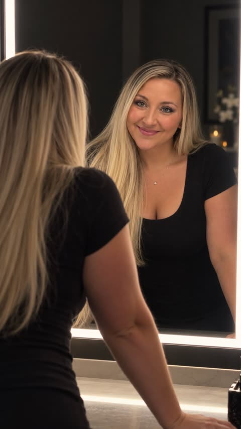</a>

Framing from behind with the reflection in the same frame makes the mirror the second subject, so the viewer sees both the face and the back. Soft LED light with deep shadows and a shallow depth of field gives it the luxury editorial look.

ChatGPT · Text-to-image · Source: [@kellylynnstevens on TikTok](https://www.tiktok.com/@kellylynnstevens/video/7685895224954064142) · 41 likes on 2026-10-30

[`mirror`](tags.md#tag-mirror) [`portrait`](tags.md#tag-portrait) [`reflection`](tags.md#tag-reflection) [`led-lighting`](tags.md#tag-led-lighting)

<details><summary><b>Prompt</b></summary>

```text
Realistic cinematic mirror portrait, vertical. Confident girl in a black shirt with thin chain, standing before a modern LED-lit mirror. Shot from behind with clear reflection, leaning forward in a powerful introspective pose. Soft cinematic LED lighting, deep shadows, high contrast, minimal dark background. Photorealistic skin texture, sharp focus, shallow DOF, luxury editorial look. No text, no logos, no CGI. TikTok format.
```

</details>

<a id="nano-banana-cottagecore-golden-hour-reading-portrait"></a>
### Woman reading under a tree at golden hour

<a href="https://x.com/TheVirtualMuse/status/2110737749733195788"></a>

An identity lock paragraph keeps the reference face, and separate blocks for scene, hair, outfit, lighting, color grade and lens give the model a clear checklist. Specifying an 85mm lens at f/1.8, diagonal upper left sunlight and a Portra 400 grade produces the bokeh and warm film look.

Nano Banana 2.1 · Edit · Source: [@TheVirtualMuse on X](https://x.com/TheVirtualMuse/status/2110737749733195788) · 41 likes on 2026-10-28

[`cottagecore`](tags.md#tag-cottagecore) [`golden-hour`](tags.md#tag-golden-hour) [`fashion-editorial`](tags.md#tag-fashion-editorial) [`identity-lock`](tags.md#tag-identity-lock) [`portrait`](tags.md#tag-portrait)

<details><summary><b>Prompt</b></summary>

```text
Using the uploaded reference image, create an exceptionally beautiful, ultra-photorealistic 4:5 vertical cottagecore fashion editorial photograph.

IDENTITY LOCK:
Preserve the exact facial identity of the woman from the reference image, including her natural facial structure, expressive eyes, delicate nose, lips, eyebrows, skin tone, and recognizable features. No face reshaping, artificial beautification, or identity changes. She must look like the same real woman photographed in a different setting.

SCENE & COMPOSITION:
A breathtakingly peaceful woodland meadow during the final hour before sunset. The woman sits gracefully on the soft forest floor, leaning naturally against the textured bark of a magnificent old tree. Her legs rest comfortably to one side, partially surrounded by delicate wildflowers and lush green grass.

She holds a small vintage sage-green hardcover book with both hands, quietly reading with her eyes lowered toward the pages. Her expression is soft, thoughtful, and effortlessly adorable, with naturally relaxed lips and a peaceful gaze.

HAIR & STYLING:
Her beautiful, naturally dark brown hair falls in long, soft, slightly tousled waves over her shoulders and down her back. A few delicate strands frame her face, catching the golden sunlight. Individual hair strands remain naturally visible.

OUTFIT:
A romantic vintage-inspired ivory cottagecore maxi dress featuring tiny dusty-pink floral prints, a delicate square neckline with subtle lace detailing, softly gathered puff sleeves, ruffled cuffs, and a thin blush-pink ribbon tied at the bodice. Premium lightweight cotton fabric with authentic folds, delicate stitching, and natural movement.

LIGHTING — CINEMATIC GOLDEN HOUR:
Absolutely breathtaking natural golden-hour lighting.

Warm late-afternoon sunlight enters diagonally from the upper left, filtering through the woodland canopy and creating beautiful golden highlights across her dark hair, cheekbones, shoulders, and dress.

Delicate amber rim lighting outlines her silhouette. Soft natural shadows sculpt her facial features while subtle reflected light maintains realistic skin tones.

Beautiful scattered sunlight creates glowing circles of bokeh in the background. Highlights remain controlled, with rich shadow detail and a natural cinematic contrast.

PREMIUM COLOR GRADING:
An exquisite luxury editorial film grade inspired by Kodak Portra 400.

Rich honey-gold sunlight, luminous champagne highlights, sophisticated olive-green foliage, muted sage undertones, creamy ivory fabrics, delicate dusty-pink floral accents, and naturally warm skin tones.

Deep forest greens provide elegant cinematic contrast against the glowing subject.

Soft highlight roll-off, slightly lifted shadow detail, gentle organic film grain, beautifully balanced saturation, natural color separation, and refined tonal depth.

The overall palette should feel warm, romantic, expensive, nostalgic, and visually irresistible.

PHOTOGRAPHY:
Captured like an authentic luxury fashion editorial on a full-frame professional camera with an 85mm portrait lens at f/1.8.

Perfectly natural human proportions, realistic perspective, precise focus on her face and eyelashes, detailed skin pores, subtle facial imperfections, authentic hair texture, and physically accurate hands.

Beautiful shallow depth of field with exceptionally smooth optical bokeh. Foreground wildflowers are softly blurred, creating a natural sense of depth.

The framing feels intimate yet cinematic, with her beautiful face, upper body, hands, book, and flowing dress clearly visible.

FINAL AESTHETIC:
A breathtaking fusion of timeless countryside romance, premium fashion photography, and intimate cinematic storytelling.

The photograph should feel like a genuine, professionally captured editorial image from a high-end fashion magazine.

Extremely beautiful yet believable, emotionally captivating, naturally elegant, and instantly eye-catching.
```

</details>

<a id="gpt-image-sun-disintegration-doves-selfie-portrait"></a>
### Man disintegrating into black fragments before burnt orange sun

<a href="https://x.com/AiWithTariq/status/2102054027605459193"></a>

The prompt locks identity from the reference photo with a list of facial features, then gives the outfit, pose and framing in plain terms. It describes the body to particle transition on one side only, adds doves at different distances for depth, and ends with a negative prompt against identity drift and hand errors.

GPT Image 2.5 · Edit · Source: [@AiWithTariq on X](https://x.com/AiWithTariq/status/2102054027605459193) · 40 likes on 2026-10-29

[`selfie`](tags.md#tag-selfie) [`disintegration`](tags.md#tag-disintegration) [`surreal`](tags.md#tag-surreal) [`cinematic`](tags.md#tag-cinematic) [`reference-photo`](tags.md#tag-reference-photo)

<details><summary><b>Prompt</b></summary>

```text
Create a highly realistic cinematic full-body portrait of the person from the reference image. Preserve the exact facial identity, facial structure, hairstyle, skin tone, beard, eyes, nose, lips, and natural body proportions.

The man is standing confidently in a relaxed pose with both hands naturally inside his pants pockets. He is wearing a dark charcoal oversized sweatshirt, black cargo pants, a black wristwatch, and black sneakers.

Behind him is a huge textured burnt-orange circular sun, creating a powerful cinematic backdrop. The left side of his entire body is dramatically disintegrating into thousands of black and dark-gray geometric fragments, dust, tiny particles, and shattered pieces flying toward the left side of the frame. The transition from solid body to particles must look extremely realistic and seamless.

Several beautiful white doves are flying around him at different distances, with realistic feathers and natural wing positions.

Dark cinematic studio background, smoky atmosphere, floating dust, dramatic volumetric lighting, soft shadows, subtle orange rim light from the giant sun, realistic fabric texture, photorealistic skin.

Professional cinematic photography, surreal conceptual art, Hollywood movie-poster quality, ultra-detailed, realistic physics, HDR, sharp face, 35mm lens, full-body composition, cinematic depth of field, subtle film grain.

Vertical 4:5 composition, subject centered, entire body and shoes visible.

Negative prompt: cartoon, anime, illustration, plastic skin, CGI face, altered identity, distorted face, extra fingers, extra limbs, deformed hands, duplicate person, unnatural anatomy, blurry face, low quality, text, logo, watermark.
```

</details>

<a id="gpt-image-blue-streetwear-portrait-white-doodle-overlay"></a>
### Blue streetwear portrait with white doodle overlays

<a href="https://x.com/AiwithBloodline/status/2114366276743352666"></a>

A JSON prompt splits meta, subject, wardrobe, graphic elements and reconstruction notes, and locks the face to the reference while listing clothing, pose, lighting and background as things not to copy. A blue on blue palette with white line art keeps the photo and vector layers cleanly separated.

GPT Image 2.5 · Edit · Source: [@AiwithBloodline on X](https://x.com/AiwithBloodline/status/2114366276743352666) · 39 likes on 2026-10-29

[`json-prompt`](tags.md#tag-json-prompt) [`face-reference`](tags.md#tag-face-reference) [`doodle-overlay`](tags.md#tag-doodle-overlay) [`blue-palette`](tags.md#tag-blue-palette) [`streetwear`](tags.md#tag-streetwear)

<details><summary><b>Prompt</b></summary>

```text
{
  "meta": {
    "image_quality": "High",
    "image_type": "Mixed Media (Photography + Vector Illustration)",
    "reference_image_usage": "Use the attached image strictly for facial identity matching only. Face shape, beard, glasses, eyes, nose, lips, and hair texture must match exactly. Do not copy clothing, lighting, or background from the reference.",
    "resolution_estimation": "High resolution, sharp vector edges",
    "file_characteristics": {
      "compression_artifacts": "Low",
      "noise_level": "None",
      "lens_type_estimation": "Standard portrait look (35–50mm equivalent)"
    }
  },
  "global_context": {
    "scene_description": "A full-body studio portrait of a young man in a dynamic, confident pose against a solid bright blue background. The image blends realistic photography with white hand-drawn vector doodles and abstract blue liquid shapes, creating a modern street-art editorial look.",
    "environment_type": "Studio / Graphic Design Composition",
    "atmosphere": "Energetic, urban, creative, cool",
    "lighting": {
      "source": "Artificial studio lighting",
      "direction": "Front-right dominant",
      "quality": "Soft and diffused",
      "color_temperature": "Neutral white"
    },
    "color_palette": {
      "dominant_colors": [
        "Bright blue background",
        "Deep blue clothing",
        "White graphic accents"
      ],
      "contrast_level": "High"
    }
  },
  "composition": {
    "camera_angle": "Low-angle, slightly upward",
    "framing": "Full body (head to toe)",
    "depth_of_field": "Deep focus",
    "focal_point": "Face and upper torso",
    "balance": "Asymmetrical with graphics filling negative space"
  },
  "subject": {
    "identity_source": "Attached reference image",
    "gender": "Male",
    "pose": "Standing with relaxed confidence, body angled slightly right, head tilted slightly left, one hand raised near the face, legs casually crossed",
    "expression": "Neutral, confident, calm",
    "face_constraints": {
      "glasses": "Round black eyeglasses",
      "facial_hair": "Trimmed beard",
      "hair": "Short, slightly tousled",
      "must_match_reference": true
    }
  },
  "wardrobe": {
    "style": "Monochromatic blue streetwear",
    "upper_body": "Blue fleece-style jacket worn open",
    "inner_layer": "Blue t-shirt with large white abstract graphic symbol",
    "lower_body": "Dark blue denim jeans with visible white contrast stitching and rolled cuffs",
    "footwear": "Clean white low-top sneakers"
  },
  "graphic_elements": {
    "style": "Hand-drawn white vector doodles",
    "elements": [
      "Microphone outline near raised hand",
      "Boombox line-art floating to the side",
      "Radiating sound or motion lines around head",
      "Cracked ground illustration beneath feet"
    ],
    "background_graphics": "Abstract blue liquid shapes layered behind the subject"
  },
  "background_details": {
    "color": "Solid bright blue",
    "texture": "Flat, uniform",
    "lighting_behavior": "Even, shadow-free background"
  },
  "reconstruction_notes": {
    "mandatory": [
      "Exact facial identity match from reference image",
      "Full-body pose",
      "Blue-on-blue color harmony",
      "White doodle overlays",
      "Sharp separation between photo and vector layers"
    ],
    "do_not_copy_from_reference": [
      "Clothing",
      "Pose",
      "Lighting",
      "Background"
    ],
    "intended_use": "High-impact editorial image or start frame for image-to-video animation"
  }
}
```

</details>

<a id="nano-banana-christmas-modern-santa-reindeer-studio"></a>
### Modern Santa with reindeer in red studio

<a href="https://x.com/rovvmut_/status/2003317930130571608">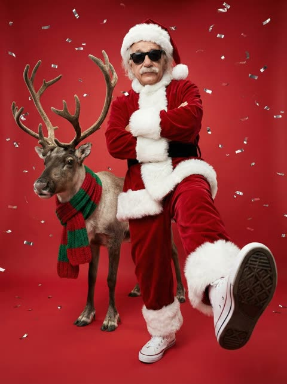</a>

The uploaded photo is locked as the face and body reference, and a low angle wide lens with strong foreshortening makes the crossed arms and raised sneaker feel bold. Naming each outfit item, a solid red backdrop and the 3:4 frame keeps the result consistent.

Nano Banana Pro · Edit · Source: [@rovvmut_ on X](https://x.com/rovvmut_/status/2003317930130571608) · 38 likes on 2026-10-29

[`christmas`](tags.md#tag-christmas) [`santa`](tags.md#tag-santa) [`studio-portrait`](tags.md#tag-studio-portrait) [`reindeer`](tags.md#tag-reindeer)

<details><summary><b>Prompt</b></summary>

```text
Use the uploaded image as the exact reference for the person’s face and body.
Full-body low-angle wide-lens studio portrait, arms crossed, one foot pushed toward the camera with strong foreshortening. Modern Santa outfit: red velvet suit with white fur trim, Santa hat, black sunglasses, white canvas sneakers.

Reindeer standing slightly behind on the left with large antlers and a knitted festive scarf.
Solid red studio background with floating silver confetti.
Clean soft studio lighting, high contrast, sharp focus, playful modern holiday editorial style. 3:4 aspect ratio.
```

</details>

<a id="nano-banana-luxury-mirror-selfie-paisley-headscarf"></a>
### Luxury mirror selfie in paisley headscarf and black turtleneck

<a href="https://x.com/TheVirtualMuse/status/2110656946558611743"></a>

A strict identity lock on the reference face comes first, then labeled sections for hair, outfit, pose, makeup, background and lighting keep every detail controlled. Direct phone flash mixed with warm tungsten light, plus a long negative list against smoothing and AI look, gives the authentic photo feel.

Nano Banana 2.1 · Edit · Source: [@TheVirtualMuse on X](https://x.com/TheVirtualMuse/status/2110656946558611743) · 38 likes on 2026-10-28

[`mirror-selfie`](tags.md#tag-mirror-selfie) [`identity-lock`](tags.md#tag-identity-lock) [`flash-photography`](tags.md#tag-flash-photography) [`fashion`](tags.md#tag-fashion) [`photorealistic`](tags.md#tag-photorealistic)

<details><summary><b>Prompt</b></summary>

```text
Using the uploaded reference image as the ONLY facial identity reference, create an ultra-photorealistic 4:5 vertical luxury mirror selfie of the exact same young woman.

STRICT IDENTITY LOCK: Preserve her original face, facial structure, eye shape and color, nose, lips, eyebrows, jawline, natural skin tone, and recognizable facial proportions. No facial modifications, beautification, or identity changes.

SUBJECT & HAIRSTYLE:
Her naturally dark brown hair is styled in a beautiful, slightly voluminous, loosely gathered hairstyle, with soft face-framing strands and a few naturally falling wisps. Preserve her original hair color and realistic hair texture.

OUTFIT & ACCESSORIES:
She wears an elegant, fitted black ribbed turtleneck with full sleeves, styled with a luxurious vintage paisley silk headscarf featuring rich burgundy, deep teal, and antique gold patterns. The scarf is loosely draped over her head, allowing some natural hair to remain visible.

Delicate gold butterfly and floral rings adorn her left hand, complemented by perfectly shaped, glossy black almond-pointed nails. The overall styling feels sophisticated, feminine, expensive, and effortlessly fashionable.

POSE & EXPRESSION:
A naturally beautiful close-up mirror selfie. She holds a dark graphite iPhone with triple rear cameras in her right hand, positioned beside her face without obstructing her facial features. The camera flash is activated, producing an authentic bright white flash reflection in the mirror.

Her left palm gently supports her cheek, with her fingers resting naturally along her jawline. She looks directly into the mirror with soft, captivating eyes, a relaxed expression, and naturally slightly parted lips.

MAKEUP:
Beautiful but realistic soft-glam makeup, delicately defined eyelashes, subtle eyeliner, naturally shaped eyebrows, soft rosy-pink blush, and muted matte pink lips. Preserve real skin pores, subtle imperfections, natural facial texture, and authentic skin highlights. No artificial skin smoothing.

BACKGROUND:
An elegant luxury bedroom or dressing room with rich dark walnut wooden wardrobes, warm cream walls, subtle brass details, and sophisticated interior furnishings. The background remains naturally visible but slightly softened, creating realistic photographic depth.

LIGHTING & COLOR GRADING:
Authentic direct iPhone flash photography mixed with warm ambient tungsten lighting. Beautiful natural skin tones, rich burgundy and teal accents, deep realistic blacks, warm walnut-brown surroundings, controlled highlights, and soft cinematic shadows.

Premium editorial color grading with subtle warmth, rich tonal separation, balanced contrast, and exceptionally natural color reproduction. No excessive saturation, orange skin, artificial glow, or cinematic teal-orange filter.

CAMERA & REALISM:
Captured as an authentic high-end iPhone mirror selfie, with realistic perspective, natural lens characteristics, crisp facial details, subtle photographic grain, and physically accurate mirror reflections.

Extremely sharp 8K-quality photographic detail, realistic fabric texture, individual hair strands, accurate hand anatomy, natural reflections, and lifelike skin.

The final image must feel like a genuine luxury lifestyle photograph taken by a real person, not an AI-generated portrait.

NEGATIVE:
No AI look, no CGI, no plastic skin, no beauty filters, no altered identity, no exaggerated facial features, no unnatural eyes, no distorted hands, no extra fingers, no incorrect mirror reflections, no warped phone, no excessive blur, no overprocessed HDR, no artificial color grading.

ASPECT RATIO: 4:5
STYLE: Luxury fashion mirror selfie | Photorealistic | Natural beauty | Premium Instagram editorial
```

</details>

<a id="nano-banana-minimalist-luxury-sunglasses-profile-campaign"></a>
### Minimalist luxury campaign portrait with windswept hair

<a href="https://x.com/weiinberg/status/2112776041064476736"></a>

A single all caps line stacks campaign mood, pose, motion blur on the hair, gradient backdrop and shallow depth of field. A reference image tag keeps the model's identity consistent.

Nano Banana 2.1 · Edit · Source: [@weiinberg on X](https://x.com/weiinberg/status/2112776041064476736) · 37 likes on 2026-10-28

[`fashion-editorial`](tags.md#tag-fashion-editorial) [`luxury`](tags.md#tag-luxury) [`motion-blur`](tags.md#tag-motion-blur) [`negative-space`](tags.md#tag-negative-space) [`sunglasses`](tags.md#tag-sunglasses)

<details><summary><b>Prompt</b></summary>

```text
Nano Banana 2.1.

Prompt: MINIMALIST MODERN LUXURY CAMPAIGN, FEMALE  MODEL as in <<<image_1>>> IN PROFILE, LOOKING BEHIND CAMERA, WEARING PREMIUM SUNGLASSES, FAST MOTION BLUR HAIR MOVEMENT, COOL GRADIENT BACKDROP, AIRY NEGATIVE SPACE, CALM CINEMATIC LIGHTING, MATTE TEXTURES, UNDERSTATED LUXURY FASHION AESTHETIC, HIGH-END EDITORIAL PHOTOGRAPHY, SHALLOW DEPTH OF FIELD
```

</details>

<a id="nano-banana-ceo-life-stage-timeline"></a>
### Sundar Pichai life stage timeline, ages 5 to present

<a href="https://x.com/marcthecreatorr/status/2107532275529273535"></a>

A single subject, a fixed list of life stages and an explicit same-face requirement give the model a clear structure to repeat. Adding realistic keeps every panel photographic rather than illustrated, so the age progression reads as one person.

Nano Banana 2.1 · Text-to-image · Source: [@marcthecreatorr on X](https://x.com/marcthecreatorr/status/2107532275529273535) · 36 likes on 2026-10-29

[`timeline`](tags.md#tag-timeline) [`face-consistency`](tags.md#tag-face-consistency) [`portrait`](tags.md#tag-portrait)

<details><summary><b>Prompt</b></summary>

```text
nano banana 2.1 is live and my first output already looks really good.

simple prompt: create a realistic timeline of google’s ceo from childhood to now while keeping the same face throughout.

> it’s still based on the older gemini 3.6 flash model, but image generation is fast as hell. most outputs come back in seconds.

here’s the first side-by-side i ran with the exact same prompt and i already have a winner :)
```

</details>

<a id="nano-banana-christmas-red-velvet-couture-editorial"></a>
### Woman in red velvet gown by Christmas tree

<a href="https://x.com/JadoonKhan281/status/2002388800425898354">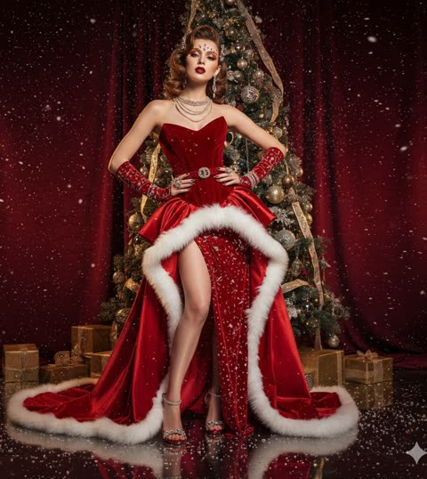</a>

A labeled section template splits identity, scene, pose, styling and camera into separate fields so each attribute can be controlled on its own. The identity lock block together with the 85mm f/2.8 lens line keeps the face sharp and the editorial look consistent.

Nano Banana Pro · Edit · Source: [@JadoonKhan281 on X](https://x.com/JadoonKhan281/status/2002388800425898354) · 36 likes on 2026-10-29

[`christmas`](tags.md#tag-christmas) [`fashion`](tags.md#tag-fashion) [`portrait`](tags.md#tag-portrait) [`editorial`](tags.md#tag-editorial)

<details><summary><b>Prompt</b></summary>

```text
[Identity_Preservation]
BoneStructure = "identical_symmetry_jawline_cheek_curves"
Nose_Lips = "exact_contour_fullness_unaltered"
Eyes_Brows = "specific_eyelid_shape_eyebrow_arch_match"
Skin_Texture = "fair_tone_subtle_pores_youthful_glow_hyper_real"
Stylization = "none_zero_distortion_photorealistic_accuracy"

[Scene_Environment]
Backdrop = "deep_burgundy_velvet_golden_reflections"
Decorations = "designer_tree_metallic_ornaments_crystals_ribbons"
Props = "gold_accented_gift_boxes_elegant_scattering"
Atmosphere = "floating_studio_snow_particles_glossy_floor_reflections"
Mood = "high_fashion_festive_drama_glamorous_editorial"

[Composition_Pose]
Shot_Type = "full_body_editorial"
Stance = "dynamic_fashion_hip_pop_one_leg_forward_shoulders_back"
Framing = "rule_of_thirds_couture_silhouette"
Head_Angle = "dramatic_tilt_editorial"
Eye_Contact = "intense_direct_camera_engagement"

[Styling_Beauty]
Hair = "voluminous_waves_chestnut_caramel_highlights_crystal_pins"
Eyes = "metallic_gold_crimson_shadow_glitter_lashes"
Lips = "couture_red_soft_gloss_slightly_parted"
Face_Accents = "micro_face_jewels_brow_cheekbone_crystals"
Nails = "deep_red_gold_accents_snowflake_tips"

[Couture_Outfit]
Gown = "structured_red_velvet_corset_voluminous_skirt_high_slit"
Materials = "satin_tulle_white_faux_fur_trim"
Embellishments = "swarovski_crystals_pearls_metallic_studs"
Footwear = "metallic_red_stilettos_crystal_straps"

[Accessories]
Jewelry = "layered_asymmetric_necklaces_stacked_cuffs_oversized_earrings"
Hands = "jeweled_glove_extensions_multi_joint_rings"
Waist = "designer_belt_jeweled_buckle"

[Technical_Specs]
Camera = "Full_frame_DSLR_85mm_lens"
Settings = "f/2.8_aperture_ISO100_1/160s"
Lighting = "studio_key_sculpting_rim_lighting_jewel_highlights"
Resolution = "HDR_Ultra_HD_crystal_clear_textures"
```

</details>

<a id="nano-banana-christmas-santa-grinch-selfie-group"></a>
### Christmas selfie with Santa and the Grinch

<a href="https://x.com/Samann_ai/status/2004584088875962826">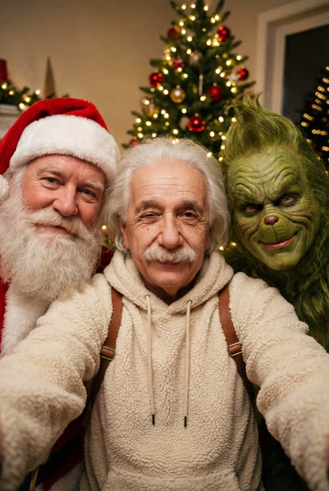</a>

The prompt fixes the framing (arm length selfie, three faces filling one tight frame, same pose every time) and lists skin, fabric and lens details, so the result reads as a candid phone photo. Upload a photo of the person to fill the subject slot so their own face is kept.

Nano Banana Pro · Edit · Source: [@Samann_ai on X](https://x.com/Samann_ai/status/2004584088875962826) · 33 likes on 2026-10-29

[`christmas`](tags.md#tag-christmas) [`selfie`](tags.md#tag-selfie) [`grinch`](tags.md#tag-grinch) [`santa`](tags.md#tag-santa)

<details><summary><b>Prompt</b></summary>

```text
A cozy Christmas selfie in a warm indoor living room, shot at arm’s length as if taken with a phone camera. In the center is [MAIN SUBJECT / USER FACE], same pose and framing every time: close-up to mid-torso, both arms slightly forward like holding the camera, playful expression (wink or tongue out). The subject wears a fluffy cream sherpa hoodie/sweater , and subtle brown harness-style straps.

Left side: Santa Claus close to the subject, shoulder-to-shoulder, classic friendly Santa face (realistic human Santa, not cartoon), red Santa hat, natural skin pores and beard detail visible, slightly amused expression.
Right side: The Grinch character close to the subject, hyper-realistic cinematic prosthetic/makeup look (not cartoony), detailed green skin texture, wrinkles, pores, and subtle facial hair/fuzz, mischievous grin.

Background: a decorated Christmas tree with warm white fairy lights and red ornaments, soft bokeh, cozy holiday decor, shallow depth of field.

Style: ultra photoreal / hyper-real, sharp micro-details (skin texture, pores, fabric fibers), realistic lens and lighting, warm tungsten indoor light with soft shadows. Add subtle film grain/noise, slight chromatic aberration, tiny imperfections to feel like a real candid photo. High dynamic range but natural.

Composition locked: three faces filling the frame, centered subject, Santa on the left, Grinch on the right, all inside one tight selfie frame.
```

</details>

<a id="nano-banana-christmas-gold-peplum-squat-tree-portrait"></a>
### Woman squatting by Christmas tree in gold peplum

<a href="https://x.com/i_am_shruti68/status/2005090085386289397">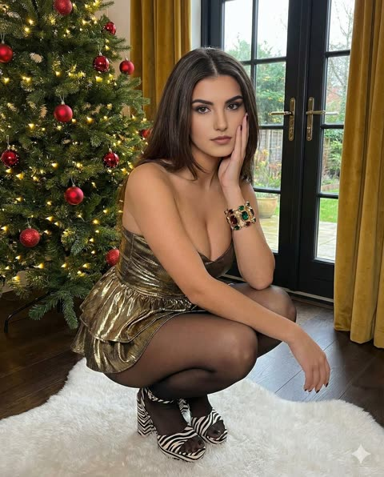</a>

A structured JSON prompt splits subject, outfit, pose, makeup, environment, lighting and camera into separate fields so each element stays controllable. The explicit mixed lighting description and the slightly high medium shot give the photorealistic cinematic look.

Nano Banana Pro · Text-to-image · Source: [@i_am_shruti68 on X](https://x.com/i_am_shruti68/status/2005090085386289397) · 32 likes on 2026-10-29

[`christmas`](tags.md#tag-christmas) [`portrait`](tags.md#tag-portrait) [`fashion`](tags.md#tag-fashion) [`structured-prompt`](tags.md#tag-structured-prompt)

<details><summary><b>Prompt</b></summary>

```text
{
  "subject": "A young woman with long, straight hair center-parted, creating a chic and glamorous look. Her nails are short and painted with a dark, glossy polish.",
  "outfit": "Strapless metallic gold foil textured peplum top with voluminous tiered ruffles, sheer black pantyhose (tights), zebra print platform block heel sandals with black ankle straps, chunky gold cuff bracelet adorned with large emerald green and burgundy gemstones.",
  "pose": "Crouching down low in a deep squat pose, resting her right hand against her cheek and chin in a pensive or bored manner, with her left arm hanging loosely between her bent knees.",
  "makeup": "Glamorous makeup featuring a defined neutral smokey eye with sharp black winged eyeliner, sculpted contouring on cheekbones, and matte nude-mauve lipstick.",
  "environment": "Luxurious holiday interior; to the left is a majestic floor-to-ceiling Christmas tree with dense branches illuminated by thousands of warm white fairy lights and vintage red baubles. To the right are black-framed glass French doors with a view of a garden, framed by tall mustard-yellow velvet curtains. The floor is dark polished wood covered with a fluffy white faux fur rug.",
  "lighting": "Mixed lighting atmosphere; warm ambient glow from the Christmas tree lights casting golden highlights, balanced by soft natural daylight entering from the glass doors on the right, creating a high-quality, photorealistic cinematic look.",
  "camera_angle": "Medium shot taken from a slightly high angle, looking down towards the subject in the squatting pose."
}
```

</details>

<a id="gpt-image-christmas-red-sequin-dress-santa-stairs"></a>
### Woman in red sequin dress with Santa on stairs

<a href="https://x.com/KeorUnreal/status/2003812247890469073">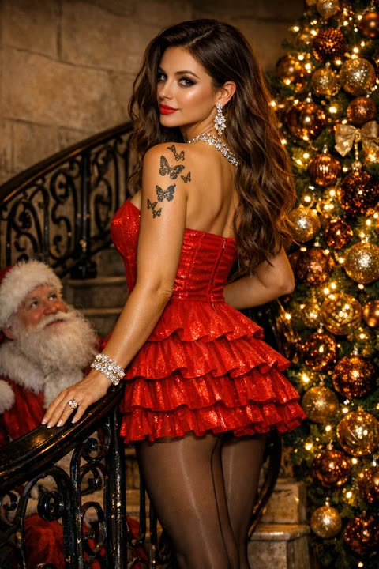</a>

A JSON prompt that splits shot, subject, pose, outfit, environment and atmosphere into separate fields keeps each element controlled. Dim warm light and a gold-lit tree in the frame set the mood without overpowering the subject.

GPT Image 1.5 · Text-to-image · Source: [@KeorUnreal on X](https://x.com/KeorUnreal/status/2003812247890469073) · 29 likes on 2026-10-29

[`christmas`](tags.md#tag-christmas) [`portrait`](tags.md#tag-portrait) [`fashion`](tags.md#tag-fashion) [`santa`](tags.md#tag-santa)

<details><summary><b>Prompt</b></summary>

```text
{
  "shot_type": "A medium shot portrait",
  "subject": "a young woman",
  "hair": "long, wavy hair",
  "pose": "standing on a curved staircase with dark wrought-iron railings and stone steps where is sitting santa claus admire her. She poses looking back over her right tattoed butterflies shoulder towards the camera, with her left hand resting on the dark banister.",
  "outfit": "the same red strapless mini dress with a fitted bodice and tiered ruffle skirt, paired with sheer black pantyhose",
  "jewelry": "Crucially, her jewelry is much brighter and more prominent than in the original scene.catching the warm light and standing out brilliantly against her skin and the dark dress.",
  "environment": "To her right is a large Christmas tree richly decorated with warm gold, bronze, and brown ornaments, baubles, and warm white string lights.",
  "atmosphere": "The general atmosphere remains warm, moody, and low-key with dim evening lighting, but shining jewelry"
}
```

</details>

<a id="nano-banana-conservatory-monstera-dappled-portrait"></a>
### Conservatory Portrait Behind Monstera Leaf Shadows

<a href="https://x.com/bmx_ai13/status/2114613454292283394"></a>

The prompt sets the scene first, then partial occlusion by foreground leaves, then light described as dappled sun through a glass ceiling. Shallow depth of field and a plain linen shirt keep the focus on the face and the shadow patterns.

Nano Banana 2.1 · Text-to-image · Source: [@bmx_ai13 on X](https://x.com/bmx_ai13/status/2114613454292283394) · 26 likes on 2026-10-29

[`conservatory`](tags.md#tag-conservatory) [`dappled-light`](tags.md#tag-dappled-light) [`botanical`](tags.md#tag-botanical) [`shallow-depth-of-field`](tags.md#tag-shallow-depth-of-field) [`portrait`](tags.md#tag-portrait)

<details><summary><b>Prompt</b></summary>

```text
Nano banana 2.1 Prompt: Inside a hyper realistic, lush botanical conservatory. Face is partially obscured by large, vibrant Monstera leaves and hanging ferns. Lighting: dappled sunlight breaking through a glass ceiling, creating intricate shadow patterns on skin. Wearing a simple, high quality linen shirt. Depth of field: shallow, with a soft bokeh effect on the tropical greenery in the background. Feels intimate and ethereal.
```

</details>

<a id="nano-banana-dusk-beach-blush-silk-dress-portrait"></a>
### Barefoot woman in pink silk dress on dusk beach

<a href="https://x.com/bmx_ai13/status/2114226447636402356"></a>

An uploaded reference image locks the face and hair details, while the scene is built in layers: location and time, wardrobe, pose, then wind. Lens and aperture values, diffused sunset light, skin and fabric texture cues and a closing negative list push the result toward a real photograph.

Nano Banana 2.1 · Edit · Source: [@bmx_ai13 on X](https://x.com/bmx_ai13/status/2114226447636402356) · 26 likes on 2026-10-29

[`beach`](tags.md#tag-beach) [`dusk`](tags.md#tag-dusk) [`fashion-photography`](tags.md#tag-fashion-photography) [`reference-image`](tags.md#tag-reference-image) [`silk-dress`](tags.md#tag-silk-dress)

<details><summary><b>Prompt</b></summary>

```text
Blush by the Ocean

Nano Banana 2.1 Prompt: Use uploaded image as the adult character reference; preserve her face, mauve spiral updo, beauty marks and crescent forehead detail. Real cinematic fashion photograph on an empty beach at dusk. She wears a dusty-pink silk maxi dress with a plunging neckline, an open back and a side slit, barefoot on wet sand. Standing in three-quarter profile, she gently gathers the skirt at one hip and looks toward the horizon. A light sea breeze moves the hem while her sculpted hair stays intact. Full-length composition with a soft ocean horizon. 70mm lens, f/2.8, diffused sunset light, warm skin against cool water, natural pores and realistic silk. Subtle film grain, tasteful sensuality, no illustration, CGI, text or watermark.
```

</details>

<a id="nano-banana-smartphone-beauty-portrait-grid-identity-lock"></a>
### Four smartphone beauty portraits in a 2x2 grid

<a href="https://x.com/TheVirtualMuse/status/2115657618710786506"></a>

An identity lock block ties the face to an uploaded selfie while hair, makeup, wardrobe and light come from the text. Each panel gets its own framing, and a shared sunlight setup plus a long negative prompt keep the four shots consistent.

Nano Banana 2.1 · Edit · Source: [@TheVirtualMuse on X](https://x.com/TheVirtualMuse/status/2115657618710786506) · 24 likes on 2026-10-29

[`beauty-portrait`](tags.md#tag-beauty-portrait) [`identity-lock`](tags.md#tag-identity-lock) [`2x2-grid`](tags.md#tag-2x2-grid) [`smartphone-photo`](tags.md#tag-smartphone-photo) [`golden-light`](tags.md#tag-golden-light)

<details><summary><b>Prompt</b></summary>

```text
Create a single, ultra-realistic 2×2 photographic collage in a vertical 9:16 aspect ratio, featuring the same adult woman in four distinct beauty portraits. The final image should look like four genuine smartphone photographs taken during the same indoor photoshoot, with consistent identity, hair, makeup, wardrobe, and environment. Prioritize realistic facial anatomy, crisp eye detail, natural skin texture, and accurate sunlight.

IDENTITY LOCK

Use the uploaded selfie as the reference for her face only. The hair, makeup, wardrobe, pose, lighting, and setting come from this prompt. Preserve her recognizable facial features, facial proportions, eye shape, nose, lips, eyebrows, cheekbones, and jawline. Keep her light blue-gray eyes and skin tone consistent across all four panels. Do not create four different women, change her apparent age, or excessively beautify her.

PANEL LAYOUT

Four equal portrait panels in a clean 2×2 grid, with straight, consistent borders and no overlapping images or extra panels.

Top-left: A frontal medium close-up. She faces the camera directly with an intense, confident gaze and her chin slightly lowered. Her voluminous black hair frames both sides of her face and falls over her shoulders. The crop reaches about the upper chest.

Top-right: A close-up three-quarter view with her head turned slightly. A thick section of jet-black hair sweeps diagonally across her left eye (the viewer's left), covering it, while her right eye looks toward the camera. Her lips are relaxed and slightly parted. A small silver hoop earring is visible.

Bottom-left: A medium close-up facing forward, looking directly into the camera with a calm, sultry expression. A warm patch of direct sunlight crosses her right cheek and forehead, with realistic shadows over the rest of her face. Her long black hair forms layers around her face and chest.

Bottom-right: An extreme close-up from a three-quarter side angle. The crop emphasizes one light blue-gray eye, the cheekbone, the nose, and her glossy nude-pink lips, which are slightly parted. Her black hair frames the outer edge of the face and falls along the neck. A delicate silver chain with a small cross pendant is visible near the lower edge.

HAIR

Long, thick, voluminous layered black hair with soft curtain-like framing pieces, a lifted crown, and large flowing layers around the shoulders. The hair is deep jet black with cool, restrained charcoal reflections where daylight hits the strands. It looks natural and glossy, with individual strands, fine flyaways, and realistic shadow depth. Do not change the hair to brown, chestnut, copper, auburn, blonde, or gray.

MAKEUP & SKIN

Natural peach-nude eyeshadow, sharp but slim black eyeliner, defined dark eyebrows, realistic eyelashes, softly contoured cheeks, and glossy nude-pink lips with a subtle darker lip liner. Skin is fair-to-golden with natural warmth, realistic tonal variation, a dewy highlight on the cheekbones and nose bridge, and visible pores. Avoid excessive airbrushing or plastic-looking skin.

WARDROBE & ACCESSORIES

A minimalist black camisole with realistic fabric texture and natural folds. A small silver hoop earring and a fine silver chain necklace with a delicate cross pendant. Keep the same wardrobe and accessories in all four panels.

SETTING & LIGHTING

A clean indoor space with off-white walls, a window frame in the upper-left area, and subtle architectural edges. Strong natural golden daylight from a nearby window creates distinct geometric sunlight across her face and hair, with deep but detailed shadows. Keep sunlit areas bright without blowing out the skin, and keep catchlights in the eyes. No neon lighting, no colored backgrounds, no furniture, no text.

CAMERA & OPTICS

Realistic modern smartphone photography, 35mm-equivalent lens, natural close-up perspective with subtle optical distortion, mild background separation, sharp eyes, eyelashes, eyebrows, and lips, and balanced exposure. The image should look like an authentic, lightly edited smartphone photograph.

Visible natural skin pores, individual eyelashes, fine eyebrow hairs, realistic iris patterns, natural lip lines, detailed black hair strands, fine flyaways, realistic fabric fibers, and accurate silver reflections. Natural daylight color with neutral skin tones, deep black hair, and no heavy filters or excessive orange tones.

Clean photograph only. No text, watermarks, logos, or interface elements.

NEGATIVE PROMPT

different woman in each panel, inconsistent identity, altered facial proportions, different eye color, brown hair, chestnut hair, copper hair, auburn hair, blonde hair, gray hair, blue hair, flat hair, short hair, missing hair volume, different clothing, missing necklace, oversized earrings, flat lighting, excessive orange lighting, blown-out face, blurry eyes, blurry lips, plastic skin, excessive airbrushing, artificial glow, overprocessed makeup, distorted face, extra fingers, deformed hands, cartoon, anime, illustration, digital painting, 3D render, CGI, low resolution, pixelation, excessive sharpening, text, watermark, logo, uneven grid, unequal panels, extra panels, overlapping panels, 4:5 aspect ratio
```

</details>

<a id="nano-banana-snowy-street-umbrella-christmas"></a>
### Woman under umbrella on snowy Christmas street

<a href="https://x.com/dreamydigiarts/status/2115760563150053583">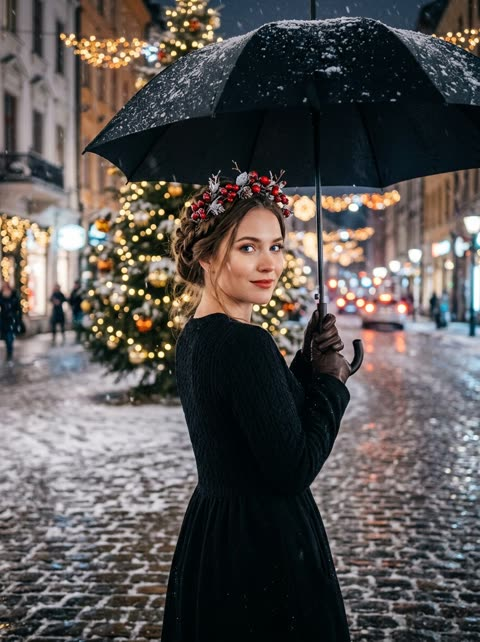</a>

Shallow depth of field keeps the subject sharp while city lights dissolve into soft bokeh circles. The cool blue shadow grade against warm streetlights and tree lights gives the high-contrast cinematic look, and the over-the-shoulder pose with direct eye contact anchors the portrait.

Nano Banana 2 · Text-to-image · Source: [@dreamydigiarts on X](https://x.com/dreamydigiarts/status/2115760563150053583) · 24 likes on 2026-10-29

[`christmas`](tags.md#tag-christmas) [`winter`](tags.md#tag-winter) [`portrait`](tags.md#tag-portrait) [`cinematic`](tags.md#tag-cinematic) [`bokeh`](tags.md#tag-bokeh)

<details><summary><b>Prompt</b></summary>

```text
{

"subject_id": "fit_female_01",

"biometrics": {

"physique": "Athletic, voluptuous, slim waist, prominent glutes, visible back muscle",

"skin": "Fair, natural texture, realistic pores",

"hair": "Dark brown, messy high bun, wispy bangs"

},

"attire": {

"top": "Black racerback sports bra",

"bottom": "Tight black booty shorts, orange jack-o'-lantern & purple star pattern",

"accessories": ["Gold ring", "Small earrings", "Gold iPhone with puffer case"]

},

"composition": {

"shot_type": "Mirror selfie, medium shot (knees up), vertical 9:16",

"pose": "Back to mirror, torso twisted left, head turned over shoulder",

"focal_length": "26mm smartphone lens",

"depth": "Deep focus, clear subject-background separation"

},

"environment": {

"interior": "Modern apartment, living room background, white door frame",

"exterior_view": "Floor-to-ceiling window, city skyline, blue sky",

"lighting": {

"primary": "Strong natural daylight from left",

"effects": "Directional highlights, high-contrast side lighting"

}

},

"style_profile": {

"aesthetic": "Raw social media snapshot, influencer lifestyle",

"quality": "8k photorealistic, digital sensor noise, no filters",

"mood": "Confident, casual, sultry"

},

"control_params": {

"dw_pose": "Weight 1.0 (lock spine/hips/limbs)",

"zoe_depth": "Weight 0.8 (preserve glute volume/depth)"

},

"negatives": "airbrushed, plastic skin, flattened curves, anatomy normalization, slimmed torso, low-res"

}
```

</details>

<a id="nano-banana-1960s-car-mirror-fashion-reflection"></a>
### 1960s Fashion Portrait Reflected in Car Mirror

<a href="https://x.com/mehvishs25/status/2107858748882690121"></a>

The whole scene is framed as a reflection in a curved chrome side mirror, with the camera position and walking pose spelled out so the reflection stays physically believable. A fixed four colour palette and 35mm film grain and scratch cues give an authentic aged editorial look, and the reference identity is locked with an explicit do not alter her face line.

Nano Banana 2.1 · Edit · Source: [@mehvishs25 on X](https://x.com/mehvishs25/status/2107858748882690121) · 23 likes on 2026-10-28

[`vintage`](tags.md#tag-vintage) [`fashion`](tags.md#tag-fashion) [`mirror-reflection`](tags.md#tag-mirror-reflection) [`film-grain`](tags.md#tag-film-grain) [`identity-preservation`](tags.md#tag-identity-preservation)

<details><summary><b>Prompt</b></summary>

```text
Create a hyper-realistic 1960s vintage editorial fashion photograph in a vertical 9:16 composition, featuring the girl from the reference image. Preserve her identity and appearance exactly as shown in the reference — including her facial structure, proportions, distinctive features, skin tone, hairstyle characteristics, and overall natural appearance. Do not alter or reinterpret her face.

The scene is captured as a full-body fashion portrait reflected inside a small, oval chrome side mirror of a vintage car. The mirror has naturally curved, slightly distorted edges and realistic reflections. The camera is positioned close to the driver's window, angled toward the side mirror.

Inside the mirror reflection, the girl is fully visible with generous background space. She is walking toward the rear of the car while slightly turning her head toward the mirror, creating a subtle candid moment. She has a calm, confident expression with a soft, understated smile.

She wears a beautifully tailored powder-blue midi dress with a slim waist belt, paired with a burgundy silk scarf, elegant cat-eye sunglasses, a small ivory handbag, and classic white pointed heels. Her styling has an authentic polished 1960s fashion aesthetic.

The environment is a retro Mediterranean-American street with a palm-lined road, pastel-colored storefronts, a vintage station wagon, and distant mountains. Bright golden morning sunlight creates warm, natural highlights and soft shadows across the scene.

Use a refined color palette of powder blue, ivory, burgundy, and warm beige. The image should look like an authentic aged 35mm film photograph, with natural analog grain, subtle film imperfections, tiny scratches, realistic exposure, authentic skin texture, and physically accurate mirror reflections.

The overall mood should feel chic, nostalgic, elegant, and slightly mysterious — like a genuine fashion editorial photograph captured in the 1960s rather than an AI-generated image. Photorealistic, cinematic, highly detailed, natural proportions, realistic fabric texture, authentic vintage photography aesthetics.
```

</details>

<a id="nano-banana-blonde-creator-vanity-portrait"></a>
### Blonde creator speaking to camera at bedroom vanity

<a href="https://x.com/purrdoom/status/2115216612030865415"></a>

The prompt describes the subject in layers: age, hair, makeup, skin flaws such as pores and a mole, jewelry and clothing, then a mood line. A separate setting and light block follows, with a negative line banning logos and text. The imperfection details and the soft front light give a believable phone-video look.

Nano Banana 2.1 · Text-to-image · Source: [@purrdoom on X](https://x.com/purrdoom/status/2115216612030865415) · 22 likes on 2026-10-29

[`creator-portrait`](tags.md#tag-creator-portrait) [`talking-head`](tags.md#tag-talking-head) [`skin-texture`](tags.md#tag-skin-texture) [`natural-light`](tags.md#tag-natural-light) [`realistic-person`](tags.md#tag-realistic-person)

<details><summary><b>Prompt</b></summary>

```text
A white woman, 34, a glamorous social media creator with the polished look of a pro athlete's wife. Very long, straight, sleek golden-blonde hair with a center part and slightly darker roots. A natural sun-kissed tan. Full glam makeup with a soft matte finish: voluminous lashes, sculpted arched brows, soft contour, satin peachy-nude overlined lips. Real skin texture: visible pores, faint lines under her eyes, a small mole on her left jaw. Small gold hoop earrings, a thin gold chain necklace, a large oval diamond engagement ring. A fitted ribbed heather-grey scoop-neck tank top. Confident, direct, a little urgent, like a friend about to tell you something you need to hear.

She sits at a white vanity in her bedroom in the late afternoon. Behind her: a muted sage-grey wall, a dark doorway on the left edge of the frame, and a white ceiling at the top. Warm, soft natural light on her face from the front, with soft catchlights in her eyes. No makeup products in frame. No logos or readable text anywhere in frame.
```

</details>

<a id="chatgpt-autumn-leaves-forest-arms-raised"></a>
### Woman throwing autumn leaves on forest path

<a href="https://www.tiktok.com/@mamasharkof_4/video/7682192138922200350">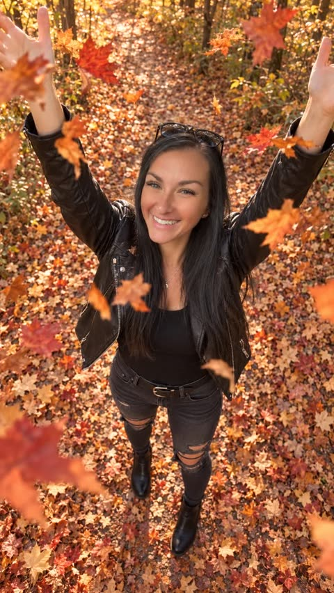</a>

A reference photo anchors the face, and the line asking to keep the features true to it limits drift. The elevated camera angle, wide lens feel and itemized wardrobe with sunglasses on the head set the structure, while the warm golden light and floating maple leaves carry the mood.

ChatGPT · Edit · Source: [@mamasharkof_4 on TikTok](https://www.tiktok.com/@mamasharkof_4/video/7682192138922200350) · 17 likes on 2026-10-30

[`autumn`](tags.md#tag-autumn) [`portrait`](tags.md#tag-portrait) [`reference-photo`](tags.md#tag-reference-photo) [`leaves`](tags.md#tag-leaves)

<details><summary><b>Prompt</b></summary>

```text
Use my own photo as a reference for the face, hair, and body. Create a photorealistic autumn shot from an elevated camera perspective with a wide-angle look: I’m standing on a forest path covered with colorful autumn leaves and I’m laughing, looking straight up at the camera. Both arms are stretched out above me as if I’m throwing leaves into the air. Black leather jacket, black top, dark ripped jeans, belt, and black boots. Sunglasses on my head. Warm golden evening sun, strong orange, red, and brown tones, lots of floating maple leaves in the foreground and background, natural depth of field, dynamic perspective, high-quality editorial photography. Keep the face and individual features of my reference photo as true to the original as possible.
```

</details>

<a id="gpt-image-backlit-backless-gown-window-portrait"></a>
### Backlit backless gown portrait by a window

<a href="https://x.com/MrLarus/status/2058131948904599860"></a>

The prompt is a labeled checklist covering pose, backless structure, fabric, scene, light, framing and mood, with the back as the single visual anchor. Backlight and window light are written to rim the shoulder blades and waist, and a long negative list keeps the skin and fabric looking like real film.

GPT Image 2 · Text-to-image · Source: [@MrLarus on X](https://x.com/MrLarus/status/2058131948904599860) · found via [freestylefly/awesome-gpt-image-2](https://github.com/freestylefly/awesome-gpt-image-2)

[`backlight`](tags.md#tag-backlight) [`portrait`](tags.md#tag-portrait) [`window-light`](tags.md#tag-window-light) [`film-look`](tags.md#tag-film-look) [`evening-gown`](tags.md#tag-evening-gown)

<details><summary><b>Prompt</b></summary>

```text
请生成一张竖版高质感女性情绪写真，主题为「逆光美背·女性情绪写真」。

核心要求：
画面的绝对重点是“美背”，通过露背结构、肩颈线条、肩胛骨、脊柱中线、腰背曲线和逆光轮廓来呈现女性美。请避免普通女性写真或普通穿搭图的处理方式，背部必须是主视觉核心，脸只作为辅助。

人物设定：
成年女性，真实自然，气质可为温柔、清冷、慵懒、文艺、轻熟或安静。人物不要网红脸，不要塑料感，不要夸张妆容。可侧脸、回眸、低头或闭眼，但正脸不是重点。

姿态要求：
姿态必须服务于背部展示，例如背对镜头微微回头、侧身站立、侧坐、抬手整理头发、低头蜷身、斜倚窗边、半躺回眸、披衣下滑等。动作自然，不要僵硬摆拍，不要正面直视镜头。

露背结构：
必须有明确的露背设计，可为低背长裙、吊带裙、露背礼服、针织外套滑落、薄纱披肩、浴袍半披、宽松衬衫滑肩、丝质罩衫半落等。重点表现肩线、肩胛骨、背中线、腰背收束和布料与肌肤之间的高级过渡。

服装与材质：
服装选择轻柔、垂坠、带有透光感和褶皱感的材质，如薄纱、真丝、针织、棉麻、细闪纱、浴袍质地、软垂感长裙。布料要参与构图，形成半遮半露、滑落、包裹、垂挂的层次，但不能厚重。

场景：
场景为卧室、窗边、床上、白墙房间、民宿、酒店房间、木质空间或复古公寓。背景简洁克制，少量床品、窗帘、木椅、花束、地板等元素即可，不能喧宾夺主。

光线要求：
采用自然光或柔和暖光，以逆光、侧逆光、窗边光为主。重点是让光打到背部，勾出肩颈边缘、肩胛骨轮廓、腰线和发丝高光。可使用晨光、黄昏金光、柔雾散射光或冷白窗光，但背部受光状态必须成立。

构图：
竖版构图，画幅可为 9:16、3:4 或 4:5。人物是绝对主角，视觉重心放在背部、肩颈和腰背曲线上。可采用半身、七分身、近景或全身，但不要让场景抢走主体。

氛围：
整体氛围安静、柔软、私密、克制、高级，像真实摄影师拍摄的电影感情绪写真。重点避免直白性感，改用“美背 + 逆光 + 柔软布料 + 自然姿态”表达女性美。

画质要求：
真实摄影感、电影感、柔雾胶片感、细腻肤色、真实皮肤质感、浅景深、轻微颗粒感、画面通透自然。不要 AI 塑料感，不要 CG 感，不要错误手指，不要肢体畸形，不要低俗色情化表达，不要文字、水印、Logo、边框。

最终效果：
一张以“美背”为主视觉核心的高完成度女性情绪写真，通过露背结构、肩颈背部线条、柔光逆光和柔软布料来呈现克制而高级的女性美。
```

</details>

<a id="gpt-image-bangkok-sunny-street-selfie"></a>
### Sunny Bangkok Street Selfie of Young Woman

<a href="https://x.com/Stonic_AI/status/2069649170429075962"></a>

The prompt sets a phone selfie with a low angle, an extended arm and harsh direct sunlight. It then lists hair, makeup, accessories and outfit one by one, and places the Bangkok street details on one side of the frame so the result reads as a real photo.

GPT Image 2 · Text-to-image · Source: [@Stonic_AI on X](https://x.com/Stonic_AI/status/2069649170429075962) · found via [YouMind-OpenLab/awesome-gpt-image-2](https://github.com/YouMind-OpenLab/awesome-gpt-image-2)

[`selfie`](tags.md#tag-selfie) [`street-photography`](tags.md#tag-street-photography) [`bangkok`](tags.md#tag-bangkok) [`harsh-sunlight`](tags.md#tag-harsh-sunlight) [`photorealistic`](tags.md#tag-photorealistic)

<details><summary><b>Prompt</b></summary>

```text
Hyper-realistic 8K close self-shot, young European woman, slightly low angle, arm extended holding phone, bright sunny daytime, direct harsh sunlight, sharp facial shadows, artistic high-contrast light and shadow, energetic intense atmosphere, slight gentle smile, fair pink-toned glowing smooth skin. Long waist-length curly hair, no bangs, naturally flowing curls at ends, gold hair clip. Thin winged eyeliner, full long lashes, soft peach blush, defined brows, glossy light pink ombre lips. Cream smartwatch, dainty gold necklace. Loose casual camisole top, high-waisted pleated midi skirt, lightweight knitted fringed shawl. Slightly tilted posture, squinting gently against sunlight, one hand raised to block glare. Outdoor Bangkok city background, right side filled with urban scenery, lush green trees, crosswalk, bus stop bench, ultra-detailed, photorealistic.9：16
```

</details>

<a id="gpt-image-burgundy-studio-bearded-man-sunglasses-portrait"></a>
### Burgundy studio portrait of bearded man in sunglasses

<a href="https://x.com/iamsofiaijaz/status/2090294894187413883"></a>

The prompt anchors identity to a reference image, then separates the amber key light from the crimson rim light and the wine gradient background. Lens and aperture (85mm, f/1.8) plus a list of skin, beard and suede textures keep the close up realistic.

GPT Image 2 · Edit · Source: [@iamsofiaijaz on X](https://x.com/iamsofiaijaz/status/2090294894187413883) · found via [freestylefly/awesome-gpt-image-2](https://github.com/freestylefly/awesome-gpt-image-2)

[`fashion-portrait`](tags.md#tag-fashion-portrait) [`studio-lighting`](tags.md#tag-studio-lighting) [`face-reference`](tags.md#tag-face-reference) [`menswear`](tags.md#tag-menswear) [`cinematic`](tags.md#tag-cinematic)

<details><summary><b>Prompt</b></summary>

```text
A cinematic, ultra-realistic close-up portrait of a stylish man, using the provided image as an accurate face reference. Preserve his natural facial identity, thick naturally curly dark brown hair, neatly trimmed salt-and-pepper beard, strong masculine facial structure, and realistic facial proportions. He wears sophisticated round vintage amber-brown sunglasses and a premium deep burgundy suede jacket over a fitted black silk-knit shirt, creating a refined luxury fashion aesthetic.

Warm cinematic studio lighting with a soft amber-golden key light illuminating the face from the front-left, complemented by a subtle crimson-red rim light outlining the hair and shoulders. The background is a rich burgundy, wine-red, and dark plum gradient, with soft atmospheric haze and subtle diffused light creating depth without distracting from the subject. Elegant warm highlights contrast beautifully against the dark clothing.

Extremely detailed natural skin texture, individual beard hairs, realistic pores, subtle facial imperfections, sharp eyes visible behind slightly tinted lenses, natural reflections on the sunglasses, rich dimensional shadows, realistic fabric and suede texture, shallow depth of field. Sophisticated luxury fashion campaign, mysterious and confident mood, premium men's editorial photography, cinematic color grading, photorealistic, HDR, professional studio photography, 85mm portrait lens, f/1.8, crisp facial details, soft background bokeh, centered composition, head-and-shoulders framing, powerful masculine presence, understated elegance, 3:4 aspect ratio.
```

</details>

<a id="gpt-image-candid-coastal-abbey-travel-portrait"></a>
### Candid travel portrait before a coastal abbey

<a href="https://x.com/saniaspeaks_/status/2097532595814940683"></a>

The prompt places the subject in the foreground and a landmark in the background, then adds small distant people and vehicles for scale. Closing cues such as a subtle smartphone camera look, soft evening light and a 3:4 vertical frame keep it reading as a real candid photo.

GPT Image 2.5 · Text-to-image · Source: [@saniaspeaks_ on X](https://x.com/saniaspeaks_/status/2097532595814940683) · found via [wangrunlin/awesome-gpt-image-2-5-prompts](https://github.com/wangrunlin/awesome-gpt-image-2-5-prompts)

[`travel-portrait`](tags.md#tag-travel-portrait) [`candid`](tags.md#tag-candid) [`landmark`](tags.md#tag-landmark) [`evening-light`](tags.md#tag-evening-light) [`smartphone-look`](tags.md#tag-smartphone-look)

<details><summary><b>Prompt</b></summary>

```text
A photorealistic candid travel portrait of a young East Asian woman standing on a quiet sandy shoreline beside large moss-covered rocks, with a magnificent historic stone abbey and medieval castle-like architecture rising dramatically on a rocky island behind her. She has long straight dark brown hair falling naturally over one shoulder, soft youthful facial features, and a gentle warm smile while looking directly at the camera.

She is wearing a long oversized black coat with her hands casually tucked inside the pockets, layered over a light-colored outfit. A large soft cream-white scarf is wrapped warmly around her neck, hanging down the front with a small black designer-style emblem near the end. A delicate chain shoulder bag is partially visible.

The composition captures her in the foreground while the vast historic abbey dominates the background, surrounded by ancient stone walls, rocky cliffs, sandy tidal flats, and a calm coastal atmosphere. A few small distant vehicles and people add realistic scale to the scene. Soft natural evening light and a clear pale blue sky create a peaceful European travel mood.

Ultra-realistic photography, authentic candid travel photo, natural skin texture, realistic fabric details, soft cinematic lighting, subtle smartphone camera aesthetic, slightly dreamy color grading, natural proportions, detailed architecture, peaceful coastal atmosphere, vertical composition, 3:4 aspect ratio.
```

</details>

<a id="gpt-image-candid-sailor-35mm"></a>
### Candid 35mm portrait of an old sailor mending a net

<a href="https://developers.openai.com/api/docs/guides/image-prompting#control-style-and-lighting"></a>

The prompt names skin texture, lens, light and film grain one by one, and its last line rules out glamour and retouching, so the result reads as an unposed documentary photo.

GPT Image 2.5 · Text-to-image · Source: [OpenAI image prompting guide](https://developers.openai.com/api/docs/guides/image-prompting#control-style-and-lighting)

[`photorealism`](tags.md#tag-photorealism) [`film`](tags.md#tag-film) [`portrait`](tags.md#tag-portrait)

<details><summary><b>Prompt</b></summary>

```text
Create a photorealistic candid photograph of an elderly sailor standing on a small fishing boat.
He has weathered skin with visible wrinkles, pores, and sun texture, and a few faded traditional sailor tattoos on his arms.
He is calmly adjusting a net while his dog sits nearby on the deck. Shot like a 35mm film photograph, medium close-up at eye level, using a 50mm lens.
Soft coastal daylight, shallow depth of field, subtle film grain, natural color balance.
The image should feel honest and unposed, with real skin texture, worn materials, and everyday detail. No glamorization, no heavy retouching.
```

</details>

<a id="gpt-image-candlelit-side-room-qipao-portrait"></a>
### Candlelit qipao portrait in a dark side room

<a href="https://x.com/ToroJushiAi/status/2056926887344042382"></a>

A single off-frame candle sets the light direction, and the amber qipao is matched to the candle's colour temperature so the subject blends into the light. Skin detail cues, stray hairs and ISO 400 grain keep it photographic, while the negative list rules out illustration looks.

GPT Image 2 · Text-to-image · Source: [@ToroJushiAi on X](https://x.com/ToroJushiAi/status/2056926887344042382) · found via [freestylefly/awesome-gpt-image-2](https://github.com/freestylefly/awesome-gpt-image-2)

[`candlelight`](tags.md#tag-candlelight) [`chiaroscuro`](tags.md#tag-chiaroscuro) [`qipao`](tags.md#tag-qipao) [`85mm`](tags.md#tag-85mm) [`film-grain`](tags.md#tag-film-grain)

<details><summary><b>Prompt</b></summary>

```text
A medium-shot authentic daily life photograph, natural candid moment, of an East Asian young woman standing in a small side room lit only by a single candle on a low stone shelf. 85mm lens, waist-up framing, shallow depth of field. The candle is off-frame to the left; the room behind her exists only as dark warm suggestion.

East Asian young woman in her early 20s. Almond-shaped eyes receiving the candle's warm flicker — the irises briefly caught in light before returning to shadow. Straight refined nose, the bridge illuminated in a narrow warm stripe. Skin tone fair beige, warmed entirely by candlelight into something amber. Skin subsurface scattering visible under directional candlelight, specular micro-highlights on cheekbones and nose ridge, fine foundation powder grain perceptible.

She wears an aged amber silk qipao with chrysanthemum embroidery in tones of old bronze and dusty ochre — the amber pigment identical in temperature to the candle's own light, the embroidery appearing and disappearing depending on angle. Mandarin collar, short sleeves. She stands facing the candle without looking at it, arms at her sides, very still. The room is otherwise empty. Two or three stray hairs displaced by faint air movement, natural unplanned imperfection, not geometrically symmetrical.

Single candle — warm amber-orange, directional and fragile. It carves the left side of her face from darkness, leaves the right in near-black shadow. The amber qipao and the candlelight share a single temperature register: the room folds her into the light. Deep chiaroscuro with no artificial fill. Subtle ISO 400 film grain in shadow areas, photographic noise texture not CG render smoothness. Aspect ratio 9:16. No watermark, no text overlay, not cartoon, not digitally painted, not illustration, not anime.
```

</details>

<a id="gpt-image-cherry-blossom-over-shoulder-portrait"></a>
### Cherry blossom path over the shoulder portrait

<a href="https://x.com/SheBuildsAI_/status/2092431090095149533"></a>

The prompt is split into JSON fields for scene, subject, detail, lighting and composition, so each layer can be tuned on its own. An 85mm lens, shallow depth of field and backlit petals in volumetric haze give the cinematic editorial look.

GPT Image 2 · Text-to-image · Source: [@SheBuildsAI_ on X](https://x.com/SheBuildsAI_/status/2092431090095149533) · found via [freestylefly/awesome-gpt-image-2](https://github.com/freestylefly/awesome-gpt-image-2)

[`cherry-blossom`](tags.md#tag-cherry-blossom) [`portrait`](tags.md#tag-portrait) [`cinematic`](tags.md#tag-cinematic) [`85mm`](tags.md#tag-85mm) [`json-prompt`](tags.md#tag-json-prompt)

<details><summary><b>Prompt</b></summary>

```text
{
  "title": "WHISPERS OF SPRING",

  "scene": "A peaceful pathway beneath blooming cherry blossom trees during a warm spring afternoon. Pink blossoms fill the canopy overhead while delicate petals drift gracefully through the air. Soft sunlight filters through the branches, creating a dreamy and enchanting atmosphere.",

  "subject": "A young woman walks away from the camera before gently turning her head over her shoulder with a soft, mysterious smile. She wears a flowing natural linen dress that moves gracefully with the breeze, highlighting her delicate facial features and effortless elegance.",

  "detail": "Wind carries countless pink cherry blossom petals across the frame while warm sunlight creates glowing highlights throughout the scene. Every strand of hair moves naturally in the breeze, with ultra realistic skin texture, lifelike fabric folds, soft floral surroundings, and subtle atmospheric haze enhancing the cinematic realism.",

  "atmosphere": "Elegant, peaceful, romantic, dreamy, timeless, cinematic, graceful, and enchanting.",

  "lighting": "Warm spring sunlight filtering through cherry blossom branches, soft natural illumination, glowing highlights, volumetric light rays, gentle ambient shadows, and subtle atmospheric haze.",

  "composition": "Cinematic editorial portrait captured with an 85mm lens, featuring the subject in a three-quarter over-the-shoulder pose. Shallow depth of field, creamy bokeh, balanced framing with flowering trees, soft leading lines, and immersive visual storytelling.",

  "style": "Photorealistic, masterpiece, editorial fashion photography, analog film aesthetic, dreamy pastel color palette, ultra realistic skin texture, highly detailed, shallow depth of field, creamy bokeh, atmospheric haze, HDR, cinematic realism, 8K."
}
```

</details>

<a id="gpt-image-cinematic-night-car-backseat-portrait"></a>
### Cinematic night portrait in a car back seat

<a href="https://x.com/AiwithElisia/status/2089221808436531381"></a>

Warm horizontal bands of streetlight across the face give dramatic shadow, while the blurred city seen through the rear window adds bokeh depth. Full camera specs (85mm, f/1.4), explicit framing and a negative list against plastic skin keep the portrait realistic.

GPT Image 2 · Text-to-image · Source: [@AiwithElisia on X](https://x.com/AiwithElisia/status/2089221808436531381) · found via [YouMind-OpenLab/awesome-gpt-image-2](https://github.com/YouMind-OpenLab/awesome-gpt-image-2)

[`portrait`](tags.md#tag-portrait) [`night`](tags.md#tag-night) [`cinematic`](tags.md#tag-cinematic) [`bokeh`](tags.md#tag-bokeh) [`low-light`](tags.md#tag-low-light)

<details><summary><b>Prompt</b></summary>

```text
A cinematic, photorealistic close-up portrait of a young East Asian woman sitting in the back seat of a car at night. She has long, naturally straight, glossy black hair with a few loose strands falling softly across her face, delicate facial features, smooth natural skin texture, dark expressive eyes, subtle eyeliner, soft natural eyebrows, and muted rosy-red lips. She is looking directly toward the camera with a calm, neutral, slightly melancholic expression.

Warm golden horizontal bands of streetlight pass naturally across her face, creating dramatic cinematic light and shadow. The lighting should softly illuminate her eyes, nose, cheeks, and lips while leaving parts of her face and hair in deep natural shadow. Preserve realistic skin pores and fine facial details without excessive retouching or plastic-looking skin.

She is seated inside a dark luxury car, with black leather seats and interior surrounding her. Through the rear window, a nighttime city scene is visible with heavily blurred colorful lights, warm yellow bokeh, white headlights, subtle red traffic lights, and dark urban buildings. Strong shallow depth of field separates her from the background.

Shot on a professional full-frame camera, 85mm portrait lens, f/1.4 aperture, cinematic depth of field, realistic low-light photography, soft filmic contrast, subtle warm highlights, deep blacks, natural color grading, high dynamic range, crisp eyes, detailed hair strands, realistic skin texture, soft bokeh, atmospheric nighttime mood.

Composition: vertical portrait, subject centered slightly below the middle of the frame, head and shoulders visible, natural perspective, intimate close-up framing, cinematic negative space, realistic car interior framing in the foreground.

Ultra-realistic photography, high detail, sharp facial focus, natural imperfections, realistic lighting, premium editorial photography, cinematic movie still, subtle film grain, professional color grading, 8K detail, no artificial beauty filter, no over-sharpening, no distorted facial features, no extra fingers, no text, no watermark.
```

</details>

<a id="gpt-image-digicam-lcd-nostalgic-portrait-comic-shelf"></a>
### Nostalgic 2012 digicam screen portrait beside comic shelf

<a href="https://x.com/Ciri_ai/status/2055876982630686956"></a>

The prompt nests a photo inside a photo: a close-up of the LCD, with a candid early 2010s snapshot displayed on it. Harsh direct flash, grain and motion blur, plus UI overlays such as a timestamp, exposure data and a battery icon, make it read as a real digicam capture.

GPT Image 2 · Text-to-image · Source: [@Ciri_ai on X](https://x.com/Ciri_ai/status/2055876982630686956) · found via [freestylefly/awesome-gpt-image-2](https://github.com/freestylefly/awesome-gpt-image-2)

[`digicam`](tags.md#tag-digicam) [`nostalgic`](tags.md#tag-nostalgic) [`flash-photography`](tags.md#tag-flash-photography) [`candid-portrait`](tags.md#tag-candid-portrait) [`camera-ui`](tags.md#tag-camera-ui)

<details><summary><b>Prompt</b></summary>

```text
A realistic close-up shot of a small digital camera screen glowing brightly in a dark indoor environment. Displayed on the LCD is a candid early-2010s style photograph of a young East Asian woman with long dark wavy hair standing beside a wooden shelf packed tightly with colorful comic books and magazines.

She wears a black spaghetti-strap top with a loose white cardigan hanging casually from both shoulders and faded blue jeans. Captured mid-laugh while turning her face slightly sideways, her expression feels spontaneous and natural, with hair falling softly across part of her cheek.

The harsh direct flash from the compact camera creates strong highlights on her face and cardigan while flattening shadows in the background, producing an authentic nostalgic digicam aesthetic. Slight motion blur and digital grain enhance the candid realism.

Camera UI overlays are visible across the LCD screen, including the timestamp “8. 1. 2012 3:15 AM,” exposure data “1/30 F3.4 ISO 100,” focus indicators, and a small green battery symbol in the corner.

The image preserves visible screen pixel structure, slight glare reflections, chromatic softness, and compressed digital texture. Outside the LCD, the surrounding darkness fades smoothly into blur, emphasizing the glowing nostalgic screen.

Shot to resemble an authentic Sony Cyber-shot point-and-shoot camera from the early 2010s using a CCD sensor with vintage digital rendering and imperfect flash exposure.
```

</details>

<a id="gpt-image-double-exposure-aviator-fashion-portrait"></a>
### Double exposure fashion portrait with aviator sunglasses

<a href="https://x.com/Anaya_Ai12/status/2062191518975508678"></a>

Pairs a large semi transparent profile with a full body figure to build the double exposure, and locks the identity to the uploaded face. A warm sepia and charcoal grade, a golden light leak in one corner and an 85mm lens cue keep the look cinematic.

GPT Image 2 · Edit · Source: [@Anaya_Ai12 on X](https://x.com/Anaya_Ai12/status/2062191518975508678) · found via [freestylefly/awesome-gpt-image-2](https://github.com/freestylefly/awesome-gpt-image-2)

[`double-exposure`](tags.md#tag-double-exposure) [`fashion`](tags.md#tag-fashion) [`portrait`](tags.md#tag-portrait) [`sepia`](tags.md#tag-sepia) [`light-leak`](tags.md#tag-light-leak)

<details><summary><b>Prompt</b></summary>

```text
A cinematic double-exposure fashion portrait featuring a woman with the uploaded face used 100% as reference, wearing stylish metallic aviator sunglasses. The composition artfully blends a large, semi-transparent close-up profile of her face on the left with her full-body figure standing confidently on the right. She wears an open, light-grey textured corduroy shirt layered over a dark grey fitted t-shirt and dark denim jeans, posing naturally with her hands in her pockets. She has long, flowing dark hair, flawless skin, elegant feminine features, and a confident, sophisticated expression.

The background is a minimalist neutral studio setting, allowing the double-exposure composition to remain the visual focus. The color grading features a sophisticated warm desaturated sepia and charcoal palette, enhanced by a soft golden-orange light-leak flare in the upper-right corner. Professional 85mm lens photography with high-contrast yet soft cinematic lighting accentuates the fabric textures, facial details, and layered portrait effect.

Ultra-realistic skin texture, luxury fashion-editorial aesthetic, premium magazine-cover quality, subtle film grain, cinematic depth, elegant shadows, refined color grading, modern retro-inspired styling, masterpiece composition, ultra-sharp focus, visually striking storytelling, high-end commercial fashion campaign look.
```

</details>

<a id="gpt-image-fairycore-butterfly-floral-crown-portrait"></a>
### Fairycore portrait with butterflies and floral crown

<a href="https://x.com/HaniaAi12/status/2062696495741391006"></a>

The prompt lists concrete hair and gown details such as roses, crystals, feathers and embroidered sheer fabric. It pairs them with a fixed pastel palette and diffused morning light, then closes with photographic terms like bokeh, volumetric lighting and soft focus highlights.

GPT Image 2 · Text-to-image · Source: [@HaniaAi12 on X](https://x.com/HaniaAi12/status/2062696495741391006) · found via [freestylefly/awesome-gpt-image-2](https://github.com/freestylefly/awesome-gpt-image-2)

[`fairycore`](tags.md#tag-fairycore) [`fantasy-portrait`](tags.md#tag-fantasy-portrait) [`pastel`](tags.md#tag-pastel) [`butterflies`](tags.md#tag-butterflies) [`soft-light`](tags.md#tag-soft-light)

<details><summary><b>Prompt</b></summary>

```text
Ultra-realistic ethereal fantasy portrait of a breathtaking young woman with delicate porcelain skin, soft grey-blue eyes, and natural rosy lips. She gazes gently toward the viewer with a serene, dreamy expression, her fingertips lightly touching her chin. Wispy ash-brown hair flows softly in the breeze, styled in a loose romantic updo adorned with pastel blush roses, shimmering crystal ornaments, delicate feathers, and intricate floral accessories. She wears elegant dangling crystal earrings and a translucent, flowing gown made of sheer iridescent fabric embroidered with tiny sparkling flowers.

The scene is bathed in soft diffused morning light, creating a luminous glow around her face and shoulders. Surrounded by floating butterflies, sparkling dust particles, translucent petals, and dreamy floral textures, the background blends pastel lavender, pearl white, blush pink, and silver tones. Cinematic fine-art photography, fairycore aesthetic, enchanted garden atmosphere, magical realism, ultra-detailed skin texture, soft focus highlights, volumetric lighting, bokeh, masterpiece quality, highly detailed, 8K resolution, delicate feminine beauty, romantic fantasy artwork, elegant composition, dreamy color grading, soft glow, celestial ambiance.
```

</details>

<a id="gpt-image-fisheye-mirror-retro-cafe-portrait"></a>
### Fisheye mirror portrait in a teal retro cafe

<a href="https://x.com/harboriis/status/2049044698900361241"></a>

Naming the fisheye lens, the round mirror frame and a close leaning pose gives strong distortion and intimacy. Specific set details such as teal subway tiles, pendant lights and yellow tinted glasses, plus a warm moody tone cue, keep the palette cohesive.

GPT Image 2 · Edit · Source: [@harboriis on X](https://x.com/harboriis/status/2049044698900361241) · found via [freestylefly/awesome-gpt-image-2](https://github.com/freestylefly/awesome-gpt-image-2)

[`fisheye`](tags.md#tag-fisheye) [`retro-cafe`](tags.md#tag-retro-cafe) [`mirror`](tags.md#tag-mirror) [`portrait`](tags.md#tag-portrait) [`warm-moody`](tags.md#tag-warm-moody)

<details><summary><b>Prompt</b></summary>

```text
A fish-eye lens close-up of [your photo as reference] sipping from a teal/turquoise coffee mug, leaning forward intimately toward camera. Shot through or near a round mirror. Retro café interior with glossy teal subway tiles, vintage appliances, pendant lights. Black t-shirt, yellow-tinted round glasses. Warm moody tones.
```

</details>

<a id="gpt-image-futuristic-office-businesswoman-portrait"></a>
### Businesswoman portrait in futuristic glass office

<a href="https://x.com/NadzuAI/status/2087901626891940013"></a>

The prompt stacks wardrobe, setting, lighting and lens cues (soft cinematic light, shallow depth of field, realistic skin texture) and limits the palette to blue and white tones. It also fixes a 4:5 vertical frame and adds no text and no watermark to keep the output clean.

GPT Image 2 · Text-to-image · Source: [@NadzuAI on X](https://x.com/NadzuAI/status/2087901626891940013) · found via [YouMind-OpenLab/awesome-gpt-image-2](https://github.com/YouMind-OpenLab/awesome-gpt-image-2)

[`corporate-portrait`](tags.md#tag-corporate-portrait) [`business`](tags.md#tag-business) [`photorealistic`](tags.md#tag-photorealistic) [`futuristic-office`](tags.md#tag-futuristic-office) [`vertical`](tags.md#tag-vertical)

<details><summary><b>Prompt</b></summary>

```text
Create a hyper-realistic HD portrait of a confident young professional businesswoman, elegant modern black blazer over a white blouse, standing in a premium futuristic office with glass walls, subtle AI technology screens and a city skyline in the background. Natural makeup, polished hairstyle, confident expression, professional corporate appearance, cinematic soft lighting, realistic skin texture, shallow depth of field, luxury business atmosphere, sophisticated blue-and-white tones, ultra-detailed, photorealistic, 8K quality, sharp focus, premium LinkedIn and AI startup branding aesthetic, vertical 4:5 composition, no text, no watermark.
```

</details>

<a id="gpt-image-golden-hour-couple-cinematic-closeup"></a>
### Golden Hour Couple Close Up at Sunset

<a href="https://x.com/darshal_/status/2049071963520508058"></a>

Low sun backlighting with rim light, soft lens flare and shallow depth of field creates a filmic fragrance campaign look. A 50mm lens cue and muted earth tone grading keep skin and hair textures realistic.

GPT Image 2 · Text-to-image · Source: [@darshal_ on X](https://x.com/darshal_/status/2049071963520508058) · found via [YouMind-OpenLab/awesome-gpt-image-2](https://github.com/YouMind-OpenLab/awesome-gpt-image-2)

[`couple`](tags.md#tag-couple) [`golden-hour`](tags.md#tag-golden-hour) [`backlight`](tags.md#tag-backlight) [`cinematic`](tags.md#tag-cinematic) [`close-up`](tags.md#tag-close-up)

<details><summary><b>Prompt</b></summary>

```text
A cinematic golden-hour close-up of a young couple in an intimate outdoor moment, framed from the chest up. The main focus is a handsome young man with dark brown tousled wavy hair, soft defined jawline, smooth light-tan skin, and a calm, distant expression as he gazes slightly upward and off to the left. He wears a black open-collar button-up shirt with a relaxed, elegant fit. Leaning into him is 1 young woman with long dark brown hair, her face mostly hidden against his shoulder and chest, creating a tender, protective mood; only part of her hair, shoulder, and thin black spaghetti-strap dress are visible. Use warm sunset backlighting with the sun low behind them on the left, creating glowing rim light around their hair and shoulders, soft lens flare, amber highlights, shallow depth of field, and a blurred natural landscape in the background with low hills. The composition should feel romantic, editorial, and filmic, like a luxury fragrance or fashion campaign, with soft skin detail, realistic textures, subtle wind in the hair, muted earth tones, and high-end cinematic color grading. Photorealistic, emotional, intimate, 50mm lens look, ultra-detailed, natural light, soft contrast.
```

</details>

<a id="gpt-image-ice-blue-hanfu-full-body"></a>
### Ice blue sequined hanfu full body portrait

<a href="https://x.com/fdtreesky/status/2046508731090018331"></a>

The prompt splits into clothing details, material and light, and composition, and names fabric layers and sequin embroidery explicitly. Side light through sheer tulle and an 85mm f/1.8 full body framing keep the translucency and texture readable.

GPT Image 2 · Text-to-image · Source: [@fdtreesky on X](https://x.com/fdtreesky/status/2046508731090018331) · found via [freestylefly/awesome-gpt-image-2](https://github.com/freestylefly/awesome-gpt-image-2)

[`hanfu`](tags.md#tag-hanfu) [`fashion`](tags.md#tag-fashion) [`full-body`](tags.md#tag-full-body) [`translucent-fabric`](tags.md#tag-translucent-fabric) [`85mm`](tags.md#tag-85mm)

<details><summary><b>Prompt</b></summary>

```text
[中文]
服裝細節： 模特兒身穿一套精緻的淡冰藍色齊胸襦裙，採用多層輕盈的薄紗和絲綢歐根紗材質制成。其寬大的、半透明的廣袖上點綴著如繁星般微小的銀色和淺藍色亮片刺繡，在光線下閃爍（具有銀河般的夢幻感）。抹胸位置有複雜的銀色蕾絲和編織紋理細節，腰帶自然垂落。

材質與光影： 畫面呈現 8k 超高分辨率和對織物微距紋理的極致渲染。光線採用柔和的自然側光（丁達爾效應 Typndall Effect），精準地透射過輕薄的紗布，營造出面料的半透明感（Translucency）和流動感。

構圖與鏡頭： 採用 85mm 黄金人像鏡頭效果，f/1.8 大光圈，全身構圖，模特居中站立

[English]
Clothing details: The model wears an exquisite pale ice blue chest-high ruqun, made of multiple layers of lightweight tulle and silk organza materials. Its wide, translucent broad sleeves are adorned with tiny silver and light blue sequin embroideries like stars, shimmering under the light (with a galaxy-like dreamy feel). The tube top position has complex silver lace and woven texture details, and the belt falls naturally.
Material and light and shadow: The image presents 8k ultra-high resolution and extreme rendering of macro textures of the fabric. The lighting uses soft natural side light (Tyndall Effect Typndall Effect), accurately transmitting through the light gauze, creating a sense of translucency (Translucency) and fluidity of the fabric.
Composition and lens: Uses 85mm golden portrait lens effect, f/1.8 large aperture, full-body composition, model standing in the center
```

</details>

<a id="gpt-image-impasto-oil-portrait-abstract-wall"></a>
### Impasto Oil Portrait Against Abstract Wall

<a href="https://x.com/mon010_de/status/2058033940305469461"></a>

Names the medium cues directly (impasto, palette knife, visible brush strokes) and sets a warm color scheme of orange, beige and deep blue for the wall. Adds a relaxed pose, a sideways gaze and layered clothing details to keep the figure grounded in the painted texture.

GPT Image 2 · Text-to-image · Source: [@mon010_de on X](https://x.com/mon010_de/status/2058033940305469461) · found via [YouMind-OpenLab/awesome-gpt-image-2](https://github.com/YouMind-OpenLab/awesome-gpt-image-2)

[`oil-painting`](tags.md#tag-oil-painting) [`impasto`](tags.md#tag-impasto) [`portrait`](tags.md#tag-portrait) [`palette-knife`](tags.md#tag-palette-knife) [`editorial`](tags.md#tag-editorial)

<details><summary><b>Prompt</b></summary>

```text
Ultra-realistic expressive oil painting portrait of a handsome young man with medium-length messy blonde hair and sun-kissed skin, sitting casually against a textured abstract wall with orange, beige, and deep blue paint strokes. He is looking sideways with a calm, thoughtful expression. He wears an oversized olive-green satin shirt over a white t-shirt, layered silver necklaces, rings, bracelets, and a luxury wristwatch.

The artwork features dramatic warm lighting, cinematic shadows, highly detailed brush strokes, painterly texture, rich impasto oil paint style, modern contemporary art aesthetic, realistic facial anatomy, rugged masculine features, soft glowing skin tones, relaxed pose with one arm resting on his knee.

Background is abstract and artistic with rough palette knife textures and mixed earthy colors. Moody luxury vibe, editorial fashion portrait, museum-quality oil painting, ultra-detailed, high contrast, 8k resolution, masterpiece composition.
```

</details>

<a id="gpt-image-iphone-candid-dusk-street-snapshot"></a>
### Blurry iPhone Candid of Woman at Dusk

<a href="https://x.com/Ciri_ai/status/2051292618248904809"></a>

The prompt frames the image as an accidental iPhone snapshot and asks for imperfections: slight motion blur and uneven natural light. Those flaws, plus the very ordinary framing, push the model away from polished studio looks toward a believable candid.

GPT Image 2 · Text-to-image · Source: [@Ciri_ai on X](https://x.com/Ciri_ai/status/2051292618248904809) · found via [freestylefly/awesome-gpt-image-2](https://github.com/freestylefly/awesome-gpt-image-2)

[`iphone-snapshot`](tags.md#tag-iphone-snapshot) [`candid`](tags.md#tag-candid) [`motion-blur`](tags.md#tag-motion-blur) [`natural-light`](tags.md#tag-natural-light) [`lifestyle`](tags.md#tag-lifestyle)

<details><summary><b>Prompt</b></summary>

```text
I want to see what you really look like.
Draw a snapshot of your everyday life as if it were accidentally taken on an iPhone.
Make it feel like a very ordinary, imperfect candid shot.
The photo should have slight motion blur, with uneven, natural lighting.
```

</details>

<a id="gpt-image-japanese-fireworks-festival-yukata-portrait"></a>
### Japanese Fireworks Festival Yukata Portrait

<a href="https://x.com/reonkun_sub/status/2072266484857098584"></a>

Specific garment, obi, hair ornament and pouch details anchor the subject, while a three quarter back facing pose and shallow depth of field keep the fireworks as soft bokeh. Warm lantern light against a cool blue twilight sky separates the subject from the background, and a closing avoid list blocks plastic skin and anime styling.

GPT Image 2 · Text-to-image · Source: [@reonkun_sub on X](https://x.com/reonkun_sub/status/2072266484857098584) · found via [YouMind-OpenLab/awesome-gpt-image-2](https://github.com/YouMind-OpenLab/awesome-gpt-image-2)

[`portrait`](tags.md#tag-portrait) [`yukata`](tags.md#tag-yukata) [`fireworks`](tags.md#tag-fireworks) [`festival`](tags.md#tag-festival) [`photorealistic`](tags.md#tag-photorealistic)

<details><summary><b>Prompt</b></summary>

```text
Create a highly realistic vertical portrait photo of a beautiful Japanese woman in her 20s at a summer evening fireworks festival in Japan. She is shown from the waist up in a three-quarter back-facing pose, turning her head over her shoulder to smile warmly at the camera, with natural expressive eyes, soft skin texture, and an approachable candid expression. She wears a pale cream-pink yukata with purple and lavender floral patterns, a large beige obi bow tied at the back, and small pink and cream chrysanthemum hair ornaments tucked into a low updo with loose bangs and face-framing strands. Her right hand holds a small floral drawstring kinchaku pouch with thin red cords. The setting is a crowded Japanese matsuri street at dusk, lined with glowing food stalls and red-and-white festival banners, warm paper lanterns, and many festivalgoers in colorful yukata walking away in the background. Above her, the blue twilight sky is filled with large bright fireworks bursts in pink, purple, white, and gold, slightly blurred by depth of field but still dramatic and luminous. Use a close 3/4 portrait composition, subject centered slightly right, shallow depth of field, realistic lens perspective, warm lantern light on her face and yukata, cool blue ambient evening light in the sky, cinematic color grading, crisp detail on the woman and soft bokeh background. Emphasize photorealism, natural human proportions, realistic fabric folds, authentic Japanese summer festival atmosphere, and a joyful romantic mood. Avoid extra text, logos, watermarks, distorted hands, plastic skin, over-smoothed face, or anime styling.
```

</details>

<a id="gpt-image-kids-fashion-boots-concrete-steps-editorial"></a>
### Smiling boy in corduroy jacket on concrete steps

<a href="https://x.com/Itswsm105f/status/2072544301418988014"></a>

The prompt lists each garment and material (corduroy, rolled denim, leather boots) so the textures render accurately. A clean urban background, soft daylight and an editorial seated pose keep the focus on the footwear.

GPT Image 2 · Text-to-image · Source: [@Itswsm105f on X](https://x.com/Itswsm105f/status/2072544301418988014) · found via [YouMind-OpenLab/awesome-gpt-image-2](https://github.com/YouMind-OpenLab/awesome-gpt-image-2)

[`kids-fashion`](tags.md#tag-kids-fashion) [`editorial`](tags.md#tag-editorial) [`footwear`](tags.md#tag-footwear) [`urban`](tags.md#tag-urban) [`daylight`](tags.md#tag-daylight)

<details><summary><b>Prompt</b></summary>

```text
Ultra-realistic premium kids fashion advertisement featuring an adorable little boy with fair glowing skin, stylish brown hair, wearing a beige corduroy jacket, white T-shirt, rolled-up dark blue jeans, and premium brown leather lace-up ankle boots. Sitting confidently on modern concrete steps with a cheerful smile, clean minimal urban background, focus on stylish footwear, luxury fashion campaign, soft natural daylight, cinematic lighting, editorial composition, DSLR photography, ultra-detailed, masterpiece, 8K,
```

</details>

<a id="gpt-image-komorebi-garden-overhead-cat-portrait"></a>
### Overhead Garden Portrait With Orange Cat

<a href="https://x.com/ohmuyi/status/2067930690977779942"></a>

A high angle top-down camera sets the framing. Dappled komorebi light spots, damp mist for visible light shafts and a soft hazy edge add depth. The expression arc from playful pout to a genuine smile with eye creases and skin texture detail keeps the face natural.

GPT Image 2 · Text-to-image · Source: [@ohmuyi on X](https://x.com/ohmuyi/status/2067930690977779942) · found via [freestylefly/awesome-gpt-image-2](https://github.com/freestylefly/awesome-gpt-image-2)

[`top-down`](tags.md#tag-top-down) [`komorebi`](tags.md#tag-komorebi) [`dappled-light`](tags.md#tag-dappled-light) [`garden`](tags.md#tag-garden) [`cat`](tags.md#tag-cat)

<details><summary><b>Prompt</b></summary>

```text
俯拍镜头，高角度顶机位，自上而下俯瞰一位年轻的东亚裔女性，她有着精致的东亚五官和柔顺的黑发。她蹲在花园小径上，轻轻逗弄一只毛茸茸的橘猫。头顶密密的枝叶滤过阳光，形成灵动的“木漏日”效果——跃动、圆形的光斑在她的肌肤和猫毛上流转舞动。空气中悬浮着淡淡的潮湿薄雾，捕捉住光束，营造出柔和可见的立体光柱（丁达尔效应）。当她仰头朝向镜头时，一层轻雾柔化了画面边缘，增添梦幻氛围。她的表情从略带俏皮的轻噘嘴，渐渐转为眼角堆起细纹的真挚笑容，斑驳的光线恰好勾勒出她肌肤的细腻纹理和眼中盈盈的水光。
```

</details>

<a id="gpt-image-korean-convenience-store-pink-hoodie-portrait"></a>
### Korean convenience store portrait in pink fleece hoodie

<a href="https://x.com/john_my07/status/2054573350199111928"></a>

Mixing warm fluorescent store light with iPhone flash realism gives a candid late night snapshot look. Glowing refrigerator aisles behind the subject and a soft pink and cream palette keep the scene cozy and cohesive.

GPT Image 2 · Text-to-image · Source: [@john_my07 on X](https://x.com/john_my07/status/2054573350199111928) · found via [freestylefly/awesome-gpt-image-2](https://github.com/freestylefly/awesome-gpt-image-2)

[`korean`](tags.md#tag-korean) [`convenience-store`](tags.md#tag-convenience-store) [`iphone-flash`](tags.md#tag-iphone-flash) [`pastel`](tags.md#tag-pastel) [`night`](tags.md#tag-night)

<details><summary><b>Prompt</b></summary>

```text
Ultra-realistic cozy Korean convenience store portrait of a beautiful Korean woman standing in front of glowing refrigerator aisles at night, wearing an oversized fluffy pastel pink hoodie with the hood up. She holds a bottle of strawberry milk in one hand and a tiny strawberry cake in the other while shyly looking toward the camera. Long soft black hair, glossy eyes, natural skin texture, subtle blushy makeup, gentle expression, youthful Korean beauty aesthetic. Warm fluorescent convenience store lighting mixed with realistic iPhone flash photography. Tiny reflections on drink bottles and glass refrigerator doors, dreamy romantic atmosphere, soft pink and cream color palette, slice-of-life anime realism blended with cinematic photography, highly detailed, cozy late-night Seoul convenience store vibe, shallow depth of field, realistic Korean snack packaging, candid aesthetic, soft glow, ultra photorealistic.
```

</details>

<a id="gpt-image-low-poly-papercraft-man-portrait"></a>
### Low poly origami paper sculpture portrait of a man

<a href="https://x.com/iamsofiaijaz/status/2056953102755115162"></a>

The prompt names the material and the shape language together, with faceted angular planes, layered paper depth and realistic paper texture. It also fixes colors for hair, shirt and glasses and uses a clean white studio background with soft light.

GPT Image 2 · Text-to-image · Source: [@iamsofiaijaz on X](https://x.com/iamsofiaijaz/status/2056953102755115162) · found via [freestylefly/awesome-gpt-image-2](https://github.com/freestylefly/awesome-gpt-image-2)

[`papercraft`](tags.md#tag-papercraft) [`low-poly`](tags.md#tag-low-poly) [`origami`](tags.md#tag-origami) [`portrait`](tags.md#tag-portrait) [`studio`](tags.md#tag-studio)

<details><summary><b>Prompt</b></summary>

```text
Create a highly detailed low-poly papercraft portrait of a stylish young man, designed like an origami paper sculpture. The character has curly dark brown hair, a trimmed beard, and wears slightly black-tinted geometric sunglasses with thin black frames. His shirt is medium grey with sharp polygonal folds and realistic paper texture. Use faceted angular shapes across the face, hair, and clothing, with realistic shadows and layered paper depth. Minimal clean white studio background, soft lighting, ultra-realistic paper craft aesthetic, modern geometric art style, high detail, centered composition, 8k quality.
```

</details>

<a id="gpt-image-minimalist-boutique-full-body-fashion"></a>
### Full body fashion portrait in minimalist boutique

<a href="https://x.com/john_my07/status/2062579742759649486"></a>

Names the outfit piece by piece, from the oversized pastel knit to the pleated skirt, socks and chunky sneakers, then pairs it with retail materials like wood and stone. Adding same appearance as the reference keeps the face consistent, while depth of field and editorial cues set the magazine look.

GPT Image 2 · Edit · Source: [@john_my07 on X](https://x.com/john_my07/status/2062579742759649486) · found via [freestylefly/awesome-gpt-image-2](https://github.com/freestylefly/awesome-gpt-image-2)

[`fashion`](tags.md#tag-fashion) [`editorial`](tags.md#tag-editorial) [`boutique`](tags.md#tag-boutique) [`full-body`](tags.md#tag-full-body) [`reference-face`](tags.md#tag-reference-face)

<details><summary><b>Prompt</b></summary>

```text
A full-body editorial fashion photograph of a beautiful young woman with the same appearance as the reference, long glossy dark hair, soft bangs, fair skin, and refined feminine features. She stands casually in an upscale minimalist fashion boutique, wearing an oversized pastel-blue knit sweater paired with a black pleated tennis-style skirt, white crew socks, and chunky designer sneakers. Relaxed confident pose, gentle smile, luxury retail interior with modern clothing racks, neutral-toned garments, warm ambient lighting, wood and stone textures, clean architectural lines, cinematic depth of field, realistic lighting, premium fashion advertising, Vogue-style editorial, ultra-detailed, sharp focus, photorealistic, 4K.
```

</details>

<a id="gpt-image-morning-bedroom-candid-window-light"></a>
### Candid Morning Bedroom Portrait in Window Light

<a href="https://x.com/ToroJushiAi/status/2053078195482632421"></a>

The prompt fixes camera angle, light direction and a cool-to-warm transition, then adds physical skin detail such as subsurface scattering, stray hairs and ISO 400 grain. A lived-in background and a closing list of exclusions (cartoon, illustration, anime) keep the result photographic.

GPT Image 2 · Text-to-image · Source: [@ToroJushiAi on X](https://x.com/ToroJushiAi/status/2053078195482632421) · found via [freestylefly/awesome-gpt-image-2](https://github.com/freestylefly/awesome-gpt-image-2)

[`morning-light`](tags.md#tag-morning-light) [`candid`](tags.md#tag-candid) [`bedroom`](tags.md#tag-bedroom) [`film-grain`](tags.md#tag-film-grain) [`japanese-woman`](tags.md#tag-japanese-woman)

<details><summary><b>Prompt</b></summary>

```text
A close-medium shot of a young Japanese woman in her bedroom on an ordinary morning, captured in authentic daily life photography as a natural candid moment. She is seated sideways on the edge of the bed, not fully awake yet, photographed from a slightly elevated three-quarter angle with cool-to-warm morning window light entering from the left.
East Asian young woman in her early 20s. Almond-shaped eyes with soft natural single eyelids, slightly elongated eye corners, still carrying the heaviness of just waking. Straight refined nose with a delicate bridge. Skin tone fair to light beige — skin subsurface scattering visible under the soft directional morning window light, specular micro-highlights catching gently on her cheekbone and nose ridge, fine skin texture perceptible, no makeup. Naturally straight fine black hair loosely gathered, slightly disheveled from sleep.
She wears a loose oversized cotton sleep shirt and soft shorts, nothing styled. Her gaze drifts toward the window, posture relaxed and unhurried, one hand resting on her knee, the other barely holding a phone face-down. The bedroom background suggests real life — slightly unmade linen, a potted plant near the window partially in shadow, small cluttered bedside items. Two or three stray hairs fall across her cheek in natural asymmetric displacement, not geometrically placed.
Soft directional morning light from a side window, cool-to-warm transition across her face and shoulder, long gentle shadows on the bedding behind her. The mood is quietly adrift — not sad, not performing, just suspended in the unhurried first minutes of the day. Subtle ISO 400 film grain in shadow areas, photographic noise texture not CG render smoothness. Aspect ratio 2:3. No watermark, no text overlay, not cartoon, not digitally painted, not illustration, not anime.
```

</details>

<a id="gpt-image-neon-graffiti-black-white-portrait"></a>
### Black and white graffiti portrait with neon green eyes

<a href="https://x.com/harboriis/status/2060208419811074350"></a>

One neon green accent runs through an otherwise monochrome image, brightest in the glowing eyes and repeated in the paint splashes and slogans, which ties the face to the background. Layered street art elements such as crowns, arrows and handwritten words fill the concrete wall around the face but leave it clear.

GPT Image 2 · Text-to-image · Source: [@harboriis on X](https://x.com/harboriis/status/2060208419811074350) · found via [freestylefly/awesome-gpt-image-2](https://github.com/freestylefly/awesome-gpt-image-2)

[`graffiti`](tags.md#tag-graffiti) [`black-and-white`](tags.md#tag-black-and-white) [`neon`](tags.md#tag-neon) [`street-art`](tags.md#tag-street-art) [`portrait`](tags.md#tag-portrait)

<details><summary><b>Prompt</b></summary>

```text
High-contrast black-and-white urban portrait of a curly-haired bearded man in a black leather jacket, holding two fingers near glowing neon green eyes, with bold graffiti doodles, colorful paint splashes, abstract arrows, crown sketches, and grunge street-art textures on a concrete background, cinematic lighting, edgy graphic poster style.
```

</details>

<a id="gpt-image-night-flash-portrait-outside-restaurant"></a>
### Night Flash Portrait Outside Restaurant

<a href="https://x.com/craftian_keskin/status/2046774231900287107"></a>

Direct on camera flash is paired with a raw film snapshot look, slight grain and deep shadows for an unfiltered nightlife feel. Exact jewelry counts, a thigh up vertical frame and specific sign text and neon placement keep the scene precise.

GPT Image 2 · Text-to-image · Source: [@craftian_keskin on X](https://x.com/craftian_keskin/status/2046774231900287107) · found via [YouMind-OpenLab/awesome-gpt-image-2](https://github.com/YouMind-OpenLab/awesome-gpt-image-2)

[`night-portrait`](tags.md#tag-night-portrait) [`direct-flash`](tags.md#tag-direct-flash) [`street-style`](tags.md#tag-street-style) [`film-grain`](tags.md#tag-film-grain) [`candid`](tags.md#tag-candid)

<details><summary><b>Prompt</b></summary>

```text
A candid nighttime street portrait of a young woman sitting casually on a woven bistro café chair outside a small urban restaurant. She has long black hair worn loose and slightly tousled, tan skin, and minimal natural makeup with a soft flash-lit glow. She wears a fitted white tank top layered over a visible black lace bralette and high-waisted relaxed blue jeans, with subtle gold jewelry: 2 thin bracelets on one wrist, 1 delicate necklace with a tiny heart pendant, and 1 slim bracelet on the other wrist. She leans diagonally toward the camera with one arm draped over the curved chair back and the other hand resting near her lap, giving an off-camera calm, detached expression. Shot vertically as a medium portrait from about thigh-up, slightly close and intimate, direct on-camera flash creating bright skin highlights, deep shadows, and a raw film-snapshot look with slight grain. The setting is a dark city sidewalk at night with storefront windows, black-painted exterior walls, warm interior reflections, and a glowing yellow sign in the upper left reading KOZY KORNER RESTAURANT, with a smaller lit sign below reading LIQUORS. Add a narrow red vertical neon glow in the background, distant streetlights and blurred city bokeh along the left side, and faint gold lettering on the glass door to the right. Include a clear glass bottle on the table edge at the far right. Authentic nightlife mood, stylish but unfiltered, shallow depth of field, realistic proportions, flash photography aesthetic, cinematic urban candid.
```

</details>

<a id="gpt-image-night-market-skewer-three-sword-pose"></a>
### Aloof woman striking skewer three sword pose

<a href="https://x.com/BubbleBrain/status/2046564674112831920"></a>

A named pose with exact placement (one skewer in the mouth, one in each hand, crossed) keeps the gesture readable. A low angle wide lens, warm night market bokeh and film grain give it a fashion shoot look.

GPT Image 2 · Text-to-image · Source: [@BubbleBrain on X](https://x.com/BubbleBrain/status/2046564674112831920) · found via [freestylefly/awesome-gpt-image-2](https://github.com/freestylefly/awesome-gpt-image-2)

[`night-market`](tags.md#tag-night-market) [`street-photography`](tags.md#tag-street-photography) [`fashion`](tags.md#tag-fashion) [`film-look`](tags.md#tag-film-look) [`low-angle`](tags.md#tag-low-angle)

<details><summary><b>Prompt</b></summary>

```text
[中文]
一个有着清冷孤傲气质的绝美佳人，精致的面部特征，一张冷酷且精致的高级时装面容，长发，以及优雅苗条的身材；烧烤“三刀流”姿势：嘴里叼着一根烧烤串，每只手各拿一根烧烤串交叉以模仿索隆的三刀流；街头夜景氛围，温暖黄色的夜市灯光，模糊的背景，胶片般的质感，柔焦光晕，电影般的叙事感，时髦高端网红风格的时尚拍摄，清晰发光的肌肤，清晰细致的发丝，生动的动态表情，低角度广角镜头，情绪化的暗调氛围，浅景深，超高清8K，极致细节，电影级光照

[English]
a stunning beauty with a cool, aloof atmosphere, delicate facial features, a cold and sophisticated high-fashion face, long hair, and a graceful slender figure; barbecue “three-sword style” pose: one barbecue skewer held in her mouth, one skewer in each hand crossed to mimic Zoro’s three-sword style; street night scene ambiance, warm yellow night market lighting, blurred background, film-like texture, soft-focus glow, cinematic storytelling feel, trendy high-end influencer-style fashion shoot, clear luminous skin, sharply detailed strands of hair, lively dynamic expression, low-angle wide-angle shot, moody dark-toned atmosphere, shallow depth of field, ultra HD 8K, extreme detail, cinematic lighting
```

</details>

<a id="gpt-image-oversized-button-fashion-split-editorial"></a>
### Split frame fashion editorial with oversized colorful buttons

<a href="https://x.com/Mind_Boticni/status/2053082199436759258"></a>

A split frame layout names each panel separately (full body left, two half body panels right) and asks for a different face, pose and background tone in each. A fixed cyan, orange, yellow and red palette plus glossy studio lighting keeps the three panels unified.

GPT Image 2 · Text-to-image · Source: [@Mind_Boticni on X](https://x.com/Mind_Boticni/status/2053082199436759258) · found via [freestylefly/awesome-gpt-image-2](https://github.com/freestylefly/awesome-gpt-image-2)

[`fashion`](tags.md#tag-fashion) [`editorial`](tags.md#tag-editorial) [`split-frame`](tags.md#tag-split-frame) [`buttons`](tags.md#tag-buttons) [`studio`](tags.md#tag-studio)

<details><summary><b>Prompt</b></summary>

```text
Use reference image as style guide.
Surreal minimalist fashion editorial photography with vibrant oversized colorful buttons as main visual theme (cyan, orange, yellow, red palette), glossy 3D surface design, clean studio lighting, ultra-smooth gradients, and high-end commercial fashion look.
Split-frame composition:

Left side: full-body female model standing from top to bottom, wearing bold minimalist fashion outfit inspired by reference style, confident pose, clean studio background filled with oversized colorful buttons, cinematic lighting, soft shadows, ultra-clean composition.

Right side (vertically split into two parts):
Top-right: half-body female model, different face, different pose, different outfit variation inspired by same button aesthetic, different background color mood.
Bottom-right: another half-body female model, completely different expression and pose, different styling, different background tone, maintaining same surreal button universe aesthetic.

Each section visually distinct but unified by the colorful button-inspired design language, glossy surfaces, soft studio reflections, and fashion magazine editorial feel.
Hyper-realistic, cinematic lighting, ultra-clean composition, high-end luxury campaign style, depth, contrast, 8k, 1:1 aspect ratio --style raw --v 6 --ar 1:1
```

</details>

<a id="gpt-image-phone-screen-face-cover-store-portrait"></a>
### Woman hiding eyes behind phone showing her face

<a href="https://x.com/Ciri_ai/status/2053535379618423118"></a>

The prompt fixes the setting, a slightly elevated frontal angle and the exact hand pose, then states that the phone screen faces the camera and shows her face live. That makes the phone a frame within the frame, while the reference image keeps the identity consistent.

GPT Image 2 · Edit · Source: [@Ciri_ai on X](https://x.com/Ciri_ai/status/2053535379618423118) · found via [freestylefly/awesome-gpt-image-2](https://github.com/freestylefly/awesome-gpt-image-2)

[`iphone-style`](tags.md#tag-iphone-style) [`creative-portrait`](tags.md#tag-creative-portrait) [`frame-within-frame`](tags.md#tag-frame-within-frame) [`identity-preserved`](tags.md#tag-identity-preserved) [`street-photo`](tags.md#tag-street-photo)

<details><summary><b>Prompt</b></summary>

```text
Ultra-realistic creative portrait taken with an iPhone, identity accurately preserved from the reference image. A woman stands inside a store, facing a glass display window or a reflective wall, photographed from a slightly elevated frontal angle. She holds a smartphone horizontally in front of her face, covering her eyes and the upper part of her face. The phone's screen points at the camera and clearly displays a real-time image of her face.
```

</details>

<a id="gpt-image-pink-varsity-flower-cafe-portrait"></a>
### Pink varsity jacket woman seated at flower cafe

<a href="https://x.com/xRahultripathi/status/2050677614168391716"></a>

Strict labelled blocks for pose, framing, outfit, lighting and camera keep the edit controlled, while a keep the same face clause preserves identity. A low angle 50mm lens, a warm pastel grade and a negative list for eye contact and cropping steer the composition.

GPT Image 2 · Edit · Source: [@xRahultripathi on X](https://x.com/xRahultripathi/status/2050677614168391716) · found via [freestylefly/awesome-gpt-image-2](https://github.com/freestylefly/awesome-gpt-image-2)

[`portrait`](tags.md#tag-portrait) [`pastel`](tags.md#tag-pastel) [`flower-shop`](tags.md#tag-flower-shop) [`low-angle`](tags.md#tag-low-angle) [`face-preserve`](tags.md#tag-face-preserve)

<details><summary><b>Prompt</b></summary>

```text
Edit the provided image while preserving the same face identity, shape, and facial features without altering age, ethnicity, or structure. Maintain a calm, relaxed expression with the subject not looking at the camera.

Subject: young woman (18–23) with soft feminine beauty, smooth glowing skin, natural texture.
Pose (strict): seated on a wooden chair, body angled sideways (45–70°), legs crossed naturally, upper body slightly leaning forward, head turned away from camera, gaze to the side. She holds a drink cup with a straw using both hands.
Framing: full-body vertical (9:16), head to shoes visible, centered but slightly offset for natural composition.
Outfit: light pink varsity jacket with white stripes, soft pink inner top, modest knee-length pleated skirt, white sneakers.
Accessories: beige newsboy cap, sunglasses (on face or cap), pink shoulder bag, small earrings.
Hair: neat low bun with soft loose strands.
Environment: outdoor flower shop street scene with pastel flowers (pink, soft tones), decorative plants, floral storefront.
Lighting: bright natural daylight, soft glossy skin highlights, balanced exposure, soft shadows.
Camera: low/frog angle (slightly below, looking up), 50mm lens, shallow depth of field.
Color grading: warm pastel palette (pink, cream), clean bright lifestyle aesthetic.
Quality: ultra-photorealistic, 8K detail, DSLR realism, natural skin texture.
Negative: front-facing, eye contact, close-up, cropped body, mini/short skirt, indoor scene, dark lighting, anime, cartoon, CGI, plastic skin, distorted anatomy.
--ar 9:16 --style raw --quality high
```

</details>

<a id="gpt-image-rooftop-court-sunset-varsity-portrait"></a>
### Woman in varsity jacket on rooftop court at sunset

<a href="https://x.com/HaniaAi12/status/2061313477696954522"></a>

The prompt fixes the pose in detail: weight on one leg, relaxed shoulders, one hand touching the jacket edge, body angled to the camera, direct gaze. A named location and golden hour light then set the scene, and the opening Ultra-realistic cue pushes the photographic finish.

GPT Image 2 · Text-to-image · Source: [@HaniaAi12 on X](https://x.com/HaniaAi12/status/2061313477696954522) · found via [freestylefly/awesome-gpt-image-2](https://github.com/freestylefly/awesome-gpt-image-2)

[`portrait`](tags.md#tag-portrait) [`rooftop`](tags.md#tag-rooftop) [`sunset`](tags.md#tag-sunset) [`varsity-jacket`](tags.md#tag-varsity-jacket) [`pose-direction`](tags.md#tag-pose-direction)

<details><summary><b>Prompt</b></summary>

```text
Ultra-realistic, high-quality portrait of a stylish young South Asian woman standing gracefully on a colorful urban rooftop basketball court at sunset. She is standing in a relaxed and elegant posture with her weight naturally shifted to one leg, shoulders relaxed, and one hand gently resting by her side while the other lightly touches the edge of her varsity jacket. Her body is slightly angled toward the camera, creating a confident yet sophisticated appearance. She is looking directly into the camera with a warm, natural smile, projecting confidence, charm, and effortless style.
```

</details>

[1](image-portrait.md) · **2** · [3](image-portrait-3.md)
