# Portraits

[Back to the list](../../README.md) · All 272 entries · [1](image-portrait.md) · [2](image-portrait-2.md) · **3**

<a id="gpt-image-semi-chibi-double-tugging-runner-editorial"></a>
### Running Man Pulled Back by Semi Chibi Double

<a href="https://x.com/Waseem_890Ai/status/2073412769693741415">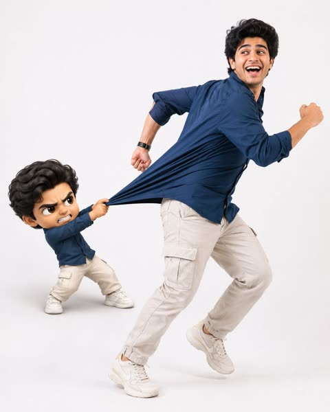</a>

The prompt locks identity to an uploaded reference photo, then adds a 3D semi chibi double with a clear action: grabbing the clothing and pulling backward. Explicit fabric physics terms like stretched material, folds and tension, plus a pure white seamless studio and a detailed negative prompt, keep the comedic interaction believable.

GPT Image 2 · Edit · Source: [@Waseem_890Ai on X](https://x.com/Waseem_890Ai/status/2073412769693741415) · found via [YouMind-OpenLab/awesome-gpt-image-2](https://github.com/YouMind-OpenLab/awesome-gpt-image-2)

[`semi-chibi`](tags.md#tag-semi-chibi) [`studio-portrait`](tags.md#tag-studio-portrait) [`fabric-physics`](tags.md#tag-fabric-physics) [`reference-photo`](tags.md#tag-reference-photo) [`playful`](tags.md#tag-playful)

<details><summary><b>Prompt</b></summary>

```text
Create an ultra-realistic lifestyle editorial studio photo in a 4:5 aspect ratio. Use the uploaded reference photo as the primary source for the character's identity. Preserve the face, facial features, body proportions, hairstyle, outfit, shoes, colors, and overall appearance exactly as shown. Do not redesign or alter the character. Place the character in a clean, minimalist photo studio with a seamless pure white background. The mood should feel modern, bright, playful, energetic, and polished, like a high-end fashion editorial. Capture the character mid-run with natural, believable movement. The body leans forward, one foot is off the ground, and the arms move naturally. The upper body is subtly pulled backward, as though the clothing is being tugged, while the lower body continues driving forward. Give the character a joyful, expressive face with laughter, excitement, and a hint of playful panic. On the left side, add a stylized 3D semi-chibi version of the same person. Keep the identity recognizable while using a larger head, smaller body, expressive eyes, and exaggerated emotions. The semi-chibi character should look frustrated and determined, grabbing the main character's clothing with both hands and pulling backward in an attempt to stop them. Emphasize the comedic struggle. Focus on realistic fabric physics where the clothing is being pulled, showing stretched material, natural folds, wrinkles, and convincing tension. The interaction should feel physically believable and visually entertaining. Use soft professional studio lighting, crisp shadows, ultra-sharp focus, realistic skin textures, detailed fabric, cinematic editorial styling, clean composition, and a premium polished finish. Negative Prompt: Low quality, blurry, noisy, pixelated, bad anatomy, extra or missing fingers, deformed hands, broken joints, stiff pose, weak motion, incorrect fabric physics, flat clothing, missing wrinkles, unrealistic interaction, altered facial identity, changed outfit, changed shoes, altered body proportions, extra characters, cluttered scene, colored background, props, harsh shadows, dark lighting, plastic skin, poor 3D quality, distorted face, watermark, logo, or text.
```

</details>

<a id="gpt-image-shanghai-metro-platform-reading-portrait"></a>
### Woman Reading on Shanghai Metro Platform

<a href="https://x.com/ToroJushiAi/status/2059452471127240959">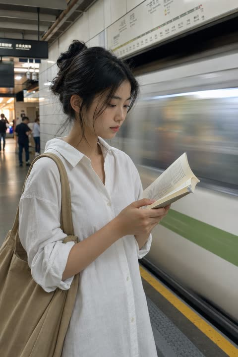</a>

The prompt sets half-body eye-level framing and a motion-blurred train, then adds skin texture cues, a greenish fluorescent light cast and ISO 400 grain. Small imperfections such as stray hairs and asymmetry keep the result looking like a candid photo instead of a render.

GPT Image 2 · Text-to-image · Source: [@ToroJushiAi on X](https://x.com/ToroJushiAi/status/2059452471127240959) · found via [freestylefly/awesome-gpt-image-2](https://github.com/freestylefly/awesome-gpt-image-2)

[`candid`](tags.md#tag-candid) [`metro`](tags.md#tag-metro) [`street-photography`](tags.md#tag-street-photography) [`film-grain`](tags.md#tag-film-grain) [`motion-blur`](tags.md#tag-motion-blur)

<details><summary><b>Prompt</b></summary>

```text
A candid photograph of a young woman standing on a Shanghai metro platform during the summer morning commute, authentic daily life photography, natural candid moment. Half-body framing, shot at eye level from moderate distance — the arriving train a motion-blurred streak behind her, the yellow safety line at her feet.
East Asian young woman in her early 20s. Almond-shaped eyes with natural double eyelids, slightly elongated eye corners — eyes directed downward, absorbed. Straight refined nose with a delicate bridge. Skin tone fair to light beige (NC10–NC20) — skin subsurface scattering visible under cool overhead station light, specular micro-highlights on cheekbones and nose ridge, fine foundation powder grain perceptible. Summer fresh look, no heavy coverage, lightly tinted lip.
She wears a relaxed oversized white shirt dress, collar lightly open, sleeves loosely rolled above the elbow. A structured natural tan canvas tote hangs from her shoulder, a physical novel tucked under one arm — pages open at a saved page. She stands with her weight on one hip, gaze downward at the open book, entirely absorbed, occupying her own stillness inside the morning rush. Background: white and grey tiled metro wall, overhead route signage board, arriving train motion blur to one side, other commuters blurred and distant. Two or three stray hairs displaced by the train's air displacement on arrival, natural unplanned imperfection, not geometrically symmetrical.
Cool overhead fluorescent lighting with a slight greenish cast, flat frontal illumination offset by a warm spill from the platform entrance behind. Absorbed in focus, eyes downward, unaware — a private moment inside a public space, the Shanghai morning. Subtle ISO 400 film grain in shadow areas, photographic noise texture not CG render smoothness. Aspect ratio 2:3. No watermark, no text overlay, not cartoon, not digitally painted, not illustration, not anime.
```

</details>

<a id="gpt-image-split-time-birthday-portrait"></a>
### Split Time Birthday Portrait of Child and Adult

<a href="https://x.com/ChillaiKalan__/status/2050834691570184611">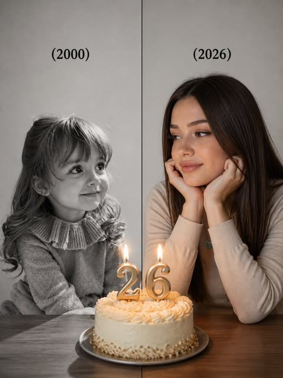</a>

The prompt locks both halves to an identical camera angle and pose, then places a lit cake on the center line so the candle glow ties the two eras together. Black and white grain against color shallow depth of field separates the past from the present, and the two year labels are given in quoted text.

GPT Image 2 · Text-to-image · Source: [@ChillaiKalan__ on X](https://x.com/ChillaiKalan__/status/2050834691570184611) · found via [YouMind-OpenLab/awesome-gpt-image-2](https://github.com/YouMind-OpenLab/awesome-gpt-image-2)

[`split-screen`](tags.md#tag-split-screen) [`birthday`](tags.md#tag-birthday) [`before-after`](tags.md#tag-before-after) [`nostalgia`](tags.md#tag-nostalgia) [`portrait`](tags.md#tag-portrait)

<details><summary><b>Prompt</b></summary>

```text
A highly realistic split-time portrait of the same person meeting her younger self. The image is divided vertically into two perfectly aligned halves with identical camera angle and composition. On the left side: a black-and-white photo of a young girl (3–4 years old), same facial features as the adult, natural smile, sitting at a table, soft diffused lighting, minimal gray background, nostalgic mood, slightly grainy film texture. On the right side: a realistic color photo of the same person as an adult [AGE], identical pose and camera angle, resting her face on her hands, smiling warmly, modern outfit, soft cinematic lighting, shallow depth of field. In the center between them: a birthday cake placed exactly at the middle line, with lit candles forming the number "[AGE]", warm candle glow illuminating both sides. Both versions are looking at each other with emotional connection, perfectly aligned eye level. Text "(2000)" above the child side and "(2026)" above the adult side, minimal elegant font. Ultra realistic, 8K, high detail skin texture, soft shadows, cinematic color grading, clean composition, emotional storytelling.
```

</details>

<a id="gpt-image-summer-flower-field-portrait-motion-blur"></a>
### Woman lying in summer daisy field with motion blur

<a href="https://x.com/lovimg_com/status/2077036746198618336">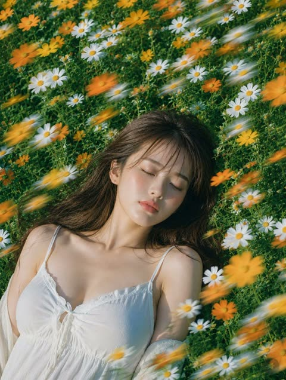</a>

The prompt is split into labeled sections for subject, expression, outfit, light, camera and texture. It keeps the face sharp and limits the diagonal motion blur to the foreground flowers, and it ends with a negative list that guards against plastic skin and broken limbs.

GPT Image 2 · Text-to-image · Source: [@lovimg_com on X](https://x.com/lovimg_com/status/2077036746198618336) · found via [freestylefly/awesome-gpt-image-2](https://github.com/freestylefly/awesome-gpt-image-2)

[`portrait`](tags.md#tag-portrait) [`flower-field`](tags.md#tag-flower-field) [`summer`](tags.md#tag-summer) [`motion-blur`](tags.md#tag-motion-blur) [`film-grain`](tags.md#tag-film-grain)

<details><summary><b>Prompt</b></summary>

```text
主題：
花風のまどろみ

主体：
縦長4:5の写真風ポートレート。白と黄色のマーガレット、オレンジ色の小花が密に咲く夏の草花畑に、成熟した大人の女性が仰向けで静かに横たわっている。人物は画面下部から中央にかけて大きく入り、顔は中央やや右、胸元から肩までは画面下側に収まる。周囲の花が画面全体を埋め、対角線方向に流れる花のモーションブラーが前景を横切る。

人物・表情：
自然で現実感のある日系ポートレート。暗めのブラウンロングヘアに、薄い前髪と顔まわりのやわらかな毛束。目を閉じ、眉は力が抜け、唇は軽く閉じた穏やかな表情。頬と鼻先に自然な血色、肌には過度な補正をせず細かな質感を残す。首筋、鎖骨、頬に夏の日差しが当たり、静かに眠っているような落ち着いた雰囲気。

服装・ポーズ：
白い夏用キャミソールワンピース。細い肩紐、胸元の控えめなレース、中央の小さなリボン、薄手のコットン素材。人物の両肩は草花に自然に沈み、片腕は画面下側で花に隠れて見切れる。体は画面左下から右上へ少し斜めに置かれ、髪は草の上に広がり、風で数本だけ額にかかる。

背景・光：
郊外にある小さな花畑のような、生活感のある自然な草花の密度。背景はすべて緑の葉と白・黄色・オレンジの花で構成し、人工物や読める文字は入れない。高めの位置から差す夏の太陽光。光はやや硬めで暖かく、顔の左側と首筋、肩に明るいハイライトが入り、花と髪の影が肌に細く落ちる。草の反射で下側に淡い緑の返り光。

構図・カメラ：
やや俯瞰の近距離撮影。85mm相当の自然な圧縮感、人物の顔にピントを合わせ、周辺の花は浅い被写界深度で少しぼける。前景の花だけが風に流され、白・黄色・オレンジの細長い光跡として左上から右下へ走る。顔まわりはブラーを弱め、表情と肌の質感をはっきり見せる。

質感・スタイル：
リアルな写真表現。夏の日差し、透明感のある肌、柔らかな髪の束感、薄手コットンのしわ、草花の細密な質感。ナチュラルな色調で、緑を深く、白い花を明るく、オレンジの花をアクセントにする。フィルム写真のようなわずかな粒子感と、雑誌ポートレートの落ち着いた仕上がり。

ネガティブ：
不自然な顔、不自然な視線、余分な指、欠けた指、手足の融合、関節の破綻、服と体の接触不良、浮遊、不自然な重力、誤った遠近法、光源と矛盾する影、過度な美肌補正、プラスチックのような肌、文字化け、ロゴ、透かし。
```

</details>

<a id="gpt-image-summer-hand-hold-backlit-portrait"></a>
### Summer Garden Portrait Glancing Back While Holding Hands

<a href="https://x.com/iamaiistudio/status/2063247373388992790">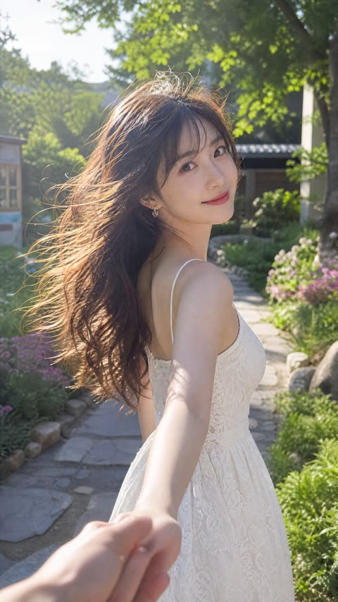</a>

A first person POV hand in the lower corner and a backward glance give the portrait a candid couple snapshot feel. Strong side backlight on windblown hair, a lens spec and explicit skin texture and avoid lists keep it photoreal.

GPT Image 2 · Text-to-image · Source: [@iamaiistudio on X](https://x.com/iamaiistudio/status/2063247373388992790) · found via [freestylefly/awesome-gpt-image-2](https://github.com/freestylefly/awesome-gpt-image-2)

[`cinematic-portrait`](tags.md#tag-cinematic-portrait) [`backlight`](tags.md#tag-backlight) [`summer`](tags.md#tag-summer) [`pov`](tags.md#tag-pov) [`photorealistic`](tags.md#tag-photorealistic)

<details><summary><b>Prompt</b></summary>

```text
Cinematic portrait photography, ultra-photorealistic, 2160x3840 vertical composition, 50mm or 85mm portrait lens rendering, shallow depth of field, clean translucent summer natural-light color grading — not overly yellow, not over-filtered.

Subject: a young beautiful adult East Asian woman, [describe face shape and features, e.g. soft heart-shaped face, refined classical features, bright almond/fox eyes, petite nose bridge, naturally full lips], overall vibe sweet, sunny, energetic, cute with a touch of allure. Gaze highly engaging — bright, clear, natural catchlights, as if it speaks; corners of mouth slightly lifted, expression gentle, vivid, natural.

She walks along a [scene, e.g. garden stone path / tree-lined lane / European street / courtyard], right hand reaching back to hold the hand of someone behind her; only their hand appears in the lower-left corner — like a first-person couple's POV snapshot. She glances back at the camera while her body stays in a forward walking motion, posture elegant and natural, clearly a candid captured moment with a faint in-love feeling.

Long [hair color] hair, [style, e.g. naturally wavy / relaxed big waves / airy bangs / half-up], many strands tousled and flying in the wind, richly layered and dynamic. Strong natural side-backlight rims the hair edges — clean, crisp rim light and semi-translucent glow, hair edges lit as if by sunlight, light and luminous. This is the core highlight of the image.

She wears [outfit, e.g. white lace slip dress / beige slip dress / light-blue short-sleeve top with white skirt / light-pink fitted dress], fabric texture natural, material light and soft. Bright natural summer sunlight realistically warms her skin, shoulders, collarbone, and clothing with soft, clean highlight transitions.

Skin texture: extremely realistic — visible fine pores, natural skin texture, faint imperfections, subtle tone variation, soft sheen. Cheeks, nose tip, shoulders show natural delicate gradations in sunlight. Translucent, healthy, real and refined — no plastic look, no waxwork, no over-smoothing.

Background: soft atmospheric blur, never distracting.

Avoid: over-smoothing, plastic skin, CG look, anime look, wig look, stiff expression, dead eyes, stiff poses, overall yellow cast, overexposed face, distorted features, wrong fingers, deformed hands, cluttered background, heavy influencer retouching.
```

</details>

<a id="gpt-image-surreal-patio-portrait-crow-poodle"></a>
### Surreal Patio Portrait with Crow and Poodle

<a href="https://x.com/levelsio/status/2046735438128333096">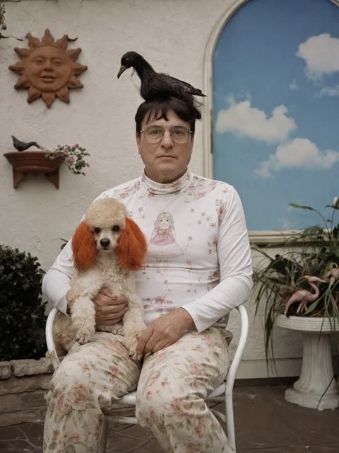</a>

Counts every background element exactly (4 decorations, 2 flamingos) and names each one with its position, so the layout stays fixed. A deadpan formal pose, soft overcast light and muted colors give the vintage editorial look, and a closing line lists the swappable variables.

GPT Image 2 · Text-to-image · Source: [@levelsio on X](https://x.com/levelsio/status/2046735438128333096) · found via [YouMind-OpenLab/awesome-gpt-image-2](https://github.com/YouMind-OpenLab/awesome-gpt-image-2)

[`surreal`](tags.md#tag-surreal) [`editorial`](tags.md#tag-editorial) [`courtyard`](tags.md#tag-courtyard) [`pet-portrait`](tags.md#tag-pet-portrait) [`vintage`](tags.md#tag-vintage)

<details><summary><b>Prompt</b></summary>

```text
A slightly surreal but photorealistic portrait of a seated person in a quiet courtyard or patio, centered in frame, wearing a fitted white long-sleeve turtleneck top with delicate pink floral prints and a printed illustration of a girl on the chest, paired with loose cream floral pants. The person sits on a simple white metal chair and holds a small fluffy poodle-like dog in their lap; the dog has curly off-white fur and distinctly dyed orange ears. Perched on top of the person’s dark hair bun is a black crow or raven, facing left, calm and balanced as if it naturally belongs there. The subject’s pose is still, direct, and formal, creating an odd deadpan family-portrait feeling. Set the scene against a textured off-white stucco wall with exactly 4 notable decorative background elements: 1 brown sun-shaped wall ornament in the upper left, 1 small wall-mounted planter shelf with a small bird figurine and trailing flowers on the left, 1 tall arched window or mural on the right showing a bright blue sky with soft white clouds, and 1 white pedestal planter at lower right filled with long green leaves and exactly 2 pink flamingo ornaments. Include a bit of stone edging and dark greenery at lower left and a brown tiled floor. Lighting is soft natural daylight, slightly overcast, with muted colors, shallow depth of field, and a vintage editorial photography look. Composition should be vertical, full seated figure, straight-on, balanced, and quietly uncanny. Customize the main figure as a middle-aged woman, the bird as black crow, the dog breed as small poodle mix, the dog ear color as orange, and the outfit palette as white and faded pink florals.
```

</details>

<a id="gpt-image-tokyo-backstreet-film-snapshot-fur-jacket"></a>
### Candid Tokyo street film portrait in fur jacket

<a href="https://x.com/BubbleBrain/status/2055491616392052887">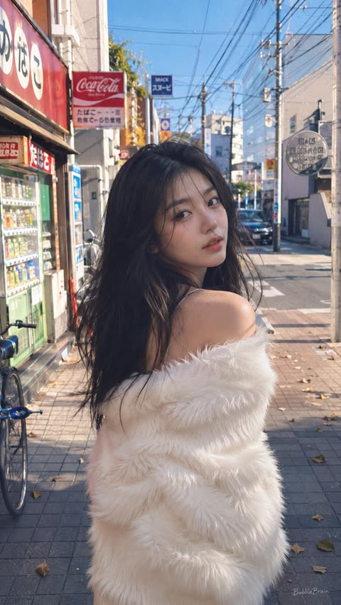</a>

Stacks film grain, overexposed highlights and phone snapshot cues such as imperfect framing and slow shutter blur to get a candid look. A detailed street inventory with wires, vending machines and fallen leaves, plus a back turned pose with a look over the shoulder, anchors the scene.

GPT Image 2 · Text-to-image · Source: [@BubbleBrain on X](https://x.com/BubbleBrain/status/2055491616392052887) · found via [freestylefly/awesome-gpt-image-2](https://github.com/freestylefly/awesome-gpt-image-2)

[`film-photography`](tags.md#tag-film-photography) [`street-snapshot`](tags.md#tag-street-snapshot) [`tokyo`](tags.md#tag-tokyo) [`candid`](tags.md#tag-candid) [`portrait`](tags.md#tag-portrait)

<details><summary><b>Prompt</b></summary>

```text
film photography, candid street snapshot aesthetic, razor-sharp focus on subject, shallow depth of field with soft blurred urban background, bright daylight, slightly overexposed highlights, vivid contrast, subtle analog film texture, heavy film grain, nostalgic cinematic atmosphere, Tokyo backstreet neighborhood scene near a quiet train station, narrow pedestrian street lined with Japanese convenience stores, vintage vending machines, small ramen shops, hanging signs with faded typography, bicycles parked along tiled sidewalks, utility poles and overhead wires stretching across the sky, scattered fallen leaves on the ground, distant pedestrians and passing taxis softly blurred in the background, warm afternoon sunlight with deep blue sky, realistic street fashion photography style, effortless cool street vibe, vibrant colors with slightly muted faded film tones, beautiful 19-year-old Chinese female influencer, fair porcelain skin with cold pale undertones, exquisite natural makeup, glossy soft lips, defined brows, delicate lashes, soft messy long black hair with natural flowing curves, wearing an off-shoulder white fluffy faux fur jacket, playful yet subtly seductive expression, lazy dreamy vintage filter, ultra high-quality details, intentionally mundane phone-camera snapshot feeling, casual accidental composition, imperfect framing, realistic iPhone photography texture, spontaneous candid energy, highly attractive girl casually posing in the middle of the sidewalk, body facing away from the camera while turning her head back toward the lens with direct eye contact, relaxed posture, soft wind moving her hair, emotional youthful atmosphere, modern Asian street fashion editorial, soft haze, layered composition, masterpiece, best quality, ultra detailed, slight motion blur from slow shutter, authentic everyday realism, “BubbleBrain” small handwritten signature text on bottom corner --ar 9:16
```

</details>

<a id="gpt-image-tribal-warrior-guardian-owl-portrait"></a>
### Tribal Fantasy Warrior with Giant Guardian Owl

<a href="https://x.com/Aqib__786Ai/status/2091027228645552456">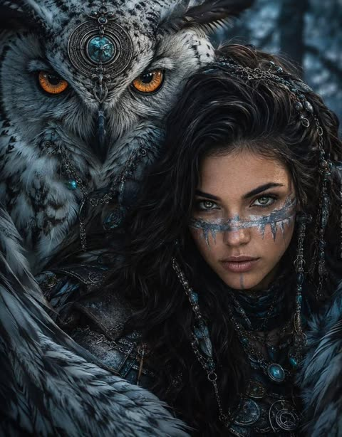</a>

Every element is described by material and colour, such as silver chains, turquoise gems and icy war paint. The owl is given its own feature list and the cool blue forest palette contrasts with its orange eyes. Photoreal texture keywords and cinematic lighting keep the fantasy subject looking like a real photograph.

GPT Image 2 · Text-to-image · Source: [@Aqib__786Ai on X](https://x.com/Aqib__786Ai/status/2091027228645552456) · found via [YouMind-OpenLab/awesome-gpt-image-2](https://github.com/YouMind-OpenLab/awesome-gpt-image-2)

[`fantasy`](tags.md#tag-fantasy) [`warrior`](tags.md#tag-warrior) [`owl`](tags.md#tag-owl) [`dark-fantasy`](tags.md#tag-dark-fantasy) [`cinematic`](tags.md#tag-cinematic)

<details><summary><b>Prompt</b></summary>

```text
A detailed portrait of a fierce tribal fantasy warrior woman leaning close to a massive, majestic great horned owl, cinematic lighting, dark moody atmosphere. The woman has long, wavy dark hair adorned with intricate silver chains, beads, and metallic headpieces. She has striking light green eyes, piercing the camera, with silver and icy-white war paint painted across her cheeks and nose. She wears dark leather armor decorated with silver pendants and turquoise gemstones Beside her the giant owl features sharp glowing orange eyes, patterned white and black feathers and an ornate silver circular medallion studded with a blue crystal resting on its forehead. The background is a shadowy, mystical forest in cool blue and dark gray tones. Highly detailed feathers, hyper-realistic, photorealistic textures, 8k resolution, dramatic dark fantasy aesthetic, masterpiece.
```

</details>

<a id="gpt-image-urban-bird-street-portrait"></a>
### Woman in White Among Flying Birds

<a href="https://x.com/HaniaAi12/status/2060216757797978245">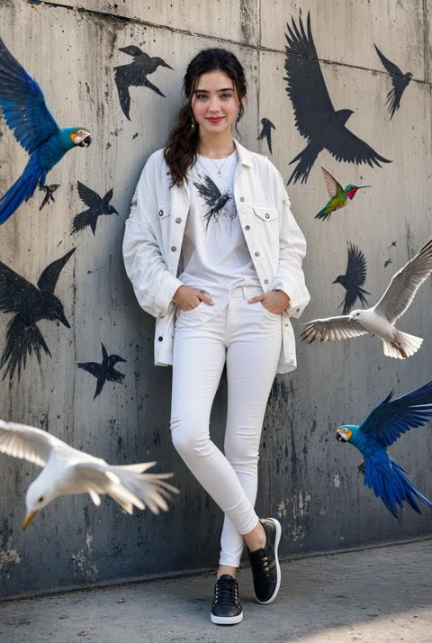</a>

Real birds in flight are paired with black graffiti bird silhouettes on the wall, so the live and painted subjects echo each other. A named outfit list with soft daylight and depth of field keeps the fashion look consistent.

GPT Image 2 · Text-to-image · Source: [@HaniaAi12 on X](https://x.com/HaniaAi12/status/2060216757797978245) · found via [freestylefly/awesome-gpt-image-2](https://github.com/freestylefly/awesome-gpt-image-2)

[`street-portrait`](tags.md#tag-street-portrait) [`fashion`](tags.md#tag-fashion) [`birds`](tags.md#tag-birds) [`graffiti`](tags.md#tag-graffiti) [`photorealistic`](tags.md#tag-photorealistic)

<details><summary><b>Prompt</b></summary>

```text
A stylish cinematic portrait of a confident young woman leaning casually against a textured urban concrete wall, surrounded by vibrant flying birds including blue macaws, white seagulls, and a colorful hummingbird. Black graffiti-style bird silhouettes painted on the wall create an artistic street-art vibe. She is wearing a trendy all-white outfit — oversized denim jacket, fitted graphic tee, skinny jeans, and black sneakers. Soft natural daylight, realistic shadows, ultra-detailed fashion photography, urban luxury aesthetic, sharp facial features, glossy hair, high-end editorial style, dynamic composition, photorealistic, depth of field, 8K quality.
```

</details>

<a id="gpt-image-vintage-garden-wedding-portrait"></a>
### Vintage Garden Studio Wedding Portrait

<a href="https://x.com/zhongying14/status/2061872385075122389">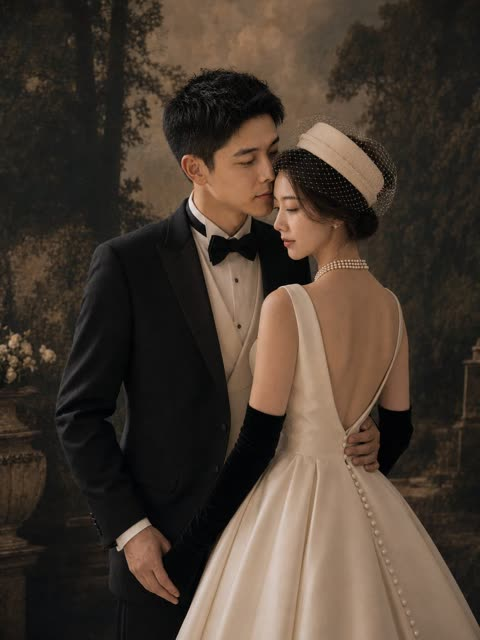</a>

The prompt describes each person's pose, outfit and accessories in turn, then sets a painterly sepia garden backdrop with soft directional light, shallow depth of field and film grain. A fixed 3:4 crop and explicit no text, no watermark limits keep the composition clean.

GPT Image 2 · Text-to-image · Source: [@zhongying14 on X](https://x.com/zhongying14/status/2061872385075122389) · found via [YouMind-OpenLab/awesome-gpt-image-2](https://github.com/YouMind-OpenLab/awesome-gpt-image-2)

[`wedding`](tags.md#tag-wedding) [`portrait`](tags.md#tag-portrait) [`vintage`](tags.md#tag-vintage) [`old-hollywood`](tags.md#tag-old-hollywood) [`couple`](tags.md#tag-couple)

<details><summary><b>Prompt</b></summary>

```text
Create a vertical 3:4 cinematic fine-art wedding portrait of an elegant couple in a vintage studio garden setting. The groom is an East Asian young adult man with short black textured hair, wearing a classic black tuxedo jacket, white dress shirt, cream waistcoat, and black bow tie; he stands on the left, angled slightly toward the bride, his left arm wrapped around her waist and his right hand relaxed by his side. The bride is an East Asian young adult woman standing on the right with her back mostly to the camera, turned slightly toward the groom in an intimate pose; she wears an ivory satin bridal gown with a deep V-shaped open back, full structured skirt, a vertical row of covered buttons down the back, long black opera gloves, a layered pearl necklace, pearl drop earrings, and a cream pillbox-style bridal hat with a dotted birdcage veil over dark updo hair. Their faces should be close together as if about to kiss, with the mood romantic, composed, and editorial. Use a dark painterly forest-and-garden backdrop with tall shadowy trees, warm sepia-brown haze, a stone planter with pale flowers on the left, and subtle vintage garden architecture in the distance. Lighting should be soft, warm, and directional, with gentle highlights on satin fabric and pearls, muted shadows, shallow depth of field, film-grain texture, and a luxurious old-Hollywood bridal magazine aesthetic. No text, no watermark, no extra people, keep the composition waist-up to full-skirt crop with the bride’s gown occupying the lower right foreground.
```

</details>

<a id="gpt-image-y2k-flash-mirror-selfie-skyline-bathroom"></a>
### Y2K flash mirror selfie in a skyline bathroom

<a href="https://x.com/jzaib4269/status/2062184740849930384">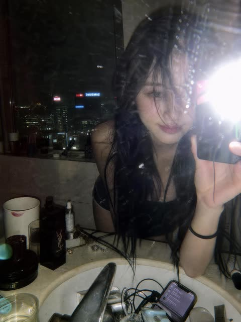</a>

Smudged mirror details such as dust, water spots and flash burn are named outright, so the image reads as raw and unretouched. A cluttered counter, a neon skyline reflection and a closing camera spec line (direct flash, compact digital, 35mm equivalent, noise) anchor the early 2000s look.

GPT Image 2 · Text-to-image · Source: [@jzaib4269 on X](https://x.com/jzaib4269/status/2062184740849930384) · found via [freestylefly/awesome-gpt-image-2](https://github.com/freestylefly/awesome-gpt-image-2)

[`y2k`](tags.md#tag-y2k) [`flash-photography`](tags.md#tag-flash-photography) [`mirror-selfie`](tags.md#tag-mirror-selfie) [`night-city`](tags.md#tag-night-city) [`candid`](tags.md#tag-candid)

<details><summary><b>Prompt</b></summary>

```text
A moody late-night mirror selfie captured in a luxury high-rise bathroom overlooking a glowing city skyline. A young woman with long, slightly messy black hair leans forward over a marble sink, partially obscuring one eye with loose strands. The photo is taken through a smudged mirror with visible dust particles, water spots, and imperfections, creating an authentic raw aesthetic. A powerful direct camera flash explodes in the frame, producing harsh highlights, lens flare, and a nostalgic early-2000s digital camera look.

The bathroom counter is cluttered with luxury cosmetics, skincare products, jewelry, a smartphone, and everyday personal items, adding a lived-in editorial feel. Reflections of neon-lit skyscrapers and hotel windows shimmer in the background, emphasizing an urban nightlife atmosphere. Soft pale skin tones contrast against dark clothing and black hair. The composition feels intimate, candid, and effortlessly cool.

Style: Y2K flash photography, candid mirror selfie, Korean editorial aesthetic, indie sleaze, hotel bathroom scene, luxury lifestyle, cinematic nightlife, disposable camera look, grainy texture, flash burn, realistic skin texture, shallow depth of field, authentic imperfections, viral Pinterest mood, high-fashion casual energy, raw unfiltered photography.

Camera: direct flash, compact digital camera, 35mm equivalent, harsh lighting, slight motion blur, visible noise, natural color grading, vertical composition, ultra-realistic, high detail.
```

</details>

<a id="gpt-image-y2k-golden-hour-pink-velour-portrait"></a>
### Y2K golden hour portrait in pink velour

<a href="https://x.com/SiliconBarbie_/status/2051475105403040014">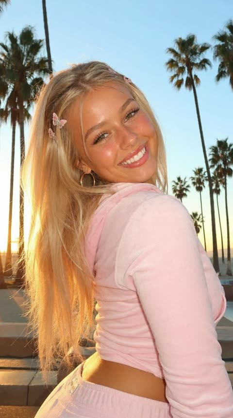</a>

A single comma-separated line stacks subject, age, skin finish, wardrobe, hair accessories, light and setting, so each detail lands in the frame. Golden hour light with palm trees and glossy lips anchors the Y2K look, and the word candid keeps the pose natural.

GPT Image 2 · Text-to-image · Source: [@SiliconBarbie_ on X](https://x.com/SiliconBarbie_/status/2051475105403040014) · found via [freestylefly/awesome-gpt-image-2](https://github.com/freestylefly/awesome-gpt-image-2)

[`y2k`](tags.md#tag-y2k) [`golden-hour`](tags.md#tag-golden-hour) [`candid-portrait`](tags.md#tag-candid-portrait) [`velour`](tags.md#tag-velour) [`palm-trees`](tags.md#tag-palm-trees)

<details><summary><b>Prompt</b></summary>

```text
candid portrait of a beautiful young blonde woman, 21 years old, glowing sun-kissed skin, wearing a baby pink velour tracksuit and butterfly clips in her hair, smiling brightly at the camera, golden hour warm light, palm trees, y2k aesthetic, glossy lips
```

</details>

<a id="gpt-image-yang-zhilin-caricature-editorial-redraw"></a>
### Exaggerated caricature of Yang Zhilin at keyboard

<a href="https://x.com/ElainaNotes/status/2081202322911433189">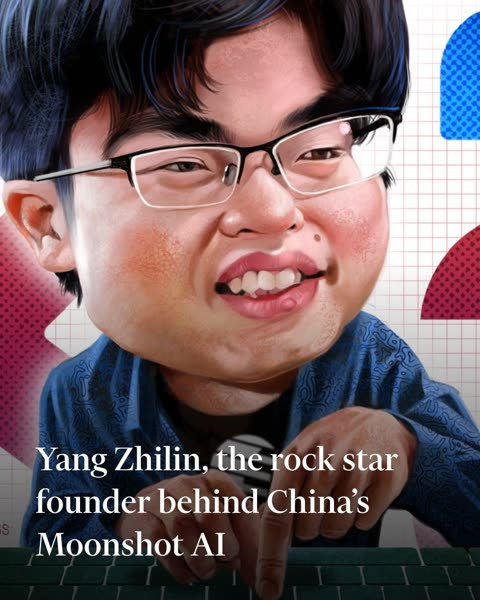</a>

Listing every layout element to keep (pose, grid background, dotted shapes, headline) locks the composition to the reference. Naming the caricature traits along with a tight vertical crop and a face much larger than the reference pushes the exaggeration without losing the layout.

GPT Image 2 · Edit · Source: [@ElainaNotes on X](https://x.com/ElainaNotes/status/2081202322911433189) · found via [YouMind-OpenLab/awesome-gpt-image-2](https://github.com/YouMind-OpenLab/awesome-gpt-image-2)

[`caricature`](tags.md#tag-caricature) [`editorial`](tags.md#tag-editorial) [`portrait`](tags.md#tag-portrait) [`reference-redraw`](tags.md#tag-reference-redraw)

<details><summary><b>Prompt</b></summary>

```text
Using the provided reference image, redraw it as a polished exaggerated editorial caricature while preserving the original Financial Times-style composition and all key elements. Keep the same seated-at-keyboard pose, the hands reaching toward the keyboard, the white grid-paper background, the red/pink dotted side shapes, the blue dotted rounded rectangle in the upper right, and the same lower-left headline text: Yang Zhilin, the rock star founder behind China’s Moonshot AI. Transform the portrait into a glossy, high-detail digital caricature with an oversized head, fuller cheeks, slightly comical smile, enlarged glasses, stylized black hair, painterly skin texture, and a more satirical magazine-illustration look. Keep the crop tight and vertical, with the face much larger in frame than the reference and the text overlay still readable in large white serif type across the lower third. Maintain the keyboard along the bottom edge and do not add any new objects, logos, watermarks, or extra text.
```

</details>

[1](image-portrait.md) · [2](image-portrait-2.md) · **3**
