# Portraits

[Back to the list](../../README.md) · All 179 entries · **1** · [2](image-portrait-2.md)

<a id="gpt-image-macbook-screen-photo-booth-selfie"></a>
### Dim bedroom selfie in Photo Booth on laptop

<a href="https://x.com/tadasgedgaudas/status/2046877643929166330"></a>

The prompt is structured JSON with an identity lock block that preserves the face from the input photo. It frames the result as a photo of a screen, not a screenshot, and lists physical flaws such as pixel grid, moire, dust and fingerprints, with a negative list against flat UI and polish.

GPT Image 2 · Edit · Source: [@tadasgedgaudas on X](https://x.com/tadasgedgaudas/status/2046877643929166330) · 4,434 likes on 2026-10-28

[`screen-photo`](tags.md#tag-screen-photo) [`json-prompt`](tags.md#tag-json-prompt) [`identity-lock`](tags.md#tag-identity-lock) [`low-light`](tags.md#tag-low-light) [`candid`](tags.md#tag-candid)

<details><summary><b>Prompt</b></summary>

```text
{"image_settings": {"aspect_ratio": "3:4", "resolution": {"width": 1152, "height": 1536}}, "prompt": {"identity_lock": {"reference": "input_photo", "preserve": ["face", "facial proportions", "eye shape", "nose", "lips", "skin tone", "skin texture", "hairline", "overall identity"], "rules": ["no face swap", "no beautify", "no smoothing", "no reshaping", "no AI look"]}, "scene": {"camera_angle": "high-angle downward shot, POV", "composition": "MacBook screen fills most of the frame, thin strip of physical keyboard visible at the bottom", "screen_surface": ["visible RGB pixel grid", "subtle moire effect", "micro dust on glass", "faint fingerprints", "soft ambient reflections"]}, "digital_interface": {"os": "macOS dark mode", "background_app": {"name": "Spotify", "view": "Liked Songs", "visible_tracks": ["Blank Space \u2013 Taylor Swift", "Shake It Off \u2013 Taylor Swift", "Cruel Summer \u2013 Taylor Swift", "Love Story \u2013 Taylor Swift"]}, "foreground_app": {"name": "Photo Booth", "state": "live preview window", "position": "floating, center-right"}}, "photo_booth_content": {"environment": {"room": "dim bedroom", "background": "off-white wall, rumpled bedding", "lighting": "low-light, nocturnal, cool screen glow mixed with warm skin tones"}, "subject": {"pose": "lying down, relaxed, candid", "expression": "natural, slightly relaxed", "outfit": "light-colored tank top", "prop": {"item": "iPhone 15 Pro", "hand": "right hand"}}}, "realism_rules": ["this is a photo of a screen, not a screenshot", "raw smartphone photo look", "natural noise", "imperfect glass", "no studio lighting", "no HD polish"]}, "negative_prompt": ["screenshot", "flat UI", "perfect screen", "clean glass", "studio lighting", "beauty filter", "cartoon", "3d render", "painting", "watermark", "blurred face"]}
```

</details>

<a id="gpt-image-bougainvillea-archway-courtyard-portrait"></a>
### Two women under a bougainvillea archway courtyard

<a href="https://x.com/abxxai/status/2097698712978087966"></a>

The prompt places a detailed near subject against a barely specified second figure, then layers the setting from foreground arch to courtyard to sea. It names a camera era, direct fill flash and CCD color so the lighting and grain come out consistent.

GPT Image 2.5 · Text-to-image · Source: [@abxxai on X](https://x.com/abxxai/status/2097698712978087966) · 2,645 likes on 2026-10-28

[`portrait`](tags.md#tag-portrait) [`mediterranean`](tags.md#tag-mediterranean) [`flash-photography`](tags.md#tag-flash-photography) [`y2k`](tags.md#tag-y2k) [`candid`](tags.md#tag-candid)

<details><summary><b>Prompt</b></summary>

```text
Two women framed by a sun-bleached stone archway — one in the near foreground at frame right, a woman with long straight golden-brown hair loosely pulled back with soft face-framing pieces, warm honey-blonde balayage catching the light, an oval face with warm brown eyes, softly tanned olive-warm skin and full lips, small stud earrings, wearing a rust-terracotta linen wrap top and matching wide-leg linen trousers cinched with a woven raffia belt, hands clasped in front of her, turned back over her shoulder toward camera; a second woman, features unspecified, stands further back in the courtyard in a deep forest-green silk blouse and wide-leg cream trousers, leaning against a whitewashed stone pillar, gazing out toward the sea. Setting: the threshold of a Mediterranean cliffside courtyard, hand-laid terracotta mosaic floor and a weathered stone archway thick with trailing bougainvillea in the foreground, a sun-drenched courtyard beyond with wrought-iron lanterns, potted olive trees and a low stone fountain, whitewashed rooftops and a pale hazy sea filling the horizon, soft late-afternoon light. Shot on an early-2000s point-and-shoot digicam with harsh direct on-camera fill flash that aggressively illuminates the near woman and the archway, flattening her features and putting sharp specular highlights on the linen, the stone and her shoulders; the courtyard and sea beyond stay visible but hazy, milky and underexposed relative to the flash. Warm, slightly saturated CCD tones, strong bloom and halation at the archway edges, minor digital noise. Candid amateur, Y2K editorial, unpolished but stylized.
```

</details>

<a id="gpt-image-mediterranean-archway-y2k-flash-courtyard"></a>
### Woman under bougainvillea archway in Mediterranean courtyard

<a href="https://x.com/abxxai/status/2097698694296686623"></a>

The prompt places a detailed foreground subject against a lightly specified second figure and a layered setting, from archway to courtyard to sea. It then adds an early 2000s digicam look with on camera flash, CCD colour, bloom and noise to push the result toward candid realism.

GPT Image 2.5 · Text-to-image · Source: [@abxxai on X](https://x.com/abxxai/status/2097698694296686623) · 2,645 likes on 2026-10-28

[`y2k`](tags.md#tag-y2k) [`digicam`](tags.md#tag-digicam) [`flash-photography`](tags.md#tag-flash-photography) [`mediterranean`](tags.md#tag-mediterranean) [`candid`](tags.md#tag-candid)

<details><summary><b>Prompt</b></summary>

```text
Two women framed by a sun-bleached stone archway — one in the near foreground at frame right, a woman with long straight golden-brown hair loosely pulled back with soft face-framing pieces, warm honey-blonde balayage catching the light, an oval face with warm brown eyes, softly tanned olive-warm skin and full lips, small stud earrings, wearing a rust-terracotta linen wrap top and matching wide-leg linen trousers cinched with a woven raffia belt, hands clasped in front of her, turned back over her shoulder toward camera; a second woman, features unspecified, stands further back in the courtyard in a deep forest-green silk blouse and wide-leg cream trousers, leaning against a whitewashed stone pillar, gazing out toward the sea. Setting: the threshold of a Mediterranean cliffside courtyard, hand-laid terracotta mosaic floor and a weathered stone archway thick with trailing bougainvillea in the foreground, a sun-drenched courtyard beyond with wrought-iron lanterns, potted olive trees and a low stone fountain, whitewashed rooftops and a pale hazy sea filling the horizon, soft late-afternoon light. Shot on an early-2000s point-and-shoot digicam with harsh direct on-camera fill flash that aggressively illuminates the near woman and the archway, flattening her features and putting sharp specular highlights on the linen, the stone and her shoulders; the courtyard and sea beyond stay visible but hazy, milky and underexposed relative to the flash. Warm, slightly saturated CCD tones, strong bloom and halation at the archway edges, minor digital noise. Candid amateur, Y2K editorial, unpolished but stylized.
```

</details>

<a id="gpt-image-car-door-clifftop-2000s-film-snapshot"></a>
### Early 2000s film snapshot through open car door

<a href="https://x.com/abxxai/status/2102775797509722602"></a>

An uploaded character sheet locks identity, while labeled blocks for scene, wardrobe, background, light, camera and realism keep each concern separate. The old footage look comes from written film terms such as 28mm barrel distortion, lifted blacks, halation and grain rather than a filter, and the car door frame adds a natural foreground.

GPT Image 2.5 · Edit · Source: [@abxxai on X](https://x.com/abxxai/status/2102775797509722602) · 1,687 likes on 2026-10-28

[`film-look`](tags.md#tag-film-look) [`candid`](tags.md#tag-candid) [`road-trip`](tags.md#tag-road-trip) [`character-reference`](tags.md#tag-character-reference) [`2000s`](tags.md#tag-2000s)

<details><summary><b>Prompt</b></summary>

```text
4/ the start frame, GPT Image 2.5 made

the old footage look is NOT a filter.. Opus wrote it into the prompt:

Promtp:

Use the uploaded character sheet as the strict identity reference. Keep her exact face, bone structure, brown eyes, light freckles across nose and cheeks, natural full lips, and long straight light-brown hair with sun-kissed caramel highlights parted in the middle. Keep the thin gold chain necklace with the small cross pendant.

SCENE: A candid photo taken from inside a parked silver sedan, looking out through the open rear passenger door. The door frame, the grey fabric headliner, the black door panel with its chrome handle, and part of the seat belt frame the shot on both sides. She stands just outside the open door on a rocky clifftop road above the ocean, both arms raised, one hand gripping the top of the door frame and the other resting on the roof edge, leaning slightly toward the camera. Relaxed, unposed, calm expression, looking straight into the lens.

WARDROBE: Fitted cropped white cotton baby tee with a faded, sun-washed vintage graphic print in pale blue and coral red, slightly worn and soft. Light-wash low-rise denim cutoff shorts with frayed hems. Thin brown leather cord bracelets on one wrist. Hair slightly messy and windblown, a few strands across her face.

BACKGROUND: Deep blue Mediterranean sea filling the frame behind her, sparkling sun glints on the water, a flat horizon line at chest height, pale hazy sky, dark rocks and sandy stones at the cliff edge below.

LIGHT: Harsh direct midday summer sun, bright and slightly overexposed. Sun-warmed skin with a natural sheen and slight glow on the cheeks and nose, soft shadows under the chin, a faint reflection of light off the white car interior.

CAMERA AND LOOK: Early 2000s point-and-shoot film photo, 35mm film, 28mm wide lens with slight barrel distortion at the edges, shot from chest height inside the car. Warm, faded, sun-bleached color grade, lifted blacks, low contrast, creamy highlights that gently blow out in the sky, slightly yellowed whites, soft halation around bright edges, fine visible film grain, a touch of softness and imperfect focus. Looks like a real candid snapshot from a summer road trip, not a studio shot.

REALISM: Real skin texture with visible pores and freckles, no retouching, no plastic skin, natural flyaway hairs, real fabric wrinkles on the tee, real dust and wear on the car interior.

Aspect ratio 4:3. No text, no watermark, no logos.
```

</details>

<a id="gpt-image-car-door-coastal-film-snapshot"></a>
### Candid early 2000s film snapshot from inside car

<a href="https://x.com/abxxai/status/2102775755646337530"></a>

An uploaded character sheet locks identity, then the scene is framed from inside the car so the door frame, headliner and seat belt create a natural foreground. The film look is written into the prompt as camera and grade details like 28mm barrel distortion, lifted blacks, halation and grain, not applied as a filter.

GPT Image 2.5 · Edit · Source: [@abxxai on X](https://x.com/abxxai/status/2102775755646337530) · 1,687 likes on 2026-10-28

[`film-look`](tags.md#tag-film-look) [`candid-snapshot`](tags.md#tag-candid-snapshot) [`character-reference`](tags.md#tag-character-reference) [`travel`](tags.md#tag-travel) [`y2k`](tags.md#tag-y2k)

<details><summary><b>Prompt</b></summary>

```text
4/ the start frame, GPT Image 2.5 made

the old footage look is NOT a filter.. Opus wrote it into the prompt:

Promtp:

Use the uploaded character sheet as the strict identity reference. Keep her exact face, bone structure, brown eyes, light freckles across nose and cheeks, natural full lips, and long straight light-brown hair with sun-kissed caramel highlights parted in the middle. Keep the thin gold chain necklace with the small cross pendant.

SCENE: A candid photo taken from inside a parked silver sedan, looking out through the open rear passenger door. The door frame, the grey fabric headliner, the black door panel with its chrome handle, and part of the seat belt frame the shot on both sides. She stands just outside the open door on a rocky clifftop road above the ocean, both arms raised, one hand gripping the top of the door frame and the other resting on the roof edge, leaning slightly toward the camera. Relaxed, unposed, calm expression, looking straight into the lens.

WARDROBE: Fitted cropped white cotton baby tee with a faded, sun-washed vintage graphic print in pale blue and coral red, slightly worn and soft. Light-wash low-rise denim cutoff shorts with frayed hems. Thin brown leather cord bracelets on one wrist. Hair slightly messy and windblown, a few strands across her face.

BACKGROUND: Deep blue Mediterranean sea filling the frame behind her, sparkling sun glints on the water, a flat horizon line at chest height, pale hazy sky, dark rocks and sandy stones at the cliff edge below.

LIGHT: Harsh direct midday summer sun, bright and slightly overexposed. Sun-warmed skin with a natural sheen and slight glow on the cheeks and nose, soft shadows under the chin, a faint reflection of light off the white car interior.

CAMERA AND LOOK: Early 2000s point-and-shoot film photo, 35mm film, 28mm wide lens with slight barrel distortion at the edges, shot from chest height inside the car. Warm, faded, sun-bleached color grade, lifted blacks, low contrast, creamy highlights that gently blow out in the sky, slightly yellowed whites, soft halation around bright edges, fine visible film grain, a touch of softness and imperfect focus. Looks like a real candid snapshot from a summer road trip, not a studio shot.

REALISM: Real skin texture with visible pores and freckles, no retouching, no plastic skin, natural flyaway hairs, real fabric wrinkles on the tee, real dust and wear on the car interior.

Aspect ratio 4:3. No text, no watermark, no logos.
```

</details>

<a id="nano-banana-sunlit-smartphone-selfie-white-tee"></a>
### Sunlit smartphone selfie of woman in white tee

<a href="https://www.reddit.com/r/GeminiAI/comments/1x08axv/nano_banana_21_goes_crazy">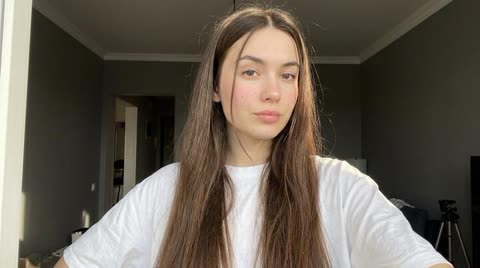</a>

A structured JSON spec splits face, hair, clothing, lighting and camera into separate fields, so each detail is controlled on its own. Naming a 24 to 28mm phone lens, clipped HDR highlights and a long avoid list keeps the result casual instead of studio polished.

Nano Banana 2.1 · Text-to-image · Source: [u/RIGHT200 on Reddit](https://www.reddit.com/r/GeminiAI/comments/1x08axv/nano_banana_21_goes_crazy) · 1,204 likes on 2026-10-28

[`selfie`](tags.md#tag-selfie) [`smartphone-photo`](tags.md#tag-smartphone-photo) [`json-prompt`](tags.md#tag-json-prompt) [`natural-light`](tags.md#tag-natural-light) [`photorealistic`](tags.md#tag-photorealistic)

<details><summary><b>Prompt</b></summary>

```text
{

"prompt_type": "detailed_image_reconstruction",

"aspect_ratio": "16:9 horizontal portrait",

"overall_goal": "Recreate the visual appearance, framing, lighting, styling, and casual smartphone-photo feel of the reference image as closely as possible while keeping the result photorealistic and natural.",

"subject": {

"type": "young adult woman",

"age_range": "early to mid 20s",

"pose": "standing indoors, upper body turned slightly away from the camera while her face turns toward the lens",

"body_position": "relaxed casual posture with shoulders slightly angled",

"expression": "soft neutral expression with a subtle pout, calm and confident",

"gaze": "looking directly toward the camera",

"styling": "minimal everyday styling, clean and natural"

},

"face": {

"shape": "soft oval face with a gently tapered jawline",

"forehead": "medium-height forehead partly framed by center-parted hair",

"eyebrows": "natural medium-thick dark brown eyebrows with a soft arch",

"eyes": {

"shape": "almond-shaped",

"color": "light brown to hazel",

"appearance": "bright eyes with visible catchlights",

"lashes": "long defined eyelashes with subtle mascara"

},

"nose": "small straight nose with a softly rounded tip",

"lips": {

"shape": "full lips with a defined cupid's bow",

"color": "natural rosy pink",

"finish": "soft satin finish, not glossy"

},

"skin": {

"tone": "light warm-neutral skin tone",

"texture": "smooth natural skin with subtle pores and realistic tonal variation",

"cheeks": "soft natural pink flush",

"finish": "fresh luminous skin without heavy retouching"

},

"makeup": "very light natural makeup, softly defined lashes, subtle blush, natural pink lips, no dramatic contour"

},

"hair": {

"color": "rich medium-to-dark chocolate brown",

"length": "very long, extending well below the chest",

"parting": "clean center part",

"texture": "mostly straight with very soft natural bends through the lower lengths",

"density": "thick and healthy-looking",

"finish": "smooth and glossy but still realistic",

"front_sections": "two thin face-framing strands falling naturally along both sides of the face",

"details": "visible individual strands, subtle flyaways near the crown, realistic highlights from sunlight, natural uneven strand separation",

"movement": "hair hanging naturally over both shoulders and down the front of the shirt"

},

"clothing": {

"top": "oversized plain white crew-neck T-shirt",

"fit": "loose casual fit",

"fabric": "soft slightly wrinkled cotton",

"logos": "none",

"accessories": "no visible jewelry or prominent accessories"

},

"composition": {

"shot_type": "close upper-body portrait",

"camera_angle": "slightly above chest level, close to eye level",

"camera_distance": "approximately arm's-length smartphone distance",

"subject_position": "face slightly right of center with long hair occupying much of the lower frame",

"crop": "top of head fully visible, image extending down to around lower torso",

"orientation": "vertical",

"perspective": "natural wide smartphone-camera perspective with mild close-range distortion"

},

"lighting": {

"primary_source": "strong warm natural sunlight entering from the side/front through a nearby window",

"direction": "sunlight striking the subject from camera-left/front",

"face_effect": "bright warm illumination across the forehead, cheeks, nose, and hair",

"hair_effect": "distinct brown highlights and soft reflective streaks along individual strands",

"shadow_quality": "strong but soft-edged natural indoor shadows",

"exposure": "face slightly brightly exposed while the room behind remains much darker",

"color_temperature": "warm daylight"

},

"environment": {

"location": "casual indoor residential room",

"background": "dark gray walls with a white ceiling cornice",

"left_background": "open doorway or darker hallway area",

"right_background": "dark wall and partially visible household objects",

"lower_right": "part of a black tripod or light stand visible",

"overall_feel": "ordinary lived-in room rather than a studio",

"depth": "background moderately out of focus but still recognizable"

},

"camera": {

"capture_device": "modern smartphone camera",

"lens_equivalent": "approximately 24-28mm full-frame equivalent",

"focus": "sharp focus on face and front hair",

"depth_of_field": "mostly natural smartphone depth of field with gentle background softness",

"dynamic_range": "realistic phone-camera HDR with slightly clipped highlights in direct sun",

"image_character": "casual social-media selfie/photo, not professionally staged"

},

"photorealism_details": [

"real individual hair strands",

"natural skin pores and micro-texture",

"subtle peach fuzz",

"realistic eyelash separation",

"tiny variations in lip texture",

"slight fabric creases in the T-shirt",

"small flyaway hairs around the crown",

"natural sunlight falloff across the face",

"slightly imperfect casual framing",

"realistic indoor shadow noise"

],

"style": {

"visual_style": "highly photorealistic casual smartphone portrait",

"mood": "soft, youthful, relaxed, sunlit",

"processing": "light social-media style processing with warm skin tones and slightly enhanced clarity",

"avoid": [

"cinematic movie lighting",

"studio portrait lighting",

"overly smooth plastic skin",

"CGI appearance",

"anime or illustration",

"heavy beauty filter",

"extreme facial symmetry",

"over-sharpened hair",

"artificial jet-black hair",

"dramatic makeup",

"excessive background blur",

"professional studio backdrop",

"text",

"watermarks",

"logos"

]

},

"negative_prompt": "cartoon, anime, illustration, CGI, plastic skin, waxy face, over-retouched skin, excessive beauty filter, unnatural facial symmetry, distorted eyes, crossed eyes, malformed lips, warped face, duplicate hair strands, fake wig appearance, overly black hair, metallic hair shine, stiff hair, messy anatomy, distorted shoulders, extra limbs, extra fingers, studio backdrop, cinematic lighting, dramatic color grading, excessive bokeh, oversaturated colors, text, logo, watermark"

}
```

</details>

<a id="gpt-image-cozy-hoodie-sleeve-selfie"></a>
### Cozy selfie in a cream oversized hoodie

<a href="https://x.com/MissDelulu9/status/2067555456688791598">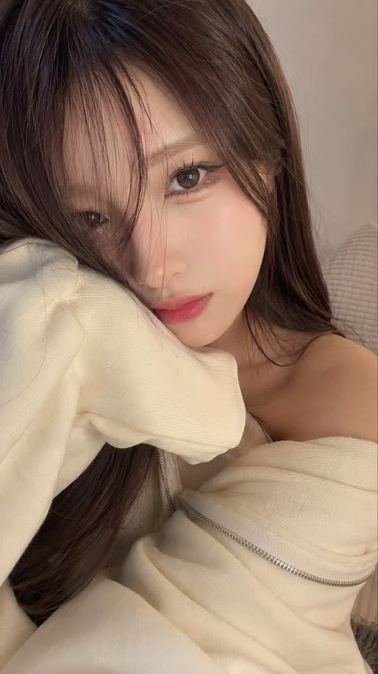</a>

The prompt fixes a tight selfie framing and a specific pose, with the cheek resting on the sleeve. It then layers face details, soft lighting, shallow depth of field and a 9:16 ratio so the result reads as a real webcam selfie.

GPT Image 2 · Text-to-image · Source: [@MissDelulu9 on X](https://x.com/MissDelulu9/status/2067555456688791598) · 996 likes on 2026-10-29

[`selfie`](tags.md#tag-selfie) [`portrait`](tags.md#tag-portrait) [`cozy`](tags.md#tag-cozy) [`shallow-depth-of-field`](tags.md#tag-shallow-depth-of-field) [`photorealistic`](tags.md#tag-photorealistic)

<details><summary><b>Prompt</b></summary>

```text
Photorealistic close-up selfie of an adorable young woman, face filling most of the frame, head slightly tilted with cheek resting inside a cozy cream oversized hoodie sleeve. Long silky hair with soft curtain bangs covering one eye, big expressive eyes with winged eyeliner, fluffy lashes, natural glowing skin, dusty pink lips, gentle pout, sweet and cute expression.

Hoodie slipping off one shoulder, visible collarbone. Warm indoor lighting, soft beige-gray blurred background, shallow depth of field, ultra-detailed eye focus, realistic hair texture, cozy aesthetic, authentic webcam selfie vibe, muted pastel tones, high realism, 9:16 portrait.
```

</details>

<a id="gpt-image-night-tokyo-flash-blur-candid-snapshot"></a>
### Blurred Flash Snapshot on Night Tokyo Sidewalk

<a href="https://x.com/doctorwasif/status/2070011415662842000"></a>

Stacks accidental phone camera cues such as flash during motion, handheld shake, directional blur, blown highlights and heavy noise to fake a raw snapshot. The negative prompt blocks studio lighting, sharp focus and identity matching.

GPT Image 2 · Text-to-image · Source: [@doctorwasif on X](https://x.com/doctorwasif/status/2070011415662842000) · 713 likes on 2026-10-28

[`candid`](tags.md#tag-candid) [`smartphone-photo`](tags.md#tag-smartphone-photo) [`motion-blur`](tags.md#tag-motion-blur) [`night`](tags.md#tag-night) [`flash`](tags.md#tag-flash)

<details><summary><b>Prompt</b></summary>

```text
GPT Image 2

{
  "prompt": "Ultra-realistic candid smartphone photo, 3:4 vertical. Original non-identifiable young woman inspired only by general proportions/vibe. Night Tokyo sidewalk beside white ceramic tile wall. Mid-walk, half-profile, turning back in surprise, hand raised toward lens, shy restrained smile, continuing forward, imperfect framing, nearly exiting frame. Flash fired during motion. Strong handheld shake, heavy directional blur, smeared facial details, blurred hand and hair, ghosting, streaked tile wall, deep darkness around. Harsh flash highlights, blown exposure, hard shadows. Raw accidental snapshot, intrusive, playful, fleeting memory. Extremely noisy, heavily blurred, authentic phone-camera look.",
  "negative_prompt": "identity match, face copy, real person replication, anime, illustration, painting, stylized, studio lighting, beauty lighting, sharp focus, clean face, smooth skin, posed portrait, fashion editorial, cinematic, film still, tripod, professional photography"
}
```

</details>

<a id="gpt-image-spotlight-museum-mural-portrait"></a>
### Spotlit woman before Japanese mural in dark museum

<a href="https://x.com/oggii_0/status/2056647551470997670">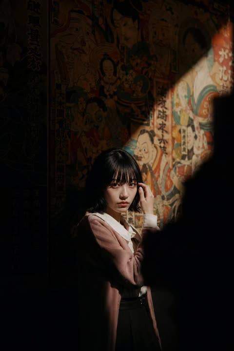</a>

Opens with an identity lock on the reference photo, then specifies a single diagonal spotlight, a 70 degree side profile and foreground shadow framing for a moody museum scene. Separate camera, lighting, vibe and negative prompt blocks pin down Portra film color and keep the result realistic.

GPT Image 2 · Edit · Source: [@oggii_0 on X](https://x.com/oggii_0/status/2056647551470997670) · 672 likes on 2026-10-29

[`spotlight`](tags.md#tag-spotlight) [`museum`](tags.md#tag-museum) [`film-grain`](tags.md#tag-film-grain) [`reference-photo`](tags.md#tag-reference-photo) [`low-light`](tags.md#tag-low-light)

<details><summary><b>Prompt</b></summary>

```text
GPT Image 2 on
@itsPolloAI


Prompt: Use my reference photo to preserve the exact facial features, hairstyle, bangs, facial proportions, skin tone, body posture, and overall silhouette with high identity consistency.

Cinematic portrait of a woman standing alone inside a dark exhibition room. She wears a vintage white shirt layered with a soft pink outer jacket and a black vintage-textured skirt. Minimal makeup. Front-profile pose with her body facing the camera, relaxed posture, one shoulder slightly lowered, hands gently adjusting her hair. Calm, mysterious expression with an intellectual and elegant aura.

She is positioned in the lower center of the frame, surrounded by darkness. A single dramatic diagonal spotlight cuts across the scene from the upper right to the lower left, illuminating only half of her body while the rest fades into shadow. Behind her is a colorful vintage Japanese mural wall filled with retro cartoon illustrations and traditional artistic details.

Foreground shadows naturally frame the composition like torn darkness, creating a moody museum atmosphere with lonely artistic energy and a contemplative cinematic mood. Realistic photography with subtle film grain, analog texture, muted blacks, and vibrant mural accents.

Camera angle: eye-level shot, medium-close portrait framing, subject captured at approximately a 70-degree side profile angle, slight distance from the subject for environmental storytelling, centered cinematic composition.

Camera settings: cinematic low-light photography, shallow depth of field, realistic shadow falloff, Kodak Portra film color grading.

Lighting: harsh focused spotlight from the upper right creating a strong diagonal beam and deep high-contrast shadows, minimal ambient light, rich blacks, soft warm highlights along the face and glasses edges.

Vibe: mysterious, artistic, museum-core aesthetic, intelligent quiet energy, melancholic cinematic atmosphere, indie film still, luxury editorial photography, solitary nighttime mood, understated elegance.

Style: ultra-realistic cinematic photography, analog grain, editorial fashion portrait, natural skin texture, subtle imperfections, realistic color science, masterpiece quality.

Negative prompt: anime, smiling, overexposed lighting, extra limbs, bad anatomy, overly colorful outfit, cyberpunk neon, blurry face, low quality, distorted hands, unrealistic skin, HDR overload, exaggerated makeup, busy composition, duplicate person.
```

</details>

<a id="gpt-image-street-caricature-easel-art-market-portrait"></a>
### Girl beside easel with her street caricature

<a href="https://x.com/Emmma___0/status/2056061305640169643">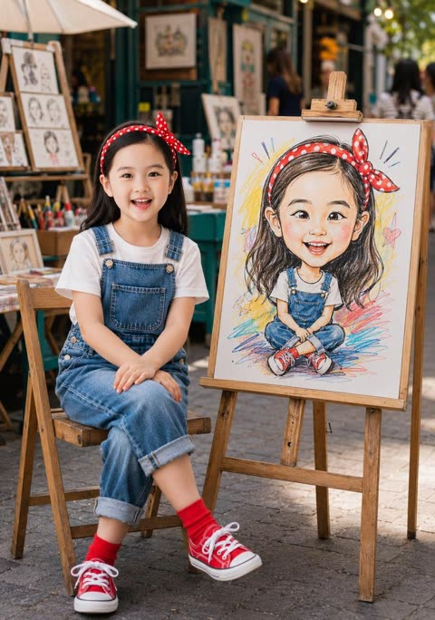</a>

The prompt locks identity to an uploaded portrait, then asks the caricature to exaggerate only a few real facial traits. Long negative lists rule out the default cute chibi face and tongue-out pose, and a shallow depth of field market scene keeps both the person and the drawing readable.

GPT Image 2 · Edit · Source: [@Emmma___0 on X](https://x.com/Emmma___0/status/2056061305640169643) · 538 likes on 2026-10-28

[`caricature`](tags.md#tag-caricature) [`street-art`](tags.md#tag-street-art) [`easel`](tags.md#tag-easel) [`identity-reference`](tags.md#tag-identity-reference) [`lifestyle`](tags.md#tag-lifestyle)

<details><summary><b>Prompt</b></summary>

```text
Use the uploaded portrait as the identity reference for the subject’s face, hairstyle, facial structure, and overall impression.

Create a high-quality lifestyle editorial portrait of the same person sitting outdoors beside a wooden easel displaying a colorful street-style caricature portrait of them.

The real person and the caricature must clearly resemble the same individual.

Scene:
- the person is seated on a simple wooden folding chair
- beside them is a wooden easel holding a large caricature drawing
- the setting is a sentimental urban art market
- include illustration booths, handmade craft stalls, sketch displays, posters, cozy creative shopfronts, and a few softly blurred pedestrians
- lively but not crowded
- bright soft daylight, warm natural tones, shallow depth of field
- realistic photography for the person and environment
- vertical composition showing both the person and the caricature clearly

Subject:
- preserve the uploaded person’s recognizable identity
- natural pose
- calm, relaxed, slightly amused expression
- stylish casual outfit that suits the subject
- clean editorial lifestyle photography
- do not force the same pose or expression for every subject

Caricature direction:
- the drawing on the easel must be a true observational street caricature, not a generic cute cartoon
- the caricature artist should exaggerate the subject’s actual most recognizable facial traits

- analyze the uploaded face and exaggerate only 2–4 distinctive features, such as eye shape, eyebrows, nose, lips, cheeks, jawline, chin, ears, hairstyle, or facial proportions
- each caricature should feel custom-made for that specific person
- avoid using the same default cute face for every person
- avoid generic big eyes plus tongue-out expression
- the caricature should be funny because it captures the person’s unique features, not because it uses a random silly pose

Caricature style:
- oversized head with smaller simplified body
- playful but recognizable facial proportions
- bold hand-drawn marker lines
- quick sketchy pen strokes
- colored pencil texture
- lively street-artist energy
- humorous but flattering
- witty, expressive, and personality-driven
- charming handmade imperfections
- colorful accent doodles may be added, but keep the focus on the face

Expression in the caricature:
- choose a natural funny expression that fits the person’s facial character
- possible expressions: raised eyebrow, shy smile, surprised eyes, confident smirk, awkward polite smile, exaggerated calm face, pouty lips, confused cute face, or gentle blank stare
- the expression should vary depending on the subject
- do not always use a tongue-out face
- do not always use the same wide-eyed cute expression

Caricature canvas:
- large vertical drawing board or canvas on a wooden easel
- the caricature should be clearly visible and occupy a major part of the image
- it should immediately read as a funny street caricature
- it should be more exaggerated than a portrait sketch
- it should not look like a realistic fashion illustration
- it should not look like a polished beauty drawing

Important:
- the caricature must be custom to the uploaded person
- preserve recognizable identity through the exaggerated features
- prioritize personality, likeness, and humor over generic cuteness
- make the caricature feel like a real street artist observed the person and drew a witty exaggerated version

Negative prompt:
- no generic cute chibi face
- no repeated default caricature face
- no tongue-out pose
- no identical silly expression for every subject
- no random anime expression
- no realistic portrait sketch
- no polished fashion illustration
- no beauty sketch
- no weak exaggeration
- no scary grotesque distortion
- no ugly horror exaggeration
- no distorted anatomy of the real person
- no extra fingers
- no badly drawn hands
- no messy crowded background
- no text
- no watermark
- no Eiffel Tower
- no famous landmarks.
```

</details>

<a id="gpt-image-crystal-number-birthday-poster-child"></a>
### Crystal glass number birthday poster with child

<a href="https://x.com/MahnoorAi12/status/2064970191092826474"></a>

Face identity is locked with an explicit consistency instruction, and the body parts that break the number frame give a 3D pop out effect. Material, lighting and typography blocks are written separately, with a negative prompt aimed at face drift and extra limbs. The age and name are bracketed slots to swap.

GPT Image 2 · Edit · Source: [@MahnoorAi12 on X](https://x.com/MahnoorAi12/status/2064970191092826474) · 482 likes on 2026-10-29

[`birthday`](tags.md#tag-birthday) [`crystal-glass`](tags.md#tag-crystal-glass) [`face-consistency`](tags.md#tag-face-consistency) [`pop-out`](tags.md#tag-pop-out) [`pastel`](tags.md#tag-pastel)

<details><summary><b>Prompt</b></summary>

```text
:::writing{variant="document" id="58372"} Professional luxury birthday poster, 3:4 portrait composition, ultra high-end studio photography aesthetic, premium off-white textured paper wall background with subtle grain and depth.
A giant luxury crystal-glass number [AGE] is precisely carved into the wall with realistic thickness, beveled edges, transparent glass material, sparkling reflections, crystal highlights, light refractions, and deep inner shadows creating dramatic 3D depth.
Inside the number: elegant pastel pink balloons, premium white roses, luxury flower bouquets, soft floating sparkles, delicate crystal butterflies, dreamy magical atmosphere, clean minimal styling, high-end editorial design.
A happy [AGE]-year-old child with EXACT facial identity preserved from the uploaded reference image. Identical facial features, identical eyes, nose, lips, face shape, skin tone, hairstyle, expression style, and overall appearance. Face consistency is the highest priority.
Wearing a milky white T-shirt and premium pastel pink denim overalls with realistic fabric texture and luxury styling.
The child's head, shoulders, one hand, and one foot extend outside the number frame, creating an ultra-realistic 3D pop-out effect with accurate perspective, natural depth, realistic shadows, and seamless integration between foreground and background.
Warm cinematic golden sunlight entering from one side, soft rim lighting, realistic skin texture, studio-quality photography lighting, natural shadows, luxury portrait lighting, shallow depth of field.
Elegant typography integrated directly onto the wall:
[Ayan]
CHAPTER [2]
[AGE] YEARS OF MAGIC AND WONDER
Minimal luxury editorial layout, Vogue magazine cover style, premium birthday campaign photography, award-winning composition, soft contrast, natural pastel colors, crystal reflections, ultra-sharp focus, photorealistic rendering, masterpiece quality, luxury realism.
Negative Prompt: different face, altered facial features, face swap, wrong child, duplicate body parts, extra fingers, extra limbs, deformed hands, distorted face, crossed eyes, blurry face, low quality, AI artifacts, text errors, watermark, logo, bad anatomy, oversaturated colors, cropped head, unrealistic skin, poor lighting.
8K ultra-detailed, hyper-realistic, premium luxury birthday poster. :::
Sab se important improvement ye hai:
"EXACT facial identity preserved from the uploaded reference image" aur "Face consistency is the highest priority"
```

</details>

<a id="nano-banana-cobalt-ring-fashion-editorial"></a>
### Platinum bob model in cobalt circular opening

<a href="https://x.com/Emmma___0/status/2109146295252459682"></a>

The prompt is split into labeled blocks for scene, outfit, pose, lighting, palette and photography style. Naming a lens, a medium-format look and a cool-versus-warm light split keeps the high-end editorial feel consistent.

Nano Banana 2.1 · Text-to-image · Source: [@Emmma___0 on X](https://x.com/Emmma___0/status/2109146295252459682) · 370 likes on 2026-10-27

[`fashion-editorial`](tags.md#tag-fashion-editorial) [`architecture`](tags.md#tag-architecture) [`cobalt-blue`](tags.md#tag-cobalt-blue) [`studio-portrait`](tags.md#tag-studio-portrait) [`minimalist`](tags.md#tag-minimalist)

<details><summary><b>Prompt</b></summary>

```text
Create an ultra-realistic, high-end fashion editorial photoshoot featuring a beautiful young adult woman with short, tousled platinum-blonde bob hair, delicate facial features, fair skin, natural rosy lips, light-colored eyes, and a calm, confident expression.

Scene and Environment: A futuristic minimalist architectural studio featuring a massive sculptural circular opening with thick, smooth, curved white walls. The interior of the circular structure is a rich cobalt-blue or vibrant cyan-blue, creating a striking contrast against the white architectural frame. Clean geometric shapes, curved surfaces, and a contemporary art-gallery aesthetic.

Outfit and Styling: The model wears a sophisticated, oversized black knit sweater or elegant black long-sleeved top paired with tailored black or ivory trousers. Minimal makeup, natural skin texture, understated accessories, and effortless luxury styling.

Pose and Composition: The model poses naturally within and around the giant circular opening. Create a series of artistic editorial poses: a close-up portrait leaning forward through the circular frame, a full-body seated pose inside the sculptural ring with one knee raised, and a standing or seated three-quarter portrait with one hand resting on the curved white surface. Relaxed hands, graceful posture, elongated silhouette, and direct eye contact with the camera.

Lighting: Soft natural daylight entering from one side, creating beautiful directional highlights on the platinum hair, subtle shadows across the face, realistic skin tones, and soft gradients on the white architectural surfaces. Cinematic interplay between cool blue ambient light and warm sunlight.

Color Palette: Vivid cobalt blue, turquoise, icy cyan, pure white, deep black, and platinum blonde. Clean, cool-toned color grading with balanced highlights and rich shadows.

Photography Style: Luxury fashion magazine editorial, contemporary avant-garde photography, minimalist Scandinavian design, architectural fashion campaign, medium-format camera aesthetics, 85mm portrait lens, subtle depth of field, precise focus on the eyes, realistic hair strands, detailed knit fabric, natural skin texture, sophisticated framing, and premium commercial photography quality.

Image Quality: Photorealistic, ultra-detailed, 8K appearance, professional art direction, anatomically accurate hands, realistic proportions, elegant negative space, clean architectural geometry, natural facial expression, crisp details, refined composition, no artificial-looking skin, no excessive retouching.

Vertical portrait composition, 2:3 aspect ratio.
```

</details>

<a id="nano-banana-seaside-wind-triptych-portrait"></a>
### Windy seaside triptych portrait with seagulls

<a href="https://x.com/rovvmut_/status/2028344848517062936">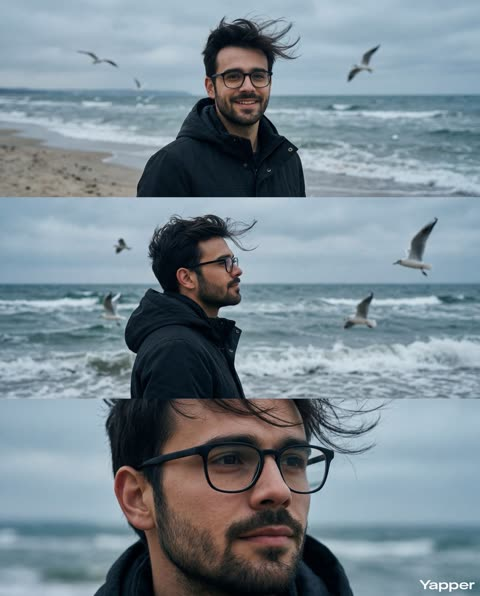</a>

The prompt locks identity to the uploaded photo, then defines each frame by shot size: wide, side medium, close-up. A shared scene, lens, light and grading spec keeps the three frames consistent.

Nano Banana 2 · Edit · Source: [@rovvmut_ on X](https://x.com/rovvmut_/status/2028344848517062936) · 352 likes on 2026-10-28

[`triptych`](tags.md#tag-triptych) [`identity-reference`](tags.md#tag-identity-reference) [`seaside`](tags.md#tag-seaside) [`cinematic-portrait`](tags.md#tag-cinematic-portrait) [`overcast-light`](tags.md#tag-overcast-light)

<details><summary><b>Prompt</b></summary>

```text
Google Nano Banana 2 on Yapper

Prompt: Use the uploaded photo as the exact identity reference. Keep the same person, the same face, the same facial features, proportions, and natural expression.
Create a photorealistic cinematic triptych portrait, a three-frame composition combined into one image.
Scene: a windy seaside with a cold sea, overcast sky, flying seagulls, strong ocean wind, and a vivid, alive atmosphere.
Frame 1 (top): wide cinematic shot. The person stands by the sea, smiling naturally. Their hair is blowing in the wind. Seagulls are flying in the background.
Frame 2 (middle): medium shot from behind or from the side. The person is looking at the sea. Their coat and hair are moving in the wind. Seagulls fly nearby.
Frame 3 (bottom): close-up emotional portrait. Wind in the hair, natural skin texture, thoughtful gaze, cinematic mood.
Style: real photography, cinematic lifestyle portrait, documentary fashion photography.
Lighting: natural overcast daylight, soft shadows, cold seaside tones.
Camera: full-frame DSLR look, 85mm lens aesthetic, shallow depth of field.
Color grading: muted cinematic colors, cool palette, film-like mood.
Ultra photorealistic, natural skin texture, real moment. No illustration, no CGI. No text, no logos, no watermark.
```

</details>

<a id="gpt-image-tokyo-night-flash-blur-snapshot"></a>
### Blurry flash snapshot of woman waving on Tokyo street

<a href="https://x.com/MissDelulu9/status/2070345476189336033"></a>

Describes a flawed phone photo on purpose: flash fired mid motion, handheld shake, ghosting, blown highlights and imperfect framing. The negative prompt rules out studio lighting, sharp focus and polished portrait looks, so the result reads as an accidental snapshot.

GPT Image 2 · Text-to-image · Source: [@MissDelulu9 on X](https://x.com/MissDelulu9/status/2070345476189336033) · 344 likes on 2026-10-29

[`candid`](tags.md#tag-candid) [`smartphone-photo`](tags.md#tag-smartphone-photo) [`motion-blur`](tags.md#tag-motion-blur) [`flash`](tags.md#tag-flash) [`night`](tags.md#tag-night)

<details><summary><b>Prompt</b></summary>

```text
Ultra-realistic candid smartphone photo, 3:4 vertical. Original non-identifiable young woman on a Tokyo sidewalk at night beside a white tiled wall. Mid-walk, half-profile, turning back with a shy smile, hand raised toward the camera. Flash fired during motion, strong handheld shake, heavy motion blur, ghosting, streaked tiles, deep shadows, blown highlights, imperfect framing, raw accidental snapshot, authentic noisy phone-camera aesthetic.

Negative Prompt: identity match, face copy, real person replication, anime, illustration, painting, CGI, stylized, studio lighting, beauty lighting, sharp focus, smooth skin, posed portrait, fashion editorial, cinematic, DSLR, tripod, professional photography
```

</details>

<a id="gpt-image-dusk-film-portrait"></a>
### Low-angle dusk portrait with film grain

<a href="https://x.com/chatgptpaglu/status/2105219509791678731"></a>

Under 600 characters. Camera angle, clothing detail, one light source, one film look.

GPT Image 2.5 · Text-to-image · Source: [@chatgptpaglu on X](https://x.com/chatgptpaglu/status/2105219509791678731) · 318 likes on 2026-10-27

[`portrait`](tags.md#tag-portrait) [`film-grain`](tags.md#tag-film-grain) [`golden-hour`](tags.md#tag-golden-hour)

<details><summary><b>Prompt</b></summary>

```text
A low-angle, close-up photograph capturing a young woman with wavy brown hair outdoors at dusk. She is wearing a grey cropped t-shirt with a blue and white graphic text that reads 'DESTINED' above 'SET 1958' and black denim bottoms. Her head is tilted, and she is looking directly into the camera lens. The dark blue evening sky serves as the background, with silhouetted tree branches visible at the bottom of the frame. Strong flash lighting is directed from the front, illuminating her face and highlighting strands of her hair. The composition has a grainy film photography aesthetic.
```

</details>

<a id="gpt-image-wine-bar-ugc-color-reference"></a>
### Woman in brown leather jacket at wine bar

<a href="https://x.com/Mho_23/status/2097483045221917131"></a>

A reference photo is first analysed into a detailed JSON of color grading, lighting and exact colors. That JSON plus an attached product image then drives the generation, which avoids the flat AI look and keeps the style consistent.

GPT Image 2.5 · Edit · Source: [@Mho_23 on X](https://x.com/Mho_23/status/2097483045221917131) · 298 likes on 2026-10-27

[`ugc`](tags.md#tag-ugc) [`json-prompt`](tags.md#tag-json-prompt) [`color-grading`](tags.md#tag-color-grading) [`reference-image`](tags.md#tag-reference-image) [`product-photo`](tags.md#tag-product-photo)

<details><summary><b>Prompt</b></summary>

```text
how to generate AI photos that look 100% real with GPT-Image 2.5:

GPT-Image 2.5 looks slightly better than GPT-Image 2, but it still has some of the same characteristics. out of the box, you can still get that noticeable AI look without references, which is why we are going to be using inspiration photos for color grading and creative direction

> find a photo that has the aesthetic you want

> upload that photo into GPT-6 Astra in ChatGPT and ask for this:

“analyze this photo and give me a very detailed json prompt describing its visual style. really make sure to break down the color grading, lighting and all the exact colors in the photo so i can apply that look to my own images”

we’re using GPT-6 Astra here to break down the reference into a detailed prompt instead of trying to describe every little detail ourselves

> take the json prompt Astra gives you and put it into GPT-Image 2.5 on Higgsfield

> upload your product image and prompt: “using this json as reference, generate a person holding my product [attach product image]”

> GPT-Image 2.5 generates the photo with that person holding your product

compare it with a version generated without the reference and look at the difference in the lighting and color grading

> save the generated character photo you’re happy with as your reference

> for future generations, attach the character photo each time and ask it to preserve the same facial features

now you have a reference character you can use across multiple product photos

you can also iterate the base json prompt and chat back and forth with GPT-6 Astra based on what you want, then repeat the same process..

i like this because it gives you much more direction over the color grading instead of leaving everything up to the model

the basic colours and grainy look are some of the things that can make an image feel AI-generated, so pay attention to those when comparing your results

this is how you can start building a library of high quality ugc images around your own products

the json gives GPT-Image 2.5 the lighting and color direction, your character reference helps with consistency, and you control the product placement

once you have that starting point, you can keep creating variations without writing everything from scratch

GPT-Image 2.5 Sunburst & Flare are available on Higgsfield. try this with your own product and reference images there
```
```

</details>

<a id="nano-banana-night-flash-hair-tying-stone-steps"></a>
### Candid night flash photo tying hair on stone steps

<a href="https://x.com/MahiraEhan/status/2107702956258685009">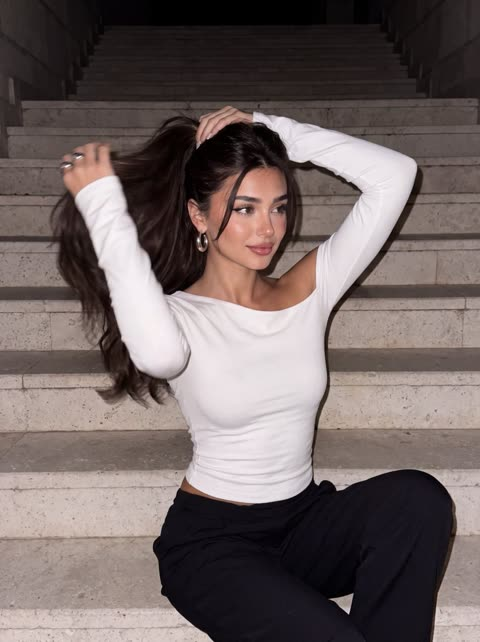</a>

Freezes a mid action moment with directional motion blur on hands and hair while locking the face sharp. Detailed sections for pose, hair, makeup, clothing and flash falloff, plus a closing list of things to avoid, keep the phone snapshot look instead of a studio finish.

Nano Banana 2.1 · Edit · Source: [@MahiraEhan on X](https://x.com/MahiraEhan/status/2107702956258685009) · 296 likes on 2026-10-28

[`candid`](tags.md#tag-candid) [`flash-photography`](tags.md#tag-flash-photography) [`iphone-style`](tags.md#tag-iphone-style) [`night`](tags.md#tag-night) [`portrait`](tags.md#tag-portrait)

<details><summary><b>Prompt</b></summary>

```text
A spontaneous evening shot, a candid moment caught in motion. Taken on an iPhone 17 Pro with flash. The frame should look like a real photo from a personal gallery, not a staged fashion shoot.

POSE: The girl is sitting directly on wide, light-colored stone steps, with her torso slightly turned into a 3/4 angle. One leg is bent closer to her body, while the other rests on the step below.

At the moment of capture, the girl raises both hands to quickly tie her hair into a high, messy ponytail. Her elbows are positioned on opposite sides of her head, with her hands still in motion. Her head is slightly turned to the side, and her gaze is directed past the camera. Her lips are relaxed and slightly parted.

The frame is captured in the exact in-between second — her hair is not fully tied yet, part of it is still held in her hands, and several strands are flying freely near her face. Subtle directional motion blur on the hands, hair ends, and edges of the clothing. Do not blur or deform the facial features; the face must remain clear, recognizable, and true to the original.

HAIR: Very long, thick hair. Most of the hair is being lifted upward and backward by her hands, while the lower section still falls freely over her shoulders and back. A few thin strands have come loose around the temples and cheeks. Do not let them cover the eyes, nose, or lips.

MAKEUP: Expressive modern evening makeup. A thin, elongated black winged eyeliner, voluminous lashes with a fox-eye effect, laminated brows. The lips are outlined with a cool brownish-pink pencil slightly darker than the natural lip tone, with a translucent berry-nude gloss inside. Skin is slightly tanned, fresh, with visible real pores and natural micro-texture.

CLOTHING: A fitted white top with a wide boat neckline, revealing the collarbones and one shoulder. Long sleeves partially cover the hands. Bottoms: loose black low-rise trousers with soft folds.

ACCESSORIES: Large silver hoop earrings, one chunky silver ring. Manicure: short square nails, in a shade matching the top.

ENVIRONMENT: A wide outdoor stone staircase at night. Light-colored natural stone occupies almost the entire background and creates graphic horizontal lines. No restaurants, cars, signs, flowers, or decorative objects. The upper part of the frame gradually falls into darkness.

FLASH PHOTOGRAPHY: Deep night. The only main light source is the direct built-in iPhone flash. It sharply illuminates the face, collarbones, raised hands, top, and nearest steps.

The light falls off quickly into the depth of the staircase. Distant steps fade into gray-black shadow. No soft studio lighting and no evenly illuminated scene.

CAMERA: iPhone 17 Pro, vertical 9:16 format. Medium-close framing, approximately from mid-thighs to the space slightly above the raised hands. The camera is close, positioned slightly above and to the side, as if someone standing nearby suddenly raised their phone and pressed the shutter while the girl was tying her hair.

The girl is not perfectly centered. One elbow is close to the upper edge of the frame, and part of the jacket is naturally cropped at the bottom. Handheld, slightly imperfect framing.

Natural skin, realistic texture of hair, knit fabric, trousers, and stone. Slight digital noise, visible fine film grain, muted nighttime color rendering, deep shadows, subtle vignette, RAW unedited feeling.

Do not use 8K, ultra sharp, HDR, beauty filters, airbrushing, plastic skin, artificial bokeh, studio lighting, perfect symmetry, or a glossy AI look.
```

</details>

<a id="gpt-image-black-blazer-editorial-portrait-reference"></a>
### Chest-up editorial portrait in oversized black blazer

<a href="https://x.com/MissDelulu9/status/2078741062714356031"></a>

Opens with an identity lock on the reference face, then specifies framing, pose, wardrobe and makeup in order. A named camera and lens, soft side sunlight on a white wall, and a closing list of negatives keep the skin realistic and the face unchanged.

GPT Image 2 · Edit · Source: [@MissDelulu9 on X](https://x.com/MissDelulu9/status/2078741062714356031) · 282 likes on 2026-10-29

[`editorial`](tags.md#tag-editorial) [`portrait`](tags.md#tag-portrait) [`black-blazer`](tags.md#tag-black-blazer) [`reference-image`](tags.md#tag-reference-image) [`fashion`](tags.md#tag-fashion)

<details><summary><b>Prompt</b></summary>

```text
Use the girl from the reference image and preserve her face, identity, proportions, and overall appearance exactly. Ultra-realistic 9:16 chest-up editorial portrait. She sits with a slight head tilt, looking directly at the camera with a calm, confident expression. Long straight glossy hair with a clean center part.

Wearing a structured oversized black blazer with broad shoulders. Natural luxury makeup with luminous skin, soft brown eyeshadow, subtle eyeliner, defined lashes, and nude glossy lips. Clean white minimalist background with soft side sunlight creating elegant shadows. Shot on a Sony A7R IV, 85mm f/1.4, shallow depth of field, cinematic lighting, realistic skin texture, 8K RAW, premium fashion editorial, no facial changes, no distortion, no plastic skin, no text, logo, or watermark.
```

</details>

<a id="gpt-image-navy-studio-fashion-portrait-brush-word"></a>
### Navy studio fashion portrait with brush lettering STILL

<a href="https://x.com/ChillaiKalan__/status/2082663616134992145">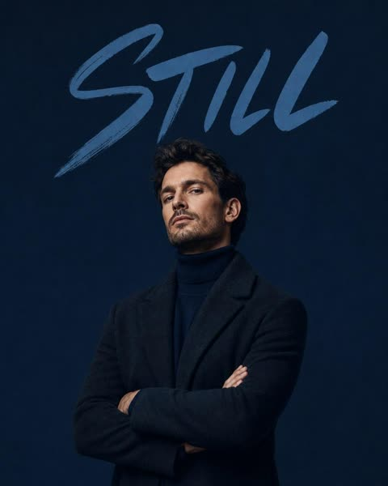</a>

A single color family covers the backdrop, outfit and lettering, so the large brush word sits tone on tone above the subject. Softbox plus rim light, an 85mm eye level frame and a short list of swappable colors, words and outfits make it easy to remix.

GPT Image 2 · Text-to-image · Source: [@ChillaiKalan__ on X](https://x.com/ChillaiKalan__/status/2082663616134992145) · 278 likes on 2026-10-28

[`fashion-portrait`](tags.md#tag-fashion-portrait) [`brush-typography`](tags.md#tag-brush-typography) [`monochrome`](tags.md#tag-monochrome) [`studio-lighting`](tags.md#tag-studio-lighting) [`magazine-cover`](tags.md#tag-magazine-cover)

<details><summary><b>Prompt</b></summary>

```text
low quality, blurry, noisy, overexposed, oversaturated, watermark, logo, extra limbs, distorted face, bad anatomy, cropped head, text artifacts, duplicated body parts, cartoon, illustration, CGI, low resolution.
Suggested settings:
Aspect Ratio: 4:5 (Instagram Portrait)
Model: Flux Dev / Flux Pro / Midjourney v7 / GPT Image
Stylize: Medium
Quality: High
Lighting: Soft studio + subtle rim light
Lens: 85mm portrait lens
To generate different versions, simply change:
Background color: navy, mustard yellow, emerald green, teal, burgundy, charcoal.
Typography word: STILL, UNSTOPPABLE, BREATHE, FORWARD, FEARLESS, FOCUSED, RELENTLESS, LIMITLESS, RISE, ELEVATE.
Outfit: tailored suit, turtleneck, bomber jacket, off-shoulder knit, trench coat, monochrome fashion ensemble.
```

</details>

<a id="nano-banana-overhead-snow-portrait-school-uniform"></a>
### Overhead portrait of a girl lying in snow

<a href="https://x.com/VibeEverything/status/2113256906294796645">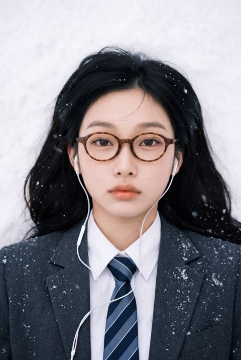</a>

A JSON prompt locks identity to the reference photo, then specifies camera angle, lens, focus, pose, outfit and lighting as separate fields. Naming overcast light, snowflake details and a negative prompt against face changes keeps the likeness and the cold, quiet mood.

Nano Banana 2.1 · Edit · Source: [@VibeEverything on X](https://x.com/VibeEverything/status/2113256906294796645) · 275 likes on 2026-10-28

[`portrait`](tags.md#tag-portrait) [`snow`](tags.md#tag-snow) [`school-uniform`](tags.md#tag-school-uniform) [`overhead`](tags.md#tag-overhead) [`json-prompt`](tags.md#tag-json-prompt)

<details><summary><b>Prompt</b></summary>

```text
{
  "reference_image": {
    "identity_preservation": "STRICT — The person's identity from the reference image must be preserved exactly. Keep facial structure, face shape, eye shape, nose, lips, skin tone, freckles/skin texture, and overall likeness identical. Do not alter, beautify, age, or stylize the face.",
    "use_reference_for": ["face", "hairstyle", "overall likeness"]
  },
  "image_type": "photorealistic portrait photograph",
  "aspect_ratio": "2:3 (vertical)",
  "camera": {
    "angle": "top-down overhead shot, camera directly above the subject",
    "framing": "close-up to medium close-up, head to upper chest",
    "lens": "85mm portrait lens look",
    "depth_of_field": "shallow, face in sharp focus",
    "focus": "eyes"
  },
  "subject": {
    "pose": "lying on her back in fresh snow, head slightly tilted, relaxed and calm",
    "gaze": "looking directly into the camera lens, eye contact with the viewer",
    "expression": "calm, dreamy, slightly melancholic, lips gently closed",
    "hair": {
      "color": "black",
      "length": "long",
      "style": "loose, fanned out across the snow, a few strands across the face, snowflakes caught in the hair"
    },
    "accessories": [
      "round tortoiseshell-frame glasses",
      "white wired earphones in both ears, cable running down over the chest"
    ],
    "makeup": "natural, minimal, soft coral lips"
  },
  "outfit": {
    "outerwear": "charcoal school uniform blazer with notched lapels, matte wool texture",
    "shirt": "white collared dress shirt",
    "tie": "navy striped tie with light blue and white diagonal stripes",
    "details": "snowflakes resting on the blazer shoulders and lapels"
  },
  "environment": {
    "setting": "outdoors, lying in a bed of fresh powdery snow",
    "weather": "light snowfall, individual snowflakes visible in the frame",
    "background": "white snow surface filling the background"
  },
  "lighting": {
    "type": "soft diffused natural daylight, overcast",
    "quality": "even, gentle, no harsh shadows",
    "skin_rendering": "natural skin texture, subtle cool tones on skin"
  },
  "color_palette": ["snow white", "charcoal gray", "navy", "black", "warm tortoiseshell brown", "soft coral"],
  "mood": "quiet, cold, cinematic winter, introspective",
  "style": "high-end editorial photography, film-like, realistic detail",
  "negative_prompt": "face alteration, identity change, distorted features, extra fingers, plastic skin, over-smoothing, cartoon, anime, heavy makeup, harsh flash, blurry eyes, looking away from camera"
}
```

</details>

<a id="gpt-image-golden-light-sunglasses-triptych-portrait"></a>
### Golden Light Sunglasses Triptych Fashion Portrait

<a href="https://x.com/noorlewisx/status/2065652906209284292">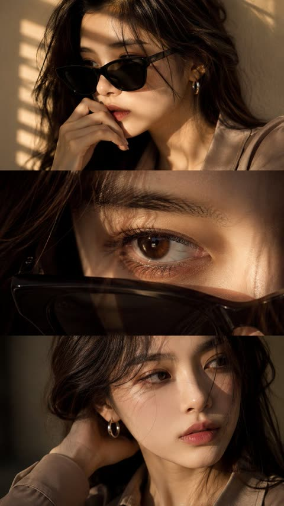</a>

A 9:16 frame split into three panels, each with its own shot size: medium close-up, extreme eye macro, and close-up. A strict identity instruction for the face reference, plus warm window blind light, lens and aperture specs, and a negative list, keeps the look consistent across panels.

GPT Image 2 · Edit · Source: [@noorlewisx on X](https://x.com/noorlewisx/status/2065652906209284292) · 271 likes on 2026-10-28

[`triptych`](tags.md#tag-triptych) [`fashion-editorial`](tags.md#tag-fashion-editorial) [`golden-light`](tags.md#tag-golden-light) [`face-reference`](tags.md#tag-face-reference) [`macro-eye`](tags.md#tag-macro-eye)

<details><summary><b>Prompt</b></summary>

```text
Use the uploaded face reference as a strict identity guide and preserve exact facial features, proportions, skin tone, eye shape, nose, lips, jawline, and overall recognizable identity with very high accuracy. Create an ultra-realistic cinematic high-end fashion editorial vertical triptych portrait in 9:16 format divided into three horizontal panels featuring a young Asian woman with elegant feminine beauty, soft natural styling, luxury aesthetic, silver hoop earring, minimal jewelry, and softly voluminous dark ash-brown wavy hair. Panel 1: medium close-up three-quarter portrait wearing black sunglasses, hand near lips, calm introspective expression, warm golden sunlight through window blinds casting striped shadows, cinematic mood. Panel 2: extreme macro close-up of one eye with sunglasses lowered in foreground, highly detailed iris, lashes, moist reflections, cinematic depth, emotional intimate feel. Panel 3: close-up without sunglasses, head turned toward light, hand behind neck, relaxed lips, soft distant gaze, subtle emotional tension. Outfit: smoky taupe or muted beige tailored silk-viscose blouse, minimal elegant luxury fashion styling, realistic fabric texture. Lighting: warm golden cinematic sunlight, soft indoor blinds shadows, luxury editorial lighting, soft contrast, glowing skin highlights. Camera: DSLR ultra-realism, 85mm lens, f/1.4 shallow depth of field, sharp facial detail, natural skin texture, 8K quality. Color grading: warm golden tones, soft amber highlights, cinematic contrast, filmic glow, luxury finish. Negative: no anime, no CGI, no plastic skin, no over-smoothing, no face change, no distortion, no watermark, no text, no logo.
```

</details>

<a id="gpt-image-sunny-park-bench-hoodie-portrait"></a>
### Woman in Gray Hoodie on Park Bench

<a href="https://x.com/noorlewisx/status/2083775433485754565">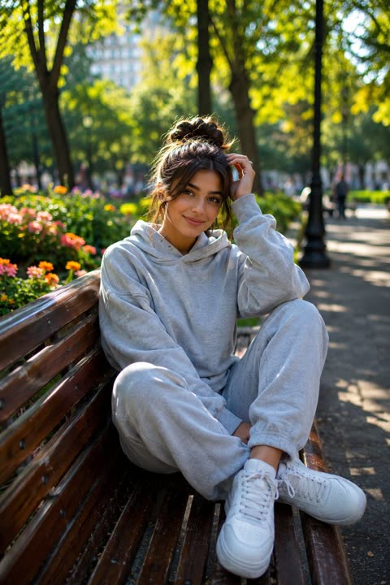</a>

Stacks a clear subject, outfit and pose with lens details (85mm, f/1.8) and backlit sunlight through leaves for creamy bokeh. A reference image locks the face and a camera angle line sets the viewpoint.

GPT Image 2 · Edit · Source: [@noorlewisx on X](https://x.com/noorlewisx/status/2083775433485754565) · 267 likes on 2026-10-29

[`park`](tags.md#tag-park) [`bench`](tags.md#tag-bench) [`lifestyle`](tags.md#tag-lifestyle) [`bokeh`](tags.md#tag-bokeh) [`face-reference`](tags.md#tag-face-reference)

<details><summary><b>Prompt</b></summary>

```text
A stunning young woman sitting casually on a wooden park bench in a lush green city park during a bright sunny afternoon, wearing a light gray oversized hoodie and matching sweatpants, clean white sneakers, messy high bun hairstyle with soft face-framing strands, natural makeup, warm gentle smile, looking directly at the camera, one hand touching her hair, relaxed and confident pose with one leg folded on the bench, cinematic lifestyle photography, vibrant flowers, tall green trees, soft sunlight filtering through leaves, shallow depth of field, creamy bokeh, ultra realistic skin texture, high-end fashion editorial, DSLR photography, 85mm lens, f/1.8, natural lighting, HDR, ultra-detailed, photorealistic, 8K, premium quality.
Same Face as reference image.
Camera Angle.Walk-behind shot.
```

</details>

<a id="gpt-image-monochrome-red-streetwear-bean-bag-portrait"></a>
### Man in all red streetwear on red bean bag

<a href="https://x.com/Xaroon_x/status/2076616202793939072">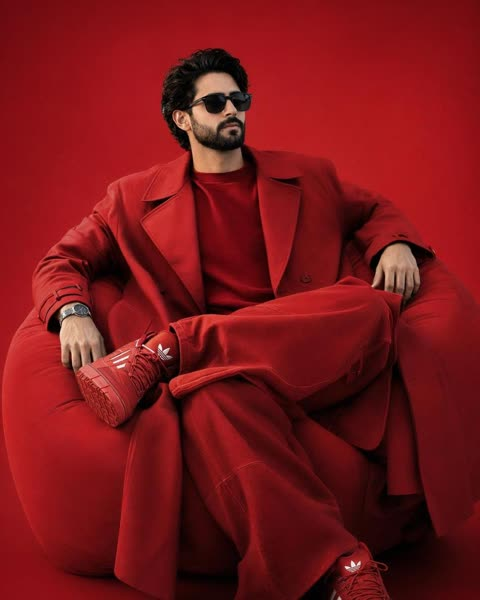</a>

A single color story covers the outfit, the bean bag and the backdrop, so the whole frame reads as one monochrome block. Each garment is named, a campaign editorial look and dramatic studio lighting set the tone, and an explicit instruction to keep the uploaded face unchanged preserves identity.

GPT Image 2 · Edit · Source: [@Xaroon_x on X](https://x.com/Xaroon_x/status/2076616202793939072) · 248 likes on 2026-10-28

[`monochrome`](tags.md#tag-monochrome) [`streetwear`](tags.md#tag-streetwear) [`fashion-editorial`](tags.md#tag-fashion-editorial) [`studio-lighting`](tags.md#tag-studio-lighting) [`face-preservation`](tags.md#tag-face-preservation)

<details><summary><b>Prompt</b></summary>

```text
Hyper-realistic cinematic fashion photoshoot of the uploaded person. Seated on a deep light red bean bag, he wears bold all-red oversized streetwear: trench coat, wide red pants, chunky sneakers, silver watch. Solid red background,. Powerful drip vibes, Adidas campaign editorial look, dramatic studio lighting. Keep my face exactly the same as the uploaded photo. Do not change or edit my face. --ar 4:5 ratio
```

</details>

<a id="nano-banana-half-face-name-portrait"></a>
### Half face, name stacked beside it

<a href="https://x.com/Emmma___0/status/2108777847800426542"></a>

Each letter of the name hides part of the other half of the face. Fill in name, backdrop and lighting.

Nano Banana 2.1 · Edit · Source: [@Emmma___0 on X](https://x.com/Emmma___0/status/2108777847800426542) · 244 likes on 2026-10-27

[`typography`](tags.md#tag-typography) [`studio`](tags.md#tag-studio) [`template`](tags.md#tag-template)

<details><summary><b>Prompt</b></summary>

```text
Transform the uploaded image into a modern studio portrait. Preserve the subject’s identity and features. Show half the face on the left; stack [NAME] vertically on the right, with each letter filled by matching details from the hidden half. Seamless alignment, [BACKGROUND] backdrop, [LIGHTING], modern typography.
```

</details>

<a id="gpt-image-golden-morning-bedroom-portrait"></a>
### Golden morning light portrait in cozy bedroom

<a href="https://x.com/noorlewisx/status/2076916797371228625">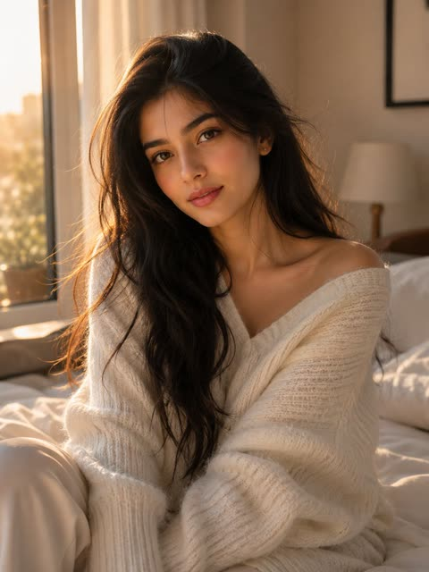</a>

Names the subject, outfit, setting and warm window light, then adds lens terms (85mm, f/1.8) for shallow depth of field and bokeh. A separate negative list targets skin, hands and artifacts.

GPT Image 2 · Text-to-image · Source: [@noorlewisx on X](https://x.com/noorlewisx/status/2076916797371228625) · 239 likes on 2026-10-28

[`portrait`](tags.md#tag-portrait) [`golden-hour`](tags.md#tag-golden-hour) [`photorealistic`](tags.md#tag-photorealistic) [`bedroom`](tags.md#tag-bedroom) [`negative-prompt`](tags.md#tag-negative-prompt)

<details><summary><b>Prompt</b></summary>

```text
low quality, blurry, cartoon, anime, CGI, unrealistic skin, bad anatomy, extra fingers, extra limbs, deformed face, crossed eyes, watermark, logo, text, noise, artifacts, oversaturated colors, duplicate features, cropped, out of frame, ugly, distorted hands, plastic skin.
```

</details>

<a id="gpt-image-candid-park-portrait-olive-cardigan-burgundy-bag"></a>
### Candid sunlit park portrait in olive cardigan

<a href="https://x.com/Aqsahere_/status/2095351414524608662">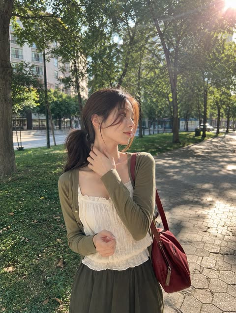</a>

The prompt lists outfit colors and fabrics piece by piece, then fixes the pose, setting and light direction in separate paragraphs. Closing keywords like smartphone photography, film grain, lens flare and 4:5 framing give it a candid, unretouched look.

GPT Image 2 · Text-to-image · Source: [@Aqsahere_ on X](https://x.com/Aqsahere_/status/2095351414524608662) · 233 likes on 2026-10-28

[`candid-portrait`](tags.md#tag-candid-portrait) [`smartphone-photography`](tags.md#tag-smartphone-photography) [`sunlight`](tags.md#tag-sunlight) [`film-grain`](tags.md#tag-film-grain) [`fashion`](tags.md#tag-fashion)

<details><summary><b>Prompt</b></summary>

```text
A photorealistic candid outdoor portrait of a young woman standing in a peaceful urban park on a sunny afternoon. She has long dark-brown hair styled in a loose low ponytail, with wispy face-framing strands gently falling across her face. She gazes softly toward the side with a calm, thoughtful expression.
She wears an olive-green cardigan over a delicate white textured ruffle camisole, paired with a long dark-green skirt. A deep burgundy-red shoulder bag hangs naturally at her side. One hand rests gently near her neck while the other is relaxed in front of her.
She stands beside a paved walkway surrounded by green grass, mature leafy trees, and subtle urban buildings in the background. Strong sunlight filters through the trees, creating beautiful highlights in her hair, soft shadows, and a subtle lens flare in the upper corner.
Natural smartphone photography, candid lifestyle aesthetic, warm sunlight, realistic skin texture, detailed hair strands, authentic fabric textures, soft atmospheric contrast, gentle vintage film grain, muted earthy color palette, shallow depth of field, cinematic natural lighting, peaceful summer mood, highly photorealistic, vertical 4:5 composition.
```

</details>

<a id="gpt-image-golden-hour-newsstand-editorial-portrait"></a>
### Blonde woman on folding chair at newsstand

<a href="https://x.com/SadiaMalik182/status/2081611030019572178">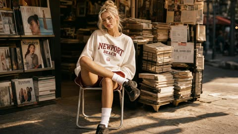</a>

A structured JSON prompt splits style, camera, location, subject, wardrobe, pose and lighting into labelled blocks, so each element is controlled separately. Real camera and lens settings plus Kodak Portra grading anchor the golden hour editorial look.

GPT Image 2 · Text-to-image · Source: [@SadiaMalik182 on X](https://x.com/SadiaMalik182/status/2081611030019572178) · 227 likes on 2026-10-28

[`json-prompt`](tags.md#tag-json-prompt) [`street-fashion`](tags.md#tag-street-fashion) [`golden-hour`](tags.md#tag-golden-hour) [`editorial`](tags.md#tag-editorial) [`newsstand`](tags.md#tag-newsstand)

<details><summary><b>Prompt</b></summary>

```text
"category": "Luxury Street Fashion Editorial Portrait",
  "style": {
    "genre": "Editorial Lifestyle Photography",
    "aesthetic": "Vintage Newsstand × Vogue Editorial × European Street Style × Pinterest Aesthetic × Gen-Z Fashion",
    "quality": "Ultra Photorealistic",
    "resolution": "4096×2304 (4K UHD)",
    "aspect_ratio": "16:9",
    "render_engine": "Octane Render / Unreal Engine 5 / Redshift",
    "editorial_reference": [
      "Vogue",
      "Zara",
      "Urban Outfitters",
      "Free People",
      "COS",
      "Pinterest Editorial"
    ],
    "mood": [
      "Golden Hour",
      "Warm",
      "Relaxed",
      "Vintage",
      "Editorial",
      "Natural",
      "Authentic"
    ]
  },
  "camera": {
    "camera": "Sony A7R V",
    "lens": "85mm f/1.4 GM",
    "orientation": "Landscape",
    "angle": "Eye Level",
    "aperture": "f/2.0",
    "iso": 100,
    "shutter_speed": "1/640s",
    "focus": "Eyes",
    "depth_of_field": "Cinematic Shallow",
    "sharpness": "Ultra Detailed"
  },
  "location": {
    "type": "Vintage Outdoor Newspaper & Magazine Stand",
    "environment": {
      "newsstand": true,
      "magazine_display": true,
      "newspaper_stacks": true,
      "bookstall": true,
      "city_sidewalk": true,
      "urban_news_kiosk": true,
      "authentic_street_environment": true
    }
  },
  "subject": {
    "gender": "Female",
    "age": "Early 20s",
    "appearance": {
      "skin": "Natural Fair Skin",
      "expression": "Calm Editorial Expression",
      "eye_contact": "Direct Camera",
      "makeup": {
        "style": "Natural Minimal",
        "skin_finish": "Soft Matte Glow",
        "lips": "Natural Nude",
        "eyes": "Soft Brown"
      }
    },
    "hair": {
      "style": "Messy Blonde Bun or Short Wavy Blonde Hair",
      "movement": "Light Breeze"
    }
  },
  "wardrobe": {
    "top": {
      "type": "Oversized White Graphic Sweatshirt",
      "fabric": "Premium Cotton",
      "fit": "Relaxed Oversized"
    },
    "bottom": {
      "type": "Red Athletic Shorts"
    },
    "socks": "White Ribbed Crew Socks",
    "shoes": "Black Chunky Sneakers"
  },
  "pose": {
    "position": "Relaxed Sitting On Folding Chair",
    "body_angle": "Three Quarter",
    "editorial": true
  },
  "lighting": {
    "time": "Golden Hour",
    "key_light": "Warm Natural Sunlight",
    "rim_light": "Golden Rim Light",
    "cinematic": true
  },
  "post_processing": {
    "hdr": true,
    "ray_tracing": true,
    "global_illumination": true,
    "clarity": "Ultra",
    "color_grading": "Kodak Portra 400",
    "film_grain": "Subtle"
  },
  "negative_prompt": [
    "low quality",
    "blur",
    "noise",
    "bad anatomy",
    "extra fingers",
    "duplicate person",
    "watermark",
    "logo",
    "text artifacts",
    "CGI look",
    "cartoon",
    "anime"
  ]
}
```

</details>

<a id="gpt-image-selfie-chibi-painting-cheek-brush"></a>
### Selfie with chibi self painting his cheek

<a href="https://x.com/AiWithTariq/status/2098783770513948875">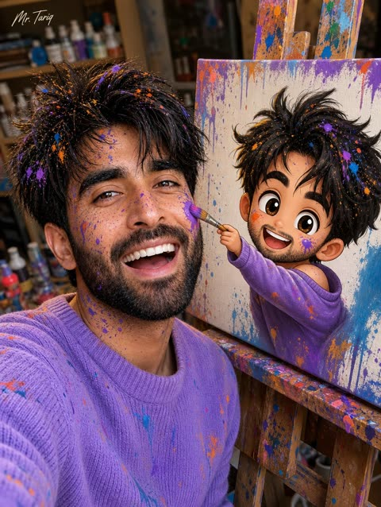</a>

The prompt splits the scene into labeled blocks for hair, face, outfit, concept, canvas character, background, style and camera. This lets a real selfie and a 3D chibi share one frame. Repeating the paint splatter colors across both figures ties the real and painted worlds together.

GPT Image 2.5 · Edit · Source: [@AiWithTariq on X](https://x.com/AiWithTariq/status/2098783770513948875) · 219 likes on 2026-10-28

[`selfie`](tags.md#tag-selfie) [`chibi`](tags.md#tag-chibi) [`paint-splatter`](tags.md#tag-paint-splatter) [`fourth-wall`](tags.md#tag-fourth-wall) [`art-studio`](tags.md#tag-art-studio)

<details><summary><b>Prompt</b></summary>

```text
Study the uploaded photo's facial features and use them as inspiration to create a fun selfie-style photo of a similar-looking young man with a creative cartoon canvas twist.
Hair: Messy, tousled dark hair with paint splatters scattered across the hair and face, light stubble beard.
Face/Skin: Face and skin splattered with colorful paint speckles (purple, orange, blue), big laughing open-mouth smile, playful joyful expression, no jewelry, no tattoos.
Outfit: Purple/lavender knit sweater, paint-splattered casual look.
Concept: Taking a close-up selfie next to an easel canvas, where a cute chibi cartoon version of himself is painted on the canvas — the illustrated cartoon character reaching out of the canvas holding a paintbrush and playfully painting/touching the real man's cheek with colorful paint, breaking the fourth wall between reality and illustration.
Chibi cartoon (on canvas): Same messy hair and paint splatters, big expressive cartoon eyes, cheerful smile, wearing a purple off-shoulder top, leaning out of the canvas frame with one arm extended holding the paintbrush.
Background: Cozy art studio setting, softly blurred art supplies, paint bottles, and shelves in the background, warm natural lighting, wooden easel with visible paint-splattered edges.
Art style: Photorealistic selfie photography blended with vibrant 3D chibi cartoon illustration, playful colorful paint-splatter texture throughout, high detail, fun energetic composition.
Camera angle: Close-up selfie angle, slightly wide shot capturing both the real face and the canvas painting.
Text overlay:
Small stylish signature-style text in the top corner: "Mr. Tariq"
```

</details>

<a id="gpt-image-korean-cafe-mirror-selfie-portra-film"></a>
### Korean Cafe Courtyard Mirror Selfie on Film

<a href="https://x.com/noorlewisx/status/2064996549747458319">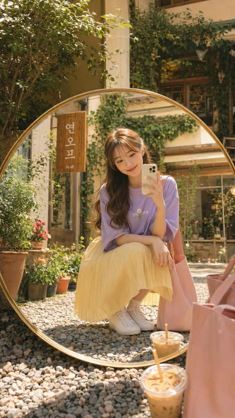</a>

Labeled sections for appearance, outfit, pose, foreground, midground and background build clear depth layers around the round mirror. Film stock, lens and aperture (Portra 400, 85mm, f/1.8) set the warm soft look, and a negative prompt keeps it photographic.

GPT Image 2 · Text-to-image · Source: [@noorlewisx on X](https://x.com/noorlewisx/status/2064996549747458319) · 214 likes on 2026-10-28

[`film-photography`](tags.md#tag-film-photography) [`mirror-selfie`](tags.md#tag-mirror-selfie) [`korean-cafe`](tags.md#tag-korean-cafe) [`portra-400`](tags.md#tag-portra-400) [`lifestyle`](tags.md#tag-lifestyle)

<details><summary><b>Prompt</b></summary>

```text
Hyper-realistic Kodak Portra 400 film photograph, dreamy soft aesthetic, warm natural sunlight, nostalgic Korean café atmosphere, vertical 9:16 composition.

A beautiful young woman crouching gracefully in front of a large round gold-framed mirror placed on a pebble-covered courtyard, taking a mirror selfie with her smartphone. She looks at the screen with a gentle smile and relaxed expression.

Appearance: Fair glowing skin, soft natural makeup, subtle peach blush, glossy pink lips, delicate eyeliner, bright expressive eyes. Long light-brown wavy hair with soft curtain bangs and romantic curls cascading over her shoulders.

Outfit: Oversized pastel lavender T-shirt featuring a small daisy illustration and subtle Korean typography, high-waisted butter-yellow pleated midi skirt, white crew socks, clean white canvas sneakers, soft pink shoulder tote bag.

Pose: Comfortable squat with knees together, one arm resting naturally on her leg while holding her phone. Relaxed shoulders, candid lifestyle photography feel, effortless charm.

Foreground: Two transparent iced latte cups with visible ice cubes, paper straws, soft condensation. Elegant pink tote bags beside the mirror. Creamy foreground bokeh and dreamy highlights.

Midground: Large circular gold-framed mirror reflecting the woman perfectly. Detailed gravel stones, warm sunlight, realistic reflections, soft shadows, potted plants surrounding the mirror, cinematic depth.

Background: Aesthetic Korean-style café exterior with cream-colored walls, wooden-framed windows, Korean signboard, lush ivy vines, flowers, potted plants, and a quiet pedestrian alley. Warm golden-hour sunlight filtering through trees, dreamy foliage bokeh.

Photography Style: Kodak Portra 400, warm pastel tones, soft focus, creamy highlights, realistic skin texture, subtle film grain, shallow depth of field, environmental portrait, HDR, photorealistic, magazine-quality editorial photography, 85mm lens, f/1.8, atmospheric depth, elegant composition, foreground-midground-background layering.

Negative Prompt: anime, cartoon, illustration, CGI, 3D render, painting, blurry face, distorted hands, extra fingers, duplicate objects, unrealistic proportions, overprocessed skin, harsh shadows, oversaturated colors, artificial lighting, watermark, logo, text, cropped subject, low quality.
```

</details>

<a id="nano-banana-bw-studio-portrait-white-shirt-contemplative-pose"></a>
### Black and white studio portrait in white shirt

<a href="https://x.com/weiinberg/status/2079797303280591190">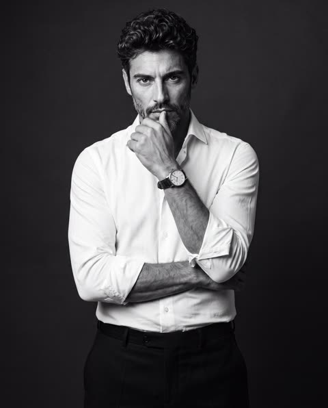</a>

Starts from an uploaded photo and locks identity, hairstyle and facial hair before describing wardrobe and a specific hand to chin pose. Names the light direction, a seamless charcoal backdrop and an 85mm shallow depth of field to get an editorial monochrome look.

Nano Banana 2 · Edit · Source: [@weiinberg on X](https://x.com/weiinberg/status/2079797303280591190) · 211 likes on 2026-10-29

[`black-and-white`](tags.md#tag-black-and-white) [`studio-portrait`](tags.md#tag-studio-portrait) [`identity-preserving`](tags.md#tag-identity-preserving) [`editorial`](tags.md#tag-editorial) [`85mm`](tags.md#tag-85mm)

<details><summary><b>Prompt</b></summary>

```text
Nano Banana 2 on OpenArt.

Prompt: Create a premium black-and-white studio portrait of the uploaded man, preserving his recognizable facial identity, natural hairstyle, skin texture, and existing facial hair. Frame him from the upper thighs upward, standing confidently, subtle body tilt and facing the camera with an intense, sharp expression.Dress him in a crisp fitted white dress shirt with the collar slightly open and the sleeves neatly rolled to the elbows, paired with tailored black trousers. Pose him with one arm folded horizontally across his waist, supporting the opposite elbow, while the raised hand rests naturally against his lips or chin in a contemplative gesture. Add a classic round analog wristwatch with a dark leather strap on the raised wrist.
Place him against a clean, seamless charcoal-black studio background with a subtle soft gradient behind the upper body and no visible corners or props. Use soft directional light from the upper camera-right side, creating sculpted highlights on one side of the face and shirt while the opposite side falls into rich shadow. Keep strong subject-to-background separation, balanced contrast, crisp focus on the eyes, face, hands, and watch, realistic fabric folds, natural anatomy, and refined monochrome editorial toning. Shot with an 85mm portrait lens, shallow depth of field, high-end professional photography, 4:5 aspect ratio.
```

</details>

<a id="nano-banana-hibiscus-film-portrait"></a>
### Vintage film portrait framed by pink hibiscus flowers

<a href="https://x.com/ZaraIrahh/status/2107705937012142393"></a>

Shooting through foreground petals at eye level builds a natural floral frame, while hard rules like side part, one hand and head to chest crop keep the composition fixed. Film grain, halation and light leaks plus a long negative list steer the result away from a polished studio look.

Nano Banana 2.1 · Text-to-image · Source: [@ZaraIrahh on X](https://x.com/ZaraIrahh/status/2107705937012142393) · 206 likes on 2026-10-28

[`portrait`](tags.md#tag-portrait) [`film-look`](tags.md#tag-film-look) [`floral`](tags.md#tag-floral) [`photorealistic`](tags.md#tag-photorealistic) [`golden-light`](tags.md#tag-golden-light)

<details><summary><b>Prompt</b></summary>

```text
Create a photorealistic portrait of her in a refined side-profile-inspired three-quarter angle, with her head naturally turned toward the camera and making direct eye contact. Clearly defined SIDE PART — NEVER a center or middle part.

She has extremely long, rich Dark Mocha Mousse curly hair, dramatically moved by a strong natural breeze, with realistic flyaways and loose strands. No ribbons, bows, headwear, hats, or hair accessories.

Soft-glam Korean-inspired makeup: visible natural pores, luminous realistic skin texture, rosy blush, subtle brown eyeliner, softly defined eyes, rosy gradient lips, and nude espresso nail art. She wears a magenta-soft-purple thin-strap mini dress with a subtle heart-shaped neckline barely visible at the chest. Gold fairy-wing pendant necklace with matching earrings.

ONE HAND is naturally raised in front of her face, gently pushing or clearing a hibiscus flower away from her line of sight. Fingers and joints must be anatomically realistic. Her other hand is completely outside the frame.

Expression: calm, intimate, slightly curious, natural and emotionally subtle.

EYE-LEVEL CAMERA positioned directly among dense blooming soft-pink and white hibiscus flowers, photographing THROUGH the flowers. Foreground petals, leaves, and stems are very close to the lens and naturally overlap the outer edges of the frame, creating an intimate organic floral frame. Flowers must not obscure her eyes or facial features.

NO WIDE VIEW. The subject fills approximately 85–95% of the frame. ONLY HEAD TO CHEST VISIBLE.

VISUAL STYLE:
Warm nostalgic historical-memory aesthetic. Authentic vintage Canon analog-film character, subtle natural film grain, delicate halation, slightly faded tones, gentle light leaks, realistic exposure imperfections, soft natural shadows, authentic raw human skin texture, and warm soft daylight. Strong wind visibly moves the curls and loose strands. Mild natural motion blur ONLY on moving hair and nearby flower petals.

The final image should feel like a candid, emotionally intimate photograph captured on vintage film rather than a polished studio portrait.

NEGATIVE PROMPT:
center part, middle part, ribbons, bows, headwear, hat, full body, waist-down, staircase focus, wide shot, distant subject, excessive background, artificial bokeh, studio lighting, smartphone photography, modern digital DSLR look, CGI, cartoon, anime, illustration, plastic skin, beauty filter, over-retouched skin, excessive facial smoothing, face swap, distorted facial anatomy, unnatural hands, malformed fingers, extra fingers, missing fingers, floating limbs, flower covering face, obscured eyes, closed eyes, facial distortion, unnatural pose, watermark, text, logo.
```

</details>

<a id="gpt-image-golden-morning-sweater-bedroom-portrait"></a>
### Golden morning light portrait in white sweater

<a href="https://x.com/noorlewisx/status/2075833443666309189">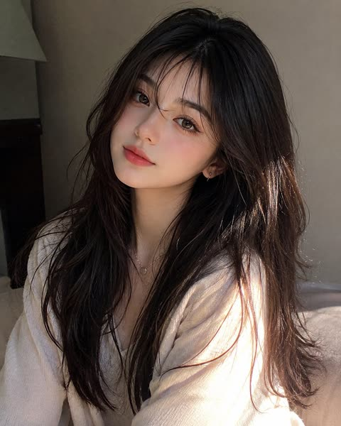</a>

Pairs warm window sunlight with lens details (85mm, f/1.8) for shallow depth of field and soft bokeh. A skin and hair texture cue plus a long negative prompt keep the result photographic.

GPT Image 2 · Text-to-image · Source: [@noorlewisx on X](https://x.com/noorlewisx/status/2075833443666309189) · 204 likes on 2026-10-28

[`portrait`](tags.md#tag-portrait) [`golden-hour`](tags.md#tag-golden-hour) [`window-light`](tags.md#tag-window-light) [`bokeh`](tags.md#tag-bokeh) [`negative-prompt`](tags.md#tag-negative-prompt)

<details><summary><b>Prompt</b></summary>

```text
low quality, blurry, cartoon, anime, CGI, unrealistic skin, bad anatomy, extra fingers, extra limbs, deformed face, crossed eyes, watermark, logo, text, oversaturated colors, noise, artifacts, duplicate features, cropped, out of frame.
```

</details>

<a id="gpt-image-snowy-village-floral-shawl-portrait"></a>
### Snowy Village Portrait in Blue Floral Shawl

<a href="https://x.com/noorlewisx/status/2067526808602542413">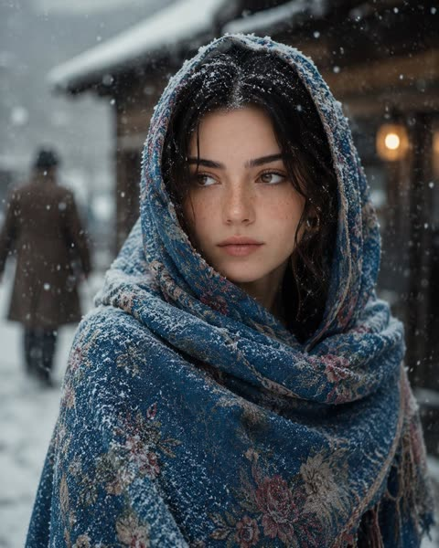</a>

The prompt lists the wardrobe, skin, eyes and expression in order, then sets depth with a blurred cabin and a faint distant figure. Lens and light cues (85mm, shallow depth of field, soft diffused light, muted cool palette) give the cinematic look.

GPT Image 2 · Text-to-image · Source: [@noorlewisx on X](https://x.com/noorlewisx/status/2067526808602542413) · 201 likes on 2026-10-29

[`portrait`](tags.md#tag-portrait) [`winter`](tags.md#tag-winter) [`snow`](tags.md#tag-snow) [`cinematic`](tags.md#tag-cinematic) [`85mm`](tags.md#tag-85mm)

<details><summary><b>Prompt</b></summary>

```text
A cinematic portrait of a young woman standing in a snowy village, softly falling snowflakes surrounding her. She wears a delicate blue floral shawl wrapped around her head and shoulders, dusted with snow. Her skin is fair with a natural glow, soft pink lips, and expressive light eyes looking slightly to the side. Her expression is calm and introspective. The background shows a blurred wooden cabin and a faint figure in the distance,creating depth. Cold winter atmosphere, soft diffused lighting, shallow depth of field, ultra-realistic, highly detailed textures, 85mm lens, bokeh, photorealistic, 8K resolution, muted cool color palette, cinematic mood."
```

</details>

<a id="gpt-image-tokyo-night-flash-candid-snapshot"></a>
### Candid flash snapshot on a rainy Tokyo street

<a href="https://x.com/frametheory058/status/2098413109258207670">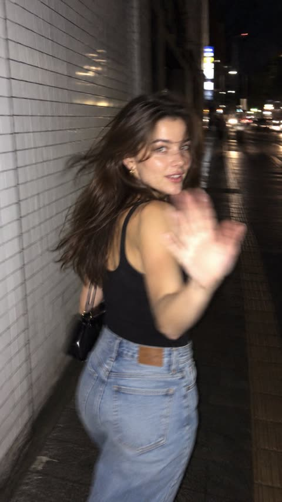</a>

A reference image locks the character's outfit and look across a series, while the prompt specifies smartphone flaws: direct flash, walking camera shake, rolling shutter, soft autofocus and off center framing. A long list of things to avoid, such as studio light, HDR and airbrushed skin, keeps the result from looking staged.

GPT Image 2.5 · Edit · Source: [@frametheory058 on X](https://x.com/frametheory058/status/2098413109258207670) · 191 likes on 2026-10-28

[`smartphone-snapshot`](tags.md#tag-smartphone-snapshot) [`direct-flash`](tags.md#tag-direct-flash) [`night-street`](tags.md#tag-night-street) [`tokyo`](tags.md#tag-tokyo) [`character-consistency`](tags.md#tag-character-consistency)

<details><summary><b>Prompt</b></summary>

```text
Ultra-realistic late-night smartphone snapshot, 9:16 vertical.

Use the reference only to establish the same fictional female character’s overall appearance and continuity. Keep her recognizable across the series with the same dark-brown wavy hair, natural features, black fitted sleeveless tank top, loose high-waisted light-blue jeans, small gold hoop earrings, delicate necklace, white sneakers, and small black shoulder bag.

Scene:
A quiet Tokyo side street late at night after light rain. She walks beside an off-white ceramic-tiled building while distant convenience-store lights, traffic signals, parked bicycles and small Japanese storefronts softly disappear into the darkness. Wet pavement catches scattered reflections.

New candid moment:
Photograph her from a slightly low rear three-quarter angle, about two steps behind her. She has just slowed down and casually turns only her upper body toward the camera while continuing forward. One hand is loosely tucking windblown hair behind her ear while the other hangs naturally beside her bag.

She looks toward the camera from the corner of her eyes with a tiny closed-mouth smile, as though she noticed her friend taking another photo and is trying not to laugh.

No deliberate fashion pose. No exaggerated expression. Her shoulders remain relaxed, hips and legs naturally positioned from walking, with one foot caught halfway through the next step.

Camera:
Modern smartphone rear camera with direct flash. Photographer walking at the same time, creating subtle accidental camera shake. Slight motion blur around her hair, moving leg and fingertips, while her eyes remain just barely readable. Mild rolling-shutter distortion, imperfect autofocus, slight edge softness and realistic digital noise.

Composition should feel accidental: her body sits slightly off-center, a little too much empty darkness on one side, with part of her shoe approaching the bottom edge of frame.

Flash & exposure:
Hard direct phone flash illuminates her face, shoulder, black top and denim while the street behind her falls rapidly into darkness. Slightly overexposed skin highlights, hard natural shadow against the tiled wall, shiny flash reflections on individual hair strands and subtle denim texture. Distant lights bloom and smear naturally.

Aesthetic:
Raw Pinterest night-photo-dump energy. Intimate, youthful, spontaneous and imperfect. It should look like a friend took the photo during a random Tokyo night walk—not a photographer conducting a photoshoot.

Real pores, tiny skin variations, flyaway hairs, natural fabric wrinkles, realistic body proportions and ordinary smartphone processing.

Absolutely no: studio lighting, cinematic teal-orange grading, professional bokeh, fashion-editorial posing, perfect symmetry, airbrushed skin, artificial beauty retouching, HDR look, DSLR sharpness, staged composition, AI-perfect anatomy or polished commercial photography.

The final result should feel like an unexpectedly beautiful photo hidden among 30 messy pictures from the same night.
```

</details>

<a id="nano-banana-pink-picnic-blanket-peony-portrait"></a>
### Pink Picnic Portrait with Peonies and Lemonade

<a href="https://x.com/Just_sharon7/status/2075819429372305722">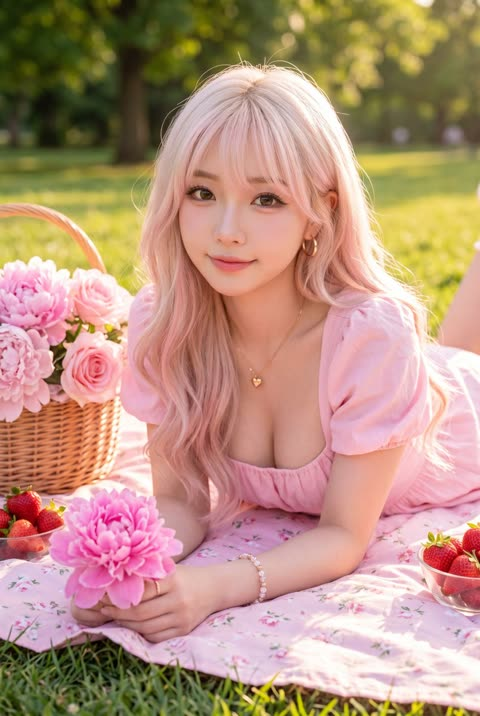</a>

The prompt stacks a single baby pink palette across hair, dress, blanket and flowers, so every element reads as one color story. A top-down view, golden hour light and bokeh keep the park scene soft and dreamy.

Nano Banana 2 · Text-to-image · Source: [@Just_sharon7 on X](https://x.com/Just_sharon7/status/2075819429372305722) · 186 likes on 2026-10-28

[`picnic`](tags.md#tag-picnic) [`pink`](tags.md#tag-pink) [`peony`](tags.md#tag-peony) [`golden-hour`](tags.md#tag-golden-hour) [`top-down`](tags.md#tag-top-down)

<details><summary><b>Prompt</b></summary>

```text
A beautiful young East Asian woman lying on her back on a soft baby pink floral picnic blanket, top-down view, long voluminous wavy platinum blonde hair with baby pink highlights dramatically spread out around her head like a golden-pink halo, soft bangs, fair flawless skin, bright cheerful smile showing perfect white teeth, large expressive brown eyes, wearing a cute baby pink summer dress with puffed short sleeves and square neckline showing cleavage, delicate gold layered necklaces with heart pendant, small gold hoop earrings, sunny outdoor park picnic scene, large vibrant baby pink peonies and roses placed around her, wicker picnic basket in the corner, glass of fresh lemonade with lemon slice nearby, soft golden hour sunlight with gentle pink tones, beautiful natural lighting, bokeh background, highly detailed, photorealistic, cinematic composition, vibrant baby pink color palette, dreamy summer atmosphere.
```

</details>

<a id="gpt-image-realistic-woman-3d-girl-night-park"></a>
### Realistic woman beside 3D animated girl at night

<a href="https://x.com/Alina_with_Ai/status/2102960952266432853">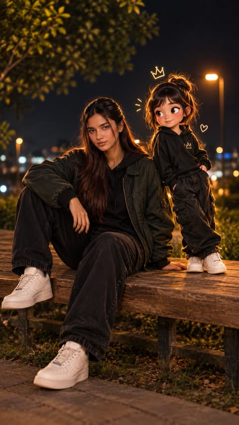</a>

Uses an uploaded photo as the identity reference for the realistic woman, then fixes the 3D girl's outfit, hair and proportions so the two styles blend. A short list of hard constraints on pose, gaze and height difference, plus warm streetlight rim lighting, keeps the mixed realism and animation consistent.

GPT Image 2.5 · Edit · Source: [@Alina_with_Ai on X](https://x.com/Alina_with_Ai/status/2102960952266432853) · 185 likes on 2026-10-28

[`mixed-style`](tags.md#tag-mixed-style) [`3d-character`](tags.md#tag-3d-character) [`night-park`](tags.md#tag-night-park) [`identity-reference`](tags.md#tag-identity-reference) [`golden-light`](tags.md#tag-golden-light)

<details><summary><b>Prompt</b></summary>

```text
Create a single cinematic vertical 9:16 image based closely on the uploaded reference.

Show TWO characters standing side by side at night in a beautiful city park.

The adult woman is the main realistic character. Use my uploaded photo as her identity reference and preserve my facial identity, facial structure, skin tone, and recognizable appearance. She has long dark brown hair and wears masculine oversized streetwear: a dark olive/black oversized utility jacket, black oversized hoodie, extremely loose black cargo pants, and white chunky sneakers.

The woman is standing naturally and looking DOWN toward the little girl with a warm, genuine smile. Her body is slightly turned toward the little girl. One hand is casually inside her jacket/pants pocket, while her other hand is raised and her index finger is POINTING toward the little girl, as if proudly introducing or showing her. Make the pointing gesture very clear and natural.

Beside her stands an adorable small 3D animated girl. Keep the little girl extremely cute: oversized expressive brown eyes, rosy cheeks, tiny face, brown hair in a messy high bun with loose strands, black oversized hoodie with a small crown emblem, loose black cargo pants, and white chunky sneakers. She is standing upright and looking up at the woman with a sweet playful smile.

IMPORTANT:
- Both characters must be FULLY STANDING.
- One single image only, NOT a collage or split screen.
- The woman must be pointing toward the little girl.
- The woman must be looking at the little girl and smiling.
- The little girl must be looking up at the woman.
- Keep a clear height difference between them.
- Do not make the little girl photorealistic; keep her cute high-quality 3D animated appearance.
- Do not change the little girl's outfit, hairstyle, facial style, or body proportions.

Set them on a nighttime park walkway with leafy trees, warm glowing streetlights, distant city lights, soft bokeh, golden rim lighting around their hair and shoulders, realistic shadows, and a cozy magical atmosphere.

Photorealistic adult woman + adorable 3D animated girl, seamless integration, cinematic photography, realistic skin and clothing textures, warm golden color grading, shallow depth of field, ultra-detailed, natural proportions, professional composition, vertical 9:16.

The final composition should clearly communicate: the big girl is proudly pointing at the cute little girl while smiling at her.
```

</details>

<a id="gpt-image-candid-cafe-iced-coffee-compact-camera-portrait"></a>
### Candid cafe portrait with iced coffee and compact camera

<a href="https://x.com/nawalsehar/status/2109514589427876256">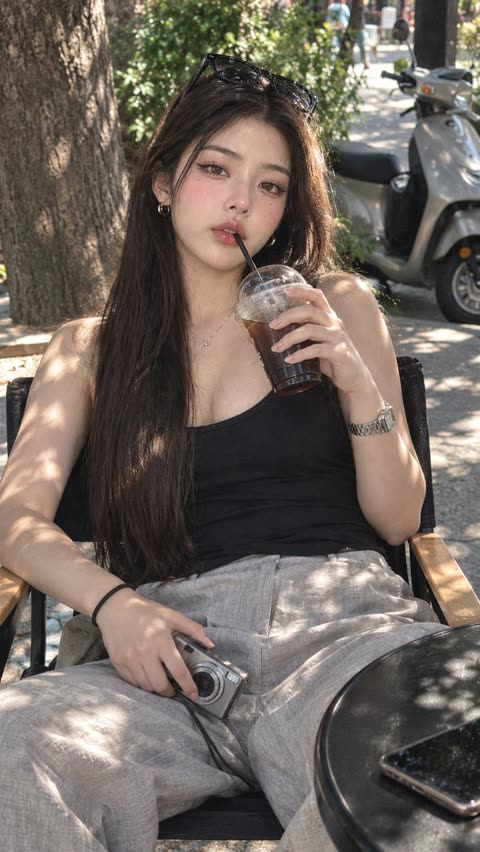</a>

The prompt lists wardrobe, accessories, which hand holds what, seating posture and foreground props in a fixed order, so the pose and details stay consistent. Lens, aperture, dappled sunlight, Kodak Portra tone and film grain give a realistic candid look, and a negative prompt guards against plastic skin and bad hands.

GPT Image 2.5 · Text-to-image · Source: [@nawalsehar on X](https://x.com/nawalsehar/status/2109514589427876256) · 179 likes on 2026-10-28

[`candid`](tags.md#tag-candid) [`street-cafe`](tags.md#tag-street-cafe) [`dappled-light`](tags.md#tag-dappled-light) [`film-grain`](tags.md#tag-film-grain) [`lifestyle`](tags.md#tag-lifestyle)

<details><summary><b>Prompt</b></summary>

```text
Cartoon, illustration, plastic skin, extra finger, disabled hand, distorted face, blurry, too open, text, watermark, logo, extra limb
```

</details>

<a id="gpt-image-fisheye-selfie-doorstep-cat"></a>
### Fisheye selfie on a doorstep with curious cat

<a href="https://x.com/MissDelulu9/status/2111697628941717933">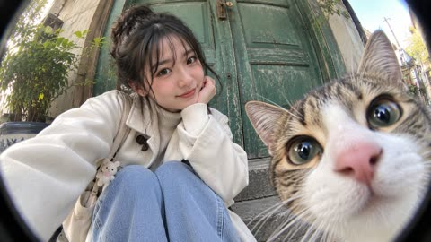</a>

The prompt asks for a fisheye lens look and puts an oversized cat nose in the near foreground, so the distortion gives depth and humour. It names the outfit pieces and the weathered door texture, and it asks to preserve the face from the uploaded selfie.

GPT Image 2.5 · Edit · Source: [@MissDelulu9 on X](https://x.com/MissDelulu9/status/2111697628941717933) · 173 likes on 2026-10-28

[`fisheye`](tags.md#tag-fisheye) [`selfie`](tags.md#tag-selfie) [`pet`](tags.md#tag-pet) [`candid`](tags.md#tag-candid) [`street`](tags.md#tag-street)

<details><summary><b>Prompt</b></summary>

```text
Create a realistic fisheye photo of the woman in my uploaded selfie, preserving her exact facial features. She sits on a doorstep in front of weathered green wooden doors, wearing a beige trench coat, ivory turtleneck, and light blue jeans. A curious tabby-and-white cat fills the right foreground with an oversized nose and expressive eyes. Soft daylight, natural textures, playful candid mood, ultra-realistic photography, landscape 16:9, no text.
```

</details>

<a id="nano-banana-y2k-flash-beauty-portrait-black-backdrop"></a>
### Y2K flash beauty portrait on black backdrop

<a href="https://x.com/SimplyAnnisa/status/2072293670007796111">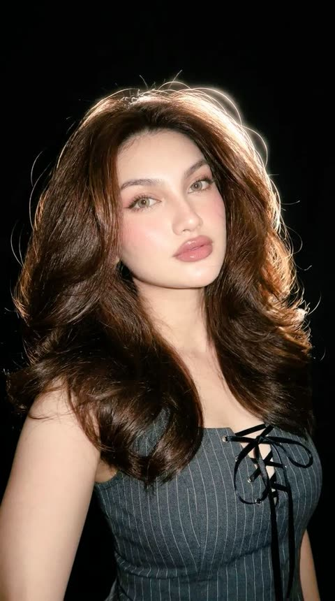</a>

The prompt is split into labeled blocks for makeup, hair, expression, outfit and lighting, so each element can be tuned separately. Direct flash combined with rim backlight gives the glowing halo against pure black, and a closing list of style boosters locks in the early 2000s camera look.

Nano Banana 2 · Text-to-image · Source: [@SimplyAnnisa on X](https://x.com/SimplyAnnisa/status/2072293670007796111) · 171 likes on 2026-10-28

[`y2k`](tags.md#tag-y2k) [`flash-photography`](tags.md#tag-flash-photography) [`beauty-portrait`](tags.md#tag-beauty-portrait) [`rim-light`](tags.md#tag-rim-light) [`editorial`](tags.md#tag-editorial)

<details><summary><b>Prompt</b></summary>

```text
Ultra-realistic beauty portrait of a stunning young woman, photographed from a slightly low-angle smartphone selfie perspective. Captured with an authentic early-2000s digital camera aesthetic using an intense direct flash. Deep pure-black background completely isolates the subject, creating dramatic contrast and making the face glow against darkness. Strong Y2K flash photography produces bright specular highlights, glass-like eye reflections, glossy skin sheen, and a nostalgic nightlife editorial atmosphere.

MAKEUP:
The woman has large almond-shaped hazel-brown eyes with luminous reflections, thick wispy manga-inspired lashes, naturally full fluffy eyebrows, soft freckles scattered across the bridge of the nose and upper cheeks, a delicate button nose with rosy blush concentrated on the tip, and full naturally plump lips wearing dusty rose pink lipstick with a subtle glossy finish. Flawless porcelain skin with realistic pores, natural texture, and soft peachy undertones. Soft feminine glam makeup. Neutral taupe eyeshadow, elongated fox-eye liner extending toward the temples, dramatic clustered lashes, luminous inner-corner shimmer, subtle contouring, flushed rosy cheeks and nose bridge, softly overlined lips, glossy highlights enhanced by direct flash. Luxury editorial beauty makeup.

HAIR
Extremely voluminous supermodel blowout hairstyle with rich chocolate-brown tones and warm caramel undertones. Dramatic crown lift, feathered layers, luxurious salon-finished texture, silky shine, flowing movement, soft flyaways. Powerful luminous halo surrounding the hair and face. Strong rim lighting traces every strand of hair, creating a radiant angelic aura. Backlit glow creates a dreamy cinematic effect with soft bloom around illuminated edges.

EXPRESSION:
Dreamy upward gaze looking away from the camera, confident yet ethereal expression.

OUTFIT
Sleeveless charcoal-gray pinstripe fitted top with black ribbon lace-up neckline. Elegant feminine silhouette. Modern Y2K-inspired styling.

LIGHTING
Strong direct Y2K camera flash combined with subtle backlighting. Bright flash creates crisp facial definition, intense eye reflections, glossy lips, luminous cheekbones, and reflective skin highlights. Ethereal halo surrounding the entire silhouette. Soft bloom effect around highlights, subtle lens glow, dreamy atmospheric diffusion.

Vogue beauty editorial, luxury cosmetics campaign, fashion magazine cover photography, cinematic beauty portrait, ultra-detailed skin texture, shallow depth of field, HDR photography, hyper-realistic eyes, nostalgic digital camera grain, flash bloom, glamorous nightlife energy, dark feminine aesthetic, angelic glow, luxury fashion campaign, 8K ultra realism.

STYLE BOOSTERS
Y2K digital camera flash, cyber-feminine glamour, dreamy halo glow, luminous aura, glowing silhouette, flash photography, nostalgic 2003 party photography, supermodel beauty campaign, luxury editorial portrait, soft bloom, cinematic rim light, glossy highlights, dark aesthetic, hyperrealism, magazine cover quality.
```

</details>

<a id="nano-banana-chiaroscuro-portrait"></a>
### Cinematic chiaroscuro close-up of your photo

<a href="https://x.com/rovvmut_/status/2107691827323392159"></a>

One light from the side and an explicit request for visible pores to keep skin from looking airbrushed.

Nano Banana 2.1 · Edit · Source: [@rovvmut_ on X](https://x.com/rovvmut_/status/2107691827323392159) · 170 likes on 2026-10-27

[`chiaroscuro`](tags.md#tag-chiaroscuro) [`cinematic`](tags.md#tag-cinematic) [`skin-detail`](tags.md#tag-skin-detail)

<details><summary><b>Prompt</b></summary>

```text
A hyper-realistic, 8K resolution cinematic close-up portrait of the person in the uploaded image. The image features dramatic chiaroscuro lighting, heavily illuminating the left side of his face while casting deep, moody shadows on the right against a solid black background. He has an intense, direct gaze, dark brown eyes with square catchlights, and textured, wet-styled hair. He is wearing a plain black t-shirt. Render with 35mm film grain and a shallow depth of field, prioritizing extreme character consistency and highly detailed skin texture, including visible pores.
```

</details>

<a id="nano-banana-art-studio-man-miniature-self-figurine"></a>
### Smiling Artist With Miniature Self Figurine

<a href="https://x.com/Taaruk_/status/2039625508535885876"></a>

A scale contrast illusion is named outright and paired with a figurine detail cue, so the tiny double reads as a real object on the desk. A warm desk lamp, shallow depth of field and a 50mm lens keep the studio scene photographic.

Nano Banana 2 · Text-to-image · Source: [@Taaruk_ on X](https://x.com/Taaruk_/status/2039625508535885876) · 164 likes on 2026-10-28

[`miniature`](tags.md#tag-miniature) [`scale-contrast`](tags.md#tag-scale-contrast) [`studio-portrait`](tags.md#tag-studio-portrait) [`shallow-depth-of-field`](tags.md#tag-shallow-depth-of-field) [`cinematic`](tags.md#tag-cinematic)

<details><summary><b>Prompt</b></summary>

```text
Ultra-realistic cinematic portrait of a young man sitting at a wooden desk in a cozy art studio, smiling warmly at the camera, with a tiny miniature version of himself standing on the table in front of him, perfectly detailed like a small figurine, surrounded by paint brushes, sketches, and art tools, warm ambient lighting from a desk lamp, shallow depth of field, soft bokeh background, creative storytelling composition, scale contrast illusion, hyper-detailed textures, 50mm lens, photorealistic, 8K.
```

</details>

<a id="nano-banana-bearded-man-amber-sunglasses-blue-cardigan"></a>
### Bearded man in amber sunglasses and cardigan

<a href="https://x.com/rovvmut_/status/2052273526758121636">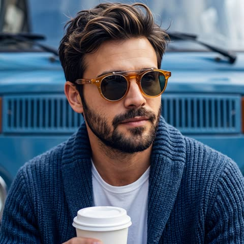</a>

The prompt lists the face, eyewear, clothing and props in separate sentences, then sets bright natural light and a soft focus blue vehicle backdrop. Naming specific textures and a cool background against warm accents keeps the portrait cinematic.

Nano Banana 2 · Text-to-image · Source: [@rovvmut_ on X](https://x.com/rovvmut_/status/2052273526758121636) · 163 likes on 2026-10-28

[`portrait`](tags.md#tag-portrait) [`sunglasses`](tags.md#tag-sunglasses) [`knitwear`](tags.md#tag-knitwear) [`street-style`](tags.md#tag-street-style) [`cinematic`](tags.md#tag-cinematic)

<details><summary><b>Prompt</b></summary>

```text
Nano Banana 2 on Gemini.

Prompt: A stylish, rugged portrait of a man with a relaxed yet sophisticated urban look. He features messy dark hair with natural highlights and a well-maintained, thick beard. He is wearing distinctive vintage-style sunglasses with translucent amber frames and dark, circular lenses that feature a unique metal flip-up bridge mechanism. He is dressed for cool weather in a chunky, blue ribbed-knit cardigan with a thick lapel, worn over a simple white t-shirt. In the foreground, his hand is partially visible, holding a white disposable coffee cup with a matching white lid. The lighting is bright and natural, casting soft shadows that emphasize the texture of his knitwear and facial hair. The background is a soft-focus blue vintage vehicle with horizontal grille lines, creating a cool-toned, cinematic backdrop that makes the warm tones of his sunglasses and skin pop.
```

</details>

<a id="nano-banana-argentina-fan-doodle-scrapbook-portrait"></a>
### Argentina fan portrait with blue doodle backdrop

<a href="https://x.com/SimplyAnnisa/status/2069235139889033262">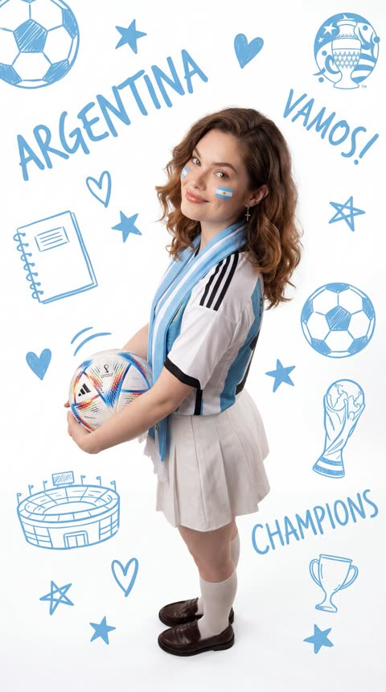</a>

A reference image locks the face, hair and eyes, while a fixed high-angle 3/4 view and a 9:16 frame control the pose. A white studio backdrop with hand-drawn sky-blue doodles and large handwritten words gives a scrapbook layout, and a long negative prompt keeps the result photoreal.

Nano Banana 2 · Edit · Source: [@SimplyAnnisa on X](https://x.com/SimplyAnnisa/status/2069235139889033262) · 157 likes on 2026-10-28

[`reference-face`](tags.md#tag-reference-face) [`sports-fan`](tags.md#tag-sports-fan) [`scrapbook`](tags.md#tag-scrapbook) [`doodle-background`](tags.md#tag-doodle-background) [`high-angle`](tags.md#tag-high-angle)

<details><summary><b>Prompt</b></summary>

```text
Messi has done it again...

Nano banana 2 on
@dreamina_ai


Ultra-realistic full-body photograph of a young woman with facial features matching the reference image, captured from a high-angle viewpoint in a 3/4 left perspective. Her body and face are oriented toward the left while she gently looks back at the camera with a warm, natural expression. The pose is elegant, relaxed, and dynamic, holding an official FIFA World Cup 2026 soccer ball at waist height with both hands.

She has hair matching the reference image, styled with a side part and soft strands framing her face. Her eyes match the reference image, with naturally defined eyelashes, subtle professional makeup, realistic skin texture, and a faint friendly smile. She wears small Argentine flag stickers on both cheeks and delicate cross-shaped earrings.

Her outfit consists of the official Argentina national football team jersey with 3 stars, a light blue and white scarf wrapped around her neck, a short white pleated skirt, white knee-high socks, and dark brown loafers. Every fabric displays realistic textures, folds, stitching, and physically accurate materials.

The background is a pure white studio backdrop designed in a stylish scrapbook-inspired composition, featuring hand-drawn sky-blue doodles such as soccer balls, stars, hearts, a spiral notebook, a perspective view of a football stadium, a trophy, and an emblem inspired by an international tournament. Large handwritten words including “ARGENTINA”, “VAMOS!”, and “CHAMPIONS” are evenly distributed around the subject as artistic graphic elements.

The camera uses a professional high-angle composition, maintaining accurate human proportions while creating depth and visual interest without distortion. The vertical 9:16 framing keeps the woman centered while leaving balanced negative space for the surrounding graphic illustrations.

Style: ultra-realistic professional photography, editorial sports fashion shoot, luxury magazine aesthetic, authentic human proportions, lifelike facial details, natural skin pores, cinematic yet soft lighting, high dynamic range, subtle shadows, crisp focus, premium DSLR quality, photorealistic textures, highly detailed fabrics, clean composition, joyful and sporty atmosphere, polished finish, 8K resolution.

Negative Prompt: anime, manga, cartoon, cel shading, illustration, painting, CGI look, stylized proportions, oversized eyes, chibi, unrealistic skin, low resolution, blurry, noise, deformed anatomy, malformed hands, extra fingers, crossed eyes, asymmetrical face, oversaturated colors, harsh lighting, dark background, illegible text, cropped body, duplicate elements, perspective distortion, artifacts, watermark, signature, pixelation, exaggerated caricature style, forced pose, eye-level camera, low-angle shot, frontal-only view.
```

</details>

<a id="nano-banana-ccd-flash-sofa-selfie-portrait"></a>
### Over the shoulder flash selfie on boucle sofa

<a href="https://x.com/Emmma___0/status/2107687127844856184"></a>

The prompt splits the brief into labeled blocks for pose, hair, expression, outfit, background and camera, and a tight crop that cuts off half the face keeps the framing intimate. A long negative list plus identity preservation from the attached photo keeps the face, neck and hands believable.

Nano Banana 2.1 · Edit · Source: [@Emmma___0 on X](https://x.com/Emmma___0/status/2107687127844856184) · 157 likes on 2026-10-27

[`ccd-flash`](tags.md#tag-ccd-flash) [`selfie`](tags.md#tag-selfie) [`korean-makeup`](tags.md#tag-korean-makeup) [`identity-preservation`](tags.md#tag-identity-preservation) [`labeled-blocks`](tags.md#tag-labeled-blocks)

<details><summary><b>Prompt</b></summary>

```text
Create image: A hyper-photorealistic shot of the same subject in the attached image, detailed pores, rosy dewy skin, Douyin glass-skin, pink gloss lips, aegyosal, blush, grey contacts, wispy lashes, brushed brows, thin liner. Preserve her recognizable facial identity and natural proportions with a playful yet sophisticated Chryzleen-inspired indoor fashion aesthetic.

[POSE & COMPOSITION] A tight over-the-shoulder CCD selfie while she leans sideways into a plush sofa. The camera sits slightly behind and above her shoulder, creating a close three-quarter over-shoulder perspective. Only one eye, cheekbone, glossy lips, jawline, a sliver of neck, and the near shoulder are visible. The far side of her face is completely cropped out. Her head turns gently back toward the camera with a small natural tilt, keeping the neck relaxed and anatomically believable. One hand rests loosely on the sofa back behind her, with fingertips visible at the edge of the frame. The pose feels subtly seductive and candid rather than overly posed.

[HAIR] Deep side part with lifted roots and intentionally untidy, windswept volume. Several wispy strands fall across the forehead and cheek, while loose pieces spill naturally behind the shoulder. The hair should have irregular movement and soft imperfections, avoiding a freshly styled appearance.

[EXPRESSION] Half-lidded grey-contact gaze looking back toward the camera, relaxed brows, slightly lifted chin, soft jaw, glossy pink lips parted just enough to show a subtle glimpse of front teeth. Alluring, confident, and understated.

[OUTFIT] Sky-blue fitted sweetheart-neckline knit top with tiny white embroidered daisies, delicate scalloped edging, and miniature pearl-like buttons. Cute modern indoor fashion with a feminine fitted silhouette and soft textured fabric.

[BACKGROUND & ENVIRONMENT] A cozy contemporary living room with a warm beige boucle sofa, muted dusty-blue wall, softly blurred floor lamp, and a small cream cushion behind her. The room is visible only in narrow fragments around the extremely tight crop.

[BRANDING] A miniature Chryzleen engraving is physically placed on a tiny gold bracelet charm worn on the hand resting against the sofa. The Chryzleen mark should be naturally etched into the metal and remain subtle. This single Chryzleen accessory is the only visible branding treatment in the entire image.

[CAMERA] Old CCD digicam, direct flash, fine grain. Close over-the-shoulder three-quarter perspective with crisp detail on the visible eye, cheek, lips, messy hair wisps, shoulder, fingers, and tiny jewelry detail.

[QUALITY] Photorealistic pores and skin texture, natural facial asymmetry, believable hair movement, realistic hands and fingers, seamless neck anatomy, authentic knit texture, natural CCD grain, premium indoor fashion-editorial finish.

[MAKEUP] Fresh Korean soft-glam, natural glow, pink blush, wispy lashes, thin winged liner, shimmering rose-taupe eyeshadow, glossy pink lips.

Keep the Chryzleen branding physically integrated into the jewelry and visually understated, never functioning as graphic text.

1:1 aspect ratio.

[NEGATIVE PROMPT] cardigan, cardigan outfit, jacket, blazer, excessive head turn, extreme head tilt, extreme neck arch, twisted neck, unnatural neck curve, stiff pose, frontal selfie, symmetrical composition, perfectly polished hair, salon-perfect hair, no facial wisps, perfectly arranged strands, full body, half body, waist-up, loose crop, distant camera, excessive living room, hands covering face, hair-touching, malformed hands, extra fingers, missing fingers, warped eyes, plastic skin, over-smoothed face, pale washed-out skin, green cast, square skin artifacts, identity drift, multiple people, multiple Chryzleen marks, duplicate branding, watermark, floating text, random readable signage.
```

</details>

<a id="nano-banana-rainy-car-window-night-portrait"></a>
### Cinematic Night Portrait Through Rainy Car Window

<a href="https://x.com/NikhilRajX/status/2035707444777865469">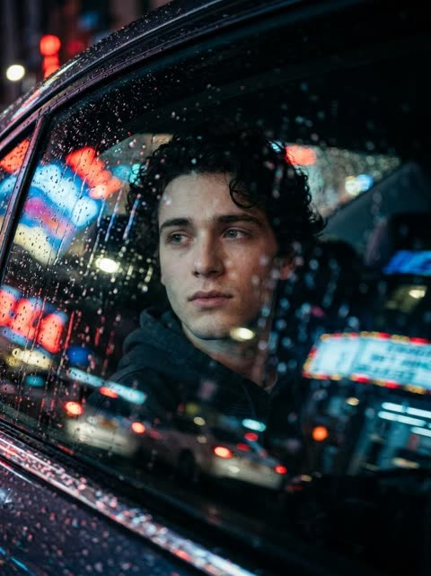</a>

The camera is placed outside the car so the wet glass sits between lens and subject, and raindrops, neon reflections and red, blue and yellow bokeh are all named. Shallow depth of field and low ambient lighting on the face give the film still mood, while the uploaded face reference keeps the identity.

Nano Banana 2 · Edit · Source: [@NikhilRajX on X](https://x.com/NikhilRajX/status/2035707444777865469) · 155 likes on 2026-10-28

[`cinematic`](tags.md#tag-cinematic) [`rain`](tags.md#tag-rain) [`night`](tags.md#tag-night) [`portrait`](tags.md#tag-portrait) [`bokeh`](tags.md#tag-bokeh)

<details><summary><b>Prompt</b></summary>

```text
Nano Banana 2 on Google Gemini

Prompt: Create a highly cinematic and realistic photo of a person using the face from the uploaded image. The person is sitting inside a car at night, looking out through a rain-covered window. The camera is positioned outside the car, capturing the person through the wet glass. Raindrops and streaks of water are clearly visible on the window, with reflections of city lights, neon signs, and passing cars blending into the glass. The person’s face is softly lit by ambient street lights and subtle interior car lighting, creating a moody and emotional expression. The background outside is blurred with colorful bokeh lights (red, blue, yellow), giving a deep cinematic feel. The person is wearing a modern outfit like a hoodie or jacket. The mood feels introspective and film-like. Ultra realistic photography, shallow depth of field, dramatic lighting, reflections, rain texture, Hollywood movie scene composition, high detail.
```

</details>

<a id="nano-banana-black-white-street-portrait-city-crowd"></a>
### Black and white street portrait in crowd

<a href="https://x.com/iamrealsnow/status/2031179469617320282">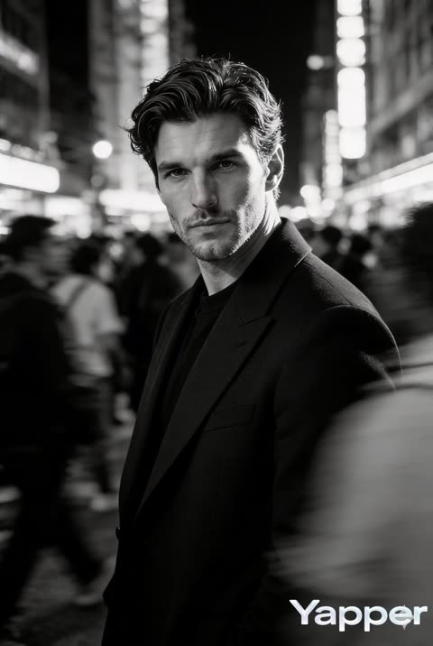</a>

Pairing a sharp-focus subject with a motion-blurred crowd and shallow depth of field isolates the figure inside a busy scene. Dramatic contrast lighting with a soft rim light on the face keeps the night street cinematic.

Nano Banana 2 · Text-to-image · Source: [@iamrealsnow on X](https://x.com/iamrealsnow/status/2031179469617320282) · 152 likes on 2026-10-28

[`street-portrait`](tags.md#tag-street-portrait) [`black-and-white`](tags.md#tag-black-and-white) [`motion-blur`](tags.md#tag-motion-blur) [`night`](tags.md#tag-night) [`cinematic`](tags.md#tag-cinematic)

<details><summary><b>Prompt</b></summary>

```text
.
A cinematic black and white street portrait of a handsome man standing still in a busy city crowd, sharp focus on the subject while people around him are motion-blurred, shallow depth of field, intense masculine facial features textured beard, slightly messy wavy hair, wearing a dark tailored coat, calm yet powerful expression, dramatic contrast lighting, soft rim light on face, urban night atmosphere,
```

</details>

<a id="nano-banana-golden-hour-bridge-portrait"></a>
### Golden hour portrait on a suspension bridge

<a href="https://x.com/ZaraIrahh/status/2027672194805874699">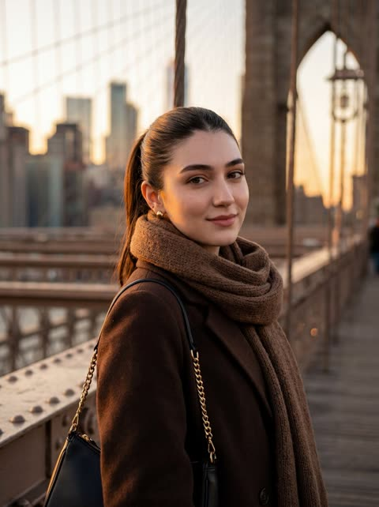</a>

The prompt lists wardrobe and accessories in concrete detail, then adds a warm sunset light direction and a blurred skyline for depth. Camera terms such as 85mm, shallow depth of field and soft grain steer the result toward editorial street photography.

Nano Banana 2 · Text-to-image · Source: [@ZaraIrahh on X](https://x.com/ZaraIrahh/status/2027672194805874699) · 143 likes on 2026-10-28

[`golden-hour`](tags.md#tag-golden-hour) [`portrait`](tags.md#tag-portrait) [`street-photography`](tags.md#tag-street-photography) [`cinematic`](tags.md#tag-cinematic) [`bridge`](tags.md#tag-bridge)

<details><summary><b>Prompt</b></summary>

```text
Cinematic golden hour portrait of a stylish young woman standing on a historic suspension bridge with a city skyline in the background. She has sleek brown hair tied in a high ponytail, natural glam makeup, and small elegant stud earrings. She is wearing a dark brown coat with a thick oversized brown scarf wrapped around her neck, and a shoulder bag with a gold chain strap. She gazes into camera with soft smile. Warm sunset light casts a soft amber glow across her face and the wooden bridge walkway. The skyline behind her is softly blurred, urban atmosphere with subtle pedestrian movement. Shot on 85mm lens, shallow depth of field, filmic tones, soft grain, editorial street photography style, photorealistic, high detail, 4K resolution.
```

</details>

<a id="gpt-image-vhs-camcorder-night-car-portrait"></a>
### Late nineties VHS camcorder portrait in night car

<a href="https://x.com/saniaspeaks_/status/2064192184698716186">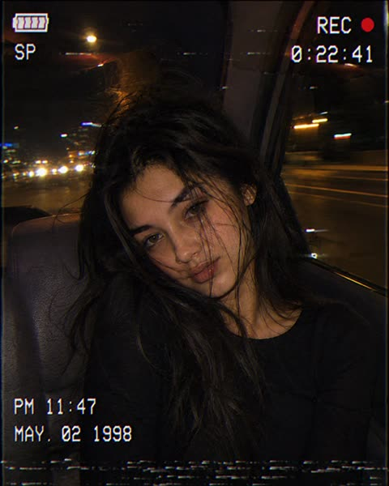</a>

Stacks specific analog artifacts such as chroma bleed, tracking noise, dropout streaks and a burned in REC HUD with timestamp, then fixes the color grade with named tones. A closing negative list rules out DSLR, HDR and modern clean looks.

GPT Image 2 · Edit · Source: [@saniaspeaks_ on X](https://x.com/saniaspeaks_/status/2064192184698716186) · 142 likes on 2026-10-29

[`vhs`](tags.md#tag-vhs) [`retro`](tags.md#tag-retro) [`night`](tags.md#tag-night) [`portrait`](tags.md#tag-portrait) [`camcorder`](tags.md#tag-camcorder)

<details><summary><b>Prompt</b></summary>

```text
Use the attached face as the only identity reference, preserving recognizable facial features and natural asymmetry. Create an authentic late-1990s VHS camcorder scene of a young woman riding in the backseat of a moving car at night, wearing a black off-shoulder top, long windblown dark hair, soft 90s makeup, and a romantic, lonely expression. Warm city lights, neon reflections, and blurred traffic streak past the windows while the dim car interior glows with sodium-vapor streetlight tones. Render as genuine pre-2000s VHS footage with magnetic tape softness, motion blur, scanlines, chroma bleed, focus drift, tape grain, tracking noise, RGB separation, dropout streaks, warped edges, flickering exposure, and a burned-in REC HUD with timestamp, battery icon, SP mode, and tape counter. Vertical 4:5 handheld framing with slight camera tilt, imperfect crop, and nostalgic analog nightlife color grading featuring dirty orange highlights, red neon spill, green-blue shadows, faded blacks, and low contrast. Romantic rediscovered VHS memory from a late-night drive in 1998. Negative: DSLR sharpness, HDR, smartphone look, cinematic grading, ultra-clean skin, influencer aesthetic, crisp digital detail, modern 4K rendering.
```

</details>

<a id="nano-banana-golden-rim-light-black-turtleneck-portrait"></a>
### Golden rim lit portrait on black background

<a href="https://x.com/Soaima_Ai/status/2064199999135907913">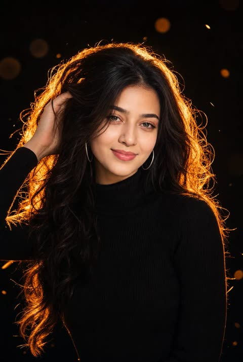</a>

The prompt stacks specific physical details with one dominant light source, a warm golden-orange rim light through the hair against a pitch black studio background. Floating golden bokeh, shallow depth of field and a fashion photography framing keep the focus on the glowing hair.

Nano Banana 2 · Text-to-image · Source: [@Soaima_Ai on X](https://x.com/Soaima_Ai/status/2064199999135907913) · 140 likes on 2026-10-28

[`portrait`](tags.md#tag-portrait) [`rim-lighting`](tags.md#tag-rim-lighting) [`bokeh`](tags.md#tag-bokeh) [`studio`](tags.md#tag-studio) [`fashion`](tags.md#tag-fashion)

<details><summary><b>Prompt</b></summary>

```text
A hyper-realistic AI portrait of a beautiful young woman with long voluminous wavy black hair with stunning warm golden-orange rim lighting glowing through the hair, fair porcelain skin, soft hazel-brown eyes with warm eye makeup, soft pink lips with a gentle confident smile, small nose piercing, silver hoop earrings, wearing a black ribbed turtleneck sweater, one hand raised touching her hair gracefully, dramatic pitch black studio background with glowing golden bokeh particles floating in the air, cinematic rim lighting, ultra-realistic, 8K, shallow depth of field, professional fashion portrait photography
```

</details>

<a id="nano-banana-noir-portrait-man-vintage-convertible"></a>
### Black and white portrait in vintage convertible

<a href="https://x.com/pictsbyai/status/2039256212496163327">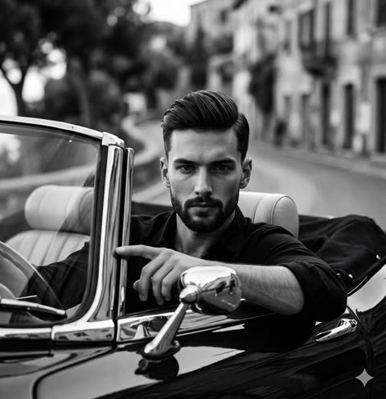</a>

A structured JSON prompt specifies composition, lighting, lens and grain, then adds a short plain text prompt, so the model gets exact photographic controls. Shallow depth of field, a single directional light and film grain give the noir editorial look.

Nano Banana 2 · Text-to-image · Source: [@pictsbyai on X](https://x.com/pictsbyai/status/2039256212496163327) · 140 likes on 2026-10-28

[`black-and-white`](tags.md#tag-black-and-white) [`json-prompt`](tags.md#tag-json-prompt) [`vintage-car`](tags.md#tag-vintage-car) [`editorial`](tags.md#tag-editorial) [`film-grain`](tags.md#tag-film-grain)

<details><summary><b>Prompt</b></summary>

```text
{
"metadata": {
"image_type": "photograph",
"primary_purpose": "editorial"
},
"composition": {
"rule_applied": "rule of thirds",
"aspect_ratio": "4:5",
"layout": "layered",
"focal_points": [
"Man's face and intense eyes",
"Left hand resting near the chrome car mirror"
],
"visual_hierarchy": "Eye starts at the subject's face, follows the line of his left arm down to his hand, and reflects back along the glossy car edge",
"balance": "asymmetric"
},
"color_profile": {
"dominant_colors": [
{
"color": "Black",
"hex": "#0a0a0a",
"percentage": "45%",
"role": "background, car exterior, and clothing"
},
{
"color": "Mid-Gray",
"hex": "#5a5a5a",
"percentage": "40%",
"role": "skin tones and blurred background elements"
},
{
"color": "White",
"hex": "#f5f5f5",
"percentage": "15%",
"role": "highlights, car interior, and chrome reflections"
}
],
"color_palette": "monochromatic",
"temperature": "neutral",
"saturation": "black and white",
"contrast": "high contrast"
},
"lighting": {
"type": "natural window/outdoor diffused",
"source_count": "single source",
"direction": "front and slightly top",
"directionality": "highly directional",
"quality": "soft light with dramatic falloff",
"intensity": "moody",
"contrast_ratio": "high contrast (dramatic shadows)",
"mood": "dramatic",
"shadows": {
"type": "soft gradual edges",
"density": "deep black",
"placement": "under chin, right side of face, interior of car",
"length": "medium"
},
"highlights": {
"treatment": "preserved",
"placement": "on forehead, cheekbones, nose bridge, and specular highlights on car chrome"
},
"ambient_fill": "absent",
"light_temperature": "neutral"
},
"technical_specs": {
"medium": "digital photography",
"style": "realistic",
"texture": "grainy",
"sharpness": "tack sharp on subject face",
"grain": "film grain",
"depth_of_field": "shallow",
"perspective": "straight on slightly elevated"
},
"artistic_elements": {
"genre": "portrait",
"influences": [
"Classic Hollywood automotive photography",
"Cinematic noir"
],
"mood": "sophisticated",
"atmosphere": "Brooding, timeless, and elegant cinematic tension",
"visual_style": "clean"
},
"typography": {
"present": false,
"fonts": [],
"placement": "none",
"integration": "none"
},
"subject_analysis": {
"primary_subject": "Adult male, estimated 30s, with short dark hair, trimmed beard, wearing a dark collared shirt. Hair is 2-3 inches on top, styled back with natural volume and texture. Hair texture shows natural imperfections with slight flyaways, individual strands visible against the light, and uneven layering typical of a textured scissor cut. Styling indicates matte product use. Hair part is unrefined, pushed back organically rather than sharply divided.",
"positioning": "center",
"scale": "medium",
"interaction": "interacting with environment",
"facial_expression": {
"mouth": "closed neutral",
"smile_intensity": "no smile",
"eyes": "intense",
"eyebrows": "furrowed",
"overall_emotion": "serious",
"authenticity": "posed"
},
"hands_and_gestures": {
"left_hand": "resting on car door frame, index finger extended lightly touching or pointing near the chrome side mirror",
"right_hand": "not visible",
"finger_positions": "relaxed, index finger slightly extended, remaining fingers softly curled inward",
"finger_interlacing": "none",
"hand_tension": "relaxed",
"interaction": "resting on car exterior",
"naturalness": "deliberately posed"
},
"body_positioning": {
"posture": "sitting",
"angle": "facing camera",
"weight_distribution": "leaning left",
"shoulders": "tilted"
}
},
"background": {
"setting_type": "outdoor",
"spatial_depth": "shallow",
"elements_detailed": [
{
"item": "Vintage convertible car body",
"position": "bottom",
"distance": "foreground",
"size": "dominant",
"condition": "pristine",
"specific_features": "dark glossy paint with sharp reflections"
},
{
"item": "Chrome side mirror",
"position": "center",
"distance": "midground",
"size": "small",
"condition": "pristine",
"specific_features": "highly reflective, bullet-style vintage mirror"
},
{
"item": "Windshield frame",
"position": "left",
"distance": "midground",
"size": "medium",
"condition": "pristine",
"specific_features": "chrome trim"
}
],
"wall_surface": {
"material": "not applicable - outdoor background",
"surface_treatment": "blurred",
"texture": "perfectly smooth bokeh",
"finish": "matte",
"color": "mid-gray",
"color_variation": "gradient",
"features": "out of focus shapes indicating trees or street structures",
"wear_indicators": "none"
},
"floor_surface": {
"material": "asphalt",
"color": "dark gray",
"pattern": "blurred"
},
"objects_catalog": "Vintage convertible automobile, chrome side mirror, windshield trim, light-colored car interior seats",
"background_treatment": "blurred"
},
"generation_parameters": {
"prompts": [
"Black and white cinematic photography, medium shot of a handsome man in his 30s sitting in the driver's seat of a classic vintage convertible car. He is leaning his left arm on the car door, hand relaxed near a chrome side mirror. He has short textured dark hair, trimmed beard, furrowed brows, intense brooding gaze, wearing a dark collared shirt. Shallow depth of field, blurred outdoor background. High contrast, directional soft lighting, deep shadows, fine film grain, editorial fashion style.",
"Vintage Hollywood style portrait, black and white, man in classic car leaning out window, dramatic shadows, sharp focus on face, Leica 50mm, f/2.0."
],
"keywords": [
"black and white",
"cinematic portrait",
"vintage car",
"editorial",
"male model",
"brooding",
"film grain",
"classic automotive"
],
"technical_settings": "50mm lens, f/2.0 aperture for shallow depth of field, 1/250s shutter speed, ISO 400 to introduce natural film grain",
"post_processing": "Black and white conversion with crushed blacks, lifted midtone contrast, and added analog film grain"
}
}
```

</details>

<a id="nano-banana-spinning-night-portrait-slow-shutter-blur"></a>
### Spinning night street portrait with long shutter motion blur

<a href="https://x.com/MissDelulu9/status/2111012827213471883">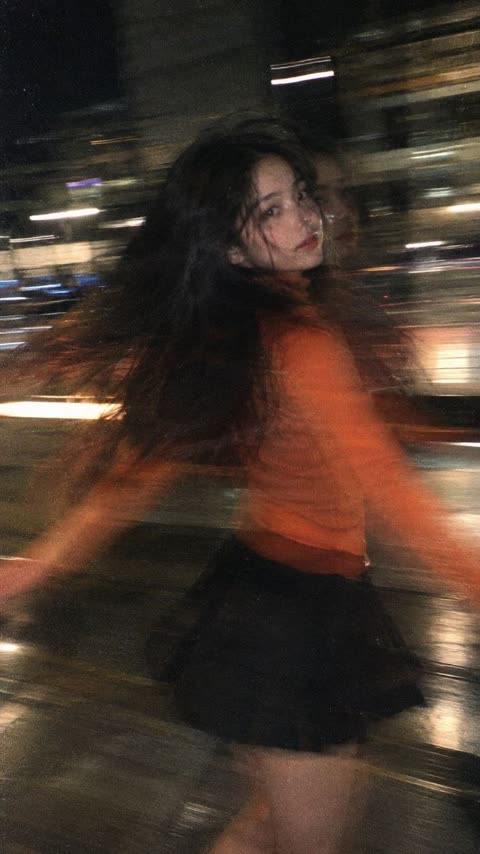</a>

Names a specific shutter range of 1/8 to 1/15 second and lists the blur effects it should produce: ghost trails, horizontal streaks, double exposure. A closing negative line (no frozen motion, no sharp arms or hair) keeps the model from freezing the action.

Nano Banana 2.1 · Text-to-image · Source: [@MissDelulu9 on X](https://x.com/MissDelulu9/status/2111012827213471883) · 137 likes on 2026-10-28

[`motion-blur`](tags.md#tag-motion-blur) [`slow-shutter`](tags.md#tag-slow-shutter) [`film-grain`](tags.md#tag-film-grain) [`night`](tags.md#tag-night) [`fashion`](tags.md#tag-fashion)

<details><summary><b>Prompt</b></summary>

```text
Vertical 9:16 candid fashion portrait of a
beautiful East Asian girl wearing a fitted long-sleeve orange turtleneck and a black mini skirt, with long, messy, loose black hair. She spins rapidly while looking back at the camera, arms spread wide and hair flying. VERY SLOW SHUTTER SPEED 1/8–1/15 sec, extreme realistic motion blur, long ghost trails on arms and hair, blurred body, softly recognizable face, horizontal background streaks, camera shake, double-exposure effect, heavy 35mm film grain, dreamy, moody, underexposed, photorealistic. No CGI, no frozen motion, no sharp arms or hair.
```

</details>

<a id="nano-banana-cream-suit-dark-studio-portrait"></a>
### Cream Suit Studio Portrait on Black

<a href="https://x.com/iamsofiaijaz/status/2038838879852376336">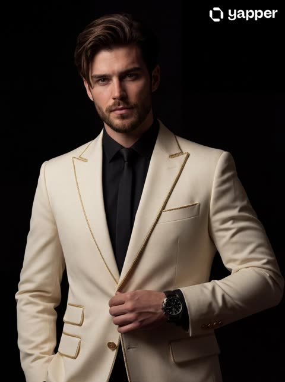</a>

The prompt specifies fabric, trim colour and a hand gesture, so the suit texture and pose come out exact. Lens, lighting and mood terms like 85mm, shallow depth of field and a dark minimal backdrop give the editorial look.

Nano Banana 2 · Text-to-image · Source: [@iamsofiaijaz on X](https://x.com/iamsofiaijaz/status/2038838879852376336) · 136 likes on 2026-10-28

[`fashion`](tags.md#tag-fashion) [`studio-portrait`](tags.md#tag-studio-portrait) [`editorial`](tags.md#tag-editorial) [`suit`](tags.md#tag-suit) [`low-key`](tags.md#tag-low-key)

<details><summary><b>Prompt</b></summary>

```text
A cinematic portrait of a handsome young man with neatly styled brown hair and light stubble, wearing a cream-colored tailored suit with subtle gold trim details, paired with a black dress shirt and black tie. He is adjusting his jacket with one hand, wearing a luxury wristwatch. The background is dark and minimal, creating a dramatic contrast. Soft studio lighting highlights his face and the texture of the suit, with a moody, elegant, high-fashion editorial style. Ultra-realistic, sharp focus, shallow depth of field, 85mm lens, professional photography, luxury aesthetic, high contrast, warm tones.
```

</details>

<a id="nano-banana-warm-mirror-selfie-mirrorless-camera-portrait"></a>
### Warm mirror selfie portrait with mirrorless camera

<a href="https://x.com/AIwithSarah_/status/2046180588886114701">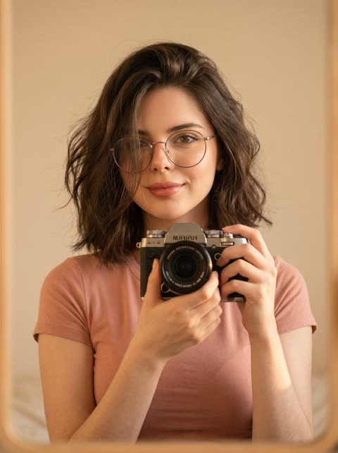</a>

The prompt breaks the portrait into framing, pose, hair, makeup, setting and lighting blocks, so each can be controlled separately. A warm yellow and orange light cue, a blurred cream background and the closing line Do not change the face keep the identity stable and the mood cozy.

Nano Banana 2 · Edit · Source: [@AIwithSarah_ on X](https://x.com/AIwithSarah_/status/2046180588886114701) · 133 likes on 2026-10-28

[`mirror-selfie`](tags.md#tag-mirror-selfie) [`portrait`](tags.md#tag-portrait) [`warm-light`](tags.md#tag-warm-light) [`face-preserve`](tags.md#tag-face-preserve) [`shallow-depth-of-field`](tags.md#tag-shallow-depth-of-field)

<details><summary><b>Prompt</b></summary>

```text
Nano Banana 2 on Higgsfield.

Prompt: A portrait of a young woman with a soft, natural expression, half-body close-up (shoulders up), side angle pose. Her head is slightly tilted to the right, looking at the camera with a subtle smile. She is taking a mirror selfie, holding a mirrorless camera in front of her face. Her hair partially covers one side of her face, giving a candid, relaxed feel.
She wears a fitted dusty pink / soft peach t-shirt, minimal and casual with no accessories.
Short shoulder-length bob haircut, slightly voluminous and naturally messy, soft and shiny texture, loosely parted, some strands covering one side of the face (only one side visible), natural black or dark brown hair.
Natural clean makeup look: light base, smooth glowing skin, soft peach/pink blush, natural pink lips (soft tint), minimal eye makeup, no bold eyeliner, fresh and youthful appearance.
Indoor setting, likely a bedroom or small studio, mirror selfie composition, minimal props. Background is plain beige / warm cream, softly blurred (shallow depth of field), clean and uncluttered.
Warm lighting (yellow/orange tones), soft light (indoor or sunset), gentle shadows, soft highlights on skin, cozy and intimate mood. Do not change the face.
```

</details>

<a id="nano-banana-candid-athleisure-smoothie-la-street"></a>
### Candid olive athleisure woman walking with green smoothie

<a href="https://x.com/astronomerozge1/status/2045415777197518948">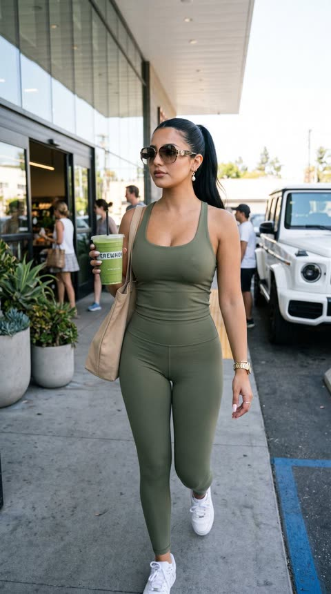</a>

A structured JSON prompt splits the request into subject, scene, pose, camera and texture blocks, and locks identity to a reference image. A 50mm lens, a slightly off center angle and a mid stride pose give the paparazzi feel, and a negative list keeps the background clean.

Nano Banana 2 · Edit · Source: [@astronomerozge1 on X](https://x.com/astronomerozge1/status/2045415777197518948) · 132 likes on 2026-10-29

[`json-prompt`](tags.md#tag-json-prompt) [`candid`](tags.md#tag-candid) [`athleisure`](tags.md#tag-athleisure) [`reference-identity`](tags.md#tag-reference-identity) [`street-photo`](tags.md#tag-street-photo)

<details><summary><b>Prompt</b></summary>

```text
{
  "generation_request": {
    "meta_data": {
      "tool": "Nano Banana 2",
      "task_type": "erewhon_wellness_luxury_candid",
      "language": "en",
      "priority": "highest",
      "version": "v2.0_LA_CLEAN_GIRL_LUXURY"
    },

    "input": {
      "mode": "image_to_image",
      "reference_image_usage": "very_high",
      "preserve_identity": true,
      "notes": "Use the reference woman. Scene set outside Erewhon Market in Los Angeles. She exits holding a smoothie in a natural candid moment. The vibe is paparazzi-meets-editorial. She is not posing directly, caught mid-walk with confident effortless energy."
    },

    "output_settings": {
      "aspect_ratio": "4:5",
      "orientation": "portrait",
      "resolution_target": "ultra_high_res",
      "render_style": "luxury_wellness_editorial",
      "sharpness": "ultra_crisp",
      "dynamic_range": "clean_bright_daylight",
      "color_grade": "neutral_beige_green_wellness"
    },

    "subject": {
      "identity": "reference woman",
      "expression": "neutral confident face, slightly detached, cool-girl energy",
      "hair": "sleek high ponytail or slick bun, ultra clean finish",
      "makeup": "no-makeup makeup, dewy skin, subtle glow, natural lips",
      "outfit": "ultra premium fitted athleisure set (sculpting leggings + cropped top), neutral tones like beige, olive or soft grey",
      "accessories": "designer sunglasses, minimalist tote bag, smoothie cup",
      "body": "perfect anatomy, natural walking posture"
    },

    "scene": {
      "environment": "Erewhon Market exterior with clean modern facade, glass, greenery",
      "lighting": "bright soft California daylight, no harsh shadows",
      "mood": "clean, elite, wellness-focused, understated luxury"
    },

    "pose_language": {
      "pose": "mid-step walking out of store, one arm holding smoothie, other relaxed",
      "hands": "natural grip, relaxed fingers",
      "posture": "confident, straight, effortless"
    },

    "camera": {
      "lens": "50mm lifestyle lens",
      "angle": "slightly off-center candid angle",
      "framing": "mid-full body",
      "focus": "sharp subject, lightly blurred background",
      "depth_of_field": "moderately shallow"
    },

    "texture_details": {
      "skin_texture": "natural dewy skin with realistic pores",
      "fabric_texture": "tight athletic fabric with subtle stretch and sheen",
      "hair_texture": "clean sleek strands, controlled finish"
    },

    "color_grading": {
      "palette": "beige, soft greens, whites, clean neutral tones",
      "style": "minimal luxury wellness aesthetic"
    },

    "must_have": [
      "Erewhon style setting",
      "smoothie",
      "athleisure luxury",
      "clean girl aesthetic",
      "same identity",
      "perfect anatomy",
      "no text"
    ],

    "negative_prompt": [
      "messy background",
      "fast food setting",
      "heavy glam makeup",
      "cheap outfit",
      "bad anatomy",
      "extra fingers",
      "over-posed",
      "text",
      "logo",
      "watermark"
    ]
  }
}
```

</details>

<a id="nano-banana-bw-vogue-hard-light-portrait"></a>
### Black and white editorial portrait with hard side light

<a href="https://x.com/MissDelulu9/status/2113862505504407630">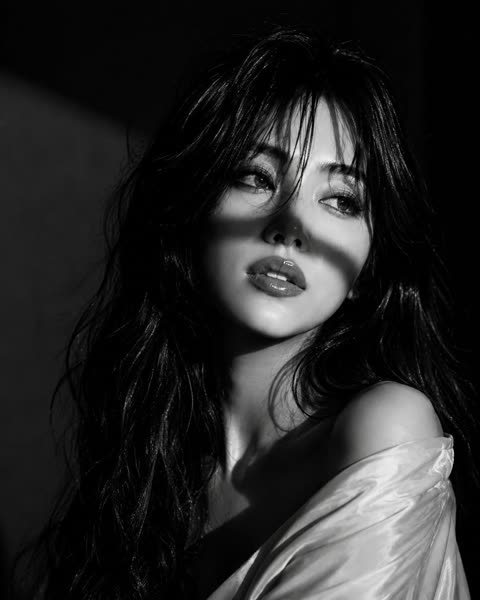</a>

Names the pose, hair, and wardrobe first, then locks the look with hard side lighting, chiaroscuro, and a dark background. Camera cues such as 85mm, shallow depth of field, and film grain keep the skin and eyes sharp and photographic.

Nano Banana 2.1 · Text-to-image · Source: [@MissDelulu9 on X](https://x.com/MissDelulu9/status/2113862505504407630) · 126 likes on 2026-10-29

[`black-and-white`](tags.md#tag-black-and-white) [`editorial`](tags.md#tag-editorial) [`chiaroscuro`](tags.md#tag-chiaroscuro) [`hard-light`](tags.md#tag-hard-light) [`fashion`](tags.md#tag-fashion)

<details><summary><b>Prompt</b></summary>

```text
Ultra-realistic cinematic black-and-white Vogue editorial portrait of a beautiful Japanese woman. Three-quarter profile pose, shoulders turned away from the camera, head gently tilted upward and looking off-frame with a calm, dreamy expression and softly parted lips. Long, naturally wavy black hair with loose strands flowing across the face. Elegant off-shoulder white satin blouse, delicate sparkling earrings.

Dramatic hard side lighting casting bold diagonal shadows across the eyes and face, high-contrast chiaroscuro, minimal dark studio background. 85mm lens, shallow depth of field, razor-sharp eyes, hyper-detailed natural skin texture, subtle film grain, luxury fashion photography, timeless editorial aesthetic, ultra-photorealistic, 8K.
```

</details>

<a id="nano-banana-gothic-vampire-foggy-alley-portrait"></a>
### Gothic vampire woman leaning in foggy alley

<a href="https://x.com/The_Kremlinn/status/2054418680692228271">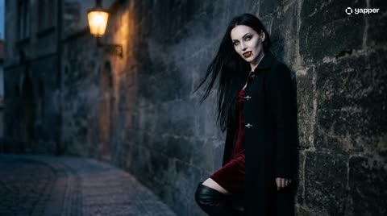</a>

The scene paragraph stacks concrete set details (wet brick, lamp reflection, volumetric fog) with film terms like 35mm look, grain and shallow depth of field for a cinematic horror still. A camera path from boots up to the eyes and a timed beat sheet of smile, fangs, whisper and fade make it extend naturally to video.

Nano Banana 2 · Text-to-image · Source: [@The_Kremlinn on X](https://x.com/The_Kremlinn/status/2054418680692228271) · 124 likes on 2026-10-28

[`vampire`](tags.md#tag-vampire) [`gothic`](tags.md#tag-gothic) [`cinematic`](tags.md#tag-cinematic) [`fog`](tags.md#tag-fog) [`horror`](tags.md#tag-horror)

<details><summary><b>Prompt</b></summary>

```text
Dark gothic alley at night, wet brick wall and rain-soaked pavement reflecting a dim street lamp. Heavy fog drifts slowly through the alley. A pale elegant vampire woman in a long black coat and dark red dress leans against the wall, motionless and mysterious. Cinematic horror lighting, dramatic shadows, shallow depth of field, ultra-realistic, 35mm film look, film grain, volumetric fog.
The camera begins at her black leather boots and performs a slow cinematic vertical dolly shot upward, moving smoothly from her feet → legs → waist → shoulders → lips → eyes. Suspense builds as the camera rises.
When the camera reaches her face, she slowly tilts her head and gives a cold villain smile. Her long sharp vampire fangs slide into view, fresh blood dripping slowly from the tips. Her eyes glow subtly in the darkness.
She whispers softly: “Welcome to the night…”
Immediately after, she lets out a quiet sinister villain laugh as the fog thickens and the lighting darkens.
The scene begins to slowly fade to black, while the camera continues pushing forward into an extreme close-up, zooming closer and closer until the camera enters her mouth, ending in darkness.
Style keywords: cinematic horror, gothic vampire, slow camera movement, dramatic lighting, suspenseful, photorealistic, moody atmosphere, shallow depth of field, film grain, volumetric fog.
```

</details>

<a id="nano-banana-color-block-fashion-high-angle-reaching-hand"></a>
### Color Block Fashion Portrait With Reaching Hand

<a href="https://x.com/alizagori1/status/2078375640416313479">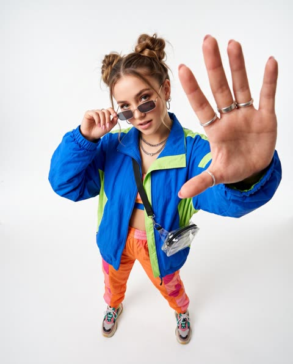</a>

A high overhead wide angle viewpoint paired with a hand reaching toward the lens creates a strong forced perspective effect. A clean white seamless backdrop, bright even studio light and a named 24mm lens keep the vivid color block outfit as the focus.

Nano Banana 2 · Text-to-image · Source: [@alizagori1 on X](https://x.com/alizagori1/status/2078375640416313479) · 123 likes on 2026-10-28

[`fashion`](tags.md#tag-fashion) [`editorial`](tags.md#tag-editorial) [`wide-angle`](tags.md#tag-wide-angle) [`studio-lighting`](tags.md#tag-studio-lighting) [`forced-perspective`](tags.md#tag-forced-perspective)

<details><summary><b>Prompt</b></summary>

```text
Made with Gemini Nano Banana 2 on
@Lart_AI
.

Model: Gemini Nano Banana 2
Aspect Ratio: 9:16
Resolution: 2K

Prompt: Ultra-realistic, high-fashion editorial portrait of a stylish young model captured from a dramatic bird's-eye wide-angle perspective, reaching one hand toward the camera to create an exaggerated perspective effect. Vibrant color-block outfit with modern accessories, clean white seamless studio background, high-key studio lighting, playful Gen Z aesthetic, confident expression, commercial fashion photography, ultra-detailed skin texture, sharp focus, premium styling, 8K, HDR, magazine cover quality, DSLR, 24mm wide-angle lens, f/2.8, crisp details, natural colors.
Negative Prompt: Low quality, blurry, noisy, overexposed, underexposed, distorted anatomy, extra fingers, deformed hands, duplicate limbs, bad proportions, cropped, watermark, text, logo, artifacts, motion blur, oversaturated, cartoon, CGI, low resolution.
Settings: SDXL, DPM++ 2M Karras, Steps: 30, CFG: 7, Aspect Ratio: 4:5.
```

</details>

<a id="gpt-image-charcoal-sketch-wall-seated-portrait"></a>
### Seated woman before giant charcoal sketch portrait

<a href="https://x.com/Kubra_286/status/2102597090534649952">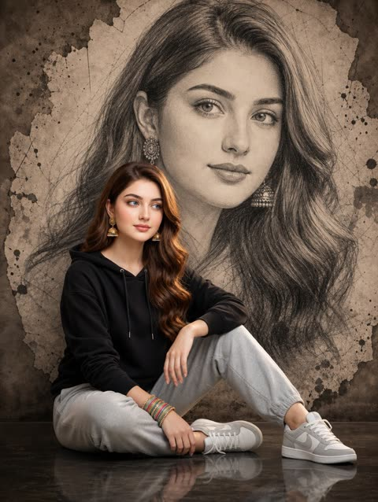</a>

A sepia charcoal sketch of the same face fills the wall while a full color photoreal portrait sits in front, so the monochrome against color contrast creates depth. A long identity lock block with explicit do not rules keeps the face consistent in both versions.

GPT Image 2.5 · Edit · Source: [@Kubra_286 on X](https://x.com/Kubra_286/status/2102597090534649952) · 122 likes on 2026-10-29

[`charcoal-sketch`](tags.md#tag-charcoal-sketch) [`layered-composite`](tags.md#tag-layered-composite) [`identity-lock`](tags.md#tag-identity-lock) [`editorial-portrait`](tags.md#tag-editorial-portrait)

<details><summary><b>Prompt</b></summary>

```text
Create a layered composite portrait of the SAME FEMALE PERSON from the uploaded face reference image.

CONCEPT:
A massive, highly detailed charcoal/pencil sketch portrait fills the background like a hand-drawn wall mural, while a sharp full-color photorealistic seated portrait of the same woman appears in the foreground on a dark reflective floor.

BACKGROUND SKETCH PORTRAIT:
Large detailed black-and-white pencil and charcoal sketch of the same woman, head turned slightly to the side. Preserve her exact hairstyle and hair texture, facial features, eyebrows, eyes, nose, lips, jawline and natural facial proportions. The sketch should have visible pencil hatch strokes, charcoal shading, fine facial linework and realistic hand-drawn texture. Add rough torn-paper edges, ink-splatter marks and charcoal dust surrounding the sketch, blending naturally into a warm sepia-grey textured wall.

FOREGROUND FEMALE SUBJECT:
The same woman is seated casually on the floor. One leg is bent with the knee raised and one forearm resting naturally on the knee; the other leg extends outward to the side. Her torso is slightly turned, head tilted while looking off to the side, with a calm, thoughtful and natural expression.

IDENTITY LOCK — HIGHEST PRIORITY:
Use ONLY the uploaded female face reference image for facial identity and facial structure in BOTH the background sketch and the foreground photorealistic woman.

The foreground woman and background sketch must represent EXACTLY the same real person.

Preserve the exact:

- Face shape
- Jawline and jaw width
- Cheek structure
- Forehead shape
- Exact hairline
- Hairstyle and hair texture
- Eyebrow shape
- Eye shape, size and spacing
- Nose structure
- Lip shape and proportions
- Natural facial features
- Skin tone
- Skin texture
- Natural facial imperfections
- Overall feminine facial proportions

ZERO identity change.

Do NOT beautify or alter the face.
Do NOT change her age or facial structure.
Do NOT feminize or masculinize the face.
Do NOT smooth away natural skin texture.
Do NOT make her look like a celebrity or model.
Do NOT use a generic female face.
Do NOT introduce facial morphing.
Do NOT change her hairstyle or hairline unless required by the reference.
Do NOT create a different person.

The uploaded reference image is the ONLY source of facial identity.

BODY:
Natural feminine body proportions, realistic physique, natural skin tone and relaxed seated posture.

OUTFIT:
Black hooded sweatshirt with visible drawstrings, light grey jogger sweatpants and clean white-and-grey sneakers.

ENVIRONMENT:
Warm sepia-grey textured wall covered by the giant detailed pencil/charcoal portrait. Rough ink-splatter, charcoal dust and expressive pencil marks spread naturally around the sketch. Dark polished reflective floor beneath the seated woman, creating a subtle soft mirror reflection.

COMPOSITION:
Vertical editorial poster composition.
The large background sketch dominates the frame while the full-color seated woman is clearly separated in the foreground.
Strong visual depth between the hand-drawn portrait and realistic subject.
Balanced negative space.
Premium fashion-editorial composition.

LIGHTING:
Soft, even studio lighting from the front.
Minimal harsh shadows.
Warm neutral illumination.
Natural skin highlights.
Subtle controlled reflections on the dark floor.

COLOR GRADING:
Background: sepia-grey monochrome charcoal/pencil aesthetic.
Foreground: natural full-color female subject with realistic warm skin tones.
Strong but elegant contrast between the monochrome sketch and realistic woman.
Clean high-contrast editorial poster color grading.

CAMERA / QUALITY:
Sony A7R IV
50mm lens
f/1.8
Foreground subject tack sharp.
Extremely detailed skin texture, individual hair strands and clothing fabric.
Background pencil strokes, charcoal shading and ink-splatter texture highly detailed.
Ultra-photorealistic.
Premium editorial photography.
Natural depth of field.
Realistic materials and reflections.
4K-level detail.
Zero AI-looking artifacts.

NEGATIVE PROMPT:
No identity change, no different face, no generic female face, no celebrity resemblance, no face-swap artifacts, no facial distortion, no asymmetrical eyes, no extra fingers, no extra limbs, no malformed hands, no duplicated body parts, no plastic skin, no excessive skin smoothing, no beauty filter, no cartoon, no anime, no unrealistic body proportions, no blurry face, no low resolution, no watermark, no text, no logo.

OUTPUT:
Aspect Ratio: 3:4
Photorealistic female portrait
Identity preservation is the absolute highest priority.
```

</details>

<a id="nano-banana-fisheye-vintage-cafe-mirror-selfie"></a>
### Fisheye vintage cafe mirror selfie in turquoise interior

<a href="https://x.com/TheVirtualMuse/status/2108762311251116034">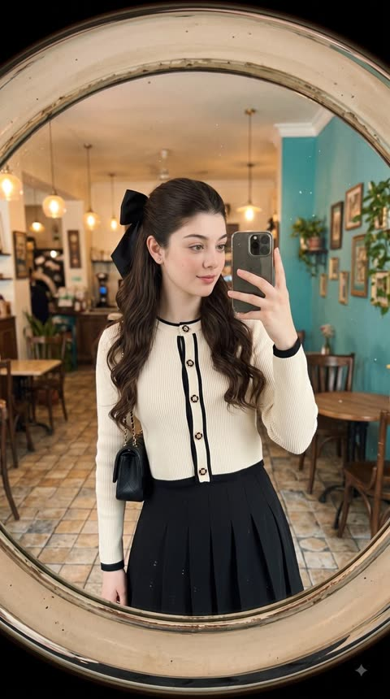</a>

An identity lock block keeps the reference face intact, while labeled sections for scene, background, lighting and camera separate each concern. Fisheye curvature is tied to a circular brass mirror, and strict rules about reflections and a single continuous photo keep the result realistic.

Nano Banana 2.1 · Edit · Source: [@TheVirtualMuse on X](https://x.com/TheVirtualMuse/status/2108762311251116034) · 121 likes on 2026-10-28

[`fisheye`](tags.md#tag-fisheye) [`mirror-selfie`](tags.md#tag-mirror-selfie) [`vintage-film`](tags.md#tag-vintage-film) [`cafe`](tags.md#tag-cafe) [`identity-lock`](tags.md#tag-identity-lock)

<details><summary><b>Prompt</b></summary>

```text
Using the uploaded reference image, create an ultra-realistic 1990s vintage café mirror selfie with a playful fisheye photography aesthetic.

IDENTITY LOCK: Preserve the exact facial identity of the reference person with maximum accuracy. Maintain the original eye shape, nose, lips, jawline, facial proportions, natural skin tone, age, and recognizable features. No facial alterations, beautification, or artificial skin smoothing.

SCENE & COMPOSITION: The subject is naturally taking a mirror selfie inside a beautiful vintage European café, standing in front of a large circular mirror with an aged brass frame. Use a strong fisheye lens perspective, creating dramatic yet realistic curvature around the café interior while keeping the subject's face naturally proportioned. The phone must appear correctly reflected in the mirror.

BACKGROUND: A charming retro café featuring turquoise accent walls, vintage wooden furniture, small round café tables, patterned tiled flooring, warm hanging pendant lights, antique decorative details, and soft daylight entering through large windows. The entire interior should curve naturally around the circular mirror.

LIGHTING & COLOR: Authentic 1990s analog film photography, warm golden highlights, slightly faded vintage colors, natural skin tones, soft shadows, subtle 35mm film grain, gentle contrast, and realistic reflections.

CAMERA & REALISM: Strong fisheye wide-angle perspective, authentic mirror reflections, natural handheld selfie composition, realistic optical distortion, detailed skin texture, individual hair strands, accurate fabric textures, and natural imperfections. Premium 8K photographic quality with the organic character of a genuine vintage film photograph.

STRICT RULES: One continuous photograph, no collage, no split screen, no additional people, no distorted facial features, no extra fingers, no incorrect reflections, no CGI, no artificial AI-generated appearance, no readable text, no logos, and no watermark.

FINAL LOOK: A beautiful, effortlessly candid vintage café mirror selfie that looks like a genuine photograph captured on a real fisheye lens, not an AI-generated image.
```

</details>

<a id="nano-banana-pointe-ballerina-butterfly-wing-gown"></a>
### Ballerina en pointe in butterfly wing gown

<a href="https://x.com/yourPlugAI/status/2109858986711240822">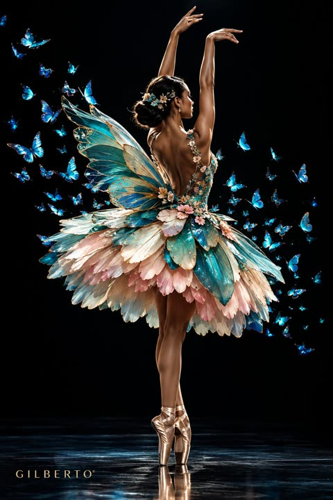</a>

A bracketed template fixes the subject, posture, materials and three colors, so one structure yields many gown variations. A dark stage floor with reflections and high contrast spotlighting makes the textures stand out.

Nano Banana 2.1 · Text-to-image · Source: [@yourPlugAI on X](https://x.com/yourPlugAI/status/2109858986711240822) · 120 likes on 2026-10-28

[`ballet`](tags.md#tag-ballet) [`avant-garde-fashion`](tags.md#tag-avant-garde-fashion) [`butterfly`](tags.md#tag-butterfly) [`studio-lighting`](tags.md#tag-studio-lighting) [`template`](tags.md#tag-template)

<details><summary><b>Prompt</b></summary>

```text
Full-body studio photograph of a [SUBJECT, e.g., female ballerina / model / dancer] poised in a graceful [POSTURE / ACTION, e.g., en pointe / reaching upward / mid-leap].

She wears an intricate, avant-garde outfit crafted from [PRIMARY MATERIAL / MOTIF, e.g., layered peacock feathers / butterfly wings / botanical petals] featuring [SECONDARY MATERIAL / DETAIL, e.g., delicate lace / fractal filigree / iridescent crystals].

The gown is designed in a striking color palette of [COLOR 1], [COLOR 2], and [COLOR 3] against a dark studio background with soft reflections on a dark stage floor. High-contrast dramatic spotlighting highlights fine textures and details.

📌Variable Guide attached below
```

</details>

<a id="nano-banana-dark-cinematic-skin-detail-portrait"></a>
### Dark Cinematic Close-Up with Extreme Skin Detail

<a href="https://x.com/Ozayrr_irl/status/2078676250244354493">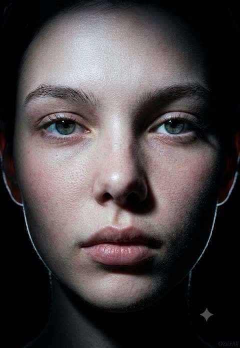</a>

Locks identity to a reference face, then specifies a tight crop, a single narrow spotlight from above and the side, no fill light and a thin rim light. Skin is described feature by feature (pores, stubble, sheen, capillary flush, iris fibers) so the raking light reads as texture.

Nano Banana 2 · Edit · Source: [@Ozayrr_irl on X](https://x.com/Ozayrr_irl/status/2078676250244354493) · 119 likes on 2026-10-29

[`portrait`](tags.md#tag-portrait) [`close-up`](tags.md#tag-close-up) [`skin-detail`](tags.md#tag-skin-detail) [`dramatic-lighting`](tags.md#tag-dramatic-lighting) [`face-reference`](tags.md#tag-face-reference)

<details><summary><b>Prompt</b></summary>

```text
Use the exact same face from the reference image and generate a dark cinematic portrait where obsessive skin detail and dramatic lighting collide into a single devastating image — where every pore becomes a universe and the darkness makes the face feel sacred.

Extreme close-up — face filling 90% of the frame, tight crop from just above the brows to just below the lips, ears dissolving at the edges into darkness. No outfit visible. No distractions. Just the face and the dark consuming everything around it.

Expression carries absolute still weight — eyes open and fully present, staring directly into the lens with a calm devastating intensity that requires no performance. Lips naturally sealed with the faintest natural tension. Every facial muscle completely still — the specific stillness of someone who knows exactly who they are and needs nothing from the world to confirm it.

Skin is the complete obsession — rendered at a level that makes dermatologists lean forward and photographers put down their cameras. Every individual pore with its own unique diameter, depth, shadow and raised wall structure simultaneously visible. Sebaceous filaments as dark pinpoint details across the nose wings and chin. The micro-topography of real skin — hills valleys ridges plateaus all visible as a landscape under raking light. Individual stubble hairs at follicle level — each one with its own emergence angle, thickness tapering from root to glowing tip, its own micro-shadow cast across the surrounding skin. Some hairs just breaking the surface, some fully emerged, some curling slightly — completely individual and real. Natural skin pigmentation variation — micro spots, subtle uneven tone, the biological truth of real skin. The specific oil distribution of real skin — slight natural sheen concentrated at the nose tip center forehead and cupid's bow, more matte at the jaw and temples. Natural capillary flush beneath the skin surface at the cheeks and nose — warmth visible under the skin like embers under ash. Under-eye skin showing its specific delicate thinness, the faint natural shadow of the tear trough. Every eyelash rendered individually with unique length thickness curl spacing and the way they catch the single light source and glow at their tips. Iris at microscopic fiber-pattern level — individual collagen fibers radiating from the pupil, natural color variation within the iris, the limbal ring a precise dark circle, the pupil a deep black with internal dimensional depth. A single sharp catch light in each eye from the key source — small, precise, alive.

Lighting is a single narrow Fresnel spotlight from high above and sharply to one side — the most brutal and revealing light possible, a column of cold white-blue light cutting across the face at a steep diagonal angle. The lit side of the face mercilessly exposed — every pore every follicle every skin surface variation caught by the raking light and made three-dimensional by micro-shadows. The light transition across the nose bridge razor sharp — lit side in brilliant cold detail, shadow side dissolving gradually into absolute black. No fill light anywhere — the shadow side is genuine darkness, total and final, only the faintest ghost of a razor-thin cold rim light from directly behind tracing the ear edge and jaw line with a thread of blue-white light — the only evidence the shadow side of the face exists.

The lit areas of skin catch the cold spotlight with scientific precision — the nose tip the highest highlight point, the forehead plane catching a wide sweep of light, the cheekbone a sharp bright ridge, the upper lip a subtle highlight above the sealed mouth. Every surface variation between these points creating its own micro-shadow under the raking light — the face as a topographic map of human biology.
```

</details>

<a id="gpt-image-1998-coastal-summer-travel-editorial"></a>
### Late 1990s coastal summer travel portrait

<a href="https://x.com/AIwithWania/status/2098773641303310647">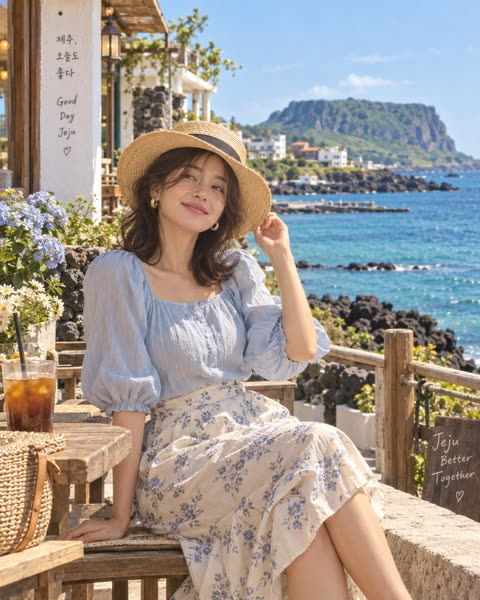</a>

Fixes an era, a real-world location mood and a film look (Kodak grain, faded highlights, golden light) so the whole frame reads as one period magazine shoot. Detailed outfit, pose and setting lists plus a negative list keep the result candid and realistic.

GPT Image 2.5 · Text-to-image · Source: [@AIwithWania on X](https://x.com/AIwithWania/status/2098773641303310647) · 118 likes on 2026-10-28

[`travel-editorial`](tags.md#tag-travel-editorial) [`film-photography`](tags.md#tag-film-photography) [`1990s`](tags.md#tag-1990s) [`coastal`](tags.md#tag-coastal) [`fashion`](tags.md#tag-fashion)

<details><summary><b>Prompt</b></summary>

```text
Create an ultra-realistic late-1990s summer travel editorial featuring a stylish young woman and a stylish young man in two separate portrait frames with the exact same visual theme and color grading.

The setting is a dreamy coastal destination inspired by Jeju Island and the Greek islands, with crystal-blue sea, rocky coastline, white seaside cafés, flowering plants, distant mountains, small boats, warm wooden furniture, and bright clear summer skies.

The woman is seated naturally at a charming seaside café. She wears a modest but fashionable pastel-blue puff-sleeve blouse with a flowing cream floral midi skirt, elegant minimal jewelry, and a relaxed straw hat. Her outfit must be tasteful and not revealing. Give her soft, slightly wavy shoulder-length hair with natural movement. Her pose should feel spontaneous and stylish—one hand resting lightly near her hat or hair, the other relaxed beside her, with a gentle natural smile.

The man is seated casually in the same coastal atmosphere, wearing a cream linen shirt, relaxed beige trousers, classic sunglasses, minimal wristwatch, and clean white sneakers. Give him naturally messy wavy hair and an effortless vintage European summer look. One arm rests casually on the chair while the other hand is near his face, creating a relaxed editorial pose.

Use warm 1990s film photography, subtle Kodak-style grain, slightly faded highlights, soft golden sunlight, realistic skin texture, gentle shadows, natural imperfections, rich ocean blues, creamy whites, muted pastels, and nostalgic analog color grading.

Make both portraits look like they were photographed for a rare 1998 international summer travel magazine, candid rather than posed, sophisticated but effortless, cinematic yet completely realistic.

No modern influencer look, no heavy makeup, no bold/revealing clothes, no artificial CGI appearance, no plastic skin, no excessive blur, no text or logos.

Vibe: “A forgotten summer somewhere by the sea — 1998.”
```

</details>

<a id="nano-banana-neon-cyberpunk-bearded-man-portrait"></a>
### Bearded man in pink sunglasses, neon portrait

<a href="https://x.com/Sheldon056/status/2033335996889379057">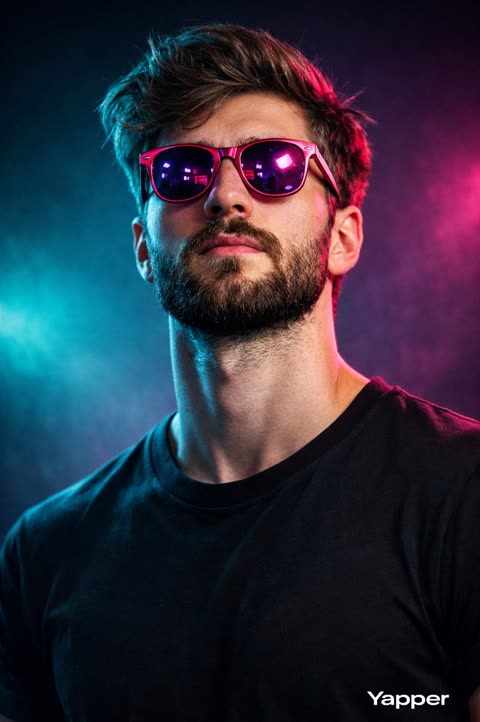</a>

Names the subject, expression and wardrobe, then sets teal and magenta lighting to cast bold shadows across the face. A closing style line (cyberpunk-inspired studio photography) fixes the mood, and the reflective lenses add neon detail.

Nano Banana 2 · Text-to-image · Source: [@Sheldon056 on X](https://x.com/Sheldon056/status/2033335996889379057) · 117 likes on 2026-10-28

[`portrait`](tags.md#tag-portrait) [`neon`](tags.md#tag-neon) [`cyberpunk`](tags.md#tag-cyberpunk) [`studio-lighting`](tags.md#tag-studio-lighting) [`sunglasses`](tags.md#tag-sunglasses)

<details><summary><b>Prompt</b></summary>

```text
Generated with Nano Banana 2 on
@yapper_so
.

Prompt: Create a bold, cinematic portrait 8k ultra HD high details resulation of a confident young man a well groomed beard, looking upward with purpose. He wears vibrant pink sunglasses reflecting neon lights, He wears a black t-shirts. Dramatic lighting in teal and magenta casts bold shadows and highlights across his face. Style: edgy, modern, cyberpunk-inspired studio photography.
```

</details>

<a id="nano-banana-wet-pool-portrait-pearl-heart-necklace"></a>
### Freckled woman in turquoise pool with pearl necklace

<a href="https://x.com/Just_sharon7/status/2044359258008113552">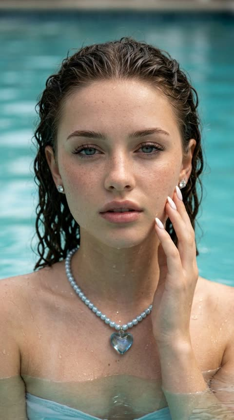</a>

Opens with a face lock line that keeps the reference identity, then stacks skin details such as freckles, droplets and damp glow with named jewelry and a hand pose. Closing camera cues of shallow depth of field, a 35mm lens and soft daylight give a skincare commercial look.

Nano Banana 2 · Edit · Source: [@Just_sharon7 on X](https://x.com/Just_sharon7/status/2044359258008113552) · 116 likes on 2026-10-29

[`portrait`](tags.md#tag-portrait) [`reference-face`](tags.md#tag-reference-face) [`wet-skin`](tags.md#tag-wet-skin) [`skincare-commercial`](tags.md#tag-skincare-commercial) [`shallow-depth-of-field`](tags.md#tag-shallow-depth-of-field)

<details><summary><b>Prompt</b></summary>

```text
Use the same face from the reference image without changing facial features.
Cinematic fashion portrait of a young western woman with light freckles across her nose and cheeks, striking bright blue eyes, and fair skin. She is emerging gracefully from a turquoise swimming pool, water dripping from her wet, dark curly hair that clings to her shoulders. Her skin is glistening and damp under soft natural daylight. She wears a delicate light blue pearl necklace featuring a small glass heart pendant and matching diamond stud earrings. One hand is softly touching her cheek, displaying elegant white manicured nails. The image has a luxurious high-end skincare commercial aesthetic, shallow depth of field with a beautifully blurred water background, hyper-realistic details, 8k resolution, shot on a 35mm lens, cinematic lighting.
```

</details>

<a id="nano-banana-teen-suit-supercar-sunset-skyline"></a>
### Teen in black suit on supercar at sunset

<a href="https://x.com/Zarlish_Shahid/status/2078634279895248920">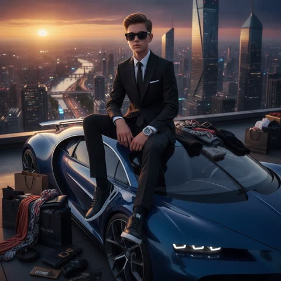</a>

A single subject, a clear location and a short list of props set the scene, and a golden hour skyline adds depth. Photographic cues such as shallow depth of field, glossy reflections and a magazine cover finish keep the render realistic. Asking for no logos keeps the car generic.

Nano Banana 2 · Text-to-image · Source: [@Zarlish_Shahid on X](https://x.com/Zarlish_Shahid/status/2078634279895248920) · 114 likes on 2026-10-28

[`fashion-editorial`](tags.md#tag-fashion-editorial) [`supercar`](tags.md#tag-supercar) [`golden-hour`](tags.md#tag-golden-hour) [`cityscape`](tags.md#tag-cityscape) [`luxury`](tags.md#tag-luxury)

<details><summary><b>Prompt</b></summary>

```text
Luxury Has No Age

A confident 16-year-old boy sitting on the roof of a futuristic luxury supercar (Bugatti-inspired, no logos), wearing an expensive black tailored suit, premium designer sneakers, a luxury watch, and stylish sunglasses. Surrounded by luxury shopping bags, high-end fashion accessories, and elegant designer clothing. A modern city skyline with golden sunset lighting in the background. Ultra-realistic, cinematic composition, glossy reflections, shallow depth of field, dramatic lighting, luxury lifestyle, rich colors, 8K, hyper-detailed, magazine cover quality, photorealistic, premium fashion editorial style.

If you could create your dream luxury lifestyle with AI, what would be the first thing you'd add?
```

</details>

<a id="gpt-image-windswept-meadow-editorial-portrait"></a>
### Woman in ivory dress among windswept green grass

<a href="https://x.com/MahnoorAi12/status/2101997367641751808">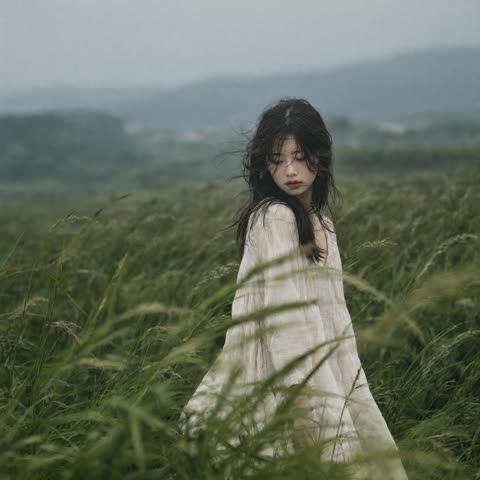</a>

Layers foreground grass over the subject for depth, then fixes a muted sage and forest green palette, soft overcast light and an 85mm f/1.8 look with film grain. The 1:1 framing places her right of center with open negative space above, which gives the editorial feel.

GPT Image 2.5 · Edit · Source: [@MahnoorAi12 on X](https://x.com/MahnoorAi12/status/2101997367641751808) · 113 likes on 2026-10-28

[`editorial`](tags.md#tag-editorial) [`meadow`](tags.md#tag-meadow) [`film-grain`](tags.md#tag-film-grain) [`fashion`](tags.md#tag-fashion) [`cinematic`](tags.md#tag-cinematic)

<details><summary><b>Prompt</b></summary>

```text
A cinematic fashion-editorial portrait of a young East Asian woman standing partially concealed within tall, windswept green grass in an expansive meadow. She wears a loose, flowing off-white or ivory linen dress that moves softly with the breeze, contrasting gently against the rich natural surroundings.
Her dark hair appears naturally tousled by the wind, with soft strands falling across her face, partially veiling her eyes. Her head is gently lowered, gaze directed downward or slightly to the side, conveying a quiet, dreamy, introspective mood. The tall grass surrounds and partially obscures her figure, creating layered foreground elements, immersive depth, and a sense of visual intimacy.
Wind moves through the grass with subtle motion blur, while the subject remains sharply focused. The environment feels calm, isolated, and poetic, enhanced by a faint atmospheric haze and a muted palette of sage green, deep forest green, and soft neutral tones. Soft overcast daylight provides diffused, shadowless illumination with smooth tonal transitions, low contrast, gentle highlights, and realistic skin rendering.
Shallow depth of field produces creamy bokeh and natural background separation, while fine film grain adds an organic editorial texture. Minimalist composition emphasizing solitude and emotional storytelling. Square 1:1 composition, subject positioned slightly right of center with generous negative space above and around her, balanced visual weight, refined framing, sophisticated Korean and Japanese fashion magazine aesthetic, cinematic realism, highly detailed photorealistic photography, 85mm portrait lens, f/1.8, natural lens compression, ultra-realistic skin texture, premium color grading, atmospheric depth, elegant visual storytelling, award-winning editorial photography, masterfully composed, authentic and emotionally resonant.
```

</details>

<a id="nano-banana-emerald-blazer-fashion-grid-sunglasses"></a>
### Four pose fashion grid in emerald blazer

<a href="https://x.com/weiinberg/status/2033048967777497600">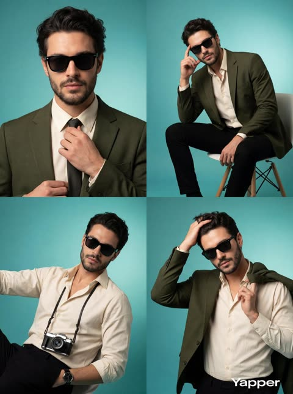</a>

Uses an uploaded photo as the identity reference and fixes the 2x2 layout, outfit and each of the four poses. Studio lighting positions, camera settings and skin detail cues push the result toward editorial realism.

Nano Banana 2 · Edit · Source: [@weiinberg on X](https://x.com/weiinberg/status/2033048967777497600) · 113 likes on 2026-10-28

[`fashion`](tags.md#tag-fashion) [`studio-portrait`](tags.md#tag-studio-portrait) [`grid-layout`](tags.md#tag-grid-layout) [`identity-reference`](tags.md#tag-identity-reference) [`editorial`](tags.md#tag-editorial)

<details><summary><b>Prompt</b></summary>

```text
Use my uploaded photo as the identity reference.
Create a professional studio fashion photoshoot in a 2×2 grid collage showing four poses of the same person wearing black sunglasses.

Outfit: deep emerald green tailored blazer, cream/off-white dress shirt, black slim trousers, burgundy tie, optional silver watch. Blazer appears differently across frames (worn, draped over shoulder, partially removed, held).
Background: clean teal-to-turquoise gradient studio backdrop, minimal fashion studio setting.
Poses:
1.Close portrait adjusting tie.
2.Seated editorial pose leaning forward with elbow on knee.
3.Relaxed pose with vintage camera around neck.
4.Stylish pose running hand through hair while holding blazer.
Lighting: professional three-point studio lighting — softbox key light 45° camera left, soft fill light camera right, subtle rim light behind subject.
Camera: Sony A7R V, 85mm portrait lens, f/2.2, ISO 100, 1/160s, WB 5600K, shallow depth of field, focus on eyes.
Realism: natural skin pores, hair strands, subtle fabric wrinkles, realistic shadows, lens compression, reflections in sunglasses.
Output: ultra-realistic GQ/Vogue-style editorial photography, sharp detail, 4K resolution, clean 2×2 grid layout.
```

</details>

<a id="gpt-image-convenience-store-flash-found-photo"></a>
### Found photo flash portrait in a night convenience store

<a href="https://x.com/Ciri_ai/status/2101253843870707722"></a>

Stacks a magazine editorial sensibility with a specific consumer compact camera spec (30mm, ISO 640, f/3.2) and direct flash, then adds deliberate flaws like clipped highlights, odd white balance and accidental cropping. A long negative list rules out studio gloss, HDR and plastic skin so it reads as a found photograph.

GPT Image 2.5 · Text-to-image · Source: [@Ciri_ai on X](https://x.com/Ciri_ai/status/2101253843870707722) · 111 likes on 2026-10-29

[`found-photo`](tags.md#tag-found-photo) [`direct-flash`](tags.md#tag-direct-flash) [`y2k-compact`](tags.md#tag-y2k-compact) [`convenience-store`](tags.md#tag-convenience-store) [`fashion-editorial`](tags.md#tag-fashion-editorial)

<details><summary><b>Prompt</b></summary>

```text
GINZA Magazine-inspired Japanese lifestyle fashion editorial × early-2000s Y2K consumer compact digital camera × Korean female idol × raw documentary-fashion hybrid × found photograph aesthetic.

The image must feel like a real photograph discovered inside an old digital camera rather than a deliberately retro-styled AI image.

Japanese urban lifestyle sensibility, understated fashion intelligence, quiet observational storytelling, mundane everyday environment transformed into subtle fashion imagery.

A beautiful young adult Korean female idol standing inside a small Japanese convenience store late at night, casually holding a bottled milk drink while looking directly into the camera.

She wears a faded navy oversized zip hoodie over a white fitted ribbed tank top, low-rise charcoal mini skirt, worn sneakers, tiny silver shoulder bag and thin silver necklace.

Long platinum-blonde hair, slightly messy straight bangs, loose strands around her face.

Soft Korean-Japanese makeup, natural flushed cheeks, subtle taupe eyeshadow, soft pink lips, realistic visible pores.

She stands between narrow convenience-store aisles, refrigerators glowing behind her, shelves of snacks and drinks creating visual clutter.

Photographed extremely close with a late-2000s consumer compact digital camera, 30mm equivalent, ISO 640, f/3.2.

DIRECT ON-CAMERA FLASH, slightly harsh frontal flash, realistic specular highlights on skin and packaging, warm fluorescent ambient light mixing with cooler refrigerator illumination.

Slightly imperfect white balance, clipped highlights on reflective packaging, darker corners, subtle digital noise, mild chromatic aberration, slight edge softness.

The framing feels accidental: part of a shelf enters the foreground, one product is slightly cropped, subject not perfectly centered.

GINZA-inspired quiet Japanese lifestyle sensibility, understated fashion intelligence, raw documentary observation.

LUT: Warm Convenience Digital / muted highlights / fluorescent contamination
Harmony: navy × white × charcoal × refrigerator cyan
sRef: [Y2K-COMPACT-SREF]
Tokens: found photograph, direct flash, consumer digital, mundane location, incidental framing, not retro filter.
Real photograph, not AI fashion campaign.

3:4 portrait.

NEGATIVE:
studio lighting, beauty campaign, luxury advertising, perfect symmetry, HDR, smartphone photography, cinematic teal orange, plastic skin, excessive bokeh, flawless skin, CGI, illustration, anime, overly posed idol photoshoot.
```

</details>

<a id="gpt-image-emerald-cafe-sage-green-fashion-portrait"></a>
### Sage green outfit portrait outside emerald cafe

<a href="https://x.com/hey_am_cherry/status/2112044506514440506"></a>

The prompt fixes the setting first, then lists each garment and accessory with its color, so the palette stays coherent. Eye-level full-body framing, shallow depth of field and golden-hour light give it an editorial look, and a closing negative prompt guards against anatomy errors.

GPT Image 2.5 · Text-to-image · Source: [@hey_am_cherry on X](https://x.com/hey_am_cherry/status/2112044506514440506) · 111 likes on 2026-10-28

[`fashion`](tags.md#tag-fashion) [`cafe`](tags.md#tag-cafe) [`golden-hour`](tags.md#tag-golden-hour) [`editorial`](tags.md#tag-editorial) [`full-body`](tags.md#tag-full-body)

<details><summary><b>Prompt</b></summary>

```text
Create a realistic lifestyle fashion portrait, subject stands casually outside a premium modern café with deep emerald green exterior panels and large glass windows revealing a warm, softly lit interior. Minimal Scandinavian café aesthetic with hanging pendant lights, wooden furniture, and subtle reflections on the glass.

The model wears a pastel sage-green baseball cap, fitted white tube top, olive-green denim overall shorts with one strap unfastened, matching green sneakers, delicate gold jewelry, and a luxury black quilted mini handbag with pearl chain placed on a small marble café table beside a takeaway coffee cup.

Natural relaxed pose with one leg slightly crossed, one hand inside the pocket, calm confident expression, looking directly at the camera. Eye-level composition, full-body framing, shallow depth of field, creamy bokeh, soft golden-hour daylight, premium editorial fashion photography, ultra-realistic skin texture, luxury color grading, crisp details, cinematic realism, high-end Vogue campaign quality.

Negative Prompt: low quality, blurry, extra fingers, bad anatomy, distorted face, duplicate person, cartoon, CGI, oversaturated colors, watermark, logo, text, cropped body, unnatural pose, plastic skin, noise.
```

</details>

<a id="gpt-image-surveillance-hud-street-portrait-russian-text"></a>
### Street portrait with Russian surveillance HUD overlay

<a href="https://x.com/codewithhajra/status/2074473336327802940"></a>

A candid photo from an elevated surveillance angle is combined with a list of specific HUD parts such as a face frame, ID card, scan lines and timestamp. Forcing all overlay text into one language and banning English keeps the labels consistent, and bracketed slots for outfit, place, animal and palette make it a reusable template.

GPT Image 2 · Text-to-image · Source: [@codewithhajra on X](https://x.com/codewithhajra/status/2074473336327802940) · 111 likes on 2026-10-29

[`hud-overlay`](tags.md#tag-hud-overlay) [`surveillance-style`](tags.md#tag-surveillance-style) [`street-photography`](tags.md#tag-street-photography) [`multilingual-text`](tags.md#tag-multilingual-text) [`template`](tags.md#tag-template)

<details><summary><b>Prompt</b></summary>

```text
Cyber-core editorial photography of [your details] wearing [clothing], walking through [location] with [animal]. A realistic candid street photograph captured from a slightly elevated surveillance-style angle, featuring natural movement, stylish everyday fashion, and a calm cinematic atmosphere. Add elegant digital interface elements, including a facial detection frame, object labels, an identity card panel, subtle scan lines, thin HUD boxes, small data text, tracking points, a timestamp, and minimal biometric graphics. Keep the interface clean, refined, and well-spaced. All visible interface text, labels, captions, ID panel content, biometric data, object tags, timestamps, and digital overlay elements must be written entirely in Russian. Do not use any English text anywhere in the image. Use a [color palette] with realistic lighting, polished editorial photography, soft contrast, sharp details, and a sophisticated futuristic design language. Beautiful, minimal, and uncluttered. Aspect ratio: 4:5.
```

</details>

<a id="nano-banana-cheetah-red-velvet-sofa-luxury"></a>
### Man with cheetah on red velvet sofa

<a href="https://x.com/auqibhabib/status/2029721401033384149"></a>

Starts with a reference picture to keep the subject's face, then lists wardrobe, props, a sofa setting and blurred guards in the background for depth. Closing cues like cinematic lighting and dramatic atmosphere set the mood.

Nano Banana 2 · Edit · Source: [@auqibhabib on X](https://x.com/auqibhabib/status/2029721401033384149) · 111 likes on 2026-10-28

[`reference-image`](tags.md#tag-reference-image) [`luxury`](tags.md#tag-luxury) [`cinematic-lighting`](tags.md#tag-cinematic-lighting) [`animal`](tags.md#tag-animal) [`portrait`](tags.md#tag-portrait)

<details><summary><b>Prompt</b></summary>

```text
Using the reference picture, create A stylish man sitting on a luxurious vintage red velvet sofa, wearing black silk shirt, sunglasses, confi-dently holding a cheetah adorned with cinematic lighting, dollars are spread on sofa too and there are two guards on back side in blur bg, luxury life-style, dramatic atmosphere." 100% Real Face 8K Resolution
```

</details>

<a id="nano-banana-miniature-self-figurine-in-hand"></a>
### Woman Holding Miniature Figurine of Herself

<a href="https://x.com/HaniaAi12/status/2031190193253056883"></a>

A forced perspective setup with a 24mm lens places the figurine in the foreground and the woman in the mid ground. The uploaded face reference is reused for both, and the prompt repeats the outfit so the figurine matches. Skin detail on the hand and a soft bokeh garden background sell the scale illusion.

Nano Banana 2 · Edit · Source: [@HaniaAi12 on X](https://x.com/HaniaAi12/status/2031190193253056883) · 111 likes on 2026-10-29

[`forced-perspective`](tags.md#tag-forced-perspective) [`miniature-figurine`](tags.md#tag-miniature-figurine) [`face-reference`](tags.md#tag-face-reference) [`wide-angle`](tags.md#tag-wide-angle) [`scale-illusion`](tags.md#tag-scale-illusion)

<details><summary><b>Prompt</b></summary>

```text
A hyper-realistic, forced-perspective wide-angle photography shot captured with a 24mm lens, featuring a woman holding a highly detailed miniature figurine of herself in her outstretched right hand, creating a playful scale illusion. The woman in the mid-ground, identified by the uploaded face as reference, wears a black and grey plaid flannel shirt left unbuttoned over a black graphic t-shirt with a yellow and white logo, paired with blue jeans, and is smiling warmly with a soft focus applied to her face.

The miniature figurine in the immediate foreground is a perfect scale replica, also featuring the uploaded face as reference but with a slightly stylized, hand-painted resin texture, wearing the exact same outfit including the plaid shirt, graphic tee, distressed denim jeans with rips, and grey sneakers, standing on a small circular grey concrete base.

The hand holding the base is rendered with extreme dermatological fidelity, showing skin pores, knuckles, and fingerprints in razor-sharp focus. The background is a picturesque English countryside garden featuring a stone cottage with a chimney, a wooden archway covered in climbing purple wisteria, lush green lawns, and vibrant pink rose bushes, all bathed in soft, diffused natural daylight with a shallow depth of field that creates a creamy bokeh effect on the distant architecture and foliage.

8K resolution, cinematic lighting, photorealistic textures, 2:3 ratio.
```

</details>

<a id="nano-banana-burgundy-satin-editorial-portrait"></a>
### Editorial portrait in burgundy satin with gold earrings

<a href="https://x.com/MissDelulu9/status/2109630710642528421"></a>

The prompt is built in labeled blocks for face, hair and outfit, pose, background, lighting and photography style. Specific lens, lighting and skin texture terms (85mm, softbox, pores, champagne highlight) steer it toward a believable magazine look.

Nano Banana 2.1 · Text-to-image · Source: [@MissDelulu9 on X](https://x.com/MissDelulu9/status/2109630710642528421) · 110 likes on 2026-10-28

[`editorial`](tags.md#tag-editorial) [`fashion`](tags.md#tag-fashion) [`portrait`](tags.md#tag-portrait) [`satin`](tags.md#tag-satin) [`studio-lighting`](tags.md#tag-studio-lighting)

<details><summary><b>Prompt</b></summary>

```text
Create an ultra-realistic, high-fashion editorial portrait of a stunning adult woman with striking blue-grey eyes, naturally full lips with glossy coral-red lipstick, defined eyebrows, sharp black winged eyeliner, long eyelashes, subtle freckles, and luminous dewy skin with realistic pores and a soft champagne highlight.

Her sleek, jet-black hair is neatly center-parted and pulled back into a long, straight, low ponytail. She wears an elegant deep burgundy satin couture dress featuring an exaggerated sculptural high collar, dramatic draped fabric, and an asymmetrical sleeveless design. Large, polished gold geometric statement earrings complete the luxurious look.

Pose: Three-quarter over-the-shoulder pose, body turned away from the camera while her face looks directly toward the viewer, with a confident, elegant, slightly mysterious expression.

Background: Minimalist muted sage-green and turquoise studio backdrop with soft, atmospheric gradients.

Lighting: Professional softbox lighting, cinematic shadows, delicate highlights on the cheekbones, realistic satin reflections, beautiful skin texture, and sophisticated color grading.

Photography style: Luxury beauty campaign, Vogue-inspired editorial photography, 85mm portrait lens, shallow depth of field, sharp focus on the eyes, photorealistic details, premium fashion magazine aesthetic,  vertical 9:16 composition.
```

</details>

<a id="gpt-image-halftone-windswept-hair-portrait-ivory-paper"></a>
### Windswept Hair Halftone Portrait on Ivory Paper

<a href="https://x.com/hey_am_cherry/status/2111324127378416005"></a>

Naming the print process (halftone dots, stippled shading, screen-print texture) with a two-tone palette of deep black and cream gives a convincing vintage look. A separate negative prompt rules out color, 3D and plastic skin, and the chest-up framing is stated explicitly.

GPT Image 2.5 · Text-to-image · Source: [@hey_am_cherry on X](https://x.com/hey_am_cherry/status/2111324127378416005) · 108 likes on 2026-10-29

[`halftone`](tags.md#tag-halftone) [`monochrome`](tags.md#tag-monochrome) [`portrait`](tags.md#tag-portrait) [`vintage-print`](tags.md#tag-vintage-print) [`negative-prompt`](tags.md#tag-negative-prompt)

<details><summary><b>Prompt</b></summary>

```text
{
  "aspect_ratio": "9:16",
  "prompt": "A beautiful young woman with long, messy black hair blowing dramatically across her face, eyes closed, lips slightly parted, head tilted back, elegant elongated neck, wearing a simple black V-neck top. Chest-up portrait, slightly right of center. Vintage monochrome halftone print art, tiny black ink dots, stippled shading, high contrast, warm ivory textured paper background, deep black shadows, cream highlights, retro editorial photography, moody, dreamy, melancholic, intricate details, sharp facial features, authentic screen-print texture.",
  "negative_prompt": "color, 3D, anime, plastic skin, open eyes, exaggerated expression, deformed face, bad anatomy, extra features, busy background, text, watermark, excessive blur"
}
```

</details>

<a id="nano-banana-blue-haze-hoodie-studio-portrait"></a>
### Cinematic blue haze studio portrait in dark hoodie

<a href="https://x.com/Emmma___0/status/2108109236555403768"></a>

A symmetrical medium close-up with cool blue edge light against one warm orange glow in the background gives the cinematic colour contrast. Skin imperfections, an 85mm lens look and a negative prompt against plastic skin and HDR keep the face realistic.

Nano Banana 2.1 · Text-to-image · Source: [@Emmma___0 on X](https://x.com/Emmma___0/status/2108109236555403768) · 102 likes on 2026-10-28

[`portrait`](tags.md#tag-portrait) [`cinematic`](tags.md#tag-cinematic) [`studio-lighting`](tags.md#tag-studio-lighting) [`photorealistic`](tags.md#tag-photorealistic) [`negative-prompt`](tags.md#tag-negative-prompt)

<details><summary><b>Prompt</b></summary>

```text
Create a highly photorealistic cinematic portrait of a person standing centered and facing the camera with a calm, serious expression. Natural facial proportions, realistic skin texture, detailed eyes, subtle skin imperfections, and naturally styled hair. The subject wears a simple oversized dark hoodie with a minimal light-colored shirt visible underneath.
Use a symmetrical composition with the subject occupying the central portion of the frame, medium close-up framing, and a clean professional presentation. The background is a dark deep-blue studio environment with atmospheric haze and subtle volumetric fog. Add cool blue lighting around the edges of the subject and a soft warm orange glow in the distant background on one side, creating a cinematic color contrast.
Dramatic but natural studio lighting, soft directional key light, subtle rim lighting, realistic shadows, controlled highlights, shallow depth of field, smooth background falloff, premium editorial photography, modern cinematic aesthetic, high contrast, realistic colors, detailed clothing texture, realistic hair and skin, professional camera photography, 85mm lens look, crisp focus, subtle film grain, ultra-photorealistic, highly detailed, 8K quality.
Negative prompt: cartoon, illustration, CGI, plastic skin, excessive HDR, oversharpening, distorted face, unnatural anatomy, extra limbs, blurry subject, low resolution, artificial skin, text, logo, watermark.
```

</details>

<a id="nano-banana-bw-seaside-windblown-portrait"></a>
### Black and white seaside portrait with windblown hair

<a href="https://x.com/SimplyAnnisa/status/2070720737426428068"></a>

Locks the face to an uploaded reference with explicit identity and no beautification rules, then stacks disposable film grain, 85mm shallow focus and an extreme macro framing line. A closing list of negatives (no clean digital sharpness, no centered portrait) keeps the result looking candid.

Nano Banana 2 · Edit · Source: [@SimplyAnnisa on X](https://x.com/SimplyAnnisa/status/2070720737426428068) · 102 likes on 2026-10-28

[`black-and-white`](tags.md#tag-black-and-white) [`film-grain`](tags.md#tag-film-grain) [`macro-portrait`](tags.md#tag-macro-portrait) [`face-reference`](tags.md#tag-face-reference) [`coastal`](tags.md#tag-coastal)

<details><summary><b>Prompt</b></summary>

```text
Nano banana 2 on
@Lart_AI


https://
lartai.com/?TG=10259
Intimate Wind Whisper
Composition: Extreme macro close-up focusing tightly on the face with wind-blown hair strands delicately framing the features and shallow focus on natural skin texture
Prompt: Using the uploaded photo as the exact face reference. Keep the face identity 100% unchanged, do not alter facial features, proportions, expression structure, or skin details. No face distortion, no beautification, no AI-looking changes. Photorealistic candid snapshot taken on a low-quality disposable film camera, black and white cinematic film photography, authentic 35mm grain, subtle imperfections, natural texture, vintage analog look. The woman has full voluminous hair slightly messy and blown by ocean wind, strands of hair falling naturally across the face, chin slightly raised, eyes gently closed, dreamy peaceful expression, soft genuine smile. She is wearing a voluminous white dress, sitting on wet textured seaside rocks. The background shows a dramatic massive coastal cliff covered in mist under a heavy overcast grey sky creating a moody coastal atmosphere with raw cinematic realism. Natural diffused daylight casts soft shadows in an emotional editorial photography style, realistic film exposure, high dynamic range, shallow depth of field, shot on 85mm lens, cinematic framing, authentic documentary feeling. Extreme close-up macro framing tightly captures her face, highlighting the texture of her skin and the delicate strands of wind-blown hair resting across her closed eyes and smile, with the white dress softly visible at the lower frame edge and the misty cliff gently out of focus behind.
no clean digital sharpness, no CGI look, no poster composition, no centered portrait, no black bars –ar 9:16
```

</details>

<a id="nano-banana-upside-down-woman-neon-korean-street"></a>
### Upside Down Woman Over Neon Rainy Street

<a href="https://x.com/iamsofiaijaz/status/2041558867897938137"></a>

The prompt describes the inverted layout directly: feet on an asphalt ceiling at the top, the street below. It then adds a puddle reflection, mist and neon signs for depth, and closes with lens and aspect ratio cues.

Nano Banana 2 · Text-to-image · Source: [@iamsofiaijaz on X](https://x.com/iamsofiaijaz/status/2041558867897938137) · 102 likes on 2026-10-28

[`surreal`](tags.md#tag-surreal) [`neon`](tags.md#tag-neon) [`rainy-street`](tags.md#tag-rainy-street) [`reflection`](tags.md#tag-reflection) [`cinematic`](tags.md#tag-cinematic)

<details><summary><b>Prompt</b></summary>

```text
A surreal, cinematic full-body shot of a woman wearing a purple denim jacket and black jeans, appearing to hang upside down from the sky. Her feet are firmly touching a dark, wet asphalt surface that forms the "ceiling" at the top of the frame. The bottom half of the image features a glowing, rain-slicked city street with vibrant neon Korean storefront signs, reflecting her perfectly in the deep puddles. The atmosphere is moody and overcast with thick mist and high contrast lighting. 8k resolution, photorealistic, shot on a 35mm lens, 3:4 aspect ratio.
```

</details>

<a id="nano-banana-subway-stairs-black-coat-street-portrait"></a>
### Man in black coat on subway stairs

<a href="https://x.com/pictsbyai/status/2032375474999964121"></a>

A structured JSON prompt splits the shot into composition, color profile, lighting, subject and background blocks, with hex colors, light direction and shadow placement set explicitly. Detailed hair texture and hand pose notes keep the face from looking over smoothed.

Nano Banana 2 · Text-to-image · Source: [@pictsbyai on X](https://x.com/pictsbyai/status/2032375474999964121) · 100 likes on 2026-10-28

[`street-photography`](tags.md#tag-street-photography) [`json-prompt`](tags.md#tag-json-prompt) [`fashion`](tags.md#tag-fashion) [`moody-lighting`](tags.md#tag-moody-lighting) [`editorial`](tags.md#tag-editorial)

<details><summary><b>Prompt</b></summary>

```text
{
"metadata": {
"image_type": "photograph",
"primary_purpose": "editorial"
},
"composition": {
"rule_applied": "rule of thirds",
"aspect_ratio": "4:5",
"layout": "single subject",
"focal_points": [
"Subject's face and dark sunglasses",
"Yellow fluorescent light fixture leading to the subject"
],
"visual_hierarchy": "Eye starts at the subject's face due to contrast with sunglasses, follows the V-neck down the black coat, moves outward along the metallic handrails, and catches the bright sunlight shaft on the left wall and the yellow light on the right.",
"balance": "asymmetric"
},
"color_profile": {
"dominant_colors": [
{
"color": "Black",
"hex": "#111111",
"percentage": "45%",
"role": "primary subject"
},
{
"color": "Warm Gray",
"hex": "#7A7269",
"percentage": "35%",
"role": "background"
},
{
"color": "Golden Yellow",
"hex": "#E5B05C",
"percentage": "10%",
"role": "accent"
}
],
"color_palette": "complementary",
"temperature": "warm",
"saturation": "moderate",
"contrast": "high contrast"
},
"lighting": {
"type": "mixed",
"source_count": "multiple sources",
"direction": "front",
"directionality": "highly directional",
"quality": "dramatic",
"intensity": "moody",
"contrast_ratio": "high contrast (dramatic shadows)",
"mood": "mysterious",
"shadows": {
"type": "harsh defined edges",
"density": "deep black",
"placement": "under handrails, within stair treads, and engulfing the subject's lower body",
"length": "medium"
},
"highlights": {
"treatment": "blown out",
"placement": "on upper left wall from sun shaft, fluorescent light fixture, and reflective handrails"
},
"ambient_fill": "present",
"light_temperature": "warm (golden)"
},
"technical_specs": {
"medium": "digital photography",
"style": "realistic",
"texture": "sharp",
"sharpness": "tack sharp",
"grain": "digital noise",
"depth_of_field": "medium",
"perspective": "high angle"
},
"artistic_elements": {
"genre": "street",
"influences": [
"Urban street style fashion photography",
"Cinematic cyberpunk/matrix aesthetic"
],
"mood": "sophisticated",
"atmosphere": "Gritty yet polished urban transit environment with a moody, imposing, and highly stylized fashion presence",
"visual_style": "structured"
},
"typography": {
"present": false,
"fonts": [],
"placement": "",
"integration": ""
},
"subject_analysis": {
"primary_subject": "Young male model wearing an oversized, structured long black overcoat, black V-neck top, black trousers, and dark rectangular sunglasses, walking down stairs. Hair: Medium length, textured cut (e.g., modern shag/tapered cut). Length: Roughly ear-level/temple-level on the sides, slightly longer and voluminous on top (3-4 inches), with soft layers and natural movement. Texture: Natural wavy texture, showing varied strands, slight frizz, and natural volume (imperfections visible, not 'AI smooth'), styled loosely back from the forehead without a distinct part. Evidence of light matte product application.",
"positioning": "center",
"scale": "medium",
"interaction": "interacting with environment",
"facial_expression": {
"mouth": "neutral",
"smile_intensity": "no smile",
"eyes": "direct gaze",
"eyebrows": "neutral",
"overall_emotion": "serious",
"authenticity": "posed"
},
"hands_and_gestures": {
"left_hand": "resting at waist level, lightly holding the edge of the black overcoat, silver ring visible on finger",
"right_hand": "not visible, hidden behind the coat's bulk or swinging backward",
"finger_positions": "left hand thumb and index finger slightly curled and gripping fabric, remaining fingers obscured",
"finger_interlacing": "none",
"hand_tension": "relaxed",
"interaction": "holding coat",
"naturalness": "deliberately posed"
},
"body_positioning": {
"posture": "standing",
"angle": "facing camera",
"weight_distribution": "shifted",
"shoulders": "level"
}
},
"background": {
"setting_type": "indoor",
"spatial_depth": "medium",
"elements_detailed": [
{
"item": "Stainless steel handrail",
"position": "left",
"distance": "foreground",
"size": "medium",
"condition": "worn",
"specific_features": "Tubular metal with distinct mounting brackets and subtle reflections"
},
{
"item": "Stainless steel handrail",
"position": "right",
"distance": "midground",
"size": "medium",
"condition": "worn",
"specific_features": "Tubular metal matching the left side, catching edge highlights"
},
{
"item": "Fluorescent light fixture",
"position": "top right",
"distance": "background",
"size": "medium",
"condition": "vintage",
"specific_features": "Rectangular housing emitting a strong, warm amber/yellow light"
}
],
"wall_surface": {
"material": "tile",
"surface_treatment": "finished",
"texture": "perfectly smooth",
"finish": "satin",
"color": "warm grayish-brown",
"color_variation": "patchy",
"features": "clean, distinct grid-like grout lines separating large rectangular stone/granite panels, sharp diagonal shaft of warm sunlight hitting the upper left section",
"wear_indicators": "industrial"
},
"floor_surface": {
"material": "concrete",
"color": "dark gray with yellow accents",
"pattern": "striped"
},
"objects_catalog": "Metal diamond-plate stair treads with yellow painted safety edges running horizontally across the bottom and midground, dual tubular stainless steel handrails flanking the stairs, rectangular yellow light fixture mounted to the ceiling angled directly above the stairwell, large rectangular stone tiles covering the walls.",
"background_treatment": "sharp"
},
"generation_parameters": {
"prompts": [
"Editorial street style photography, a handsome young man with medium length, textured modern shag haircut showing natural wavy movement and styled loosely back. He wears dark rectangular sunglasses, a long black oversized wool coat, and an all black outfit, walking down urban subway stairs. The walls are made of large polished brown-gray stone tiles with visible grid grout lines. A dramatic shaft of warm golden sunlight hits the upper left wall. A vintage yellow fluorescent light fixture is on the upper right ceiling. The stairs are concrete with metal edges and yellow safety paint. Stainless steel handrails. Cinematic lighting, deep dramatic black shadows, sharp focus, 85mm lens, high contrast, moody, fashionable underground matrix aesthetic.",
"Cinematic fashion portrait, male model in structural black overcoat descending transit stairs, medium length textured hair with soft waves, tinted glasses. High angle shot looking down the steps. Brutalist architecture background, granite wall panels. Mixed lighting featuring harsh geometric sunbeams on the wall contrasting with artificial yellow ambient light. Gritty texture, high dynamic range, hyper-realistic, sophisticated urban mood."
],
"keywords": [
"street style",
"oversized black coat",
"subway stairs",
"cinematic lighting",
"medium length hair",
"textured hair",
"modern shag"
],
"technical_settings": "85mm lens, f/4.0 aperture for medium depth of field keeping background architectural elements recognizable, 1/250s shutter speed, ISO 400. Metered to preserve the sun shaft highlight while letting shadows fall to deep blacks.",
"post_processing": "Color grading to enhance warm golden highlights against neutral/cool shadows, boosted contrast curve, subtle film grain introduced in the deep shadow areas for texture."
}
}
```

</details>

<a id="gpt-image-rooftop-sunset-smoke-disintegration-portrait"></a>
### Man on rooftop disintegrating into smoke at sunset

<a href="https://x.com/AiWithTariq/status/2101869465977897075"></a>

The prompt fixes the outfit, side profile pose and setting first, then limits the disintegration to one side of the body, which keeps the figure readable. Naming the smoke, ash and golden sparks separately, with warm sunset light and a wet reflective floor, gives the transition a clear light source and depth.

GPT Image 2.5 · Text-to-image · Source: [@AiWithTariq on X](https://x.com/AiWithTariq/status/2101869465977897075) · 98 likes on 2026-10-28

[`disintegration`](tags.md#tag-disintegration) [`smoke-effect`](tags.md#tag-smoke-effect) [`rooftop`](tags.md#tag-rooftop) [`sunset`](tags.md#tag-sunset) [`cinematic`](tags.md#tag-cinematic)

<details><summary><b>Prompt</b></summary>

```text
Create an ultra-realistic cinematic portrait of a young man standing on a rooftop at sunset, wearing a light grey t-shirt, beige cargo pants, white high-top sneakers, a wristwatch, and black sunglasses. The subject stands in a calm side profile pose with hands in pockets, looking downward thoughtfully.

Apply a dramatic disintegration effect where the left side of his body transforms into swirling dark smoke, floating ash, glowing golden sparks, and particle fragments, blending naturally into the environment. Use a cloudy sunset sky with warm orange light, a distant city skyline, and a wet reflective ground surface.

Make the smoke highly detailed, volumetric, and realistic, with cinematic lighting, soft depth of field, high contrast, and photorealistic textures. The final image should have an epic fantasy-action mood, ultra-detailed 8K quality, and a seamless smoke-to-human transition effect.
```

</details>

<a id="nano-banana-sepia-flash-photobooth-linen-shirt-grid"></a>
### Sepia flash photobooth grid in linen shirt

<a href="https://x.com/SimplyAnnisa/status/2066054801226379621"></a>

A reference image locks identity while a 2x2 grid spells out each panel's pose and gaze. Direct flash with a hard wall shadow, a sepia grade and lens and camera details give the retro polaroid look.

Nano Banana 2 · Edit · Source: [@SimplyAnnisa on X](https://x.com/SimplyAnnisa/status/2066054801226379621) · 97 likes on 2026-10-29

[`photobooth`](tags.md#tag-photobooth) [`grid`](tags.md#tag-grid) [`sepia`](tags.md#tag-sepia) [`flash-photography`](tags.md#tag-flash-photography) [`identity-preserve`](tags.md#tag-identity-preserve)

<details><summary><b>Prompt</b></summary>

```text
Nano banana 2

Create an ultra-realistic  using the reference image as the identity source.
Preserve the exact facial features, bone structure, proportions, skin tone, and identity of the subject.
Do not beautify, reshape, or alter the face in any way. Maintain natural likeness and authentic facial geometry.   Subject & Core Identity
An ultra-realistic, high-fidelity portrait of a 28-year-old woman with soft, defined facial structures, an elegant jawline, full natural lips, and expressive dark eyes. The subject possesses a distinct, unaltered facial identity that must be replicated with 100% accuracy, maintaining her natural features with zero modifications and absolutely no nose piercings.
Pose & Composition
Format: A 4-panel photo grid layout (2x2 matrix) showcasing a continuous sequence of candid poses in a photo-booth style.
Top-Left Panel: Close-up, side profile angled slightly toward the camera. Her right arm is raised, hand resting casually behind her head, pulling her hair up slightly. The white linen shirt drops slightly off her right shoulder.
Top-Right Panel: Side-profile view looking slightly off-camera to the left. A contemplative, elegant posture with a neutral gaze.
Bottom-Left Panel: A direct, slightly tilted head-on shot looking straight into the lens with a soft, confident tilt.
Bottom-Right Panel: Frontal shot, eyes closed, playfully puckering her lips in a kiss-face expression, with both hands raised, fingers running lightly through the sides of her hair.
Framing: Medium close-ups focusing on the upper torso, shoulders, and head.
Hairstyle & Makeup
Hairstyle: Long, voluminous brunette hair with soft, effortless waves and natural, layered movement. The texture is textured and slightly tousled, with a relaxed, effortless middle part and occasional loose strands framing her face.
Makeup: Minimalist, "no-makeup" makeup look. Subtle, natural brow definition, clean skin texture with a soft matte finish, light mascara enhancing the eyelashes, and a natural nude-toned lip color matching the subject’s authentic features perfectly.
Wardrobe & Styling
Attire: An oversized, relaxed-fit white linen button-down shirt. The fabric texture shows visible, realistic linen creases, weave patterns, and soft folds. The collar is loosely unbuttoned to create a casual, editorial look.
Accessories: Minimalist, classic styling including a delicate silver chain bracelet on the right wrist and a classic metal link watch on the left wrist. Subtle, small metallic hoop earrings.
Setting, Lighting & Atmosphere
Setting: A minimalist, clean studio setting against a solid, neutral off-white/light gray studio wall backdrop.
Lighting: Direct, high-contrast flash photography casting a soft, distinct shadow against the wall directly behind the subject, simulating an authentic polaroid or retro photo-booth flash. The lighting creates clean highlights on her skin, shoulders, and the fabric of the shirt.
Color Grading: Monochromatic desaturated tone with a warm, muted sepia-vintage tint, reminiscent of a classic 90s fashion polaroid or silver-halide film aesthetic.
Camera Details & Texture Boosters
Camera Hardware: Shot on a high-end mirrorless camera, Sony A7R V or Canon EOS R5, paired with an 85mm f/1.4 lens for a perfect portrait perspective with zero distortion.
Image Quality: Ultra-HD, 32K resolution, capturing hyper-detailed skin texture, individual hair strands, micro-folds in the linen fabric, and a subtle, authentic fine-grain film texture. Super-sharp focus on the facial features, preserving every authentic detail with lifelike cinematic realism.   Negative Prompt
low quality, blurry, flat lighting, dull colors, bad anatomy, extra limbs, distorted face, stiff pose, cartoon, anime, CGI, plastic skin, cheap costume, repetitive outfit, watermark, logo, text
```

</details>

<a id="gpt-image-black-blazer-editorial-portrait-reference-2"></a>
### Black Blazer Editorial Portrait from Reference

<a href="https://x.com/MissDelulu9/status/2114321139959001218"></a>

The prompt locks identity to the reference image and adds negative constraints such as no facial changes and no plastic skin. Camera and lens specs (Sony A7R IV, 85mm f/1.4) plus soft side sunlight on a white background give a clean fashion editorial look.

GPT Image 2.5 · Edit · Source: [@MissDelulu9 on X](https://x.com/MissDelulu9/status/2114321139959001218) · 96 likes on 2026-10-29

[`portrait`](tags.md#tag-portrait) [`editorial`](tags.md#tag-editorial) [`reference-image`](tags.md#tag-reference-image) [`fashion`](tags.md#tag-fashion) [`studio-light`](tags.md#tag-studio-light)

<details><summary><b>Prompt</b></summary>

```text
Use the girl from the reference image and preserve her face, identity, proportions, and overall appearance exactly. Ultra-realistic 9:16 chest-up editorial portrait. She sits with a slight head tilt, looking directly at the camera with a calm, confident expression. Long straight glossy hair with a clean center part.

Wearing a structured oversized black blazer with broad shoulders. Natural luxury makeup with luminous skin, soft brown eyeshadow, subtle eyeliner, defined lashes, and nude glossy lips. Clean white minimalist background with soft side sunlight creating elegant shadows. Shot on a Sony A7R IV, 85mm f/1.4, shallow depth of field, cinematic lighting, realistic skin texture, 8K RAW, premium fashion editorial, no facial changes, no distortion, no plastic skin, no text, logo, or watermark.
```

</details>

<a id="nano-banana-fine-dining-booth-portrait"></a>
### Elegant woman portrait in restaurant booth

<a href="https://x.com/kingofdairyque/status/2066969440151847294"></a>

Stacks subject, wardrobe, jewelry, lighting and setting details, then adds DSLR and cinematic depth of field cues for realism. A long negative prompt targets plastic skin, warped jewelry and malformed glassware.

Nano Banana 2 · Text-to-image · Source: [@kingofdairyque on X](https://x.com/kingofdairyque/status/2066969440151847294) · 94 likes on 2026-10-29

[`portrait`](tags.md#tag-portrait) [`photorealistic`](tags.md#tag-photorealistic) [`restaurant`](tags.md#tag-restaurant) [`fashion-editorial`](tags.md#tag-fashion-editorial) [`negative-prompt`](tags.md#tag-negative-prompt)

<details><summary><b>Prompt</b></summary>

```text
low quality, blurry, pixelated, bad anatomy, deformed face, asymmetrical eyes, extra limbs, extra fingers, missing fingers, distorted hands, unrealistic proportions, plastic skin, waxy skin, excessive airbrushing, oversaturated colors, underexposed, overexposed, CGI, 3D render, anime, cartoon, painting, illustration, motion blur, duplicate objects, warped jewelry, malformed glass, text, watermark, logo, jpeg artifacts, noisy image, out of frame, cropped face, unnatural lighting, unrealistic reflections, poor skin texture.
```

</details>

<a id="gpt-image-selfie-giant-portrait-beach-birthday-cake"></a>
### Giant Portrait Behind Beach Birthday Cake at Sunset

<a href="https://x.com/Adnan_Ai2/status/2104759717289681001"></a>

A reference photo locks the face, then the scene pairs a large close-up with a small full-body copy seated on the cake for a scale illusion. Exact text strings for the plaque and cake front, plus a request for clean spelling, keep the lettering legible.

GPT Image 2.5 · Edit · Source: [@Adnan_Ai2 on X](https://x.com/Adnan_Ai2/status/2104759717289681001) · 92 likes on 2026-10-28

[`selfie`](tags.md#tag-selfie) [`miniature-world`](tags.md#tag-miniature-world) [`birthday-cake`](tags.md#tag-birthday-cake) [`golden-hour`](tags.md#tag-golden-hour) [`face-reference`](tags.md#tag-face-reference)

<details><summary><b>Prompt</b></summary>

```text
Use the uploaded girl reference image as the exact facial and appearance reference. Create a highly detailed cinematic fantasy birthday portrait inspired by the provided cake-and-beach composition. Show the same girl in two versions: a large realistic close-up portrait rising behind the cake, and a smaller full-body version sitting naturally on top of the cake. Keep her recognizable facial features, hairstyle, soft smile, eyes, and overall appearance consistent with the reference image. Dress her in an elegant cozy cream-white knitted outfit with a soft feminine look.
Place everything on a beautiful beach during golden-hour sunset, with a glowing orange sky, soft clouds, ocean waves, warm sunlight, and cinematic reflections on the water. Create a huge luxurious round vanilla-and-chocolate drip cake in the foreground, covered with creamy white and chocolate frosting swirls, chocolate pieces, truffles, small decorative pearls, and realistic glossy chocolate drips. The small girl should sit naturally on the cake with a relaxed, cute pose, while the large portrait appears behind her with soft glowing edges and artistic depth.
Add a chocolate plaque beside the girl with the text “Girls Make Life Sweeter ♥” and write “Stay Awesome ♡” on the front of the cake with a small crown above it. Make the text clean, readable, and correctly spelled. Use realistic skin texture, detailed hair strands, natural fabric texture, accurate proportions, soft shadows, warm rim lighting, shallow depth of field, photorealistic details, premium editorial photography, dreamy cinematic color grading, 8K quality, highly polished composition, vertical portrait format.
```

</details>

<a id="gpt-image-iphone-photo-woman-in-cafe"></a>
### Realistic iPhone photo of a woman in cafe

<a href="https://x.com/blueemi99/status/2097602273085931662"></a>

Naming the capture device and a simple scene is enough to trigger a candid phone photo look, with warm pendant lighting, soft background blur, and a casual hand on cheek pose. A very short prompt leaves the model free to choose natural composition.

GPT Image 2.5 · Text-to-image · Source: [@blueemi99 on X](https://x.com/blueemi99/status/2097602273085931662) · 91 likes on 2026-10-28

[`iphone-photo`](tags.md#tag-iphone-photo) [`cafe`](tags.md#tag-cafe) [`candid`](tags.md#tag-candid) [`short-prompt`](tags.md#tag-short-prompt) [`realistic`](tags.md#tag-realistic)

<details><summary><b>Prompt</b></summary>

```text
GPT Image 2.5

"make me a realistic iphone photo of a woman in a cafe"

I dont get how people are getting bad results from this model, genuinely few words prompt and looks so good and realistic
```

</details>

<a id="nano-banana-peony-bouquet-terracotta-portrait"></a>
### Woman Behind Oversized Peony Bouquet on Terracotta

<a href="https://x.com/TheVirtualMuse/status/2109224903732089215"></a>

An identity lock block comes first and keeps the reference face intact. Then the bouquet is itemised flower by flower, the frame is placed in percentages, and the light is set with a named camera and lens.

Nano Banana 2.1 · Edit · Source: [@TheVirtualMuse on X](https://x.com/TheVirtualMuse/status/2109224903732089215) · 90 likes on 2026-10-28

[`floral`](tags.md#tag-floral) [`fashion-editorial`](tags.md#tag-fashion-editorial) [`identity-lock`](tags.md#tag-identity-lock) [`golden-hour`](tags.md#tag-golden-hour) [`studio-portrait`](tags.md#tag-studio-portrait)

<details><summary><b>Prompt</b></summary>

```text
Using the uploaded reference image as the ONLY facial identity source, create an ultra-realistic, high-end luxury fashion editorial portrait featuring the exact same person holding an oversized, beautifully arranged floral bouquet.

MASTER IDENTITY LOCK (CRITICAL):

Preserve the reference person's facial identity with maximum possible accuracy. Maintain the exact facial structure, eye shape, eyebrows, nose, lips, jawline, cheekbones, natural skin tone, age, and recognizable facial characteristics.

Retain authentic skin texture, visible pores, natural facial asymmetry, and realistic imperfections. No beautification, facial reconstruction, artificial skin smoothing, or identity changes.

SUBJECT & STYLING:

The woman stands elegantly against a warm, burnt-terracotta studio backdrop, wearing a luxurious oversized beige tailored blazer with structured shoulders, notched lapels, refined stitching, and realistic linen-wool fabric texture.

Her dark brown hair is styled in a voluminous, softly tousled side-parted bob with natural movement, individual flyaway strands, and realistic shine.

Minimal sophisticated makeup, softly defined eyebrows, natural eyelashes, subtle warm blush, and muted nude-pink lips.

Her expression is calm, intimate, and effortlessly confident, looking directly into the camera.

FLORAL ARRANGEMENT (CRITICAL):

She holds an enormous, luxurious asymmetrical bouquet covering most of her upper torso and partially concealing the left side of her face.

The arrangement features:

Large, fully bloomed coral-pink peonies with intricate layered petals and golden centers.

Three prominent ivory-white anthurium flowers with delicate veining, glossy sculptural petals, and pale cream spadices.

Smaller blush-pink peonies and unopened flower buds.

Delicate dried pink astilbe and soft peach botanical fillers.

Pale ivory blossoms scattered naturally throughout the arrangement.

Sculptural dried golden palm leaves extending upward between the flowers.

Every flower must display extraordinary botanical realism, natural petal translucency, delicate imperfections, and physically accurate textures.

The bouquet is wrapped in oversized, sculptural charcoal-black textured floral paper with dramatic angular folds, finished with a long, luxurious matte-black satin ribbon tied into an elegant bow.

POSE & COMPOSITION:

Vertical medium portrait, framed from the upper thighs to slightly above the head.

The subject stands slightly right of center, holding the bouquet naturally across her chest with both arms.

The bouquet dominates the left and central portions of the composition.

One large white anthurium partially overlaps her left eye and cheek, while her right eye remains clearly visible and sharply focused.

Her face emerges naturally from behind the flowers, creating an intimate, mysterious editorial composition.

The flowers occupy approximately 60% of the frame, with the subject's face positioned in the upper-right third.

LIGHTING & ATMOSPHERE:

Dramatic late-afternoon sunlight enters from the upper left, producing warm directional illumination across her face, blazer, and flowers.

Strong yet naturally softened shadows create beautiful dimensional contrast.

Distinct botanical shadows fall across her beige blazer and the terracotta wall behind her.

Rich burnt-orange background tones contrast elegantly with the ivory flowers, coral-pink peonies, beige tailoring, and deep-black bouquet wrapping.

Authentic golden-hour warmth, sophisticated editorial contrast, subtle film grain, natural highlight roll-off, and rich cinematic shadows.

CAMERA & IMAGE QUALITY:

Photographed as a real luxury fashion campaign using a Hasselblad X2D 100C medium-format camera with an 80mm portrait lens.

f/2.8 aperture, ISO 100, realistic optical depth of field, precise eye focus, beautifully resolved flower details, and subtle background softness.

Premium Vogue-inspired floral fashion photography, authentic medium-format rendering, refined luxury magazine color grading, extraordinary photographic detail, realistic dynamic range, and natural skin tones.

8K-quality appearance, exceptionally sharp where focused, physically accurate materials, realistic hands and fingers, and professional studio photography.

FINAL REQUIREMENTS:

The final result must look like an authentic photograph captured by a world-class fashion photographer, not an AI-generated image.

Preserve natural human anatomy, believable flower proportions, realistic shadows, and accurate fabric behavior.

No CGI, 3D rendering, illustration, plastic skin, excessive retouching, artificial HDR, oversaturation, distorted facial features, unnatural hands, duplicated flowers, text, logos, or watermarks.

Aspect Ratio: 9:16 vertical.
```

</details>

<a id="gpt-image-blue-backdrop-studio-portrait-character-swap"></a>
### Blue Backdrop Studio Portrait With Character Swap

<a href="https://x.com/john_my07/status/2099162876842049901"></a>

Anchors the result to a reference photo by listing composition, pose, gaze and lighting to match, then swaps in a supplied character while locking identity traits. A closing block of explicit do-not-change constraints keeps background, framing and face stable.

GPT Image 2.5 · Edit · Source: [@john_my07 on X](https://x.com/john_my07/status/2099162876842049901) · 85 likes on 2026-10-28

[`studio-portrait`](tags.md#tag-studio-portrait) [`character-swap`](tags.md#tag-character-swap) [`blue-backdrop`](tags.md#tag-blue-backdrop) [`editorial`](tags.md#tag-editorial) [`fashion`](tags.md#tag-fashion)

<details><summary><b>Prompt</b></summary>

```text
Do not alter the background color or studio environment. Do not change the pose, framing, crop, perspective, subject distance, lighting direction, or gaze. Do not modify facial identity, facial proportions, skin tone, or hairstyle. Avoid excessive retouching, artificial skin smoothing, stylized illustration effects, exaggerated sharpening, extra accessories, text overlays, logos, watermarks, duplicate subjects, or unrealistic clothing physics.
```

</details>

<a id="gpt-image-selfie-chibi-self-painting-cheek-canvas"></a>
### Selfie with chibi self painting her cheek

<a href="https://x.com/Arina_hoqe/status/2098966830874595582"></a>

A labeled block structure (hair, face, outfit, concept, chibi, background, style, camera) keeps the real woman and her painted twin consistent. Matching paint splatters and a fourth wall breaking gesture blend photo realism with 3D chibi art, while face reference rules preserve identity from the uploaded photo.

GPT Image 2.5 · Edit · Source: [@Arina_hoqe on X](https://x.com/Arina_hoqe/status/2098966830874595582) · 85 likes on 2026-10-28

[`selfie`](tags.md#tag-selfie) [`chibi`](tags.md#tag-chibi) [`paint-splatter`](tags.md#tag-paint-splatter) [`fourth-wall`](tags.md#tag-fourth-wall) [`art-studio`](tags.md#tag-art-studio)

<details><summary><b>Prompt</b></summary>

```text
Study the uploaded photo’s facial features and use them as inspiration to create a fun selfie-style photo of a similar-looking young woman with a creative cartoon canvas twist.

Hair: Messy, tousled dark hair with colorful paint splatters scattered naturally across the hair and face, soft loose strands, light natural texture.

Face/Skin: Preserve the recognizable facial features and overall identity from the reference image while creating a female version. Natural youthful skin with colorful paint speckles in purple, orange, and blue across the face. Big laughing open-mouth smile, playful joyful expression, expressive eyes, natural feminine appearance, no jewelry, no tattoos.

Outfit: Purple/lavender knit sweater, casual artistic look with colorful paint splatters on the clothing.

Concept: Taking a close-up selfie next to an easel canvas, where a cute chibi cartoon version of herself is painted on the canvas. The illustrated cartoon character is playfully reaching out of the canvas, holding a paintbrush and painting/touching the real woman’s cheek with colorful paint, creating a fun fourth-wall-breaking interaction between the real person and the illustration.

Chibi Cartoon on Canvas: A cute female chibi version of the same woman, with the same messy dark hair, colorful paint splatters, big expressive cartoon eyes, cheerful laughing smile, wearing a purple/lavender off-shoulder top. She is leaning out of the canvas frame with one arm extended, holding a paintbrush and playfully touching the real woman’s cheek.

Background: Cozy creative art studio, softly blurred art supplies, colorful paint bottles, brushes, canvases, and wooden shelves in the background. Warm natural window lighting. Wooden easel with clearly visible paint-splattered edges.

Art Style: Photorealistic selfie photography seamlessly blended with a vibrant high-quality 3D chibi cartoon illustration. Realistic skin texture, natural facial details, colorful paint-splatter texture throughout, playful energetic composition, premium photography, high detail.

Camera: Close-up selfie perspective, slightly wide-angle lens, natural handheld selfie framing, capturing both the real woman’s face and the full interaction with the canvas painting. Realistic depth of field, cinematic lighting, sharp facial details.

Face Reference Rules: Use the uploaded image as the primary facial reference. Preserve the same recognizable facial structure, eyes, nose, lips, face shape, skin tone, and overall identity as closely as possible. Do not replace the identity with a generic face. Keep the woman looking naturally like the reference person while adapting the appearance into a feminine version of the concept.

Text Overlay: Small stylish signature-style text in the top corner reading exactly: “Arina Ai”

Negative Prompt: blurry face, distorted facial features, extra fingers, extra limbs, duplicate person, deformed hands, bad anatomy, jewelry, tattoos, masculine body, plastic skin, unrealistic face, anime real person, low quality, excessive makeup, text errors, misspelled “Arina Ai”, watermark, logo.
```

</details>

<a id="nano-banana-london-townhouse-street-style-identity-lock"></a>
### London Townhouse Street Style in Leather Jacket

<a href="https://x.com/iamrealsnow/status/2107680165736468917"></a>

Opens by locking identity, face, hairstyle and body proportions to the reference image, then specifies the location, door and railings, and each garment with its material. Closes with overcast light, 50mm lens, shallow depth of field, film grain and a no text, no watermark line.

Nano Banana 2.1 · Edit · Source: [@iamrealsnow on X](https://x.com/iamrealsnow/status/2107680165736468917) · 85 likes on 2026-10-28

[`street-style`](tags.md#tag-street-style) [`fashion`](tags.md#tag-fashion) [`identity-reference`](tags.md#tag-identity-reference) [`london`](tags.md#tag-london) [`photorealistic`](tags.md#tag-photorealistic)

<details><summary><b>Prompt</b></summary>

```text
Use the reference image as the exact identity reference. Preserve the subject’s facial identity, facial proportions, hairstyle, body proportions and natural appearance. Create a photorealistic high-fashion street-style photograph in London. The subject is standing outside a classic British townhouse with a muted blue-gray paneled door and black wrought-iron railings. She wears a fitted black ribbed turtleneck, oversized dark brown vintage leather jacket with a soft shearling collar, brown mini skirt, and carries a structured dark brown leather handbag with gold hardware. Oversized dark sunglasses, minimal makeup, effortless model-off-duty expression. Overcast natural daylight, muted neutral color palette, realistic shadows, authentic leather texture, subtle film grain, editorial fashion photography, candid street photography, 50mm lens, shallow depth of field, extremely photorealistic, no text, no watermark.
```

</details>

<a id="nano-banana-low-key-studio-portrait-black-backdrop"></a>
### Low key studio portrait on seamless black

<a href="https://x.com/john_my07/status/2107801411711123546"></a>

One directional light leaves half the face fading into shadow against a seamless black backdrop. Naming skin details like pores and peach fuzz, plus a 35mm lens and film grain, pushes the result toward a real photograph and away from smooth AI skin.

Nano Banana 2.1 · Text-to-image · Source: [@john_my07 on X](https://x.com/john_my07/status/2107801411711123546) · 82 likes on 2026-10-28

[`portrait`](tags.md#tag-portrait) [`low-key`](tags.md#tag-low-key) [`studio-lighting`](tags.md#tag-studio-lighting) [`photorealistic`](tags.md#tag-photorealistic) [`skin-texture`](tags.md#tag-skin-texture)

<details><summary><b>Prompt</b></summary>

```text
Create an ultra-realistic, high-end cinematic portrait of a beautiful young woman, framed in a tight head-and-shoulders composition. She faces the camera directly with a calm yet intense expression and a confident, captivating gaze.

Use dramatic low-key studio lighting with a strong directional light illuminating one side of her face while the opposite side gradually disappears into deep, atmospheric shadow. Keep the background completely black and seamless, creating a striking contrast around her silhouette.

Her eyes are deep brown with subtle geometric catchlights. Give her naturally textured, slightly damp-looking hair with individual strands visible and realistic volume. She wears a simple, elegant black crew-neck top with no visible logos or patterns.

Capture extremely realistic skin with visible pores, fine facial texture, subtle imperfections, delicate peach fuzz, natural lips, and detailed eyelashes. Avoid overly smooth or plastic-looking skin.

Photographed with a cinematic 35mm lens aesthetic, shallow depth of field, soft optical falloff, realistic tonal range, subtle analog film grain, and premium editorial photography quality. The final image should feel like an authentic photograph captured in a professional studio — sophisticated, raw, atmospheric, and completely photorealistic, with no obvious AI-generated appearance.
```

</details>

<a id="nano-banana-split-light-energy-drink-portrait"></a>
### Man holding energy drink can in split lighting

<a href="https://x.com/I_Muhammadali44/status/2039990983698636918"></a>

Keeping the original face lets a reference photo drive the portrait. Split lighting, a dark background with a circular spotlight and cool grading give a luxury commercial look, and the label text is quoted so the can reads correctly.

Nano Banana 2 · Edit · Source: [@I_Muhammadali44 on X](https://x.com/I_Muhammadali44/status/2039990983698636918) · 80 likes on 2026-10-29

[`product-shot`](tags.md#tag-product-shot) [`split-lighting`](tags.md#tag-split-lighting) [`cinematic-portrait`](tags.md#tag-cinematic-portrait) [`face-lock`](tags.md#tag-face-lock) [`commercial`](tags.md#tag-commercial)

<details><summary><b>Prompt</b></summary>

```text
"Ultra-realistic cinematic portrait (keep original face). Subject holding a premium energy drink labeled “AI Talks” toward the camera. Dramatic split lighting, dark minimal background with circular spotlight. Clean formal outfit, sharp focus, glossy high-end can, cool cinematic color grading, luxury commercial style."

This is exactly what brands need for fast, high-quality product shots.

What do you think?
Would you use this for your store?

Try it here 👇
https://
pixpretty.tenorshare.ai/apps/change-cl
othes-ai
…
```

</details>

<a id="gpt-image-cafe-golden-hour-over-shoulder-portrait"></a>
### Golden hour cafe portrait through foreground bokeh

<a href="https://x.com/mehvishs25/status/2105280094994587829"></a>

Over-the-shoulder framing with two blurred foreground figures creates a candid peek through a gap, while the 85mm f/1.4 lens and shallow depth of field keep focus on her eyes. Backlit golden hour light plus named film stocks (Portra 400, Gold 200), grain and halation give the warm analog look.

GPT Image 2.5 · Text-to-image · Source: [@mehvishs25 on X](https://x.com/mehvishs25/status/2105280094994587829) · 78 likes on 2026-10-28

[`candid-portrait`](tags.md#tag-candid-portrait) [`golden-hour`](tags.md#tag-golden-hour) [`film-look`](tags.md#tag-film-look) [`bokeh`](tags.md#tag-bokeh) [`cafe`](tags.md#tag-cafe)

<details><summary><b>Prompt</b></summary>

```text
Candid cinematic portrait of a woman with a warm, playful, knowing smile, seated at a café table and looking directly at the camera through a gap between two out-of-focus people in the foreground. She has voluminous, tousled, shoulder-length curly hair in honey-brown and caramel tones with sun-lightened highlights, messy shaggy curtain bangs falling across her forehead and eyes, strands catching the light like a glowing halo. Her skin is sun-kissed and warm, with natural texture, minimal makeup, a soft muted-rose lip, and a slight smirk that reads as relaxed and flirtatious. She wears a black oversized knit cardigan or soft black jacket, layered with delicate thin gold necklaces of different lengths.
On the wooden table in front of her sits a white-lidded brown paper takeaway coffee cup, and beside it a small glass of amber tea. In the extreme foreground, blurred shoulders and heads frame the shot: on the left, a person in a striped beanie and white t-shirt, on the right, a person in a dark brown top with dark curly hair, both heavily out of focus.
Setting: a sunlit café interior beside a large window, with a blurred street scene, a soft peach and white building, and a pale sky visible outside.
Lighting: Strong golden-hour sunlight pouring in from the side and behind, creating a glowing rim light through her hair, warm orange highlights across her face, and deep chocolate-brown shadows. Sun-drenched, hazy, slightly overexposed highlights with a soft bloom.
Style / Mood: Warm, nostalgic, effortless, and intimate. Candid lifestyle photography with a "captured in the moment" feel. Analog film aesthetic, Kodak Portra 400 / Kodak Gold 200 look, visible film grain, lifted warm blacks, rich amber, honey, and brown color palette, gentle halation and lens glow.
Camera details: 85mm f/1.4 lens, very shallow depth of field, sharp focus on her eyes and face, layered foreground bokeh (over-the-shoulder framing), vertical 4:5 composition, eye-level shot, slight vignette.
```

</details>

<a id="gpt-image-1980s-fashion-editorial-red-suit-portrait"></a>
### 1980s editorial portrait in a red suit

<a href="https://x.com/mehvishs25/status/2098090489811746853"></a>

A reference photo locks the face while a detailed list of period outfit pieces and accessories sets the 80s look. Studio backdrop, warm analog light, film grain and lens softness give the magazine feel, and a closing list of negatives keeps modern elements out.

GPT Image 2.5 · Edit · Source: [@mehvishs25 on X](https://x.com/mehvishs25/status/2098090489811746853) · 74 likes on 2026-10-28

[`1980s`](tags.md#tag-1980s) [`fashion-editorial`](tags.md#tag-fashion-editorial) [`film-grain`](tags.md#tag-film-grain) [`reference-image`](tags.md#tag-reference-image) [`vintage`](tags.md#tag-vintage)

<details><summary><b>Prompt</b></summary>

```text
Create a vertical, ultra-photorealistic portrait of the same clearly adult woman from the reference image, preserving her facial identity, facial structure, skin tone, hair characteristics, and overall appearance.

Give her an authentic 1980s fashion-editorial look with a confident, effortless attitude. She is posing confidently with relaxed shoulders, strong posture, and a subtle self-assured expression, looking directly toward the camera. Her pose should feel natural and charismatic rather than overly staged.

Style her in an elegant vintage 80s outfit: a sophisticated fitted top or blouse with tasteful coverage, high-waisted trousers or a classic high-waisted skirt, subtle shoulder structure, and period-accurate accessories such as small statement earrings, a delicate necklace, and a vintage wristwatch. Use rich but tasteful 1980s colors and textures.

Set the scene in a classic 1980s studio fashion environment, with a softly textured backdrop, warm analog lighting, gentle film grain, subtle lens softness, and authentic vintage color rendering. The overall aesthetic should resemble a high-end fashion photograph from an 80s magazine—glamorous, confident, sophisticated, and nostalgic.

Natural skin texture, realistic fabric detail, authentic proportions, realistic hands, cinematic lighting, 35mm film photography aesthetic, subtle grain, soft highlights, shallow depth of field, no modern objects, no contemporary styling, no text or watermark.
```

</details>

<a id="nano-banana-amber-glasses-beanie-side-profile-portrait"></a>
### Side profile portrait in amber glasses and beanie

<a href="https://x.com/weiinberg/status/2071813959901143140"></a>

A reference image is limited to identity so the outfit, pose and background can be rewritten. The 3/4 angle, 85mm f/1.8 lens, single side window light and a long negative prompt keep skin texture real and the eyes sharp.

Nano Banana 2 · Edit · Source: [@weiinberg on X](https://x.com/weiinberg/status/2071813959901143140) · 72 likes on 2026-10-29

[`portrait`](tags.md#tag-portrait) [`eyewear`](tags.md#tag-eyewear) [`identity-lock`](tags.md#tag-identity-lock) [`window-light`](tags.md#tag-window-light) [`shallow-depth-of-field`](tags.md#tag-shallow-depth-of-field)

<details><summary><b>Prompt</b></summary>

```text
Use the uploaded reference image only for preserving the subject's facial identity, facial proportions, skin tone, hairstyle (unless specified otherwise), and overall likeness. Do not copy the original background, pose, clothing, or lighting.

Create a hyper-realistic close-up portrait from a 3/4 side profile (30–45° angle), with the subject looking slightly away from the camera. Frame from the upper chest to the top of the head, filling 80–90% of the frame. Maintain natural facial anatomy and realistic skin texture with visible pores, subtle imperfections, and authentic details.

Style the subject with transparent amber acetate eyeglasses, a rust-colored ribbed knit beanie, a clean white crew-neck t-shirt, and a thin silver chain necklace. Keep the expression neutral, calm, and thoughtful.

Use soft diffused natural window light from one side, creating gentle shadows and smooth highlights across the face. Background should be a clean off-white or light beige studio wall with minimal distractions. Apply a very shallow depth of field with creamy bokeh and crisp focus on the eyes and face.

Editorial fashion photography, minimalist aesthetic, premium lifestyle portrait, luxury eyewear campaign, muted warm color grading, soft contrast, realistic color tones, DSLR quality, 85mm lens, f/1.8, ISO 100, ultra-sharp focus, photorealistic, HDR, 8K, magazine-quality, high-detail facial features, natural skin, cinematic composition.

Negative prompt: low quality, blurry, oversharpened, plastic skin, extra facial features, distorted anatomy, asymmetrical eyes, duplicate glasses, unrealistic beard or hair, oversaturated colors, watermark, logo, text, frame, cartoon, CGI, illustration, low resolution, noise, artifacts.
```

</details>

<a id="gpt-image-realistic-big-head-miniature-pinwheel-portrait"></a>
### Realistic big head miniature portrait holding pinwheel

<a href="https://x.com/oggii_0/status/2114231078843973707"></a>

Numeric proportion targets, such as head share of silhouette height and shoulder width relative to head width, make the exaggeration controllable. Separate sections lock pose, face, clothing and scene so the edit stays photographic.

GPT Image 2.5 · Edit · Source: [@oggii_0 on X](https://x.com/oggii_0/status/2114231078843973707) · 70 likes on 2026-10-29

[`big-head`](tags.md#tag-big-head) [`miniature`](tags.md#tag-miniature) [`photo-edit`](tags.md#tag-photo-edit) [`realistic`](tags.md#tag-realistic) [`chibi`](tags.md#tag-chibi)

<details><summary><b>Prompt</b></summary>

```text
Turn any image into realistic chibi-style portrait using Chat GPT Image 2.5

Prompt: Task: Strictly edit the uploaded original photograph to transform the person or animal into a hyper-realistic, extremely exaggerated big-head miniature figure, matching the visual style of the provided reference image.

Highest Priority: Transform the head-to-body proportions while preserving the subject's recognizable identity, natural facial features, original expression, hairstyle, clothing, accessories, pose, and overall photographic realism. The final result must resemble a real photograph, not a cartoon or CGI creation.

1. Head-to-Body Proportions (Highest Priority)

- Giant Head: Dramatically enlarge the entire head, including hair, hats, ears, and other existing head accessories. The head should dominate the figure, occupying approximately 65–75% of the total visible silhouette height in a full-body composition.
- Extremely Narrow Shoulders: Reduce shoulder width to approximately 40–50% of the head width. Create a tiny neck and narrow shoulder structure that transitions naturally into the miniature torso.
- Miniature Body: Compress the torso, waist, hips, and limbs into an extremely small body beneath the oversized head. The torso should be short and narrow, with realistic anatomical connections.
- Miniature Arms and Hands: Reduce the arms, palms, and fingers proportionally. Keep the arms naturally close to the body, preserving the original gestures and hand positions.
- Tiny Legs and Feet: Dramatically shorten and narrow the legs, feet, and shoes while preserving the original stance, footwear design, and points of contact with the ground.
- Strong Proportional Contrast: The head must be unmistakably oversized relative to the tiny body. Preserve the subject's original clothing design while naturally adapting its fit to the miniature proportions.

The transformation must create an extreme, visually striking big-head miniature effect without making the subject look like a toy, doll, or digitally assembled figure.

2. Pose and Actions (Strictly Preserve)

Preserve the original subject's exact pose, body orientation, gestures, facial expression, gaze direction, and interactions with the environment.

- If standing, keep the subject standing in the same position.
- If sitting, crouching, leaning, kneeling, or lying down, preserve that exact posture.
- Retain the original hand positions, held objects, arm placement, leg orientation, and contact points.
- Maintain the original head tilt and gaze direction unless a slight anatomical adjustment is necessary for a seamless transformation.
- Keep the subject's original framing. For full-body photographs, preserve the entire figure. For selfies, close-ups, and partial-body images, do not invent missing body parts or expand the frame unnecessarily.

The miniature body must adapt to the original pose rather than forcing the subject into a new pose.

3. Facial Features, Hair, and Clothing (Fully Preserve)

- Identity: Preserve the same recognizable person or animal from the original image. Do not replace, reinterpret, or redesign the subject.
- Face: Retain the original facial structure, eye shape, nose, lips, cheeks, skin tone, expression, and natural facial proportions. Do not apply beauty filters, artificial eye enlargement, face reshaping, or excessive skin smoothing.
- Hair: Preserve the original hairstyle, hair color, hairline, texture, volume, and distinctive strands. Scale the hair naturally with the enlarged head.
- Clothing: Preserve the exact original garments, colors, materials, prints, patterns, logos, folds, and textures. Adapt their dimensions to fit the miniature body without changing their design.
- Accessories: Retain all original jewelry, glasses, hats, bags, watches, and other visible accessories, resizing them only when necessary to fit the transformed proportions.
- Animals: Preserve the original species, recognizable features, fur patterns, ears, eyes, and expression. Apply the same oversized-head and miniature-body transformation without changing the animal's identity.

4. Scene and Composition (Fully Preserve)

Use the uploaded photograph as the sole reference for the subject and environment.

- Preserve the original background, architecture, furniture, plants, ground surface, and environmental objects.
- Maintain the original camera angle, perspective, framing, subject placement, composition, and aspect ratio.
- Keep the surrounding environment at its original scale. The subject's altered proportions should create a striking contrast with the realistic environment.
- Preserve the original lighting direction, color tones, shadows, reflections, and depth of field.
- Ensure the miniature figure remains naturally grounded in the scene, with realistic contact shadows beneath the feet and physically consistent lighting across the enlarged head and reduced body.
- Do not remove, replace, or introduce environmental elements unless a minor reconstruction is essential to repair an editing artifact.

5. Photographic Realism and Visual Quality

The entire image must retain the appearance of an authentic, high-resolution photograph.

- Realistic skin pores, fine facial details, and natural skin texture.
- Individual hair strands with believable highlights and shadows.
- Authentic fabric weave, clothing folds, and accessory details.
- Natural lighting, physically accurate shadows, and consistent reflections.
- Seamless transitions between the enlarged head, neck, and miniature body.
- Realistic anatomy, natural edges, and coherent perspective.
- Subtle photographic imperfections consistent with the original image.

The oversized head must remain fully photorealistic, with the original person's natural facial anatomy and expression intact. The miniature body must look like a physically plausible part of the same person.

6. Strictly Prohibited

- Cartoon, anime, illustration, or stylized 3D figurine aesthetics.
- Plastic skin, toy-like materials, doll faces, or artificial beauty enhancements.
- Changing the subject's identity, facial features, expression, hairstyle, or clothing design.
- Normal adult shoulder width or a body that appears too large relative to the head.
- Oversized hands, fingers, feet, or shoes.
- Disconnected heads, visible neck seams, floating limbs, malformed joints, or duplicated body parts.
- Altered poses, invented gestures, or changed interactions with the environment.
- Unnecessary background replacement, camera-angle changes, or aspect-ratio changes.
- Unnatural shadows, inconsistent lighting, visible compositing artifacts, text, watermarks, or interface elements.

Final Output

Transform the original photograph into an ultra-photorealistic big-head miniature portrait with a dramatically enlarged head, extremely narrow shoulders, a tiny compressed body, and proportionally miniature limbs.

Preserve the original subject's identity, expression, pose, clothing, accessories, background, and photographic characteristics as faithfully as possible. The exaggerated head-to-body ratio should be the defining visual transformation, producing the same realistic, charming, oversized-head aesthetic as the reference image.

Editing Rule: Change the subject's proportions only. Preserve everything else from the original photograph.
```

</details>

<a id="nano-banana-man-beside-anime-self-graffiti-mural"></a>
### Man before graffiti mural of his anime self

<a href="https://x.com/Minahil42298354/status/2032956520057414135"></a>

A realistic foreground subject is paired with a mural of the same person in cel shaded manga style, so the realistic and anime renderings sit in one frame. Naming the mural palette, katakana text and tag lettering, plus a gritty alley floor, keeps the wall vivid and the foreground photographic.

Nano Banana 2 · Text-to-image · Source: [@Minahil42298354 on X](https://x.com/Minahil42298354/status/2032956520057414135) · 70 likes on 2026-10-29

[`graffiti`](tags.md#tag-graffiti) [`anime-mural`](tags.md#tag-anime-mural) [`mixed-style`](tags.md#tag-mixed-style) [`street-art`](tags.md#tag-street-art) [`portrait`](tags.md#tag-portrait)

<details><summary><b>Prompt</b></summary>

```text
A medium shot of a real-life man with short dark hair and a beard, wearing a black hoodie, standing in a pensive pose with his fingers to his temple. He is positioned in front of a massive, vibrant graffiti mural on a concrete wall. The mural depicts an anime-style version of the same man in a dynamic action pose, holding a spray paint can. The art style is bold cel-shaded manga with thick outlines, featuring Japanese katakana text, bright orange and purple splashes, and "
http://
YAPPER.SO" tags. Hyper-realistic foreground, gritty urban alleyway floor with scattered paint cans.
```

</details>

<a id="nano-banana-concrete-passage-burgundy-fashion-portrait"></a>
### Vintage Concrete Passage Fashion Portrait in Burgundy

<a href="https://x.com/ChillaiKalan__/status/2114593231640170868"></a>

The prompt locks identity to the reference photo, then lists each garment, accessory and makeup detail by color and material. A 50mm lens and warm late afternoon light give a natural editorial depth of field.

Nano Banana 2.1 · Edit · Source: [@ChillaiKalan__ on X](https://x.com/ChillaiKalan__/status/2114593231640170868) · 69 likes on 2026-10-29

[`fashion`](tags.md#tag-fashion) [`editorial`](tags.md#tag-editorial) [`full-body`](tags.md#tag-full-body) [`reference-photo`](tags.md#tag-reference-photo) [`realistic`](tags.md#tag-realistic)

<details><summary><b>Prompt</b></summary>

```text
Use the reference photo and keep her original face identity completely unchanged. Create an ultra-realistic full-body fashion portrait in a quiet vintage concrete passage with aged textured walls, narrow architectural shadows, and warm late-afternoon light.
She wears a fitted burgundy satin blouse, charcoal-gray high-waisted wide-leg trousers, and oversized dark olive leather jacket. Add chunky black platform ankle boots with a sculptural heel. Her hair is long, sleek, and softly waved with wispy curtain bangs.
Makeup luminous matte skin, taupe smoky eyes, subtle brown eyeliner, softly sculpted cheeks, muted berry blush, and deep rose-brown glossy lips. Add a vintage watch, layered silver necklaces, small hoop earrings, and a structured mini shoulder bag. Dark burgundy nails with tiny chrome accents. Fashion editorial realism, 50mm lens, natural depth of field.Use the reference photo and keep her original face identity completely unchanged. Create an ultra-realistic full-body fashion portrait in a quiet vintage concrete passage with aged textured walls, narrow architectural shadows, and warm late-afternoon light.
She wears a fitted burgundy satin blouse, charcoal-gray high-waisted wide-leg trousers, and oversized dark olive leather jacket. Add chunky black platform ankle boots with a sculptural heel. Her hair is long, sleek, and softly waved with wispy curtain bangs.
Makeup luminous matte skin, taupe smoky eyes, subtle brown eyeliner, softly sculpted cheeks, muted berry blush, and deep rose-brown glossy lips. Add a vintage watch, layered silver necklaces, small hoop earrings, and a structured mini shoulder bag. Dark burgundy nails with tiny chrome accents. Fashion editorial realism, 50mm lens, natural depth of field.
```

</details>

<a id="nano-banana-double-breasted-suit-stone-steps-menswear"></a>
### Menswear portrait in charcoal suit on stone steps

<a href="https://x.com/pictsbyai/status/2112458298603479350"></a>

The prompt moves from pose and wardrobe to hair, backdrop, lighting and lens in order, so each element is fixed before the camera spec. Exact lens, aperture, shutter and ISO values plus named shadow and highlight zones push the result toward editorial photography.

Nano Banana 2.1 · Text-to-image · Source: [@pictsbyai on X](https://x.com/pictsbyai/status/2112458298603479350) · 68 likes on 2026-10-28

[`menswear`](tags.md#tag-menswear) [`editorial`](tags.md#tag-editorial) [`suit`](tags.md#tag-suit) [`street-style`](tags.md#tag-street-style) [`85mm`](tags.md#tag-85mm)

<details><summary><b>Prompt</b></summary>

```text
A confident handsome male in his late twenties or early thirties stands in a classic 45-degree turn with his weight comfortably shifted and shoulders level. He wears a meticulously tailored charcoal grey double-breasted suit, paired with a crisp white dress shirt, a dark patterned tie, and a precise white pocket square. His thick hair is scissor-cut with a classic taper and a deep side part roughly an inch and a half from the right, left three to four inches long on top to showcase a naturally wavy texture. The styling eschews artificial smoothness in favor of organic volume and movement, revealing natural imperfections, slight flyaways, and varying wave directions held by a low-shine, natural-finish paste. His candid expression features relaxed eyebrows and a softly closed mouth as his eyes gaze away toward the open negative space on the left side of the frame. His left arm extends downward with the fingers of his hand curled naturally and organically inward, exposing a silver-tone dress watch with a light dial peeking from beneath his stark white shirt cuff, while his right arm bends cleanly at the elbow, tucked deeply into his trouser pocket. He is framed straight-on outdoors against a medium-depth urban backdrop, standing upon solid, dark gray horizontal stone steps. To his left in the midground, a vintage wrought-iron door features black painted metal with decorative circular and scrolling motifs, softly out of focus. Dominating the right background is a weathered architectural stone pillar crafted from raw carved masonry. This warm taupe-gray and beige stone wall bears the authentic marks of old city buildings, showcasing a matte surface textured with horizontal carved ridges, vertical corner framing, subtle water staining, natural pitting, and patchy accumulations of soot. The scene is enveloped in a sophisticated, timeless urban elegance, illuminated by a single soft, diffused natural light source cascading from above. This moderate-intensity overhead lighting creates an asymmetrically balanced, medium-contrast palette, casting soft-edged, gray shadows subtly under his chin, beneath the structured suit lapels, and deep within the architectural recesses of the stone building. Specular highlights are beautifully preserved across his forehead, the bridge of his nose, his cheekbone, and the textured crests of his hair waves, while a gentle ambient fill maintains the rich charcoal, warm stone, black, and crisp white dominant tones. Captured as a tack-sharp digital menswear editorial photograph influenced by classic Pitti Uomo street style, the cinematic portrait utilizes an 85mm lens at an f/2.8 aperture and 1/250s shutter speed at ISO 100 for a realistic medium depth of field. Post-processing enhances the composition through a subtle warm neutral color grade, deliberately desaturated background elements to isolate the subject, gentle dodging and burning to define the jawline and structured suit lapels, and a delicate layer of film grain, all seamlessly framed in a 9:16 aspect ratio.
```

</details>

<a id="nano-banana-golden-hour-coastal-portrait-pair"></a>
### Golden hour coastal portrait of a man

<a href="https://x.com/ozansihay/status/2107565033186083128"></a>

A matched pair of prompts reuses identical framing, light direction and background wording so the man and woman portraits stay consistent. Exact face fill, eye placement, 85mm f/1.4 lens and backlight versus sky fill details keep the film still look.

Nano Banana 2.1 · Text-to-image · Source: [@ozansihay on X](https://x.com/ozansihay/status/2107565033186083128) · 68 likes on 2026-10-28

[`golden-hour`](tags.md#tag-golden-hour) [`portrait`](tags.md#tag-portrait) [`film-still`](tags.md#tag-film-still) [`backlight`](tags.md#tag-backlight) [`photoreal`](tags.md#tag-photoreal)

<details><summary><b>Prompt</b></summary>

```text
Woman
Cinematic outdoor close-up at golden hour of a beautiful woman in her late 20s with Mediterranean features, warm olive skin, dark brown eyes catching the low sun, soft freckles, natural slightly parted lips, loose dark wavy hair lifted by a light breeze across her right cheek. Head-and-shoulders, face filling about 60% of the frame, eyes on the upper third, body turned three-quarter toward camera-left while she looks just past the lens. Real sunset backlight from behind-right wrapping her hair in warm rim glow, soft open-shade fill on the face from the sky, long gentle shadows. Background: softly blurred coastal landscape with amber sky, distant hills and a hint of sea sparkle, empty of people and props. Shot like an arthouse film still on 85mm f/1.4, creamy bokeh, fine film grain, natural skin texture, warm gold highlights against cool blue shadow pockets, photoreal, no flash look, no plastic skin, no text.

Man
Cinematic outdoor close-up at golden hour of a handsome man in his early 30s, strong jaw under short dark stubble, hazel eyes catching the low sun, messy black hair with a few wind-blown strands on the forehead, natural lips slightly closed. Identical framing to the female portrait: head-and-shoulders, face filling about 60% of the frame, eyes on the upper third, body turned three-quarter toward camera-left while he looks just past the lens. Real sunset backlight from behind-right wrapping his hair and shoulders in warm rim glow, soft open-shade fill on the face from the sky, long gentle shadows. Background: the same softly blurred coastal landscape with amber sky, distant hills and a hint of sea sparkle, empty of people and props. Shot like an arthouse film still on 85mm f/1.4, creamy bokeh, fine film grain, visible pores and microtexture, warm gold highlights against cool blue shadow pockets, photoreal, no flash look, no plastic skin, no text.
```

</details>

<a id="gpt-image-traveler-sunset-chest-portal-ravens"></a>
### Traveler with sunset landscape inside chest and ravens

<a href="https://x.com/AiWithTariq/status/2103695256445477234"></a>

Blends a miniature landscape into the torso, jacket and backpack, so the portrait and the scene read as one double exposure. A cool slate sky against a molten amber core, plus a low angle 85mm lens and two ravens at the edges, adds contrast and depth.

GPT Image 2.5 · Edit · Source: [@AiWithTariq on X](https://x.com/AiWithTariq/status/2103695256445477234) · 67 likes on 2026-10-28

[`double-exposure`](tags.md#tag-double-exposure) [`selfie`](tags.md#tag-selfie) [`surreal`](tags.md#tag-surreal) [`miniature-world`](tags.md#tag-miniature-world) [`cinematic`](tags.md#tag-cinematic)

<details><summary><b>Prompt</b></summary>

```text
A breathtaking surreal double-exposure fine-art photograph and masterwork cinematic composite featuring an adventurous, reflective traveler with the uploaded face as reference, depicted in a dramatic low-angle three-quarter profile with their neck gently extended and gaze cast reverently upward toward the sky. The character is dressed in a travel-worn, dusty khaki button-down utility shirt with rolled sleeves and textured denim trousers, carrying a heavy weathered expedition backpack. Seamlessly integrated and blending directly into the wanderer’s torso, jacket, and pack is an enchanting, luminous miniature landscape centered around a colossal, incandescent golden sunset that bathes the scene in warm radiant amber brilliance. Within this surreal chest portal, a winding path of stone steps ascends toward the blazing horizon, flanked by the dark silhouette of an ancient acacia tree and fiery autumn groves of deep orange and crimson foliage that disintegrate into floating embers, billowing dust clouds, and miniature flying bird silhouettes drifting into the open air. Soaring through the surrounding atmosphere are two photorealistic, glossy black ravens with meticulously rendered wing feathers and sharp talons, one carving dynamically across the left foreground and the other descending from the upper right amid ethereal tendrils of gray smoke. The backdrop consists of expansive, muted slate-blue overcast clouds with soft diffused daylight, establishing a poignant color temperature juxtaposition between the cool, cinematic ambient exterior and the molten, hyper-saturated warm glow emanating from the core. Captured from a low-angle medium shot with a prime 85mm portrait lens, deep depth of field rendering crisp tactile details from the rugged cotton weave and feathered edges to the dynamic particulate clouds, featuring high-contrast cinematic color grading, balanced chiaroscuro lighting, and poetic surrealist visual storytelling.
```

</details>

<a id="nano-banana-brutalist-porthole-stairwell-bw-portrait"></a>
### Black and white portrait in circular concrete stairwell

<a href="https://x.com/ChillaiKalan__/status/2107688620081738000"></a>

A circular cutout on a flat charcoal field with a thin white border frames the scene. Hard sunbeam highlights, crushed blacks, and an 85mm f/1.4 shallow depth of field keep the face as the sharpest point.

Nano Banana 2.1 · Text-to-image · Source: [@ChillaiKalan__ on X](https://x.com/ChillaiKalan__/status/2107688620081738000) · 67 likes on 2026-10-29

[`black-and-white`](tags.md#tag-black-and-white) [`brutalist`](tags.md#tag-brutalist) [`architectural-portrait`](tags.md#tag-architectural-portrait) [`high-contrast`](tags.md#tag-high-contrast) [`porthole-frame`](tags.md#tag-porthole-frame)

<details><summary><b>Prompt</b></summary>

```text
Black and white fine-art architectural portrait photography, vertical 4:5 portrait format. A perfectly circular porthole-shaped cutout reveals a brutalist concrete stairwell, while everything outside the circle is flat, solid near-black charcoal (#161616), with a thin crisp white rectangular border line inset a few millimeters from the frame edge. The circle sits slightly above center, with the thick, weathered concrete ring edge visible on the left side.

Inside the circle: wide concrete steps rising diagonally from left to right, a slim dark metal handrail running parallel along the diagonal, a large curved concrete wall on the right catching a hard shaft of direct sunlight that creates a bright white diagonal shape, a dark curved ceiling overhang at the top right, and rough concrete texture on the left wall. Extremely high contrast, deep crushed blacks, bright highlights, strong geometric lines and curves.

A lone man is walking up the stairs in the lower right of the circle, caught mid-step, one hand lightly sliding along the metal handrail. His body is angled up the staircase, but his head is turned and he looks directly into the camera lens, making strong eye contact with the viewer. He is clearly visible, not a silhouette: bareheaded with short dark hair, no hat, no cap, wearing a dark long coat, face lit by the sunbeam on one side, with a calm, serious expression. His face is the sharpest point in the image, with crisp eyes, skin texture, and defined jawline, in razor-sharp focus.

Shot on an 85mm f/1.4 portrait lens, shallow depth of field, the stairs, handrail, and concrete walls behind and in front of him fall into a soft, creamy blur, with gentle compression of the stairwell geometry. Moody, minimalist, cinematic, fine film grain, no color, no text.
```

</details>

<a id="gpt-image-double-exposure-travel-silhouette-portrait"></a>
### Double exposure travel portrait with European old town

<a href="https://x.com/Arina_hoqe/status/2104060103704150362"></a>

A large side profile silhouette holds the destination scene, while the same woman walks in the foreground, so the reference photo drives both layers. Burgundy, navy and ivory watercolor splashes on a clean white ground tie the layers together, and a closing negative list guards identity and skin realism.

GPT Image 2.5 · Edit · Source: [@Arina_hoqe on X](https://x.com/Arina_hoqe/status/2104060103704150362) · 65 likes on 2026-10-29

[`double-exposure`](tags.md#tag-double-exposure) [`travel`](tags.md#tag-travel) [`watercolor`](tags.md#tag-watercolor) [`selfie`](tags.md#tag-selfie) [`silhouette`](tags.md#tag-silhouette)

<details><summary><b>Prompt</b></summary>

```text
Create a premium photorealistic artistic travel portrait using the same woman from the reference photo. Preserve her facial identity, natural features, hairstyle, and realistic appearance accurately.

Create a creative double-exposure composition: a large elegant side-profile silhouette of the woman forms the background, beautifully blended with a breathtaking travel destination inside her silhouette. In the foreground, show the same woman walking naturally through the scene with a stylish travel outfit, backpack, sunglasses, and sneakers.

Inside the silhouette, include a magnificent European old-town street with grand historic architecture, warm sunset light, distant mountains, birds, and subtle atmospheric details. Add artistic watercolor splashes flowing outward from the bottom in soft burgundy, navy, and ivory tones.

Clean white background, seamless photo blending, cinematic sunset glow, realistic shadows, sophisticated travel-editorial aesthetic, highly detailed, premium magazine composition, photorealistic, 8K, elegant and visually captivating.

No cartoon, no anime, no illustration, no distorted face, no duplicate person, no extra limbs, no artificial-looking skin, no identity change.
```

</details>

<a id="nano-banana-comic-collage-dress-monarch-wings"></a>
### Comic page collage dress with monarch wings

<a href="https://x.com/Ozayrr_irl/status/2059559152024739856"></a>

The prompt names one dramatic garment material, then adds a single oversized secondary element, the monarch wing cape, so the silhouette reads at a glance. A bright white hallway, studio lighting and a red shoe accent keep the colorful dress as the focal point.

Nano Banana 2 · Text-to-image · Source: [@Ozayrr_irl on X](https://x.com/Ozayrr_irl/status/2059559152024739856) · 65 likes on 2026-10-29

[`fashion`](tags.md#tag-fashion) [`editorial`](tags.md#tag-editorial) [`pop-art`](tags.md#tag-pop-art) [`butterfly`](tags.md#tag-butterfly) [`studio-lighting`](tags.md#tag-studio-lighting)

<details><summary><b>Prompt</b></summary>

```text
Avant-garde high-fashion photography of a female model in an editorial pose. She is wearing a dramatic dress made from a collage of colorful pop art and yellow comic book pages. The back of the dress features massive, realistic yellow and black monarch butterfly wings as a cape. Elegant floral headpiece, red high heels, bright white luxury hallway background, professional studio lighting, vivid colors, photorealistic.
```

</details>

<a id="nano-banana-iphone-closeup-beanie-sunglasses-puffer"></a>
### Smartphone closeup of woman in beanie and sunglasses

<a href="https://x.com/weiinberg/status/2107694579764113701"></a>

The prompt names a real phone camera spec (24 mm equivalent, f/1.8) and a mild smartphone blur to lock the look. Explicit placement rules for the beanie, collar and earphone cable keep the face visible, and the lighting is described as diffused overhead LED with natural skin texture.

Nano Banana 2.1 · Text-to-image · Source: [@weiinberg on X](https://x.com/weiinberg/status/2107694579764113701) · 61 likes on 2026-10-28

[`smartphone-photo`](tags.md#tag-smartphone-photo) [`close-up`](tags.md#tag-close-up) [`beanie`](tags.md#tag-beanie) [`sunglasses`](tags.md#tag-sunglasses) [`soft-lighting`](tags.md#tag-soft-lighting)

<details><summary><b>Prompt</b></summary>

```text
straight-on eye-level close-up photograph of a young woman, face clearly visible, captured on a recent iPhone main camera at its native 24 mm equivalent, f/1.8, with natural perspective and no wide-angle distortion. Focus is locked on her face and accessories; the background falls into a mild, realistic smartphone blur.
She wears a black ribbed knit beanie sitting normally on her head, not covering her eyes or face, large reflective black sunglasses, and white wired Apple earphones with the cable running down in front of her jacket. Her white puffer jacket is worn open at the collar, not pulled up, so her jaw, mouth, and lower face remain fully visible beneath the sunglasses. A small black embroidered Nike swoosh sits on the left shoulder. The quilted synthetic fabric shows soft volume and fine texture.
The setting is a brightly lit industrial interior with a high cream-colored ceiling and out-of-focus glossy metallic panels or photographic posters behind her. Lighting is large soft overhead ambient, even and slightly cool, like diffused LED panels: gentle fill from above and the front, soft shadows under the chin and beanie brim, and faint specular highlights on the sunglasses and the jacket’s nylon shell. Exposure is clean and slightly bright, true-to-life color, moderate computational sharpening, natural skin texture, no heavy noise or plastic skin. Mood is urban, practical, and quietly anonymous. Photorealistic smartphone photograph.
```

</details>

<a id="nano-banana-rooftop-golden-hour-menswear-portrait"></a>
### Golden Hour Rooftop Menswear Portrait

<a href="https://x.com/pictsbyai/status/2114270237004628019"></a>

Names the light direction, angle and fill color, then lists fabric, wall and skyline materials in detail. Closes with lens, aperture and palette so the bokeh and skin texture stay realistic.

Nano Banana 2.1 · Text-to-image · Source: [@pictsbyai on X](https://x.com/pictsbyai/status/2114270237004628019) · 61 likes on 2026-10-29

[`editorial`](tags.md#tag-editorial) [`menswear`](tags.md#tag-menswear) [`golden-hour`](tags.md#tag-golden-hour) [`rooftop`](tags.md#tag-rooftop) [`85mm`](tags.md#tag-85mm)

<details><summary><b>Prompt</b></summary>

```text
A candid, medium-full editorial photograph of a confident young handsome male model with a chiselled bone structure and sharp jawline, captured in a thoughtful gaze looking away toward the upper left horizon on an outdoor high-rise urban rooftop terrace during the golden hour, framed in a 9:16 aspect ratio. He stands with an asymmetrical, natural posture, his body turned at a 45-degree angle, with both hands casually inserted into the pockets of his tailored charcoal wool overcoat, slightly pulling the coat's edges forward. He wears a high-contrast cream, ribbed turtleneck sweater that frames his neck, partially visible under the heavy, textured dark overcoat. His medium-short, dark brown hair is styled in a classic cut, swept back and to the left with natural, wavy volume, featuring loose flyaway curls on his left forehead and a matte finish. Natural 45-degree side lighting from the low, golden-hour sun on the camera's left illuminates his left cheekbone, nose bridge, brow ridge, and the cream turtleneck, while casting soft, gradual shadow edges across the right side of his face, neck, and the folds of his dark coat, with a gentle, cool sky-blue fill on the shadow side. He is positioned center-right, leaning near a foreground rooftop parapet wall that features weathered gray stone coping, a tan brick base with recessed mortar joints, and a brushed steel tubular handrail. The background, captured with a shallow depth of field, blurs into a deep, creamy bokeh of an urban skyline, balanced on the far left by a tall, modern glass skyscraper reflecting the warm golden sunset, alongside aged mid-century commercial towers with boxy dark brown and terracotta tan masonry facades catching the orange sunlight. The cinematic image, characteristic of a classic menswear luxury campaign, boasts tack-sharp detail on the subject against the soft, warm golden-hour atmosphere, retaining a rich color profile of charcoal, soft sky blue-gray, cream, and warm amber, shot straight on with the characteristic natural clarity of a full-frame digital camera using an 85mm lens at f/2.0, with preserved shadow details in the wool fabric and natural skin textures.
```

</details>

<a id="nano-banana-coastal-street-portrait-white-tee"></a>
### Man in white tee on coastal street

<a href="https://x.com/pictsbyai/status/2110646359300649048"></a>

The prompt describes pose, hair, clothing and hand placement in detail, then layers background depth, a cool overcast palette and diffuse light. It ends with exact camera settings (35mm, f/8, 1/250s, ISO 200) and a 3:4 frame for a deep-focus street look.

Nano Banana 2.1 · Text-to-image · Source: [@pictsbyai on X](https://x.com/pictsbyai/status/2110646359300649048) · 59 likes on 2026-10-28

[`street-portrait`](tags.md#tag-street-portrait) [`male-model`](tags.md#tag-male-model) [`overcast`](tags.md#tag-overcast) [`camera-settings`](tags.md#tag-camera-settings) [`coastal`](tags.md#tag-coastal)

<details><summary><b>Prompt</b></summary>

```text
A young male adult stands asymmetrically placed with a serious, posed expression, his relaxed eyebrows set above eyes that gaze away into the distance, his mouth closed without a hint of a smile. His hair features a medium-length top of about four inches, parted deeply on the left and brushed back with a natural texture that reveals a slight wave and delicate flyaways, styled with glossy pomade for a distinctive wet look. He is dressed in a crisp white tee with sunglasses casually hanging from the neckline, paired with beige trousers and a silver watch secured on his left wrist. His body is turned at a 45-degree angle, shifting his weight to lean leftward with level shoulders as his left hand rests organically on his front waistband, thumb casually hooked with fingers visible, while his right hand lightly grips the trouser fabric on the opposite side. He leans against a worn, gray metal traffic pole with a dull finish and attached sensors in the right foreground, anchoring the composition. The scene unfolds into a deep, straight-on spatial depth, leading the eye down a beige-gray checkered concrete sidewalk that curves leftward alongside a coastal road. In the left midground, a relaxed European street vibe is established by cafe tables and chairs. To the right, thriving palm trees stretch upward with tall trunks and dark olive green fronds. The calm mood is defined by a cool, overcast, desaturated palette dominated by the cool gray of the sky and road, harmonizing with neutral earth tones. Single-source, softly diffused natural light falls from above, yielding low-contrast illumination with a cool blue temperature that casts short, soft-edged gray shadows under the subject and behind the pole, while preserving gentle specular highlights on his shoulders and forehead. Captured as a realistic digital street portrait using a 35mm lens at f/8.0, 1/250s, and ISO 200, the image employs a deep depth of field to keep the sweeping background sharply in focus. The final aesthetic features smooth textures, slightly soft overall sharpness with zero grain, and a desaturated cool-tone color grade, all beautifully framed in a 3:4 aspect ratio.
```

</details>

<a id="nano-banana-terrace-dining-man-portrait"></a>
### Man in White Shirt at Terrace Table

<a href="https://x.com/pictsbyai/status/2109559194890502544"></a>

The prompt describes the scene in layers: foreground table, subject, midground olive tree, then background walls. It ends with exact camera settings (85mm, f/2.8, 1/200s), a lighting description and a 3:4 ratio, which keep the photo realistic.

Nano Banana 2.1 · Text-to-image · Source: [@pictsbyai on X](https://x.com/pictsbyai/status/2109559194890502544) · 58 likes on 2026-10-28

[`portrait`](tags.md#tag-portrait) [`realism`](tags.md#tag-realism) [`photography`](tags.md#tag-photography) [`lifestyle`](tags.md#tag-lifestyle) [`85mm`](tags.md#tag-85mm)

<details><summary><b>Prompt</b></summary>

```text
A handsome man sits centered and facing the camera with level shoulders and a confident, deliberately posed posture, wearing a crisp white dress shirt and a rich brown tie. His medium-short hair is slicked back with a glossy product, revealing natural comb lines and a distinct, slight wave. He maintains a neutral expression with relaxed eyebrows and a direct gaze, while his left hand is raised near his collar with loosely curled fingers and his right hand rests relaxed on the arm of his chair. In the immediate foreground, a pristine dining table draped in a white tablecloth holds a white plate and silver cutlery, visually leading to the subject before gently fading into a deep, softly blurred outdoor environment. To the midground right, a thriving olive tree grows from a large terracotta pot resting on a gray cobblestone stone floor. Behind him, the setting features pristine, warm off-white plaster walls with a slightly textured matte finish and clean classical architectural moldings, subtly accompanied by an overhead heater structure and a distant building. The scene exudes a sophisticated, elegant, and calm luxury dining experience, anchored by a warm, high-contrast color profile dominated by crisp whites, deep structural blacks, rich brown accents, and soft warm yellows. Mixed, diffused front lighting of moderate intensity bathes the scene in a soft glow, casting short, soft-edged gray shadows under his chin and behind his body, while perfectly preserving specular highlights on his face, glossy hair, and bright white shirt. Captured as a tack-sharp realistic digital photograph using an 85mm lens at f/2.8 and 1/200s with a straight-on perspective, the image features zero grain and a medium depth of field that elegantly separates the subject from the European lifestyle-inspired background, finished with warm post-processing color grading, and finally framed in a 3:4 portrait aspect ratio.
```

</details>

<a id="gpt-image-fire-water-wet-portrait-reference"></a>
### Fierce wet portrait lit by fire and water

<a href="https://x.com/AiWithTariq/status/2102380695704465698"></a>

The prompt locks the face to the reference image, then splits the lighting into a warm orange side and a cool dark side. Concrete texture cues such as water droplets, wet hair strands and beard detail keep the close up raw and dramatic.

GPT Image 2.5 · Edit · Source: [@AiWithTariq on X](https://x.com/AiWithTariq/status/2102380695704465698) · 57 likes on 2026-10-29

[`close-up`](tags.md#tag-close-up) [`dramatic-lighting`](tags.md#tag-dramatic-lighting) [`fire-and-water`](tags.md#tag-fire-and-water) [`face-reference`](tags.md#tag-face-reference) [`cinematic`](tags.md#tag-cinematic)

<details><summary><b>Prompt</b></summary>

```text
Create image "A hyper-realistic, cinematic close-up portrait of a man ( use the reference image 100% ) with piercing blue eyes, wet skin glistening with water droplets, and strands of dark wet hair falling across his intense face.His expression is fierce and determined, illuminated by a dramatic fiery orange glow on one side, contrasting with the cool darkness on the other.Ultra-detailed textures of skin, beard, and water droplets create a raw and powerful atmosphere, blending elements of fire and water. Moody, high-contrast lighting, epic and dramatic tone, 8K ultra-detailed.
```

</details>

<a id="gpt-image-sunglasses-denim-vest-studio-portrait"></a>
### Woman in sunglasses and denim vest portrait

<a href="https://x.com/Kubra_286/status/2101270213962702877"></a>

Matches a reference image on pose, framing and lighting, then lists hair, eyewear, clothing and watch one by one. Explicit anatomy and skin texture clauses for the hand and face guard against plastic skin and bad fingers.

GPT Image 2.5 · Edit · Source: [@Kubra_286 on X](https://x.com/Kubra_286/status/2101270213962702877) · 57 likes on 2026-10-29

[`fashion`](tags.md#tag-fashion) [`portrait`](tags.md#tag-portrait) [`studio`](tags.md#tag-studio) [`reference-image`](tags.md#tag-reference-image) [`realistic-skin`](tags.md#tag-realistic-skin)

<details><summary><b>Prompt</b></summary>

```text
Create a highly realistic premium fashion portrait of a young woman in composition, closely matching the overall visual aesthetic, pose, framing, lighting, and styling of the reference image. The woman has long, naturally flowing dark brown to black hair, with soft volume and realistic individual strands. Her hair falls naturally over both shoulders and around her upper body, with wispy bangs/fringe gently covering part of her forehead. Hair should look soft, dense, silky, and naturally textured rather than artificially perfect. She is wearing large black rectangular sunglasses with a sophisticated glossy frame and dark tinted lenses. The sunglasses sit naturally on her face and have realistic reflections and subtle highlights. Her face has soft, delicate feminine features, a naturally shaped nose, softly defined lips with a subtle pink tone, smooth but realistic skin, natural cheeks, and believable facial proportions. Preserve realistic skin texture with subtle pores and fine details; avoid excessive skin smoothing or a plastic appearance. Her body is positioned in a relaxed three-quarter seated pose, with her upper body slightly angled toward the side while her face is turned toward the right side of the frame. Her expression is calm, elegant, relaxed, and subtly confident. One hand is raised naturally beside her cheek/ear area, with the fingers gently touching the side of her face and hair. The hand must have anatomically accurate fingers, realistic joints, natural proportions, detailed skin texture, and believable positioning. Her other arm rests naturally lower in the composition. She wears a white long-sleeve shirt underneath a light-wash denim vest/jacket, with realistic denim texture, visible stitching, seams, buttons, natural fabric folds, and subtle variations in the material. The white shirt has naturally rolled/slightly gathered sleeves with realistic wrinkles and fabric behavior. On her wrist is a black luxury-style analog wristwatch, featuring a round
```

</details>

<a id="nano-banana-brown-menswear-european-street-lookbook"></a>
### Brown layered menswear walking on European street

<a href="https://x.com/pictsbyai/status/2113183073689125330"></a>

Describes the subject in strict order, from hair, face and clothing to pose, foreground, midground and light. It then fixes the camera with an 85mm lens at f/2.8, 1/500s and a 4:5 frame, and names the palette and light direction.

Nano Banana 2.1 · Text-to-image · Source: [@pictsbyai on X](https://x.com/pictsbyai/status/2113183073689125330) · 57 likes on 2026-10-28

[`menswear`](tags.md#tag-menswear) [`street-style`](tags.md#tag-street-style) [`lookbook`](tags.md#tag-lookbook) [`fashion`](tags.md#tag-fashion) [`85mm`](tags.md#tag-85mm)

<details><summary><b>Prompt</b></summary>

```text
A handsome male model walks confidently forward in a sophisticated, layered menswear ensemble, captured from a straight-on, chest-level perspective. His hair is a medium-length layered cut—shorter on the sides with three to four inches on top reaching his eyebrows—styled with a wet-look pomade that enhances its natural texture, featuring slight frizz and uneven clumping. A deep, off-center right part creates a deliberately disheveled look, allowing several loose, wavy S-curl strands to fall naturally across his forehead and right brow. His facial expression is composed and posed, with a closed neutral mouth, relaxed eyebrows, and a direct gaze framed by round tortoiseshell glasses. He wears a crisp white dress shirt with a visible collar and cuffs, paired with a brown tie and a chocolate dark espresso brown long-sleeve knit polo sweater featuring a buttoned placket. His lower half consists of dark brown double-pleated high-waisted trousers held by a cognac leather brown belt with a silver buckle, ending in black leather loafers. His left hand is tucked completely into his left front trouser pocket, pulling the fabric to create a subtle tension, while his right arm rests by his side, the hand securely gripping the dual leather handles of a large cognac brown leather tote bag with knuckles moderately visible. He strides across a foreground of worn, light gray-beige smooth concrete paving stones that bear subtle stains and natural texturing, grounding the scene in an authentic outdoor urban street setting. Behind him, the midground opens up into a slightly blurred, medium-depth classic European street featuring a warm stone beige limestone building facade. This pristine yet historically weathered ashlar masonry displays matte textures, horizontal block joints, and classical pilasters with structural reveals. To the mid-height right, a vintage black wrought-iron window balcony railing catches the eye with ornate gold and brass medallion detailing, beautifully contrasting the pale stone. The atmosphere evokes an elegant, quiet urban morning wrapped in a sophisticated monochromatic brown and neutral palette, illuminated by a single, large diffused source of open-sky daylight pouring in from above and slightly front-left. This soft, moderate-intensity outdoor light casts neutral ambient fill and short, gray shadows with soft gradual edges on the pavement beneath him, as well as subtle shading under his chin and the leather bag. Radiant, preserved specular highlights gently touch his forehead, the tip of his nose, the top curves of the leather tote bag, and the polished shoe leather, creating a dynamic, high-contrast visual hierarchy that draws the eye from his well-lit face down through the dark textures of his outfit. Rendered as tack-sharp digital photography reminiscent of high-end luxury menswear lookbooks and classic sartorial street style, the image utilizes an 85mm lens at f/2.8 with a 1/500s shutter speed to freeze motion while maintaining a crisp subject against the softened architectural backdrop, finalized with subtle warm color grading and selective clarity to enhance the intricate knitwear and leather textures, all beautifully framed in a 4:5 aspect ratio.
```

</details>

<a id="nano-banana-dual-tone-sunglasses-portrait"></a>
### Dual tone lit portrait in black sunglasses

<a href="https://x.com/harboriis/status/2109247804707348591"></a>

The prompt locks identity and composition to a reference image, then lists the wardrobe and pose. Cool blue front light against a warm orange rim light, with an 85mm lens and heavy bokeh, gives the cinematic contrast.

Nano Banana 2.1 · Edit · Source: [@harboriis on X](https://x.com/harboriis/status/2109247804707348591) · 57 likes on 2026-10-28

[`portrait`](tags.md#tag-portrait) [`cinematic-lighting`](tags.md#tag-cinematic-lighting) [`sunglasses`](tags.md#tag-sunglasses) [`bokeh`](tags.md#tag-bokeh) [`reference-image`](tags.md#tag-reference-image)

<details><summary><b>Prompt</b></summary>

```text
Use the uploaded image as the primary reference. Recreate the same person, face, and exact composition, keeping the same face impression, hairstyle, sunglasses, and outfit. A cinematic close-up portrait of a person wearing black rectangular sunglasses, a plain light-colored (white) crew-neck T-shirt, and small ear stud. Their head is slightly tilted, with calm, confident, and cool expression. Use dramatic dual-tone lighting: cool blue light from the front/left side and warm orange rim light from the right side, creating strong cinematic contrast. Keep the background heavily blurred with bokeh, no distractions. Maintain realistic skin texture, sharp facial details, shadows, DSLR quality, 85mm lens, HDR, premium cinematic color grading, ultra-realistic, highly detailed, crisp focus, photorealistic. Vertical 3:4 composition.
```

</details>

<a id="gpt-image-driver-seat-smartphone-selfie"></a>
### Smartphone selfie of a woman in a car

<a href="https://x.com/ZarnishNael/status/2104090733305319799"></a>

Fixes a vertical 9:16 selfie framing, then lists specific hair, skin and clothing details alongside the car interior and soft daylight. Casual phone softness and a long list of anti-filter negatives (no plastic skin, no CGI look) keep the result candid and photographic.

GPT Image 2.5 · Text-to-image · Source: [@ZarnishNael on X](https://x.com/ZarnishNael/status/2104090733305319799) · 55 likes on 2026-10-28

[`selfie`](tags.md#tag-selfie) [`smartphone-photo`](tags.md#tag-smartphone-photo) [`car-interior`](tags.md#tag-car-interior) [`natural-light`](tags.md#tag-natural-light) [`candid`](tags.md#tag-candid)

<details><summary><b>Prompt</b></summary>

```text
Create a highly realistic vertical 9:16 smartphone selfie of a young woman sitting inside a modern car in the driver’s seat. She has long, straight, naturally voluminous dark-brown hair falling over both shoulders, soft natural facial features, warm fair skin with realistic texture, expressive brown eyes, natural eyebrows, subtle rosy cheeks, and a gentle smiling expression. She is wearing a simple fitted black long-sleeve top with black trousers. One hand is holding the steering wheel while she looks naturally toward the camera.
Capture the scene like an authentic casual smartphone photo, with soft natural daylight entering through the car windows, realistic car interior, dashboard and steering wheel visible, urban buildings and parked cars softly visible outside. Natural proportions, realistic skin pores and hair strands, subtle shadows, slight smartphone-camera softness, authentic colors, candid lifestyle photography, photorealistic, high detail, no artificial beauty filter, no plastic skin, no face distortion, no CGI look, no wa
```

</details>

<a id="gpt-image-pencil-sketch-ghost-portrait-seated-photo"></a>
### Seated man before giant pencil sketch of himself

<a href="https://x.com/AiWithTariq/status/2102743467449606390"></a>

Every layer gets its own EXACT block (concept, background sketch, subject, outfit, environment, lighting, grade), so the composite stays organized. An identity lock ties the foreground face to the sketch by jaw, cheek, beard, nose and lip, and a sepia monochrome wall against a full color figure creates the contrast.

GPT Image 2.5 · Edit · Source: [@AiWithTariq on X](https://x.com/AiWithTariq/status/2102743467449606390) · 55 likes on 2026-10-29

[`pencil-sketch`](tags.md#tag-pencil-sketch) [`layered-composite`](tags.md#tag-layered-composite) [`identity-lock`](tags.md#tag-identity-lock) [`seated-portrait`](tags.md#tag-seated-portrait) [`sepia`](tags.md#tag-sepia)

<details><summary><b>Prompt</b></summary>

```text
PROMPT 1 — Pencil Sketch Ghost Portrait + Sharp Seated Photo

CONCEPT — EXACT: A layered composite — a massive detailed charcoal/pencil sketch portrait fills the background, textured like a hand-drawn wall mural with visible pencil strokes and ink-splatter texture, and a sharp full-color seated photorealistic portrait of the same man sits in the foreground on a reflective dark floor.

BACKGROUND SKETCH PORTRAIT — EXACT: Large detailed black-and-white pencil/charcoal sketch, head turned slightly to the side, short spiky textured hair rendered with visible hatch-strokes, wearing thin wire-frame glasses, light beard and moustache, collared shirt with visible fabric-fold linework, rough torn-paper/ink-splatter texture surrounding the sketch blending into a warm sepia-grey wall.

MAIN SUBJECT — FOREGROUND — EXACT: Seated pose on the floor, one leg bent with the knee up and forearm resting on it, other leg extended out to the side, torso turned slightly with head tilted looking off to the side, calm thoughtful expression, short neat dark hair, thin wire-frame glasses, light beard.

MAIN SUBJECT IDENTITY LOCK: Foreground face must match the background sketch exactly — same jaw width, cheek fullness, beard density, nose shape, and lip shape, with natural head-to-body proportion.

BODY: Medium-tan skin tone, lean build, relaxed seated posture.

OUTFIT: Black hooded sweatshirt with drawstrings, light grey jogger sweatpants, white-and-grey sneakers.

BACKGROUND/ENVIRONMENT — EXACT: Warm sepia-grey textured wall filled with the large pencil-sketch portrait and rough ink-splatter marks, dark reflective floor beneath the seated figure showing a soft mirrored reflection.

LIGHTING — EXACT: Soft even studio lighting from the front, minimal harsh shadow, warm neutral tone throughout.

COLOR GRADE — EXACT: Sepia-grey monochrome background sketch contrasted with a natural full-color foreground figure, warm skin tone standing out clearly, clean high-contrast editorial poster color grad
```

</details>

<a id="nano-banana-black-outfit-elevator-selfie"></a>
### Man in black outfit takes elevator selfie

<a href="https://x.com/pictsbyai/status/2110283970508398966"></a>

The prompt fixes pose, hand placement, hair texture and the steel elevator setting in detail, then names the light source, shadow placement and a desaturated palette with one tan accent. It closes with straight on digital selfie framing, deep focus, no grain and a 9:16 ratio.

Nano Banana 2.1 · Text-to-image · Source: [@pictsbyai on X](https://x.com/pictsbyai/status/2110283970508398966) · 55 likes on 2026-10-29

[`selfie`](tags.md#tag-selfie) [`elevator`](tags.md#tag-elevator) [`monochrome`](tags.md#tag-monochrome) [`realistic-portrait`](tags.md#tag-realistic-portrait) [`vertical`](tags.md#tag-vertical)

<details><summary><b>Prompt</b></summary>

```text
A confident man stands in the center of the frame facing the camera, his weight comfortably shifted and shoulders relaxed, dressed cleanly in a sleek black button-down shirt and matching black slacks. His dark hair features faded sides transitioning into two to three inches of textured wavy curls on top, styled with a matte product and a deep side part that explicitly embraces natural flyaways. Though his face is partially obscured by the smartphone he holds perfectly at face level in his left hand—with his index finger resting naturally on the back of the device—his visible eyes convey an intense, deliberate gaze beneath relaxed eyebrows. His right hand is casually tucked into his front right trouser pocket with the thumb gently hidden, revealing a silver watch gleaming on his wrist. He is positioned within the shallow spatial depth of a polished indoor elevator, standing on a solid dark gray metal floor. In the midground to his left, a small cylindrical brushed metal handrail adds dimension, while the background is entirely dominated by pristine brushed stainless steel elevator door panels featuring clean vertical seams and a perfectly smooth satin finish that bounces cool silver-gray gradients. The cool interior is bathed in even, moderate artificial light beaming downward from two top ceiling panels fitted with grid pattern diffusion covers. This diffused overhead lighting casts soft, gradual-edged gray shadows under his chin and across his chest muscles, while striking specular highlights onto his textured hair, the bridge of his nose, and the sleek metal doors. The environment embraces a desaturated, medium-contrast monochromatic color palette heavily weighted by the silver surroundings and black attire, warmed slightly by a subtle tan accent to evoke a distinctly professional mood. Captured straight on as a digital selfie, the image boasts tack-sharp focus and a deep depth of field that renders every smooth texture crisp and entirely grain-free, finalized with careful contrast enhancement for a realistic, clean aesthetic, all framed in a 9:16 aspect ratio.
```

</details>

<a id="nano-banana-quiet-luxury-suede-menswear-editorial"></a>
### Quiet luxury menswear portrait against sandstone wall

<a href="https://x.com/iamsofiaijaz/status/2112387493178020109"></a>

The prompt is split into labeled blocks for outfit, pose, environment, lighting and photography style. It adds an 85mm f/2.8 lens, golden hour from the upper right, and a negative prompt that targets plastic skin and distorted hands.

Nano Banana 2.1 · Text-to-image · Source: [@iamsofiaijaz on X](https://x.com/iamsofiaijaz/status/2112387493178020109) · 55 likes on 2026-10-28

[`menswear`](tags.md#tag-menswear) [`fashion-editorial`](tags.md#tag-fashion-editorial) [`quiet-luxury`](tags.md#tag-quiet-luxury) [`golden-hour`](tags.md#tag-golden-hour) [`portrait`](tags.md#tag-portrait)

<details><summary><b>Prompt</b></summary>

```text
Create an ultra-realistic luxury menswear editorial photograph of a stylish, handsome young man with thick, voluminous, swept-back dark brown hair, a neatly trimmed beard and mustache, and black rectangular sunglasses. He is leaning casually against a warm, textured beige sandstone wall, adjusting his sunglasses with one hand while keeping the other hand in his trouser pocket. His expression is calm, confident, masculine, and effortlessly sophisticated.

Outfit: A premium taupe-beige suede zip-up overshirt jacket with a structured collar, double-ended metal zipper, large patch chest pocket, and relaxed tailored fit. Underneath, a crisp white button-down shirt with the collar slightly open and cuffs visible. Matching light beige tailored trousers with subtle pleats. A sophisticated luxury wristwatch with a black leather strap completes the outfit.

Pose and composition: Three-quarter to nearly full-body portrait, subject positioned slightly left of center, body leaning naturally against the wall, one elbow bent as he adjusts his sunglasses, the other hand resting inside his pocket. Relaxed posture with a refined fashion-model presence.

Environment: Minimalist architectural setting with a warm sand-colored textured plaster wall, subtle natural imperfections, earthy brown and beige tones, and no distracting background elements.

Lighting: Soft natural golden-hour sunlight entering from the upper right, creating gentle highlights on the hair, face, suede jacket, and wall. Soft shadows, warm cinematic color grading, realistic skin texture, and beautiful tonal depth.

Photography style: High-end luxury fashion campaign, quiet luxury aesthetic, old-money menswear editorial, photorealistic skin and fabric textures, 85mm portrait lens, f/2.8, shallow depth of field, sophisticated neutral color palette, natural proportions, sharp facial details, premium magazine photography, vertical 2:3 composition, 8K detail.

Negative prompt: cartoon, illustration, CGI, plastic skin, excessive retouching, distorted hands, extra fingers, asymmetrical sunglasses, unnatural body proportions, blurry face, oversaturated colors, harsh flash, artificial lighting, logos, text, watermark, cluttered background.
```

</details>

<a id="gpt-image-golden-hour-seated-fashion-editorial-reference-identity"></a>
### Seated luxury fashion editorial in golden hour studio

<a href="https://x.com/mehvishs25/status/2109637018900951298"></a>

Locks identity to an uploaded reference by naming the face traits to preserve, then splits outfit, pose and setting into labeled blocks. It closes with lens and grading cues plus a long negative list that guards against altered faces and broken hands.

GPT Image 2.5 · Edit · Source: [@mehvishs25 on X](https://x.com/mehvishs25/status/2109637018900951298) · 54 likes on 2026-10-28

[`fashion-editorial`](tags.md#tag-fashion-editorial) [`identity-reference`](tags.md#tag-identity-reference) [`golden-hour`](tags.md#tag-golden-hour) [`studio-portrait`](tags.md#tag-studio-portrait) [`negative-prompt`](tags.md#tag-negative-prompt)

<details><summary><b>Prompt</b></summary>

```text
Create one ultra-realistic luxury fashion editorial photograph using the uploaded reference girl as the exact identity reference. Preserve her original face, green eyes, freckles, nose, lips, natural skin texture, and long, voluminous dark-brown hair. Do not alter her identity.

Outfit: A fitted deep-burgundy off-shoulder knit top, a chocolate-brown leather jacket draped over her shoulders, a flowing charcoal maxi skirt with a subtle satin sheen, cream leg warmers, chunky cream-and-brown sneakers, and a structured dark-brown shoulder bag with elegant gold hardware. Sophisticated, feminine, contemporary styling with rich textures.

Pose: She sits confidently on the studio floor, one knee raised naturally and the other leg folded comfortably beneath the flowing skirt. One hand gently touches her cheek while the other rests beside her. Her head tilts slightly as she gives the camera a bold, captivating gaze.

Setting: A warm ivory studio wall, soft golden-hour sunlight, delicate diagonal shadows, champagne highlights, and a refined luxury fashion-magazine atmosphere.

Professional DSLR photography, 85mm portrait lens, realistic anatomy, natural skin pores, detailed knitwear and leather, authentic fabric folds, soft depth of field, and premium editorial color grading.

Negative prompt: Altered identity, different face, plastic skin, excessive retouching, incorrect outfit, distorted hands, extra fingers, twisted legs, broken joints, floating feet, unnatural proportions, CGI, cartoon, blur, text, logos, or watermarks.

Output: One individual high-resolution, photorealistic fashion photograph with natural anatomy and impeccable styling.
```

</details>

<a id="gpt-image-pink-outfit-woman-beside-guitar-mural-of-herself"></a>
### Woman in pink outfit beside mural of herself

<a href="https://x.com/Kubra_286/status/2102390516792832257"></a>

The prompt describes the real woman and the mural in parallel, repeating face, outfit and ponytail so the painted double matches her. Separate lines for outfit, hair, makeup and accessories, plus a rainy alley setting and a negative prompt, keep the photoreal look.

GPT Image 2.5 · Edit · Source: [@Kubra_286 on X](https://x.com/Kubra_286/status/2102390516792832257) · 54 likes on 2026-10-29

[`mural`](tags.md#tag-mural) [`selfie`](tags.md#tag-selfie) [`photoreal`](tags.md#tag-photoreal) [`street-fashion`](tags.md#tag-street-fashion) [`vertical`](tags.md#tag-vertical)

<details><summary><b>Prompt</b></summary>

```text
Create an ultra realistic cinematic visual of a woman standing in front of a brick wall that has a large mural painting of herself playing acoustic guitar with flying musical notes, treble clefs and music staff waves, while she is listening to music with black wired headphones, both hands holding the headphones on her ears.

Woman outfit: light pink blazer, black croptop blouse, light pink pleated mini skirt fold, white mary jane doll shoes with bow.

Face match 100%

Hair: high ponytail, long wavy hair, natural black.

Makeup: pink lips, thick eyelashes, peach blush, light natural glam.

Accessories: pink gemstone necklace, pink drop earrings.

The mural painting on the bricks is similar to her — same face, same outfit (pink blazer, pink pleated skirt, black top), same high ponytail, playing brown acoustic guitar, surrounded by black musical notes and G-clefs.

The woman is standing on a sidewalk, puddles on ground, old brick wall with some green vines, urban alley background.

True to life color grading, photorealistic, DSLR 8K, cinematic natural daylight, ultra detailed skin, same face recognizable, 9:16 vertical aspect ratio.
*Negative prompt / to avoid (if your app has it):*
blurry, cartoon, anime, painting style on real person, distorted face, extra fingers, low quality, over saturated
```

</details>

<a id="nano-banana-paris-street-fashion-portrait-eiffel"></a>
### Man in black coat before the Eiffel Tower

<a href="https://x.com/pictsbyai/status/2111733521924456499"></a>

The prompt moves in order from subject, pose and styling to setting, light direction, palette and camera. It specifies an 85mm lens at f/2.8, a 45 degree front left hard light and a 9:16 frame, so the result reads as real street fashion photography.

Nano Banana 2.1 · Text-to-image · Source: [@pictsbyai on X](https://x.com/pictsbyai/status/2111733521924456499) · 53 likes on 2026-10-29

[`street-fashion`](tags.md#tag-street-fashion) [`paris`](tags.md#tag-paris) [`hard-light`](tags.md#tag-hard-light) [`85mm`](tags.md#tag-85mm) [`vertical`](tags.md#tag-vertical)

<details><summary><b>Prompt</b></summary>

```text
A stylish man in a heavy black winter coat and textured grey sweater stands centered, facing the camera at a slight angle with relaxed shoulders. He wears sunglasses and flashes a broad, candid, open-mouthed smile showing his teeth. His short-to-medium hair features a wavy top and faded sides, styled with a matte product that highlights its natural texture and delicate sunlit flyaways. His left hand rests organically on his hip and thigh, casually displaying a silver watch and gold ring, while his right hand is tucked comfortably into his pocket. He is positioned on a grey asphalt street marked with solid white crosswalk paint, surrounded by a slightly blurred midground. To the left, a pristine classic Parisian building showcases perfectly smooth, warm cream cut stone with elegant architectural moldings, arched windows, and iron balconies. Thriving autumn trees with yellowing foliage frame the street alongside faint cars and street signs. In the spatial background, the pristine lattice structure of the Eiffel Tower rises beautifully in the top right corner against a clear sky-blue backdrop. The cheerful scene is bathed in bright, highly directional natural sunlight originating from a front-left 45-degree angle, generating a warm, high-contrast aesthetic. This hard light preserves striking highlights on the left side of his face and the grey sweater's fabric, while casting short, harsh, and deep black shadows with defined edges under his chin, across the right side of his face, and along his dark coat. A complementary color palette merges moderate saturation with an energetic, sunny atmosphere, softened just enough by ambient fill light. Captured as a realistic digital photograph from a straight-on perspective, the image utilizes an 85mm lens at f/2.8 and a fast shutter speed with daylight white balance to achieve a tack-sharp, grain-free subject against a medium depth of field. Drawing from clean men's street fashion photography, the final piece features a warm color grade and contrast enhancement, elegantly framed in a 9:16 aspect ratio.
```

</details>

<a id="gpt-image-night-street-white-sweatshirt-light-trails-portrait"></a>
### Night Street Portrait with Neon Light Trails

<a href="https://x.com/iamsofiaijaz/status/2113137432254173633"></a>

The prompt splits the lighting into warm orange red backlight, cool cyan fill and on-camera flash, so the subject stays sharp while traffic turns into long exposure streaks. A film grain 35mm look, a framing instruction (hips up, centered, 4:5) and an avoid list keep the skin realistic.

GPT Image 2.5 · Text-to-image · Source: [@iamsofiaijaz on X](https://x.com/iamsofiaijaz/status/2113137432254173633) · 52 likes on 2026-10-28

[`night-street`](tags.md#tag-night-street) [`fashion-editorial`](tags.md#tag-fashion-editorial) [`long-exposure`](tags.md#tag-long-exposure) [`film-grain`](tags.md#tag-film-grain) [`streetwear`](tags.md#tag-streetwear)

<details><summary><b>Prompt</b></summary>

```text
A cinematic, photorealistic fashion editorial portrait of a young woman standing on a city street at night, with a short, voluminous dark brown wavy bob haircut, soft curtain bangs, natural glowing skin, subtle freckles, warm blush, glossy nude lips, and minimal natural makeup. She wears an oversized white crewneck sweatshirt with relaxed, voluminous sleeves and high-waisted blue denim jeans, with both hands casually tucked into her front pockets.

She is positioned in the center of the frame, photographed from the hips up, looking directly into the camera with a calm, confident, effortlessly cool expression. The background features a dark urban street with dramatic orange-red streetlights, vibrant cyan and teal illumination, and horizontal streaks of red, orange, and turquoise light created by long-exposure motion blur from passing traffic.

Lighting and color grading: Warm orange-red backlighting illuminating the background, cool cyan fill light along the lower sides, direct on-camera flash softly illuminating the subject's face and white sweatshirt, strong contrast between warm and cool tones, deep cinematic shadows, subtle film grain, slightly dreamy analog-film texture.

Photography style: Contemporary streetwear campaign, high-end fashion photography, 35mm film aesthetic, candid editorial mood, realistic skin texture, sharp facial focus, shallow depth of field, motion-blurred background, natural proportions, imperfect film-like details, balanced composition, authentic nighttime city atmosphere.

Vertical portrait, 4:5 aspect ratio, medium shot, subject centered, ultra-realistic photography, high detail, premium fashion magazine quality.

Avoid: cartoon rendering, CGI, plastic skin, excessive retouching, oversaturated colors, distorted anatomy, extra fingers, blurry face, artificial facial features, text, logos, watermarks.
```

</details>

<a id="nano-banana-lake-como-tuxedo-teacup-portrait"></a>
### Tuxedo Man Sipping Tea Beside Alpine Lake

<a href="https://x.com/pictsbyai/status/2114995012962234778"></a>

The prompt places the subject on the right third and balances him with a foreground stone pillar. It then specifies hair, hand pose, hard golden hour light, shadow edges and lens, ISO and shutter values to get a tack sharp editorial look.

Nano Banana 2.1 · Text-to-image · Source: [@pictsbyai on X](https://x.com/pictsbyai/status/2114995012962234778) · 52 likes on 2026-10-29

[`old-money`](tags.md#tag-old-money) [`golden-hour`](tags.md#tag-golden-hour) [`editorial-portrait`](tags.md#tag-editorial-portrait) [`menswear`](tags.md#tag-menswear) [`travel-photography`](tags.md#tag-travel-photography)

<details><summary><b>Prompt</b></summary>

```text
A young handsome man with light stubble along his jawline stands in profile on the right third of the frame, dressed in an impeccably tailored black shawl-lapel tuxedo, a crisp white pleated dress shirt, a black bow tie, and a neatly folded white pocket square. His sandy blonde to light brown hair is styled in a classic tapered scissor cut, cleanly tapered around the ears to the mid-neck on the back and sides, while the longer three-to-four-inch layered top is swept forward and slightly to the right, showcasing a natural wavy texture with a matte, light-hold finish, subtle golden-hour frizz, and loose flyaways at the crown without any harsh part line. With centered weight and level shoulders, he projects a calm, deliberately posed expression with relaxed eyebrows as he gazes serenely to the left across the water, his lips pursed against the rim of a crisp white ceramic cup mid-sip. His relaxed right hand is raised to his mouth, holding the teacup with his index and middle fingers curled through and around the handle, his thumb resting against the side, and his ring and pinky fingers tucked neatly underneath, while his left arm hangs naturally down along his side toward the lower frame edge. He stands on an outdoor lakeside terrace overlooking an Italian alpine lake resembling Lake Como, asymmetrically balanced by a weathered stone balcony pillar in the bottom-left foreground and a black painted iron balustrade with a curved top scroll spanning the lower third. The pillar features a smooth, warm beige-gray square limestone cap with a beveled edge and fine stone pitting atop an unfinished, patchy gray rough-cast stucco base. Beyond the terrace in the midground, pristine deep blue lake water stretches out with fine wind ripples and a tiny distant white boat wake on the left. In the background, steep mountain slopes covered in thriving, muted olive-brown mixed deciduous and evergreen alpine forests rise dramatically, with clusters of pastel lakeside village buildings nestled along the shoreline and a single small white cumulus cloud floating in the expansive clear blue sky above the peak. The scene is illuminated by bright, highly directional, hard golden-hour sunlight coming from a low angle on the front-left, creating a serene, affluent, and romantic atmosphere with high contrast and a warm complementary color palette. Preserved warm highlights catch the subject's forehead, nose bridge, cheekbone, right hand, the white ceramic cup, and the top of the limestone pillar cap, while long, deep black shadows with harsh defined edges fall across the back of his head and suit, cast a sharp diagonal line across the stone pillar cap, and drape across the distant mountain slopes, all subtly balanced by soft, cool ambient skylight filling the shaded areas. Captured straight-on as a clean, tack-sharp digital photograph typical of a 26mm to 35mm lens at f/2.8 to f/5.6, ISO 64, and 1/1000s shutter speed, the image maintains a deep depth of field that keeps the foreground pillar, the subject, the lake ripples, and the distant mountain ridges in crisp focus, blending Old Money lifestyle aesthetics, classic European luxury travel photography, and editorial menswear portraiture with grain-free realism, minimal retouching that preserves natural skin and hair textures, and subtle warm color grading in the highlights, framed in a 3:4 aspect ratio.
```

</details>

<a id="gpt-image-five-color-block-outfits-seated-armchair-portrait"></a>
### Five color block outfits above a seated armchair portrait

<a href="https://x.com/Arina_hoqe/status/2104898420255453267"></a>

Each panel gets its own color, pose and outfit, and the paint drips bridge into a white lower half holding the larger seated shot. An explicit identity lock repeated across all six instances, plus separate lens notes for the panels and the seated portrait, keeps the face consistent.

GPT Image 2.5 · Edit · Source: [@Arina_hoqe on X](https://x.com/Arina_hoqe/status/2104898420255453267) · 50 likes on 2026-10-29

[`color-block`](tags.md#tag-color-block) [`paint-drip`](tags.md#tag-paint-drip) [`identity-lock`](tags.md#tag-identity-lock) [`outfit-variations`](tags.md#tag-outfit-variations) [`selfie`](tags.md#tag-selfie)

<details><summary><b>Prompt</b></summary>

```text
PROMPT 2 — Five Color-Block Outfits + Seated Portrait (Female)

CONCEPT — EXACT: A vertical poster composite — five tall color-block panels in a row across the top, each holding a standing portrait of the same woman in a different outfit matching that panel's color, with the bottom of each panel melting into dripping paint splashes in the same color over a clean white background, and below them a larger seated portrait of her on an ornate teal armchair.

PANEL COLORS (left to right): bright blue, red, green, navy, orange — each panel a solid flat color with the woman cropped from the head to mid-thigh, and the panel's lower edge dissolving into a paint splash with long vertical drips running down onto the white background.

PANEL 1 (blue): Standing straight, arms relaxed at her sides, soft calm smile, light-wash denim jacket over a white top, jeans.
PANEL 2 (red): Standing with one hand on the hip, soft calm smile, red sleeveless V-neck pleated midi dress.
PANEL 3 (green): Standing straight, arms relaxed, soft calm smile, emerald-green satin button-up blouse tucked into black bottoms.
PANEL 4 (navy): Standing straight, one hand resting lightly near the waist, soft calm smile, tailored navy blazer with a matching navy top and trousers, slim wristwatch.
PANEL 5 (orange): Standing straight, hands near the pockets, soft calm smile, casual short-sleeve graphic tee with bold abstract street-style lettering (no readable brand text) over blue jeans.

SEATED PORTRAIT — EXACT: Seated on an ornate Rococo-style teal velvet armchair with carved scrolled wooden frame, legs crossed elegantly, one arm resting along the armrest, other hand resting near the knee, torso slightly turned, head tilted with a confident warm closed-mouth smile toward camera.

MAIN SUBJECT IDENTITY LOCK: All six instances of the face (five panels + seated portrait) must match the reference photo exactly — same jaw width, cheek fullness, eyebrow shape, eye shape and color, nose bridge, lip shape, and hair as in the reference. Identical face in every instance with zero drift.

BODY: Slim build, poised confident posture in every instance.

OUTFIT (seated portrait): Deep red satin spaghetti-strap cami top, black high-waisted wide-leg trousers, black pointed-toe heels.

BACKGROUND — EXACT: Pure clean white studio background below the color-block panels, soft grounded shadow beneath the armchair, paint splashes and drips in blue, red, green, navy, and orange spreading down from the bottom edge of each color panel.

LIGHTING — EXACT: Soft even bright studio lighting on all six instances, gentle natural shadow definition, clean high-key commercial lighting.

COLOR GRADE — EXACT: Vivid saturated block colors (blue, red, green, navy, orange) against a pure white base, teal chair as a rich accent, natural warm skin tone throughout, crisp glossy editorial color grading with ultra-detailed 8K sharpness.

CAMERA: Shot on 85mm lens for the panels and 50mm for the seated portrait, sharp focus on the face in every instance.

Ultra photorealistic — zero AI artifacts, no watermark.

IMPORTANT — Use ONLY my uploaded face reference image for the facial structure and identity in ALL SIX instances of my likeness across this composite. My face must remain EXACTLY the same as my real appearance with zero identity change. Preserve my exact hairstyle, hairline, forehead shape, eyebrows, eye shape, nose structure, lips, jawline, skin tone, facial texture, and feminine proportions exactly as shown in the uploaded image. Do NOT beautify, cartoonize, smooth skin, or replace my face with a random celebrity or model face. Identity preservation is the highest priority across all instances of my likeness in this composite.

Gnrat ratio 3:4
```

</details>

<a id="gpt-image-seaside-viewpoint-smartphone-selfie"></a>
### Seaside viewpoint smartphone selfie in white cap

<a href="https://x.com/MissDelulu9/status/2115357570722566196"></a>

Fixes the framing from cap top to lower waist, then specifies fabric details, hard midday sun from one side and phone compression so it reads as a casual snapshot. A closing list of things to avoid, such as plastic skin and studio polish, keeps the result from looking staged.

GPT Image 2.5 · Text-to-image · Source: [@MissDelulu9 on X](https://x.com/MissDelulu9/status/2115357570722566196) · 48 likes on 2026-10-28

[`smartphone-photo`](tags.md#tag-smartphone-photo) [`travel-selfie`](tags.md#tag-travel-selfie) [`seaside`](tags.md#tag-seaside) [`natural-light`](tags.md#tag-natural-light) [`casual-portrait`](tags.md#tag-casual-portrait)

<details><summary><b>Prompt</b></summary>

```text
A real vertical smartphone travel snapshot of a young adult woman in her early 20s at a seaside viewpoint, framed from the top of her white baseball cap to the lower waist in a close front-facing medium portrait. She stands or leans near a wall, very close to the camera, at street.

She wears a white ribbed scoop-neck tank top and a lightweight white jacket half-slipped off her shoulders, with visible rib texture, wrinkles, snap-button and zipper details, and a small strip of lower abdomen visible above a white bottom waistband.

Her hair is deep black, long, side-tied or in a low side ponytail, falling over the left shoulder with windblown strands around her face. She has a small oval face, soft jawline, natural East Asian features, sheer clean vacation makeup, muted pink-coral lips, and a calm expression with lips closed.

Her eyes look gently toward the camera from under the cap brim shadow. Keep the small black logo mark on the cap front, not flipped and not oversized. Strong midday sun from the upper left creates hard highlights and cool ocean-reflected shadows.

Natural skin texture, slightly imperfect framing, subtle phone compression, deep smartphone depth of field. Avoid plastic skin, studio polish, heavy makeup, exaggerated proportions, wrong logo, app UI, cartoon or CGI style
```

</details>

<a id="gpt-image-blush-pleated-couture-gown-beauty-portrait"></a>
### Blush pink pleated couture gown beauty portrait

<a href="https://x.com/mehvishs25/status/2100051238041932083"></a>

The prompt describes hair, eyes, makeup, pose and hand placement in separate passages, then gives the gown fabric its own passage with fold and shadow detail. It closes with studio lighting, an 85mm lens and a negative prompt aimed at plastic skin and distorted hands.

GPT Image 2.5 · Text-to-image · Source: [@mehvishs25 on X](https://x.com/mehvishs25/status/2100051238041932083) · 45 likes on 2026-10-29

[`fashion`](tags.md#tag-fashion) [`beauty-portrait`](tags.md#tag-beauty-portrait) [`pleated-gown`](tags.md#tag-pleated-gown) [`studio-lighting`](tags.md#tag-studio-lighting) [`editorial`](tags.md#tag-editorial)

<details><summary><b>Prompt</b></summary>

```text
Create a photorealistic high-fashion beauty portrait of an elegant adult woman with same features and luminous natural skin. She has long, perfectly straight, glossy black hair, sleekly parted down the center and falling smoothly behind her shoulders. Her almond-shaped dark brown eyes are softly defined with subtle eyeliner and warm neutral eyeshadow. She has naturally shaped brows, soft peach blush, radiant cheekbones, and glossy muted nude-pink lips.

She poses gracefully with her head slightly tilted upward and turned subtly toward the camera, giving a calm, sophisticated, confident expression. One delicate hand is raised beside her face, with her fingertips gently touching beneath her chin. Natural elegant fingers and realistic hands.

She is wrapped in an exquisite blush-pink pleated couture gown made from lightweight sculptural fabric. The fabric forms dramatic oversized pleated folds that sweep around her shoulders, arms, and torso like flowing architectural waves, creating a luxurious sculptural silhouette while remaining elegant and tasteful. Fine accordion pleats are highly detailed and realistic, with soft dimensional shadows between every fold.

Minimalist studio background in warm soft gray, with large flowing pleated fabric shapes surrounding her like an artistic backdrop. Soft diffused beauty lighting illuminates her face evenly, creating subtle highlights on her cheekbones, shoulder, and glossy hair. Premium beauty campaign aesthetic, sophisticated editorial photography, dreamy feminine atmosphere, ultra-realistic skin texture, realistic fabric detail, cinematic depth of field, 85mm portrait lens, high-end fashion magazine quality, vertical composition, photorealistic.

Negative prompt: text, logos, watermark, symbols, stickers, borders, social media UI, excessive makeup, plastic skin, over-smoothed face, distorted hands, extra fingers, malformed fingers, asymmetrical eyes, unrealistic hair, messy hair, cartoon, illustration, CGI, low resolution, blur, oversaturated colors.
```

</details>

<a id="gpt-image-low-angle-red-gown-manhattan-vintage-car"></a>
### Low angle red pleated gown beside vintage car

<a href="https://x.com/frametheory058/status/2106379728303309011"></a>

A low street level camera position with a 24mm lens makes the skyscrapers converge and turns the gown into a giant fan. A tight complementary palette of crimson, burnt orange and turquoise, plus real camera specs and imperfection cues, keeps the result photographic rather than synthetic.

GPT Image 2.5 · Text-to-image · Source: [@frametheory058 on X](https://x.com/frametheory058/status/2106379728303309011) · 45 likes on 2026-10-29

[`fashion-editorial`](tags.md#tag-fashion-editorial) [`low-angle`](tags.md#tag-low-angle) [`pleated-gown`](tags.md#tag-pleated-gown) [`street-photography`](tags.md#tag-street-photography) [`manhattan`](tags.md#tag-manhattan)

<details><summary><b>Prompt</b></summary>

```text
A striking high-fashion editorial photographed from an extreme low street-level angle in Manhattan, New York. A beautiful young woman with fair natural skin and softly windswept light-brown hair stands confidently beside a polished vintage burnt-orange sedan with classic round headlights. She wears an extravagant floor-length crimson red pleated gown with a clean sleeveless silhouette, holding the flowing fabric outward with both hands so the dress spreads dramatically across the frame like a giant sculptural fan.

Her posture feels effortless yet powerful — shoulders relaxed, head tilted toward the sky, eyes gently closed, hair catching the breeze. Above her, a scattered flock of white and grey city pigeons sweeps across a vivid turquoise-blue sky, adding spontaneous movement and scale.

Massive Manhattan skyscrapers rise steeply on both sides of the frame, converging toward the sky and creating dramatic architectural leading lines. The vintage orange car remains partially visible in the foreground, its chrome details catching small highlights from the sun.

Warm late-afternoon sunlight cuts naturally between the buildings, producing realistic directional shadows, subtle rim light around her hair and dress, and beautiful reflections across the car. Deep crimson fabric against burnt orange paint, turquoise sky and warm stone architecture. Rich but believable editorial color grading, realistic skin pores and texture, individual hair strands, extremely detailed pleated fabric, natural cloth physics, authentic street imperfections, realistic reflections and shadows.

Shot as a real luxury fashion campaign on a full-frame camera, 24mm wide-angle lens, f/4, low camera position, crisp subject detail, controlled highlights, subtle photographic grain, sophisticated magazine-cover composition, cinematic fashion photography, timeless 1990s editorial influence mixed with contemporary luxury campaign photography, photorealistic, tactile, imperfect, expensive, absolutely no CGI or synthetic AI aesthetic --ar 2:3 --style raw --stylize 750 --q 2
```

</details>

<a id="gpt-image-bag-pov-ios-incoming-call-portrait"></a>
### Bag POV portrait with iOS incoming call overlay

<a href="https://x.com/TheVirtualMuse/status/2110015285323559093"></a>

An unusual camera position, looking up from inside a fleece lined bag, frames the shot with fuzzy edges, while a foreshortened hand in the foreground adds depth. Quoted UI labels and an explicit face reference instruction keep the overlay text and identity accurate.

GPT Image 2.5 · Edit · Source: [@TheVirtualMuse on X](https://x.com/TheVirtualMuse/status/2110015285323559093) · 43 likes on 2026-10-28

[`face-reference`](tags.md#tag-face-reference) [`pov`](tags.md#tag-pov) [`ios-ui-overlay`](tags.md#tag-ios-ui-overlay) [`street-style`](tags.md#tag-street-style) [`realistic`](tags.md#tag-realistic)

<details><summary><b>Prompt</b></summary>

```text
Use my uploaded photo as the face reference. 3:4 vertical. Point-of-view shot from inside a grey fleece-lined bag looking up. The soft
fuzzy lining frames every edge of the image. the person in reference, keeping her exact face, hairstyle and identity, reaches down into the
bag toward the camera, her fingers foreshortened in the foreground and stacked with chunky silver rings. She wears a black ribbed beanie,
black oval sunglasses, a navy blazer and a blue-and-white striped shirt: a white London
townhouse with a dark grey-green front door numbered 27, black iron railings and a small olive tree. Overlaid iOS incoming call interface
in white system font: a "Message" button on the left and a "Voicemail" button on the right as frosted round icons, and at the bottom a
frosted glass pill slider reading "slide to answer" with a white circle holding a green phone icon. Natural daylight, candid street-style
fashion photography, realistic skin texture.
Make it realistic
Improve its colour grading
```

</details>

<a id="nano-banana-cottagecore-golden-hour-reading-portrait"></a>
### Woman reading under a tree at golden hour

<a href="https://x.com/TheVirtualMuse/status/2110737749733195788"></a>

An identity lock paragraph keeps the reference face, and separate blocks for scene, hair, outfit, lighting, color grade and lens give the model a clear checklist. Specifying an 85mm lens at f/1.8, diagonal upper left sunlight and a Portra 400 grade produces the bokeh and warm film look.

Nano Banana 2.1 · Edit · Source: [@TheVirtualMuse on X](https://x.com/TheVirtualMuse/status/2110737749733195788) · 41 likes on 2026-10-28

[`cottagecore`](tags.md#tag-cottagecore) [`golden-hour`](tags.md#tag-golden-hour) [`fashion-editorial`](tags.md#tag-fashion-editorial) [`identity-lock`](tags.md#tag-identity-lock) [`portrait`](tags.md#tag-portrait)

<details><summary><b>Prompt</b></summary>

```text
Using the uploaded reference image, create an exceptionally beautiful, ultra-photorealistic 4:5 vertical cottagecore fashion editorial photograph.

IDENTITY LOCK:
Preserve the exact facial identity of the woman from the reference image, including her natural facial structure, expressive eyes, delicate nose, lips, eyebrows, skin tone, and recognizable features. No face reshaping, artificial beautification, or identity changes. She must look like the same real woman photographed in a different setting.

SCENE & COMPOSITION:
A breathtakingly peaceful woodland meadow during the final hour before sunset. The woman sits gracefully on the soft forest floor, leaning naturally against the textured bark of a magnificent old tree. Her legs rest comfortably to one side, partially surrounded by delicate wildflowers and lush green grass.

She holds a small vintage sage-green hardcover book with both hands, quietly reading with her eyes lowered toward the pages. Her expression is soft, thoughtful, and effortlessly adorable, with naturally relaxed lips and a peaceful gaze.

HAIR & STYLING:
Her beautiful, naturally dark brown hair falls in long, soft, slightly tousled waves over her shoulders and down her back. A few delicate strands frame her face, catching the golden sunlight. Individual hair strands remain naturally visible.

OUTFIT:
A romantic vintage-inspired ivory cottagecore maxi dress featuring tiny dusty-pink floral prints, a delicate square neckline with subtle lace detailing, softly gathered puff sleeves, ruffled cuffs, and a thin blush-pink ribbon tied at the bodice. Premium lightweight cotton fabric with authentic folds, delicate stitching, and natural movement.

LIGHTING — CINEMATIC GOLDEN HOUR:
Absolutely breathtaking natural golden-hour lighting.

Warm late-afternoon sunlight enters diagonally from the upper left, filtering through the woodland canopy and creating beautiful golden highlights across her dark hair, cheekbones, shoulders, and dress.

Delicate amber rim lighting outlines her silhouette. Soft natural shadows sculpt her facial features while subtle reflected light maintains realistic skin tones.

Beautiful scattered sunlight creates glowing circles of bokeh in the background. Highlights remain controlled, with rich shadow detail and a natural cinematic contrast.

PREMIUM COLOR GRADING:
An exquisite luxury editorial film grade inspired by Kodak Portra 400.

Rich honey-gold sunlight, luminous champagne highlights, sophisticated olive-green foliage, muted sage undertones, creamy ivory fabrics, delicate dusty-pink floral accents, and naturally warm skin tones.

Deep forest greens provide elegant cinematic contrast against the glowing subject.

Soft highlight roll-off, slightly lifted shadow detail, gentle organic film grain, beautifully balanced saturation, natural color separation, and refined tonal depth.

The overall palette should feel warm, romantic, expensive, nostalgic, and visually irresistible.

PHOTOGRAPHY:
Captured like an authentic luxury fashion editorial on a full-frame professional camera with an 85mm portrait lens at f/1.8.

Perfectly natural human proportions, realistic perspective, precise focus on her face and eyelashes, detailed skin pores, subtle facial imperfections, authentic hair texture, and physically accurate hands.

Beautiful shallow depth of field with exceptionally smooth optical bokeh. Foreground wildflowers are softly blurred, creating a natural sense of depth.

The framing feels intimate yet cinematic, with her beautiful face, upper body, hands, book, and flowing dress clearly visible.

FINAL AESTHETIC:
A breathtaking fusion of timeless countryside romance, premium fashion photography, and intimate cinematic storytelling.

The photograph should feel like a genuine, professionally captured editorial image from a high-end fashion magazine.

Extremely beautiful yet believable, emotionally captivating, naturally elegant, and instantly eye-catching.
```

</details>

<a id="gpt-image-sun-disintegration-doves-selfie-portrait"></a>
### Man disintegrating into black fragments before burnt orange sun

<a href="https://x.com/AiWithTariq/status/2102054027605459193"></a>

The prompt locks identity from the reference photo with a list of facial features, then gives the outfit, pose and framing in plain terms. It describes the body to particle transition on one side only, adds doves at different distances for depth, and ends with a negative prompt against identity drift and hand errors.

GPT Image 2.5 · Edit · Source: [@AiWithTariq on X](https://x.com/AiWithTariq/status/2102054027605459193) · 40 likes on 2026-10-29

[`selfie`](tags.md#tag-selfie) [`disintegration`](tags.md#tag-disintegration) [`surreal`](tags.md#tag-surreal) [`cinematic`](tags.md#tag-cinematic) [`reference-photo`](tags.md#tag-reference-photo)

<details><summary><b>Prompt</b></summary>

```text
Create a highly realistic cinematic full-body portrait of the person from the reference image. Preserve the exact facial identity, facial structure, hairstyle, skin tone, beard, eyes, nose, lips, and natural body proportions.

The man is standing confidently in a relaxed pose with both hands naturally inside his pants pockets. He is wearing a dark charcoal oversized sweatshirt, black cargo pants, a black wristwatch, and black sneakers.

Behind him is a huge textured burnt-orange circular sun, creating a powerful cinematic backdrop. The left side of his entire body is dramatically disintegrating into thousands of black and dark-gray geometric fragments, dust, tiny particles, and shattered pieces flying toward the left side of the frame. The transition from solid body to particles must look extremely realistic and seamless.

Several beautiful white doves are flying around him at different distances, with realistic feathers and natural wing positions.

Dark cinematic studio background, smoky atmosphere, floating dust, dramatic volumetric lighting, soft shadows, subtle orange rim light from the giant sun, realistic fabric texture, photorealistic skin.

Professional cinematic photography, surreal conceptual art, Hollywood movie-poster quality, ultra-detailed, realistic physics, HDR, sharp face, 35mm lens, full-body composition, cinematic depth of field, subtle film grain.

Vertical 4:5 composition, subject centered, entire body and shoes visible.

Negative prompt: cartoon, anime, illustration, plastic skin, CGI face, altered identity, distorted face, extra fingers, extra limbs, deformed hands, duplicate person, unnatural anatomy, blurry face, low quality, text, logo, watermark.
```

</details>

<a id="gpt-image-blue-streetwear-portrait-white-doodle-overlay"></a>
### Blue streetwear portrait with white doodle overlays

<a href="https://x.com/AiwithBloodline/status/2114366276743352666"></a>

A JSON prompt splits meta, subject, wardrobe, graphic elements and reconstruction notes, and locks the face to the reference while listing clothing, pose, lighting and background as things not to copy. A blue on blue palette with white line art keeps the photo and vector layers cleanly separated.

GPT Image 2.5 · Edit · Source: [@AiwithBloodline on X](https://x.com/AiwithBloodline/status/2114366276743352666) · 39 likes on 2026-10-29

[`json-prompt`](tags.md#tag-json-prompt) [`face-reference`](tags.md#tag-face-reference) [`doodle-overlay`](tags.md#tag-doodle-overlay) [`blue-palette`](tags.md#tag-blue-palette) [`streetwear`](tags.md#tag-streetwear)

<details><summary><b>Prompt</b></summary>

```text
{
  "meta": {
    "image_quality": "High",
    "image_type": "Mixed Media (Photography + Vector Illustration)",
    "reference_image_usage": "Use the attached image strictly for facial identity matching only. Face shape, beard, glasses, eyes, nose, lips, and hair texture must match exactly. Do not copy clothing, lighting, or background from the reference.",
    "resolution_estimation": "High resolution, sharp vector edges",
    "file_characteristics": {
      "compression_artifacts": "Low",
      "noise_level": "None",
      "lens_type_estimation": "Standard portrait look (35–50mm equivalent)"
    }
  },
  "global_context": {
    "scene_description": "A full-body studio portrait of a young man in a dynamic, confident pose against a solid bright blue background. The image blends realistic photography with white hand-drawn vector doodles and abstract blue liquid shapes, creating a modern street-art editorial look.",
    "environment_type": "Studio / Graphic Design Composition",
    "atmosphere": "Energetic, urban, creative, cool",
    "lighting": {
      "source": "Artificial studio lighting",
      "direction": "Front-right dominant",
      "quality": "Soft and diffused",
      "color_temperature": "Neutral white"
    },
    "color_palette": {
      "dominant_colors": [
        "Bright blue background",
        "Deep blue clothing",
        "White graphic accents"
      ],
      "contrast_level": "High"
    }
  },
  "composition": {
    "camera_angle": "Low-angle, slightly upward",
    "framing": "Full body (head to toe)",
    "depth_of_field": "Deep focus",
    "focal_point": "Face and upper torso",
    "balance": "Asymmetrical with graphics filling negative space"
  },
  "subject": {
    "identity_source": "Attached reference image",
    "gender": "Male",
    "pose": "Standing with relaxed confidence, body angled slightly right, head tilted slightly left, one hand raised near the face, legs casually crossed",
    "expression": "Neutral, confident, calm",
    "face_constraints": {
      "glasses": "Round black eyeglasses",
      "facial_hair": "Trimmed beard",
      "hair": "Short, slightly tousled",
      "must_match_reference": true
    }
  },
  "wardrobe": {
    "style": "Monochromatic blue streetwear",
    "upper_body": "Blue fleece-style jacket worn open",
    "inner_layer": "Blue t-shirt with large white abstract graphic symbol",
    "lower_body": "Dark blue denim jeans with visible white contrast stitching and rolled cuffs",
    "footwear": "Clean white low-top sneakers"
  },
  "graphic_elements": {
    "style": "Hand-drawn white vector doodles",
    "elements": [
      "Microphone outline near raised hand",
      "Boombox line-art floating to the side",
      "Radiating sound or motion lines around head",
      "Cracked ground illustration beneath feet"
    ],
    "background_graphics": "Abstract blue liquid shapes layered behind the subject"
  },
  "background_details": {
    "color": "Solid bright blue",
    "texture": "Flat, uniform",
    "lighting_behavior": "Even, shadow-free background"
  },
  "reconstruction_notes": {
    "mandatory": [
      "Exact facial identity match from reference image",
      "Full-body pose",
      "Blue-on-blue color harmony",
      "White doodle overlays",
      "Sharp separation between photo and vector layers"
    ],
    "do_not_copy_from_reference": [
      "Clothing",
      "Pose",
      "Lighting",
      "Background"
    ],
    "intended_use": "High-impact editorial image or start frame for image-to-video animation"
  }
}
```

</details>

**1** · [2](image-portrait-2.md)
