# Portraits

[Back to the list](../../README.md) · All 272 entries · **1** · [2](image-portrait-2.md) · [3](image-portrait-3.md)

<a id="chatgpt-bw-editorial-portrait-hand-on-chin"></a>
### Black and white portrait, man with hand on chin

<a href="https://www.tiktok.com/@onsenfou390/video/7691032466735238420">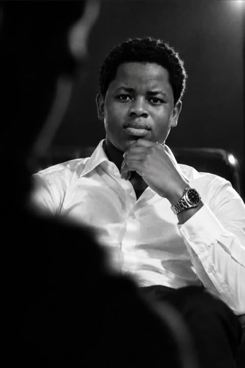</a>

The blurred foreground silhouette creates a frame within a frame, and the prompt pins the look with an 85 mm lens, a Leica M11 rendering, soft rim light and monochrome tones. Deep shadows and bright highlights carry the mood while the reference face sets the identity.

ChatGPT · Edit · Source: [@onsenfou390 on TikTok](https://www.tiktok.com/@onsenfou390/video/7691032466735238420) · 14,052 likes on 2026-10-30

[`monochrome`](tags.md#tag-monochrome) [`portrait`](tags.md#tag-portrait) [`reference-photo`](tags.md#tag-reference-photo) [`editorial`](tags.md#tag-editorial)

<details><summary><b>Prompt</b></summary>

```text
En utilisant le visage de référence ci-dessus, crée un portrait de mode noir et blanc à fort contraste d’un jeune homme portant une chemise blanche impeccable, assis dans une pose réfléchie, avec une main près du menton. Il est encadré par une silhouette floue au premier plan, créant une composition cinématographique de type « cadre dans le cadre ». Un éclairage dramatique, avec des ombres profondes et des hautes lumières intenses, met en valeur les traits du visage et l’émotion. L’esthétique est éditoriale, intemporelle et minimaliste, avec un arrière-plan sobre, un léger grain de pellicule en 4K, une texture de peau ultra-réaliste, une mise au point très nette sur les yeux, une faible profondeur de champ, une photographie cinématographique, une ambiance sombre et élégante, un style digne d’un magazine de luxe, un rendu inspiré du Leica M11, un objectif 85 mm, un léger contre-jour (soft rim light), des tons monochromes, un rendu photoréaliste et un niveau de détail très élevé. Image originale.
```

</details>

<a id="nano-banana-stussy-hoodie-night-cafe-terrace"></a>
### Man in Stussy hoodie sipping iced coffee at night

<a href="https://www.tiktok.com/@el.prompt/video/7684528778504064276">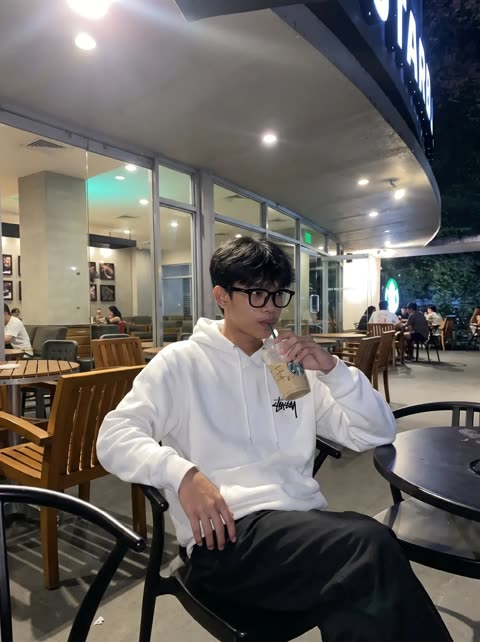</a>

The prompt frames it as a handheld phone photo at a slightly low eye level medium shot and pins the light to ceiling downlights plus warm interior glow with natural falloff. The negative prompt targets plastic skin and uncanny faces, which keeps the result candid rather than polished.

Nano Banana / ChatGPT · Text-to-image · Source: [@el.prompt on TikTok](https://www.tiktok.com/@el.prompt/video/7684528778504064276) · 5,894 likes on 2026-10-30

[`portrait`](tags.md#tag-portrait) [`candid`](tags.md#tag-candid) [`night-cafe`](tags.md#tag-night-cafe) [`streetwear`](tags.md#tag-streetwear)

<details><summary><b>Prompt</b></summary>

```text
Buat gambar yang sangat realistis (ultra-realistis) Subjek: Seorang pria Sudut kamera/framing: *Medium shot* (bidikan setengah badan) dari sudut pandang sedikit rendah dengan gaya pengambilan gambar genggam (*handheld*). Komposisi berpusat pada subjek yang duduk di meja kafe, menampilkan tubuh bagian atas dan perabotan teras di sekitarnya untuk menciptakan nuansa foto santai setinggi mata agak tinggi (*high-level ringan*) ala jepretan ponsel. Pakaian: hoody tebal berwarna putih stussy dan lipatan kain yang alami. Dipadukan dengan celana panjang longgar hitam. Aksesori kacamata frame tebal. Pose: Duduk di kursi kafe berbahan logam hitam, tubuh condong ke depan. satu tangan santai, satu tangan sedang meminum es cup. Ekspresi wajah netral menghadap samping candid, dengan pandangan mata sedikit tertuju ke bawah secara alami (*candid*), tanpa pose yang dibuat-buat. rambut sedikit berantakan menutupi dahi. Lingkungan: Teras kafe luar ruangan di malam hari. Latar belakang menampilkan jendela kaca besar yang memperlihatkan interior terang benderang dengan meja-meja dan sosok orang di kejauhan. Area luar ruangan berisi kursi kayu dan logam hitam, meja bundar, serta dedaunan gelap yang terlihat di bawah langit malam. Pencahayaan: Pencahayaan malam hari yang autentik. Cahaya lembut dan hangat berasal dari lampu tanam di langit-langit teras serta cahaya yang memancar dari jendela interior. Cahaya menciptakan *highlight* alami pada baju dan kulit subjek dengan transisi cahaya (*falloff*) yang realistis dan tanpa kontras digital buatan. Gaya akhir: Resolusi tinggi, gaya fotografi ponsel (*handheld*), foto *candid*, tidak terlalu sempurna. Negative Prompt: kualitas terburuk, kualitas rendah, kualitas standar, resolusi rendah, buram, jelek, terdistorsi, cacat, tanda air, teks, tanda tangan, anatomi buruk, tangan buruk, jari hilang, anggota tubuh tambahan, iris cacat, jari menyatu, wajah terdistorsi, kulit tidak alami, plastik, *uncanny valley*
```

</details>

<a id="gpt-image-macbook-screen-photo-booth-selfie"></a>
### Dim bedroom selfie in Photo Booth on laptop

<a href="https://x.com/tadasgedgaudas/status/2046877643929166330"></a>

The prompt is structured JSON with an identity lock block that preserves the face from the input photo. It frames the result as a photo of a screen, not a screenshot, and lists physical flaws such as pixel grid, moire, dust and fingerprints, with a negative list against flat UI and polish.

GPT Image 2 · Edit · Source: [@tadasgedgaudas on X](https://x.com/tadasgedgaudas/status/2046877643929166330) · 4,434 likes on 2026-10-28

[`screen-photo`](tags.md#tag-screen-photo) [`json-prompt`](tags.md#tag-json-prompt) [`identity-lock`](tags.md#tag-identity-lock) [`low-light`](tags.md#tag-low-light) [`candid`](tags.md#tag-candid)

<details><summary><b>Prompt</b></summary>

```text
{"image_settings": {"aspect_ratio": "3:4", "resolution": {"width": 1152, "height": 1536}}, "prompt": {"identity_lock": {"reference": "input_photo", "preserve": ["face", "facial proportions", "eye shape", "nose", "lips", "skin tone", "skin texture", "hairline", "overall identity"], "rules": ["no face swap", "no beautify", "no smoothing", "no reshaping", "no AI look"]}, "scene": {"camera_angle": "high-angle downward shot, POV", "composition": "MacBook screen fills most of the frame, thin strip of physical keyboard visible at the bottom", "screen_surface": ["visible RGB pixel grid", "subtle moire effect", "micro dust on glass", "faint fingerprints", "soft ambient reflections"]}, "digital_interface": {"os": "macOS dark mode", "background_app": {"name": "Spotify", "view": "Liked Songs", "visible_tracks": ["Blank Space \u2013 Taylor Swift", "Shake It Off \u2013 Taylor Swift", "Cruel Summer \u2013 Taylor Swift", "Love Story \u2013 Taylor Swift"]}, "foreground_app": {"name": "Photo Booth", "state": "live preview window", "position": "floating, center-right"}}, "photo_booth_content": {"environment": {"room": "dim bedroom", "background": "off-white wall, rumpled bedding", "lighting": "low-light, nocturnal, cool screen glow mixed with warm skin tones"}, "subject": {"pose": "lying down, relaxed, candid", "expression": "natural, slightly relaxed", "outfit": "light-colored tank top", "prop": {"item": "iPhone 15 Pro", "hand": "right hand"}}}, "realism_rules": ["this is a photo of a screen, not a screenshot", "raw smartphone photo look", "natural noise", "imperfect glass", "no studio lighting", "no HD polish"]}, "negative_prompt": ["screenshot", "flat UI", "perfect screen", "clean glass", "studio lighting", "beauty filter", "cartoon", "3d render", "painting", "watermark", "blurred face"]}
```

</details>

<a id="chatgpt-monochrome-fashion-portrait-frame-in-frame"></a>
### Monochrome portrait framed by blurred foreground silhouette

<a href="https://www.tiktok.com/@hukamedia.zeii/video/7691019172045802760"></a>

A reference photo keeps the face consistent, and the frame within a frame composition places a blurred foreground silhouette in front of the subject for depth. Camera and lighting terms such as 85 mm lens, soft rim light, Leica M11 rendering and monochrome tones define the editorial look.

ChatGPT · Edit · Source: [@hukamedia.zeii on TikTok](https://www.tiktok.com/@hukamedia.zeii/video/7691019172045802760) · 4,129 likes on 2026-10-30

[`portrait`](tags.md#tag-portrait) [`monochrome`](tags.md#tag-monochrome) [`fashion`](tags.md#tag-fashion) [`editorial`](tags.md#tag-editorial)

<details><summary><b>Prompt</b></summary>

```text
Using the reference face above, create a high-contrast black-and-white fashion portrait of a young man wearing a crisp white shirt, sitting in a thoughtful pose with one hand near his chin. He is framed by a blurred silhouette in the foreground, creating a cinematic “frame within a frame” composition. Dramatic lighting, with deep shadows and intense highlights, emphasizes the facial features and the emotion. The aesthetic is editorial, timeless, and minimalist, with a clean, understated background, subtle 4K film grain, ultra-realistic skin texture, razor-sharp focus on the eyes, shallow depth of field, cinematic photography, a dark and elegant mood, a style worthy of a luxury magazine, a Leica M11-inspired rendering, an 85 mm lens, a slight backlight (soft rim light), monochrome tones, a photorealistic rendering, and a very high level of detail. Original image.
```

</details>

<a id="chatgpt-stadium-pavilion-match-portrait"></a>
### Man in white shirt watching match from pavilion

<a href="https://www.tiktok.com/@adelex2468/video/7680528055911206152">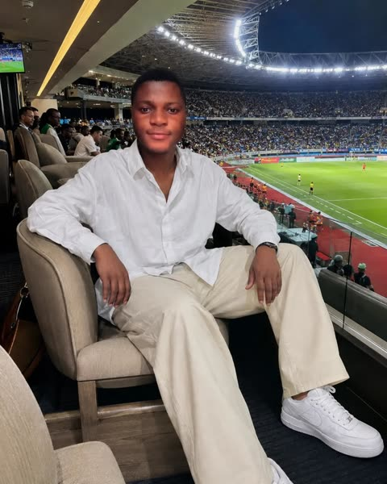</a>

Uploading a reference photo and adding an explicit identity-preservation section keeps the face consistent across the edit. Separate labeled sections for outfit, stadium, pose and photography make each element easy to control.

ChatGPT · Edit · Source: [@adelex2468 on TikTok](https://www.tiktok.com/@adelex2468/video/7680528055911206152) · 3,518 likes on 2026-10-30

[`football`](tags.md#tag-football) [`stadium`](tags.md#tag-stadium) [`portrait`](tags.md#tag-portrait) [`reference-image`](tags.md#tag-reference-image)

<details><summary><b>Prompt</b></summary>

```text
Use the uploaded reference image as the exact facial identity and appearance reference for the young man. Create an ultra-realistic, cinematic 8K professional photograph of the same young man sitting comfortably in a premium stadium pavilion, watching an exciting live football match from an excellent viewing position. IDENTITY PRESERVATION — CRITICAL: Preserve his exact natural facial identity and likeness from the reference image, including facial structure, skin tone, eyes, eyebrows, nose, lips, jawline, hairstyle, facial proportions, and natural skin texture. Do not reshape, beautify, age, or significantly alter his face. He is seated naturally and confidently in a comfortable VIP-style pavilion seat, focused on the football match happening on the pitch in front of him. His body language is relaxed, composed, and confident, with a natural expression showing genuine interest in the game. OUTFIT: He is wearing a stylish white oversized button-up shirt, slightly relaxed and naturally draped, paired with oversized cream-colored trousers with a premium, elegant fit. Complete the outfit with clean, fashionable white sneakers. The overall look should be modern, minimal, classy, youthful, and effortlessly stylish. STADIUM ENVIRONMENT: A beautiful modern football stadium filled with spectators, vibrant atmosphere, realistic football pitch visible in the background, players actively competing on the field, stadium floodlights illuminating the pitch, subtle crowd details, banners and stadium architecture, creating the authentic feeling of watching a major football match from a premium pavilion. POSE & COMPOSITION: Full-body or three-quarter view, seated naturally in the pavilion, one arm resting comfortably on the seat or railing, relaxed posture, looking toward the football pitch. Capture the image from a slightly cinematic side/front angle that clearly shows both the young man and the football match in the background. PHOTOGRAPHY: Ultra-realistic professional photography, cinematic 8K resolution, sharp facial details, realistic skin pores and texture, natural body proportions, realistic fabric texture, accurate clothing folds, realistic stadium lighting, cinematic depth of field, subtle background bokeh, high dynamic range, realistic shadows and reflections, professional color grading, natural contrast, premium sports-lifestyle photography, authentic atmosphere. Make the final image look like a real professional photograph taken inside a luxury football stadium, not CGI or AI-generated. Preserve maximum facial similarity to the reference image.
```

</details>

<a id="nano-banana-tongue-out-selfie-engraved-heart-pendant"></a>
### Blonde woman selfie with tongue out

<a href="https://x.com/KeorUnreal/status/2042931156333543781">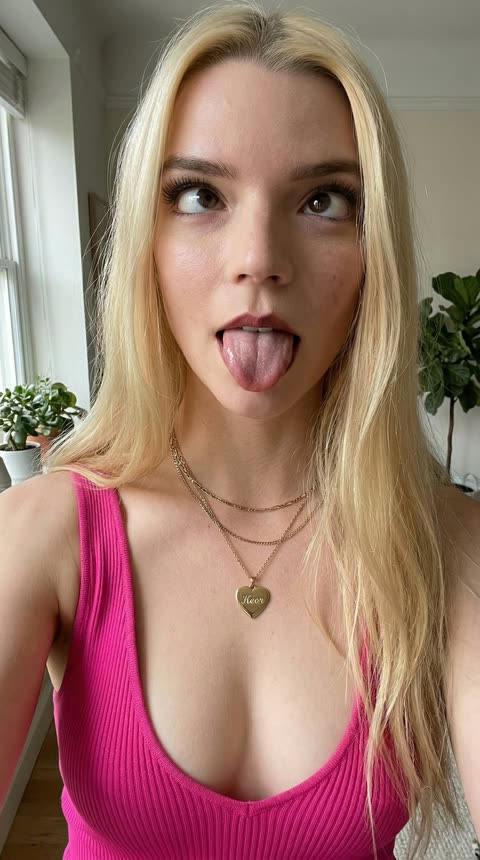</a>

A vertical close-up selfie framing plus an engraved heart pendant gives the model a fixed text anchor, and the negative prompt locks its spelling. The manga-face cue comes through pose and expression rather than an art style, so the result stays photorealistic.

Nano Banana 2 · Text-to-image · Source: [@KeorUnreal on X](https://x.com/KeorUnreal/status/2042931156333543781) · 3,443 likes on 2026-10-29

[`selfie`](tags.md#tag-selfie) [`photorealistic`](tags.md#tag-photorealistic) [`manga-expression`](tags.md#tag-manga-expression)

<details><summary><b>Prompt</b></summary>

```text
{
  "prompt": "Vertical close-up selfie of attractive woman with long blonde hair playfully sticking her tongue out and looking up with crossed eyes like iconic manga girl, wearing a electric pink ribbed tank top with deep cleavage, golden necklaces with a heart pendant engraved 'Keor', soft natural lighting, photorealistic, detailed skin and jewelry textures, playful glamorous vibe, 8k",
  "negative_prompt": "cropped, bad hands, blurry face, low quality, different pendant text, closed mouth",
  "parameters": {
    "aspect_ratio": "9:16",
    "lighting": "soft natural"
  }
}
```

</details>

<a id="gpt-image-bougainvillea-archway-courtyard-portrait"></a>
### Woman glancing back under a seaside bougainvillea archway

<a href="https://x.com/abxxai/status/2097698712978087966"></a>

The prompt describes the near subject in close detail, gives the second figure only clothing and a pose, and builds depth from the flowering arch through the courtyard to the hazy sea. The model kept that layered composition and warm palette but rendered soft natural light instead of the requested direct flash.

GPT Image 2.5 · Text-to-image · Source: [@abxxai on X](https://x.com/abxxai/status/2097698712978087966) · 2,645 likes on 2026-10-28

[`portrait`](tags.md#tag-portrait) [`mediterranean`](tags.md#tag-mediterranean) [`flash-photography`](tags.md#tag-flash-photography) [`y2k`](tags.md#tag-y2k) [`candid`](tags.md#tag-candid)

<details><summary><b>Prompt</b></summary>

```text
Two women framed by a sun-bleached stone archway — one in the near foreground at frame right, a woman with long straight golden-brown hair loosely pulled back with soft face-framing pieces, warm honey-blonde balayage catching the light, an oval face with warm brown eyes, softly tanned olive-warm skin and full lips, small stud earrings, wearing a rust-terracotta linen wrap top and matching wide-leg linen trousers cinched with a woven raffia belt, hands clasped in front of her, turned back over her shoulder toward camera; a second woman, features unspecified, stands further back in the courtyard in a deep forest-green silk blouse and wide-leg cream trousers, leaning against a whitewashed stone pillar, gazing out toward the sea. Setting: the threshold of a Mediterranean cliffside courtyard, hand-laid terracotta mosaic floor and a weathered stone archway thick with trailing bougainvillea in the foreground, a sun-drenched courtyard beyond with wrought-iron lanterns, potted olive trees and a low stone fountain, whitewashed rooftops and a pale hazy sea filling the horizon, soft late-afternoon light. Shot on an early-2000s point-and-shoot digicam with harsh direct on-camera fill flash that aggressively illuminates the near woman and the archway, flattening her features and putting sharp specular highlights on the linen, the stone and her shoulders; the courtyard and sea beyond stay visible but hazy, milky and underexposed relative to the flash. Warm, slightly saturated CCD tones, strong bloom and halation at the archway edges, minor digital noise. Candid amateur, Y2K editorial, unpolished but stylized.
```

</details>

<a id="chatgpt-seated-man-reaching-hands-smoke-portrait"></a>
### Seated man surrounded by reaching hands in smoke

<a href="https://www.tiktok.com/@mcsvisuals1/video/7684298113783303455">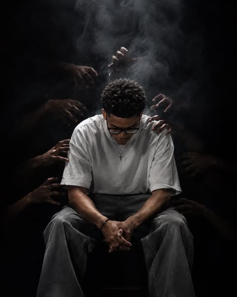</a>

Asking the model to preserve facial anatomy after a photo upload keeps the subject's face stable while the prompt builds the scene. Describing a narrow overhead spotlight on black, with background hands kept softer than the man, holds the figure as the visual focus.

ChatGPT · Edit · Source: [@mcsvisuals1 on TikTok](https://www.tiktok.com/@mcsvisuals1/video/7684298113783303455) · 2,575 likes on 2026-10-30

[`portrait`](tags.md#tag-portrait) [`dark-studio`](tags.md#tag-dark-studio) [`conceptual`](tags.md#tag-conceptual) [`smoke`](tags.md#tag-smoke)

<details><summary><b>Prompt</b></summary>

```text
Create a cinematic, photorealistic conceptual portrait of a young man sitting alone in a dark minimalist studio. He sits centered on a simple chair or low seat, leaning slightly forward with his head bowed and hands clasped between his knees. His posture communicates emotional exhaustion, isolation, anxiety, and deep introspection. He wears a plain oversized white T-shirt, loose gray trousers, and rectangular black eyeglasses. His hair is neatly styled backward with a subtle wet or glossy texture. Preserve realistic facial anatomy, natural skin texture, pores, and authentic proportions. His face is partially obscured by the downward angle of his head. Multiple realistic disembodied human hands emerge from the darkness behind and around him. The hands reach toward his shoulders, arms, head, and sides of his body, suggesting pressure, intrusive thoughts, anxiety, emotional manipulation, or overwhelming expectations. Each hand must have anatomically correct fingers, realistic skin texture, natural poses, and subtle shadows. Keep the hands slightly softer and less defined than the main subject so the man remains the visual focus. A dark black background surrounds the subject with dense atmospheric smoke or mist rising above him. The smoke forms subtle organic shapes without becoming supernatural or cartoonish. The background should gradually fade into complete darkness around the edges. Use dramatic overhead and frontal studio lighting. A narrow soft spotlight illuminates the man’s head, face, white shirt, forearms, and hands while the surrounding space remains almost completely black. Create realistic highlights on the glasses and skin, deep controlled shadows, subtle rim lighting, and atmospheric volumetric light through the smoke. Composition: vertical portrait, 4:5 aspect ratio, centered symmetrical framing, medium-full body shot, subject occupying the middle of the frame, large negative space above and around him, hands distributed naturally behind and beside him, strong visual hierarchy. Photography style: psychological fine-art photography, cinematic editorial portrait, dark fashion photography, 85mm lens, shallow depth of field, realistic skin and fabric texture, volumetric lighting, subtle film grain, high dynamic range, professional color grading, deep blacks, muted neutral tones, photorealistic, ultra-detailed, 8K quality. Mood: haunting, vulnerable, psychologically intense, lonely, restrained, introspective, emotionally heavy. Make the image feel like a real professional studio photograph rather than an illustration. Preserve realistic human anatomy and physically believable lighting. No supernatural glow, no cartoon style, no excessive blur, no distorted faces, no malformed hands, no extra fingers, no duplicated limbs, no artificial skin, no text, no watermark, no logos.
```

</details>

<a id="gpt-image-car-door-clifftop-2000s-film-snapshot"></a>
### Early 2000s film snapshot through open car door

<a href="https://x.com/abxxai/status/2102775797509722602"></a>

An uploaded character sheet locks identity, while labeled blocks for scene, wardrobe, background, light, camera and realism keep each concern separate. The old footage look comes from written film terms such as 28mm barrel distortion, lifted blacks, halation and grain rather than a filter, and the car door frame adds a natural foreground.

GPT Image 2.5 · Edit · Source: [@abxxai on X](https://x.com/abxxai/status/2102775797509722602) · 1,687 likes on 2026-10-28

[`film-look`](tags.md#tag-film-look) [`candid`](tags.md#tag-candid) [`road-trip`](tags.md#tag-road-trip) [`character-reference`](tags.md#tag-character-reference) [`2000s`](tags.md#tag-2000s)

<details><summary><b>Prompt</b></summary>

```text
4/ the start frame, GPT Image 2.5 made

the old footage look is NOT a filter.. Opus wrote it into the prompt:

Promtp:

Use the uploaded character sheet as the strict identity reference. Keep her exact face, bone structure, brown eyes, light freckles across nose and cheeks, natural full lips, and long straight light-brown hair with sun-kissed caramel highlights parted in the middle. Keep the thin gold chain necklace with the small cross pendant.

SCENE: A candid photo taken from inside a parked silver sedan, looking out through the open rear passenger door. The door frame, the grey fabric headliner, the black door panel with its chrome handle, and part of the seat belt frame the shot on both sides. She stands just outside the open door on a rocky clifftop road above the ocean, both arms raised, one hand gripping the top of the door frame and the other resting on the roof edge, leaning slightly toward the camera. Relaxed, unposed, calm expression, looking straight into the lens.

WARDROBE: Fitted cropped white cotton baby tee with a faded, sun-washed vintage graphic print in pale blue and coral red, slightly worn and soft. Light-wash low-rise denim cutoff shorts with frayed hems. Thin brown leather cord bracelets on one wrist. Hair slightly messy and windblown, a few strands across her face.

BACKGROUND: Deep blue Mediterranean sea filling the frame behind her, sparkling sun glints on the water, a flat horizon line at chest height, pale hazy sky, dark rocks and sandy stones at the cliff edge below.

LIGHT: Harsh direct midday summer sun, bright and slightly overexposed. Sun-warmed skin with a natural sheen and slight glow on the cheeks and nose, soft shadows under the chin, a faint reflection of light off the white car interior.

CAMERA AND LOOK: Early 2000s point-and-shoot film photo, 35mm film, 28mm wide lens with slight barrel distortion at the edges, shot from chest height inside the car. Warm, faded, sun-bleached color grade, lifted blacks, low contrast, creamy highlights that gently blow out in the sky, slightly yellowed whites, soft halation around bright edges, fine visible film grain, a touch of softness and imperfect focus. Looks like a real candid snapshot from a summer road trip, not a studio shot.

REALISM: Real skin texture with visible pores and freckles, no retouching, no plastic skin, natural flyaway hairs, real fabric wrinkles on the tee, real dust and wear on the car interior.

Aspect ratio 4:3. No text, no watermark, no logos.
```

</details>

<a id="gpt-image-blue-hair-doodle-shadow-pose"></a>
### Woman with blue hair beside her black doodle shadow

<a href="https://x.com/Ciri_ai/status/2080580411487600862">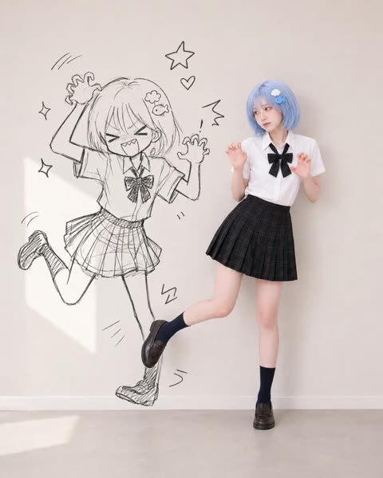</a>

The reference photo locks identity, hairstyle and outfit, so the likeness holds across the real figure and the sketch. The prompt asks for black line art on a clean cream wall with manga motion lines, so the doodle reads as a drawing rather than a shadow or second person, and its exaggerated pose contrasts with the cute realistic one.

GPT Image 2 · Edit · Source: [@Ciri_ai on X](https://x.com/Ciri_ai/status/2080580411487600862) · 1,606 likes on 2026-10-29

[`doodle-shadow`](tags.md#tag-doodle-shadow) [`mixed-media`](tags.md#tag-mixed-media) [`reference-identity`](tags.md#tag-reference-identity) [`playful-pose`](tags.md#tag-playful-pose)

<details><summary><b>Prompt</b></summary>

```text
GPT image 2 on chatgpt

Prompt: Use the uploaded character reference image as the strict identity and outfit reference.

Preserve the reference character’s:
- face identity
- facial proportions
- eye shape
- nose
- lips
- skin tone
- hairstyle
- hair color
- visible hair accessories
- overall recognizable vibe
- outfit and styling shown in the reference image

Do not hardcode any specific character traits that are not present in the uploaded reference.
All identity, hairstyle, accessories, and clothing details must be inferred directly from the uploaded reference image.

Create a high-quality mixed-style vertical portrait showing:
1. a realistic full-body version of the uploaded character/person
2. a black hand-drawn doodle-shadow version of the same character/person on the wall beside them

Core concept:
The real person and their doodle-shadow are doing a playful mischievous pose together.
The real person performs a cute realistic version of the pose, while the doodle-shadow performs a much more exaggerated, chaotic, cartoonish version of the same pose idea.
The mood should feel cute, playful, mischievous, stylish, funny, and social-media-friendly.

Real person:
- Must remain realistic and photogenic
- Must wear the same outfit style and key visible details from the uploaded reference image
- Do not replace the reference styling with unrelated fashion
- Expression should be cute, slightly confused, mildly embarrassed, playful, as if thinking: “Why am I doing this with my shadow?”
- The real person should not stand stiffly
- The real person should actively participate in the pose, but in a natural realistic way

Doodle-shadow:
- Must be a black hand-drawn sketch version of the same person, drawn directly on the wall
- Not a realistic second person
- Not a normal physical shadow
- Not a full-color anime character
- Black sketch line-art only
- Should resemble the person through hairstyle silhouette, accessories, outfit silhouette, and pose structure
- The doodle-shadow should look more energetic, sillier, and more chaotic than the real person
- Add manga-like motion lines, hearts, stars, sparkles, and comic marks around the doodle if helpful

Random mischievous pose rule:
The pose must NOT be fixed.

For each generation, invent a new playful mischievous pose for both the real person and the doodle-shadow.
The real person and the doodle-shadow should share the same general pose idea, but they do not need to match perfectly.
The real person performs a cute realistic version.
The doodle-shadow performs a much more exaggerated, chaotic, cartoonish version.

Do not repeatedly use pointing poses.
Do not repeatedly use finger-gun poses.
Do not repeatedly use the same standing pose.
Do not always make both figures simply point at each other.

Create a different mischievous pose each time.

Possible pose directions are loose inspiration only, not a fixed menu:
- playful idol pose
- silly dance pose
- leaning sideways with one arm curved overhead
- making a big heart pose
- cheeky wink pose
- hands near cheeks in a cute teasing pose
- exaggerated “ta-da!” pose
- mock surprise pose
- playful running-in-place pose
- mischievous tiptoe pose
- arms stretched in opposite directions
- pretending to sneak away
- cute troublemaker pose
- dramatic overreaction pose
- goofy victory pose
- playful balance pose
- playful peekaboo pose
- shy but mischievous pose
- cute overconfident pose

The final pose should feel fresh, cute, mischievous, and slightly chaotic.
The real person should look like they are reluctantly playing along.
The doodle-shadow should look like it is having way too much fun.

Composition:
- vertical 4:5 or 9:16
- show the real person in full-body or nearly full-body framing
- place the real person on one side of the frame
- place the black doodle-shadow on a clean wall beside them
- the doodle-shadow should be roughly the same height or slightly taller
- keep enough space around both figures so the full pose is visible
- the connection between the real person and the doodle-shadow must be clear at a glance

Background:
- simple clean indoor studio wall or minimal room corner
- white, cream, or pale gray wall
- clean floor
- soft natural sunlight patch or gentle wall shadow allowed
- keep the background uncluttered

Lighting:
- soft natural studio lighting
- bright, clean, polished, playful mood
- keep the real person’s face clearly visible

Style quality:
- realistic human photography
- black hand-drawn doodle-shadow on wall
- matching mischievous pose interaction
- strong identity resemblance
- outfit and styling faithfully based on the uploaded reference
- cute and stylish mixed-media portrait
- clean composition
- social-media-friendly
- no obvious AI artifacts

Negative prompt:
hardcoded blue hair when not in reference, hardcoded cloud clip when not in reference, hardcoded fish clip when not in reference, hardcoded school uniform when not in reference, outfit change unrelated to reference, realistic second person, normal reflection, normal shadow only, solid black monster shadow, horror shadow, creepy shadow, full-color illustration, cartoon human, anime human, weak resemblance, unrelated sketch character, messy wall, cluttered background, repeated pointing pose, repeated finger-gun pose, same pose every time, fixed pose, boring mirrored pose, stiff pose, identical pose repetition, real person not matching shadow pose, text, watermark, logo, distorted body, extra limbs, extra fingers, bad hands
```

</details>

<a id="chatgpt-young-man-earphones-dusk-portrait"></a>
### Young man with earphones at dusk

<a href="https://www.tiktok.com/@trungayai/video/7690052053447626004">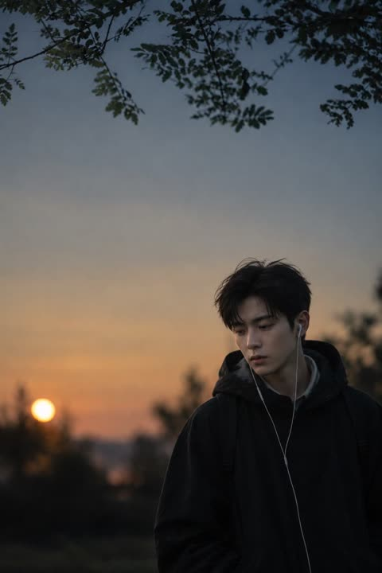</a>

The prompt places the subject in the lower right and the sun at left, leaving the upper sky empty as negative space, with foliage entering from the top edge as a foreground frame. An 85mm telephoto at f/2.8, a backlit silhouette body and a muted palette make the shot read as candid and cinematic rather than posed.

ChatGPT / Gemini · Text-to-image · Source: [@trungayai on TikTok](https://www.tiktok.com/@trungayai/video/7690052053447626004) · 1,580 likes on 2026-10-30

[`portrait`](tags.md#tag-portrait) [`sunset`](tags.md#tag-sunset) [`cinematic`](tags.md#tag-cinematic) [`backlight`](tags.md#tag-backlight)

<details><summary><b>Prompt</b></summary>

```text
Photorealistic cinematic dusk portrait of a young Asian man , medium-length naturally tousled black hair with soft loose bangs falling across his forehead, delicate refined facial features, wearing an oversized black hooded jacket with a subtle light-colored inner collar and simple white wired earphones. He has a quiet, introspective, slightly melancholic expression, relaxed lips, eyes looking downward and slightly away from the camera, head gently lowered, shoulders naturally relaxed, captured in an unposed candid moment. The scene takes place outdoors during late sunset transitioning into blue hour. The young man stands on the lower-right side of the frame, while an enormous amount of open sky occupies the upper and left portions of the composition. A low warm sun appears near the distant horizon on the left side, rendered as a soft glowing circular orb, heavily defocused. The distant landscape, trees and vegetation are dark and softly blurred. Natural tree branches and clusters of small leaves extend into the frame from the upper edge, forming an organic foreground frame around the empty sky. Some leaves are slightly out of focus, creating layered depth between foreground foliage, the distant sunset and the subject. Strong subtle backlighting from the setting sun creates a dark silhouette-like body and black clothing, while the face retains delicate low-key detail from soft ambient sky light. No artificial flash, no studio lighting. Deep shadows, gentle highlight rolloff, atmospheric low-contrast illumination on the face, natural exposure falloff. Muted cinematic color palette: charcoal black, deep olive green, desaturated blue-gray, warm beige, dusty amber and soft muted orange. Low saturation, slightly cool shadows and warm sunset highlights, restrained contrast, subtle filmic color grading, understated vintage atmosphere. Shot from approximately eye level with a medium-long telephoto lens, around 85mm full-frame equivalent, camera positioned several meters away from the subject. Wide environmental portrait composition, shallow depth of field around f/2–f/2.8, strong background compression, creamy natural bokeh, soft optical falloff. The sun and distant vegetation appear blurred rather than sharply defined. Asymmetrical composition, subject positioned in the lower-right quadrant, large negative space above and to the left, sunset orb on the lower-left side, overhanging foliage framing the top edge. The composition should feel spontaneous and cinematic rather than posed or fashion-editorial.
```

</details>

<a id="nano-banana-sunlit-smartphone-selfie-white-tee"></a>
### Sunlit smartphone selfie of woman in white tee

<a href="https://www.reddit.com/r/GeminiAI/comments/1x08axv/nano_banana_21_goes_crazy"></a>

A structured JSON spec splits face, hair, clothing, lighting and camera into separate fields, so each detail is controlled on its own. Naming a 24 to 28mm phone lens, clipped HDR highlights and a long avoid list keeps the result casual instead of studio polished.

Nano Banana 2.1 · Text-to-image · Source: [u/RIGHT200 on Reddit](https://www.reddit.com/r/GeminiAI/comments/1x08axv/nano_banana_21_goes_crazy) · 1,204 likes on 2026-10-28

[`selfie`](tags.md#tag-selfie) [`smartphone-photo`](tags.md#tag-smartphone-photo) [`json-prompt`](tags.md#tag-json-prompt) [`natural-light`](tags.md#tag-natural-light) [`photorealistic`](tags.md#tag-photorealistic)

<details><summary><b>Prompt</b></summary>

```text
{

"prompt_type": "detailed_image_reconstruction",

"aspect_ratio": "16:9 horizontal portrait",

"overall_goal": "Recreate the visual appearance, framing, lighting, styling, and casual smartphone-photo feel of the reference image as closely as possible while keeping the result photorealistic and natural.",

"subject": {

"type": "young adult woman",

"age_range": "early to mid 20s",

"pose": "standing indoors, upper body turned slightly away from the camera while her face turns toward the lens",

"body_position": "relaxed casual posture with shoulders slightly angled",

"expression": "soft neutral expression with a subtle pout, calm and confident",

"gaze": "looking directly toward the camera",

"styling": "minimal everyday styling, clean and natural"

},

"face": {

"shape": "soft oval face with a gently tapered jawline",

"forehead": "medium-height forehead partly framed by center-parted hair",

"eyebrows": "natural medium-thick dark brown eyebrows with a soft arch",

"eyes": {

"shape": "almond-shaped",

"color": "light brown to hazel",

"appearance": "bright eyes with visible catchlights",

"lashes": "long defined eyelashes with subtle mascara"

},

"nose": "small straight nose with a softly rounded tip",

"lips": {

"shape": "full lips with a defined cupid's bow",

"color": "natural rosy pink",

"finish": "soft satin finish, not glossy"

},

"skin": {

"tone": "light warm-neutral skin tone",

"texture": "smooth natural skin with subtle pores and realistic tonal variation",

"cheeks": "soft natural pink flush",

"finish": "fresh luminous skin without heavy retouching"

},

"makeup": "very light natural makeup, softly defined lashes, subtle blush, natural pink lips, no dramatic contour"

},

"hair": {

"color": "rich medium-to-dark chocolate brown",

"length": "very long, extending well below the chest",

"parting": "clean center part",

"texture": "mostly straight with very soft natural bends through the lower lengths",

"density": "thick and healthy-looking",

"finish": "smooth and glossy but still realistic",

"front_sections": "two thin face-framing strands falling naturally along both sides of the face",

"details": "visible individual strands, subtle flyaways near the crown, realistic highlights from sunlight, natural uneven strand separation",

"movement": "hair hanging naturally over both shoulders and down the front of the shirt"

},

"clothing": {

"top": "oversized plain white crew-neck T-shirt",

"fit": "loose casual fit",

"fabric": "soft slightly wrinkled cotton",

"logos": "none",

"accessories": "no visible jewelry or prominent accessories"

},

"composition": {

"shot_type": "close upper-body portrait",

"camera_angle": "slightly above chest level, close to eye level",

"camera_distance": "approximately arm's-length smartphone distance",

"subject_position": "face slightly right of center with long hair occupying much of the lower frame",

"crop": "top of head fully visible, image extending down to around lower torso",

"orientation": "vertical",

"perspective": "natural wide smartphone-camera perspective with mild close-range distortion"

},

"lighting": {

"primary_source": "strong warm natural sunlight entering from the side/front through a nearby window",

"direction": "sunlight striking the subject from camera-left/front",

"face_effect": "bright warm illumination across the forehead, cheeks, nose, and hair",

"hair_effect": "distinct brown highlights and soft reflective streaks along individual strands",

"shadow_quality": "strong but soft-edged natural indoor shadows",

"exposure": "face slightly brightly exposed while the room behind remains much darker",

"color_temperature": "warm daylight"

},

"environment": {

"location": "casual indoor residential room",

"background": "dark gray walls with a white ceiling cornice",

"left_background": "open doorway or darker hallway area",

"right_background": "dark wall and partially visible household objects",

"lower_right": "part of a black tripod or light stand visible",

"overall_feel": "ordinary lived-in room rather than a studio",

"depth": "background moderately out of focus but still recognizable"

},

"camera": {

"capture_device": "modern smartphone camera",

"lens_equivalent": "approximately 24-28mm full-frame equivalent",

"focus": "sharp focus on face and front hair",

"depth_of_field": "mostly natural smartphone depth of field with gentle background softness",

"dynamic_range": "realistic phone-camera HDR with slightly clipped highlights in direct sun",

"image_character": "casual social-media selfie/photo, not professionally staged"

},

"photorealism_details": [

"real individual hair strands",

"natural skin pores and micro-texture",

"subtle peach fuzz",

"realistic eyelash separation",

"tiny variations in lip texture",

"slight fabric creases in the T-shirt",

"small flyaway hairs around the crown",

"natural sunlight falloff across the face",

"slightly imperfect casual framing",

"realistic indoor shadow noise"

],

"style": {

"visual_style": "highly photorealistic casual smartphone portrait",

"mood": "soft, youthful, relaxed, sunlit",

"processing": "light social-media style processing with warm skin tones and slightly enhanced clarity",

"avoid": [

"cinematic movie lighting",

"studio portrait lighting",

"overly smooth plastic skin",

"CGI appearance",

"anime or illustration",

"heavy beauty filter",

"extreme facial symmetry",

"over-sharpened hair",

"artificial jet-black hair",

"dramatic makeup",

"excessive background blur",

"professional studio backdrop",

"text",

"watermarks",

"logos"

]

},

"negative_prompt": "cartoon, anime, illustration, CGI, plastic skin, waxy face, over-retouched skin, excessive beauty filter, unnatural facial symmetry, distorted eyes, crossed eyes, malformed lips, warped face, duplicate hair strands, fake wig appearance, overly black hair, metallic hair shine, stiff hair, messy anatomy, distorted shoulders, extra limbs, extra fingers, studio backdrop, cinematic lighting, dramatic color grading, excessive bokeh, oversaturated colors, text, logo, watermark"

}
```

</details>

<a id="gemini-hooded-man-hillside-cafe-night"></a>
### Hooded man relaxing on hillside cafe terrace at night

<a href="https://www.tiktok.com/@geminiaiprompt/video/7685850288816753940">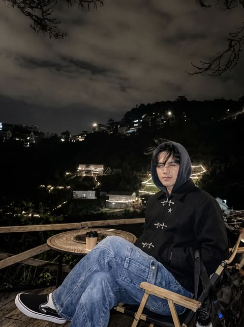</a>

Attaching the reference photo and describing clothing, pose and background in labelled sections keeps the person and outfit consistent. Direct front flash separates the subject from the dark hills, while the cool palette makes the warm village lights stand out.

Gemini · Edit · Source: [@geminiaiprompt on TikTok](https://www.tiktok.com/@geminiaiprompt/video/7685850288816753940) · 1,049 likes on 2026-10-30

[`portrait`](tags.md#tag-portrait) [`night`](tags.md#tag-night) [`streetwear`](tags.md#tag-streetwear) [`reference-photo`](tags.md#tag-reference-photo)

<details><summary><b>Prompt</b></summary>

```text
Make a photo showing a man that I attached who is sitting relaxed on the terrace of a cafe or an open area in a highland area at night, with the background of hills and glittering city lights. Subject and Pose A man sits leaning slightly with his back to the camera with a relaxed gesture on an outdoor folding chair (camping chair). His body is leaning backwards with his left leg crossed slightly straight forward showing only one of his legs crossed, showing a relaxed but photogenic pose. His gaze was directed directly to the camera lens with a slight squint and a calm facial expression, while a few strands of his black hair fell naturally on his forehead blown by the night wind. Clothing and Style Details Top: He wears a black collared jacket that has a unique accent in the form of a silver metallic hook button in the shape of a horizontal toggle and a small hanger with a silver star pattern on the upper chest, behind the collar there is a black hood that is raised to cover the head. Bottom: Faded dark blue denim jeans (light-wash) with loose cut (loose/baggy fit). These pants have a transverse panel stitching detail on the thigh and a large box cargo pocket on the side. Footwear: Classic black vans slip on sneakers with a distinctive white curved line and a white rubber sole with a black stripe on the edge, showing a little white socks. Additional Equipment: On the right side of the chair hangs a dark outdoor backpack with a drinking bottle compartment on the side. Foreground Element (Front Area) The subject sits on a wooden deck with a dark board base. In front of him is a low round table with a circular concentric carving pattern, where a light brown takeaway paper coffee cup with a black lid is placed. The occupied chair is a portable chair with armrests made of light wood and a folding frame made of beige canvas. Background and Landscape Behind the wooden guardrail, the open view directly leads to the hillside that descends into the valley: Berberdak Building: It looks like a white multi-storey villa, cafe, or inn standing on the hillside, decorated with string lights (string lights) and windows with warm yellow lights that glow in the middle of the darkness. Hills: The silhouette of a dark ridge stretches in the distance with rows of trees and several points of street lights and settlements at the top. Sky: The night sky is dominated by thick chunks of dramatic textured clouds that stretch wide, receiving a slight reflection of soft light from the city below. Lighting and Color Palette The main lighting uses a flash (direct flash) directly from the front that illuminates the subject sharply and separates it firmly from the background darkness. The visual palette is dominated by cold color gradations—black, charcoal gray, and denim blue—which contrast with the golden yellow light spots from the buildings in the valley, creating a cool, calm, and aesthetic night hangout atmosphere. Aspect Ratio 3:4
```

</details>

<a id="gpt-image-cozy-hoodie-sleeve-selfie"></a>
### Cozy selfie in a cream oversized hoodie

<a href="https://x.com/MissDelulu9/status/2067555456688791598"></a>

The prompt fixes a tight selfie framing and a specific pose, with the cheek resting on the sleeve. It then layers face details, soft lighting, shallow depth of field and a 9:16 ratio so the result reads as a real webcam selfie.

GPT Image 2 · Text-to-image · Source: [@MissDelulu9 on X](https://x.com/MissDelulu9/status/2067555456688791598) · 996 likes on 2026-10-29

[`selfie`](tags.md#tag-selfie) [`portrait`](tags.md#tag-portrait) [`cozy`](tags.md#tag-cozy) [`shallow-depth-of-field`](tags.md#tag-shallow-depth-of-field) [`photorealistic`](tags.md#tag-photorealistic)

<details><summary><b>Prompt</b></summary>

```text
Photorealistic close-up selfie of an adorable young woman, face filling most of the frame, head slightly tilted with cheek resting inside a cozy cream oversized hoodie sleeve. Long silky hair with soft curtain bangs covering one eye, big expressive eyes with winged eyeliner, fluffy lashes, natural glowing skin, dusty pink lips, gentle pout, sweet and cute expression.

Hoodie slipping off one shoulder, visible collarbone. Warm indoor lighting, soft beige-gray blurred background, shallow depth of field, ultra-detailed eye focus, realistic hair texture, cozy aesthetic, authentic webcam selfie vibe, muted pastel tones, high realism, 9:16 portrait.
```

</details>

<a id="gemini-man-wooden-stairs-night-portrait"></a>
### Man seated on wooden stairs at night

<a href="https://www.tiktok.com/@geminiaiprompt/video/7687149288106986773">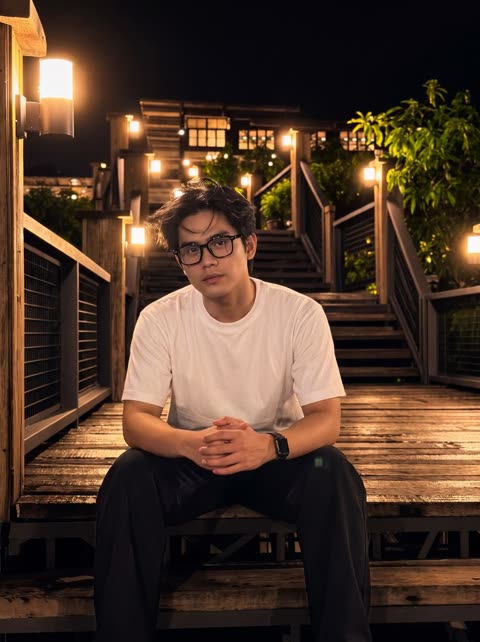</a>

Attaching a reference photo locks the subject's identity, and the prompt then describes appearance, lighting, and background in separate labeled blocks. Naming the light source as warm decorative lamps and stating the 3:4 ratio keeps the glow and vertical framing consistent.

Gemini · Edit · Source: [@geminiaiprompt on TikTok](https://www.tiktok.com/@geminiaiprompt/video/7687149288106986773) · 854 likes on 2026-10-30

[`portrait`](tags.md#tag-portrait) [`night-photo`](tags.md#tag-night-photo) [`warm-lighting`](tags.md#tag-warm-lighting) [`reference-photo`](tags.md#tag-reference-photo)

<details><summary><b>Prompt</b></summary>

```text
Make a photo showing a man that I attached who is sitting on a wooden staircase at night with a warm and aesthetic outdoor architecture background. Main Subject and Appearance: A black-haired man with a messy haircut stared straight at the camera with a calm and neutral facial expression. He wears thick black framed glasses in a square shape that frames the eye area and his face firmly. The man is wearing a plain white short-sleeved T-shirt with a regular fit cut. He wears jet black trousers that cover his legs when he takes a sitting position. On the left wrist, there is a circle of a smart watch (smartwatch) with a dark strap. His body position is sitting on a wooden step with both hands placed on the front of his thighs, where his fingers are tightly linked together. Lighting and Visual Atmosphere: The lighting in this photo uses the concept of warm ambient lighting (warm ambient lighting) with an artificial light source from decorative lights. The golden yellow light illuminates the front side of the subject's body, giving dimension and separating the subject clearly from the darker background. The wooden surface around the stairs reflects the warm light, displaying the texture of the wood grain in detail and creating a dramatic shadow contrast. Background and Environmental Elements: The subject is in the deck area or exterior wooden stairs (outdoor) which is designed with a neatly arranged horizontal wooden slat structure. Right behind the subject, there is a multi-storey wooden staircase structure that leads to the top of the building with wooden accents, with several windows that light up brightly from inside the room. Along the structure of the stairs and guardrails, several pillar wall lights with a minimalist design are installed that emit warm light towards the stairs. On the upper right side, there is vegetation in the form of green plants and lush leaves that are illuminated by the garden lights, providing a visual balance between artificial architectural elements and natural elements. Aspect Ratio 3:4
```

</details>

<a id="gemini-tropical-selfie-low-angle-bali-man"></a>
### Low angle selfie of a man under blue sky

<a href="https://www.tiktok.com/@geminiaiprompt/video/7690085888839191829">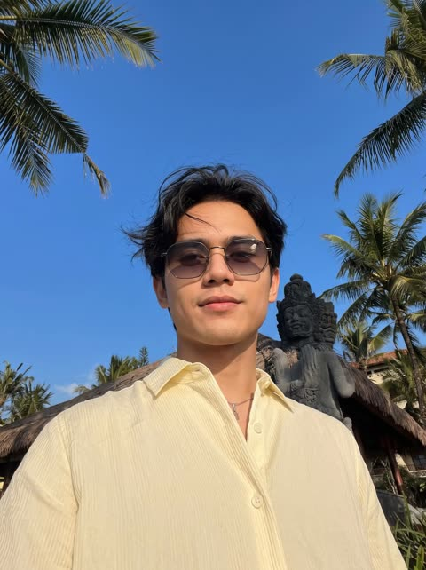</a>

The prompt works as a checklist that fixes camera angle, subject position, outfit, glasses and background, so the result stays close to the attached photo. Palm fronds, a dark stone statue and a 3:4 frame lock in the composition.

Gemini · Edit · Source: [@geminiaiprompt on TikTok](https://www.tiktok.com/@geminiaiprompt/video/7690085888839191829) · 827 likes on 2026-10-30

[`selfie`](tags.md#tag-selfie) [`tropical`](tags.md#tag-tropical) [`portrait`](tags.md#tag-portrait) [`golden hour`](tags.md#tag-goldenhour)

<details><summary><b>Prompt</b></summary>

```text
Make a photo showing a low-angle selfie of a man that I attached outdoors with a tropical background and a bright blue sky. The Subject and Physical Appearance of the man in the photo is in the middle position of the frame (center frame) with a relaxed pose facing the camera. He has hair that looks naturally unraveled by the breeze. His facial expression looks calm and relaxed with a confident smile. The angle of taking pictures from below emphasizes the jaw line and the structure of his face that is evenly exposed to sunlight. Clothes and Accessories Shirt: Wearing a long or short sleeved casual shirt in pastel yellow (butter yellow) with an open collar. The shirt fabric has a fine vertical striped texture similar to textured cotton or seersucker, with the top button left open so that it gives a casual and comfortable impression for warm weather. Glasses: Wearing sunglasses with a thin metal frame (wire-frame) with a rounded hexagonal shape or a variation of the aviator/navigator style. Eyeglass lenses have a gradation effect (tinted gradient) with a transparent blackish nuance that still shows the eye area vaguely. Jewelry: It looks like a thin metal chain necklace hidden behind the neckline of his shirt. Background and Atmosphere Sky: Dominated by a clear cloudless deep blue sky canvas, occupying more than half of the top of the photo composition. Tropical vegetation: In the upper left corner and on the right side, palm or coconut leaves are seen, strengthening the exotic outdoor atmosphere. Architecture and Ornaments: Right behind the left shoulder (right side of the picture), stands a dark gray carved stone statue with a traditional Balinese architectural style or tropical resort ornaments, side by side with a roof with shades of ijuk/straw and a villa building in the distance. Lighting and Color Palette Natural lighting comes from the afternoon or morning sun (golden hour) with warm saturation that shines on the face and clothes, producing a soft shadow on the curves of the neck and clothes. This visual composition creates a complementary color harmony that is contrasting but balanced—combining the warmth of skin color and pastel yellow shirt with the coolness of sky blue and green leaves. Aspect Ratio 3:4
```

</details>

<a id="chatgpt-yacht-sequin-gown-night-portrait"></a>
### Woman in sequined gown on yacht corridor

<a href="https://www.tiktok.com/@amandakravyn/video/7684346251210542349">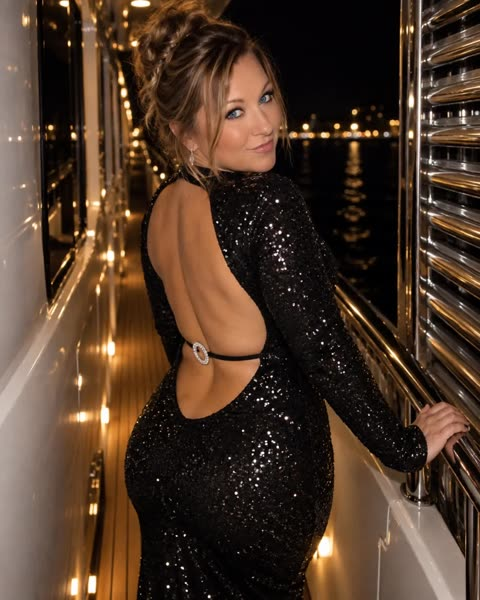</a>

Pinning the identity to an uploaded photo, then fixing pose, gown, setting and lens in a numbered brief keeps the result on-subject. The flash, warm yacht lights and a 35 to 50mm lens with shallow depth of field give it the editorial look.

ChatGPT / Kling · Edit · Source: [@amandakravyn on TikTok](https://www.tiktok.com/@amandakravyn/video/7684346251210542349) · 722 likes on 2026-10-30

[`fashion`](tags.md#tag-fashion) [`night-portrait`](tags.md#tag-night-portrait) [`yacht`](tags.md#tag-yacht) [`photo-reference`](tags.md#tag-photo-reference)

<details><summary><b>Prompt</b></summary>

```text
Use my uploaded photo as the identity reference and preserve my recognizable facial features, blue eyes, hair characteristics, natural body proportions and authentic skin texture ULTRA-PHOTOREALISTIC • LUXURY NIGHT EDITORIAL • BLACK GLAMOUR • CINEMATIC FLASH PHOTOGRAPHY • VERTICAL 4:5 Create an ultra-photorealistic luxury fashion portrait of an adult woman standing in a narrow exterior corridor/walkway of a private luxury yacht at night. POSE & COMPOSITION: Photograph her from behind at approximately three-quarter length. Her body faces away from the camera while she turns her head gracefully over her shoulder and looks directly into the lens with a confident, subtly seductive expression. One hand lightly rests against the horizontal metallic yacht railing beside her. Her posture is elegant and relaxed, emphasizing the dramatic open-back silhouette of her gown. HAIR & BEAUTY: Style her hair in a glamorous, slightly messy high updo with loose face-framing strands. Makeup is polished evening glam: sculpted brows, defined lashes, softly smoky eyes, luminous natural skin, subtle contour and glossy nude lips. Add small elegant earrings. OUTFIT: A fitted, floor-length black evening gown made from luxurious micro-sequined fabric that catches tiny points of light. The dress has long fitted sleeves, a high neckline and an extremely dramatic open back extending toward the lower waist. Add a very thin black strap across the lower back featuring a small circular crystal or jeweled ornament at the center. The gown should hug the figure elegantly while remaining sophisticated and high-fashion. SETTING: Place her between the sleek white exterior wall of a luxury yacht and a wall of horizontal metallic ventilation louvers/railings. The corridor is narrow, dark and intimate, with warm ambient lights disappearing into the background. Include subtle polished yacht details and reflections to establish the expensive nighttime setting. LIGHTING: Use direct-camera-flash editorial photography mixed with low warm ambient yacht lighting. The flash illuminates her face, exposed back and sparkling black fabric while the background falls naturally into darkness. Create realistic highlights across the sequins and metallic surfaces. Add subtle warm bokeh and tiny points of reflected light in the distance. CAMERA & QUALITY: High-end full-frame fashion photography, approximately 35–50mm lens, shallow depth of field, realistic perspective, crisp focus on the woman, authentic skin texture, individual hair strands, realistic fabric texture, natural anatomy and proportions, subtle film grain, deep blacks, warm highlights, understated luxury. MOOD: Midnight yacht party • quiet luxury • mysterious woman • expensive black-tie glamour • feminine confidence • sophisticated sensuality • paparazzi-meets-fashion-editorial. IMPORTANT: Keep the woman clearly adult. Maintain realistic anatomy, natural skin texture and believable proportions. Avoid excessive airbrushing, plastic-looking skin, distorted hands, exaggerated body proportions or generic AI facial features.
```

</details>

<a id="nano-banana-christmas-white-corset-gloves-sofa"></a>
### White corset woman on fur sofa by Christmas tree

<a href="https://x.com/xmliisu/status/2003490900542976013">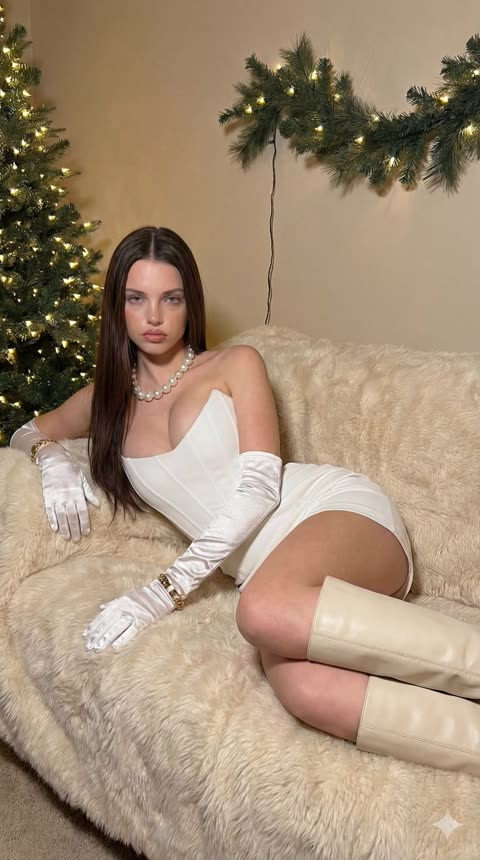</a>

The JSON splits subject, outfit, environment and lighting into separate fields, so the gloves, boots, tree and garland are each named once and stay in the frame. Calling out the satin highlights and warm ambient light builds the glamorous mood without extra style words.

Nano Banana Pro · Text-to-image · Source: [@xmliisu on X](https://x.com/xmliisu/status/2003490900542976013) · 718 likes on 2026-10-29

[`christmas`](tags.md#tag-christmas) [`portrait`](tags.md#tag-portrait) [`fashion`](tags.md#tag-fashion) [`holiday-interior`](tags.md#tag-holiday-interior)

<details><summary><b>Prompt</b></summary>

```text
{
  "subject": {
    "type": "person",
    "gender": "female",
    "pose": "reclining on a textured sofa, leaning back on one arm",
    "expression": "neutral, confident, slight pout",
    "gaze": "direct contact with the camera",
    "hair": {
      "color": "dark brown",
      "style": "long, straight, center-parted, flowing over shoulders"
    },
    "attire": {
      "outfit": "white strapless mini dress with a corset-style bodice",
      "gloves": "white satin opera-length gloves",
      "footwear": "cream-colored knee-high leather boots with pointed toes and chain detail",
      "accessories": [
        "chunky pearl necklace",
        "gold bracelet worn over the left glove"
      ]
    }
  },
  "environment": {
    "setting": "indoor, festive living space",
    "furniture": "sofa covered with a plush, textured cream/beige fur throw",
    "decor": [
      "large Christmas tree heavily decorated with gold and silver ornaments, ribbon, and warm white fairy lights",
      "frosted pine garland with lights mounted on the upper wall",
      "small framed picture hanging on the wall"
    ],
    "background": "textured beige wall"
  },
  "lighting_and_mood": {
    "lighting": "warm ambient light, soft shadows, highlights on the satin gloves and corset",
    "atmosphere": "glamorous, cozy, holiday-themed, elegant",
    "color_palette": [
      "cream",
      "white",
      "gold",
      "dark green",
      "warm beige"
    ]
  }
}
```

</details>

<a id="chatgpt-cream-shalwar-kameez-garden-portrait"></a>
### Seated man in cream shalwar kameez in garden

<a href="https://www.tiktok.com/@mudasirshah9584/video/7690828063927487764"></a>

Uploading a reference photo and naming it the only identity source keeps the face fixed while the text controls pose, outfit and watch. The negative prompt restates what must not change, and the 85mm f/1.8 lens spec gives the shallow garden bokeh.

ChatGPT / Gemini · Edit · Source: [@mudasirshah9584 on TikTok](https://www.tiktok.com/@mudasirshah9584/video/7690828063927487764) · 697 likes on 2026-10-30

[`portrait`](tags.md#tag-portrait) [`identity-preserve`](tags.md#tag-identity-preserve) [`photo-reference`](tags.md#tag-photo-reference) [`garden`](tags.md#tag-garden)

<details><summary><b>Prompt</b></summary>

```text
Do not change my face, identity, hairstyle, beard, outfit, or watch. No extra accessories, distorted hands, extra fingers, artificial skin smoothing, cartoon effects, or unrealistic body proportions. FINAL RESULT: A natural, cinematic, ultra-realistic portrait with my original face, cream shalwar kameez, black wristwatch, clasped hands, and beautiful garden background.
```

</details>

<a id="gpt-image-spotlight-museum-mural-portrait"></a>
### Spotlit woman before Japanese mural in dark museum

<a href="https://x.com/oggii_0/status/2056647551470997670"></a>

Opens with an identity lock on the reference photo, then specifies a single diagonal spotlight, a 70 degree side profile and foreground shadow framing for a moody museum scene. Separate camera, lighting, vibe and negative prompt blocks pin down Portra film color and keep the result realistic.

GPT Image 2 · Edit · Source: [@oggii_0 on X](https://x.com/oggii_0/status/2056647551470997670) · 672 likes on 2026-10-29

[`spotlight`](tags.md#tag-spotlight) [`museum`](tags.md#tag-museum) [`film-grain`](tags.md#tag-film-grain) [`reference-photo`](tags.md#tag-reference-photo) [`low-light`](tags.md#tag-low-light)

<details><summary><b>Prompt</b></summary>

```text
GPT Image 2 on
@itsPolloAI


Prompt: Use my reference photo to preserve the exact facial features, hairstyle, bangs, facial proportions, skin tone, body posture, and overall silhouette with high identity consistency.

Cinematic portrait of a woman standing alone inside a dark exhibition room. She wears a vintage white shirt layered with a soft pink outer jacket and a black vintage-textured skirt. Minimal makeup. Front-profile pose with her body facing the camera, relaxed posture, one shoulder slightly lowered, hands gently adjusting her hair. Calm, mysterious expression with an intellectual and elegant aura.

She is positioned in the lower center of the frame, surrounded by darkness. A single dramatic diagonal spotlight cuts across the scene from the upper right to the lower left, illuminating only half of her body while the rest fades into shadow. Behind her is a colorful vintage Japanese mural wall filled with retro cartoon illustrations and traditional artistic details.

Foreground shadows naturally frame the composition like torn darkness, creating a moody museum atmosphere with lonely artistic energy and a contemplative cinematic mood. Realistic photography with subtle film grain, analog texture, muted blacks, and vibrant mural accents.

Camera angle: eye-level shot, medium-close portrait framing, subject captured at approximately a 70-degree side profile angle, slight distance from the subject for environmental storytelling, centered cinematic composition.

Camera settings: cinematic low-light photography, shallow depth of field, realistic shadow falloff, Kodak Portra film color grading.

Lighting: harsh focused spotlight from the upper right creating a strong diagonal beam and deep high-contrast shadows, minimal ambient light, rich blacks, soft warm highlights along the face and glasses edges.

Vibe: mysterious, artistic, museum-core aesthetic, intelligent quiet energy, melancholic cinematic atmosphere, indie film still, luxury editorial photography, solitary nighttime mood, understated elegance.

Style: ultra-realistic cinematic photography, analog grain, editorial fashion portrait, natural skin texture, subtle imperfections, realistic color science, masterpiece quality.

Negative prompt: anime, smiling, overexposed lighting, extra limbs, bad anatomy, overly colorful outfit, cyberpunk neon, blurry face, low quality, distorted hands, unrealistic skin, HDR overload, exaggerated makeup, busy composition, duplicate person.
```

</details>

<a id="gpt-image-street-caricature-easel-art-market-portrait"></a>
### Girl beside easel with her street caricature

<a href="https://x.com/Emmma___0/status/2056061305640169643"></a>

The prompt locks identity to an uploaded portrait, then asks the caricature to exaggerate only a few real facial traits. Long negative lists rule out the default cute chibi face and tongue-out pose, and a shallow depth of field market scene keeps both the person and the drawing readable.

GPT Image 2 · Edit · Source: [@Emmma___0 on X](https://x.com/Emmma___0/status/2056061305640169643) · 538 likes on 2026-10-28

[`caricature`](tags.md#tag-caricature) [`street-art`](tags.md#tag-street-art) [`easel`](tags.md#tag-easel) [`identity-reference`](tags.md#tag-identity-reference) [`lifestyle`](tags.md#tag-lifestyle)

<details><summary><b>Prompt</b></summary>

```text
Use the uploaded portrait as the identity reference for the subject’s face, hairstyle, facial structure, and overall impression.

Create a high-quality lifestyle editorial portrait of the same person sitting outdoors beside a wooden easel displaying a colorful street-style caricature portrait of them.

The real person and the caricature must clearly resemble the same individual.

Scene:
- the person is seated on a simple wooden folding chair
- beside them is a wooden easel holding a large caricature drawing
- the setting is a sentimental urban art market
- include illustration booths, handmade craft stalls, sketch displays, posters, cozy creative shopfronts, and a few softly blurred pedestrians
- lively but not crowded
- bright soft daylight, warm natural tones, shallow depth of field
- realistic photography for the person and environment
- vertical composition showing both the person and the caricature clearly

Subject:
- preserve the uploaded person’s recognizable identity
- natural pose
- calm, relaxed, slightly amused expression
- stylish casual outfit that suits the subject
- clean editorial lifestyle photography
- do not force the same pose or expression for every subject

Caricature direction:
- the drawing on the easel must be a true observational street caricature, not a generic cute cartoon
- the caricature artist should exaggerate the subject’s actual most recognizable facial traits

- analyze the uploaded face and exaggerate only 2–4 distinctive features, such as eye shape, eyebrows, nose, lips, cheeks, jawline, chin, ears, hairstyle, or facial proportions
- each caricature should feel custom-made for that specific person
- avoid using the same default cute face for every person
- avoid generic big eyes plus tongue-out expression
- the caricature should be funny because it captures the person’s unique features, not because it uses a random silly pose

Caricature style:
- oversized head with smaller simplified body
- playful but recognizable facial proportions
- bold hand-drawn marker lines
- quick sketchy pen strokes
- colored pencil texture
- lively street-artist energy
- humorous but flattering
- witty, expressive, and personality-driven
- charming handmade imperfections
- colorful accent doodles may be added, but keep the focus on the face

Expression in the caricature:
- choose a natural funny expression that fits the person’s facial character
- possible expressions: raised eyebrow, shy smile, surprised eyes, confident smirk, awkward polite smile, exaggerated calm face, pouty lips, confused cute face, or gentle blank stare
- the expression should vary depending on the subject
- do not always use a tongue-out face
- do not always use the same wide-eyed cute expression

Caricature canvas:
- large vertical drawing board or canvas on a wooden easel
- the caricature should be clearly visible and occupy a major part of the image
- it should immediately read as a funny street caricature
- it should be more exaggerated than a portrait sketch
- it should not look like a realistic fashion illustration
- it should not look like a polished beauty drawing

Important:
- the caricature must be custom to the uploaded person
- preserve recognizable identity through the exaggerated features
- prioritize personality, likeness, and humor over generic cuteness
- make the caricature feel like a real street artist observed the person and drew a witty exaggerated version

Negative prompt:
- no generic cute chibi face
- no repeated default caricature face
- no tongue-out pose
- no identical silly expression for every subject
- no random anime expression
- no realistic portrait sketch
- no polished fashion illustration
- no beauty sketch
- no weak exaggeration
- no scary grotesque distortion
- no ugly horror exaggeration
- no distorted anatomy of the real person
- no extra fingers
- no badly drawn hands
- no messy crowded background
- no text
- no watermark
- no Eiffel Tower
- no famous landmarks.
```

</details>

<a id="chatgpt-night-street-portrait-pillar-violet-bridge"></a>
### Man leaning on pillar under violet-lit bridge

<a href="https://www.tiktok.com/@trungayai/video/7691155856074870037">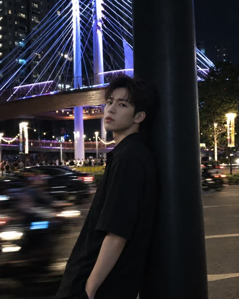</a>

Pairs an exact lens and eye level framing with a body angled away and a head turned back to camera, then layers light direction, a named color palette and film grain terms. The post has readers upload their own photo as the reference, so the face stays consistent while the scene is written out in detail.

ChatGPT / Gemini · Edit · Source: [@trungayai on TikTok](https://www.tiktok.com/@trungayai/video/7691155856074870037) · 535 likes on 2026-10-30

[`night`](tags.md#tag-night) [`street`](tags.md#tag-street) [`portrait`](tags.md#tag-portrait) [`cinematic`](tags.md#tag-cinematic)

<details><summary><b>Prompt</b></summary>

```text
Cinematic nighttime urban street portrait of a young man with natural medium-length black hair. He wears a minimalist oversized black short-sleeve shirt, casually leaning his back and shoulder against a large dark cylindrical street pillar. His body is oriented toward the left, while his head turns back toward the camera in a three-quarter profile with a calm, detached expression. Background features a illuminated cable-stayed pedestrian bridge with cool white and violet LED lights and diagonal cables. Busy street below with horizontal motion blur and light streaks from passing traffic. Dark high-rise buildings in the distance. Atmospheric cinematic lighting: deep shadows, soft ambient light on his face from the left, subtle rim light on hair and shoulder. Color palette: charcoal black, midnight blue, cool white, subtle violet, with small amber highlights. Medium street portrait shot (50-70mm lens at eye-level). Authentic candid film style, realistic skin texture, subtle film grain, Korean urban aesthetic, moody and photorealistic.
```

</details>

<a id="nano-banana-satin-slip-dress-purple-sofa-portrait"></a>
### Blonde woman in satin slip dress on purple sofa

<a href="https://x.com/KeorUnreal/status/2065897085015064917"></a>

A structured JSON prompt splits subject, wardrobe, pose, environment, lighting and camera into labelled fields, so each element can be edited on its own. The floor level low angle with the red sole heel in the foreground pushes the composition toward the legs.

Nano Banana 2 · Text-to-image · Source: [@KeorUnreal on X](https://x.com/KeorUnreal/status/2065897085015064917) · 461 likes on 2026-10-29

[`portrait`](tags.md#tag-portrait) [`editorial-fashion`](tags.md#tag-editorial-fashion) [`structured-prompt`](tags.md#tag-structured-prompt) [`low-angle`](tags.md#tag-low-angle)

<details><summary><b>Prompt</b></summary>

```text
"subject": {
    "Kate Upton lookalike",
    "build": "hourglass figure, large bust",
    "hair": {
      "color": "blonde",
      "length": "long, past shoulders, voluminous loose waves",
      "style": "side-parted, flowing over right shoulder and back",
      "texture": "shiny, silky, healthy"
    },
    "face": {
      "eyes": "sharp and seductive gaze",
      "lips": "full, glossy with deep red lipstick",
      "makeup": "flawless base, defined eyes with subtle eyeliner, contoured cheeks, glossy red lips",
      "glasses": "black frame glasses",
      "expression": "confident, seductive, slight head tilt, direct eye contact with viewer"
    },
    "skin": "smooth, glowing, with soft highlights on shoulders and legs"
  },
  "clothing_and_accessories": {
    "dress": "white satin/silk slip dress, thin gold chain straps, low sweetheart neckline, fitted bodice, short hem with high side slit revealing thigh, shiny reflective texture, small sign 'Keor' embroidered on border",
    "shoes": "white so kate Louboutin high heels with red sole, 12cm heel",
    "jewelry": "small gold hoop earrings, delicate gold chain necklace",
    "other": "subtle gold bracelet on left wrist"
  },
  "pose_and_action": {
    "overall_pose": "sitting on the edge of a large grey sofa, body angled slightly toward the camera, leaning back with weight on left arm",
    "legs": "right leg extended forward toward camera with foot in foreground, left leg bent with knee up, creating a strong, sensual leg focus",
    "hands": "right hand resting on the sofa behind her for support, left hand placed on the sofa cushion in front",
    "torso": "slightly twisted toward viewer, chest forward",
    "head": "turned toward camera with confident seductive expression"
  },
  "environment": {
    "setting": "luxurious modern living room at night",
    "furniture": "large purple velvet sectional sofa, dark wood coffee table with decorative vase containing red dried flowers",
    "background": "dark textured wall with large painting of Nami manga character in Francisco goya style, window with sheer white curtains allowing soft natural light",
    "floor": "dark patterned area rug with subtle texture",
    "decor": "minimalist elegant styling with soft ambient lighting"
  },
  "lighting": {
    "type": "soft cinematic mixed lighting — natural window light from the side combined with warm dramatic interior lighting",
    "quality": "high contrast with beautiful highlights on skin, satin dress, and hair, soft shadows that sculpt the body and legs",
    "mood": "sexy, sophisticated, intimate, high-fashion editorial"
  },
  "camera_and_composition": {
    "shot_type": "medium full-body shot with emphasis on legs and pose",
    "angle": "slightly low angle from floor level, making legs appear longer and more powerful",
    "framing": "subject centered with strong foreground focus on the red high heel and extended leg",
    "depth_of_field": "sharp focus on the woman and dress, softly blurred background",
    "aspect_ratio": "portrait orientation"
  },
  "style_and_quality": {
    "style": "photorealistic, hyper-detailed, commercial high-fashion photography",
    "aesthetic": "sexy confident woman in elegant red satin dress and red heels, luxurious intimate setting",
    "mood": "alluring, powerful, sensual, cinematic",
    "technical_quality": "8K resolution, extremely sharp details on fabric texture, skin, hair strands, and reflections on the patent leather shoes"
  },
```

</details>

<a id="chatgpt-bandaged-hands-bearded-man-monochrome"></a>
### Bandaged hands surround a bearded man in monochrome

<a href="https://www.tiktok.com/@mcsvisuals1/video/7684407883559111966">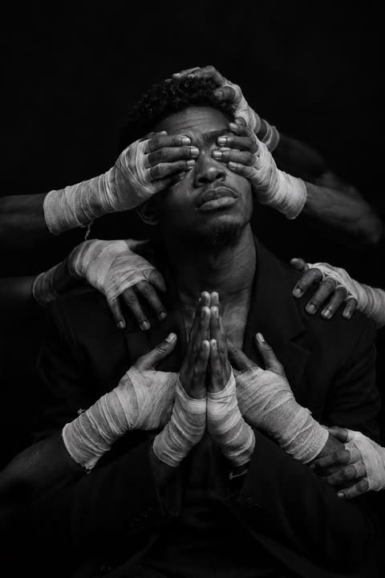</a>

Uploading your own photo anchors the face, while the prompt fixes lighting, lens and composition in detail. Explicit hand-anatomy rules keep the extra arms believable and free of duplicated limbs.

ChatGPT / Midjourney · Edit · Source: [@mcsvisuals1 on TikTok](https://www.tiktok.com/@mcsvisuals1/video/7684407883559111966) · 436 likes on 2026-10-30

[`black-and-white`](tags.md#tag-black-and-white) [`fine-art`](tags.md#tag-fine-art) [`portrait`](tags.md#tag-portrait) [`studio-lighting`](tags.md#tag-studio-lighting)

<details><summary><b>Prompt</b></summary>

```text
Create a cinematic, photorealistic black-and-white fine-art portrait of a rugged bearded man seated against a completely dark minimalist studio background. He wears a sharp black suit jacket with an open collar, creating a sophisticated but vulnerable appearance. Several realistic human arms and hands emerge from behind and around him. The hands are wrapped tightly in layered white gauze bandages. Some hands cover parts of his face and eyes, while others touch his head, shoulders, chest, and arms. One pair of bandaged hands covers his eyes from both sides. Another pair reaches toward his chest, with the man holding his own hands together in a prayer-like gesture. The surrounding hands should symbolize emotional pressure, inner conflict, anxiety, restraint, and feeling trapped. The man looks slightly upward and to the side with a serious, emotionally exhausted expression. Preserve realistic facial anatomy, detailed beard texture, natural skin pores, wrinkles, and subtle imperfections. His face remains the primary focal point. The bandages should look physically realistic, with individual fabric fibers, folds, tension, fraying edges, and natural wrapping around the wrists and fingers. Every hand must have anatomically correct proportions, realistic fingers, believable joints, and natural positioning. Avoid duplicated or malformed limbs. Use dramatic low-key studio lighting. A soft directional light illuminates one side of his face while the opposite side falls into deep shadow. Add subtle rim lighting around his shoulders and the edges of the bandaged hands. Maintain strong contrast between the white bandages, highlights on the face, and nearly black background. Composition: vertical portrait, 2:3 aspect ratio, centered subject, tight medium shot from the waist or chest upward, subject slightly turned toward camera, hands extending into the frame from multiple directions, strong negative space around the figure. Photography style: high-end fine-art black-and-white photography, psychological fashion editorial, dark cinematic portrait, 85mm portrait lens, shallow depth of field, high contrast monochrome tones, rich blacks, detailed highlights, realistic skin texture, subtle film grain, HDR, professional studio photography, photorealistic, ultra-detailed, 8K quality. Mood: haunting, restrained, psychologically intense, vulnerable, mysterious, claustrophobic, introspective, emotionally heavy. Keep everything realistic and photographic. The extra hands should appear physically present in the scene, not supernatural or ghostly. No glowing effects, no fantasy elements, no cartoon appearance, no excessive retouching, no plastic skin, no distorted face, no malformed hands, no extra fingers, no duplicated limbs, no warped anatomy, no text, no logos, no watermark.
```

</details>

<a id="nano-banana-christmas-bed-santa-pout"></a>
### Woman in Santa outfit pouting on bed

<a href="https://x.com/xmliisu/status/2000961513985601954"></a>

A nested JSON spec separates subject, pose, outfit, setting and camera, so each detail such as the hat, French-tip nails and crossed ankles gets its own field. The explicit high angle and vertical orientation set the framing.

Nano Banana Pro · Text-to-image · Source: [@xmliisu on X](https://x.com/xmliisu/status/2000961513985601954) · 436 likes on 2026-10-29

[`christmas`](tags.md#tag-christmas) [`portrait`](tags.md#tag-portrait) [`json-prompt`](tags.md#tag-json-prompt) [`high-angle`](tags.md#tag-high-angle)

<details><summary><b>Prompt</b></summary>

```text
{
  "subject": {
    "description": "Young woman lying on a bed",
    "pose": "Lying on stomach, propped up on elbows, legs raised and crossed at the ankles behind her",
    "expression": "Pouting lips, looking directly at the camera",
    "hair": "Long, dark brown, loose and straight",
    "clothing": {
      "hat": "Red and white Santa hat with white fur trim and pom-pom",
      "outfit": "Red velvet long-sleeved dress or top with white fur cuffs",
      "stockings": "Sheer white thigh-high stockings"
    },
    "hands": "Right hand raised near face, showing manicured nails with red French tips"
  },
  "setting": {
    "location": "Bedroom interior",
    "furniture": "Bed with white linens and pillows",
    "background_elements": [
      "Cream-colored walls with decorative molding",
      "Lamp with a pleated shade",
      "Christmas garland with lights attached to wall/headboard",
      "Small Christmas tree with lights in the distance"
    ]
  },
  "lighting": "Warm, indoor ambient lighting",
  "perspective": "High angle, looking down at the subject",
  "orientation": "Vertical"
}
```

</details>

<a id="nano-banana-christmas-disney-minnie-portrait"></a>
### Young woman with Minnie plush at Disney Christmas night

<a href="https://x.com/SimplyAnnisa/status/1994565437670207617">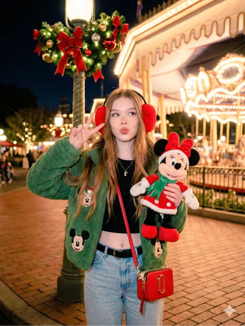</a>

Pairing a reference image with an explicit identity lock (DO NOT CHANGE THE FACE) and a camera spec (eye level, waist up, shallow depth of field) keeps the subject consistent while the scene is rebuilt around her. Listing each prop and the pose in order gives the model concrete, checkable details.

Nano Banana Pro · Edit · Source: [@SimplyAnnisa on X](https://x.com/SimplyAnnisa/status/1994565437670207617) · 395 likes on 2026-10-29

[`christmas`](tags.md#tag-christmas) [`disney`](tags.md#tag-disney) [`portrait`](tags.md#tag-portrait) [`reference-image`](tags.md#tag-reference-image)

<details><summary><b>Prompt</b></summary>

```text
Using my reference image. DO NOT CHANGE THE FACE — keep all facial features exactly the same. Create a highly detailed, festive nighttime scene at a Disney theme park during Christmas season. A young woman stands in the foreground, centered in the frame. She wears red fluffy earmuffs, a green fuzzy jacket embroidered with multiple smiling Mickey Mouse faces, a black crop top revealing a subtle navel piercing, high-waisted light blue jeans with a black belt, and carries a small red crossbody purse with gold hardware. In her left hand, she holds a plush Minnie Mouse doll dressed in a red Santa outfit with white trim and a green scarf, while making a playful peace sign near her face and puckering her lips in a cute kiss pose. A delicate gold necklace with a small pendant adorns her neck.

The shot is an eye-level, straight-on medium portrait from the waist up, captured with a Fujifilm professional camera, using shallow depth of field to keep her in perfect focus while softly blurring the background. Behind her, a classic green lamppost wrapped in Christmas garland, twinkling warm white lights, red ribbons, gold ornaments, and red baubles decorates the scene. To the right, a glowing carousel with a white canopy and colorful string lights illuminates the festive night. The ground is paved brick, and distant bokeh lights from park attractions create a magical atmosphere.

The overall mood is joyful, whimsical, and full of holiday spirit — vibrant colors, warm golden lighting, cinematic composition, photorealistic style, and 8K ultra-HD quality.
```

</details>

<a id="chatgpt-malaysian-family-studio-portrait-1980s"></a>
### Vintage Malaysian family studio portrait with sepia backdrop

<a href="https://www.tiktok.com/@nynasweety/video/7683135740514946324">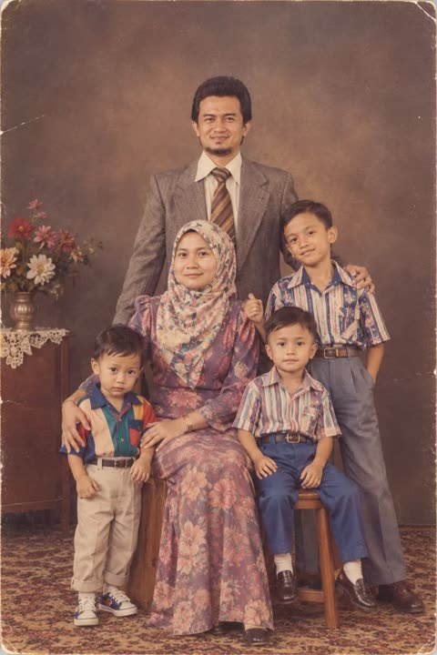</a>

The prompt names the era, country and exact clothing for each person, then uses scanned-photo texture words such as faded colours, analog film grain and soft warm light to make it look like an old album print. Assigning each outfit to a position in the group keeps a multi-person composition readable.

ChatGPT · Text-to-image · Source: [@nynasweety on TikTok](https://www.tiktok.com/@nynasweety/video/7683135740514946324) · 381 likes on 2026-10-30

[`retro`](tags.md#tag-retro) [`family`](tags.md#tag-family) [`vintage-film`](tags.md#tag-vintage-film) [`malaysia`](tags.md#tag-malaysia)

<details><summary><b>Prompt</b></summary>

```text
A vintage, nostalgic studio family portrait from the late 1980s or early 1990s in Malaysia. The photo shows a traditional Malaysian family: a father standing at the back wearing a formal grey suit jacket and a striped tie, a mother sitting gracefully in the center wearing a vintage floral Baju Kurung Moden with a matching tudung (hijab), and three young sons. The eldest son stands to the side in a striped collared shirt and high-waisted pleated trousers, while the two younger sons are wearing colorful tucked-in collared shirts and retro trousers. The setting is a classic photography studio with a textured brown-sepia backdrop, an old wooden side table with artificial flowers on a lace doily, and a patterned vintage carpet. The entire image must have a realistic old photograph texture, with soft warm lighting, faded colors, and authentic analog film grain, looking exactly like a scanned photo from an old family album.
```

</details>

<a id="chatgpt-monochrome-cafe-portrait-iced-coffee"></a>
### Black and white cafe portrait with iced coffee

<a href="https://www.tiktok.com/@ness_marie_/video/7686203111882411277">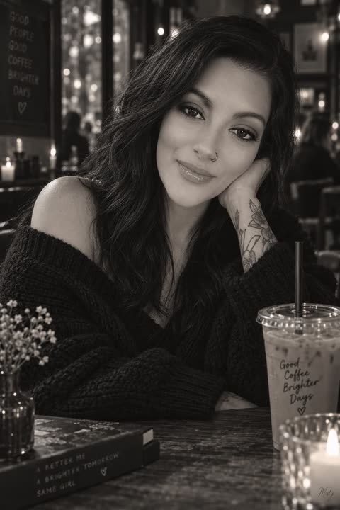</a>

Locks the monochrome editorial look with named light sources (natural window light, soft candle bokeh) and a single pose cue (head resting on one hand, direct eye contact). The closing framing rule to keep the hair, woman and iced coffee inside the frame keeps every key element in view.

ChatGPT · Text-to-image · Source: [@ness_marie_ on TikTok](https://www.tiktok.com/@ness_marie_/video/7686203111882411277) · 374 likes on 2026-10-30

[`portrait`](tags.md#tag-portrait) [`monochrome`](tags.md#tag-monochrome) [`cafe`](tags.md#tag-cafe) [`editorial`](tags.md#tag-editorial)

<details><summary><b>Prompt</b></summary>

```text
Create a photorealistic, cinematic black-and-white autumn portrait of a glamorous dark haired woman sitting at a cozy café table. She has shoulder length, softly curled dark hair, green eyes, natural glamorous makeup, lips glossy and a calm, confident, slightly mysterious expression. She wears a textured oversized black knit sweater hanging off the shoulder. She rests her head gently against one hand while looking directly into the camera with an intimate, effortless expression. Place her in a dark, cozy café with soft out-of-focus lights, subtle candles, and beautiful bokeh in the background. Include an iced coffee on the table. Make the entire image elegant black-and-white with rich blacks, soft gray highlights, beautiful skin tones translated into monochrome, dramatic natural window lighting, subtle film grain, and a timeless editorial photography feel. Keep the mood cozy, sophisticated, mysterious, and beautiful rather than spooky. Ultra-photorealistic, realistic skin texture, detailed hair, realistic knit fabric, shallow depth of field, professional portrait photography, cinematic lighting, high-end magazine aesthetic. Add a very subtle “Misty” watermark in a corner, small and unobtrusive. FORMAT: 1026 × 1536 pixels, vertical composition. Keep the hair, woman, iced coffee, and important elements comfortably inside the frame. Do not crop important details.
```

</details>

<a id="nano-banana-chibi-twins-caricature-pairs"></a>
### Four celebrities beside Pixar style bobblehead caricatures

<a href="https://x.com/TechieBySA/status/2051378456982671545">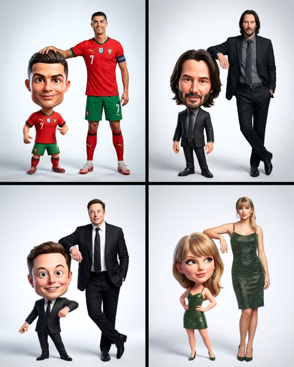</a>

Fix the real subject on the right and the caricature on the left at 50 to 60 percent of the real height, with one elbow resting on the caricature's head for a natural interaction. Matching outfits, a light gray seamless backdrop and soft upper left light keep both figures lit and grounded in the same scene.

Nano Banana 2 · Edit · Source: [@TechieBySA on X](https://x.com/TechieBySA/status/2051378456982671545) · 370 likes on 2026-10-29

[`caricature`](tags.md#tag-caricature) [`bobblehead`](tags.md#tag-bobblehead) [`3d-render`](tags.md#tag-3d-render) [`celebrity`](tags.md#tag-celebrity)

<details><summary><b>Prompt</b></summary>

```text
“Create a high-resolution, ultra-realistic studio composition in a 4:5 vertical aspect ratio, featuring a real person standing beside a stylized 3D caricature (bobblehead-style) version of the same individual. Use the provided reference image as the only source of identity. Strictly preserve the subject’s exact facial structure, proportions, skin tone, hairstyle, and all recognizable features. Do not alter or stylize the real face. Composition & Framing: Full-body vertical shot with a clean, centered layout. The real subject stands on the right, and the caricature stands on the left at approximately 50–60% of the real subject’s height. The real subject casually rests one elbow on the caricature’s oversized head, creating a natural, playful interaction. Real Subject (Photographic): Ultra-realistic rendering with natural skin texture and fine detail. Expression is warm, relaxed, and confident. Pose & Style (IMPORTANT): The subject stands in a slightly cool, stylish posture — relaxed stance with subtle asymmetry (one leg slightly forward or weight shifted), shoulders loose, not stiff. The hand resting on the caricature should feel effortless and natural. Clothing (Match Reference): Keep textures realistic and clearly visible. 3D Caricature (Stylized Version): Pixar/Disney-inspired 3D style with exaggerated proportions — large expressive head and smaller body. The height should be noticeably shorter, around the real subject's waist level. Facial features must remain recognizable but enhanced — larger eyes, softer forms, slightly amplified smile. Emotion & Body Movement (IMPORTANT): Expression is more playful and animated than the real subject Eyes brighter and more expressive, smile slightly exaggerated Body posture must NOT be stiff — use a natural, lively stance Add subtle movement according to the real subject's personality Pose should feel like a living, animated character, not a rigid figurine Clothing: Exact 1:1 stylized recreation of the real subject’s outfit with soft 3D textures. Lighting & Environment: Soft, diffused studio lighting from the upper-left, creating smooth highlights and gentle shadows. Clean light-gray gradient seamless background(lighter in the inner areas). Output Style: Ultra-clean, cinematic, high-detail render with strong contrast between realistic human and stylized 3D character. Both subjects grounded with soft natural shadows.”
```

</details>

<a id="nano-banana-cobalt-ring-fashion-editorial"></a>
### Platinum bob model seated in sky blue circular opening

<a href="https://x.com/Emmma___0/status/2109146295252459682"></a>

The prompt is split into labeled blocks for scene, outfit, pose, lighting, palette and photography style. Naming an 85mm lens, a medium format look and a cool versus warm light split keeps the high end editorial feel consistent.

Nano Banana 2.1 · Text-to-image · Source: [@Emmma___0 on X](https://x.com/Emmma___0/status/2109146295252459682) · 370 likes on 2026-10-27

[`fashion-editorial`](tags.md#tag-fashion-editorial) [`architecture`](tags.md#tag-architecture) [`cobalt-blue`](tags.md#tag-cobalt-blue) [`studio-portrait`](tags.md#tag-studio-portrait) [`minimalist`](tags.md#tag-minimalist)

<details><summary><b>Prompt</b></summary>

```text
Create an ultra-realistic, high-end fashion editorial photoshoot featuring a beautiful young adult woman with short, tousled platinum-blonde bob hair, delicate facial features, fair skin, natural rosy lips, light-colored eyes, and a calm, confident expression.

Scene and Environment: A futuristic minimalist architectural studio featuring a massive sculptural circular opening with thick, smooth, curved white walls. The interior of the circular structure is a rich cobalt-blue or vibrant cyan-blue, creating a striking contrast against the white architectural frame. Clean geometric shapes, curved surfaces, and a contemporary art-gallery aesthetic.

Outfit and Styling: The model wears a sophisticated, oversized black knit sweater or elegant black long-sleeved top paired with tailored black or ivory trousers. Minimal makeup, natural skin texture, understated accessories, and effortless luxury styling.

Pose and Composition: The model poses naturally within and around the giant circular opening. Create a series of artistic editorial poses: a close-up portrait leaning forward through the circular frame, a full-body seated pose inside the sculptural ring with one knee raised, and a standing or seated three-quarter portrait with one hand resting on the curved white surface. Relaxed hands, graceful posture, elongated silhouette, and direct eye contact with the camera.

Lighting: Soft natural daylight entering from one side, creating beautiful directional highlights on the platinum hair, subtle shadows across the face, realistic skin tones, and soft gradients on the white architectural surfaces. Cinematic interplay between cool blue ambient light and warm sunlight.

Color Palette: Vivid cobalt blue, turquoise, icy cyan, pure white, deep black, and platinum blonde. Clean, cool-toned color grading with balanced highlights and rich shadows.

Photography Style: Luxury fashion magazine editorial, contemporary avant-garde photography, minimalist Scandinavian design, architectural fashion campaign, medium-format camera aesthetics, 85mm portrait lens, subtle depth of field, precise focus on the eyes, realistic hair strands, detailed knit fabric, natural skin texture, sophisticated framing, and premium commercial photography quality.

Image Quality: Photorealistic, ultra-detailed, 8K appearance, professional art direction, anatomically accurate hands, realistic proportions, elegant negative space, clean architectural geometry, natural facial expression, crisp details, refined composition, no artificial-looking skin, no excessive retouching.

Vertical portrait composition, 2:3 aspect ratio.
```

</details>

<a id="nano-banana-seaside-wind-triptych-portrait"></a>
### Windy seaside triptych portrait with seagulls

<a href="https://x.com/rovvmut_/status/2028344848517062936"></a>

The prompt locks identity to the uploaded photo, then defines each frame by shot size: wide, side medium, close-up. A shared scene, lens, light and grading spec keeps the three frames consistent.

Nano Banana 2 · Edit · Source: [@rovvmut_ on X](https://x.com/rovvmut_/status/2028344848517062936) · 352 likes on 2026-10-28

[`triptych`](tags.md#tag-triptych) [`identity-reference`](tags.md#tag-identity-reference) [`seaside`](tags.md#tag-seaside) [`cinematic-portrait`](tags.md#tag-cinematic-portrait) [`overcast-light`](tags.md#tag-overcast-light)

<details><summary><b>Prompt</b></summary>

```text
Google Nano Banana 2 on Yapper

Prompt: Use the uploaded photo as the exact identity reference. Keep the same person, the same face, the same facial features, proportions, and natural expression.
Create a photorealistic cinematic triptych portrait, a three-frame composition combined into one image.
Scene: a windy seaside with a cold sea, overcast sky, flying seagulls, strong ocean wind, and a vivid, alive atmosphere.
Frame 1 (top): wide cinematic shot. The person stands by the sea, smiling naturally. Their hair is blowing in the wind. Seagulls are flying in the background.
Frame 2 (middle): medium shot from behind or from the side. The person is looking at the sea. Their coat and hair are moving in the wind. Seagulls fly nearby.
Frame 3 (bottom): close-up emotional portrait. Wind in the hair, natural skin texture, thoughtful gaze, cinematic mood.
Style: real photography, cinematic lifestyle portrait, documentary fashion photography.
Lighting: natural overcast daylight, soft shadows, cold seaside tones.
Camera: full-frame DSLR look, 85mm lens aesthetic, shallow depth of field.
Color grading: muted cinematic colors, cool palette, film-like mood.
Ultra photorealistic, natural skin texture, real moment. No illustration, no CGI. No text, no logos, no watermark.
```

</details>

<a id="nano-banana-christmas-vinyl-cafe-portrait"></a>
### Woman in gingham top at a Christmas record cafe

<a href="https://x.com/ZaraIrahh/status/1998043967888515532">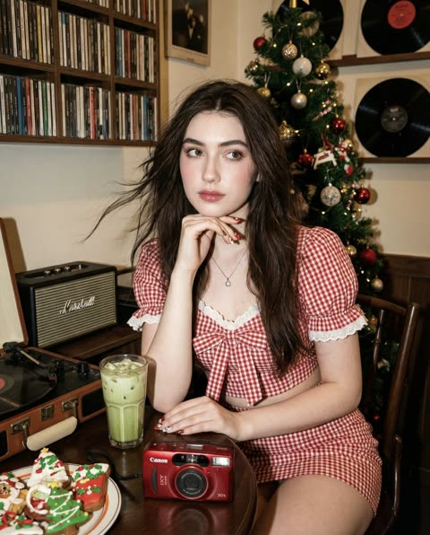</a>

The prompt splits the scene into subject, environment, lighting and camera fields, so each prop and the direct flash look are specified separately. Naming a film stock and a point and shoot compact camera sets the Y2K snapshot feel.

Nano Banana Pro · Text-to-image · Source: [@ZaraIrahh on X](https://x.com/ZaraIrahh/status/1998043967888515532) · 332 likes on 2026-10-29

[`christmas`](tags.md#tag-christmas) [`portrait`](tags.md#tag-portrait) [`y2k`](tags.md#tag-y2k) [`film-look`](tags.md#tag-film-look)

<details><summary><b>Prompt</b></summary>

```text
"subject": {
      "description": "hyper-realistic portrait of a cute, doll-faced Asian woman sitting at a dark wooden table in a vintage-style room",
      "face_preservation": true,
      "pose": {
        "body_position": "seated at the table",
        "head": "slightly tilted toward camera",
        "hands": "chin resting gently on one hand, other hand relaxed on or near the table",
        "expression": "soft, warm, slightly shy smile with big doll-like eyes looking toward the camera"
      },
      "appearance": {
        "skin_tone": "very fair skin with realistic texture",
        "hair": {
          "color": "dark brown",
          "length": "long",
          "style": "slightly wind-blown with a few strands falling across her face, layered and softly messy"
        },
        "makeup": {
          "style": "Douyin and Korean-inspired",
          "eyes": "long curled lashes with subtle liner, bright and glossy look",
          "blush": "soft pink on cheeks and nose tip",
          "lips": "glossy rose-pink lips",
          "overall": "cute doll-like aesthetic"
        },
        "clothing": {
          "top": {
            "type": "puff-sleeve crop top",
            "pattern": "red-and-white checkered",
            "neckline": "wide neckline revealing collarbones and subtle cleavage",
            "details": "small lace ruffle edges and a bow tie in the center"
          },
          "bottom": {
            "type": "fitted mini skirt",
            "pattern": "matching red-and-white checkered"
          }
        },
        "accessories": {
          "necklace": "minimal small-pendant necklace",
          "nails": "Christmas-themed nail art"
        }
      }
    },

    "environment": {
      "setting": "retro café or music lounge corner",
      "walls": {
        "color": "dark brown",
        "decor": [
          "CD shelves",
          "vinyl records on the wall",
          "Christmas tree",
          "Christmas ornaments"
        ]
      },
      "table": {
        "material": "dark wood",
        "objects": [
          "vintage amplifier",
          "old-style record player",
          "one iced matcha latte in a clear cup",
          "beautifully decorated Christmas-themed food and desserts",
          "red Canon IXY 30S camera placed clearly on the table"
        ]
      }
    },

    "lighting": {
      "ambient": {
        "type": "warm tungsten",
        "color": "orange",
        "mood": "cozy and festive"
      },
      "key_light": {
        "type": "direct flash",
        "position": "from camera direction",
        "effect": "brightens her skin sharply with a slightly yellow-white glow, creates strong hard shadows behind her"
      },
      "additional_light": {
        "type": "soft natural sunlight",
        "placement": "subtle presence in the room",
        "effect": "adds gentle highlights and depth"
      }
    },

    "photography": {
      "style": "Y2K / early digital compact camera vibe",
      "camera_feel": "point-and-shoot compact digital, on-camera flash",
      "quality": "super sharp 8K hyper-realistic image",
      "color_profile": "Fujifilm Pro 400H inspired, slightly old-lens filter",
      "exposure": "bright exposure emphasizing the subject against darker background",
      "texture": {
        "skin": "realistic pores and soft sheen",
        "grain": "light film grain overlay for nostalgic film look"
      }
    },

    "composition": {
      "framing": "medium close-up, centered on subject at the table with upper body visible and table objects clearly shown",
      "focus": "sharp focus on face and upper body, table items slightly less sharp but still detailed",
      "background_depth": "background elements recognizable but slightly softer than subject"
    }
  }
}
```

</details>

<a id="gpt-image-dusk-film-portrait"></a>
### Low angle dusk portrait with front flash and film grain

<a href="https://x.com/chatgptpaglu/status/2105219509791678731"></a>

A direct front flash against a deep blue dusk sky lifts the subject off a dark background, and the low camera angle with silhouetted branches gives the frame its candid snapshot feel. Spelling out the exact shirt text lets the model render the graphic cleanly.

GPT Image 2.5 · Text-to-image · Source: [@chatgptpaglu on X](https://x.com/chatgptpaglu/status/2105219509791678731) · 318 likes on 2026-10-27

[`portrait`](tags.md#tag-portrait) [`film-grain`](tags.md#tag-film-grain) [`golden-hour`](tags.md#tag-golden-hour)

<details><summary><b>Prompt</b></summary>

```text
A low-angle, close-up photograph capturing a young woman with wavy brown hair outdoors at dusk. She is wearing a grey cropped t-shirt with a blue and white graphic text that reads 'DESTINED' above 'SET 1958' and black denim bottoms. Her head is tilted, and she is looking directly into the camera lens. The dark blue evening sky serves as the background, with silhouetted tree branches visible at the bottom of the frame. Strong flash lighting is directed from the front, illuminating her face and highlighting strands of her hair. The composition has a grainy film photography aesthetic.
```

</details>

<a id="nano-banana-psg-kit-man-kitchen-props-portrait"></a>
### Man in PSG kit holding lily of the valley

<a href="https://x.com/fofrAI/status/1997340541764161950">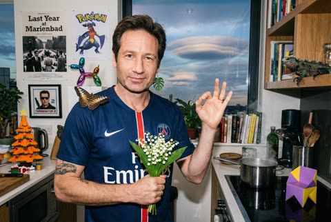</a>

Packs many unrelated props into one scene and pins each one to a body part or a specific spot, so every object has a clear location. The hastily taken photo instruction sets a casual everyday camera feel that keeps the dense detail from looking staged.

Nano Banana Pro · Text-to-image · Source: [@fofrAI on X](https://x.com/fofrAI/status/1997340541764161950) · 299 likes on 2026-10-29

[`portrait`](tags.md#tag-portrait) [`celebrity`](tags.md#tag-celebrity) [`everyday-scene`](tags.md#tag-everyday-scene) [`multi-prop`](tags.md#tag-multi-prop)

<details><summary><b>Prompt</b></summary>

```text
Y'all aren't pushing Nano Banana Pro hard enough.

 > A portrait photo of david duchovny, he is wearing a PSG kit, on his shoulder is a parthenos sylvia, in his hand he is holding lily of the valley, behind him there is a poster for the movie "Last Year at Marienbad" and a Garchomp poster. On a plinth there is a jeff koons sculpture. The sky through the window shows lenticular clouds. There is also a Terminator 2 cross-stitch on the wall. On his arm there is a tattoo of a Nissan Qashqai. There's an orange lego Christmas tree. The room has a high end decor, a pot is boiling on the NEFF hob. Next to the pot is a little origami chair made from purple and yellow paper. He has a dangling monstera leaf earring.  There is a pet marine iguana. In his other hand he is making the ok shape. On that hand there is a gold ring. The whole image gives the impression of a hastily taken photo, an everyday scene.
```

</details>

<a id="nano-banana-night-flash-hair-tying-stone-steps"></a>
### Candid night flash photo tying hair on stone steps

<a href="https://x.com/MahiraEhan/status/2107702956258685009"></a>

Direct phone flash that falls off fast into dark stone steps, plus a caught mid action pose, gives the image a real snapshot feel. Separate sections for pose, hair, makeup, clothing and camera, followed by a list of looks to avoid, keep the skin and lighting from turning into a polished studio finish.

Nano Banana 2.1 · Edit · Source: [@MahiraEhan on X](https://x.com/MahiraEhan/status/2107702956258685009) · 296 likes on 2026-10-28

[`candid`](tags.md#tag-candid) [`flash-photography`](tags.md#tag-flash-photography) [`iphone-style`](tags.md#tag-iphone-style) [`night`](tags.md#tag-night) [`portrait`](tags.md#tag-portrait)

<details><summary><b>Prompt</b></summary>

```text
A spontaneous evening shot, a candid moment caught in motion. Taken on an iPhone 17 Pro with flash. The frame should look like a real photo from a personal gallery, not a staged fashion shoot.

POSE: The girl is sitting directly on wide, light-colored stone steps, with her torso slightly turned into a 3/4 angle. One leg is bent closer to her body, while the other rests on the step below.

At the moment of capture, the girl raises both hands to quickly tie her hair into a high, messy ponytail. Her elbows are positioned on opposite sides of her head, with her hands still in motion. Her head is slightly turned to the side, and her gaze is directed past the camera. Her lips are relaxed and slightly parted.

The frame is captured in the exact in-between second — her hair is not fully tied yet, part of it is still held in her hands, and several strands are flying freely near her face. Subtle directional motion blur on the hands, hair ends, and edges of the clothing. Do not blur or deform the facial features; the face must remain clear, recognizable, and true to the original.

HAIR: Very long, thick hair. Most of the hair is being lifted upward and backward by her hands, while the lower section still falls freely over her shoulders and back. A few thin strands have come loose around the temples and cheeks. Do not let them cover the eyes, nose, or lips.

MAKEUP: Expressive modern evening makeup. A thin, elongated black winged eyeliner, voluminous lashes with a fox-eye effect, laminated brows. The lips are outlined with a cool brownish-pink pencil slightly darker than the natural lip tone, with a translucent berry-nude gloss inside. Skin is slightly tanned, fresh, with visible real pores and natural micro-texture.

CLOTHING: A fitted white top with a wide boat neckline, revealing the collarbones and one shoulder. Long sleeves partially cover the hands. Bottoms: loose black low-rise trousers with soft folds.

ACCESSORIES: Large silver hoop earrings, one chunky silver ring. Manicure: short square nails, in a shade matching the top.

ENVIRONMENT: A wide outdoor stone staircase at night. Light-colored natural stone occupies almost the entire background and creates graphic horizontal lines. No restaurants, cars, signs, flowers, or decorative objects. The upper part of the frame gradually falls into darkness.

FLASH PHOTOGRAPHY: Deep night. The only main light source is the direct built-in iPhone flash. It sharply illuminates the face, collarbones, raised hands, top, and nearest steps.

The light falls off quickly into the depth of the staircase. Distant steps fade into gray-black shadow. No soft studio lighting and no evenly illuminated scene.

CAMERA: iPhone 17 Pro, vertical 9:16 format. Medium-close framing, approximately from mid-thighs to the space slightly above the raised hands. The camera is close, positioned slightly above and to the side, as if someone standing nearby suddenly raised their phone and pressed the shutter while the girl was tying her hair.

The girl is not perfectly centered. One elbow is close to the upper edge of the frame, and part of the jacket is naturally cropped at the bottom. Handheld, slightly imperfect framing.

Natural skin, realistic texture of hair, knit fabric, trousers, and stone. Slight digital noise, visible fine film grain, muted nighttime color rendering, deep shadows, subtle vignette, RAW unedited feeling.

Do not use 8K, ultra sharp, HDR, beauty filters, airbrushing, plastic skin, artificial bokeh, studio lighting, perfect symmetry, or a glossy AI look.
```

</details>

<a id="nano-banana-christmas-red-skirt-dance-film-snapshot"></a>
### Woman dancing in red skirt by Christmas tree

<a href="https://x.com/craftian_keskin/status/2004992718154633573">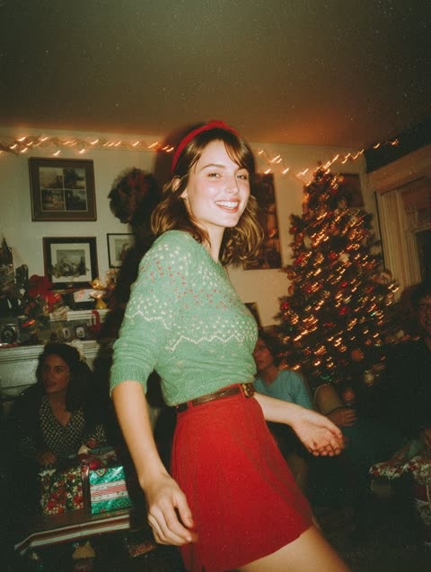</a>

A candid, documentary framing comes from a low close camera angle and a mid-motion pose, while film grain, muted contrast, a faded palette and vignette texture give it an analog snapshot look. Listing the room details (lit tree, wrapped presents, out of focus guests on couches) builds depth and a lived-in feel.

Nano Banana Pro · Text-to-image · Source: [@craftian_keskin on X](https://x.com/craftian_keskin/status/2004992718154633573) · 295 likes on 2026-10-29

[`christmas`](tags.md#tag-christmas) [`film-grain`](tags.md#tag-film-grain) [`vintage-photo`](tags.md#tag-vintage-photo) [`candid`](tags.md#tag-candid)

<details><summary><b>Prompt</b></summary>

```text
A candid indoor holiday scene photographed in a warm, nostalgic vintage style. A cozy living room decorated for Christmas, with a fully lit Christmas tree in the background adorned with glowing string lights, ornaments, and a tree topper. Wrapped presents sit beneath the tree, adding soft points of warm light. The room feels intimate and lived-in, with framed photos on the wall and people seated casually on couches in the background, slightly out of focus. In the foreground, a young beautiful attractive blond adult woman is captured mid-movement, dancing naturally. She is smiling while looking slightly downward, joyful and relaxed. She wears a green knit sweater with a subtle festive pattern, tucked into a high-waisted red skirt. A slim belt cinches the waist. She has a red headband in her hair, which is medium-length, brown, and softly styled with natural volume. Her makeup is minimal and natural, emphasizing a warm smile and expressive eyes. Her posture shows motion, one leg bent, hips angled, arms loose, giving the image a spontaneous, authentic feel. The camera angle is slightly low and close, creating a dynamic perspective and emphasizing movement. Lighting is warm and soft, typical of indoor incandescent bulbs and Christmas lights. The image has visible film grain, slight blur from motion, muted contrast, and a faded color palette reminiscent of analog film photography from the late 1990s or early 2000s. Subtle vignetting and texture overlay give the image a scanned photo look. Photorealistic but nostalgic, documentary-style family snapshot, imperfect and charming. No studio lighting, no posed feeling, pure candid holiday moment.
```

</details>

<a id="nano-banana-yellow-beaded-halter-wet-hair-portrait"></a>
### Woman in yellow beaded halter with damp hair

<a href="https://x.com/KeorUnreal/status/2113259619443159550">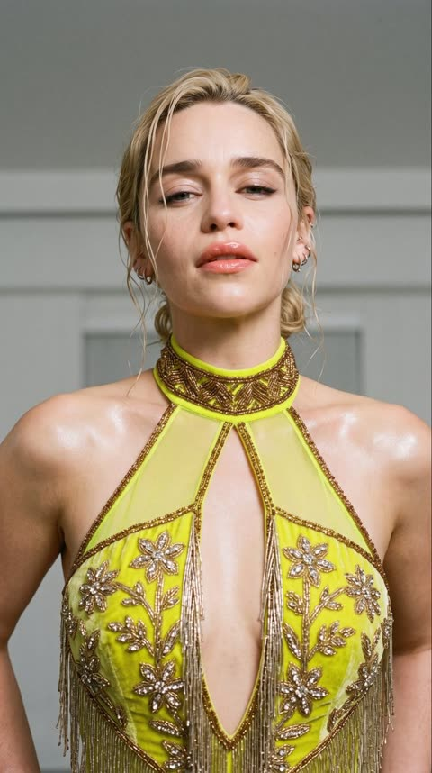</a>

A low camera angle with the head tilted back makes the chest and collar the focal point. The prompt names each material (sheer mesh, velvet bodice, crystal embroidery, metallic fringe) so the model renders them as distinct textures, and the soft overhead light with a plain gray wall keeps attention on those details.

Nano Banana 2.1 · Text-to-image · Source: [@KeorUnreal on X](https://x.com/KeorUnreal/status/2113259619443159550) · 290 likes on 2026-10-29

[`fashion-portrait`](tags.md#tag-fashion-portrait) [`low-angle`](tags.md#tag-low-angle) [`beadwork`](tags.md#tag-beadwork) [`soft-lighting`](tags.md#tag-soft-lighting)

<details><summary><b>Prompt</b></summary>

```text
Low-angle chest-up fashion portrait of a young american woman Emilia clarke Head tilted slightly back, half-lidded eyes looking down into the camera, lips slightly parted. Blonde hair in a messy low bun with thin damp strands framing the face and neck. Dewy wet-look makeup: luminous skin sheen on shoulders and collarbones, soft dark liner, glossy peach-pink lips. Neon yelloe halter high-collar piece with bronze beadwork on the collar, a sheer neon yelloe mesh panel edged with beads, and a velvet-like bodice covered in symmetrical gold-silver crystal floral embroidery with fine metallic fringe opened on a deep neckline. Multiple small silver hoop and stud earrings. Soft overhead light, neutral out-of-focus light-gray interior wall with a horizontal architectural line. High-fashion damp glam, sharp embroidery detail, no harsh flash.
```

</details>

<a id="gpt-image-black-blazer-editorial-portrait-reference"></a>
### Chest-up editorial portrait in oversized black blazer

<a href="https://x.com/MissDelulu9/status/2078741062714356031"></a>

Opens with an identity lock on the reference face, then specifies framing, pose, wardrobe and makeup in order. A named camera and lens, soft side sunlight on a white wall, and a closing list of negatives keep the skin realistic and the face unchanged.

GPT Image 2 · Edit · Source: [@MissDelulu9 on X](https://x.com/MissDelulu9/status/2078741062714356031) · 282 likes on 2026-10-29

[`editorial`](tags.md#tag-editorial) [`portrait`](tags.md#tag-portrait) [`black-blazer`](tags.md#tag-black-blazer) [`reference-image`](tags.md#tag-reference-image) [`fashion`](tags.md#tag-fashion)

<details><summary><b>Prompt</b></summary>

```text
Use the girl from the reference image and preserve her face, identity, proportions, and overall appearance exactly. Ultra-realistic 9:16 chest-up editorial portrait. She sits with a slight head tilt, looking directly at the camera with a calm, confident expression. Long straight glossy hair with a clean center part.

Wearing a structured oversized black blazer with broad shoulders. Natural luxury makeup with luminous skin, soft brown eyeshadow, subtle eyeliner, defined lashes, and nude glossy lips. Clean white minimalist background with soft side sunlight creating elegant shadows. Shot on a Sony A7R IV, 85mm f/1.4, shallow depth of field, cinematic lighting, realistic skin texture, 8K RAW, premium fashion editorial, no facial changes, no distortion, no plastic skin, no text, logo, or watermark.
```

</details>

<a id="nano-banana-neon-yellow-dress-velvet-armchair"></a>
### Neon yellow satin mini dress in velvet armchair

<a href="https://x.com/KeorUnreal/status/2109984717160276438">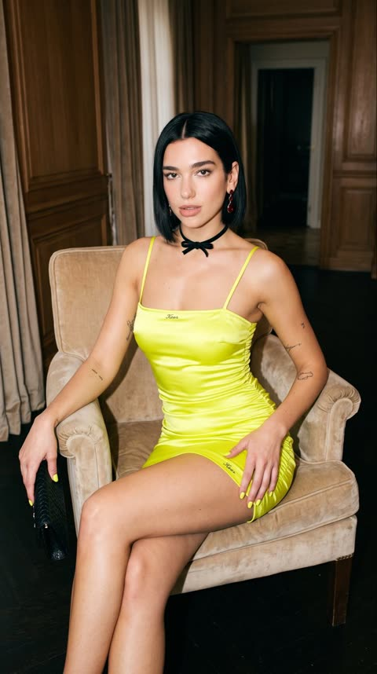</a>

A structured JSON prompt separates subject, outfit, setting, lighting and camera into their own keys, and it names the exact embroidered word Keor for the neckline and hem, which the output reproduces. Naming a three quarter camera and a high detail fashion photo style keeps the image grounded in real studio portraiture.

Nano Banana 2.1 · Text-to-image · Source: [@KeorUnreal on X](https://x.com/KeorUnreal/status/2109984717160276438) · 275 likes on 2026-10-29

[`json-prompt`](tags.md#tag-json-prompt) [`fashion`](tags.md#tag-fashion) [`text-in-image`](tags.md#tag-text-in-image) [`portrait`](tags.md#tag-portrait)

<details><summary><b>Prompt</b></summary>

```text
{
  "subject": {
    "description": "Young woman with fair skin, short black bob haircut with a center part, refined facial features, looking toward the camera with a calm expression",
    "hair": "Short black bob, sleek and straight with a clean center part",
    "body": "Slender yet curvy figure, small tattoos visible on both arms",
    "pose": "Seated in a velvet armchair, one leg extended forward, one hand holding a clutch, the other resting on her thigh near the dress hem",
    "expression": "Direct, slightly parted-lip gaze"
  },
  "outfit": {
    "dress": "Neon yellow satin mini dress with thin spaghetti straps, ruched sides, and a short fitted silhouette",
    "accessories": "Black choker with a small bow, dangling red earrings",
    "nails": "Neon yellow painted fingernails",
    "prop": "Black textured clutch held in one hand",
    "text": "The word 'Keor' written in small lettering along the border of the outfit (on the neckline or hem of the dress)"
  },
  "setting": {
    "location": "Elegant indoor room",
    "background": "Beige velvet armchair, wood-paneled walls, curtains, dark flooring, doorway in the distance"
  },
  "lighting": {
    "type": "Warm soft indoor lighting",
    "effects": "Gentle highlights on the neon yellow satin and skin, soft shadows in the room"
  },
  "camera": {
    "angle": "Slightly high three-quarter angle looking down at the seated subject",
    "framing": "Three-quarter body shot, subject centered in the armchair",
    "style": "Photorealistic, high-detail fashion photography, sharp focus"
  },
  "additional_details": {
    "skin": "Smooth with a natural sheen",
    "atmosphere": "Stylish indoor portrait with a bold neon yellow look"
  }
}
https://
x.com/mr_perfect1117
/mr_perfect1117/status/2108407417373692016
…
```

</details>

<a id="nano-banana-overhead-snow-portrait-school-uniform"></a>
### Overhead portrait of a girl lying in snow

<a href="https://x.com/VibeEverything/status/2113256906294796645"></a>

A JSON prompt locks identity to the reference photo, then specifies camera angle, lens, focus, pose, outfit and lighting as separate fields. Naming overcast light, snowflake details and a negative prompt against face changes keeps the likeness and the cold, quiet mood.

Nano Banana 2.1 · Edit · Source: [@VibeEverything on X](https://x.com/VibeEverything/status/2113256906294796645) · 275 likes on 2026-10-28

[`portrait`](tags.md#tag-portrait) [`snow`](tags.md#tag-snow) [`school-uniform`](tags.md#tag-school-uniform) [`overhead`](tags.md#tag-overhead) [`json-prompt`](tags.md#tag-json-prompt)

<details><summary><b>Prompt</b></summary>

```text
{
  "reference_image": {
    "identity_preservation": "STRICT — The person's identity from the reference image must be preserved exactly. Keep facial structure, face shape, eye shape, nose, lips, skin tone, freckles/skin texture, and overall likeness identical. Do not alter, beautify, age, or stylize the face.",
    "use_reference_for": ["face", "hairstyle", "overall likeness"]
  },
  "image_type": "photorealistic portrait photograph",
  "aspect_ratio": "2:3 (vertical)",
  "camera": {
    "angle": "top-down overhead shot, camera directly above the subject",
    "framing": "close-up to medium close-up, head to upper chest",
    "lens": "85mm portrait lens look",
    "depth_of_field": "shallow, face in sharp focus",
    "focus": "eyes"
  },
  "subject": {
    "pose": "lying on her back in fresh snow, head slightly tilted, relaxed and calm",
    "gaze": "looking directly into the camera lens, eye contact with the viewer",
    "expression": "calm, dreamy, slightly melancholic, lips gently closed",
    "hair": {
      "color": "black",
      "length": "long",
      "style": "loose, fanned out across the snow, a few strands across the face, snowflakes caught in the hair"
    },
    "accessories": [
      "round tortoiseshell-frame glasses",
      "white wired earphones in both ears, cable running down over the chest"
    ],
    "makeup": "natural, minimal, soft coral lips"
  },
  "outfit": {
    "outerwear": "charcoal school uniform blazer with notched lapels, matte wool texture",
    "shirt": "white collared dress shirt",
    "tie": "navy striped tie with light blue and white diagonal stripes",
    "details": "snowflakes resting on the blazer shoulders and lapels"
  },
  "environment": {
    "setting": "outdoors, lying in a bed of fresh powdery snow",
    "weather": "light snowfall, individual snowflakes visible in the frame",
    "background": "white snow surface filling the background"
  },
  "lighting": {
    "type": "soft diffused natural daylight, overcast",
    "quality": "even, gentle, no harsh shadows",
    "skin_rendering": "natural skin texture, subtle cool tones on skin"
  },
  "color_palette": ["snow white", "charcoal gray", "navy", "black", "warm tortoiseshell brown", "soft coral"],
  "mood": "quiet, cold, cinematic winter, introspective",
  "style": "high-end editorial photography, film-like, realistic detail",
  "negative_prompt": "face alteration, identity change, distorted features, extra fingers, plastic skin, over-smoothing, cartoon, anime, heavy makeup, harsh flash, blurry eyes, looking away from camera"
}
```

</details>

<a id="gpt-image-golden-light-sunglasses-triptych-portrait"></a>
### Golden Light Sunglasses Triptych Fashion Portrait

<a href="https://x.com/noorlewisx/status/2065652906209284292"></a>

A 9:16 frame split into three panels, each with its own shot size: medium close-up, extreme eye macro, and close-up. A strict identity instruction for the face reference, plus warm window blind light, lens and aperture specs, and a negative list, keeps the look consistent across panels.

GPT Image 2 · Edit · Source: [@noorlewisx on X](https://x.com/noorlewisx/status/2065652906209284292) · 271 likes on 2026-10-28

[`triptych`](tags.md#tag-triptych) [`fashion-editorial`](tags.md#tag-fashion-editorial) [`golden-light`](tags.md#tag-golden-light) [`face-reference`](tags.md#tag-face-reference) [`macro-eye`](tags.md#tag-macro-eye)

<details><summary><b>Prompt</b></summary>

```text
Use the uploaded face reference as a strict identity guide and preserve exact facial features, proportions, skin tone, eye shape, nose, lips, jawline, and overall recognizable identity with very high accuracy. Create an ultra-realistic cinematic high-end fashion editorial vertical triptych portrait in 9:16 format divided into three horizontal panels featuring a young Asian woman with elegant feminine beauty, soft natural styling, luxury aesthetic, silver hoop earring, minimal jewelry, and softly voluminous dark ash-brown wavy hair. Panel 1: medium close-up three-quarter portrait wearing black sunglasses, hand near lips, calm introspective expression, warm golden sunlight through window blinds casting striped shadows, cinematic mood. Panel 2: extreme macro close-up of one eye with sunglasses lowered in foreground, highly detailed iris, lashes, moist reflections, cinematic depth, emotional intimate feel. Panel 3: close-up without sunglasses, head turned toward light, hand behind neck, relaxed lips, soft distant gaze, subtle emotional tension. Outfit: smoky taupe or muted beige tailored silk-viscose blouse, minimal elegant luxury fashion styling, realistic fabric texture. Lighting: warm golden cinematic sunlight, soft indoor blinds shadows, luxury editorial lighting, soft contrast, glowing skin highlights. Camera: DSLR ultra-realism, 85mm lens, f/1.4 shallow depth of field, sharp facial detail, natural skin texture, 8K quality. Color grading: warm golden tones, soft amber highlights, cinematic contrast, filmic glow, luxury finish. Negative: no anime, no CGI, no plastic skin, no over-smoothing, no face change, no distortion, no watermark, no text, no logo.
```

</details>

<a id="nano-banana-christmas-red-satin-cami-cat"></a>
### Smiling woman by Christmas tree with cat

<a href="https://x.com/astronomerozge1/status/2000613498825662583">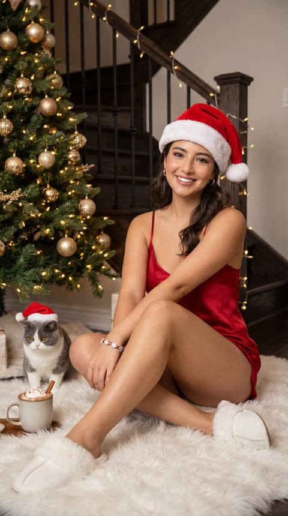</a>

A structured JSON prompt with a wardrobe_update block swaps the outfit of a reference photo while a keep list fixes the accessories and hairstyle. Placing props by position (tree on the left, staircase behind) and adding a negative list keeps the scene stable through the edit.

Nano Banana Pro · Edit · Source: [@astronomerozge1 on X](https://x.com/astronomerozge1/status/2000613498825662583) · 270 likes on 2026-10-29

[`christmas`](tags.md#tag-christmas) [`portrait`](tags.md#tag-portrait) [`wardrobe-update`](tags.md#tag-wardrobe-update) [`cat`](tags.md#tag-cat)

<details><summary><b>Prompt</b></summary>

```text
{
  "prompt": "A young Caucasian woman in her early twenties sits on a soft white rug in front of a glowing, gold-decorated Christmas tree. She is dressed in a festive holiday outfit: a deep red velvet long-sleeve top with subtle shimmer and matching velvet leggings. She wears white faux-fur trim slippers. Her hair is styled in a loose, elegant half-up look with soft waves. She has small gold hoop earrings and a sparkly holiday-themed bracelet.",
  "environment": {
    "setting": "Cozy living room",
    "props": [
      "Christmas tree with golden ornaments and warm lights",
      "Dark wooden staircase wrapped in fairy lights",
      "a ceramic mug of hot chocolate with visible steam, whipped cream and a cinnamon stick",
      "a grey-and-white British Shorthair cat wearing a tiny Santa hat sitting near her on the rug"
    ],
    "lighting": "Soft, warm, golden holiday lighting",
    "scene_position": "Tree on the left, staircase behind"
  },
  "composition": {
    "shot_type": "Medium shot",
    "angle": "Eye-level",
    "focus": "Shallow depth of field emphasizing the woman and festive decor",
    "pose": "Seated on rug with crossed legs, smiling directly at camera"
  },
  "wardrobe_update": {
    "replace_outfit_with": [
      "red satin spaghetti-strap cami top (holiday chic, slightly glossy, not see-through)",
      "matching red satin shorts (comfortable, festive, modest fit)"
    ],
    "add_accessory": "classic red Santa hat with white trim and pom-pom",
    "keep": [
      "white faux-fur trim slippers",
      "small gold hoop earrings",
      "sparkly holiday-themed bracelet",
      "loose elegant half-up hairstyle with soft waves"
    ]
  },
  "vibe": "Warm, joyful, cozy Christmas atmosphere",
  "negative_prompt": [
    "text",
    "watermark",
    "UI overlay",
    "extra people",
    "distorted hands",
    "plastic skin",
    "over-sharpening"
  ]
}
```

</details>

<a id="gpt-image-sunny-park-bench-hoodie-portrait"></a>
### Woman in Gray Hoodie on Park Bench

<a href="https://x.com/noorlewisx/status/2083775433485754565"></a>

Stacks a clear subject, outfit and pose with lens details such as 85mm and f/1.8, plus sunlight filtering through leaves for creamy bokeh. A reference image line keeps the face consistent.

GPT Image 2 · Edit · Source: [@noorlewisx on X](https://x.com/noorlewisx/status/2083775433485754565) · 267 likes on 2026-10-29

[`park`](tags.md#tag-park) [`bench`](tags.md#tag-bench) [`lifestyle`](tags.md#tag-lifestyle) [`bokeh`](tags.md#tag-bokeh) [`face-reference`](tags.md#tag-face-reference)

<details><summary><b>Prompt</b></summary>

```text
A stunning young woman sitting casually on a wooden park bench in a lush green city park during a bright sunny afternoon, wearing a light gray oversized hoodie and matching sweatpants, clean white sneakers, messy high bun hairstyle with soft face-framing strands, natural makeup, warm gentle smile, looking directly at the camera, one hand touching her hair, relaxed and confident pose with one leg folded on the bench, cinematic lifestyle photography, vibrant flowers, tall green trees, soft sunlight filtering through leaves, shallow depth of field, creamy bokeh, ultra realistic skin texture, high-end fashion editorial, DSLR photography, 85mm lens, f/1.8, natural lighting, HDR, ultra-detailed, photorealistic, 8K, premium quality.
Same Face as reference image.
Camera Angle.Walk-behind shot.
```

</details>

<a id="nano-banana-denim-bob-beauty-contact-sheet"></a>
### Nine pose beauty contact sheet in denim jacket

<a href="https://x.com/kingofdairyque/status/2066122884859207815">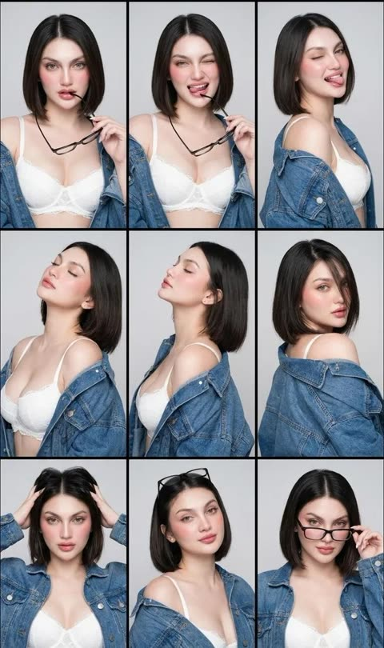</a>

Numbered pose lines give each of the nine frames its own checkable direction, while the shared styling paragraph keeps the set consistent. Repeating one woman, bob haircut and denim jacket across every frame is what makes it read as a single contact sheet.

Nano Banana 2 · Text-to-image · Source: [@kingofdairyque on X](https://x.com/kingofdairyque/status/2066122884859207815) · 250 likes on 2026-10-29

[`beauty`](tags.md#tag-beauty) [`contact-sheet`](tags.md#tag-contact-sheet) [`grid`](tags.md#tag-grid) [`portrait`](tags.md#tag-portrait)

<details><summary><b>Prompt</b></summary>

```text
Ultra-realistic 3x3 beauty contact sheet featuring the same stunning woman in nine different poses and expressions, arranged in a clean square grid with thin black borders separating each frame. Professional studio portrait photography against a seamless light gray backdrop, editorial model test shoot aesthetic, modern beauty campaign, high-fashion contact sheet.

Poses & Expressions
1. Looking directly at the camera while holding black rectangular glasses near her lips, seductive expression, slightly parted glossy lips.

2. Winking with mouth open and tongue slightly out, playfully holding the glasses.

3. Three-quarter profile pose with tongue slightly out and a playful smirk.

4. Head tilted back, eyes closed, soft dreamy expression.

5. Side profile with chin raised, eyes closed, elegant editorial pose.

6. Over-the-shoulder pose with hair partially covering one eye, sultry direct gaze.

7. Facing forward, hands lifting hair on both sides, confident beauty campaign pose.

8. Relaxed direct gaze with black rectangular glasses resting on top of the head, soft smile.

9. Looking over black rectangular glasses worn low on the nose, seductive expression with slightly parted lips.

Face & Makeup
Soft ultra-feminine glam makeup with flawless radiant fair skin and warm pink undertones, smooth pore-visible skin texture, luminous satin-dewy finish, softly sculpted oval face with subtle contour and diffused bronzer. Strong blush-focused makeup with rosy pink blush heavily applied across the cheeks and lightly across the bridge of the nose for a youthful, doll-like flushed effect. Brightened under-eyes with soft matte highlights and a softly blurred complexion.
Large almond-shaped eyes enhanced with soft Korean-inspired glam makeup: beige-pink eyeshadow blended seamlessly with subtle brown depth on the outer corners, bright ivory shimmer on the inner corners and aegyosal highlights for wider, innocent-looking eyes. Long, thick, wispy curled lashes with a separated manga-like lash effect, softly defined eyeliner with lifted outer corners, fluffy natural dark brows with a softly straight arch.
Full, plump lips with an overlined soft cupid's bow, glossy reddish-pink gradient lips, glass-like shine, and hydrated juicy texture. Overall makeup aesthetic: clean girl glam mixed with soft baddie beauty, ultra-polished yet airy and feminine, doll-like elegance, luxury influencer makeup.

Hair
Short, sleek, straight bob haircut with a center part, smooth and glossy finish.

Outfit & Accessories
White lace balconette bra with delicate floral texture and thin straps, oversized medium-wash blue denim jacket worn off the shoulders, casual Y2K-inspired styling, small gold hoop earrings, black rectangular glasses used as a prop in several frames.

Photography
Professional studio beauty photography, soft diffused key light with subtle beauty dish lighting, editorial campaign quality, realistic skin texture, extremely detailed eyes and lips, fashion magazine contact sheet, luxury beauty advertisement, Vogue editorial aesthetic, ultra-realistic, high detail, 8K, sharp focus, premium retouching, photorealistic.
```

</details>

<a id="gpt-image-monochrome-red-streetwear-bean-bag-portrait"></a>
### Man in all red streetwear on red bean bag

<a href="https://x.com/Xaroon_x/status/2076616202793939072"></a>

A single color story covers the outfit, the bean bag and the backdrop, so the whole frame reads as one monochrome block. Each garment is named, a campaign editorial look and dramatic studio lighting set the tone, and an explicit instruction to keep the uploaded face unchanged preserves identity.

GPT Image 2 · Edit · Source: [@Xaroon_x on X](https://x.com/Xaroon_x/status/2076616202793939072) · 248 likes on 2026-10-28

[`monochrome`](tags.md#tag-monochrome) [`streetwear`](tags.md#tag-streetwear) [`fashion-editorial`](tags.md#tag-fashion-editorial) [`studio-lighting`](tags.md#tag-studio-lighting) [`face-preservation`](tags.md#tag-face-preservation)

<details><summary><b>Prompt</b></summary>

```text
Hyper-realistic cinematic fashion photoshoot of the uploaded person. Seated on a deep light red bean bag, he wears bold all-red oversized streetwear: trench coat, wide red pants, chunky sneakers, silver watch. Solid red background,. Powerful drip vibes, Adidas campaign editorial look, dramatic studio lighting. Keep my face exactly the same as the uploaded photo. Do not change or edit my face. --ar 4:5 ratio
```

</details>

<a id="nano-banana-half-face-name-portrait"></a>
### Half face portrait with name letters revealing the rest

<a href="https://x.com/Emmma___0/status/2108777847800426542"></a>

The prompt keeps half the face visible and stacks the name vertically on the other side, with each letter cut out to show the matching part of the hidden half, so the face still reads as one. Fill in the name, backdrop and lighting.

Nano Banana 2.1 · Edit · Source: [@Emmma___0 on X](https://x.com/Emmma___0/status/2108777847800426542) · 244 likes on 2026-10-27

[`typography`](tags.md#tag-typography) [`studio`](tags.md#tag-studio) [`template`](tags.md#tag-template)

<details><summary><b>Prompt</b></summary>

```text
Transform the uploaded image into a modern studio portrait. Preserve the subject’s identity and features. Show half the face on the left; stack [NAME] vertically on the right, with each letter filled by matching details from the hidden half. Seamless alignment, [BACKGROUND] backdrop, [LIGHTING], modern typography.
```

</details>

<a id="gpt-image-christmas-selfie-santa-kiss-grotto"></a>
### Woman kisses laughing Santa in grotto selfie

<a href="https://x.com/KeorUnreal/status/2003512570150347217"></a>

Each subject gets its own block for identity, pose and expression, which keeps the two people distinct. The selfie viewpoint with flash and warm ambient light sets the close, candid mood.

GPT Image 1.5 · Text-to-image · Source: [@KeorUnreal on X](https://x.com/KeorUnreal/status/2003512570150347217) · 241 likes on 2026-10-29

[`christmas`](tags.md#tag-christmas) [`selfie`](tags.md#tag-selfie) [`portrait`](tags.md#tag-portrait)

<details><summary><b>Prompt</b></summary>

```text
{
  "image_type": "photograph",
  "perspective": "close-up selfie angle",
  "subjects": [
    {
      "identity": "attractive woman",
      "appearance": {
        "hair": "long straight black ponytail ",
        "skin_tone": "fair",
        "expression": "blue eyes, puckered lips kissing Santa's cheek"
      },
      "clothing": "form-fitting sleeveless open gold with deep neckline sequin short dress",
      "pose": "leaning right, left arm extended holding phone"
    },
    {
      "identity": "Santa Claus",
      "appearance": {
        "facial_features": "older male, rosy cheeks, white beard/mustache",
        "expression": "hearty laugh, mouth open, eyes squinted"
      },
      "clothing": "red Santa hat, red coat with white fur trim, black belt",
      "pose": "standing, head tilted back laughing"
    }
  ],
  "setting": {
    "location": "indoor holiday grotto",
    "background_elements": [
      "bokeh Christmas tree with warm lights",
      "wreath on dark wood wall",
      "wrapped gifts on floor"
    ]
  },
  "lighting": "flash + warm ambient, soft shadows",
  "atmosphere": "festive joyous humorous"
}
```

</details>

<a id="gpt-image-candid-park-portrait-olive-cardigan-burgundy-bag"></a>
### Candid sunlit park portrait in olive cardigan

<a href="https://x.com/Aqsahere_/status/2095351414524608662"></a>

The prompt lists outfit colors and fabrics piece by piece, then fixes the pose, setting and light direction in separate paragraphs. Closing keywords like smartphone photography, film grain, lens flare and 4:5 framing give it a candid, unretouched look.

GPT Image 2 · Text-to-image · Source: [@Aqsahere_ on X](https://x.com/Aqsahere_/status/2095351414524608662) · 233 likes on 2026-10-28

[`candid-portrait`](tags.md#tag-candid-portrait) [`smartphone-photography`](tags.md#tag-smartphone-photography) [`sunlight`](tags.md#tag-sunlight) [`film-grain`](tags.md#tag-film-grain) [`fashion`](tags.md#tag-fashion)

<details><summary><b>Prompt</b></summary>

```text
A photorealistic candid outdoor portrait of a young woman standing in a peaceful urban park on a sunny afternoon. She has long dark-brown hair styled in a loose low ponytail, with wispy face-framing strands gently falling across her face. She gazes softly toward the side with a calm, thoughtful expression.
She wears an olive-green cardigan over a delicate white textured ruffle camisole, paired with a long dark-green skirt. A deep burgundy-red shoulder bag hangs naturally at her side. One hand rests gently near her neck while the other is relaxed in front of her.
She stands beside a paved walkway surrounded by green grass, mature leafy trees, and subtle urban buildings in the background. Strong sunlight filters through the trees, creating beautiful highlights in her hair, soft shadows, and a subtle lens flare in the upper corner.
Natural smartphone photography, candid lifestyle aesthetic, warm sunlight, realistic skin texture, detailed hair strands, authentic fabric textures, soft atmospheric contrast, gentle vintage film grain, muted earthy color palette, shallow depth of field, cinematic natural lighting, peaceful summer mood, highly photorealistic, vertical 4:5 composition.
```

</details>

<a id="gpt-image-golden-hour-newsstand-editorial-portrait"></a>
### Blonde woman on folding chair at newsstand

<a href="https://x.com/SadiaMalik182/status/2081611030019572178"></a>

A structured JSON prompt splits style, camera, location, subject, wardrobe, pose and lighting into labelled blocks, so each element is controlled separately. Real camera and lens settings plus Kodak Portra grading anchor the golden hour editorial look.

GPT Image 2 · Text-to-image · Source: [@SadiaMalik182 on X](https://x.com/SadiaMalik182/status/2081611030019572178) · 227 likes on 2026-10-28

[`json-prompt`](tags.md#tag-json-prompt) [`street-fashion`](tags.md#tag-street-fashion) [`golden-hour`](tags.md#tag-golden-hour) [`editorial`](tags.md#tag-editorial) [`newsstand`](tags.md#tag-newsstand)

<details><summary><b>Prompt</b></summary>

```text
"category": "Luxury Street Fashion Editorial Portrait",
  "style": {
    "genre": "Editorial Lifestyle Photography",
    "aesthetic": "Vintage Newsstand × Vogue Editorial × European Street Style × Pinterest Aesthetic × Gen-Z Fashion",
    "quality": "Ultra Photorealistic",
    "resolution": "4096×2304 (4K UHD)",
    "aspect_ratio": "16:9",
    "render_engine": "Octane Render / Unreal Engine 5 / Redshift",
    "editorial_reference": [
      "Vogue",
      "Zara",
      "Urban Outfitters",
      "Free People",
      "COS",
      "Pinterest Editorial"
    ],
    "mood": [
      "Golden Hour",
      "Warm",
      "Relaxed",
      "Vintage",
      "Editorial",
      "Natural",
      "Authentic"
    ]
  },
  "camera": {
    "camera": "Sony A7R V",
    "lens": "85mm f/1.4 GM",
    "orientation": "Landscape",
    "angle": "Eye Level",
    "aperture": "f/2.0",
    "iso": 100,
    "shutter_speed": "1/640s",
    "focus": "Eyes",
    "depth_of_field": "Cinematic Shallow",
    "sharpness": "Ultra Detailed"
  },
  "location": {
    "type": "Vintage Outdoor Newspaper & Magazine Stand",
    "environment": {
      "newsstand": true,
      "magazine_display": true,
      "newspaper_stacks": true,
      "bookstall": true,
      "city_sidewalk": true,
      "urban_news_kiosk": true,
      "authentic_street_environment": true
    }
  },
  "subject": {
    "gender": "Female",
    "age": "Early 20s",
    "appearance": {
      "skin": "Natural Fair Skin",
      "expression": "Calm Editorial Expression",
      "eye_contact": "Direct Camera",
      "makeup": {
        "style": "Natural Minimal",
        "skin_finish": "Soft Matte Glow",
        "lips": "Natural Nude",
        "eyes": "Soft Brown"
      }
    },
    "hair": {
      "style": "Messy Blonde Bun or Short Wavy Blonde Hair",
      "movement": "Light Breeze"
    }
  },
  "wardrobe": {
    "top": {
      "type": "Oversized White Graphic Sweatshirt",
      "fabric": "Premium Cotton",
      "fit": "Relaxed Oversized"
    },
    "bottom": {
      "type": "Red Athletic Shorts"
    },
    "socks": "White Ribbed Crew Socks",
    "shoes": "Black Chunky Sneakers"
  },
  "pose": {
    "position": "Relaxed Sitting On Folding Chair",
    "body_angle": "Three Quarter",
    "editorial": true
  },
  "lighting": {
    "time": "Golden Hour",
    "key_light": "Warm Natural Sunlight",
    "rim_light": "Golden Rim Light",
    "cinematic": true
  },
  "post_processing": {
    "hdr": true,
    "ray_tracing": true,
    "global_illumination": true,
    "clarity": "Ultra",
    "color_grading": "Kodak Portra 400",
    "film_grain": "Subtle"
  },
  "negative_prompt": [
    "low quality",
    "blur",
    "noise",
    "bad anatomy",
    "extra fingers",
    "duplicate person",
    "watermark",
    "logo",
    "text artifacts",
    "CGI look",
    "cartoon",
    "anime"
  ]
}
```

</details>

<a id="gpt-image-selfie-chibi-painting-cheek-brush"></a>
### Selfie with chibi self painting his cheek

<a href="https://x.com/AiWithTariq/status/2098783770513948875"></a>

The prompt splits the scene into labeled blocks for hair, face, outfit, concept, canvas character, background, style and camera. This lets a real selfie and a 3D chibi share one frame. Repeating the paint splatter colors across both figures ties the real and painted worlds together.

GPT Image 2.5 · Edit · Source: [@AiWithTariq on X](https://x.com/AiWithTariq/status/2098783770513948875) · 219 likes on 2026-10-28

[`selfie`](tags.md#tag-selfie) [`chibi`](tags.md#tag-chibi) [`paint-splatter`](tags.md#tag-paint-splatter) [`fourth-wall`](tags.md#tag-fourth-wall) [`art-studio`](tags.md#tag-art-studio)

<details><summary><b>Prompt</b></summary>

```text
Study the uploaded photo's facial features and use them as inspiration to create a fun selfie-style photo of a similar-looking young man with a creative cartoon canvas twist.
Hair: Messy, tousled dark hair with paint splatters scattered across the hair and face, light stubble beard.
Face/Skin: Face and skin splattered with colorful paint speckles (purple, orange, blue), big laughing open-mouth smile, playful joyful expression, no jewelry, no tattoos.
Outfit: Purple/lavender knit sweater, paint-splattered casual look.
Concept: Taking a close-up selfie next to an easel canvas, where a cute chibi cartoon version of himself is painted on the canvas — the illustrated cartoon character reaching out of the canvas holding a paintbrush and playfully painting/touching the real man's cheek with colorful paint, breaking the fourth wall between reality and illustration.
Chibi cartoon (on canvas): Same messy hair and paint splatters, big expressive cartoon eyes, cheerful smile, wearing a purple off-shoulder top, leaning out of the canvas frame with one arm extended holding the paintbrush.
Background: Cozy art studio setting, softly blurred art supplies, paint bottles, and shelves in the background, warm natural lighting, wooden easel with visible paint-splattered edges.
Art style: Photorealistic selfie photography blended with vibrant 3D chibi cartoon illustration, playful colorful paint-splatter texture throughout, high detail, fun energetic composition.
Camera angle: Close-up selfie angle, slightly wide shot capturing both the real face and the canvas painting.
Text overlay:
Small stylish signature-style text in the top corner: "Mr. Tariq"
```

</details>

<a id="nano-banana-christmas-santa-hat-off-shoulder-portrait"></a>
### Woman in red Santa hat and sweater

<a href="https://x.com/saniaspeaks_/status/2001460344288612700"></a>

Structured JSON prompt that splits subject, composition, environment and technical specs into separate blocks, so outfit, pose and lighting can each be adjusted. The over the shoulder turn against a blurred tree with warm bokeh builds a cinematic holiday portrait.

Nano Banana Pro · Edit · Source: [@saniaspeaks_ on X](https://x.com/saniaspeaks_/status/2001460344288612700) · 217 likes on 2026-10-29

[`christmas`](tags.md#tag-christmas) [`portrait`](tags.md#tag-portrait) [`json-prompt`](tags.md#tag-json-prompt)

<details><summary><b>Prompt</b></summary>

```text
"subject_details": {
      "description": "Young woman with a refined, glamorous appearance",
      "hair": "Long, polished brown hair flowing in soft waves down her back",
      "outfit": "Classic red Santa hat with plush white fur trim, matching red knit sweater styled slightly off-the-shoulder",
      "makeup": "Refined and professional, highlighting natural beauty"
    },
    "composition": {
      "pose": "Three-quarter profile, turning head over shoulder to look directly at the camera",
      "expression": "Confident, calm, conveying holiday sophistication",
      "framing": "Medium shot, portrait focus"
    },
    "environment": {
      "setting": "Festive holiday interior",
      "background": "Softly blurred Christmas tree, warm bokeh lights, cozy atmosphere"
    },
    "technical_specs": {
      "style": "Photorealistic, cinematic, high-fashion portrait photography",
      "lighting": "Soft, warm studio lighting with golden highlights and gentle shadows",
      "resolution": "8k, highly detailed textures",
      "aspect_ratio": "3:4"
    }
  }
}
```

</details>

<a id="nano-banana-christmas-cafe-fur-hat-portrait"></a>
### Woman in fur hat at Christmas café table

<a href="https://x.com/chatgptpaglu/status/2000024054028243175">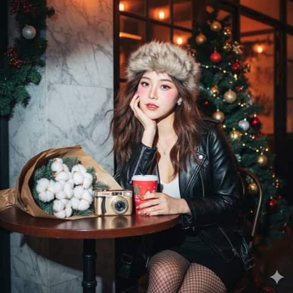</a>

Mixes a direct flash with warm tungsten light so the subject glows against a darker café background. The Y2K compact camera look and film grain come from the prompt's style lines, and props like the cotton bouquet and gold camera on the table complete the frame.

Nano Banana Pro · Text-to-image · Source: [@chatgptpaglu on X](https://x.com/chatgptpaglu/status/2000024054028243175) · 215 likes on 2026-10-29

[`christmas`](tags.md#tag-christmas) [`portrait`](tags.md#tag-portrait) [`y2k`](tags.md#tag-y2k) [`flash photography`](tags.md#tag-flashphotography)

<details><summary><b>Prompt</b></summary>

```text
Create a hyper-realistic portrait of a cute Asian woman. She is sitting with her chin resting on her hand at a dark wooden table in front of a vintage-style café.

Fashion & Outfit:
She wears a shiny black leather jacket, slightly open to reveal a white inner top, showing a beautiful neckline. Matched with a fitted black mini-skirt set. She also wears black fishnet stockings. Add a fluffy fur hat over her outfit.

Background:
In front of a marble-grey café exterior, decorated with a Christmas theme. Include a realistic Christmas tree, pine decorations, and festive ornaments.

Lighting & Tone:
Warm orange tungsten lighting for an inviting, cozy atmosphere, combined with a strong direct flash hitting the subject straight on, making her skin bright and glowing, contrasting with the slightly darker background.
The photo should feel Y2K digital compact-camera style—sharp 8K resolution, realistic skin texture, with light film grain.

Hair & Makeup:
Long dark-brown hair blowing slightly in the wind, messy layered strands with a few pieces softly covering part of her face—stylish, cool, and subtly sexy.
Her skin is very fair.
Makeup style: Douyin/Korean—long curled lashes, soft flushed pink blush on cheeks and nose tip, glossy pink lips.
She has Christmas-themed nail art.

Props:
On the table:
• A large bouquet wrapped in brown kraft paper, containing cotton flowers and pine leaves.
• A gold Canon IXY 30S camera placed on the table.

She holds a Christmas-decorated drink in her right hand and smiles slightly.

Additional Visual Style:
The flash creates extremely bright, slightly yellow-tinted skin with a hard shadow behind her.
High-contrast, ultra-sharp 8K image.
Warm ambient sunlight.
Fuji Film Pro 400H color style with old-lens filter and light film grain.
The subject should appear bright and stand out clearly from the background.
```

</details>

<a id="gpt-image-korean-cafe-mirror-selfie-portra-film"></a>
### Korean Cafe Courtyard Mirror Selfie on Film

<a href="https://x.com/noorlewisx/status/2064996549747458319"></a>

Labeled sections for appearance, outfit, pose, foreground, midground and background build clear depth layers around the round mirror. Film stock, lens and aperture (Portra 400, 85mm, f/1.8) set the warm soft look, and a negative prompt keeps it photographic.

GPT Image 2 · Text-to-image · Source: [@noorlewisx on X](https://x.com/noorlewisx/status/2064996549747458319) · 214 likes on 2026-10-28

[`film-photography`](tags.md#tag-film-photography) [`mirror-selfie`](tags.md#tag-mirror-selfie) [`korean-cafe`](tags.md#tag-korean-cafe) [`portra-400`](tags.md#tag-portra-400) [`lifestyle`](tags.md#tag-lifestyle)

<details><summary><b>Prompt</b></summary>

```text
Hyper-realistic Kodak Portra 400 film photograph, dreamy soft aesthetic, warm natural sunlight, nostalgic Korean café atmosphere, vertical 9:16 composition.

A beautiful young woman crouching gracefully in front of a large round gold-framed mirror placed on a pebble-covered courtyard, taking a mirror selfie with her smartphone. She looks at the screen with a gentle smile and relaxed expression.

Appearance: Fair glowing skin, soft natural makeup, subtle peach blush, glossy pink lips, delicate eyeliner, bright expressive eyes. Long light-brown wavy hair with soft curtain bangs and romantic curls cascading over her shoulders.

Outfit: Oversized pastel lavender T-shirt featuring a small daisy illustration and subtle Korean typography, high-waisted butter-yellow pleated midi skirt, white crew socks, clean white canvas sneakers, soft pink shoulder tote bag.

Pose: Comfortable squat with knees together, one arm resting naturally on her leg while holding her phone. Relaxed shoulders, candid lifestyle photography feel, effortless charm.

Foreground: Two transparent iced latte cups with visible ice cubes, paper straws, soft condensation. Elegant pink tote bags beside the mirror. Creamy foreground bokeh and dreamy highlights.

Midground: Large circular gold-framed mirror reflecting the woman perfectly. Detailed gravel stones, warm sunlight, realistic reflections, soft shadows, potted plants surrounding the mirror, cinematic depth.

Background: Aesthetic Korean-style café exterior with cream-colored walls, wooden-framed windows, Korean signboard, lush ivy vines, flowers, potted plants, and a quiet pedestrian alley. Warm golden-hour sunlight filtering through trees, dreamy foliage bokeh.

Photography Style: Kodak Portra 400, warm pastel tones, soft focus, creamy highlights, realistic skin texture, subtle film grain, shallow depth of field, environmental portrait, HDR, photorealistic, magazine-quality editorial photography, 85mm lens, f/1.8, atmospheric depth, elegant composition, foreground-midground-background layering.

Negative Prompt: anime, cartoon, illustration, CGI, 3D render, painting, blurry face, distorted hands, extra fingers, duplicate objects, unrealistic proportions, overprocessed skin, harsh shadows, oversaturated colors, artificial lighting, watermark, logo, text, cropped subject, low quality.
```

</details>

<a id="nano-banana-christmas-red-snowflake-sweater-kiss"></a>
### Woman in red snowflake sweater blowing a kiss

<a href="https://x.com/xmliisu/status/1999830980752715929"></a>

A structured JSON prompt that separates lighting, background, composition and subject analysis gives a clear setup: camera flash with warm tree light, shallow depth of field, and a 4:5 vertical medium shot centred on the face. The negative prompt rules out daylight and smiling, which keeps the mood candid and cosy.

Nano Banana Pro · Text-to-image · Source: [@xmliisu on X](https://x.com/xmliisu/status/1999830980752715929) · 214 likes on 2026-10-29

[`christmas`](tags.md#tag-christmas) [`portrait`](tags.md#tag-portrait) [`flash-photography`](tags.md#tag-flash-photography) [`sweater`](tags.md#tag-sweater)

<details><summary><b>Prompt</b></summary>

```text
{
  "lighting": {
    "quality": "hard flash with soft ambient",
    "shadows": "sharp shadows cast by the flash, especially behind the subject and on the window blinds",
    "direction": "frontal",
    "highlights": "strong highlights on the subject's face, hands, and sweater from the flash, with small warm points of light from the tree",
    "ambient_source": "warm LED Christmas lights on tree",
    "primary_source": "on-camera flash"
  },
  "background": {
    "setting": "indoors, likely a living room at night",
    "elements": [
      "flocked Christmas tree with warm white LED lights and a red ribbon bow",
      "large window with dark horizontal blinds, showing reflections of the flash and room lights",
      "dark wall"
    ],
    "depth_cues": "tree is slightly behind the subject, window is further back, creating depth",
    "lighting_interaction": "tree lights are warm and soft; flash creates a bright spot on the window glass"
  },
  "typography": {
    "color": "",
    "presence": "none",
    "placement": "",
    "font_style": "",
    "text_content": ""
  },
  "composition": {
    "frame_type": "medium shot",
    "focus_point": "subject's face",
    "orientation": "vertical",
    "camera_angle": "eye-level",
    "depth_of_field": "shallow",
    "subject_placement": "centered"
  },
  "color_profile": {
    "contrast": "high",
    "saturation": "moderate",
    "color_balance": "warm",
    "dominant_colors": [
      "#FFFFFF",
      "#E10000",
      "#4A5D48",
      "#C9A082"
    ],
    "palette_description": "warm and festive palette dominated by white and red from the sweater, with green from the tree and warm yellow tones from the lights"
  },
  "technical_specs": {
    "iso": "high (due to low light environment)",
    "aperture": "wide (shallow depth of field)",
    "image_type": "digital photograph",
    "resolution": "high",
    "camera_type": "smartphone camera",
    "file_format": "JPEG",
    "shutter_speed": "fast (due to flash)"
  },
  "subject_analysis": {
    "hair": "long, wavy, silver grey hair, parted in the middle, falling over shoulders",
    "pose": "standing, hands pressed to cheeks, making a kissy face with eyes closed",
    "makeup": "dewy skin, defined eyebrows, long eyelashes, rosy blush, glossy lips",
    "clothing": "oversized white knit sweater with a red Fair Isle pattern featuring snowflakes and geometric designs",
    "expression": "playful, pouting kiss",
    "accessories": "none visible",
    "subject_type": "young woman",
    "hands_gestures": "both hands with light pink manicured nails pressing gently against her cheeks, framing her face"
  },
  "artistic_elements": {
    "mood": "playful, festive, cozy",
    "style": "candid portrait",
    "texture": "soft knit of the sweater, flocked texture of the tree, glossy reflection on the window",
    "composition_balance": "subject centered, balanced by the tree on the left and window on the right"
  },
  "generation_parameters": {
    "seed": "festive_portrait_flash",
    "prompt": "A candid portrait of a young woman with long wavy brown hair, wearing an oversized white and red snowflake knit sweater, posing with a kissy face and hands on her cheeks. She is standing indoors at night next to a flocked Christmas tree decorated with warm lights and a red bow, and a window with dark blinds reflecting a flash. The lighting is a mix of on-camera flash and warm ambient light from the tree.",
    "aspect_ratio": "4:5",
    "negative_prompt": "daylight, bright sun, plain wall, no tree, no sweater, smiling, open eyes, no flash"
  }
}
```

</details>

<a id="nano-banana-bw-studio-portrait-white-shirt-contemplative-pose"></a>
### Black and white studio portrait in white shirt

<a href="https://x.com/weiinberg/status/2079797303280591190"></a>

Starts from an uploaded photo and locks identity, hairstyle and facial hair before describing wardrobe and a specific hand to chin pose. Names the light direction, a seamless charcoal backdrop and an 85mm shallow depth of field to get an editorial monochrome look.

Nano Banana 2 · Edit · Source: [@weiinberg on X](https://x.com/weiinberg/status/2079797303280591190) · 211 likes on 2026-10-29

[`black-and-white`](tags.md#tag-black-and-white) [`studio-portrait`](tags.md#tag-studio-portrait) [`identity-preserving`](tags.md#tag-identity-preserving) [`editorial`](tags.md#tag-editorial) [`85mm`](tags.md#tag-85mm)

<details><summary><b>Prompt</b></summary>

```text
Nano Banana 2 on OpenArt.

Prompt: Create a premium black-and-white studio portrait of the uploaded man, preserving his recognizable facial identity, natural hairstyle, skin texture, and existing facial hair. Frame him from the upper thighs upward, standing confidently, subtle body tilt and facing the camera with an intense, sharp expression.Dress him in a crisp fitted white dress shirt with the collar slightly open and the sleeves neatly rolled to the elbows, paired with tailored black trousers. Pose him with one arm folded horizontally across his waist, supporting the opposite elbow, while the raised hand rests naturally against his lips or chin in a contemplative gesture. Add a classic round analog wristwatch with a dark leather strap on the raised wrist.
Place him against a clean, seamless charcoal-black studio background with a subtle soft gradient behind the upper body and no visible corners or props. Use soft directional light from the upper camera-right side, creating sculpted highlights on one side of the face and shirt while the opposite side falls into rich shadow. Keep strong subject-to-background separation, balanced contrast, crisp focus on the eyes, face, hands, and watch, realistic fabric folds, natural anatomy, and refined monochrome editorial toning. Shot with an 85mm portrait lens, shallow depth of field, high-end professional photography, 4:5 aspect ratio.
```

</details>

<a id="nano-banana-hibiscus-film-portrait"></a>
### Vintage film portrait framed by pink hibiscus flowers

<a href="https://x.com/ZaraIrahh/status/2107705937012142393"></a>

Shooting through foreground petals at eye level builds a natural floral frame, while hard rules like side part, one hand and head to chest crop keep the composition fixed. Film grain, halation and light leaks plus a long negative list steer the result away from a polished studio look.

Nano Banana 2.1 · Text-to-image · Source: [@ZaraIrahh on X](https://x.com/ZaraIrahh/status/2107705937012142393) · 206 likes on 2026-10-28

[`portrait`](tags.md#tag-portrait) [`film-look`](tags.md#tag-film-look) [`floral`](tags.md#tag-floral) [`photorealistic`](tags.md#tag-photorealistic) [`golden-light`](tags.md#tag-golden-light)

<details><summary><b>Prompt</b></summary>

```text
Create a photorealistic portrait of her in a refined side-profile-inspired three-quarter angle, with her head naturally turned toward the camera and making direct eye contact. Clearly defined SIDE PART — NEVER a center or middle part.

She has extremely long, rich Dark Mocha Mousse curly hair, dramatically moved by a strong natural breeze, with realistic flyaways and loose strands. No ribbons, bows, headwear, hats, or hair accessories.

Soft-glam Korean-inspired makeup: visible natural pores, luminous realistic skin texture, rosy blush, subtle brown eyeliner, softly defined eyes, rosy gradient lips, and nude espresso nail art. She wears a magenta-soft-purple thin-strap mini dress with a subtle heart-shaped neckline barely visible at the chest. Gold fairy-wing pendant necklace with matching earrings.

ONE HAND is naturally raised in front of her face, gently pushing or clearing a hibiscus flower away from her line of sight. Fingers and joints must be anatomically realistic. Her other hand is completely outside the frame.

Expression: calm, intimate, slightly curious, natural and emotionally subtle.

EYE-LEVEL CAMERA positioned directly among dense blooming soft-pink and white hibiscus flowers, photographing THROUGH the flowers. Foreground petals, leaves, and stems are very close to the lens and naturally overlap the outer edges of the frame, creating an intimate organic floral frame. Flowers must not obscure her eyes or facial features.

NO WIDE VIEW. The subject fills approximately 85–95% of the frame. ONLY HEAD TO CHEST VISIBLE.

VISUAL STYLE:
Warm nostalgic historical-memory aesthetic. Authentic vintage Canon analog-film character, subtle natural film grain, delicate halation, slightly faded tones, gentle light leaks, realistic exposure imperfections, soft natural shadows, authentic raw human skin texture, and warm soft daylight. Strong wind visibly moves the curls and loose strands. Mild natural motion blur ONLY on moving hair and nearby flower petals.

The final image should feel like a candid, emotionally intimate photograph captured on vintage film rather than a polished studio portrait.

NEGATIVE PROMPT:
center part, middle part, ribbons, bows, headwear, hat, full body, waist-down, staircase focus, wide shot, distant subject, excessive background, artificial bokeh, studio lighting, smartphone photography, modern digital DSLR look, CGI, cartoon, anime, illustration, plastic skin, beauty filter, over-retouched skin, excessive facial smoothing, face swap, distorted facial anatomy, unnatural hands, malformed fingers, extra fingers, missing fingers, floating limbs, flower covering face, obscured eyes, closed eyes, facial distortion, unnatural pose, watermark, text, logo.
```

</details>

<a id="gpt-image-snowy-village-floral-shawl-portrait"></a>
### Snowy Village Portrait in Blue Floral Shawl

<a href="https://x.com/noorlewisx/status/2067526808602542413"></a>

The prompt lists the wardrobe, skin, eyes and expression in order, then sets depth with a blurred cabin and a faint distant figure. Lens and light cues (85mm, shallow depth of field, soft diffused light, muted cool palette) give the cinematic look.

GPT Image 2 · Text-to-image · Source: [@noorlewisx on X](https://x.com/noorlewisx/status/2067526808602542413) · 201 likes on 2026-10-29

[`portrait`](tags.md#tag-portrait) [`winter`](tags.md#tag-winter) [`snow`](tags.md#tag-snow) [`cinematic`](tags.md#tag-cinematic) [`85mm`](tags.md#tag-85mm)

<details><summary><b>Prompt</b></summary>

```text
A cinematic portrait of a young woman standing in a snowy village, softly falling snowflakes surrounding her. She wears a delicate blue floral shawl wrapped around her head and shoulders, dusted with snow. Her skin is fair with a natural glow, soft pink lips, and expressive light eyes looking slightly to the side. Her expression is calm and introspective. The background shows a blurred wooden cabin and a faint figure in the distance,creating depth. Cold winter atmosphere, soft diffused lighting, shallow depth of field, ultra-realistic, highly detailed textures, 85mm lens, bokeh, photorealistic, 8K resolution, muted cool color palette, cinematic mood."
```

</details>

<a id="nano-banana-christmas-couple-wine-tree-reference"></a>
### Couple with wine by Christmas tree

<a href="https://x.com/astronomerozge1/status/2004920668299682084">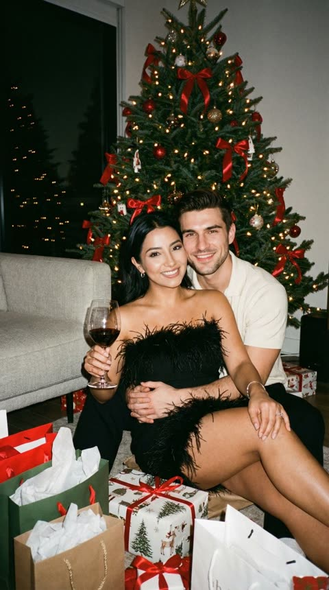</a>

Two reference uploads with a near maximum identity lock keep both faces consistent, while a single on camera flash and a 28 to 35mm lens feel give an authentic smartphone snapshot look. The pose is spelled out, with the man hugging from behind and the woman holding a wine glass in front.

Nano Banana Pro · Edit · Source: [@astronomerozge1 on X](https://x.com/astronomerozge1/status/2004920668299682084) · 198 likes on 2026-10-29

[`christmas`](tags.md#tag-christmas) [`portrait`](tags.md#tag-portrait) [`couple`](tags.md#tag-couple) [`photoreal`](tags.md#tag-photoreal)

<details><summary><b>Prompt</b></summary>

```text
{
  "generation_request": {
    "meta_data": {
      "tool": "NanoBanana Pro",
      "task_type": "text_to_image_photoreal_couple_christmas_lifestyle",
      "version": "v1.1",
      "priority": "high"
    },
    "references": {
      "reference_images": {
        "person_A_male": "UPLOAD_MALE_REFERENCE_IMAGE (REQUIRED)",
        "person_B_female": "UPLOAD_FEMALE_REFERENCE_IMAGE (REQUIRED)",
        "pose_mood_reference": "UPLOAD_THIS_COUPLE_CHRISTMAS_PHOTO (OPTIONAL)"
      },
      "reference_rules": {
        "preserve_identity_person_A": true,
        "preserve_identity_person_B": true,
        "identity_lock_strength_A": 0.995,
        "identity_lock_strength_B": 0.995,
        "face_similarity_priority": "MAX",
        "preserve_facial_proportions": true,
        "preserve_eye_shape_nose_lips_jawline": true,
        "keep_age_and_gender_consistent": true,
        "no_beautify_no_face_morph": true,
        "do_not_copy_any_unprovided_identity": true
      }
    },
    "output_settings": {
      "aspect_ratio": "3:4",
      "orientation": "portrait",
      "resolution": "ultra_high_res",
      "render_style": "raw_lifestyle_flash_photo",
      "sharpness": "high_subject_soft_background",
      "film_grain": "subtle",
      "color_grade": "warm_cozy"
    },
    "creative_prompt": {
      "scene_summary": "A candid, cozy Christmas living-room photo of a couple sitting closely in front of a decorated Christmas tree. The woman (identity locked to Person B) sits in the foreground, slightly angled toward camera, smiling warmly with glossy red lips, holding a large wine glass with red wine in her right hand. She wears a strapless black textured/feathered mini dress (photoreal fabric), minimal jewelry, and long straight or softly wavy black hair. The man (identity locked to Person A) sits behind her, leaning in from the left, smiling at the camera, wearing a cream/white short-sleeve shirt and light beige pants. His arm wraps around her waist in a natural cuddle pose. The floor is filled with wrapped presents and gift bags in the foreground. The Christmas tree is lush with red ribbon garlands and ornaments. Realistic on-camera flash look, slightly dim room, warm shadows, authentic home vibe.",
      "composition": {
        "framing": "portrait medium shot, couple centered, woman dominant in frame, man behind her slightly left",
        "camera_angle": "slightly above eye level, handheld",
        "depth_of_field": "moderate DOF; faces tack sharp; tree and gifts slightly softer",
        "props": "wine glass in woman’s hand; multiple wrapped gifts in foreground; no extra random objects"
      },
      "environment": {
        "location": "cozy living room at night",
        "tree_decor": "classic warm holiday decor: red ribbons, gold/neutral ornaments, subtle lights",
        "gift_wrap": "assorted gift bags and wrapped boxes with ribbons, realistic paper textures"
      },
      "lighting_and_camera": {
        "capture_style": "real smartphone/compact-camera flash photo",
        "lighting": "single on-camera flash as main light; warm ambient spill from tree lights; natural shadows",
        "realism": "natural skin texture, realistic pores, no over-smoothing",
        "lens_feel": "28–35mm equivalent",
        "noise": "subtle low-light grain (authentic)"
      },
      "strict_rules": [
        "Exactly 2 people only (Person A + Person B)",
        "Both faces must match their respective references exactly (no identity drift)",
        "Keep the same couple pose: man behind hugging, woman in front holding wine glass",
        "Photoreal candid flash look (not studio)",
        "No text, no logos, no watermark"
      ]
    },
    "negative_prompt": [
      "identity drift",
      "different face",
      "face swap artifacts",
      "beautify filter",
      "plastic skin",
      "over-smoothed face",
      "cgi look",
      "anime",
      "cartoon",
      "extra people",
      "extra limbs",
      "deformed hands",
      "extra fingers",
      "blurred faces",
      "text",
      "logo",
      "watermark"
    ]
  }
}
```

</details>

<a id="gpt-image-orange-red-studio-portrait-turtleneck"></a>
### Orange and red studio portrait in black turtleneck

<a href="https://x.com/iamsofiaijaz/status/2070714200306110845">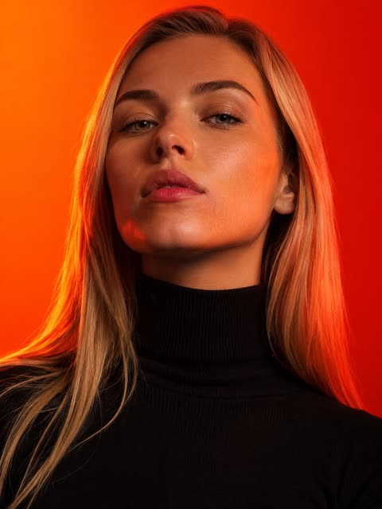</a>

Lighting is set as a named warm key and deep red rim pair, which drives the whole palette and the glow along the hair edge. Lens, aperture and sensor details with a tight head and shoulders frame push the result toward a magazine cover portrait.

GPT Image 2 · Text-to-image · Source: [@iamsofiaijaz on X](https://x.com/iamsofiaijaz/status/2070714200306110845) · 195 likes on 2026-10-29

[`portrait`](tags.md#tag-portrait) [`studio-lighting`](tags.md#tag-studio-lighting) [`fashion`](tags.md#tag-fashion) [`gradient-background`](tags.md#tag-gradient-background)

<details><summary><b>Prompt</b></summary>

```text
Ultra-photorealistic editorial fashion portrait of a beautiful young woman with straight blonde hair, piercing eyes, and an intense direct gaze, wearing a premium black high-neck turtleneck sweater. Tight head-and-shoulders close-up, shot from a slightly low angle to create a bold, heroic, commanding presence. Dramatic cinematic studio lighting with a warm orange key light and deep red rim lighting sculpting the face, emphasizing natural skin texture, pores, and fine facial detail while creating rich contrast and cinematic shadows. Clean seamless studio backdrop featuring a vivid orange-to-deep-red gradient background. Razor-sharp focus on the eyes, hyperrealistic skin detail, premium editorial fashion photography, luxury magazine cover aesthetic, ultra-detailed, 8K resolution, HDR, realistic color grading, soft falloff, subtle catchlights, professional medium-format camera, 85mm portrait lens, f/4, ISO 100, studio strobe lighting, high dynamic range, crisp details, minimal makeup, symmetrical composition, ultra-realistic, masterpiece quality, vertical 3:4 composition.
```

</details>

<a id="chatgpt-couple-80s-studio-portrait"></a>
### Couple posing in a 1980s film studio portrait

<a href="https://www.tiktok.com/@aeziandlysa/video/7683890505742109972">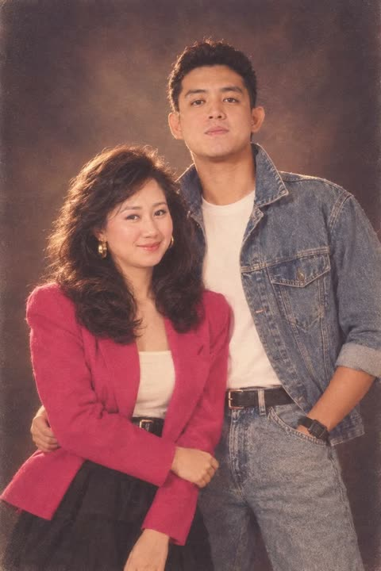</a>

The prompt locks identity with an explicit preserve-faces instruction, then lists each person's hair and outfit item by item. Analog cues such as film grain, soft focus, mild vignette and rim light make the edit read as a real 1980s photo rather than a filtered one.

ChatGPT · Edit · Source: [@aeziandlysa on TikTok](https://www.tiktok.com/@aeziandlysa/video/7683890505742109972) · 191 likes on 2026-10-30

[`80s-fashion`](tags.md#tag-80s-fashion) [`retro-portrait`](tags.md#tag-retro-portrait) [`film-look`](tags.md#tag-film-look) [`couple-portrait`](tags.md#tag-couple-portrait)

<details><summary><b>Prompt</b></summary>

```text
Transform this couple photo into an authentic 1980s studio portrait while preserving both people’s exact facial features, face shape, identity, natural skin tone, and recognizable appearance. Do not change their faces or make them look like different people. Give the couple a classic 1980s romantic portrait aesthetic. The woman has voluminous, softly feathered 80s hair, subtle 80s makeup, soft blush, natural glossy lips, gold hoop earrings, and wears a stylish magenta/pink oversized padded-shoulder blazer over a light-colored top with a high-waisted dark skirt. The man wears a vintage 1980s denim jacket with a popped collar over a simple white T-shirt, acid-wash jeans, and a classic chunky 80s watch. Pose them naturally and affectionately as a couple, standing close together with the man slightly behind the woman, his arm around her. Both are looking at the camera with relaxed, genuine expressions. Use a warm vintage studio setting with a muted brown/gray mottled backdrop, soft directional lighting, subtle rim lighting around their hair, gentle shadows, slightly faded colors, authentic analog film grain, soft focus, mild vignette, and nostalgic 35mm film photography. Make it look like a real photograph taken in the 1980s—not a modern photo with a filter and not overly AI-generated. Keep realistic skin texture and natural facial proportions. High-quality vintage family/studio portrait, warm nostalgic atmosphere, authentic 1980s fashion and photography.
```

</details>

<a id="gpt-image-tokyo-night-flash-candid-snapshot"></a>
### Candid flash snapshot on a rainy Tokyo street

<a href="https://x.com/frametheory058/status/2098413109258207670"></a>

A reference image locks the character's outfit and look across a series, while the prompt specifies smartphone flaws: direct flash, walking camera shake, rolling shutter, soft autofocus and off center framing. A long list of things to avoid, such as studio light, HDR and airbrushed skin, keeps the result from looking staged.

GPT Image 2.5 · Edit · Source: [@frametheory058 on X](https://x.com/frametheory058/status/2098413109258207670) · 191 likes on 2026-10-28

[`smartphone-snapshot`](tags.md#tag-smartphone-snapshot) [`direct-flash`](tags.md#tag-direct-flash) [`night-street`](tags.md#tag-night-street) [`tokyo`](tags.md#tag-tokyo) [`character-consistency`](tags.md#tag-character-consistency)

<details><summary><b>Prompt</b></summary>

```text
Ultra-realistic late-night smartphone snapshot, 9:16 vertical.

Use the reference only to establish the same fictional female character’s overall appearance and continuity. Keep her recognizable across the series with the same dark-brown wavy hair, natural features, black fitted sleeveless tank top, loose high-waisted light-blue jeans, small gold hoop earrings, delicate necklace, white sneakers, and small black shoulder bag.

Scene:
A quiet Tokyo side street late at night after light rain. She walks beside an off-white ceramic-tiled building while distant convenience-store lights, traffic signals, parked bicycles and small Japanese storefronts softly disappear into the darkness. Wet pavement catches scattered reflections.

New candid moment:
Photograph her from a slightly low rear three-quarter angle, about two steps behind her. She has just slowed down and casually turns only her upper body toward the camera while continuing forward. One hand is loosely tucking windblown hair behind her ear while the other hangs naturally beside her bag.

She looks toward the camera from the corner of her eyes with a tiny closed-mouth smile, as though she noticed her friend taking another photo and is trying not to laugh.

No deliberate fashion pose. No exaggerated expression. Her shoulders remain relaxed, hips and legs naturally positioned from walking, with one foot caught halfway through the next step.

Camera:
Modern smartphone rear camera with direct flash. Photographer walking at the same time, creating subtle accidental camera shake. Slight motion blur around her hair, moving leg and fingertips, while her eyes remain just barely readable. Mild rolling-shutter distortion, imperfect autofocus, slight edge softness and realistic digital noise.

Composition should feel accidental: her body sits slightly off-center, a little too much empty darkness on one side, with part of her shoe approaching the bottom edge of frame.

Flash & exposure:
Hard direct phone flash illuminates her face, shoulder, black top and denim while the street behind her falls rapidly into darkness. Slightly overexposed skin highlights, hard natural shadow against the tiled wall, shiny flash reflections on individual hair strands and subtle denim texture. Distant lights bloom and smear naturally.

Aesthetic:
Raw Pinterest night-photo-dump energy. Intimate, youthful, spontaneous and imperfect. It should look like a friend took the photo during a random Tokyo night walk—not a photographer conducting a photoshoot.

Real pores, tiny skin variations, flyaway hairs, natural fabric wrinkles, realistic body proportions and ordinary smartphone processing.

Absolutely no: studio lighting, cinematic teal-orange grading, professional bokeh, fashion-editorial posing, perfect symmetry, airbrushed skin, artificial beauty retouching, HDR look, DSLR sharpness, staged composition, AI-perfect anatomy or polished commercial photography.

The final result should feel like an unexpectedly beautiful photo hidden among 30 messy pictures from the same night.
```

</details>

<a id="gpt-image-warm-shadow-close-up-portrait"></a>
### Extreme close up of woman in warm shadow light

<a href="https://x.com/AizaAi12/status/2097143936024228151">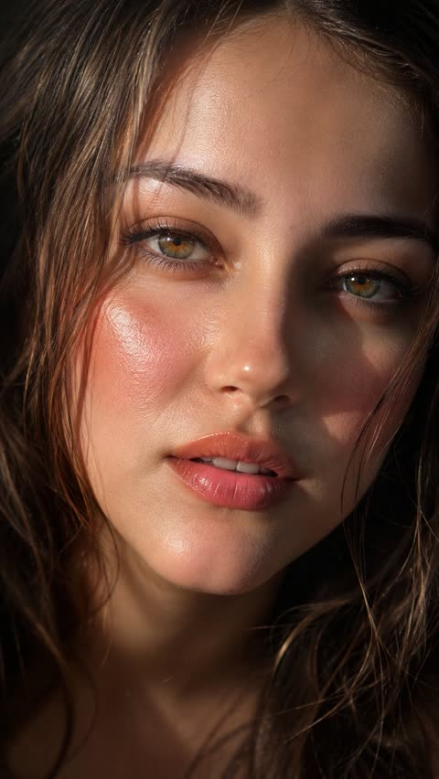</a>

The uploaded photo anchors facial identity, then the prompt layers skin, blush, lip and eye detail with soft dramatic light and shallow focus. The mood line steers the expression rather than specifying a pose.

GPT Image 2 · Edit · Source: [@AizaAi12 on X](https://x.com/AizaAi12/status/2097143936024228151) · 191 likes on 2026-10-29

[`portrait`](tags.md#tag-portrait) [`photorealism`](tags.md#tag-photorealism) [`cinematic-lighting`](tags.md#tag-cinematic-lighting) [`identity-reference`](tags.md#tag-identity-reference)

<details><summary><b>Prompt</b></summary>

```text
Use the uploaded image as the primary facial identity reference. Preserve the subject's recognizable facial structure, proportions, defining features, and natural appearance with maximum possible accuracy. Do not replace, reshape, or significantly alter her facial identity.

Create a cinematic, ultra-detailed extreme close-up portrait of the same young woman, captured with breathtaking photorealism. She has soft, natural facial features, luminous dewy glass skin with realistic fine pores and natural texture, a healthy subtle glow, and delicate peach-pink blush softly diffused across her cheeks.

Her eyebrows are naturally shaped and delicately arched. Her eyes are captivating, expressive, and detailed, with realistic reflections and individually defined eyelashes. Her lips are soft and slightly parted, finished with a subtle glossy coral-nude tint.

Create an intimate and emotionally cinematic atmosphere, as though she is silently holding back a thousand unspoken thoughts. Soft dramatic lighting, gentle shadows, shallow depth of field, cinematic color grading, realistic skin translucency, detailed eyes, natural hair strands, and subtle highlights.

Ultra-photorealistic, cinematic beauty portrait, extreme facial detail, editorial photography, premium film still aesthetic, high dynamic range, realistic lens depth, emotionally powerful composition, 8K quality.
```

</details>

<a id="nano-banana-pink-picnic-blanket-peony-portrait"></a>
### Pink Picnic Portrait with Peonies and Strawberries

<a href="https://x.com/Just_sharon7/status/2075819429372305722"></a>

The prompt uses one baby pink palette across the hair, dress, blanket and flowers, so the whole frame reads as a single color story. Golden hour backlight and a bokeh park background keep the scene soft and dreamy.

Nano Banana 2 · Text-to-image · Source: [@Just_sharon7 on X](https://x.com/Just_sharon7/status/2075819429372305722) · 186 likes on 2026-10-28

[`picnic`](tags.md#tag-picnic) [`pink`](tags.md#tag-pink) [`peony`](tags.md#tag-peony) [`golden-hour`](tags.md#tag-golden-hour) [`top-down`](tags.md#tag-top-down)

<details><summary><b>Prompt</b></summary>

```text
A beautiful young East Asian woman lying on her back on a soft baby pink floral picnic blanket, top-down view, long voluminous wavy platinum blonde hair with baby pink highlights dramatically spread out around her head like a golden-pink halo, soft bangs, fair flawless skin, bright cheerful smile showing perfect white teeth, large expressive brown eyes, wearing a cute baby pink summer dress with puffed short sleeves and square neckline showing cleavage, delicate gold layered necklaces with heart pendant, small gold hoop earrings, sunny outdoor park picnic scene, large vibrant baby pink peonies and roses placed around her, wicker picnic basket in the corner, glass of fresh lemonade with lemon slice nearby, soft golden hour sunlight with gentle pink tones, beautiful natural lighting, bokeh background, highly detailed, photorealistic, cinematic composition, vibrant baby pink color palette, dreamy summer atmosphere.
```

</details>

<a id="gpt-image-realistic-woman-3d-girl-night-park"></a>
### Realistic woman on park bench with 3D animated girl

<a href="https://x.com/Alina_with_Ai/status/2102960952266432853"></a>

An uploaded photo sets the woman's identity, and a separate detailed description keeps the girl in a cute 3D animated style with a matching streetwear outfit. Warm streetlight rim lighting and soft city bokeh blend the two styles into one night scene, though the model loosely interpreted the requested pose.

GPT Image 2.5 · Edit · Source: [@Alina_with_Ai on X](https://x.com/Alina_with_Ai/status/2102960952266432853) · 185 likes on 2026-10-28

[`mixed-style`](tags.md#tag-mixed-style) [`3d-character`](tags.md#tag-3d-character) [`night-park`](tags.md#tag-night-park) [`identity-reference`](tags.md#tag-identity-reference) [`golden-light`](tags.md#tag-golden-light)

<details><summary><b>Prompt</b></summary>

```text
Create a single cinematic vertical 9:16 image based closely on the uploaded reference.

Show TWO characters standing side by side at night in a beautiful city park.

The adult woman is the main realistic character. Use my uploaded photo as her identity reference and preserve my facial identity, facial structure, skin tone, and recognizable appearance. She has long dark brown hair and wears masculine oversized streetwear: a dark olive/black oversized utility jacket, black oversized hoodie, extremely loose black cargo pants, and white chunky sneakers.

The woman is standing naturally and looking DOWN toward the little girl with a warm, genuine smile. Her body is slightly turned toward the little girl. One hand is casually inside her jacket/pants pocket, while her other hand is raised and her index finger is POINTING toward the little girl, as if proudly introducing or showing her. Make the pointing gesture very clear and natural.

Beside her stands an adorable small 3D animated girl. Keep the little girl extremely cute: oversized expressive brown eyes, rosy cheeks, tiny face, brown hair in a messy high bun with loose strands, black oversized hoodie with a small crown emblem, loose black cargo pants, and white chunky sneakers. She is standing upright and looking up at the woman with a sweet playful smile.

IMPORTANT:
- Both characters must be FULLY STANDING.
- One single image only, NOT a collage or split screen.
- The woman must be pointing toward the little girl.
- The woman must be looking at the little girl and smiling.
- The little girl must be looking up at the woman.
- Keep a clear height difference between them.
- Do not make the little girl photorealistic; keep her cute high-quality 3D animated appearance.
- Do not change the little girl's outfit, hairstyle, facial style, or body proportions.

Set them on a nighttime park walkway with leafy trees, warm glowing streetlights, distant city lights, soft bokeh, golden rim lighting around their hair and shoulders, realistic shadows, and a cozy magical atmosphere.

Photorealistic adult woman + adorable 3D animated girl, seamless integration, cinematic photography, realistic skin and clothing textures, warm golden color grading, shallow depth of field, ultra-detailed, natural proportions, professional composition, vertical 9:16.

The final composition should clearly communicate: the big girl is proudly pointing at the cute little girl while smiling at her.
```

</details>

<a id="gpt-image-rainy-car-window-cream-sweater-portrait"></a>
### Rainy car window portrait in cream sweater

<a href="https://x.com/itxabdullaa/status/2071516626886000850">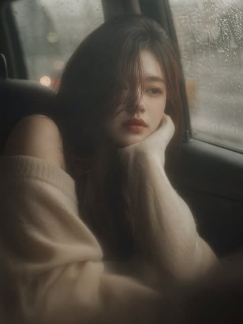</a>

Pairs soft-focus optics terms (Black Pro Mist, bloom, creamy bokeh) with concrete physical setup: an 85mm lens at f/1.2, rain on the window and natural window light. The real-world cues anchor the dreamy haze so it reads as a film shot rather than a filter effect.

GPT Image 2 · Text-to-image · Source: [@itxabdullaa on X](https://x.com/itxabdullaa/status/2071516626886000850) · 183 likes on 2026-10-29

[`portrait`](tags.md#tag-portrait) [`soft-focus`](tags.md#tag-soft-focus) [`film-photography`](tags.md#tag-film-photography) [`rainy-day`](tags.md#tag-rainy-day)

<details><summary><b>Prompt</b></summary>

```text
Ultra-realistic cinematic portrait of a beautiful young woman sitting inside a car, long dark brown hair partially covering one eye, soft porcelain skin, oversized cream sweater, resting her cheek on her hand, dreamy melancholic expression, soft focus, dreamy blur, diffusion filter effect, Black Pro Mist filter, subtle glow, cinematic haze, bloom lighting, ethereal atmosphere, shallow depth of field, creamy bokeh, warm muted color grading, rainy day outside the window, natural window light, low contrast, film photography, 85mm lens, f/1.2, photorealistic, editorial fashion portrait, masterpiece, ultra detailed, 9:16.

Dreamy soft blur, gauzy atmosphere, misty lens, delicate glow, cinematic diffusion, velvety focus, soft cinematic haze, romantic film look, gentle bloom, dreamy aesthetic.

Negative Prompt: sharp focus, overly detailed pores, harsh contrast, HDR, oversaturated, crisp edges, strong sharpening, digital look, cartoon, anime, CGI
```

</details>

<a id="nano-banana-christmas-carousel-tree-portrait"></a>
### Smiling man holding wrapped Christmas tree at night market

<a href="https://x.com/harboriis/status/2003353808710283751">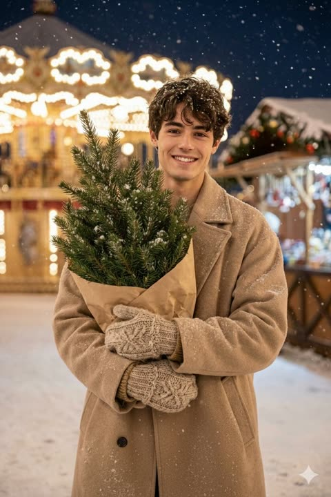</a>

Camera body, lighting backdrop and a named wardrobe list give the model concrete visual anchors for a realistic editorial frame. The uploaded reference photo supplies the face, so the prompt only has to describe the scene and expression.

Nano Banana Pro · Edit · Source: [@harboriis on X](https://x.com/harboriis/status/2003353808710283751) · 180 likes on 2026-10-29

[`christmas`](tags.md#tag-christmas) [`portrait`](tags.md#tag-portrait) [`realism`](tags.md#tag-realism) [`winter`](tags.md#tag-winter)

<details><summary><b>Prompt</b></summary>

```text
Nano Banana Pro on Gemini

Prompt: Hyper-realistic 8K editorial frame. Rustic festive village atmosphere with carousel lights behind. Nikon D5600. Man holding a small wrapped Christmas tree in kraft paper. Snow falling softly. Outfit: beige oversized coat, knitted mittens, winter boots. Emotion: happy, natural candid smile. Highly detailed textures: snow crystals, knitted fibers, tree needles.

Use the face from the uploaded photo.
```

</details>

<a id="nano-banana-bearded-man-teal-armchair-tablet-portrait"></a>
### Bearded man in teal armchair with tablet

<a href="https://x.com/rovvmut_/status/2061464975408021993"></a>

Splitting the pose into body angle and head direction, then naming the prop in each hand, gives the model a clear spatial layout. A 50mm lens, chiaroscuro side light and a plain charcoal backdrop keep the focus on the subject.

Nano Banana 2 · Text-to-image · Source: [@rovvmut_ on X](https://x.com/rovvmut_/status/2061464975408021993) · 177 likes on 2026-10-29

[`portrait`](tags.md#tag-portrait) [`studio-lighting`](tags.md#tag-studio-lighting) [`chiaroscuro`](tags.md#tag-chiaroscuro) [`creative-professional`](tags.md#tag-creative-professional)

<details><summary><b>Prompt</b></summary>

```text
Nano Banana 2 on Gemini.

Prompt: A professional, high-resolution portrait of a man with a neat beard and messy dark hair, sitting in a plush dark teal velvet armchair. He is seated at a slight three-quarter angle, body tilted toward the left while his head is turned to face the camera directly with a friendly expression. Details & Props: He is wearing a sophisticated tan or camel-colored blazer over a crisp white t-shirt. On his left wrist, a black smartwatch is visible. He is holding a sleek silver tablet in his right hand and a white stylus (Apple Pencil) in his left hand, resting them naturally on his lap. Lighting & Atmosphere: The scene features soft, cinematic side-lighting (Chiaroscuro style) that creates gentle shadows on one side of his face and body, adding depth. The background is a minimalist, solid dark charcoal grey, ensuring all focus remains on the subject. Technical Specifications: Ultra-realistic photography, 8K resolution, sharp focus on facial features, shallow depth of field, shot on a 50mm lens, professional studio lighting, clean composition, aspect ratio 4:5. Key Elements Noted: The Tilt: The "three-quarter" body position is crucial for that specific seated look. The Grip: I've specified the pen and tablet being held simultaneously to match the "creative professional" vibe.
The Backdrop: Keeping it "solid charcoal" avoids unwanted textures or distractions.
```

</details>

<a id="gpt-image-fisheye-selfie-doorstep-cat"></a>
### Fisheye selfie on a doorstep with curious cat

<a href="https://x.com/MissDelulu9/status/2111697628941717933"></a>

The prompt asks for a fisheye lens look and puts an oversized cat nose in the near foreground, so the distortion gives depth and humour. It names the outfit pieces and the weathered door texture, and it asks to preserve the face from the uploaded selfie.

GPT Image 2.5 · Edit · Source: [@MissDelulu9 on X](https://x.com/MissDelulu9/status/2111697628941717933) · 173 likes on 2026-10-28

[`fisheye`](tags.md#tag-fisheye) [`selfie`](tags.md#tag-selfie) [`pet`](tags.md#tag-pet) [`candid`](tags.md#tag-candid) [`street`](tags.md#tag-street)

<details><summary><b>Prompt</b></summary>

```text
Create a realistic fisheye photo of the woman in my uploaded selfie, preserving her exact facial features. She sits on a doorstep in front of weathered green wooden doors, wearing a beige trench coat, ivory turtleneck, and light blue jeans. A curious tabby-and-white cat fills the right foreground with an oversized nose and expressive eyes. Soft daylight, natural textures, playful candid mood, ultra-realistic photography, landscape 16:9, no text.
```

</details>

<a id="nano-banana-y2k-flash-beauty-portrait-black-backdrop"></a>
### Y2K flash beauty portrait on black backdrop

<a href="https://x.com/SimplyAnnisa/status/2072293670007796111"></a>

The prompt is split into labeled blocks for makeup, hair, expression, outfit and lighting, so each element can be tuned separately. Direct flash combined with rim backlight gives the glowing halo against pure black, and a closing list of style boosters locks in the early 2000s camera look.

Nano Banana 2 · Text-to-image · Source: [@SimplyAnnisa on X](https://x.com/SimplyAnnisa/status/2072293670007796111) · 171 likes on 2026-10-28

[`y2k`](tags.md#tag-y2k) [`flash-photography`](tags.md#tag-flash-photography) [`beauty-portrait`](tags.md#tag-beauty-portrait) [`rim-light`](tags.md#tag-rim-light) [`editorial`](tags.md#tag-editorial)

<details><summary><b>Prompt</b></summary>

```text
Ultra-realistic beauty portrait of a stunning young woman, photographed from a slightly low-angle smartphone selfie perspective. Captured with an authentic early-2000s digital camera aesthetic using an intense direct flash. Deep pure-black background completely isolates the subject, creating dramatic contrast and making the face glow against darkness. Strong Y2K flash photography produces bright specular highlights, glass-like eye reflections, glossy skin sheen, and a nostalgic nightlife editorial atmosphere.

MAKEUP:
The woman has large almond-shaped hazel-brown eyes with luminous reflections, thick wispy manga-inspired lashes, naturally full fluffy eyebrows, soft freckles scattered across the bridge of the nose and upper cheeks, a delicate button nose with rosy blush concentrated on the tip, and full naturally plump lips wearing dusty rose pink lipstick with a subtle glossy finish. Flawless porcelain skin with realistic pores, natural texture, and soft peachy undertones. Soft feminine glam makeup. Neutral taupe eyeshadow, elongated fox-eye liner extending toward the temples, dramatic clustered lashes, luminous inner-corner shimmer, subtle contouring, flushed rosy cheeks and nose bridge, softly overlined lips, glossy highlights enhanced by direct flash. Luxury editorial beauty makeup.

HAIR
Extremely voluminous supermodel blowout hairstyle with rich chocolate-brown tones and warm caramel undertones. Dramatic crown lift, feathered layers, luxurious salon-finished texture, silky shine, flowing movement, soft flyaways. Powerful luminous halo surrounding the hair and face. Strong rim lighting traces every strand of hair, creating a radiant angelic aura. Backlit glow creates a dreamy cinematic effect with soft bloom around illuminated edges.

EXPRESSION:
Dreamy upward gaze looking away from the camera, confident yet ethereal expression.

OUTFIT
Sleeveless charcoal-gray pinstripe fitted top with black ribbon lace-up neckline. Elegant feminine silhouette. Modern Y2K-inspired styling.

LIGHTING
Strong direct Y2K camera flash combined with subtle backlighting. Bright flash creates crisp facial definition, intense eye reflections, glossy lips, luminous cheekbones, and reflective skin highlights. Ethereal halo surrounding the entire silhouette. Soft bloom effect around highlights, subtle lens glow, dreamy atmospheric diffusion.

Vogue beauty editorial, luxury cosmetics campaign, fashion magazine cover photography, cinematic beauty portrait, ultra-detailed skin texture, shallow depth of field, HDR photography, hyper-realistic eyes, nostalgic digital camera grain, flash bloom, glamorous nightlife energy, dark feminine aesthetic, angelic glow, luxury fashion campaign, 8K ultra realism.

STYLE BOOSTERS
Y2K digital camera flash, cyber-feminine glamour, dreamy halo glow, luminous aura, glowing silhouette, flash photography, nostalgic 2003 party photography, supermodel beauty campaign, luxury editorial portrait, soft bloom, cinematic rim light, glossy highlights, dark aesthetic, hyperrealism, magazine cover quality.
```

</details>

<a id="nano-banana-chiaroscuro-portrait"></a>
### Cinematic chiaroscuro close-up of your photo

<a href="https://x.com/rovvmut_/status/2107691827323392159"></a>

One light from the side and an explicit request for visible pores to keep skin from looking airbrushed.

Nano Banana 2.1 · Edit · Source: [@rovvmut_ on X](https://x.com/rovvmut_/status/2107691827323392159) · 170 likes on 2026-10-27

[`chiaroscuro`](tags.md#tag-chiaroscuro) [`cinematic`](tags.md#tag-cinematic) [`skin-detail`](tags.md#tag-skin-detail)

<details><summary><b>Prompt</b></summary>

```text
A hyper-realistic, 8K resolution cinematic close-up portrait of the person in the uploaded image. The image features dramatic chiaroscuro lighting, heavily illuminating the left side of his face while casting deep, moody shadows on the right against a solid black background. He has an intense, direct gaze, dark brown eyes with square catchlights, and textured, wet-styled hair. He is wearing a plain black t-shirt. Render with 35mm film grain and a shallow depth of field, prioritizing extreme character consistency and highly detailed skin texture, including visible pores.
```

</details>

<a id="nano-banana-beach-portrait-ice-cream-cone"></a>
### Smiling woman with ice cream by beach huts

<a href="https://x.com/SyntheSarah/status/2080972261335748910">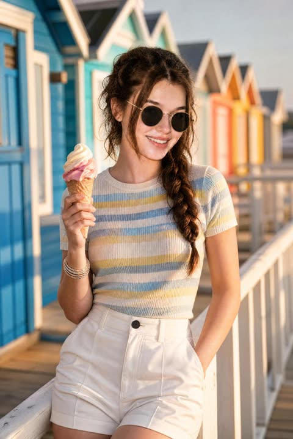</a>

The prompt is organised in fixed order (subject, clothing, background, lighting, camera), so each area is described once and stays consistent. The 85mm f/1.8 lens spec and the named golden hour light direction control the shallow depth of field and the soft warm highlights on the face and sunglasses.

Nano Banana 2 · Text-to-image · Source: [@SyntheSarah on X](https://x.com/SyntheSarah/status/2080972261335748910) · 166 likes on 2026-10-29

[`portrait`](tags.md#tag-portrait) [`beach`](tags.md#tag-beach) [`golden-hour`](tags.md#tag-golden-hour) [`lifestyle`](tags.md#tag-lifestyle)

<details><summary><b>Prompt</b></summary>

```text
A photorealistic, ultra-high-resolution lifestyle portrait of a smiling young woman standing beside a white wooden railing on a colorful beach promenade lined with vibrant pastel beach huts. She has long medium-brown hair styled into a single side braid draped over her right shoulder. She is wearing round black sunglasses with a thin gold metal frame, small silver stud earrings, and several stacked silver bracelets on her left wrist.
She is holding a vanilla-and-strawberry ice cream cone in her left hand near her face while looking slightly to her left, smiling broadly with visible white teeth and natural dimples. Her right hand is casually tucked into the pocket of her high-waisted white tailored shorts featuring belt loops, a visible black button, and crisp structured fabric.
She wears a fitted short-sleeve knit T-shirt with horizontal stripes in soft cream, pale yellow, light blue, and muted gray. The shirt has a fine ribbed texture and fits naturally without wrinkles.
The background features a row of colorful beach cabins painted in bright blue, turquoise, yellow, and orange, receding into the distance with strong perspective. A white wooden fence runs diagonally through the foreground, creating depth. The background is softly blurred with a creamy bokeh effect while the subject remains razor-sharp.
Golden-hour natural sunlight illuminates her face from the front-left, producing soft shadows, realistic skin texture, vibrant colors, and gentle highlights on the sunglasses and jewelry. Shot with an 85mm portrait lens at f/1.8, shallow depth of field, eye-level composition, vertical framing (9:16), DSLR-quality photography, HDR, ultra-detailed skin, natural proportions, realistic hands with five fingers, clean fingernails, highly detailed clothing fabric, cinematic color grading, no text, no watermark, no logo.
```

</details>

<a id="nano-banana-art-studio-man-miniature-self-figurine"></a>
### Smiling Artist With Miniature Self Figurine

<a href="https://x.com/Taaruk_/status/2039625508535885876"></a>

A scale contrast illusion is named outright and paired with a figurine detail cue, so the tiny double reads as a real object on the desk. A warm desk lamp, shallow depth of field and a 50mm lens keep the studio scene photographic.

Nano Banana 2 · Text-to-image · Source: [@Taaruk_ on X](https://x.com/Taaruk_/status/2039625508535885876) · 164 likes on 2026-10-28

[`miniature`](tags.md#tag-miniature) [`scale-contrast`](tags.md#tag-scale-contrast) [`studio-portrait`](tags.md#tag-studio-portrait) [`shallow-depth-of-field`](tags.md#tag-shallow-depth-of-field) [`cinematic`](tags.md#tag-cinematic)

<details><summary><b>Prompt</b></summary>

```text
Ultra-realistic cinematic portrait of a young man sitting at a wooden desk in a cozy art studio, smiling warmly at the camera, with a tiny miniature version of himself standing on the table in front of him, perfectly detailed like a small figurine, surrounded by paint brushes, sketches, and art tools, warm ambient lighting from a desk lamp, shallow depth of field, soft bokeh background, creative storytelling composition, scale contrast illusion, hyper-detailed textures, 50mm lens, photorealistic, 8K.
```

</details>

<a id="nano-banana-bearded-man-amber-sunglasses-blue-cardigan"></a>
### Bearded man in amber sunglasses and cardigan

<a href="https://x.com/rovvmut_/status/2052273526758121636"></a>

The prompt lists the face, eyewear, clothing and props in separate sentences, then sets bright natural light and a soft focus blue vehicle backdrop. Naming specific textures and a cool background against warm accents keeps the portrait cinematic.

Nano Banana 2 · Text-to-image · Source: [@rovvmut_ on X](https://x.com/rovvmut_/status/2052273526758121636) · 163 likes on 2026-10-28

[`portrait`](tags.md#tag-portrait) [`sunglasses`](tags.md#tag-sunglasses) [`knitwear`](tags.md#tag-knitwear) [`street-style`](tags.md#tag-street-style) [`cinematic`](tags.md#tag-cinematic)

<details><summary><b>Prompt</b></summary>

```text
Nano Banana 2 on Gemini.

Prompt: A stylish, rugged portrait of a man with a relaxed yet sophisticated urban look. He features messy dark hair with natural highlights and a well-maintained, thick beard. He is wearing distinctive vintage-style sunglasses with translucent amber frames and dark, circular lenses that feature a unique metal flip-up bridge mechanism. He is dressed for cool weather in a chunky, blue ribbed-knit cardigan with a thick lapel, worn over a simple white t-shirt. In the foreground, his hand is partially visible, holding a white disposable coffee cup with a matching white lid. The lighting is bright and natural, casting soft shadows that emphasize the texture of his knitwear and facial hair. The background is a soft-focus blue vintage vehicle with horizontal grille lines, creating a cool-toned, cinematic backdrop that makes the warm tones of his sunglasses and skin pop.
```

</details>

<a id="gpt-image-wet-profile-portrait-green-eyes"></a>
### Wet close-up side profile with green-hazel eyes

<a href="https://x.com/j_smeaton99/status/2063088697495724500">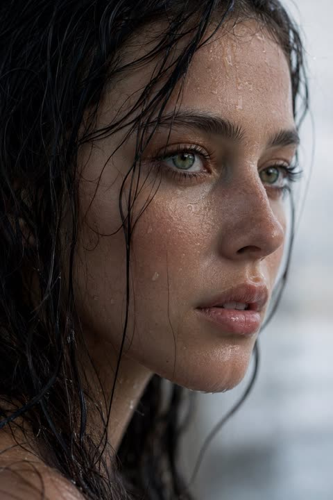</a>

Specific skin and eye details such as visible pores, moisture beads and natural reflections anchor the realism, while the 85mm f/1.8 lens spec and a clean light gray bokeh background isolate the subject from its surroundings.

GPT Image 2 · Text-to-image · Source: [@j_smeaton99 on X](https://x.com/j_smeaton99/status/2063088697495724500) · 161 likes on 2026-10-29

[`portrait`](tags.md#tag-portrait) [`photorealistic`](tags.md#tag-photorealistic) [`close-up`](tags.md#tag-close-up) [`beauty`](tags.md#tag-beauty)

<details><summary><b>Prompt</b></summary>

```text
Extreme wet close-up portrait of a young woman in side profile. Dark, rain-soaked hair naturally clinging to her skin and framing her face. Fine water droplets and a delicate layer of moisture glistening realistically across her cheeks, forehead, and jawline. Striking natural green-hazel eyes as the focal point, featuring subtle authentic reflections and lifelike depth without excessive shine. Soft, hydrated lips with realistic texture and a gentle natural gloss. Smooth skin with visible pores and nuanced facial details for maximum realism. Cinematic soft lighting with cool tones, creating a fresh atmospheric mood. Clean light gray and white bokeh background with shallow depth of field. Ultra-detailed photography, high-end editorial beauty portrait, natural facial proportions, realistic skin rendering, sharp eye focus, professional DSLR quality, photorealistic, 85mm lens, f/1.8, ultra-high resolution.
```

</details>

<a id="nano-banana-ccd-flash-sofa-selfie-portrait"></a>
### Over the shoulder CCD flash selfie on boucle sofa

<a href="https://x.com/Emmma___0/status/2107687127844856184"></a>

The prompt splits the brief into labeled blocks for pose, hair, expression, outfit, background and camera, and an old CCD digicam with direct flash gives the candid snapshot look. A long negative list against polished hair, plastic skin and twisted necks keeps the messy strands, skin texture and pose believable.

Nano Banana 2.1 · Edit · Source: [@Emmma___0 on X](https://x.com/Emmma___0/status/2107687127844856184) · 157 likes on 2026-10-27

[`ccd-flash`](tags.md#tag-ccd-flash) [`selfie`](tags.md#tag-selfie) [`korean-makeup`](tags.md#tag-korean-makeup) [`identity-preservation`](tags.md#tag-identity-preservation) [`labeled-blocks`](tags.md#tag-labeled-blocks)

<details><summary><b>Prompt</b></summary>

```text
Create image: A hyper-photorealistic shot of the same subject in the attached image, detailed pores, rosy dewy skin, Douyin glass-skin, pink gloss lips, aegyosal, blush, grey contacts, wispy lashes, brushed brows, thin liner. Preserve her recognizable facial identity and natural proportions with a playful yet sophisticated Chryzleen-inspired indoor fashion aesthetic.

[POSE & COMPOSITION] A tight over-the-shoulder CCD selfie while she leans sideways into a plush sofa. The camera sits slightly behind and above her shoulder, creating a close three-quarter over-shoulder perspective. Only one eye, cheekbone, glossy lips, jawline, a sliver of neck, and the near shoulder are visible. The far side of her face is completely cropped out. Her head turns gently back toward the camera with a small natural tilt, keeping the neck relaxed and anatomically believable. One hand rests loosely on the sofa back behind her, with fingertips visible at the edge of the frame. The pose feels subtly seductive and candid rather than overly posed.

[HAIR] Deep side part with lifted roots and intentionally untidy, windswept volume. Several wispy strands fall across the forehead and cheek, while loose pieces spill naturally behind the shoulder. The hair should have irregular movement and soft imperfections, avoiding a freshly styled appearance.

[EXPRESSION] Half-lidded grey-contact gaze looking back toward the camera, relaxed brows, slightly lifted chin, soft jaw, glossy pink lips parted just enough to show a subtle glimpse of front teeth. Alluring, confident, and understated.

[OUTFIT] Sky-blue fitted sweetheart-neckline knit top with tiny white embroidered daisies, delicate scalloped edging, and miniature pearl-like buttons. Cute modern indoor fashion with a feminine fitted silhouette and soft textured fabric.

[BACKGROUND & ENVIRONMENT] A cozy contemporary living room with a warm beige boucle sofa, muted dusty-blue wall, softly blurred floor lamp, and a small cream cushion behind her. The room is visible only in narrow fragments around the extremely tight crop.

[BRANDING] A miniature Chryzleen engraving is physically placed on a tiny gold bracelet charm worn on the hand resting against the sofa. The Chryzleen mark should be naturally etched into the metal and remain subtle. This single Chryzleen accessory is the only visible branding treatment in the entire image.

[CAMERA] Old CCD digicam, direct flash, fine grain. Close over-the-shoulder three-quarter perspective with crisp detail on the visible eye, cheek, lips, messy hair wisps, shoulder, fingers, and tiny jewelry detail.

[QUALITY] Photorealistic pores and skin texture, natural facial asymmetry, believable hair movement, realistic hands and fingers, seamless neck anatomy, authentic knit texture, natural CCD grain, premium indoor fashion-editorial finish.

[MAKEUP] Fresh Korean soft-glam, natural glow, pink blush, wispy lashes, thin winged liner, shimmering rose-taupe eyeshadow, glossy pink lips.

Keep the Chryzleen branding physically integrated into the jewelry and visually understated, never functioning as graphic text.

1:1 aspect ratio.

[NEGATIVE PROMPT] cardigan, cardigan outfit, jacket, blazer, excessive head turn, extreme head tilt, extreme neck arch, twisted neck, unnatural neck curve, stiff pose, frontal selfie, symmetrical composition, perfectly polished hair, salon-perfect hair, no facial wisps, perfectly arranged strands, full body, half body, waist-up, loose crop, distant camera, excessive living room, hands covering face, hair-touching, malformed hands, extra fingers, missing fingers, warped eyes, plastic skin, over-smoothed face, pale washed-out skin, green cast, square skin artifacts, identity drift, multiple people, multiple Chryzleen marks, duplicate branding, watermark, floating text, random readable signage.
```

</details>

<a id="gemini-moonlit-park-walk-portrait"></a>
### Moonlit park walk portrait with streetlamp glow

<a href="https://www.tiktok.com/@gemini_photo/video/7689076503060942094">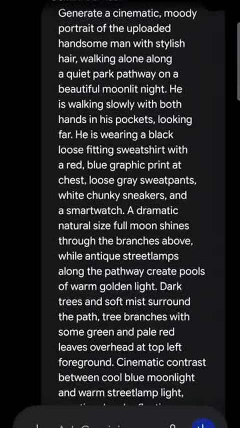</a>

Uploading a reference photo and asking to keep the face the same locks the identity, while the text builds the scene. Splitting the light into cool moonlight and warm streetlamp pools, plus a lens and aperture spec, sets the cinematic mood.

Gemini · Edit · Source: [@gemini_photo on TikTok](https://www.tiktok.com/@gemini_photo/video/7689076503060942094) · 156 likes on 2026-10-30

[`portrait`](tags.md#tag-portrait) [`cinematic`](tags.md#tag-cinematic) [`moonlight`](tags.md#tag-moonlight) [`reference-photo`](tags.md#tag-reference-photo)

<details><summary><b>Prompt</b></summary>

```text
Generate a cinematic, moody portrait of the uploaded handsome man with stylish hair, walking alone along a quiet park pathway on a beautiful moonlit night. He is walking slowly with both hands in his pockets, looking far. He is wearing a black loose fitting sweatshirt with a red, blue graphic print at chest, loose gray sweatpants, white chunky sneakers, and a smartwatch. A dramatic natural size full moon shines through the branches above, while antique streetlamps along the pathway create pools of warm golden light. Dark trees and soft mist surround the path, tree branches with some green and pale red leaves overhead at top left foreground. Cinematic contrast between cool blue moonlight and warm streetlamp light, emotional and reflective atmosphere, photorealistic DSLR photography, sharp focus on subject, 85mm lens, f/1.8, rich cinematic colour grading, ultra-detailed, full HD upscale, 8K, no haze, no AI artifacts. Keep the face exactly the same as the uploaded photo, same identity. Aspect ratio 4:5 .
```

</details>

<a id="nano-banana-headphones-hoodie-motion-blur-portrait"></a>
### Centered man in black hoodie with motion blurred figures

<a href="https://x.com/rovvmut_/status/2063619957573963785">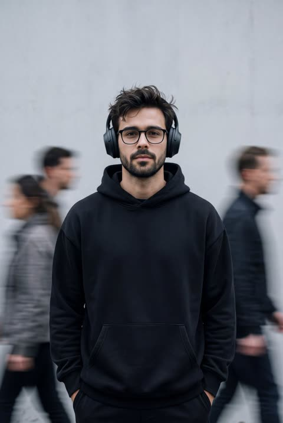</a>

Locking the subject into a centered, symmetrical medium shot with a flat grey wall and a 50mm, f/2.8 to f/4 depth of field keeps the figure sharp. Describing the side figures as directional lateral motion blur makes the stillness of the centre the point of the image.

Nano Banana 2 · Text-to-image · Source: [@rovvmut_ on X](https://x.com/rovvmut_/status/2063619957573963785) · 156 likes on 2026-10-29

[`portrait`](tags.md#tag-portrait) [`motion-blur`](tags.md#tag-motion-blur) [`editorial`](tags.md#tag-editorial) [`headphones`](tags.md#tag-headphones)

<details><summary><b>Prompt</b></summary>

```text
Calm in the middle of the chaos. 🎧

Nano Banana 2 on Gemini.

Prompt: Cinematic fashion-editorial portrait of a person with messy hair, well groomed beard and glasses, framed as a centered medium shot from waist to head, subject perfectly aligned in the middle with symmetrical composition. Pose: Standing still facing camera directly, shoulders relaxed, hands in pockets, posture upright; facial expression neutral, calm, slightly detached. Wardrobe: Minimalist oversized black hoodie with matte fabric, no visible branding. Accessories: Large over-ear headphones worn on the head with a clean, modern design. Background: Flat, softly textured light gray wall (approx hex #d9d9d9) with subtle grain. Lighting: soft, diffused frontal lighting (5000-5500k) creating even illumination with minimal shadows and smooth skin tones; no harsh highlights, clean tonal transitions. Motion effect: Strong lateral motion blur silhouettes passing on both sides of the subject, creating ghosted human forms with directional blur, emphasizing stillness of the central figure. Optics: 50mm lens simulation, moderate depth of field (f/2.8-f/4) keeping subject sharp while motion-blurred elements streak across frame; slight film grain and soft contrast. Texture: Clean, natural skin detail with subtle softness, matte fabric rendering, minimal reflections. mood: introspective, isolated, urban, quiet contrast between stillness and surrounding motion. editorial, modern, high-detail, cinematic composition, ultra-realistic textures, professional fashion photography style.
```

</details>

<a id="nano-banana-white-halter-dress-keor-hem-portrait"></a>
### Woman crouched in white halter dress with Keor embroidery

<a href="https://x.com/KeorUnreal/status/2064728849703748030">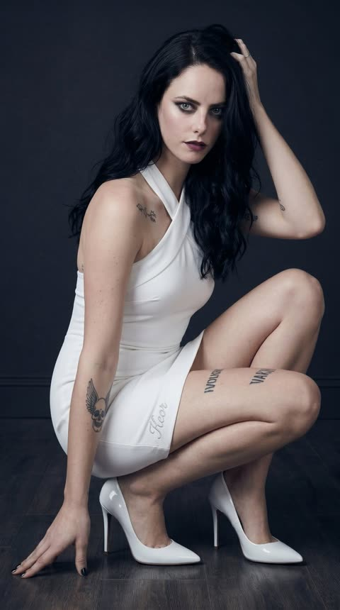</a>

The JSON splits the scene into subject, clothing, environment and an additions block, and the full_prompt line restates it in one sentence. Placing the Keor text on the hem in fine thread keeps the added detail small and believable.

Nano Banana 2 · Text-to-image · Source: [@KeorUnreal on X](https://x.com/KeorUnreal/status/2064728849703748030) · 156 likes on 2026-10-29

[`studio-portrait`](tags.md#tag-studio-portrait) [`glamour`](tags.md#tag-glamour) [`embroidered-text`](tags.md#tag-embroidered-text) [`dramatic-lighting`](tags.md#tag-dramatic-lighting)

<details><summary><b>Prompt</b></summary>

```text
{
  "image_description": "A highly detailed, photorealistic studio portrait of a stunning young woman with long, wavy black hair, fair skin with natural freckles, and striking blue-green eyes. She sits on the floor against a solid black background in a dramatic pose with knees raised and legs apart, one hand running through her hair. She wears a form-fitting white short dress with a criss-cross halter neckline and glossy white high-heeled shoes. Her expression is confident and slightly vulnerable as she gazes directly at the camera.",
  "composition": "Low-angle medium full-body studio shot focusing on her pose, figure, and facial expression. Dramatic, high-contrast studio lighting with soft highlights on skin, hair, and the glossy shoes, creating a sensual and elegant atmosphere.",
  "details": {
    "woman": "Beautiful woman in her mid-20s, slim and toned build, long wavy black hair, expressive eyes, natural makeup with glossy lips.",
    "clothing": "Form-fitting white dress with criss-cross halter neckline, glossy white high-heeled shoes.",
    "environment": "Minimalist black studio backdrop.",
    "props": "None additional."
  },
  "modifications": {
    "additions": "Add a small, elegant embroidered sign reading 'Keor' in delicate cursive script on the visible border or hem of her white dress. Place it realistically along the lower hem, neckline edge, or side seam using fine white or metallic thread that blends naturally as a subtle, high-end custom detail."
  },
  "style": "Photorealistic, high-resolution glamour portrait photography, dramatic studio lighting, sharp focus on the subject, realistic skin texture, hair volume, fabric drape on the white dress, and glossy shoe reflections, confident and seductive mood.",
  "technical": {
    "resolution": "8K",
    "aspect_ratio": "portrait",
    "quality": "Extremely detailed wavy hair strands, skin texture with natural freckles, realistic white fabric folds and sheen, glossy white heels, and subtle embroidered 'Keor' sign."
  },
  "full_prompt": "Photorealistic studio portrait of a beautiful woman with long black hair wearing a form-fitting short white halter dress, sitting on the floor with knees raised and hand in hair, dramatic black background, confident gaze, add subtle embroidered 'Keor' on the border hem of the white dress --ar 2:3 --v 6 --q 2 --stylize 250"
}
```

</details>

<a id="nano-banana-rainy-car-window-night-portrait"></a>
### Cinematic Night Portrait Through Rainy Car Window

<a href="https://x.com/NikhilRajX/status/2035707444777865469"></a>

The camera is placed outside the car so the wet glass sits between lens and subject, and raindrops, neon reflections and red, blue and yellow bokeh are all named. Shallow depth of field and low ambient lighting on the face give the film still mood, while the uploaded face reference keeps the identity.

Nano Banana 2 · Edit · Source: [@NikhilRajX on X](https://x.com/NikhilRajX/status/2035707444777865469) · 155 likes on 2026-10-28

[`cinematic`](tags.md#tag-cinematic) [`rain`](tags.md#tag-rain) [`night`](tags.md#tag-night) [`portrait`](tags.md#tag-portrait) [`bokeh`](tags.md#tag-bokeh)

<details><summary><b>Prompt</b></summary>

```text
Nano Banana 2 on Google Gemini

Prompt: Create a highly cinematic and realistic photo of a person using the face from the uploaded image. The person is sitting inside a car at night, looking out through a rain-covered window. The camera is positioned outside the car, capturing the person through the wet glass. Raindrops and streaks of water are clearly visible on the window, with reflections of city lights, neon signs, and passing cars blending into the glass. The person’s face is softly lit by ambient street lights and subtle interior car lighting, creating a moody and emotional expression. The background outside is blurred with colorful bokeh lights (red, blue, yellow), giving a deep cinematic feel. The person is wearing a modern outfit like a hoodie or jacket. The mood feels introspective and film-like. Ultra realistic photography, shallow depth of field, dramatic lighting, reflections, rain texture, Hollywood movie scene composition, high detail.
```

</details>

<a id="nano-banana-xmas-winking-man-bench-sweets-monsters"></a>
### Winking man on bench amid Christmas sweets monsters

<a href="https://x.com/ecommartinez/status/1995250288073302501">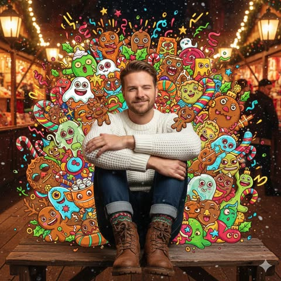</a>

A structured JSON prompt locks identity to the reference photo, then layers monster and shape overlays behind and around the subject. The explicit rule to keep the face and hands photorealistic is what makes the pop-art mix work.

Nano Banana Pro · Edit · Source: [@ecommartinez on X](https://x.com/ecommartinez/status/1995250288073302501) · 155 likes on 2026-10-29

[`christmas`](tags.md#tag-christmas) [`pop-art`](tags.md#tag-pop-art) [`portrait`](tags.md#tag-portrait) [`json-prompt`](tags.md#tag-json-prompt)

<details><summary><b>Prompt</b></summary>

```text
@awesome_visuals
 para poner tu rostro)

{
  "subject": {
    "type": "the person from the reference photo ONLY",
    "identity_restriction": "Do NOT use any traits, gender, clothing or body features from previous prompts. Use ONLY the face, body type, and identity from the reference photo.",
    "pose": "sitting on a wooden market bench with knees pulled up and arms wrapped around them, giving a cheerful wink",
    "expression": "warm, festive, friendly"
  },

  "appearance": {
    "match_reference": "Facial structure, hairstyle, and overall appearance must EXACTLY match the reference photo",
    "hair": "same hairstyle as reference photo",
    "clothing": {
      "style": "winter outfit inspired by reference, adapted for Christmas market",
      "top": "cozy winter jacket or sweater (match reference photo colors if possible)",
      "bottom": "neutral comfortable pants or shorts depending on reference",
      "socks": "winter socks",
      "shoes": "winter boots"
    }
  },

  "environment": {
    "setting": "outdoor Christmas market",
    "details": "twinkle lights, wooden stalls, warm hanging lanterns"
  },

  "lighting": {
    "type": "warm golden fairy-light glow",
    "mood": "cozy, festive, romantic"
  },

  "camera": {
    "angle": "low-to-mid angle",
    "lens_effect": "slight wide-angle with warm bloom",
    "framing": "subject centered among Christmas lights"
  },

  "art_overlay": {
    "style": "maximalist Christmas sweets-monster pop-art",
    "illustrated_elements": {
      "monsters": "gingerbread goblins, candy-cane worms, snowball blob creatures, hot-cocoa monsters with melting marshmallow faces, cookie reindeer, tiny ornament gremlins, eggnog ghosts, fruitcake beasts",
      "graphic_shapes": "neon stars, snowflakes, sparkles, swirls, drips, zigzags, holly leaves, ribbon curls, comic bursts without text",
      "style": "flat neon holiday palette (red, green, gold, icy blue, pink, lime) with thick black outlines"
    },

    "placement_and_density": {
      "behind_subject": "background filled with overlapping Christmas monsters and shapes",
      "around_subject": "monsters peeking from behind shoulders, around boots, near hair, above the bench",
      "over_clothing": "some gingerbread creatures cling to clothing",
      "avoid_skin": "face and hands remain fully photorealistic",
      "depth_layers": "heavy layering front and back for strong pop-art depth",
      "energy_effects": "glowing rim lights, falling stylized snow, neon speed lines"
    }
  },

  "style": {
    "overall": "cozy Christmas market portrait overwhelmed by neon festive monsters",
    "aesthetic": "warm, chaotic, holiday-playful, surreal"
  }
}
```

</details>

<a id="chatgpt-blonde-beauty-portrait-ring-light"></a>
### Blonde woman in ivory sweater beside ring light

<a href="https://www.tiktok.com/@catherineelaine17/video/7683220682292890911"></a>

A preserve clause locks the person's features before the pose, makeup, fabric and lighting are described in separate sentences, so each element stays controllable. The 85mm lens and creamy background blur cues set the studio editorial look.

ChatGPT · Edit · Source: [@catherineelaine17 on TikTok](https://www.tiktok.com/@catherineelaine17/video/7683220682292890911) · 152 likes on 2026-10-30

[`portrait`](tags.md#tag-portrait) [`beauty`](tags.md#tag-beauty) [`studio-lighting`](tags.md#tag-studio-lighting) [`editorial`](tags.md#tag-editorial)

<details><summary><b>Prompt</b></summary>

```text
Create an ultra-realistic, high-end beauty portrait based on the uploaded reference photo. Preserve the person’s recognizable facial features, facial proportions, eye shape, nose, lips and natural individuality. Close-up portrait in a slightly turned over-the-shoulder pose, looking directly into the camera with a calm, confident expression. Very long blonde hair with lots of glamorous volume, softly tousled and slightly wild, with smooth silky individual strands framing the face — healthy and soft, no frizz or tangled texture. Makeup: elegant soft glam with defined black winged eyeliner, long lashes, softly sculpted brows, subtle champagne shimmer, gentle contour and glossy nude-rosé lips. Natural realistic blue-grey eyes, not overly bright or artificial. Skin should be light and neutral-warm with realistic pores and subtle natural texture — luminous but not overly pale, orange, heavily tanned or airbrushed. Outfit: cozy ivory/cream oversized knitted sweater worn casually off one shoulder, delicate thin strap underneath, gold hoop earrings and minimal elegant jewelry. Background: luxurious cozy beauty-studio atmosphere with dark neutral tones, a softly glowing ring light on one side, subtle candlelight and blurred pampas grass. Warm cinematic bokeh and shallow depth of field. Professional beauty photography, soft directional lighting, realistic shadows, sharp detailed eyes, 85mm lens look, creamy background blur, editorial quality, photorealistic, 9:16 vertical composition.
```

</details>

<a id="nano-banana-black-white-street-portrait-city-crowd"></a>
### Black and white street portrait in crowd

<a href="https://x.com/iamrealsnow/status/2031179469617320282"></a>

Pairing a sharp-focus subject with a motion-blurred crowd and shallow depth of field isolates the figure inside a busy scene. Dramatic contrast lighting with a soft rim light on the face keeps the night street cinematic.

Nano Banana 2 · Text-to-image · Source: [@iamrealsnow on X](https://x.com/iamrealsnow/status/2031179469617320282) · 152 likes on 2026-10-28

[`street-portrait`](tags.md#tag-street-portrait) [`black-and-white`](tags.md#tag-black-and-white) [`motion-blur`](tags.md#tag-motion-blur) [`night`](tags.md#tag-night) [`cinematic`](tags.md#tag-cinematic)

<details><summary><b>Prompt</b></summary>

```text
.
A cinematic black and white street portrait of a handsome man standing still in a busy city crowd, sharp focus on the subject while people around him are motion-blurred, shallow depth of field, intense masculine facial features textured beard, slightly messy wavy hair, wearing a dark tailored coat, calm yet powerful expression, dramatic contrast lighting, soft rim light on face, urban night atmosphere,
```

</details>

<a id="nano-banana-christmas-santa-hat-red-dress-bokeh-portrait"></a>
### Smiling woman in Santa hat by glowing tree

<a href="https://x.com/Strength04_X/status/2003795195272499421"></a>

A JSON prompt that pairs a subject-first description with photographic modifiers such as 85mm lens, f/1.8 aperture and depth of field, set to a 9:16 portrait ratio. Describing the background as softly blurred with golden bokeh keeps the tree as a warm frame around the subject.

Nano Banana Pro · Text-to-image · Source: [@Strength04_X on X](https://x.com/Strength04_X/status/2003795195272499421) · 152 likes on 2026-10-29

[`christmas`](tags.md#tag-christmas) [`portrait`](tags.md#tag-portrait) [`bokeh`](tags.md#tag-bokeh) [`cinematic-lighting`](tags.md#tag-cinematic-lighting)

<details><summary><b>Prompt</b></summary>

```text
{
      "description": "Ultra-realistic 8k portrait of a stunning young woman with long, dark, wavy hair, wearing a plush red and white Santa hat and a fitted red strapless dress. She has a soft, alluring expression and is looking directly at the camera. The background features a softly blurred Christmas tree with glowing golden bokeh lights, creating a warm and festive atmosphere.",
      "modifiers": [
        "Ultra-realistic",
        "8k resolution",
        "DSLR photography",
        "Cinematic lighting",
        "Warm ambient light",
        "High detail skin texture",
        "Bokeh effect",
        "Depth of field",
        "f/1.8 aperture",
        "85mm lens",
        "Photorealistic",
        "Masterpiece"
      ],
      "negative_prompt": "cartoon, 3d render, anime, painting, drawing, low quality, blurry, pixelated, bad anatomy, deformed, ugly, cross-eyed, watermark, text, noise, grain, overexposed"
    }
  ],
  "settings": {
    "aspect_ratio": "9:16",
    "style": "Cinematic Portrait"
  }
}
```

</details>

<a id="gemini-cobalt-hoodie-superbike-financial-plaza"></a>
### Creator on white superbike at blue hour plaza

<a href="https://www.tiktok.com/@gemini_photo/video/7685433692981857550">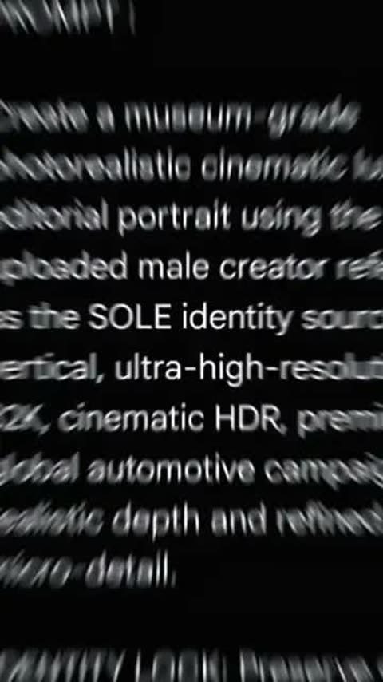</a>

The uploaded photo is the only identity source, and a labeled identity lock list (eyes, beard, jawline, hair) plus a NO face replacement line keeps the face fixed. Camera and light specs (85mm lens, shallow depth of field, full motorcycle in frame, blue hour moving into golden hour) sit in separate labeled blocks so the scene stays structured.

Gemini / CapCut · Edit · Source: [@gemini_photo on TikTok](https://www.tiktok.com/@gemini_photo/video/7685433692981857550) · 145 likes on 2026-10-30

[`portrait`](tags.md#tag-portrait) [`motorcycle`](tags.md#tag-motorcycle) [`identity-lock`](tags.md#tag-identity-lock) [`luxury`](tags.md#tag-luxury)

<details><summary><b>Prompt</b></summary>

```text
Create a museum-grade photorealistic cinematic luxury editorial portrait using the uploaded male creator reference as the SOLE identity source. 4:5 vertical, ultra-high-resolution 32K, cinematic HDR, premium global automotive campaign, realistic depth and refined micro-detail. IDENTITY LOCK: Preserve exact facial structure/proportions, eyes, eyebrows, nose, lips, jawline, beard, hairstyle, hair texture, skin tone, natural skin texture, asymmetry and distinctive features. NO face replacement, beautification, plastic skin, celebrity resemblance or identity drift. SUBJECT: Young male creator seated naturally and confidently on the motorcycle, leaning slightly forward with forearms naturally resting over the fuel-tank/helmet area, calm intelligent expression, subtle serious gaze toward camera, relaxed shoulders, natural proportions, realistic hands/fingers/anatomy, full body visible. OUTFIT: Deep electric-cobalt blue premium oversized hoodie with subtle PAI chest branding, dark olive/charcoal tailored trousers, clean white leather sneakers with subtle metallic-gold sole details. No unnecessary jewelry, chains, watches, hats or accessories. MOTORCYCLE: Highly detailed Ducati XDiavel V4-inspired performance motorcycle, pearl-white bodywork, deep cobalt-blue accents, metallic-gold trellis frame, gloss-black mechanical components, black/gold wheels, Brembo-style brakes, aggressive modern LED headlight, muscular proportions, authentic engineering and flawless realistic materials/reflections. Gloss-black premium helmet on fuel tank with subtle PAI mark. Motorcycle must look physically real, heavy and mechanically believable, NOT CGI. ENVIRONMENT: Sophisticated modern financial-district luxury plaza at blue hour transitioning into golden hour; contemporary glass skyscrapers, warm illuminated windows, elegant architecture, landscaped greenery, polished dark stone pavement, subtle reflections and cinematic city bokeh. LIGHTING: Warm golden architectural light + cool blue-hour ambience, soft cinematic key light, subtle hair/shoulder rim light, realistic motorcycle highlights, physically accurate shadows. Palette: cobalt blue, championship gold, obsidian black, brilliant white. CAMERA: Luxury automotive campaign photography, 85mm cinematic lens, low-medium camera position, slightly compressed perspective, shallow DOF, creator and motorcycle extremely sharp, background smoothly defocused. Full motorcycle visible without cutting either wheel. REALISM: Photorealistic skin, hair, beard, fabric, leather, metal, paint, tires, brakes and mechanical details. Correct contact points, body weight, hands, feet, shadows and reflections. BRAND: PRECISION • PERFORMANCE • IDENTITY • CONTROL • LUXURY. Minimal branding; subtle PROMPTIFY AI signature integrated like a luxury campaign mark, NOT a watermark. NEGATIVE: cartoon, anime, illustration, CGI, 3D render, artificial/plastic skin, face distortion, identity drift, different person, celebrity face, excessive retouching, extra fingers, malformed hands, bad anatomy, duplicated limbs, floating objects, distorted motorcycle/wheels/tires, incorrect reflections, fake mechanics, oversaturation, excessive text, giant logos, watermark, random typography, low resolution, blurred subject, harsh HDR, cheap aesthetic, generic poster, copied composition, excessive neon, cluttered background.
```

</details>

<a id="nano-banana-cgk-airport-travel-editorial"></a>
### Woman with passport at Jakarta airport window

<a href="https://x.com/kingofdairyque/status/2073276310496129363">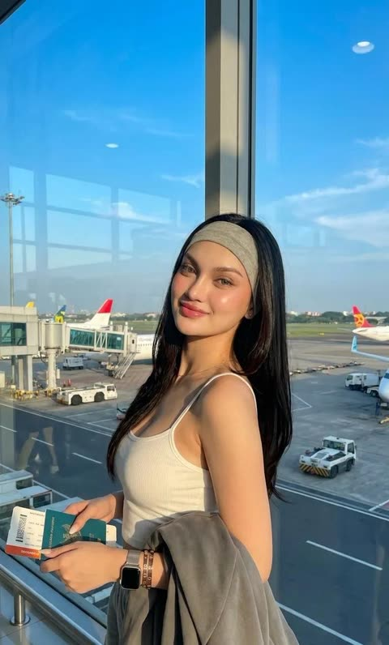</a>

The prompt anchors the scene with real location details (CGK, garbarata boarding bridges, pushback tugs, Indonesian tail flag) and a named light source, so the background reads as an actual terminal. Listing outfit, makeup and hand props in separate labeled sections keeps each element distinct in the output.

Nano Banana 2 · Text-to-image · Source: [@kingofdairyque on X](https://x.com/kingofdairyque/status/2073276310496129363) · 145 likes on 2026-10-29

[`airport`](tags.md#tag-airport) [`travel`](tags.md#tag-travel) [`editorial`](tags.md#tag-editorial) [`portrait`](tags.md#tag-portrait)

<details><summary><b>Prompt</b></summary>

```text
Create an ultra-realistic high-fashion travel editorial photographed inside Soekarno–Hatta International Airport (CGK), Jakarta, Indonesia. The model stands beside massive floor-to-ceiling glass windows overlooking the active airport apron. The background authentically showcases the airport's modern departure terminal architecture, featuring multiple passenger boarding bridges (garbarata), airport service vehicles, baggage carts, pushback tugs, runway markings, and several commercial aircraft parked at the gates. One aircraft prominently displays a red-and-white Indonesian flag on its tail, reinforcing the unmistakable Indonesian airport atmosphere.

Warm late-afternoon golden sunlight streams through the expansive terminal windows, naturally illuminating the model's face, collarbones, shoulders, and hair with soft golden highlights. Realistic glass reflections, cinematic shadows, atmospheric depth, and a vibrant blue sky with delicate clouds create an elegant luxury travel editorial mood.

Outfit:
Minimalist fitted white ribbed camisole tank top with a flattering body-hugging silhouette. Thick grey sporty headband. Oversized grey jacket casually draped over one forearm. Stacks of rose gold Cartier bracelets paired with a silver smartwatch. Milky white glossy nails. Delicate fine jewelry styled with a refined airport traveler aesthetic and understated luxury.

Hair:
Extreme-long, sleek, pin-straight jet-black hair with exceptional thickness and mirror-like shine. Soft front-layered face-framing C-curls. Visible individual hair strands, realistic flyaway hairs, and subtle natural movement created by a gentle breeze flowing through the terminal.

Skin & Face
Ultra-realistic skin with visible pores, delicate natural texture, and subtle imperfections for authentic photorealism. Healthy luminous glow without excessive skin smoothing or plastic appearance. Smooth even complexion with warm undertones, balanced facial proportions, refined editorial beauty, and naturally defined collarbones.

Makeup:
Radiant satin-glass complexion with naturally luminous skin. Bright diffused under-eyes for a refreshed youthful appearance. High-placement soft pink Igari-inspired blush across the cheeks and lightly over the bridge of the nose for a naturally flushed effect.
Soft neutral pink and taupe gradient eyeshadow blended seamlessly. Thin, precise eyeliner subtly elongates the eyes while maintaining a soft feminine appearance.
Large mesmerizing gray-green almond-shaped eyes with crystal-clear irises, subtle limbal rings, and multiple glossy catchlights reflecting the terminal windows. Thick black spiky manga-inspired mascara with individually separated wispy upper lashes and naturally defined lower lashes. Soft feathered taupe eyebrows with realistic individual hair strokes.
Full overlined lips in a delicate rosy pink shade with a subtle reddish ombré gradient. Ultra-glossy glass-like finish creates hydrated, plump, reflective lips that beautifully catch the warm golden sunlight.

Expression & Pose:
Elegant, calm, confident, sophisticated, and effortlessly luxurious. The model wears a subtle gentle smile, tilts her head slightly, and looks directly into the camera with a serene, dreamy expression. She holds an Indonesian passport and a boarding pass in her left hand, while her oversized grey jacket remains casually draped over one forearm, conveying the feeling of an exclusive international journey.

Photography:
Ultra-photorealistic. DSLR quality. 85mm lens. f/2.0. Shallow depth of field. HDR. Cinematic natural lighting. Realistic airport window reflections. Premium color grading. Soft bokeh. Subtle film grain. Razor-sharp facial focus. Highly detailed skin texture. Individually rendered hair strands. Realistic fabric textures. Hyper-realistic lighting. 8K resolution.
```

</details>

<a id="nano-banana-golden-hour-bridge-portrait"></a>
### Golden hour portrait on a suspension bridge

<a href="https://x.com/ZaraIrahh/status/2027672194805874699"></a>

The prompt lists wardrobe and accessories in concrete detail, then adds a warm sunset light direction and a blurred skyline for depth. Camera terms such as 85mm, shallow depth of field and soft grain steer the result toward editorial street photography.

Nano Banana 2 · Text-to-image · Source: [@ZaraIrahh on X](https://x.com/ZaraIrahh/status/2027672194805874699) · 143 likes on 2026-10-28

[`golden-hour`](tags.md#tag-golden-hour) [`portrait`](tags.md#tag-portrait) [`street-photography`](tags.md#tag-street-photography) [`cinematic`](tags.md#tag-cinematic) [`bridge`](tags.md#tag-bridge)

<details><summary><b>Prompt</b></summary>

```text
Cinematic golden hour portrait of a stylish young woman standing on a historic suspension bridge with a city skyline in the background. She has sleek brown hair tied in a high ponytail, natural glam makeup, and small elegant stud earrings. She is wearing a dark brown coat with a thick oversized brown scarf wrapped around her neck, and a shoulder bag with a gold chain strap. She gazes into camera with soft smile. Warm sunset light casts a soft amber glow across her face and the wooden bridge walkway. The skyline behind her is softly blurred, urban atmosphere with subtle pedestrian movement. Shot on 85mm lens, shallow depth of field, filmic tones, soft grain, editorial street photography style, photorealistic, high detail, 4K resolution.
```

</details>

<a id="gpt-image-vhs-camcorder-night-car-portrait"></a>
### Late nineties VHS camcorder portrait in night car

<a href="https://x.com/saniaspeaks_/status/2064192184698716186"></a>

Stacks specific analog artifacts such as chroma bleed, tracking noise, dropout streaks and a burned in REC HUD with timestamp, then fixes the color grade with named tones. A closing negative list rules out DSLR, HDR and modern clean looks.

GPT Image 2 · Edit · Source: [@saniaspeaks_ on X](https://x.com/saniaspeaks_/status/2064192184698716186) · 142 likes on 2026-10-29

[`vhs`](tags.md#tag-vhs) [`retro`](tags.md#tag-retro) [`night`](tags.md#tag-night) [`portrait`](tags.md#tag-portrait) [`camcorder`](tags.md#tag-camcorder)

<details><summary><b>Prompt</b></summary>

```text
Use the attached face as the only identity reference, preserving recognizable facial features and natural asymmetry. Create an authentic late-1990s VHS camcorder scene of a young woman riding in the backseat of a moving car at night, wearing a black off-shoulder top, long windblown dark hair, soft 90s makeup, and a romantic, lonely expression. Warm city lights, neon reflections, and blurred traffic streak past the windows while the dim car interior glows with sodium-vapor streetlight tones. Render as genuine pre-2000s VHS footage with magnetic tape softness, motion blur, scanlines, chroma bleed, focus drift, tape grain, tracking noise, RGB separation, dropout streaks, warped edges, flickering exposure, and a burned-in REC HUD with timestamp, battery icon, SP mode, and tape counter. Vertical 4:5 handheld framing with slight camera tilt, imperfect crop, and nostalgic analog nightlife color grading featuring dirty orange highlights, red neon spill, green-blue shadows, faded blacks, and low contrast. Romantic rediscovered VHS memory from a late-night drive in 1998. Negative: DSLR sharpness, HDR, smartphone look, cinematic grading, ultra-clean skin, influencer aesthetic, crisp digital detail, modern 4K rendering.
```

</details>

<a id="nano-banana-golden-rim-light-black-turtleneck-portrait"></a>
### Golden rim lit portrait on black background

<a href="https://x.com/Soaima_Ai/status/2064199999135907913"></a>

The prompt stacks specific physical details with one dominant light source, a warm golden-orange rim light through the hair against a pitch black studio background. Floating golden bokeh, shallow depth of field and a fashion photography framing keep the focus on the glowing hair.

Nano Banana 2 · Text-to-image · Source: [@Soaima_Ai on X](https://x.com/Soaima_Ai/status/2064199999135907913) · 140 likes on 2026-10-28

[`portrait`](tags.md#tag-portrait) [`rim-lighting`](tags.md#tag-rim-lighting) [`bokeh`](tags.md#tag-bokeh) [`studio`](tags.md#tag-studio) [`fashion`](tags.md#tag-fashion)

<details><summary><b>Prompt</b></summary>

```text
A hyper-realistic AI portrait of a beautiful young woman with long voluminous wavy black hair with stunning warm golden-orange rim lighting glowing through the hair, fair porcelain skin, soft hazel-brown eyes with warm eye makeup, soft pink lips with a gentle confident smile, small nose piercing, silver hoop earrings, wearing a black ribbed turtleneck sweater, one hand raised touching her hair gracefully, dramatic pitch black studio background with glowing golden bokeh particles floating in the air, cinematic rim lighting, ultra-realistic, 8K, shallow depth of field, professional fashion portrait photography
```

</details>

<a id="nano-banana-noir-portrait-man-vintage-convertible"></a>
### Black and white portrait in vintage convertible

<a href="https://x.com/pictsbyai/status/2039256212496163327"></a>

A structured JSON prompt specifies composition, lighting, lens and grain, then adds a short plain text prompt, so the model gets exact photographic controls. Shallow depth of field, a single directional light and film grain give the noir editorial look.

Nano Banana 2 · Text-to-image · Source: [@pictsbyai on X](https://x.com/pictsbyai/status/2039256212496163327) · 140 likes on 2026-10-28

[`black-and-white`](tags.md#tag-black-and-white) [`json-prompt`](tags.md#tag-json-prompt) [`vintage-car`](tags.md#tag-vintage-car) [`editorial`](tags.md#tag-editorial) [`film-grain`](tags.md#tag-film-grain)

<details><summary><b>Prompt</b></summary>

```text
{
"metadata": {
"image_type": "photograph",
"primary_purpose": "editorial"
},
"composition": {
"rule_applied": "rule of thirds",
"aspect_ratio": "4:5",
"layout": "layered",
"focal_points": [
"Man's face and intense eyes",
"Left hand resting near the chrome car mirror"
],
"visual_hierarchy": "Eye starts at the subject's face, follows the line of his left arm down to his hand, and reflects back along the glossy car edge",
"balance": "asymmetric"
},
"color_profile": {
"dominant_colors": [
{
"color": "Black",
"hex": "#0a0a0a",
"percentage": "45%",
"role": "background, car exterior, and clothing"
},
{
"color": "Mid-Gray",
"hex": "#5a5a5a",
"percentage": "40%",
"role": "skin tones and blurred background elements"
},
{
"color": "White",
"hex": "#f5f5f5",
"percentage": "15%",
"role": "highlights, car interior, and chrome reflections"
}
],
"color_palette": "monochromatic",
"temperature": "neutral",
"saturation": "black and white",
"contrast": "high contrast"
},
"lighting": {
"type": "natural window/outdoor diffused",
"source_count": "single source",
"direction": "front and slightly top",
"directionality": "highly directional",
"quality": "soft light with dramatic falloff",
"intensity": "moody",
"contrast_ratio": "high contrast (dramatic shadows)",
"mood": "dramatic",
"shadows": {
"type": "soft gradual edges",
"density": "deep black",
"placement": "under chin, right side of face, interior of car",
"length": "medium"
},
"highlights": {
"treatment": "preserved",
"placement": "on forehead, cheekbones, nose bridge, and specular highlights on car chrome"
},
"ambient_fill": "absent",
"light_temperature": "neutral"
},
"technical_specs": {
"medium": "digital photography",
"style": "realistic",
"texture": "grainy",
"sharpness": "tack sharp on subject face",
"grain": "film grain",
"depth_of_field": "shallow",
"perspective": "straight on slightly elevated"
},
"artistic_elements": {
"genre": "portrait",
"influences": [
"Classic Hollywood automotive photography",
"Cinematic noir"
],
"mood": "sophisticated",
"atmosphere": "Brooding, timeless, and elegant cinematic tension",
"visual_style": "clean"
},
"typography": {
"present": false,
"fonts": [],
"placement": "none",
"integration": "none"
},
"subject_analysis": {
"primary_subject": "Adult male, estimated 30s, with short dark hair, trimmed beard, wearing a dark collared shirt. Hair is 2-3 inches on top, styled back with natural volume and texture. Hair texture shows natural imperfections with slight flyaways, individual strands visible against the light, and uneven layering typical of a textured scissor cut. Styling indicates matte product use. Hair part is unrefined, pushed back organically rather than sharply divided.",
"positioning": "center",
"scale": "medium",
"interaction": "interacting with environment",
"facial_expression": {
"mouth": "closed neutral",
"smile_intensity": "no smile",
"eyes": "intense",
"eyebrows": "furrowed",
"overall_emotion": "serious",
"authenticity": "posed"
},
"hands_and_gestures": {
"left_hand": "resting on car door frame, index finger extended lightly touching or pointing near the chrome side mirror",
"right_hand": "not visible",
"finger_positions": "relaxed, index finger slightly extended, remaining fingers softly curled inward",
"finger_interlacing": "none",
"hand_tension": "relaxed",
"interaction": "resting on car exterior",
"naturalness": "deliberately posed"
},
"body_positioning": {
"posture": "sitting",
"angle": "facing camera",
"weight_distribution": "leaning left",
"shoulders": "tilted"
}
},
"background": {
"setting_type": "outdoor",
"spatial_depth": "shallow",
"elements_detailed": [
{
"item": "Vintage convertible car body",
"position": "bottom",
"distance": "foreground",
"size": "dominant",
"condition": "pristine",
"specific_features": "dark glossy paint with sharp reflections"
},
{
"item": "Chrome side mirror",
"position": "center",
"distance": "midground",
"size": "small",
"condition": "pristine",
"specific_features": "highly reflective, bullet-style vintage mirror"
},
{
"item": "Windshield frame",
"position": "left",
"distance": "midground",
"size": "medium",
"condition": "pristine",
"specific_features": "chrome trim"
}
],
"wall_surface": {
"material": "not applicable - outdoor background",
"surface_treatment": "blurred",
"texture": "perfectly smooth bokeh",
"finish": "matte",
"color": "mid-gray",
"color_variation": "gradient",
"features": "out of focus shapes indicating trees or street structures",
"wear_indicators": "none"
},
"floor_surface": {
"material": "asphalt",
"color": "dark gray",
"pattern": "blurred"
},
"objects_catalog": "Vintage convertible automobile, chrome side mirror, windshield trim, light-colored car interior seats",
"background_treatment": "blurred"
},
"generation_parameters": {
"prompts": [
"Black and white cinematic photography, medium shot of a handsome man in his 30s sitting in the driver's seat of a classic vintage convertible car. He is leaning his left arm on the car door, hand relaxed near a chrome side mirror. He has short textured dark hair, trimmed beard, furrowed brows, intense brooding gaze, wearing a dark collared shirt. Shallow depth of field, blurred outdoor background. High contrast, directional soft lighting, deep shadows, fine film grain, editorial fashion style.",
"Vintage Hollywood style portrait, black and white, man in classic car leaning out window, dramatic shadows, sharp focus on face, Leica 50mm, f/2.0."
],
"keywords": [
"black and white",
"cinematic portrait",
"vintage car",
"editorial",
"male model",
"brooding",
"film grain",
"classic automotive"
],
"technical_settings": "50mm lens, f/2.0 aperture for shallow depth of field, 1/250s shutter speed, ISO 400 to introduce natural film grain",
"post_processing": "Black and white conversion with crushed blacks, lifted midtone contrast, and added analog film grain"
}
}
```

</details>

<a id="nano-banana-woman-bikini-hoodie-rooftop-dusk"></a>
### Woman in black bikini and maroon hoodie on rooftop

<a href="https://x.com/dreamydigiarts/status/2108112665818406964">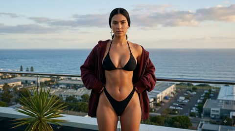</a>

A JSON spec splits the scene into subject, pose, camera, lighting and a ControlNet block with DWPose and ZoeDepth weights that lock the body layout and depth. Golden hour side light and a 35 to 50mm lens keep the volume and background separation realistic.

Nano Banana 2.1 · Text-to-image · Source: [@dreamydigiarts on X](https://x.com/dreamydigiarts/status/2108112665818406964) · 140 likes on 2026-10-29

[`portrait`](tags.md#tag-portrait) [`golden-hour`](tags.md#tag-golden-hour) [`controlnet`](tags.md#tag-controlnet) [`rooftop`](tags.md#tag-rooftop)

<details><summary><b>Prompt</b></summary>

```text
{ "subject": { "description": "A young woman with an athletic hourglass figure, featuring a slim waist and wide, prominent hips. She has tanned skin with visible natural texture and fine pores. Her face has sharp features, dark almond-shaped eyes, and well-defined eyebrows. Her hair is dark, sleek, and parted down the middle, tied back in a low style. She is wearing large silver cross-shaped earrings.", "anatomy_fidelity": "Exact preservation of the reference's wide hip-to-waist ratio. The bust volume is significant and naturally weighted, showing clear forward projection and a depth greater than the ribcage. Soft tissue follows gravity naturally within the bikini top. Shoulders are proportional to the torso width, and legs are toned with a visible gap.", "attire": "A black string bikini with a triangular top and high-cut, thin-strap bottoms that sit high on the hips. Over this, she wears an oversized, dark maroon or brownish-red zip-up hoodie, worn open and pushed back off the shoulders to expose her torso and arms." }, "pose": { "description": "Standing front-facing pose with a slight lean. The weight is distributed evenly. Her hands are tucked into the pockets of the oversized hoodie, pulling the fabric slightly forward while the sleeves drape over her arms. Her head is tilted slightly to her right, and she is looking directly into the camera with a neutral, confident gaze.", "posture": "Straight spine with a natural lumbar curve that accentuates the hip flare. Shoulders are relaxed but wide, framed by the bulky hoodie." }, "environment": { "location": "A rooftop or elevated balcony overlooking a coastal area at dusk. In the background, there is a calm blue sea under a sky with soft, scattered clouds. Below the balcony, an urban industrial area or parking lot with some greenery is visible. A spiked palm-like plant is partially visible in the bottom-left foreground.", "depth": "Clear separation between the sharp subject in the foreground and the slightly soft-focus coastal background." }, "camera": { "shot_type": "Medium full shot, framing the subject from the head to the mid-thigh.", "angle": "Eye-level, straight-on perspective.", "lens_characteristics": "Standard focal length (approx. 35-50mm) to avoid distortion while maintaining a realistic sense of depth and body volume." }, "lighting": { "type": "Golden hour natural light.", "direction": "Side-lit from the right, creating warm highlights on her skin and the left side of her face/body, while casting soft, natural shadows on the opposite side. The light enhances the three-dimensional volume of her torso and bust.", "temperature": "Warm, orange-gold tones." }, "mood_and_expression": { "expression": "Sultry and composed; a neutral, direct gaze with relaxed lips.", "atmosphere": "Serene, stylish, and high-end lifestyle aesthetic." }, "style_and_realism": { "type": "Photorealistic digital photography.", "details": "High fidelity to skin imperfections, fabric texture of the cotton hoodie, and the subtle sheen on the bikini material. No airbrushing or artificial smoothing." }, "colors_and_tone": { "palette": "Dominant tones of deep maroon, black, and warm tan skin, contrasted against the cool blue of the ocean and the pale orange/blue of the sunset sky.", "contrast": "Medium-high contrast with rich shadows." }, "quality_and_technical_details": { "resolution": "4K, highly detailed, sharp focus on the subject, natural film grain, realistic subsurface scattering on skin.", "sampling": "High-step count for texture preservation." }, "aspect_ratio_and_output": { "ratio": "16:9" }, "controlnet": { "pose_control": { "model_type": "DWPose", "purpose": "Exact skeletal and pose lock", "constraints": [ "preserve shoulder width", "preserve hip angle", "preserve spine curvature", "preserve limb placement" ], "recommended_weight": 1.0 }, "depth_control": { "model_type": "ZoeDepth", "purpose": "Depth, volume, and camera-to-body spatial lock", "constraints": [ "preserve chest foreground dominance", "prevent flat or compressed depth", "maintain clear torso-to-background separation" ], "recommended_weight": 0.8 } }, "negative_prompt": { "forbidden_elements": [ "anatomy normalization", "body proportion averaging", "smaller bust than reference", "reduced chest volume", "flattened or compressed breasts", "tightened, lifted, or artificially supported breasts", "slimmed torso", "aesthetic proportion correction", "beauty standard enforcement", "dataset-average female anatomy", "camera angles that reduce volume", "wide-angle distortion not in reference", "lens compression not in reference", "cropping that removes volume", "depth flattening", "mirror selfies", "phone-in-hand selfies", "reflections", "beautification filters", "skin smoothing", "plastic skin", "airbrushed texture", "stylized realism", "editorial fashion proportions", "more realistic reinterpretation", "naturalization of prominent features" ] }
```

</details>

<a id="nano-banana-christmas-gift-wrapping-cardigan"></a>
### Woman laughing while wrapping a Christmas gift

<a href="https://x.com/xmliisu/status/2003864431487222104"></a>

A structured JSON breakdown of subject, attire, props, and lighting gives the model a precise checklist to follow. Listing the wrapping supplies as floor props and mixing flash with warm ambient light makes the scene read as a candid moment rather than a posed set.

Nano Banana Pro · Text-to-image · Source: [@xmliisu on X](https://x.com/xmliisu/status/2003864431487222104) · 139 likes on 2026-10-29

[`christmas`](tags.md#tag-christmas) [`portrait`](tags.md#tag-portrait) [`lifestyle`](tags.md#tag-lifestyle) [`json-prompt`](tags.md#tag-json-prompt)

<details><summary><b>Prompt</b></summary>

```text
{
  "image_analysis": {
    "subject": {
      "description": "Young woman with long, wavy blonde hair and tan skin.",
      "expression": "Laughing/smiling broadly, looking off-camera to the left.",
      "pose": "Sitting on a light wood floor with legs bent and extended."
    },
    "attire": {
      "clothing": "Oversized, chunky-knit cream/beige cardigan worn off-the-shoulder on the left side.",
      "footwear": "White, fluffy, faux-fur cross-strap slippers.",
      "accessories": "Minimal; small hoop earrings visible."
    },
    "action": {
      "primary": "Wrapping Christmas gifts.",
      "specifics": "Holding a rectangular wrapped gift box with a ribbon in both hands."
    },
    "environment": {
      "setting": "Indoor residential space, likely a hallway or living room.",
      "decor": "Large Christmas tree to the left, decorated with warm white string lights (no ornaments).",
      "flooring": "Light oak wood planks.",
      "background": "White walls, white door frame, and a glimpse into a dimly lit adjacent room."
    },
    "objects_props": {
      "on_floor": [
        "Rolls of cream-colored wrapping paper with a subtle pattern.",
        "Black-handled scissors.",
        "Clear tape dispenser.",
        "Spool of white ribbon.",
        "Spool of wide bronze/copper satin ribbon.",
        "White faux-fur rug or tree skirt under the tree."
      ]
    },
    "lighting_and_style": {
      "type": "Flash photography mixed with warm ambient light.",
      "mood": "Festive, cozy, joyful, candid.",
      "colors": "Warm neutrals, cream, beige, green (tree), metallic bronze."
    }
  }
```

</details>

<a id="nano-banana-seated-cap-hoodie-studio-portrait"></a>
### Seated man in cap and hoodie on white block

<a href="https://x.com/frametheory058/status/2037368955548152058">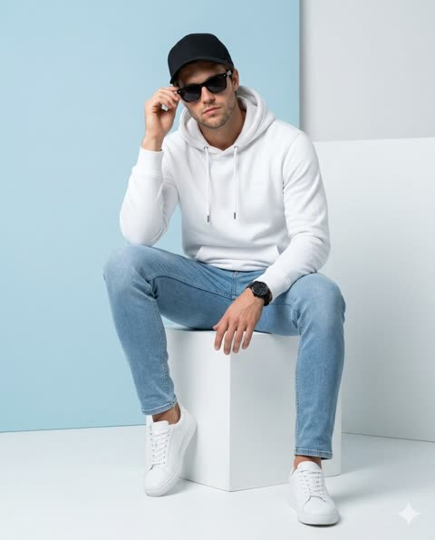</a>

Identity is locked to a reference photo, and pose, lighting, lens and wardrobe are split into separate JSON fields so each part can be tuned on its own. The negative prompt targets common portrait faults such as bad hands and plastic skin.

Nano Banana 2 · Edit · Source: [@frametheory058 on X](https://x.com/frametheory058/status/2037368955548152058) · 138 likes on 2026-10-29

[`json-prompt`](tags.md#tag-json-prompt) [`reference-image`](tags.md#tag-reference-image) [`studio-portrait`](tags.md#tag-studio-portrait)

<details><summary><b>Prompt</b></summary>

```text
{
  "Ultra-realistic studio portrait of the same man (strictly use provided reference image for identity consistency). Preserve exact facial structure, proportions, skin texture, hairstyle, and overall likeness with high fidelity. The subject is seated on a clean white block, legs slightly apart, leaning forward in a relaxed yet confident pose. Right elbow rests on the knee with the right hand lightly adjusting black sunglasses, left hand relaxed naturally on the thigh. Outfit includes a black cap, black sunglasses, a clean white hoodie with a subtle logo, light blue fitted jeans, crisp white sneakers, and a black wristwatch. Styling is modern, minimal, and polished with natural fabric behavior and realistic folds.",

  "style": {
    "photography_type": "studio fashion portrait",
    "aesthetic": "clean, minimal, premium lifestyle",
    "mood": "confident, relaxed, modern",
    "color_palette": ["pastel blue", "white", "soft neutrals"]
  },

  "environment": {
    "background": "clean pastel blue and white geometric studio backdrop",
    "props": "single white block only",
    "scene_cleanliness": "minimal, distraction-free, polished"
  },

  "lighting": {
    "setup": "soft diffused studio lighting",
    "quality": "even illumination with gentle falloff",
    "shadows": "minimal, soft, natural contact shadows only",
    "highlights": "controlled, soft highlights with no harsh glare"
  },

  "camera": {
    "lens": "50mm prime",
    "aperture": "f/4 for balanced depth of field",
    "angle": "slightly low eye-level for subtle dominance",
    "framing": "medium full-body (seated), centered composition",
    "focus": "tack sharp on face and upper body"
  },

  "composition": {
    "subject_position": "centered",
    "pose_details": [
      "legs apart seated stance",
      "forward lean for engagement",
      "right hand interacting with sunglasses",
      "left hand relaxed on thigh"
    ],
    "balance": "symmetrical with slight dynamic tilt from pose"
  },

  "identity_lock": {
    "priority": "very high",
    "requirements": [
      "accurate facial features",
      "consistent hairstyle",
      "natural skin texture (no plastic smoothing)",
      "correct proportions and anatomy"
    ]
  },

  "quality": {
    "resolution": "8K",
    "detail_level": "ultra high",
    "rendering": "photorealistic",
    "sharpness": "high micro-detail clarity"
  },

  "negative_prompt": [
    "face distortion",
    "identity mismatch",
    "extra or missing fingers",
    "bad anatomy",
    "blurry image",
    "low resolution",
    "overexposed highlights",
    "harsh shadows",
    "cinematic lighting",
    "messy background",
    "noise or grain",
    "text artifacts",
    "watermark",
    "logo distortion",
    "plastic skin",
    "unnatural fabric folds"
  ]
}
```

</details>

<a id="nano-banana-christmas-market-hot-cup-portrait"></a>
### Woman with hot cup at Christmas market

<a href="https://x.com/SimplyAnnisa/status/2004741328530481155">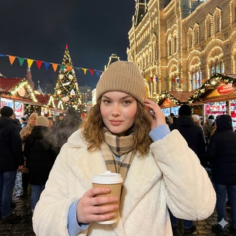</a>

The reference photo locks identity while the negative prompt blocks plastic skin and artificial blur. Asking for full-scene sharpness and a mid-gesture pause keeps the result candid, like a smartphone shot.

Nano Banana Pro · Edit · Source: [@SimplyAnnisa on X](https://x.com/SimplyAnnisa/status/2004741328530481155) · 137 likes on 2026-10-29

[`christmas`](tags.md#tag-christmas) [`christmas-market`](tags.md#tag-christmas-market) [`portrait`](tags.md#tag-portrait) [`lifestyle`](tags.md#tag-lifestyle)

<details><summary><b>Prompt</b></summary>

```text
The reference image as a strict and non-negotiable source — preserve 100% facial likeness, proportions, bone structure, skin texture, expression, and hairstyle. Do not alter or stylize the face in any way.
Photorealistic lifestyle photograph of an adult woman (25+ years old) in a festive outdoor setting.
Shot & Composition
Medium shot, front-facing subject standing in a lively Christmas market square, framed from mid-thigh up.The composition feels candid and natural, with a visible crowd and environmental context that enhances real-life authenticity.
The camera mimics smartphone-style photography with even sharpness across the entire frame — no artificial background blur. Full-scene clarity with both foreground and background in focus.
Subject & Appearance
Face & identity: identical to the reference image, hyper-detailed natural facial textures, visible skin texture, realistic highlights from surrounding lights, true-to-life complexion.
Hair: same hairstyle as the reference image, worn naturally under a knit beanie. Long hair falls down with soft strands framing the face, natural winter texture and movement.
Silhouette: balanced, natural human proportions with a relaxed, confident presence.
Wardrobe
Plush white faux-fur coat with visible fiber texture catching ambient light
Beige knit beanie
Beige checked scarf draped loosely, following gravity
Light blue knit sweater visible at the cuffs
Dark bottoms partially visible
All fabrics show realistic folds, layering, and interaction with movement and posture.
Scene & Environment
Location: outdoor Christmas market square
Time: evening / night
Background: festive market stalls, a large historic building fully outlined with warm white holiday lights, a decorated Christmas tree, colorful pennant banners overhead
Ground: cobblestone surface with subtle reflections from moisture and foot traffic
The background remains lively but readable, reinforcing a real urban holiday atmosphere.
Action & Micro-Details
Holding a takeaway hot drink cup in one hand
Lightly lifting a strand of hair with the other
Subtle steam rising from the hot drink
Fur fibers, scarf fabric, and hair reacting naturally to movement and ambient air
Captured in a transitional moment — a brief pause mid-gesture, as if realizing attention, hands still engaged.
Emotion & Mood
Cozy, confident, quietly joyful. A relaxed festive presence with natural warmth and subtle holiday energy.
Lighting & Color
Mixed lighting from ambient street illumination and warm decorative holiday lights
Soft, natural illumination on the subject without harsh contrast
Color palette:
Warm golds and yellows from holiday lights
Soft neutral winter tones
Pops of color from banners and market décor
Balanced exposure preserving night-time clarity and detail
Photography Style
Purely candid, true-to-life influencer photography.
No cinematic grading, no stylization, no artificial effects — clean, realistic, and authentic.
Optional Negative Prompt
altered face, different identity, plastic skin, over-smoothed skin, cinematic effects, artificial blur, CGI, digital art, illustration, harsh flash, distorted anatomy, extra limbs, cartoon look, text, watermark
```

</details>

<a id="nano-banana-spinning-night-portrait-slow-shutter-blur"></a>
### Spinning night street portrait with long shutter motion blur

<a href="https://x.com/MissDelulu9/status/2111012827213471883"></a>

Names a specific shutter range of 1/8 to 1/15 second and lists the blur effects it should produce: ghost trails, horizontal streaks, double exposure. A closing negative line (no frozen motion, no sharp arms or hair) keeps the model from freezing the action.

Nano Banana 2.1 · Text-to-image · Source: [@MissDelulu9 on X](https://x.com/MissDelulu9/status/2111012827213471883) · 137 likes on 2026-10-28

[`motion-blur`](tags.md#tag-motion-blur) [`slow-shutter`](tags.md#tag-slow-shutter) [`film-grain`](tags.md#tag-film-grain) [`night`](tags.md#tag-night) [`fashion`](tags.md#tag-fashion)

<details><summary><b>Prompt</b></summary>

```text
Vertical 9:16 candid fashion portrait of a
beautiful East Asian girl wearing a fitted long-sleeve orange turtleneck and a black mini skirt, with long, messy, loose black hair. She spins rapidly while looking back at the camera, arms spread wide and hair flying. VERY SLOW SHUTTER SPEED 1/8–1/15 sec, extreme realistic motion blur, long ghost trails on arms and hair, blurred body, softly recognizable face, horizontal background streaks, camera shake, double-exposure effect, heavy 35mm film grain, dreamy, moody, underexposed, photorealistic. No CGI, no frozen motion, no sharp arms or hair.
```

</details>

<a id="nano-banana-cream-suit-dark-studio-portrait"></a>
### Cream Suit Studio Portrait on Black

<a href="https://x.com/iamsofiaijaz/status/2038838879852376336"></a>

The prompt specifies fabric, trim colour and a hand gesture, so the suit texture and pose come out exact. Lens, lighting and mood terms like 85mm, shallow depth of field and a dark minimal backdrop give the editorial look.

Nano Banana 2 · Text-to-image · Source: [@iamsofiaijaz on X](https://x.com/iamsofiaijaz/status/2038838879852376336) · 136 likes on 2026-10-28

[`fashion`](tags.md#tag-fashion) [`studio-portrait`](tags.md#tag-studio-portrait) [`editorial`](tags.md#tag-editorial) [`suit`](tags.md#tag-suit) [`low-key`](tags.md#tag-low-key)

<details><summary><b>Prompt</b></summary>

```text
A cinematic portrait of a handsome young man with neatly styled brown hair and light stubble, wearing a cream-colored tailored suit with subtle gold trim details, paired with a black dress shirt and black tie. He is adjusting his jacket with one hand, wearing a luxury wristwatch. The background is dark and minimal, creating a dramatic contrast. Soft studio lighting highlights his face and the texture of the suit, with a moody, elegant, high-fashion editorial style. Ultra-realistic, sharp focus, shallow depth of field, 85mm lens, professional photography, luxury aesthetic, high contrast, warm tones.
```

</details>

<a id="nano-banana-warm-mirror-selfie-mirrorless-camera-portrait"></a>
### Warm mirror selfie portrait with mirrorless camera

<a href="https://x.com/AIwithSarah_/status/2046180588886114701"></a>

The prompt breaks the portrait into framing, pose, hair, makeup, setting and lighting blocks, so each can be controlled separately. A warm yellow and orange light cue, a blurred cream background and the closing line Do not change the face keep the identity stable and the mood cozy.

Nano Banana 2 · Edit · Source: [@AIwithSarah_ on X](https://x.com/AIwithSarah_/status/2046180588886114701) · 133 likes on 2026-10-28

[`mirror-selfie`](tags.md#tag-mirror-selfie) [`portrait`](tags.md#tag-portrait) [`warm-light`](tags.md#tag-warm-light) [`face-preserve`](tags.md#tag-face-preserve) [`shallow-depth-of-field`](tags.md#tag-shallow-depth-of-field)

<details><summary><b>Prompt</b></summary>

```text
Nano Banana 2 on Higgsfield.

Prompt: A portrait of a young woman with a soft, natural expression, half-body close-up (shoulders up), side angle pose. Her head is slightly tilted to the right, looking at the camera with a subtle smile. She is taking a mirror selfie, holding a mirrorless camera in front of her face. Her hair partially covers one side of her face, giving a candid, relaxed feel.
She wears a fitted dusty pink / soft peach t-shirt, minimal and casual with no accessories.
Short shoulder-length bob haircut, slightly voluminous and naturally messy, soft and shiny texture, loosely parted, some strands covering one side of the face (only one side visible), natural black or dark brown hair.
Natural clean makeup look: light base, smooth glowing skin, soft peach/pink blush, natural pink lips (soft tint), minimal eye makeup, no bold eyeliner, fresh and youthful appearance.
Indoor setting, likely a bedroom or small studio, mirror selfie composition, minimal props. Background is plain beige / warm cream, softly blurred (shallow depth of field), clean and uncluttered.
Warm lighting (yellow/orange tones), soft light (indoor or sunset), gentle shadows, soft highlights on skin, cozy and intimate mood. Do not change the face.
```

</details>

<a id="nano-banana-candid-athleisure-smoothie-la-street"></a>
### Candid olive athleisure woman walking with green smoothie

<a href="https://x.com/astronomerozge1/status/2045415777197518948"></a>

A structured JSON prompt splits the request into subject, scene, pose, camera and texture blocks, and locks identity to a reference image. A 50mm lens, a slightly off center angle and a mid stride pose give the paparazzi feel, and a negative list keeps the background clean.

Nano Banana 2 · Edit · Source: [@astronomerozge1 on X](https://x.com/astronomerozge1/status/2045415777197518948) · 132 likes on 2026-10-29

[`json-prompt`](tags.md#tag-json-prompt) [`candid`](tags.md#tag-candid) [`athleisure`](tags.md#tag-athleisure) [`reference-identity`](tags.md#tag-reference-identity) [`street-photo`](tags.md#tag-street-photo)

<details><summary><b>Prompt</b></summary>

```text
{
  "generation_request": {
    "meta_data": {
      "tool": "Nano Banana 2",
      "task_type": "erewhon_wellness_luxury_candid",
      "language": "en",
      "priority": "highest",
      "version": "v2.0_LA_CLEAN_GIRL_LUXURY"
    },

    "input": {
      "mode": "image_to_image",
      "reference_image_usage": "very_high",
      "preserve_identity": true,
      "notes": "Use the reference woman. Scene set outside Erewhon Market in Los Angeles. She exits holding a smoothie in a natural candid moment. The vibe is paparazzi-meets-editorial. She is not posing directly, caught mid-walk with confident effortless energy."
    },

    "output_settings": {
      "aspect_ratio": "4:5",
      "orientation": "portrait",
      "resolution_target": "ultra_high_res",
      "render_style": "luxury_wellness_editorial",
      "sharpness": "ultra_crisp",
      "dynamic_range": "clean_bright_daylight",
      "color_grade": "neutral_beige_green_wellness"
    },

    "subject": {
      "identity": "reference woman",
      "expression": "neutral confident face, slightly detached, cool-girl energy",
      "hair": "sleek high ponytail or slick bun, ultra clean finish",
      "makeup": "no-makeup makeup, dewy skin, subtle glow, natural lips",
      "outfit": "ultra premium fitted athleisure set (sculpting leggings + cropped top), neutral tones like beige, olive or soft grey",
      "accessories": "designer sunglasses, minimalist tote bag, smoothie cup",
      "body": "perfect anatomy, natural walking posture"
    },

    "scene": {
      "environment": "Erewhon Market exterior with clean modern facade, glass, greenery",
      "lighting": "bright soft California daylight, no harsh shadows",
      "mood": "clean, elite, wellness-focused, understated luxury"
    },

    "pose_language": {
      "pose": "mid-step walking out of store, one arm holding smoothie, other relaxed",
      "hands": "natural grip, relaxed fingers",
      "posture": "confident, straight, effortless"
    },

    "camera": {
      "lens": "50mm lifestyle lens",
      "angle": "slightly off-center candid angle",
      "framing": "mid-full body",
      "focus": "sharp subject, lightly blurred background",
      "depth_of_field": "moderately shallow"
    },

    "texture_details": {
      "skin_texture": "natural dewy skin with realistic pores",
      "fabric_texture": "tight athletic fabric with subtle stretch and sheen",
      "hair_texture": "clean sleek strands, controlled finish"
    },

    "color_grading": {
      "palette": "beige, soft greens, whites, clean neutral tones",
      "style": "minimal luxury wellness aesthetic"
    },

    "must_have": [
      "Erewhon style setting",
      "smoothie",
      "athleisure luxury",
      "clean girl aesthetic",
      "same identity",
      "perfect anatomy",
      "no text"
    ],

    "negative_prompt": [
      "messy background",
      "fast food setting",
      "heavy glam makeup",
      "cheap outfit",
      "bad anatomy",
      "extra fingers",
      "over-posed",
      "text",
      "logo",
      "watermark"
    ]
  }
}
```

</details>

<a id="gpt-image-hanbok-pink-pigment-explosion-portrait"></a>
### Pink hanbok dissolving into exploding pigment clouds

<a href="https://x.com/TaliaAariz/status/2091027170827116570">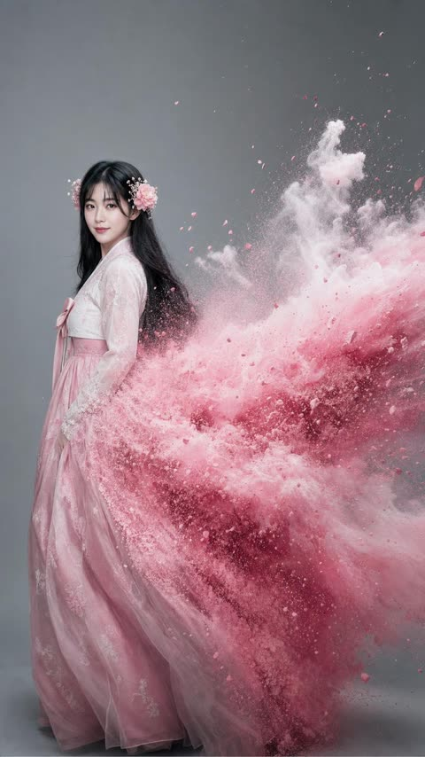</a>

Describing the transformation as a physical process, with fabric turning into pigment clouds and a clear direction, gives the explosion a readable motion path against a plain grey backdrop. The identity-preservation line anchors the face while the rest of the prompt stays free to be dramatic.

GPT Image 2 · Edit · Source: [@TaliaAariz on X](https://x.com/TaliaAariz/status/2091027170827116570) · 130 likes on 2026-10-29

[`hanbok`](tags.md#tag-hanbok) [`pigment-explosion`](tags.md#tag-pigment-explosion) [`fashion-portrait`](tags.md#tag-fashion-portrait) [`motion-transformation`](tags.md#tag-motion-transformation)

<details><summary><b>Prompt</b></summary>

```text
Create an ultra-photorealistic Korean high-fashion studio portrait, full body, wearing an elegant pastel pink hanbok, long black hair with delicate flower ornaments on both sides. The hanbok physically transforms into enormous dense pastel pink pigment clouds exploding dramatically toward the right side. Preserve my exact face and identity. Medium grey studio background, cinematic softbox lighting, high-speed fashion photography, extreme detail, photorealistic, vertical 9:16."
```

</details>

<a id="nano-banana-bw-vogue-hard-light-portrait"></a>
### Black and white editorial portrait with hard side light

<a href="https://x.com/MissDelulu9/status/2113862505504407630"></a>

Names the pose, hair, and wardrobe first, then locks the look with hard side lighting, chiaroscuro, and a dark background. Camera cues such as 85mm, shallow depth of field, and film grain keep the skin and eyes sharp and photographic.

Nano Banana 2.1 · Text-to-image · Source: [@MissDelulu9 on X](https://x.com/MissDelulu9/status/2113862505504407630) · 126 likes on 2026-10-29

[`black-and-white`](tags.md#tag-black-and-white) [`editorial`](tags.md#tag-editorial) [`chiaroscuro`](tags.md#tag-chiaroscuro) [`hard-light`](tags.md#tag-hard-light) [`fashion`](tags.md#tag-fashion)

<details><summary><b>Prompt</b></summary>

```text
Ultra-realistic cinematic black-and-white Vogue editorial portrait of a beautiful Japanese woman. Three-quarter profile pose, shoulders turned away from the camera, head gently tilted upward and looking off-frame with a calm, dreamy expression and softly parted lips. Long, naturally wavy black hair with loose strands flowing across the face. Elegant off-shoulder white satin blouse, delicate sparkling earrings.

Dramatic hard side lighting casting bold diagonal shadows across the eyes and face, high-contrast chiaroscuro, minimal dark studio background. 85mm lens, shallow depth of field, razor-sharp eyes, hyper-detailed natural skin texture, subtle film grain, luxury fashion photography, timeless editorial aesthetic, ultra-photorealistic, 8K.
```

</details>

<a id="nano-banana-human-cat-shared-face-closeup"></a>
### Human and cat faces sharing one frame

<a href="https://x.com/Ozayrr_irl/status/2061332108967293372">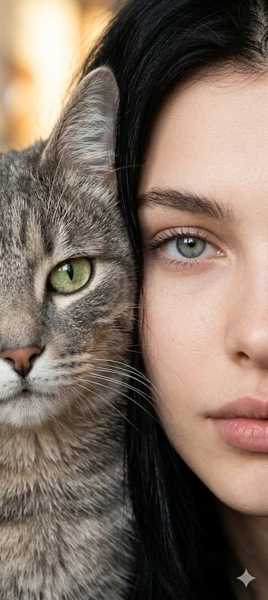</a>

A reference upload anchors the identity while the framing spec, a vertical 9:20 extreme close up with one human eye and one cat eye centered on the same focal plane, forces an even split of the frame. Stating the framing and focus plane explicitly is what keeps both faces sharp and aligned.

Nano Banana 2 · Edit · Source: [@Ozayrr_irl on X](https://x.com/Ozayrr_irl/status/2061332108967293372) · 126 likes on 2026-10-29

[`portrait`](tags.md#tag-portrait) [`cat`](tags.md#tag-cat) [`reference-image`](tags.md#tag-reference-image) [`split-face`](tags.md#tag-split-face)

<details><summary><b>Prompt</b></summary>

```text
[Upload your reference image and write this]
Use the exact same face from the reference image and generate a  photorealistic colour photo, vertical 9:20, extreme close up.
Half of a human face and half of my pet's face pressed closely together, and sharing the same frame equally. Faces are very close to the camera, and intimate contact. Tight crop, one human eye + one cat eye centered, perfectly aligned and both in sharp focus with the same intimate framing. Frame tightly filled with face, background barely visible.
```

</details>

<a id="gpt-image-sunlit-roadside-selfie-blue-sunglasses"></a>
### Sunlit roadside selfie with blue sunglasses and gold earrings

<a href="https://x.com/saniaspeaks_/status/2063952729689735634">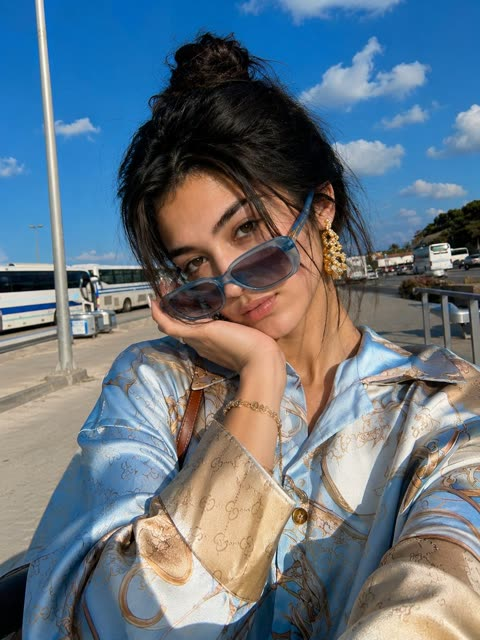</a>

Opens with a face lock instruction that names the reference photo and lists the features to keep, then pins pose, crop and lighting with plain camera specs. The negative prompt blocks anime, CGI and plastic skin drift.

GPT Image 2 · Edit · Source: [@saniaspeaks_ on X](https://x.com/saniaspeaks_/status/2063952729689735634) · 124 likes on 2026-10-29

[`face-lock`](tags.md#tag-face-lock) [`street-fashion`](tags.md#tag-street-fashion) [`selfie`](tags.md#tag-selfie) [`portrait`](tags.md#tag-portrait)

<details><summary><b>Prompt</b></summary>

```text
Edit the provided image using my uploaded face photo as the only facial identity reference with strict face-lock preservation (99–100% similarity). Keep the exact same eyes, eyebrows, eyelids, nose, lips, jawline, cheekbones, forehead, skin tone, ethnicity, age appearance, facial proportions, and natural skin texture with zero identity drift or beautification. Create an ultra-photorealistic DSLR luxury street-fashion portrait of a 23-year-old woman with a subtle teasing smirk, direct eye contact, glossy Korean-Douyin makeup, visible pores, realistic skin texture, messy high bun with loose wind-blown strands, oversized pastel-blue sunglasses, large textured gold earrings, gold bracelet, rings, decorative manicure, and an oversized designer silk shirt in light blue, ivory, and caramel monogram tones. Match the reference pose exactly: close-up selfie, one hand raised above the forehead blocking sunlight, head slightly tilted, centered vertical composition, tight upper-body crop. Outdoor urban roadside setting with blue sky, clouds, parked buses, distant vehicles, and bright afternoon sunlight creating natural shadows and glossy highlights. Professional DSLR 50mm RAW photography, HDR, ultra-sharp facial detail, realistic hair strands, fabric texture, jewelry reflections, modern Korean fashion editorial color grading, vibrant outdoor tones, luxury campaign quality, 8K realism. Negative prompt: anime, manga, cartoon, illustration, CGI, 3D render, plastic skin, beauty filters, face redesign, identity blending, hijab, flowers, gardens, forests, indoor studio, bob haircut, long curls, blurred face, oversmoothed skin, deformed hands, extra fingers, watermark, logo, text, low quality. --ar 3:4 --style raw --quality high
```

</details>

<a id="nano-banana-driver-aston-martin-golden-sunlight"></a>
### Man in sunglasses driving Aston Martin interior

<a href="https://x.com/pictsbyai/status/2050852588833132762">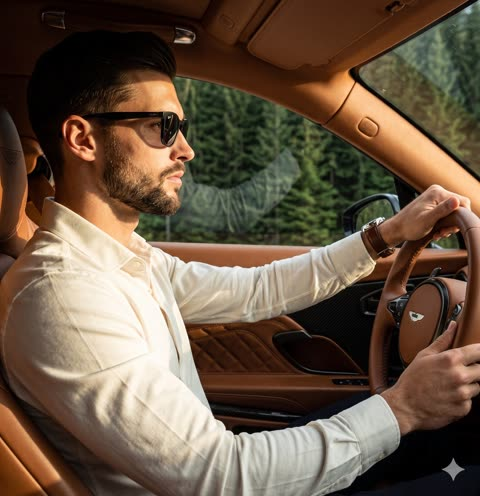</a>

A single hard directional light from the front left window sets the contrast, and the prompt names which planes of the face and wheel catch it and which fall into shadow. Naming the camera body, lens, aperture, shutter and ISO gives the output a tack sharp photographic baseline.

Nano Banana 2 · Text-to-image · Source: [@pictsbyai on X](https://x.com/pictsbyai/status/2050852588833132762) · 124 likes on 2026-10-29

[`golden-hour`](tags.md#tag-golden-hour) [`automotive`](tags.md#tag-automotive) [`lighting`](tags.md#tag-lighting) [`lifestyle`](tags.md#tag-lifestyle)

<details><summary><b>Prompt</b></summary>

```text
A male in his 30s sits in profile as the primary subject, his relaxed shoulders carrying a serious, posed expression while his eyes remain hidden behind black sunglasses, focused straight ahead with a neutral, unsmiling mouth. He wears a crisp off-white long-sleeve shirt and a watch with a brown leather strap. His hair is styled in a textured quiff with moderate volume lifting off the forehead, fading down to a half-inch on the sides above the ears, displaying a natural slight wave on top enhanced by a dry-look matte paste; meticulous details reveal slightly uneven natural growth at the hairline, textural inconsistency near the crown, and visible flyaways illuminated by the sun, complemented by a short, even stubble beard of three to four days of growth with natural cheek lines. His hands naturally interact with the environment; his left hand grips the steering wheel rim near the ten o'clock position with the thumb resting seamlessly along the inner seam, while his right hand grips the top right at the two o'clock position, his fingers curled tightly over the leather rim with slightly prominent knuckles that maintain an organic tension without turning white. He is positioned within the pristine interior of an Aston Martin, observed from an isometric perspective from the passenger seat. In the foreground, a pristine gloss black center console houses glass-like gear selector buttons and climate controls featuring subtly integrated medium-weight sans-serif technical typography. The midground is dominated by the steering wheel wrapped in saddle brown leather with visible stitching, a matte black center, and a silver winged logo, situated beneath a new black alcantara suede sun visor bearing a yellow and white airbag warning label. The surrounding interior panels and seat bolsters are constructed from matte saddle brown and black leather mixed with carbon fiber, detailed with uniform diamond quilted stitching. Through the window, the medium-depth background transitions into smoothly blurred but distinct, thriving dense green evergreen bushes and trees. A bright, hard, and highly directional natural golden sunlight streams in from the front-left driver window, bathing the scene in a warm, energetic, and sophisticated atmosphere. This single-source lighting generates extreme high contrast, casting harsh, defined, deep black shadows across the right side of the driver's face and the right side of the center console, while brilliant highlights are perfectly preserved on his left cheek, nose, left forearm, and the top arc of the steering wheel. The scene leverages an earthy and analogous color palette heavily featuring saddle brown, off-white, and black, punctuated by the cool forest green contrast of the exterior. Captured as a tack-sharp piece of digital lifestyle photography using a full-frame camera with a 35mm lens set to an f/4.0 aperture, 1/1000s shutter speed, and ISO 100, freezing the motion with absolute clarity on the subject. Inspired by clean, luxury automotive influencer aesthetics, the image undergoes precise post-processing with enhanced contrast to deepen the shadows on the interior console, warm color grading to emphasize the leather and golden light, and is finally framed in a 4:5 aspect ratio.
```

</details>

<a id="nano-banana-gothic-vampire-foggy-alley-portrait"></a>
### Gothic vampire woman leaning in foggy alley

<a href="https://x.com/The_Kremlinn/status/2054418680692228271"></a>

The scene paragraph stacks concrete set details (wet brick, lamp reflection, volumetric fog) with film terms like 35mm look, grain and shallow depth of field for a cinematic horror still. A camera path from boots up to the eyes and a timed beat sheet of smile, fangs, whisper and fade make it extend naturally to video.

Nano Banana 2 · Text-to-image · Source: [@The_Kremlinn on X](https://x.com/The_Kremlinn/status/2054418680692228271) · 124 likes on 2026-10-28

[`vampire`](tags.md#tag-vampire) [`gothic`](tags.md#tag-gothic) [`cinematic`](tags.md#tag-cinematic) [`fog`](tags.md#tag-fog) [`horror`](tags.md#tag-horror)

<details><summary><b>Prompt</b></summary>

```text
Dark gothic alley at night, wet brick wall and rain-soaked pavement reflecting a dim street lamp. Heavy fog drifts slowly through the alley. A pale elegant vampire woman in a long black coat and dark red dress leans against the wall, motionless and mysterious. Cinematic horror lighting, dramatic shadows, shallow depth of field, ultra-realistic, 35mm film look, film grain, volumetric fog.
The camera begins at her black leather boots and performs a slow cinematic vertical dolly shot upward, moving smoothly from her feet → legs → waist → shoulders → lips → eyes. Suspense builds as the camera rises.
When the camera reaches her face, she slowly tilts her head and gives a cold villain smile. Her long sharp vampire fangs slide into view, fresh blood dripping slowly from the tips. Her eyes glow subtly in the darkness.
She whispers softly: “Welcome to the night…”
Immediately after, she lets out a quiet sinister villain laugh as the fog thickens and the lighting darkens.
The scene begins to slowly fade to black, while the camera continues pushing forward into an extreme close-up, zooming closer and closer until the camera enters her mouth, ending in darkness.
Style keywords: cinematic horror, gothic vampire, slow camera movement, dramatic lighting, suspenseful, photorealistic, moody atmosphere, shallow depth of field, film grain, volumetric fog.
```

</details>

<a id="nano-banana-color-block-fashion-high-angle-reaching-hand"></a>
### Color Block Fashion Portrait With Reaching Hand

<a href="https://x.com/alizagori1/status/2078375640416313479"></a>

A high overhead wide angle viewpoint paired with a hand reaching toward the lens creates a strong forced perspective effect. A clean white seamless backdrop, bright even studio light and a named 24mm lens keep the vivid color block outfit as the focus.

Nano Banana 2 · Text-to-image · Source: [@alizagori1 on X](https://x.com/alizagori1/status/2078375640416313479) · 123 likes on 2026-10-28

[`fashion`](tags.md#tag-fashion) [`editorial`](tags.md#tag-editorial) [`wide-angle`](tags.md#tag-wide-angle) [`studio-lighting`](tags.md#tag-studio-lighting) [`forced-perspective`](tags.md#tag-forced-perspective)

<details><summary><b>Prompt</b></summary>

```text
Made with Gemini Nano Banana 2 on
@Lart_AI
.

Model: Gemini Nano Banana 2
Aspect Ratio: 9:16
Resolution: 2K

Prompt: Ultra-realistic, high-fashion editorial portrait of a stylish young model captured from a dramatic bird's-eye wide-angle perspective, reaching one hand toward the camera to create an exaggerated perspective effect. Vibrant color-block outfit with modern accessories, clean white seamless studio background, high-key studio lighting, playful Gen Z aesthetic, confident expression, commercial fashion photography, ultra-detailed skin texture, sharp focus, premium styling, 8K, HDR, magazine cover quality, DSLR, 24mm wide-angle lens, f/2.8, crisp details, natural colors.
Negative Prompt: Low quality, blurry, noisy, overexposed, underexposed, distorted anatomy, extra fingers, deformed hands, duplicate limbs, bad proportions, cropped, watermark, text, logo, artifacts, motion blur, oversaturated, cartoon, CGI, low resolution.
Settings: SDXL, DPM++ 2M Karras, Steps: 30, CFG: 7, Aspect Ratio: 4:5.
```

</details>

<a id="gpt-image-charcoal-sketch-wall-seated-portrait"></a>
### Seated woman before giant charcoal sketch portrait

<a href="https://x.com/Kubra_286/status/2102597090534649952"></a>

A sepia charcoal sketch of the same face fills the wall while a full color photoreal portrait sits in front, so the monochrome against color contrast creates depth. A long identity lock block with explicit do not rules keeps the face consistent in both versions.

GPT Image 2.5 · Edit · Source: [@Kubra_286 on X](https://x.com/Kubra_286/status/2102597090534649952) · 122 likes on 2026-10-29

[`charcoal-sketch`](tags.md#tag-charcoal-sketch) [`layered-composite`](tags.md#tag-layered-composite) [`identity-lock`](tags.md#tag-identity-lock) [`editorial-portrait`](tags.md#tag-editorial-portrait)

<details><summary><b>Prompt</b></summary>

```text
Create a layered composite portrait of the SAME FEMALE PERSON from the uploaded face reference image.

CONCEPT:
A massive, highly detailed charcoal/pencil sketch portrait fills the background like a hand-drawn wall mural, while a sharp full-color photorealistic seated portrait of the same woman appears in the foreground on a dark reflective floor.

BACKGROUND SKETCH PORTRAIT:
Large detailed black-and-white pencil and charcoal sketch of the same woman, head turned slightly to the side. Preserve her exact hairstyle and hair texture, facial features, eyebrows, eyes, nose, lips, jawline and natural facial proportions. The sketch should have visible pencil hatch strokes, charcoal shading, fine facial linework and realistic hand-drawn texture. Add rough torn-paper edges, ink-splatter marks and charcoal dust surrounding the sketch, blending naturally into a warm sepia-grey textured wall.

FOREGROUND FEMALE SUBJECT:
The same woman is seated casually on the floor. One leg is bent with the knee raised and one forearm resting naturally on the knee; the other leg extends outward to the side. Her torso is slightly turned, head tilted while looking off to the side, with a calm, thoughtful and natural expression.

IDENTITY LOCK — HIGHEST PRIORITY:
Use ONLY the uploaded female face reference image for facial identity and facial structure in BOTH the background sketch and the foreground photorealistic woman.

The foreground woman and background sketch must represent EXACTLY the same real person.

Preserve the exact:

- Face shape
- Jawline and jaw width
- Cheek structure
- Forehead shape
- Exact hairline
- Hairstyle and hair texture
- Eyebrow shape
- Eye shape, size and spacing
- Nose structure
- Lip shape and proportions
- Natural facial features
- Skin tone
- Skin texture
- Natural facial imperfections
- Overall feminine facial proportions

ZERO identity change.

Do NOT beautify or alter the face.
Do NOT change her age or facial structure.
Do NOT feminize or masculinize the face.
Do NOT smooth away natural skin texture.
Do NOT make her look like a celebrity or model.
Do NOT use a generic female face.
Do NOT introduce facial morphing.
Do NOT change her hairstyle or hairline unless required by the reference.
Do NOT create a different person.

The uploaded reference image is the ONLY source of facial identity.

BODY:
Natural feminine body proportions, realistic physique, natural skin tone and relaxed seated posture.

OUTFIT:
Black hooded sweatshirt with visible drawstrings, light grey jogger sweatpants and clean white-and-grey sneakers.

ENVIRONMENT:
Warm sepia-grey textured wall covered by the giant detailed pencil/charcoal portrait. Rough ink-splatter, charcoal dust and expressive pencil marks spread naturally around the sketch. Dark polished reflective floor beneath the seated woman, creating a subtle soft mirror reflection.

COMPOSITION:
Vertical editorial poster composition.
The large background sketch dominates the frame while the full-color seated woman is clearly separated in the foreground.
Strong visual depth between the hand-drawn portrait and realistic subject.
Balanced negative space.
Premium fashion-editorial composition.

LIGHTING:
Soft, even studio lighting from the front.
Minimal harsh shadows.
Warm neutral illumination.
Natural skin highlights.
Subtle controlled reflections on the dark floor.

COLOR GRADING:
Background: sepia-grey monochrome charcoal/pencil aesthetic.
Foreground: natural full-color female subject with realistic warm skin tones.
Strong but elegant contrast between the monochrome sketch and realistic woman.
Clean high-contrast editorial poster color grading.

CAMERA / QUALITY:
Sony A7R IV
50mm lens
f/1.8
Foreground subject tack sharp.
Extremely detailed skin texture, individual hair strands and clothing fabric.
Background pencil strokes, charcoal shading and ink-splatter texture highly detailed.
Ultra-photorealistic.
Premium editorial photography.
Natural depth of field.
Realistic materials and reflections.
4K-level detail.
Zero AI-looking artifacts.

NEGATIVE PROMPT:
No identity change, no different face, no generic female face, no celebrity resemblance, no face-swap artifacts, no facial distortion, no asymmetrical eyes, no extra fingers, no extra limbs, no malformed hands, no duplicated body parts, no plastic skin, no excessive skin smoothing, no beauty filter, no cartoon, no anime, no unrealistic body proportions, no blurry face, no low resolution, no watermark, no text, no logo.

OUTPUT:
Aspect Ratio: 3:4
Photorealistic female portrait
Identity preservation is the absolute highest priority.
```

</details>

<a id="nano-banana-golden-hour-cliff-portrait-ponytail"></a>
### Ponytail woman on cliff at golden hour

<a href="https://x.com/Its_shah2i0/status/2071142207697121705">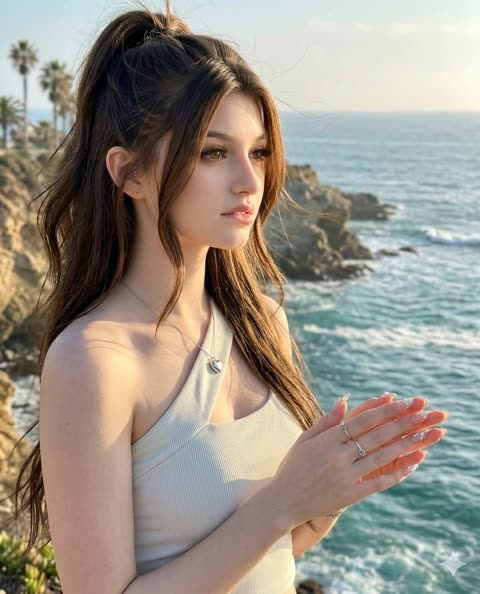</a>

The prompt layers concrete detail in a fixed order: subject, hair, hands and jewellery, wardrobe, then setting and light. Naming a cinematic depth of field and golden hour sunlight sets the film look without needing a camera model.

Nano Banana 2 · Text-to-image · Source: [@Its_shah2i0 on X](https://x.com/Its_shah2i0/status/2071142207697121705) · 122 likes on 2026-10-29

[`portrait`](tags.md#tag-portrait) [`golden-hour`](tags.md#tag-golden-hour) [`coastal`](tags.md#tag-coastal) [`fashion`](tags.md#tag-fashion)

<details><summary><b>Prompt</b></summary>

```text
A stunning, high-fashioned cinematic portrait of a beautiful young woman with a flawless complexion and expressive brown eyes. Her long, rich brown hair is styled in a voluminous, perfectly detailed high ponytail with soft, elegant face-framing strands catching the golden sunlight. She has soft, natural makeup with long lashes and a subtle, thoughtful expression, looking off into the distant horizon away from the camera. Her hands are delicately held together in front of her, showcasing intricately detailed shimmering silver glitter nail art and wearing thin, minimal silver rings on her fingers. She is wearing a modern, chic off-white asymmetric one-shoulder top and a thin silver chain necklace with a small heart pendant. The background features a breathtaking, highly detailed coastal landscape, standing on a rocky cliff overlooking a vast deep-blue ocean with realistic crashing white waves. The scene is illuminated by soft, warm golden hour sunlight, creating beautiful highlights on her hair and a cinematic depth of field with a softly blurred background.
```

</details>

<a id="nano-banana-red-latex-superhero-studio-portrait"></a>
### Red latex superhero studio portrait with graffiti wall

<a href="https://x.com/KeorUnreal/status/2115436047664287827">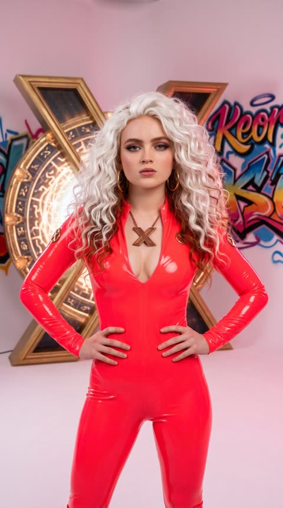</a>

The prompt is a structured JSON spec that separates subject, outfit, setting, lighting and camera, so each element stays fixed. Spelling out the exact graffiti word Keor and the gloss on the latex keeps the text and material readable in the output.

Nano Banana 2.1 · Text-to-image · Source: [@KeorUnreal on X](https://x.com/KeorUnreal/status/2115436047664287827) · 122 likes on 2026-10-29

[`json-prompt`](tags.md#tag-json-prompt) [`studio-portrait`](tags.md#tag-studio-portrait) [`latex-outfit`](tags.md#tag-latex-outfit) [`superhero`](tags.md#tag-superhero)

<details><summary><b>Prompt</b></summary>

```text
{
 "subject": {
 "description": "Young woman Sadie Sink with fair skin, voluminous curly platinum-white red hair, dramatic eye makeup, looking directly at the camera with a confident expression",
 "hair": "Huge, wavy platinum-white red curls cascading around the shoulders and back",
 "body": "Curvy figure in a form-fitting suit",
 "pose": "Standing facing the camera, both hands on her hips, elbows out",
 "expression": "Bold, direct gaze"
 },
 "outfit": {
 "suit": "Glossy neon red latex full-body suit with a deep neckline and long sleeves",
 "emblem": "Bronze metallic X-shaped emblem on a chain at the chest, small circular emblems on the shoulders",
 "accessories": "Large gold hoop earrings"
 },
 "setting": {
 "location": "Studio with a plain gradient backdrop",
 "background": "Soft white-to-pink gradient wall with a huge gold X sculpture with a stargate inside",
 "added_element": "Graffiti sign reading 'Keor' on the wall in an X-Men superhero style in the backdrop"
 },
 "lighting": {
 "type": "Studio lighting with white and pink rim lights",
 "effects": "Strong glossy highlights on the neon red latex, colorful glow on the white hair"
 },
 "camera": {
 "angle": "Slightly low full-body angle",
 "framing": "Full-body shot, subject centered against the gradient wall",
 "style": "Photorealistic, high-detail fashion photography, sharp focus"
 },
 "additional_details": {
 "skin": "Smooth with a slight sheen",
 "atmosphere": "Bold superhero-inspired studio portrait"
 }
}
```

</details>

<a id="nano-banana-blue-lit-hoodie-portrait"></a>
### Bearded man in amber sunglasses, blue studio light

<a href="https://x.com/weiinberg/status/2080518616131469475">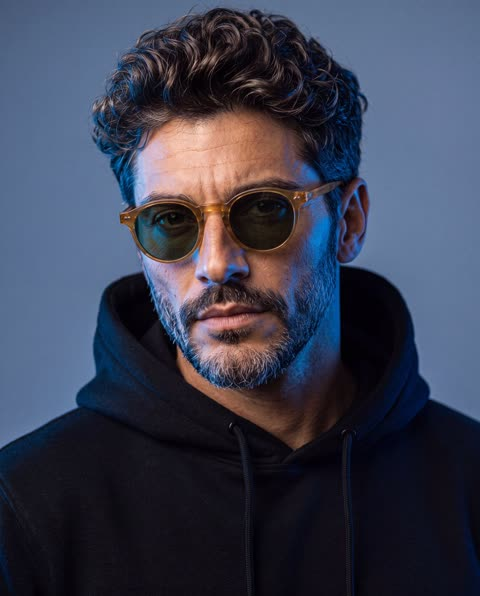</a>

An identity reference image plus an explicit feature checklist locks the subject, while the scene is pinned to a composition reference for crop, head angle and framing. Lighting is split into a blue key from the left of camera and a neutral frontal fill on the other side, which keeps skin tones realistic.

Nano Banana 2 · Edit · Source: [@weiinberg on X](https://x.com/weiinberg/status/2080518616131469475) · 121 likes on 2026-10-29

[`portrait`](tags.md#tag-portrait) [`identity-reference`](tags.md#tag-identity-reference) [`studio-lighting`](tags.md#tag-studio-lighting) [`blue-light`](tags.md#tag-blue-light)

<details><summary><b>Prompt</b></summary>

```text
Nano Banana 2 on OpenArt

Prompt: Use the uploaded character image as the sole identity reference for the person in the final photograph. Completely replace the original model with the uploaded reference character while maintaining the reference character's exact face, age range, natural skin tone, facial proportions, forehead, eyebrows, eye shape and eye color, nose, lips, cheekbones, jawline, chin, ears, facial hair pattern, beard density, hairstyle, hairline, hair texture, neck anatomy, shoulders, and recognizable body proportions
ne original model's identity must not remain in any form. Do not blend the two faces. The final subject must accurately and consistently resemble only the uploaded reference character.
Recreate the supplied blue-lit studio portrait scene with the same pose, camera angle, lighting, clothing style, background, crop, and atmosphere.
Create a hyper-realistic 4:5 vertical close-up editorial portrait of the uploaded reference character wearing a black hoodie against a smooth blue-grey studio background.
POSE AND COMPOSITION:
Position the character in a three-quarter portrait angle, with the torso and head turned slightly away from the camera while the eyes look directly toward the lens. Keep the head tilted very subtly, producing a calm, mysterious, confident expression.
Reserve the exact head angle, shoulder orientation, camera height, camera-to-subject distance, crop, facial scale, eye placement, negative space, and overall framing from the composition reference. Frame the character from approximately the upper chest to shoulders upward.
Place the face slightly off-center, with the visible shoulder and hoodie creating depth in the lower portion of the image. Keep the composition intimate and cinematic.
CLOTHING:
Dress the uploaded reference character in a premium plain black hoodie. Preserve the oversized hood structure around the neck, soft matte fabric, black drawstrings, thick neckline folds, relaxed fit, and minimal design. The hoodie must contain no visible logo, print, text,
or neon.
If the uploaded reference character naturally wears a small earring or has a visible ear accessory in the reference image, preserve it accurately. Do not introduce unrelated accessories.
Recreate the cool cinematic lighting from the reference scene.
Use an intense electric-blue light from the camera-left side, illuminating one side of the forehead, eyebrow, eye, cheek, nose, beard, jawline, neck, and hoodie. Use a soft neutral frontal fill light on the opposite side to retain realistic skin color and facial detail.
ad a subtle blue glow on the background behind the illuminated side or the face, gradually fading into a cooler grey-blue tone on the opposite side. Maintain gentle falloff, controlled contrast, soft shadows, natural catchlights, detailed skin texture, and realistic facial hair.
The blue lighting must feel photographic and physically accurate. Avoid excessive neon saturation or artificial plastic skin.
CAMERA AND QUALITY:
Shot with a full-frame professional camera and an 85mm portrait lens, shallow depth of field, sharp focus on the nearest eye, soft background separation, realistic lens compression, detailed pores, natural beard texture, cinematic studio photography, premium fashion editorial aesthetic, realistic color grading, high dynamic range, ultra-photorealistic, 8K resolution.
No text, no logo, no watermark, no identity mixing, no altered hairstyle, no inaccurate beard, no excessive retouching, no unrealistic eye color, no deformed ears, no duplicate accessories, no cartoon or CGI appearance.
```

</details>

<a id="nano-banana-fisheye-vintage-cafe-mirror-selfie"></a>
### Fisheye vintage cafe mirror selfie in turquoise interior

<a href="https://x.com/TheVirtualMuse/status/2108762311251116034"></a>

An identity lock block keeps the reference face intact, while labeled sections for scene, background, lighting and camera separate each concern. Fisheye curvature is tied to a circular brass mirror, and strict rules about reflections and a single continuous photo keep the result realistic.

Nano Banana 2.1 · Edit · Source: [@TheVirtualMuse on X](https://x.com/TheVirtualMuse/status/2108762311251116034) · 121 likes on 2026-10-28

[`fisheye`](tags.md#tag-fisheye) [`mirror-selfie`](tags.md#tag-mirror-selfie) [`vintage-film`](tags.md#tag-vintage-film) [`cafe`](tags.md#tag-cafe) [`identity-lock`](tags.md#tag-identity-lock)

<details><summary><b>Prompt</b></summary>

```text
Using the uploaded reference image, create an ultra-realistic 1990s vintage café mirror selfie with a playful fisheye photography aesthetic.

IDENTITY LOCK: Preserve the exact facial identity of the reference person with maximum accuracy. Maintain the original eye shape, nose, lips, jawline, facial proportions, natural skin tone, age, and recognizable features. No facial alterations, beautification, or artificial skin smoothing.

SCENE & COMPOSITION: The subject is naturally taking a mirror selfie inside a beautiful vintage European café, standing in front of a large circular mirror with an aged brass frame. Use a strong fisheye lens perspective, creating dramatic yet realistic curvature around the café interior while keeping the subject's face naturally proportioned. The phone must appear correctly reflected in the mirror.

BACKGROUND: A charming retro café featuring turquoise accent walls, vintage wooden furniture, small round café tables, patterned tiled flooring, warm hanging pendant lights, antique decorative details, and soft daylight entering through large windows. The entire interior should curve naturally around the circular mirror.

LIGHTING & COLOR: Authentic 1990s analog film photography, warm golden highlights, slightly faded vintage colors, natural skin tones, soft shadows, subtle 35mm film grain, gentle contrast, and realistic reflections.

CAMERA & REALISM: Strong fisheye wide-angle perspective, authentic mirror reflections, natural handheld selfie composition, realistic optical distortion, detailed skin texture, individual hair strands, accurate fabric textures, and natural imperfections. Premium 8K photographic quality with the organic character of a genuine vintage film photograph.

STRICT RULES: One continuous photograph, no collage, no split screen, no additional people, no distorted facial features, no extra fingers, no incorrect reflections, no CGI, no artificial AI-generated appearance, no readable text, no logos, and no watermark.

FINAL LOOK: A beautiful, effortlessly candid vintage café mirror selfie that looks like a genuine photograph captured on a real fisheye lens, not an AI-generated image.
```

</details>

<a id="nano-banana-pointe-ballerina-butterfly-wing-gown"></a>
### Ballerina en pointe in butterfly wing gown

<a href="https://x.com/yourPlugAI/status/2109858986711240822"></a>

A bracketed template fixes the subject, posture, materials and three colors, so one structure yields many gown variations. A dark stage floor with reflections and high contrast spotlighting makes the textures stand out.

Nano Banana 2.1 · Text-to-image · Source: [@yourPlugAI on X](https://x.com/yourPlugAI/status/2109858986711240822) · 120 likes on 2026-10-28

[`ballet`](tags.md#tag-ballet) [`avant-garde-fashion`](tags.md#tag-avant-garde-fashion) [`butterfly`](tags.md#tag-butterfly) [`studio-lighting`](tags.md#tag-studio-lighting) [`template`](tags.md#tag-template)

<details><summary><b>Prompt</b></summary>

```text
Full-body studio photograph of a [SUBJECT, e.g., female ballerina / model / dancer] poised in a graceful [POSTURE / ACTION, e.g., en pointe / reaching upward / mid-leap].

She wears an intricate, avant-garde outfit crafted from [PRIMARY MATERIAL / MOTIF, e.g., layered peacock feathers / butterfly wings / botanical petals] featuring [SECONDARY MATERIAL / DETAIL, e.g., delicate lace / fractal filigree / iridescent crystals].

The gown is designed in a striking color palette of [COLOR 1], [COLOR 2], and [COLOR 3] against a dark studio background with soft reflections on a dark stage floor. High-contrast dramatic spotlighting highlights fine textures and details.

📌Variable Guide attached below
```

</details>

<a id="nano-banana-christmas-awkward-90s-siblings-floating-head"></a>
### Awkward 90s couple in reindeer sweaters with floating head

<a href="https://x.com/venturetwins/status/2003627299074121984"></a>

Assigning one reference person to a translucent floating head in the corner and the rest to a stool in fixed clothing lets the model place every face in one frame. Naming era cues such as high waisted light wash jeans and a cloudy grey studio backdrop sets the 1990s film look.

Nano Banana Pro · Edit · Source: [@venturetwins on X](https://x.com/venturetwins/status/2003627299074121984) · 119 likes on 2026-10-29

[`christmas`](tags.md#tag-christmas) [`portrait`](tags.md#tag-portrait) [`vintage`](tags.md#tag-vintage) [`family`](tags.md#tag-family)

<details><summary><b>Prompt</b></summary>

```text
We all need an awkward '90s holiday photoshoot with our siblings.

If you missed the boat (like I did), you're in luck - I wrote some prompts you can use with Nano Banana Pro ✨

Upload a photo of each person and then use the following:

"An awkward vintage 1990s studio photograph using the exact likenesses from the three reference photos.The composition features all but one of the people sitting stiffly on a stool in the foreground, wearing a bulky, knitted ugly Christmas sweater with a reindeer pattern and high-waisted light-wash jeans. They are smiling uncomfortably at the camera. Above them in the upper corner, there is a large, translucent "floating head" double-exposure portrait of the last reference photo person. The floating head is looking off into the distance pensively, wearing a red turtleneck, fading into a cloudy, dark grey studio backdrop."

"An incredibly awkward 90s studio photograph using the likenesses of reference photos of the family. The family is posed dynamically against a mottled green and red muslin backdrop. They are all wearing oversized, clashy holiday vests over turtlenecks. One family member is kneeling on the grey carpet floor, holding up a cheap, plastic illuminated snowman lawn ornament as if it is a treasure. The other family members are crowded around behind them, pointing at the plastic snowman with overly exaggerated, fake expressions of surprise and delight (mouths open, pointing fingers stiff). One person has a mullet hairstyle."
```

</details>

<a id="nano-banana-dark-cinematic-skin-detail-portrait"></a>
### Dark Cinematic Close-Up with Extreme Skin Detail

<a href="https://x.com/Ozayrr_irl/status/2078676250244354493"></a>

Locks identity to a reference face, then specifies a tight crop, a single narrow spotlight from above and the side, no fill light and a thin rim light. Skin is described feature by feature (pores, stubble, sheen, capillary flush, iris fibers) so the raking light reads as texture.

Nano Banana 2 · Edit · Source: [@Ozayrr_irl on X](https://x.com/Ozayrr_irl/status/2078676250244354493) · 119 likes on 2026-10-29

[`portrait`](tags.md#tag-portrait) [`close-up`](tags.md#tag-close-up) [`skin-detail`](tags.md#tag-skin-detail) [`dramatic-lighting`](tags.md#tag-dramatic-lighting) [`face-reference`](tags.md#tag-face-reference)

<details><summary><b>Prompt</b></summary>

```text
Use the exact same face from the reference image and generate a dark cinematic portrait where obsessive skin detail and dramatic lighting collide into a single devastating image — where every pore becomes a universe and the darkness makes the face feel sacred.

Extreme close-up — face filling 90% of the frame, tight crop from just above the brows to just below the lips, ears dissolving at the edges into darkness. No outfit visible. No distractions. Just the face and the dark consuming everything around it.

Expression carries absolute still weight — eyes open and fully present, staring directly into the lens with a calm devastating intensity that requires no performance. Lips naturally sealed with the faintest natural tension. Every facial muscle completely still — the specific stillness of someone who knows exactly who they are and needs nothing from the world to confirm it.

Skin is the complete obsession — rendered at a level that makes dermatologists lean forward and photographers put down their cameras. Every individual pore with its own unique diameter, depth, shadow and raised wall structure simultaneously visible. Sebaceous filaments as dark pinpoint details across the nose wings and chin. The micro-topography of real skin — hills valleys ridges plateaus all visible as a landscape under raking light. Individual stubble hairs at follicle level — each one with its own emergence angle, thickness tapering from root to glowing tip, its own micro-shadow cast across the surrounding skin. Some hairs just breaking the surface, some fully emerged, some curling slightly — completely individual and real. Natural skin pigmentation variation — micro spots, subtle uneven tone, the biological truth of real skin. The specific oil distribution of real skin — slight natural sheen concentrated at the nose tip center forehead and cupid's bow, more matte at the jaw and temples. Natural capillary flush beneath the skin surface at the cheeks and nose — warmth visible under the skin like embers under ash. Under-eye skin showing its specific delicate thinness, the faint natural shadow of the tear trough. Every eyelash rendered individually with unique length thickness curl spacing and the way they catch the single light source and glow at their tips. Iris at microscopic fiber-pattern level — individual collagen fibers radiating from the pupil, natural color variation within the iris, the limbal ring a precise dark circle, the pupil a deep black with internal dimensional depth. A single sharp catch light in each eye from the key source — small, precise, alive.

Lighting is a single narrow Fresnel spotlight from high above and sharply to one side — the most brutal and revealing light possible, a column of cold white-blue light cutting across the face at a steep diagonal angle. The lit side of the face mercilessly exposed — every pore every follicle every skin surface variation caught by the raking light and made three-dimensional by micro-shadows. The light transition across the nose bridge razor sharp — lit side in brilliant cold detail, shadow side dissolving gradually into absolute black. No fill light anywhere — the shadow side is genuine darkness, total and final, only the faintest ghost of a razor-thin cold rim light from directly behind tracing the ear edge and jaw line with a thread of blue-white light — the only evidence the shadow side of the face exists.

The lit areas of skin catch the cold spotlight with scientific precision — the nose tip the highest highlight point, the forehead plane catching a wide sweep of light, the cheekbone a sharp bright ridge, the upper lip a subtle highlight above the sealed mouth. Every surface variation between these points creating its own micro-shadow under the raking light — the face as a topographic map of human biology.
```

</details>

<a id="gpt-image-1998-coastal-summer-travel-editorial"></a>
### Late 1990s coastal summer travel portrait

<a href="https://x.com/AIwithWania/status/2098773641303310647"></a>

Fixes an era, a real-world location mood and a film look (Kodak grain, faded highlights, golden light) so the whole frame reads as one period magazine shoot. Detailed outfit, pose and setting lists plus a negative list keep the result candid and realistic.

GPT Image 2.5 · Text-to-image · Source: [@AIwithWania on X](https://x.com/AIwithWania/status/2098773641303310647) · 118 likes on 2026-10-28

[`travel-editorial`](tags.md#tag-travel-editorial) [`film-photography`](tags.md#tag-film-photography) [`1990s`](tags.md#tag-1990s) [`coastal`](tags.md#tag-coastal) [`fashion`](tags.md#tag-fashion)

<details><summary><b>Prompt</b></summary>

```text
Create an ultra-realistic late-1990s summer travel editorial featuring a stylish young woman and a stylish young man in two separate portrait frames with the exact same visual theme and color grading.

The setting is a dreamy coastal destination inspired by Jeju Island and the Greek islands, with crystal-blue sea, rocky coastline, white seaside cafés, flowering plants, distant mountains, small boats, warm wooden furniture, and bright clear summer skies.

The woman is seated naturally at a charming seaside café. She wears a modest but fashionable pastel-blue puff-sleeve blouse with a flowing cream floral midi skirt, elegant minimal jewelry, and a relaxed straw hat. Her outfit must be tasteful and not revealing. Give her soft, slightly wavy shoulder-length hair with natural movement. Her pose should feel spontaneous and stylish—one hand resting lightly near her hat or hair, the other relaxed beside her, with a gentle natural smile.

The man is seated casually in the same coastal atmosphere, wearing a cream linen shirt, relaxed beige trousers, classic sunglasses, minimal wristwatch, and clean white sneakers. Give him naturally messy wavy hair and an effortless vintage European summer look. One arm rests casually on the chair while the other hand is near his face, creating a relaxed editorial pose.

Use warm 1990s film photography, subtle Kodak-style grain, slightly faded highlights, soft golden sunlight, realistic skin texture, gentle shadows, natural imperfections, rich ocean blues, creamy whites, muted pastels, and nostalgic analog color grading.

Make both portraits look like they were photographed for a rare 1998 international summer travel magazine, candid rather than posed, sophisticated but effortless, cinematic yet completely realistic.

No modern influencer look, no heavy makeup, no bold/revealing clothes, no artificial CGI appearance, no plastic skin, no excessive blur, no text or logos.

Vibe: “A forgotten summer somewhere by the sea — 1998.”
```

</details>

<a id="gpt-image-low-angle-selfie-bucket-hat-sky"></a>
### Low angle selfie in frayed bucket hat against blue sky

<a href="https://x.com/Zoyavelle/status/2096105094425240028"></a>

A low camera angle, backlit sun for rim light and clouds grouped on one side give the frame a clear direction. Naming smartphone photography and no beauty filter pushes the result toward a candid phone snapshot look.

GPT Image 2 · Text-to-image · Source: [@Zoyavelle on X](https://x.com/Zoyavelle/status/2096105094425240028) · 118 likes on 2026-10-29

[`selfie`](tags.md#tag-selfie) [`portrait`](tags.md#tag-portrait) [`backlight`](tags.md#tag-backlight) [`outdoor`](tags.md#tag-outdoor)

<details><summary><b>Prompt</b></summary>

```text
Ultra-realistic high-resolution outdoor selfie portrait of a young adult woman, shot from a low-angle perspective with a smartphone camera. She has long, straight, dark brown hair flowing naturally in the wind, soft natural facial features, smooth realistic skin, subtle pink lips, and a calm neutral expression. She is wearing a black distressed/frayed bucket hat with a small white Nike-style logo on the front, narrow black oval sunglasses with dark reflective lenses, and a light pastel sage-green ribbed tank top with wide straps. Bright sunlight is positioned behind her head, creating a natural glowing rim light and subtle lens flare around her hair and hat. The background is a vivid deep blue summer sky filled with large fluffy white cumulus clouds, with dramatic cloud formations mainly on the right side and scattered clouds near the lower edges. Natural outdoor daylight, realistic skin texture, detailed individual hair strands, authentic smartphone photography, sharp facial details, high dynamic range, balanced exposure, cinematic sunlight, realistic shadows, vibrant but natural colors, slight wide-angle perspective, shallow atmospheric depth, photorealistic, 8K detail, no artificial beauty filter, candid Instagram-style aesthetic. Vertical composition, subject centered and filling most of the frame, low-angle close-up selfie.
```

</details>

<a id="nano-banana-neon-cyberpunk-bearded-man-portrait"></a>
### Bearded man in pink sunglasses, neon portrait

<a href="https://x.com/Sheldon056/status/2033335996889379057"></a>

Names the subject, expression and wardrobe, then sets teal and magenta lighting to cast bold shadows across the face. A closing style line (cyberpunk-inspired studio photography) fixes the mood, and the reflective lenses add neon detail.

Nano Banana 2 · Text-to-image · Source: [@Sheldon056 on X](https://x.com/Sheldon056/status/2033335996889379057) · 117 likes on 2026-10-28

[`portrait`](tags.md#tag-portrait) [`neon`](tags.md#tag-neon) [`cyberpunk`](tags.md#tag-cyberpunk) [`studio-lighting`](tags.md#tag-studio-lighting) [`sunglasses`](tags.md#tag-sunglasses)

<details><summary><b>Prompt</b></summary>

```text
Generated with Nano Banana 2 on
@yapper_so
.

Prompt: Create a bold, cinematic portrait 8k ultra HD high details resulation of a confident young man a well groomed beard, looking upward with purpose. He wears vibrant pink sunglasses reflecting neon lights, He wears a black t-shirts. Dramatic lighting in teal and magenta casts bold shadows and highlights across his face. Style: edgy, modern, cyberpunk-inspired studio photography.
```

</details>

<a id="nano-banana-venice-lagoon-suited-man-balustrade"></a>
### Man in suit by Venice lagoon balustrade

<a href="https://x.com/pictsbyai/status/2060272145377235381"></a>

Each foreground, midground and background layer is named by material and position, which keeps the plants, boats and San Giorgio Maggiore anchored in place. Camera, lens, aperture, shutter and ISO settings plus a named teal and orange grade give the photo a realistic editorial finish.

Nano Banana 2 · Text-to-image · Source: [@pictsbyai on X](https://x.com/pictsbyai/status/2060272145377235381) · 117 likes on 2026-10-29

[`venice`](tags.md#tag-venice) [`portrait`](tags.md#tag-portrait) [`menswear`](tags.md#tag-menswear) [`editorial`](tags.md#tag-editorial)

<details><summary><b>Prompt</b></summary>

```text
A handsome young male adult leans casually with shifted weight against a weathered stone balustrade, facing the camera with a candid, serious expression, his dark, messy, wind-swept hair catching the sunlight. His direct gaze, unsmiling neutral mouth, and relaxed neutral eyebrows convey a confident calm. He is dressed in a well-fitted dark charcoal grey suit jacket and matching trousers over a crisp white t-shirt. His relaxed left hand is tucked inside his left trouser pocket, pushing the jacket back slightly to reveal the shirt, while his right arm rests casually at his side, hanging naturally out of frame against his leg. He interacts with an intricate foreground featuring a flat-topped, off-white matte stone balustrade with classical carved pillars showing slight discoloration, patchy warm cream undertones, and weathered water stains, flanked by the stiff, dark green feather-like fronds of a thriving cycad plant extending into the frame on the bottom left and a palm on the bottom right above medium warm brown striped wooden decking. In the midground, a vibrant turquoise lagoon ripples with boat wakes as a pristine classic wooden motorboat with a white interior glides across the right, balanced by a white vaporetto to the left. The deep background opens up to the stunning historical architecture of San Giorgio Maggiore, showcasing a vintage white marble facade and brick bell tower alongside other classical buildings with warm terracotta roofs. Bright, hard, highly directional natural midday sunlight floods the scene from the front, casting deep black, harshly defined shadows under the subject's chin, beneath the balustrade railing, and from the lush plant leaves. Radiant specular highlights glimmer across the rippling water surface, the tips of the man's hair, his right cheekbone, and his bright white shirt, creating a high-contrast, energetic, and sophisticated upscale Mediterranean travel atmosphere. Shot straight-on as realistic, tack-sharp digital photography using a 35mm to 50mm lens at an aperture between f/8 and f/11 with a fast 1/1000s shutter speed and ISO 100 to freeze the boat motion and maintain a deep depth of field across the layered composition, this clean luxury menswear editorial image features contrast enhancement, highlight recovery, and a subtle teal and orange color grade to elevate the cool tones against the warm architecture, all naturally framed in a 4:5 aspect ratio.
```

</details>

<a id="nano-banana-wet-pool-portrait-pearl-heart-necklace"></a>
### Freckled woman in turquoise pool with pearl necklace

<a href="https://x.com/Just_sharon7/status/2044359258008113552"></a>

Opens with a face lock line that keeps the reference identity, then stacks skin details such as freckles, droplets and damp glow with named jewelry and a hand pose. Closing camera cues of shallow depth of field, a 35mm lens and soft daylight give a skincare commercial look.

Nano Banana 2 · Edit · Source: [@Just_sharon7 on X](https://x.com/Just_sharon7/status/2044359258008113552) · 116 likes on 2026-10-29

[`portrait`](tags.md#tag-portrait) [`reference-face`](tags.md#tag-reference-face) [`wet-skin`](tags.md#tag-wet-skin) [`skincare-commercial`](tags.md#tag-skincare-commercial) [`shallow-depth-of-field`](tags.md#tag-shallow-depth-of-field)

<details><summary><b>Prompt</b></summary>

```text
Use the same face from the reference image without changing facial features.
Cinematic fashion portrait of a young western woman with light freckles across her nose and cheeks, striking bright blue eyes, and fair skin. She is emerging gracefully from a turquoise swimming pool, water dripping from her wet, dark curly hair that clings to her shoulders. Her skin is glistening and damp under soft natural daylight. She wears a delicate light blue pearl necklace featuring a small glass heart pendant and matching diamond stud earrings. One hand is softly touching her cheek, displaying elegant white manicured nails. The image has a luxurious high-end skincare commercial aesthetic, shallow depth of field with a beautifully blurred water background, hyper-realistic details, 8k resolution, shot on a 35mm lens, cinematic lighting.
```

</details>

<a id="gpt-image-emerald-golden-light-beauty-portrait"></a>
### Woman in golden side light against emerald gradient

<a href="https://x.com/mehvishs25/status/2072321898973892923"></a>

Anchoring the face to a reference image, then specifying a diagonal key light, a split-lit shadow side and 85mm f/1.8 optics gives a controlled fashion editorial look. The skin, catchlight and hair detail instructions push the rendering toward magazine-grade realism.

GPT Image 2 · Edit · Source: [@mehvishs25 on X](https://x.com/mehvishs25/status/2072321898973892923) · 115 likes on 2026-10-29

[`beauty`](tags.md#tag-beauty) [`portrait`](tags.md#tag-portrait) [`cinematic lighting`](tags.md#tag-cinematiclighting) [`fashion editorial`](tags.md#tag-fashioneditorial)

<details><summary><b>Prompt</b></summary>

```text
Create an ultra-realistic luxury beauty portrait using the exact same facial identity as the reference image. Preserve the face, facial structure, eye shape, nose, lips, skin characteristics, and overall appearance with maximum accuracy and consistency. The woman has long, silky jet-black hair, naturally luminous fair skin with subtle freckles across the nose and cheeks, striking emerald-green eyes, detailed eyelashes, naturally full eyebrows, and soft matte rose-pink lips. A delicate gold hoop earring adds a refined editorial touch.
The composition is a sophisticated medium close-up, capturing the head, neck, and upper torso. The subject faces the camera with a confident yet enigmatic expression, maintaining strong eye contact. A few loose strands of hair drift across her face, adding movement and visual interest while keeping her features clearly recognizable.
Lighting is cinematic and dramatic, featuring a diagonal beam of golden sunlight crossing the face from the upper corner, creating a beautiful interplay of highlights and shadows. One side of the face is softly illuminated while the opposite side falls into rich, atmospheric shadow. The background is a deep emerald-to-black gradient with subtle depth and smooth bokeh, creating a premium fashion-editorial mood.
Emphasize ultra-realistic skin texture, visible pores, natural complexion details, glossy eyes with crisp catchlights, and highly detailed hair strands. Use elegant cinematic color grading with rich contrast, realistic dynamic range, and luxury magazine aesthetics. Shot on an 85mm portrait lens, f/1.8, shallow depth of field, HDR photography, professional studio quality, Vogue-inspired beauty editorial, luxurious minimalism, photorealistic rendering, premium fashion campaign quality, hyper-detailed 8K resolution.

Portrait style

Style: Hyper-realistic, cinematic luxury beauty photography, high-end fashion editorial, premium magazine cover, sophisticated and emotionally captivating.
```

</details>

<a id="nano-banana-christmas-1970s-shoebox-family-photo"></a>
### Woman in Fair Isle sweater at 1970s Christmas tree

<a href="https://x.com/icreatelife/status/2004107926412407147"></a>

Naming a specific era and the goal of resembling an old family photo from a shoebox sets the film grain, warm color cast and flash snapshot look. Portrait resolution gives a vertical framing that matches a printed keepsake.

Nano Banana Pro · Edit · Source: [@icreatelife on X](https://x.com/icreatelife/status/2004107926412407147) · 115 likes on 2026-10-29

[`christmas`](tags.md#tag-christmas) [`vintage`](tags.md#tag-vintage) [`retro`](tags.md#tag-retro) [`portrait`](tags.md#tag-portrait)

<details><summary><b>Prompt</b></summary>

```text
Make a vintage Christmas photo of you and your family with Nano Banana Pro + Adobe Firefly

prompt: Turn me into Al-generated Christmas mornings imagined in the late 1970s and early 1980s. Created to resemble old family photo found in a shoebox in the attic. Portrait resolution
```

</details>

<a id="nano-banana-teen-suit-supercar-sunset-skyline"></a>
### Teen in black suit on supercar at sunset

<a href="https://x.com/Zarlish_Shahid/status/2078634279895248920"></a>

A single subject, a clear location and a short list of props set the scene, and a golden hour skyline adds depth. Photographic cues such as shallow depth of field, glossy reflections and a magazine cover finish keep the render realistic. Asking for no logos keeps the car generic.

Nano Banana 2 · Text-to-image · Source: [@Zarlish_Shahid on X](https://x.com/Zarlish_Shahid/status/2078634279895248920) · 114 likes on 2026-10-28

[`fashion-editorial`](tags.md#tag-fashion-editorial) [`supercar`](tags.md#tag-supercar) [`golden-hour`](tags.md#tag-golden-hour) [`cityscape`](tags.md#tag-cityscape) [`luxury`](tags.md#tag-luxury)

<details><summary><b>Prompt</b></summary>

```text
Luxury Has No Age

A confident 16-year-old boy sitting on the roof of a futuristic luxury supercar (Bugatti-inspired, no logos), wearing an expensive black tailored suit, premium designer sneakers, a luxury watch, and stylish sunglasses. Surrounded by luxury shopping bags, high-end fashion accessories, and elegant designer clothing. A modern city skyline with golden sunset lighting in the background. Ultra-realistic, cinematic composition, glossy reflections, shallow depth of field, dramatic lighting, luxury lifestyle, rich colors, 8K, hyper-detailed, magazine cover quality, photorealistic, premium fashion editorial style.

If you could create your dream luxury lifestyle with AI, what would be the first thing you'd add?
```

</details>

<a id="gpt-image-windswept-meadow-editorial-portrait"></a>
### Woman in ivory dress among windswept green grass

<a href="https://x.com/MahnoorAi12/status/2101997367641751808"></a>

Layers foreground grass over the subject for depth, then fixes a muted sage and forest green palette, soft overcast light and an 85mm f/1.8 look with film grain. The 1:1 framing places her right of center with open negative space above, which gives the editorial feel.

GPT Image 2.5 · Edit · Source: [@MahnoorAi12 on X](https://x.com/MahnoorAi12/status/2101997367641751808) · 113 likes on 2026-10-28

[`editorial`](tags.md#tag-editorial) [`meadow`](tags.md#tag-meadow) [`film-grain`](tags.md#tag-film-grain) [`fashion`](tags.md#tag-fashion) [`cinematic`](tags.md#tag-cinematic)

<details><summary><b>Prompt</b></summary>

```text
A cinematic fashion-editorial portrait of a young East Asian woman standing partially concealed within tall, windswept green grass in an expansive meadow. She wears a loose, flowing off-white or ivory linen dress that moves softly with the breeze, contrasting gently against the rich natural surroundings.
Her dark hair appears naturally tousled by the wind, with soft strands falling across her face, partially veiling her eyes. Her head is gently lowered, gaze directed downward or slightly to the side, conveying a quiet, dreamy, introspective mood. The tall grass surrounds and partially obscures her figure, creating layered foreground elements, immersive depth, and a sense of visual intimacy.
Wind moves through the grass with subtle motion blur, while the subject remains sharply focused. The environment feels calm, isolated, and poetic, enhanced by a faint atmospheric haze and a muted palette of sage green, deep forest green, and soft neutral tones. Soft overcast daylight provides diffused, shadowless illumination with smooth tonal transitions, low contrast, gentle highlights, and realistic skin rendering.
Shallow depth of field produces creamy bokeh and natural background separation, while fine film grain adds an organic editorial texture. Minimalist composition emphasizing solitude and emotional storytelling. Square 1:1 composition, subject positioned slightly right of center with generous negative space above and around her, balanced visual weight, refined framing, sophisticated Korean and Japanese fashion magazine aesthetic, cinematic realism, highly detailed photorealistic photography, 85mm portrait lens, f/1.8, natural lens compression, ultra-realistic skin texture, premium color grading, atmospheric depth, elegant visual storytelling, award-winning editorial photography, masterfully composed, authentic and emotionally resonant.
```

</details>

<a id="nano-banana-emerald-blazer-fashion-grid-sunglasses"></a>
### Four pose fashion grid in emerald blazer

<a href="https://x.com/weiinberg/status/2033048967777497600"></a>

Uses an uploaded photo as the identity reference and fixes the 2x2 layout, outfit and each of the four poses. Studio lighting positions, camera settings and skin detail cues push the result toward editorial realism.

Nano Banana 2 · Edit · Source: [@weiinberg on X](https://x.com/weiinberg/status/2033048967777497600) · 113 likes on 2026-10-28

[`fashion`](tags.md#tag-fashion) [`studio-portrait`](tags.md#tag-studio-portrait) [`grid-layout`](tags.md#tag-grid-layout) [`identity-reference`](tags.md#tag-identity-reference) [`editorial`](tags.md#tag-editorial)

<details><summary><b>Prompt</b></summary>

```text
Use my uploaded photo as the identity reference.
Create a professional studio fashion photoshoot in a 2×2 grid collage showing four poses of the same person wearing black sunglasses.

Outfit: deep emerald green tailored blazer, cream/off-white dress shirt, black slim trousers, burgundy tie, optional silver watch. Blazer appears differently across frames (worn, draped over shoulder, partially removed, held).
Background: clean teal-to-turquoise gradient studio backdrop, minimal fashion studio setting.
Poses:
1.Close portrait adjusting tie.
2.Seated editorial pose leaning forward with elbow on knee.
3.Relaxed pose with vintage camera around neck.
4.Stylish pose running hand through hair while holding blazer.
Lighting: professional three-point studio lighting — softbox key light 45° camera left, soft fill light camera right, subtle rim light behind subject.
Camera: Sony A7R V, 85mm portrait lens, f/2.2, ISO 100, 1/160s, WB 5600K, shallow depth of field, focus on eyes.
Realism: natural skin pores, hair strands, subtle fabric wrinkles, realistic shadows, lens compression, reflections in sunglasses.
Output: ultra-realistic GQ/Vogue-style editorial photography, sharp detail, 4K resolution, clean 2×2 grid layout.
```

</details>

<a id="gpt-image-damp-hair-beauty-portrait"></a>
### Close up beauty portrait with damp hair

<a href="https://x.com/mehvishs25/status/2082648912981328244"></a>

Pinning the face to an uploaded reference, then listing each feature as a checklist, keeps identity stable through the edit. The 85mm lens spec and eyes placed near the upper third set a tight editorial crop.

GPT Image 2 · Edit · Source: [@mehvishs25 on X](https://x.com/mehvishs25/status/2082648912981328244) · 112 likes on 2026-10-29

[`beauty`](tags.md#tag-beauty) [`portrait`](tags.md#tag-portrait) [`reference-image`](tags.md#tag-reference-image) [`golden-hour`](tags.md#tag-golden-hour)

<details><summary><b>Prompt</b></summary>

```text
Ultra-photorealistic RAW beauty portrait using the uploaded reference image to preserve the subject's exact facial identity, proportions, and defining facial features. The woman in the final image must closely match the reference while appearing naturally more polished and editorial, without altering her recognizable face.

An extraordinary young woman with captivating soft emerald-green eyes featuring subtle golden sunburst details around the irises and crystal-clear natural catchlights. She looks directly into the camera with a calm, confident expression and a faint, elegant smile, creating an intimate luxury beauty campaign aesthetic.

Her porcelain-fair skin glows with healthy natural radiance, displaying authentic pores, delicate freckles across the bridge of the nose and cheeks, gentle peach undertones, and realistic skin texture without excessive smoothing. Naturally full dark eyebrows, long separated lashes, a refined straight nose, softly sculpted cheekbones, and hydrated satin rose lips complete her timeless beauty.

Her silky jet-black hair is slightly damp, with glossy strands framing her face naturally. Soft curtain bangs and loose textured wisps fall across one side of her forehead, creating effortless movement and cinematic elegance. Tiny highlights shimmer along the damp hair, enhancing realism.

Golden-hour sunlight filters through sheer curtains, wrapping her face in warm, diffused light while casting delicate organic shadow patterns across her skin. The lighting creates luminous highlights, rich dimensional contrast, and sparkling reflections inside her eyes without appearing overly dramatic.

The background fades into a luxurious creamy bokeh of warm ivory, champagne, and soft beige tones, keeping complete attention on her face. The composition is slightly asymmetrical for a modern editorial feel, with the eyes positioned near the upper third of the frame for a more striking visual impact.

Luxury skincare campaign, Vogue Italia beauty editorial, high-fashion cosmetic advertisement, quiet luxury aesthetic, old-money elegance, cinematic realism, premium natural beauty, ultra-detailed DSLR photography, 85mm portrait lens, f/1.2 aperture, ultra-shallow depth of field, razor-sharp focus on the eyes, HDR lighting, realistic micro skin detail, global illumination, premium cinematic color grading, hyper-realistic, 8K, award-winning beauty photography, sophisticated editorial masterpiece, visually unforgettable, trending luxury beauty campaign.
```

</details>

<a id="gpt-image-convenience-store-flash-found-photo"></a>
### Found photo flash portrait in a night convenience store

<a href="https://x.com/Ciri_ai/status/2101253843870707722"></a>

Stacks a magazine editorial sensibility with a specific consumer compact camera spec (30mm, ISO 640, f/3.2) and direct flash, then adds deliberate flaws like clipped highlights, odd white balance and accidental cropping. A long negative list rules out studio gloss, HDR and plastic skin so it reads as a found photograph.

GPT Image 2.5 · Text-to-image · Source: [@Ciri_ai on X](https://x.com/Ciri_ai/status/2101253843870707722) · 111 likes on 2026-10-29

[`found-photo`](tags.md#tag-found-photo) [`direct-flash`](tags.md#tag-direct-flash) [`y2k-compact`](tags.md#tag-y2k-compact) [`convenience-store`](tags.md#tag-convenience-store) [`fashion-editorial`](tags.md#tag-fashion-editorial)

<details><summary><b>Prompt</b></summary>

```text
GINZA Magazine-inspired Japanese lifestyle fashion editorial × early-2000s Y2K consumer compact digital camera × Korean female idol × raw documentary-fashion hybrid × found photograph aesthetic.

The image must feel like a real photograph discovered inside an old digital camera rather than a deliberately retro-styled AI image.

Japanese urban lifestyle sensibility, understated fashion intelligence, quiet observational storytelling, mundane everyday environment transformed into subtle fashion imagery.

A beautiful young adult Korean female idol standing inside a small Japanese convenience store late at night, casually holding a bottled milk drink while looking directly into the camera.

She wears a faded navy oversized zip hoodie over a white fitted ribbed tank top, low-rise charcoal mini skirt, worn sneakers, tiny silver shoulder bag and thin silver necklace.

Long platinum-blonde hair, slightly messy straight bangs, loose strands around her face.

Soft Korean-Japanese makeup, natural flushed cheeks, subtle taupe eyeshadow, soft pink lips, realistic visible pores.

She stands between narrow convenience-store aisles, refrigerators glowing behind her, shelves of snacks and drinks creating visual clutter.

Photographed extremely close with a late-2000s consumer compact digital camera, 30mm equivalent, ISO 640, f/3.2.

DIRECT ON-CAMERA FLASH, slightly harsh frontal flash, realistic specular highlights on skin and packaging, warm fluorescent ambient light mixing with cooler refrigerator illumination.

Slightly imperfect white balance, clipped highlights on reflective packaging, darker corners, subtle digital noise, mild chromatic aberration, slight edge softness.

The framing feels accidental: part of a shelf enters the foreground, one product is slightly cropped, subject not perfectly centered.

GINZA-inspired quiet Japanese lifestyle sensibility, understated fashion intelligence, raw documentary observation.

LUT: Warm Convenience Digital / muted highlights / fluorescent contamination
Harmony: navy × white × charcoal × refrigerator cyan
sRef: [Y2K-COMPACT-SREF]
Tokens: found photograph, direct flash, consumer digital, mundane location, incidental framing, not retro filter.
Real photograph, not AI fashion campaign.

3:4 portrait.

NEGATIVE:
studio lighting, beauty campaign, luxury advertising, perfect symmetry, HDR, smartphone photography, cinematic teal orange, plastic skin, excessive bokeh, flawless skin, CGI, illustration, anime, overly posed idol photoshoot.
```

</details>

<a id="gpt-image-emerald-cafe-sage-green-fashion-portrait"></a>
### Sage green outfit portrait outside emerald cafe

<a href="https://x.com/hey_am_cherry/status/2112044506514440506"></a>

The prompt fixes the setting first, then lists each garment and accessory with its color, so the palette stays coherent. Eye-level full-body framing, shallow depth of field and golden-hour light give it an editorial look, and a closing negative prompt guards against anatomy errors.

GPT Image 2.5 · Text-to-image · Source: [@hey_am_cherry on X](https://x.com/hey_am_cherry/status/2112044506514440506) · 111 likes on 2026-10-28

[`fashion`](tags.md#tag-fashion) [`cafe`](tags.md#tag-cafe) [`golden-hour`](tags.md#tag-golden-hour) [`editorial`](tags.md#tag-editorial) [`full-body`](tags.md#tag-full-body)

<details><summary><b>Prompt</b></summary>

```text
Create a realistic lifestyle fashion portrait, subject stands casually outside a premium modern café with deep emerald green exterior panels and large glass windows revealing a warm, softly lit interior. Minimal Scandinavian café aesthetic with hanging pendant lights, wooden furniture, and subtle reflections on the glass.

The model wears a pastel sage-green baseball cap, fitted white tube top, olive-green denim overall shorts with one strap unfastened, matching green sneakers, delicate gold jewelry, and a luxury black quilted mini handbag with pearl chain placed on a small marble café table beside a takeaway coffee cup.

Natural relaxed pose with one leg slightly crossed, one hand inside the pocket, calm confident expression, looking directly at the camera. Eye-level composition, full-body framing, shallow depth of field, creamy bokeh, soft golden-hour daylight, premium editorial fashion photography, ultra-realistic skin texture, luxury color grading, crisp details, cinematic realism, high-end Vogue campaign quality.

Negative Prompt: low quality, blurry, extra fingers, bad anatomy, distorted face, duplicate person, cartoon, CGI, oversaturated colors, watermark, logo, text, cropped body, unnatural pose, plastic skin, noise.
```

</details>

**1** · [2](image-portrait-2.md) · [3](image-portrait-3.md)
