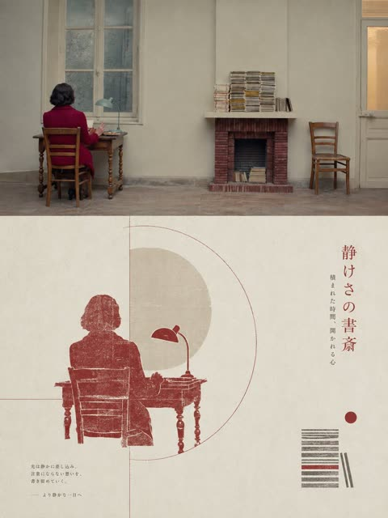
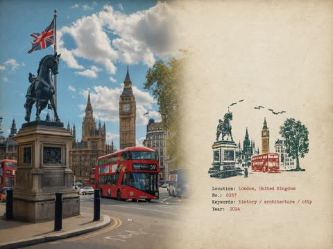

# Posters and editorial layouts

[Back to the list](../../README.md) · All 146 entries · [1](image-poster.md) · **2**

<a id="gpt-image-japanese-video-production-service-poster"></a>
### Japanese video production company poster with four service panels

<a href="https://x.com/kantamizutamari/status/2047247285944508520"></a>

The prompt fixes the layout in order: logotype, headline, then a 2 by 2 grid with a number, label, image description and caption for each panel. It also names exact text strings and a restrained palette, so the Japanese typography and the editorial look hold together.

GPT Image 2 · Text-to-image · Source: [@kantamizutamari on X](https://x.com/kantamizutamari/status/2047247285944508520) · found via [YouMind-OpenLab/awesome-gpt-image-2](https://github.com/YouMind-OpenLab/awesome-gpt-image-2)

[`poster`](tags.md#tag-poster) [`japanese-typography`](tags.md#tag-japanese-typography) [`corporate`](tags.md#tag-corporate) [`grid-layout`](tags.md#tag-grid-layout) [`editorial`](tags.md#tag-editorial)

<details><summary><b>Prompt</b></summary>

```text
Create a clean, premium Japanese corporate poster for a Arks video production company, in a minimalist editorial layout on an off-white background with lots of negative space. Portrait orientation, A4-like poster proportions. At the very top left, place an oversized bold black sans-serif logotype reading Arks, spanning nearly the full width of the page. In the upper right, add a small stacked brand mark in thin uppercase letters: "VIDEO" on one line, "PRODUCTION" on the next, "COMPANY" on the third, with a small burnt-orange geometric accent nearby. Below the logo, add a vertical burnt-orange bar on the left and a large elegant Japanese headline in black Mincho-style serif: 4つの領域で、映像を磨く。. Directly underneath, add a smaller service line in Japanese with slash separators: "SNS運用 / ショートドラマ / MV制作 / AI映像". The main body is a 2 by 2 grid of exactly 4 service panels with thin light-gray divider lines. Each panel has a large black editorial number and a Japanese label. Panel 1 label: "SNS運用" with the number "01"; image shows a close-up hand holding a smartphone displaying social media analytics, on a desk with charts, a calendar sheet, a pen, and a coffee mug, in warm natural office lighting; caption below in Japanese: "企画・分析・運用を一つの流れで。" Panel 2 label: "ショートドラマ" with the number "02"; image shows exactly 2 Japanese high-school-age students in white shirts standing outdoors on a rooftop or balcony, one female and one male, side-profile composition, muted overcast daylight, cinematic shallow depth of field; caption below: "共感が残る、短編の物語設計。" Panel 3 label: "MV制作" with the number "03"; image shows a moody musician playing electric guitar in a dim studio, backlit by soft haze, with a camera monitor in the foreground showing the same performer; caption below: "アーティストの世界観を、映像で可視化。" Panel 4 label: "AI映像" with the number "04"; image shows a dark professional AI video-generation or image-editing software interface on a monitor, with a cinematic scene of a lone figure standing on rocks under dramatic clouds, plus thumbnail timeline images and side control panels; caption below: "技術を表現へ変える、次世代の映像制作。" At the bottom left, place a small three-line English slogan in uppercase: CREATE.\nCONNECT.\nLEAVE A MARK. with a small burnt-orange line accent above it. At the bottom right, place the website arks-vp.com in small serif text with a short black horizontal line beside it. Use a refined mix of bold modern sans-serif for the large logo and numbers, and elegant Japanese serif for headlines and labels. Color palette: black, charcoal, warm off-white, light gray rules, and restrained burnt-orange accents. The overall feel should be realistic, polished, contemporary, Japanese editorial advertising design, with accurate Japanese typography and natural image tones.
```

</details>

<a id="gpt-image-kaohsiung-watercolor-collage-travel-poster"></a>
### Kaohsiung watercolor collage travel poster at sunset

<a href="https://x.com/SimplyAnnisa/status/2058372965641662876"></a>

The prompt splits the poster into scene, design elements placed by corner, and style, with exact text strings and coordinates for each position. Translucent geometric overlays and watercolor splashes in a teal and beige palette tie the illustration and photo collage layers together.

GPT Image 2 · Text-to-image · Source: [@SimplyAnnisa on X](https://x.com/SimplyAnnisa/status/2058372965641662876) · found via [freestylefly/awesome-gpt-image-2](https://github.com/freestylefly/awesome-gpt-image-2)

[`travel-poster`](tags.md#tag-travel-poster) [`watercolor`](tags.md#tag-watercolor) [`collage`](tags.md#tag-collage) [`typography`](tags.md#tag-typography) [`city`](tags.md#tag-city)

<details><summary><b>Prompt</b></summary>

```text
Watercolor and collage travel poster for Kaohsiung, Taiwan, vertical layout, soft pastel and warm golden hour color palette.

Scene: Waterfront promenade at sunset with a modern light rail tram on the right, a person walking a bicycle on the left, and people strolling along the path. In the background: Kaohsiung skyline with the 85 Sky Tower and other skyscrapers, a harbor with a ferry boat, port cranes, and the Pier-2 Art Center building with murals. Seagulls flying in the sky, trees lining the walkway, calm water reflecting the light.

Design elements:
- Large text top left: 'KAO HSIUNG 2026', smaller text below 'Sea Breeze Slow Light Southern City'
- Top right: Vertical Chinese characters, 'KAOHSIUNG TAIWAN' in small caps below
- Bottom left: Coordinates '22.6273° N 120.3014° E', 'KAOHSIUNG TAIWAN', wave icon
- Bottom center: Handwritten script 'Kaohsiung'
- Bottom right: Vertical list 'Harbor Art Light Rail People Slow Life', vertical Chinese text
- Overlay effects: Semi-transparent geometric shapes, watercolor splashes, and texture layers in teal and beige

Style: Modern travel poster meets watercolor painting, airy and atmospheric, blend of illustration and photo-collage, warm and tranquil mood, high detail.
```

</details>

<a id="gpt-image-mid-autumn-festival-ten-poster-collage"></a>
### Ten Minimalist Mid-Autumn Festival Posters Collage

<a href="https://x.com/xiaoxiaodong01/status/2099867787149943085"></a>

The prompt lists each poster by grid position with its own background, motif and exact Chinese text, so every panel gets a distinct scene and caption. A shared elegant minimalist style line keeps the ten panels cohesive.

GPT Image 2.5 · Text-to-image · Source: [@xiaoxiaodong01 on X](https://x.com/xiaoxiaodong01/status/2099867787149943085)

[`mid-autumn`](tags.md#tag-mid-autumn) [`poster-set`](tags.md#tag-poster-set) [`chinese-typography`](tags.md#tag-chinese-typography) [`minimalist`](tags.md#tag-minimalist) [`grid-layout`](tags.md#tag-grid-layout)

<details><summary><b>Prompt</b></summary>

```text
Create a vertical collage of 10 distinct Mid-Autumn Festival posters arranged in a 2-column grid. The style is elegant, poetic, and minimalist Chinese aesthetics.

Top Left: Dark background with yellow osmanthus flowers and a glowing full moon. Text: "花好月圆" (Blooming Flowers & Full Moon), "人间至味是团圆" (The best taste in life is reunion).
Top Right: Ink wash painting style mountains and water with a small boat. Orange sun/moon. Text: "但愿人长久，千里共婵娟" (May we all be blessed with longevity...).
Row 2 Left: Deep blue background showing phases of the moon in a horizontal line. Text: "月亮走过的路也是回家的路" (The road the moon traveled is also the road home).
Row 2 Right: Close-up photography of a mooncake on a ceramic plate with leaf shadows. Text: "时光有味，月饼知秋" (Time has flavor, mooncakes know autumn).
Row 3 Left: Beige background with abstract gold and white circles representing the moon over water ripples. Text: "一轮明月，照见心安" (A bright moon illuminates peace of mind).
Row 3 Right: Red wall with traditional lattice window shadows. Text: "中秋" (Mid-Autumn), "月下有光，家中有暖" (Light under the moon, warmth at home).
Row 4 Left: Green background featuring the back of a white rabbit's head looking up. Text: "把思念轻轻放在月亮上" (Gently place thoughts on the moon).
Row 4 Right: Soft purple/lavender background with hanging paper lanterns. Text: "灯火映圆月，万家皆可期" (Lantern lights reflect the full moon...).
Bottom Left: Night landscape with city lights below and a large orange moon rising over mountains. Text: "山河远阔，人间烟火，皆是团圆" (Vast mountains and rivers... are all reunion).
Bottom Right: Dark moody shot of incense smoke curling upwards from a bowl. Text: "中秋不止一日，而是长久的惦念" (Mid-Autumn is not just one day...).
```

</details>

<a id="gpt-image-mid-century-isometric-city-travel-poster-template"></a>
### Orange Isometric Istanbul Poster with Hagia Sophia

<a href="https://x.com/Naiknelofar788/status/2053667981423784023"></a>

A strict three color palette (cream, black linework, one accent) with a flat accent sky and no gradients gives a screen print look. Swapping the city, landmark and color placeholders reuses the same layout, and fine hatching in an isometric bird's eye view keeps the linework technical.

GPT Image 2 · Text-to-image · Source: [@Naiknelofar788 on X](https://x.com/Naiknelofar788/status/2053667981423784023) · found via [YouMind-OpenLab/awesome-gpt-image-2](https://github.com/YouMind-OpenLab/awesome-gpt-image-2)

[`travel-poster`](tags.md#tag-travel-poster) [`isometric`](tags.md#tag-isometric) [`mid-century`](tags.md#tag-mid-century) [`screen-print`](tags.md#tag-screen-print) [`limited-palette`](tags.md#tag-limited-palette)

<details><summary><b>Prompt</b></summary>

```text
Create a vertical mid-century travel poster for [CITY NAME] featuring [LANDMARK]. Use a strict 3-color palette: cream paper, black technical linework, and [COLOR].
Style: Minimalist isometric bird's-eye view with ultra-fine hatching and screen-print texture.
Color usage: Solid flat [COLOR] for the entire sky and small accents on roofs or streets. No gradients.
Text: Bold sans-serif "[CITY NAME]" at top in cream, with the local language name in smaller cream text below.
```

</details>

<a id="gpt-image-mid-century-isometric-city-travel-poster"></a>
### Mid Century Isometric Tokyo Travel Poster in Red

<a href="https://x.com/jzaib4269/status/2054046672297054595"></a>

A strict three color palette (cream, black linework, one flat accent) keeps the screen print look, and the no gradients rule keeps the sky flat. Bracketed city, landmark and color slots make it a reusable template, while the isometric bird's eye view and fine hatching set the drawing style.

GPT Image 2 · Text-to-image · Source: [@jzaib4269 on X](https://x.com/jzaib4269/status/2054046672297054595) · found via [YouMind-OpenLab/awesome-gpt-image-2](https://github.com/YouMind-OpenLab/awesome-gpt-image-2)

[`travel-poster`](tags.md#tag-travel-poster) [`isometric`](tags.md#tag-isometric) [`mid-century`](tags.md#tag-mid-century) [`screen-print`](tags.md#tag-screen-print) [`limited-palette`](tags.md#tag-limited-palette)

<details><summary><b>Prompt</b></summary>

```text
Create a vertical mid-century travel poster for [CITY NAME] featuring [LANDMARK]. Use a strict 3-color palette: cream paper, black technical linework, and [COLOR].
Style: Minimalist isometric bird's-eye view with ultra-fine hatching and screen-print texture.
Color usage: Solid flat [COLOR] for the entire sky and small accents on roofs or streets. No gradients.
Text: Bold sans-serif "[CITY NAME]" at top in cream, with the local language name in smaller cream text below.
```

</details>

<a id="gpt-image-minimal-layered-cutout-travel-poster"></a>
### Minimal Layered Cutout New York Travel Poster

<a href="https://x.com/Goodmanprotocol/status/2085939245026529335"></a>

The prompt names a premium Scandinavian editorial look and explicitly rules out busy handmade paper craft, which keeps the shapes large and clean. A limited palette of 4 to 6 colors, soft shadows and a placeholder for the destination make it reusable for any city.

GPT Image 2 · Text-to-image · Source: [@Goodmanprotocol on X](https://x.com/Goodmanprotocol/status/2085939245026529335) · found via [YouMind-OpenLab/awesome-gpt-image-2](https://github.com/YouMind-OpenLab/awesome-gpt-image-2)

[`travel-poster`](tags.md#tag-travel-poster) [`paper-cutout`](tags.md#tag-paper-cutout) [`minimalist`](tags.md#tag-minimalist) [`layered`](tags.md#tag-layered) [`editorial`](tags.md#tag-editorial)

<details><summary><b>Prompt</b></summary>

```text
Create a premium editorial travel illustration of DESTINATION, COUNTRY/REGION using a minimal layered cutout illustration style. IMPORTANT: This must NOT look like a busy handmade paper craft artwork. Instead, it should feel like a premium Scandinavian editorial poster, a modern travel magazine cover, a sophisticated museum-shop print, and an elegant minimalist paper collage design. STYLE: minimal layered cutout illustration, large clean paper shapes, editorial paper collage aesthetic, bold geometric masses, simplified layered depth, soft subtle shadows, clean cut edges with slightly rounded corners, ultra simplified shape language. COLOR & LIGHTING: limited color palette (4–6 colors) featuring PRIMARY COLOR, [SECONDARY COLOR], crisp white, soft slate blue, and pale grey, vibrant but restrained tones. MOOD: calm, modern, refined, premium, slightly whimsical, mature high-end travel branding aesthetic. TYPOGRAPHY: minimal elegant sans-serif typography with the text "[DESTINATION]", clean spacing and alignment, suitable size. ASPECT RATIO: 4:5 vertical poster format.
```

</details>

<a id="gpt-image-minimalist-hallstatt-travel-poster"></a>
### Minimalist Hallstatt lakeside travel poster with alpine mountains

<a href="https://x.com/Taaruk_/status/2059188921096085888"></a>

The prompt names a flat vector style and a Scandinavian pastel palette, then lists each destination with its signature landmarks, which keeps every scene specific. Asking for destination name typography and geometric landscape shapes gives the poster a clear layout and a clean finish.

GPT Image 2 · Text-to-image · Source: [@Taaruk_ on X](https://x.com/Taaruk_/status/2059188921096085888) · found via [freestylefly/awesome-gpt-image-2](https://github.com/freestylefly/awesome-gpt-image-2)

[`travel-poster`](tags.md#tag-travel-poster) [`flat-vector`](tags.md#tag-flat-vector) [`pastel`](tags.md#tag-pastel) [`typography`](tags.md#tag-typography) [`landscape`](tags.md#tag-landscape)

<details><summary><b>Prompt</b></summary>

```text
Minimalist flat travel poster illustration series of iconic destinations around the world, clean vector art style, Scandinavian color palette, soft pastel tones, calm atmospheric scenery, Hallstatt Austria lakeside village with alpine mountains and reflections, Bergen Norway colorful harbor houses with fjord background, Kyoto Japan traditional riverside town with cherry blossoms and pagoda, Santorini Greece white architecture with blue domes overlooking the sea, ultra clean composition, geometric landscape shapes, smooth gradients, elegant typography with destination names, modern tourism poster aesthetic, serene travel mood, crisp vector lines, cinematic wide-angle scenery, peaceful skies with stylized clouds, highly detailed environment art, contemporary flat illustration, premium editorial travel design, balanced composition, minimal shadows, dreamy vacation atmosphere, soft morning lighting, high-end Airbnb poster vibe, Behance trending style, 4k, ultra detailed
```

</details>

<a id="gpt-image-monochrome-halftone-photo-poster"></a>
### Monochrome halftone poster from a city photo

<a href="https://x.com/xiaoxiaodong01/status/2090078913930432919"></a>

Fixes a strict 1:1 split with the original photo above and a screen print below, reduced to one small anchor subject in wide white space. Limits color to paper, one ink and a mist tone, builds fog from fading dot density, and lets tiny editorial text interact with the shape.

GPT Image 2 · Edit · Source: [@xiaoxiaodong01 on X](https://x.com/xiaoxiaodong01/status/2090078913930432919) · found via [YouMind-OpenLab/awesome-gpt-image-2](https://github.com/YouMind-OpenLab/awesome-gpt-image-2)

[`halftone`](tags.md#tag-halftone) [`monochrome`](tags.md#tag-monochrome) [`screen-print`](tags.md#tag-screen-print) [`editorial-poster`](tags.md#tag-editorial-poster) [`typography`](tags.md#tag-typography)

<details><summary><b>Prompt</b></summary>

```text
请将我上传的每一张照片分别制作成一张独立的高级设计海报，不多图拼接，每张照片单独输出。整体采用3:4竖版构图，上下两个区域高度严格1:1，各占画面50%。

上半部分保留原始照片，保持主体结构、真实质感、自然光影和原有色彩氛围，仅进行轻微高级摄影调色，使其具有艺术杂志与展览摄影质感。为适配画幅，可自然扩展天空、地面或环境背景，但不得拉伸、扭曲或改变主体。

下半部分提取照片中最具识别性的**主体、轮廓、姿态与叙事关系**，将复杂信息压缩成一个唯一视觉锚点，重构为极简丝网版画与网点印刷海报。不要描摹照片，也不要加入丰富插画细节，只保留一个最关键的形状、动作或空间关系，让主体以极少的信息仍能被一眼识别。

构图遵循“**一个主体、一个方向、一个空间关系**”。主体通常保持较小尺度，以大面积留白制造距离感和诗意；根据原图自身关系，只选择一种最自然的结构：水平延展、纵向延伸、孤立悬置、向外消散或由浅入深，不同时使用多种构图技巧。可以利用一条地平线、边界、阴影或网点带建立空间，让空白本身成为画面的主要组成部分。

配色不直接复制照片，而从原图提炼综合色温、明度与情绪，重新归纳成**纸张底色 + 主墨色 + 雾层色**的有限专色体系。以米白、暖灰或自然纸色承担大面积留白，以一个沉静而有重量的综合色作为主墨色，再用同色系更浅、更灰的颜色表现空气、距离或层次。整体控制在2–3种颜色，以色彩面积、明度和网点密度建立层次，仅在具有明确叙事意义时允许极小面积点色。

所有雾气、距离、阴影、消散和空间过渡均使用 **halftone网点由密至疏自然消失**，不要使用数字模糊或普通渐变。保留纸张颗粒、丝网油墨、轻微套印偏差和不均匀着墨，使画面像真正印刷在旧纸上的艺术版画。

**保留少量具有高级编辑感的装饰性文字系统。** 不局限于地点名称，而从照片的主题、情绪、时间、动作、材质、距离或隐喻中生成极短英文标题，并搭配微型副文、编号、年份、章节号、坐标式数字、档案标记或一句含蓄的英文短句。文案可以略带抽象、文学性和策展语气，不需要完整解释画面，例如关于“距离、静止、经过、回声、边界、时间、光线、痕迹”等概念，使其像艺术书、建筑期刊或独立展览中的编辑注释。

文字本身必须参与构图，而不是后期贴在空白处。可让小字**沿地平线排列、贴合主体轮廓、成为纵向视觉轴、跨越网点边界、隐藏在负形中，或与主体发生遮挡、穿插、断开和对齐关系**；也可通过极细竖线、短横线、编号、页码感符号与大面积留白建立节奏。允许一个词被拆开、纵排、拉开字距或局部被图形遮住，但始终保持阅读秩序。

文字层级保持克制：**一个极短主标题 + 1–3组极小辅助文字即可**。字体参考高级艺术出版物与现代主义编辑设计，使用克制的无衬线、温和衬线或极简窄体字，通过极端字号反差、宽字距、细字重、上下标、小型大写和不对称排版制造精致感。文字颜色与主墨色或雾层色统一，可带轻微套印错位与油墨颗粒，使文字和图形属于同一次印刷，而不是数字排版覆盖层。

整体追求**极少元素、极大留白、极小主体、极强秩序，以及微妙而聪明的文字介入**，呈现安静、孤独、辽阔、含蓄、诗意、知识感和收藏感。避免复杂构图、多个焦点、无意义装饰、大标题压画面、商业广告文案、普通渐变、廉价复古滤镜和模板感。
```

</details>

<a id="gpt-image-monochrome-watercolor-city-travel-poster"></a>
### Monochrome blue watercolor Tokyo travel poster

<a href="https://x.com/Goodmanprotocol/status/2062564327140503787"></a>

A bracketed template swaps city, color, landmarks, street lamp and vehicle while the layout stays fixed. Low pedestrian eye level, white negative space and an upper left serif title give a consistent poster look.

GPT Image 2 · Text-to-image · Source: [@Goodmanprotocol on X](https://x.com/Goodmanprotocol/status/2062564327140503787) · found via [freestylefly/awesome-gpt-image-2](https://github.com/freestylefly/awesome-gpt-image-2)

[`watercolor`](tags.md#tag-watercolor) [`travel-poster`](tags.md#tag-travel-poster) [`monochrome`](tags.md#tag-monochrome) [`template`](tags.md#tag-template) [`cityscape`](tags.md#tag-cityscape)

<details><summary><b>Prompt</b></summary>

```text
Minimalist vintage watercolor travel poster illustration of [CITY NAME], [COUNTRY], rendered entirely in elegant monochromatic [COLOR] watercolor and fine ink linework.

Aspect ratio: 4:5 vertical composition optimized for poster and social media presentation.

A peaceful early-morning streetscape featuring the iconic [PRIMARY LANDMARK] and [SECONDARY LANDMARK/LOCATION] in the foreground, viewed from a slightly low pedestrian-level perspective. Historic local architecture, elegant facades, ornate details, arched windows, decorative cornices, and traditional street elements line the spacious surroundings, creating a timeless urban atmosphere. A classic [LOCAL STREET ELEMENT OR LAMP STYLE] stands prominently on the left side, while mature leafy trees frame portions of the scene, their foliage painted with soft watercolor washes and delicate splatter textures. In the distance, [DISTANT LANDMARK OR SKYLINE FEATURE] rises gracefully against the skyline, serving as a recognizable cultural landmark. A vintage [LOCAL VEHICLE] or a few small pedestrians add subtle life and scale without disturbing the tranquil mood.

The composition includes large areas of clean white negative space, soft cloudy watercolor textures in the sky, delicate paper grain, and subtle watercolor blooms. The paving, street, or plaza stretches dramatically across the foreground, leading the viewer’s eye toward the landmark ensemble. Typography in the upper-left corner reads “[CITY NAME], [COUNTRY]” in a refined serif font, styled like a sophisticated travel journal or collectible city poster.

Handcrafted watercolor illustration, architectural sketch aesthetic, serene urban atmosphere, soft natural morning lighting, muted monochromatic palette, highly detailed line art, elegant travel-poster design, minimalist luxury wall-art style, timeless local charm, premium stationery illustration, ultra-detailed, high-resolution, clean composition, Pinterest-worthy, Instagram-worthy, gallery-quality artwork.
```

</details>

<a id="gpt-image-neon-yellow-japanese-ai-canvas-ad-poster"></a>
### Neon yellow Japanese AI app ad poster

<a href="https://x.com/dezainaz_ceo/status/2063113560830742906"></a>

The prompt fixes exact counts for every element, such as 2 stat blocks, 6 feature labels and 5 nav items, and gives the exact Japanese copy for each text slot. A low angle fashion subject is combined with skewed panels and UI mockups on a black and fluorescent yellow palette.

GPT Image 2 · Text-to-image · Source: [@dezainaz_ceo on X](https://x.com/dezainaz_ceo/status/2063113560830742906) · found via [YouMind-OpenLab/awesome-gpt-image-2](https://github.com/YouMind-OpenLab/awesome-gpt-image-2)

[`japanese-typography`](tags.md#tag-japanese-typography) [`ad-poster`](tags.md#tag-ad-poster) [`ui-mockup`](tags.md#tag-ui-mockup) [`neon-yellow`](tags.md#tag-neon-yellow) [`fashion-photo`](tags.md#tag-fashion-photo)

<details><summary><b>Prompt</b></summary>

```text
Goal: Create a high-impact Japanese cyberpunk-style advertising poster for an AI creative canvas tool called Banas, with a loud yellow-and-black street magazine layout and a dramatic fashion photo centerpiece.

Canvas: Landscape 16:9 poster, bright fluorescent yellow background with black ink texture, diagonal perspective, gritty halftone scratches, skewed panels, thick black borders, and dense promotional typography. Overall look should feel like a Japanese web banner or transit ad for a next-generation AI design app.

Main subject: One young male creator photographed from an extreme low angle, occupying the left and center of the poster. He wears an oversized glossy cobalt-blue windbreaker jacket, messy black hair, and reaches one hand toward the camera with motion blur and shallow depth of field. His face is intentionally obscured by a soft square blur/mosaic censor block. Lighting is harsh and editorial, with strong contrast against the yellow background.

Layout: Place a huge slanted black logo wordmark reading Banas on the upper right-center, with a small trademark mark. Above it, add a narrow black headline strip with energetic Japanese marketing copy. Around the logo, use multiple tilted yellow and black text boxes. On the far right, add one tall vertical framed headline panel. At bottom, add a black navigation bar with product feature icons and labels.

Text content: The largest Japanese headline should be AIで、想像を超えろ。レイヤーも、ポーズも、すべて自由自在。. The main logo area should include the supporting phrase 次世代AIキャンバスツール. Add a bold central callout reading 無限大。. Add one circular call-to-action badge on the right reading 今すぐ無料で始める!. Keep all visible copy in bold Japanese display typography, mixing horizontal and vertical writing.

Discrete visible elements to include: exactly 1 censored human model; exactly 1 giant product logo; exactly 1 laptop/tablet-like app preview screen near the lower center-right; exactly 1 smartphone app mockup in the bottom-right corner; exactly 1 circular call-to-action badge; exactly 1 tall vertical headline panel on the far right; exactly 2 large numeric statistic blocks on the left, one showing 70% and one showing 50万人; exactly 6 stacked feature labels on the left side; exactly 4 small rectangular feature badges on the right side; exactly 5 bottom navigation items with simple white icons: sparkle/AI generation, layers, grid/template, cloud upload, and search/experience button.

App mockups: The larger tilted screen should show a dark UI labeled with the product name and a surreal generated image of a person in yellow clothing looking up at floating islands and vegetation in a bright blue sky. The smartphone mockup should show a dark mobile interface with thumbnail rows and a create button.

Visual style: Ultra-bold Japanese commercial graphic design, black typography on neon yellow, skewed perspective, energetic composition, dramatic lens distortion, glossy fashion photography mixed with UI mockups, high contrast, crisp print-ad finish, no clean minimalism, no white background, no watermark.
```

</details>

<a id="gpt-image-noir-streetwear-hoodie-campaign-poster"></a>
### Dark streetwear hoodie campaign poster in wet alley

<a href="https://x.com/Daniel_adsss/status/2048542581638701446"></a>

One hero product, a named setting (wet concrete, low light, smoke) and a short headline give the model a clear focal point and text hierarchy. A restricted palette of deep black with grey accents, plus the instruction of no clutter and no collage, keeps the layout clean.

GPT Image 2 · Text-to-image · Source: [@Daniel_adsss on X](https://x.com/Daniel_adsss/status/2048542581638701446) · found via [freestylefly/awesome-gpt-image-2](https://github.com/freestylefly/awesome-gpt-image-2)

[`streetwear`](tags.md#tag-streetwear) [`campaign`](tags.md#tag-campaign) [`hoodie`](tags.md#tag-hoodie) [`brand-poster`](tags.md#tag-brand-poster) [`dark-moody`](tags.md#tag-dark-moody)

<details><summary><b>Prompt</b></summary>

```text
Create a premium, highly realistic 1:1 campaign poster for NOIR, a modern streetwear brand. Show one hero oversized hoodie as the main focus against a gritty urban backdrop with wet concrete floors, dramatic low lighting, subtle smoke in the air and a raw street energy. Add bold minimal typography with the brand name NOIR and a short campaign headline like "Wear the Dark." Make it feel like a real high-end streetwear editorial, sharp detail, realistic fabric textures, modern and edgy, deep black tones with subtle grey accents, no clutter, no collage.
```

</details>

<a id="gpt-image-olive-waffle-tee-editorial-poster"></a>
### Olive Waffle Knit Shirt Editorial Poster

<a href="https://x.com/harboriis/status/2053813021592506439"></a>

Fixes the layout zone by zone: a ghost hung product in front of oversized cropped background type, then three diagonal macro detail strips below. A strict three color palette and exact text placements keep the poster cohesive and the copy legible.

GPT Image 2 · Edit · Source: [@harboriis on X](https://x.com/harboriis/status/2053813021592506439) · found via [YouMind-OpenLab/awesome-gpt-image-2](https://github.com/YouMind-OpenLab/awesome-gpt-image-2)

[`fashion`](tags.md#tag-fashion) [`product-poster`](tags.md#tag-product-poster) [`editorial`](tags.md#tag-editorial) [`typography`](tags.md#tag-typography) [`reference-image`](tags.md#tag-reference-image)

<details><summary><b>Prompt</b></summary>

```text
Create a high-end fashion product advertisement poster in portrait 4:5 ratio, clean minimal editorial style using a reference product image. Background is a warm off-white to light khaki gradient studio setup, very minimal, soft, airy, with subtle warm tones. Main product: an olive army green oversized waffle-knit long sleeve crewneck shirt, ghost-hung on a silver metal clothing rack stand with a visible clamp at the top-right. The shirt hangs naturally with slight drape, front-facing. On the center chest, include white puff embroidery text: “SVG”. Add a small dark navy woven label patch on the right hem side seam and a visible dark navy neck tag at the collar. Typography: top center minimal brand logo “SVG STUDIOS” in olive green clean sans-serif, top-left italic cursive “Field” with a small dark olive rectangle badge below reading “edition” in white, behind the shirt place massive ultra-condensed olive green text “WAFFLE TEE” partially hidden and cut by the product, bleeding off edges. lower-left include handwritten “SVG” and large cursive “Studios” in olive tone. Bottom section features three diagonal detail strips: macro waffle-knit texture, closeup puff embroidery stitching, and closeup dark navy neck label, all with warm studio lighting. Between strips include small text “Built for movement, designed for unity. The SVG Studios WIP Waffle Longsleeve — SS26 Collection” Footer includes 4 small barcode at bottom-left, centered text “• WWW. SVGSTUDIOS. COM • • •” in spaced caps olive tone, and small text “MADE IN MALAYSIA • SS26 COLLECTION”. Color palette is olive army green, warm cream, and dark navy only. Overall style is clean editorial fashion lookbook, military-inspired streetwear campaign, soft diffused lighting, high contrast product focus, photorealistic, ultra detailed, 8K quality.
```

</details>

<a id="gpt-image-oversized-button-fashion-split-editorial"></a>
### Split frame fashion editorial with oversized colorful buttons

<a href="https://x.com/Mind_Boticni/status/2053082199436759258"></a>

A split frame layout names each panel separately (full body left, two half body panels right) and asks for a different face, pose and background tone in each. A fixed cyan, orange, yellow and red palette plus glossy studio lighting keeps the three panels unified.

GPT Image 2 · Text-to-image · Source: [@Mind_Boticni on X](https://x.com/Mind_Boticni/status/2053082199436759258) · found via [freestylefly/awesome-gpt-image-2](https://github.com/freestylefly/awesome-gpt-image-2)

[`fashion`](tags.md#tag-fashion) [`editorial`](tags.md#tag-editorial) [`split-frame`](tags.md#tag-split-frame) [`buttons`](tags.md#tag-buttons) [`studio`](tags.md#tag-studio)

<details><summary><b>Prompt</b></summary>

```text
Use reference image as style guide.
Surreal minimalist fashion editorial photography with vibrant oversized colorful buttons as main visual theme (cyan, orange, yellow, red palette), glossy 3D surface design, clean studio lighting, ultra-smooth gradients, and high-end commercial fashion look.
Split-frame composition:

Left side: full-body female model standing from top to bottom, wearing bold minimalist fashion outfit inspired by reference style, confident pose, clean studio background filled with oversized colorful buttons, cinematic lighting, soft shadows, ultra-clean composition.

Right side (vertically split into two parts):
Top-right: half-body female model, different face, different pose, different outfit variation inspired by same button aesthetic, different background color mood.
Bottom-right: another half-body female model, completely different expression and pose, different styling, different background tone, maintaining same surreal button universe aesthetic.

Each section visually distinct but unified by the colorful button-inspired design language, glossy surfaces, soft studio reflections, and fashion magazine editorial feel.
Hyper-realistic, cinematic lighting, ultra-clean composition, high-end luxury campaign style, depth, contrast, 8k, 1:1 aspect ratio --style raw --v 6 --ar 1:1
```

</details>

<a id="gpt-image-overthinking-giant-head-seat-poster"></a>
### Woman Sitting on Her Giant Head, Overthinking Poster

<a href="https://x.com/AIwithAliya/status/2049044716642316758"></a>

One surreal twist, a scaled up copy of her own head used as a seat, is stated in its own paragraph and backed by a plain blush and cream studio. Typography is specified line by line with size, hand drawn style, color and a crossed out word, so the text lands as part of the layout.

GPT Image 2 · Text-to-image · Source: [@AIwithAliya on X](https://x.com/AIwithAliya/status/2049044716642316758) · found via [freestylefly/awesome-gpt-image-2](https://github.com/freestylefly/awesome-gpt-image-2)

[`surreal`](tags.md#tag-surreal) [`fashion-editorial`](tags.md#tag-fashion-editorial) [`typography`](tags.md#tag-typography) [`pastel`](tags.md#tag-pastel) [`self-portrait`](tags.md#tag-self-portrait)

<details><summary><b>Prompt</b></summary>

```text
Ultra-realistic conceptual portrait of a young woman with long wavy hair and soft defined features, wearing rose-tinted rectangular sunglasses, an oversized ivory cropped t-shirt, fitted light-wash denim jeans, and clean white sneakers. She is sitting casually with a confident yet relaxed posture.

The twist: she is seated on a large, hyper-realistic version of her own detached head placed on the ground. The head is scaled up, lying sideways, with the same facial features and sunglasses, creating a surreal self-reflection concept.

Composition: centered, full-body shot, neutral studio background with soft blush and cream tones, minimal aesthetic. Clean negative space.

Typography integrated into the background:

Handwritten-style text at the top: "OVERTHINKING"

Below it, smaller text: "TRAPPED IN MY OWN HEART" with "HEART" crossed out

Large, rough, scribbled text in deep pink: "MIND"

Lighting: soft diffused studio lighting, subtle shadows, high detail, fashion editorial quality.

Style: blend of surrealism and modern luxury streetwear campaign, pastel feminine aesthetic, minimal yet expressive, high-resolution, 8k, sharp focus, natural skin texture.

Mood: introspective, emotional weight, identity, self-awareness, quiet confidence.
```

</details>

<a id="gpt-image-pastel-anime-fantasy-heroine-key-visual-poster"></a>
### Pastel anime fantasy poster with staff-wielding heroine

<a href="https://x.com/8co28/status/2046978759946072262"></a>

The prompt fixes a limited palette of lavender, white and gold, then assigns every text block a position: tagline, name, callouts, vertical copy, inset expression portraits, title and footer. Naming the pose, costume parts and key art finish keeps the heroine consistent while the typography stays integrated.

GPT Image 2 · Text-to-image · Source: [@8co28 on X](https://x.com/8co28/status/2046978759946072262) · found via [YouMind-OpenLab/awesome-gpt-image-2](https://github.com/YouMind-OpenLab/awesome-gpt-image-2)

[`anime`](tags.md#tag-anime) [`fantasy`](tags.md#tag-fantasy) [`key-visual`](tags.md#tag-key-visual) [`japanese-typography`](tags.md#tag-japanese-typography) [`pastel`](tags.md#tag-pastel)

<details><summary><b>Prompt</b></summary>

```text
A vertical Japanese anime fantasy game or light-novel promotional poster in a soft pastel lavender, white, and gold palette, featuring a single heroic teenage girl as the main subject in a grand celestial city. She stands in a dynamic three-quarter full-body pose, slightly turned left, holding an ornate staff in her left hand, with her right arm extended behind her as if caught in wind. Her face is obscured by a flat pale square censor block centered over the head, but the visible design suggests a delicate anime heroine with very long flowing silver-lilac hair, side bangs, loose strands, and star-shaped hair ornaments with dark indigo ribbon bows. She wears an elaborate magical-girl style dress: off-shoulder white bodice with navy and violet trim, gold star motifs, layered asymmetrical skirt in white, periwinkle, violet, and deep indigo, a very large dark blue waist bow with a gold star jewel, detached flowing sleeves, gold chains with tiny star charms draped at the hip, white thigh-high stockings, and a blue star-shaped garter ornament on one thigh. Her staff is tall and elegant, dark shaft with gold frame elements and a suspended faceted blue crystal near the top, decorated with bows and star accents. The background is an airy fantasy skyline of white towers, cathedral-like spires, clouds, feathers, and drifting pink petals, with bright ethereal backlighting and a dreamy heroic atmosphere. Compose it like a polished key visual poster with abundant Japanese typography integrated into the artwork. At the upper left, place the Japanese tagline text "願いが、未来を照らす。" with two smaller lines below it. At the upper right, place a star-like emblem, the large character name "ルミナ", the subtitle "— Lumina —", and a smaller CV credit line. On the right side, add 3 vertically stacked feature callouts, each with a small icon and a bold Japanese heading followed by 2 short lines of smaller text. On the left side, add 1 vertical Japanese copy block running downward beside the character. At the lower right, include 3 small portrait inset panels of the same girl, stacked diagonally: 1 calm front-facing expression, 1 side-profile serious expression, and 1 smiling eyes-closed expression. At the lower left, place the large Japanese title "星紡ぐレガシア" with the English subtitle "— LEGACIA: Weave the Stars —" beneath it. At the bottom right, add the date text "2025. 夏" and one short Japanese tagline line below. At the very bottom edge, include 2 small social or website info blocks on the left and a tiny copyright line on the right. Render in high-end modern anime promotional illustration style, luminous pastel fantasy atmosphere, elegant composition, smooth linework and coloring, soft cel shading, delicate fabric movement, glossy highlights, intricate costume details, clean typography layout, and refined commercial poster finish.
```

</details>

<a id="gpt-image-personalized-travel-magazine-page"></a>
### Personalized vertical travel magazine page with attached person

<a href="https://x.com/minchoi/status/2097525572591136869"></a>

A bracketed destination slot makes the template reusable, and the attached person is blended into the destination photography. Listing the page parts (headline, tips, recommendations, captions) and ending with a check of every visible word keeps the text readable.

GPT Image 2.5 · Edit · Source: [@minchoi on X](https://x.com/minchoi/status/2097525572591136869) · found via [wangrunlin/awesome-gpt-image-2-5-prompts](https://github.com/wangrunlin/awesome-gpt-image-2-5-prompts)

[`travel-magazine`](tags.md#tag-travel-magazine) [`editorial-layout`](tags.md#tag-editorial-layout) [`personalized`](tags.md#tag-personalized) [`template`](tags.md#tag-template) [`vertical`](tags.md#tag-vertical)

<details><summary><b>Prompt</b></summary>

```text
Create a vertical 9:16 travel-magazine page about [DESTINATION]. Blend the attached person naturally into the destination photography. Include a clear headline, short travel tips, recommendations, and photo captions. Use the whole page with a readable editorial hierarchy. Check every visible word.
```

</details>

<a id="gpt-image-phoenix-rebirth-typography-poster"></a>
### Phoenix Rebirth Typography Poster with Burning Wings

<a href="https://x.com/dotey/status/2048793351290327381"></a>

A single INPUT_TEXT placeholder makes the prompt reusable for any title. It asks for custom letterforms, one visual metaphor that interacts with the type, and a restrained 4 to 6 colour system with risograph grain.

GPT Image 2 · Text-to-image · Source: [@dotey on X](https://x.com/dotey/status/2048793351290327381) · found via [freestylefly/awesome-gpt-image-2](https://github.com/freestylefly/awesome-gpt-image-2)

[`typography`](tags.md#tag-typography) [`poster`](tags.md#tag-poster) [`conceptual`](tags.md#tag-conceptual) [`risograph`](tags.md#tag-risograph) [`template`](tags.md#tag-template)

<details><summary><b>Prompt</b></summary>

```text
Create ONE finished premium conceptual typography poster for the exact title:

“[INPUT_TEXT]”

Single poster only. No moodboard, grid, presentation board, mockup, captions, prompt text, process sheet, or sample labels.

The title “[INPUT_TEXT]” must be the dominant visual structure of the poster: huge, readable, powerful, and spelled exactly. Do not translate, shorten, replace, or misspell it. Do not add other large readable text. Optional micro catalog text is allowed only if it stays subtle and secondary.

Silently interpret the title’s meaning, mood, cultural aura, symbolic associations, psychological tension, and visual rhythm. Turn that interpretation into one strong visual metaphor.

Typography is the hero. Design custom-looking letterforms whose weight, width, contrast, spacing, rhythm, distortion, negative space, edge quality, and ink texture express the temperament of the title. The type should feel intentionally designed, not like a default font.

If “[INPUT_TEXT]” refers to a widely known person, make a large editorial portrait or full / half-body figure a major visual presence, occupying roughly 40–70% of the composition. The figure should feel recognizable through aura, posture, styling, era, expression, lighting, and symbolic atmosphere, but should not copy a specific existing photograph, official poster, campaign image, logo, slogan, or copyrighted composition. The portrait must interact with the typography: overlapping the letters, emerging from them, being framed by them, casting shadows on them, breaking through them, or being partially hidden behind them.

For all other titles, use a human figure, landscape, object, or atmospheric setting only when it strengthens the meaning. It must interact with the typography and deepen the concept, not decorate it.

Use a rich but restrained 4–6 color system matched to the theme: dominant background color, primary typography color, figure / landscape tone, emotional accent color, muted support color, and subtle paper / ink texture tone. Avoid flat black-white-red defaults unless conceptually necessary.

Composition style: high-end editorial poster, museum-quality graphic design, dramatic scale, strong hierarchy, few elements, intelligent whitespace, bold flat color areas, sharp cropping, silkscreen / lithograph / risograph grain, paper fibers, subtle ink imperfections, refined visual tension.

The final image should feel like a complete visual sentence: the title, the figure or setting, the color, and the typography explain each other.

Avoid generic word art, glossy 3D lettering, random icons, stock-photo realism, cluttered collage, excessive grunge, tourist clichés, official logos, copied slogans, copied campaign aesthetics, unrelated text, and misspelled typography.

-----

INPUT_TEXT：Phoenix Rebirth
```

</details>

<a id="gpt-image-photo-to-geometric-rubbing-split-poster"></a>
### Photo above, geometric rubbing print below poster

<a href="https://x.com/xiaoxiaodong01/status/2090753061857931599"></a>

The canvas is split into two exact 50 percent halves: the original photo on top and a graphic reconstruction below. The lower half is limited to one core motif, built on a geometric matrix of shared axes and tangencies, with a paper palette drawn from the photo.

GPT Image 2 · Edit · Source: [@xiaoxiaodong01 on X](https://x.com/xiaoxiaodong01/status/2090753061857931599) · found via [YouMind-OpenLab/awesome-gpt-image-2](https://github.com/YouMind-OpenLab/awesome-gpt-image-2)

[`poster`](tags.md#tag-poster) [`split-layout`](tags.md#tag-split-layout) [`geometric`](tags.md#tag-geometric) [`print-texture`](tags.md#tag-print-texture) [`photo-to-graphic`](tags.md#tag-photo-to-graphic)

<details><summary><b>Prompt</b></summary>

```text
Please turn each photo I upload into a separate premium-designed poster, with no multi-image collage; output each photo as an independent poster. Use an overall 3:4 vertical composition, strictly divided into two equal-height sections, with the upper and lower halves each occupying exactly 50% of the canvas. The upper half should preserve the original photograph, maintaining the subject’s structure, realistic texture, natural lighting and shadows, and original color atmosphere, with only subtle high-end photographic color grading to give it the quality of an art publication or exhibition photograph. To adapt the image to the required aspect ratio, you may naturally extend the sky, ground, or environmental background, but you must not stretch, distort, or alter the main subject. The lower half should extract the most recognizable subject, silhouette, posture, and narrative relationship from the photograph; first understand its core meaning, cultural attributes, or emotional relationship, then reconstruct it into a graphic composition combining the character of a folk-culture catalog, antique rubbing prints, and modern graphic design. Do not translate every element in the photograph one by one, and do not add generic traditional patterns; retain only one core visual motif and a very small number of auxiliary forms that truly carry narrative significance. Use silhouette, negative space, partial enlargement, shape merging, and symbolic transformation so that the graphic not only corresponds to the original object but also expresses the meaning behind it. Build the composition on a rigorous geometric framework and proportional system: derive circles, squares, triangles, arcs, axes, or repeated proportions from the structure of the subject itself as the “geometric matrix,” then align all main forms, secondary graphics, typography, and negative space through shared tangencies, common axes, nesting, mirroring, proportional progression, or edge cropping relationships. The layout may be freely distributed, off-center, extend beyond boundaries, or be asymmetrical, but every element must obey the same structural logic, creating a clear visual center of gravity, hierarchy, rhythm, and negative space; from a distance the order should be immediately legible, while closer viewing should reveal traditional print traces and subtle details. Avoid random scattered elements and decorative accumulation. Extract the most distinctive, lively, and spiritually expressive colors from the upper photograph and reorganize them into a clean, restrained paper-printing palette. Use a bright, light paper-colored background to create breathing room, one dark color to establish the visual skeleton, and one or two theme colors derived from the original photograph to organize the main subject and limited accents. Build depth through area ratios, overprinting, and ton
```

</details>

<a id="gpt-image-porto-mid-century-travel-poster"></a>
### Mid-century isometric travel poster of Porto

<a href="https://x.com/Goodmanprotocol/status/2053523890744545437"></a>

A strict three color palette of cream, black linework and one flat accent color keeps the screen print look coherent. Bracketed city, landmark and color slots make it reusable, and the bold top title with a smaller local name line sets the poster hierarchy.

GPT Image 2 · Text-to-image · Source: [@Goodmanprotocol on X](https://x.com/Goodmanprotocol/status/2053523890744545437) · found via [freestylefly/awesome-gpt-image-2](https://github.com/freestylefly/awesome-gpt-image-2)

[`travel-poster`](tags.md#tag-travel-poster) [`mid-century`](tags.md#tag-mid-century) [`isometric`](tags.md#tag-isometric) [`screen-print`](tags.md#tag-screen-print) [`template`](tags.md#tag-template)

<details><summary><b>Prompt</b></summary>

```text
Create a vertical mid-century travel poster for [CITY NAME] featuring [LANDMARK]. Use a strict 3-color palette: cream paper, black technical linework, and [COLOR].
Style: Minimalist isometric bird's-eye view with ultra-fine hatching and screen-print texture.
Color usage: Solid flat [COLOR] for the entire sky and small accents on roofs or streets. No gradients.
Text: Bold sans-serif "[CITY NAME]" at top in cream, with the local language name in smaller cream text below.
```

</details>

<a id="gpt-image-poster-redesign-male-perspective-lyric"></a>
### Anime schoolboy with bouquet on blue lyric poster

<a href="https://x.com/ponzponz15/status/2097513870969688188"></a>

Anchors the edit to the original poster by asking to retain its composition and visual world, so the layout stays fixed while the concept changes. Asking for all visible text to be replaced with new copy forces the model to rewrite headlines, labels and captions to match the new perspective.

GPT Image 2.5 · Edit · Source: [@ponzponz15 on X](https://x.com/ponzponz15/status/2097513870969688188) · found via [wangrunlin/awesome-gpt-image-2-5-prompts](https://github.com/wangrunlin/awesome-gpt-image-2-5-prompts)

[`poster-redesign`](tags.md#tag-poster-redesign) [`reference-edit`](tags.md#tag-reference-edit) [`text-replacement`](tags.md#tag-text-replacement) [`anime`](tags.md#tag-anime) [`typography`](tags.md#tag-typography)

<details><summary><b>Prompt</b></summary>

```text
Using the original poster as reference, retain its overall composition and visual world. Reinterpret it from a male perspective and replace all visible text with new copy that fits the revised concept.
```

</details>

<a id="gpt-image-rainy-night-cinema-noir-poster"></a>
### Rainy Night Cinema Noir Poster with Giant Face

<a href="https://x.com/xiaoxiaodong01/status/2064877952211489255"></a>

The prompt places each element by position (ear left, eye upper right, projector lower left, two silhouettes bottom center) and gives an exact silhouette count. It limits color to charcoal and ivory with one warm amber beam, and it specifies the Chinese title and the release line as exact text.

GPT Image 2 · Text-to-image · Source: [@xiaoxiaodong01 on X](https://x.com/xiaoxiaodong01/status/2064877952211489255) · found via [YouMind-OpenLab/awesome-gpt-image-2](https://github.com/YouMind-OpenLab/awesome-gpt-image-2)

[`movie-poster`](tags.md#tag-movie-poster) [`noir`](tags.md#tag-noir) [`monochrome`](tags.md#tag-monochrome) [`chinese-typography`](tags.md#tag-chinese-typography) [`calligraphy`](tags.md#tag-calligraphy)

<details><summary><b>Prompt</b></summary>

```text
Create a cinematic monochrome Chinese movie poster in a dark, rainy, nostalgic style. The canvas is a wide horizontal 3:2 poster. Show an enormous close-up profile of an elegant woman's face filling the entire background, cropped so her ear with a round pearl-like floral earring is on the left, her eye and eyelashes are near the upper right, and her nose and lips fade into shadow on the far right. Use soft black-and-white film grain, smoky haze, high contrast shadows, and a vintage 1930s melodrama mood. In the lower left, place an old film projector with visible reels, projecting a warm amber beam of light across the scene. In the bottom center foreground, show exactly 2 small human silhouettes sitting on a wet reflective floor facing the projection: 1 young man on the left and 1 young woman on the right, both seen from behind. Add subtle rainwater reflections and a thin horizon line at the floor. Across the middle-left to center, overlay large expressive handwritten Chinese calligraphy title text reading 雨夜放映, in off-white brush strokes with long sweeping lines. To the right of the title, add small spaced Chinese release information reading 社团开放夜 / 6月28日 / 教三 204. Keep the typography elegant, sparse, and integrated into the face. Color palette should be mostly charcoal black, muted gray, and ivory, with the projector beam as the only warm orange accent. No extra logos, no borders, no additional characters, no modern digital elements.
```

</details>

<a id="gpt-image-raw-sketchy-portrait-poster-with-animal"></a>
### Raw sketchy ink portrait poster with dog

<a href="https://x.com/kingofdairyque/status/2093279729717780736"></a>

A fill in template with HUMAN, CLOTHING, ANIMAL, SCENERY and COLORS slots. Broken ink contours, flat shadow blocks, one warm field against one cool field, and scenery cut down to two or three silhouettes keep the face dominant.

GPT Image 2 · Text-to-image · Source: [@kingofdairyque on X](https://x.com/kingofdairyque/status/2093279729717780736) · found via [freestylefly/awesome-gpt-image-2](https://github.com/freestylefly/awesome-gpt-image-2)

[`sketchy-ink`](tags.md#tag-sketchy-ink) [`portrait-poster`](tags.md#tag-portrait-poster) [`animal-companion`](tags.md#tag-animal-companion) [`limited-palette`](tags.md#tag-limited-palette) [`template`](tags.md#tag-template)

<details><summary><b>Prompt</b></summary>

```text
Raw sketchy graphic portrait poster of [HUMAN] wearing [CLOTHING], half-body and large in frame, accompanied closely by [ANIMAL], with a minimal [SCENERY] background. Render in a rough expressive illustrated style with broken black ink contours, loose sketch lines, scratchy hatching, irregular stroke weight, imperfect line edges, fast gestural mark-making, simplified anatomy, flat cel-like shadow blocks, and reduced detail. Use a restrained [COLORS] palette with one dominant warm field, one cool counter-field, dark inked shadows, and a few pale highlight accents. Keep the face oversized and central, crop around mid-torso, and place the animal in the lower foreground or tucked beside the subject, drawn with the same simplified raw linework. Reduce the scenery into only 2 or 3 bold silhouette shapes behind the subject, with no detailed environment rendering. Add a narrow warm off-white poster border and very light print texture. Strong attitude, graphic poster energy, intentionally imperfect strokes, raw and sketchy finish, ar 4:5
```

</details>

<a id="gpt-image-red-beam-editorial-portrait-poster"></a>
### Red Light Beam Editorial Portrait Poster

<a href="https://x.com/Goodmanprotocol/status/2092471662126211143"></a>

The prompt fills in slots for subject, interference, title, palette and mood, and allows only one interference method so the effects do not compete. A neutral palette with a single accent color, plus oversized headline type that overlaps the subject, gives the poster its editorial look.

GPT Image 2 · Text-to-image · Source: [@Goodmanprotocol on X](https://x.com/Goodmanprotocol/status/2092471662126211143) · found via [freestylefly/awesome-gpt-image-2](https://github.com/freestylefly/awesome-gpt-image-2)

[`editorial`](tags.md#tag-editorial) [`typography`](tags.md#tag-typography) [`portrait-poster`](tags.md#tag-portrait-poster) [`template`](tags.md#tag-template) [`red-accent`](tags.md#tag-red-accent)

<details><summary><b>Prompt</b></summary>

```text
Create a medium-sized 9:16 experimental editorial portrait poster using the following customizable inputs:

Subject: [Adult Male or Female Portrait]
Interference: [Color Split / Narrow Light Beam / Horizontal Cut / Motion Veil]
Title: [Title]
Palette: [Main Neutral Tones + One Accent Color]
Mood: [Sharp / Cinematic / Restrained / Experimental]

Create a striking close-up or waist-up portrait with the subject occupying a strong portion of the frame. Preserve realistic facial features, natural skin texture, authentic hair, realistic proportions, clear emotion, and a strong silhouette. The portrait must work visually as a fashion photograph before the graphic intervention is applied.

Use only one primary interference method:

Color Split: Uneven translucent bands selectively shift, reveal, separate, or distort portions of the portrait.

Narrow Light Beam: A single controlled beam cuts across the face or body and continues naturally into the surrounding space.

Horizontal Cut: Bold horizontal bands interrupt selected areas of the portrait and interact with oversized typography.

Motion Veil: Keep the main portrait sharp while selected areas create subtle horizontal photographic motion trails.

Make typography an integral part of the composition. Use one dominant headline, allowing letters to crop beyond the frame, overlap the subject, disappear behind the body, or interact with the interference.

Keep supporting text minimal: one small series label and one short phrase.

Use mostly black, white, grey, charcoal, or deep neutral tones, plus one accent color. Keep skin tones natural and avoid excessive warmth or yellow grading.

Add only a few subtle graphic details such as fine lines, circles, or open corner marks when necessary.

The final composition should feel like a premium fashion editorial, contemporary photography poster, or experimental art-direction piece—clean, intentional, sophisticated, and visually balanced.

Avoid multiple competing effects, dense text, UI elements, heavy glitches, random collage, excessive decoration, numbering, “Vol.” or “Issue” labels, sparkle symbols, logos, watermarks, distorted anatomy, plastic skin, oversaturation, and generic template aesthetics.

Keep the overall treatment medium in scale, refined, adaptable, and universally applicable to different people, titles, themes, palettes, and editorial concepts.
```

</details>

<a id="gpt-image-restaurant-shaped-standee-template"></a>
### Die cut restaurant standee for summer drinks

<a href="https://x.com/MrLarus/status/2059248197910827364"></a>

A bracketed template with fields for brand, products, selling points and promotions, so it can be reused for any menu. It fixes a pure white background, a full irregular outline with a visible base, and a clear reading order from headline to main product to price.

GPT Image 2 · Text-to-image · Source: [@MrLarus on X](https://x.com/MrLarus/status/2059248197910827364) · found via [freestylefly/awesome-gpt-image-2](https://github.com/freestylefly/awesome-gpt-image-2)

[`standee`](tags.md#tag-standee) [`restaurant`](tags.md#tag-restaurant) [`food-photography`](tags.md#tag-food-photography) [`template`](tags.md#tag-template) [`pop-signage`](tags.md#tag-pop-signage)

<details><summary><b>Prompt</b></summary>

```text
请生成一张高完成度的「餐饮异形展架 / 立牌」设计图，用于展示餐饮门店的新品推荐、招牌产品、套餐促销或品牌活动信息。

【基础信息】
品牌名：【品牌名】
主标题：【主标题】
副标题：【副标题】
辅助短句：【短句1】｜【短句2】｜【短句3】
主题方向：【主题方向，例如：爆辣夜市风 / 金黄浓郁风 / 清新轻食风 / 山野自然风 / 甜品下午茶风 / 快餐促销风】
主色调：【主色调】
辅助色：【辅助色】
点缀色：【点缀色】
画幅比例：【建议 3:4 竖版】

【产品内容】
主推产品：【主推产品】
辅助产品1：【辅助产品1】
辅助产品2：【辅助产品2】
辅助产品3：【辅助产品3】
辅助产品4：【辅助产品4】
加料 / 配角产品：【加料或配角产品，例如：饮品 / 小食 / 配菜 / 酱料 / 甜品】

【卖点标签】
【卖点1】
【卖点2】
【卖点3】
【卖点4】
【卖点5】
【卖点6】

【促销信息】
【促销信息1】
【促销信息2】
【促销信息3】

【最重要要求】
避免生成门店场景效果图或墙上海报展示图。请直接生成“一张完整的异形立牌成品展示图”：
- 背景必须为纯白色
- 画面中只保留一个完整的异形餐饮立牌主体
- 不要餐厅环境
- 不要商场背景
- 不要玻璃门、桌椅、墙面、人物、地面透视场景
- 不要任何真实空间背景
- 立牌主体必须完整显示
- 异形轮廓必须完整清晰
- 底座必须完整露出
- 整体像一张已经抠好的门店物料成品图 / 设计提案展示图 / 电商展示图

【画面形式】
这是一张“门店异形展架 / 立牌”的完整设计，避免普通矩形海报处理。
整体应采用明显的“不规则异形裁切轮廓”，有完整外边缘，边缘可带白色或浅色描边，具有真实门店物料感。
立牌应有明确底座，整体像可落地摆放的 KT 板 / 泡沫板 / 亚克力 / 写真喷绘展架成品。

【构图结构】
整体采用竖版、中心聚焦、信息分层清楚的结构：

1. 顶部区域：
放超大主标题，标题必须醒目、有冲击力、有餐饮 POP 招贴感。
字体可以厚重、手写感、招贴感、潮流感，但要清晰易读。
标题是整张图的第一视觉焦点。

2. 中部核心区域：
中间放最大主推产品，作为主视觉主体。
主菜必须最大、最饱满、最诱人，突出食欲感。
围绕主菜搭配 2~5 个辅助产品，形成丰富的产品组合，前后层次明确，主次分明。

3. 周边信息区域：
在主菜和辅助产品四周加入少量标签元素、推荐标、贴纸框、手写箭头、卖点说明、小标题、小气泡标签等，使其具有“餐饮门店促销物料”的视觉特征。
但要控制层级，做到“热闹但不乱”。

4. 底部促销区域：
底部放价格信息、套餐信息、活动信息或新品尝鲜信息。
价格数字要相对突出，易读清晰。
如果没有特别要求，默认不要二维码。

【视觉风格要求】
整体风格应属于“餐饮转化型视觉 + 门店 POP 异形立牌”：
- 强调食欲感
- 强调信息可读性
- 强调商业落地感
- 强调门店物料感
- 强调异形轮廓感

避免极简杂志海报、电商详情页、纯平面插画海报方向。

【食物表现要求】
所有食物必须采用真实商业美食摄影质感：
- 食物清晰真实
- 有食材颗粒感
- 有酱汁、汤汁、油光、热气、层次感
- 有丰富细节，如葱花、辣椒、芝士、香草、蔬菜、水果、虾仁、肉块等
- 主食要饱满，不能扁平
- 看起来必须“能激发食欲”
禁止过度插画化、卡通化、低质拼贴化。

【版式与信息层级】
整张立牌的阅读顺序应为：
主标题 → 主推产品 → 辅助产品 → 卖点标签 → 价格 / 活动信息

信息量可以较丰富，但必须有明确层级：
- 主标题最大
- 主菜次大
- 辅助菜稍小
- 卖点标签较小
- 底部促销清晰醒目

【适配范围】
该模板需要适用于不同主题餐饮内容，例如：
- 面 / 饭 / 粉 / 小吃
- 火锅 / 菌汤 / 地方菜
- 轻食 / 沙拉 / 咖啡简餐
- 早餐 / 套餐 / 快餐
- 茶饮 / 甜品 / 下午茶
- 节日促销 / 新品上市 / 爆品推荐 / 双人套餐

【输出要求】
请输出一张高清、清晰、商业完成度高的异形立牌设计图，满足以下条件：
- 白色背景
- 完整异形轮廓
- 完整底座
- 只展示立牌本体
- 不带真实场景环境
- 不带人物
- 不带门店背景
- 默认不带二维码
- 适合用于系列案例展示、设计提案、社交媒体发布、模板复用
```

</details>

<a id="gpt-image-rio-ticket-pop-up-diorama-poster"></a>
### Rio miniature diorama rising from a ticket

<a href="https://x.com/john_my07/status/2091408386466214031"></a>

A hand holding an aged ticket in the foreground sets the scale, and the miniature city rises from behind it in layers of paper, wood and plaster with cast shadows. Naming each sketch and its position on the cream page, then asking for a sharp centre and softer surroundings, keeps the layout controlled.

GPT Image 2 · Text-to-image · Source: [@john_my07 on X](https://x.com/john_my07/status/2091408386466214031) · found via [freestylefly/awesome-gpt-image-2](https://github.com/freestylefly/awesome-gpt-image-2)

[`travel-poster`](tags.md#tag-travel-poster) [`diorama`](tags.md#tag-diorama) [`paper-craft`](tags.md#tag-paper-craft) [`miniature`](tags.md#tag-miniature) [`vintage`](tags.md#tag-vintage)

<details><summary><b>Prompt</b></summary>

```text
Create a highly detailed, photorealistic miniature travel-poster diorama inspired by Rio de Janeiro, arranged as a handcrafted 3D paper scene on a warm ivory, slightly textured background.

In the foreground, a realistic human hand holds a vintage Brazilian travel ticket or Rio-themed transit card vertically on the left side. Give the card aged paper texture, subtle printing imperfections, elegant typography, and authentic-looking travel details. From behind the card, a miniature Rio de Janeiro landscape physically rises outward like an intricate pop-up diorama.

Make Christ the Redeemer the dominant central landmark, positioned high above a miniature cityscape with lush green mountains surrounding it. Below, build a tiny realistic Rio street featuring a classic yellow taxi, colorful buildings, palm trees, pedestrians, cyclists, street lamps, tiled sidewalks, and small Brazilian urban details. Add Copacabana beach elements in the distance with tiny umbrellas, beachgoers, and a glimpse of the Atlantic Ocean. Layer the architecture and terrain so everything appears physically constructed from paper, wood, plaster, and miniature materials, with convincing depth, cast shadows, overlapping surfaces, and a slight three-quarter perspective.

Around the main 3D scene, incorporate delicate black, charcoal, and muted sepia hand-drawn travel illustrations on the cream paper. Include a small Sugarloaf Mountain sketch in the upper left, an artistic Copacabana promenade illustration in the upper right, a detailed Selarón Steps sketch along the right side, and a small Ipanema beachfront skyline drawing near the bottom. Add subtle handwritten travel notes, tiny map markings, architectural outlines, compass symbols, postage-stamp details, and understated Brazilian travel annotations.

Keep the composition refined rather than crowded. Blend realistic miniature photography with vintage travel-journal design, tactile paper fibers, faint ink bleed, imperfect hand-drawn lines, warm natural studio lighting, gentle shadows, subtle film grain, and a sophisticated cream, charcoal, muted green, ocean blue, and Brazilian yellow palette.

The final image should feel like a premium collectible Rio de Janeiro travel postcard transformed into a physical miniature world, with the central diorama sharply detailed and the surrounding illustrations slightly softer. Highly realistic human hand and fingers, believable miniature materials, cinematic product photography, editorial travel-magazine aesthetic, shallow depth of field, ultra-fine textures, photorealistic 3D details, vertical 4:5 composition, 8K quality.
```

</details>

<a id="gpt-image-rubber-stamp-travel-field-notes-poster"></a>
### Travel photo beside rubber stamp field notes

<a href="https://x.com/MahnoorAi12/status/2092221482139349307"></a>

The prompt splits the frame 58 to 42 between an untouched photo and aged paper, then reduces the scene to a small multi color stamp. Ink layers with misregistration and dry gaps, plus a short typewriter caption, keep the result tactile.

GPT Image 2 · Edit · Source: [@MahnoorAi12 on X](https://x.com/MahnoorAi12/status/2092221482139349307) · found via [freestylefly/awesome-gpt-image-2](https://github.com/freestylefly/awesome-gpt-image-2)

[`rubber-stamp`](tags.md#tag-rubber-stamp) [`field-notes`](tags.md#tag-field-notes) [`travel`](tags.md#tag-travel) [`typewriter`](tags.md#tag-typewriter) [`aged-paper`](tags.md#tag-aged-paper)

<details><summary><b>Prompt</b></summary>

```text
Rubber Stamp Travel Field Notes Poster — Natural Realism Version

Create a separate “Rubber Stamp Travel Field Notes Poster” for each photo I upload. Output each photo individually. Never create a collage or combine multiple photos.

Use a 4:3 landscape composition with a natural visual transition between the original photograph on the left and the aged-paper field-note area on the right. Do not add an obvious dividing line.

LEFT — ORIGINAL PHOTOGRAPH

The left side should occupy roughly 58% of the frame.

Keep the uploaded photograph visually authentic and recognizable. Preserve the original subject, perspective, terrain, architecture, plants, people, spatial relationships, natural light, shadows, textures, and overall atmosphere.

Do not redesign or reinterpret the photograph.

Only apply a very subtle editorial photo treatment: gentle tonal balancing, restrained color grading, slightly softened highlights, and extremely fine natural film grain. It should still look like a real photograph taken on location rather than an AI-generated image.

Natural cropping is allowed if needed to fit the 4:3 layout, but do not stretch, distort, move, replace, or redraw the main subject.

Avoid excessive sharpness, HDR effects, artificial clarity, cinematic color grading, or overly perfect details.

RIGHT — AGED PAPER FIELD NOTES

The right side should occupy roughly 42% of the frame.

Use warm off-white, slightly aged paper with a believable physical texture. Include very subtle paper fibers, fine grain, faint handling marks, and a matte surface.

Keep large areas completely unprinted.

The paper should feel like a real sheet from an architect's travel notebook or field journal, not a designed poster background.

Avoid overly strong stains, decorative textures, vintage filters, or artificial grunge.

SMALL RUBBER STAMP

Study the uploaded photograph and identify only the few visual features that make the location immediately recognizable.

Reduce them into a compact, imperfect multi-color rubber stamp impression.

Do not reproduce the photograph element by element.

Simplify aggressively and retain only the most meaningful visual relationships:

- distinctive architecture and silhouette
- important roof, tower, dome, arch, or structural shape
- mountain or terrain contours
- shoreline or road direction
- a few recognizable trees or vegetation forms
- simplified settlement layers
- one or two important foreground shapes when visually relevant

Remove crowds, cars, dense windows, repetitive buildings, tiny vegetation, decorative objects, and insignificant background details.

The result should look like something a traveler could have actually carved into a small rubber stamp, not a miniature illustration of the entire photograph.

Place the stamp in the lower-middle portion of the right paper area, occupying approximately 30–38% of the right section's height.

Keep generous blank paper around it.

Do not enlarge it into a large illustration.

STAMP COLOR & PRINT CHARACTER

Extract approximately 2–4 muted spot colors naturally from the original photograph.

Possible colors include:

- carbon black
- deep green
- brick or muted red
- ochre
- slate blue
- taupe or earthy brown

Do not force these colors if the photograph suggests a different restrained palette.

Each color should appear as a separate physical ink layer.

Make the print feel genuinely handmade:

- slightly uneven pressure
- tiny gaps in the ink
- dry areas
- paper showing through
- rough carved edges
- irregular line thickness
- small contour breaks
- granular ink texture
- faint ghosting
- slight natural color-layer misregistration
- subtle edge variation

The imperfections should be small and believable, as if the stamp was pressed onto paper by hand.

Avoid perfectly aligned digital layers, smooth vector edges, clean gradients, or artificially exaggerated distress.

The stamp should look physically printed, not digitally illustrated.

FIELD-NOTE TYPOGRAPHY

Generate a small amount of text based only on the actual location and imagery in the photograph:

Location — English name
No. — Number
Three short English keywords
Gregorian calendar year

Place the text below or beside the stamp within the available whitespace.

Use a small, understated typewriter or archival field-note style.

The typography should have very slight mechanical irregularity, as though typed or printed on an old field notebook.

Keep it quiet and secondary to the photograph.

Spell the location and all words correctly.

Do not add slogans, brands, tourist phrases, decorative quotes, or unnecessary text.

OVERALL REALISM

The finished image should feel like a real travel photograph mounted beside a small handmade field stamp on an architect's personal notebook page.

Prioritize subtle physical realism over visual perfection.

The photograph should remain the strongest visual element.

The stamp should feel like a small fragment of memory extracted from the photograph rather than a second illustration.

Use restrained contrast, natural imperfections, believable paper texture, and slightly imperfect printing.

The final result should feel quiet, tactile, documentary, collectible, and genuinely handmade.

Avoid

Obvious dividing lines, circular seals, postage-stamp borders, perforations, wax seals, sticker layouts, souvenir-card designs, generic travel templates, smooth vector logos, polished digital illustrations, cartoon styling, 3D rendering, plastic textures, glossy gradients, excessive saturation, HDR effects, excessive text, decorative clutter, overly clean geometry, perfectly aligned ink layers, dense miniature architecture, or any alteration/redrawing of the original photograph.
```

</details>

<a id="gpt-image-santorini-family-travel-diary-print"></a>
### Santorini family travel diary, photo above print

<a href="https://x.com/frametheory058/status/2098253373237875074"></a>

A torn paper transition splits one scene into a natural photo and a navy, terracotta and ivory risograph reinterpretation of the same family. Quoting the exact text lines and listing negatives like rigid half split and excessive stickers keeps the layout controlled.

GPT Image 2.5 · Text-to-image · Source: [@frametheory058 on X](https://x.com/frametheory058/status/2098253373237875074) · found via [wangrunlin/awesome-gpt-image-2-5-prompts](https://github.com/wangrunlin/awesome-gpt-image-2-5-prompts)

[`travel-poster`](tags.md#tag-travel-poster) [`santorini`](tags.md#tag-santorini) [`risograph`](tags.md#tag-risograph) [`family`](tags.md#tag-family) [`torn-paper`](tags.md#tag-torn-paper)

<details><summary><b>Prompt</b></summary>

```text
Design a vertical 4:5 Santorini travel diary. Above, show a fictional couple kissing their smiling daughter’s cheeks at sunset, among white houses, blue domes and sea. Use natural photographic skin and hands. Below a torn-paper transition, reinterpret the same family as a navy, terracotta and ivory screen print with rough ink and risograph texture. Keep identities consistent. Add only “TRAVEL DIARY”, “Sept 11, 2026”, “SANTORINI — GREECE”, “MORE GOOD DAYS” and “A SMALL DIARY — #001.” Use sparse stamps and taped photos. No Chinese text, rigid half split, excessive stickers or distorted anatomy.
```

</details>

<a id="gpt-image-sci-fi-momotaro-key-visual"></a>
### Sci-fi Momotaro animation key visual poster

<a href="https://x.com/SSSS_CRYPTOMAN/status/2046575354555617761"></a>

The prompt names a fictional animation key visual and asks for characters, background, logo and slogan in one illustration, so the model builds a full poster layout with title lockup and taglines. A single theme plus a worldview goal is enough to get a coherent composition.

GPT Image 2 · Text-to-image · Source: [@SSSS_CRYPTOMAN on X](https://x.com/SSSS_CRYPTOMAN/status/2046575354555617761) · found via [freestylefly/awesome-gpt-image-2](https://github.com/freestylefly/awesome-gpt-image-2)

[`key-visual`](tags.md#tag-key-visual) [`sci-fi`](tags.md#tag-sci-fi) [`anime-poster`](tags.md#tag-anime-poster) [`logo-design`](tags.md#tag-logo-design) [`bilingual-prompt`](tags.md#tag-bilingual-prompt)

<details><summary><b>Prompt</b></summary>

```text
[中文]
设计虚构动画的钥匙视觉图。主题是「科幻桃太郎」。设计有魅力的角色、背景、标志和宣传语，以一幅美丽插画的形式完成，让世界观在一张图中传达出来。

[English]
Design a key visual for a fictional animation. The theme is "Sci-Fi Momotaro". Design charming characters, backgrounds, logos, and promotional slogans, completed in the form of a beautiful illustration, allowing the worldview to be conveyed in a single image.
```

</details>

<a id="gpt-image-six-color-low-angle-fashion-campaign"></a>
### Six color low angle fashion campaign

<a href="https://x.com/ImagineArt_X/status/2097520463811608862"></a>

A ground level 24mm lens tilted fifteen degrees gives a dramatic upward perspective. Naming six exact garment colors against one plain cobalt sky keeps the palette controlled while each person is posed differently.

GPT Image 2.5 · Text-to-image · Source: [@ImagineArt_X on X](https://x.com/ImagineArt_X/status/2097520463811608862) · found via [wangrunlin/awesome-gpt-image-2-5-prompts](https://github.com/wangrunlin/awesome-gpt-image-2-5-prompts)

[`fashion`](tags.md#tag-fashion) [`campaign`](tags.md#tag-campaign) [`low-angle`](tags.md#tag-low-angle) [`color-palette`](tags.md#tag-color-palette) [`group-shot`](tags.md#tag-group-shot)

<details><summary><b>Prompt</b></summary>

```text
a fashion campaign for an invented label, shot from a camera on the ground with a 24mm lens tilted fifteen degrees. Six people in electric blue, tomato red, lime green, hot pink, butter yellow and lilac, all posed differently, against plain cobalt sky.
```

</details>

<a id="gpt-image-streetwear-campaign-tagline"></a>
### Streetwear campaign shot with one exact tagline

<a href="https://developers.openai.com/api/docs/guides/image-prompting#render-exact-text"></a>

The tagline is quoted and the prompt asks for it exactly once, then bans extra text, watermarks and unrelated logos. This is the pattern for any ad with fixed copy. Preview: the Sunburst variant.

GPT Image 2.5 · Text-to-image · Source: [OpenAI image prompting guide](https://developers.openai.com/api/docs/guides/image-prompting#render-exact-text)

[`ad`](tags.md#tag-ad) [`fashion`](tags.md#tag-fashion) [`text-render`](tags.md#tag-text-render)

<details><summary><b>Prompt</b></summary>

```text
Give me a cool in culture ad / fashion shot for a brand called Thread.
It's a hip young street brand. The ad shows a group of friends hanging out together with the tagline "Yours to Create."
Make it feel like a polished campaign image for a youth streetwear audience: stylish, contemporary, energetic, and tasteful.
Use clean composition, strong color direction, natural poses, and premium fashion photography cues.
Render the tagline exactly once, clearly and legibly, integrated into the ad layout.
No extra text, no watermarks, no unrelated logos.
```

</details>

<a id="gpt-image-strength-dumbbell-fitness-campaign-poster"></a>
### Red fitness campaign poster with giant dumbbell

<a href="https://x.com/AIwithSynthia/status/2048601383545577614"></a>

A single oversized prop and a large background word give the poster a clear focal hierarchy, while the model pose is spelled out limb by limb. The minimal black studio, reflective floor and a one color red palette keep the layout clean and luxurious.

GPT Image 2 · Text-to-image · Source: [@AIwithSynthia on X](https://x.com/AIwithSynthia/status/2048601383545577614) · found via [freestylefly/awesome-gpt-image-2](https://github.com/freestylefly/awesome-gpt-image-2)

[`fitness`](tags.md#tag-fitness) [`campaign`](tags.md#tag-campaign) [`typography`](tags.md#tag-typography) [`studio`](tags.md#tag-studio) [`red-black`](tags.md#tag-red-black)

<details><summary><b>Prompt</b></summary>

```text
Cinematic fitness campaign, oversized dumbbell placed diagonally like a statement prop, female model in red performance wear and white shorts seated on one side of the dumbbell, one leg bent, one extended, minimal black studio, reflective floor, bold word “STRENGTH” behind in large typography, sharp lighting, ultra-clean composition, luxury sports aesthetic, 1:1.
```

</details>

<a id="gpt-image-surreal-anime-uncle-posters"></a>
### Four surreal anime posters with Japanese titles

<a href="https://x.com/aiehon_aya/status/2046499177916682600"></a>

Asks for four variations in one grid and frames the concept as a serious yet absurd animated film. Requiring Japanese title and broadcast text pushes the model toward full poster typography with credits and air dates.

GPT Image 2 · Text-to-image · Source: [@aiehon_aya on X](https://x.com/aiehon_aya/status/2046499177916682600) · found via [freestylefly/awesome-gpt-image-2](https://github.com/freestylefly/awesome-gpt-image-2)

[`movie-poster`](tags.md#tag-movie-poster) [`anime`](tags.md#tag-anime) [`japanese-typography`](tags.md#tag-japanese-typography) [`surreal`](tags.md#tag-surreal) [`grid`](tags.md#tag-grid)

<details><summary><b>Prompt</b></summary>

```text
[中文]
一个看似真实却微妙地古怪的女装大叔出现的电影海报，4 种。达到专业设计师制作的水平。 企划和设定本身就是那种“这种东西真要拍成电影吗？”的、认真却忍不住想笑的超现实动画。 标题和播出信息也要用日文显示的状态。

[English]
A movie poster featuring a seemingly realistic yet subtly bizarre cross-dressing older man, 4 variations. Reaching the level of a professional designer's production. The project and setting itself is a surreal animation of the "Are they really making a movie out of this?" kind, serious yet irresistibly funny. The title and broadcast information should also be displayed in Japanese.
```

</details>

<a id="gpt-image-surreal-self-head-seat-campaign-poster"></a>
### Man Seated on Giant Own Head Poster

<a href="https://x.com/Shorelyn_/status/2060207260685791267"></a>

A single surreal twist is stated outright, then fixed by composition, lighting and style blocks. Exact typography lines, including a crossed out word, are quoted so the text renders as hand lettering in the negative space.

GPT Image 2 · Text-to-image · Source: [@Shorelyn_ on X](https://x.com/Shorelyn_/status/2060207260685791267) · found via [freestylefly/awesome-gpt-image-2](https://github.com/freestylefly/awesome-gpt-image-2)

[`surreal`](tags.md#tag-surreal) [`campaign`](tags.md#tag-campaign) [`streetwear`](tags.md#tag-streetwear) [`typography`](tags.md#tag-typography) [`studio-portrait`](tags.md#tag-studio-portrait)

<details><summary><b>Prompt</b></summary>

```text
Ultra-realistic conceptual portrait of a young man with curly hair and light stubble, wearing yellow-tinted rectangular sunglasses, a beige minimal t-shirt, blue jeans, and off-white sneakers. He is sitting casually with a relaxed posture.

The twist: he is seated on a large, hyper-realistic version of his own detached head placed on the ground. The head is scaled up, lying sideways, with the same facial features and sunglasses, creating a surreal self-reflection concept.

Composition: centered, full-body shot, neutral studio background with soft beige tones, minimal aesthetic. Clean negative space.

Typography integrated into the background:

* Handwritten-style text at the top: “HEAVY”
* Below it, smaller text: “ON MY OWN MIND” with “MIND” crossed out
* Large, rough, scribbled text in black: “HEAD”

Lighting: soft diffused studio lighting, subtle shadows, high detail, fashion editorial quality.

Style: blend of surrealism and modern streetwear campaign, minimal yet expressive, high-resolution, 8k, sharp focus, natural skin texture.

Mood: introspective, mental weight, identity, self-awareness.
```

</details>

<a id="gpt-image-tennis-hydration-bottle-forced-perspective-ad"></a>
### Tennis Player Thrusting Water Bottle Ad Poster

<a href="https://x.com/rovvmut_/status/2047245211517256054"></a>

An extreme wide angle low courtside viewpoint makes the bottle dominate the foreground, while exact colors for every garment and prop keep the scene controlled. Headline lines are given with explicit size hierarchy and placement on the court surface, plus a repeated logo and URL for a finished campaign layout.

GPT Image 2 · Text-to-image · Source: [@rovvmut_ on X](https://x.com/rovvmut_/status/2047245211517256054) · found via [YouMind-OpenLab/awesome-gpt-image-2](https://github.com/YouMind-OpenLab/awesome-gpt-image-2)

[`ad-poster`](tags.md#tag-ad-poster) [`forced-perspective`](tags.md#tag-forced-perspective) [`sports`](tags.md#tag-sports) [`beverage`](tags.md#tag-beverage) [`wide-angle`](tags.md#tag-wide-angle)

<details><summary><b>Prompt</b></summary>

```text
Create a hyper-realistic sports advertising poster shot from an extreme wide-angle, low courtside perspective on a bright sunny day at an outdoor tennis court. In the extreme foreground, a male tennis player lunges dramatically toward the camera while thrusting a large matte cobalt-blue insulated water bottle toward the viewer, making the bottle the dominant object in the frame. The bottle is covered with visible condensation droplets and has a brushed metallic gold cap, with the white logo text Aqua printed near the bottom. The athlete wears a clean white athletic t-shirt, bright blue tennis shorts, white wristbands, white socks, and white tennis shoes. His other arm stretches back holding a black tennis racket, with 1 bright yellow-green tennis ball visible near the racket on the right side of the image. The pose should feel dynamic and athletic, with one leg bent deeply and the other extended in a wide lunge across the blue hard court. Use strong midday sunlight, crisp shadows, vivid saturated blues, and a clear cloudless sky, with green trees and a dark fence line in the distant background. Compose it like a premium hydration brand campaign, with sharp focus on the bottle and athlete, dramatic foreshortening, commercial polish, and energetic motion. Add clean white ad typography integrated onto the court surface in the lower half: a smaller line reading Play Hard, a very large bold line reading Hydrate Smart, and a smaller subheading reading Hydration that keeps up with every move.. Place the Aqua logo again in white at the top right, and a small website URL in white at the bottom right reading www.aqua.com.
```

</details>

<a id="gpt-image-trousers-fashion-ad-poster-product-card"></a>
### Warm brown wide leg trousers fashion ad poster

<a href="https://x.com/auqibhabib/status/2049403600594747482"></a>

The prompt splits the layout into left, right and below zones, and gives exact text, font style, swatch and size pill states for each. A closing instruction to remove extra text keeps the composition clean and breathable.

GPT Image 2 · Text-to-image · Source: [@auqibhabib on X](https://x.com/auqibhabib/status/2049403600594747482) · found via [YouMind-OpenLab/awesome-gpt-image-2](https://github.com/YouMind-OpenLab/awesome-gpt-image-2)

[`fashion`](tags.md#tag-fashion) [`advertising`](tags.md#tag-advertising) [`product-card`](tags.md#tag-product-card) [`layout`](tags.md#tag-layout) [`typography`](tags.md#tag-typography)

<details><summary><b>Prompt</b></summary>

```text
Luxury fashion advertisement poster, ultra-premium editorial style (Gucci aesthetic), soft warm beige gradient background with subtle shadows and depth. A confident elegant young woman posing naturally beside a minimal stool, wearing flowy high-waist wide-leg trousers (rich warm brown) and a silky cream blouse, soft curls, minimal gold jewelry, cinematic soft lighting, realistic skin texture, high-end fashion photography. Clean modern layout with strong hierarchy and spacing: Left side: Large vertical text “TROUSERS” in premium serif font (Didot / Bodoni style), high letter spacing, slightly faded brown tone. Small vertical subtext: “EFFORTLESS STYLE. PERFECT FIT.” in thin sans-serif, minimal and elegant. Right side product card: Rounded soft card showing zoomed-in waist detail (same outfit as model) Title: “HIGH WAIST” in serif font Subtext: Flattering Fit, All-Day Comfort in light sans-serif Soft shadow and subtle border Below: Color swatches (navy, beige, taupe, black), perfectly aligned, evenly spaced Sizes row (XS S M L) styled as premium pill buttons “S” filled others outlined Remove unnecessary text like heights, keep layout minimal and breathable. Overall look: High fashion magazine aesthetic Clean spacing, grid aligned Soft shadows, subtle gradients Ultra realistic, sharp, 4K, luxury branding feel
```

</details>

<a id="gpt-image-vintage-indonesian-catnip-poster"></a>
### Vintage Indonesian catnip poster with flying tuxedo cat

<a href="https://x.com/NyaiiBubu/status/2053075349424992532"></a>

Stacks era cues (1970s paper texture, distressed print, faded colors, grain, scratches) with a funny central subject and a quoted headline to keep the typography exact. Listing ad furniture such as a fake product jar, badges and a price tag makes the layout read as a real period advertisement.

GPT Image 2 · Text-to-image · Source: [@NyaiiBubu on X](https://x.com/NyaiiBubu/status/2053075349424992532) · found via [freestylefly/awesome-gpt-image-2](https://github.com/freestylefly/awesome-gpt-image-2)

[`vintage-poster`](tags.md#tag-vintage-poster) [`retro-typography`](tags.md#tag-retro-typography) [`indonesian`](tags.md#tag-indonesian) [`cat`](tags.md#tag-cat) [`distressed-print`](tags.md#tag-distressed-print)

<details><summary><b>Prompt</b></summary>

```text
Ultra realistic vintage Indonesian catnip advertisement poster, retro 1970s paper texture, distressed print, faded colors. A black-and-white tuxedo cat wearing cute vintage housewife clothes floating happily in the air after smelling catnip, euphoric expression, swirling catnip leaves, absurd Indonesian meme energy. Bold retro typography: “BIKIN KUCING SENENG FLY!” fake catnip jar product, old-school badges, price tag, nostalgic warung advertisement aesthetic, cinematic lighting, grain, scratches, authentic aged poster look.
```

</details>

<a id="gpt-image-volumetric-laser-black-stage-poster"></a>
### Volumetric laser poster on a black stage

<a href="https://x.com/zhidawang219555/status/2090246237094310178"></a>

Six laser planes slice a black theatre, each with a stated origin, perspective and haze thickness. The title shares perspective with one plane, the face gets a single rim light, and the small text sits in pure black negative space.

GPT Image 2 · Text-to-image · Source: [@zhidawang219555 on X](https://x.com/zhidawang219555/status/2090246237094310178) · found via [freestylefly/awesome-gpt-image-2](https://github.com/freestylefly/awesome-gpt-image-2)

[`laser`](tags.md#tag-laser) [`volumetric-light`](tags.md#tag-volumetric-light) [`black-stage`](tags.md#tag-black-stage) [`typography`](tags.md#tag-typography) [`diagonal-composition`](tags.md#tag-diagonal-composition)

<details><summary><b>Prompt</b></summary>

```text
从全黑剧场开始，像切标本一样用六片真实体积激光把空间分层。光面必须有明确起点、透视和薄雾中的厚度，人物站在交汇点，透明道具折射出一小束异色光扇。构图沿左下至右上的对角线推进，脸只用一道克制边光揭示；标题与其中一片光面共享透视，小字留在纯黑负空间。每次替换主题与角色时，不得退化成夜店模板、HUD、霓虹城市或无物理来源的光线。
```

</details>

<a id="gpt-image-western-chu-overlord-dark-poster"></a>
### Dark Chinese style Western Chu Overlord poster

<a href="https://x.com/stellimbris/status/2048633434961072617"></a>

A pure black background with one huge distressed stone-carved title fills the frame, and a strict black, white, gold and red palette keeps the contrast sharp. Texture words (grain, cracks, noise, paper texture) and small finishing details (seal, tagline) give it a cinematic print feel.

GPT Image 2 · Text-to-image · Source: [@stellimbris on X](https://x.com/stellimbris/status/2048633434961072617) · found via [freestylefly/awesome-gpt-image-2](https://github.com/freestylefly/awesome-gpt-image-2)

[`chinese-style`](tags.md#tag-chinese-style) [`dark-poster`](tags.md#tag-dark-poster) [`typography`](tags.md#tag-typography) [`cinematic`](tags.md#tag-cinematic) [`texture`](tags.md#tag-texture)

<details><summary><b>Prompt</b></summary>

```text
竖版国风暗黑海报，黑色纯背景，中央巨大的中文标题字，占据画面大部分空间，字体为粗粝做旧的米白色石刻/旧纸质感，带明显颗粒、磨损、裂痕与噪点；整体构图层次丰富，强烈黑白金红对比，东方审美，神秘、压抑、欲望与审判感并存 电影海报质感 高级平面设计，极致细节 纸张纹理 印章落款 小字标语，4K
```

</details>

<a id="gpt-image-where-is-name-crowd-search-poster"></a>
### Crowd search poster with a hidden person in New York

<a href="https://x.com/icreatelife/status/2046639884421550482"></a>

A fill in the name template that names only the poster format and lets the city be swapped, so the model supplies the dense crowd, street signs and landmarks. The circled answer and a header card with a stamp portrait come from the search poster format itself.

GPT Image 2 · Text-to-image · Source: [@icreatelife on X](https://x.com/icreatelife/status/2046639884421550482) · found via [ZeroLu/awesome-gpt-image](https://github.com/ZeroLu/awesome-gpt-image)

[`search-poster`](tags.md#tag-search-poster) [`crowd-scene`](tags.md#tag-crowd-scene) [`city`](tags.md#tag-city) [`template`](tags.md#tag-template) [`personalised`](tags.md#tag-personalised)

<details><summary><b>Prompt</b></summary>

```text
Create a "Where is [Your Name]" crowd search poster set in the city of your choosing
```

</details>

<a id="gpt-image-wildcamp-giant-tent-night-poster"></a>
### Bearded hiker beside giant orange tent at night

<a href="https://x.com/Strength04_X/status/2056258909334306897"></a>

The prompt fixes the scale contrast, a tent three times taller than the man, and names a warm campfire light source against a starry sky. It places each text element by position and role: a large headline in the sky, a tagline at the bottom and a small credit in the corner.

GPT Image 2 · Text-to-image · Source: [@Strength04_X on X](https://x.com/Strength04_X/status/2056258909334306897) · found via [freestylefly/awesome-gpt-image-2](https://github.com/freestylefly/awesome-gpt-image-2)

[`camping`](tags.md#tag-camping) [`advertising`](tags.md#tag-advertising) [`night-sky`](tags.md#tag-night-sky) [`typography`](tags.md#tag-typography) [`cinematic-lighting`](tags.md#tag-cinematic-lighting)

<details><summary><b>Prompt</b></summary>

```text
An outdoor adventure advertisement poster featuring a rugged bearded man in full hiking gear standing confidently beside a massive orange camping tent three times taller than him, fully pitched in a dramatic forest clearing surrounded by towering pine trees beneath a deep starry night sky. The tent features a bold white “WILDCAMP” logo stitched onto the rainfly. Warm cinematic campfire lighting illuminates the scene with realistic shadows and rich outdoor textures, creating a premium adventure-commercial aesthetic. Large rugged serif typography reading “WILDCAMP” dominates the dark sky area in bold orange lettering, while the tagline “Sleep under the stars.” appears elegantly at the bottom. Small grey text in the top-right corner reads “Designed with GPT Image 2.” Photorealistic, ultra-detailed, cinematic outdoor advertising style with dramatic atmosphere and high-end commercial composition.
```

</details>

<a id="gpt-image-wuhan-layered-paper-cut-tourism-poster"></a>
### Layered paper cut poster of Wuhan skyline

<a href="https://x.com/Mrpinecone888/status/2086643289525264395"></a>

The prompt frames the scene as a foreground window and stacks five to seven textured paper layers, with a fixed top left light for real inter-layer shadows. A restricted palette keeps gold for the focal point only. Exact title, subtitle and seal text are specified, with a long negative list covering cheap red gold templates, distorted architecture and extra copy.

GPT Image 2 · Text-to-image · Source: [@Mrpinecone888 on X](https://x.com/Mrpinecone888/status/2086643289525264395) · found via [YouMind-OpenLab/awesome-gpt-image-2](https://github.com/YouMind-OpenLab/awesome-gpt-image-2)

[`paper-cut`](tags.md#tag-paper-cut) [`layered-diorama`](tags.md#tag-layered-diorama) [`travel-poster`](tags.md#tag-travel-poster) [`chinese-typography`](tags.md#tag-chinese-typography) [`landmark`](tags.md#tag-landmark)

<details><summary><b>Prompt</b></summary>

```text
为原创文旅品牌“鹤望武汉”创作一幅高端分层纸雕插画海报，传播命题为“登楼望江，一眼看见武汉的山水骨架”，3:4 竖版。画面使用前景窗口构图，以五至七层厚纹理纸构成蛇山、黄鹤楼、长江、武汉长江大桥与对岸城市天际线；黄鹤楼位于后景山脊，屋檐层叠、金色琉璃瓦与朱红柱体关系准确，中景长江大桥横向延伸，江面两艘小型轮渡尺度克制，不能把晴川阁与黄鹤楼合并。纸张切边利落，统一左上柔光，层间阴影真实，综合色为黛青、暖米白、朱砂红和少量鎏金黄，金色只用于视觉焦点。主标题“登楼见江城”置于右上大片留白区，两行现代宋体；副标题“从蛇山望向长江的壮阔日常”横排于标题下方；品牌名“鹤望武汉”置于左下纸质印章形品牌位，保持现代而非仿古。规范简体中文、无错字漏字，仅使用中文；禁止廉价红金模板、漫天祥云、古装人物、建筑比例失真、塑料材质、厚重发光描边、知名标识、水印与额外文案。
```

</details>

[1](image-poster.md) · **2**
