# Posters and editorial layouts

[Back to the list](../../README.md) · All 195 entries · [1](image-poster.md) · **2**

<a id="gpt-image-move-breakdance-poster"></a>
### Breakdancer crashing through giant MOVE letters

<a href="https://x.com/MrLarus/status/2115472681206518096"></a>

A fill-in template that names one technique, giant letter interspersion, and asks the subject and the oversized title to overlap rather than sit on top. The limited palette, cream paper and misregistration cues give it a printed exhibition-poster feel.

GPT Image 2.5 · Text-to-image · Source: [@MrLarus on X](https://x.com/MrLarus/status/2115472681206518096) · 21 likes on 2026-10-29

[`poster`](tags.md#tag-poster) [`typography`](tags.md#tag-typography) [`japanese-design`](tags.md#tag-japanese-design) [`template`](tags.md#tag-template)

<details><summary><b>Prompt</b></summary>

```text
Poster Theme: [Fill in Theme]
Main Title: [Fill in Title]
Subtitle: [Fill in Subtitle]
Core Visual Elements: [Fill in Main Subject]
Visual Design Technique: [Giant Letter Interspersion / Overprinting Misalignment / Letterform Labyrinth / Geometric Refraction, Choose One]
Primary Color Scheme: [Fill in Color Palette]
Exhibition Information: [Fill in Date, Location, etc.]

Design a 9:16 vertical Japanese experimental art poster that fuses Japanese retro graphic design, modern typeface experimentation, and art exhibition visuals. The overall piece should feature a distinct design language, like a professionally laid-out independent art exhibition poster.

Use an oversized title as the primary visual structure of the composition, creating a tangible spatial relationship between the text and core elements. Through interspersion, occlusion, overprinting misalignment, or letterform distortion, craft surprising yet logical visual effects.

The main subject and typography should influence each other, rather than simply being layered on top. Enlarge the most expressive letters or characters, using cropping, overlapping, and scale contrast to ensure viewers immediately spot the visual focal point.

Employ a limited palette of high-contrast colors, paired with a cream-colored aged paper background, natural ink speckles, and vintage printing texture. Subtle areas of color misregistration, edge wear, and silkscreen grain can be retained locally.

Typography should blend large English titles, vertical Chinese or Japanese text, refined English subtitles, and exhibition details. Establish a clear reading hierarchy through font size, weight, and whitespace.

Auxiliary text, geometric markers, and fine lines can be distributed along the edges, but they must revolve around the theme. The composition should feel information-rich while maintaining a clear visual center and comfortable reading rhythm.

The overall image needs to evoke a complete sense of an artwork with strong thumbnail recognizability. Highlight just one core visual technique per piece, avoiding cluttered elements, garbled text, cheap effects, or ordinary text overlays.
```

</details>

<a id="gpt-image-four-decades-mascot-collage-poster"></a>
### Four decades of 1950s to 1980s mascot posters

<a href="https://x.com/Gdgtify/status/2114623314471628855">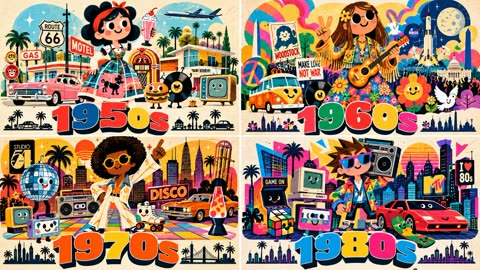</a>

The template fills fixed slots with the topic and locks in a mascot, collage body, and typography spec. Asking for four decades in one 16:9 frame keeps all four panels in one consistent style.

GPT Image 2.5 · Text-to-image · Source: [@Gdgtify on X](https://x.com/Gdgtify/status/2114623314471628855) · 16 likes on 2026-10-29

[`retro`](tags.md#tag-retro) [`collage`](tags.md#tag-collage) [`mascot`](tags.md#tag-mascot) [`decades`](tags.md#tag-decades)

<details><summary><b>Prompt</b></summary>

```text
This prompt is super long but does a lot of things to generate these cute, colorful images. Tested with GPT 2.5

16:9, do this for 4 famous decades: <PERSONIFIED_COLLAGE_POSTER_GENERATOR>

INPUT:
[TOPIC] = "AI_INFER or USER_INPUT"
[OPTIONAL_SUBTITLE] = "AI_INFER"
[ERA_OR_CONTEXT] = "AI_INFER"
[FORMAT] = "portrait poster, 2:3 unless otherwise specified"
GOAL:
Create a playful editorial poster where [TOPIC] is personified as one dominant friendly mascot whose entire body becomes a dense visual collage explaining the subject.
The image should feel like:
mid-century children's book illustration
× contemporary editorial vector art
× travel-poster composition
× paper-cut collage
× kawaii iconography
× bold graphic branding
SEMANTIC INFERENCE
Analyze [TOPIC] and automatically infer:

CORE_IDENTITY =
the single most recognizable visual symbol, figure, object, monument, product, invention, person archetype, or cultural icon associated with [TOPIC].
VISUAL_WORLD =
the environment most strongly associated with [TOPIC].

PRIMARY_ELEMENTS =
6–10 instantly recognizable large-scale elements that explain [TOPIC].
SECONDARY_ELEMENTS =
8–16 smaller supporting objects, foods, tools, artifacts, products, vehicles, symbols, locations, signs, fauna, technologies, or cultural references.
TEXT_ELEMENTS =
2–5 real labels, dates, street signs, product names, slogans, event names, terminology, or factual phrases strongly associated with [TOPIC].
PALETTE =
4–7 saturated colors semantically derived from [TOPIC], plus black and warm cream.
MOOD =
AI_INFER the emotional tone:
joyful / optimistic / nostalgic / adventurous / celebratory / curious / energetic / whimsical.
MASTER MASCOT
Create one dominant anthropomorphic mascot based on CORE_IDENTITY.

The mascot must:

occupy roughly 55–70% of the composition

have simple friendly facial geometry

use large circular eyes with black pupils

have a tiny simple nose
have a curved friendly smile

have a readable silhouette from a distance
feel charming rather than childish

have expressive but simple arms and legs
use a confident, iconic pose

IMPORTANT:
The mascot itself must visually embody [TOPIC].
Do NOT place a generic human in front of the subject.

Instead:
SUBJECT → CHARACTER.
Examples:
city → personified landmark
company → personified logo/product ecosystem
historical event → symbolic participant/object
decade → archetypal person wearing the decade
scientific idea → personified scientific symbol
country → personified national icon
industry → personified machine/tool/object
philosophy → personified symbolic figure
technology → personified device/system

COLLAGE-BODY LOGIC
The mascot's clothing, torso, body, cape, dress, jacket, backpack, helmet, or silhouette must become a miniature collage of [TOPIC].

Within the body, integrate:
architecture
landscapes

products

inventions

people

transportation

cultural objects

maps
roads
screens
patterns
famous scenes
relevant environments
The collage must feel BUILT INTO the mascot, not pasted on top.
Rule:
BODY = VISUAL DATABASE OF [TOPIC]
Use overlapping layers but preserve a clean overall silhouette.

ANTHROPOMORPHIC SUPPORTING ICONS
Select 4–8 SECONDARY_ELEMENTS and turn them into cute supporting characters.

Each supporting object gets:

two dot/circular eyes
tiny smile

optional tiny limbs
one clear pose or action
Characters should actively interact with the main mascot.
Examples:
walking
waving
holding a prop
leaning
driving
carrying
looking upward
celebrating
working
dancing
pointing
presenting information
They must all be unmistakably relevant to [TOPIC].
NO random decoration.
ENVIRONMENTAL COLLAGE
Build the surrounding scene using PRIMARY_ELEMENTS.
Arrange them as:
foreground icons
midground subject-world
background skyline/environment
Use simplified but recognizable forms.

The entire scene should read instantly as [TOPIC] before the viewer reads the title.

Density should be high but organized.

TYPOGRAPHIC TITLE

At the bottom, place:

"[TOPIC_DISPLAY_NAME]"

Typography:
enormous carnival-style block lettering
chunky uppercase display type
slightly irregular hand-built geometry
two-color treatment
thick dark offset drop shadow
strong dimensional graphic illusion
no gradients
extremely legible
Optional:
add [OPTIONAL_SUBTITLE] as a small secondary line.
Below the main title:
add a tiny silhouette strip / skyline / symbolic footer representing [TOPIC].
AUTHENTIC MICRO-TEXT
Use TEXT_ELEMENTS sparingly on environmental props.

Examples:
street signs
building plaques
transit signs
labels
dates
mission names
product names
technical markings
historical locations

Only use real or historically/contextually correct terminology.
Avoid:
lorem ipsum
fake street names
random numbers
meaningless text

VISUAL STYLE

STYLE =
flat geometric illustration

paper-cut collage

mid-century editorial art

1960s/1970s children's-book simplicity

contemporary graphic poster design

kawaii character design
screen-printed texture
subtle paper grain
SHAPES:
simple
chunky
rounded
clean
highly readable

COLOR:
saturated primary/secondary colors
warm cream background
deep navy or black shadows/outlines
strategic red/yellow/blue/green accents

TEXTURE:
subtle fibrous paper
light screen-print misregistration
soft analog grain
no glossy digital gradients
COMPOSITION
Use a strong vertical hierarchy:
TOP:
floating icons / atmospheric shapes / semantic symbols
UPPER CENTER:
mascot head + iconic object
CENTER:
large character body containing the topic collage
SIDES:
anthropomorphic supporting symbols and authentic props
LOWER CENTER:
dense environment / city / event / product ecosystem
BOTTOM:
massive title
FOOTER:
small symbolic silhouette strip
Keep the overall silhouette roughly triangular or tapered:
wide bottom → narrower upper body → strong focal head.
QUALITY CONTROL
MAXIMIZE:
subject recognizability
mascot charm
semantic density
visual storytelling
title readability
clean silhouette
authentic details
topic-specific symbolism
color harmony
editorial polish

REQUIRE:
every major element relates directly to [TOPIC]
main mascot is visually derived from [TOPIC]
mascot body contains an integrated collage
at least 4 anthropomorphic supporting icons
title is huge and readable
background remains warm and uncluttered
illustration stays flat and graphic

REJECT IF:
generic human character
random icons
unrelated decoration
plain clothing
photorealism
3D render
glossy CGI
gradients
dark background
thin typography
faceless supporting icons
generic skyline
generic props
pasted-on collage
visual clutter obscuring mascot
unreadable title

AI AUTOFILL LOGIC

If only [TOPIC] is supplied:

AI must automatically infer:
CORE_IDENTITY
VISUAL_WORLD
PRIMARY_ELEMENTS
SECONDARY_ELEMENTS
TEXT_ELEMENTS
PALETTE
MOOD
TITLE TREATMENT
MASCOT ARCHETYPE
BODY COLLAGE CONTENT
SUPPORTING CHARACTERS
BACKGROUND SCENE
FOOTER SYMBOLS

Prioritize the most culturally recognizable and visually distinctive interpretation over obscure references.

FINAL RENDER
Render as an award-winning editorial poster illustration.
Crisp vector-like edges.
Subtle physical paper texture.
High visual density but excellent hierarchy.
Cute without becoming juvenile.
Stylized without becoming generic.
Immediately understandable at thumbnail size.
Rich enough to reward close inspection.
No photography.
No realistic 3D.
No generic stock-vector look.
No unnecessary empty space.
No visual elements unrelated to [TOPIC].

</PERSONIFIED_COLLAGE_POSTER_GENERATOR>
```

</details>

<a id="gpt-image-four-decades-retro-posters"></a>
### Four retro posters for the 1920s to 1990s

<a href="https://x.com/Gdgtify/status/2115289705851879927">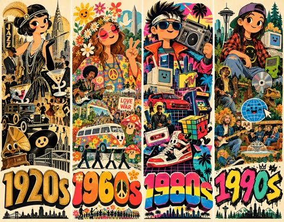</a>

A fill-in subject slot lets one template yield a whole series, and fixed rules for the hero, icon set, title and palette keep every decade in the same retro poster system. The 4:5 header sets the tall panel format.

GPT Image 2.5 · Text-to-image · Source: [@Gdgtify on X](https://x.com/Gdgtify/status/2115289705851879927) · 16 likes on 2026-10-29

[`retro-poster`](tags.md#tag-retro-poster) [`decades`](tags.md#tag-decades) [`collage`](tags.md#tag-collage) [`template`](tags.md#tag-template)

<details><summary><b>Prompt</b></summary>

```text
Art movements of different decades. Tested it with GPT 2.5

Prompt: 4 images: 4:5, stunning art movements of different decades: INPUT: $ SUBJECT

Create ONE tall vertical illustrated poster about $ SUBJECT.

The image must automatically reinterpret $ SUBJECT as a playful,
dense, symbolic character-collage.

────────────────────────────────

SEMANTIC RESEARCH

Analyze $ SUBJECT and infer:

SUBJECT_TYPE =
    city
    place
    historical event
    decade / era
    cultural movement
    invention
    scientific event
    person
    sport
    country
    institution
    technology
    franchise
    abstract topic
    other

TITLE = shortest instantly recognizable name for $ SUBJECT

HERO =
choose the strongest central character or personification.

HERO may be:
    a person
    explorer
    historical figure
    citizen
    mascot
    profession
    archetype
    invented representative character

Do NOT force a person if the subject is better represented by
an object, machine, animal, landmark, or symbolic figure.

ICON_SET = select 8–16 highly recognizable subject-specific elements.

Possible classes:

    landmarks
    buildings
    transportation
    foods
    tools
    inventions
    animals
    clothing
    products
    documents
    symbols
    flags
    signs
    machines
    technologies
    landscapes
    historical artifacts
    cultural objects
    entertainment objects

SCENE_SET = infer 2–5 important environments or moments.

TEXT_SNIPPETS = infer only a few short useful labels such as:

    dates
    locations
    transit names
    famous phrases
    event names
    eras
    institutions

Never turn the poster into an infographic.

────────────────────────────────

CENTRAL CHARACTER SYSTEM

Create one oversized friendly central character.

Visual anatomy:

            SYMBOL / OBJECT
       icon      icon      icon

              ◉   ◉
             CENTRAL
             CHARACTER
          ┌─────────────┐
          │ SUBJECT     │
          │ WORLD       │
          │ EMBEDDED    │
          │ INSIDE BODY │
          └─────────────┘

     object   landmark   object

             SHOES / BASE

          HUGE TITLE BELOW

The HERO occupies roughly 55–70% of the poster height.

Treat the body as a CONTAINER FOR THE SUBJECT.

Examples:

city →
cityscape forms torso or clothing

historical event →
event scene spreads across suit/body

decade →
fashion, technology and entertainment occupy clothing and surroundings

science →
equipment, diagrams and discoveries populate body

country →
landmarks, foods, wildlife and culture become costume

invention →
components and consequences become surrounding characters

────────────────────────────────

ANTHROPOMORPHIC PROP RULE

Give selected secondary objects:

    oversized googly eyes
    tiny curved smiles
    simplified limbs only when useful

Examples:

taxi
pizza
planet
flag
camera
cassette
robot
rocket
building
food
tool

may become friendly miniature characters.

Do NOT anthropomorphize everything.

Approximately 30–50% of important props may have faces.

This creates the playful children's-editorial feeling.

────────────────────────────────

COMPOSITION

Use a dense vertical pyramid composition.

TOP:
small floating icons / symbols

UPPER CENTER:
large hero face

MIDSECTION:
largest concentration of landmarks,
objects and subject-specific scenes

LOWER SECTION:
transportation / food / secondary objects /
ground-level details

BOTTOM:
massive subject title

Use overlapping scale changes aggressively.

Objects may float beside the hero.

Buildings may emerge directly from clothing.

Vehicles may drive across the torso.

Landmarks may sit behind the head.

Objects may extend beyond the body silhouette.

The composition should feel like one enormous
illustrated sticker collage, NOT separate panels.

────────────────────────────────

STYLE

playful mid-century children's editorial illustration
× contemporary paper-cut collage
× 1960s educational poster
× kawaii object character design
× bold retro souvenir graphics

Use:

flat vector-like shapes
cut-paper construction
slightly imperfect handmade geometry
simple rounded characters
large circular eyes
tiny smiling mouths
minimal noses
primitive geometric anatomy
friendly disproportion
thick simplified silhouettes
subtle printed-paper grain
soft screenprint texture
very restrained shading
clean crisp edges
occasional paper overlap
slight tactile depth

Avoid:

photorealism
3D CGI
glossy plastic
anime rendering
realistic anatomy
tiny inaccessible detail
complex gradients
heavy shadows

────────────────────────────────

COLOR

Infer a vivid palette from $ SUBJECT.

Prefer:

sunny yellow
vermillion red
bright cobalt blue
leaf green
turquoise
warm coral
black
cream

Use approximately 5–8 dominant colors.

Colors should feel screenprinted rather than digitally luminous.

Background:

warm ivory / aged cream paper
with very subtle fibers and speckling.

────────────────────────────────

TYPOGRAPHY

TITLE must be huge.

Use chunky retro display lettering:

bold condensed block letters
irregular handmade proportions
slight extrusion or black offset shadow
high-contrast alternating colors

TITLE should occupy approximately 15–22% of the poster.

Examples of hierarchy:

NEW YORK

THE
1980s

MOON
LANDING

Use line breaks based on the semantic rhythm of $ SUBJECT.

Optional tiny decorative motifs around title:

burst rays
waves
mini skyline
sun
stars
heart
simple emblem

Do NOT overload the poster with text.

────────────────────────────────

SUBJECT ADAPTATION

If $ SUBJECT is a CITY:

choose a representative resident or traveler
+
landmarks
transit
food
street signs
architecture
local wildlife
cultural objects.

If $ SUBJECT is an ERA / DECADE:

choose a person wearing era-specific fashion
+
technology
music
media
toys
architecture
transportation
consumer objects
visual motifs.

If $ SUBJECT is a HISTORICAL EVENT:

make the central participant or archetype the hero
+
date
key machinery
symbols
locations
participants
artifacts
scientific or political context.

If $ SUBJECT is SCIENCE:

choose scientist / explorer / symbolic figure
+
equipment
discoveries
models
objects
diagrams
relevant environments.

If $ SUBJECT is abstract:

invent a visual metaphor first,
then populate it with concrete symbolic objects.

────────────────────────────────

VISUAL DENSITY

Hero = dominant.

Major subject icons = 6–10.

Minor decorative icons = 4–10.

Every major area of the poster should contain meaningful subject information,
but retain small breathing spaces between clusters.

The viewer should understand $ SUBJECT
before reading the title.

────────────────────────────────

FINAL IMAGE

one single vertical poster
approximately 2:3 aspect ratio

warm cream background

central oversized friendly character

dense subject-specific object collage

several selectively anthropomorphized props

bright retro colors

paper-cut / screenprint texture

massive chunky title at bottom

joyful, educational, collectible,
instantly readable,
highly specific to $ SUBJECT.

NO grid.
NO panels.
NO generic stock icons.
NO style-description text inside artwork.
```

</details>

<a id="gpt-image-grenadye-2026-haiti-poster"></a>
### Haitian football poster with trophy over three cities

<a href="https://x.com/HaitiBrand/status/2062635338271539656">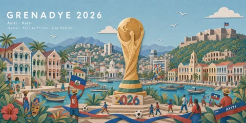</a>

Splitting the scene into three named city zones, each with a recognisable landmark (carved balconies, hillside houses, fortress on the ridge), gives the paper-collage composition concrete anchors. The matte gold trophy at centre with the exact text 2026 at its base, plus a fixed palette and paper-grain texture, keeps the handmade style consistent.

GPT Image 2 · Text-to-image · Source: [@HaitiBrand on X](https://x.com/HaitiBrand/status/2062635338271539656) · 11 likes on 2026-10-29

[`world-cup`](tags.md#tag-world-cup) [`haiti`](tags.md#tag-haiti) [`paper-collage`](tags.md#tag-paper-collage) [`poster`](tags.md#tag-poster)

<details><summary><b>Prompt</b></summary>

```text
Create a refined panoramic illustration in landscape format for a Haitian football poster titled **« GRENADYE 2026 »**, integrating **Jacmel, Cap-Haïtien, and Port-au-Prince** into a single harmonious scene, with a stylized World Cup trophy fully integrated as the central anchoring point.

Represent Haiti as a calm, elegant national scene, highly stylized, in a pastel poster style using paper collage. Use a wide horizontal composition, with three urban zones gently connected by the Caribbean Sea, mountains, sky, and colorful paper cutouts.

Left zone: **Jacmel**, with historic gingerbread architecture, pastel colonial facades, ornate wooden balconies, decorative details, palm trees, seaside artistic culture, accents inspired by carnival masks, small artists, boats, and warm coastal streets.

Central zone: **Port-au-Prince**, with overlapping hillside neighborhoods, colorful geometric houses, palm-lined boulevards, harbor water, subtle mountainous background, civic architecture, small market characters, Haitian art motifs, and an open square that anchors the trophy.

Right zone: **Cap-Haïtien**, with the Citadelle Laferrière as a fortress silhouette on a distant green ridge, the Sans-Souci palace suggested by light stone arches, coastal colonial architecture, turquoise bay, fishing boats, palm trees, and small characters celebrating football.

Place at the center a recognizable but stylized World Cup trophy, rendered as a monumental paper collage sculpture in matte gold, with simplified globe forms, abstract curves inspired by football, slightly raised edges, embossed outlines, and delicate shadows. Add the numbers **« 2026 »** near the base. Do not use official FIFA logos or team logos.

Add subtle details of Haitian football celebration: small characters with red and blue accents, small Haitian flags, abstract balloons, muted Haitian blue and red graphic ribbons, and a controlled festive energy in the foreground.

Palette: soft sky blue, misty blue-gray, pale cobalt, muted sage green, powdered mint, warm cream, light beige, pale stone gray, dusty coral, soft peach, faded yellow, off-white, washed turquoise, sunlit terracotta, Haitian blue and red accents, small navy and charcoal details, plus refined matte gold for the trophy.

The image should feel handmade, like carefully assembled colored paper and gouache on poster board, with subtle paper grain, matte printed texture, raised edges, delicate embossing, cut-paper shadows, light surface roughness, sharp silhouettes, clean geometric flats, and plenty of negative space.

Typography at top left: **« GRENADYE 2026 »** in uppercase geometric sans-serif font, with wide letter spacing, in solid white. Below: **« Ayiti · Haiti »** and **« Jacmel · Port-au-Prince · Cap-Haïtien »** in smaller size, matching white, with airy spacing.

Avoid: photorealism, official FIFA logos, team logos, readable brand signage, overly realistic trophy, overly detailed buildings, heavy outlines, sloppy painting, neon cyberpunk style, dark lighting, excessive gradients, overly busy scene, watermarks, separate postcard-style panels, or a trophy that seems simply pasted onto the image.
```

</details>

<a id="gpt-image-solstice-crown-yacht-sea-tree"></a>
### Luxury yacht wake shapes a sea Christmas tree

<a href="https://x.com/ou_zhen599/status/2101959963384193293">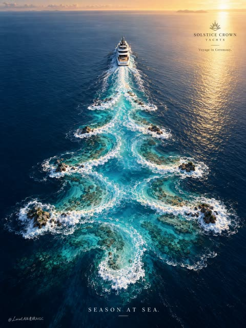</a>

The yacht sits high in the frame so its wake becomes the central route, and the foam and reef lines follow sea physics rather than decoration. A high oblique drone angle over wide open water keeps the tree shape readable from a distance.

GPT Image 2.5 · Text-to-image · Source: [@ou_zhen599 on X](https://x.com/ou_zhen599/status/2101959963384193293) · 7 likes on 2026-10-29

[`christmas`](tags.md#tag-christmas) [`aerial`](tags.md#tag-aerial) [`yacht`](tags.md#tag-yacht) [`seascape`](tags.md#tag-seascape)

<details><summary><b>Prompt</b></summary>

```text
Create a premium luxury-yacht holiday advertising poster for a fictional international marine brand named SOLSTICE CROWN YACHTS, designed as a single vertical high-aerial key visual over an immense open sea at golden sunrise. Preserve the structural brilliance of the reference as pure composition logic: a real ultra-luxury motor yacht near the upper-center, moving forward across calm deep water, while the wake, reef lines, and surf formations below organically assemble into a monumental Christmas-tree silhouette made entirely of ocean physics. The yacht is the true commercial hero, and the sea-formed tree is the poetic extension of its voyage.

The image must merge Orbit, Transit, and Port into one refined main visual: emotionally resonant, materially precise, and curatorially reduced. Orbit: keep the strongest immediate read of the concept, where the tree shape is instantly recognizable from afar and the yacht reads as the luminous crown point of the frame. Transit: make the marine materials, reef geometry, and yacht design feel systemized and premium, with believable water layering, foam logic, and engineered vessel detail. Port: strip away anything unnecessary so the image feels more international, more art-directed, and closer to a collectible visual manifesto than a festive brochure.

The Christmas-tree form must not feel graphic-overlay fake or cartoonishly decorated. It must arise from real ocean movement: curling foam spirals, white surf lace, turquoise currents, transparent mineral shallows, and scattered reef outcrops positioned with elegant symmetry and controlled irregularity. From a distance it reads as a festive icon; up close it resolves into realistic hydrodynamics, reef contours, and tidal pattern. No ornaments, no garlands, no literal star, no kitsch holiday clichés. The sea itself becomes the seasonal gesture.

The yacht must be highly photoreal, product-dominant, and aspirational: polished white hull, clean glazing, layered decks, subtle metallic detailing, realistic marine shadow under the vessel, believable wake behavior, and refined superyacht proportions. It must feel calm, rarefied, exclusive, and precise, never tiny or incidental. Place it near the upper-center so it leads the eye downward into the flowing tree-shaped sea formation.

Camera and framing: premium drone or helicopter top-oblique aerial view, high enough to reveal the full sea-tree silhouette while keeping the vessel clearly legible as the hero object. The frame must feel spacious and quiet, with vast surrounding ocean negative space providing luxury, scale, and breathing room. Let the sea-tree occupy the central vertical axis and taper downward elegantly. The composition should read immediately and memorably from a distance.

Lighting and atmosphere: warm low-angle sunrise light from the upper-right, washing the surface with champagne gold and pale amber while preserving rich cobalt and teal depth below. Build a refined 60/30/10 color hierarchy: 60% deep ocean blue, ultramarine, and teal; 30% white foam, bright turquoise shallows, and mineral aqua channels; 10% champagne sunrise warmth and pale gold reflection. The water must feel premium and layered: transparent cyan depths within the tree-form, white foam edges around the swirls, deep dark sea outside the central motif, and delicate sun-glint falloff. Keep the sky extremely restrained, only a small atmospheric horizon if needed.

Typography must be drastically reduced and more elevated than a standard holiday campaign. Place a minimal brand lockup in the upper-right: "SOLSTICE CROWN YACHTS" with a tiny refined emblem above and one understated line beneath such as "Voyage in Ceremony." In the lower-center, place only one short holiday statement, elegant and restrained, such as "Season at Sea." No large festive paragraph copy, no heavy calligraphy overload, no bottom information clutter beyond a very slim, discreet contact strip if absolutely necessary. The visual must carry the meaning.

Material semantics must be explicit and luxurious: yacht lacquer, marine glass, metallic trim, white foaming breakers, submerged reefs, translucent mineral shallows, deep saline blue, and warm dawn reflection. The whole image should feel both festive and rare, like a global luxury holiday campaign captured at a miraculous but believable moment from the air.

Rendering target: photoreal luxury yacht advertising, premium ocean texture, refined holiday concept, elegant restrained typography, strong product hierarchy, curatorially reduced composition, and world-class print-finish quality.

Structured exclusion constraints: no real yacht brand names, no copied Christmas slogans, no cheesy holiday graphics, no Santa elements, no ornaments, no fake CGI plastic tree look, no unreadable text, no garbled letters, no muddy water, no broken wave physics, no distorted yacht structure, no extra vessels cluttering the frame, no brochure-style promotional overload, no oversaturated tourism aesthetic, no style drift, no AI slop.
```

</details>

<a id="gpt-image-1994-infomercial-crashed-saucer-frame"></a>
### Retro 1994 infomercial frame selling a crashed saucer

<a href="https://x.com/ImagineArt_X/status/2097520474226147462"></a>

Naming the medium and era first (1994 infomercial, standard definition, scanlines) sets the whole look. A short list of concrete props then drives the layout: host, plinth, price starburst, phone number and legal small print.

GPT Image 2.5 · Text-to-image · Source: [@ImagineArt_X on X](https://x.com/ImagineArt_X/status/2097520474226147462) · found via [wangrunlin/awesome-gpt-image-2-5-prompts](https://github.com/wangrunlin/awesome-gpt-image-2-5-prompts)

[`infomercial`](tags.md#tag-infomercial) [`retro-tv`](tags.md#tag-retro-tv) [`scanlines`](tags.md#tag-scanlines) [`ufo`](tags.md#tag-ufo) [`typography`](tags.md#tag-typography)

<details><summary><b>Prompt</b></summary>

```text
a frame grab from a 1994 infomercial, standard definition video with scanlines. A host in a teal blazer, a battered saucer on a rotating plinth with Antarctic ice frozen around one leg, a price starburst, a phone number, and three lines of legal small print.
```

</details>

<a id="gpt-image-adriano-emperor-doodle-football-poster"></a>
### Adriano career stats doodle football poster

<a href="https://x.com/ryanpp27/status/2048602248524214542"></a>

Keep the real player photo intact and wrap him in a glowing neon outline, then surround him with doodles and boxed stat panels. Fixed sections for club, highlights and national team make the layout easy to scan.

GPT Image 2 · Text-to-image · Source: [@ryanpp27 on X](https://x.com/ryanpp27/status/2048602248524214542) · found via [freestylefly/awesome-gpt-image-2](https://github.com/freestylefly/awesome-gpt-image-2)

[`football`](tags.md#tag-football) [`poster`](tags.md#tag-poster) [`doodle`](tags.md#tag-doodle) [`typography`](tags.md#tag-typography)

<details><summary><b>Prompt</b></summary>

```text
Create a scrapbook doodle-style football poster of [PLAYER_NAME].

AI auto-generates realistic career stats (club and national team).

Main photo: realistic, unchanged ([PLAYER_NAME] in action or iconic pose).

Doodles and handwritten notes: white and [PRIMARY_COLOR] neon ink (no warm colors unless specified), arrows, stars, scribbles, sketchy outlines. Add a glowing [PRIMARY_COLOR] outline around the player's body.

Layout (bold handwritten titles and stats):
- Top Title: "[PLAYER_NAME]" plus "[NICKNAME/TITLE]"
- Club Career: total matches and goals plus 2–4 main clubs (apps and goals)
- Highlights: 2–3 standout achievements (e.g., UCL goals, Ballon d'Or, top scorer)
- National Team: caps and goals plus 1–2 international achievements

Style: modern football poster x notebook aesthetic, clean but energetic, slightly messy doodles, high contrast, neon accents on dark or muted background.

Important: all stats must be realistic and proportional to the player's real career.
```

</details>

<a id="gpt-image-anime-classroom-losing-heroines-key-visual"></a>
### Anime classroom key visual with three students and posters

<a href="https://x.com/kiyoshi_shin/status/2090292842992488516">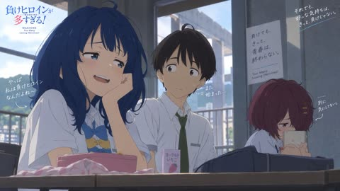</a>

The prompt fixes every element by count (3 students, 3 desk items, 2 posters, 3 captions) so nothing extra appears, and it sets a desk-height camera angled slightly upward. Writing the exact Japanese title, poster and caption text into the prompt keeps the on-image typography readable.

GPT Image 2 · Text-to-image · Source: [@kiyoshi_shin on X](https://x.com/kiyoshi_shin/status/2090292842992488516) · found via [YouMind-OpenLab/awesome-gpt-image-2](https://github.com/YouMind-OpenLab/awesome-gpt-image-2)

[`anime`](tags.md#tag-anime) [`classroom`](tags.md#tag-classroom) [`key-visual`](tags.md#tag-key-visual) [`japanese-text`](tags.md#tag-japanese-text)

<details><summary><b>Prompt</b></summary>

```text
Goal: Create a cinematic anime key visual for a high-school romantic comedy titled 負けヒロインが多すぎる!, set in a classroom with gentle daylight and a slightly melancholic but humorous mood.

Canvas: Wide 16:9 composition, 1200×675 style framing, like a polished TV anime promotional still. Use soft realistic lighting, detailed painted backgrounds, clean character line art, subtle depth of field, and no grain or image noise.

Layout: Three teenage students sit at desks in the foreground and midground. Count exactly 3 students: 1) left foreground main heroine, 2) center boy, 3) right background girl. The camera is at desk height, angled slightly upward, with large classroom windows behind them showing a bright blue sky, distant school buildings, balcony railings, and green hills. A concrete pillar and wall occupy the right side.

Subject details: The left foreground girl is the dominant subject: a cheerful teenage girl with deep navy blue shoulder-length messy hair, blue eyes, flushed cheeks, and a teasing smile. She wears a white short-sleeve school shirt with a blue bow and sits lazily with her cheek resting on one hand, leaning toward the viewer. In front of her are exactly 3 desk items: a pink lunch box, a pink-and-white cloth, and a small yogurt drink carton with a straw labeled in Japanese. The center boy is a nervous teenage boy with short dark brown hair, wide uncertain eyes, a sweat drop, a white school shirt, and a green tie; he looks sideways toward the blue-haired girl as if thinking things are starting again. The right background girl is a withdrawn teenage girl with dark reddish-purple short bobbed hair and hairpins, wearing a white school shirt; she sits apart near the wall, half-hidden behind a phone or small book, looking annoyed and pretending not to care. On the right foreground desk place a dark navy school bag.

Visible text and graphic elements: Include exactly 1 main title cluster in the upper left with the large Japanese title 負けヒロインが多すぎる!, small romanization “MAKEINE,” and small English subtitle “Too Many Losing Heroines!” beneath it. Include exactly 2 wall posters on the right: one larger poster on the pillar reading 負けても、きっと、青春は、終わらない。 with the small English subtitle “Too Many Losing Heroines!”, and one smaller tilted poster in the upper right reading Japanese handwriting that means “Even so, this feeling is surely not losing.” Include exactly 3 handwritten white annotation captions with curved arrows or dotted trails: near the left girl, “やっぱ私は負けヒロインなんだよね〜”; near the boy, “また始まった…”; near the right girl, “別に気にしてない”.

Visual style: Modern Japanese anime film still, delicate shadows, cool blue classroom atmosphere, warm skin tones, expressive faces, natural hair highlights, detailed desks and windows, crisp but painterly background. The mood should feel like a promotional scene from a school comedy-drama about “losing heroines.”

Constraints: Keep the composition clean and cinematic, preserve exactly the counted characters, posters, desk items, and annotation captions, avoid extra characters, avoid extra random text, avoid watermark or logo beyond the specified title graphics.
```

</details>

<a id="gpt-image-anime-gender-swap-before-after-poster"></a>
### Anime Gender Swap Before After Magazine Poster

<a href="https://x.com/ArtistaNozomu/status/2085314580130197811">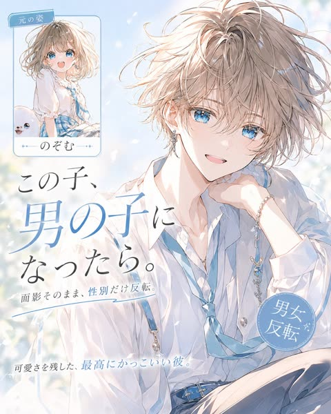</a>

The prompt separates the canvas into a small Before card and a dominant After portrait, giving exact counts for cards and stamps plus the Japanese text strings to keep typography legible. A restricted blue and white palette with watercolor lighting keeps the layout cohesive.

GPT Image 2 · Text-to-image · Source: [@ArtistaNozomu on X](https://x.com/ArtistaNozomu/status/2085314580130197811) · found via [YouMind-OpenLab/awesome-gpt-image-2](https://github.com/YouMind-OpenLab/awesome-gpt-image-2)

[`anime`](tags.md#tag-anime) [`magazine-cover`](tags.md#tag-magazine-cover) [`gender-swap`](tags.md#tag-gender-swap) [`before-after`](tags.md#tag-before-after) [`japanese-typography`](tags.md#tag-japanese-typography)

<details><summary><b>Prompt</b></summary>

```text
Goal: Create a polished anime magazine-cover style “gender swap before/after” poster. The main subject is the transformed After character: an extremely handsome teenage boy who preserves the soft facial resemblance of the original character, with light ash-blonde tousled medium-short hair, sparkling blue eyes, pale luminous skin, a gentle open smile, and an elegant androgynous beauty. He wears a loose white shirt with rolled sleeves, a pale blue loosened necktie, blue suspenders, slim earrings, a delicate bracelet, and a blue belt with silver details. Pose him seated in a relaxed three-quarter view, leaning slightly forward with one hand near his cheek, looking directly at the viewer. Use airy spring lighting, soft bokeh flowers, floating white petals, translucent watercolor highlights, and crisp high-detail anime linework.

Canvas: Vertical 4:5 poster, light pastel blue and white palette, bright dreamy background, plenty of negative space on the left for typography, main After portrait large and dominant on the right and center.

Layout: Include exactly 1 small Before card in the upper-left corner and 1 large After portrait occupying most of the canvas. The Before card should have rounded corners, a thin blue border, and show a cute original girl with the same visual identity: ash-blonde wavy bob hair, blue eyes, white blouse, blue plaid skirt or blue ribbon accents, cheerful expression. Add a small top ribbon label on the card reading 元の姿 and a name under the mini portrait reading のぞむ. Add exactly 1 circular blue stamp near the lower-right of the poster reading 男女\n反転 with tiny sparkle marks.

Text content: Large elegant Japanese headline on the left, set in a mix of black and soft blue calligraphic serif type: この子、\n男の子に\nなったら。. Under it, smaller Japanese subcopy: "面影そのまま、性別だけ反転。" Near the bottom, add a small caption: "可愛さを残した、最高にかっこいい彼。" Use refined magazine typography, with the key words in blue and the rest in dark ink.

Visual style: High-end shoujo anime illustration, glossy magazine cover composition, ethereal watercolor lighting, detailed hair strands, delicate jewelry, soft skin shading, blue-white color harmony, romantic and clean design. Keep all Japanese text legible and integrated into the layout. Avoid photorealism, clutter, extra characters, watermarks, or random additional text.
```

</details>

<a id="gpt-image-anna-karina-torn-paper-french-poster"></a>
### Anna Karina smoking on a torn paper poster

<a href="https://x.com/bananaprompts/status/2048541390900994476">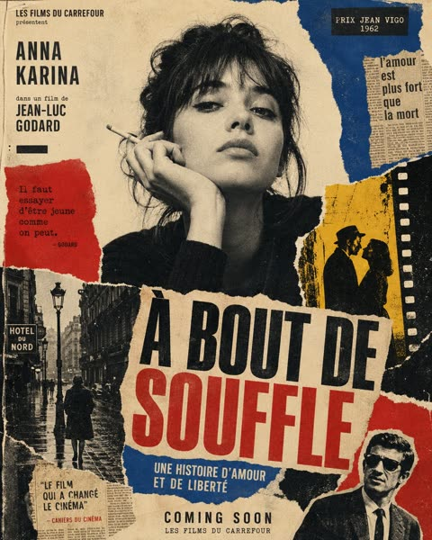</a>

Naming a fixed palette of deep red, cobalt blue, warm yellow, black and ivory and listing collage fragments by type lets the model build a torn paper layout around one central black and white portrait. Slots for headline, subtitle and bottom line keep the typographic hierarchy clear.

GPT Image 2 · Text-to-image · Source: [@bananaprompts on X](https://x.com/bananaprompts/status/2048541390900994476) · found via [freestylefly/awesome-gpt-image-2](https://github.com/freestylefly/awesome-gpt-image-2)

[`poster`](tags.md#tag-poster) [`collage`](tags.md#tag-collage) [`typography`](tags.md#tag-typography) [`vintage-film`](tags.md#tag-vintage-film)

<details><summary><b>Prompt</b></summary>

```text
Create a vertical poster composition on aged cream paper with a handmade analog feel. Use rough ripped paper edges, layered magazine cutouts, photocopy grain, halftone texture, ink bleed, and slightly imperfect screen-print registration. Keep the subject as the main black-and-white photographic portrait, placed prominently in the center or upper center. Surround the subject with graphic blocks of deep red, cobalt blue, warm yellow, black, and ivory.

Add supporting collage fragments such as a rainy European street, film-strip borders, newspaper clippings, urban silhouettes, and cinematic details, arranged like a handmade 1960s art-house movie poster. Use bold condensed typography with a strong visual hierarchy. Add large headline text: "[MAIN TITLE]". Add smaller subtitle text: "[SUBTITLE]". Add bottom text: "[BRAND NAME / EVENT NAME / COMING SOON / DATE]". If needed, include a small top line reading "[TAGLINE]".

The final result should feel cinematic, intellectual, rebellious, and editorial — like a lost 1960s European film poster with a strong point of view. Keep it raw, tactile, printed, imperfect, and handmade. Avoid a glossy modern finish.
```

</details>

<a id="gpt-image-annotated-autumn-fashion-lookbook-poster"></a>
### Pastel autumn outfit lookbook with handwritten annotations

<a href="https://x.com/LiEvanna85716/status/2097663816339427547">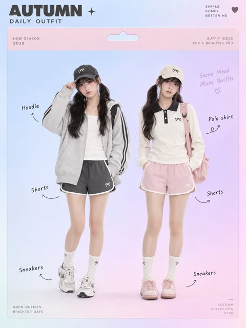</a>

The prompt fixes the palette, the frame and the exact headline text in quotes, so layout and typography stay controlled. Handwritten labels with thin arrows tie each piece of clothing to a name, which gives the catalog feel.

GPT Image 2.5 · Text-to-image · Source: [@LiEvanna85716 on X](https://x.com/LiEvanna85716/status/2097663816339427547) · found via [wangrunlin/awesome-gpt-image-2-5-prompts](https://github.com/wangrunlin/awesome-gpt-image-2-5-prompts)

[`fashion`](tags.md#tag-fashion) [`lookbook`](tags.md#tag-lookbook) [`pastel`](tags.md#tag-pastel) [`annotated`](tags.md#tag-annotated) [`e-commerce`](tags.md#tag-e-commerce)

<details><summary><b>Prompt</b></summary>

```text
Create a clean fashion e-commerce lookbook poster featuring a young female model in a cute, simple autumn outfit.
Use a soft pastel pink, blue and lavender gradient background. Keep the overall design minimal, clean and slightly playful, like a modern Korean/Japanese fashion catalog.

Show the full-body model as the main focus, with realistic skin, natural proportions and clear clothing details. The outfit should be simple and wearable: cardigan or hoodie, fitted top, shorts or pleated skirt, socks and sneakers/Mary Jane shoes.

Add handwritten English annotations with thin arrows pointing to individual clothing pieces, such as “Cardigan”, “Polo Shirt”, “Shorts”, “Sneakers” and “Bag”.

Add a bold English fashion headline at the top: “AUTUMN DAILY OUTFIT”, plus a few small decorative English phrases such as “NEW SEASON 2026”, “SIMPLE · COMFY · BETTER ME” and “OUTFIT IDEAS FOR A BRIGHTER YOU”.

Use a structured rectangular frame around the main content, subtle rounded corners, plenty of negative space, and only a few minimal heart/star doodles.

The final image should feel like a polished fashion e-commerce campaign poster — minimal, youthful, realistic, highly readable typography, clean product presentation, not cluttered, with the outfit as the visual focus.

Vertical 3:4 composition, high-resolution commercial fashion photography.
```

</details>

<a id="gpt-image-apple-style-nature-science-poster"></a>
### Apple style wildlife science poster series

<a href="https://x.com/berryxia/status/2048251413147644100">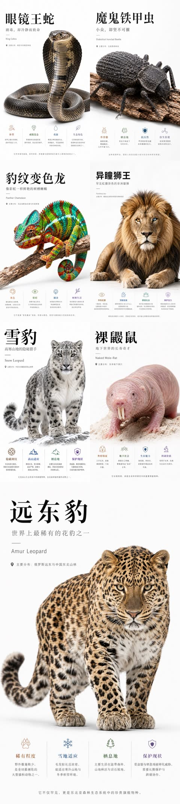</a>

A fixed layout of title block, oversized hero animal and four column icon footer is filled in through placeholders, so one template serves any species. A long list of banned elements (cards, rounded boxes, yellow paper) keeps the pure white keynote look.

GPT Image 2 · Text-to-image · Source: [@berryxia on X](https://x.com/berryxia/status/2048251413147644100) · found via [freestylefly/awesome-gpt-image-2](https://github.com/freestylefly/awesome-gpt-image-2)

[`science-poster`](tags.md#tag-science-poster) [`apple-style`](tags.md#tag-apple-style) [`animals`](tags.md#tag-animals) [`minimal`](tags.md#tag-minimal) [`template`](tags.md#tag-template)

<details><summary><b>Prompt</b></summary>

```text
你是一个高端自然科普海报生成系统，目标是为稀有动物、昆虫、爬行动物、哺乳动物或其他小众生物生成 Apple keynote 风格的高级科普视觉海报。

整体视觉方向：
生成一张 9:16 竖版高级科普海报，画面采用极简、纯白、干净、现代、Apple 式产品发布海报语言。背景应为纯白或极浅灰白渐变，保持大量留白。整体设计应具备高级感、克制感、视觉冲击力和科学展示感。

核心设计原则：
1. 主体动物必须被极度放大，成为画面最强视觉中心。
2. 主体应具有强烈立体感、真实质感、高清细节和柔和棚拍光影。
3. 海报信息要少而准，避免拥挤。
4. 不使用传统信息图的卡片、圆角框、复杂底纹、淡黄色纸张质感或装饰性边框。
5. 底部信息区只使用四列极简 icon + 标题 + 短说明，通过细竖线分隔。
6. 文字排版要像高端发布会视觉，标题巨大，副标题克制，正文小而清晰。
7. 风格关键词：Apple-inspired, premium editorial, pure white background, hero subject, clean typography, minimal infographic, high-end science poster.

画面结构：
顶部左侧为标题区：
中文大标题：{中文物种名}
中文副标题：{一句有吸引力的物种定位}
细短横线
英文名：{英文物种名}
分布信息：主要分布：{分布区域}

中部与下中部为主体视觉：
生成一个超高清、真实、具有强烈立体感的 {中文物种名}。
主体应占据画面 50% 到 70% 的视觉面积。
主体姿态应具有展示性、力量感或识别度。
保持白色背景，不添加复杂自然环境。
可以保留少量必要承托物，例如树枝、岩石、雪地、沙土或木皮，但必须简洁。
主体要有真实阴影，使其像高级产品摄影一样立在画面中。

底部信息区：
用四个极简信息栏目展示科普信息。
每个栏目包含：
一个细线 icon
一个彩色小标题
一段 1 到 3 行短文字
栏目之间用极细浅灰竖线分隔。
不使用卡片框，不使用圆角背景，不使用大面积色块。

四个信息栏目：
栏目 1：
标题：{重点特征1标题}
说明：{重点特征1短说明}

栏目 2：
标题：{重点特征2标题}
说明：{重点特征2短说明}

栏目 3：
标题：{重点特征3标题}
说明：{重点特征3短说明}

栏目 4：
标题：{重点特征4标题}
说明：{重点特征4短说明}

底部总结句：
在最底部居中放置一句灰色小字总结：
{一句高级、克制、有记忆点的科普总结}

字体与排版：
中文标题使用大号黑色、高级、稳重、有力量感的字体。
副标题使用灰色，中等字号，字距略宽。
英文名使用小号灰色，简洁现代。
正文使用清晰现代中文字体，保持可读。
所有文字必须留有足够呼吸感。

色彩规范：
背景：纯白、极浅灰、轻微柔光渐变。
主标题：黑色或深石墨色。
副标题与正文：中性灰。
底部四个信息标题可使用低饱和强调色：
暖棕、冷蓝、松石绿、紫色、橙色。
颜色只用于 icon 和小标题，不要大面积铺色。

图像质量：
2K 高清质感，细节清晰，主体锐利，光影真实。
主体纹理必须可信，例如毛发、鳞片、甲壳、皮肤褶皱、羽毛或斑纹。
避免变形、错误肢体、错误解剖结构、模糊主体、低质贴图、塑料感、卡通感。

禁止项：
不要使用淡黄色旧纸背景。
不要使用复杂信息图网格。
不要使用圆角卡片。
不要使用厚边框。
不要使用大面积装饰图形。
不要添加无关 logo。
不要添加多余小字。
不要让主体太小。
不要让文字压住主体。
不要让底部信息区过度拥挤。
不要出现儿童科普风、卡通风、低端展板风。

最终输出：
生成一张 9:16 竖版、高级、干净、强视觉冲击的 Apple 风自然科普海报。
```

</details>

<a id="gpt-image-avant-garde-oversized-sunglasses-vision-ad"></a>
### Oversized Sunglasses Fashion Ad with Giant Type

<a href="https://x.com/AIwithSynthia/status/2047700936605479334">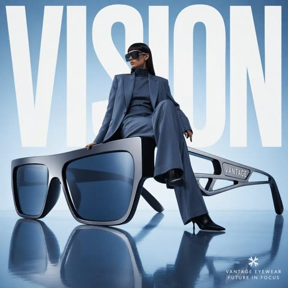</a>

The prompt turns the product into sculpture and furniture, so scale contrast gives the layout its drama. A giant headline word behind the subject, a single powder blue palette and a reflective floor keep the composition clean and editorial.

GPT Image 2 · Text-to-image · Source: [@AIwithSynthia on X](https://x.com/AIwithSynthia/status/2047700936605479334) · found via [YouMind-OpenLab/awesome-gpt-image-2](https://github.com/YouMind-OpenLab/awesome-gpt-image-2)

[`fashion-ad`](tags.md#tag-fashion-ad) [`eyewear`](tags.md#tag-eyewear) [`typography`](tags.md#tag-typography) [`editorial`](tags.md#tag-editorial) [`studio`](tags.md#tag-studio)

<details><summary><b>Prompt</b></summary>

```text
Avant-garde fashion advertisement, oversized futuristic sunglasses positioned like sculpture, model casually seated on the frame as if furniture, giant word "VISION" behind in bold white typography, powder blue studio background, reflective floor, luxury eyewear campaign aesthetic, ultra-clean layout, editorial magazine styling, 1:1
```

</details>

<a id="gpt-image-black-white-profile-typographic-poster"></a>
### Black and white typographic profile portrait poster

<a href="https://x.com/HustleXR/status/2093206386012230000">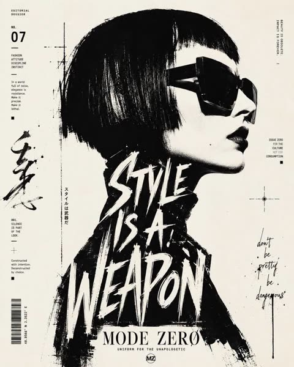</a>

The portrait is built from bold silhouette blocks and rough ink edges, with the main text placed only inside the neck and body so the lettering fuses with the figure. Placeholders for subject, feature, text and logo make it a reusable template.

GPT Image 2 · Text-to-image · Source: [@HustleXR on X](https://x.com/HustleXR/status/2093206386012230000) · found via [freestylefly/awesome-gpt-image-2](https://github.com/freestylefly/awesome-gpt-image-2)

[`typography`](tags.md#tag-typography) [`black-and-white`](tags.md#tag-black-and-white) [`side-profile`](tags.md#tag-side-profile) [`editorial`](tags.md#tag-editorial) [`ink-texture`](tags.md#tag-ink-texture)

<details><summary><b>Prompt</b></summary>

```text
High-contrast black and white typographic portrait poster of [HUMAN], shown in side profile with [FEATURE]. Build the portrait with bold black silhouette blocks, sharp negative space, rough ink edges, fragmented stencil shapes, tiny editorial microtext, vertical typographic accents and expressive hand-drawn calligraphic marks. Integrate one large readable text block saying “[TEXT]” in 2 to 4 stacked lines, placed only inside the neck and body area, using oversized scribbled lettering that feels fused into the silhouette. Include a graphic design logo reading “[LOGO]” near the footer. Minimal off-white paper background, asymmetrical layout, cropped vertical composition, experimental editorial poster design, raw ink print texture, aspect ratio 4:5.
```

</details>

<a id="gpt-image-bleach-orange-hair-manga-glasses-poster"></a>
### Orange haired anime hero in glasses reflecting manga panels

<a href="https://x.com/ponyodong/status/2052983036724355468">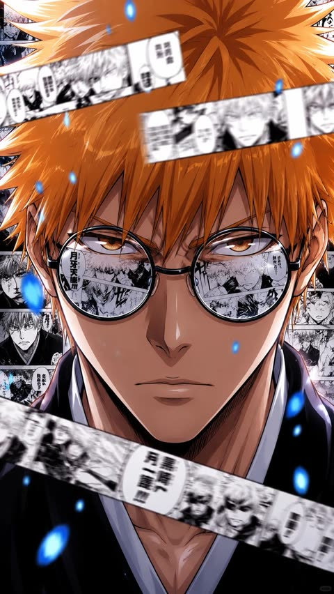</a>

Naming the series and the reflective glasses gives the manga page reflections a clear place to sit. A centred, straight-on close-up with blurred floating panel strips and blue particles against warm orange hair builds layered depth.

GPT Image 2 · Text-to-image · Source: [@ponyodong on X](https://x.com/ponyodong/status/2052983036724355468) · found via [YouMind-OpenLab/awesome-gpt-image-2](https://github.com/YouMind-OpenLab/awesome-gpt-image-2)

[`anime`](tags.md#tag-anime) [`bleach`](tags.md#tag-bleach) [`manga-collage`](tags.md#tag-manga-collage) [`poster`](tags.md#tag-poster)

<details><summary><b>Prompt</b></summary>

```text
超高细节二次元热血漫画风角色海报，少年死神角色正面半身特写，橙色炸毛短发，琥珀色眼睛，佩戴黑色圆框复古墨镜，冷峻严肃表情，正中央对称构图，镜头直视观众，强烈压迫感。眼镜镜片中倒映大量黑白漫画分镜与角色画面，背景也由密集的日漫漫画页拼贴组成，形成“角色记忆 / 名场面回顾”的视觉效果。前景漂浮多条高速运动的漫画分镜条带，带有动态模糊与景深虚化效果，穿插画面上下，营造速度感与空间层次。画面中散落蓝色灵压粒子 / 荧光能量碎片，形成冷暖撞色（橙发 vs 蓝色粒子）。整体采用《BLEACH》式热血少年漫画美学，融合现代潮流海报设计与高级动漫商业视觉。anime key visual, BLEACH style, manga collage poster, cinematic anime lighting, reflective glasses, manga panels reflection, dynamic motion blur, orange spiky hair, intense stare, ultra detailed anime illustration, shonen jump aesthetic, layered composition, high contrast shading, cel shading, glowing blue particles, dramatic close-up portrait, symmetrical composition, manga montage background, Japanese comic aesthetic, premium anime poster
```

</details>

<a id="gpt-image-carpe-diem-cyan-neon-typography-poster"></a>
### Carpe Diem Neon Typography Fashion Poster

<a href="https://x.com/copyelpadrino/status/2055785779691966721">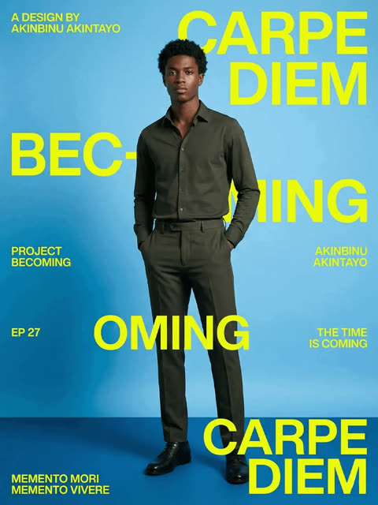</a>

The prompt numbers every text block with its position, size and cropping, and puts the huge neon lettering behind the model so his body overlaps the words. A strict two-colour palette and a no extra text constraint keep the layout clean.

GPT Image 2 · Text-to-image · Source: [@copyelpadrino on X](https://x.com/copyelpadrino/status/2055785779691966721) · found via [YouMind-OpenLab/awesome-gpt-image-2](https://github.com/YouMind-OpenLab/awesome-gpt-image-2)

[`typography`](tags.md#tag-typography) [`fashion-editorial`](tags.md#tag-fashion-editorial) [`neon`](tags.md#tag-neon) [`layered-text`](tags.md#tag-layered-text) [`cyan`](tags.md#tag-cyan)

<details><summary><b>Prompt</b></summary>

```text
Goal: Create a bold editorial fashion poster / magazine cover for a motivational design project, featuring a full-body studio portrait of Akinbinu Akintayo standing confidently in front of oversized typography.

Canvas: Vertical 4:5 poster, bright cyan-blue seamless studio background with a darker blue floor plane and soft vignette/shadowing near the bottom. High-contrast modern layout, cropped poster typography extending off the edges.

Main subject: One tall Black male model, full body, centered slightly right, standing upright with both hands in trouser pockets. He wears a dark olive-green button-up shirt tucked into matching tailored trousers with a black belt and polished black dress shoes. Short curly black hair. Face is intentionally obscured by a vertical soft-blurred rectangular block over the center of the face, while ears, hairline, neck, and outfit remain visible. Studio lighting from upper left, realistic shadows on the floor.

Typography style: Use huge uppercase condensed sans-serif lettering in fluorescent yellow-lime, bold and clean, layered behind and around the figure. Some words are partially hidden by the model or cropped by poster edges. Keep the typography flat, sharp, and poster-like.

Text content: Include exactly 9 visible text blocks: 1) top left small text: "A DESIGN BY AKINBINU AKINTAYO"; 2) top right huge title: "CARPE DIEM"; 3) left middle huge cropped text: "BEC-"; 4) center-right huge cropped text partly behind model: "MING"; 5) left lower-middle small text: "PROJECT BECOMING"; 6) right lower-middle small text: "AKINBINU AKINTAYO"; 7) lower left small text: "EP 27"; 8) center lower huge text: "OMING"; 9) bottom right huge title: "CARPE DIEM". Add two extra small motto lines at the very bottom left as part of the final block area: "MEMENTO MORI" and "MEMENTO VIVERE". Add a small lower-right phrase: "THE TIME IS COMING". The overall poster concept implies the phrase "BECOMING" split across the composition.

Layout: Place the model in the foreground so the typography is partially occluded by his body. The top-right "CARPE DIEM" should dominate the upper half, while another cropped "CARPE DIEM" anchors the bottom-right corner. The left-side "BEC-" should be very large and cropped off the left edge. The word fragments "MING" and "OMING" should appear in the middle and lower center, creating a layered typographic rhythm.

Color palette: Cyan-blue background, neon yellow-lime text, dark olive outfit, black shoes. Minimal colors, clean commercial poster finish.

Constraints: No logos, no watermark, no extra people, no props, no additional text beyond the specified typography. Preserve the bold fashion-editorial look and the intentionally obscured face.
```

</details>

<a id="gpt-image-chessboard-low-angle-menswear-campaign-poster"></a>
### Low angle chessboard luxury menswear campaign poster

<a href="https://x.com/harboriis/status/2058414859658956888">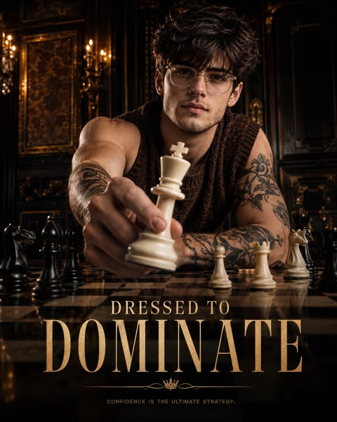</a>

A low angle across a glossy chessboard and a king piece held in forced perspective put the foreground object and the model's gaze at the centre. Amber chandelier lighting, scattered pieces for depth, and quoted bottom typography with a 4:5 ratio finish the campaign layout.

GPT Image 2 · Text-to-image · Source: [@harboriis on X](https://x.com/harboriis/status/2058414859658956888) · found via [freestylefly/awesome-gpt-image-2](https://github.com/freestylefly/awesome-gpt-image-2)

[`fashion-campaign`](tags.md#tag-fashion-campaign) [`chess`](tags.md#tag-chess) [`low-angle`](tags.md#tag-low-angle) [`typography`](tags.md#tag-typography) [`luxury`](tags.md#tag-luxury)

<details><summary><b>Prompt</b></summary>

```text
Ultra-realistic luxury fashion campaign poster shot from a dramatic low-angle perspective across a glossy chessboard table. A stylish young male model with sharp facial features, textured curly hair, wearing thin luxury glasses and a fitted sleeveless knitted brown vest, leaning forward in a confident pose. One hand extended toward the camera holding a large white king chess piece in forced perspective, dominating the foreground. Tattooed arms visible, intense confident facial expression, direct eye contact. Elegant vintage royal interior background with dark paneled walls, warm chandelier wall lights, cinematic amber lighting, moody shadows, luxury editorial atmosphere. Chess pieces scattered on the board in foreground and background for depth. High contrast premium fashion advertising style, ultra-detailed skin texture, sharp focus on face and chess piece, shallow depth of field, glossy reflections on chessboard, dramatic commercial campaign photography, luxury menswear brand aesthetic. Bold typography at bottom saying “DRESSED TO DOMINATE”, premium poster layout, cinematic color grading, high-end fashion ad, editorial magazine quality, 4:5 aspect ratio.
```

</details>

<a id="gpt-image-chinese-sour-fish-restaurant-launch-poster"></a>
### Sour Cabbage Fish Restaurant Launch Poster

<a href="https://x.com/MrLarus/status/2049756879908184128">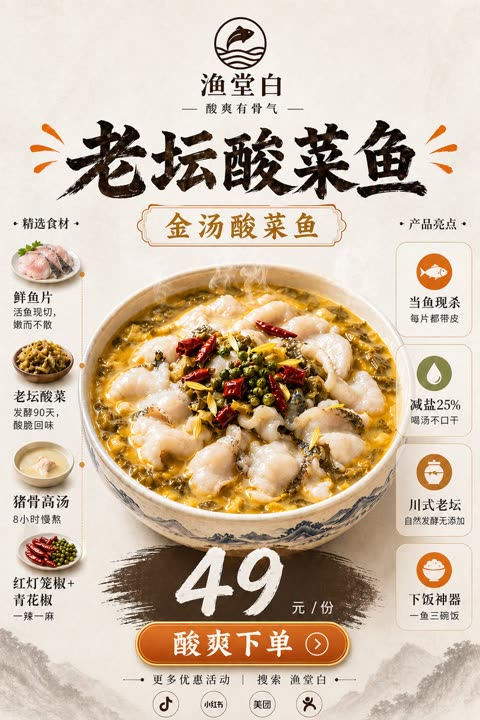</a>

The prompt is written as a goal, canvas, then numbered blocks for each region, with exact item counts and the exact Chinese copy quoted for every label. It asks for a photoreal dish inside clean flat graphics and ends with a no extra text rule, which keeps the layout tidy.

GPT Image 2 · Text-to-image · Source: [@MrLarus on X](https://x.com/MrLarus/status/2049756879908184128) · found via [YouMind-OpenLab/awesome-gpt-image-2](https://github.com/YouMind-OpenLab/awesome-gpt-image-2)

[`restaurant-poster`](tags.md#tag-restaurant-poster) [`chinese-typography`](tags.md#tag-chinese-typography) [`food-photography`](tags.md#tag-food-photography) [`brush-calligraphy`](tags.md#tag-brush-calligraphy) [`layout-spec`](tags.md#tag-layout-spec)

<details><summary><b>Prompt</b></summary>

```text
Goal: Create a vertical Chinese restaurant new-product poster for 老坛酸菜鱼, emphasizing appetite appeal, real food texture, ingredients, selling points, and a clear price/order call-to-action.

Canvas: Vertical 2:3 poster, warm off-white rice-paper background with subtle fibers, faint ink-wash mountains along the bottom edge, premium Chinese dining advertisement style.

Top branding: Centered circular logo showing a simple fish over wave lines. Under it place the brand name 渔堂白 and the tagline 「酸爽有骨气」. Add a huge black brush-calligraphy headline 「老坛酸菜鱼」 across the upper third, with small orange splash marks on both sides.

Main visual: In the center, show one large steaming ceramic bowl of golden sour pickled-cabbage fish soup. The bowl has blue-gray Chinese landscape patterning. The soup is glossy yellow-gold with visible chopped pickled greens, tender white fish slices, red dried chilies, green Sichuan peppercorns, yellow ginger strips, sesame-like spices, and rising steam. Keep the food photorealistic and highly appetizing while the poster graphics remain elegant and clean.

Central label: Above the bowl, place an ornate rounded rectangular label with gold text 「金汤酸菜鱼」 and a thin decorative border.

Left ingredient column: Title 「精选食材」. Show exactly 4 ingredient items stacked vertically, each with a small circular food photo and text: 1) 「鲜鱼片」 with subtext 「活鱼现切，嫩而不散」, 2) 「老坛酸菜」 with subtext 「发酵90天，酸脆回味」, 3) 「猪骨高汤」 with subtext 「8小时慢熬」, 4) 「红灯笼椒+青花椒」 with subtext 「一辣一麻」. Connect the 4 items with a thin dotted vertical orange line.

Right selling-point column: Title 「产品亮点」. Show exactly 4 rounded white cards stacked vertically, each with one simple orange/green icon and text: 1) fish icon, 「当鱼现杀」 and 「每片都带皮」, 2) droplet icon, 「减盐25%」 and 「喝汤不口干」, 3) jar icon, 「川式老坛」 and 「自然发酵无添加」, 4) rice bowl icon, 「下饭神器」 and 「一鱼三碗饭」.

Price and CTA: Below the bowl, paint a wide dark brown brush-stroke swash. Over it place a large white hand-painted price 49, followed by 「元 / 份」. Beneath, add a glossy orange rounded button with white text 酸爽下单 and a small right-arrow circle.

Footer: Add small text 「更多优惠活动 | 搜索 渔堂白」. Under it, place exactly 4 small circular platform icons/labels: Douyin-style music note, 「小红书」, 「美团」, and a simple person/share icon.

Visual style: High-end Chinese food poster, realistic steaming dish photography blended with brush-calligraphy typography, warm cream/gold/orange/brown palette, clean symmetrical layout, strong depth and shine on the soup, no clutter, no extra dishes or extra text beyond the specified elements.
```

</details>

<a id="gpt-image-chronicle-ai-presentation-cover-slide"></a>
### Chronicle presentation cover with product mockup

<a href="https://x.com/cellier_/status/2046615173411262959"></a>

Spelling out every headline, body line and label in order gives the model a complete text map, so the copy lands exactly as written. Separating style, visual feeling and composition into labelled fields keeps the editorial balance and generous whitespace consistent across the layout.

GPT Image 2 · Text-to-image · Source: [@cellier_ on X](https://x.com/cellier_/status/2046615173411262959) · found via [freestylefly/awesome-gpt-image-2](https://github.com/freestylefly/awesome-gpt-image-2)

[`presentation`](tags.md#tag-presentation) [`typography`](tags.md#tag-typography) [`slide-design`](tags.md#tag-slide-design) [`saas`](tags.md#tag-saas)

<details><summary><b>Prompt</b></summary>

```text
[中文]
创建一个高级的 4:3 演示文稿封面幻灯片，介绍来自 http://chroniclehq.com 的 AI 原生演示平台 Chronicle。

Style:
优雅，极简，现代，高级初创企业美学。类似于高端品牌指南封面（如 Apple / Linear / Notion 风格）。带有微妙深度感的柔和渐变背景，干净的留白，精致的排版，经过打磨的编辑式布局。

Main title:
CHRONICLE

Subtitle:
AI PRESENTATION PLATFORM

Body copy (small elegant text):
将原始想法转化为经过打磨的、高影响力的演示文稿。
从笔记、文档、链接或现有幻灯片开始。
使用 AI 生成美观的、符合品牌调性的幻灯片。
在灵活的画布上自由编辑。
导出为 PPT、PDF，或发布为网站。

Feature highlights (small premium labels):
STORY-FIRST
ON-BRAND DESIGN
AI EDITING
FREEFORM CANVAS
PPT EXPORT
TEAM COLLABORATION

Bottom-right elegant logo text:
chronicle

Visual feeling:
商务级高级感，战略级幻灯片质量，咨询级演示文稿，略带未来感但高度专业。

Composition:
干净的编辑式平衡，不对称布局，强烈的留白，演示软件主视觉感。

Aspect ratio:
4:3

Language:
仅限英文

[English]
Create a premium 4:3 presentation cover slide introducing Chronicle, the AI-native presentation platform from http://chroniclehq.com.

Style:
elegant, minimal, modern, premium startup aesthetic. Similar to high-end brand guideline covers (like Apple / Linear / Notion style). Soft gradient background with subtle depth, clean whitespace, refined typography, polished editorial layout.

Main title:
CHRONICLE

Subtitle:
AI PRESENTATION PLATFORM

Body copy (small elegant text):
Turn raw ideas into polished, high-impact presentations.
Start from notes, docs, links, or existing decks.
Generate beautiful, on-brand slides with AI.
Edit freely on a flexible canvas.
Export to PPT, PDF, or publish as a website.

Feature highlights (small premium labels):
STORY-FIRST
ON-BRAND DESIGN
AI EDITING
FREEFORM CANVAS
PPT EXPORT
TEAM COLLABORATION

Bottom-right elegant logo text:
chronicle

Visual feeling:
business-class premium, strategy deck quality, consulting-grade presentation, slightly futuristic but highly professional.

Composition:
clean editorial balance, asymmetrical layout, strong whitespace, presentation software hero shot feeling.

Aspect ratio:
4:3

Language:
English only
```

</details>

<a id="gpt-image-chupa-chups-neon-billboard-lollipop"></a>
### Giant Chupa Chups lollipop billboard over neon Mumbai street

<a href="https://x.com/Diplomeme/status/2054061713583219149">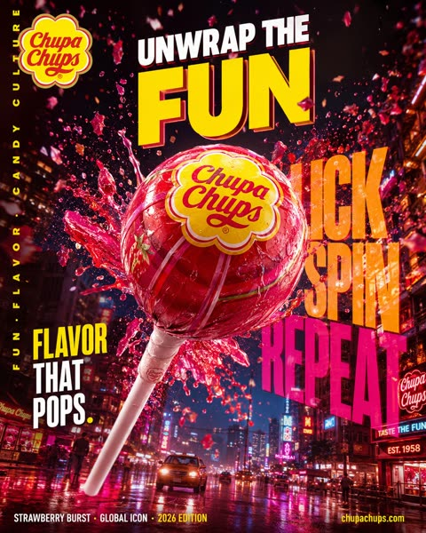</a>

Explicit typography zones with exact positions and a low-angle product shot keep each text block readable and the hero object dominant. Layering the oversized LICK SPIN REPEAT behind the lollipop adds depth, while the diagonal splash supplies motion.

GPT Image 2 · Text-to-image · Source: [@Diplomeme on X](https://x.com/Diplomeme/status/2054061713583219149) · found via [freestylefly/awesome-gpt-image-2](https://github.com/freestylefly/awesome-gpt-image-2)

[`fmcg`](tags.md#tag-fmcg) [`billboard`](tags.md#tag-billboard) [`neon`](tags.md#tag-neon) [`typography`](tags.md#tag-typography)

<details><summary><b>Prompt</b></summary>

```text
Hyper-realistic cinematic FMCG billboard advertising poster for Chupa Chups India, focusing on playful energy, bold flavor explosion, and Gen-Z candy culture.

Scene: a giant glossy Chupa Chups lollipop floating above a vibrant Indian street at night, candy shards and liquid flavor bursts exploding outward mid-air.

Environment: neon-lit urban backdrop inspired by Mumbai nightlife, glowing signage, reflective wet streets, colorful haze.

Subject: oversized strawberry swirl lollipop as the hero object, ultra-detailed glossy texture, cinematic flavor splash motion.

Visual storytelling: iconic Chupa Chups flower logo glowing subtly on wrapper, reflections visible on wet surfaces and candy syrup splashes.

Composition: dramatic low-angle shot, giant centered product dominating frame, dynamic explosion spreading diagonally across billboard composition.

Typography:
top left — Chupa Chups logo.
center massive — “UNWRAP THE FUN” ultra bold playful typography.
behind product (oversized layered text) — “LICK / SPIN / REPEAT”.
mid-left — “FLAVOR THAT POPS.” bold condensed font.
bottom left — “STRAWBERRY BURST · GLOBAL ICON · 2026 EDITION”.
bottom right — “http://chupachups.com”.
left vertical edge — “FUN · FLAVOR · CANDY CULTURE”.

Typography style: playful bold sans-serif, glossy layered opacity, oversized billboard scale.

Color palette: vibrant reds, yellows, pinks, neon orange accents, glossy candy textures.

Lighting: dramatic neon backlight with glowing highlights and candy reflections.

Atmosphere: sugar particles, mist, syrup splashes, floating candy dust.

Mood: energetic, youthful, addictive, vibrant.

Shot on ARRI Alexa Mini LF, 35mm anamorphic, HDR, ultra cinematic, premium FMCG billboard style, 4:5 portrait.
```

</details>

<a id="gpt-image-city-name-landmark-typography-travel-poster"></a>
### City Name Typography Travel Poster With Landmarks

<a href="https://x.com/Goodmanprotocol/status/2071819124708438092">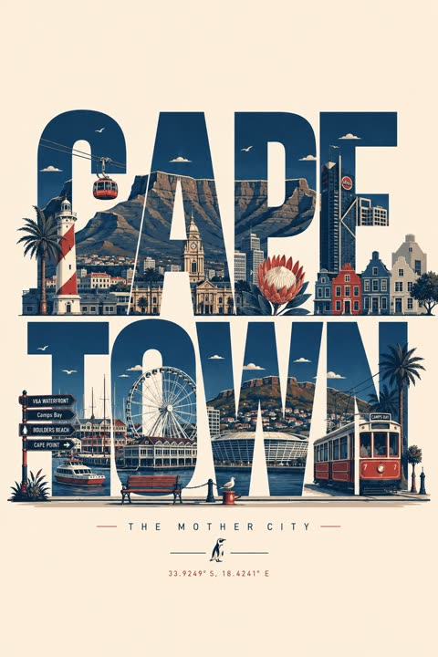</a>

The city name becomes the composition, with landmarks placed inside the letters while the letterforms stay legible. A limited palette of navy, cream, muted red and gray blue, plus a demand for city-accurate details, keeps the flat vector look consistent.

GPT Image 2 · Text-to-image · Source: [@Goodmanprotocol on X](https://x.com/Goodmanprotocol/status/2071819124708438092) · found via [freestylefly/awesome-gpt-image-2](https://github.com/freestylefly/awesome-gpt-image-2)

[`travel-poster`](tags.md#tag-travel-poster) [`typography`](tags.md#tag-typography) [`flat-vector`](tags.md#tag-flat-vector) [`landmarks`](tags.md#tag-landmarks) [`city`](tags.md#tag-city)

<details><summary><b>Prompt</b></summary>

```text
Create a clean, modern typographic travel poster where the city name itself becomes the composition. Render the city name in large, bold, uppercase sans-serif letters spanning the width of the artwork. Seamlessly integrate the city's most iconic landmarks, architecture, monuments, streets, transportation, cultural symbols, cafés, bridges, parks, skylines, sculptures, waterfronts, historic buildings, and local details into, around, and inside the letters. Let landmarks naturally interact with the typography while preserving legibility.
Use an elegant flat vector illustration style with crisp geometric shapes, minimal detail, clean outlines, subtle shadows, and a premium editorial aesthetic. Maintain a limited color palette of deep navy, warm cream, muted red, and soft gray-blue for a timeless travel-poster look.
Add small decorative elements such as street lamps, trees, clouds, birds, benches, bicycles, fountains, trams, ferries, or other city-specific objects where appropriate. Keep generous negative space with a clean background and perfectly balanced composition.
Ensure every landmark, architectural style, vehicle, sign, and cultural element is accurate to the chosen city—avoid generic or incorrect landmarks. If desired, include a small elegant tagline beneath the city name (such as a famous nickname or slogan) in minimal typography.
Style: premium flat vector, minimalist travel poster, geometric illustration, editorial design, tourism branding, clean typography, high contrast, ultra-sharp lines, museum-quality print, modern graphic design, centered composition, scalable SVG aesthetic, 8K resolution.
```

</details>

<a id="gpt-image-city-name-typography-travel-poster-panorama"></a>
### City Name Typography Poster With Scene Letters

<a href="https://x.com/iamaiistudio/status/2054563354899857757">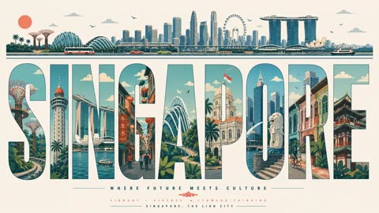</a>

Each giant letter works as a window onto a different city scene, and a thin skyline strip across the top balances the heavy type. A strict list of flat vector rules, a limited muted palette keyed to the city type, and repeated spelling constraints keep the lettering clean.

GPT Image 2 · Text-to-image · Source: [@iamaiistudio on X](https://x.com/iamaiistudio/status/2054563354899857757) · found via [freestylefly/awesome-gpt-image-2](https://github.com/freestylefly/awesome-gpt-image-2)

[`typography`](tags.md#tag-typography) [`travel-poster`](tags.md#tag-travel-poster) [`city`](tags.md#tag-city) [`flat-vector`](tags.md#tag-flat-vector) [`swiss-design`](tags.md#tag-swiss-design)

<details><summary><b>Prompt</b></summary>

```text
Ultra-high-resolution typography travel poster themed around [CITY NAME]. 16:9 poster ratio.

IMPORTANT: every visible word on the poster must be in English, perfectly spelled, professionally typeset. No distorted letters, no random symbols, no broken text, no AI gibberish.

CORE COMPOSITION:
Place the giant English word "[CITY_NAME]" front and center. Each letter is a tall, bold, elongated sans-serif form, and each one frames a different illustrated scene from the city, like a row of gallery windows. Spread landmarks, streets, transport, nature, culture, and architecture across the letters so the scenes flow from one letter into the next as a single connected urban panorama.

TOP HORIZONTAL STRIP:
Across the top of the poster, a thin panoramic band: city skyline silhouettes, cars, trams or trains, boats where it fits, birds, clouds, sun. Keep it minimalist, elegant, rhythmically balanced.

STYLE: mid-century modern editorial poster, Swiss graphic design, minimal vector illustration, architectural infographic feel, travel typography poster, flat geometric illustration, ultra-clean composition, premium magazine design, screen-print poster vibe, retro-futuristic travel branding.

ILLUSTRATION:
Flat vector shapes only. No realism, no gradients, no noise. Clean geometric shadows, simplified architectural forms, a mix of map-like top-down with side-view cityscape. Subtle line-art details, crisp vector edges, strong negative space, harmonious rhythm between the letters.

TYPOGRAPHY:
Giant bold sans-serif, letters fill most of the canvas height. Pixel-perfect alignment. Each letter acts as its own framed illustration panel. Soft rounded corners where it suits. Editorial spacing. Print-ready and geometrically clean.

COLOR PALETTE:
Pull a cohesive palette inspired by [CITY_NAME]:
coastal city -> aqua, sand, coral, muted teal
desert city -> terracotta, beige, warm cream
cyber city -> mint, navy, steel blue
historic European city -> dusty rose, olive green, parchment
Muted pastels, soft vintage travel-poster colors, low saturation. Max 4 to 6 colors.

CONTENT:
Include iconic landmarks, famous streets and transport, local urban patterns, nearby nature, skyline silhouettes, bridges/rivers/coastline if relevant, culturally symbolic architecture, recognizable local atmosphere.

COMPOSITION:
Centered typography on a white or soft ivory background. Lots of breathing room. The top panoramic strip balances the heavy typography below. Asymmetrical but visually balanced. Each letter shows its own scene depth and perspective. Museum-quality poster hierarchy.

MOOD: premium, intellectual, calm, design-forward, travel-editorial, stylish enough for a museum gift-shop wall.

QUALITY: 8K ultra-detailed, print-ready, razor-sharp vector edges, flawless typography, zero distorted text, zero random characters, zero spelling errors, zero AI artifacts.
```

</details>

<a id="gpt-image-config-2026-nail-art-board"></a>
### Ten flat press on nail designs on a taupe board

<a href="https://x.com/cho__design/status/2055812234534846652">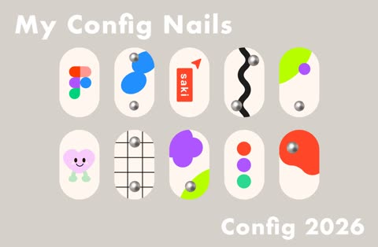</a>

Each nail is numbered and described by its exact position, shape and colour, so the layout stays fixed while the designs vary. Shading appears only on the chrome studs, which keeps the rest of the flat vector look clean.

GPT Image 2 · Text-to-image · Source: [@cho__design on X](https://x.com/cho__design/status/2055812234534846652) · found via [YouMind-OpenLab/awesome-gpt-image-2](https://github.com/YouMind-OpenLab/awesome-gpt-image-2)

[`nail-art`](tags.md#tag-nail-art) [`flat-vector`](tags.md#tag-flat-vector) [`numbered-list`](tags.md#tag-numbered-list) [`poster-layout`](tags.md#tag-poster-layout)

<details><summary><b>Prompt</b></summary>

```text
Goal: Create a cute presentation board for custom event nail art inspired by Config 2026, with playful Figma-like shapes and soft 3D metallic nail gems.

Canvas: Horizontal 16:9 layout, warm taupe-gray background, clean minimal poster composition.

Text content: Large bold rounded white title at the upper left: “My Config Nails”. Large bold rounded white event label at the lower right: “Config 2026”. Use a heavy friendly sans-serif font with soft rounded corners.

Layout: Arrange exactly 10 press-on nail designs in two centered rows of five. Each nail is a vertical rounded capsule shape, ivory/off-white, evenly spaced, with subtle flat graphic decoration. Keep the nails large and isolated, like a Figma design mockup.

Nail designs, exactly 10:
1. Top row, first nail: Figma logo made from five rounded colored blobs in red-orange, coral, purple, blue, and green.
2. Top row, second nail: abstract bright blue stacked bean shapes with two chrome silver spherical studs, one near the upper left and one near the bottom.
3. Top row, third nail: red vertical rounded rectangle label with white text “saki”, plus a small red paper-plane or cursor triangle near the upper right.
4. Top row, fourth nail: thick black wavy vertical stripe down the center with two chrome silver spherical studs, one near the upper right and one near the lower left.
5. Top row, fifth nail: neon lime green curved corner shape sweeping in from the upper left, purple circle near the right side, and one chrome silver stud near the lower center.
6. Bottom row, first nail: cute pastel pink heart character with black oval eyes, smiling mouth, and mint green little legs/feet.
7. Bottom row, second nail: black grid lines over the ivory nail, with two chrome silver studs aligned vertically, one upper center and one lower center.
8. Bottom row, third nail: large purple flower/blob cluster at upper left, neon lime green curved patch at lower right, and one chrome silver stud near the lower center.
9. Bottom row, fourth nail: three vertically stacked circles in red-orange, purple, and green, centered on the nail.
10. Bottom row, fifth nail: large red-orange organic blob covering the upper portion, with one chrome silver stud near the upper left of the blob.

Visual style: Modern cute flat vector nail-art mockup, Figma conference aesthetic, soft cream nails, saturated accent colors, simple geometric shapes, subtle shadows only on chrome studs for a 3D metallic look. Keep everything crisp, clean, and poster-like.

Constraints: Use exactly 10 nail capsules and exactly 10 chrome silver studs total. Do not add hands, fingers, bottles, extra decorations, watermarks, or additional text.
```

</details>

<a id="gpt-image-crocs-giant-clog-leaning-model-poster"></a>
### Model leaning on giant white Crocs clog poster

<a href="https://x.com/rovvmut_/status/2047629543608025121">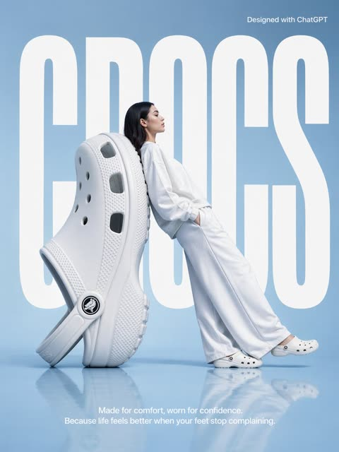</a>

Scale contrast carries the concept: an oversized clog becomes the model's backrest, and a massive condensed wordmark behind both is partly hidden by them to create depth. Exact copy for the corner credit and tagline, plus a 3:4 ratio, keeps the output layout-ready.

GPT Image 2 · Text-to-image · Source: [@rovvmut_ on X](https://x.com/rovvmut_/status/2047629543608025121) · found via [YouMind-OpenLab/awesome-gpt-image-2](https://github.com/YouMind-OpenLab/awesome-gpt-image-2)

[`fashion`](tags.md#tag-fashion) [`poster`](tags.md#tag-poster) [`surrealism`](tags.md#tag-surrealism) [`typography`](tags.md#tag-typography)

<details><summary><b>Prompt</b></summary>

```text
A high-fashion surrealist advertising poster for Crocs. The scene is set in a minimalist, monochrome light blue studio with a semi-reflective floor. 
The central focus is an oversized, giant white Croc clog positioned on its heel at a diagonal angle, serving as a backrest. A fashion model with long dark hair, dressed in a clean, all-white coordinated sweatshirt and wide-leg trousers, leans her entire back against the giant shoe in a relaxed, leaning posture. She is facing right in profile, looking ahead with a serene expression, and wearing standard-sized white Crocs.
In the background, the word "CROCS" is written in massive, bold, white condensed sans-serif typography, partially occluded by the giant shoe and the model to create a sense of depth. At the  top right, "Designed with ChatGPT" 
At the bottom center, a white sans-serif tagline reads: "Made for comfort, worn for confidence. Because life feels better when your feet stop complaining." The lighting is soft, cool, and even, casting gentle shadows and a soft reflection of the subjects on the glossy blue floor. The overall aesthetic is clean, modern, and high-concept.

Make the aspect ratio 3:4
```

</details>

<a id="gpt-image-crystal-arch-country-travel-poster"></a>
### Crystal glass arch country travel poster

<a href="https://x.com/Taaruk_/status/2091391283063361558">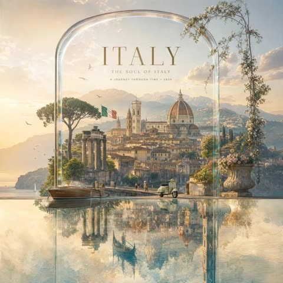</a>

A glass arch frame on a reflective surface holds one panorama of landmarks, and a COUNTRY placeholder makes the prompt reusable for any destination. A pastel golden hour palette, prism edge highlights, a mirror reflection and fixed typography lines keep the layout consistent.

GPT Image 2 · Text-to-image · Source: [@Taaruk_ on X](https://x.com/Taaruk_/status/2091391283063361558) · found via [freestylefly/awesome-gpt-image-2](https://github.com/freestylefly/awesome-gpt-image-2)

[`travel-poster`](tags.md#tag-travel-poster) [`glass-frame`](tags.md#tag-glass-frame) [`reflection`](tags.md#tag-reflection) [`golden-hour`](tags.md#tag-golden-hour) [`typography`](tags.md#tag-typography)

<details><summary><b>Prompt</b></summary>

```text
Create a luxurious, dreamy country travel-art collection in the exact visual language of an elegant premium tourism campaign: a large transparent crystal/glass architectural frame or arched glass display standing on a glossy reflective surface, containing a highly detailed cinematic illustration of the destination. For [COUNTRY], feature its most iconic landmarks, historic architecture, distinctive landscapes, local transportation, cultural elements, national flag, flowers and recognizable scenery arranged as one seamless poetic panorama. Use warm golden-hour sunlight, soft atmospheric haze, pastel cream, champagne, muted blue and sage tones, delicate clouds, subtle birds, realistic glass refraction and rainbow prism highlights along the edges. Create a perfect mirror reflection beneath the glass structure, extending the entire composition downward with beautifully softened reflections. Add elegant editorial typography at the top reading “[COUNTRY]”, with smaller refined text “THE SOUL OF [COUNTRY]” and “A JOURNEY THROUGH TIME • 2026” beneath it. Sophisticated luxury travel magazine aesthetic, photorealistic yet painterly, cinematic depth, fine-art composition, extremely detailed architecture, serene atmosphere, premium advertising photography, symmetrical balanced framing, soft film grain, 8K, vertical 4:5, no clutter, no modern UI elements, no extra text.
```

</details>

<a id="gpt-image-echoes-scifi-face-city-poster"></a>
### Science fiction poster titled ECHOES over a city

<a href="https://x.com/underwoodxie96/status/2046514205529088501">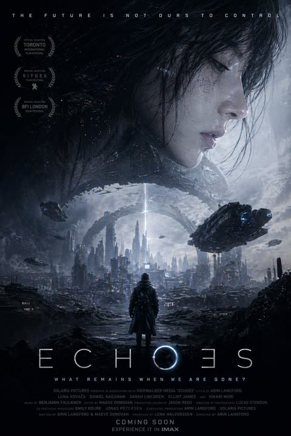</a>

A bare genre brief works because the model supplies the full one-sheet structure: tagline, billing block, festival laurels and release line. The cool grey blue palette, a face in the sky and a figure seen from behind set scale and mood.

GPT Image 2 · Text-to-image · Source: [@underwoodxie96 on X](https://x.com/underwoodxie96/status/2046514205529088501) · found via [freestylefly/awesome-gpt-image-2](https://github.com/freestylefly/awesome-gpt-image-2)

[`science-fiction`](tags.md#tag-science-fiction) [`movie-poster`](tags.md#tag-movie-poster) [`cityscape`](tags.md#tag-cityscape) [`text-to-image`](tags.md#tag-text-to-image)

<details><summary><b>Prompt</b></summary>

```text
[中文]
创建一张科幻电影海报

[English]
Create a Science fiction movie poster
```

</details>

<a id="gpt-image-elon-musk-ink-gold-poster"></a>
### Elon Musk ink portrait poster with gold script name

<a href="https://x.com/xRahultripathi/status/2051526227937443888">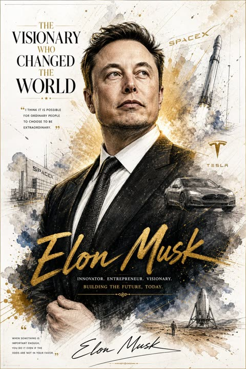</a>

A chest up crop at a slight diagonal, with a soft glowing aura behind the subject, pulls the eye to the face. Ink line sketches over watercolor splashes, gold accents and a brush style name give the luxury poster finish.

GPT Image 2 · Text-to-image · Source: [@xRahultripathi on X](https://x.com/xRahultripathi/status/2051526227937443888) · found via [YouMind-OpenLab/awesome-gpt-image-2](https://github.com/YouMind-OpenLab/awesome-gpt-image-2)

[`portrait`](tags.md#tag-portrait) [`ink-watercolor`](tags.md#tag-ink-watercolor) [`gold-accents`](tags.md#tag-gold-accents) [`poster`](tags.md#tag-poster)

<details><summary><b>Prompt</b></summary>

```text
A powerful portrait of a high-status business leader wearing a premium luxury formal suit (tailored dark suit, crisp white shirt, elegant tie). Sharp facial features, clean grooming, ultra-realistic detailing. Expression & Mood: Calm, confident, and highly authoritative expression — focused gaze symbolizing intelligence, control, and global influence. Pose & Composition: Half-body portrait (chest-up), Slight diagonal cinematic angle for depth and intensity, Strong executive posture (hands relaxed or adjusting suit). Art Style: Hand-drawn ink sketch lines blended with watercolor textures, Luxury-inspired gold, black, and deep blue/red paint splashes, Dynamic abstract brush strokes representing power and innovation, Highly detailed realistic face with subtle gritty texture. Background: Clean white or soft neutral base, Elegant watercolor splashes (gold + dark tones), Soft glowing aura behind the subject for a premium elite feel. Typography Elements: Main Title: “TYPE HERE” Name: “TYPE HERE” (bold handwritten luxury brush style) Extra Details: Subtle gold accents for premium billionaire aesthetic, Light grunge texture overlay for cinematic depth, Minimal crown or abstract wealth/power symbols. Signature (Bottom): “TYPE HERE” Optional Quote Section: “TYPE HERE” Mood & Tone: Elite, powerful, cinematic, luxury-driven legacy aesthetic
```

</details>

<a id="gpt-image-evangelion-unit-01-distressed-poster"></a>
### Distressed Evangelion Unit 01 poster with seated pilot

<a href="https://x.com/AI_CyberDreams/status/2046617697639620818">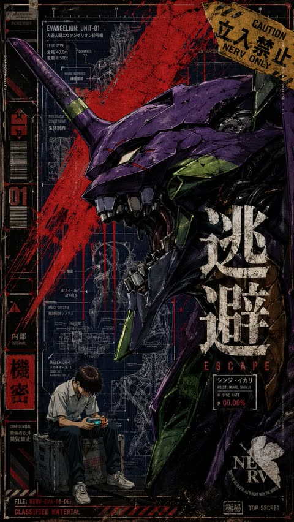</a>

Fixing the subject's facing direction, its share of the frame and the lower left figure's pose locks the composition in place. Listing every English label word for word and capping the palette at seven named colours keeps the text readable and the output on brief.

GPT Image 2 · Text-to-image · Source: [@AI_CyberDreams on X](https://x.com/AI_CyberDreams/status/2046617697639620818) · found via [YouMind-OpenLab/awesome-gpt-image-2](https://github.com/YouMind-OpenLab/awesome-gpt-image-2)

[`evangelion`](tags.md#tag-evangelion) [`mecha`](tags.md#tag-mecha) [`poster`](tags.md#tag-poster) [`distressed`](tags.md#tag-distressed)

<details><summary><b>Prompt</b></summary>

```text
A gritty vertical anime-mecha poster in distressed screen-print style, inspired by retro military dossiers and Evangelion key art. The main subject is a massive close-up side profile of EVANGELION: UNIT-01, dominating the right two-thirds of the composition, facing left with its jaws open in a feral scream. The head is angular and biomechanical, with deep purple armor, olive-green accent plates, black metal inner structures, a single long horn projecting diagonally upward to the left, sharp teeth, and a narrow glowing eye. The surface is scratched, chipped, weathered, and inked with heavy comic-style linework. Behind it is a dark navy blueprint background filled with 8 visible technical diagram clusters, white schematic lines, anatomical overlays, cross-sections, labels, measurement marks, and interface graphics. A violent red paint slash explodes diagonally across the upper center and left side, with additional red drips running downward from the mecha’s mouth area. In the lower left corner, 1 small human figure sits hunched on a gray equipment crate: a teenage boy in a short-sleeve white school shirt, dark pants, and white sneakers, elbows on knees, looking down at a glowing handheld device, conveying isolation and anxiety. Add layered poster typography and warning graphics throughout the border: a torn yellow caution sign in the upper right with Japanese warning text and “CAUTION NERV ONLY”; a tall left sidebar with “01”, barcode-like blocks, hazard icons, and red-black labels; large distressed white kanji vertically stacked over the mecha torso; the word ESCAPE in spaced red capitals beneath the kanji; a small black label reading “PILOT: IKARI, SHINJI”; a bottom-right NERV logo; and footer text such as classified file markings and top secret stamps. Include 6 clearly readable English technical labels in the blueprint area: “TEST TYPE”, “BIOLOGICAL CONSTRAINT”, “AT FIELD”, “MAGI SYSTEM”, “INTERNAL”, and “CLASSIFIED MATERIAL”. Add Japanese dossier text blocks as authentic graphic texture. The palette is limited to dark indigo, black, crimson red, purple, olive green, dirty beige, and off-white. High contrast, torn-paper collage details, halftone texture, ink splatter, cracked paint, and worn print edges. Cinematic, oppressive, chaotic, collectible poster design, ultra-detailed, sharp, textured, no clean modern polish.
```

</details>

<a id="gpt-image-film-noir-ink-melt-red-circle-poster"></a>
### Film noir poster with ink melting fedora man

<a href="https://x.com/Goodmanprotocol/status/2047165794325500353">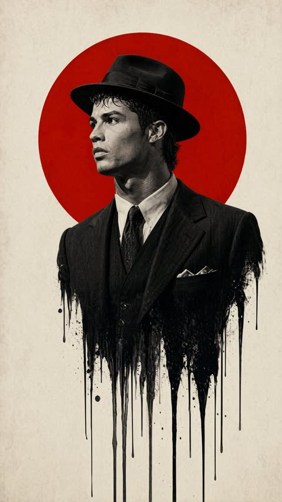</a>

Sections for subject, style, and technical details keep each layer separate. A strict three color palette, a solid red circle halo, and Rembrandt lighting give the poster a clear focal axis, and the ink drip effect is described in concrete terms.

GPT Image 2 · Text-to-image · Source: [@Goodmanprotocol on X](https://x.com/Goodmanprotocol/status/2047165794325500353) · found via [YouMind-OpenLab/awesome-gpt-image-2](https://github.com/YouMind-OpenLab/awesome-gpt-image-2)

[`film-noir`](tags.md#tag-film-noir) [`ink-drip`](tags.md#tag-ink-drip) [`minimalist`](tags.md#tag-minimalist) [`red-circle`](tags.md#tag-red-circle) [`vertical-poster`](tags.md#tag-vertical-poster)

<details><summary><b>Prompt</b></summary>

```text
Subject & Composition:\n\nCentral Figure: A sharp profile view of a man wearing a classic 1940s fedora and a formal suit.\n\nMelting Effect: The lower half of the man's torso should dissolve or \"drip\" into long, vertical black ink streaks and splatters, creating a surreal, liquid-bleed effect against the background.\n\nGraphic Element: A large, solid vibrant red circle is positioned directly behind the man's head and shoulders, creating a \"halo\" or \"rising sun\" motif that anchors the composition.\n\nStyle & Color Palette:\n\nColor Scheme: A strict minimalist palette of True Red, Deep Black, and Off-White/Cream.\n\nPhotography Style: High-contrast, black and white film noir photography for the subject. The texture should look like a high-resolution fashion editorial with a shallow depth of field.\n\nBackground: A clean, slightly textured off-white paper or canvas background to give it a premium, physical poster feel.\n\nTechnical Details:\n\nLighting: Strong \"Rembrandt\" lighting to define the facial contours, emphasizing the bridge of the nose and the jawline with deep shadows.\n\nAtmosphere: Somber, intellectual, and high-stakes. The design should feel modern yet period-accurate to the mid-20th century.\n\nFraming: Vertical poster orientation (A-frame), with significant negative space on the left and right to emphasize the central vertical axis.\n\nAspect ratio is 9:16
```

</details>

<a id="gpt-image-futuristic-paris-vintage-travel-poster"></a>
### Retro futurist Paris travel poster with giant flowers

<a href="https://x.com/Naiknelofar788/status/2093230701986672924">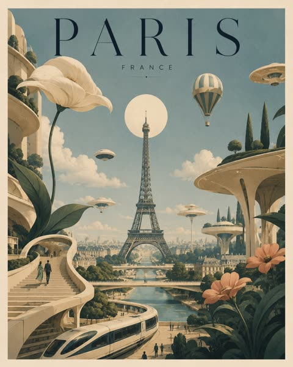</a>

The prompt never names a place and only asks for one iconic focal point and an instantly recognizable silhouette, so the model picks a landmark city itself. Fusing vintage travel poster and luxury editorial styles with muted colors, paper texture, film grain and a no photorealism constraint keeps the result looking like a printed collectible.

GPT Image 2 · Text-to-image · Source: [@Naiknelofar788 on X](https://x.com/Naiknelofar788/status/2093230701986672924) · found via [freestylefly/awesome-gpt-image-2](https://github.com/freestylefly/awesome-gpt-image-2)

[`travel-poster`](tags.md#tag-travel-poster) [`futuristic`](tags.md#tag-futuristic) [`surreal-architecture`](tags.md#tag-surreal-architecture) [`vintage`](tags.md#tag-vintage) [`editorial`](tags.md#tag-editorial)

<details><summary><b>Prompt</b></summary>

```text
Create a visually unforgettable editorial art poster of a dreamlike futuristic world where familiar everyday life meets surreal architecture. Grand sculptural buildings, winding roads, oversized plants, tiny people, unexpected floating elements, dramatic perspective, cinematic atmosphere, and one iconic focal point. Blend vintage travel-poster design with modern luxury editorial aesthetics, sophisticated muted colors, soft natural light, subtle film grain, tactile paper texture, clean geometric shapes, minimal composition, nostalgic yet futuristic, whimsical but premium, highly detailed, instantly recognizable silhouette, Pinterest-worthy, Instagram-viral aesthetic, collectible art print, no clutter, no photorealism, vertical 4:5.
```

</details>

<a id="gpt-image-giant-clog-step-into-ease-poster"></a>
### Giant Clog Campaign Poster With Vertical Headline

<a href="https://x.com/iamaiistudio/status/2057281549851377866">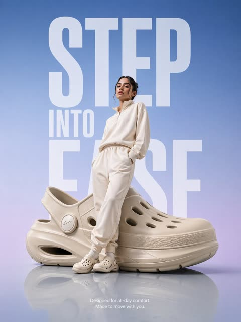</a>

The prompt is split into labeled blocks for backdrop, lighting, composition, copy and style, so each part can be controlled separately. Exact quoted headline and footer text, plus a headline tucked behind the subject, add depth and layered editorial structure.

GPT Image 2 · Text-to-image · Source: [@iamaiistudio on X](https://x.com/iamaiistudio/status/2057281549851377866) · found via [freestylefly/awesome-gpt-image-2](https://github.com/freestylefly/awesome-gpt-image-2)

[`product-ad`](tags.md#tag-product-ad) [`campaign`](tags.md#tag-campaign) [`typography`](tags.md#tag-typography) [`studio-lighting`](tags.md#tag-studio-lighting) [`minimalism`](tags.md#tag-minimalism)

<details><summary><b>Prompt</b></summary>

```text
Hyper-realistic premium product advertisement: an oversized futuristic comfort clog sits on a smooth glossy reflective floor. A modern model in soft neutral-toned athleisure (off-white / beige) leans casually against the giant shoe with a relaxed, confident posture.

Backdrop: clean gradient flowing from soft sky blue into subtle lavender, with massive bold sans-serif typography reading "STEP INTO EASE" stretched vertically, partially tucked behind the subject.

Lighting: high-end studio lighting, soft highlights, gentle floor reflections, and a subtle rim light tracing the model and the product for depth.

Composition: editorial magazine layout, subject perfectly centered, generous negative space, luxury campaign mood.

Small minimal copy at the bottom: "Designed for all-day comfort. Made to move with you."

Style: ultra-clean Apple-style minimalism crossed with a fashion campaign, hyper-realistic, premium commercial photography, 8K, razor-sharp detail.
```

</details>

<a id="gpt-image-giant-controller-streetwear-energy-poster"></a>
### Giant gaming controller streetwear poster with ENERGY typography

<a href="https://x.com/AIwithkhan/status/2052973449107349725">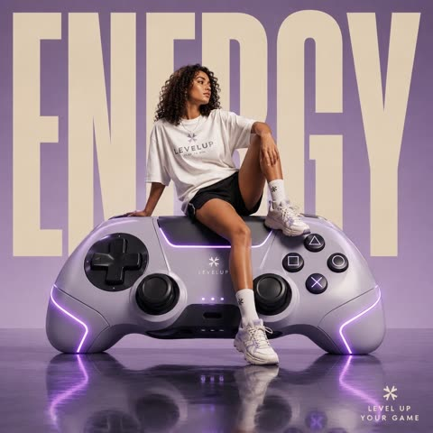</a>

The prompt fixes one oversized prop, a seated pose with one leg down and one knee raised, and a narrow pastel palette. A huge cream condensed word fills the background behind the subject and gives the poster its layered editorial depth.

GPT Image 2 · Text-to-image · Source: [@AIwithkhan on X](https://x.com/AIwithkhan/status/2052973449107349725) · found via [freestylefly/awesome-gpt-image-2](https://github.com/freestylefly/awesome-gpt-image-2)

[`streetwear`](tags.md#tag-streetwear) [`campaign-poster`](tags.md#tag-campaign-poster) [`typography`](tags.md#tag-typography) [`pastel-neon`](tags.md#tag-pastel-neon) [`studio-lighting`](tags.md#tag-studio-lighting)

<details><summary><b>Prompt</b></summary>

```text
Luxury futuristic streetwear campaign poster featuring a confident athletic girl sitting on a gigantic oversized retro gaming controller instead of sunglasses, clean editorial advertising aesthetic, massive bold typography in the background saying “ENERGY”, glossy reflective floor, cinematic studio lighting, pastel neon color palette with lavender, silver, and soft cyan tones.

The girl has curly shoulder-length hair, relaxed confident attitude, wearing an oversized white graphic T-shirt, loose black athletic shorts, high white socks, and modern sneakers. Casual sporty fashion styling, natural makeup, youthful Gen-Z streetwear vibe. She is casually seated on top of the giant gaming controller with one leg hanging down and one knee raised, looking away from the camera with cool effortless confidence.

The oversized gaming controller is ultra detailed with futuristic buttons, glowing accents, premium matte materials, and soft LED reflections. Minimal luxury branding on the controller side. Giant cream-colored typography fills the background vertically in a bold condensed font.

Environment: seamless studio backdrop with glossy floor reflections, high-end commercial fashion photography, ultra realistic textures, dramatic shadows, premium editorial layout, modern tech-fashion advertisement aesthetic, symmetrical composition, luxury product campaign style, 4:3 aspect ratio, hyper detailed, photorealistic.
```

</details>

<a id="gpt-image-golden-phone-screen-burst-ad-poster"></a>
### Woman in orange bursting from golden phone

<a href="https://x.com/you1873118/status/2052624395932455061">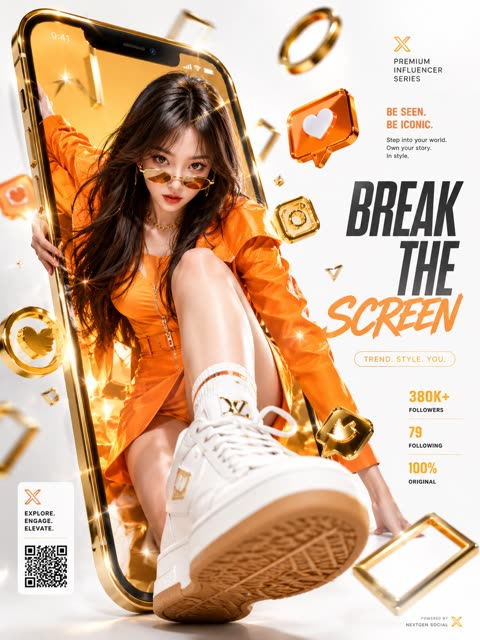</a>

Forced perspective pushes a sneaker sole toward the camera, and a wide angle lens with shallow depth of field sells the effect of stepping out of the screen. A strict orange, white and gold palette, floating 3D icons and a clean layout zone for typography and a QR code give it a finished ad poster structure. An uploaded face reference keeps the identity.

GPT Image 2 · Edit · Source: [@you1873118 on X](https://x.com/you1873118/status/2052624395932455061) · found via [freestylefly/awesome-gpt-image-2](https://github.com/freestylefly/awesome-gpt-image-2)

[`ad-poster`](tags.md#tag-ad-poster) [`3d-render`](tags.md#tag-3d-render) [`forced-perspective`](tags.md#tag-forced-perspective) [`social-media`](tags.md#tag-social-media) [`orange-gold`](tags.md#tag-orange-gold)

<details><summary><b>Prompt</b></summary>

```text
动态的豪华商业广告海报，特色是超现实3D渲染的充满活力的年轻女性，以上传的女性面部作为参考，穿着高级亮橙色设计师服装、豪华配饰以及时尚的金色墨镜，自信地从一个巨大的金色智能手机屏幕中爆发出色。她的姿势有力且时尚，一只运动鞋通过强烈的强制透视戏剧性地穿过数字显示屏，踏入现实。

构图在前台强调她白色豪华运动鞋，带有纹理口香糖鞋底，通过电影般的广角镜头失真和浅景深增强。漂浮的闪亮3D社交媒体图标、金色几何元素和豪华品牌图形环绕着她，营造出高端影响者营销美学。

明亮的摄影棚灯光营造出充满活力的优质促销氛围，金属金色手机边缘的丰富反射与哑光织物质地形成对比。主导的橙色、白色和金色调色板传递出超现代豪华X / Twitter 广告氛围。干净的白色背景上带有大胆的编辑排版、优质软件品牌元素、优雅的UI图形、漂浮的互动图标以及时尚的二维码区域。

超现实8K品质、电影般的阴影、精致的商业艺术指导、豪华女性能量、时尚营销美学、现代社交媒体品牌、闪亮反射以及高端数字广告风格。

宽高比：3:4。
```

</details>

<a id="gpt-image-great-barrier-reef-travel-poster"></a>
### Great Barrier Reef Mid Century Travel Poster

<a href="https://x.com/jzaib4269/status/2055487295734620522">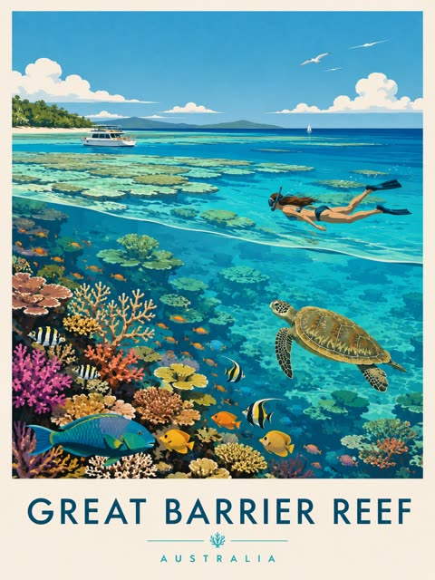</a>

The prompt splits the scene into foreground, midground, background and sky layers, so the above and below water view stays organized. Negative constraints (no textures, no gradients) and exact poster text with a divider icon keep the flat vintage print look.

GPT Image 2 · Text-to-image · Source: [@jzaib4269 on X](https://x.com/jzaib4269/status/2055487295734620522) · found via [freestylefly/awesome-gpt-image-2](https://github.com/freestylefly/awesome-gpt-image-2)

[`travel-poster`](tags.md#tag-travel-poster) [`flat-vector`](tags.md#tag-flat-vector) [`mid-century`](tags.md#tag-mid-century) [`underwater`](tags.md#tag-underwater) [`typography`](tags.md#tag-typography)

<details><summary><b>Prompt</b></summary>

```text
Create a premium editorial travel poster illustration of the Great Barrier Reef, Australia.
Style: Flat vector illustration, ultra-clean minimalism, mid-century modern travel poster aesthetic, inspired by vintage tourism prints and Scandinavian graphic design. No photorealism, no textures, no noise, no gradients. Use crisp shapes, smooth color blocks, and harmonious vibrant tones.
Composition (vertical 3:4 layout):
Foreground (underwater): A rich coral reef ecosystem filled with colorful corals in pink, orange, yellow, and red tones. Include tropical fish of various species (striped, bright yellow, blue, and orange), and a large sea turtle swimming gracefully toward the right. Clear turquoise water with high visibility.
Midground: A female snorkeler swimming horizontally just beneath the water surface, wearing fins and a snorkel mask, observing the reef below. Light rays subtly pass through the water surface.
Background (above water): A calm tropical ocean with shallow reef patches visible through crystal-clear water. A white leisure boat floats peacefully on the left, and a small sailboat appears far in the distance. On the horizon, soft green islands or hills stretch across.
Sky: Bright blue sky with fluffy white clouds and a few birds flying, enhancing the serene vacation mood.
Typography:
At the bottom of the poster, include bold uppercase text:
“GREAT BARRIER REEF”
Below it, smaller spaced-out text:
“AUSTRALIA”
Add a small decorative coral icon between divider lines.
Mood & Lighting: Bright daylight, calm, inviting, tropical paradise atmosphere. Colors should feel fresh, vibrant, and relaxing with strong contrast between coral reef and ocean blues.
```

</details>

<a id="gpt-image-guadalajara-vintage-movie-travel-poster"></a>
### Guadalajara vintage travel poster with mariachi silhouette

<a href="https://x.com/MiMundoConIA/status/2077046470335938826">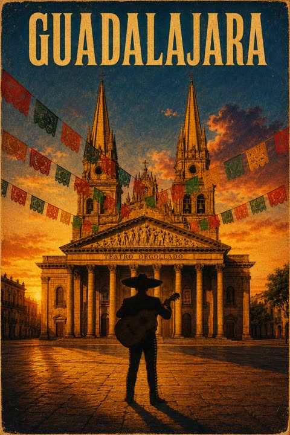</a>

Splits the scene into foreground, midground and background layers so the theatre and cathedral sit apart, and keeps the musician a featureless silhouette to avoid face errors. Vintage print texture is described through grain, halftone and ink bleed rather than a style label.

GPT Image 2 · Text-to-image · Source: [@MiMundoConIA on X](https://x.com/MiMundoConIA/status/2077046470335938826) · found via [freestylefly/awesome-gpt-image-2](https://github.com/freestylefly/awesome-gpt-image-2)

[`travel-poster`](tags.md#tag-travel-poster) [`vintage`](tags.md#tag-vintage) [`film-grain`](tags.md#tag-film-grain) [`silhouette`](tags.md#tag-silhouette) [`typography`](tags.md#tag-typography)

<details><summary><b>Prompt</b></summary>

```text
@Crea una imagen {
  "style": "Cinematic Vintage Movie Poster — Guadalajara, Mexico",
  "target_tool": "DALL-E 3 (ChatGPT)",
  "prompt": "Generate a vertical portrait-format movie poster image, taller than wide in a 2:3 aspect ratio. The image is a cinematic vintage travel movie poster for Guadalajara, Mexico, rendered with the visual texture of an aged large-format film poster: heavy 35mm film grain throughout especially in the shadow areas, slightly faded and warm-shifted color tones as if printed on aged matte paper stock, a subtle halftone dot pattern visible in the midtones, and a very slight ink bleed at high-contrast edges giving it an authentic vintage printed poster feel. Foreground: a single dark silhouette of a lone mariachi musician standing still at the center-bottom of the frame, rendered as a pure clean dark silhouette with no facial features visible — traditional wide-brim charro sombrero, fitted traje de charro suit outline, holding a guitarrón — casting a long warm shadow across the honey-colored cantera stone paving of Plaza de la Liberación below, with colorful papel picado banners in red, orange, green and yellow cut tissue paper strung in loose diagonal lines overhead from building to building, swaying slightly, framing the upper composition, no people other than the single silhouetted figure, no vehicles, no modern objects. Midground: the grand honey-amber cantera stone neoclassical facade of the Teatro Degollado rising directly behind the silhouette, its ornate columned portico and triangular pediment warmly lit by the low golden-hour sun hitting from the left, long dramatic shadows stretching across the stone paving, the warm amber volcanic stone glowing intensely in the golden light. Background: the twin neo-Gothic spires of the Catedral Metropolitana de Guadalajara rising tall into the upper frame against a vast deep cerulean blue sky transitioning to burnt amber and deep orange near the horizon, a single scattered cloud catching violet and gold light from below, the cathedral facade in warm honey stone matching the Teatro Degollado's palette. Color grade: saturated warm amber and golden honey tones dominating the stone architecture, deep cobalt blue in the upper sky, rich burnt orange near the horizon, faded warm sepia in the shadow areas consistent with a vintage printed poster. At the very top of the image, centered above the spires, render the single word GUADALAJARA in bold condensed uppercase display serif letters in warm cream-gold with a faint dark drop shadow, leaving clear sky negative space for the title. No modern buildings, no cars, no utility wires, no people other than the single dark silhouette visible anywhere in the scene.",
  "target": "🎯 Target: DALL-E 3 (ChatGPT) — 💡 Foreground/midground/background separation places Teatro Degollado and the Cathedral in distinct spatial layers, the mariachi silhouette is specified as a featureless outline to eliminate aberration risk, and vintage print texture is described visually rather than as a style label."
}
```

</details>

<a id="gpt-image-heaven-error-angel-glitch-poster"></a>
### Anime Angel Glitch Girl Cyber Streetwear Poster

<a href="https://x.com/Eris_Create_Lab/status/2052203876032639411">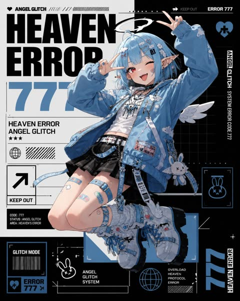</a>

A structured JSON spec lists the outfit pieces, 13 exact text labels, 7 icons and 10 UI panels, so the typography and layout stay controlled. Swappable argument fields for hair color, headline, number and accent color make it easy to reuse.

GPT Image 2 · Text-to-image · Source: [@Eris_Create_Lab on X](https://x.com/Eris_Create_Lab/status/2052203876032639411) · found via [YouMind-OpenLab/awesome-gpt-image-2](https://github.com/YouMind-OpenLab/awesome-gpt-image-2)

[`anime`](tags.md#tag-anime) [`streetwear`](tags.md#tag-streetwear) [`glitch`](tags.md#tag-glitch) [`typography`](tags.md#tag-typography) [`cyber-ui`](tags.md#tag-cyber-ui)

<details><summary><b>Prompt</b></summary>

```text
{"type":"information-dense anime streetwear character poster","style":"high-detail Japanese anime illustration mixed with bold graphic-design typography, cyber sticker layout, black white and powder blue palette, crisp vector UI elements, glossy magazine poster finish","main_subject":{"character":"cute mischievous angel glitch girl","pose":"full-body floating dynamic pose, knees bent, one boot forward, both hands making peace signs near her face, winking with tongue out","appearance":{"hair":"{argument name=\"hair color\" default=\"short light blue bob with straight bangs\"}","eyes":"one red eye open and one eye winking","features":"long pointed elf ears, small white halo tilted above the head, small white angel wings, playful smile, tiny cyber face markings and hair clips"},"outfit":{"count":6,"items":["oversized sky-blue bomber jacket covered in white cloud motifs, patches, zipper pulls, and dangling straps","cropped white graphic top with black lace-up details","black pleated mini skirt with belts and chains","blue utility belt and pouch with small labels","chunky white and blue lace-up platform boots with mechanical streetwear details","blue garter straps, bandage-style leg patches, and hanging rabbit charm accessory"]}},"layout":{"canvas":"square poster, centered character overlapping a dense editorial background","background":"split white and black cyber grid composition with thick blocks, thin technical lines, halftone stripes, barcode motifs, arrows, frames, dots, stars, and UI boxes","main_text":{"headline":"{argument name=\"headline text\" default=\"HEAVEN ERROR\"}","number":"{argument name=\"error number\" default=\"777\"}","placement":"giant bold condensed black headline on the left and top, huge pale blue number behind the character"},"visible_text_elements":{"count":13,"labels":["ANGEL GLITCH","HEAVEN ERROR","777","HEAVEN ERROR ANGEL GLITCH","KEEP OUT","CODE : 777 STATUS : ANGEL GLITCH AREA : HEAVEN'S ERROR","GLITCH MODE","ERROR 777","ANGEL GLITCH SYSTEM","OVERLOAD HEAVEN PROTOCOL ERROR","ERROR 777","ANGEL GLITCH SYSTEM ERROR CODE 777","HEAVEN ERROR"]},"graphic_icons":{"count":7,"items":["black heart icon near ANGEL GLITCH at top left","large arrow icon inside a square with KEEP OUT","globe icon in a circle on the left information panel","blue heart with a black cross at top right","blue framed rabbit-face icon at mid right","small blue heart-and-cross error badge in bottom left panel","blue wireframe globe icon near bottom center"]},"panels_and_ui_components":{"count":10,"items":["top left brand strip with heart and ANGEL GLITCH","top right black warning bar with KEEP OUT and ERROR 777","left data block under the huge number with title and stars","left square arrow KEEP OUT sign","bottom left GLITCH MODE barcode box","bottom left ERROR 777 badge","right vertical ANGEL GLITCH SYSTEM ERROR CODE 777 strip","middle-right rabbit icon scan frame","bottom center ANGEL GLITCH SYSTEM label and empty technical rectangle","bottom-right overload protocol error label and stripe block"]}},"color_palette":{"primary":"{argument name=\"primary accent color\" default=\"powder blue\"}","secondary":"black and white","accents":"tiny red eye and small sticker details"},"rendering_instructions":"Use sharp clean line art, highly polished anime shading, detailed fabric folds, glossy highlights, readable bold typography, layered print-poster composition, no photorealism, no blurry text, no extra characters."}
```

</details>

<a id="gpt-image-indian-menu-beef-roast-promo"></a>
### Kerala beef roast restaurant promo poster

<a href="https://x.com/Johnson998877/status/2050354965110268123">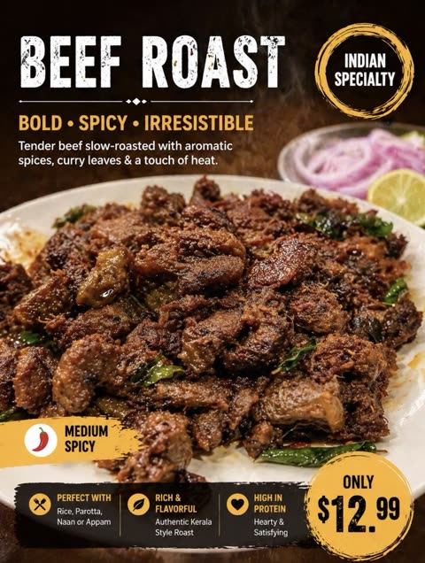</a>

Starts from a real menu photo and asks for an appetizing explanatory image, so the dish and its details stay grounded in the source. Requiring English text that stays readable on a small phone screen pushes the model toward large headline type, short taglines and badge style callouts.

GPT Image 2 · Edit · Source: [@Johnson998877 on X](https://x.com/Johnson998877/status/2050354965110268123) · found via [freestylefly/awesome-gpt-image-2](https://github.com/freestylefly/awesome-gpt-image-2)

[`food-poster`](tags.md#tag-food-poster) [`menu-redesign`](tags.md#tag-menu-redesign) [`restaurant`](tags.md#tag-restaurant) [`legible-text`](tags.md#tag-legible-text) [`mobile-friendly`](tags.md#tag-mobile-friendly)

<details><summary><b>Prompt</b></summary>

```text
这是india 料理中的一份真实menu。根据此 重新生成带文本说明的 引人入胜垂涎欲滴的 说明图片 先用English 文本易于识别（手机小屏幕） 这个是beef roast
```

</details>

<a id="gpt-image-japanese-ad-banner-sheet-2x2"></a>
### Four Japanese ad banners on a 2x2 sheet

<a href="https://x.com/kgsi/status/2046796434536911054"></a>

A JSON spec defines the grid, then gives each panel its own position, exact Japanese copy labels and design brief, so the text renders accurately. A consistency clause keeps four distinct brands looking like one board, and argument placeholders make the brand names easy to swap.

GPT Image 2 · Text-to-image · Source: [@kgsi on X](https://x.com/kgsi/status/2046796434536911054) · found via [YouMind-OpenLab/awesome-gpt-image-2](https://github.com/YouMind-OpenLab/awesome-gpt-image-2)

[`japanese`](tags.md#tag-japanese) [`ad-banner`](tags.md#tag-ad-banner) [`typography`](tags.md#tag-typography) [`layout`](tags.md#tag-layout) [`json-prompt`](tags.md#tag-json-prompt)

<details><summary><b>Prompt</b></summary>

```text
{"type":"four-panel Japanese promotional banner sheet","style":"clean commercial ad mockup board for layout and typography reference, square 2x2 grid, polished modern branding, soft premium lighting, realistic product and lifestyle imagery mixed with app marketing design","canvas":{"aspect_ratio":"1:1","background":"white","grid":{"columns":2,"rows":2,"divider_color":"light gray","divider_thickness":"thin"}},"layout":{"sections":[{"title":"skincare serum banner","position":"top-left","count":8,"labels":["素肌が、目を覚ます。","うるおい満ちる、透明ハリ肌へ。","LUNÉA","ルネア","モイストリペア セラム","美容液 30mL","発売記念 10%OFF 5.31まで","詳しくはこちら"],"design":"luxury minimal cosmetics ad with elegant Japanese serif headline on the left, centered frosted glass serum bottle with dropper, translucent liquid smear behind the bottle, scattered water droplets, pale blush and lavender palette, circular discount badge, small ingredient icons and short benefit list aligned vertically"},{"title":"note app banner","position":"top-right","count":7,"labels":["考える時間を、もっと創造的に。","アイデアをカタチにする新しいノート。","notero","ノテロ","AIがアイデアを整理","マルチデバイス対応","無料で始める"],"design":"modern SaaS app advertisement with white and light blue gradient background, bold Japanese sans-serif headline with the word 新しい in bright blue, app logo under headline, descriptive copy, rounded feature pills along the bottom, large smartphone mockup on the right showing a clean task and summary interface, subtle blue wave shape across lower-right area"},{"title":"travel banner","position":"bottom-left","count":7,"labels":["まだ見ぬ景色が、きっとあなたを待っている。","瀬戸内、ゆるり旅。","心ほどける、島時間。","期間限定 6/1(金)〜6/30(月) 新作プラン登場 最大20%OFF","直行フェリーで楽々","絶景スポット多数","おすすめプランを見る"],"design":"bright scenic tourism ad featuring vivid blue sea, green islands, white terrace architecture in the foreground, flowers on the right edge, airy summer sky with large clouds, large white Japanese headline over the sky and water, circular pink discount badge, three small travel feature icons in a translucent bottom strip, teal rounded call-to-action button"},{"title":"matcha drink banner","position":"bottom-right","count":8,"labels":["季節限定","抹茶ティラミスラテ","New!","香り高い抹茶となめらかなマスカルポーネのハーモニー。ほろ苦く、やさしい余韻を。","Regular ¥680(税込)","Tall ¥730(税込)","メニューをチェック","テイクアウトOK"],"design":"elegant café seasonal menu poster with warm cream background, editorial Japanese serif typography, large realistic iced matcha tiramisu latte in a clear glass on the right with whipped mascarpone topping dusted with matcha, small bowl of matcha powder and wooden spoon in the foreground, green leaves entering from the top-right, refined natural color palette, rounded green call-to-action button"}],"consistency":"all four banners are distinct brands but presented as a cohesive ad inspiration board with professional spacing, Japanese typography, strong hierarchy, and realistic high-end mockup rendering"},"customization":{"brand names":["LUNÉA","notero","HARUKA CAFE"],"main travel destination":"{argument name=\"destination name\" default=\"瀬戸内\"}","app name":"{argument name=\"app name\" default=\"notero\"}","cosmetic brand":"{argument name=\"cosmetic brand\" default=\"LUNÉA\"}","cafe name":"{argument name=\"cafe name\" default=\"HARUKA CAFE\"}","seasonal drink name":"{argument name=\"drink name\" default=\"抹茶ティラミスラテ\"}"}}
```

</details>

<a id="gpt-image-japanese-curry-plate-photo-vector-poster"></a>
### Japanese Curry Plate Photo and Vector Poster

<a href="https://x.com/izutorishima/status/2090497949990334773">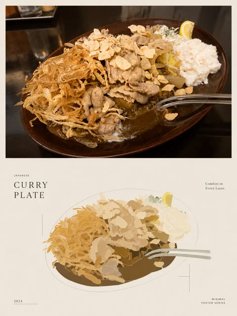</a>

The prompt splits the poster into two panels and lists the exact count of food components, so the photo and the vector redraw match. A limited palette, a fixed number of text blocks and decorative marks keep the layout minimal.

GPT Image 2 · Text-to-image · Source: [@izutorishima on X](https://x.com/izutorishima/status/2090497949990334773) · found via [YouMind-OpenLab/awesome-gpt-image-2](https://github.com/YouMind-OpenLab/awesome-gpt-image-2)

[`food`](tags.md#tag-food) [`poster`](tags.md#tag-poster) [`minimal`](tags.md#tag-minimal) [`vector-illustration`](tags.md#tag-vector-illustration) [`typography`](tags.md#tag-typography)

<details><summary><b>Prompt</b></summary>

```text
Goal: Create a minimalist editorial food poster that demonstrates reducing a realistic food photo into a clean low-detail illustration while preserving the composition.

Canvas: Vertical poster in a 3:4 aspect ratio, warm off-white paper background, generous margins, quiet Japanese magazine/poster design.

Layout: Divide the poster into exactly 2 main visual panels. The top half contains a realistic rectangular food photograph with a thin off-white border around it. The bottom half contains a simplified vector-style illustration of the same dish, centered and slightly smaller, surrounded by sparse typography and fine registration-mark lines.

Top panel: Show a close-up restaurant photograph of a Japanese curry plate on a dark glossy tabletop. The dish sits on an oval dark brown ceramic plate viewed from a high three-quarter angle. Include exactly 8 visible food components: 1 large pool of brown curry sauce, 1 mound of white rice mostly hidden under toppings, 1 pile of thin fried shredded onions on the left, 1 heap of sliced pork or beef in the center, 1 scattering of pale garlic chips across the top, 1 scoop of white potato salad on the right, 1 small garnish of chopped greens near the back, and 1 lemon wedge at the back right. Add exactly 1 shiny metal spoon entering from the right edge into the curry. Use natural warm restaurant lighting, realistic texture, shallow shadows, and no people.

Bottom panel illustration: Recreate the same plate as a flattened minimal vector illustration using reduced information and reduced color. Keep the exact same 8 food components and 1 spoon, but simplify them into layered organic shapes with thin light outlines and a limited palette of curry brown, tan, cream, pale yellow, muted green, and soft gray. The oval plate is suggested by a fine gray outline and a dark brown curry shape beneath the toppings. Avoid photorealistic detail; make it look like a tasteful poster illustration.

Text content: Add exactly 5 text blocks. Left of the illustration, small spaced uppercase text reads "JAPANESE" above a large elegant serif title reading "CURRY\nPLATE". Upper right, small serif copy reads "Comfort in\nEvery Layer." Bottom left, small text reads "2024" with a thin horizontal line beside it. Bottom right, small spaced uppercase text reads "MINIMAL\nPOSTER SERIES". Use refined black or dark brown typography.

Graphic details: Add exactly 3 fine-line decorative marks around the lower illustration: 1 thin vertical line near the left of the title area, 1 small crosshair mark on the lower right of the illustrated plate, and 1 subtle horizontal line near the year. Maintain a restrained, premium editorial look with lots of negative space.

Style constraints: Minimal colors, low visual noise, no extra captions, no logos, no watermark, no additional utensils, no extra plates, and no people. The final image should feel like a polished Japanese food poster comparing a realistic curry plate photograph with its simplified illustration.
```

</details>

<a id="gpt-image-japanese-video-production-service-poster"></a>
### Japanese video production company poster with four service panels

<a href="https://x.com/kantamizutamari/status/2047247285944508520">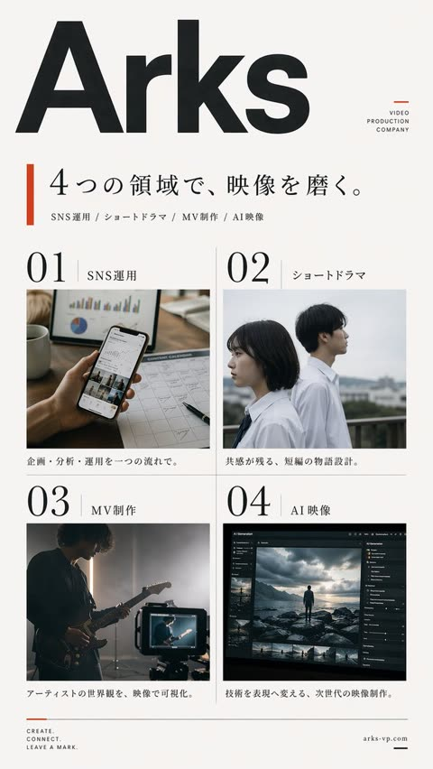</a>

The prompt fixes the layout in order: logotype, headline, then a 2 by 2 grid with a number, label, image description and caption for each panel. It also names exact text strings and a restrained palette, so the Japanese typography and the editorial look hold together.

GPT Image 2 · Text-to-image · Source: [@kantamizutamari on X](https://x.com/kantamizutamari/status/2047247285944508520) · found via [YouMind-OpenLab/awesome-gpt-image-2](https://github.com/YouMind-OpenLab/awesome-gpt-image-2)

[`poster`](tags.md#tag-poster) [`japanese-typography`](tags.md#tag-japanese-typography) [`corporate`](tags.md#tag-corporate) [`grid-layout`](tags.md#tag-grid-layout) [`editorial`](tags.md#tag-editorial)

<details><summary><b>Prompt</b></summary>

```text
Create a clean, premium Japanese corporate poster for a Arks video production company, in a minimalist editorial layout on an off-white background with lots of negative space. Portrait orientation, A4-like poster proportions. At the very top left, place an oversized bold black sans-serif logotype reading Arks, spanning nearly the full width of the page. In the upper right, add a small stacked brand mark in thin uppercase letters: "VIDEO" on one line, "PRODUCTION" on the next, "COMPANY" on the third, with a small burnt-orange geometric accent nearby. Below the logo, add a vertical burnt-orange bar on the left and a large elegant Japanese headline in black Mincho-style serif: 4つの領域で、映像を磨く。. Directly underneath, add a smaller service line in Japanese with slash separators: "SNS運用 / ショートドラマ / MV制作 / AI映像". The main body is a 2 by 2 grid of exactly 4 service panels with thin light-gray divider lines. Each panel has a large black editorial number and a Japanese label. Panel 1 label: "SNS運用" with the number "01"; image shows a close-up hand holding a smartphone displaying social media analytics, on a desk with charts, a calendar sheet, a pen, and a coffee mug, in warm natural office lighting; caption below in Japanese: "企画・分析・運用を一つの流れで。" Panel 2 label: "ショートドラマ" with the number "02"; image shows exactly 2 Japanese high-school-age students in white shirts standing outdoors on a rooftop or balcony, one female and one male, side-profile composition, muted overcast daylight, cinematic shallow depth of field; caption below: "共感が残る、短編の物語設計。" Panel 3 label: "MV制作" with the number "03"; image shows a moody musician playing electric guitar in a dim studio, backlit by soft haze, with a camera monitor in the foreground showing the same performer; caption below: "アーティストの世界観を、映像で可視化。" Panel 4 label: "AI映像" with the number "04"; image shows a dark professional AI video-generation or image-editing software interface on a monitor, with a cinematic scene of a lone figure standing on rocks under dramatic clouds, plus thumbnail timeline images and side control panels; caption below: "技術を表現へ変える、次世代の映像制作。" At the bottom left, place a small three-line English slogan in uppercase: CREATE.\nCONNECT.\nLEAVE A MARK. with a small burnt-orange line accent above it. At the bottom right, place the website arks-vp.com in small serif text with a short black horizontal line beside it. Use a refined mix of bold modern sans-serif for the large logo and numbers, and elegant Japanese serif for headlines and labels. Color palette: black, charcoal, warm off-white, light gray rules, and restrained burnt-orange accents. The overall feel should be realistic, polished, contemporary, Japanese editorial advertising design, with accurate Japanese typography and natural image tones.
```

</details>

<a id="gpt-image-jewelry-necklace-miniature-city-poster"></a>
### Giant ruby necklace with miniature city poster

<a href="https://x.com/Umar__786Ai/status/2055664244138349055">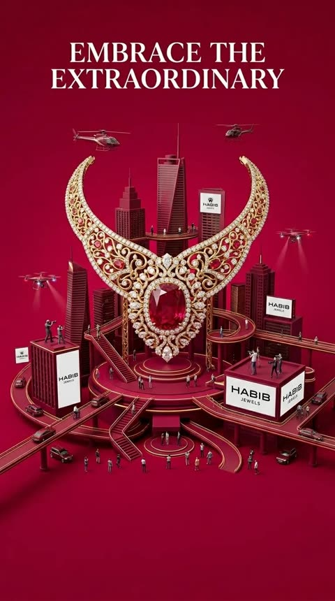</a>

A monumental object is scaled up as architecture, with a listed set of tiny city elements (highways, bridges, drones, figures) built around it. A single crimson monochrome palette with gold accents, tilt shift depth of field and a quoted headline at the top keeps it reading as a luxury ad.

GPT Image 2 · Text-to-image · Source: [@Umar__786Ai on X](https://x.com/Umar__786Ai/status/2055664244138349055) · found via [freestylefly/awesome-gpt-image-2](https://github.com/freestylefly/awesome-gpt-image-2)

[`jewelry`](tags.md#tag-jewelry) [`miniature-world`](tags.md#tag-miniature-world) [`luxury-ad`](tags.md#tag-luxury-ad) [`monochrome`](tags.md#tag-monochrome) [`typography`](tags.md#tag-typography)

<details><summary><b>Prompt</b></summary>

```text
Create a hyper-detailed luxury advertising poster in a cinematic miniature-world style. A gigantic royal diamond necklace with intricate gold filigree and massive ruby gemstones stands in the center like an architectural monument. Surround the necklace with a futuristic miniature city built around and inside the jewelry piece, including skyscrapers, elevated highways, bridges, spiral staircases, tiny human figures, luxury billboards, drones, helicopters, and cinematic urban activity. Use a deep crimson red monochrome background with gold and ruby accents. Add premium fashion-ad aesthetics, ultra-realistic textures, glossy reflections, dramatic studio lighting, depth of field, tilt-shift miniature effect, and high-end commercial composition. Include bold elegant typography at the top saying: “EMBRACE THE EXTRAORDINARY”. Style inspired by luxury jewelry campaigns, surreal city-building concepts, and premium 3D advertising renders. Ultra realistic, 8K, octane render, sharp focus, highly detailed, cinematic shadows, symmetrical composition.
```

</details>

<a id="gpt-image-juventus-yamal-transfer-poster"></a>
### Yamal Juventus transfer poster with Turin landmarks

<a href="https://x.com/MiskinTV_/status/2047258567124861108">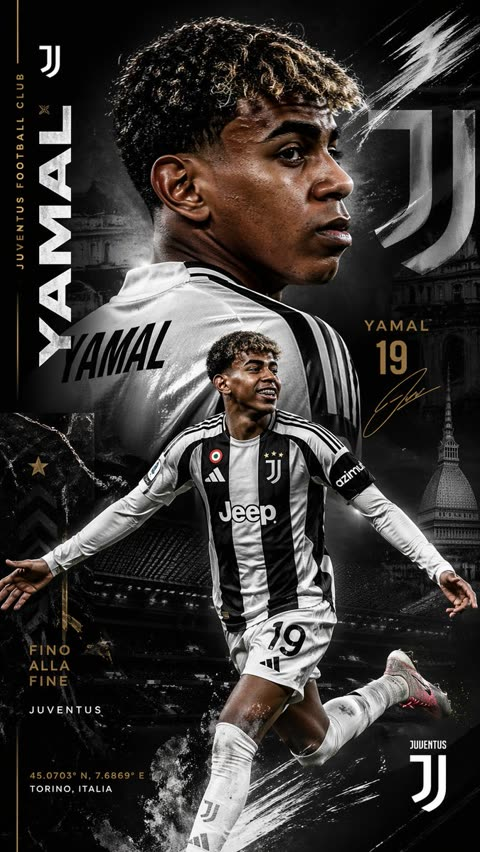</a>

Stacks two portraits of the same player at different scales, an upper body back angle over a full body action pose, on a dark Turin skyline with named landmarks. Every line of text, the coordinates and each sponsor detail are spelled out, so the layout and wording stay locked in place.

GPT Image 2 · Text-to-image · Source: [@MiskinTV_ on X](https://x.com/MiskinTV_/status/2047258567124861108) · found via [YouMind-OpenLab/awesome-gpt-image-2](https://github.com/YouMind-OpenLab/awesome-gpt-image-2)

[`football`](tags.md#tag-football) [`poster`](tags.md#tag-poster) [`typography`](tags.md#tag-typography) [`layout`](tags.md#tag-layout)

<details><summary><b>Prompt</b></summary>

```text
Create a dramatic vertical football poster for Yamal in a Juventus transfer-announcement style, ultra-detailed, high-contrast, black-and-white with metallic gold accents, gritty premium sports graphic design. The composition has 2 visible portraits of the same young male footballer with dark brown skin and short tight curly hair: one large upper-body rear three-quarter portrait dominating the top half, wearing a glossy white Juventus jersey with the name YAMAL printed large across the back, head turned slightly left so one ear and partial cheek are visible; and one full-body action pose in the lower center, arms spread wide while running or celebrating, wearing the modern Juventus home kit with black-and-white vertical stripes, white shorts with the number 19, white socks, and light-colored boots with a subtle pink accent on the sole. Keep the face areas softly obscured and non-detailed. Use a dark moody background with layered architectural imagery of Turin, including 3 landmark elements: a faint domed historic building on the left mid-background, a tall tower resembling Mole Antonelliana on the lower right, and a shadowy stadium structure across the lower middle. Add 3 Juventus logos: one small white logo at the top left, one large translucent logo integrated into the upper right background, and one medium white logo at the bottom right. Add bold typography and editorial layout elements: the word YAMAL set vertically in huge white condensed sans-serif letters along the left side, small vertical gold text reading "JUVENTUS FOOTBALL CLUB" beside it, gold text on the right reading YAMAL above the large gold number "19", a gold signature scribble below, the slogan "FINO ALLA FINE" stacked in gold on the lower left, "JUVENTUS" in small white text beneath it, and small coordinate text at the bottom left reading "45.0703° N, 7.6869° E" and "TORINO, ITALIA". The jersey on the action figure should include visible sponsor and badge details: Juventus crest with 3 stars, Adidas logo, Jeep sponsor, a circular tricolor badge on the chest, and a black sleeve patch reading "azimut". Add energetic white paint streaks and brush slashes in 3 main areas: upper right, lower center near the kicking leg, and subtle scratches on the left edge. Include marble-like black texture panels, gold star accents, faint chevrons, and smoky atmosphere. Lighting should be cinematic with rim light on the player, glossy fabric highlights, sharp contrast, and a premium transfer-poster aesthetic suitable for a social media football announcement.
```

</details>

<a id="gpt-image-kaohsiung-watercolor-collage-travel-poster"></a>
### Kaohsiung watercolor collage travel poster at sunset

<a href="https://x.com/SimplyAnnisa/status/2058372965641662876">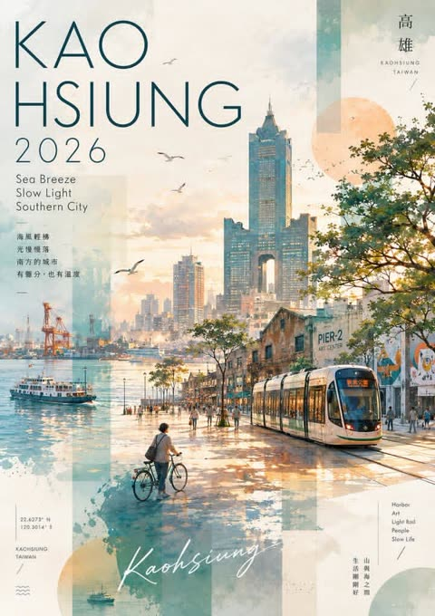</a>

The prompt splits the poster into scene, design elements placed by corner, and style, with exact text strings and coordinates for each position. Translucent geometric overlays and watercolor splashes in a teal and beige palette tie the illustration and photo collage layers together.

GPT Image 2 · Text-to-image · Source: [@SimplyAnnisa on X](https://x.com/SimplyAnnisa/status/2058372965641662876) · found via [freestylefly/awesome-gpt-image-2](https://github.com/freestylefly/awesome-gpt-image-2)

[`travel-poster`](tags.md#tag-travel-poster) [`watercolor`](tags.md#tag-watercolor) [`collage`](tags.md#tag-collage) [`typography`](tags.md#tag-typography) [`city`](tags.md#tag-city)

<details><summary><b>Prompt</b></summary>

```text
Watercolor and collage travel poster for Kaohsiung, Taiwan, vertical layout, soft pastel and warm golden hour color palette.

Scene: Waterfront promenade at sunset with a modern light rail tram on the right, a person walking a bicycle on the left, and people strolling along the path. In the background: Kaohsiung skyline with the 85 Sky Tower and other skyscrapers, a harbor with a ferry boat, port cranes, and the Pier-2 Art Center building with murals. Seagulls flying in the sky, trees lining the walkway, calm water reflecting the light.

Design elements:
- Large text top left: 'KAO HSIUNG 2026', smaller text below 'Sea Breeze Slow Light Southern City'
- Top right: Vertical Chinese characters, 'KAOHSIUNG TAIWAN' in small caps below
- Bottom left: Coordinates '22.6273° N 120.3014° E', 'KAOHSIUNG TAIWAN', wave icon
- Bottom center: Handwritten script 'Kaohsiung'
- Bottom right: Vertical list 'Harbor Art Light Rail People Slow Life', vertical Chinese text
- Overlay effects: Semi-transparent geometric shapes, watercolor splashes, and texture layers in teal and beige

Style: Modern travel poster meets watercolor painting, airy and atmospheric, blend of illustration and photo-collage, warm and tranquil mood, high detail.
```

</details>

<a id="gpt-image-limora-lemon-miniature-six-panel-campaign"></a>
### Six panel miniature woman lemon beverage campaign

<a href="https://x.com/ou_zhen599/status/2091160215928574397">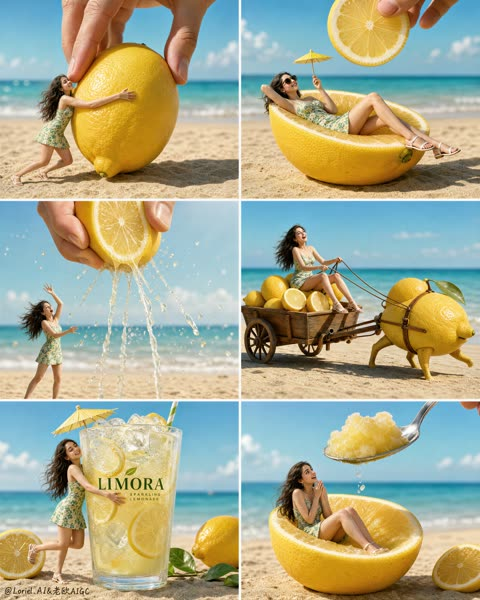</a>

A strict 2 by 3 grid fixes the horizon, lighting and recurring character, while each panel gets its own escalating action beat from touch to taste. Scale contrast between a tiny woman and oversized lemons, plus a giant hand entering from above, keeps the product the hero.

GPT Image 2 · Text-to-image · Source: [@ou_zhen599 on X](https://x.com/ou_zhen599/status/2091160215928574397) · found via [freestylefly/awesome-gpt-image-2](https://github.com/freestylefly/awesome-gpt-image-2)

[`miniature`](tags.md#tag-miniature) [`lemon`](tags.md#tag-lemon) [`beach`](tags.md#tag-beach) [`storyboard-grid`](tags.md#tag-storyboard-grid) [`beverage-ad`](tags.md#tag-beverage-ad)

<details><summary><b>Prompt</b></summary>

```text
Create a Cannes-level premium summer beverage campaign poster for a fictional lemon drink brand called "LIMORA", using a strict 2-column by 3-row grid layout with six perfectly aligned panels. Preserve the exact structural logic of the composition: each panel shows the same tiny ultra-realistic young woman on a bright sandy beach interacting with oversized lemons, lemon slices, lemon juice, or the final branded drink, while selected panels include a giant realistic human hand entering from above. The full poster must feel like one unified high-end advertising storyboard in motion, where the eye flows continuously from fresh citrus fruit to crafted beverage desire. The lemon product world must remain the absolute visual hero across all six panels.

Overall composition:
Use a clean six-panel grid with thin white dividers, equal panel proportions, consistent horizon line, consistent beach-ocean background, and unified lighting. Every panel should feel self-contained yet rhythmically connected, as if six consecutive scenes from the same luxury summer commercial were frozen at their most iconic moments. Keep the miniature woman and the oversized lemon-related object centered in each frame, with the sea softly blurred in the background and the sand sharply rendered in the foreground. The full page must read instantly from a distance, with strong commercial clarity and polished editorial control.

Orbit visual flow:
Design the entire set around one strong circulation of motion from panel 1 to panel 6. The action should escalate visually: touch, recline, squeeze, travel, embrace, taste. Use repeating directional rhythms in hair movement, arm gestures, leg angles, juice droplets, spoon angle, lemon slice placement, straw tilt, and the position of the entering hand so the eye naturally sweeps across the poster in a flowing wave. Build subtle diagonal energy inside every panel, making the citrus world feel alive, breezy, sparkling, and in motion. The whole set should feel like summer energy orbiting around the brand’s lemon drink.

Narrative panel sequence:
Panel 1: the tiny woman hugs a giant whole lemon on the sand while a giant adult hand descends from above, delicately positioning the lemon. Her pose is lively and slightly off-balance, as if the scene has just begun.
Panel 2: she reclines elegantly inside a halved lemon as though it were a luxury beach chaise, wearing dark sunglasses and holding a tiny parasol drink pick, while a floating lemon slice is lowered from above like a radiant citrus sun.
Panel 3: a giant hand squeezes a vertically cut lemon from above, sending translucent juice streams and droplets downward in a sparkling arc. The woman reacts dynamically beneath it, arms raised, body tilted, caught in the middle of the citrus action.
Panel 4: she rides in a small refined wooden cart piled with lemons, being pulled by a whimsical premium lemon-shaped creature or rolling lemon harness. The cart must feel physically grounded, artisanal, and stylish rather than cartoonish.
Panel 5: the hero climax panel. A tall branded LIMORA lemonade glass dominates the frame, packed with ice cubes, lemon slices, pale sparkling liquid, condensation, a fresh green straw, and a refined cocktail umbrella. The tiny woman hugs the cold glass joyfully, and this panel must be the strongest product-selling moment in the entire composition.
Panel 6: she sits inside a halved lemon while a large polished spoon descends from above carrying glossy lemon sorbet or crushed lemon ice, creating a final delicious serving beat with playful anticipation.

Hero product focus:
The real hero is the lemon beverage system: whole citrus fruit, sliced fruit, squeezed juice, ice, sparkling drink, sorbet, and premium serving details. Every lemon must feel hyper-real, fragrant, sunlit, juicy, and tactile, with detailed skin pores, subtle waxy oil sheen, translucent membranes, wet cut surfaces, and bright natural citrus pulp. The branded glass in panel 5 must be the most visually dominant product object in the set, with crystal-clear glass, refined original English branding reading "LIMORA", elegant condensation, premium ice refraction, and luminous pale-yellow drink clarity.

Character design:
Depict one recurring ultra-realistic miniature young woman across all six panels, wearing the same fitted green floral mini dress and white sandals, with long dark wavy hair and naturally expressive features. She must look like a real scaled-down human placed into a surreal oversized citrus world. Keep anatomy coherent and believable in every frame: correct head-to-body proportion, realistic shoulders, collarbones, arms, waist, hips, thighs, knees, calves, ankles, and feet, with perfectly formed hands and five fingers clearly visible. Her expressions should shift panel by panel: surprised delight, relaxed confidence, playful alarm, exhilaration, joyful refreshment, amused anticipation. Skin must remain photorealistic with pores, natural tonal shifts, faint knee and elbow texture, realistic skin elasticity, and no plastic AI beauty finish.

Lighting:
Use bright premium seaside daylight with a soft upper-left sun direction and gentle atmospheric diffusion. Maintain luminous fresh summer lighting across all six scenes, with short, soft-edged shadows and crisp dimensional highlights. Juice droplets, lemon pulp, ice cubes, spoon edges, sunglasses, glass rim, and condensation should all catch clean sparkling highlights. Lighting must feel luxurious, refreshing, and physically consistent from panel to panel.

Materials:
Lemons: ultra-detailed peel pores, subtle dimpling, natural rind thickness, glistening wet pulp, believable cut translucency, realistic juice behavior.
Drink glass: high-clarity premium glass, accurate refraction, heavy base, condensation beads, crisp logo print, ice transparency, sparkling carbonated liquid feel.
Sorbet and juice: glossy, semi-translucent, cold, wet, appetizing, physically accurate.
Dress: lightweight summer cotton with tiny green floral print, natural wrinkles, fabric tension, and wind-responsive edges.
Hair and skin: realistic strands, fine flyaways, natural shine, believable skin texture.
Large hand: realistic adult fingers, soft skin compression, natural nails, coherent scale perspective.
Cart and props: refined warm wood grain, polished wheels, believable joints and harness elements.
Beach environment: fine sunlit sand with miniature footprints and pressure marks, soft shoreline blur, clean turquoise sea with pale foam.

Color system:
Build the palette around lemon yellow, fresh citrus green, turquoise sea, pale sky blue, warm beach beige, crisp white highlights, and restrained natural skin tones. Yellow must remain the dominant hero color, supported by green and turquoise. Keep the image bright, appetizing, summery, clean, and internationally commercial. Avoid random accent colors.

Typography and branding:
Do not copy any text from the sample. Keep typography minimal and original. Place refined English branding only on the hero glass and optionally a tiny campaign line below the full grid, such as: "LIMORA — Bright in Motion". Typography must feel premium, modern, minimal, and secondary to the visual storytelling.

Art direction:
Hyper-real premium surreal advertising photography, luxury FMCG campaign, storyboard energy, elegant humor, cinematic micro-world illusion, high-end beverage styling, global summer launch poster, polished magazine-grade finish, sharp product realism, strong narrative rhythm, premium brand coherence.

Negative prompt:
copied text, Chinese text, existing brand names, cartoon style, toy-like figure, grotesque oversized head, deformed anatomy, extra fingers, missing fingers, fused fingers, twisted wrists, broken limbs, distorted feet, AI plastic skin, over-smoothed skin, fake citrus texture, unrealistic juice physics, muddy lemon pulp, cloudy glass, weak product focus, inconsistent lighting, inconsistent horizon, messy grid, cluttered props, meme aesthetic, cheap humor, childish illustration, low-resolution detail, oversaturated colors, dead black patches, distorted giant hand perspective
```

</details>

<a id="gpt-image-liu-yan-star-mascot-cream-poster"></a>
### Cream poster, yellow star mascot on portrait's head

<a href="https://x.com/xiaoxiaodong01/status/2062924832917029248">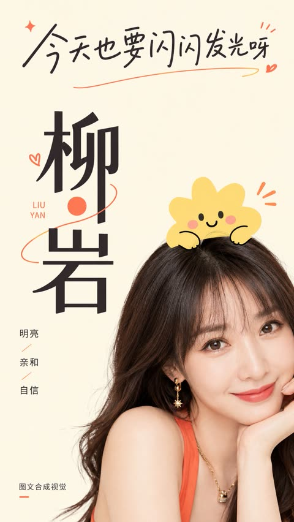</a>

A bold cropped photo enters from the lower edge while a flat yellow mascot sits on the head, so the real photo and cartoon contrast. The handwritten headline at top and the vertical name in the centre set the hierarchy on a flat, shadowless cream field.

GPT Image 2 · Text-to-image · Source: [@xiaoxiaodong01 on X](https://x.com/xiaoxiaodong01/status/2062924832917029248) · found via [freestylefly/awesome-gpt-image-2](https://github.com/freestylefly/awesome-gpt-image-2)

[`poster`](tags.md#tag-poster) [`typography`](tags.md#tag-typography) [`portrait`](tags.md#tag-portrait) [`cartoon-mascot`](tags.md#tag-cartoon-mascot)

<details><summary><b>Prompt</b></summary>

```text
围绕具体主题内容生成一张明亮清爽的图文合成视觉：画面以大面积高明度纯净色场承托主体，背景平整、通风、没有复杂景深，视觉重心由下方被大胆裁切的人像或真实主体建立，只露出最有记忆点的局部，使主体像从画面边缘进入。主体上方叠放一个极简图形符号或拟物角色，它要像轻轻坐在主体头顶或贴合轮廓生长出来，形体圆润、边缘干净、表情或结构由少量粗线完成，兼具标识感和亲近感。文字是画面的主动角色：顶部使用大号手写感标题，字距松、笔画柔软，像一句轻声招呼；中心用更强的竖向或轴向标题建立层级；边缘安放少量小字号信息，保持安静但精确，让空白继续占主导。色彩从主题自身的材质、情绪、地域或品牌语义中提取，映射为明亮底色、洁净主体亮面、清晰深色结构线与少量强调信息色，保留大面积轻快底场、小面积高对比文字线条、自然主体暗部的关系；整体保持高明度、清透、干净、饱和度清晰而不过度刺激，暗色只用于结构和阅读，不制造脏灰、烟雾或陈旧质感。摄影局部与扁平图形之间要形成真实与童趣的反差，边缘叠压准确，阴影极少，完成感像城市公共宣传与角色插画结合的轻松视觉系统。

主题：柳岩

比例9:16
```

</details>

<a id="gpt-image-lovart-luxora-ai-campaign-poster"></a>
### Luxury watch campaign poster with AI platform UI

<a href="https://x.com/dylannknox/status/2047321348314423477">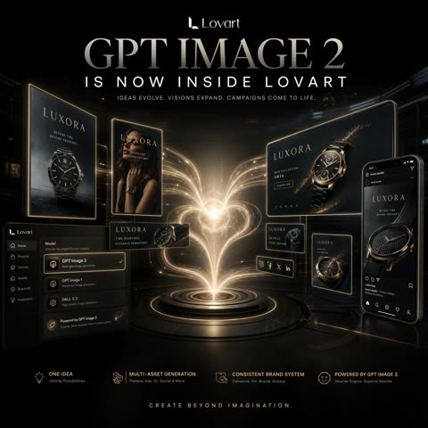</a>

A JSON brief sets each element slot by slot, covering headline, floating asset positions, UI panel labels and the feature row, so every part stays controllable. A central gold light source with screens angled inward ties separate mockups into one composition.

GPT Image 2 · Text-to-image · Source: [@dylannknox on X](https://x.com/dylannknox/status/2047321348314423477) · found via [YouMind-OpenLab/awesome-gpt-image-2](https://github.com/YouMind-OpenLab/awesome-gpt-image-2)

[`luxury`](tags.md#tag-luxury) [`json-prompt`](tags.md#tag-json-prompt) [`campaign-poster`](tags.md#tag-campaign-poster)

<details><summary><b>Prompt</b></summary>

```text
{"type":"luxury AI creative platform promotional poster","style":"cinematic premium tech advertising, glossy black and gold color palette, high contrast, futuristic luxury branding, photoreal 3D compositing with elegant UI mockup elements","format":"square social campaign poster","background":{"color":"deep black","environment":"dark futuristic studio space with subtle architectural shadows and reflective floor","lighting":"dramatic central glow with warm gold volumetric light trails and rim lighting around all floating screens"},"branding":{"logo_text":"Lovart","headline":"{argument name=\"headline text\" default=\"GPT IMAGE 2\"}","subheadline":"{argument name=\"subheadline text\" default=\"IS NOW INSIDE LOVART\"}","tagline":"IDEAS EVOLVE. VISIONS EXPAND. CAMPAIGNS COME TO LIFE.","footer_tagline":"CREATE BEYOND IMAGINATION."},"centerpiece":{"description":"a brilliant glowing heart-shaped energy plume erupting from a circular platform, made of flowing golden light strands, like a fountain of creativity or generative power","position":"center","base":"concentric metallic pedestal rings with illuminated edges"},"product_brand":{"name":"{argument name=\"brand name\" default=\"LUXORA\"}","category":"luxury wristwatch campaign visuals"},"floating_assets":{"count":8,"items":[{"type":"vertical poster billboard","position":"far left","content":"luxury watch hero shot with brand title and dark oceanic backdrop"},{"type":"vertical fashion poster","position":"left center","content":"female model in black styling wearing a luxury watch, face partially obscured by composition"},{"type":"small horizontal product card","position":"lower left center","content":"watch close-up with short campaign copy"},{"type":"large horizontal billboard","position":"upper right","content":"hero watch render with sparkling gold particles and campaign layout"},{"type":"small square info card","position":"mid right","content":"watch detail close-up and short descriptive text"},{"type":"small vertical poster","position":"lower right center","content":"secondary watch campaign image"},{"type":"social media story or feed mockup","position":"far right","content":"smartphone-style interface showing a luxury watch ad post"},{"type":"creative app UI panel","position":"bottom left","content":"dark software sidebar and model selector with GPT Image 2 highlighted, plus other image model options"}]},"ui_panel":{"position":"bottom left","components":{"count":8,"labels":["Lovart","Home","Projects","Canvas","Assets","Brand Kit","Inspiration","GPT Image 2"]}},"feature_row":{"position":"bottom","count":4,"items":[{"title":"ONE IDEA","subtitle":"Infinite Possibilities"},{"title":"MULTI-ASSET GENERATION","subtitle":"Posters, Ads, UI, Social & More"},{"title":"CONSISTENT BRAND SYSTEM","subtitle":"Cohesive, On-Brand, Always"},{"title":"POWERED BY GPT IMAGE 2","subtitle":"Smarter Engine, Superior Results."}]},"composition":"symmetrical but slightly dynamic layout, central energy source surrounded by floating campaign outputs, all screens angled inward toward the glow to suggest one idea expanding into a full brand system","materials":"black glass, brushed metal, gold neon edges, glossy screens, subtle particle sparkles","mood":"innovative, aspirational, premium, magical, campaign-launch energy","quality":"ultra-detailed, crisp typography, polished brand presentation, high-end product visualization, studio-grade advertising render"}
```

</details>

<a id="gpt-image-mclaren-720s-gt3x-technical-blueprint-poster"></a>
### McLaren 720S GT3X engineering blueprint poster

<a href="https://x.com/Ambani_Wessley/status/2046799050994053618">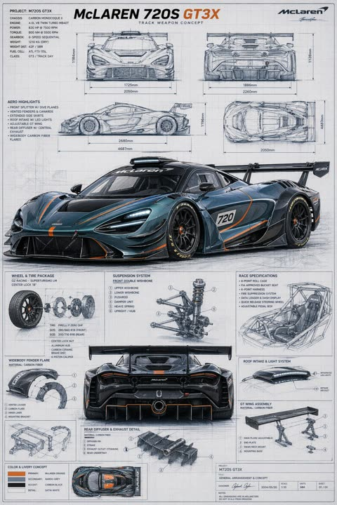</a>

The JSON spec fixes the layout with explicit counts, labels and positions for every block, and splits the palette into background, linework, text and highlight. Named argument slots let the same structure be reused for other car models and accent colours.

GPT Image 2 · Text-to-image · Source: [@Ambani_Wessley on X](https://x.com/Ambani_Wessley/status/2046799050994053618) · found via [YouMind-OpenLab/awesome-gpt-image-2](https://github.com/YouMind-OpenLab/awesome-gpt-image-2)

[`automotive`](tags.md#tag-automotive) [`blueprint`](tags.md#tag-blueprint) [`mclaren`](tags.md#tag-mclaren) [`poster`](tags.md#tag-poster)

<details><summary><b>Prompt</b></summary>

```text
{"type":"automotive technical blueprint poster","subject":{"vehicle":"{argument name=\"car model\" default=\"McLaren 720S GT3X\"}","category":"track weapon concept supercar","brand":"McLaren","primary render":{"view":"front three-quarter low angle hero shot","finish":"glossy dark metallic blue-gray body with exposed carbon fiber aero parts","accent color":"{argument name=\"accent color\" default=\"McLaren orange\"}","livery details":"thin orange striping across hood, splitter, side skirts, doors, diffuser, and rear surfaces, white race number panel with 720 on the door, black multi-spoke center-lock racing wheels, low-profile slick tires with yellow sidewall lettering, very large rear wing, aggressive front splitter, roof scoop, vented hood, deep side intakes, extreme rear diffuser"},"poster text":{"headline":"{argument name=\"headline text\" default=\"McLAREN 720S GT3X\"}","subheadline":"TRACK WEAPON CONCEPT","project":"PROJECT: M720S GT3X","title block":"GENERAL ARRANGEMENT & CONCEPT"},"palette":{"background":"light gray drafting paper","linework":"blue-gray pencil and ink sketch lines","text":"charcoal gray and black","highlight":"orange accent text and pinstripes"}},"layout":{"style":"clean engineering presentation board with grid background, technical callouts, dimension arrows, section boxes, and mixed photoreal render plus hand-drawn blueprint sketches","sections":[{"title":"orthographic views","position":"top half","count":4,"labels":["front view","rear view","side view","top view"]},{"title":"specification blocks","position":"upper left","count":2,"labels":["PROJECT / CHASSIS / ENGINE / POWER / TORQUE / GEARBOX / WEIGHT / FUEL / CLASS","AERO HIGHLIGHTS"]},{"title":"component detail boxes","position":"lower half around center rear view","count":8,"labels":["WHEEL & TIRE PACKAGE","WIDEBODY FENDER FLARE","SUSPENSION SYSTEM","RACE SPECIFICATIONS","REAR DIFFUSER & EXHAUST DETAIL","ROOF INTAKE & LIGHT SYSTEM","GT WING ASSEMBLY","COLOR & LIVERY CONCEPT"]},{"title":"main rendered vehicle views","position":"center and lower middle","count":2,"labels":["front three-quarter hero render","rear view render"]}],"counts":{"orthographic drawings":4,"main photoreal renders":2,"component diagrams":8,"color swatches":4},"color swatches":["primary: {argument name=\"primary color\" default=\"McLaren orange\"}","secondary: naroo grey","accent: carbon black","detail: satin white"],"dimension annotations":"include multiple metric measurements in millimeters around the orthographic views with horizontal and vertical arrows","branding":"top-right McLaren logo and signature-like mark, bottom-right project title block with date, scale, units, and sheet numbering"},"composition":"portrait poster, highly detailed, symmetrical technical infographic layout, precise industrial design aesthetic, realistic reflections on the hero car render, blueprint-style sketch shading everywhere else, white-gray paper with subtle wear and drafting texture","quality":"ultra-detailed, accuracy-first, crisp typography, concept-art meets engineering blueprint, premium automotive presentation board"}
```

</details>

<a id="gpt-image-mid-autumn-festival-ten-poster-collage"></a>
### Ten Minimalist Mid-Autumn Festival Posters Collage

<a href="https://x.com/xiaoxiaodong01/status/2099867787149943085">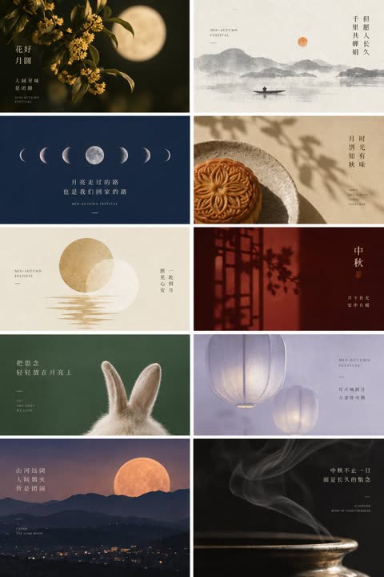</a>

The prompt lists each poster by grid position with its own background, motif and exact Chinese text, so every panel gets a distinct scene and caption. A shared elegant minimalist style line keeps the ten panels cohesive.

GPT Image 2.5 · Text-to-image · Source: [@xiaoxiaodong01 on X](https://x.com/xiaoxiaodong01/status/2099867787149943085)

[`mid-autumn`](tags.md#tag-mid-autumn) [`poster-set`](tags.md#tag-poster-set) [`chinese-typography`](tags.md#tag-chinese-typography) [`minimalist`](tags.md#tag-minimalist) [`grid-layout`](tags.md#tag-grid-layout)

<details><summary><b>Prompt</b></summary>

```text
Create a vertical collage of 10 distinct Mid-Autumn Festival posters arranged in a 2-column grid. The style is elegant, poetic, and minimalist Chinese aesthetics.

Top Left: Dark background with yellow osmanthus flowers and a glowing full moon. Text: "花好月圆" (Blooming Flowers & Full Moon), "人间至味是团圆" (The best taste in life is reunion).
Top Right: Ink wash painting style mountains and water with a small boat. Orange sun/moon. Text: "但愿人长久，千里共婵娟" (May we all be blessed with longevity...).
Row 2 Left: Deep blue background showing phases of the moon in a horizontal line. Text: "月亮走过的路也是回家的路" (The road the moon traveled is also the road home).
Row 2 Right: Close-up photography of a mooncake on a ceramic plate with leaf shadows. Text: "时光有味，月饼知秋" (Time has flavor, mooncakes know autumn).
Row 3 Left: Beige background with abstract gold and white circles representing the moon over water ripples. Text: "一轮明月，照见心安" (A bright moon illuminates peace of mind).
Row 3 Right: Red wall with traditional lattice window shadows. Text: "中秋" (Mid-Autumn), "月下有光，家中有暖" (Light under the moon, warmth at home).
Row 4 Left: Green background featuring the back of a white rabbit's head looking up. Text: "把思念轻轻放在月亮上" (Gently place thoughts on the moon).
Row 4 Right: Soft purple/lavender background with hanging paper lanterns. Text: "灯火映圆月，万家皆可期" (Lantern lights reflect the full moon...).
Bottom Left: Night landscape with city lights below and a large orange moon rising over mountains. Text: "山河远阔，人间烟火，皆是团圆" (Vast mountains and rivers... are all reunion).
Bottom Right: Dark moody shot of incense smoke curling upwards from a bowl. Text: "中秋不止一日，而是长久的惦念" (Mid-Autumn is not just one day...).
```

</details>

<a id="gpt-image-mid-century-isometric-city-travel-poster"></a>
### Mid Century Isometric Tokyo Travel Poster in Red

<a href="https://x.com/jzaib4269/status/2054046672297054595">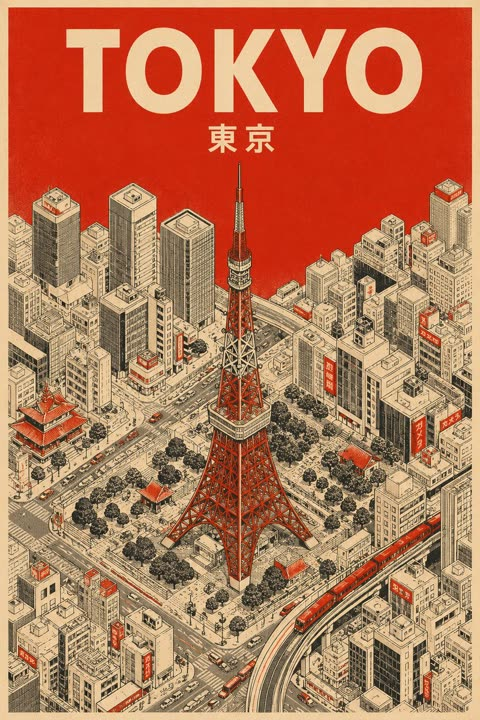</a>

A strict three color palette (cream, black linework, one flat accent) keeps the screen print look, and the no gradients rule keeps the sky flat. Bracketed city, landmark and color slots make it a reusable template, while the isometric bird's eye view and fine hatching set the drawing style.

GPT Image 2 · Text-to-image · Source: [@jzaib4269 on X](https://x.com/jzaib4269/status/2054046672297054595) · found via [YouMind-OpenLab/awesome-gpt-image-2](https://github.com/YouMind-OpenLab/awesome-gpt-image-2)

[`travel-poster`](tags.md#tag-travel-poster) [`isometric`](tags.md#tag-isometric) [`mid-century`](tags.md#tag-mid-century) [`screen-print`](tags.md#tag-screen-print) [`limited-palette`](tags.md#tag-limited-palette)

<details><summary><b>Prompt</b></summary>

```text
Create a vertical mid-century travel poster for [CITY NAME] featuring [LANDMARK]. Use a strict 3-color palette: cream paper, black technical linework, and [COLOR].
Style: Minimalist isometric bird's-eye view with ultra-fine hatching and screen-print texture.
Color usage: Solid flat [COLOR] for the entire sky and small accents on roofs or streets. No gradients.
Text: Bold sans-serif "[CITY NAME]" at top in cream, with the local language name in smaller cream text below.
```

</details>

<a id="gpt-image-minimal-layered-cutout-travel-poster"></a>
### Minimal Layered Cutout New York Travel Poster

<a href="https://x.com/Goodmanprotocol/status/2085939245026529335">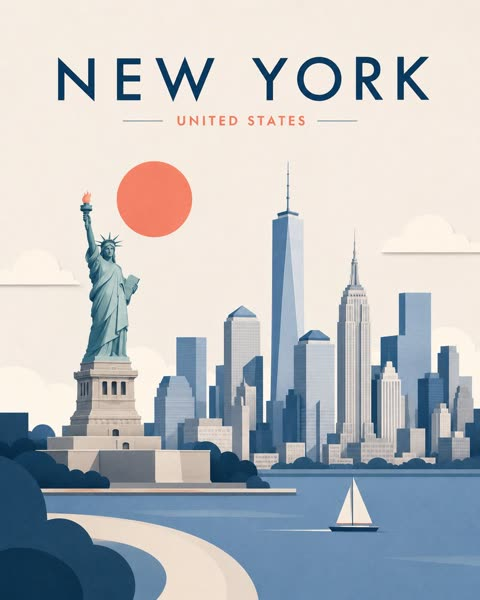</a>

The prompt names a premium Scandinavian editorial look and explicitly rules out busy handmade paper craft, which keeps the shapes large and clean. A limited palette of 4 to 6 colors, soft shadows and a placeholder for the destination make it reusable for any city.

GPT Image 2 · Text-to-image · Source: [@Goodmanprotocol on X](https://x.com/Goodmanprotocol/status/2085939245026529335) · found via [YouMind-OpenLab/awesome-gpt-image-2](https://github.com/YouMind-OpenLab/awesome-gpt-image-2)

[`travel-poster`](tags.md#tag-travel-poster) [`paper-cutout`](tags.md#tag-paper-cutout) [`minimalist`](tags.md#tag-minimalist) [`layered`](tags.md#tag-layered) [`editorial`](tags.md#tag-editorial)

<details><summary><b>Prompt</b></summary>

```text
Create a premium editorial travel illustration of DESTINATION, COUNTRY/REGION using a minimal layered cutout illustration style. IMPORTANT: This must NOT look like a busy handmade paper craft artwork. Instead, it should feel like a premium Scandinavian editorial poster, a modern travel magazine cover, a sophisticated museum-shop print, and an elegant minimalist paper collage design. STYLE: minimal layered cutout illustration, large clean paper shapes, editorial paper collage aesthetic, bold geometric masses, simplified layered depth, soft subtle shadows, clean cut edges with slightly rounded corners, ultra simplified shape language. COLOR & LIGHTING: limited color palette (4–6 colors) featuring PRIMARY COLOR, [SECONDARY COLOR], crisp white, soft slate blue, and pale grey, vibrant but restrained tones. MOOD: calm, modern, refined, premium, slightly whimsical, mature high-end travel branding aesthetic. TYPOGRAPHY: minimal elegant sans-serif typography with the text "[DESTINATION]", clean spacing and alignment, suitable size. ASPECT RATIO: 4:5 vertical poster format.
```

</details>

<a id="gpt-image-minimalist-hallstatt-travel-poster"></a>
### Minimalist Hallstatt lakeside travel poster with alpine mountains

<a href="https://x.com/Taaruk_/status/2059188921096085888">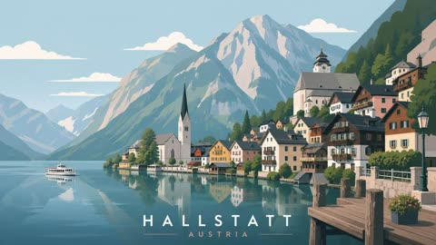</a>

The prompt names a flat vector style and a Scandinavian pastel palette, then lists each destination with its signature landmarks, which keeps every scene specific. Asking for destination name typography and geometric landscape shapes gives the poster a clear layout and a clean finish.

GPT Image 2 · Text-to-image · Source: [@Taaruk_ on X](https://x.com/Taaruk_/status/2059188921096085888) · found via [freestylefly/awesome-gpt-image-2](https://github.com/freestylefly/awesome-gpt-image-2)

[`travel-poster`](tags.md#tag-travel-poster) [`flat-vector`](tags.md#tag-flat-vector) [`pastel`](tags.md#tag-pastel) [`typography`](tags.md#tag-typography) [`landscape`](tags.md#tag-landscape)

<details><summary><b>Prompt</b></summary>

```text
Minimalist flat travel poster illustration series of iconic destinations around the world, clean vector art style, Scandinavian color palette, soft pastel tones, calm atmospheric scenery, Hallstatt Austria lakeside village with alpine mountains and reflections, Bergen Norway colorful harbor houses with fjord background, Kyoto Japan traditional riverside town with cherry blossoms and pagoda, Santorini Greece white architecture with blue domes overlooking the sea, ultra clean composition, geometric landscape shapes, smooth gradients, elegant typography with destination names, modern tourism poster aesthetic, serene travel mood, crisp vector lines, cinematic wide-angle scenery, peaceful skies with stylized clouds, highly detailed environment art, contemporary flat illustration, premium editorial travel design, balanced composition, minimal shadows, dreamy vacation atmosphere, soft morning lighting, high-end Airbnb poster vibe, Behance trending style, 4k, ultra detailed
```

</details>

<a id="gpt-image-monochrome-halftone-photo-poster"></a>
### Monochrome halftone poster from a city photo

<a href="https://x.com/xiaoxiaodong01/status/2090078913930432919">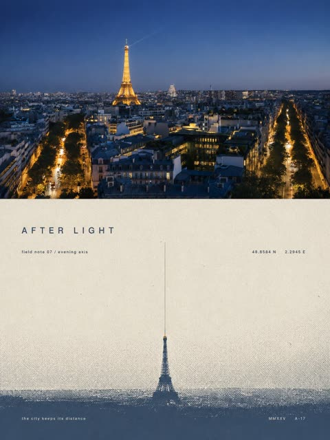</a>

Fixes a strict 1:1 split with the original photo above and a screen print below, reduced to one small anchor subject in wide white space. Limits color to paper, one ink and a mist tone, builds fog from fading dot density, and lets tiny editorial text interact with the shape.

GPT Image 2 · Edit · Source: [@xiaoxiaodong01 on X](https://x.com/xiaoxiaodong01/status/2090078913930432919) · found via [YouMind-OpenLab/awesome-gpt-image-2](https://github.com/YouMind-OpenLab/awesome-gpt-image-2)

[`halftone`](tags.md#tag-halftone) [`monochrome`](tags.md#tag-monochrome) [`screen-print`](tags.md#tag-screen-print) [`editorial-poster`](tags.md#tag-editorial-poster) [`typography`](tags.md#tag-typography)

<details><summary><b>Prompt</b></summary>

```text
请将我上传的每一张照片分别制作成一张独立的高级设计海报，不多图拼接，每张照片单独输出。整体采用3:4竖版构图，上下两个区域高度严格1:1，各占画面50%。

上半部分保留原始照片，保持主体结构、真实质感、自然光影和原有色彩氛围，仅进行轻微高级摄影调色，使其具有艺术杂志与展览摄影质感。为适配画幅，可自然扩展天空、地面或环境背景，但不得拉伸、扭曲或改变主体。

下半部分提取照片中最具识别性的**主体、轮廓、姿态与叙事关系**，将复杂信息压缩成一个唯一视觉锚点，重构为极简丝网版画与网点印刷海报。不要描摹照片，也不要加入丰富插画细节，只保留一个最关键的形状、动作或空间关系，让主体以极少的信息仍能被一眼识别。

构图遵循“**一个主体、一个方向、一个空间关系**”。主体通常保持较小尺度，以大面积留白制造距离感和诗意；根据原图自身关系，只选择一种最自然的结构：水平延展、纵向延伸、孤立悬置、向外消散或由浅入深，不同时使用多种构图技巧。可以利用一条地平线、边界、阴影或网点带建立空间，让空白本身成为画面的主要组成部分。

配色不直接复制照片，而从原图提炼综合色温、明度与情绪，重新归纳成**纸张底色 + 主墨色 + 雾层色**的有限专色体系。以米白、暖灰或自然纸色承担大面积留白，以一个沉静而有重量的综合色作为主墨色，再用同色系更浅、更灰的颜色表现空气、距离或层次。整体控制在2–3种颜色，以色彩面积、明度和网点密度建立层次，仅在具有明确叙事意义时允许极小面积点色。

所有雾气、距离、阴影、消散和空间过渡均使用 **halftone网点由密至疏自然消失**，不要使用数字模糊或普通渐变。保留纸张颗粒、丝网油墨、轻微套印偏差和不均匀着墨，使画面像真正印刷在旧纸上的艺术版画。

**保留少量具有高级编辑感的装饰性文字系统。** 不局限于地点名称，而从照片的主题、情绪、时间、动作、材质、距离或隐喻中生成极短英文标题，并搭配微型副文、编号、年份、章节号、坐标式数字、档案标记或一句含蓄的英文短句。文案可以略带抽象、文学性和策展语气，不需要完整解释画面，例如关于“距离、静止、经过、回声、边界、时间、光线、痕迹”等概念，使其像艺术书、建筑期刊或独立展览中的编辑注释。

文字本身必须参与构图，而不是后期贴在空白处。可让小字**沿地平线排列、贴合主体轮廓、成为纵向视觉轴、跨越网点边界、隐藏在负形中，或与主体发生遮挡、穿插、断开和对齐关系**；也可通过极细竖线、短横线、编号、页码感符号与大面积留白建立节奏。允许一个词被拆开、纵排、拉开字距或局部被图形遮住，但始终保持阅读秩序。

文字层级保持克制：**一个极短主标题 + 1–3组极小辅助文字即可**。字体参考高级艺术出版物与现代主义编辑设计，使用克制的无衬线、温和衬线或极简窄体字，通过极端字号反差、宽字距、细字重、上下标、小型大写和不对称排版制造精致感。文字颜色与主墨色或雾层色统一，可带轻微套印错位与油墨颗粒，使文字和图形属于同一次印刷，而不是数字排版覆盖层。

整体追求**极少元素、极大留白、极小主体、极强秩序，以及微妙而聪明的文字介入**，呈现安静、孤独、辽阔、含蓄、诗意、知识感和收藏感。避免复杂构图、多个焦点、无意义装饰、大标题压画面、商业广告文案、普通渐变、廉价复古滤镜和模板感。
```

</details>

<a id="gpt-image-monochrome-watercolor-city-travel-poster"></a>
### Monochrome blue watercolor Tokyo travel poster

<a href="https://x.com/Goodmanprotocol/status/2062564327140503787">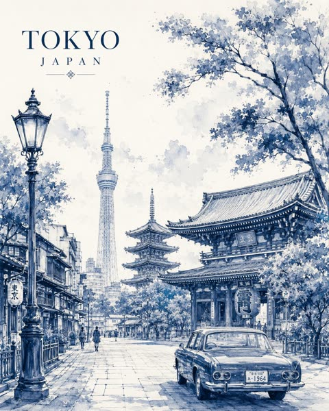</a>

A bracketed template swaps city, color, landmarks, street lamp and vehicle while the layout stays fixed. Low pedestrian eye level, white negative space and an upper left serif title give a consistent poster look.

GPT Image 2 · Text-to-image · Source: [@Goodmanprotocol on X](https://x.com/Goodmanprotocol/status/2062564327140503787) · found via [freestylefly/awesome-gpt-image-2](https://github.com/freestylefly/awesome-gpt-image-2)

[`watercolor`](tags.md#tag-watercolor) [`travel-poster`](tags.md#tag-travel-poster) [`monochrome`](tags.md#tag-monochrome) [`template`](tags.md#tag-template) [`cityscape`](tags.md#tag-cityscape)

<details><summary><b>Prompt</b></summary>

```text
Minimalist vintage watercolor travel poster illustration of [CITY NAME], [COUNTRY], rendered entirely in elegant monochromatic [COLOR] watercolor and fine ink linework.

Aspect ratio: 4:5 vertical composition optimized for poster and social media presentation.

A peaceful early-morning streetscape featuring the iconic [PRIMARY LANDMARK] and [SECONDARY LANDMARK/LOCATION] in the foreground, viewed from a slightly low pedestrian-level perspective. Historic local architecture, elegant facades, ornate details, arched windows, decorative cornices, and traditional street elements line the spacious surroundings, creating a timeless urban atmosphere. A classic [LOCAL STREET ELEMENT OR LAMP STYLE] stands prominently on the left side, while mature leafy trees frame portions of the scene, their foliage painted with soft watercolor washes and delicate splatter textures. In the distance, [DISTANT LANDMARK OR SKYLINE FEATURE] rises gracefully against the skyline, serving as a recognizable cultural landmark. A vintage [LOCAL VEHICLE] or a few small pedestrians add subtle life and scale without disturbing the tranquil mood.

The composition includes large areas of clean white negative space, soft cloudy watercolor textures in the sky, delicate paper grain, and subtle watercolor blooms. The paving, street, or plaza stretches dramatically across the foreground, leading the viewer’s eye toward the landmark ensemble. Typography in the upper-left corner reads “[CITY NAME], [COUNTRY]” in a refined serif font, styled like a sophisticated travel journal or collectible city poster.

Handcrafted watercolor illustration, architectural sketch aesthetic, serene urban atmosphere, soft natural morning lighting, muted monochromatic palette, highly detailed line art, elegant travel-poster design, minimalist luxury wall-art style, timeless local charm, premium stationery illustration, ultra-detailed, high-resolution, clean composition, Pinterest-worthy, Instagram-worthy, gallery-quality artwork.
```

</details>

<a id="gpt-image-neon-yellow-japanese-ai-canvas-ad-poster"></a>
### Neon yellow Japanese AI app ad poster

<a href="https://x.com/dezainaz_ceo/status/2063113560830742906">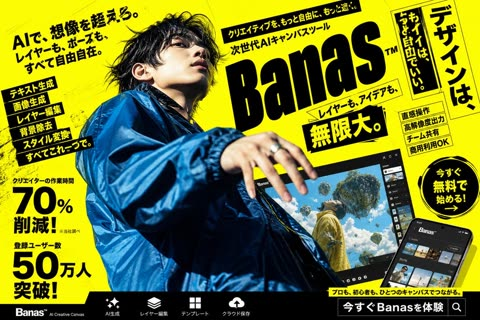</a>

The prompt fixes exact counts for every element, such as 2 stat blocks, 6 feature labels and 5 nav items, and gives the exact Japanese copy for each text slot. A low angle fashion subject is combined with skewed panels and UI mockups on a black and fluorescent yellow palette.

GPT Image 2 · Text-to-image · Source: [@dezainaz_ceo on X](https://x.com/dezainaz_ceo/status/2063113560830742906) · found via [YouMind-OpenLab/awesome-gpt-image-2](https://github.com/YouMind-OpenLab/awesome-gpt-image-2)

[`japanese-typography`](tags.md#tag-japanese-typography) [`ad-poster`](tags.md#tag-ad-poster) [`ui-mockup`](tags.md#tag-ui-mockup) [`neon-yellow`](tags.md#tag-neon-yellow) [`fashion-photo`](tags.md#tag-fashion-photo)

<details><summary><b>Prompt</b></summary>

```text
Goal: Create a high-impact Japanese cyberpunk-style advertising poster for an AI creative canvas tool called Banas, with a loud yellow-and-black street magazine layout and a dramatic fashion photo centerpiece.

Canvas: Landscape 16:9 poster, bright fluorescent yellow background with black ink texture, diagonal perspective, gritty halftone scratches, skewed panels, thick black borders, and dense promotional typography. Overall look should feel like a Japanese web banner or transit ad for a next-generation AI design app.

Main subject: One young male creator photographed from an extreme low angle, occupying the left and center of the poster. He wears an oversized glossy cobalt-blue windbreaker jacket, messy black hair, and reaches one hand toward the camera with motion blur and shallow depth of field. His face is intentionally obscured by a soft square blur/mosaic censor block. Lighting is harsh and editorial, with strong contrast against the yellow background.

Layout: Place a huge slanted black logo wordmark reading Banas on the upper right-center, with a small trademark mark. Above it, add a narrow black headline strip with energetic Japanese marketing copy. Around the logo, use multiple tilted yellow and black text boxes. On the far right, add one tall vertical framed headline panel. At bottom, add a black navigation bar with product feature icons and labels.

Text content: The largest Japanese headline should be AIで、想像を超えろ。レイヤーも、ポーズも、すべて自由自在。. The main logo area should include the supporting phrase 次世代AIキャンバスツール. Add a bold central callout reading 無限大。. Add one circular call-to-action badge on the right reading 今すぐ無料で始める!. Keep all visible copy in bold Japanese display typography, mixing horizontal and vertical writing.

Discrete visible elements to include: exactly 1 censored human model; exactly 1 giant product logo; exactly 1 laptop/tablet-like app preview screen near the lower center-right; exactly 1 smartphone app mockup in the bottom-right corner; exactly 1 circular call-to-action badge; exactly 1 tall vertical headline panel on the far right; exactly 2 large numeric statistic blocks on the left, one showing 70% and one showing 50万人; exactly 6 stacked feature labels on the left side; exactly 4 small rectangular feature badges on the right side; exactly 5 bottom navigation items with simple white icons: sparkle/AI generation, layers, grid/template, cloud upload, and search/experience button.

App mockups: The larger tilted screen should show a dark UI labeled with the product name and a surreal generated image of a person in yellow clothing looking up at floating islands and vegetation in a bright blue sky. The smartphone mockup should show a dark mobile interface with thumbnail rows and a create button.

Visual style: Ultra-bold Japanese commercial graphic design, black typography on neon yellow, skewed perspective, energetic composition, dramatic lens distortion, glossy fashion photography mixed with UI mockups, high contrast, crisp print-ad finish, no clean minimalism, no white background, no watermark.
```

</details>

<a id="gpt-image-neymar-jr-golden-back-view-world-cup-poster"></a>
### Neymar Jr saluting from behind under golden sky

<a href="https://x.com/azev300/status/2047830522336858566">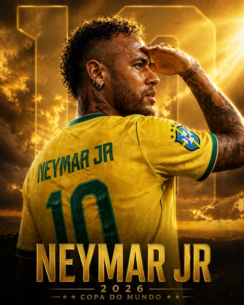</a>

Naming the exact jersey text, crest placement and back-view pose anchors the subject, while the glowing numerals behind him and the metallic serif title lock the poster layout. Rim lighting and a single gold palette keep the whole frame cohesive.

GPT Image 2 · Text-to-image · Source: [@azev300 on X](https://x.com/azev300/status/2047830522336858566) · found via [YouMind-OpenLab/awesome-gpt-image-2](https://github.com/YouMind-OpenLab/awesome-gpt-image-2)

[`football`](tags.md#tag-football) [`world-cup`](tags.md#tag-world-cup) [`sports-poster`](tags.md#tag-sports-poster) [`golden-hour`](tags.md#tag-golden-hour)

<details><summary><b>Prompt</b></summary>

```text
A dramatic cinematic sports poster of Neymar Jr seen from behind wearing the Brazil national team home jersey, bright yellow with green trim, the name NEYMAR JR across the shoulders and the number 10 large on the back. The player is turned slightly left, raising one hand to his forehead in a salute while looking toward a blazing horizon, with short curly hair in a faded mohawk style, visible neck and arm tattoos, and multiple ear piercings. Show the Brazil federation crest on the sleeve. The background is a glowing golden sky with dramatic storm clouds, intense sunlight, and huge luminous geometric numerals forming “10” behind him like monumental light structures. Use a rich gold and amber color palette, high contrast, rim lighting, volumetric glow, sharp fabric texture, heroic composition, and premium poster design. At the bottom, add large metallic gold serif title text reading NEYMAR JR, with smaller gold text beneath reading “2026” and “COPA DO MUNDO”, centered like an epic World Cup announcement poster.
```

</details>

<a id="gpt-image-noir-streetwear-hoodie-campaign-poster"></a>
### Dark streetwear hoodie campaign poster in wet alley

<a href="https://x.com/Daniel_adsss/status/2048542581638701446"></a>

One hero product, a named setting (wet concrete, low light, smoke) and a short headline give the model a clear focal point and text hierarchy. A restricted palette of deep black with grey accents, plus the instruction of no clutter and no collage, keeps the layout clean.

GPT Image 2 · Text-to-image · Source: [@Daniel_adsss on X](https://x.com/Daniel_adsss/status/2048542581638701446) · found via [freestylefly/awesome-gpt-image-2](https://github.com/freestylefly/awesome-gpt-image-2)

[`streetwear`](tags.md#tag-streetwear) [`campaign`](tags.md#tag-campaign) [`hoodie`](tags.md#tag-hoodie) [`brand-poster`](tags.md#tag-brand-poster) [`dark-moody`](tags.md#tag-dark-moody)

<details><summary><b>Prompt</b></summary>

```text
Create a premium, highly realistic 1:1 campaign poster for NOIR, a modern streetwear brand. Show one hero oversized hoodie as the main focus against a gritty urban backdrop with wet concrete floors, dramatic low lighting, subtle smoke in the air and a raw street energy. Add bold minimal typography with the brand name NOIR and a short campaign headline like "Wear the Dark." Make it feel like a real high-end streetwear editorial, sharp detail, realistic fabric textures, modern and edgy, deep black tones with subtle grey accents, no clutter, no collage.
```

</details>

<a id="gpt-image-olive-waffle-tee-editorial-poster"></a>
### Olive Waffle Knit Shirt Editorial Poster

<a href="https://x.com/harboriis/status/2053813021592506439"></a>

Fixes the layout zone by zone: a ghost hung product in front of oversized cropped background type, then three diagonal macro detail strips below. A strict three color palette and exact text placements keep the poster cohesive and the copy legible.

GPT Image 2 · Edit · Source: [@harboriis on X](https://x.com/harboriis/status/2053813021592506439) · found via [YouMind-OpenLab/awesome-gpt-image-2](https://github.com/YouMind-OpenLab/awesome-gpt-image-2)

[`fashion`](tags.md#tag-fashion) [`product-poster`](tags.md#tag-product-poster) [`editorial`](tags.md#tag-editorial) [`typography`](tags.md#tag-typography) [`reference-image`](tags.md#tag-reference-image)

<details><summary><b>Prompt</b></summary>

```text
Create a high-end fashion product advertisement poster in portrait 4:5 ratio, clean minimal editorial style using a reference product image. Background is a warm off-white to light khaki gradient studio setup, very minimal, soft, airy, with subtle warm tones. Main product: an olive army green oversized waffle-knit long sleeve crewneck shirt, ghost-hung on a silver metal clothing rack stand with a visible clamp at the top-right. The shirt hangs naturally with slight drape, front-facing. On the center chest, include white puff embroidery text: “SVG”. Add a small dark navy woven label patch on the right hem side seam and a visible dark navy neck tag at the collar. Typography: top center minimal brand logo “SVG STUDIOS” in olive green clean sans-serif, top-left italic cursive “Field” with a small dark olive rectangle badge below reading “edition” in white, behind the shirt place massive ultra-condensed olive green text “WAFFLE TEE” partially hidden and cut by the product, bleeding off edges. lower-left include handwritten “SVG” and large cursive “Studios” in olive tone. Bottom section features three diagonal detail strips: macro waffle-knit texture, closeup puff embroidery stitching, and closeup dark navy neck label, all with warm studio lighting. Between strips include small text “Built for movement, designed for unity. The SVG Studios WIP Waffle Longsleeve — SS26 Collection” Footer includes 4 small barcode at bottom-left, centered text “• WWW. SVGSTUDIOS. COM • • •” in spaced caps olive tone, and small text “MADE IN MALAYSIA • SS26 COLLECTION”. Color palette is olive army green, warm cream, and dark navy only. Overall style is clean editorial fashion lookbook, military-inspired streetwear campaign, soft diffused lighting, high contrast product focus, photorealistic, ultra detailed, 8K quality.
```

</details>

<a id="gpt-image-overthinking-giant-head-seat-poster"></a>
### Woman Sitting on Her Giant Head, Overthinking Poster

<a href="https://x.com/AIwithAliya/status/2049044716642316758"></a>

One surreal twist, a scaled up copy of her own head used as a seat, is stated in its own paragraph and backed by a plain blush and cream studio. Typography is specified line by line with size, hand drawn style, color and a crossed out word, so the text lands as part of the layout.

GPT Image 2 · Text-to-image · Source: [@AIwithAliya on X](https://x.com/AIwithAliya/status/2049044716642316758) · found via [freestylefly/awesome-gpt-image-2](https://github.com/freestylefly/awesome-gpt-image-2)

[`surreal`](tags.md#tag-surreal) [`fashion-editorial`](tags.md#tag-fashion-editorial) [`typography`](tags.md#tag-typography) [`pastel`](tags.md#tag-pastel) [`self-portrait`](tags.md#tag-self-portrait)

<details><summary><b>Prompt</b></summary>

```text
Ultra-realistic conceptual portrait of a young woman with long wavy hair and soft defined features, wearing rose-tinted rectangular sunglasses, an oversized ivory cropped t-shirt, fitted light-wash denim jeans, and clean white sneakers. She is sitting casually with a confident yet relaxed posture.

The twist: she is seated on a large, hyper-realistic version of her own detached head placed on the ground. The head is scaled up, lying sideways, with the same facial features and sunglasses, creating a surreal self-reflection concept.

Composition: centered, full-body shot, neutral studio background with soft blush and cream tones, minimal aesthetic. Clean negative space.

Typography integrated into the background:

Handwritten-style text at the top: "OVERTHINKING"

Below it, smaller text: "TRAPPED IN MY OWN HEART" with "HEART" crossed out

Large, rough, scribbled text in deep pink: "MIND"

Lighting: soft diffused studio lighting, subtle shadows, high detail, fashion editorial quality.

Style: blend of surrealism and modern luxury streetwear campaign, pastel feminine aesthetic, minimal yet expressive, high-resolution, 8k, sharp focus, natural skin texture.

Mood: introspective, emotional weight, identity, self-awareness, quiet confidence.
```

</details>

<a id="gpt-image-pastel-anime-fantasy-heroine-key-visual-poster"></a>
### Pastel anime fantasy poster with staff-wielding heroine

<a href="https://x.com/8co28/status/2046978759946072262"></a>

The prompt fixes a limited palette of lavender, white and gold, then assigns every text block a position: tagline, name, callouts, vertical copy, inset expression portraits, title and footer. Naming the pose, costume parts and key art finish keeps the heroine consistent while the typography stays integrated.

GPT Image 2 · Text-to-image · Source: [@8co28 on X](https://x.com/8co28/status/2046978759946072262) · found via [YouMind-OpenLab/awesome-gpt-image-2](https://github.com/YouMind-OpenLab/awesome-gpt-image-2)

[`anime`](tags.md#tag-anime) [`fantasy`](tags.md#tag-fantasy) [`key-visual`](tags.md#tag-key-visual) [`japanese-typography`](tags.md#tag-japanese-typography) [`pastel`](tags.md#tag-pastel)

<details><summary><b>Prompt</b></summary>

```text
A vertical Japanese anime fantasy game or light-novel promotional poster in a soft pastel lavender, white, and gold palette, featuring a single heroic teenage girl as the main subject in a grand celestial city. She stands in a dynamic three-quarter full-body pose, slightly turned left, holding an ornate staff in her left hand, with her right arm extended behind her as if caught in wind. Her face is obscured by a flat pale square censor block centered over the head, but the visible design suggests a delicate anime heroine with very long flowing silver-lilac hair, side bangs, loose strands, and star-shaped hair ornaments with dark indigo ribbon bows. She wears an elaborate magical-girl style dress: off-shoulder white bodice with navy and violet trim, gold star motifs, layered asymmetrical skirt in white, periwinkle, violet, and deep indigo, a very large dark blue waist bow with a gold star jewel, detached flowing sleeves, gold chains with tiny star charms draped at the hip, white thigh-high stockings, and a blue star-shaped garter ornament on one thigh. Her staff is tall and elegant, dark shaft with gold frame elements and a suspended faceted blue crystal near the top, decorated with bows and star accents. The background is an airy fantasy skyline of white towers, cathedral-like spires, clouds, feathers, and drifting pink petals, with bright ethereal backlighting and a dreamy heroic atmosphere. Compose it like a polished key visual poster with abundant Japanese typography integrated into the artwork. At the upper left, place the Japanese tagline text "願いが、未来を照らす。" with two smaller lines below it. At the upper right, place a star-like emblem, the large character name "ルミナ", the subtitle "— Lumina —", and a smaller CV credit line. On the right side, add 3 vertically stacked feature callouts, each with a small icon and a bold Japanese heading followed by 2 short lines of smaller text. On the left side, add 1 vertical Japanese copy block running downward beside the character. At the lower right, include 3 small portrait inset panels of the same girl, stacked diagonally: 1 calm front-facing expression, 1 side-profile serious expression, and 1 smiling eyes-closed expression. At the lower left, place the large Japanese title "星紡ぐレガシア" with the English subtitle "— LEGACIA: Weave the Stars —" beneath it. At the bottom right, add the date text "2025. 夏" and one short Japanese tagline line below. At the very bottom edge, include 2 small social or website info blocks on the left and a tiny copyright line on the right. Render in high-end modern anime promotional illustration style, luminous pastel fantasy atmosphere, elegant composition, smooth linework and coloring, soft cel shading, delicate fabric movement, glossy highlights, intricate costume details, clean typography layout, and refined commercial poster finish.
```

</details>

<a id="gpt-image-personalized-travel-magazine-page"></a>
### Personalized vertical travel magazine page with attached person

<a href="https://x.com/minchoi/status/2097525572591136869"></a>

A bracketed destination slot makes the template reusable, and the attached person is blended into the destination photography. Listing the page parts (headline, tips, recommendations, captions) and ending with a check of every visible word keeps the text readable.

GPT Image 2.5 · Edit · Source: [@minchoi on X](https://x.com/minchoi/status/2097525572591136869) · found via [wangrunlin/awesome-gpt-image-2-5-prompts](https://github.com/wangrunlin/awesome-gpt-image-2-5-prompts)

[`travel-magazine`](tags.md#tag-travel-magazine) [`editorial-layout`](tags.md#tag-editorial-layout) [`personalized`](tags.md#tag-personalized) [`template`](tags.md#tag-template) [`vertical`](tags.md#tag-vertical)

<details><summary><b>Prompt</b></summary>

```text
Create a vertical 9:16 travel-magazine page about [DESTINATION]. Blend the attached person naturally into the destination photography. Include a clear headline, short travel tips, recommendations, and photo captions. Use the whole page with a readable editorial hierarchy. Check every visible word.
```

</details>

<a id="gpt-image-phoenix-rebirth-typography-poster"></a>
### Phoenix Rebirth Typography Poster with Burning Wings

<a href="https://x.com/dotey/status/2048793351290327381"></a>

A single INPUT_TEXT placeholder makes the prompt reusable for any title. It asks for custom letterforms, one visual metaphor that interacts with the type, and a restrained 4 to 6 colour system with risograph grain.

GPT Image 2 · Text-to-image · Source: [@dotey on X](https://x.com/dotey/status/2048793351290327381) · found via [freestylefly/awesome-gpt-image-2](https://github.com/freestylefly/awesome-gpt-image-2)

[`typography`](tags.md#tag-typography) [`poster`](tags.md#tag-poster) [`conceptual`](tags.md#tag-conceptual) [`risograph`](tags.md#tag-risograph) [`template`](tags.md#tag-template)

<details><summary><b>Prompt</b></summary>

```text
Create ONE finished premium conceptual typography poster for the exact title:

“[INPUT_TEXT]”

Single poster only. No moodboard, grid, presentation board, mockup, captions, prompt text, process sheet, or sample labels.

The title “[INPUT_TEXT]” must be the dominant visual structure of the poster: huge, readable, powerful, and spelled exactly. Do not translate, shorten, replace, or misspell it. Do not add other large readable text. Optional micro catalog text is allowed only if it stays subtle and secondary.

Silently interpret the title’s meaning, mood, cultural aura, symbolic associations, psychological tension, and visual rhythm. Turn that interpretation into one strong visual metaphor.

Typography is the hero. Design custom-looking letterforms whose weight, width, contrast, spacing, rhythm, distortion, negative space, edge quality, and ink texture express the temperament of the title. The type should feel intentionally designed, not like a default font.

If “[INPUT_TEXT]” refers to a widely known person, make a large editorial portrait or full / half-body figure a major visual presence, occupying roughly 40–70% of the composition. The figure should feel recognizable through aura, posture, styling, era, expression, lighting, and symbolic atmosphere, but should not copy a specific existing photograph, official poster, campaign image, logo, slogan, or copyrighted composition. The portrait must interact with the typography: overlapping the letters, emerging from them, being framed by them, casting shadows on them, breaking through them, or being partially hidden behind them.

For all other titles, use a human figure, landscape, object, or atmospheric setting only when it strengthens the meaning. It must interact with the typography and deepen the concept, not decorate it.

Use a rich but restrained 4–6 color system matched to the theme: dominant background color, primary typography color, figure / landscape tone, emotional accent color, muted support color, and subtle paper / ink texture tone. Avoid flat black-white-red defaults unless conceptually necessary.

Composition style: high-end editorial poster, museum-quality graphic design, dramatic scale, strong hierarchy, few elements, intelligent whitespace, bold flat color areas, sharp cropping, silkscreen / lithograph / risograph grain, paper fibers, subtle ink imperfections, refined visual tension.

The final image should feel like a complete visual sentence: the title, the figure or setting, the color, and the typography explain each other.

Avoid generic word art, glossy 3D lettering, random icons, stock-photo realism, cluttered collage, excessive grunge, tourist clichés, official logos, copied slogans, copied campaign aesthetics, unrelated text, and misspelled typography.

-----

INPUT_TEXT：Phoenix Rebirth
```

</details>

<a id="gpt-image-poster-redesign-male-perspective-lyric"></a>
### Anime schoolboy with bouquet on blue lyric poster

<a href="https://x.com/ponzponz15/status/2097513870969688188"></a>

Anchors the edit to the original poster by asking to retain its composition and visual world, so the layout stays fixed while the concept changes. Asking for all visible text to be replaced with new copy forces the model to rewrite headlines, labels and captions to match the new perspective.

GPT Image 2.5 · Edit · Source: [@ponzponz15 on X](https://x.com/ponzponz15/status/2097513870969688188) · found via [wangrunlin/awesome-gpt-image-2-5-prompts](https://github.com/wangrunlin/awesome-gpt-image-2-5-prompts)

[`poster-redesign`](tags.md#tag-poster-redesign) [`reference-edit`](tags.md#tag-reference-edit) [`text-replacement`](tags.md#tag-text-replacement) [`anime`](tags.md#tag-anime) [`typography`](tags.md#tag-typography)

<details><summary><b>Prompt</b></summary>

```text
Using the original poster as reference, retain its overall composition and visual world. Reinterpret it from a male perspective and replace all visible text with new copy that fits the revised concept.
```

</details>

<a id="gpt-image-propaganda-poster-three-ai-leaders"></a>
### 1980s propaganda poster of three AI leaders

<a href="https://x.com/akokoi1/status/2046558658096738672"></a>

Naming the era and genre sets the whole visual system: a red sunburst, banners, peony borders and painted realism. The slogan is quoted verbatim so the Chinese text renders exactly, and one concrete wardrobe detail, the red scarf, makes one figure identifiable.

GPT Image 2 · Text-to-image · Source: [@akokoi1 on X](https://x.com/akokoi1/status/2046558658096738672) · found via [ZeroLu/awesome-gpt-image](https://github.com/ZeroLu/awesome-gpt-image)

[`propaganda`](tags.md#tag-propaganda) [`retro-poster`](tags.md#tag-retro-poster) [`chinese-text`](tags.md#tag-chinese-text)

<details><summary><b>Prompt</b></summary>

```text
Generate a 1980s propaganda poster. Use the exact slogan "热烈庆祝GPT-Image-2全量开放". Include Sam Altman, Dario Amodei, and Elon Musk, and give Dario Amodei a red scarf.
```

</details>

<a id="gpt-image-rainy-night-cinema-noir-poster"></a>
### Rainy Night Cinema Noir Poster with Giant Face

<a href="https://x.com/xiaoxiaodong01/status/2064877952211489255"></a>

The prompt places each element by position (ear left, eye upper right, projector lower left, two silhouettes bottom center) and gives an exact silhouette count. It limits color to charcoal and ivory with one warm amber beam, and it specifies the Chinese title and the release line as exact text.

GPT Image 2 · Text-to-image · Source: [@xiaoxiaodong01 on X](https://x.com/xiaoxiaodong01/status/2064877952211489255) · found via [YouMind-OpenLab/awesome-gpt-image-2](https://github.com/YouMind-OpenLab/awesome-gpt-image-2)

[`movie-poster`](tags.md#tag-movie-poster) [`noir`](tags.md#tag-noir) [`monochrome`](tags.md#tag-monochrome) [`chinese-typography`](tags.md#tag-chinese-typography) [`calligraphy`](tags.md#tag-calligraphy)

<details><summary><b>Prompt</b></summary>

```text
Create a cinematic monochrome Chinese movie poster in a dark, rainy, nostalgic style. The canvas is a wide horizontal 3:2 poster. Show an enormous close-up profile of an elegant woman's face filling the entire background, cropped so her ear with a round pearl-like floral earring is on the left, her eye and eyelashes are near the upper right, and her nose and lips fade into shadow on the far right. Use soft black-and-white film grain, smoky haze, high contrast shadows, and a vintage 1930s melodrama mood. In the lower left, place an old film projector with visible reels, projecting a warm amber beam of light across the scene. In the bottom center foreground, show exactly 2 small human silhouettes sitting on a wet reflective floor facing the projection: 1 young man on the left and 1 young woman on the right, both seen from behind. Add subtle rainwater reflections and a thin horizon line at the floor. Across the middle-left to center, overlay large expressive handwritten Chinese calligraphy title text reading 雨夜放映, in off-white brush strokes with long sweeping lines. To the right of the title, add small spaced Chinese release information reading 社团开放夜 / 6月28日 / 教三 204. Keep the typography elegant, sparse, and integrated into the face. Color palette should be mostly charcoal black, muted gray, and ivory, with the projector beam as the only warm orange accent. No extra logos, no borders, no additional characters, no modern digital elements.
```

</details>

<a id="gpt-image-raw-sketchy-portrait-poster-with-animal"></a>
### Raw sketchy ink portrait poster with dog

<a href="https://x.com/kingofdairyque/status/2093279729717780736"></a>

A fill in template with HUMAN, CLOTHING, ANIMAL, SCENERY and COLORS slots. Broken ink contours, flat shadow blocks, one warm field against one cool field, and scenery cut down to two or three silhouettes keep the face dominant.

GPT Image 2 · Text-to-image · Source: [@kingofdairyque on X](https://x.com/kingofdairyque/status/2093279729717780736) · found via [freestylefly/awesome-gpt-image-2](https://github.com/freestylefly/awesome-gpt-image-2)

[`sketchy-ink`](tags.md#tag-sketchy-ink) [`portrait-poster`](tags.md#tag-portrait-poster) [`animal-companion`](tags.md#tag-animal-companion) [`limited-palette`](tags.md#tag-limited-palette) [`template`](tags.md#tag-template)

<details><summary><b>Prompt</b></summary>

```text
Raw sketchy graphic portrait poster of [HUMAN] wearing [CLOTHING], half-body and large in frame, accompanied closely by [ANIMAL], with a minimal [SCENERY] background. Render in a rough expressive illustrated style with broken black ink contours, loose sketch lines, scratchy hatching, irregular stroke weight, imperfect line edges, fast gestural mark-making, simplified anatomy, flat cel-like shadow blocks, and reduced detail. Use a restrained [COLORS] palette with one dominant warm field, one cool counter-field, dark inked shadows, and a few pale highlight accents. Keep the face oversized and central, crop around mid-torso, and place the animal in the lower foreground or tucked beside the subject, drawn with the same simplified raw linework. Reduce the scenery into only 2 or 3 bold silhouette shapes behind the subject, with no detailed environment rendering. Add a narrow warm off-white poster border and very light print texture. Strong attitude, graphic poster energy, intentionally imperfect strokes, raw and sketchy finish, ar 4:5
```

</details>

<a id="gpt-image-red-beam-editorial-portrait-poster"></a>
### Red Light Beam Editorial Portrait Poster

<a href="https://x.com/Goodmanprotocol/status/2092471662126211143"></a>

The prompt fills in slots for subject, interference, title, palette and mood, and allows only one interference method so the effects do not compete. A neutral palette with a single accent color, plus oversized headline type that overlaps the subject, gives the poster its editorial look.

GPT Image 2 · Text-to-image · Source: [@Goodmanprotocol on X](https://x.com/Goodmanprotocol/status/2092471662126211143) · found via [freestylefly/awesome-gpt-image-2](https://github.com/freestylefly/awesome-gpt-image-2)

[`editorial`](tags.md#tag-editorial) [`typography`](tags.md#tag-typography) [`portrait-poster`](tags.md#tag-portrait-poster) [`template`](tags.md#tag-template) [`red-accent`](tags.md#tag-red-accent)

<details><summary><b>Prompt</b></summary>

```text
Create a medium-sized 9:16 experimental editorial portrait poster using the following customizable inputs:

Subject: [Adult Male or Female Portrait]
Interference: [Color Split / Narrow Light Beam / Horizontal Cut / Motion Veil]
Title: [Title]
Palette: [Main Neutral Tones + One Accent Color]
Mood: [Sharp / Cinematic / Restrained / Experimental]

Create a striking close-up or waist-up portrait with the subject occupying a strong portion of the frame. Preserve realistic facial features, natural skin texture, authentic hair, realistic proportions, clear emotion, and a strong silhouette. The portrait must work visually as a fashion photograph before the graphic intervention is applied.

Use only one primary interference method:

Color Split: Uneven translucent bands selectively shift, reveal, separate, or distort portions of the portrait.

Narrow Light Beam: A single controlled beam cuts across the face or body and continues naturally into the surrounding space.

Horizontal Cut: Bold horizontal bands interrupt selected areas of the portrait and interact with oversized typography.

Motion Veil: Keep the main portrait sharp while selected areas create subtle horizontal photographic motion trails.

Make typography an integral part of the composition. Use one dominant headline, allowing letters to crop beyond the frame, overlap the subject, disappear behind the body, or interact with the interference.

Keep supporting text minimal: one small series label and one short phrase.

Use mostly black, white, grey, charcoal, or deep neutral tones, plus one accent color. Keep skin tones natural and avoid excessive warmth or yellow grading.

Add only a few subtle graphic details such as fine lines, circles, or open corner marks when necessary.

The final composition should feel like a premium fashion editorial, contemporary photography poster, or experimental art-direction piece—clean, intentional, sophisticated, and visually balanced.

Avoid multiple competing effects, dense text, UI elements, heavy glitches, random collage, excessive decoration, numbering, “Vol.” or “Issue” labels, sparkle symbols, logos, watermarks, distorted anatomy, plastic skin, oversaturation, and generic template aesthetics.

Keep the overall treatment medium in scale, refined, adaptable, and universally applicable to different people, titles, themes, palettes, and editorial concepts.
```

</details>

<a id="gpt-image-restaurant-shaped-standee-template"></a>
### Die cut restaurant standee for summer drinks

<a href="https://x.com/MrLarus/status/2059248197910827364"></a>

A bracketed template with fields for brand, products, selling points and promotions, so it can be reused for any menu. It asks for an irregular cut outline with a visible base and a strict reading order from headline to main product to price.

GPT Image 2 · Text-to-image · Source: [@MrLarus on X](https://x.com/MrLarus/status/2059248197910827364) · found via [freestylefly/awesome-gpt-image-2](https://github.com/freestylefly/awesome-gpt-image-2)

[`standee`](tags.md#tag-standee) [`restaurant`](tags.md#tag-restaurant) [`food-photography`](tags.md#tag-food-photography) [`template`](tags.md#tag-template) [`pop-signage`](tags.md#tag-pop-signage)

<details><summary><b>Prompt</b></summary>

```text
请生成一张高完成度的「餐饮异形展架 / 立牌」设计图，用于展示餐饮门店的新品推荐、招牌产品、套餐促销或品牌活动信息。

【基础信息】
品牌名：【品牌名】
主标题：【主标题】
副标题：【副标题】
辅助短句：【短句1】｜【短句2】｜【短句3】
主题方向：【主题方向，例如：爆辣夜市风 / 金黄浓郁风 / 清新轻食风 / 山野自然风 / 甜品下午茶风 / 快餐促销风】
主色调：【主色调】
辅助色：【辅助色】
点缀色：【点缀色】
画幅比例：【建议 3:4 竖版】

【产品内容】
主推产品：【主推产品】
辅助产品1：【辅助产品1】
辅助产品2：【辅助产品2】
辅助产品3：【辅助产品3】
辅助产品4：【辅助产品4】
加料 / 配角产品：【加料或配角产品，例如：饮品 / 小食 / 配菜 / 酱料 / 甜品】

【卖点标签】
【卖点1】
【卖点2】
【卖点3】
【卖点4】
【卖点5】
【卖点6】

【促销信息】
【促销信息1】
【促销信息2】
【促销信息3】

【最重要要求】
避免生成门店场景效果图或墙上海报展示图。请直接生成“一张完整的异形立牌成品展示图”：
- 背景必须为纯白色
- 画面中只保留一个完整的异形餐饮立牌主体
- 不要餐厅环境
- 不要商场背景
- 不要玻璃门、桌椅、墙面、人物、地面透视场景
- 不要任何真实空间背景
- 立牌主体必须完整显示
- 异形轮廓必须完整清晰
- 底座必须完整露出
- 整体像一张已经抠好的门店物料成品图 / 设计提案展示图 / 电商展示图

【画面形式】
这是一张“门店异形展架 / 立牌”的完整设计，避免普通矩形海报处理。
整体应采用明显的“不规则异形裁切轮廓”，有完整外边缘，边缘可带白色或浅色描边，具有真实门店物料感。
立牌应有明确底座，整体像可落地摆放的 KT 板 / 泡沫板 / 亚克力 / 写真喷绘展架成品。

【构图结构】
整体采用竖版、中心聚焦、信息分层清楚的结构：

1. 顶部区域：
放超大主标题，标题必须醒目、有冲击力、有餐饮 POP 招贴感。
字体可以厚重、手写感、招贴感、潮流感，但要清晰易读。
标题是整张图的第一视觉焦点。

2. 中部核心区域：
中间放最大主推产品，作为主视觉主体。
主菜必须最大、最饱满、最诱人，突出食欲感。
围绕主菜搭配 2~5 个辅助产品，形成丰富的产品组合，前后层次明确，主次分明。

3. 周边信息区域：
在主菜和辅助产品四周加入少量标签元素、推荐标、贴纸框、手写箭头、卖点说明、小标题、小气泡标签等，使其具有“餐饮门店促销物料”的视觉特征。
但要控制层级，做到“热闹但不乱”。

4. 底部促销区域：
底部放价格信息、套餐信息、活动信息或新品尝鲜信息。
价格数字要相对突出，易读清晰。
如果没有特别要求，默认不要二维码。

【视觉风格要求】
整体风格应属于“餐饮转化型视觉 + 门店 POP 异形立牌”：
- 强调食欲感
- 强调信息可读性
- 强调商业落地感
- 强调门店物料感
- 强调异形轮廓感

避免极简杂志海报、电商详情页、纯平面插画海报方向。

【食物表现要求】
所有食物必须采用真实商业美食摄影质感：
- 食物清晰真实
- 有食材颗粒感
- 有酱汁、汤汁、油光、热气、层次感
- 有丰富细节，如葱花、辣椒、芝士、香草、蔬菜、水果、虾仁、肉块等
- 主食要饱满，不能扁平
- 看起来必须“能激发食欲”
禁止过度插画化、卡通化、低质拼贴化。

【版式与信息层级】
整张立牌的阅读顺序应为：
主标题 → 主推产品 → 辅助产品 → 卖点标签 → 价格 / 活动信息

信息量可以较丰富，但必须有明确层级：
- 主标题最大
- 主菜次大
- 辅助菜稍小
- 卖点标签较小
- 底部促销清晰醒目

【适配范围】
该模板需要适用于不同主题餐饮内容，例如：
- 面 / 饭 / 粉 / 小吃
- 火锅 / 菌汤 / 地方菜
- 轻食 / 沙拉 / 咖啡简餐
- 早餐 / 套餐 / 快餐
- 茶饮 / 甜品 / 下午茶
- 节日促销 / 新品上市 / 爆品推荐 / 双人套餐

【输出要求】
请输出一张高清、清晰、商业完成度高的异形立牌设计图，满足以下条件：
- 白色背景
- 完整异形轮廓
- 完整底座
- 只展示立牌本体
- 不带真实场景环境
- 不带人物
- 不带门店背景
- 默认不带二维码
- 适合用于系列案例展示、设计提案、社交媒体发布、模板复用
```

</details>

<a id="gpt-image-rio-ticket-pop-up-diorama-poster"></a>
### Rio miniature diorama rising from a ticket

<a href="https://x.com/john_my07/status/2091408386466214031"></a>

A hand holding an aged ticket in the foreground sets the scale, and the miniature city rises from behind it in layers of paper, wood and plaster with cast shadows. Naming each sketch and its position on the cream page, then asking for a sharp centre and softer surroundings, keeps the layout controlled.

GPT Image 2 · Text-to-image · Source: [@john_my07 on X](https://x.com/john_my07/status/2091408386466214031) · found via [freestylefly/awesome-gpt-image-2](https://github.com/freestylefly/awesome-gpt-image-2)

[`travel-poster`](tags.md#tag-travel-poster) [`diorama`](tags.md#tag-diorama) [`paper-craft`](tags.md#tag-paper-craft) [`miniature`](tags.md#tag-miniature) [`vintage`](tags.md#tag-vintage)

<details><summary><b>Prompt</b></summary>

```text
Create a highly detailed, photorealistic miniature travel-poster diorama inspired by Rio de Janeiro, arranged as a handcrafted 3D paper scene on a warm ivory, slightly textured background.

In the foreground, a realistic human hand holds a vintage Brazilian travel ticket or Rio-themed transit card vertically on the left side. Give the card aged paper texture, subtle printing imperfections, elegant typography, and authentic-looking travel details. From behind the card, a miniature Rio de Janeiro landscape physically rises outward like an intricate pop-up diorama.

Make Christ the Redeemer the dominant central landmark, positioned high above a miniature cityscape with lush green mountains surrounding it. Below, build a tiny realistic Rio street featuring a classic yellow taxi, colorful buildings, palm trees, pedestrians, cyclists, street lamps, tiled sidewalks, and small Brazilian urban details. Add Copacabana beach elements in the distance with tiny umbrellas, beachgoers, and a glimpse of the Atlantic Ocean. Layer the architecture and terrain so everything appears physically constructed from paper, wood, plaster, and miniature materials, with convincing depth, cast shadows, overlapping surfaces, and a slight three-quarter perspective.

Around the main 3D scene, incorporate delicate black, charcoal, and muted sepia hand-drawn travel illustrations on the cream paper. Include a small Sugarloaf Mountain sketch in the upper left, an artistic Copacabana promenade illustration in the upper right, a detailed Selarón Steps sketch along the right side, and a small Ipanema beachfront skyline drawing near the bottom. Add subtle handwritten travel notes, tiny map markings, architectural outlines, compass symbols, postage-stamp details, and understated Brazilian travel annotations.

Keep the composition refined rather than crowded. Blend realistic miniature photography with vintage travel-journal design, tactile paper fibers, faint ink bleed, imperfect hand-drawn lines, warm natural studio lighting, gentle shadows, subtle film grain, and a sophisticated cream, charcoal, muted green, ocean blue, and Brazilian yellow palette.

The final image should feel like a premium collectible Rio de Janeiro travel postcard transformed into a physical miniature world, with the central diorama sharply detailed and the surrounding illustrations slightly softer. Highly realistic human hand and fingers, believable miniature materials, cinematic product photography, editorial travel-magazine aesthetic, shallow depth of field, ultra-fine textures, photorealistic 3D details, vertical 4:5 composition, 8K quality.
```

</details>

<a id="gpt-image-santorini-family-travel-diary-print"></a>
### Santorini family travel diary with photo over risograph print

<a href="https://x.com/frametheory058/status/2098253373237875074"></a>

A torn paper transition splits one scene into a natural sunset photo above and a navy, terracotta and ivory risograph version of the same family below. Asking for consistent identities across both halves makes the print read as a retelling of the photo.

GPT Image 2.5 · Text-to-image · Source: [@frametheory058 on X](https://x.com/frametheory058/status/2098253373237875074) · found via [wangrunlin/awesome-gpt-image-2-5-prompts](https://github.com/wangrunlin/awesome-gpt-image-2-5-prompts)

[`travel-poster`](tags.md#tag-travel-poster) [`santorini`](tags.md#tag-santorini) [`risograph`](tags.md#tag-risograph) [`family`](tags.md#tag-family) [`torn-paper`](tags.md#tag-torn-paper)

<details><summary><b>Prompt</b></summary>

```text
Design a vertical 4:5 Santorini travel diary. Above, show a fictional couple kissing their smiling daughter’s cheeks at sunset, among white houses, blue domes and sea. Use natural photographic skin and hands. Below a torn-paper transition, reinterpret the same family as a navy, terracotta and ivory screen print with rough ink and risograph texture. Keep identities consistent. Add only “TRAVEL DIARY”, “Sept 11, 2026”, “SANTORINI — GREECE”, “MORE GOOD DAYS” and “A SMALL DIARY — #001.” Use sparse stamps and taped photos. No Chinese text, rigid half split, excessive stickers or distorted anatomy.
```

</details>

<a id="gpt-image-sci-fi-momotaro-key-visual"></a>
### Sci-fi Momotaro animation key visual poster

<a href="https://x.com/SSSS_CRYPTOMAN/status/2046575354555617761"></a>

The prompt names a fictional animation key visual and asks for characters, background, logo and slogan in one illustration, so the model builds a full poster layout with title lockup and taglines. A single theme plus a worldview goal is enough to get a coherent composition.

GPT Image 2 · Text-to-image · Source: [@SSSS_CRYPTOMAN on X](https://x.com/SSSS_CRYPTOMAN/status/2046575354555617761) · found via [freestylefly/awesome-gpt-image-2](https://github.com/freestylefly/awesome-gpt-image-2)

[`key-visual`](tags.md#tag-key-visual) [`sci-fi`](tags.md#tag-sci-fi) [`anime-poster`](tags.md#tag-anime-poster) [`logo-design`](tags.md#tag-logo-design) [`bilingual-prompt`](tags.md#tag-bilingual-prompt)

<details><summary><b>Prompt</b></summary>

```text
[中文]
设计虚构动画的钥匙视觉图。主题是「科幻桃太郎」。设计有魅力的角色、背景、标志和宣传语，以一幅美丽插画的形式完成，让世界观在一张图中传达出来。

[English]
Design a key visual for a fictional animation. The theme is "Sci-Fi Momotaro". Design charming characters, backgrounds, logos, and promotional slogans, completed in the form of a beautiful illustration, allowing the worldview to be conveyed in a single image.
```

</details>

<a id="gpt-image-six-color-low-angle-fashion-campaign"></a>
### Six color low angle fashion campaign

<a href="https://x.com/ImagineArt_X/status/2097520463811608862"></a>

A ground level 24mm lens tilted fifteen degrees gives a dramatic upward perspective. Naming six exact garment colors against one plain cobalt sky keeps the palette controlled while each person is posed differently.

GPT Image 2.5 · Text-to-image · Source: [@ImagineArt_X on X](https://x.com/ImagineArt_X/status/2097520463811608862) · found via [wangrunlin/awesome-gpt-image-2-5-prompts](https://github.com/wangrunlin/awesome-gpt-image-2-5-prompts)

[`fashion`](tags.md#tag-fashion) [`campaign`](tags.md#tag-campaign) [`low-angle`](tags.md#tag-low-angle) [`color-palette`](tags.md#tag-color-palette) [`group-shot`](tags.md#tag-group-shot)

<details><summary><b>Prompt</b></summary>

```text
a fashion campaign for an invented label, shot from a camera on the ground with a 24mm lens tilted fifteen degrees. Six people in electric blue, tomato red, lime green, hot pink, butter yellow and lilac, all posed differently, against plain cobalt sky.
```

</details>

<a id="gpt-image-snowman-starbucks-collab-poster"></a>
### Snowman mascot and Starbucks iced drinks collab poster

<a href="https://x.com/web3annie/status/2046877548966256724"></a>

Lists every layout zone in order, from the logo row and headline down to the price block and merch row, so each element lands where the poster needs it. Glossy product lighting, shallow depth of field and a fixed merch count keep the retail photo look and item count consistent.

GPT Image 2 · Text-to-image · Source: [@web3annie on X](https://x.com/web3annie/status/2046877548966256724) · found via [YouMind-OpenLab/awesome-gpt-image-2](https://github.com/YouMind-OpenLab/awesome-gpt-image-2)

[`co-branding`](tags.md#tag-co-branding) [`beverage`](tags.md#tag-beverage) [`retail-promo`](tags.md#tag-retail-promo)

<details><summary><b>Prompt</b></summary>

```text
A bright, cheerful summer co-branded beverage poster in a clean Chinese commercial advertising style, showing a collaboration between 蜜雪冰城 and STARBUCKS. Vertical poster layout with a soft blue sky background, sunlit greenery, and an outdoor cafe atmosphere. At the top, place both brand logos side by side with a large bold Chinese headline in playful hand-drawn display lettering: 雪王遇见星朋友. Beneath it, add a green ribbon banner with Chinese subheadline text: 米雪冰城 × 星巴克 联名开启, and a smaller line reading "甜蜜加倍·快乐翻倍". Include 2 circular stamp-style graphics: one on the left reading "联名限定", and one on the upper right like a postmark with Chinese text around a small drink icon. In the center foreground on a wooden outdoor table, display 2 iced drinks: on the left, a tall clear cup of vivid green matcha slush topped with a tall swirl of vanilla soft serve and green matcha drizzle, with visible ice texture and a cute snowman mascot logo on the cup; on the right, a tall clear Starbucks-style iced latte with milk and green matcha swirls at the bottom, topped with whipped cream and dark cookie crumbs, with the green siren logo on the cup. In front of the drinks, place 1 cute white snowman mascot figurine with a tiny crown, round body, rosy cheeks, red cape, and a happy wink, sitting and holding a small takeaway coffee cup. Add 2 vertical product name tags beside the drinks: left tag "雪顶抹茶星冰乐", right tag "抹茶雪王奥利奥". On the right midground, place 1 small black chalkboard sign on a wooden easel reading "ICE CREAM & COFFEE" with chalk drawings of an ice cream cone and a takeaway cup. In the lower left, create a torn-paper price block showing a combo offer with large red numbers "¥19.9", green supporting text, and a small green badge reading "立省 ¥6". In the lower center-right, add a "联名周边" area displaying exactly 4 merchandise items: 1 cup sleeve, 1 character keychain or acrylic charm, 1 round badge, and 1 small sticker or token, all using the snowman mascot and coffee collaboration theme. Use warm sunlight, glossy drink photography, shallow depth of field, soft bokeh trees, high contrast product retouching, crisp packaging details, and an upbeat youthful retail-promo aesthetic. Include scattered doodle hearts and playful decorative accents around the typography. Keep all visible text in Chinese except the Starbucks wordmark and the chalkboard text.
```

</details>

<a id="gpt-image-streetwear-campaign-tagline"></a>
### Streetwear campaign shot with one exact tagline

<a href="https://developers.openai.com/api/docs/guides/image-prompting#render-exact-text"></a>

The tagline is quoted and the prompt asks for it exactly once, then bans extra text, watermarks and unrelated logos. This is the pattern for any ad with fixed copy.

GPT Image 2.5 · Text-to-image · Source: [OpenAI image prompting guide](https://developers.openai.com/api/docs/guides/image-prompting#render-exact-text)

[`ad`](tags.md#tag-ad) [`fashion`](tags.md#tag-fashion) [`text-render`](tags.md#tag-text-render)

<details><summary><b>Prompt</b></summary>

```text
Give me a cool in culture ad / fashion shot for a brand called Thread.
It's a hip young street brand. The ad shows a group of friends hanging out together with the tagline "Yours to Create."
Make it feel like a polished campaign image for a youth streetwear audience: stylish, contemporary, energetic, and tasteful.
Use clean composition, strong color direction, natural poses, and premium fashion photography cues.
Render the tagline exactly once, clearly and legibly, integrated into the ad layout.
No extra text, no watermarks, no unrelated logos.
```

</details>

<a id="gpt-image-strength-dumbbell-fitness-campaign-poster"></a>
### Red fitness campaign poster with giant dumbbell

<a href="https://x.com/AIwithSynthia/status/2048601383545577614"></a>

A single oversized prop and a large background word give the poster a clear focal hierarchy, while the model pose is spelled out limb by limb. The minimal black studio, reflective floor and a one color red palette keep the layout clean and luxurious.

GPT Image 2 · Text-to-image · Source: [@AIwithSynthia on X](https://x.com/AIwithSynthia/status/2048601383545577614) · found via [freestylefly/awesome-gpt-image-2](https://github.com/freestylefly/awesome-gpt-image-2)

[`fitness`](tags.md#tag-fitness) [`campaign`](tags.md#tag-campaign) [`typography`](tags.md#tag-typography) [`studio`](tags.md#tag-studio) [`red-black`](tags.md#tag-red-black)

<details><summary><b>Prompt</b></summary>

```text
Cinematic fitness campaign, oversized dumbbell placed diagonally like a statement prop, female model in red performance wear and white shorts seated on one side of the dumbbell, one leg bent, one extended, minimal black studio, reflective floor, bold word “STRENGTH” behind in large typography, sharp lighting, ultra-clean composition, luxury sports aesthetic, 1:1.
```

</details>

<a id="gpt-image-surreal-anime-uncle-posters"></a>
### Four surreal anime posters with Japanese titles

<a href="https://x.com/aiehon_aya/status/2046499177916682600"></a>

Asks for four variations in one grid and frames the concept as a serious yet absurd animated film. Requiring Japanese title and broadcast text pushes the model toward full poster typography with credits and air dates.

GPT Image 2 · Text-to-image · Source: [@aiehon_aya on X](https://x.com/aiehon_aya/status/2046499177916682600) · found via [freestylefly/awesome-gpt-image-2](https://github.com/freestylefly/awesome-gpt-image-2)

[`movie-poster`](tags.md#tag-movie-poster) [`anime`](tags.md#tag-anime) [`japanese-typography`](tags.md#tag-japanese-typography) [`surreal`](tags.md#tag-surreal) [`grid`](tags.md#tag-grid)

<details><summary><b>Prompt</b></summary>

```text
[中文]
一个看似真实却微妙地古怪的女装大叔出现的电影海报，4 种。达到专业设计师制作的水平。 企划和设定本身就是那种“这种东西真要拍成电影吗？”的、认真却忍不住想笑的超现实动画。 标题和播出信息也要用日文显示的状态。

[English]
A movie poster featuring a seemingly realistic yet subtly bizarre cross-dressing older man, 4 variations. Reaching the level of a professional designer's production. The project and setting itself is a surreal animation of the "Are they really making a movie out of this?" kind, serious yet irresistibly funny. The title and broadcast information should also be displayed in Japanese.
```

</details>

<a id="gpt-image-surreal-self-head-seat-campaign-poster"></a>
### Man Seated on Giant Own Head Poster

<a href="https://x.com/Shorelyn_/status/2060207260685791267"></a>

A single surreal twist is stated outright, then fixed by composition, lighting and style blocks. Exact typography lines, including a crossed out word, are quoted so the text renders as hand lettering in the negative space.

GPT Image 2 · Text-to-image · Source: [@Shorelyn_ on X](https://x.com/Shorelyn_/status/2060207260685791267) · found via [freestylefly/awesome-gpt-image-2](https://github.com/freestylefly/awesome-gpt-image-2)

[`surreal`](tags.md#tag-surreal) [`campaign`](tags.md#tag-campaign) [`streetwear`](tags.md#tag-streetwear) [`typography`](tags.md#tag-typography) [`studio-portrait`](tags.md#tag-studio-portrait)

<details><summary><b>Prompt</b></summary>

```text
Ultra-realistic conceptual portrait of a young man with curly hair and light stubble, wearing yellow-tinted rectangular sunglasses, a beige minimal t-shirt, blue jeans, and off-white sneakers. He is sitting casually with a relaxed posture.

The twist: he is seated on a large, hyper-realistic version of his own detached head placed on the ground. The head is scaled up, lying sideways, with the same facial features and sunglasses, creating a surreal self-reflection concept.

Composition: centered, full-body shot, neutral studio background with soft beige tones, minimal aesthetic. Clean negative space.

Typography integrated into the background:

* Handwritten-style text at the top: “HEAVY”
* Below it, smaller text: “ON MY OWN MIND” with “MIND” crossed out
* Large, rough, scribbled text in black: “HEAD”

Lighting: soft diffused studio lighting, subtle shadows, high detail, fashion editorial quality.

Style: blend of surrealism and modern streetwear campaign, minimal yet expressive, high-resolution, 8k, sharp focus, natural skin texture.

Mood: introspective, mental weight, identity, self-awareness.
```

</details>

<a id="gpt-image-teddy-bear-holiday-card"></a>
### Nostalgic Christmas card with a worn teddy bear

<a href="https://developers.openai.com/api/docs/guides/image-prompting#design-a-holiday-card"></a>

Labeled blocks for scene, mood, style and constraints keep each instruction separate, and giving the card text verbatim as the only text allowed gets clean typography. The line about a grown child adds story details such as old photos and a handwritten note.

GPT Image 2.5 · Text-to-image · Source: [OpenAI image prompting guide](https://developers.openai.com/api/docs/guides/image-prompting#design-a-holiday-card)

[`christmas`](tags.md#tag-christmas) [`holiday`](tags.md#tag-holiday) [`card`](tags.md#tag-card) [`text-render`](tags.md#tag-text-render)

<details><summary><b>Prompt</b></summary>

```text
Create a Christmas holiday card illustration.

Scene:
a cozy Christmas scene with an old teddy bear sitting inside a keepsake box, slightly worn fur, soft stitching repairs, placed near a window with falling snow outside. The scene suggests the child has grown up, but the memories remain.

Mood:
Warm, nostalgic, gentle, emotional.

Style:
Premium holiday card photography, soft cinematic lighting,
realistic textures, shallow depth of field,
tasteful bokeh lights, high print-quality composition.

Constraints:
- Original artwork only
- No trademarks
- No watermarks
- No logos

Include ONLY this card text (verbatim):
"Merry Christmas — some memories never fade."
```

</details>

<a id="gpt-image-tennis-hydration-bottle-forced-perspective-ad"></a>
### Tennis Player Thrusting Water Bottle Ad Poster

<a href="https://x.com/rovvmut_/status/2047245211517256054"></a>

An extreme wide angle low courtside viewpoint makes the bottle dominate the foreground, while exact colors for every garment and prop keep the scene controlled. Headline lines are given with explicit size hierarchy and placement on the court surface, plus a repeated logo and URL for a finished campaign layout.

GPT Image 2 · Text-to-image · Source: [@rovvmut_ on X](https://x.com/rovvmut_/status/2047245211517256054) · found via [YouMind-OpenLab/awesome-gpt-image-2](https://github.com/YouMind-OpenLab/awesome-gpt-image-2)

[`ad-poster`](tags.md#tag-ad-poster) [`forced-perspective`](tags.md#tag-forced-perspective) [`sports`](tags.md#tag-sports) [`beverage`](tags.md#tag-beverage) [`wide-angle`](tags.md#tag-wide-angle)

<details><summary><b>Prompt</b></summary>

```text
Create a hyper-realistic sports advertising poster shot from an extreme wide-angle, low courtside perspective on a bright sunny day at an outdoor tennis court. In the extreme foreground, a male tennis player lunges dramatically toward the camera while thrusting a large matte cobalt-blue insulated water bottle toward the viewer, making the bottle the dominant object in the frame. The bottle is covered with visible condensation droplets and has a brushed metallic gold cap, with the white logo text Aqua printed near the bottom. The athlete wears a clean white athletic t-shirt, bright blue tennis shorts, white wristbands, white socks, and white tennis shoes. His other arm stretches back holding a black tennis racket, with 1 bright yellow-green tennis ball visible near the racket on the right side of the image. The pose should feel dynamic and athletic, with one leg bent deeply and the other extended in a wide lunge across the blue hard court. Use strong midday sunlight, crisp shadows, vivid saturated blues, and a clear cloudless sky, with green trees and a dark fence line in the distant background. Compose it like a premium hydration brand campaign, with sharp focus on the bottle and athlete, dramatic foreshortening, commercial polish, and energetic motion. Add clean white ad typography integrated onto the court surface in the lower half: a smaller line reading Play Hard, a very large bold line reading Hydrate Smart, and a smaller subheading reading Hydration that keeps up with every move.. Place the Aqua logo again in white at the top right, and a small website URL in white at the bottom right reading www.aqua.com.
```

</details>

<a id="gpt-image-transparent-labs-hydrate-campaign-poster"></a>
### Seated athlete with Hydrate tub on black poster

<a href="https://x.com/amynys/status/2051409591137972606"></a>

Each element gets its own position in the prompt (headline top, model centre, tub front left, icon callouts around the edge), so the layout maps directly onto the output. The reference photo supplies the identity while the clothing, palette and text are set by the prompt.

GPT Image 2 · Edit · Source: [@amynys on X](https://x.com/amynys/status/2051409591137972606) · found via [freestylefly/awesome-gpt-image-2](https://github.com/freestylefly/awesome-gpt-image-2)

[`supplement`](tags.md#tag-supplement) [`campaign-poster`](tags.md#tag-campaign-poster) [`typography`](tags.md#tag-typography) [`reference-edit`](tags.md#tag-reference-edit)

<details><summary><b>Prompt</b></summary>

```text
Create a striking campaign poster that stops people mid-scroll for Transparent Labs Hydrate.

Bold high-impact supplement advertisement with dramatic black and deep electric blue color palette, gritty premium fitness aesthetic, sharp cinematic lighting, glossy reflections, light smoke atmosphere, intense contrast.

Giant headline typography at top reading “TRANSPARENT LABS HYDRATE” in oversized distressed white and electric blue text.

Center composition features the exact woman from the attached reference image as a fit athletic female model seated confidently on a studio floor, holding a shaker bottle, with a focused and powerful expression.

Change her clothes into sleek black fitness gym outfit: a black sports bra / tank top and high-waisted black leggings with chunky white sneakers. Large glowing “1%” graphic behind the subject symbolizing daily progress.

Front left foreground shows a matte black Transparent Labs Hydrate tub with modern luxury label reading “HYDRATE”, scoop of electrolyte powder spilled beside the container.

Surround the poster with clean icon-based benefit callouts: replenishes electrolytes, supports hydration, boosts recovery, improves endurance, enhances performance, zero sugar, lab tested, premium quality, no fillers. Strong motivational copy such as “Daily Hydration. Peak Performance.”

Hyper realistic textures, polished commercial retouching, premium sports nutrition branding, modern typography layout, social media ad format, ultra detailed, high resolution.
```

</details>

<a id="gpt-image-trousers-fashion-ad-poster-product-card"></a>
### Warm brown wide leg trousers fashion ad poster

<a href="https://x.com/auqibhabib/status/2049403600594747482"></a>

The prompt splits the layout into left, right and below zones, and gives exact text, font style, swatch and size pill states for each. A closing instruction to remove extra text keeps the composition clean and breathable.

GPT Image 2 · Text-to-image · Source: [@auqibhabib on X](https://x.com/auqibhabib/status/2049403600594747482) · found via [YouMind-OpenLab/awesome-gpt-image-2](https://github.com/YouMind-OpenLab/awesome-gpt-image-2)

[`fashion`](tags.md#tag-fashion) [`advertising`](tags.md#tag-advertising) [`product-card`](tags.md#tag-product-card) [`layout`](tags.md#tag-layout) [`typography`](tags.md#tag-typography)

<details><summary><b>Prompt</b></summary>

```text
Luxury fashion advertisement poster, ultra-premium editorial style (Gucci aesthetic), soft warm beige gradient background with subtle shadows and depth. A confident elegant young woman posing naturally beside a minimal stool, wearing flowy high-waist wide-leg trousers (rich warm brown) and a silky cream blouse, soft curls, minimal gold jewelry, cinematic soft lighting, realistic skin texture, high-end fashion photography. Clean modern layout with strong hierarchy and spacing: Left side: Large vertical text “TROUSERS” in premium serif font (Didot / Bodoni style), high letter spacing, slightly faded brown tone. Small vertical subtext: “EFFORTLESS STYLE. PERFECT FIT.” in thin sans-serif, minimal and elegant. Right side product card: Rounded soft card showing zoomed-in waist detail (same outfit as model) Title: “HIGH WAIST” in serif font Subtext: Flattering Fit, All-Day Comfort in light sans-serif Soft shadow and subtle border Below: Color swatches (navy, beige, taupe, black), perfectly aligned, evenly spaced Sizes row (XS S M L) styled as premium pill buttons “S” filled others outlined Remove unnecessary text like heights, keep layout minimal and breathable. Overall look: High fashion magazine aesthetic Clean spacing, grid aligned Soft shadows, subtle gradients Ultra realistic, sharp, 4K, luxury branding feel
```

</details>

<a id="gpt-image-unstoppable-football-commercial-storyboard"></a>
### Six panel football commercial storyboard with one athlete

<a href="https://x.com/Just_sharon7/status/2058062379536269612"></a>

A fixed 3 by 2 grid with ACTION, CAMERA and NOTES captions under each frame makes the output read as a real production sheet. Repeating the same hair, kit and body type description in every panel keeps one character consistent across all six scenes.

GPT Image 2 · Text-to-image · Source: [@Just_sharon7 on X](https://x.com/Just_sharon7/status/2058062379536269612) · found via [YouMind-OpenLab/awesome-gpt-image-2](https://github.com/YouMind-OpenLab/awesome-gpt-image-2)

[`storyboard`](tags.md#tag-storyboard) [`football`](tags.md#tag-football) [`commercial`](tags.md#tag-commercial) [`character-consistency`](tags.md#tag-character-consistency)

<details><summary><b>Prompt</b></summary>

```text
Goal: Create a polished commercial storyboard presentation for a 15-second ultra-realistic cinematic vertical football campaign featuring the same female footballer in every frame, titled UNSTOPPABLE STARTS NOW.

Canvas: Wide 16:9 black presentation board with thin white divider lines, a premium sports-agency layout, high contrast, realistic stadium photography in each panel, and a small top metadata bar. Use a black background, white condensed uppercase typography, and blue accent blocks for panel numbers and the word “STARTS.”

Header: Place a white Adidas-style three-stripe logo at top left, followed by the main headline “UNSTOPPABLE STARTS NOW,” with “UNSTOPPABLE” in white and “STARTS NOW” in electric blue. Under it, add small text: “COMMERCIAL STORYBOARD   CINEMATIC FOOTBALL CAMPAIGN.” On the top right add small production labels: “DIRECTOR / SPORTS COMMERCIAL UNIT,” “BRAND / ADIDAS FOOTBALL,” a small “16:9” badge, and “CINEMATIC STORYBOARD.”

Layout: Use exactly 6 storyboard panels arranged in a 3-column by 2-row grid. Each panel has a blue numbered square, an uppercase scene title, one ultra-realistic cinematic image, and three tiny notes underneath labeled ACTION, CAMERA, and NOTES. Keep the same consistent reference character in all 6 panels: a young athletic blonde female footballer with a high ponytail, wearing a white Real Madrid-style football kit with black shoulder panels, blue trim, white socks, and football boots. Make the face neutral or softly obscured rather than celebrity-specific.

Storyboard panels, exactly 6:
1. “THE ARRIVAL” — The player emerges from a stadium tunnel into a packed football arena at sunset, dramatic orange sky, Real Madrid-style flags in the crowd, huge stadium lights, low-angle wide entrance shot. Text below: ACTION: She emerges from the tunnel as the stadium erupts. CAMERA: Low-angle wide entrance shot with dramatic scale. NOTES: Sunset + stadium lights create cinematic contrast.
2. “CROWD REACTION” — Handheld sideline view as excited fans press forward cheering, filming on phones, flashes and stadium lights behind her while she walks past confidently. Text below: ACTION: Fans stand, cheer, and film her entrance. CAMERA: Handheld sideline perspective for energy. NOTES: Flashes, motion blur, and real crowd atmosphere.
3. “THE FIRST TRICK” — Close sports-action tracking shot as she juggles a black and white football effortlessly with her knee near the sideline, crowd roaring, bright stadium floodlights, blue Champions League-style ribbon signage. Text below: ACTION: She juggles the ball effortlessly with her knee. CAMERA: Close sports-action tracking shot. NOTES: Ball frozen mid-air, crowd reacts louder.
4. “MATCH-DAY ENERGY” — Wide cinematic stadium view with the player moving along the sideline, crowd packed and waving flags, confetti and smoke cannons, advertising boards, dynamic match-day atmosphere. Text below: ACTION: She moves along the sideline, crowd goes wild. CAMERA: Ultra-wide cinematic stadium view. NOTES: Confetti, smoke, banners, and vibrant atmosphere.
5. “THE MOMENT” — Dramatic low-angle portrait on the pitch as she controls the ball with one foot raised, stadium lights glowing overhead, shallow depth of field, intense heroic pause. Text below: ACTION: She stops, controls the ball, and owns the moment. CAMERA: Dramatic low-angle portrait shot. NOTES: Shallow depth of field, cinematic lighting on face.
6. “ICONIC EXIT” — Rear follow shot of the player jogging toward center pitch with a black backpack, jersey number visible, match continuing in the distance, giant stadium screen showing her, crowd and lights slightly motion blurred. Text below: ACTION: She jogs to the center pitch as the match continues. CAMERA: Rear follow shot with stadium scale. NOTES: Epic finale frame, motion blur on crowd and lights.

Visual style: Ultra-realistic sports commercial photography, cinematic grading, crisp detail, stadium floodlights, crowd energy, slight motion blur, premium brand-storyboard aesthetic, clean editorial spacing, thin white borders around images, tiny but legible production-note typography.

Constraints: Use exactly 6 panels and no extra panels. Maintain the same player, kit, hair, and body type across all panels. Keep the board landscape 16:9 even though it describes a vertical video campaign. Avoid random logos except the Adidas-style header mark and football-stadium branding cues. Make it look like a finished professional storyboard sheet, not a comic page.
```

</details>

<a id="gpt-image-velora-parfums-signature-perfume-poster"></a>
### Velora perfume poster with model and gold bottle

<a href="https://x.com/akkiwani703/status/2049778680969437564"></a>

The prompt is a full JSON spec that locks camera, lighting and palette, then lists exact headline, feature and fragrance note text so the model sets the copy as layout typography. Naming an 85mm lens, f/1.6 aperture and a low camera angle pushes the result toward a real campaign shot.

GPT Image 2 · Text-to-image · Source: [@akkiwani703 on X](https://x.com/akkiwani703/status/2049778680969437564) · found via [freestylefly/awesome-gpt-image-2](https://github.com/freestylefly/awesome-gpt-image-2)

[`perfume`](tags.md#tag-perfume) [`poster`](tags.md#tag-poster) [`json-prompt`](tags.md#tag-json-prompt) [`typography`](tags.md#tag-typography)

<details><summary><b>Prompt</b></summary>

```text
{
  "image_type": "luxury perfume advertisement poster",
  "resolution": "4K ultra HD (4096x5120)",
  "aspect_ratio": "portrait (4:5)",
  "style": {
    "aesthetic": "high-end fragrance campaign (Tom Ford, Dior inspired)",
    "tone": "dark luxury, sensual, elegant, powerful",
    "color_grading": "deep black shadows with rich golden highlights and warm amber glow",
    "lighting": "cinematic spotlight + golden rim light + soft fill light, dramatic shadows",
    "contrast": "high cinematic contrast",
    "depth_of_field": "shallow, sharp focus on face and perfume bottle"
  },
  "camera": {
    "type": "85mm portrait lens",
    "aperture": "f/1.6",
    "angle": "slightly low angle, premium perspective",
    "framing": "model upper body + product foreground"
  },
  "subject": {
    "gender": "female",
    "age_appearance": "young adult",
    "expression": "confident, sensual, calm",
    "styling": {
      "hair": "voluminous, slightly messy, glossy strands with golden highlights",
      "makeup": "soft glam, glowing skin, bold lips",
      "outfit": "brown tailored blazer with patterned silk scarf",
      "accessory": "thin transparent eyeglasses"
    }
  },
  "product": {
    "type": "luxury perfume bottle",
    "brand": "VELORA PARFUMS",
    "label": "EAU DE PARFUM",
    "design": "clear crystal glass bottle, golden liquid inside, metallic gold cap",
    "placement": "bottom center foreground on glossy black marble surface",
    "effects": "strong reflections, golden glow, subtle condensation, cinematic shine"
  },
  "environment": {
    "background": "dark blurred luxury interior with warm golden light streaks",
    "surface": "black marble with reflections",
    "extra_elements": "small flowers near bottle, golden particles, soft smoke"
  },
  "typography": {
    "logo": "V monogram + VELORA PARFUMS",
    "headline": "Not just a scent, It’s your Signature.",
    "tagline": "A fragrance that speaks before you do.",
    "secondary": "Own your essence. Leave a legacy.",
    "features": [
      "Long Lasting",
      "Premium Ingredients",
      "Crafted with Passion"
    ],
    "notes": [
      "Top: Pear, Bergamot, Pink Pepper",
      "Heart: Jasmine, Rose, Orris",
      "Base: Vanilla, Patchouli, Musk"
    ],
    "font_style": "luxury serif + elegant handwritten script",
    "color": "gold metallic",
    "placement": "top left + mid left + bottom balanced layout"
  },
  "post_processing": {
    "sharpness": "ultra sharp on face and bottle",
    "glow": "golden cinematic glow",
    "retouch": "high-end editorial finish",
    "vignette": "subtle dark vignette"
  },
  "mood": "premium luxury perfume campaign, cinematic, bold brand identity",
  "quality": "hyper-realistic, 4K ultra HD, commercial grade, award-winning fragrance ad"
}
```

</details>

<a id="gpt-image-vintage-indonesian-catnip-poster"></a>
### Vintage Indonesian catnip poster with flying tuxedo cat

<a href="https://x.com/NyaiiBubu/status/2053075349424992532"></a>

Stacks era cues (1970s paper texture, distressed print, faded colors, grain, scratches) with a funny central subject and a quoted headline to keep the typography exact. Listing ad furniture such as a fake product jar, badges and a price tag makes the layout read as a real period advertisement.

GPT Image 2 · Text-to-image · Source: [@NyaiiBubu on X](https://x.com/NyaiiBubu/status/2053075349424992532) · found via [freestylefly/awesome-gpt-image-2](https://github.com/freestylefly/awesome-gpt-image-2)

[`vintage-poster`](tags.md#tag-vintage-poster) [`retro-typography`](tags.md#tag-retro-typography) [`indonesian`](tags.md#tag-indonesian) [`cat`](tags.md#tag-cat) [`distressed-print`](tags.md#tag-distressed-print)

<details><summary><b>Prompt</b></summary>

```text
Ultra realistic vintage Indonesian catnip advertisement poster, retro 1970s paper texture, distressed print, faded colors. A black-and-white tuxedo cat wearing cute vintage housewife clothes floating happily in the air after smelling catnip, euphoric expression, swirling catnip leaves, absurd Indonesian meme energy. Bold retro typography: “BIKIN KUCING SENENG FLY!” fake catnip jar product, old-school badges, price tag, nostalgic warung advertisement aesthetic, cinematic lighting, grain, scratches, authentic aged poster look.
```

</details>

<a id="gpt-image-volumetric-laser-black-stage-poster"></a>
### Volumetric laser poster on a black stage

<a href="https://x.com/zhidawang219555/status/2090246237094310178"></a>

Six laser planes slice a black theatre, each with a stated origin, perspective and haze thickness. The title shares perspective with one plane, the face gets a single rim light, and the small text sits in pure black negative space.

GPT Image 2 · Text-to-image · Source: [@zhidawang219555 on X](https://x.com/zhidawang219555/status/2090246237094310178) · found via [freestylefly/awesome-gpt-image-2](https://github.com/freestylefly/awesome-gpt-image-2)

[`laser`](tags.md#tag-laser) [`volumetric-light`](tags.md#tag-volumetric-light) [`black-stage`](tags.md#tag-black-stage) [`typography`](tags.md#tag-typography) [`diagonal-composition`](tags.md#tag-diagonal-composition)

<details><summary><b>Prompt</b></summary>

```text
从全黑剧场开始，像切标本一样用六片真实体积激光把空间分层。光面必须有明确起点、透视和薄雾中的厚度，人物站在交汇点，透明道具折射出一小束异色光扇。构图沿左下至右上的对角线推进，脸只用一道克制边光揭示；标题与其中一片光面共享透视，小字留在纯黑负空间。每次替换主题与角色时，不得退化成夜店模板、HUD、霓虹城市或无物理来源的光线。
```

</details>

<a id="gpt-image-western-chu-overlord-dark-poster"></a>
### Dark Chinese style poster with giant stone carved title

<a href="https://x.com/stellimbris/status/2048633434961072617"></a>

One huge distressed stone carved title on pure black, held to a strict black, white, gold and red palette, carries the whole design. Add your own title words to the prompt; the model filled this one with Western Chu Overlord and a matching warrior.

GPT Image 2 · Text-to-image · Source: [@stellimbris on X](https://x.com/stellimbris/status/2048633434961072617) · found via [freestylefly/awesome-gpt-image-2](https://github.com/freestylefly/awesome-gpt-image-2)

[`chinese-style`](tags.md#tag-chinese-style) [`dark-poster`](tags.md#tag-dark-poster) [`typography`](tags.md#tag-typography) [`cinematic`](tags.md#tag-cinematic) [`texture`](tags.md#tag-texture)

<details><summary><b>Prompt</b></summary>

```text
竖版国风暗黑海报，黑色纯背景，中央巨大的中文标题字，占据画面大部分空间，字体为粗粝做旧的米白色石刻/旧纸质感，带明显颗粒、磨损、裂痕与噪点；整体构图层次丰富，强烈黑白金红对比，东方审美，神秘、压抑、欲望与审判感并存 电影海报质感 高级平面设计，极致细节 纸张纹理 印章落款 小字标语，4K
```

</details>

<a id="gpt-image-where-is-name-crowd-search-poster"></a>
### Crowd search poster with a hidden person in New York

<a href="https://x.com/icreatelife/status/2046639884421550482"></a>

A fill in the name template that names only the poster format and lets the city be swapped, so the model supplies the dense crowd, street signs and landmarks. The circled answer and a header card with a stamp portrait come from the search poster format itself.

GPT Image 2 · Text-to-image · Source: [@icreatelife on X](https://x.com/icreatelife/status/2046639884421550482) · found via [ZeroLu/awesome-gpt-image](https://github.com/ZeroLu/awesome-gpt-image)

[`search-poster`](tags.md#tag-search-poster) [`crowd-scene`](tags.md#tag-crowd-scene) [`city`](tags.md#tag-city) [`template`](tags.md#tag-template) [`personalised`](tags.md#tag-personalised)

<details><summary><b>Prompt</b></summary>

```text
Create a "Where is [Your Name]" crowd search poster set in the city of your choosing
```

</details>

<a id="gpt-image-wildcamp-giant-tent-night-poster"></a>
### Bearded hiker beside giant orange tent at night

<a href="https://x.com/Strength04_X/status/2056258909334306897"></a>

The prompt fixes the scale contrast, a tent three times taller than the man, and names a warm campfire light source against a starry sky. It places each text element by position and role: a large headline in the sky, a tagline at the bottom and a small credit in the corner.

GPT Image 2 · Text-to-image · Source: [@Strength04_X on X](https://x.com/Strength04_X/status/2056258909334306897) · found via [freestylefly/awesome-gpt-image-2](https://github.com/freestylefly/awesome-gpt-image-2)

[`camping`](tags.md#tag-camping) [`advertising`](tags.md#tag-advertising) [`night-sky`](tags.md#tag-night-sky) [`typography`](tags.md#tag-typography) [`cinematic-lighting`](tags.md#tag-cinematic-lighting)

<details><summary><b>Prompt</b></summary>

```text
An outdoor adventure advertisement poster featuring a rugged bearded man in full hiking gear standing confidently beside a massive orange camping tent three times taller than him, fully pitched in a dramatic forest clearing surrounded by towering pine trees beneath a deep starry night sky. The tent features a bold white “WILDCAMP” logo stitched onto the rainfly. Warm cinematic campfire lighting illuminates the scene with realistic shadows and rich outdoor textures, creating a premium adventure-commercial aesthetic. Large rugged serif typography reading “WILDCAMP” dominates the dark sky area in bold orange lettering, while the tagline “Sleep under the stars.” appears elegantly at the bottom. Small grey text in the top-right corner reads “Designed with GPT Image 2.” Photorealistic, ultra-detailed, cinematic outdoor advertising style with dramatic atmosphere and high-end commercial composition.
```

</details>

<a id="gpt-image-wuhan-layered-paper-cut-tourism-poster"></a>
### Layered paper cut poster of Wuhan skyline

<a href="https://x.com/Mrpinecone888/status/2086643289525264395"></a>

The prompt frames the scene as a foreground window and stacks five to seven textured paper layers, with a fixed top left light for real inter-layer shadows. A restricted palette keeps gold for the focal point only. Exact title, subtitle and seal text are specified, with a long negative list covering cheap red gold templates, distorted architecture and extra copy.

GPT Image 2 · Text-to-image · Source: [@Mrpinecone888 on X](https://x.com/Mrpinecone888/status/2086643289525264395) · found via [YouMind-OpenLab/awesome-gpt-image-2](https://github.com/YouMind-OpenLab/awesome-gpt-image-2)

[`paper-cut`](tags.md#tag-paper-cut) [`layered-diorama`](tags.md#tag-layered-diorama) [`travel-poster`](tags.md#tag-travel-poster) [`chinese-typography`](tags.md#tag-chinese-typography) [`landmark`](tags.md#tag-landmark)

<details><summary><b>Prompt</b></summary>

```text
为原创文旅品牌“鹤望武汉”创作一幅高端分层纸雕插画海报，传播命题为“登楼望江，一眼看见武汉的山水骨架”，3:4 竖版。画面使用前景窗口构图，以五至七层厚纹理纸构成蛇山、黄鹤楼、长江、武汉长江大桥与对岸城市天际线；黄鹤楼位于后景山脊，屋檐层叠、金色琉璃瓦与朱红柱体关系准确，中景长江大桥横向延伸，江面两艘小型轮渡尺度克制，不能把晴川阁与黄鹤楼合并。纸张切边利落，统一左上柔光，层间阴影真实，综合色为黛青、暖米白、朱砂红和少量鎏金黄，金色只用于视觉焦点。主标题“登楼见江城”置于右上大片留白区，两行现代宋体；副标题“从蛇山望向长江的壮阔日常”横排于标题下方；品牌名“鹤望武汉”置于左下纸质印章形品牌位，保持现代而非仿古。规范简体中文、无错字漏字，仅使用中文；禁止廉价红金模板、漫天祥云、古装人物、建筑比例失真、塑料材质、厚重发光描边、知名标识、水印与额外文案。
```

</details>

[1](image-poster.md) · **2**
