# Posters and editorial layouts

[Back to the list](../../README.md) · All 222 entries · [1](image-poster.md) · [2](image-poster-2.md) · **3**

<a id="gpt-image-transparent-labs-hydrate-campaign-poster"></a>
### Seated athlete with Hydrate tub on black poster

<a href="https://x.com/amynys/status/2051409591137972606">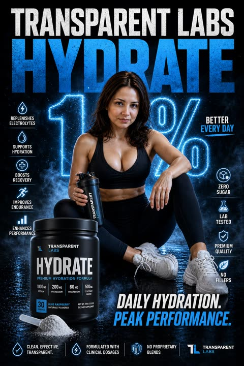</a>

Each element gets its own position in the prompt (headline top, model centre, tub front left, icon callouts around the edge), so the layout maps directly onto the output. The reference photo supplies the identity while the clothing, palette and text are set by the prompt.

GPT Image 2 · Edit · Source: [@amynys on X](https://x.com/amynys/status/2051409591137972606) · found via [freestylefly/awesome-gpt-image-2](https://github.com/freestylefly/awesome-gpt-image-2)

[`supplement`](tags.md#tag-supplement) [`campaign-poster`](tags.md#tag-campaign-poster) [`typography`](tags.md#tag-typography) [`reference-edit`](tags.md#tag-reference-edit)

<details><summary><b>Prompt</b></summary>

```text
Create a striking campaign poster that stops people mid-scroll for Transparent Labs Hydrate.

Bold high-impact supplement advertisement with dramatic black and deep electric blue color palette, gritty premium fitness aesthetic, sharp cinematic lighting, glossy reflections, light smoke atmosphere, intense contrast.

Giant headline typography at top reading “TRANSPARENT LABS HYDRATE” in oversized distressed white and electric blue text.

Center composition features the exact woman from the attached reference image as a fit athletic female model seated confidently on a studio floor, holding a shaker bottle, with a focused and powerful expression.

Change her clothes into sleek black fitness gym outfit: a black sports bra / tank top and high-waisted black leggings with chunky white sneakers. Large glowing “1%” graphic behind the subject symbolizing daily progress.

Front left foreground shows a matte black Transparent Labs Hydrate tub with modern luxury label reading “HYDRATE”, scoop of electrolyte powder spilled beside the container.

Surround the poster with clean icon-based benefit callouts: replenishes electrolytes, supports hydration, boosts recovery, improves endurance, enhances performance, zero sugar, lab tested, premium quality, no fillers. Strong motivational copy such as “Daily Hydration. Peak Performance.”

Hyper realistic textures, polished commercial retouching, premium sports nutrition branding, modern typography layout, social media ad format, ultra detailed, high resolution.
```

</details>

<a id="gpt-image-trousers-fashion-ad-poster-product-card"></a>
### Warm brown wide leg trousers fashion ad poster

<a href="https://x.com/auqibhabib/status/2049403600594747482">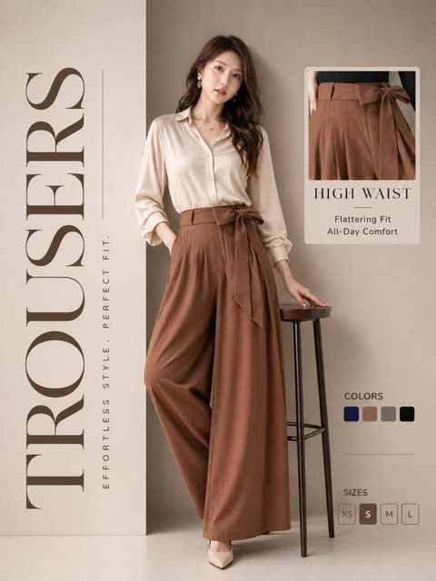</a>

The prompt splits the layout into left, right and below zones, and gives exact text, font style, swatch and size pill states for each. A closing instruction to remove extra text keeps the composition clean and breathable.

GPT Image 2 · Text-to-image · Source: [@auqibhabib on X](https://x.com/auqibhabib/status/2049403600594747482) · found via [YouMind-OpenLab/awesome-gpt-image-2](https://github.com/YouMind-OpenLab/awesome-gpt-image-2)

[`fashion`](tags.md#tag-fashion) [`advertising`](tags.md#tag-advertising) [`product-card`](tags.md#tag-product-card) [`layout`](tags.md#tag-layout) [`typography`](tags.md#tag-typography)

<details><summary><b>Prompt</b></summary>

```text
Luxury fashion advertisement poster, ultra-premium editorial style (Gucci aesthetic), soft warm beige gradient background with subtle shadows and depth. A confident elegant young woman posing naturally beside a minimal stool, wearing flowy high-waist wide-leg trousers (rich warm brown) and a silky cream blouse, soft curls, minimal gold jewelry, cinematic soft lighting, realistic skin texture, high-end fashion photography. Clean modern layout with strong hierarchy and spacing: Left side: Large vertical text “TROUSERS” in premium serif font (Didot / Bodoni style), high letter spacing, slightly faded brown tone. Small vertical subtext: “EFFORTLESS STYLE. PERFECT FIT.” in thin sans-serif, minimal and elegant. Right side product card: Rounded soft card showing zoomed-in waist detail (same outfit as model) Title: “HIGH WAIST” in serif font Subtext: Flattering Fit, All-Day Comfort in light sans-serif Soft shadow and subtle border Below: Color swatches (navy, beige, taupe, black), perfectly aligned, evenly spaced Sizes row (XS S M L) styled as premium pill buttons “S” filled others outlined Remove unnecessary text like heights, keep layout minimal and breathable. Overall look: High fashion magazine aesthetic Clean spacing, grid aligned Soft shadows, subtle gradients Ultra realistic, sharp, 4K, luxury branding feel
```

</details>

<a id="gpt-image-unstoppable-football-commercial-storyboard"></a>
### Six panel football commercial storyboard with one athlete

<a href="https://x.com/Just_sharon7/status/2058062379536269612">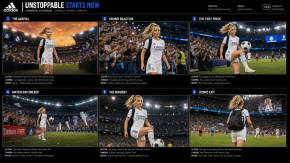</a>

A fixed 3 by 2 grid with ACTION, CAMERA and NOTES captions under each frame makes the output read as a real production sheet. Repeating the same hair, kit and body type description in every panel keeps one character consistent across all six scenes.

GPT Image 2 · Text-to-image · Source: [@Just_sharon7 on X](https://x.com/Just_sharon7/status/2058062379536269612) · found via [YouMind-OpenLab/awesome-gpt-image-2](https://github.com/YouMind-OpenLab/awesome-gpt-image-2)

[`storyboard`](tags.md#tag-storyboard) [`football`](tags.md#tag-football) [`commercial`](tags.md#tag-commercial) [`character-consistency`](tags.md#tag-character-consistency)

<details><summary><b>Prompt</b></summary>

```text
Goal: Create a polished commercial storyboard presentation for a 15-second ultra-realistic cinematic vertical football campaign featuring the same female footballer in every frame, titled UNSTOPPABLE STARTS NOW.

Canvas: Wide 16:9 black presentation board with thin white divider lines, a premium sports-agency layout, high contrast, realistic stadium photography in each panel, and a small top metadata bar. Use a black background, white condensed uppercase typography, and blue accent blocks for panel numbers and the word “STARTS.”

Header: Place a white Adidas-style three-stripe logo at top left, followed by the main headline “UNSTOPPABLE STARTS NOW,” with “UNSTOPPABLE” in white and “STARTS NOW” in electric blue. Under it, add small text: “COMMERCIAL STORYBOARD   CINEMATIC FOOTBALL CAMPAIGN.” On the top right add small production labels: “DIRECTOR / SPORTS COMMERCIAL UNIT,” “BRAND / ADIDAS FOOTBALL,” a small “16:9” badge, and “CINEMATIC STORYBOARD.”

Layout: Use exactly 6 storyboard panels arranged in a 3-column by 2-row grid. Each panel has a blue numbered square, an uppercase scene title, one ultra-realistic cinematic image, and three tiny notes underneath labeled ACTION, CAMERA, and NOTES. Keep the same consistent reference character in all 6 panels: a young athletic blonde female footballer with a high ponytail, wearing a white Real Madrid-style football kit with black shoulder panels, blue trim, white socks, and football boots. Make the face neutral or softly obscured rather than celebrity-specific.

Storyboard panels, exactly 6:
1. “THE ARRIVAL” — The player emerges from a stadium tunnel into a packed football arena at sunset, dramatic orange sky, Real Madrid-style flags in the crowd, huge stadium lights, low-angle wide entrance shot. Text below: ACTION: She emerges from the tunnel as the stadium erupts. CAMERA: Low-angle wide entrance shot with dramatic scale. NOTES: Sunset + stadium lights create cinematic contrast.
2. “CROWD REACTION” — Handheld sideline view as excited fans press forward cheering, filming on phones, flashes and stadium lights behind her while she walks past confidently. Text below: ACTION: Fans stand, cheer, and film her entrance. CAMERA: Handheld sideline perspective for energy. NOTES: Flashes, motion blur, and real crowd atmosphere.
3. “THE FIRST TRICK” — Close sports-action tracking shot as she juggles a black and white football effortlessly with her knee near the sideline, crowd roaring, bright stadium floodlights, blue Champions League-style ribbon signage. Text below: ACTION: She juggles the ball effortlessly with her knee. CAMERA: Close sports-action tracking shot. NOTES: Ball frozen mid-air, crowd reacts louder.
4. “MATCH-DAY ENERGY” — Wide cinematic stadium view with the player moving along the sideline, crowd packed and waving flags, confetti and smoke cannons, advertising boards, dynamic match-day atmosphere. Text below: ACTION: She moves along the sideline, crowd goes wild. CAMERA: Ultra-wide cinematic stadium view. NOTES: Confetti, smoke, banners, and vibrant atmosphere.
5. “THE MOMENT” — Dramatic low-angle portrait on the pitch as she controls the ball with one foot raised, stadium lights glowing overhead, shallow depth of field, intense heroic pause. Text below: ACTION: She stops, controls the ball, and owns the moment. CAMERA: Dramatic low-angle portrait shot. NOTES: Shallow depth of field, cinematic lighting on face.
6. “ICONIC EXIT” — Rear follow shot of the player jogging toward center pitch with a black backpack, jersey number visible, match continuing in the distance, giant stadium screen showing her, crowd and lights slightly motion blurred. Text below: ACTION: She jogs to the center pitch as the match continues. CAMERA: Rear follow shot with stadium scale. NOTES: Epic finale frame, motion blur on crowd and lights.

Visual style: Ultra-realistic sports commercial photography, cinematic grading, crisp detail, stadium floodlights, crowd energy, slight motion blur, premium brand-storyboard aesthetic, clean editorial spacing, thin white borders around images, tiny but legible production-note typography.

Constraints: Use exactly 6 panels and no extra panels. Maintain the same player, kit, hair, and body type across all panels. Keep the board landscape 16:9 even though it describes a vertical video campaign. Avoid random logos except the Adidas-style header mark and football-stadium branding cues. Make it look like a finished professional storyboard sheet, not a comic page.
```

</details>

<a id="gpt-image-velora-parfums-signature-perfume-poster"></a>
### Velora perfume poster with model and gold bottle

<a href="https://x.com/akkiwani703/status/2049778680969437564">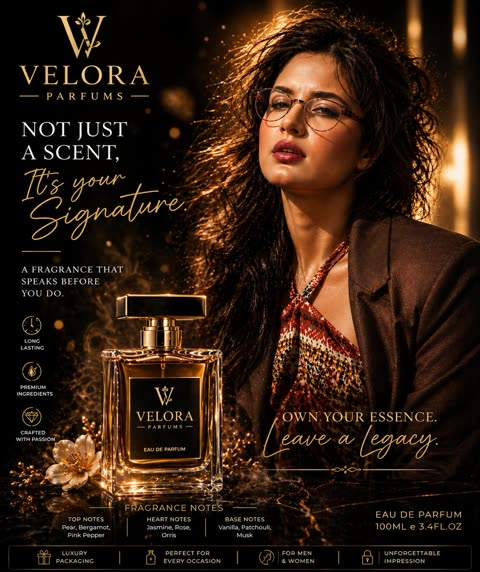</a>

The prompt is a full JSON spec that locks camera, lighting and palette, then lists exact headline, feature and fragrance note text so the model sets the copy as layout typography. Naming an 85mm lens, f/1.6 aperture and a low camera angle pushes the result toward a real campaign shot.

GPT Image 2 · Text-to-image · Source: [@akkiwani703 on X](https://x.com/akkiwani703/status/2049778680969437564) · found via [freestylefly/awesome-gpt-image-2](https://github.com/freestylefly/awesome-gpt-image-2)

[`perfume`](tags.md#tag-perfume) [`poster`](tags.md#tag-poster) [`json-prompt`](tags.md#tag-json-prompt) [`typography`](tags.md#tag-typography)

<details><summary><b>Prompt</b></summary>

```text
{
  "image_type": "luxury perfume advertisement poster",
  "resolution": "4K ultra HD (4096x5120)",
  "aspect_ratio": "portrait (4:5)",
  "style": {
    "aesthetic": "high-end fragrance campaign (Tom Ford, Dior inspired)",
    "tone": "dark luxury, sensual, elegant, powerful",
    "color_grading": "deep black shadows with rich golden highlights and warm amber glow",
    "lighting": "cinematic spotlight + golden rim light + soft fill light, dramatic shadows",
    "contrast": "high cinematic contrast",
    "depth_of_field": "shallow, sharp focus on face and perfume bottle"
  },
  "camera": {
    "type": "85mm portrait lens",
    "aperture": "f/1.6",
    "angle": "slightly low angle, premium perspective",
    "framing": "model upper body + product foreground"
  },
  "subject": {
    "gender": "female",
    "age_appearance": "young adult",
    "expression": "confident, sensual, calm",
    "styling": {
      "hair": "voluminous, slightly messy, glossy strands with golden highlights",
      "makeup": "soft glam, glowing skin, bold lips",
      "outfit": "brown tailored blazer with patterned silk scarf",
      "accessory": "thin transparent eyeglasses"
    }
  },
  "product": {
    "type": "luxury perfume bottle",
    "brand": "VELORA PARFUMS",
    "label": "EAU DE PARFUM",
    "design": "clear crystal glass bottle, golden liquid inside, metallic gold cap",
    "placement": "bottom center foreground on glossy black marble surface",
    "effects": "strong reflections, golden glow, subtle condensation, cinematic shine"
  },
  "environment": {
    "background": "dark blurred luxury interior with warm golden light streaks",
    "surface": "black marble with reflections",
    "extra_elements": "small flowers near bottle, golden particles, soft smoke"
  },
  "typography": {
    "logo": "V monogram + VELORA PARFUMS",
    "headline": "Not just a scent, It’s your Signature.",
    "tagline": "A fragrance that speaks before you do.",
    "secondary": "Own your essence. Leave a legacy.",
    "features": [
      "Long Lasting",
      "Premium Ingredients",
      "Crafted with Passion"
    ],
    "notes": [
      "Top: Pear, Bergamot, Pink Pepper",
      "Heart: Jasmine, Rose, Orris",
      "Base: Vanilla, Patchouli, Musk"
    ],
    "font_style": "luxury serif + elegant handwritten script",
    "color": "gold metallic",
    "placement": "top left + mid left + bottom balanced layout"
  },
  "post_processing": {
    "sharpness": "ultra sharp on face and bottle",
    "glow": "golden cinematic glow",
    "retouch": "high-end editorial finish",
    "vignette": "subtle dark vignette"
  },
  "mood": "premium luxury perfume campaign, cinematic, bold brand identity",
  "quality": "hyper-realistic, 4K ultra HD, commercial grade, award-winning fragrance ad"
}
```

</details>

<a id="gpt-image-vintage-indonesian-catnip-poster"></a>
### Vintage Indonesian catnip poster with flying tuxedo cat

<a href="https://x.com/NyaiiBubu/status/2053075349424992532">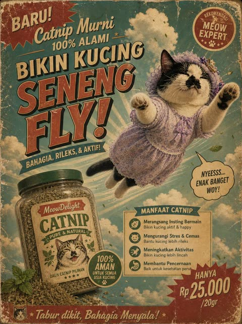</a>

Stacks era cues (1970s paper texture, distressed print, faded colors, grain, scratches) with a funny central subject and a quoted headline to keep the typography exact. Listing ad furniture such as a fake product jar, badges and a price tag makes the layout read as a real period advertisement.

GPT Image 2 · Text-to-image · Source: [@NyaiiBubu on X](https://x.com/NyaiiBubu/status/2053075349424992532) · found via [freestylefly/awesome-gpt-image-2](https://github.com/freestylefly/awesome-gpt-image-2)

[`vintage-poster`](tags.md#tag-vintage-poster) [`retro-typography`](tags.md#tag-retro-typography) [`indonesian`](tags.md#tag-indonesian) [`cat`](tags.md#tag-cat) [`distressed-print`](tags.md#tag-distressed-print)

<details><summary><b>Prompt</b></summary>

```text
Ultra realistic vintage Indonesian catnip advertisement poster, retro 1970s paper texture, distressed print, faded colors. A black-and-white tuxedo cat wearing cute vintage housewife clothes floating happily in the air after smelling catnip, euphoric expression, swirling catnip leaves, absurd Indonesian meme energy. Bold retro typography: “BIKIN KUCING SENENG FLY!” fake catnip jar product, old-school badges, price tag, nostalgic warung advertisement aesthetic, cinematic lighting, grain, scratches, authentic aged poster look.
```

</details>

<a id="gpt-image-volumetric-laser-black-stage-poster"></a>
### Volumetric laser poster on a black stage

<a href="https://x.com/zhidawang219555/status/2090246237094310178">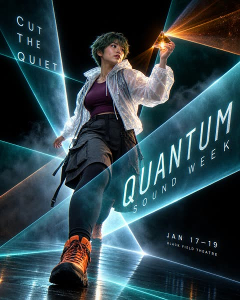</a>

Six laser planes slice a black theatre, each with a stated origin, perspective and haze thickness. The title shares perspective with one plane, the face gets a single rim light, and the small text sits in pure black negative space.

GPT Image 2 · Text-to-image · Source: [@zhidawang219555 on X](https://x.com/zhidawang219555/status/2090246237094310178) · found via [freestylefly/awesome-gpt-image-2](https://github.com/freestylefly/awesome-gpt-image-2)

[`laser`](tags.md#tag-laser) [`volumetric-light`](tags.md#tag-volumetric-light) [`black-stage`](tags.md#tag-black-stage) [`typography`](tags.md#tag-typography) [`diagonal-composition`](tags.md#tag-diagonal-composition)

<details><summary><b>Prompt</b></summary>

```text
从全黑剧场开始，像切标本一样用六片真实体积激光把空间分层。光面必须有明确起点、透视和薄雾中的厚度，人物站在交汇点，透明道具折射出一小束异色光扇。构图沿左下至右上的对角线推进，脸只用一道克制边光揭示；标题与其中一片光面共享透视，小字留在纯黑负空间。每次替换主题与角色时，不得退化成夜店模板、HUD、霓虹城市或无物理来源的光线。
```

</details>

<a id="gpt-image-western-chu-overlord-dark-poster"></a>
### Dark Chinese style poster with giant stone carved title

<a href="https://x.com/stellimbris/status/2048633434961072617">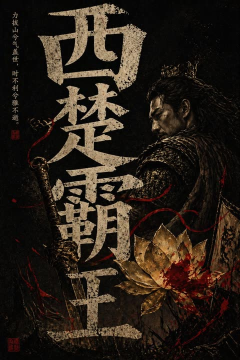</a>

One huge distressed stone carved title on pure black, held to a strict black, white, gold and red palette, carries the whole design. Add your own title words to the prompt; the model filled this one with Western Chu Overlord and a matching warrior.

GPT Image 2 · Text-to-image · Source: [@stellimbris on X](https://x.com/stellimbris/status/2048633434961072617) · found via [freestylefly/awesome-gpt-image-2](https://github.com/freestylefly/awesome-gpt-image-2)

[`chinese-style`](tags.md#tag-chinese-style) [`dark-poster`](tags.md#tag-dark-poster) [`typography`](tags.md#tag-typography) [`cinematic`](tags.md#tag-cinematic) [`texture`](tags.md#tag-texture)

<details><summary><b>Prompt</b></summary>

```text
竖版国风暗黑海报，黑色纯背景，中央巨大的中文标题字，占据画面大部分空间，字体为粗粝做旧的米白色石刻/旧纸质感，带明显颗粒、磨损、裂痕与噪点；整体构图层次丰富，强烈黑白金红对比，东方审美，神秘、压抑、欲望与审判感并存 电影海报质感 高级平面设计，极致细节 纸张纹理 印章落款 小字标语，4K
```

</details>

<a id="gpt-image-where-is-name-crowd-search-poster"></a>
### Crowd search poster with a hidden person in New York

<a href="https://x.com/icreatelife/status/2046639884421550482">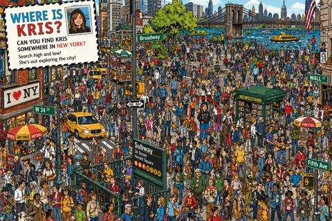</a>

A fill in the name template that names only the poster format and lets the city be swapped, so the model supplies the dense crowd, street signs and landmarks. The circled answer and a header card with a stamp portrait come from the search poster format itself.

GPT Image 2 · Text-to-image · Source: [@icreatelife on X](https://x.com/icreatelife/status/2046639884421550482) · found via [ZeroLu/awesome-gpt-image](https://github.com/ZeroLu/awesome-gpt-image)

[`search-poster`](tags.md#tag-search-poster) [`crowd-scene`](tags.md#tag-crowd-scene) [`city`](tags.md#tag-city) [`template`](tags.md#tag-template) [`personalised`](tags.md#tag-personalised)

<details><summary><b>Prompt</b></summary>

```text
Create a "Where is [Your Name]" crowd search poster set in the city of your choosing
```

</details>

<a id="gpt-image-wildcamp-giant-tent-night-poster"></a>
### Bearded hiker beside giant orange tent at night

<a href="https://x.com/Strength04_X/status/2056258909334306897">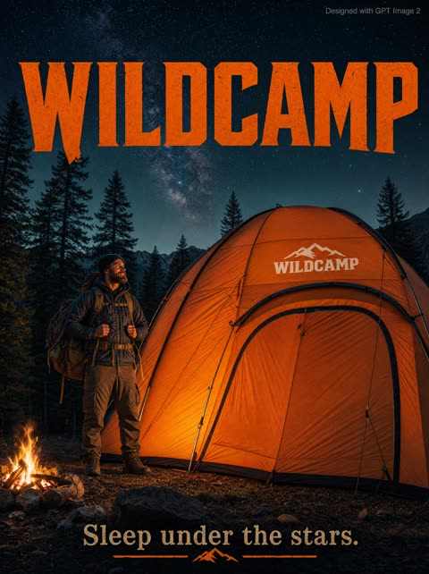</a>

The prompt fixes the scale contrast, a tent three times taller than the man, and names a warm campfire light source against a starry sky. It places each text element by position and role: a large headline in the sky, a tagline at the bottom and a small credit in the corner.

GPT Image 2 · Text-to-image · Source: [@Strength04_X on X](https://x.com/Strength04_X/status/2056258909334306897) · found via [freestylefly/awesome-gpt-image-2](https://github.com/freestylefly/awesome-gpt-image-2)

[`camping`](tags.md#tag-camping) [`advertising`](tags.md#tag-advertising) [`night-sky`](tags.md#tag-night-sky) [`typography`](tags.md#tag-typography) [`cinematic-lighting`](tags.md#tag-cinematic-lighting)

<details><summary><b>Prompt</b></summary>

```text
An outdoor adventure advertisement poster featuring a rugged bearded man in full hiking gear standing confidently beside a massive orange camping tent three times taller than him, fully pitched in a dramatic forest clearing surrounded by towering pine trees beneath a deep starry night sky. The tent features a bold white “WILDCAMP” logo stitched onto the rainfly. Warm cinematic campfire lighting illuminates the scene with realistic shadows and rich outdoor textures, creating a premium adventure-commercial aesthetic. Large rugged serif typography reading “WILDCAMP” dominates the dark sky area in bold orange lettering, while the tagline “Sleep under the stars.” appears elegantly at the bottom. Small grey text in the top-right corner reads “Designed with GPT Image 2.” Photorealistic, ultra-detailed, cinematic outdoor advertising style with dramatic atmosphere and high-end commercial composition.
```

</details>

<a id="gpt-image-wuhan-layered-paper-cut-tourism-poster"></a>
### Layered paper cut poster of Wuhan skyline

<a href="https://x.com/Mrpinecone888/status/2086643289525264395">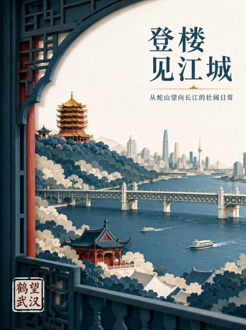</a>

The prompt frames the scene as a foreground window and stacks five to seven textured paper layers, with a fixed top left light for real inter-layer shadows. A restricted palette keeps gold for the focal point only. Exact title, subtitle and seal text are specified, with a long negative list covering cheap red gold templates, distorted architecture and extra copy.

GPT Image 2 · Text-to-image · Source: [@Mrpinecone888 on X](https://x.com/Mrpinecone888/status/2086643289525264395) · found via [YouMind-OpenLab/awesome-gpt-image-2](https://github.com/YouMind-OpenLab/awesome-gpt-image-2)

[`paper-cut`](tags.md#tag-paper-cut) [`layered-diorama`](tags.md#tag-layered-diorama) [`travel-poster`](tags.md#tag-travel-poster) [`chinese-typography`](tags.md#tag-chinese-typography) [`landmark`](tags.md#tag-landmark)

<details><summary><b>Prompt</b></summary>

```text
为原创文旅品牌“鹤望武汉”创作一幅高端分层纸雕插画海报，传播命题为“登楼望江，一眼看见武汉的山水骨架”，3:4 竖版。画面使用前景窗口构图，以五至七层厚纹理纸构成蛇山、黄鹤楼、长江、武汉长江大桥与对岸城市天际线；黄鹤楼位于后景山脊，屋檐层叠、金色琉璃瓦与朱红柱体关系准确，中景长江大桥横向延伸，江面两艘小型轮渡尺度克制，不能把晴川阁与黄鹤楼合并。纸张切边利落，统一左上柔光，层间阴影真实，综合色为黛青、暖米白、朱砂红和少量鎏金黄，金色只用于视觉焦点。主标题“登楼见江城”置于右上大片留白区，两行现代宋体；副标题“从蛇山望向长江的壮阔日常”横排于标题下方；品牌名“鹤望武汉”置于左下纸质印章形品牌位，保持现代而非仿古。规范简体中文、无错字漏字，仅使用中文；禁止廉价红金模板、漫天祥云、古装人物、建筑比例失真、塑料材质、厚重发光描边、知名标识、水印与额外文案。
```

</details>

<a id="seedream-5-5-print-play-graffiti-collage-poster"></a>
### PRINT PLAY graffiti collage poster

<a href="https://seed.bytedance.com/en/seedream5_5">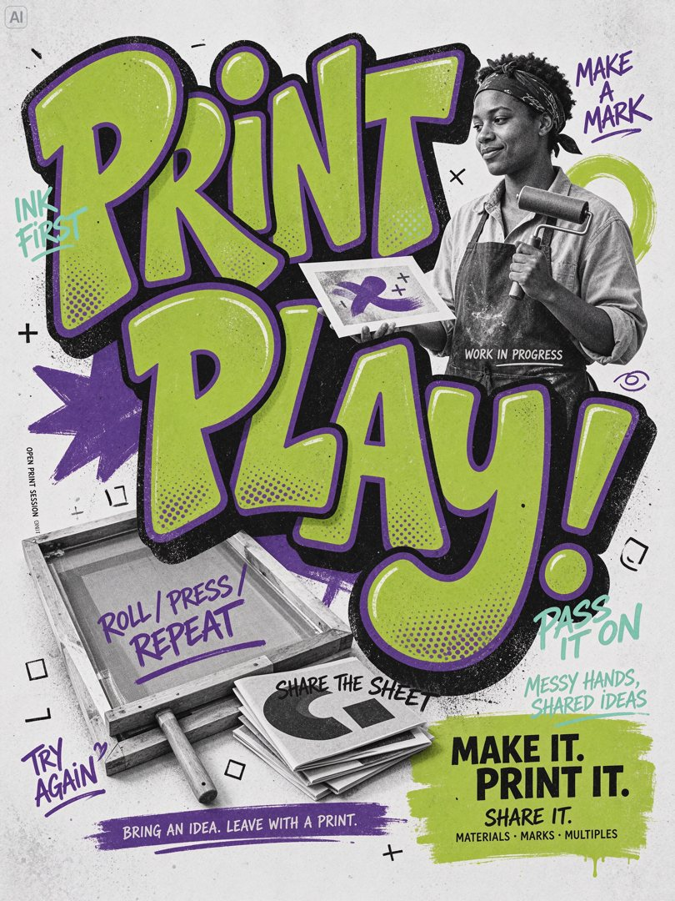</a>

Three named colours, a paper texture, the exact lettering and the position of each element turn a loose style into a layout the model can follow line by line.

Seedream 5.5 · Text-to-image · Source: [ByteDance Seed: Seedream 5.5](https://seed.bytedance.com/en/seedream5_5)

[`seedream`](tags.md#tag-seedream) [`graffiti`](tags.md#tag-graffiti) [`collage`](tags.md#tag-collage) [`typography`](tags.md#tag-typography) [`halftone`](tags.md#tag-halftone)

<details><summary><b>Prompt</b></summary>

```text
Create a graffiti collage poster about collaborative street printing, using lime green, aubergine purple and mint over a gray-white photocopied paper texture. Oversized “PRINT PLAY!” lettering overlaps diagonally. A grayscale printmaker at the upper right holds a roller and print sample, with printing tools and handwritten phrases including “MAKE A MARK” and “PASS IT ON” below. Preserve matte halftone ink, fine grain and legible lettering in a layered, asymmetric composition.
```

</details>

<a id="seedream-5-5-shakespeare-chronicle-newspaper-page"></a>
### Shakespeare literary newspaper with seven short articles

<a href="https://seed.bytedance.com/en/seedream5_5">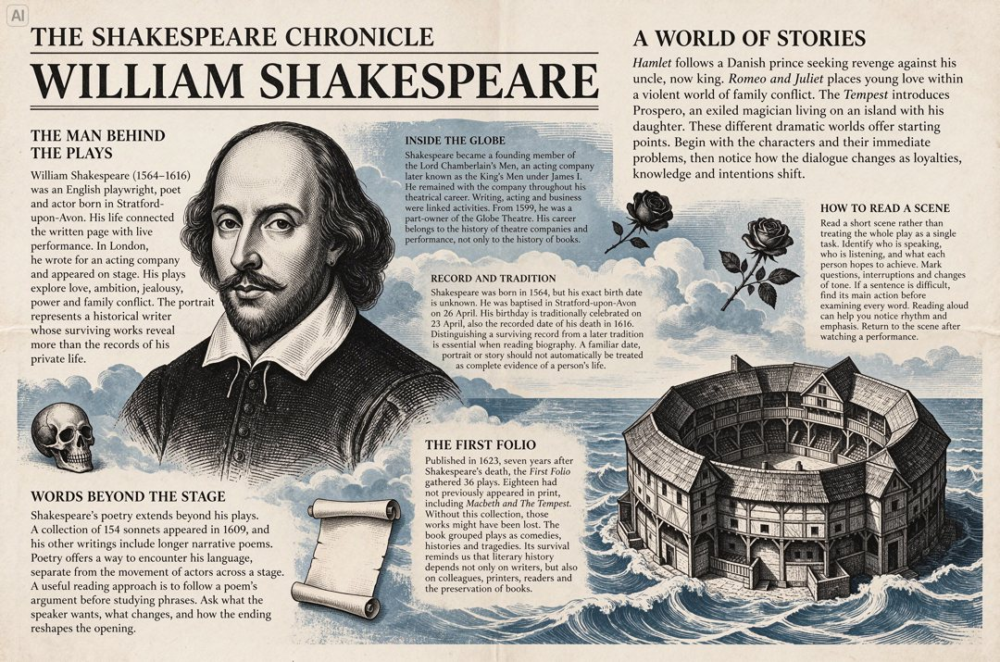</a>

The masthead and headline are given word for word, and the page asks for seven short English articles in legible small type. Dense small text is one of the three upgrades ByteDance lists for 5.5.

Seedream 5.5 · Text-to-image · Source: [ByteDance Seed: Seedream 5.5](https://seed.bytedance.com/en/seedream5_5)

[`seedream`](tags.md#tag-seedream) [`newspaper`](tags.md#tag-newspaper) [`small-text`](tags.md#tag-small-text) [`engraving`](tags.md#tag-engraving) [`editorial-layout`](tags.md#tag-editorial-layout)

<details><summary><b>Prompt</b></summary>

```text
Design a landscape literary newspaper with the masthead “THE SHAKESPEARE CHRONICLE” and the headline “WILLIAM SHAKESPEARE”. On warm ivory paper, illustrate Shakespeare and the Globe Theatre in black engraving, with muted blue clouds and waves weaving through the page. Arrange seven short articles in English around the illustrations, using bold serif headings and legible small type.
```

</details>

[1](image-poster.md) · [2](image-poster-2.md) · **3**
