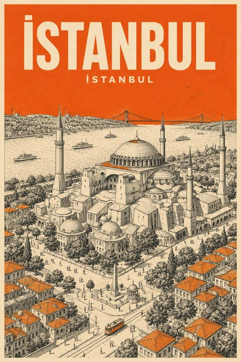
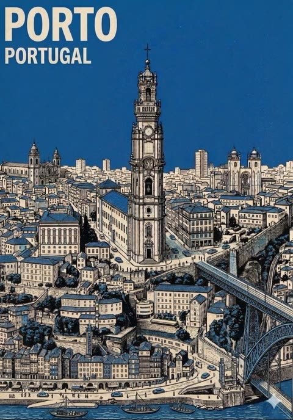

# Posters and editorial layouts

[Back to the list](../../README.md) · All 122 entries · **1** · [2](image-poster-2.md)

<a id="gpt-image-flat-vector-city-travel-poster-template"></a>
### Flat vector travel poster template for any city

<a href="https://x.com/MahnoorAi12/status/2091349007922778211"></a>

A single CITY_NAME placeholder drives five identity slots (landmark, transport, lifestyle moment, native plant, viewpoint), so the scene changes per city. Strict color system, small figure count and a long negative prompt keep the flat vector look quiet and consistent.

GPT Image 2 · Text-to-image · Source: [@MahnoorAi12 on X](https://x.com/MahnoorAi12/status/2091349007922778211) · 3,421 likes on 2026-10-28

[`travel-poster`](tags.md#tag-travel-poster) [`flat-vector`](tags.md#tag-flat-vector) [`template`](tags.md#tag-template) [`city`](tags.md#tag-city) [`minimalist`](tags.md#tag-minimalist)

<details><summary><b>Prompt</b></summary>

```text
Premium minimalist flat-vector travel poster for [CITY_NAME], 3:4 vertical format.

Design an original, sophisticated travel poster that captures the authentic visual personality of [CITY_NAME]. The composition must feel purpose-built for this city rather than following a reusable template.

CITY IDENTITY

First interpret the unique visual character of [CITY_NAME] and build the scene around these five elements:

1. A recognizable landmark, architectural feature, or skyline element.
2. A distinctive local way of moving through the city.
3. One subtle everyday lifestyle moment.
4. A native plant, landscape, or environmental characteristic.
5. A composition and viewpoint that naturally belongs to the city.

The overall scene structure must change from city to city. Do not repeatedly use the same object positions or visual formula.

Possible compositions include:
harbor viewpoint, narrow historic lane, riverside garden, coastal path, elevated city overlook, lively market passage, tram avenue, ferry terminal, botanical setting, heritage square, beach promenade, cultural plaza, or skyline terrace.

Choose whichever composition best represents [CITY_NAME].

TYPOGRAPHY

Place “[CITY_NAME]” in the upper-left area with generous clean negative space.

Add one short, sophisticated English tagline inspired by the atmosphere of the city.

Typography should feel understated, editorial, spacious, and premium. Never allow text to dominate the artwork.

VISUAL HIERARCHY

Use one iconic landmark or architectural feature as the main focal point.

Support it with only 2–4 carefully selected local elements. Every added detail should strengthen the sense of place.

Avoid landmark collections or postcard-style collages. Keep the scene visually quiet and intentional.

PEOPLE

Include only 3–6 small-scale figures.

Give each person a believable activity connected to local life, such as:
walking through a historic lane, cycling, waiting for public transport, sketching architecture, boarding a ferry, reading outdoors, taking a quiet photograph, carrying beach equipment, browsing a market, or jogging beside the water.

Avoid crowds and avoid making any single person the main character. Figures should integrate naturally into the environment.

LOCAL CHARACTER

Use city-specific elements only when they genuinely fit [CITY_NAME]:

- local transportation
- architecture
- street furniture
- vegetation
- small signs or wayfinding
- local food references
- recreational activities
- pavement markings
- cultural details

Transport and signage should remain subtle. Instead of always using a large signboard, incorporate details naturally through a small transit marker, station clock, ferry information panel, bike symbol, painted road marking, beach flag, or understated metro icon.

ART DIRECTION

Japanese stationery-inspired aesthetic,
luxury sticker illustration,
premium commercial vector artwork,
modern editorial travel branding,
clean delicate outlines,
uniform line weight,
simple geometric forms,
flat-color illustration,
soft shapes,
balanced visual rhythm,
high-end minimalist postcard design.

COLOR SYSTEM

Build the atmosphere primarily with:
pale powder blue, soft sky blue, mist blue, and cool airy blues.

Balance these with:
warm ivory, cream, soft beige, muted sage, gray-green, and understated architectural neutrals.

Use dusty rose or muted blush only for tiny visual accents such as flowers, clothing details, small signs, awnings, or decorative objects.

Colors should remain soft, sophisticated, slightly desaturated, and cohesive.

MOOD

Fresh, airy, peaceful, refined, contemporary, elegant.

The final artwork should feel like a premium boutique travel postcard or luxury lifestyle brand illustration, with generous breathing room and a relaxed sense of place.

IMPORTANT QUALITY RULES

Every city must have its own visual identity.
Change the camera angle, scene structure, landmark placement, foreground treatment, and supporting details according to the city's character.

Do not simply replace [CITY_NAME] inside an existing composition.

NEGATIVE PROMPT

No photorealism.
No realism.
No watercolor.
No painterly brushwork.
No gradients.
No heavy shadows.
No dramatic cinematic lighting.
No paper texture.
No excessive detail.
No cluttered background.
No landmark collage.
No crowded streets.
No oversized characters.
No dominant hero character.
No repetitive café composition.
No fixed signboard position.
No identical foreground treatment.
No generic tourist-poster formula.
No copied layout from another city.
No unnecessary decorative elements.
```

</details>

<a id="nano-banana-monoline-city-travel-poster-kyoto"></a>
### Kyoto Street Monoline Travel Poster in Red

<a href="https://x.com/Goodmanprotocol/status/2052974175435026714"></a>

A destination placeholder lets one template serve any city. The prompt fixes a one ink plus one background palette with examples per city, asks for dense monoline detail and local language signage, and sets a text quality clause to keep the typography readable.

Nano Banana 2 · Text-to-image · Source: [@Goodmanprotocol on X](https://x.com/Goodmanprotocol/status/2052974175435026714) · 1,436 likes on 2026-10-29

[`travel-poster`](tags.md#tag-travel-poster) [`line-art`](tags.md#tag-line-art) [`monochrome`](tags.md#tag-monochrome) [`swiss-modernist`](tags.md#tag-swiss-modernist) [`template`](tags.md#tag-template)

<details><summary><b>Prompt</b></summary>

```text
Create an ultra-high-resolution minimalist line-art travel poster of [DESTINATION], portraying the city as a stylish everyday urban scene rather than a tourist postcard.

CORE COMPOSITION:
- Central composition shows the city’s most iconic street, intersection, alley, tram street, or pedestrian avenue
- Foreground includes locals, commuters, cyclists, travelers, shoppers, students, café visitors
- People should naturally reflect the city’s local lifestyle and fashion culture
- Background filled with realistic local signage, cafés, restaurants, transportation signs, storefronts, and architectural details
- Landmarks should appear naturally integrated into everyday life, never exaggerated
- Include authentic local-language typography and culturally recognizable visual elements
- Large bold typography at the top center:
  “[DESTINATION]”
- Subtitle below:
  local language + country name
  examples:
  東京 JAPAN
  서울 KOREA
  ΚΟΛΩΝΙΑ GERMANY

STYLE:
ultra clean vector illustration,
Swiss modernist travel poster,
minimal line art,
monoline drawing,
mid-century editorial aesthetic,
architectural illustration,
Japanese graphic poster style,
precise geometric perspective,
extremely clean negative space,
premium travel branding aesthetic

LINE STYLE:
- monochrome line-based illustration only
- thin and highly precise linework
- minimal fill areas
- intricate city-map-like detail density
- rhythmic layering of signs, buildings, windows, and street objects
- visually dense yet highly organized composition

COLOR SYSTEM — VERY IMPORTANT:
- use only ONE main color + ONE background color
- automatically choose a color that best represents the city’s atmosphere
- monochrome silkscreen poster aesthetic
- no rainbow palettes
- no excessive neon
- color should reflect the city’s architecture, climate, nightlife, and cultural identity

Examples:
Tokyo → vivid red on warm ivory
Paris → deep navy on cream
New York → charcoal black on light gray
Kyoto → muted burgundy on warm cream
Hong Kong → teal blue on pale ivory
Santorini → Mediterranean blue on white
Cairo → desert sepia on sand beige

COMPOSITION:
- vertical poster layout
- frontal street-level perspective
- pedestrians crossing streets or moving naturally
- balanced urban rhythm and visual flow
- should feel like a premium city-brand campaign poster

MOOD:
stylish urban life,
calm but lively,
editorial travel magazine cover,
timeless city identity,
premium tourism campaign visual,
minimal yet highly detailed

TEXT QUALITY — EXTREMELY IMPORTANT:
- all typography must be readable and accurate
- no random characters
- no broken or distorted letters
- local signage should feel authentic and natural
- professional editorial typography alignment

OUTPUT:
- vertical poster composition
- 8K ultra detailed
- print-ready
- ultra sharp vector quality
```

</details>

<a id="gpt-image-carved-22-birthday-poster-pop-out"></a>
### Luxury birthday poster with carved 22 wall

<a href="https://x.com/Sairah_0/status/2064643917895839913"></a>

The number is carved into a textured wall with inner shadows and filled with balloons and flowers, while the subject sits on its curve and extends past the edge for a 3D pop out. A reference face instruction, a limited navy and white palette, side sunlight and exact typography lines keep the poster consistent.

GPT Image 2 · Edit · Source: [@Sairah_0 on X](https://x.com/Sairah_0/status/2064643917895839913) · 1,026 likes on 2026-10-29

[`birthday`](tags.md#tag-birthday) [`pop-out`](tags.md#tag-pop-out) [`carved-number`](tags.md#tag-carved-number) [`navy-palette`](tags.md#tag-navy-palette) [`reference-face`](tags.md#tag-reference-face)

<details><summary><b>Prompt</b></summary>

```text
Professional luxury birthday poster, 3:4 ratio. Entire frame filled with a premium off-white luxury paper textured wall. Large number “22” precisely carved into the wall with visible depth, realistic inner shadows, and elegant dimensional detailing. Inside the number: navy blue, pastel blue, and white balloons, delicate white flowers, refined bouquet arrangements, and premium celebration styling. A happy 22-year-old child with preserved reference facial features, wearing a navy blue T-shirt and navy blue denim overalls, sitting casually on the lower curve of the number “22” with one leg bent and the other dangling naturally, smiling brightly while looking slightly upward. Face, shoulder, one arm, and one foot extend outside the carved number, creating a realistic 3D pop-out effect. Warm cinematic sunlight entering from one side, soft rim lighting, photorealistic skin texture, premium studio photography, ultra-realistic details, sharp focus, luxury editorial quality. Typography on the wall: “NOEL”, “CHAPTER 22”, “365 MORE DAYS OF WONDER”. Clean minimalist composition, luxury magazine cover aesthetic, high-end art direction, realistic shadows, natural colors, no tree shadows, no fake lighting, no AI artifacts, premium birthday campaign photography, masterpiece quality."
```

</details>

<a id="gpt-image-city-placeholder-flat-vector-travel-poster"></a>
### Flat vector travel poster with city placeholder

<a href="https://x.com/AiwithLariab/status/2091435219002003957"></a>

A single city placeholder is expanded into five identity elements: landmark, local transport, lifestyle moment, native plant and viewpoint. Strict limits on figure count, a pale blue and cream palette and a long negative prompt keep each city's layout distinct.

GPT Image 2 · Text-to-image · Source: [@AiwithLariab on X](https://x.com/AiwithLariab/status/2091435219002003957) · 954 likes on 2026-10-28

[`travel-poster`](tags.md#tag-travel-poster) [`flat-vector`](tags.md#tag-flat-vector) [`city`](tags.md#tag-city) [`template`](tags.md#tag-template) [`minimalist`](tags.md#tag-minimalist)

<details><summary><b>Prompt</b></summary>

```text
Premium minimalist flat-vector travel poster for [CITY_NAME], 3:4 vertical format.

Design an original, sophisticated travel poster that captures the authentic visual personality of [CITY_NAME]. The composition must feel purpose-built for this city rather than following a reusable template.

CITY IDENTITY

First interpret the unique visual character of [CITY_NAME] and build the scene around these five elements:

1. A recognizable landmark, architectural feature, or skyline element.
2. A distinctive local way of moving through the city.
3. One subtle everyday lifestyle moment.
4. A native plant, landscape, or environmental characteristic.
5. A composition and viewpoint that naturally belongs to the city.

The overall scene structure must change from city to city. Do not repeatedly use the same object positions or visual formula.

Possible compositions include:
harbor viewpoint, narrow historic lane, riverside garden, coastal path, elevated city overlook, lively market passage, tram avenue, ferry terminal, botanical setting, heritage square, beach promenade, cultural plaza, or skyline terrace.

Choose whichever composition best represents [CITY_NAME].

TYPOGRAPHY

Place “[CITY_NAME]” in the upper-left area with generous clean negative space.

Add one short, sophisticated English tagline inspired by the atmosphere of the city.

Typography should feel understated, editorial, spacious, and premium. Never allow text to dominate the artwork.

VISUAL HIERARCHY

Use one iconic landmark or architectural feature as the main focal point.

Support it with only 2–4 carefully selected local elements. Every added detail should strengthen the sense of place.

Avoid landmark collections or postcard-style collages. Keep the scene visually quiet and intentional.

PEOPLE

Include only 3–6 small-scale figures.

Give each person a believable activity connected to local life, such as:
walking through a historic lane, cycling, waiting for public transport, sketching architecture, boarding a ferry, reading outdoors, taking a quiet photograph, carrying beach equipment, browsing a market, or jogging beside the water.

Avoid crowds and avoid making any single person the main character. Figures should integrate naturally into the environment.

LOCAL CHARACTER

Use city-specific elements only when they genuinely fit [CITY_NAME]:

- local transportation
- architecture
- street furniture
- vegetation
- small signs or wayfinding
- local food references
- recreational activities
- pavement markings
- cultural details

Transport and signage should remain subtle. Instead of always using a large signboard, incorporate details naturally through a small transit marker, station clock, ferry information panel, bike symbol, painted road marking, beach flag, or understated metro icon.

ART DIRECTION

Japanese stationery-inspired aesthetic,
luxury sticker illustration,
premium commercial vector artwork,
modern editorial travel branding,
clean delicate outlines,
uniform line weight,
simple geometric forms,
flat-color illustration,
soft shapes,
balanced visual rhythm,
high-end minimalist postcard design.

COLOR SYSTEM

Build the atmosphere primarily with:
pale powder blue, soft sky blue, mist blue, and cool airy blues.

Balance these with:
warm ivory, cream, soft beige, muted sage, gray-green, and understated architectural neutrals.

Use dusty rose or muted blush only for tiny visual accents such as flowers, clothing details, small signs, awnings, or decorative objects.

Colors should remain soft, sophisticated, slightly desaturated, and cohesive.

MOOD

Fresh, airy, peaceful, refined, contemporary, elegant.

The final artwork should feel like a premium boutique travel postcard or luxury lifestyle brand illustration, with generous breathing room and a relaxed sense of place.

IMPORTANT QUALITY RULES

Every city must have its own visual identity.
Change the camera angle, scene structure, landmark placement, foreground treatment, and supporting details according to the city's character.

Do not simply replace [CITY_NAME] inside an existing composition.

NEGATIVE PROMPT

No photorealism.
No realism.
No watercolor.
No painterly brushwork.
No gradients.
No heavy shadows.
No dramatic cinematic lighting.
No paper texture.
No excessive detail.
No cluttered background.
No landmark collage.
No crowded streets.
No oversized characters.
No dominant hero character.
No repetitive café composition.
No fixed signboard position.
No identical foreground treatment.
No generic tourist-poster formula.
No copied layout from another city.
No unnecessary decorative elements.
```

</details>

<a id="gpt-image-human-fragments-typography-poster-template"></a>
### Editorial typography poster with woman and bicycle

<a href="https://x.com/ChillaiKalan__/status/2084503517709119999"></a>

Oversized letters act as the layout structure, so the person and street scene appear inside the glyphs and break past their edges. Bracketed slots for theme, subject, state and palette plus a fixed series and year make it a reusable template.

GPT Image 2 · Text-to-image · Source: [@ChillaiKalan__ on X](https://x.com/ChillaiKalan__/status/2084503517709119999) · 621 likes on 2026-10-29

[`typography`](tags.md#tag-typography) [`editorial`](tags.md#tag-editorial) [`template`](tags.md#tag-template) [`lifestyle`](tags.md#tag-lifestyle) [`9-16`](tags.md#tag-9-16)

<details><summary><b>Prompt</b></summary>

```text
Create a 9:16 editorial typography poster from a single human-centered lifestyle moment.

Use oversized typography as the main composition structure. Let the person, movement, city space, or everyday scene appear inside the letters, pass through them, or break beyond their edges. The image should feel integrated with the type, not simply placed behind text.Theme: [Custom Title]
Subject: [Subject Gender Or Origin]
Human state: [Human State]
Color palette: [Color Palette]
Series: HUMAN FRAGMENTS
Year: 2026
```

</details>

<a id="gpt-image-halftone-architecture-poster"></a>
### Building photo to halftone travel-collage poster

<a href="https://x.com/Naiknelofar788/status/2100067049288634730"></a>

Long spec with a closing priority rule: architectural accuracy first, the halftone treatment second.

GPT Image 2.5 · Edit · Source: [@Naiknelofar788 on X](https://x.com/Naiknelofar788/status/2100067049288634730) · 497 likes on 2026-10-27

[`halftone`](tags.md#tag-halftone) [`architecture`](tags.md#tag-architecture) [`travel`](tags.md#tag-travel) [`collage`](tags.md#tag-collage)

<details><summary><b>Prompt</b></summary>

```text
Turn this structure photo into a single high-end halftone architectural travel-collage poster. Output one poster per uploaded photo — never merge multiple structures or photos into one frame.

FORMAT

3:4 vertical canvas. Split into two roughly equal zones — real architectural photo on top, printed reconstruction below — divided by one clean, sharp horizontal line.

Do not stretch, warp, tilt, or unnaturally reposition the structure to force the proportions.

TOP HALF — THE REAL SHOT

Preserve the original structure faithfully: same architecture, proportions, perspective, distinctive details, surrounding elements, natural light and shadow, and original color mood.

Keep recognizable features such as:

* façade
* windows and arches
* towers or domes
* doors and structural details
* roofline
* surrounding landscape or street elements

Add only a subtle high-end color grade and the faintest film grain. Do not redesign or reinterpret the architecture.

BOTTOM HALF — THE PRINTED RECONSTRUCTION

Rebuild the same structure as an experimental printed architectural collage using:

torn photographic fragments + fixed-width ASCII character fields + photocopy halftone dots + architectural linework.

The structure must remain immediately recognizable.

* Torn-edge photographic fragments preserve the most important architectural details.
* Brick, stone, glass, metal, shadows, windows, and surrounding textures gradually dissolve outward into ASCII characters, black halftone dots, fragmented print grain, and fine architectural drafting lines.
* Use thin technical construction lines to subtly trace the structure’s geometry.
* Let selected areas break apart into paper fibers and halftone fragments, creating the feeling that the building is emerging from an archival print.
* Keep the main silhouette strong and readable.
* Texture: rough white paper-fiber edges, subtle photocopy imperfections, slight print misregistration, faded ink, old-paper stains, a few restrained crop marks, and one small red calibration bar.
* Color: warm gray old-paper background + black ink + the structure’s original muted colors + a single restrained red accent.
* Never fully desaturate the structure.

The structure should occupy roughly 60–88% of the frame width, scaled according to what reads best for the architecture.

Leave 22–38% of the paper visibly untouched and empty, creating generous negative space so the poster feels like an archival architectural specimen rather than a packed digital screen.

TYPOGRAPHY

Add one clean, readable fixed-width architectural title based on the structure:

[STRUCTURE NAME]

Below it include:

[CITY, COUNTRY]
REC. STUDY 01

Add one short observational caption related to the architecture, such as:

“A monumental study in geometry, time, and place.”

Typography should feel like an old architectural archive mixed with an underground experimental design journal.

A few loose ASCII glyphs may trace the outer silhouette or architectural edges as texture only — never use ASCII to invent windows, doors, structural details, or technical specifications.

MOOD

Early digital systems × analog photocopy × architectural archive × underground zine × modern travel editorial.

The structure should feel like it is surfacing from an old printed document — half photograph, half architectural drawing, half experimental print.

Sophisticated, minimal, tactile, intellectual, slightly mysterious, and highly collectible.

AVOID

Solid black terminal backgrounds, dense walls of code, cyberpunk neon, excessive ASCII, distorted architecture, impossible geometry, invented architectural details, fake technical specifications, random symbols with no meaning, garbled text, excessive colors, brand logos, QR codes, watermarks, author credits, or tourist-poster clichés.

Priority: Preserve the structure’s identity and architectural accuracy first. The experimental halftone/ASCII treatment should enhance the architecture, not hide it.
```

</details>

<a id="gpt-image-crystal-number-birthday-poster-child"></a>
### Crystal glass number birthday poster with child

<a href="https://x.com/MahnoorAi12/status/2064970191092826474"></a>

Face identity is locked with an explicit consistency instruction, and the body parts that break the number frame give a 3D pop out effect. Material, lighting and typography blocks are written separately, with a negative prompt aimed at face drift and extra limbs. The age and name are bracketed slots to swap.

GPT Image 2 · Edit · Source: [@MahnoorAi12 on X](https://x.com/MahnoorAi12/status/2064970191092826474) · 482 likes on 2026-10-29

[`birthday`](tags.md#tag-birthday) [`crystal-glass`](tags.md#tag-crystal-glass) [`face-consistency`](tags.md#tag-face-consistency) [`pop-out`](tags.md#tag-pop-out) [`pastel`](tags.md#tag-pastel)

<details><summary><b>Prompt</b></summary>

```text
:::writing{variant="document" id="58372"} Professional luxury birthday poster, 3:4 portrait composition, ultra high-end studio photography aesthetic, premium off-white textured paper wall background with subtle grain and depth.
A giant luxury crystal-glass number [AGE] is precisely carved into the wall with realistic thickness, beveled edges, transparent glass material, sparkling reflections, crystal highlights, light refractions, and deep inner shadows creating dramatic 3D depth.
Inside the number: elegant pastel pink balloons, premium white roses, luxury flower bouquets, soft floating sparkles, delicate crystal butterflies, dreamy magical atmosphere, clean minimal styling, high-end editorial design.
A happy [AGE]-year-old child with EXACT facial identity preserved from the uploaded reference image. Identical facial features, identical eyes, nose, lips, face shape, skin tone, hairstyle, expression style, and overall appearance. Face consistency is the highest priority.
Wearing a milky white T-shirt and premium pastel pink denim overalls with realistic fabric texture and luxury styling.
The child's head, shoulders, one hand, and one foot extend outside the number frame, creating an ultra-realistic 3D pop-out effect with accurate perspective, natural depth, realistic shadows, and seamless integration between foreground and background.
Warm cinematic golden sunlight entering from one side, soft rim lighting, realistic skin texture, studio-quality photography lighting, natural shadows, luxury portrait lighting, shallow depth of field.
Elegant typography integrated directly onto the wall:
[Ayan]
CHAPTER [2]
[AGE] YEARS OF MAGIC AND WONDER
Minimal luxury editorial layout, Vogue magazine cover style, premium birthday campaign photography, award-winning composition, soft contrast, natural pastel colors, crystal reflections, ultra-sharp focus, photorealistic rendering, masterpiece quality, luxury realism.
Negative Prompt: different face, altered facial features, face swap, wrong child, duplicate body parts, extra fingers, extra limbs, deformed hands, distorted face, crossed eyes, blurry face, low quality, AI artifacts, text errors, watermark, logo, bad anatomy, oversaturated colors, cropped head, unrealistic skin, poor lighting.
8K ultra-detailed, hyper-realistic, premium luxury birthday poster. :::
Sab se important improvement ye hai:
"EXACT facial identity preserved from the uploaded reference image" aur "Face consistency is the highest priority"
```

</details>

<a id="gpt-image-watercolor-city-travel-poster-cafe"></a>
### Watercolor Los Angeles Cafe Travel Poster

<a href="https://x.com/oggii_0/status/2055876530988015791"></a>

Bracketed CITY, COUNTRY and LANDMARK variables turn one prompt into a template for any city. Separate blocks for style, composition, typography, palette and texture keep the sky open for the title and the landmark small in the background.

GPT Image 2 · Text-to-image · Source: [@oggii_0 on X](https://x.com/oggii_0/status/2055876530988015791) · 471 likes on 2026-10-29

[`watercolor`](tags.md#tag-watercolor) [`travel-poster`](tags.md#tag-travel-poster) [`city-template`](tags.md#tag-city-template) [`architecture`](tags.md#tag-architecture) [`typography`](tags.md#tag-typography)

<details><summary><b>Prompt</b></summary>

```text
[COUNTRY] = South Korea
[LANDMARK] = a recognizable landmark or scenic element of [CITY]

Create a serene architectural travel illustration inspired by [CITY], [COUNTRY], in a soft hand-drawn watercolor and ink style.

Main concept:
Show a quiet, charming street-side house or small building inspired by the everyday atmosphere of [CITY], [COUNTRY], while subtly incorporating [LANDMARK] in the composition.
The landmark should appear naturally in the background, distance, or surrounding scenery, so the image clearly feels connected to [CITY], [COUNTRY] without losing the calm residential mood.

Visual style:
delicate hand-drawn architectural illustration,
soft watercolor washes,
thin ink outlines,
slightly imperfect sketch lines,
warm sunlit atmosphere,
gentle pastel palette,
subtle paper texture,
quiet travel sketchbook aesthetic,
minimal yet detailed composition,
calm editorial illustration mood,
poetic everyday scenery,
cozy and refined visual tone,
no photorealism,
no harsh contrast,
no saturated colors,
no dramatic lighting.

Scene:
A peaceful small house, café, studio, or local building with simple walls, a tiled or regionally inspired roof, painted doors or windows, and several potted plants arranged naturally in front.
Include subtle local architectural details and everyday design elements that feel authentic to [CITY], [COUNTRY].
Incorporate [LANDMARK] as a softly integrated city symbol — for example, visible above rooftops, in the distance, or as part of the surrounding skyline or landscape.
The overall scene should feel quiet, elegant, warm, and locally rooted.

Composition:
landscape travel-poster format,
wide horizontal layout,
large open sky occupying the upper half or upper-left area,
main building placed across the lower portion of the composition,
balanced negative space,
front-facing or slightly angled composition,
potted plants and small objects along the base,
landmark subtly placed in the background or upper distance,
clean and spacious layout,
minimal but emotionally rich composition.

Typography:
Include the city name “[CITY]” clearly in the image.
Render “[CITY]” as elegant travel-poster typography, large but refined, placed prominently in the sky area or upper portion of the composition.
Optionally include “[COUNTRY]” in smaller text beneath or near the city name.
The text should feel integrated into the poster design, not like a random overlay.
Use clean, tasteful lettering that matches the calm watercolor travel-poster mood.

Color palette:
pale sky blue,
warm cream,
terracotta,
muted blue accents,
olive and soft green,
light earthy browns,
soft natural neutrals.

Texture:
visible watercolor paper grain,
transparent paint layering,
soft handmade brush texture,
gentle ink-and-wash finish.

Mood:
peaceful,
sunny,
quiet,
nostalgic,
cozy,
refined,
poetic,
calm everyday travel atmosphere.

Important:
The image should express both the intimate charm of a local building and the identity of [CITY], [COUNTRY] through the inclusion of [LANDMARK].
Do not make the landmark too dominant; it should support the mood rather than overpower the house scene.
The city name “[CITY]” must be visible and clearly readable in the final image.

Aspect ratio: 4:3 or 3:2

Creator: @hermes_agent_kr on Threads
```

</details>

<a id="gpt-image-city-identity-minimalist-travel-poster-template"></a>
### Positano travel poster with lemon tree and stairs

<a href="https://x.com/AiwithLariab/status/2091726408649445788"></a>

A single CITY_NAME placeholder is expanded into five city identity slots (landmark, local transport, daily moment, native plant, viewpoint), so the composition changes per city instead of reusing a layout. A strict pale blue and cream palette, a one focal point rule, a cap of 3 to 6 small figures and a long negative list keep the flat vector look consistent.

GPT Image 2 · Text-to-image · Source: [@AiwithLariab on X](https://x.com/AiwithLariab/status/2091726408649445788) · 465 likes on 2026-10-29

[`travel-poster`](tags.md#tag-travel-poster) [`flat-vector`](tags.md#tag-flat-vector) [`city`](tags.md#tag-city) [`template`](tags.md#tag-template) [`minimalist`](tags.md#tag-minimalist)

<details><summary><b>Prompt</b></summary>

```text
Premium minimalist flat-vector travel poster for [CITY_NAME], 3:4 vertical format.
Design an original, sophisticated travel poster that captures the authentic visual personality of [CITY_NAME]. The composition must feel purpose-built for this city rather than following a reusable template.

CITY IDENTITY

First interpret the unique visual character of [CITY_NAME] and build the scene around these five elements:

1. A recognizable landmark, architectural feature, or skyline element.
2. A distinctive local way of moving through the city.
3. One subtle everyday lifestyle moment.
4. A native plant, landscape, or environmental characteristic.
5. A composition and viewpoint that naturally belongs to the city.

The overall scene structure must change from city to city. Do not repeatedly use the same object positions or visual formula.

Possible compositions include:
harbor viewpoint, narrow historic lane, riverside garden, coastal path, elevated city overlook, lively market passage, tram avenue, ferry terminal, botanical setting, heritage square, beach promenade, cultural plaza, or skyline terrace.

Choose whichever composition best represents [CITY_NAME].

TYPOGRAPHY

Place “[CITY_NAME]” in the upper-left area with generous clean negative space.

Add one short, sophisticated English tagline inspired by the atmosphere of the city.

Typography should feel understated, editorial, spacious, and premium. Never allow text to dominate the artwork.

VISUAL HIERARCHY

Use one iconic landmark or architectural feature as the main focal point.

Support it with only 2–4 carefully selected local elements. Every added detail should strengthen the sense of place.

Avoid landmark collections or postcard-style collages. Keep the scene visually quiet and intentional.

PEOPLE

Include only 3–6 small-scale figures.

Give each person a believable activity connected to local life, such as:
walking through a historic lane, cycling, waiting for public transport, sketching architecture, boarding a ferry, reading outdoors, taking a quiet photograph, carrying beach equipment, browsing a market, or jogging beside the water.

Avoid crowds and avoid making any single person the main character. Figures should integrate naturally into the environment.

LOCAL CHARACTER

Use city-specific elements only when they genuinely fit [CITY_NAME]:

- local transportation
- architecture
- street furniture
- vegetation
- small signs or wayfinding
- local food references
- recreational activities
- pavement markings
- cultural details

Transport and signage should remain subtle. Instead of always using a large signboard, incorporate details naturally through a small transit marker, station clock, ferry information panel, bike symbol, painted road marking, beach flag, or understated metro icon.

ART DIRECTION

Japanese stationery-inspired aesthetic,
luxury sticker illustration,
premium commercial vector artwork,
modern editorial travel branding,
clean delicate outlines,
uniform line weight,
simple geometric forms,
flat-color illustration,
soft shapes,
balanced visual rhythm,
high-end minimalist postcard design.

COLOR SYSTEM

Build the atmosphere primarily with:
pale powder blue, soft sky blue, mist blue, and cool airy blues.

Balance these with:
warm ivory, cream, soft beige, muted sage, gray-green, and understated architectural neutrals.

Use dusty rose or muted blush only for tiny visual accents such as flowers, clothing details, small signs, awnings, or decorative objects.

Colors should remain soft, sophisticated, slightly desaturated, and cohesive.

MOOD

Fresh, airy, peaceful, refined, contemporary, elegant.

The final artwork should feel like a premium boutique travel postcard or luxury lifestyle brand illustration, with generous breathing room and a relaxed sense of place.

IMPORTANT QUALITY RULES

Every city must have its own visual identity.
Change the camera angle, scene structure, landmark placement, foreground treatment, and supporting details according to the city's character.

Do not simply replace [CITY_NAME] inside an existing composition.

NEGATIVE PROMPT

No photorealism.
No realism.
No watercolor.
No painterly brushwork.
No gradients.
No heavy shadows.
No dramatic cinematic lighting.
No paper texture.
No excessive detail.
No cluttered background.
No landmark collage.
No crowded streets.
No oversized characters.
No dominant hero character.
No repetitive café composition.
No fixed signboard position.
No identical foreground treatment.
No generic tourist-poster formula.
No copied layout from another city.
No unnecessary decorative elements.
```

</details>

<a id="gpt-image-bw-panels-color-cutout-fashion-poster"></a>
### Fashion Poster with Color Cutout over B&W Panels

<a href="https://x.com/saniaspeaks_/status/2061289299060924451"></a>

Stacks four rounded black and white portrait panels as a background and overlays a full color cutout of the same subject, so contrast and depth layering carry the design. Explicit no text, no typography and soft shadow instructions keep the composition clean.

GPT Image 2 · Text-to-image · Source: [@saniaspeaks_ on X](https://x.com/saniaspeaks_/status/2061289299060924451) · 445 likes on 2026-10-29

[`collage`](tags.md#tag-collage) [`fashion`](tags.md#tag-fashion) [`editorial`](tags.md#tag-editorial) [`black-and-white`](tags.md#tag-black-and-white) [`layering`](tags.md#tag-layering)

<details><summary><b>Prompt</b></summary>

```text
MODERN EDITORIAL COLLAGE POSTER DESIGN. THE BACKGROUND FEATURES FOUR STACKED ROUNDED PANELS FILLED WITH BLACK AND WHITE CINEMATIC PORTRAITS OF A STYLISH YOUNG WOMAN WEARING SUNGLASSES IN DIFFERENT FASHION POSES. OVERLAYED IN THE FOREGROUND IS A HIGH-QUALITY FULL-COLOR CUTOUT OF THE SAME WOMAN WEARING A WHITE OVERSIZED SHIRT WITH BLACK PANTS AND SUNGLASSES, STRIKING A CONFIDENT FASHION POSE.
CLEAN MINIMAL DESIGN, NO TEXT, NO TYPOGRAPHY, NO LETTERS, SOFT SHADOWS, DEPTH LAYERING, HIGH CONTRAST LIGHTING, PREMIUM MAGAZINE STYLE, ULTRA REALISTIC, 8K, PROFESSIONAL POSTER COMPOSITION.
```

</details>

<a id="gpt-image-oversized-type-pink-fashion-editorial-poster"></a>
### Pink Fashion Poster With Giant Glowing Lettering

<a href="https://x.com/SimplyAnnisa/status/2053814655655543119"></a>

A fill in the blank template that lists style, subject, layout, typography, lighting and palette as separate labeled blocks. Placing the huge title behind a centered full body model gives depth, and a single monochrome color keeps the poster cohesive.

GPT Image 2 · Text-to-image · Source: [@SimplyAnnisa on X](https://x.com/SimplyAnnisa/status/2053814655655543119) · 444 likes on 2026-10-28

[`fashion`](tags.md#tag-fashion) [`editorial`](tags.md#tag-editorial) [`typography`](tags.md#tag-typography) [`monochrome`](tags.md#tag-monochrome) [`template`](tags.md#tag-template)

<details><summary><b>Prompt</b></summary>

```text
Create a premium high-fashion editorial poster for [BRAND NAME].

TOPIC:
[STREETWEAR / FASHION COLLECTION / EDITORIAL CAMPAIGN]

STYLE & ART DIRECTION:

Oversized typography editorial aesthetic

Minimal futuristic fashion design

Korean high-fashion poster influence

Luxury streetwear branding

Avant-garde magazine-cover atmosphere

Soft monochromatic composition

Pinterest fashion-editorial aesthetic

High-end commercial styling

Modern runway campaign design

Minimal but bold visual hierarchy

Vogue-meets-streetwear atmosphere

MAIN SUBJECT:

A full-body fashion model prominently centered in the composition

Oversized luxury streetwear outfit

Fashion-forward silhouette and styling

Minimal expressive pose

Elegant emotional neutrality

Realistic luxury-fashion photography

Premium editorial lighting

Modern runway attitude

Soft futuristic mood

Clean symmetrical body positioning

LAYOUT & COMPOSITION:

Same exact editorial composition and hierarchy as the reference design

Massive oversized typography placed behind the model

Typography integrated into the composition as a graphic element

Strong centered symmetry

Minimal clean background

Spacious luxury editorial layout

Magazine-cover inspired balance

Minimal distractions

Strong visual focus on the fashion styling

TEXT & TYPOGRAPHY:

Huge bold geometric typography

Editorial fashion font style

Oversized lettering occupying most of the background

Minimal secondary micro typography

Luxury magazine hierarchy

Main title:
"[MAIN FASHION WORD]"

Supporting text:
"[COLLECTION / EDITORIAL SUBTITLE]"

DEPTH & LIGHTING:

Soft editorial studio lighting

Luxury fashion shadows

Smooth pastel reflections

Minimal contrast

Premium commercial skin rendering

High-end fashion atmosphere

EXTRA DESIGN DETAILS:

Tiny editorial text blocks

Magazine micro-details

Fashion-brand symbols

Minimal graphic accents

Soft texture overlays

Luxury typography interaction

Editorial spacing

COLOR PALETTE:

[PRIMARY MONOCHROMATIC COLOR]

Soft pastel tones

White / cream highlights

Minimal luxury contrast

QUALITY:

Ultra realistic fashion photography

Premium editorial poster design

Behance-quality fashion campaign

Vogue-style streetwear composition

Same exact visual identity and layout as the reference

Ultra high resolution
```

</details>

<a id="gpt-image-flat-vector-city-travel-poster-template-2"></a>
### Flat vector Kyoto riverside travel poster

<a href="https://x.com/MissDelulu9/status/2091724761424670980"></a>

A single [CITY_NAME] placeholder turns the prompt into a reusable template. A fixed checklist (landmark, transport, lifestyle moment, local details, signage), a tight pastel palette and a long negative list keep the flat vector style consistent while the composition changes per city.

GPT Image 2 · Text-to-image · Source: [@MissDelulu9 on X](https://x.com/MissDelulu9/status/2091724761424670980) · 429 likes on 2026-10-28

[`travel-poster`](tags.md#tag-travel-poster) [`flat-vector`](tags.md#tag-flat-vector) [`template`](tags.md#tag-template) [`city`](tags.md#tag-city) [`pastel`](tags.md#tag-pastel)

<details><summary><b>Prompt</b></summary>

```text
Premium minimalist flat-vector travel poster for [CITY_NAME], 3:4 vertical.

Create an original city-specific travel poster that captures the authentic personality of [CITY_NAME]. Choose the best composition for the city harbor, historic lane, riverside, coastal path, market, tram avenue, heritage square, skyline terrace, etc.

Include:
-One iconic landmark as the main focal point
-One distinctive local transport element
-One subtle everyday lifestyle moment
-Native vegetation or landscape
-3–6 small, naturally integrated people
-2–4 carefully chosen local details
-Subtle authentic signage/wayfinding

Typography:
Place “[CITY_NAME]” upper-left with generous negative space. Add one short elegant English tagline. Premium editorial typography, understated and spacious.

Style:
Japanese stationery-inspired, luxury sticker illustration, premium commercial vector, modern editorial travel branding, delicate uniform outlines, geometric shapes, flat colors, soft forms, minimalist postcard aesthetic.

Colors:
Pale powder blue, sky blue, mist blue, ivory, cream, beige, muted sage and gray-green. Tiny dusty-rose accents only. Soft, sophisticated, slightly desaturated palette.

Mood:
Fresh, airy, peaceful, refined, contemporary and elegant.

Important:
Make every city visually unique. Change the viewpoint, composition, landmark placement and foreground according to the city's identity. Do not reuse a generic template.

Negative:
No photorealism, realism, watercolor, painterly brushwork, gradients, heavy shadows, cinematic lighting, paper texture, clutter, landmark collage, crowds, oversized characters, dominant hero character, repetitive café scenes, generic tourist-poster layouts, copied compositions or unnecessary decoration.
```

</details>

<a id="nano-banana-dubai-double-exposure-travel-poster"></a>
### Minimalist double exposure Dubai travel poster

<a href="https://x.com/Naiknelofar788/status/2048929122936909857"></a>

The prompt splits the brief into labeled blocks for subject, effect, layout, text and aesthetic, so each requirement is explicit. Naming a profile silhouette filled with landmarks, plus a white background and negative space, keeps the double exposure soft and uncluttered.

Nano Banana 2 · Text-to-image · Source: [@Naiknelofar788 on X](https://x.com/Naiknelofar788/status/2048929122936909857) · 380 likes on 2026-10-29

[`double-exposure`](tags.md#tag-double-exposure) [`travel-poster`](tags.md#tag-travel-poster) [`minimalist`](tags.md#tag-minimalist) [`dubai`](tags.md#tag-dubai) [`silhouette`](tags.md#tag-silhouette)

<details><summary><b>Prompt</b></summary>

```text
Create a minimalist double exposure travel poster for DUBAI.
**Main Subject:** A stylish international traveler, depicted in a sharp profile silhouette. The subject should be dressed in modern travel fashion (simple, neat clothing) with subtle elements such as sunglasses, a camera strap, or a map in hand.
**Effect:** Inside the silhouette, use a double exposure effect filled with iconic DUBAI visuals such as landmarks, architecture, cultural elements, landscapes, and city atmosphere. The composition should be blended, soft, and seamless—not overloaded, with a clear focus.
**Layout & Style:** Maintain a clean and elegant layout using a bright or white background, soft gradient lighting, minimal distractions, and smooth transitions between elements.
**Text:** Add a modern editorial headline in a large, clear font: **'TRAVEL DUBAI'**.
Optional small subtext: **[UAE]**
**Aesthetic:** The design style should resemble a premium travel campaign with:
 * Minimalist composition
 * Soft glow and cinematic lighting
 * High-end branding aesthetic
 * No clutter, no busy collages
 * Balanced negative space
**Final Look:** Sophisticated, modern double exposure poster, elegant, print-ready, ultra-detailed, 4K."
```

</details>

<a id="gpt-image-mood-sky-low-angle-portrait-poster"></a>
### Low angle sky poster with curved date text

<a href="https://x.com/SimplyAnnisa/status/2053416803297358135"></a>

A bracketed template (input, goal, subject lock, composition, mood to sky table, text, style, prohibited list) takes a portrait reference and keeps the identity while hiding the frontal face. The camera flat on the ground, visible shoe soles and white text curved along the body silhouette give the strong perspective.

GPT Image 2 · Edit · Source: [@SimplyAnnisa on X](https://x.com/SimplyAnnisa/status/2053416803297358135) · 362 likes on 2026-10-29

[`low-angle`](tags.md#tag-low-angle) [`sky`](tags.md#tag-sky) [`poster`](tags.md#tag-poster) [`typography`](tags.md#tag-typography) [`reference-photo`](tags.md#tag-reference-photo)

<details><summary><b>Prompt</b></summary>

```text
[INPUT]

- reference image: {Portrait Photo}

- Date: {Today's Date
http://
yyyy.mm.dd}

- Today's Mood: { }

[Goal]

Create a poster of the sky using an extreme low-angle perspective, looking up at the subject from the ground.

Express today's mood through the sky, light, clouds, and color scheme.

[Maintain Subject]

Maintain the facial mood, hair, body shape, and clothing style of the uploaded subject.

However, the face should not be shown from the front; instead, a side profile or just a slight glimpse of the jawline should be visible.

[Key Composition]

- The camera is almost flat on the ground.

- The subject is slightly floating above the camera or in a jumping moment.

- The soles of the shoes are prominently visible close to the camera.

- The legs appear long with a sense of perspective.

- The subject is in a side view or semi-profile.

- The sky occupies most of the screen.

[Sky by Mood]

Create a sky that matches today's mood.

 Examples:

- Happiness: Clear blue sky, white clouds, warm sunlight

- Excitement: Pink clouds, soft sunshine

- Calmness: Pale blue sky, thin clouds

- Loneliness: Sunset, long shadows, empty sky

- Frustration: Low, heavy clouds

- Rain: Overcast sky, raindrops, wet lens texture

[Text]

Arrange the date and mood message in a curved line along the outline or silhouette of the figure's body.

Text to include:

“{Date}”

“{Today’s Mood}”

“{Short Message}”

Text should be white, rounded, and bold poster typography.

Avoid overly long sentences and arrange text for easy readability.

If no short message input is provided, it should be automatically generated and entered.

[Style]

Sentimental Sky Poster, Warm Eye View, Bottom View, Wide Angle, Cinematic Fashion Poster, Clear Film Photo, Vast Sky, Clean Typography.

 [Prohibited]
- No ordinary standing poses
- No poses where shoe soles are not visible
- No frontal face close-ups
- No indoor backgrounds
- No excessive text
- No random text
- No watermarks/logos
```

</details>

<a id="gpt-image-editorial-city-travel-artwork-reflection"></a>
### San Francisco editorial travel poster with glass reflection

<a href="https://x.com/MahnoorAi12/status/2091711340666568868"></a>

One template swaps in any city through bracketed slots for name, landscape, architecture and tagline. A muted palette, a glass reflection band, faint geometric borders and small widely spaced magazine type keep the look cohesive. The long avoid list blocks landmark collage and oversized text.

GPT Image 2 · Text-to-image · Source: [@MahnoorAi12 on X](https://x.com/MahnoorAi12/status/2091711340666568868) · 356 likes on 2026-10-28

[`travel-poster`](tags.md#tag-travel-poster) [`city`](tags.md#tag-city) [`template`](tags.md#tag-template) [`reflection`](tags.md#tag-reflection) [`editorial`](tags.md#tag-editorial)

<details><summary><b>Prompt</b></summary>

```text
Create a premium 4:5 vertical contemporary travel artwork featuring [CITY NAME], [COUNTRY], transformed into a serene, sophisticated and collectible editorial travel landscape.

Build the entire composition around the unique identity of [CITY NAME]. Naturally integrate its most recognizable combination of landscape, architecture, culture, streets, nature, waterfront or mountains, depending on what genuinely defines the city. The scene should feel like one cohesive environment rather than a collage of separate landmarks.

In the background, create an atmospheric sense of place using [CITY'S SIGNATURE LANDSCAPE — e.g. coastline, mountains, river, desert, forest, skyline, historic district], with soft depth, subtle haze and elegant natural lighting.

In the foreground, introduce refined simplified architectural forms inspired by [CITY'S HISTORIC / CULTURAL ARCHITECTURE]. Include characteristic rooftops, facades, streets, balconies, walls, pathways and local textures. Add subtle vegetation and a few tiny human silhouettes naturally interacting with the environment, keeping them understated and non-dominant.

Make the visual identity unmistakably [CITY NAME], but avoid turning the artwork into a landmark collage. Every element should flow naturally into the surrounding landscape.

Use a sophisticated, slightly desaturated palette inspired by the destination, combining warm ivory, soft beige, muted earth tones, gentle architectural colors and subtle environmental blues/greens. Keep the entire palette harmonious, refined and luxurious.

Place the entire landscape above a calm glass-like reflective surface, creating delicate vertical reflections of the architecture, landscape and major visual elements. Keep the reflections soft, atmospheric and slightly faded.

Add extremely subtle translucent geometric forms around the borders to create a contemporary gallery-art aesthetic without distracting from the destination.

Use generous negative space, atmospheric haze, diffused natural light, delicate shadows, fine architectural linework, tactile paper grain and restrained watercolor-and-gouache textures blended with sophisticated modern digital illustration.

At the top, add elegant magazine typography:

[CITY NAME]
[SHORT POETIC CITY TAGLINE]
No. 05 — 2026

Typography should be small, refined, widely spaced, minimal and perfectly aligned.

Avoid anime aesthetics, excessive cultural symbols, clutter, photorealistic collage, generic stock imagery, oversized landmarks, excessive decoration and oversized typography.

The final artwork should feel like a rare collectible luxury travel print — tranquil, artistic, timeless, sophisticated and instantly recognizable as [CITY NAME].

Important: Prioritize the authentic visual character of the chosen city. Do not force elements that do not belong there. Adapt the architecture, landscape, vegetation, atmosphere and color palette specifically to the city.
```

</details>

<a id="nano-banana-ink-watercolor-city-travel-sketch-poster"></a>
### Ink and watercolor city street travel poster

<a href="https://x.com/Naiknelofar788/status/2054567307880669248"></a>

Delicate black ink linework with airy watercolor washes on grainy sketchbook paper creates a hand drawn travel journal look, and generous negative space keeps the layout editorial. To reuse it for another city, as in this Turkey version, swap the bracketed city name and the listed local details such as taxis and buildings.

Nano Banana 2 · Text-to-image · Source: [@Naiknelofar788 on X](https://x.com/Naiknelofar788/status/2054567307880669248) · 355 likes on 2026-10-29

[`travel-poster`](tags.md#tag-travel-poster) [`watercolor`](tags.md#tag-watercolor) [`ink-sketch`](tags.md#tag-ink-sketch) [`city-scene`](tags.md#tag-city-scene) [`template`](tags.md#tag-template)

<details><summary><b>Prompt</b></summary>

```text
Minimalist ultra-high-resolution travel sketch poster of New York City, on clean white sketchbook paper with subtle paper grain texture. Style: refined pen drawing + loose watercolor sketch. Delicate black ink linework, airy watercolor washes, elegant urban details. Show a calm everyday NYC street scene — small cafés, yellow taxis, bicycles, crosswalks, brownstone buildings, subtle local signage, fashionable pedestrians, soft morning light. Spacious editorial composition with generous negative space. Mood: calm, modern, sophisticated, poetic. Typography: “[NEW YORK]” “Everyday Urban Rhythm” Premium travel sketch aesthetic, minimal and stylish, ultra-realistic watercolor + ink travel journal style, ultra-high-resolution, 9:16.
```

</details>

<a id="gpt-image-product-campaign-poster-grid-template"></a>
### Premium product campaign poster from reference photo

<a href="https://x.com/ZaraIrahh/status/2054139543423492547"></a>

A product photo is locked as the source of truth, then a 12 column grid and four stacked layers (color block, giant cropped word, model with product, flat text) keep the layout controlled. Every text element is listed exactly once with placeholders, so the typography renders cleanly.

GPT Image 2 · Edit · Source: [@ZaraIrahh on X](https://x.com/ZaraIrahh/status/2054139543423492547) · 289 likes on 2026-10-29

[`product-poster`](tags.md#tag-product-poster) [`campaign-template`](tags.md#tag-campaign-template) [`glassmorphism`](tags.md#tag-glassmorphism) [`reference-image`](tags.md#tag-reference-image) [`typography`](tags.md#tag-typography)

<details><summary><b>Prompt</b></summary>

```text
REFERENCE IMAGE INSTRUCTION: Use the uploaded product photo as the exact source of truth for the product's appearance, color, finish, branding, and form factor. Do not invent or alter any product detail. Reproduce it with photorealistic precision.
---
Create a photorealistic premium [PRODUCT CATEGORY] campaign poster in a 4:5 vertical aspect ratio. Design it as a clean global OOH, digital, and social campaign layout with strict grid alignment, premium white space, and precise typography. The campaign idea is "[CAMPAIGN TAGLINE]," but do not render that phrase as visible text.

Use a strict 12-column poster grid with 6% outer margins. Keep all text aligned to this grid. The image has four layers: background shape, giant background typography, subject/product photography, and clean graphic text overlays.

BACKGROUND: Pure matte white canvas. Place one large rounded-rectangle block behind the subject, occupying roughly 70% of the poster height and 76% of the width, centered slightly above the middle. The block uses a controlled [PRIMARY BRAND COLOR] gradient, glowing gently from top-left to bottom-right. Behind the subject and product, place giant cropped typography reading "[BACKGROUND HERO WORD]" in ultra-bold geometric sans-serif letters. The word is a background layer only: huge, partially cropped by the frame edges, wide letter spacing, darker [PRIMARY BRAND COLOR] than the rectangle, subtle embossed depth, soft shadow, and low enough contrast that it does not fight the product.

SUBJECT AND PRODUCT: [DESCRIBE MODEL OR SUBJECT — e.g., "a female model with a clean editorial look, neutral confident expression, natural slightly wind-touched hair, muted off-white outfit, and [ACCENT COLOR] jacket"]. Shoot from a slightly low hero angle. Body angled for depth, face turned toward the viewer with direct eye contact. One hand extends toward the camera holding the product from the uploaded reference image. The product is the dominant foreground object, slightly tilted to reveal [KEY PRODUCT DETAIL — e.g., "the triple camera system, brushed titanium edges, and centered brand logo"]. Keep the product sharp with realistic surface reflections, material texture, faint micro-details, and soft bloom around premium features. Keep the model's face readable behind it.

LIGHTING: Soft studio key light from front-left, warm rim light from the right, and subtle [PRIMARY BRAND COLOR] bounce from the background block. Skin remains natural and non-airbrushed with realistic catchlights. Product edges have clean [MATERIAL FINISH — e.g., "metallic / matte / glossy"] highlights. Shadows are soft and controlled.

TYPOGRAPHY OVERLAY: All text must be flat, crisp, perfectly aligned graphic typography — not painted onto the scene. Render exactly these text elements once, with no extra text:

Top left, small black logo: [BRAND LOGO NAME/MARK]

Top right, thin sans-serif: "[BRAND SUB-TAGLINE — e.g., 'Built for Apple Intelligence.']"

Mid left, glassmorphism pill: "[PRODUCT NAME — e.g., 'iPhone 17 Pro']"

Large background type: "[BACKGROUND HERO WORD]"

Bottom right body copy, small clean sans-serif:
"[PRODUCT NAME]. [POWER STATEMENT — one sentence.]
[FEATURE 1]. [FEATURE 2].
[CLOSING LINE — e.g., 'Designed for what's next.']"

BOTTOM FEATURE STRIP: Place four equal-width glass-white rounded cards along the bottom, aligned to the grid, same height, same spacing, same baseline alignment. Each card has one minimal line icon above the heading. Render exactly:
Card 1: "[FEATURE HEADING 1]" / "[FEATURE SUBLINE 1]"
Card 2: "[FEATURE HEADING 2]" / "[FEATURE SUBLINE 2]"
Card 3: "[FEATURE HEADING 3]" / "[FEATURE SUBLINE 3]"
Card 4: "[FEATURE HEADING 4]" / "[FEATURE SUBLINE 4]"

GRAPHIC DETAILS: Two or three small sparkle icons only, subtle grain, soft glassmorphism, controlled [PRIMARY BRAND COLOR]-white-[ACCENT COLOR] palette, no neon, no oversaturation.
```

</details>

<a id="gpt-image-tram-photo-paper-illustration-poster"></a>
### Rusty red tram photo paired with paper illustration

<a href="https://x.com/Ziha_ai/status/2104111940180316193"></a>

The prompt splits a 3:4 canvas into two equal halves, with the original photo kept intact on top and a tiny four color paper illustration below. Capping the illustration at 10 to 20 percent of the bottom half and demanding warm off white negative space gives it an art book cover feel.

GPT Image 2.5 · Edit · Source: [@Ziha_ai on X](https://x.com/Ziha_ai/status/2104111940180316193) · 266 likes on 2026-10-27

[`editorial-poster`](tags.md#tag-editorial-poster) [`photo-to-illustration`](tags.md#tag-photo-to-illustration) [`split-layout`](tags.md#tag-split-layout) [`negative-space`](tags.md#tag-negative-space) [`paper-texture`](tags.md#tag-paper-texture)

<details><summary><b>Prompt</b></summary>

```text
Create a high-end editorial poster using the uploaded photo as the exact reference, in a strict 3:4 vertical format divided horizontally into two equal 50/50 sections. Preserve the original photo faithfully in the top half, including subjects, identity, pose, clothing, objects, lighting, colors, and realistic texture, with only subtle premium editorial color grading. In the bottom half, reinterpret the most recognizable elements as a small, centered, minimalist handmade paper illustration using delicate imperfect lines, bold flat acrylic-like color shapes, subtle paper grain, organic edges, and no more than 4 colors extracted from the original photo. Keep the illustration only 10–20% of the bottom section with lots of warm off-white negative space and optional minimal editorial typography. The overall result should feel quiet, poetic, refined, artistic, premium, and like an independent art-book cover, avoiding cartoon, watercolor, colored-pencil, 3D, glossy, busy, or commercial aesthetics.
```

</details>

<a id="nano-banana-photo-sketch-editorial"></a>
### Photograph above, sketch below: an editorial template

<a href="https://x.com/ChillaiKalan__/status/2111332272670417236"></a>

Fill `[SUBJECT]` and `[SETTING]`. The ban list covers the usual split-poster failures: heavy borders, mismatched faces.

Nano Banana 2.1 · Text-to-image · Source: [@ChillaiKalan__ on X](https://x.com/ChillaiKalan__/status/2111332272670417236) · 266 likes on 2026-10-27

[`split-composition`](tags.md#tag-split-composition) [`template`](tags.md#tag-template) [`editorial`](tags.md#tag-editorial)

<details><summary><b>Prompt</b></summary>

```text
Create a premium editorial poster featuring a two-part visual composition. The upper half shows a photorealistic photograph of [SUBJECT] in [SETTING], captured in warm natural sunlight with realistic skin texture, authentic expressions, soft highlights, and cinematic depth of field. The lower half transforms the exact same scene into a beautiful hand-painted digital illustration, preserving the subject’s pose, hairstyle, clothing, colors, and key visual details.

Place the illustrated scene inside a clean rectangular frame on a warm ivory, subtly textured paper background. Use a charming contemporary illustration style with delicate brush textures, simplified organic shapes, pastel colors, soft outlines, and a nostalgic summer-magazine aesthetic. Add tasteful decorative elements that complement the scene.

Below the illustration, include a centered minimalist editorial title reading “[MAIN TITLE]” in thin, widely spaced uppercase typography, followed by a smaller subtitle reading “[TAGLINE]” in elegant letter-spaced text. Add a short, thin pastel-colored line underneath.

Maintain balanced spacing, refined art direction, a cohesive color palette, and a sophisticated print-design finish. Vertical 3:4 composition, high resolution, natural lighting, polished editorial layout, aesthetically pleasing, realistic-to-illustration transformation.

Avoid clutter, excessive text, distorted anatomy, inconsistent facial features, harsh colors, heavy borders, and unnecessary graphic elements.
```

</details>

<a id="nano-banana-traveler-on-giant-country-map-poster"></a>
### Traveler Sitting on Giant Country Map Poster

<a href="https://x.com/frametheory058/status/2038934237479674133"></a>

A reference photo keeps the face while placeholders for continent, country and landmarks make the prompt reusable. Layered scene directions (map and pins in the foreground, landmark horizon behind, floating country name in the sky) are followed by camera, lighting and film grade details.

Nano Banana 2 · Edit · Source: [@frametheory058 on X](https://x.com/frametheory058/status/2038934237479674133) · 252 likes on 2026-10-28

[`travel`](tags.md#tag-travel) [`map`](tags.md#tag-map) [`reference-face`](tags.md#tag-reference-face) [`editorial`](tags.md#tag-editorial) [`template`](tags.md#tag-template)

<details><summary><b>Prompt</b></summary>

```text
"Ultra-realistic editorial travel concept.
A wanderer with the same face as in the reference photo is sitting casually on a giant, hyper-realistic travel map of [CONTINENT], zoomed into [COUNTRY]. On the map, there are large 3D location pins marking destinations across [COUNTRY].
Behind him stretches a breathtaking, cinematic horizon of [COUNTRY], featuring iconic landmarks like [LANDMARK 1], [LANDMARK 2], and [LANDMARK 3], seamlessly blended into one visually stunning environment. The word “[COUNTRY NAME IN CAPS]” floats boldly in clean luxury travel typography across the sky.
He is dressed in versatile streetwear suitable for any destination: cream cargo pants, a light pink hoodie, chunky sneakers, a crossbody bag, a cap, and carrying a Sony A7C II camera.
Surrounding elements include playful sketches of airplanes, flight tickets, passport stamps, and subtle [COUNTRY-THEMED ELEMENTS] (like cultural patterns, textures, environment-specific elements).
Shot on Sony A7C II, 35mm f/1.4 lens, ultra-shallow depth of field, razor-sharp focus on subject, creamy cinematic bokeh in background.
High-end commercial lighting setup, soft diffused key light, subtle rim light outlining the subject, global illumination, HDR tone mapping, realistic light falloff, soft shadows.
Hyper-detailed skin texture, realistic fabric folds, micro-details, physically accurate materials, 8K resolution, ultra high dynamic range.
Professional color grading based on environment:
Warm golden tones for deserts/tropical
Cool blue tones for winter/mountains
Neon tones for city/night scenes
Kodak Portra 400 film look, soft contrast, rich highlights, clean whites, no overexposure.
Rule of thirds composition, depth layering (foreground, midground, background), cinematic perspective, slight low-angle shot for dominance.
Atmospheric depth with light haze, volumetric lighting, subtle particles in air, environment interaction (fog, snow, sand, rain depending on location).
Vogue-style editorial photography, high-end travel magazine aesthetic, luxury advertisement quality, global campaign look.
Ultra photorealistic, no CGI look, indistinguishable from real photograph, insanely realistic, trending on Instagram, cinematic masterpiece.
```

</details>

<a id="nano-banana-retro-winter-fashion-ad-four-models"></a>
### Retro Winter Fashion Ad With Four Models

<a href="https://x.com/rovvmut_/status/2029228739192865157"></a>

Each model gets its own clothing, pose and position, and a hex coded teal grey and burnt orange palette keeps the group cohesive. Header, footer and a large serif wordmark overlapping the models are specified separately to create a layered poster look.

Nano Banana 2 · Text-to-image · Source: [@rovvmut_ on X](https://x.com/rovvmut_/status/2029228739192865157) · 238 likes on 2026-10-28

[`fashion`](tags.md#tag-fashion) [`advertisement`](tags.md#tag-advertisement) [`retro`](tags.md#tag-retro) [`typography`](tags.md#tag-typography) [`group-portrait`](tags.md#tag-group-portrait)

<details><summary><b>Prompt</b></summary>

```text
A wide-angle, studio fashion advertisement with a sophisticated retro-modern aesthetic. The scene is set against a monochromatic teal-grey (#506D6D) architectural backdrop featuring minimalist geometric props, including a fluted column and stepped circular platforms. The lighting is professionally diffused studio light, creating soft, graduated shadows that provide depth without harshness.

The Subjects:
Four models are posed in a cohesive, stylish group dynamic:

A Black man on the far left, standing tall in a brown tweed blazer, a deep burgundy turtleneck, and dark yellow-and-brown checkered trousers. He is smiling and warmly holding the hand of the woman next to him.

A Black woman with a voluminous afro, sitting sideways on a vintage 1950s wooden television set. She wears a dark brown knit top and vibrant burnt orange (#E88D4D) trousers with sleek brown leather boots.

A White woman sitting on the floor in the center, leaning forward with her hand to her face. she wears a vintage-style headband, an argyle-patterned sleeveless top in orange and slate blue, a brown wool skirt, and white wedge sandals.

A White man leaning into the frame from the center-right, hands on his knees. He wears a heavy cream-colored cable-knit sweater with dark trim and tailored brown trousers.
Furniture & Props:
To the right stands a minimalist dark teal industrial clothing rack. It displays curated garments including hanging shirts, a wide-brimmed white fedora, and a prominent structured orange leather messenger bag. At the base of the rack are white high-top sneakers and sandals. A single, truncated orange cone prop sits in the foreground.
Primary Text: A massive, high-contrast white serif font (Bodoni-style) reading "KAIRO" is overlaid across the center-left, partially occluding the models to create a layered, 3D effect.
Header: At the top center, the words "winter" (in orange cursive script) and "COLLECTION" (in white clean sans-serif) are centered.
Footer: The URL "
http://
KAIROFASHION.COM" is printed in small, wide-tracked white sans-serif in the bottom right corner.
Color Palette:
A sophisticated mix of Teal-Grey, Burnt Orange, Chocolate Brown, and Crisp White, creating a warm yet muted autumnal atmosphere.
```

</details>

<a id="gpt-image-flat-vector-city-travel-poster-template-2-2"></a>
### Minimal flat vector city travel poster template

<a href="https://x.com/oggii_0/status/2069643205818437808"></a>

A CITY_NAME placeholder lets the model fill in the landmark, architecture and street details itself. Reserving upper left negative space for type, capping the figures at three to six, and fixing the palette and a list of banned effects keep the flat vector look consistent.

GPT Image 2 · Text-to-image · Source: [@oggii_0 on X](https://x.com/oggii_0/status/2069643205818437808) · 234 likes on 2026-10-29

[`travel-poster`](tags.md#tag-travel-poster) [`flat-vector`](tags.md#tag-flat-vector) [`template`](tags.md#tag-template) [`city`](tags.md#tag-city) [`pastel-palette`](tags.md#tag-pastel-palette)

<details><summary><b>Prompt</b></summary>

```text
GPT Image 2 on Chatgpt

Prompt: Premium minimal flat-vector travel poster for [CITY_NAME], 3:4 vertical.

Create an airy, elegant city scene with large typography-safe negative space in the upper-left.
Add “[CITY_NAME]” and one short refined English caption that matches the city mood.

Automatically adapt the illustration to [CITY_NAME]:
include one iconic primary landmark, local architecture, café culture, a transport sign, street lamps, flowers, trees, small city details, and calm daily-life moments.

Use only 3–6 people, naturally interacting with the city:
talking at a café, walking, jogging, sketching, or taking photos.
Avoid crowds, avoid a single hero character, and keep the composition open and uncluttered.

Style:
Japanese stationery aesthetic, luxury sticker illustration, premium commercial flat-vector poster, clean thin outlines, consistent line weight, flat colors only.

Palette:
pale powder blue, soft sky blue, mist blue as the dominant background tones;
warm cream, soft beige, sage green, muted gray-green for architecture and nature;
dusty rose or blush pink only as tiny accents on flowers, signs, awnings, or small decorative details.

Mood:
fresh, minimal, elegant, calm, refined, high-end travel postcard and lifestyle branding.

No realism, no watercolor, no painterly effects, no photorealism, no shading, no gradients, no texture, no dense background.
```

</details>

<a id="gpt-image-birthday-poster-man-carved-paper-number"></a>
### Birthday poster with man sitting in carved number

<a href="https://x.com/Alina_with_Ai/status/2067250994954846272"></a>

A single material, white textured paper wall, holds the whole scene, and the carved number acts as a window onto balloons and flowers. The subject sits on the number's edge with limbs breaking the frame, and side sunlight gives believable depth. Note the prompt mixes the numbers 04 and 18, so keep the number consistent when reusing it.

GPT Image 2 · Edit · Source: [@Alina_with_Ai on X](https://x.com/Alina_with_Ai/status/2067250994954846272) · 231 likes on 2026-10-28

[`birthday`](tags.md#tag-birthday) [`paper-carving`](tags.md#tag-paper-carving) [`balloons`](tags.md#tag-balloons) [`reference-photo`](tags.md#tag-reference-photo) [`editorial`](tags.md#tag-editorial)

<details><summary><b>Prompt</b></summary>

```text
Professional luxury birthday poster, vertical 3:4 ratio. The entire scene is crafted from premium snow-white textured paper walls with elegant architectural depth. A giant number “04” is precisely carved into the wall, featuring realistic depth, refined inner shadows, smooth edges, and luxurious volumetric detailing.

Inside the carved number, a sophisticated birthday celebration setup is revealed, decorated with dark blue, pastel blue, and white balloons, delicate white flowers, premium floral arrangements, and high-end festive styling.

The man from the reference photo is sitting casually on the lower curve of the number “18,” with one leg bent and the other hanging naturally. He wears a radiant smile and looks slightly upward with confidence and joy. His face, shoulder, one arm, and one leg extend beyond the carved number frame, creating a highly realistic 3D pop-out window effect.

Warm cinematic sunlight enters from one side, producing soft highlights, realistic shadows, and elegant depth. Ultra-detailed photorealistic skin texture, natural facial features, premium studio-quality lighting, crystal-clear focus, luxury editorial photography, and masterpiece-level realism.

Elegant wall typography: , ALAINA Ai” “CHAPTER 28” “365 MORE DAYS OF MIRACLES”

Pure minimalist composition, luxury magazine-cover aesthetics, premium art direction, realistic depth and shadows, natural color grading, clean background, no tree shadows, no artificial AI artifacts, no distortion, no extra limbs, no text errors, first-class birthday campaign photography, ultra-realistic, award-winning editorial quality, 8K detail.
```

</details>

<a id="gpt-image-city-landmark-split-photo-graphic-travel-poster"></a>
### Shanghai skyline split photo and flat graphic poster

<a href="https://x.com/Goodmanprotocol/status/2090495333877141904"></a>

A fixed 50/50 split pairs a realistic hero landmark photo with a flat geometric redraw of the same landmark. A palette of 4 to 6 colors drawn from the photo, Swiss exhibition poster references and a long avoid list keep it cohesive, and swapping the [CITY] placeholder reuses it for any city.

GPT Image 2 · Text-to-image · Source: [@Goodmanprotocol on X](https://x.com/Goodmanprotocol/status/2090495333877141904) · 226 likes on 2026-10-29

[`travel-poster`](tags.md#tag-travel-poster) [`landmark`](tags.md#tag-landmark) [`split-layout`](tags.md#tag-split-layout) [`swiss-design`](tags.md#tag-swiss-design) [`city`](tags.md#tag-city)

<details><summary><b>Prompt</b></summary>

```text
Create a refined 3:4 vertical premium travel poster for [CITY].

First identify the city, country, architecture, landscape, climate, cultural character, and visual identity. Select ONE iconic and highly recognizable real-world landmark or subject as the HERO. Establish one believable photographic viewpoint and ensure every environmental element logically belongs to that location. Do not create a collage of unrelated landmarks.

COMPOSITION: Divide the poster into two perfectly equal sections: 50% top and 50% bottom. Use a warm beige, ivory, or soft-white background with generous negative space and precise alignment.

TOP — HERO PHOTOGRAPH: Create an ultra-realistic, high-end editorial photograph of the chosen landmark from a believable real-world viewpoint. Preserve accurate architecture, proportions, materials, surrounding environment, natural lighting, shadows, atmosphere, and geographic character. The scene should feel like premium architectural photography or a museum-quality travel photograph, with realistic textures and sophisticated cinematic composition.

BOTTOM — GRAPHIC INTERPRETATION: Reinterpret the same hero landmark as a sophisticated flat graphic design. Extract its most recognizable silhouette, contours, structural details, proportions, and distinctive architectural elements. Simplify them into elegant geometric shapes, flat color blocks, thin lines, restrained divisions, and generous negative space. The landmark must remain instantly recognizable without becoming a realistic illustration, 3D render, cartoon, or game graphic.

COLOR & TYPOGRAPHY: Derive a restrained palette of approximately 4–6 colors from the city's architecture, environment, and hero photograph. Keep the palette sophisticated with slightly muted saturation. Add minimal geometric accents only when they improve the composition.

Use limited, elegant typography such as: [CITY] [COUNTRY] ARCHITECTURAL STUDY 2026

Use Swiss/international graphic design, architectural exhibition posters, luxury editorial design, and museum visual identity as the aesthetic reference. Keep typography subtle, with generous letter spacing and strong visual hierarchy.

FINAL AESTHETIC: Sophisticated, minimal, contemporary, culturally authentic, artistic, and premium. The photographic upper half and graphic lower half should feel like two expressions of the same visual identity. The final result should resemble a world-class gallery poster, collector's travel print, architectural exhibition artwork, or luxury brand campaign.

Avoid landmark collages, inaccurate architecture, invented structures, excessive text, tourist-brochure aesthetics, neon, flashy effects, heavy gradients, glossy 3D rendering, cartoon styling, game UI, clutter, excessive decoration, and generic AI-generated cityscapes.
```

</details>

<a id="gpt-image-orange-panel-cowboy-hat-fashion-poster"></a>
### Orange Panel Cutout Fashion Poster With Wide Hat

<a href="https://x.com/harboriis/status/2099350017844867510"></a>

Three tall panels of different heights on a white ground are described first, then the subject is told to cross all of them, which produces the cutout overlap. A single burnt orange palette plus explicit bans on text, logos and extra objects keeps the layout clean.

GPT Image 2.5 · Text-to-image · Source: [@harboriis on X](https://x.com/harboriis/status/2099350017844867510) · 223 likes on 2026-10-29

[`fashion-editorial`](tags.md#tag-fashion-editorial) [`minimalist`](tags.md#tag-minimalist) [`cutout-effect`](tags.md#tag-cutout-effect) [`monochromatic`](tags.md#tag-monochromatic) [`orange`](tags.md#tag-orange)

<details><summary><b>Prompt</b></summary>

```text
Create a vertical 2:3 fashion editorial poster with a minimalist, modern aesthetic. Use a clean white background with three tall, rectangular orange panels arranged vertically across the center, with narrow white gaps between them. The middle panel is slightly taller than the two outer panels.

Feature a realistic young woman with fair skin, delicate facial features, and light brown hair styled neatly under a large, wide-brimmed burnt-orange cowboy hat. She wears an elegant burnt-orange long-sleeve blouse with soft folds and a refined fashion-forward look.

Position the woman in a three-quarter profile, facing slightly toward the camera with a calm, confident expression. Her head and oversized hat extend across all three orange panels, while her body is primarily visible through the center panel. The orange panels should create a striking cutout effect, with parts of the portrait appearing to overlap the panel edges.

Use warm studio lighting, soft natural skin texture, subtle shadows, crisp edges, high-end fashion photography, balanced negative space, and a premium contemporary magazine design. Use a monochromatic burnt-orange color palette against a pure white background.

No text, no logos, no typography, no borders, no extra objects. Focus entirely on the woman, the oversized hat, and the geometric orange panel composition.
```

</details>

<a id="gpt-image-futuristic-editorial-profile-poster-template"></a>
### Futuristic editorial poster with side-profile portrait

<a href="https://x.com/HustleXR/status/2093967364379324896"></a>

A reusable template with bracketed slots for subject, clothing, three accent colors, title and body text. Fixing the layout (white ground, bold shapes, fine circuit lines, asymmetrical magazine grid) and the 4:5 ratio keeps the typography and composition controlled.

GPT Image 2 · Text-to-image · Source: [@HustleXR on X](https://x.com/HustleXR/status/2093967364379324896) · 214 likes on 2026-10-28

[`editorial-poster`](tags.md#tag-editorial-poster) [`template`](tags.md#tag-template) [`side-profile`](tags.md#tag-side-profile) [`futuristic`](tags.md#tag-futuristic) [`typography`](tags.md#tag-typography)

<details><summary><b>Prompt</b></summary>

```text
Conceptual futuristic editorial poster design featuring [HUMAN] in a large side-profile portrait, wearing [CLOTHING], sleek contemporary fashion styling, clean studio lighting, white background with bold [COLOR1] graphic shapes, fine [COLOR2] circuit-like line diagrams, and subtle [COLOR3] interface accents. Large uppercase title "[TITLE]" placed prominently at the top, a short block of small editorial text reading "[TEXT]", modern experimental typography, asymmetrical magazine layout, sharp high-contrast composition, premium graphic design aesthetic, 4:5 aspect ratio.
```

</details>

<a id="gpt-image-landmark-sketch-travel-poster"></a>
### Hagia Sophia ink sketch travel poster with red sun

<a href="https://x.com/Naiknelofar788/status/2101315631237021853"></a>

A fill in the blank template swaps in the landmark, city and coordinates, while fixed style terms like ivory paper, hatching, halftone and geometric circles keep every print consistent. Side typography and wide negative space make it read as a premium travel art print.

GPT Image 2.5 · Text-to-image · Source: [@Naiknelofar788 on X](https://x.com/Naiknelofar788/status/2101315631237021853) · 211 likes on 2026-10-28

[`travel-poster`](tags.md#tag-travel-poster) [`architecture`](tags.md#tag-architecture) [`sketch`](tags.md#tag-sketch) [`halftone`](tags.md#tag-halftone) [`template`](tags.md#tag-template)

<details><summary><b>Prompt</b></summary>

```text
A sophisticated minimalist architectural art poster featuring [LANDMARK / STRUCTURE] as the central subject, illustrated in a refined hand-drawn architectural sketch style. Preserve the landmark’s recognizable silhouette, proportions, and defining architectural details, while transforming it into an elegant artistic composition.

Use a limited monochromatic color palette inspired by the location, with soft vintage tones on a warm ivory/off-white paper background. Combine delicate ink lines, fine architectural hatching, subtle halftone texture, and lightly distressed print details.

Surround the structure with a few abstract geometric shapes, soft translucent circles, subtle atmospheric elements, birds, or tiny contextual details that complement the landmark without overpowering it. Add a subtle sense of depth through overlapping layers and faded linework.

Include small minimalist typography on one side: [CITY / COUNTRY], [LANDMARK NAME], and optional coordinates or a short location descriptor, arranged like a premium travel-art print.

Clean negative space, editorial graphic design, museum-quality travel poster aesthetic, elegant composition, understated luxury, vintage screen-print texture, artistic architectural illustration, no people, no photorealistic background, no unnecessary objects, 4:5 vertical composition.

[LANDMARK] reimagined as a collectible minimalist travel-art poster, combining architectural sketching, vintage printmaking, geometric abstract shapes, delicate linework, halftone texture, muted location-inspired colors, and elegant negative space. The landmark remains instantly recognizable but feels like a hand-crafted piece of modern graphic art. Add tiny birds, subtle environmental elements, coordinates, and minimal location typography. Premium editorial aesthetic, artistic, sophisticated, highly shareable, 4:5 vertical.
```

</details>

<a id="gpt-image-travel-poster-photo-diorama-split"></a>
### Shanghai skyline photo paired with isometric miniature diorama

<a href="https://x.com/Goodmanprotocol/status/2107675234858131544"></a>

The poster is split into two stacked halves, a photoreal destination scene on top and an isometric diorama of the same scene on a dark slab below. Continuity rules, a bracketed location slot and fixed typography blocks with warm off white negative space keep the layout reusable for any city.

GPT Image 2.5 · Text-to-image · Source: [@Goodmanprotocol on X](https://x.com/Goodmanprotocol/status/2107675234858131544) · 200 likes on 2026-10-28

[`travel-poster`](tags.md#tag-travel-poster) [`isometric`](tags.md#tag-isometric) [`diorama`](tags.md#tag-diorama) [`miniature`](tags.md#tag-miniature) [`editorial-layout`](tags.md#tag-editorial-layout)

<details><summary><b>Prompt</b></summary>

```text
Create a premium 3:4 vertical editorial travel poster for [COUNTRY / CITY / LOCATION / SUBJECT].

TEXT-TO-IMAGE ONLY — generate the entire artwork creatively from [COUNTRY / CITY / LOCATION / SUBJECT] alone. No reference image required.

COMPOSITION
Divide the poster into two seamless stacked halves with no gap.

TOP HALF:
Create a full-width photorealistic cinematic travel scene representing [COUNTRY / CITY / LOCATION / SUBJECT]. Automatically choose its most recognizable architecture, surroundings, atmosphere, materials, colors, and natural lighting. Treat this as the authentic photographic view of the destination.

BOTTOM HALF:
Transform the same scene into a highly detailed isometric miniature diorama viewed from approximately a 45° elevated angle. Rebuild the recognizable architecture, streets, landscape, vegetation, and surrounding elements as a physically believable miniature world on a thin dark-gray rectangular base slab.

Maintain visual continuity between the upper photograph and lower diorama — same architecture, same environment, same lighting mood, and recognizable details — while making the lower section clearly handcrafted as a miniature.

EDITORIAL LAYOUT
Place the diorama toward the lower-right area, leaving generous warm off-white negative space around it.

Use thin dark-navy sans-serif typography in the empty space:
- a poetic 3-line uppercase title
- “/”
- a short 4-line travel verse
- bottom-left: “001” followed by a thin horizontal rule and [CITY / COUNTRY]
- bottom-right: a thin horizontal rule followed by accurate GPS coordinates

Automatically determine the appropriate city, country, landmark, and coordinates from [COUNTRY / CITY / LOCATION / SUBJECT].

STYLE
Photorealistic travel photography × hyper-detailed architectural miniature × premium editorial design × quiet luxury travel journal.

Use realistic materials, miniature-scale details, natural shadows, subtle depth of field, warm off-white paper, restrained dark-navy typography, and sophisticated negative space.

The lower diorama must feel physically constructed rather than like a flat illustration — tiny buildings, roads, vegetation, textures, shadows, and architectural details should have believable scale and depth.

FINAL AESTHETIC
Minimal, intelligent, atmospheric, collectible, and highly refined — a contemporary travel journal combining the real destination with its miniature architectural memory.

Avoid collage seams, separate unrelated scenes, generic architecture, invented landmarks, excessive typography, glossy CGI, cartoon styling, clutter, logos, watermarks, borders, and UI elements.

FORMAT
3:4 vertical, two stacked halves, no gap, upper photorealistic destination scene, lower isometric miniature diorama, premium editorial finish.
```

</details>

<a id="nano-banana-green-hoodie-fashion-ad-layout"></a>
### Green hoodie fashion ad with serif headline and ribbon

<a href="https://x.com/rovvmut_/status/2029599397483532714"></a>

The prompt splits the ad into attire, graphic design and layout, and environment blocks, and it gives exact text strings, positions and a three color palette. Naming UI accents such as a size pill, a thumbnail and color swatches places every element precisely around the uploaded model.

Nano Banana 2 · Edit · Source: [@rovvmut_ on X](https://x.com/rovvmut_/status/2029599397483532714) · 193 likes on 2026-10-28

[`fashion-ad`](tags.md#tag-fashion-ad) [`typography`](tags.md#tag-typography) [`hoodie`](tags.md#tag-hoodie) [`studio-lighting`](tags.md#tag-studio-lighting) [`layout`](tags.md#tag-layout)

<details><summary><b>Prompt</b></summary>

```text
Nano Banana 2 Product Advertisement Prompt:

A professional commercial fashion advertisement featuring a young male model in the uploaded image, sitting on a minimalist white matte cube. He has a neutral, confident expression and is looking directly at the camera.

Attire & Styling:
Hoodie: A high-quality, heavyweight forest green (British Racing Green) hoodie. It features a relaxed fit, a spacious kangaroo pocket, and metal-tipped drawstrings.
Bottoms: Clean, slim-fit white trousers with visible seams.
Footwear: Stylish low-top sneakers in a color-blocked design of forest green, navy blue, and white, with off-white midsoles and white laces.
Accessories: Simple silver bands/rings on his fingers.

Graphic Design & Layout:
Typography: The word "HOODIE" is written in a massive, elegant high-contrast serif font across the top. A small, four-pointed yellow spark icon is centered inside the "O". Above this, "K A I R O  P R E M I U M" is printed in a wide-spaced sans-serif font.
Branding Elements: A dark green diagonal "caution tape" style ribbon crosses the bottom third of the frame, with the words "PREMIUM HOODIE" repeating in white uppercase text.
UI Accents: * A yellow pill-shaped size selector labeled "S M L XL" on the left.
A small thumbnail of the hoodie floating on the mid-left.
Three circular color swatches (Green, Yellow, Black) on the right side.
Two blocks of justified serif body text describing the product's comfort and eco-friendly materials.
The URL "
http://
kairofashion.com" in the bottom left corner.

Environment & Lighting:
Setting: A clean, bright, white-on-white minimalist studio cove.
Lighting: Soft, diffused studio lighting creates gentle shadows under the model and the cube, emphasizing the rich texture of the green fabric and the crispness of the white pants.
Color Palette: Deep forest green, bright white, and golden yellow accents.
```

</details>

<a id="gpt-image-split-photo-paper-illustration-poster"></a>
### Pet cuddle photo paired with minimal paper illustration

<a href="https://x.com/saniaspeaks_/status/2102730273347846346"></a>

The prompt splits the canvas into two exact halves: a faithfully preserved photo on top and a small hand drawn redraw on paper below. A palette capped at four colors extracted from the photo, a 10 to 20 percent subject size and a large negative space instruction keep the pair cohesive.

GPT Image 2.5 · Edit · Source: [@saniaspeaks_ on X](https://x.com/saniaspeaks_/status/2102730273347846346) · 187 likes on 2026-10-28

[`editorial-poster`](tags.md#tag-editorial-poster) [`photo-to-illustration`](tags.md#tag-photo-to-illustration) [`split-layout`](tags.md#tag-split-layout) [`negative-space`](tags.md#tag-negative-space) [`paper-texture`](tags.md#tag-paper-texture)

<details><summary><b>Prompt</b></summary>

```text
Create one independent high-end editorial poster for each uploaded photo. Do not combine multiple photos into a collage. Each photo must be processed and output as a separate poster. OVERALL FORMAT Strict 3:4 vertical composition. Divide the canvas horizontally into two exactly equal sections, with a precise 1:1 height ratio. The top half occupies exactly 50% of the canvas. The bottom half occupies exactly 50% of the canvas.

The two sections should feel visually connected as one refined art publication cover. TOP HALF — ORIGINAL PHOTOGRAPH Preserve the original photograph as faithfully as possible. Keep the main composition, subjects, identity, facial features, body proportions, poses, expressions, clothing, objects, and spatial relationships unchanged. Preserve the realistic photographic texture, natural lighting, shadows, atmosphere, and original color mood.

Apply only subtle, sophisticated editorial color grading, creating the feeling of a premium magazine photograph, contemporary art book, or high-end independent publication. The image should remain photorealistic and authentic, never overly retouched or artificially stylized. If necessary to fit the 3:4 composition naturally, extend the sky, ground, walls, or surrounding environmental background. Background extension must feel seamless and photographic.

Never stretch, distort, reshape, replace, or alter the main subject. BOTTOM HALF — MINIMAL HAND-DRAWN PAPER ILLUSTRATION Extract the most recognizable visual elements from the original photograph and reinterpret them as a minimalist hand-drawn paper-cover illustration. Preserve: The most recognizable subject Essential silhouette and proportions Key pose or gesture Important objects The core narrative relationship between people and objects Highly simplify the image.

Remove unnecessary details and retain only the visual information needed for immediate recognition. Use: Delicate, slightly imperfect hand-drawn lines A small number of bold, clearly defined acrylic-style flat color shapes Rough paper texture Visible handmade brush marks Slightly irregular, organic edges Subtle imperfections that make it feel genuinely handmade The main illustrated subject should be small, centered, and carefully composed, occupying approximately 10–20% of the bottom half.

Leave a large amount of negative space around the illustration. The background should primarily resemble: Rough white paper Warm off-white paper Pale natural paper Minimal editorial book-cover stock Use only a few lines or small color shapes to suggest the surrounding environment. COLOR PALETTE Extract the dominant colors directly from the original photograph. Compress the palette into no more than 4 main colors. Keep the colors restrained, sophisticated, and harmonious.

Use bold but controlled flat color blocks. Avoid excessive color variation. Preserve subtle paper grain and handmade brush texture. The illustration should visually feel like a simplified color interpretation of the photograph. TYPOGRAPHY A small amount of simple typography may be included when appropriate. Possible elements: A short title Keyword Object name Location Year Number Short phrase Text should be minimal, understated, and editorial.

Typography should naturally interact with the large areas of negative space and the small illustration, evoking: Art book covers Independent publishing Contemporary editorial design Thoughtful children's picture books Do not force text into the composition if it does not naturally fit the photograph. VISUAL LANGUAGE The final poster should feel: Quiet · Poetic · Refined · Minimal · Innocent · Relaxed · Artistic · Thoughtful · High-recognition · Premium The visual concept should be:

Prioritize recognition, restraint, negative space, material texture, subtle imperfection, editorial sophistication, and artistic storytelling over decorative complexity.
```

</details>

<a id="nano-banana-vintage-country-travel-poster-template"></a>
### Vintage Parchment Travel Posters for Any Country

<a href="https://x.com/TechieBySA/status/2044113138551763191"></a>

A single country placeholder drives the whole poster, so one template yields a matching series. The prompt stacks layout cues in order: parchment texture, baroque gold border, panoramic landmarks, foreground cultural objects, golden hour light, then serif title and italic subtitle.

Nano Banana 2 · Text-to-image · Source: [@TechieBySA on X](https://x.com/TechieBySA/status/2044113138551763191) · 151 likes on 2026-10-29

[`travel-poster`](tags.md#tag-travel-poster) [`vintage`](tags.md#tag-vintage) [`template`](tags.md#tag-template) [`landmarks`](tags.md#tag-landmarks) [`parchment`](tags.md#tag-parchment)

<details><summary><b>Prompt</b></summary>

```text
“Vintage illustrated travel poster of [COUNTRY], aged parchment background
texture, ornate gold baroque decorative border, hyper-detailed editorial
illustration style, wide panoramic scene featuring the most iconic landmarks
and landscapes of [COUNTRY], foreground scattered with local cultural symbols
(traditional food, national flag, flora, iconic objects), warm golden hour
sunset lighting, rich earthy tones with pops of color, large serif display
title text "COUNTRY" at top, elegant italic subtitle below, small decorative
flourishes and botanical elements in corners, 4:5 aspect ratio.”
```

</details>

<a id="gpt-image-photo-line-art-travel-poster"></a>
### Shanghai skyline photo turning into line art wake

<a href="https://x.com/Goodmanprotocol/status/2103408270425960905"></a>

The prompt splits the poster into an exact half photo and half ivory paper, then asks one element, here a ferry wake, to continue across the seam as pen line art. A tiny ink figure at 7 to 10 percent of the height and a short caption keep the layout quiet, and the bracketed placeholder lets the same structure work for any place.

GPT Image 2.5 · Text-to-image · Source: [@Goodmanprotocol on X](https://x.com/Goodmanprotocol/status/2103408270425960905) · 146 likes on 2026-10-28

[`travel-poster`](tags.md#tag-travel-poster) [`line-art`](tags.md#tag-line-art) [`photo-to-sketch`](tags.md#tag-photo-to-sketch) [`editorial`](tags.md#tag-editorial) [`template`](tags.md#tag-template)

<details><summary><b>Prompt</b></summary>

```text
Create a premium 2:3 vertical “Photo × Line Art” travel editorial poster for [COUNTRY / LOCATION / SUBJECT].

TEXT-TO-IMAGE ONLY — generate the entire composition creatively from [COUNTRY / LOCATION / SUBJECT] alone. No reference image required.

COMPOSITION
Divide the artwork into two equal 50/50 sections. The upper half is a sophisticated realistic travel photograph depicting the most recognizable scene, landmark, architecture, landscape, or cultural element of [COUNTRY / LOCATION / SUBJECT].

The lower half transitions into clean warm ivory paper with extremely subtle fine-fiber texture and generous negative space.

CONTINUOUS VISUAL CONNECTION
Identify one distinctive element from the upper scene—such as water, a road, rope, cable, bridge, branch, shoreline, architectural edge, reflection, or light—and extend it naturally across the center boundary.

The element must continuously transform from realistic photographic detail into a delicate black pen line drawing. The transition should feel seamless, intentional, and visually clever, with no gap or abrupt restart.

LINE-ART CHARACTER
Create one tiny black ink figure interacting with the extended line. The figure should occupy only about 7–10% of the total artwork height, with a simple expressive action such as pulling, climbing, carrying, pushing, observing, walking, or resting.

Use thin, slightly imperfect hand-drawn lines, simplified clothing and props, minimal facial detail, and relaxed editorial sketchbook character.

TYPOGRAPHY
Add one short, gentle English phrase of 2–5 words, generated specifically for [COUNTRY / LOCATION / SUBJECT]. Keep it small and understated, functioning as an emotional caption rather than a headline.

FINAL AESTHETIC
Realistic travel photography × minimalist black line art × clever visual continuation × contemporary editorial poster × poetic travel storytelling. Keep the composition refined, quiet, spacious, and sophisticated. Every location should receive a unique connection concept based on its visual identity.

Avoid: disconnected upper and lower sections, floating figures, isolated icons, oversized characters, detailed faces, anime, cartoon styling, thick outlines, dense sketching, full scene illustration, infographic layouts, grids, collage panels, stamps, borders, excessive text, yellow paper, logos, watermarks, or UI elements.

FORMAT: 2:3 vertical, exact 50/50 composition, premium editorial travel-poster aesthetic.
```

</details>

<a id="gpt-image-face-locked-cafe-scrapbook-poster"></a>
### Face locked cafe portrait as vintage scrapbook poster

<a href="https://x.com/KrishnaBio1/status/2102550122752311623"></a>

A strict identity lock keeps the uploaded face for the woman only, and a separate block limits the inspiration images to composition, styling and layout. Labeled sections for hair, outfit, scene, scrapbook design and lighting build the painted edge cutout, paper texture and postal stamp details, though the model may paraphrase the requested headline.

GPT Image 2.5 · Edit · Source: [@KrishnaBio1 on X](https://x.com/KrishnaBio1/status/2102550122752311623) · 143 likes on 2026-10-28

[`face-reference`](tags.md#tag-face-reference) [`scrapbook`](tags.md#tag-scrapbook) [`cafe`](tags.md#tag-cafe) [`editorial`](tags.md#tag-editorial) [`identity-lock`](tags.md#tag-identity-lock)

<details><summary><b>Prompt</b></summary>

```text
Use the uploaded face reference image ONLY as the identity reference for the woman.
STRICT FACE IDENTITY LOCK:
Preserve her recognizable facial identity exactly from the face reference. Keep the same facial structure, face shape, eyes, eyebrows, nose, lips, jawline, cheek structure, skin tone, and natural facial proportions. Do not beautify, redesign, age, de-age, or replace her face. Do not create a different person.
Use the provided images ONLY as visual inspiration for the overall composition, lifestyle concept, outfit styling, café atmosphere, photography angle, color palette, scrapbook layout, and editorial aesthetic. Do not copy another person's facial identity.
Create a premium ultra-photorealistic lifestyle editorial photograph of the woman enjoying an elegant café moment in a sophisticated outdoor European-style café.
Subject & Face:
The woman has the exact recognizable face from the reference image, with natural elegant makeup, realistic skin texture, expressive eyes, and a soft relaxed expression. Keep her identity completely consistent and authentic.
Hair:
Long, thick, naturally flowing dark hair with soft waves, realistic individual strands, subtle natural shine, and an effortless feminine appearance.
Outfit:
Elegant ivory/cream-white feminine outfit with delicate lace and embroidered details, sheer textured fabric, refined sleeves, and sophisticated styling. Add tasteful gold jewelry, an elegant watch, delicate rings, and cream pointed-toe heels. Include a refined luxury handbag placed naturally beside her.
Scene & Pose:
Create two complementary lifestyle moments within the same visual concept:
A beautiful overhead café photograph showing the woman seated at a marble café table, her elegant lace outfit visible, one hand naturally holding a ceramic coffee cup with beautiful heart-shaped latte art. A slice of berry cheesecake sits on a delicate white plate beside the coffee.
A softly framed portrait moment of the same woman sitting at the café, resting one hand gently against her cheek while looking naturally toward the side with a calm, subtle smile. Coffee, dessert, flowers, and her handbag remain naturally arranged on the table.
Environment:
A beautiful upscale outdoor European café with marble tables, elegant chairs, soft greenery, small white flowers, warm natural sunlight, and a softly blurred sophisticated street in the background. The environment should feel authentic, peaceful, luxurious, and naturally photographed.
Scrapbook Editorial Design:
Present the final composition as a refined vintage scrapbook-style editorial poster on warm ivory textured paper. Use softly painted/watercolor edges around the main photograph, an organic imperfect cutout effect, subtle paper grain, delicate botanical illustrations, tiny vintage postal elements, and elegant minimal decorative lines.
Add tasteful typography with a sophisticated editorial feel, such as:
“A MOMENT OF PURE BLISS”
and underneath:
“Good Coffee, Better Days”
with a small elegant heart or botanical ornament. Keep the typography minimal, refined, and beautifully integrated into the paper layout.
Color & Lighting:
Warm ivory, cream, beige, soft brown, muted green, and subtle golden tones. Natural afternoon sunlight, gentle highlights, realistic shadows, soft cinematic glow, subtle analog film grain, delicate depth of field, and premium editorial color grading.
Overall Style:
Ultra-photorealistic, high-end lifestyle photography, luxury café editorial, sophisticated feminine aesthetic, realistic skin and fabric texture, authentic hands and fingers, natural body proportions, realistic coffee and dessert details, cinematic photography, premium magazine quality, 8K detail, crisp but soft natural image quality, elegant nostalgic atmosphere, sophisticated Pinterest/editorial scrapbook aesthetic.
IMPORTANT:
The face reference controls ONLY the woman's identity. The uploaded inspiration images control the visual concept, composition, styling, café atmosphere, colors, and scrapbook presentation. Do not merge another person's face into the subject. Keep the woman's identity recognizable and consistent throughout the entire composition.
Negative Prompt:
different face, altered identity, face swap, beautified face, distorted facial features, extra fingers, malformed hands, unrealistic skin, plastic skin, cartoon, 3D render, CGI look, blurry face, low resolution, oversaturated colors, artificial lighting, duplicate objects, distorted coffee cup, malformed dessert, excessive text, watermark, logo, messy composition, unnatural pose, unrealistic body proportions.
```

</details>

<a id="nano-banana-floating-outfit-fashion-editorial"></a>
### Floating winter outfit with labeled fabric callouts

<a href="https://x.com/Strength04_X/status/2034474068087566463"></a>

A bottom to top garment list with bracketed slots fixes the layering order, and per-fabric physics lines keep wool, silk and leather behaving differently. Hairline leader labels, a three-light setup and a serif title block turn it into a fashion editorial.

Nano Banana 2 · Text-to-image · Source: [@Strength04_X on X](https://x.com/Strength04_X/status/2034474068087566463) · 140 likes on 2026-10-29

[`fashion`](tags.md#tag-fashion) [`levitation`](tags.md#tag-levitation) [`outfit`](tags.md#tag-outfit) [`labels`](tags.md#tag-labels) [`editorial`](tags.md#tag-editorial)

<details><summary><b>Prompt</b></summary>

```text
Complete [STYLE] outfit floating in its exact worn position around  an invisible body with every piece suspended mid-breath, mid-billow.  LOOK (bottom to top): [FOOTWEAR] → [BOTTOMS] → [TOP] → [LAYER] →  [ACCESSORIES] → [JEWELLERY] → [HEADWEAR]  FABRIC PHYSICS: each material true to its weight, wool hangs,  silk drapes, denim holds its crease, leather keeps its shape.  Every edge lifting slightly as if caught in one silent gust.  LABELS: hairline leader to floating label box. "[GARMENT]" uppercase / "[FABRIC]" italic / "[ONE DEFINING DETAIL]"  LIGHTING: soft directional from upper left + warm fill from below  catching linings and sole edges + cool rim outlining the silhouette. BACKGROUND: [COLOR] seamless, fashion-forward. TITLE: "[LOOK NAME]" elegant serif type, top right. SUBTITLE: "[MOOD / OCCASION]" italic.  Mood: high-concept levitation editorial, the outfit exists,  the person is imagination. 4K, extraordinary fabric fidelity, tack sharp.
```

</details>

<a id="nano-banana-graffiti-streetwear-portrait-poster"></a>
### Graffiti Streetwear Portrait Poster with Spray Lettering

<a href="https://x.com/SadiaMalik182/status/2068623080491012278"></a>

Stacks named graffiti elements (typography, drips, stickers, splashes) around a posed fashion subject. The line asking for a premium editorial look rather than a messy mural keeps the busy background controlled, and a negative prompt guards against artifacts.

Nano Banana 2 · Text-to-image · Source: [@SadiaMalik182 on X](https://x.com/SadiaMalik182/status/2068623080491012278) · 138 likes on 2026-10-28

[`graffiti`](tags.md#tag-graffiti) [`streetwear`](tags.md#tag-streetwear) [`fashion-poster`](tags.md#tag-fashion-poster) [`spray-paint`](tags.md#tag-spray-paint) [`editorial`](tags.md#tag-editorial)

<details><summary><b>Prompt</b></summary>

```text
Create a high-detail portrait poster in a bold American graffiti-inspired art style, combining modern urban street aesthetics with expressive American visual culture. Feature dynamic graffiti typography, layered spray-paint textures, hand-drawn symbols, abstract paint splashes, neon brush strokes, urban sticker elements, American calligraphy accents, and decorative ornaments that reinforce a vibrant street-art atmosphere.

The subject should pose confidently in fashionable contemporary streetwear, wearing layered oversized urban fashion pieces, premium casual styling, cargo denim, statement sneakers, and expressive accessories. Use a charismatic fashion-model pose with natural attitude and cinematic presence.

Fill the background with colorful graffiti walls, spray textures, stickers, urban signage, painted symbols, paint drips, street culture graphics, and modern American-inspired visual motifs. Maintain a premium editorial campaign look rather than a messy street mural.

Cinematic lighting, realistic skin texture, strong contrast, ultra-sharp details, vibrant color harmony, luxury street-fashion campaign aesthetic, poster-ready composition, immersive storytelling, ultra-detailed textures, premium urban atmosphere, 8K ultra-high resolution.

Negative Prompt: blurry details, bad anatomy, extra fingers, distorted face, low quality, dull colors, messy composition, watermark, logo, text artifacts.
```

</details>

<a id="gpt-image-architectural-landmark-graphite-watercolor-poster"></a>
### Leaning Tower of Pisa graphite and watercolor poster

<a href="https://x.com/Naiknelofar788/status/2104418521233215906"></a>

Swap the placeholders for any landmark and city. Layered detail levels, one unexpected pencil line that breaks beside a handwritten coordinate, and a single accent color tied to the country give the poster depth and a personal touch.

GPT Image 2.5 · Text-to-image · Source: [@Naiknelofar788 on X](https://x.com/Naiknelofar788/status/2104418521233215906) · 129 likes on 2026-10-28

[`architecture`](tags.md#tag-architecture) [`landmark`](tags.md#tag-landmark) [`graphite`](tags.md#tag-graphite) [`watercolor`](tags.md#tag-watercolor) [`travel-poster`](tags.md#tag-travel-poster)

<details><summary><b>Prompt</b></summary>

```text
Create an exceptionally original minimalist architectural art poster featuring [LANDMARK] in [CITY, COUNTRY].

Depict the landmark in its recognizable natural architectural appearance, with its authentic proportions, distinctive structure, materials, and characteristic details. Combine fine graphite architectural drawing with subtle vintage watercolor washes, creating the feeling of a sophisticated illustrated travel archive.

The landmark should be the central visual focus, surrounded by an intricate but restrained world of extremely delicate architectural linework: construction measurements, perspective guides, tiny streets, rooftops, surrounding buildings, local landscape, clouds, birds, shadows, fragments of maps, compass marks, elevation studies, structural details, and subtle environmental contours.

Use a layered visual language where some elements are highly detailed while others fade into the paper, creating depth without making the composition feel crowded.

Add one unexpected artistic detail: a single continuous pencil line travels around the landmark without directly tracing its outline. Allow it to occasionally intersect with construction lines, then break at one point beside a tiny handwritten coordinate, date, measurement, or architectural note.

Use warm ivory handmade paper, graphite pencil, extremely fine ink lines, delicate watercolor washes, subtle eraser dust, visible paper fibers, faint halftone imperfections, soft natural shadows, and lightly weathered archival texture.

Color palette

Keep the overall artwork muted, sophisticated, and vintage. Use warm ivory and graphite as the foundation, with the landmark shown in its authentic recognizable colors through restrained watercolor washes.

Add one subtle accent color inspired by [CITY/COUNTRY] — for example:

- Italy → muted terracotta
- Japan → restrained vermilion
- France → faded blue
- UK → muted navy or burgundy
- India → subtle saffron
- USA → muted teal or dusty red

Avoid bright digital colors.

Surrounding details

Include carefully chosen elements associated with [CITY/COUNTRY], such as:

- local architecture
- landscape or geography
- streets and rooftops
- transportation
- vegetation
- small cultural details
- map fragments
- architectural ornaments
- elevation or measurement diagrams
- compass rose
- coordinates
- faint historical annotations

These details should frame and contextualize the landmark rather than compete with it.

Typography

Place small, refined typography in generous negative space:

[LANDMARK NAME]
[CITY, COUNTRY]

“drawn by everything around it.”

Use elegant editorial serif typography with generous spacing. Add only a few tiny handwritten architectural annotations or coordinates.

Artistic direction

The final composition should feel mysterious, intelligent, timeless, and unexpectedly beautiful — somewhere between a vintage European travel poster, an architect's working sketch, a museum exhibition print, and a collector's archival illustration.

No people.
No photorealistic background.
No excessive typography.
No decorative clutter.
No neon colors.
No glossy digital rendering.
No cartoon aesthetic.
No generic stock-travel-poster appearance.

4:5 vertical composition, premium editorial design, tactile handmade paper, sophisticated architectural illustration, precise fine-line details, subtle watercolor, elegant negative space, balanced visual hierarchy, museum-quality contemporary art poster.
```

</details>

<a id="nano-banana-papercraft-globe-country-travel-poster"></a>
### Papercraft globe travel poster for Brazil

<a href="https://x.com/SimplyAnnisa/status/2070347440423576022"></a>

A fill in the blank template swaps one country into a fixed layout: serif title, corner quote and badge, a five item checklist, and a traveler seated on a papercraft globe. Naming each text slot and the miniature props around the base keeps the poster composition stable across countries.

Nano Banana 2 · Text-to-image · Source: [@SimplyAnnisa on X](https://x.com/SimplyAnnisa/status/2070347440423576022) · 125 likes on 2026-10-28

[`travel-poster`](tags.md#tag-travel-poster) [`papercraft`](tags.md#tag-papercraft) [`globe`](tags.md#tag-globe) [`template`](tags.md#tag-template) [`diorama`](tags.md#tag-diorama)

<details><summary><b>Prompt</b></summary>

```text
Design a premium vintage-inspired travel poster on a clean cream background featuring a highly detailed 3D papercraft globe of {COUNTRY} filled with its iconic landmarks, landscapes, wildlife, cultural symbols, regional labels, transportation, food, and famous attractioAt the top place the bold serif title "{COUNTRY}", with "{TOP LEFT QUOTE}" on the upper left, a circular badge reading "{COUNTRY} {BADGE TEXT}" on the upper right, and the subtitle "{COUNTRY SUBTITLE}" below the title. Position a famous {COUNTRY} celebrity/traveler sitting on top of the globe wearing stylish travel clothing and holding a {TRAVEL ACCESSORY}. Add a left vertical checklist with five themed experiences and minimalist icons.Arrange miniature vehicles, traditional foods, wildlife, souvenirs, and famous monuments neatly around the base of the globe. Finish with the bottom slogan "{BOTTOM TAGLINE}". Hyper-realistic, intricate papercraft diorama, editorial travel poster, premium print design, vibrant colors, soft shadows, centered composition, ultra-detailed, 8K.
```

</details>

<a id="gpt-image-hiker-leaf-disintegration-motivational-poster"></a>
### Hiker disintegrating into autumn leaves motivational poster

<a href="https://x.com/mehwishkiran07/status/2100787007811362831"></a>

One side of the figure is told to disintegrate into leaves, dust and birds, which gives the poster a single focal effect. Exact quoted text for each typographic element, plus a second framed version with a torn-paper border, produces a two-panel layout.

GPT Image 2.5 · Edit · Source: [@mehwishkiran07 on X](https://x.com/mehwishkiran07/status/2100787007811362831) · 121 likes on 2026-10-28

[`motivational-poster`](tags.md#tag-motivational-poster) [`disintegration`](tags.md#tag-disintegration) [`autumn`](tags.md#tag-autumn) [`typography`](tags.md#tag-typography) [`golden-hour`](tags.md#tag-golden-hour)

<details><summary><b>Prompt</b></summary>

```text
Create a cinematic, ultra-realistic motivational poster of a young woman hiking on a rocky mountain trail at golden hour, with a breathtaking lake, mountains, and warm sunset in the background. She wears a cozy beige fleece jacket over a black top, olive cargo pants, hiking boots, and a backpack. Her hair is tied in a messy bun, with a natural, confident expression.
Create a dramatic disintegration effect on the right side of her body, where her figure transforms into flying autumn leaves, dust particles, and small fragments carried into the sky. Add several black birds flying among the leaves. Include ancient stone ruins on the right side and a large rock with the text “SAME HUSTLE BIGGER TOMORROW.”
On the left side, add elegant typography: “Progress” in stylish handwritten script, followed by “LOOKS GOOD ON YOU” in clean uppercase serif lettering. Use warm orange, brown, and golden tones, cinematic lighting, shallow depth of field, realistic textures, atmospheric perspective, high detail, professional advertising photography, 8K quality.
Create a second framed version below with a white artistic torn-paper/paint-splatter border and autumn leaves around the edges. At the bottom add the handwritten text “Same Girl… Bigger Dreams ♡” and below it: “REAL MOMENTS • BRIGHTER DAYS • A KINDER ME.”
```

</details>

<a id="nano-banana-three-panel-streetwear-editorial-poster"></a>
### Three panel streetwear editorial poster in muted browns

<a href="https://x.com/saniaspeaks_/status/2040591799757230151"></a>

A JSON prompt locks identity to an uploaded reference, then gives each of the three frames its own shot type, lighting and mood. A shared color grade of muted brown with film grain, plus a negative constraints list, keeps the collage cohesive.

Nano Banana 2 · Edit · Source: [@saniaspeaks_ on X](https://x.com/saniaspeaks_/status/2040591799757230151) · 119 likes on 2026-10-28

[`json-prompt`](tags.md#tag-json-prompt) [`multi-panel`](tags.md#tag-multi-panel) [`streetwear`](tags.md#tag-streetwear) [`identity-lock`](tags.md#tag-identity-lock) [`film-grain`](tags.md#tag-film-grain)

<details><summary><b>Prompt</b></summary>

```text
"style": "editorial poster, retro analog-digital fusion, urban streetwear aesthetic",
  "aspect_ratio": "4:5",
  "resolution": "high resolution",
  "identity_preservation": {
    "use_reference_image": true,
    "strict_identity_lock": true,
    "notes": "Maintain the exact facial features, proportions, skin texture, and identity from the uploaded reference photo."
  },
  "composition": {
    "layout": "multi-panel collage",
    "frames": 3,
    "structure": "asymmetric arrangement",
    "design": "editorial poster style with layered visual storytelling"
  },
  "subject": {
    "gender": "female",
    "appearance": {
      "hair": "softly tousled mid-length hair with natural volume",
      "features": "delicate facial features",
      "expression": "subtle, confident, calm"
    },
    "styling": {
      "fashion": "urban streetwear",
      "palette": "muted brown tones, earthy neutrals",
      "aesthetic": "modern with retro influence"
    }
  },
  "frames_details": [
    {
      "frame": 1,
      "type": "close-up portrait",
      "focus": "face and expression",
      "lighting": "soft cinematic lighting",
      "mood": "intimate and editorial"
    },
    {
      "frame": 2,
      "type": "mid-shot",
      "focus": "outfit and posture",
      "lighting": "natural street-style lighting",
      "mood": "confident and modern"
    },
    {
      "frame": 3,
      "type": "creative angle",
      "focus": "artistic composition",
      "lighting": "mixed analog-style light with subtle grain",
      "mood": "retro-digital fusion aesthetic"
    }
  ],
  "environment": {
    "setting": "urban street background",
    "details": [
      "textured walls",
      "subtle city elements",
      "minimal distractions"
    ],
    "atmosphere": "calm, stylish, editorial"
  },
  "color_grading": {
    "tones": "muted brown, warm neutrals",
    "style": "film-inspired with slight grain",
    "contrast": "balanced cinematic contrast"
  },
  "camera": {
    "style": "editorial photography",
    "depth_of_field": "shallow",
    "focus": "sharp on subject, soft background"
  },
  "quality": {
    "realism": "photorealistic",
    "detail": "high detail skin and fabric textures",
    "finish": "magazine-quality"
  },
  "constraints": [
    "no face alteration",
    "no cartoon or illustration",
    "no distortion",
    "no watermark",
    "no text unless part of design"
  ],
  "output_goal": "Create a high-end editorial poster-style multi-panel collage of the same woman in three asymmetric frames with a cohesive muted-brown urban streetwear and retro analog-digital aesthetic."
}
```

</details>

<a id="gpt-image-architectural-travel-postcard-seoul"></a>
### Seoul Gwanghwamun Gate Architectural Travel Postcard

<a href="https://x.com/AiwithLariab/status/2105494196195049873"></a>

Fill in bracketed slots for destination and country, then let the model pick one landmark as the dominant subject. Fine ink linework with only two to four muted colors, a faded street map layer and a ranked visual hierarchy keep the layout editorial.

GPT Image 2.5 · Text-to-image · Source: [@AiwithLariab on X](https://x.com/AiwithLariab/status/2105494196195049873) · 118 likes on 2026-10-28

[`travel-poster`](tags.md#tag-travel-poster) [`architecture`](tags.md#tag-architecture) [`pen-and-ink`](tags.md#tag-pen-and-ink) [`template`](tags.md#tag-template) [`seoul`](tags.md#tag-seoul)

<details><summary><b>Prompt</b></summary>

```text
DESTINATION: [CITY / DESTINATION]
COUNTRY: [COUNTRY]

Create a sophisticated vertical 2:3 premium architectural travel postcard for [DESTINATION], [COUNTRY].

CORE STYLE

Use the visual language of a high-end contemporary architectural travel poster combined with refined vintage editorial illustration.

The design should feel:
- elegant
- cultured
- timeless
- architectural
- collectible
- premium
- museum-shop quality

Combine extremely detailed architectural pen-and-ink illustration, delicate graphite linework, restrained watercolor-style flat color, archival cartographic graphics, elegant editorial typography, and generous white space.

Do NOT make it look like a generic tourist poster.

MAIN ARCHITECTURAL HERO

Select ONE iconic and instantly recognizable architectural landmark strongly associated with [DESTINATION].

Examples can include:
- historic monument
- palace
- cathedral
- mosque
- temple
- tower
- bridge
- government building
- famous street façade
- traditional architectural landmark
- modern architectural icon

The selected landmark must be the dominant visual subject.

Show it from a believable three-quarter or slightly dramatic architectural perspective.

Maintain accurate architectural proportions and recognizable structural details.

Do not combine multiple major landmarks into one main illustration.

ILLUSTRATION STYLE

Render the main landmark using exceptionally fine black or dark graphite ink lines.

Include:
- detailed architectural hatching
- precise windows
- doors
- columns
- roofs
- arches
- ornaments
- façade details
- realistic structural geometry
- subtle hand-drawn imperfections

Keep the architecture primarily as detailed line art with selective flat color.

Use refined illustrative detailing rather than photorealistic rendering.

COLOR PALETTE

Use mostly white space with only 2–4 sophisticated destination-specific colors.

Choose colors naturally associated with [DESTINATION] or the landmark.

Examples:
- muted architectural stone tones
- traditional local colors
- restrained blue
- muted green
- terracotta
- burgundy
- soft red
- architectural gold
- subtle natural tones

Colors should be elegant and slightly muted.

Avoid:
- neon colors
- excessive saturation
- gradients
- glossy effects
- muddy sepia
- excessive beige
- photorealistic color grading

BACKGROUND

Use a clean pure white background.

Behind the architecture, add extremely subtle archival graphic elements such as:

- faint city map
- street plan
- river outline
- coordinates
- contour lines
- architectural diagram
- compass
- grid lines
- local-language annotations
- minimal geographical markings

These elements must remain secondary and lightly faded.

Do not allow the background map to overpower the main architecture.

COMPOSITION

Use a vertical 2:3 editorial composition.

The main landmark should occupy approximately 60–75% of the artwork.

Create generous negative space around the typography and architectural subject.

Use an asymmetric premium editorial layout.

The composition should feel carefully designed rather than centered like a basic tourist souvenir.

Tasteful cropping is allowed when it creates a stronger architectural composition.

TYPOGRAPHY

At the top or upper-left area, display:

[DESTINATION]

Use large elegant high-contrast editorial serif typography inspired by premium architecture magazines and museum catalogues.

Below it, optionally include:

[LOCAL NAME]

using the authentic local writing system of the destination.

For example:
Seoul
서울

London
London

Tokyo
東京

Paris
Paris

Use restrained typography with generous letter spacing.

Do not use giant decorative typography that overwhelms the architecture.

SECONDARY INFORMATION

Include a small elegant information block containing destination-specific details such as:

[SHORT DESTINATION DESCRIPTION]

[COORDINATES]

[LOCAL NAME]

[COUNTRY]

Use tiny refined typography with generous spacing.

Optional subtle elements:

- compass
- small architectural sketch
- miniature landmark drawing
- local-language stamp-like mark
- faint map label

Keep all secondary elements minimal.

ARCHIVAL MAP ELEMENT

Include a very subtle map or street-plan layer related specifically to [DESTINATION].

If the destination has a recognizable river, coastline, mountain, historic district, or urban grid, integrate it naturally into the background.

Add a small understated geographical label where appropriate.

Do not create a cluttered map.

CONTEXTUAL DETAILS

Add only a few tiny environmental elements when they naturally belong to the location:

- pedestrians
- bicycles
- trees
- street lamps
- local vehicles
- benches
- small street details
- birds

These elements should primarily establish scale and atmosphere.

Do not turn the image into a busy city scene.

DESTINATION AUTHENTICITY

Make the architecture, typography, environmental details, colors, map elements, and small contextual objects culturally and geographically appropriate to [DESTINATION], [COUNTRY].

Avoid generic architecture that could belong to another city.

The landmark must immediately communicate the destination.

VISUAL HIERARCHY

Priority order:

1. Main architectural landmark
2. Destination name
3. Supporting map / archival graphics
4. Local-language name
5. Small contextual details
6. Coordinates and information strip

Everything should support the main landmark.

BOTTOM INFORMATION STRIP

At the bottom, add a refined museum-catalogue-style information strip:

[DESTINATION]  |  [COUNTRY]  |  [ARCHITECTURAL STYLE]  |  EST. [YEAR]

Keep it small, elegant, evenly spaced, and understated.

If the landmark's construction date is uncertain, use an appropriate historical date or omit the year rather than inventing information.

MOOD

Quiet urban sophistication.

Cultural authenticity.

Architectural heritage.

Modern editorial design.

Historical character combined with contemporary graphic design.

The final artwork should feel like a premium collectible architectural print purchased from a museum design shop.

AVOID

No landmark collage.

No fake architecture.

No random buildings.

No generic tourist-poster aesthetic.

No cartoon style.

No 3D rendering.

No glossy photorealism.

No excessive vintage filters.

No heavy sepia.

No fake passport stamps.

No excessive decorative elements.

No clutter.

No giant unnecessary text.

No random flags.

No inaccurate cultural symbols.

No distorted architecture.

No unrealistic perspective.

No excessive gradients.

No excessive beige.

FINAL GOAL

Create a highly detailed, sophisticated, timeless architectural travel postcard that could work consistently for ANY city or country while maintaining the same premium visual identity.

Only change the destination-specific elements such as:

[DESTINATION]
[COUNTRY]
[ICONIC LANDMARK]
[LOCAL NAME]
[ARCHITECTURAL STYLE]
[COORDINATES]
[ESTABLISHED / CONSTRUCTION YEAR]
[DESTINATION-SPECIFIC COLORS]
[MAP / GEOGRAPHICAL ELEMENTS]

Everything else should maintain the same refined editorial postcard design language.
```

</details>

<a id="nano-banana-underwater-sinking-man-triptych-poster"></a>
### Three frame underwater movie poster of sinking man

<a href="https://x.com/NikhilRajX/status/2029451287914528979"></a>

The prompt splits the poster into top, middle and bottom frames, each with its own shot size: close up, medium and wide. This builds a sense of scale from face to abyss. Volumetric light beams, bubbles and teal grading unify the frames, and a short title line sets the poster typography.

Nano Banana 2 · Text-to-image · Source: [@NikhilRajX on X](https://x.com/NikhilRajX/status/2029451287914528979) · 118 likes on 2026-10-28

[`movie-poster`](tags.md#tag-movie-poster) [`underwater`](tags.md#tag-underwater) [`triptych`](tags.md#tag-triptych) [`cinematic`](tags.md#tag-cinematic) [`volumetric-light`](tags.md#tag-volumetric-light)

<details><summary><b>Prompt</b></summary>

```text
Gemini Nano Banana 2 on Yapper.

Prompt: A cinematic underwater movie poster showing a young man slowly sinking in deep ocean water. The composition is split into three horizontal cinematic frames. In the top frame, a close-up of the man’s face underwater with small air bubbles escaping from his mouth, soft sunlight rays penetrating from the surface above, illuminating floating particles in the water. In the middle frame, a medium shot of the man floating weightlessly underwater, wearing a loose white shirt and dark pants, his hair and clothes drifting naturally with the water currents, dramatic volumetric light beams from above. In the bottom frame, a wide shot showing the man alone in the vast deep blue ocean abyss, surrounded by darkness and fading light rays, creating a sense of scale and isolation.
Atmosphere is emotional, mysterious, and cinematic. Deep teal and blue color grading, soft foggy underwater diffusion, ultra-realistic water physics, bubbles and particles, dramatic lighting, shallow depth of field, high contrast, IMAX movie poster style, 8k, hyper-realistic photography.
Minimal movie title text at the bottom: “BEYOND THE DEPTHS”, elegant cinematic typography.
```

</details>

<a id="gpt-image-sahara-double-exposure-travel-poster"></a>
### Sahara double exposure travel poster with walking woman

<a href="https://x.com/AiwithLariab/status/2106607115733553225"></a>

The prompt names a double exposure silhouette style, then lists the landscape elements (dunes, oasis, towers, camel caravan) so they merge into a profile. It also fixes the outfit, a 4:5 ratio, ivory paper negative space and no text.

GPT Image 2.5 · Text-to-image · Source: [@AiwithLariab on X](https://x.com/AiwithLariab/status/2106607115733553225) · 116 likes on 2026-10-28

[`travel-poster`](tags.md#tag-travel-poster) [`double-exposure`](tags.md#tag-double-exposure) [`desert`](tags.md#tag-desert) [`silhouette`](tags.md#tag-silhouette) [`golden-hour`](tags.md#tag-golden-hour)

<details><summary><b>Prompt</b></summary>

```text
Create a premium cinematic travel poster in a sophisticated double-exposure / silhouette collage style. A stylish young adult woman walking toward the right side of the frame, wearing a beige wide-brimmed safari hat, dark sunglasses, elegant white oversized button-up shirt with rolled sleeves, high-waisted cream trousers, white sneakers, and a small brown leather crossbody bag. Preserve realistic human proportions and natural walking posture.
Behind and partially merged into the woman’s silhouette is a breathtaking golden Sahara desert landscape at sunset: vast rolling sand dunes, dramatic layered mountains, warm orange sunlight, a glowing sun near the horizon, palm trees surrounding a small desert oasis, traditional desert village architecture, ancient stone towers, tents, and a small camel caravan crossing the dunes.
The desert landscape forms an artistic human-profile silhouette on the left side, seamlessly blending into the woman's walking composition on the right. Elegant paint-splash and ink-brush edges around the landscape, subtle dust particles, soft atmospheric haze, warm golden-hour lighting, luxury travel editorial aesthetic, sophisticated minimal composition.
Background: clean warm ivory/cream paper texture with large negative space on the right and lower area. High-end tourism campaign poster, artistic commercial photography, photorealistic desert details, realistic fabric texture, cinematic depth, refined composition, premium magazine advertising style.
Composition: vertical 4:5, full-body woman on the right, desert silhouette dominating the left, balanced negative space, clean edges, no text, no logo, no watermark, ultra-detailed, high resolution.
```

</details>

<a id="gpt-image-architectural-passport-travel-poster"></a>
### Tokyo Kaminarimon colored pencil architectural passport poster

<a href="https://x.com/Naiknelofar788/status/2105486629586796891"></a>

Contrast drives it: the landmark is fully colored and detailed while the city map, measurements and elevation sketches stay ghost faint on ivory paper. A short palette list, bracketed placeholders for city and landmark, and listed imperfections like smudges and erased construction lines keep the hand drawn feel.

GPT Image 2.5 · Text-to-image · Source: [@Naiknelofar788 on X](https://x.com/Naiknelofar788/status/2105486629586796891) · 113 likes on 2026-10-28

[`travel-poster`](tags.md#tag-travel-poster) [`colored-pencil`](tags.md#tag-colored-pencil) [`architecture`](tags.md#tag-architecture) [`sketchbook`](tags.md#tag-sketchbook) [`template`](tags.md#tag-template)

<details><summary><b>Prompt</b></summary>

```text
Create a highly detailed “Architectural Passport” travel poster for [CITY / LANDMARK], designed to look like a premium collectible art print that blends colored-pencil illustration, fine ink drawing, vintage architectural documentation, and subtle watercolor texture.

Place the landmark as the dramatic hero, drawn with intricate hand-rendered details, realistic perspective, delicate pencil hatching, visible paper grain, and carefully controlled pops of natural color. Surround it with a faint city map, street names, architectural measurements, tiny elevation sketches, construction lines, botanical details, directional arrows, and miniature diagrammatic studies.

Use an elegant warm ivory paper background with mostly muted graphite, charcoal, terracotta, olive green, dusty blue, and warm beige tones. Keep the background extremely clean and editorial, allowing the landmark to visually emerge from the page.

Add sophisticated typography:
[CITY]
[LANDMARK NAME]
small coordinates, founding/construction date, architectural style, neighborhood name, and tiny archival annotations.

Include one or two miniature architectural detail drawings beside the main structure, as if taken from an architect’s sketchbook. Add subtle imperfections: pencil smudges, uneven ink pressure, erased construction marks, paper fibers, faint halftone texture, and hand-drawn annotation marks.

The composition should feel like a cross between a vintage travel poster, an architectural magazine cover, a museum exhibition print, and a designer’s sketchbook.

Visual hook: make the landmark extremely detailed and colorful while the surrounding city information remains almost ghost-like, creating a striking contrast between “the place” and “the blueprint of the place.”

Vertical 4:5 composition, premium editorial design, sophisticated negative space, ultra-detailed hand illustration, realistic architectural perspective, tactile paper texture, collectible poster aesthetic, visually striking at thumbnail size, no photorealistic rendering, no 3D CGI look.
```

</details>

<a id="gpt-image-golden-thread-travel-poster-template"></a>
### Golden thread links city photo to ink sketch poster

<a href="https://x.com/Goodmanprotocol/status/2105230944617775113"></a>

One golden thread grows from a landmark in the cinematic upper photo down into a small ink drawing on ivory paper, so the two styles read as one picture instead of a split screen. Change the destination in the placeholders or the final line; the sample shown was made for Shanghai.

GPT Image 2.5 · Text-to-image · Source: [@Goodmanprotocol on X](https://x.com/Goodmanprotocol/status/2105230944617775113) · 113 likes on 2026-10-28

[`travel-poster`](tags.md#tag-travel-poster) [`golden-thread`](tags.md#tag-golden-thread) [`ink-illustration`](tags.md#tag-ink-illustration) [`template`](tags.md#tag-template) [`cinematic`](tags.md#tag-cinematic)

<details><summary><b>Prompt</b></summary>

```text
Create a premium 4:5 vertical conceptual travel-art poster for [COUNTRY / CITY / LOCATION / SUBJECT].

TEXT-TO-IMAGE ONLY — generate the entire artwork from [COUNTRY / CITY / LOCATION / SUBJECT] alone.

CORE CONCEPT
Create a poetic travel memory in which a cinematic realistic destination scene gradually transforms into a delicate hand-drawn illustration through one continuous golden thread.

UPPER SCENE
Create a breathtaking, highly realistic cinematic view of the most iconic location associated with [COUNTRY / CITY / LOCATION / SUBJECT]. Automatically choose the most atmospheric lighting—sunrise, sunset, golden hour, or blue hour.

Show authentic architecture, landscape, proportions, recognizable local details, realistic materials, atmospheric depth, natural light, subtle film grain, and sophisticated editorial travel-photography composition.

GOLDEN THREAD
Choose one meaningful visual element from the scene—such as the sun, tower, dome, window, streetlight, mountain peak, river, bridge, cable, or architectural detail—and transform it into one thin golden thread that naturally extends downward from the scene.

The thread should remain continuous, delicate, slightly imperfect, and elegant as it travels into the open space below.

LOWER STORY
On warm ivory textured paper, let the golden thread evolve into a tiny minimalist ink illustration inspired by [COUNTRY / CITY / LOCATION / SUBJECT].

Automatically choose one meaningful local symbol, traveler, traditional object, miniature landmark, street scene, boat, train, flower, map element, or cultural detail. Draw it with fine black ink lines, subtle hatching, tiny golden accents, and very little detail.

Keep the illustration small and surrounded by generous negative space. It should feel like a quiet continuation of the upper scene rather than a separate picture.

TYPOGRAPHY
Add minimal refined editorial typography based on [COUNTRY / CITY / LOCATION / SUBJECT]. Use a small destination name, landmark name, or short poetic phrase. Keep the typography subtle and secondary.

FINAL AESTHETIC
Cinematic travel photography × delicate ink illustration × continuous golden thread × warm ivory paper × poetic visual storytelling × premium editorial art print.

The upper scene should feel authentic and visually dominant, while the lower illustration feels like a beautiful hand-drawn memory emerging naturally from the destination.

Avoid split-screen rigidity, collage clutter, disconnected illustration, random objects, cartoon styling, distorted architecture, excessive text, logos, watermarks, heavy vintage effects, or generic travel imagery.

FORMAT: 4:5 vertical, sophisticated museum-quality travel artwork, generous negative space. Generate for new york
```

</details>

<a id="gpt-image-photo-scratchboard-diary-poster"></a>
### Carousel Photo Above, Scratchboard Ink Diary Below

<a href="https://x.com/harboriis/status/2113153634833993796"></a>

The poster splits into two equal halves with one straight dividing line. A full bleed reference photo sits above, and the same subject is redrawn below as a black ink block with white etched lines that breaks out into pen strokes on ivory. Strict color limits and handwritten typography slots for title, coordinates and diary caption keep the layout consistent.

GPT Image 2.5 · Edit · Source: [@harboriis on X](https://x.com/harboriis/status/2113153634833993796) · 111 likes on 2026-10-29

[`scratchboard`](tags.md#tag-scratchboard) [`editorial-poster`](tags.md#tag-editorial-poster) [`photo-to-illustration`](tags.md#tag-photo-to-illustration) [`monochrome`](tags.md#tag-monochrome) [`handwritten-type`](tags.md#tag-handwritten-type)

<details><summary><b>Prompt</b></summary>

```text
Create a high-resolution, vertical 2:3 editorial art poster using the uploaded reference photo.

TOP HALF: Use the original photograph full bleed, preserving the subject's identity, appearance, natural lighting, and photographic quality. Crop carefully if needed. No borders or margins.

BOTTOM HALF: On textured ivory paper, create a monochrome scratchboard illustration of only the main subject and essential accessories. Place a large, rough-edged black ink block in the center. The figure must be larger than the block, with roughly two-thirds inside it and the lower third breaking out onto the ivory paper. Add loose horizontal ink strokes beneath the feet for grounding.

Inside the black block, use fine white and light-grey etched linework. Outside it, continue the same figure in expressive black pen strokes on ivory. Ensure a seamless transition between both tonal styles. Avoid excessive hatching and unnecessary background details.

COLORS: The bottom half must use only black, white, and ivory, with subtle paper grain.

TYPOGRAPHY: Use rough, upright handwritten lettering.

- Top left: a 2 to 4 word title across two lines, followed by three short lowercase verbs separated by periods.
- Top right: latitude and longitude on two lines only.
- Bottom left: the location or theme followed by “DIARY.”, with a short descriptive sentence beneath.
- Keep all typography black on ivory, natural and imperfect, never cursive.

FINAL COMPOSITION: Exactly one standalone poster with two equal horizontal halves and one perfectly straight dividing line. Preserve the original subject's identity and proportions. Maintain generous negative space and a restrained, collectible editorial aesthetic, combining documentary photography with expressive hand-printed illustration. Print quality, 2:3 vertical aspect ratio.
```

</details>

<a id="gpt-image-split-editorial-poster-photo-to-cutout"></a>
### Windmill photo turned into split editorial poster

<a href="https://x.com/AiwithLariab/status/2109302875629478374"></a>

The prompt fixes a 3:4 canvas split at exact center, keeping the original photo on top. The subject is rebuilt on a near white lower half, crossing one low saturation color field sampled from the photo.

GPT Image 2.5 · Edit · Source: [@AiwithLariab on X](https://x.com/AiwithLariab/status/2109302875629478374) · 106 likes on 2026-10-28

[`editorial-poster`](tags.md#tag-editorial-poster) [`split-layout`](tags.md#tag-split-layout) [`color-field`](tags.md#tag-color-field) [`negative-space`](tags.md#tag-negative-space) [`photo-reconstruction`](tags.md#tag-photo-reconstruction)

<details><summary><b>Prompt</b></summary>

```text
Premium Editorial Poster Instructions
Each uploaded photo must be transformed into a separate, independent premium editorial poster. Never combine multiple photos into one design. Use a strict 3:4 vertical canvas divided horizontally at the exact center into two equal halves, each occupying 50% of the total height and full width, without altering proportions.

The upper half must use the original photo directly without regeneration. Preserve the main subject's identity, human anatomy or architectural structure, proportions, perspective, spatial relationships, textures, natural lighting, shadows, colors, and environment exactly as shown. Only slight cropping and restrained premium color grading are permitted. Do not redraw the main subject, introduce artificial lighting, apply excessive HDR or saturation, create plastic textures, or add fictional elements. If necessary, extend only environmental areas such as the sky, water, ground, walls, plants, or background.

The lower half must reconstruct the photo's central narrative, whether it is a single primary subject or a connected group of elements representing the image's identity, scale, action, or story. Preserve realistic appearance, recognizable identity, proportions, internal structure, texture, and relative positioning. Do not remove important related elements or use a rectangular photo cutout. The reconstructed subject should occupy approximately 55%–80% of the lower half's width. Extend the subject naturally according to the scene's direction, maintaining believable ground contact, waterlines, realistic shadows, or softly fading edges. Integrate it seamlessly into the background without a sticker-like or floating appearance.

Place one narrow, low-saturation geometric color field behind or partially through the subject, creating a subtle transition between photographic realism and editorial abstraction. Extract the color from the original photo and choose a horizontal, vertical, or diagonal orientation according to the scene's narrative direction. The subject must visibly cross the color field's boundary, with part overlapping the colored area and another part extending into the open negative space. Create natural occlusion, overlap, and spatial depth. The color field must not act as a frame or card and must never completely enclose the subject. Use only one primary geometric window. Do not add multiple color blocks, thick borders, rounded corners, strong gradients, or drop shadows.

Use a white, cool-white, very light gray, or near-white background in the lower half, coordinated with the original photograph. Maintain a restrained asymmetrical composition with generous negative space and a clear visual hierarchy: the reconstructed subject as the primary focus, the low-saturation geometric window as the secondary element, and the clean background as supporting space.

The final poster must look premium, refined, realistic, and editorial while preserving the original photo's visual identity, exact two-half composition, original proportions, and overall artistic direction.
```

</details>

<a id="nano-banana-monochrome-tech-product-promo-poster"></a>
### Monochrome headphone promo poster with giant background type

<a href="https://x.com/Sheldon056/status/2074697587756806354"></a>

Section headers (style, subject, layout, typography, lighting, palette) split the brief into clear parts, and bracketed placeholders for brand, product and color make it reusable. Oversized cropped background text behind a floating 3D hero product gives the poster depth.

Nano Banana 2 · Text-to-image · Source: [@Sheldon056 on X](https://x.com/Sheldon056/status/2074697587756806354) · 102 likes on 2026-10-29

[`tech-poster`](tags.md#tag-tech-poster) [`product-render`](tags.md#tag-product-render) [`monochrome`](tags.md#tag-monochrome) [`typography`](tags.md#tag-typography) [`social-media`](tags.md#tag-social-media)

<details><summary><b>Prompt</b></summary>

```text
Nano Banana 2 on Gemini

Prompt: Create a premium modern tech product promotional social media poster for [BRAND NAME].

TOPIC:
[PRODUCT NAME]

STYLE & ART DIRECTION:

Modern futuristic tech advertising design

Minimal premium commercial poster aesthetic

Monochromatic color branding

Clean geometric composition

High-end electronic product advertisement

Soft abstract background elements

Instagram and Behance-quality tech campaign style

MAIN SUBJECT:

A large realistic 3D render of [PRODUCT]

Product centered prominently as the hero element

High-detail premium material textures

Soft reflective surfaces

Product slightly floating above the background

Realistic studio product rendering

Strong focus on curves, materials, and lighting

LAYOUT & COMPOSITION:

Centralized symmetrical composition

Giant background typography behind the product

Large cropped bold text integrated into the background

Minimal clean layout with spacious negative space

Simple CTA button at the bottom center

Small social/contact information aligned at the bottom

Abstract geometric overlays in the corners

TEXT & TYPOGRAPHY:

Bold futuristic typography

Large oversized background text

Minimal modern sans-serif fonts

Clean premium branding style

Short high-impact promotional wording

DEPTH & LIGHTING:

Soft cinematic studio lighting

Ambient shadows beneath the product

Smooth reflective highlights

Subtle glow around edges

Premium product render depth

Clean soft shadow gradients

EXTRA DESIGN DETAILS:

Transparent geometric overlays

Rounded modern shapes

Minimal UI-inspired elements

Soft gradients

Futuristic visual identity

Elegant commercial balance

COLOR PALETTE:

[PRIMARY COLOR]

Tonal monochromatic shades

Soft highlights and shadows

White typography accents

QUALITY:

Ultra realistic

High-end product advertisement

Behance-quality composition

Premium studio render quality

Ultra high resolution
```

</details>

<a id="nano-banana-landmark-photo-geometric-split-poster"></a>
### Landmark photo above, geometric illustration below

<a href="https://www.reddit.com/r/GeminiAI/comments/1x97v1p/turn_landmark_photos_into_geometric_architecture"></a>

The canvas is split into two exactly equal halves, with the top kept as a faithful photograph and the bottom redrawn from a few large shapes. Aligning towers and rooflines across the dividing line keeps the landmark recognizable in both halves.

Nano Banana 2.1 · Edit · Source: [u/Few-Profession421 on Reddit](https://www.reddit.com/r/GeminiAI/comments/1x97v1p/turn_landmark_photos_into_geometric_architecture) · 101 likes on 2026-10-28

[`landmark`](tags.md#tag-landmark) [`split-poster`](tags.md#tag-split-poster) [`geometric`](tags.md#tag-geometric) [`screen-print`](tags.md#tag-screen-print) [`photo-to-illustration`](tags.md#tag-photo-to-illustration)

<details><summary><b>Prompt</b></summary>

```text
Using the uploaded photograph of [LANDMARK], [CITY], [COUNTRY], create one premium 3:4 vertical editorial poster.
Divide the canvas into two exactly equal horizontal halves with a straight central boundary.
Top 50% — Photography
Preserve the landmark’s identity, proportions, materials, perspective, surroundings, and natural lighting. Apply restrained editorial color grading. Extend the environment only if necessary; never stretch, distort, or redesign the building.
Bottom 50% — Geometric illustration
Reinterpret the same landmark using a few large, cohesive rectangles, circles, triangles, arches, and layered planes. Preserve its distinctive silhouette and structural rhythm. Avoid tiny fragments and generic building symbols.
Use a restrained palette drawn from the photograph, with subtle paper grain, matte surfaces, and delicate screen-print texture.
Keep the viewing angle consistent between both halves. Where possible, align signature towers, rooflines, or dominant verticals across the division. Balance the composition with generous negative space.
No text, numbers, logos, watermarks, borders, added flags, unrelated landmarks, or multiple-photo collages. Output one complete standalone poster.
```

</details>

<a id="gpt-image-red-white-motivational-fashion-poster-triple-portrait"></a>
### Red and white motivational fashion poster with triple portrait

<a href="https://x.com/mehwishkiran07/status/2102714995427737651"></a>

One reference photo is locked as the identity source, then placed at three scales (huge close-up, mid-shot, full-body) with numbered layout positions so the poster layers without looking duplicated. Every text block is given a position and a style, such as deep red brush script for one word and small dark type for the rest, and the closing line asks for correct spelling.

GPT Image 2.5 · Edit · Source: [@mehwishkiran07 on X](https://x.com/mehwishkiran07/status/2102714995427737651) · 92 likes on 2026-10-28

[`fashion-poster`](tags.md#tag-fashion-poster) [`identity-reference`](tags.md#tag-identity-reference) [`typography`](tags.md#tag-typography) [`red-white`](tags.md#tag-red-white) [`triple-portrait`](tags.md#tag-triple-portrait)

<details><summary><b>Prompt</b></summary>

```text
> Use the uploaded reference image as the primary identity reference. Preserve the subject’s exact facial identity, facial structure, skin tone, hairstyle, eyes, nose, lips, jawline, and overall likeness. Create a premium cinematic motivational fashion poster in a vertical 4:5 composition.

The poster features the same person in three integrated appearances/scales:

1. A huge close-up portrait occupying the upper-left and center background, showing the face in sharp detail with a confident, subtle smile and natural realistic skin texture.

2. A large half/full upper-body portrait positioned on the right side, slightly behind the main subject, maintaining the exact same identity and hairstyle.

3. A full-body fashion portrait in the center foreground, walking confidently toward the camera with both hands naturally placed in the trouser pockets.

Create a luxury editorial fashion campaign aesthetic, cinematic photography, ultra-realistic skin texture, realistic hair strands, natural facial proportions, premium studio lighting, sharp focus, sophisticated confident expression.

Outfit: elegant monochromatic white fashion outfit. For the female version, a tailored white blazer, fitted white top, high-waisted white trousers and clean white sneakers. For the male version, a perfectly tailored white blazer, open-collar white shirt, white trousers and clean white sneakers. Add a premium minimalist wristwatch.

Background: dramatic white and deep crimson-red abstract paint splashes, energetic brush strokes, textured grunge effects, dark red metropolitan city skyline silhouettes emerging from the paint, cinematic reflections on a glossy wet floor, strong red atmospheric glow, high contrast between white and crimson.

The composition should feel like a high-end fashion magazine cover mixed with a motivational movie poster. Layer the large portraits naturally into the background without looking duplicated or artificial. Maintain realistic depth, scale, perspective, shadows and lighting consistency across all three versions of the subject.

Add elegant editorial typography integrated into the design:

Top right: SAME
DREAMS
BIGGER
MOVES

Left side: DISCIPLINE
CREATIVITY
PROGRESS
FREEDOM

Large lower-left text:
VISION

Large handwritten brush-script text on lower-right:
Better

Under it: THAN
YESTERDAY

Bottom-left: A
YOUNG
MIND
WITH
A BIG
VISION

Bottom-right: GOOD
IDEAS
TAKE TIME

Typography should be elegant, editorial, clean and perfectly aligned, with deep red brush lettering for “Better” and subtle black/dark typography for the smaller text.

Overall style: ultra-photorealistic, cinematic, premium luxury fashion campaign, sophisticated editorial composition, dramatic red-and-white color palette, realistic photography, high detail, sharp facial features, natural skin pores, realistic hair, volumetric lighting, glossy reflections, professional art direction, 8K quality, highly polished commercial poster.

Important: Keep the subject’s identity consistent across all three appearances. Do not change the face, age, ethnicity, facial proportions or recognizable features. No extra fingers, distorted hands, duplicated limbs, warped face, unnatural anatomy, blurry face, cartoon appearance or plastic skin. Ensure all typography is correctly spelled and readable.
```

</details>

<a id="gpt-image-minimalist-ink-sketch-travel-poster"></a>
### Minimalist ink sketch travel poster of a landmark

<a href="https://x.com/Naiknelofar788/status/2115000503151231060"></a>

Fill-in placeholders for landmark and destination make it reusable. Fine ink outlines are paired with a limited pastel palette, dry-brush color patches on ivory paper and a fixed typography block with a divider. Negative prompts such as no 3D and no extra text keep the result clean.

GPT Image 2.5 · Text-to-image · Source: [@Naiknelofar788 on X](https://x.com/Naiknelofar788/status/2115000503151231060) · 87 likes on 2026-10-28

[`travel-poster`](tags.md#tag-travel-poster) [`ink-sketch`](tags.md#tag-ink-sketch) [`pastel`](tags.md#tag-pastel) [`minimalist`](tags.md#tag-minimalist) [`template`](tags.md#tag-template)

<details><summary><b>Prompt</b></summary>

```text
Create a beautiful, minimalist hand-drawn travel illustration of [LANDMARK / CITY / COUNTRY], inspired by Japanese architectural sketchbook art and contemporary minimalist travel posters.

Illustration style:

Fine black ink outlines with loose, expressive, imperfect hand-drawn strokes.
Simplified architectural forms that preserve the destination’s most recognizable features.
Soft, dry-brush pastel colour patches in the background, with a distressed, textured, almost crayon-like finish.
A limited palette of muted sage green, dusty pink, pale blue, warm beige, and soft ochre.
Warm ivory paper background with subtle natural paper grain.
Delicate sketchy trees, tiny shrubs, birds, distant mountains, clouds, or other location-specific elements.
Beautiful negative space and an airy, uncluttered composition.
Artistic imperfections, uneven ink lines, and a handmade illustration aesthetic.

Composition:
Place the iconic landmark in the lower half of the image, drawn in elegant black ink. Add a few surrounding elements to create a small, atmospheric scene. Behind the architecture, incorporate abstract vertical or irregular pastel brushstrokes that add colour without overpowering the drawing.

Typography:
At the top, write the destination name in thin, spaced-out uppercase lettering: “[DESTINATION NAME]”. Place the country name directly underneath in smaller, elegant uppercase letters. Add a fine horizontal divider with tiny circular endpoints between the title and subtitle, if appropriate.

Overall mood: Peaceful, poetic, artistic, minimalist, nostalgic, and sophisticated — like a page from a beautifully illustrated travel journal.

Technical details: Square 1:1 composition, crisp fine-line drawing, restrained pastel colours, plenty of cream negative space, no photorealism, no 3D effects, no glossy finish, no heavy shadows, no clutter, and no extra text. Ensure the destination name is spelled correctly.
```

</details>

<a id="nano-banana-editorial-poster-motion-ghost-figures"></a>
### Editorial portrait poster with blurred ghost figures

<a href="https://x.com/CodeByPoonam/status/2107769327751709117"></a>

Locks identity to the uploaded photo, then fixes the layout in labeled blocks for scene, background, lighting and text. Big condensed type overlaps the lower body for depth, and a closing negative list blocks stray shapes and extra text.

Nano Banana 2.1 · Edit · Source: [@CodeByPoonam on X](https://x.com/CodeByPoonam/status/2107769327751709117) · 83 likes on 2026-10-28

[`editorial-poster`](tags.md#tag-editorial-poster) [`identity-lock`](tags.md#tag-identity-lock) [`typography`](tags.md#tag-typography) [`motion-blur`](tags.md#tag-motion-blur) [`cinematic`](tags.md#tag-cinematic)

<details><summary><b>Prompt</b></summary>

```text
Use the uploaded photo of me as the main subject. Keep my face, skin tone, hair and features exactly the same. Recreate the style and layout of the reference poster.

Scene: A vertical 4:5 editorial poster. I stand in the center, facing the camera with a calm, serious expression. My head is slightly tilted. I wear a flowy, elegant midi dress in a deep charcoal navy shade. The fabric has soft natural folds.

Background: A soft blue-grey studio wall with a cinematic teal and navy gradient. Two blurred, motion-smeared figures in dark oversized clothing stand on the left and right edges. They look like long-exposure ghosts. Keep them out of focus.

Lighting: Soft, moody natural light. Gentle rim light on my hair. Muted film tones, fine grain, shallow depth of field. Fashion editorial look.

Text layout:
- Top center: small, wide-spaced white text "SONI"
- Center, over the lower body: huge, bold, condensed white sans-serif text "PROMPT". It sits in front of the dress, slightly overlapping me.
- Just below it: orange handwritten script text "NanoBanana 2.1", slightly tilted

Do not add any arrow, button, oval or pill shape. Do not add any other text, logos or watermarks.

Style: premium magazine poster, clean typography, high contrast text, cinematic, photorealistic, 4:5  aspect ratio
```

</details>

<a id="gpt-image-rainy-day-editorial-poster"></a>
### Rainy Day Editorial Poster with Umbrella Walker

<a href="https://x.com/Goodmanprotocol/status/2100508937514897577"></a>

A bracketed subject slot makes the template reusable, and the prompt sets the palette, 22 to 30 percent negative space and a type hierarchy of brush title, serif caption and small supporting text. Film grain and paper texture give it a printed zine look.

GPT Image 2.5 · Text-to-image · Source: [@Goodmanprotocol on X](https://x.com/Goodmanprotocol/status/2100508937514897577) · 76 likes on 2026-10-28

[`editorial`](tags.md#tag-editorial) [`poster`](tags.md#tag-poster) [`template`](tags.md#tag-template) [`typography`](tags.md#tag-typography) [`film-grain`](tags.md#tag-film-grain)

<details><summary><b>Prompt</b></summary>

```text
Create one premium 3:4 vertical editorial art poster for [COUNTRY / LOCATION / SUBJECT].

TEXT-TO-IMAGE GENERATION ONLY. Generate the complete artwork from [COUNTRY / LOCATION / SUBJECT] alone. No reference image or additional visual input is required.

Automatically interpret the subject and create a visually compelling composition that reflects its character, atmosphere, appearance, setting, colors, and distinctive visual identity.

LOWER SECTION

Use a refined background palette inspired by [COUNTRY / LOCATION / SUBJECT], using limited low-saturation tones such as misty gray, warm beige, light khaki, cream white, dusty rose, or soft gray-pink, selecting only the colors that naturally suit the subject.

Keep approximately 22–30% continuous negative space. Avoid complicated scenery, excessive objects, sticker-like elements, or meaningless decoration.

TYPOGRAPHY

Create a sophisticated editorial typography system based on the subject.

Automatically generate a short main title inspired by the subject's appearance, mood, action, or personality.

Add one natural 8–16 word English sentence written like a subtle editorial note or magazine caption.

Use a carefully designed hand-drawn or retro bubble-style font for the main title. Use smaller refined typography for supporting text, such as an elegant serif, subtle typewriter style, or delicate book-inspired font.

Create clear hierarchy, breathing room, and intentional spacing. Typography should feel integrated into the artwork rather than simply placed on top.

VISUAL STYLE

Keep the overall palette restrained and cohesive, with subtle film grain, tactile paper texture, and a gentle printed-editorial quality.

Allow slight asymmetry and imperfect positioning to create a sophisticated independent-magazine aesthetic without making the composition messy.

IMPORTANT

Keep the main subject recognizable and naturally proportioned. Do not cartoonize the person or subject.

Avoid:
multiple mascots, existing animated characters, brand logos, QR codes, watermarks, signatures, gibberish text, incorrect hands, extra limbs, excessive decoration, cheap templates, overly cute styling, or cluttered compositions.

FINAL LOOK

The finished artwork should feel like a premium independent fashion magazine, contemporary art publication, or sophisticated editorial ZINE—minimal, tactile, slightly imperfect, modern, and visually intelligent.

STRICT 3:4 VERTICAL | TEXT-ONLY GENERATION | RESTRAINED COLORS | 22–30% NEGATIVE SPACE | PREMIUM EDITORIAL TYPOGRAPHY | SUBTLE FILM GRAIN & PAPER PRINT TEXTURE.

Generate everything autonomously from [COUNTRY / LOCATION / SUBJECT] alone.
```

</details>

<a id="gpt-image-food-photo-ingredient-sketchbook-poster"></a>
### Pizza photo above hand-drawn ingredient sketchbook

<a href="https://x.com/Goodmanprotocol/status/2108555814604812483"></a>

The prompt splits the canvas into a realistic food photo on top and a gouache ingredient sheet below, with a hard horizontal divider and a fixed height ratio. A small dish illustration in the center, arrows and numbered specimens give the lower half a field-note structure, and a long avoid list keeps it uncluttered.

GPT Image 2.5 · Text-to-image · Source: [@Goodmanprotocol on X](https://x.com/Goodmanprotocol/status/2108555814604812483) · 67 likes on 2026-10-28

[`food`](tags.md#tag-food) [`poster`](tags.md#tag-poster) [`editorial`](tags.md#tag-editorial) [`sketchbook`](tags.md#tag-sketchbook) [`split-layout`](tags.md#tag-split-layout)

<details><summary><b>Prompt</b></summary>

```text
Create a premium 3:4 vertical editorial food-art poster for [COUNTRY / CITY / LOCAL DISH / FOOD SUBJECT].

TEXT-TO-IMAGE ONLY.
Generate the entire composition from the written dish or food subject alone. Do not request, upload, use, or depend on any reference image or existing photograph. Automatically identify the dish’s authentic appearance, ingredients, textures, and cultural identity.

CORE CONCEPT:
Create one elegant travel-food editorial poster combining realistic food photography in the upper section with a handmade ingredient-observation sketchbook in the lower section. Feature ONE recognizable plate or bowl containing a single dish, with at least three visually distinct ingredients.

UPPER SECTION — REALISTIC FOOD PHOTOGRAPHY:
Occupy approximately 48% of the canvas height. Create a beautifully composed, authentic photographic view of the specified local dish, preserving believable ingredient textures, natural lighting, realistic proportions, and culturally accurate presentation. Use subtle food-magazine color grading and extremely light film grain. Keep the entire plate or bowl visible.

SECTION DIVIDER:
Separate both sections with a straight, clean horizontal boundary. A very thin warm-ivory paper strip is optional. No gradients, blending, or elements crossing the divider.

LOWER SECTION — INGREDIENT OBSERVATION SHEET:
Use warm ivory drawing paper with visible fibers, fine grain, faint smudges, and subtle handmade irregularities. Create a sparse, asymmetrical food-field-note composition rather than repeating the full photographic dish.

Place ONE small, simplified but recognizable illustration of the complete dish near the center. Keep it secondary and compact, occupying approximately one-third of the lower section’s width.

Around it, illustrate 3–6 individually selected ingredients inferred from the dish. Use small watercolor specimens, cut-surface studies, herb sketches, grain clusters, sauce swatches, or distinctive ingredient shapes. Arrange them at varied sizes and angles with generous breathing room.

DRAWING STYLE:
Matte gouache, delicate black-ink outlines, slightly hesitant hand-drawn strokes, dry-brush gaps, uneven pigment coverage, soft watercolor edges, visible paper texture, and restrained natural colors. Keep ingredients recognizable without excessive detail. Add a few fine arrows and small handwritten numbers connecting specimens to the miniature dish.

TYPOGRAPHY:
Use minimal, understated editorial annotations only when helpful. Short ingredient names or tiny handwritten notes are acceptable. Keep all text small and secondary; avoid unnecessary titles or decorative lettering.

COLOR PALETTE:
Derive the colors naturally from the dish, balanced by warm cream, muted earth tones, and subtle ink details.

FINAL AESTHETIC:
Authentic local food photography × handmade ingredient studies × refined travel-food editorial × collectible culinary field notebook.

AVOID:
Multiple dishes, duplicate plates, mixed meals, inaccurate ingredients, excessive garnish, crowded layouts, gradients, bleeding transitions, glossy digital painting, flat vector infographics, 3D rendering, commercial menu styling, excessive text, logos, watermarks, and interface elements.

FORMAT:
3:4 vertical portrait, approximately 48% photographic food scene above and 52% illustrated ingredient-observation sheet below, crisp horizontal separation, generous negative space, premium publication quality, ultra-high definition.
```

</details>

<a id="gpt-image-photo-over-paper-sculpture-editorial-poster"></a>
### Photo above, paper cutout poster below

<a href="https://x.com/j_smeaton99/status/2111755839895699812"></a>

A strict 3:4 canvas split 50/50 keeps the original photo on top and rebuilds the subject as layered cardstock cutouts below. Palette is derived from the source image, with exclusion lists and sparing typography keeping each poster distinct.

GPT Image 2.5 · Edit · Source: [@j_smeaton99 on X](https://x.com/j_smeaton99/status/2111755839895699812) · 64 likes on 2026-10-28

[`paper-cutout`](tags.md#tag-paper-cutout) [`editorial-poster`](tags.md#tag-editorial-poster) [`photo-to-collage`](tags.md#tag-photo-to-collage) [`pastel-palette`](tags.md#tag-pastel-palette) [`split-layout`](tags.md#tag-split-layout)

<details><summary><b>Prompt</b></summary>

```text
Create a collection of individual, high-end editorial art posters, producing one separate design for every uploaded photograph. Treat each image as its own creative project, with no image merging, repeated layouts, or borrowed design elements between posters.

CANVAS & STRUCTURE: Use a strict 3:4 vertical format with a precise 50/50 horizontal division. The upper section must retain the original photograph, including the subject’s face, identity, pose, clothing, defining details, original color relationships, and natural lighting. Apply only restrained tonal refinement for a polished magazine finish. Do not reconstruct, reshape, or replace the photographed subject.

PHOTOGRAPHIC UPPER PANEL: Preserve the authentic image as the visual anchor. Simplify distracting surroundings only where necessary, without altering the subject or compromising the photograph’s original character.

LOWER PANEL — PAPER SCULPTURE: Reinterpret the subject’s defining features, silhouette, or visual story as a contemporary handcrafted paper composition. Build the artwork from bold cutouts, abstract contours, overlapping cardstock, and carefully arranged geometric fragments. Reduce unnecessary details while retaining recognizable visual connections to the original photograph. The result should feel like an art director’s handcrafted mixed-media experiment, not a cartoon illustration.

LAYOUT & SPATIAL DESIGN: Create a striking contrast between a spacious, pale upper field and a confidently colored lower section extending edge to edge. Let the subject interact visually with the dividing line, creating a seamless relationship between photography and collage. Introduce an off-center shape, architectural color panel, or restrained graphic accent only when it strengthens the composition. Keep the arrangement intentional, airy, and visually distinctive.

PALETTE & MATERIALS: Derive a small selection of complementary colors from the source image, then translate them into luminous, understated pastel tones. Combine matte paper surfaces, fine fibrous grain, slightly irregular cut edges, and delicate overlapping layers. Establish dimension through the arrangement of paper elements rather than pronounced shadows, gradients, or artificial depth.

EDITORIAL FINISH: Use typography sparingly. If suitable, include a small art-publication title, discreet caption, or minimal typographic detail, positioned with precision. Avoid unnecessary text, decorative labels, and oversized lettering.

ARTISTIC DIRECTION: Contemporary gallery poster meets independent art-journal design. Balance photographic authenticity with tactile paper craftsmanship, bold color blocking, thoughtful asymmetry, and generous breathing room. Every poster should have its own visual character, derived directly from its source photograph.

STRICT EXCLUSIONS: No combined photographs, duplicated designs, distorted anatomy, altered facial identity, full-scene illustration, cartoon rendering, glossy 3D elements, excessive drop shadows, gradients, busy backgrounds, or mass-produced template aesthetics.

FINAL OBJECTIVE: Produce a refined, collectible-quality editorial poster that feels individually art-directed. The original photograph remains authentic in the upper half, while the lower half translates its visual identity into a fresh, tactile, minimalist paper-art interpretation.
```

</details>

<a id="gpt-image-opera-house-riso-zine-split-poster"></a>
### Sydney Opera House photo and risograph zine reconstruction

<a href="https://x.com/sebatheepan/status/2101034408253837454"></a>

A split canvas pairs a faithful photo on top with a two ink risograph rebuild below, and a rule to preserve the architecture keeps the landmark recognizable. Fixed slots for structure, light, density and caption let one master prompt yield a whole series, with one red accent and set negative space.

GPT Image 2.5 · Text-to-image · Source: [@sebatheepan on X](https://x.com/sebatheepan/status/2101034408253837454) · 52 likes on 2026-10-29

[`risograph`](tags.md#tag-risograph) [`zine`](tags.md#tag-zine) [`architecture`](tags.md#tag-architecture) [`split-layout`](tags.md#tag-split-layout) [`template`](tags.md#tag-template)

<details><summary><b>Prompt</b></summary>

```text
─────────────────────────
One poster, 3:4 vertical canvas. Split into two roughly equal zones — a realistic photograph on top, a printed reconstruction below — divided by one clean sharp horizontal line. The structure must not be stretched, warped, tilted or repositioned unnaturally.

TOP HALF — THE REAL SHOT
{STRUCTURE DESCRIPTION}. {PLATE LIGHT}. Preserve the structure faithfully: same architecture, proportions, perspective, distinctive details, natural light and shadow. Add only a subtle high-end color grade and the faintest film grain. Never redesign or reinterpret the architecture.

BOTTOM HALF — THE PRINTED RECONSTRUCTION
Rebuild the same structure as a two-color risograph zine print: bold flat spot-color shapes (one deep ink layer plus the structure's muted colors as a second spot layer), visible misregistration offsets between the layers, drum streaks, coarse layered ink-grain, halftone texture from overlapping dots, a zine masthead bar, two staple marks and paste-up edges. The photograph dissolves outward into flat spot-color shapes, misaligned layers and grainy ink. The structure must remain immediately recognizable. {PLATE DENSITY}.
Texture: cheap zine paper, layered soy ink, misregistration, drum streaks, folded-edge wear, cut-and-paste edges, restrained crop marks, one small fluorescent red calibration bar. Color: cream zine paper, black ink, one deep spot color, the structure's original muted colors, a single fluorescent red accent. Never fully desaturate the structure.
The structure occupies roughly 60-88% of the frame width. Leave 22-38% of the paper visibly untouched and empty — generous negative space so the poster reads as an archival specimen, not a packed screen.

TYPOGRAPHY — a clean fixed-width architectural title block, pinned top-left at a small fixed inset, black ink, monospaced technical typeface, verbatim, each line in caps:
"{NAME}"
"{CITY, COUNTRY}"
"ZINE PLATE 0N"
A thin horizontal rule under the third line, then one short observational caption verbatim:
"{CAPTION}"

A solid vertical red rectangle — the only red in the poster — is pinned to the bottom-right corner zone about 12% from the bottom and right edges. Four thin black crop marks sit in the four corners of the bottom half at identical insets. Red bar, crop marks and text block keep exactly the same position and size relative to the frame.

MOOD: underground zine crossed with an architecture fanzine — young, tactile, collectible. Sophisticated, minimal, tactile, intellectual, slightly mysterious, highly collectible.

AVOID: solid black terminal backgrounds, dense walls of code, cyberpunk neon, excessive decorative glyphs, distorted architecture, impossible geometry, invented architectural details, fake technical specifications, random meaningless symbols, garbled text, extra colors, brand logos, QR codes, watermarks, author credits, tourist-poster clichés.

Priority: preserve the structure's identity and architectural accuracy first. The experimental print treatment enhances the architecture, never hides it.

──────────────────────────────────────────────
THE FOUR VARIATIONS (one axis change per plate)
──────────────────────────────────────────────
PLATE 01 — DENSE · light: "Golden-hour sunlight with long warm shadows" · density: "The print treatment is at its densest and richest: layered marks, full system detail"
PLATE 02 — LINEWORK · light: "Soft overcast daylight, muted flat tones" · density: "The print is linework-forward: thin drafting lines and technical geometry dominate the reconstruction"
PLATE 03 — FRAGMENT · light: "Blue-hour dusk with cool tones, the shells glowing warm against the dusk" · density: "The print is fragment-forward: torn photographic fragments dominate, with fewer system marks around them"
PLATE 04 — MINIMAL · light: "Bright midday sunlight with crisp shadows" · density: "The print is the minimal plate of the set: sparse marks, maximum untouched paper"
```

</details>

<a id="gpt-image-photo-to-ink-golden-thread-travel-poster"></a>
### Paris sunset photo flowing into ink sketch poster

<a href="https://x.com/Ziha_ai/status/2103336789339709511"></a>

The prompt splits the canvas into a photo section, a transition and an ink section, and a single golden thread links them. Bracketed placeholders for landmark and time of day make it reusable, and the closing negative list keeps the photo dominant and the layout uncluttered.

GPT Image 2.5 · Text-to-image · Source: [@Ziha_ai on X](https://x.com/Ziha_ai/status/2103336789339709511) · 48 likes on 2026-10-28

[`travel-poster`](tags.md#tag-travel-poster) [`photo-to-ink`](tags.md#tag-photo-to-ink) [`golden-thread`](tags.md#tag-golden-thread) [`landmark`](tags.md#tag-landmark) [`template`](tags.md#tag-template)

<details><summary><b>Prompt</b></summary>

```text
Create a sophisticated conceptual travel-art poster based on [LANDMARK / CITY / COUNTRY], inspired by the visual storytelling of a real photograph seamlessly transitioning into delicate hand-drawn illustration.

TOP SECTION — REALISTIC PHOTOGRAPH:
Show a breathtaking, cinematic photograph of [LANDMARK / CITY / COUNTRY] during [sunrise / sunset / golden hour / blue hour]. Preserve the authentic architecture, landscape, proportions, recognizable details, atmosphere, natural lighting, and distinctive visual identity of the location. Use dramatic warm light, glowing highlights, realistic textures, atmospheric depth, subtle film grain, and an editorial travel-photography aesthetic.

THE TRANSITION:
From one important visual element of the photograph — such as the sun, a window, tower, dome, streetlight, mountain peak, river, or architectural detail — create a single thin golden thread / beam of light that naturally extends downward from the photograph into the empty paper space. The thread should feel delicate, handmade, slightly imperfect, and continuous.

BOTTOM SECTION — HAND-DRAWN STORY:
On warm ivory textured paper, transform the end of the golden thread into a beautiful minimal ink illustration connected to [LANDMARK / CITY / COUNTRY]. The thread could lead to a tiny illustrated traveler, artist, child, architect, traditional object, local street scene, miniature landmark, map element, flower, boat, train, or another meaningful cultural symbol.

Keep the illustration extremely elegant and sparse, using fine black ink lines, subtle hatching, tiny golden accents, and lots of negative space. Integrate small recognizable details from [CITY / COUNTRY] into the illustration without making it crowded.

TYPOGRAPHY:
Add a small handwritten or refined editorial phrase such as:
[CITY] [PLACE NAME]

Add minimal typography: [CITY / COUNTRY] — [LANDMARK NAME], with optional coordinates or a small location descriptor.

STYLE: premium conceptual travel poster, poetic visual storytelling, real photography + minimalist ink illustration, warm ivory paper, delicate golden thread, sophisticated editorial composition, museum-quality art print, subtle vintage texture, emotional but understated, generous negative space, vertical 4:5 composition.

IMPORTANT: Keep the real photograph visually dominant and authentic. The illustrated section should feel like it is physically connected to the photograph by the single continuous golden thread. No collage clutter, no excessive typography, no random objects, no cartoonish style, no distorted architecture.
```

</details>

<a id="gpt-image-city-travel-poster-vector-template"></a>
### Zurich Vector Travel Poster Template

<a href="https://x.com/Maercihh/status/2113234692199641441"></a>

A JSON prompt with a single city name placeholder lets the model pick the landmarks, transport and country text by itself. Layered depth, a fixed navy and ivory palette and a separate typography band keep every city in the same vintage poster style.

GPT Image 2.5 · Text-to-image · Source: [@Maercihh on X](https://x.com/Maercihh/status/2113234692199641441) · 44 likes on 2026-10-29

[`travel-poster`](tags.md#tag-travel-poster) [`vector`](tags.md#tag-vector) [`template`](tags.md#tag-template) [`json-prompt`](tags.md#tag-json-prompt) [`city`](tags.md#tag-city)

<details><summary><b>Prompt</b></summary>

```text
{
"input": {
"city_name": "{{CITY NAME}}"
},

"generation": {
"type": "premium_illustrated_travel_poster",
"aspect_ratio": "3:4",
"orientation": "portrait",
"resolution": "high",
"reference_mode": "use_uploaded_images_for_style_reference_only",
"city_adaptation": "fully_automatic"
},

"creative_direction": {
"objective": "Create a beautifully composed, destination-specific illustrated travel poster that resembles a premium vintage European travel print with crisp modern vector artwork. Every generated image must feel like an authentic visual postcard of the specified city.",

"art_style": {
  "primary": "refined_flat_vector_illustration",
  "secondary": "mid_century_travel_poster",
  "influences": [
    "classic European tourism posters",
    "Japanese illustrated travel prints",
    "modern editorial vector artwork",
    "minimalist architectural illustration"
  ],
  "rendering": "clean geometric shapes, precise architectural outlines, layered silhouettes, controlled shading, subtle tonal gradients, carefully simplified details",
  "texture": "smooth matte printed-paper appearance with extremely subtle print texture",
  "realism_level": "stylized illustration with recognizable architectural accuracy",
  "avoid": [
    "photorealism",
    "3D rendering",
    "watercolor effects",
    "rough sketching",
    "childish cartoon styling",
    "excessive gradients",
    "plastic-looking surfaces",
    "generic AI artwork"
  ]
},

"destination_intelligence": {
  "instruction": "Identify the actual city, its country, and its most recognizable visual landmarks. Build the composition around a carefully selected combination of authentic architecture, local scenery, transportation, public spaces, and cultural elements.",
  "landmarks": "Select 2 to 4 recognizable landmarks or architectural features associated with the specified city.",
  "architecture": "Reproduce the city's characteristic architectural styles, rooflines, facades, towers, monuments, and urban structures.",
  "natural_environment": "Include locally appropriate mountains, rivers, lakes, coastlines, gardens, trees, or other landscape elements when relevant.",
  "transportation": "Add a locally recognizable train, tram, bus, boat, bicycle, or other transportation element only when appropriate.",
  "cultural_details": "Include subtle, authentic local details such as street lamps, traditional storefronts, bridges, signage, or regional vegetation.",
  "accuracy_rule": "Do not invent landmarks or combine unrelated cities. All recognizable locations and cultural details must correspond to the requested destination.",
  "fallback": "If a city has limited internationally recognizable landmarks, create an authentic composition using its actual architecture, urban character, and regional landscape."
},

"composition": {
  "layout": "large illustrated cityscape in the upper portion, destination typography in a separate lower section",
  "main_illustration": {
    "coverage": "approximately 78 to 83 percent of the canvas height",
    "framing": "a carefully composed, almost rectangular scenic illustration with clean edges",
    "perspective": "slightly elevated or street-level architectural perspective chosen to best showcase the destination",
    "depth_layers": [
      "foreground with flowers, trees, benches, railings, steps, pedestrians, or waterfront details",
      "middle ground with streets, bridges, public spaces, transport, and prominent architecture",
      "background with the city's skyline, secondary landmarks, and natural landscape"
    ],
    "visual_hierarchy": "one dominant landmark supported by complementary architectural elements",
    "spacing": "balanced, intentional, and visually rich without overcrowding",
    "human_figures": "small, elegantly simplified pedestrians used sparingly to establish scale",
    "sky": "clean pale sky with a few minimal stylized clouds or birds when appropriate"
  },

  "foreground_details": {
    "instruction": "Select destination-appropriate details that frame the scene naturally without obscuring its important landmarks.",
    "density": "moderate",
    "rule": "Avoid forcing flowers, boats, trees, or other elements into cities where they would look geographically or compositionally unnatural."
  },

  "background": {
    "color": "warm white or very pale ivory",
    "style": "minimal, uncluttered, print-ready",
    "negative_space": "generous space surrounding the illustration and destination typography"
  }
},

"color_palette": {
  "primary": [
    "deep navy blue",
    "cobalt blue",
    "sky blue",
    "warm ivory",
    "soft cream"
  ],
  "secondary": [
    "muted forest green",
    "sage green",
    "warm architectural beige",
    "terracotta",
    "soft grey"
  ],
  "adaptation": "Adjust accent colors to complement the city's architecture, national character, and natural surroundings.",
  "contrast": "clear and harmonious with strong separation between architectural layers",
  "saturation": "moderate, elegant, and print-friendly",
  "lighting": "bright, soft daylight with minimal hard shadows"
},

"typography": {
  "placement": "centered beneath the illustration",
  "city_name": {
    "text": "{{CITY NAME IN UPPERCASE}}",
    "font_style": "large, elegant, geometric sans-serif",
    "weight": "regular to medium",
    "letter_spacing": "very wide",
    "alignment": "center",
    "color": "deep navy blue",
    "importance": "primary visual anchor of the lower section"
  },

  "country_name": {
    "text": "Automatically identify the correct country and display its name in uppercase",
    "font_style": "small, clean sans-serif",
    "letter_spacing": "wide",
    "alignment": "center",
    "color": "muted navy or a restrained destination-appropriate accent",
    "position": "directly below the city name"
  },

  "decorative_elements": {
    "horizontal_lines": "thin symmetrical horizontal lines on either side of the country name when visually appropriate",
    "national_emblem": "Optional small, accurate national symbol beneath the typography only when suitable",
    "rule": "Keep typography minimal, legible, accurately spelled, and free of additional promotional copy."
  }
},

"image_quality": {
  "edges": "crisp and clean",
  "architecture": "recognizable, coherent, and carefully detailed",
  "shapes": "precise geometric silhouettes",
  "print_quality": "premium travel-poster finish",
  "composition_quality": "professional graphic-design balance",
  "text_quality": "correct city and country spelling",
  "final_appearance": "a sophisticated collectible illustrated travel poster suitable for high-quality social media publishing"
}

},

"strict_rules": {
"preserve_reference_style": true,
"change_destination_automatically": true,
"use_real_city_landmarks": true,
"use_correct_country_name": true,
"keep_illustration_above_typography": true,
"maintain_clean_ivory_background": true,
"maintain_wide_letter_spacing": true,
"keep_composition_balanced": true,
"no_unrequested_text": true,
"no_watermarks": true,
"no_borders_unless_integral_to_design": true,
"no_photographic_rendering": true,
"no_unrelated_landmarks": true,
"no_misspelled_text": true
},

"negative_prompt": [
"photorealistic photography",
"3D CGI",
"anime",
"childlike cartoon",
"watercolor painting",
"oil painting",
"messy sketch lines",
"overly textured paper",
"dark dramatic lighting",
"neon colors",
"cluttered composition",
"distorted buildings",
"incorrect landmarks",
"geographically inconsistent scenery",
"unreadable typography",
"misspelled city name",
"incorrect country name",
"random letters",
"excessive text",
"watermarks",
"logos",
"cropped landmarks",
"unbalanced typography",
"photographic cutouts"
]
}
```

</details>

<a id="gpt-image-tilt-shift-map-road-travel-poster"></a>
### Tilt shift Shanghai skyline rising from vintage map

<a href="https://x.com/Goodmanprotocol/status/2109581797944443143"></a>

A fill in city placeholder drives a clear foreground, middle ground and background layout, with a winding road leading from the printed map to the skyline. One vehicle as the focal point, golden hour light and a tilt shift diorama look keep the scene believable, and the avoid list limits clutter.

GPT Image 2.5 · Text-to-image · Source: [@Goodmanprotocol on X](https://x.com/Goodmanprotocol/status/2109581797944443143) · 44 likes on 2026-10-28

[`tilt-shift`](tags.md#tag-tilt-shift) [`miniature`](tags.md#tag-miniature) [`travel-poster`](tags.md#tag-travel-poster) [`vintage-map`](tags.md#tag-vintage-map) [`golden-hour`](tags.md#tag-golden-hour)

<details><summary><b>Prompt</b></summary>

```text
Create a premium FULL-FRAME 4:5 vertical miniature tilt-shift travel poster for [CITY / LOCATION].

TEXT-TO-IMAGE ONLY — generate the entire scene from the destination name alone. No reference image required.

CORE CONCEPT:
A vintage printed city map transforms into a winding elevated road leading toward the destination’s iconic skyline. One realistic local vehicle drives along the curved road, becoming the main focal point.

COMPOSITION:
Foreground: detailed vintage map with “[CITY NAME]” printed boldly across it. Middle ground: a winding road emerging naturally from the map. Background: recognizable landmarks, authentic architecture, and local scenery arranged in atmospheric depth.

STYLE:
Photorealistic miniature diorama, tilt-shift photography, intricate cartographic textures, realistic vehicle details, shallow depth of field, warm golden-hour lighting, and cinematic shadows.

FINAL AESTHETIC:
A premium collectible travel poster blending vintage cartography with a realistic miniature world. Strong visual depth, authentic local atmosphere, and clean, uncluttered composition.

AVOID:
Unrelated landmarks, distorted roads, oversized vehicles, excessive labels, incorrect text, logos, watermarks, and borders.

FORMAT: Full-bleed 4:5 vertical composition.
```

</details>

<a id="gpt-image-pisa-tower-survey-plate-split-poster"></a>
### Leaning Tower of Pisa photo and survey map

<a href="https://x.com/sebatheepan/status/2100914552682450985"></a>

A split canvas pairs a real photo on top with a mid century topographic reconstruction below. Placeholders for structure, light, density and caption let one master prompt yield four plates, and fixed positions for the title block and red bar keep the set consistent.

GPT Image 2.5 · Text-to-image · Source: [@sebatheepan on X](https://x.com/sebatheepan/status/2100914552682450985) · 40 likes on 2026-10-29

[`architecture`](tags.md#tag-architecture) [`landmark`](tags.md#tag-landmark) [`survey-map`](tags.md#tag-survey-map) [`split-layout`](tags.md#tag-split-layout) [`template`](tags.md#tag-template)

<details><summary><b>Prompt</b></summary>

```text
─────────────────────────
One poster, 3:4 vertical canvas. Split into two roughly equal zones — a realistic photograph on top, a printed reconstruction below — divided by one clean sharp horizontal line. The structure must not be stretched, warped, tilted or repositioned unnaturally.

TOP HALF — THE REAL SHOT
{STRUCTURE DESCRIPTION}. {PLATE LIGHT}. Preserve the structure faithfully: same architecture, proportions, perspective, distinctive details, natural light and shadow. Add only a subtle high-end color grade and the faintest film grain. Never redesign or reinterpret the architecture.

BOTTOM HALF — THE PRINTED RECONSTRUCTION
Rebuild the same structure as a mid-century surveyor's topographic map sheet: the building and its site rendered in fine brown contour lines that wrap around the mass and terrain, elevation index numbers printed along the contours, small triangular benchmark markers with elevation tags, a compass rose, a thin scale bar, faint theodolite sight-lines and the blocky vintage lettering of a USGS quadrangle sheet. The photograph dissolves outward into contour lines, survey ticks and a faint grid. The structure must remain immediately recognizable. {PLATE DENSITY}.
Texture: yellowed map paper with fiber grain, worn fold creases, faint old stains, restrained crop marks, one small red calibration bar. Color: aged-paper ground, warm brown and black survey inks, the structure's original muted colors, a single red accent. Never fully desaturate the structure.
The structure occupies roughly 60-88% of the frame width. Leave 22-38% of the paper visibly untouched and empty — generous negative space so the poster reads as an archival specimen, not a packed screen.

TYPOGRAPHY — a clean fixed-width architectural title block, pinned top-left at a small fixed inset, black ink, monospaced technical typeface, verbatim, each line in caps:
"{NAME}"
"{CITY, COUNTRY}"
"SURVEY PLATE 0N"
A thin horizontal rule under the third line, then one short observational caption verbatim:
"{CAPTION}"

A solid vertical red rectangle — the only red in the poster — is pinned to the bottom-right corner zone about 12% from the bottom and right edges. Four thin black crop marks sit in the four corners of the bottom half at identical insets. Red bar, crop marks and text block keep exactly the same position and size relative to the frame.

MOOD: field survey notebook crossed with modern travel editorial — the landmark as a place the surveyor has measured. Sophisticated, minimal, tactile, intellectual, slightly mysterious, highly collectible.

AVOID: solid black terminal backgrounds, dense walls of code, cyberpunk neon, excessive decorative glyphs, distorted architecture, impossible geometry, invented architectural details, fake technical specifications, random meaningless symbols, garbled text, extra colors, brand logos, QR codes, watermarks, author credits, tourist-poster clichés.

Priority: preserve the structure's identity and architectural accuracy first. The experimental print treatment enhances the architecture, never hides it.

THE FOUR VARIATIONS (one axis change per plate)

PLATE 01 — DENSE · light: "Golden-hour sunlight with long warm shadows" · density: "The print treatment is at its densest and richest: layered marks, full system detail"
PLATE 02 — LINEWORK · light: "Soft overcast daylight, muted flat tones" · density: "The print is linework-forward: thin drafting lines and technical geometry dominate the reconstruction"
PLATE 03 — FRAGMENT · light: "Blue-hour dusk with cool tones and lit windows glowing" · density: "The print is fragment-forward: torn photographic fragments dominate, with fewer system marks around them"
PLATE 04 — MINIMAL · light: "Bright midday sunlight with crisp shadows" · density: "The print is the minimal plate of the set: sparse marks, maximum untouched paper"
```

</details>

<a id="gpt-image-1994-infomercial-crashed-saucer-frame"></a>
### Retro 1994 infomercial frame selling a crashed saucer

<a href="https://x.com/ImagineArt_X/status/2097520474226147462"></a>

Naming the medium and era first (1994 infomercial, standard definition, scanlines) sets the whole look. A short list of concrete props then drives the layout: host, plinth, price starburst, phone number and legal small print.

GPT Image 2.5 · Text-to-image · Source: [@ImagineArt_X on X](https://x.com/ImagineArt_X/status/2097520474226147462) · found via [wangrunlin/awesome-gpt-image-2-5-prompts](https://github.com/wangrunlin/awesome-gpt-image-2-5-prompts)

[`infomercial`](tags.md#tag-infomercial) [`retro-tv`](tags.md#tag-retro-tv) [`scanlines`](tags.md#tag-scanlines) [`ufo`](tags.md#tag-ufo) [`typography`](tags.md#tag-typography)

<details><summary><b>Prompt</b></summary>

```text
a frame grab from a 1994 infomercial, standard definition video with scanlines. A host in a teal blazer, a battered saucer on a rotating plinth with Antarctic ice frozen around one leg, a price starburst, a phone number, and three lines of legal small print.
```

</details>

<a id="gpt-image-anime-gender-swap-before-after-poster"></a>
### Anime Gender Swap Before After Magazine Poster

<a href="https://x.com/ArtistaNozomu/status/2085314580130197811"></a>

The prompt separates the canvas into a small Before card and a dominant After portrait, giving exact counts for cards and stamps plus the Japanese text strings to keep typography legible. A restricted blue and white palette with watercolor lighting keeps the layout cohesive.

GPT Image 2 · Text-to-image · Source: [@ArtistaNozomu on X](https://x.com/ArtistaNozomu/status/2085314580130197811) · found via [YouMind-OpenLab/awesome-gpt-image-2](https://github.com/YouMind-OpenLab/awesome-gpt-image-2)

[`anime`](tags.md#tag-anime) [`magazine-cover`](tags.md#tag-magazine-cover) [`gender-swap`](tags.md#tag-gender-swap) [`before-after`](tags.md#tag-before-after) [`japanese-typography`](tags.md#tag-japanese-typography)

<details><summary><b>Prompt</b></summary>

```text
Goal: Create a polished anime magazine-cover style “gender swap before/after” poster. The main subject is the transformed After character: an extremely handsome teenage boy who preserves the soft facial resemblance of the original character, with light ash-blonde tousled medium-short hair, sparkling blue eyes, pale luminous skin, a gentle open smile, and an elegant androgynous beauty. He wears a loose white shirt with rolled sleeves, a pale blue loosened necktie, blue suspenders, slim earrings, a delicate bracelet, and a blue belt with silver details. Pose him seated in a relaxed three-quarter view, leaning slightly forward with one hand near his cheek, looking directly at the viewer. Use airy spring lighting, soft bokeh flowers, floating white petals, translucent watercolor highlights, and crisp high-detail anime linework.

Canvas: Vertical 4:5 poster, light pastel blue and white palette, bright dreamy background, plenty of negative space on the left for typography, main After portrait large and dominant on the right and center.

Layout: Include exactly 1 small Before card in the upper-left corner and 1 large After portrait occupying most of the canvas. The Before card should have rounded corners, a thin blue border, and show a cute original girl with the same visual identity: ash-blonde wavy bob hair, blue eyes, white blouse, blue plaid skirt or blue ribbon accents, cheerful expression. Add a small top ribbon label on the card reading 元の姿 and a name under the mini portrait reading のぞむ. Add exactly 1 circular blue stamp near the lower-right of the poster reading 男女\n反転 with tiny sparkle marks.

Text content: Large elegant Japanese headline on the left, set in a mix of black and soft blue calligraphic serif type: この子、\n男の子に\nなったら。. Under it, smaller Japanese subcopy: "面影そのまま、性別だけ反転。" Near the bottom, add a small caption: "可愛さを残した、最高にかっこいい彼。" Use refined magazine typography, with the key words in blue and the rest in dark ink.

Visual style: High-end shoujo anime illustration, glossy magazine cover composition, ethereal watercolor lighting, detailed hair strands, delicate jewelry, soft skin shading, blue-white color harmony, romantic and clean design. Keep all Japanese text legible and integrated into the layout. Avoid photorealism, clutter, extra characters, watermarks, or random additional text.
```

</details>

<a id="gpt-image-annotated-autumn-fashion-lookbook-poster"></a>
### Pastel autumn outfit lookbook with handwritten annotations

<a href="https://x.com/LiEvanna85716/status/2097663816339427547"></a>

The prompt fixes the palette, the frame and the exact headline text in quotes, so layout and typography stay controlled. Handwritten labels with thin arrows tie each piece of clothing to a name, which gives the catalog feel.

GPT Image 2.5 · Text-to-image · Source: [@LiEvanna85716 on X](https://x.com/LiEvanna85716/status/2097663816339427547) · found via [wangrunlin/awesome-gpt-image-2-5-prompts](https://github.com/wangrunlin/awesome-gpt-image-2-5-prompts)

[`fashion`](tags.md#tag-fashion) [`lookbook`](tags.md#tag-lookbook) [`pastel`](tags.md#tag-pastel) [`annotated`](tags.md#tag-annotated) [`e-commerce`](tags.md#tag-e-commerce)

<details><summary><b>Prompt</b></summary>

```text
Create a clean fashion e-commerce lookbook poster featuring a young female model in a cute, simple autumn outfit.
Use a soft pastel pink, blue and lavender gradient background. Keep the overall design minimal, clean and slightly playful, like a modern Korean/Japanese fashion catalog.

Show the full-body model as the main focus, with realistic skin, natural proportions and clear clothing details. The outfit should be simple and wearable: cardigan or hoodie, fitted top, shorts or pleated skirt, socks and sneakers/Mary Jane shoes.

Add handwritten English annotations with thin arrows pointing to individual clothing pieces, such as “Cardigan”, “Polo Shirt”, “Shorts”, “Sneakers” and “Bag”.

Add a bold English fashion headline at the top: “AUTUMN DAILY OUTFIT”, plus a few small decorative English phrases such as “NEW SEASON 2026”, “SIMPLE · COMFY · BETTER ME” and “OUTFIT IDEAS FOR A BRIGHTER YOU”.

Use a structured rectangular frame around the main content, subtle rounded corners, plenty of negative space, and only a few minimal heart/star doodles.

The final image should feel like a polished fashion e-commerce campaign poster — minimal, youthful, realistic, highly readable typography, clean product presentation, not cluttered, with the outfit as the visual focus.

Vertical 3:4 composition, high-resolution commercial fashion photography.
```

</details>

<a id="gpt-image-apple-style-nature-science-poster"></a>
### Apple style wildlife science poster series

<a href="https://x.com/berryxia/status/2048251413147644100"></a>

A fixed layout of title block, oversized hero animal and four column icon footer is filled in through placeholders, so one template serves any species. A long list of banned elements (cards, rounded boxes, yellow paper) keeps the pure white keynote look.

GPT Image 2 · Text-to-image · Source: [@berryxia on X](https://x.com/berryxia/status/2048251413147644100) · found via [freestylefly/awesome-gpt-image-2](https://github.com/freestylefly/awesome-gpt-image-2)

[`science-poster`](tags.md#tag-science-poster) [`apple-style`](tags.md#tag-apple-style) [`animals`](tags.md#tag-animals) [`minimal`](tags.md#tag-minimal) [`template`](tags.md#tag-template)

<details><summary><b>Prompt</b></summary>

```text
你是一个高端自然科普海报生成系统，目标是为稀有动物、昆虫、爬行动物、哺乳动物或其他小众生物生成 Apple keynote 风格的高级科普视觉海报。

整体视觉方向：
生成一张 9:16 竖版高级科普海报，画面采用极简、纯白、干净、现代、Apple 式产品发布海报语言。背景应为纯白或极浅灰白渐变，保持大量留白。整体设计应具备高级感、克制感、视觉冲击力和科学展示感。

核心设计原则：
1. 主体动物必须被极度放大，成为画面最强视觉中心。
2. 主体应具有强烈立体感、真实质感、高清细节和柔和棚拍光影。
3. 海报信息要少而准，避免拥挤。
4. 不使用传统信息图的卡片、圆角框、复杂底纹、淡黄色纸张质感或装饰性边框。
5. 底部信息区只使用四列极简 icon + 标题 + 短说明，通过细竖线分隔。
6. 文字排版要像高端发布会视觉，标题巨大，副标题克制，正文小而清晰。
7. 风格关键词：Apple-inspired, premium editorial, pure white background, hero subject, clean typography, minimal infographic, high-end science poster.

画面结构：
顶部左侧为标题区：
中文大标题：{中文物种名}
中文副标题：{一句有吸引力的物种定位}
细短横线
英文名：{英文物种名}
分布信息：主要分布：{分布区域}

中部与下中部为主体视觉：
生成一个超高清、真实、具有强烈立体感的 {中文物种名}。
主体应占据画面 50% 到 70% 的视觉面积。
主体姿态应具有展示性、力量感或识别度。
保持白色背景，不添加复杂自然环境。
可以保留少量必要承托物，例如树枝、岩石、雪地、沙土或木皮，但必须简洁。
主体要有真实阴影，使其像高级产品摄影一样立在画面中。

底部信息区：
用四个极简信息栏目展示科普信息。
每个栏目包含：
一个细线 icon
一个彩色小标题
一段 1 到 3 行短文字
栏目之间用极细浅灰竖线分隔。
不使用卡片框，不使用圆角背景，不使用大面积色块。

四个信息栏目：
栏目 1：
标题：{重点特征1标题}
说明：{重点特征1短说明}

栏目 2：
标题：{重点特征2标题}
说明：{重点特征2短说明}

栏目 3：
标题：{重点特征3标题}
说明：{重点特征3短说明}

栏目 4：
标题：{重点特征4标题}
说明：{重点特征4短说明}

底部总结句：
在最底部居中放置一句灰色小字总结：
{一句高级、克制、有记忆点的科普总结}

字体与排版：
中文标题使用大号黑色、高级、稳重、有力量感的字体。
副标题使用灰色，中等字号，字距略宽。
英文名使用小号灰色，简洁现代。
正文使用清晰现代中文字体，保持可读。
所有文字必须留有足够呼吸感。

色彩规范：
背景：纯白、极浅灰、轻微柔光渐变。
主标题：黑色或深石墨色。
副标题与正文：中性灰。
底部四个信息标题可使用低饱和强调色：
暖棕、冷蓝、松石绿、紫色、橙色。
颜色只用于 icon 和小标题，不要大面积铺色。

图像质量：
2K 高清质感，细节清晰，主体锐利，光影真实。
主体纹理必须可信，例如毛发、鳞片、甲壳、皮肤褶皱、羽毛或斑纹。
避免变形、错误肢体、错误解剖结构、模糊主体、低质贴图、塑料感、卡通感。

禁止项：
不要使用淡黄色旧纸背景。
不要使用复杂信息图网格。
不要使用圆角卡片。
不要使用厚边框。
不要使用大面积装饰图形。
不要添加无关 logo。
不要添加多余小字。
不要让主体太小。
不要让文字压住主体。
不要让底部信息区过度拥挤。
不要出现儿童科普风、卡通风、低端展板风。

最终输出：
生成一张 9:16 竖版、高级、干净、强视觉冲击的 Apple 风自然科普海报。
```

</details>

<a id="gpt-image-avant-garde-oversized-sunglasses-vision-ad"></a>
### Oversized Sunglasses Fashion Ad with Giant Type

<a href="https://x.com/AIwithSynthia/status/2047700936605479334"></a>

The prompt turns the product into sculpture and furniture, so scale contrast gives the layout its drama. A giant headline word behind the subject, a single powder blue palette and a reflective floor keep the composition clean and editorial.

GPT Image 2 · Text-to-image · Source: [@AIwithSynthia on X](https://x.com/AIwithSynthia/status/2047700936605479334) · found via [YouMind-OpenLab/awesome-gpt-image-2](https://github.com/YouMind-OpenLab/awesome-gpt-image-2)

[`fashion-ad`](tags.md#tag-fashion-ad) [`eyewear`](tags.md#tag-eyewear) [`typography`](tags.md#tag-typography) [`editorial`](tags.md#tag-editorial) [`studio`](tags.md#tag-studio)

<details><summary><b>Prompt</b></summary>

```text
Avant-garde fashion advertisement, oversized futuristic sunglasses positioned like sculpture, model casually seated on the frame as if furniture, giant word "VISION" behind in bold white typography, powder blue studio background, reflective floor, luxury eyewear campaign aesthetic, ultra-clean layout, editorial magazine styling, 1:1
```

</details>

<a id="gpt-image-black-white-profile-typographic-poster"></a>
### Black and white typographic profile portrait poster

<a href="https://x.com/HustleXR/status/2093206386012230000"></a>

The portrait is built from bold silhouette blocks and rough ink edges, with the main text placed only inside the neck and body so the lettering fuses with the figure. Placeholders for subject, feature, text and logo make it a reusable template.

GPT Image 2 · Text-to-image · Source: [@HustleXR on X](https://x.com/HustleXR/status/2093206386012230000) · found via [freestylefly/awesome-gpt-image-2](https://github.com/freestylefly/awesome-gpt-image-2)

[`typography`](tags.md#tag-typography) [`black-and-white`](tags.md#tag-black-and-white) [`side-profile`](tags.md#tag-side-profile) [`editorial`](tags.md#tag-editorial) [`ink-texture`](tags.md#tag-ink-texture)

<details><summary><b>Prompt</b></summary>

```text
High-contrast black and white typographic portrait poster of [HUMAN], shown in side profile with [FEATURE]. Build the portrait with bold black silhouette blocks, sharp negative space, rough ink edges, fragmented stencil shapes, tiny editorial microtext, vertical typographic accents and expressive hand-drawn calligraphic marks. Integrate one large readable text block saying “[TEXT]” in 2 to 4 stacked lines, placed only inside the neck and body area, using oversized scribbled lettering that feels fused into the silhouette. Include a graphic design logo reading “[LOGO]” near the footer. Minimal off-white paper background, asymmetrical layout, cropped vertical composition, experimental editorial poster design, raw ink print texture, aspect ratio 4:5.
```

</details>

<a id="gpt-image-carpe-diem-cyan-neon-typography-poster"></a>
### Carpe Diem Neon Typography Fashion Poster

<a href="https://x.com/copyelpadrino/status/2055785779691966721"></a>

The prompt numbers every text block with its position, size and cropping, and puts the huge neon lettering behind the model so his body overlaps the words. A strict two-colour palette and a no extra text constraint keep the layout clean.

GPT Image 2 · Text-to-image · Source: [@copyelpadrino on X](https://x.com/copyelpadrino/status/2055785779691966721) · found via [YouMind-OpenLab/awesome-gpt-image-2](https://github.com/YouMind-OpenLab/awesome-gpt-image-2)

[`typography`](tags.md#tag-typography) [`fashion-editorial`](tags.md#tag-fashion-editorial) [`neon`](tags.md#tag-neon) [`layered-text`](tags.md#tag-layered-text) [`cyan`](tags.md#tag-cyan)

<details><summary><b>Prompt</b></summary>

```text
Goal: Create a bold editorial fashion poster / magazine cover for a motivational design project, featuring a full-body studio portrait of Akinbinu Akintayo standing confidently in front of oversized typography.

Canvas: Vertical 4:5 poster, bright cyan-blue seamless studio background with a darker blue floor plane and soft vignette/shadowing near the bottom. High-contrast modern layout, cropped poster typography extending off the edges.

Main subject: One tall Black male model, full body, centered slightly right, standing upright with both hands in trouser pockets. He wears a dark olive-green button-up shirt tucked into matching tailored trousers with a black belt and polished black dress shoes. Short curly black hair. Face is intentionally obscured by a vertical soft-blurred rectangular block over the center of the face, while ears, hairline, neck, and outfit remain visible. Studio lighting from upper left, realistic shadows on the floor.

Typography style: Use huge uppercase condensed sans-serif lettering in fluorescent yellow-lime, bold and clean, layered behind and around the figure. Some words are partially hidden by the model or cropped by poster edges. Keep the typography flat, sharp, and poster-like.

Text content: Include exactly 9 visible text blocks: 1) top left small text: "A DESIGN BY AKINBINU AKINTAYO"; 2) top right huge title: "CARPE DIEM"; 3) left middle huge cropped text: "BEC-"; 4) center-right huge cropped text partly behind model: "MING"; 5) left lower-middle small text: "PROJECT BECOMING"; 6) right lower-middle small text: "AKINBINU AKINTAYO"; 7) lower left small text: "EP 27"; 8) center lower huge text: "OMING"; 9) bottom right huge title: "CARPE DIEM". Add two extra small motto lines at the very bottom left as part of the final block area: "MEMENTO MORI" and "MEMENTO VIVERE". Add a small lower-right phrase: "THE TIME IS COMING". The overall poster concept implies the phrase "BECOMING" split across the composition.

Layout: Place the model in the foreground so the typography is partially occluded by his body. The top-right "CARPE DIEM" should dominate the upper half, while another cropped "CARPE DIEM" anchors the bottom-right corner. The left-side "BEC-" should be very large and cropped off the left edge. The word fragments "MING" and "OMING" should appear in the middle and lower center, creating a layered typographic rhythm.

Color palette: Cyan-blue background, neon yellow-lime text, dark olive outfit, black shoes. Minimal colors, clean commercial poster finish.

Constraints: No logos, no watermark, no extra people, no props, no additional text beyond the specified typography. Preserve the bold fashion-editorial look and the intentionally obscured face.
```

</details>

<a id="gpt-image-chessboard-low-angle-menswear-campaign-poster"></a>
### Low angle chessboard luxury menswear campaign poster

<a href="https://x.com/harboriis/status/2058414859658956888"></a>

A low angle across a glossy chessboard and a king piece held in forced perspective put the foreground object and the model's gaze at the centre. Amber chandelier lighting, scattered pieces for depth, and quoted bottom typography with a 4:5 ratio finish the campaign layout.

GPT Image 2 · Text-to-image · Source: [@harboriis on X](https://x.com/harboriis/status/2058414859658956888) · found via [freestylefly/awesome-gpt-image-2](https://github.com/freestylefly/awesome-gpt-image-2)

[`fashion-campaign`](tags.md#tag-fashion-campaign) [`chess`](tags.md#tag-chess) [`low-angle`](tags.md#tag-low-angle) [`typography`](tags.md#tag-typography) [`luxury`](tags.md#tag-luxury)

<details><summary><b>Prompt</b></summary>

```text
Ultra-realistic luxury fashion campaign poster shot from a dramatic low-angle perspective across a glossy chessboard table. A stylish young male model with sharp facial features, textured curly hair, wearing thin luxury glasses and a fitted sleeveless knitted brown vest, leaning forward in a confident pose. One hand extended toward the camera holding a large white king chess piece in forced perspective, dominating the foreground. Tattooed arms visible, intense confident facial expression, direct eye contact. Elegant vintage royal interior background with dark paneled walls, warm chandelier wall lights, cinematic amber lighting, moody shadows, luxury editorial atmosphere. Chess pieces scattered on the board in foreground and background for depth. High contrast premium fashion advertising style, ultra-detailed skin texture, sharp focus on face and chess piece, shallow depth of field, glossy reflections on chessboard, dramatic commercial campaign photography, luxury menswear brand aesthetic. Bold typography at bottom saying “DRESSED TO DOMINATE”, premium poster layout, cinematic color grading, high-end fashion ad, editorial magazine quality, 4:5 aspect ratio.
```

</details>

<a id="gpt-image-chinese-sour-fish-restaurant-launch-poster"></a>
### Sour Cabbage Fish Restaurant Launch Poster

<a href="https://x.com/MrLarus/status/2049756879908184128"></a>

The prompt is written as a goal, canvas, then numbered blocks for each region, with exact item counts and the exact Chinese copy quoted for every label. It asks for a photoreal dish inside clean flat graphics and ends with a no extra text rule, which keeps the layout tidy.

GPT Image 2 · Text-to-image · Source: [@MrLarus on X](https://x.com/MrLarus/status/2049756879908184128) · found via [YouMind-OpenLab/awesome-gpt-image-2](https://github.com/YouMind-OpenLab/awesome-gpt-image-2)

[`restaurant-poster`](tags.md#tag-restaurant-poster) [`chinese-typography`](tags.md#tag-chinese-typography) [`food-photography`](tags.md#tag-food-photography) [`brush-calligraphy`](tags.md#tag-brush-calligraphy) [`layout-spec`](tags.md#tag-layout-spec)

<details><summary><b>Prompt</b></summary>

```text
Goal: Create a vertical Chinese restaurant new-product poster for 老坛酸菜鱼, emphasizing appetite appeal, real food texture, ingredients, selling points, and a clear price/order call-to-action.

Canvas: Vertical 2:3 poster, warm off-white rice-paper background with subtle fibers, faint ink-wash mountains along the bottom edge, premium Chinese dining advertisement style.

Top branding: Centered circular logo showing a simple fish over wave lines. Under it place the brand name 渔堂白 and the tagline 「酸爽有骨气」. Add a huge black brush-calligraphy headline 「老坛酸菜鱼」 across the upper third, with small orange splash marks on both sides.

Main visual: In the center, show one large steaming ceramic bowl of golden sour pickled-cabbage fish soup. The bowl has blue-gray Chinese landscape patterning. The soup is glossy yellow-gold with visible chopped pickled greens, tender white fish slices, red dried chilies, green Sichuan peppercorns, yellow ginger strips, sesame-like spices, and rising steam. Keep the food photorealistic and highly appetizing while the poster graphics remain elegant and clean.

Central label: Above the bowl, place an ornate rounded rectangular label with gold text 「金汤酸菜鱼」 and a thin decorative border.

Left ingredient column: Title 「精选食材」. Show exactly 4 ingredient items stacked vertically, each with a small circular food photo and text: 1) 「鲜鱼片」 with subtext 「活鱼现切，嫩而不散」, 2) 「老坛酸菜」 with subtext 「发酵90天，酸脆回味」, 3) 「猪骨高汤」 with subtext 「8小时慢熬」, 4) 「红灯笼椒+青花椒」 with subtext 「一辣一麻」. Connect the 4 items with a thin dotted vertical orange line.

Right selling-point column: Title 「产品亮点」. Show exactly 4 rounded white cards stacked vertically, each with one simple orange/green icon and text: 1) fish icon, 「当鱼现杀」 and 「每片都带皮」, 2) droplet icon, 「减盐25%」 and 「喝汤不口干」, 3) jar icon, 「川式老坛」 and 「自然发酵无添加」, 4) rice bowl icon, 「下饭神器」 and 「一鱼三碗饭」.

Price and CTA: Below the bowl, paint a wide dark brown brush-stroke swash. Over it place a large white hand-painted price 49, followed by 「元 / 份」. Beneath, add a glossy orange rounded button with white text 酸爽下单 and a small right-arrow circle.

Footer: Add small text 「更多优惠活动 | 搜索 渔堂白」. Under it, place exactly 4 small circular platform icons/labels: Douyin-style music note, 「小红书」, 「美团」, and a simple person/share icon.

Visual style: High-end Chinese food poster, realistic steaming dish photography blended with brush-calligraphy typography, warm cream/gold/orange/brown palette, clean symmetrical layout, strong depth and shine on the soup, no clutter, no extra dishes or extra text beyond the specified elements.
```

</details>

<a id="gpt-image-city-name-landmark-typography-travel-poster"></a>
### City Name Typography Travel Poster With Landmarks

<a href="https://x.com/Goodmanprotocol/status/2071819124708438092"></a>

The city name becomes the composition, with landmarks placed inside the letters while the letterforms stay legible. A limited palette of navy, cream, muted red and gray blue, plus a demand for city-accurate details, keeps the flat vector look consistent.

GPT Image 2 · Text-to-image · Source: [@Goodmanprotocol on X](https://x.com/Goodmanprotocol/status/2071819124708438092) · found via [freestylefly/awesome-gpt-image-2](https://github.com/freestylefly/awesome-gpt-image-2)

[`travel-poster`](tags.md#tag-travel-poster) [`typography`](tags.md#tag-typography) [`flat-vector`](tags.md#tag-flat-vector) [`landmarks`](tags.md#tag-landmarks) [`city`](tags.md#tag-city)

<details><summary><b>Prompt</b></summary>

```text
Create a clean, modern typographic travel poster where the city name itself becomes the composition. Render the city name in large, bold, uppercase sans-serif letters spanning the width of the artwork. Seamlessly integrate the city's most iconic landmarks, architecture, monuments, streets, transportation, cultural symbols, cafés, bridges, parks, skylines, sculptures, waterfronts, historic buildings, and local details into, around, and inside the letters. Let landmarks naturally interact with the typography while preserving legibility.
Use an elegant flat vector illustration style with crisp geometric shapes, minimal detail, clean outlines, subtle shadows, and a premium editorial aesthetic. Maintain a limited color palette of deep navy, warm cream, muted red, and soft gray-blue for a timeless travel-poster look.
Add small decorative elements such as street lamps, trees, clouds, birds, benches, bicycles, fountains, trams, ferries, or other city-specific objects where appropriate. Keep generous negative space with a clean background and perfectly balanced composition.
Ensure every landmark, architectural style, vehicle, sign, and cultural element is accurate to the chosen city—avoid generic or incorrect landmarks. If desired, include a small elegant tagline beneath the city name (such as a famous nickname or slogan) in minimal typography.
Style: premium flat vector, minimalist travel poster, geometric illustration, editorial design, tourism branding, clean typography, high contrast, ultra-sharp lines, museum-quality print, modern graphic design, centered composition, scalable SVG aesthetic, 8K resolution.
```

</details>

<a id="gpt-image-city-name-typography-travel-poster-panorama"></a>
### City Name Typography Poster With Scene Letters

<a href="https://x.com/iamaiistudio/status/2054563354899857757"></a>

Each giant letter works as a window onto a different city scene, and a thin skyline strip across the top balances the heavy type. A strict list of flat vector rules, a limited muted palette keyed to the city type, and repeated spelling constraints keep the lettering clean.

GPT Image 2 · Text-to-image · Source: [@iamaiistudio on X](https://x.com/iamaiistudio/status/2054563354899857757) · found via [freestylefly/awesome-gpt-image-2](https://github.com/freestylefly/awesome-gpt-image-2)

[`typography`](tags.md#tag-typography) [`travel-poster`](tags.md#tag-travel-poster) [`city`](tags.md#tag-city) [`flat-vector`](tags.md#tag-flat-vector) [`swiss-design`](tags.md#tag-swiss-design)

<details><summary><b>Prompt</b></summary>

```text
Ultra-high-resolution typography travel poster themed around [CITY NAME]. 16:9 poster ratio.

IMPORTANT: every visible word on the poster must be in English, perfectly spelled, professionally typeset. No distorted letters, no random symbols, no broken text, no AI gibberish.

CORE COMPOSITION:
Place the giant English word "[CITY_NAME]" front and center. Each letter is a tall, bold, elongated sans-serif form, and each one frames a different illustrated scene from the city, like a row of gallery windows. Spread landmarks, streets, transport, nature, culture, and architecture across the letters so the scenes flow from one letter into the next as a single connected urban panorama.

TOP HORIZONTAL STRIP:
Across the top of the poster, a thin panoramic band: city skyline silhouettes, cars, trams or trains, boats where it fits, birds, clouds, sun. Keep it minimalist, elegant, rhythmically balanced.

STYLE: mid-century modern editorial poster, Swiss graphic design, minimal vector illustration, architectural infographic feel, travel typography poster, flat geometric illustration, ultra-clean composition, premium magazine design, screen-print poster vibe, retro-futuristic travel branding.

ILLUSTRATION:
Flat vector shapes only. No realism, no gradients, no noise. Clean geometric shadows, simplified architectural forms, a mix of map-like top-down with side-view cityscape. Subtle line-art details, crisp vector edges, strong negative space, harmonious rhythm between the letters.

TYPOGRAPHY:
Giant bold sans-serif, letters fill most of the canvas height. Pixel-perfect alignment. Each letter acts as its own framed illustration panel. Soft rounded corners where it suits. Editorial spacing. Print-ready and geometrically clean.

COLOR PALETTE:
Pull a cohesive palette inspired by [CITY_NAME]:
coastal city -> aqua, sand, coral, muted teal
desert city -> terracotta, beige, warm cream
cyber city -> mint, navy, steel blue
historic European city -> dusty rose, olive green, parchment
Muted pastels, soft vintage travel-poster colors, low saturation. Max 4 to 6 colors.

CONTENT:
Include iconic landmarks, famous streets and transport, local urban patterns, nearby nature, skyline silhouettes, bridges/rivers/coastline if relevant, culturally symbolic architecture, recognizable local atmosphere.

COMPOSITION:
Centered typography on a white or soft ivory background. Lots of breathing room. The top panoramic strip balances the heavy typography below. Asymmetrical but visually balanced. Each letter shows its own scene depth and perspective. Museum-quality poster hierarchy.

MOOD: premium, intellectual, calm, design-forward, travel-editorial, stylish enough for a museum gift-shop wall.

QUALITY: 8K ultra-detailed, print-ready, razor-sharp vector edges, flawless typography, zero distorted text, zero random characters, zero spelling errors, zero AI artifacts.
```

</details>

<a id="gpt-image-crystal-arch-country-travel-poster"></a>
### Crystal glass arch country travel poster

<a href="https://x.com/Taaruk_/status/2091391283063361558"></a>

A glass arch frame on a reflective surface holds one panorama of landmarks, and a COUNTRY placeholder makes the prompt reusable for any destination. A pastel golden hour palette, prism edge highlights, a mirror reflection and fixed typography lines keep the layout consistent.

GPT Image 2 · Text-to-image · Source: [@Taaruk_ on X](https://x.com/Taaruk_/status/2091391283063361558) · found via [freestylefly/awesome-gpt-image-2](https://github.com/freestylefly/awesome-gpt-image-2)

[`travel-poster`](tags.md#tag-travel-poster) [`glass-frame`](tags.md#tag-glass-frame) [`reflection`](tags.md#tag-reflection) [`golden-hour`](tags.md#tag-golden-hour) [`typography`](tags.md#tag-typography)

<details><summary><b>Prompt</b></summary>

```text
Create a luxurious, dreamy country travel-art collection in the exact visual language of an elegant premium tourism campaign: a large transparent crystal/glass architectural frame or arched glass display standing on a glossy reflective surface, containing a highly detailed cinematic illustration of the destination. For [COUNTRY], feature its most iconic landmarks, historic architecture, distinctive landscapes, local transportation, cultural elements, national flag, flowers and recognizable scenery arranged as one seamless poetic panorama. Use warm golden-hour sunlight, soft atmospheric haze, pastel cream, champagne, muted blue and sage tones, delicate clouds, subtle birds, realistic glass refraction and rainbow prism highlights along the edges. Create a perfect mirror reflection beneath the glass structure, extending the entire composition downward with beautifully softened reflections. Add elegant editorial typography at the top reading “[COUNTRY]”, with smaller refined text “THE SOUL OF [COUNTRY]” and “A JOURNEY THROUGH TIME • 2026” beneath it. Sophisticated luxury travel magazine aesthetic, photorealistic yet painterly, cinematic depth, fine-art composition, extremely detailed architecture, serene atmosphere, premium advertising photography, symmetrical balanced framing, soft film grain, 8K, vertical 4:5, no clutter, no modern UI elements, no extra text.
```

</details>

<a id="gpt-image-futuristic-paris-vintage-travel-poster"></a>
### Retro futurist Paris travel poster with giant flowers

<a href="https://x.com/Naiknelofar788/status/2093230701986672924"></a>

The prompt never names a place and only asks for one iconic focal point and an instantly recognizable silhouette, so the model picks a landmark city itself. Fusing vintage travel poster and luxury editorial styles with muted colors, paper texture, film grain and a no photorealism constraint keeps the result looking like a printed collectible.

GPT Image 2 · Text-to-image · Source: [@Naiknelofar788 on X](https://x.com/Naiknelofar788/status/2093230701986672924) · found via [freestylefly/awesome-gpt-image-2](https://github.com/freestylefly/awesome-gpt-image-2)

[`travel-poster`](tags.md#tag-travel-poster) [`futuristic`](tags.md#tag-futuristic) [`surreal-architecture`](tags.md#tag-surreal-architecture) [`vintage`](tags.md#tag-vintage) [`editorial`](tags.md#tag-editorial)

<details><summary><b>Prompt</b></summary>

```text
Create a visually unforgettable editorial art poster of a dreamlike futuristic world where familiar everyday life meets surreal architecture. Grand sculptural buildings, winding roads, oversized plants, tiny people, unexpected floating elements, dramatic perspective, cinematic atmosphere, and one iconic focal point. Blend vintage travel-poster design with modern luxury editorial aesthetics, sophisticated muted colors, soft natural light, subtle film grain, tactile paper texture, clean geometric shapes, minimal composition, nostalgic yet futuristic, whimsical but premium, highly detailed, instantly recognizable silhouette, Pinterest-worthy, Instagram-viral aesthetic, collectible art print, no clutter, no photorealism, vertical 4:5.
```

</details>

<a id="gpt-image-giant-clog-step-into-ease-poster"></a>
### Giant Clog Campaign Poster With Vertical Headline

<a href="https://x.com/iamaiistudio/status/2057281549851377866"></a>

The prompt is split into labeled blocks for backdrop, lighting, composition, copy and style, so each part can be controlled separately. Exact quoted headline and footer text, plus a headline tucked behind the subject, add depth and layered editorial structure.

GPT Image 2 · Text-to-image · Source: [@iamaiistudio on X](https://x.com/iamaiistudio/status/2057281549851377866) · found via [freestylefly/awesome-gpt-image-2](https://github.com/freestylefly/awesome-gpt-image-2)

[`product-ad`](tags.md#tag-product-ad) [`campaign`](tags.md#tag-campaign) [`typography`](tags.md#tag-typography) [`studio-lighting`](tags.md#tag-studio-lighting) [`minimalism`](tags.md#tag-minimalism)

<details><summary><b>Prompt</b></summary>

```text
Hyper-realistic premium product advertisement: an oversized futuristic comfort clog sits on a smooth glossy reflective floor. A modern model in soft neutral-toned athleisure (off-white / beige) leans casually against the giant shoe with a relaxed, confident posture.

Backdrop: clean gradient flowing from soft sky blue into subtle lavender, with massive bold sans-serif typography reading "STEP INTO EASE" stretched vertically, partially tucked behind the subject.

Lighting: high-end studio lighting, soft highlights, gentle floor reflections, and a subtle rim light tracing the model and the product for depth.

Composition: editorial magazine layout, subject perfectly centered, generous negative space, luxury campaign mood.

Small minimal copy at the bottom: "Designed for all-day comfort. Made to move with you."

Style: ultra-clean Apple-style minimalism crossed with a fashion campaign, hyper-realistic, premium commercial photography, 8K, razor-sharp detail.
```

</details>

<a id="gpt-image-giant-controller-streetwear-energy-poster"></a>
### Giant gaming controller streetwear poster with ENERGY typography

<a href="https://x.com/AIwithkhan/status/2052973449107349725"></a>

The prompt fixes one oversized prop, a seated pose with one leg down and one knee raised, and a narrow pastel palette. A huge cream condensed word fills the background behind the subject and gives the poster its layered editorial depth.

GPT Image 2 · Text-to-image · Source: [@AIwithkhan on X](https://x.com/AIwithkhan/status/2052973449107349725) · found via [freestylefly/awesome-gpt-image-2](https://github.com/freestylefly/awesome-gpt-image-2)

[`streetwear`](tags.md#tag-streetwear) [`campaign-poster`](tags.md#tag-campaign-poster) [`typography`](tags.md#tag-typography) [`pastel-neon`](tags.md#tag-pastel-neon) [`studio-lighting`](tags.md#tag-studio-lighting)

<details><summary><b>Prompt</b></summary>

```text
Luxury futuristic streetwear campaign poster featuring a confident athletic girl sitting on a gigantic oversized retro gaming controller instead of sunglasses, clean editorial advertising aesthetic, massive bold typography in the background saying “ENERGY”, glossy reflective floor, cinematic studio lighting, pastel neon color palette with lavender, silver, and soft cyan tones.

The girl has curly shoulder-length hair, relaxed confident attitude, wearing an oversized white graphic T-shirt, loose black athletic shorts, high white socks, and modern sneakers. Casual sporty fashion styling, natural makeup, youthful Gen-Z streetwear vibe. She is casually seated on top of the giant gaming controller with one leg hanging down and one knee raised, looking away from the camera with cool effortless confidence.

The oversized gaming controller is ultra detailed with futuristic buttons, glowing accents, premium matte materials, and soft LED reflections. Minimal luxury branding on the controller side. Giant cream-colored typography fills the background vertically in a bold condensed font.

Environment: seamless studio backdrop with glossy floor reflections, high-end commercial fashion photography, ultra realistic textures, dramatic shadows, premium editorial layout, modern tech-fashion advertisement aesthetic, symmetrical composition, luxury product campaign style, 4:3 aspect ratio, hyper detailed, photorealistic.
```

</details>

<a id="gpt-image-golden-phone-screen-burst-ad-poster"></a>
### Woman in orange bursting from golden phone

<a href="https://x.com/you1873118/status/2052624395932455061"></a>

Forced perspective pushes a sneaker sole toward the camera, and a wide angle lens with shallow depth of field sells the effect of stepping out of the screen. A strict orange, white and gold palette, floating 3D icons and a clean layout zone for typography and a QR code give it a finished ad poster structure. An uploaded face reference keeps the identity.

GPT Image 2 · Edit · Source: [@you1873118 on X](https://x.com/you1873118/status/2052624395932455061) · found via [freestylefly/awesome-gpt-image-2](https://github.com/freestylefly/awesome-gpt-image-2)

[`ad-poster`](tags.md#tag-ad-poster) [`3d-render`](tags.md#tag-3d-render) [`forced-perspective`](tags.md#tag-forced-perspective) [`social-media`](tags.md#tag-social-media) [`orange-gold`](tags.md#tag-orange-gold)

<details><summary><b>Prompt</b></summary>

```text
动态的豪华商业广告海报，特色是超现实3D渲染的充满活力的年轻女性，以上传的女性面部作为参考，穿着高级亮橙色设计师服装、豪华配饰以及时尚的金色墨镜，自信地从一个巨大的金色智能手机屏幕中爆发出色。她的姿势有力且时尚，一只运动鞋通过强烈的强制透视戏剧性地穿过数字显示屏，踏入现实。

构图在前台强调她白色豪华运动鞋，带有纹理口香糖鞋底，通过电影般的广角镜头失真和浅景深增强。漂浮的闪亮3D社交媒体图标、金色几何元素和豪华品牌图形环绕着她，营造出高端影响者营销美学。

明亮的摄影棚灯光营造出充满活力的优质促销氛围，金属金色手机边缘的丰富反射与哑光织物质地形成对比。主导的橙色、白色和金色调色板传递出超现代豪华X / Twitter 广告氛围。干净的白色背景上带有大胆的编辑排版、优质软件品牌元素、优雅的UI图形、漂浮的互动图标以及时尚的二维码区域。

超现实8K品质、电影般的阴影、精致的商业艺术指导、豪华女性能量、时尚营销美学、现代社交媒体品牌、闪亮反射以及高端数字广告风格。

宽高比：3:4。
```

</details>

<a id="gpt-image-great-barrier-reef-travel-poster"></a>
### Great Barrier Reef Mid Century Travel Poster

<a href="https://x.com/jzaib4269/status/2055487295734620522"></a>

The prompt splits the scene into foreground, midground, background and sky layers, so the above and below water view stays organized. Negative constraints (no textures, no gradients) and exact poster text with a divider icon keep the flat vintage print look.

GPT Image 2 · Text-to-image · Source: [@jzaib4269 on X](https://x.com/jzaib4269/status/2055487295734620522) · found via [freestylefly/awesome-gpt-image-2](https://github.com/freestylefly/awesome-gpt-image-2)

[`travel-poster`](tags.md#tag-travel-poster) [`flat-vector`](tags.md#tag-flat-vector) [`mid-century`](tags.md#tag-mid-century) [`underwater`](tags.md#tag-underwater) [`typography`](tags.md#tag-typography)

<details><summary><b>Prompt</b></summary>

```text
Create a premium editorial travel poster illustration of the Great Barrier Reef, Australia.
Style: Flat vector illustration, ultra-clean minimalism, mid-century modern travel poster aesthetic, inspired by vintage tourism prints and Scandinavian graphic design. No photorealism, no textures, no noise, no gradients. Use crisp shapes, smooth color blocks, and harmonious vibrant tones.
Composition (vertical 3:4 layout):
Foreground (underwater): A rich coral reef ecosystem filled with colorful corals in pink, orange, yellow, and red tones. Include tropical fish of various species (striped, bright yellow, blue, and orange), and a large sea turtle swimming gracefully toward the right. Clear turquoise water with high visibility.
Midground: A female snorkeler swimming horizontally just beneath the water surface, wearing fins and a snorkel mask, observing the reef below. Light rays subtly pass through the water surface.
Background (above water): A calm tropical ocean with shallow reef patches visible through crystal-clear water. A white leisure boat floats peacefully on the left, and a small sailboat appears far in the distance. On the horizon, soft green islands or hills stretch across.
Sky: Bright blue sky with fluffy white clouds and a few birds flying, enhancing the serene vacation mood.
Typography:
At the bottom of the poster, include bold uppercase text:
“GREAT BARRIER REEF”
Below it, smaller spaced-out text:
“AUSTRALIA”
Add a small decorative coral icon between divider lines.
Mood & Lighting: Bright daylight, calm, inviting, tropical paradise atmosphere. Colors should feel fresh, vibrant, and relaxing with strong contrast between coral reef and ocean blues.
```

</details>

<a id="gpt-image-guadalajara-vintage-movie-travel-poster"></a>
### Guadalajara vintage travel poster with mariachi silhouette

<a href="https://x.com/MiMundoConIA/status/2077046470335938826"></a>

Splits the scene into foreground, midground and background layers so the theatre and cathedral sit apart, and keeps the musician a featureless silhouette to avoid face errors. Vintage print texture is described through grain, halftone and ink bleed rather than a style label.

GPT Image 2 · Text-to-image · Source: [@MiMundoConIA on X](https://x.com/MiMundoConIA/status/2077046470335938826) · found via [freestylefly/awesome-gpt-image-2](https://github.com/freestylefly/awesome-gpt-image-2)

[`travel-poster`](tags.md#tag-travel-poster) [`vintage`](tags.md#tag-vintage) [`film-grain`](tags.md#tag-film-grain) [`silhouette`](tags.md#tag-silhouette) [`typography`](tags.md#tag-typography)

<details><summary><b>Prompt</b></summary>

```text
@Crea una imagen {
  "style": "Cinematic Vintage Movie Poster — Guadalajara, Mexico",
  "target_tool": "DALL-E 3 (ChatGPT)",
  "prompt": "Generate a vertical portrait-format movie poster image, taller than wide in a 2:3 aspect ratio. The image is a cinematic vintage travel movie poster for Guadalajara, Mexico, rendered with the visual texture of an aged large-format film poster: heavy 35mm film grain throughout especially in the shadow areas, slightly faded and warm-shifted color tones as if printed on aged matte paper stock, a subtle halftone dot pattern visible in the midtones, and a very slight ink bleed at high-contrast edges giving it an authentic vintage printed poster feel. Foreground: a single dark silhouette of a lone mariachi musician standing still at the center-bottom of the frame, rendered as a pure clean dark silhouette with no facial features visible — traditional wide-brim charro sombrero, fitted traje de charro suit outline, holding a guitarrón — casting a long warm shadow across the honey-colored cantera stone paving of Plaza de la Liberación below, with colorful papel picado banners in red, orange, green and yellow cut tissue paper strung in loose diagonal lines overhead from building to building, swaying slightly, framing the upper composition, no people other than the single silhouetted figure, no vehicles, no modern objects. Midground: the grand honey-amber cantera stone neoclassical facade of the Teatro Degollado rising directly behind the silhouette, its ornate columned portico and triangular pediment warmly lit by the low golden-hour sun hitting from the left, long dramatic shadows stretching across the stone paving, the warm amber volcanic stone glowing intensely in the golden light. Background: the twin neo-Gothic spires of the Catedral Metropolitana de Guadalajara rising tall into the upper frame against a vast deep cerulean blue sky transitioning to burnt amber and deep orange near the horizon, a single scattered cloud catching violet and gold light from below, the cathedral facade in warm honey stone matching the Teatro Degollado's palette. Color grade: saturated warm amber and golden honey tones dominating the stone architecture, deep cobalt blue in the upper sky, rich burnt orange near the horizon, faded warm sepia in the shadow areas consistent with a vintage printed poster. At the very top of the image, centered above the spires, render the single word GUADALAJARA in bold condensed uppercase display serif letters in warm cream-gold with a faint dark drop shadow, leaving clear sky negative space for the title. No modern buildings, no cars, no utility wires, no people other than the single dark silhouette visible anywhere in the scene.",
  "target": "🎯 Target: DALL-E 3 (ChatGPT) — 💡 Foreground/midground/background separation places Teatro Degollado and the Cathedral in distinct spatial layers, the mariachi silhouette is specified as a featureless outline to eliminate aberration risk, and vintage print texture is described visually rather than as a style label."
}
```

</details>

<a id="gpt-image-heaven-error-angel-glitch-poster"></a>
### Anime Angel Glitch Girl Cyber Streetwear Poster

<a href="https://x.com/Eris_Create_Lab/status/2052203876032639411"></a>

A structured JSON spec lists the outfit pieces, 13 exact text labels, 7 icons and 10 UI panels, so the typography and layout stay controlled. Swappable argument fields for hair color, headline, number and accent color make it easy to reuse.

GPT Image 2 · Text-to-image · Source: [@Eris_Create_Lab on X](https://x.com/Eris_Create_Lab/status/2052203876032639411) · found via [YouMind-OpenLab/awesome-gpt-image-2](https://github.com/YouMind-OpenLab/awesome-gpt-image-2)

[`anime`](tags.md#tag-anime) [`streetwear`](tags.md#tag-streetwear) [`glitch`](tags.md#tag-glitch) [`typography`](tags.md#tag-typography) [`cyber-ui`](tags.md#tag-cyber-ui)

<details><summary><b>Prompt</b></summary>

```text
{"type":"information-dense anime streetwear character poster","style":"high-detail Japanese anime illustration mixed with bold graphic-design typography, cyber sticker layout, black white and powder blue palette, crisp vector UI elements, glossy magazine poster finish","main_subject":{"character":"cute mischievous angel glitch girl","pose":"full-body floating dynamic pose, knees bent, one boot forward, both hands making peace signs near her face, winking with tongue out","appearance":{"hair":"{argument name=\"hair color\" default=\"short light blue bob with straight bangs\"}","eyes":"one red eye open and one eye winking","features":"long pointed elf ears, small white halo tilted above the head, small white angel wings, playful smile, tiny cyber face markings and hair clips"},"outfit":{"count":6,"items":["oversized sky-blue bomber jacket covered in white cloud motifs, patches, zipper pulls, and dangling straps","cropped white graphic top with black lace-up details","black pleated mini skirt with belts and chains","blue utility belt and pouch with small labels","chunky white and blue lace-up platform boots with mechanical streetwear details","blue garter straps, bandage-style leg patches, and hanging rabbit charm accessory"]}},"layout":{"canvas":"square poster, centered character overlapping a dense editorial background","background":"split white and black cyber grid composition with thick blocks, thin technical lines, halftone stripes, barcode motifs, arrows, frames, dots, stars, and UI boxes","main_text":{"headline":"{argument name=\"headline text\" default=\"HEAVEN ERROR\"}","number":"{argument name=\"error number\" default=\"777\"}","placement":"giant bold condensed black headline on the left and top, huge pale blue number behind the character"},"visible_text_elements":{"count":13,"labels":["ANGEL GLITCH","HEAVEN ERROR","777","HEAVEN ERROR ANGEL GLITCH","KEEP OUT","CODE : 777 STATUS : ANGEL GLITCH AREA : HEAVEN'S ERROR","GLITCH MODE","ERROR 777","ANGEL GLITCH SYSTEM","OVERLOAD HEAVEN PROTOCOL ERROR","ERROR 777","ANGEL GLITCH SYSTEM ERROR CODE 777","HEAVEN ERROR"]},"graphic_icons":{"count":7,"items":["black heart icon near ANGEL GLITCH at top left","large arrow icon inside a square with KEEP OUT","globe icon in a circle on the left information panel","blue heart with a black cross at top right","blue framed rabbit-face icon at mid right","small blue heart-and-cross error badge in bottom left panel","blue wireframe globe icon near bottom center"]},"panels_and_ui_components":{"count":10,"items":["top left brand strip with heart and ANGEL GLITCH","top right black warning bar with KEEP OUT and ERROR 777","left data block under the huge number with title and stars","left square arrow KEEP OUT sign","bottom left GLITCH MODE barcode box","bottom left ERROR 777 badge","right vertical ANGEL GLITCH SYSTEM ERROR CODE 777 strip","middle-right rabbit icon scan frame","bottom center ANGEL GLITCH SYSTEM label and empty technical rectangle","bottom-right overload protocol error label and stripe block"]}},"color_palette":{"primary":"{argument name=\"primary accent color\" default=\"powder blue\"}","secondary":"black and white","accents":"tiny red eye and small sticker details"},"rendering_instructions":"Use sharp clean line art, highly polished anime shading, detailed fabric folds, glossy highlights, readable bold typography, layered print-poster composition, no photorealism, no blurry text, no extra characters."}
```

</details>

<a id="gpt-image-indian-menu-beef-roast-promo"></a>
### Kerala beef roast restaurant promo poster

<a href="https://x.com/Johnson998877/status/2050354965110268123"></a>

Starts from a real menu photo and asks for an appetizing explanatory image, so the dish and its details stay grounded in the source. Requiring English text that stays readable on a small phone screen pushes the model toward large headline type, short taglines and badge style callouts.

GPT Image 2 · Edit · Source: [@Johnson998877 on X](https://x.com/Johnson998877/status/2050354965110268123) · found via [freestylefly/awesome-gpt-image-2](https://github.com/freestylefly/awesome-gpt-image-2)

[`food-poster`](tags.md#tag-food-poster) [`menu-redesign`](tags.md#tag-menu-redesign) [`restaurant`](tags.md#tag-restaurant) [`legible-text`](tags.md#tag-legible-text) [`mobile-friendly`](tags.md#tag-mobile-friendly)

<details><summary><b>Prompt</b></summary>

```text
这是india 料理中的一份真实menu。根据此 重新生成带文本说明的 引人入胜垂涎欲滴的 说明图片 先用English 文本易于识别（手机小屏幕） 这个是beef roast
```

</details>

<a id="gpt-image-japanese-ad-banner-sheet-2x2"></a>
### Four Japanese ad banners on a 2x2 sheet

<a href="https://x.com/kgsi/status/2046796434536911054"></a>

A JSON spec defines the grid, then gives each panel its own position, exact Japanese copy labels and design brief, so the text renders accurately. A consistency clause keeps four distinct brands looking like one board, and argument placeholders make the brand names easy to swap.

GPT Image 2 · Text-to-image · Source: [@kgsi on X](https://x.com/kgsi/status/2046796434536911054) · found via [YouMind-OpenLab/awesome-gpt-image-2](https://github.com/YouMind-OpenLab/awesome-gpt-image-2)

[`japanese`](tags.md#tag-japanese) [`ad-banner`](tags.md#tag-ad-banner) [`typography`](tags.md#tag-typography) [`layout`](tags.md#tag-layout) [`json-prompt`](tags.md#tag-json-prompt)

<details><summary><b>Prompt</b></summary>

```text
{"type":"four-panel Japanese promotional banner sheet","style":"clean commercial ad mockup board for layout and typography reference, square 2x2 grid, polished modern branding, soft premium lighting, realistic product and lifestyle imagery mixed with app marketing design","canvas":{"aspect_ratio":"1:1","background":"white","grid":{"columns":2,"rows":2,"divider_color":"light gray","divider_thickness":"thin"}},"layout":{"sections":[{"title":"skincare serum banner","position":"top-left","count":8,"labels":["素肌が、目を覚ます。","うるおい満ちる、透明ハリ肌へ。","LUNÉA","ルネア","モイストリペア セラム","美容液 30mL","発売記念 10%OFF 5.31まで","詳しくはこちら"],"design":"luxury minimal cosmetics ad with elegant Japanese serif headline on the left, centered frosted glass serum bottle with dropper, translucent liquid smear behind the bottle, scattered water droplets, pale blush and lavender palette, circular discount badge, small ingredient icons and short benefit list aligned vertically"},{"title":"note app banner","position":"top-right","count":7,"labels":["考える時間を、もっと創造的に。","アイデアをカタチにする新しいノート。","notero","ノテロ","AIがアイデアを整理","マルチデバイス対応","無料で始める"],"design":"modern SaaS app advertisement with white and light blue gradient background, bold Japanese sans-serif headline with the word 新しい in bright blue, app logo under headline, descriptive copy, rounded feature pills along the bottom, large smartphone mockup on the right showing a clean task and summary interface, subtle blue wave shape across lower-right area"},{"title":"travel banner","position":"bottom-left","count":7,"labels":["まだ見ぬ景色が、きっとあなたを待っている。","瀬戸内、ゆるり旅。","心ほどける、島時間。","期間限定 6/1(金)〜6/30(月) 新作プラン登場 最大20%OFF","直行フェリーで楽々","絶景スポット多数","おすすめプランを見る"],"design":"bright scenic tourism ad featuring vivid blue sea, green islands, white terrace architecture in the foreground, flowers on the right edge, airy summer sky with large clouds, large white Japanese headline over the sky and water, circular pink discount badge, three small travel feature icons in a translucent bottom strip, teal rounded call-to-action button"},{"title":"matcha drink banner","position":"bottom-right","count":8,"labels":["季節限定","抹茶ティラミスラテ","New!","香り高い抹茶となめらかなマスカルポーネのハーモニー。ほろ苦く、やさしい余韻を。","Regular ¥680(税込)","Tall ¥730(税込)","メニューをチェック","テイクアウトOK"],"design":"elegant café seasonal menu poster with warm cream background, editorial Japanese serif typography, large realistic iced matcha tiramisu latte in a clear glass on the right with whipped mascarpone topping dusted with matcha, small bowl of matcha powder and wooden spoon in the foreground, green leaves entering from the top-right, refined natural color palette, rounded green call-to-action button"}],"consistency":"all four banners are distinct brands but presented as a cohesive ad inspiration board with professional spacing, Japanese typography, strong hierarchy, and realistic high-end mockup rendering"},"customization":{"brand names":["LUNÉA","notero","HARUKA CAFE"],"main travel destination":"{argument name=\"destination name\" default=\"瀬戸内\"}","app name":"{argument name=\"app name\" default=\"notero\"}","cosmetic brand":"{argument name=\"cosmetic brand\" default=\"LUNÉA\"}","cafe name":"{argument name=\"cafe name\" default=\"HARUKA CAFE\"}","seasonal drink name":"{argument name=\"drink name\" default=\"抹茶ティラミスラテ\"}"}}
```

</details>

<a id="gpt-image-japanese-curry-plate-photo-vector-poster"></a>
### Japanese Curry Plate Photo and Vector Poster

<a href="https://x.com/izutorishima/status/2090497949990334773"></a>

The prompt splits the poster into two panels and lists the exact count of food components, so the photo and the vector redraw match. A limited palette, a fixed number of text blocks and decorative marks keep the layout minimal.

GPT Image 2 · Text-to-image · Source: [@izutorishima on X](https://x.com/izutorishima/status/2090497949990334773) · found via [YouMind-OpenLab/awesome-gpt-image-2](https://github.com/YouMind-OpenLab/awesome-gpt-image-2)

[`food`](tags.md#tag-food) [`poster`](tags.md#tag-poster) [`minimal`](tags.md#tag-minimal) [`vector-illustration`](tags.md#tag-vector-illustration) [`typography`](tags.md#tag-typography)

<details><summary><b>Prompt</b></summary>

```text
Goal: Create a minimalist editorial food poster that demonstrates reducing a realistic food photo into a clean low-detail illustration while preserving the composition.

Canvas: Vertical poster in a 3:4 aspect ratio, warm off-white paper background, generous margins, quiet Japanese magazine/poster design.

Layout: Divide the poster into exactly 2 main visual panels. The top half contains a realistic rectangular food photograph with a thin off-white border around it. The bottom half contains a simplified vector-style illustration of the same dish, centered and slightly smaller, surrounded by sparse typography and fine registration-mark lines.

Top panel: Show a close-up restaurant photograph of a Japanese curry plate on a dark glossy tabletop. The dish sits on an oval dark brown ceramic plate viewed from a high three-quarter angle. Include exactly 8 visible food components: 1 large pool of brown curry sauce, 1 mound of white rice mostly hidden under toppings, 1 pile of thin fried shredded onions on the left, 1 heap of sliced pork or beef in the center, 1 scattering of pale garlic chips across the top, 1 scoop of white potato salad on the right, 1 small garnish of chopped greens near the back, and 1 lemon wedge at the back right. Add exactly 1 shiny metal spoon entering from the right edge into the curry. Use natural warm restaurant lighting, realistic texture, shallow shadows, and no people.

Bottom panel illustration: Recreate the same plate as a flattened minimal vector illustration using reduced information and reduced color. Keep the exact same 8 food components and 1 spoon, but simplify them into layered organic shapes with thin light outlines and a limited palette of curry brown, tan, cream, pale yellow, muted green, and soft gray. The oval plate is suggested by a fine gray outline and a dark brown curry shape beneath the toppings. Avoid photorealistic detail; make it look like a tasteful poster illustration.

Text content: Add exactly 5 text blocks. Left of the illustration, small spaced uppercase text reads "JAPANESE" above a large elegant serif title reading "CURRY\nPLATE". Upper right, small serif copy reads "Comfort in\nEvery Layer." Bottom left, small text reads "2024" with a thin horizontal line beside it. Bottom right, small spaced uppercase text reads "MINIMAL\nPOSTER SERIES". Use refined black or dark brown typography.

Graphic details: Add exactly 3 fine-line decorative marks around the lower illustration: 1 thin vertical line near the left of the title area, 1 small crosshair mark on the lower right of the illustrated plate, and 1 subtle horizontal line near the year. Maintain a restrained, premium editorial look with lots of negative space.

Style constraints: Minimal colors, low visual noise, no extra captions, no logos, no watermark, no additional utensils, no extra plates, and no people. The final image should feel like a polished Japanese food poster comparing a realistic curry plate photograph with its simplified illustration.
```

</details>

<a id="gpt-image-japanese-video-production-service-poster"></a>
### Japanese video production company poster with four service panels

<a href="https://x.com/kantamizutamari/status/2047247285944508520"></a>

The prompt fixes the layout in order: logotype, headline, then a 2 by 2 grid with a number, label, image description and caption for each panel. It also names exact text strings and a restrained palette, so the Japanese typography and the editorial look hold together.

GPT Image 2 · Text-to-image · Source: [@kantamizutamari on X](https://x.com/kantamizutamari/status/2047247285944508520) · found via [YouMind-OpenLab/awesome-gpt-image-2](https://github.com/YouMind-OpenLab/awesome-gpt-image-2)

[`poster`](tags.md#tag-poster) [`japanese-typography`](tags.md#tag-japanese-typography) [`corporate`](tags.md#tag-corporate) [`grid-layout`](tags.md#tag-grid-layout) [`editorial`](tags.md#tag-editorial)

<details><summary><b>Prompt</b></summary>

```text
Create a clean, premium Japanese corporate poster for a Arks video production company, in a minimalist editorial layout on an off-white background with lots of negative space. Portrait orientation, A4-like poster proportions. At the very top left, place an oversized bold black sans-serif logotype reading Arks, spanning nearly the full width of the page. In the upper right, add a small stacked brand mark in thin uppercase letters: "VIDEO" on one line, "PRODUCTION" on the next, "COMPANY" on the third, with a small burnt-orange geometric accent nearby. Below the logo, add a vertical burnt-orange bar on the left and a large elegant Japanese headline in black Mincho-style serif: 4つの領域で、映像を磨く。. Directly underneath, add a smaller service line in Japanese with slash separators: "SNS運用 / ショートドラマ / MV制作 / AI映像". The main body is a 2 by 2 grid of exactly 4 service panels with thin light-gray divider lines. Each panel has a large black editorial number and a Japanese label. Panel 1 label: "SNS運用" with the number "01"; image shows a close-up hand holding a smartphone displaying social media analytics, on a desk with charts, a calendar sheet, a pen, and a coffee mug, in warm natural office lighting; caption below in Japanese: "企画・分析・運用を一つの流れで。" Panel 2 label: "ショートドラマ" with the number "02"; image shows exactly 2 Japanese high-school-age students in white shirts standing outdoors on a rooftop or balcony, one female and one male, side-profile composition, muted overcast daylight, cinematic shallow depth of field; caption below: "共感が残る、短編の物語設計。" Panel 3 label: "MV制作" with the number "03"; image shows a moody musician playing electric guitar in a dim studio, backlit by soft haze, with a camera monitor in the foreground showing the same performer; caption below: "アーティストの世界観を、映像で可視化。" Panel 4 label: "AI映像" with the number "04"; image shows a dark professional AI video-generation or image-editing software interface on a monitor, with a cinematic scene of a lone figure standing on rocks under dramatic clouds, plus thumbnail timeline images and side control panels; caption below: "技術を表現へ変える、次世代の映像制作。" At the bottom left, place a small three-line English slogan in uppercase: CREATE.\nCONNECT.\nLEAVE A MARK. with a small burnt-orange line accent above it. At the bottom right, place the website arks-vp.com in small serif text with a short black horizontal line beside it. Use a refined mix of bold modern sans-serif for the large logo and numbers, and elegant Japanese serif for headlines and labels. Color palette: black, charcoal, warm off-white, light gray rules, and restrained burnt-orange accents. The overall feel should be realistic, polished, contemporary, Japanese editorial advertising design, with accurate Japanese typography and natural image tones.
```

</details>

<a id="gpt-image-jewelry-necklace-miniature-city-poster"></a>
### Giant ruby necklace with miniature city poster

<a href="https://x.com/Umar__786Ai/status/2055664244138349055"></a>

A monumental object is scaled up as architecture, with a listed set of tiny city elements (highways, bridges, drones, figures) built around it. A single crimson monochrome palette with gold accents, tilt shift depth of field and a quoted headline at the top keeps it reading as a luxury ad.

GPT Image 2 · Text-to-image · Source: [@Umar__786Ai on X](https://x.com/Umar__786Ai/status/2055664244138349055) · found via [freestylefly/awesome-gpt-image-2](https://github.com/freestylefly/awesome-gpt-image-2)

[`jewelry`](tags.md#tag-jewelry) [`miniature-world`](tags.md#tag-miniature-world) [`luxury-ad`](tags.md#tag-luxury-ad) [`monochrome`](tags.md#tag-monochrome) [`typography`](tags.md#tag-typography)

<details><summary><b>Prompt</b></summary>

```text
Create a hyper-detailed luxury advertising poster in a cinematic miniature-world style. A gigantic royal diamond necklace with intricate gold filigree and massive ruby gemstones stands in the center like an architectural monument. Surround the necklace with a futuristic miniature city built around and inside the jewelry piece, including skyscrapers, elevated highways, bridges, spiral staircases, tiny human figures, luxury billboards, drones, helicopters, and cinematic urban activity. Use a deep crimson red monochrome background with gold and ruby accents. Add premium fashion-ad aesthetics, ultra-realistic textures, glossy reflections, dramatic studio lighting, depth of field, tilt-shift miniature effect, and high-end commercial composition. Include bold elegant typography at the top saying: “EMBRACE THE EXTRAORDINARY”. Style inspired by luxury jewelry campaigns, surreal city-building concepts, and premium 3D advertising renders. Ultra realistic, 8K, octane render, sharp focus, highly detailed, cinematic shadows, symmetrical composition.
```

</details>

<a id="gpt-image-kaohsiung-watercolor-collage-travel-poster"></a>
### Kaohsiung watercolor collage travel poster at sunset

<a href="https://x.com/SimplyAnnisa/status/2058372965641662876"></a>

The prompt splits the poster into scene, design elements placed by corner, and style, with exact text strings and coordinates for each position. Translucent geometric overlays and watercolor splashes in a teal and beige palette tie the illustration and photo collage layers together.

GPT Image 2 · Text-to-image · Source: [@SimplyAnnisa on X](https://x.com/SimplyAnnisa/status/2058372965641662876) · found via [freestylefly/awesome-gpt-image-2](https://github.com/freestylefly/awesome-gpt-image-2)

[`travel-poster`](tags.md#tag-travel-poster) [`watercolor`](tags.md#tag-watercolor) [`collage`](tags.md#tag-collage) [`typography`](tags.md#tag-typography) [`city`](tags.md#tag-city)

<details><summary><b>Prompt</b></summary>

```text
Watercolor and collage travel poster for Kaohsiung, Taiwan, vertical layout, soft pastel and warm golden hour color palette.

Scene: Waterfront promenade at sunset with a modern light rail tram on the right, a person walking a bicycle on the left, and people strolling along the path. In the background: Kaohsiung skyline with the 85 Sky Tower and other skyscrapers, a harbor with a ferry boat, port cranes, and the Pier-2 Art Center building with murals. Seagulls flying in the sky, trees lining the walkway, calm water reflecting the light.

Design elements:
- Large text top left: 'KAO HSIUNG 2026', smaller text below 'Sea Breeze Slow Light Southern City'
- Top right: Vertical Chinese characters, 'KAOHSIUNG TAIWAN' in small caps below
- Bottom left: Coordinates '22.6273° N 120.3014° E', 'KAOHSIUNG TAIWAN', wave icon
- Bottom center: Handwritten script 'Kaohsiung'
- Bottom right: Vertical list 'Harbor Art Light Rail People Slow Life', vertical Chinese text
- Overlay effects: Semi-transparent geometric shapes, watercolor splashes, and texture layers in teal and beige

Style: Modern travel poster meets watercolor painting, airy and atmospheric, blend of illustration and photo-collage, warm and tranquil mood, high detail.
```

</details>

<a id="gpt-image-limora-lemon-miniature-six-panel-campaign"></a>
### Six panel miniature woman lemon beverage campaign

<a href="https://x.com/ou_zhen599/status/2091160215928574397"></a>

A strict 2 by 3 grid fixes the horizon, lighting and recurring character, while each panel gets its own escalating action beat from touch to taste. Scale contrast between a tiny woman and oversized lemons, plus a giant hand entering from above, keeps the product the hero.

GPT Image 2 · Text-to-image · Source: [@ou_zhen599 on X](https://x.com/ou_zhen599/status/2091160215928574397) · found via [freestylefly/awesome-gpt-image-2](https://github.com/freestylefly/awesome-gpt-image-2)

[`miniature`](tags.md#tag-miniature) [`lemon`](tags.md#tag-lemon) [`beach`](tags.md#tag-beach) [`storyboard-grid`](tags.md#tag-storyboard-grid) [`beverage-ad`](tags.md#tag-beverage-ad)

<details><summary><b>Prompt</b></summary>

```text
Create a Cannes-level premium summer beverage campaign poster for a fictional lemon drink brand called "LIMORA", using a strict 2-column by 3-row grid layout with six perfectly aligned panels. Preserve the exact structural logic of the composition: each panel shows the same tiny ultra-realistic young woman on a bright sandy beach interacting with oversized lemons, lemon slices, lemon juice, or the final branded drink, while selected panels include a giant realistic human hand entering from above. The full poster must feel like one unified high-end advertising storyboard in motion, where the eye flows continuously from fresh citrus fruit to crafted beverage desire. The lemon product world must remain the absolute visual hero across all six panels.

Overall composition:
Use a clean six-panel grid with thin white dividers, equal panel proportions, consistent horizon line, consistent beach-ocean background, and unified lighting. Every panel should feel self-contained yet rhythmically connected, as if six consecutive scenes from the same luxury summer commercial were frozen at their most iconic moments. Keep the miniature woman and the oversized lemon-related object centered in each frame, with the sea softly blurred in the background and the sand sharply rendered in the foreground. The full page must read instantly from a distance, with strong commercial clarity and polished editorial control.

Orbit visual flow:
Design the entire set around one strong circulation of motion from panel 1 to panel 6. The action should escalate visually: touch, recline, squeeze, travel, embrace, taste. Use repeating directional rhythms in hair movement, arm gestures, leg angles, juice droplets, spoon angle, lemon slice placement, straw tilt, and the position of the entering hand so the eye naturally sweeps across the poster in a flowing wave. Build subtle diagonal energy inside every panel, making the citrus world feel alive, breezy, sparkling, and in motion. The whole set should feel like summer energy orbiting around the brand’s lemon drink.

Narrative panel sequence:
Panel 1: the tiny woman hugs a giant whole lemon on the sand while a giant adult hand descends from above, delicately positioning the lemon. Her pose is lively and slightly off-balance, as if the scene has just begun.
Panel 2: she reclines elegantly inside a halved lemon as though it were a luxury beach chaise, wearing dark sunglasses and holding a tiny parasol drink pick, while a floating lemon slice is lowered from above like a radiant citrus sun.
Panel 3: a giant hand squeezes a vertically cut lemon from above, sending translucent juice streams and droplets downward in a sparkling arc. The woman reacts dynamically beneath it, arms raised, body tilted, caught in the middle of the citrus action.
Panel 4: she rides in a small refined wooden cart piled with lemons, being pulled by a whimsical premium lemon-shaped creature or rolling lemon harness. The cart must feel physically grounded, artisanal, and stylish rather than cartoonish.
Panel 5: the hero climax panel. A tall branded LIMORA lemonade glass dominates the frame, packed with ice cubes, lemon slices, pale sparkling liquid, condensation, a fresh green straw, and a refined cocktail umbrella. The tiny woman hugs the cold glass joyfully, and this panel must be the strongest product-selling moment in the entire composition.
Panel 6: she sits inside a halved lemon while a large polished spoon descends from above carrying glossy lemon sorbet or crushed lemon ice, creating a final delicious serving beat with playful anticipation.

Hero product focus:
The real hero is the lemon beverage system: whole citrus fruit, sliced fruit, squeezed juice, ice, sparkling drink, sorbet, and premium serving details. Every lemon must feel hyper-real, fragrant, sunlit, juicy, and tactile, with detailed skin pores, subtle waxy oil sheen, translucent membranes, wet cut surfaces, and bright natural citrus pulp. The branded glass in panel 5 must be the most visually dominant product object in the set, with crystal-clear glass, refined original English branding reading "LIMORA", elegant condensation, premium ice refraction, and luminous pale-yellow drink clarity.

Character design:
Depict one recurring ultra-realistic miniature young woman across all six panels, wearing the same fitted green floral mini dress and white sandals, with long dark wavy hair and naturally expressive features. She must look like a real scaled-down human placed into a surreal oversized citrus world. Keep anatomy coherent and believable in every frame: correct head-to-body proportion, realistic shoulders, collarbones, arms, waist, hips, thighs, knees, calves, ankles, and feet, with perfectly formed hands and five fingers clearly visible. Her expressions should shift panel by panel: surprised delight, relaxed confidence, playful alarm, exhilaration, joyful refreshment, amused anticipation. Skin must remain photorealistic with pores, natural tonal shifts, faint knee and elbow texture, realistic skin elasticity, and no plastic AI beauty finish.

Lighting:
Use bright premium seaside daylight with a soft upper-left sun direction and gentle atmospheric diffusion. Maintain luminous fresh summer lighting across all six scenes, with short, soft-edged shadows and crisp dimensional highlights. Juice droplets, lemon pulp, ice cubes, spoon edges, sunglasses, glass rim, and condensation should all catch clean sparkling highlights. Lighting must feel luxurious, refreshing, and physically consistent from panel to panel.

Materials:
Lemons: ultra-detailed peel pores, subtle dimpling, natural rind thickness, glistening wet pulp, believable cut translucency, realistic juice behavior.
Drink glass: high-clarity premium glass, accurate refraction, heavy base, condensation beads, crisp logo print, ice transparency, sparkling carbonated liquid feel.
Sorbet and juice: glossy, semi-translucent, cold, wet, appetizing, physically accurate.
Dress: lightweight summer cotton with tiny green floral print, natural wrinkles, fabric tension, and wind-responsive edges.
Hair and skin: realistic strands, fine flyaways, natural shine, believable skin texture.
Large hand: realistic adult fingers, soft skin compression, natural nails, coherent scale perspective.
Cart and props: refined warm wood grain, polished wheels, believable joints and harness elements.
Beach environment: fine sunlit sand with miniature footprints and pressure marks, soft shoreline blur, clean turquoise sea with pale foam.

Color system:
Build the palette around lemon yellow, fresh citrus green, turquoise sea, pale sky blue, warm beach beige, crisp white highlights, and restrained natural skin tones. Yellow must remain the dominant hero color, supported by green and turquoise. Keep the image bright, appetizing, summery, clean, and internationally commercial. Avoid random accent colors.

Typography and branding:
Do not copy any text from the sample. Keep typography minimal and original. Place refined English branding only on the hero glass and optionally a tiny campaign line below the full grid, such as: "LIMORA — Bright in Motion". Typography must feel premium, modern, minimal, and secondary to the visual storytelling.

Art direction:
Hyper-real premium surreal advertising photography, luxury FMCG campaign, storyboard energy, elegant humor, cinematic micro-world illusion, high-end beverage styling, global summer launch poster, polished magazine-grade finish, sharp product realism, strong narrative rhythm, premium brand coherence.

Negative prompt:
copied text, Chinese text, existing brand names, cartoon style, toy-like figure, grotesque oversized head, deformed anatomy, extra fingers, missing fingers, fused fingers, twisted wrists, broken limbs, distorted feet, AI plastic skin, over-smoothed skin, fake citrus texture, unrealistic juice physics, muddy lemon pulp, cloudy glass, weak product focus, inconsistent lighting, inconsistent horizon, messy grid, cluttered props, meme aesthetic, cheap humor, childish illustration, low-resolution detail, oversaturated colors, dead black patches, distorted giant hand perspective
```

</details>

<a id="gpt-image-mid-autumn-festival-ten-poster-collage"></a>
### Ten Minimalist Mid-Autumn Festival Posters Collage

<a href="https://x.com/xiaoxiaodong01/status/2099867787149943085"></a>

The prompt lists each poster by grid position with its own background, motif and exact Chinese text, so every panel gets a distinct scene and caption. A shared elegant minimalist style line keeps the ten panels cohesive.

GPT Image 2.5 · Text-to-image · Source: [@xiaoxiaodong01 on X](https://x.com/xiaoxiaodong01/status/2099867787149943085)

[`mid-autumn`](tags.md#tag-mid-autumn) [`poster-set`](tags.md#tag-poster-set) [`chinese-typography`](tags.md#tag-chinese-typography) [`minimalist`](tags.md#tag-minimalist) [`grid-layout`](tags.md#tag-grid-layout)

<details><summary><b>Prompt</b></summary>

```text
Create a vertical collage of 10 distinct Mid-Autumn Festival posters arranged in a 2-column grid. The style is elegant, poetic, and minimalist Chinese aesthetics.

Top Left: Dark background with yellow osmanthus flowers and a glowing full moon. Text: "花好月圆" (Blooming Flowers & Full Moon), "人间至味是团圆" (The best taste in life is reunion).
Top Right: Ink wash painting style mountains and water with a small boat. Orange sun/moon. Text: "但愿人长久，千里共婵娟" (May we all be blessed with longevity...).
Row 2 Left: Deep blue background showing phases of the moon in a horizontal line. Text: "月亮走过的路也是回家的路" (The road the moon traveled is also the road home).
Row 2 Right: Close-up photography of a mooncake on a ceramic plate with leaf shadows. Text: "时光有味，月饼知秋" (Time has flavor, mooncakes know autumn).
Row 3 Left: Beige background with abstract gold and white circles representing the moon over water ripples. Text: "一轮明月，照见心安" (A bright moon illuminates peace of mind).
Row 3 Right: Red wall with traditional lattice window shadows. Text: "中秋" (Mid-Autumn), "月下有光，家中有暖" (Light under the moon, warmth at home).
Row 4 Left: Green background featuring the back of a white rabbit's head looking up. Text: "把思念轻轻放在月亮上" (Gently place thoughts on the moon).
Row 4 Right: Soft purple/lavender background with hanging paper lanterns. Text: "灯火映圆月，万家皆可期" (Lantern lights reflect the full moon...).
Bottom Left: Night landscape with city lights below and a large orange moon rising over mountains. Text: "山河远阔，人间烟火，皆是团圆" (Vast mountains and rivers... are all reunion).
Bottom Right: Dark moody shot of incense smoke curling upwards from a bowl. Text: "中秋不止一日，而是长久的惦念" (Mid-Autumn is not just one day...).
```

</details>

<a id="gpt-image-mid-century-isometric-city-travel-poster-template"></a>
### Orange Isometric Istanbul Poster with Hagia Sophia

<a href="https://x.com/Naiknelofar788/status/2053667981423784023"></a>

A strict three color palette (cream, black linework, one accent) with a flat accent sky and no gradients gives a screen print look. Swapping the city, landmark and color placeholders reuses the same layout, and fine hatching in an isometric bird's eye view keeps the linework technical.

GPT Image 2 · Text-to-image · Source: [@Naiknelofar788 on X](https://x.com/Naiknelofar788/status/2053667981423784023) · found via [YouMind-OpenLab/awesome-gpt-image-2](https://github.com/YouMind-OpenLab/awesome-gpt-image-2)

[`travel-poster`](tags.md#tag-travel-poster) [`isometric`](tags.md#tag-isometric) [`mid-century`](tags.md#tag-mid-century) [`screen-print`](tags.md#tag-screen-print) [`limited-palette`](tags.md#tag-limited-palette)

<details><summary><b>Prompt</b></summary>

```text
Create a vertical mid-century travel poster for [CITY NAME] featuring [LANDMARK]. Use a strict 3-color palette: cream paper, black technical linework, and [COLOR].
Style: Minimalist isometric bird's-eye view with ultra-fine hatching and screen-print texture.
Color usage: Solid flat [COLOR] for the entire sky and small accents on roofs or streets. No gradients.
Text: Bold sans-serif "[CITY NAME]" at top in cream, with the local language name in smaller cream text below.
```

</details>

<a id="gpt-image-mid-century-isometric-city-travel-poster"></a>
### Mid Century Isometric Tokyo Travel Poster in Red

<a href="https://x.com/jzaib4269/status/2054046672297054595"></a>

A strict three color palette (cream, black linework, one flat accent) keeps the screen print look, and the no gradients rule keeps the sky flat. Bracketed city, landmark and color slots make it a reusable template, while the isometric bird's eye view and fine hatching set the drawing style.

GPT Image 2 · Text-to-image · Source: [@jzaib4269 on X](https://x.com/jzaib4269/status/2054046672297054595) · found via [YouMind-OpenLab/awesome-gpt-image-2](https://github.com/YouMind-OpenLab/awesome-gpt-image-2)

[`travel-poster`](tags.md#tag-travel-poster) [`isometric`](tags.md#tag-isometric) [`mid-century`](tags.md#tag-mid-century) [`screen-print`](tags.md#tag-screen-print) [`limited-palette`](tags.md#tag-limited-palette)

<details><summary><b>Prompt</b></summary>

```text
Create a vertical mid-century travel poster for [CITY NAME] featuring [LANDMARK]. Use a strict 3-color palette: cream paper, black technical linework, and [COLOR].
Style: Minimalist isometric bird's-eye view with ultra-fine hatching and screen-print texture.
Color usage: Solid flat [COLOR] for the entire sky and small accents on roofs or streets. No gradients.
Text: Bold sans-serif "[CITY NAME]" at top in cream, with the local language name in smaller cream text below.
```

</details>

<a id="gpt-image-minimal-layered-cutout-travel-poster"></a>
### Minimal Layered Cutout New York Travel Poster

<a href="https://x.com/Goodmanprotocol/status/2085939245026529335"></a>

The prompt names a premium Scandinavian editorial look and explicitly rules out busy handmade paper craft, which keeps the shapes large and clean. A limited palette of 4 to 6 colors, soft shadows and a placeholder for the destination make it reusable for any city.

GPT Image 2 · Text-to-image · Source: [@Goodmanprotocol on X](https://x.com/Goodmanprotocol/status/2085939245026529335) · found via [YouMind-OpenLab/awesome-gpt-image-2](https://github.com/YouMind-OpenLab/awesome-gpt-image-2)

[`travel-poster`](tags.md#tag-travel-poster) [`paper-cutout`](tags.md#tag-paper-cutout) [`minimalist`](tags.md#tag-minimalist) [`layered`](tags.md#tag-layered) [`editorial`](tags.md#tag-editorial)

<details><summary><b>Prompt</b></summary>

```text
Create a premium editorial travel illustration of DESTINATION, COUNTRY/REGION using a minimal layered cutout illustration style. IMPORTANT: This must NOT look like a busy handmade paper craft artwork. Instead, it should feel like a premium Scandinavian editorial poster, a modern travel magazine cover, a sophisticated museum-shop print, and an elegant minimalist paper collage design. STYLE: minimal layered cutout illustration, large clean paper shapes, editorial paper collage aesthetic, bold geometric masses, simplified layered depth, soft subtle shadows, clean cut edges with slightly rounded corners, ultra simplified shape language. COLOR & LIGHTING: limited color palette (4–6 colors) featuring PRIMARY COLOR, [SECONDARY COLOR], crisp white, soft slate blue, and pale grey, vibrant but restrained tones. MOOD: calm, modern, refined, premium, slightly whimsical, mature high-end travel branding aesthetic. TYPOGRAPHY: minimal elegant sans-serif typography with the text "[DESTINATION]", clean spacing and alignment, suitable size. ASPECT RATIO: 4:5 vertical poster format.
```

</details>

<a id="gpt-image-minimalist-hallstatt-travel-poster"></a>
### Minimalist Hallstatt lakeside travel poster with alpine mountains

<a href="https://x.com/Taaruk_/status/2059188921096085888"></a>

The prompt names a flat vector style and a Scandinavian pastel palette, then lists each destination with its signature landmarks, which keeps every scene specific. Asking for destination name typography and geometric landscape shapes gives the poster a clear layout and a clean finish.

GPT Image 2 · Text-to-image · Source: [@Taaruk_ on X](https://x.com/Taaruk_/status/2059188921096085888) · found via [freestylefly/awesome-gpt-image-2](https://github.com/freestylefly/awesome-gpt-image-2)

[`travel-poster`](tags.md#tag-travel-poster) [`flat-vector`](tags.md#tag-flat-vector) [`pastel`](tags.md#tag-pastel) [`typography`](tags.md#tag-typography) [`landscape`](tags.md#tag-landscape)

<details><summary><b>Prompt</b></summary>

```text
Minimalist flat travel poster illustration series of iconic destinations around the world, clean vector art style, Scandinavian color palette, soft pastel tones, calm atmospheric scenery, Hallstatt Austria lakeside village with alpine mountains and reflections, Bergen Norway colorful harbor houses with fjord background, Kyoto Japan traditional riverside town with cherry blossoms and pagoda, Santorini Greece white architecture with blue domes overlooking the sea, ultra clean composition, geometric landscape shapes, smooth gradients, elegant typography with destination names, modern tourism poster aesthetic, serene travel mood, crisp vector lines, cinematic wide-angle scenery, peaceful skies with stylized clouds, highly detailed environment art, contemporary flat illustration, premium editorial travel design, balanced composition, minimal shadows, dreamy vacation atmosphere, soft morning lighting, high-end Airbnb poster vibe, Behance trending style, 4k, ultra detailed
```

</details>

<a id="gpt-image-monochrome-halftone-photo-poster"></a>
### Monochrome halftone poster from a city photo

<a href="https://x.com/xiaoxiaodong01/status/2090078913930432919"></a>

Fixes a strict 1:1 split with the original photo above and a screen print below, reduced to one small anchor subject in wide white space. Limits color to paper, one ink and a mist tone, builds fog from fading dot density, and lets tiny editorial text interact with the shape.

GPT Image 2 · Edit · Source: [@xiaoxiaodong01 on X](https://x.com/xiaoxiaodong01/status/2090078913930432919) · found via [YouMind-OpenLab/awesome-gpt-image-2](https://github.com/YouMind-OpenLab/awesome-gpt-image-2)

[`halftone`](tags.md#tag-halftone) [`monochrome`](tags.md#tag-monochrome) [`screen-print`](tags.md#tag-screen-print) [`editorial-poster`](tags.md#tag-editorial-poster) [`typography`](tags.md#tag-typography)

<details><summary><b>Prompt</b></summary>

```text
请将我上传的每一张照片分别制作成一张独立的高级设计海报，不多图拼接，每张照片单独输出。整体采用3:4竖版构图，上下两个区域高度严格1:1，各占画面50%。

上半部分保留原始照片，保持主体结构、真实质感、自然光影和原有色彩氛围，仅进行轻微高级摄影调色，使其具有艺术杂志与展览摄影质感。为适配画幅，可自然扩展天空、地面或环境背景，但不得拉伸、扭曲或改变主体。

下半部分提取照片中最具识别性的**主体、轮廓、姿态与叙事关系**，将复杂信息压缩成一个唯一视觉锚点，重构为极简丝网版画与网点印刷海报。不要描摹照片，也不要加入丰富插画细节，只保留一个最关键的形状、动作或空间关系，让主体以极少的信息仍能被一眼识别。

构图遵循“**一个主体、一个方向、一个空间关系**”。主体通常保持较小尺度，以大面积留白制造距离感和诗意；根据原图自身关系，只选择一种最自然的结构：水平延展、纵向延伸、孤立悬置、向外消散或由浅入深，不同时使用多种构图技巧。可以利用一条地平线、边界、阴影或网点带建立空间，让空白本身成为画面的主要组成部分。

配色不直接复制照片，而从原图提炼综合色温、明度与情绪，重新归纳成**纸张底色 + 主墨色 + 雾层色**的有限专色体系。以米白、暖灰或自然纸色承担大面积留白，以一个沉静而有重量的综合色作为主墨色，再用同色系更浅、更灰的颜色表现空气、距离或层次。整体控制在2–3种颜色，以色彩面积、明度和网点密度建立层次，仅在具有明确叙事意义时允许极小面积点色。

所有雾气、距离、阴影、消散和空间过渡均使用 **halftone网点由密至疏自然消失**，不要使用数字模糊或普通渐变。保留纸张颗粒、丝网油墨、轻微套印偏差和不均匀着墨，使画面像真正印刷在旧纸上的艺术版画。

**保留少量具有高级编辑感的装饰性文字系统。** 不局限于地点名称，而从照片的主题、情绪、时间、动作、材质、距离或隐喻中生成极短英文标题，并搭配微型副文、编号、年份、章节号、坐标式数字、档案标记或一句含蓄的英文短句。文案可以略带抽象、文学性和策展语气，不需要完整解释画面，例如关于“距离、静止、经过、回声、边界、时间、光线、痕迹”等概念，使其像艺术书、建筑期刊或独立展览中的编辑注释。

文字本身必须参与构图，而不是后期贴在空白处。可让小字**沿地平线排列、贴合主体轮廓、成为纵向视觉轴、跨越网点边界、隐藏在负形中，或与主体发生遮挡、穿插、断开和对齐关系**；也可通过极细竖线、短横线、编号、页码感符号与大面积留白建立节奏。允许一个词被拆开、纵排、拉开字距或局部被图形遮住，但始终保持阅读秩序。

文字层级保持克制：**一个极短主标题 + 1–3组极小辅助文字即可**。字体参考高级艺术出版物与现代主义编辑设计，使用克制的无衬线、温和衬线或极简窄体字，通过极端字号反差、宽字距、细字重、上下标、小型大写和不对称排版制造精致感。文字颜色与主墨色或雾层色统一，可带轻微套印错位与油墨颗粒，使文字和图形属于同一次印刷，而不是数字排版覆盖层。

整体追求**极少元素、极大留白、极小主体、极强秩序，以及微妙而聪明的文字介入**，呈现安静、孤独、辽阔、含蓄、诗意、知识感和收藏感。避免复杂构图、多个焦点、无意义装饰、大标题压画面、商业广告文案、普通渐变、廉价复古滤镜和模板感。
```

</details>

<a id="gpt-image-monochrome-watercolor-city-travel-poster"></a>
### Monochrome blue watercolor Tokyo travel poster

<a href="https://x.com/Goodmanprotocol/status/2062564327140503787"></a>

A bracketed template swaps city, color, landmarks, street lamp and vehicle while the layout stays fixed. Low pedestrian eye level, white negative space and an upper left serif title give a consistent poster look.

GPT Image 2 · Text-to-image · Source: [@Goodmanprotocol on X](https://x.com/Goodmanprotocol/status/2062564327140503787) · found via [freestylefly/awesome-gpt-image-2](https://github.com/freestylefly/awesome-gpt-image-2)

[`watercolor`](tags.md#tag-watercolor) [`travel-poster`](tags.md#tag-travel-poster) [`monochrome`](tags.md#tag-monochrome) [`template`](tags.md#tag-template) [`cityscape`](tags.md#tag-cityscape)

<details><summary><b>Prompt</b></summary>

```text
Minimalist vintage watercolor travel poster illustration of [CITY NAME], [COUNTRY], rendered entirely in elegant monochromatic [COLOR] watercolor and fine ink linework.

Aspect ratio: 4:5 vertical composition optimized for poster and social media presentation.

A peaceful early-morning streetscape featuring the iconic [PRIMARY LANDMARK] and [SECONDARY LANDMARK/LOCATION] in the foreground, viewed from a slightly low pedestrian-level perspective. Historic local architecture, elegant facades, ornate details, arched windows, decorative cornices, and traditional street elements line the spacious surroundings, creating a timeless urban atmosphere. A classic [LOCAL STREET ELEMENT OR LAMP STYLE] stands prominently on the left side, while mature leafy trees frame portions of the scene, their foliage painted with soft watercolor washes and delicate splatter textures. In the distance, [DISTANT LANDMARK OR SKYLINE FEATURE] rises gracefully against the skyline, serving as a recognizable cultural landmark. A vintage [LOCAL VEHICLE] or a few small pedestrians add subtle life and scale without disturbing the tranquil mood.

The composition includes large areas of clean white negative space, soft cloudy watercolor textures in the sky, delicate paper grain, and subtle watercolor blooms. The paving, street, or plaza stretches dramatically across the foreground, leading the viewer’s eye toward the landmark ensemble. Typography in the upper-left corner reads “[CITY NAME], [COUNTRY]” in a refined serif font, styled like a sophisticated travel journal or collectible city poster.

Handcrafted watercolor illustration, architectural sketch aesthetic, serene urban atmosphere, soft natural morning lighting, muted monochromatic palette, highly detailed line art, elegant travel-poster design, minimalist luxury wall-art style, timeless local charm, premium stationery illustration, ultra-detailed, high-resolution, clean composition, Pinterest-worthy, Instagram-worthy, gallery-quality artwork.
```

</details>

<a id="gpt-image-neon-designer-3d-poster-chibi"></a>
### Blue neon designer poster with chibi figure

<a href="https://x.com/AiwithLariab/status/2063240283786187251"></a>

A low angle camera enlarges the sneakers for a poster effect, while floating props and typography slogans fill the space around the central figure. A chibi collectible on a display base repeats the character, and one blue palette with glow and glossy reflections keeps the scene unified.

GPT Image 2 · Text-to-image · Source: [@AiwithLariab on X](https://x.com/AiwithLariab/status/2063240283786187251) · found via [freestylefly/awesome-gpt-image-2](https://github.com/freestylefly/awesome-gpt-image-2)

[`3d-render`](tags.md#tag-3d-render) [`neon-blue`](tags.md#tag-neon-blue) [`designer`](tags.md#tag-designer) [`chibi-figure`](tags.md#tag-chibi-figure) [`low-angle`](tags.md#tag-low-angle)

<details><summary><b>Prompt</b></summary>

```text
Create an ultra-detailed 3D stylized creative designer poster featuring a cool young digital artist standing confidently in the center of a futuristic blue neon studio. The character wears oversized black streetwear with electric-blue graphic accents, black cargo pants, layered silver chains, black sunglasses, and clean white sneakers. A cute fluffy puppy sits on the artist's shoulder. The camera angle is dramatic low-angle perspective, making the sneakers appear larger for a premium poster effect.

Surround the character with floating creative elements including a glowing laptop, professional camera, design books, notebooks, 3D icons, social media symbols, holographic UI panels, graphic design tools, and futuristic blue geometric shapes. Add motivational typography such as "DESIGN MODE", "CREATE • BUILD • INSPIRE", and "CREATIVE NEVER SLEEPS" integrated into the scene.

Include a collectible chibi mini-figure version of the character standing beside the main subject on a display base. Use cinematic blue lighting, glossy reflections, volumetric glow, depth of field, floating particles, luxury toy-photography aesthetics, high-end 3D rendering, Octane Render quality, ultra-sharp details, vibrant neon blue color palette, futuristic creator workspace atmosphere, premium commercial poster design, trending ArtStation style, masterpiece quality, 8K resolution, vertical 9:16 composition.
```

</details>

<a id="gpt-image-neon-yellow-japanese-ai-canvas-ad-poster"></a>
### Neon yellow Japanese AI app ad poster

<a href="https://x.com/dezainaz_ceo/status/2063113560830742906"></a>

The prompt fixes exact counts for every element, such as 2 stat blocks, 6 feature labels and 5 nav items, and gives the exact Japanese copy for each text slot. A low angle fashion subject is combined with skewed panels and UI mockups on a black and fluorescent yellow palette.

GPT Image 2 · Text-to-image · Source: [@dezainaz_ceo on X](https://x.com/dezainaz_ceo/status/2063113560830742906) · found via [YouMind-OpenLab/awesome-gpt-image-2](https://github.com/YouMind-OpenLab/awesome-gpt-image-2)

[`japanese-typography`](tags.md#tag-japanese-typography) [`ad-poster`](tags.md#tag-ad-poster) [`ui-mockup`](tags.md#tag-ui-mockup) [`neon-yellow`](tags.md#tag-neon-yellow) [`fashion-photo`](tags.md#tag-fashion-photo)

<details><summary><b>Prompt</b></summary>

```text
Goal: Create a high-impact Japanese cyberpunk-style advertising poster for an AI creative canvas tool called Banas, with a loud yellow-and-black street magazine layout and a dramatic fashion photo centerpiece.

Canvas: Landscape 16:9 poster, bright fluorescent yellow background with black ink texture, diagonal perspective, gritty halftone scratches, skewed panels, thick black borders, and dense promotional typography. Overall look should feel like a Japanese web banner or transit ad for a next-generation AI design app.

Main subject: One young male creator photographed from an extreme low angle, occupying the left and center of the poster. He wears an oversized glossy cobalt-blue windbreaker jacket, messy black hair, and reaches one hand toward the camera with motion blur and shallow depth of field. His face is intentionally obscured by a soft square blur/mosaic censor block. Lighting is harsh and editorial, with strong contrast against the yellow background.

Layout: Place a huge slanted black logo wordmark reading Banas on the upper right-center, with a small trademark mark. Above it, add a narrow black headline strip with energetic Japanese marketing copy. Around the logo, use multiple tilted yellow and black text boxes. On the far right, add one tall vertical framed headline panel. At bottom, add a black navigation bar with product feature icons and labels.

Text content: The largest Japanese headline should be AIで、想像を超えろ。レイヤーも、ポーズも、すべて自由自在。. The main logo area should include the supporting phrase 次世代AIキャンバスツール. Add a bold central callout reading 無限大。. Add one circular call-to-action badge on the right reading 今すぐ無料で始める!. Keep all visible copy in bold Japanese display typography, mixing horizontal and vertical writing.

Discrete visible elements to include: exactly 1 censored human model; exactly 1 giant product logo; exactly 1 laptop/tablet-like app preview screen near the lower center-right; exactly 1 smartphone app mockup in the bottom-right corner; exactly 1 circular call-to-action badge; exactly 1 tall vertical headline panel on the far right; exactly 2 large numeric statistic blocks on the left, one showing 70% and one showing 50万人; exactly 6 stacked feature labels on the left side; exactly 4 small rectangular feature badges on the right side; exactly 5 bottom navigation items with simple white icons: sparkle/AI generation, layers, grid/template, cloud upload, and search/experience button.

App mockups: The larger tilted screen should show a dark UI labeled with the product name and a surreal generated image of a person in yellow clothing looking up at floating islands and vegetation in a bright blue sky. The smartphone mockup should show a dark mobile interface with thumbnail rows and a create button.

Visual style: Ultra-bold Japanese commercial graphic design, black typography on neon yellow, skewed perspective, energetic composition, dramatic lens distortion, glossy fashion photography mixed with UI mockups, high contrast, crisp print-ad finish, no clean minimalism, no white background, no watermark.
```

</details>

<a id="gpt-image-noir-streetwear-hoodie-campaign-poster"></a>
### Dark streetwear hoodie campaign poster in wet alley

<a href="https://x.com/Daniel_adsss/status/2048542581638701446"></a>

One hero product, a named setting (wet concrete, low light, smoke) and a short headline give the model a clear focal point and text hierarchy. A restricted palette of deep black with grey accents, plus the instruction of no clutter and no collage, keeps the layout clean.

GPT Image 2 · Text-to-image · Source: [@Daniel_adsss on X](https://x.com/Daniel_adsss/status/2048542581638701446) · found via [freestylefly/awesome-gpt-image-2](https://github.com/freestylefly/awesome-gpt-image-2)

[`streetwear`](tags.md#tag-streetwear) [`campaign`](tags.md#tag-campaign) [`hoodie`](tags.md#tag-hoodie) [`brand-poster`](tags.md#tag-brand-poster) [`dark-moody`](tags.md#tag-dark-moody)

<details><summary><b>Prompt</b></summary>

```text
Create a premium, highly realistic 1:1 campaign poster for NOIR, a modern streetwear brand. Show one hero oversized hoodie as the main focus against a gritty urban backdrop with wet concrete floors, dramatic low lighting, subtle smoke in the air and a raw street energy. Add bold minimal typography with the brand name NOIR and a short campaign headline like "Wear the Dark." Make it feel like a real high-end streetwear editorial, sharp detail, realistic fabric textures, modern and edgy, deep black tones with subtle grey accents, no clutter, no collage.
```

</details>

<a id="gpt-image-olive-waffle-tee-editorial-poster"></a>
### Olive Waffle Knit Shirt Editorial Poster

<a href="https://x.com/harboriis/status/2053813021592506439"></a>

Fixes the layout zone by zone: a ghost hung product in front of oversized cropped background type, then three diagonal macro detail strips below. A strict three color palette and exact text placements keep the poster cohesive and the copy legible.

GPT Image 2 · Edit · Source: [@harboriis on X](https://x.com/harboriis/status/2053813021592506439) · found via [YouMind-OpenLab/awesome-gpt-image-2](https://github.com/YouMind-OpenLab/awesome-gpt-image-2)

[`fashion`](tags.md#tag-fashion) [`product-poster`](tags.md#tag-product-poster) [`editorial`](tags.md#tag-editorial) [`typography`](tags.md#tag-typography) [`reference-image`](tags.md#tag-reference-image)

<details><summary><b>Prompt</b></summary>

```text
Create a high-end fashion product advertisement poster in portrait 4:5 ratio, clean minimal editorial style using a reference product image. Background is a warm off-white to light khaki gradient studio setup, very minimal, soft, airy, with subtle warm tones. Main product: an olive army green oversized waffle-knit long sleeve crewneck shirt, ghost-hung on a silver metal clothing rack stand with a visible clamp at the top-right. The shirt hangs naturally with slight drape, front-facing. On the center chest, include white puff embroidery text: “SVG”. Add a small dark navy woven label patch on the right hem side seam and a visible dark navy neck tag at the collar. Typography: top center minimal brand logo “SVG STUDIOS” in olive green clean sans-serif, top-left italic cursive “Field” with a small dark olive rectangle badge below reading “edition” in white, behind the shirt place massive ultra-condensed olive green text “WAFFLE TEE” partially hidden and cut by the product, bleeding off edges. lower-left include handwritten “SVG” and large cursive “Studios” in olive tone. Bottom section features three diagonal detail strips: macro waffle-knit texture, closeup puff embroidery stitching, and closeup dark navy neck label, all with warm studio lighting. Between strips include small text “Built for movement, designed for unity. The SVG Studios WIP Waffle Longsleeve — SS26 Collection” Footer includes 4 small barcode at bottom-left, centered text “• WWW. SVGSTUDIOS. COM • • •” in spaced caps olive tone, and small text “MADE IN MALAYSIA • SS26 COLLECTION”. Color palette is olive army green, warm cream, and dark navy only. Overall style is clean editorial fashion lookbook, military-inspired streetwear campaign, soft diffused lighting, high contrast product focus, photorealistic, ultra detailed, 8K quality.
```

</details>

<a id="gpt-image-overthinking-giant-head-seat-poster"></a>
### Woman Sitting on Her Giant Head, Overthinking Poster

<a href="https://x.com/AIwithAliya/status/2049044716642316758"></a>

One surreal twist, a scaled up copy of her own head used as a seat, is stated in its own paragraph and backed by a plain blush and cream studio. Typography is specified line by line with size, hand drawn style, color and a crossed out word, so the text lands as part of the layout.

GPT Image 2 · Text-to-image · Source: [@AIwithAliya on X](https://x.com/AIwithAliya/status/2049044716642316758) · found via [freestylefly/awesome-gpt-image-2](https://github.com/freestylefly/awesome-gpt-image-2)

[`surreal`](tags.md#tag-surreal) [`fashion-editorial`](tags.md#tag-fashion-editorial) [`typography`](tags.md#tag-typography) [`pastel`](tags.md#tag-pastel) [`self-portrait`](tags.md#tag-self-portrait)

<details><summary><b>Prompt</b></summary>

```text
Ultra-realistic conceptual portrait of a young woman with long wavy hair and soft defined features, wearing rose-tinted rectangular sunglasses, an oversized ivory cropped t-shirt, fitted light-wash denim jeans, and clean white sneakers. She is sitting casually with a confident yet relaxed posture.

The twist: she is seated on a large, hyper-realistic version of her own detached head placed on the ground. The head is scaled up, lying sideways, with the same facial features and sunglasses, creating a surreal self-reflection concept.

Composition: centered, full-body shot, neutral studio background with soft blush and cream tones, minimal aesthetic. Clean negative space.

Typography integrated into the background:

Handwritten-style text at the top: "OVERTHINKING"

Below it, smaller text: "TRAPPED IN MY OWN HEART" with "HEART" crossed out

Large, rough, scribbled text in deep pink: "MIND"

Lighting: soft diffused studio lighting, subtle shadows, high detail, fashion editorial quality.

Style: blend of surrealism and modern luxury streetwear campaign, pastel feminine aesthetic, minimal yet expressive, high-resolution, 8k, sharp focus, natural skin texture.

Mood: introspective, emotional weight, identity, self-awareness, quiet confidence.
```

</details>

<a id="gpt-image-pastel-anime-fantasy-heroine-key-visual-poster"></a>
### Pastel anime fantasy poster with staff-wielding heroine

<a href="https://x.com/8co28/status/2046978759946072262"></a>

The prompt fixes a limited palette of lavender, white and gold, then assigns every text block a position: tagline, name, callouts, vertical copy, inset expression portraits, title and footer. Naming the pose, costume parts and key art finish keeps the heroine consistent while the typography stays integrated.

GPT Image 2 · Text-to-image · Source: [@8co28 on X](https://x.com/8co28/status/2046978759946072262) · found via [YouMind-OpenLab/awesome-gpt-image-2](https://github.com/YouMind-OpenLab/awesome-gpt-image-2)

[`anime`](tags.md#tag-anime) [`fantasy`](tags.md#tag-fantasy) [`key-visual`](tags.md#tag-key-visual) [`japanese-typography`](tags.md#tag-japanese-typography) [`pastel`](tags.md#tag-pastel)

<details><summary><b>Prompt</b></summary>

```text
A vertical Japanese anime fantasy game or light-novel promotional poster in a soft pastel lavender, white, and gold palette, featuring a single heroic teenage girl as the main subject in a grand celestial city. She stands in a dynamic three-quarter full-body pose, slightly turned left, holding an ornate staff in her left hand, with her right arm extended behind her as if caught in wind. Her face is obscured by a flat pale square censor block centered over the head, but the visible design suggests a delicate anime heroine with very long flowing silver-lilac hair, side bangs, loose strands, and star-shaped hair ornaments with dark indigo ribbon bows. She wears an elaborate magical-girl style dress: off-shoulder white bodice with navy and violet trim, gold star motifs, layered asymmetrical skirt in white, periwinkle, violet, and deep indigo, a very large dark blue waist bow with a gold star jewel, detached flowing sleeves, gold chains with tiny star charms draped at the hip, white thigh-high stockings, and a blue star-shaped garter ornament on one thigh. Her staff is tall and elegant, dark shaft with gold frame elements and a suspended faceted blue crystal near the top, decorated with bows and star accents. The background is an airy fantasy skyline of white towers, cathedral-like spires, clouds, feathers, and drifting pink petals, with bright ethereal backlighting and a dreamy heroic atmosphere. Compose it like a polished key visual poster with abundant Japanese typography integrated into the artwork. At the upper left, place the Japanese tagline text "願いが、未来を照らす。" with two smaller lines below it. At the upper right, place a star-like emblem, the large character name "ルミナ", the subtitle "— Lumina —", and a smaller CV credit line. On the right side, add 3 vertically stacked feature callouts, each with a small icon and a bold Japanese heading followed by 2 short lines of smaller text. On the left side, add 1 vertical Japanese copy block running downward beside the character. At the lower right, include 3 small portrait inset panels of the same girl, stacked diagonally: 1 calm front-facing expression, 1 side-profile serious expression, and 1 smiling eyes-closed expression. At the lower left, place the large Japanese title "星紡ぐレガシア" with the English subtitle "— LEGACIA: Weave the Stars —" beneath it. At the bottom right, add the date text "2025. 夏" and one short Japanese tagline line below. At the very bottom edge, include 2 small social or website info blocks on the left and a tiny copyright line on the right. Render in high-end modern anime promotional illustration style, luminous pastel fantasy atmosphere, elegant composition, smooth linework and coloring, soft cel shading, delicate fabric movement, glossy highlights, intricate costume details, clean typography layout, and refined commercial poster finish.
```

</details>

<a id="gpt-image-phoenix-rebirth-typography-poster"></a>
### Phoenix Rebirth Typography Poster with Burning Wings

<a href="https://x.com/dotey/status/2048793351290327381"></a>

A single INPUT_TEXT placeholder makes the prompt reusable for any title. It asks for custom letterforms, one visual metaphor that interacts with the type, and a restrained 4 to 6 colour system with risograph grain.

GPT Image 2 · Text-to-image · Source: [@dotey on X](https://x.com/dotey/status/2048793351290327381) · found via [freestylefly/awesome-gpt-image-2](https://github.com/freestylefly/awesome-gpt-image-2)

[`typography`](tags.md#tag-typography) [`poster`](tags.md#tag-poster) [`conceptual`](tags.md#tag-conceptual) [`risograph`](tags.md#tag-risograph) [`template`](tags.md#tag-template)

<details><summary><b>Prompt</b></summary>

```text
Create ONE finished premium conceptual typography poster for the exact title:

“[INPUT_TEXT]”

Single poster only. No moodboard, grid, presentation board, mockup, captions, prompt text, process sheet, or sample labels.

The title “[INPUT_TEXT]” must be the dominant visual structure of the poster: huge, readable, powerful, and spelled exactly. Do not translate, shorten, replace, or misspell it. Do not add other large readable text. Optional micro catalog text is allowed only if it stays subtle and secondary.

Silently interpret the title’s meaning, mood, cultural aura, symbolic associations, psychological tension, and visual rhythm. Turn that interpretation into one strong visual metaphor.

Typography is the hero. Design custom-looking letterforms whose weight, width, contrast, spacing, rhythm, distortion, negative space, edge quality, and ink texture express the temperament of the title. The type should feel intentionally designed, not like a default font.

If “[INPUT_TEXT]” refers to a widely known person, make a large editorial portrait or full / half-body figure a major visual presence, occupying roughly 40–70% of the composition. The figure should feel recognizable through aura, posture, styling, era, expression, lighting, and symbolic atmosphere, but should not copy a specific existing photograph, official poster, campaign image, logo, slogan, or copyrighted composition. The portrait must interact with the typography: overlapping the letters, emerging from them, being framed by them, casting shadows on them, breaking through them, or being partially hidden behind them.

For all other titles, use a human figure, landscape, object, or atmospheric setting only when it strengthens the meaning. It must interact with the typography and deepen the concept, not decorate it.

Use a rich but restrained 4–6 color system matched to the theme: dominant background color, primary typography color, figure / landscape tone, emotional accent color, muted support color, and subtle paper / ink texture tone. Avoid flat black-white-red defaults unless conceptually necessary.

Composition style: high-end editorial poster, museum-quality graphic design, dramatic scale, strong hierarchy, few elements, intelligent whitespace, bold flat color areas, sharp cropping, silkscreen / lithograph / risograph grain, paper fibers, subtle ink imperfections, refined visual tension.

The final image should feel like a complete visual sentence: the title, the figure or setting, the color, and the typography explain each other.

Avoid generic word art, glossy 3D lettering, random icons, stock-photo realism, cluttered collage, excessive grunge, tourist clichés, official logos, copied slogans, copied campaign aesthetics, unrelated text, and misspelled typography.

-----

INPUT_TEXT：Phoenix Rebirth
```

</details>

<a id="gpt-image-porto-mid-century-travel-poster"></a>
### Mid-century isometric travel poster of Porto

<a href="https://x.com/Goodmanprotocol/status/2053523890744545437"></a>

A strict three color palette of cream, black linework and one flat accent color keeps the screen print look coherent. Bracketed city, landmark and color slots make it reusable, and the bold top title with a smaller local name line sets the poster hierarchy.

GPT Image 2 · Text-to-image · Source: [@Goodmanprotocol on X](https://x.com/Goodmanprotocol/status/2053523890744545437) · found via [freestylefly/awesome-gpt-image-2](https://github.com/freestylefly/awesome-gpt-image-2)

[`travel-poster`](tags.md#tag-travel-poster) [`mid-century`](tags.md#tag-mid-century) [`isometric`](tags.md#tag-isometric) [`screen-print`](tags.md#tag-screen-print) [`template`](tags.md#tag-template)

<details><summary><b>Prompt</b></summary>

```text
Create a vertical mid-century travel poster for [CITY NAME] featuring [LANDMARK]. Use a strict 3-color palette: cream paper, black technical linework, and [COLOR].
Style: Minimalist isometric bird's-eye view with ultra-fine hatching and screen-print texture.
Color usage: Solid flat [COLOR] for the entire sky and small accents on roofs or streets. No gradients.
Text: Bold sans-serif "[CITY NAME]" at top in cream, with the local language name in smaller cream text below.
```

</details>

<a id="gpt-image-poster-redesign-male-perspective-lyric"></a>
### Anime schoolboy with bouquet on blue lyric poster

<a href="https://x.com/ponzponz15/status/2097513870969688188"></a>

Anchors the edit to the original poster by asking to retain its composition and visual world, so the layout stays fixed while the concept changes. Asking for all visible text to be replaced with new copy forces the model to rewrite headlines, labels and captions to match the new perspective.

GPT Image 2.5 · Edit · Source: [@ponzponz15 on X](https://x.com/ponzponz15/status/2097513870969688188) · found via [wangrunlin/awesome-gpt-image-2-5-prompts](https://github.com/wangrunlin/awesome-gpt-image-2-5-prompts)

[`poster-redesign`](tags.md#tag-poster-redesign) [`reference-edit`](tags.md#tag-reference-edit) [`text-replacement`](tags.md#tag-text-replacement) [`anime`](tags.md#tag-anime) [`typography`](tags.md#tag-typography)

<details><summary><b>Prompt</b></summary>

```text
Using the original poster as reference, retain its overall composition and visual world. Reinterpret it from a male perspective and replace all visible text with new copy that fits the revised concept.
```

</details>

<a id="gpt-image-rainy-night-cinema-noir-poster"></a>
### Rainy Night Cinema Noir Poster with Giant Face

<a href="https://x.com/xiaoxiaodong01/status/2064877952211489255"></a>

The prompt places each element by position (ear left, eye upper right, projector lower left, two silhouettes bottom center) and gives an exact silhouette count. It limits color to charcoal and ivory with one warm amber beam, and it specifies the Chinese title and the release line as exact text.

GPT Image 2 · Text-to-image · Source: [@xiaoxiaodong01 on X](https://x.com/xiaoxiaodong01/status/2064877952211489255) · found via [YouMind-OpenLab/awesome-gpt-image-2](https://github.com/YouMind-OpenLab/awesome-gpt-image-2)

[`movie-poster`](tags.md#tag-movie-poster) [`noir`](tags.md#tag-noir) [`monochrome`](tags.md#tag-monochrome) [`chinese-typography`](tags.md#tag-chinese-typography) [`calligraphy`](tags.md#tag-calligraphy)

<details><summary><b>Prompt</b></summary>

```text
Create a cinematic monochrome Chinese movie poster in a dark, rainy, nostalgic style. The canvas is a wide horizontal 3:2 poster. Show an enormous close-up profile of an elegant woman's face filling the entire background, cropped so her ear with a round pearl-like floral earring is on the left, her eye and eyelashes are near the upper right, and her nose and lips fade into shadow on the far right. Use soft black-and-white film grain, smoky haze, high contrast shadows, and a vintage 1930s melodrama mood. In the lower left, place an old film projector with visible reels, projecting a warm amber beam of light across the scene. In the bottom center foreground, show exactly 2 small human silhouettes sitting on a wet reflective floor facing the projection: 1 young man on the left and 1 young woman on the right, both seen from behind. Add subtle rainwater reflections and a thin horizon line at the floor. Across the middle-left to center, overlay large expressive handwritten Chinese calligraphy title text reading 雨夜放映, in off-white brush strokes with long sweeping lines. To the right of the title, add small spaced Chinese release information reading 社团开放夜 / 6月28日 / 教三 204. Keep the typography elegant, sparse, and integrated into the face. Color palette should be mostly charcoal black, muted gray, and ivory, with the projector beam as the only warm orange accent. No extra logos, no borders, no additional characters, no modern digital elements.
```

</details>

<a id="gpt-image-raw-sketchy-portrait-poster-with-animal"></a>
### Raw sketchy ink portrait poster with dog

<a href="https://x.com/kingofdairyque/status/2093279729717780736"></a>

A fill in template with HUMAN, CLOTHING, ANIMAL, SCENERY and COLORS slots. Broken ink contours, flat shadow blocks, one warm field against one cool field, and scenery cut down to two or three silhouettes keep the face dominant.

GPT Image 2 · Text-to-image · Source: [@kingofdairyque on X](https://x.com/kingofdairyque/status/2093279729717780736) · found via [freestylefly/awesome-gpt-image-2](https://github.com/freestylefly/awesome-gpt-image-2)

[`sketchy-ink`](tags.md#tag-sketchy-ink) [`portrait-poster`](tags.md#tag-portrait-poster) [`animal-companion`](tags.md#tag-animal-companion) [`limited-palette`](tags.md#tag-limited-palette) [`template`](tags.md#tag-template)

<details><summary><b>Prompt</b></summary>

```text
Raw sketchy graphic portrait poster of [HUMAN] wearing [CLOTHING], half-body and large in frame, accompanied closely by [ANIMAL], with a minimal [SCENERY] background. Render in a rough expressive illustrated style with broken black ink contours, loose sketch lines, scratchy hatching, irregular stroke weight, imperfect line edges, fast gestural mark-making, simplified anatomy, flat cel-like shadow blocks, and reduced detail. Use a restrained [COLORS] palette with one dominant warm field, one cool counter-field, dark inked shadows, and a few pale highlight accents. Keep the face oversized and central, crop around mid-torso, and place the animal in the lower foreground or tucked beside the subject, drawn with the same simplified raw linework. Reduce the scenery into only 2 or 3 bold silhouette shapes behind the subject, with no detailed environment rendering. Add a narrow warm off-white poster border and very light print texture. Strong attitude, graphic poster energy, intentionally imperfect strokes, raw and sketchy finish, ar 4:5
```

</details>

<a id="gpt-image-red-beam-editorial-portrait-poster"></a>
### Red Light Beam Editorial Portrait Poster

<a href="https://x.com/Goodmanprotocol/status/2092471662126211143"></a>

The prompt fills in slots for subject, interference, title, palette and mood, and allows only one interference method so the effects do not compete. A neutral palette with a single accent color, plus oversized headline type that overlaps the subject, gives the poster its editorial look.

GPT Image 2 · Text-to-image · Source: [@Goodmanprotocol on X](https://x.com/Goodmanprotocol/status/2092471662126211143) · found via [freestylefly/awesome-gpt-image-2](https://github.com/freestylefly/awesome-gpt-image-2)

[`editorial`](tags.md#tag-editorial) [`typography`](tags.md#tag-typography) [`portrait-poster`](tags.md#tag-portrait-poster) [`template`](tags.md#tag-template) [`red-accent`](tags.md#tag-red-accent)

<details><summary><b>Prompt</b></summary>

```text
Create a medium-sized 9:16 experimental editorial portrait poster using the following customizable inputs:

Subject: [Adult Male or Female Portrait]
Interference: [Color Split / Narrow Light Beam / Horizontal Cut / Motion Veil]
Title: [Title]
Palette: [Main Neutral Tones + One Accent Color]
Mood: [Sharp / Cinematic / Restrained / Experimental]

Create a striking close-up or waist-up portrait with the subject occupying a strong portion of the frame. Preserve realistic facial features, natural skin texture, authentic hair, realistic proportions, clear emotion, and a strong silhouette. The portrait must work visually as a fashion photograph before the graphic intervention is applied.

Use only one primary interference method:

Color Split: Uneven translucent bands selectively shift, reveal, separate, or distort portions of the portrait.

Narrow Light Beam: A single controlled beam cuts across the face or body and continues naturally into the surrounding space.

Horizontal Cut: Bold horizontal bands interrupt selected areas of the portrait and interact with oversized typography.

Motion Veil: Keep the main portrait sharp while selected areas create subtle horizontal photographic motion trails.

Make typography an integral part of the composition. Use one dominant headline, allowing letters to crop beyond the frame, overlap the subject, disappear behind the body, or interact with the interference.

Keep supporting text minimal: one small series label and one short phrase.

Use mostly black, white, grey, charcoal, or deep neutral tones, plus one accent color. Keep skin tones natural and avoid excessive warmth or yellow grading.

Add only a few subtle graphic details such as fine lines, circles, or open corner marks when necessary.

The final composition should feel like a premium fashion editorial, contemporary photography poster, or experimental art-direction piece—clean, intentional, sophisticated, and visually balanced.

Avoid multiple competing effects, dense text, UI elements, heavy glitches, random collage, excessive decoration, numbering, “Vol.” or “Issue” labels, sparkle symbols, logos, watermarks, distorted anatomy, plastic skin, oversaturation, and generic template aesthetics.

Keep the overall treatment medium in scale, refined, adaptable, and universally applicable to different people, titles, themes, palettes, and editorial concepts.
```

</details>

<a id="gpt-image-restaurant-shaped-standee-template"></a>
### Die cut restaurant standee for summer drinks

<a href="https://x.com/MrLarus/status/2059248197910827364"></a>

A bracketed template with fields for brand, products, selling points and promotions, so it can be reused for any menu. It asks for an irregular cut outline with a visible base and a strict reading order from headline to main product to price.

GPT Image 2 · Text-to-image · Source: [@MrLarus on X](https://x.com/MrLarus/status/2059248197910827364) · found via [freestylefly/awesome-gpt-image-2](https://github.com/freestylefly/awesome-gpt-image-2)

[`standee`](tags.md#tag-standee) [`restaurant`](tags.md#tag-restaurant) [`food-photography`](tags.md#tag-food-photography) [`template`](tags.md#tag-template) [`pop-signage`](tags.md#tag-pop-signage)

<details><summary><b>Prompt</b></summary>

```text
请生成一张高完成度的「餐饮异形展架 / 立牌」设计图，用于展示餐饮门店的新品推荐、招牌产品、套餐促销或品牌活动信息。

【基础信息】
品牌名：【品牌名】
主标题：【主标题】
副标题：【副标题】
辅助短句：【短句1】｜【短句2】｜【短句3】
主题方向：【主题方向，例如：爆辣夜市风 / 金黄浓郁风 / 清新轻食风 / 山野自然风 / 甜品下午茶风 / 快餐促销风】
主色调：【主色调】
辅助色：【辅助色】
点缀色：【点缀色】
画幅比例：【建议 3:4 竖版】

【产品内容】
主推产品：【主推产品】
辅助产品1：【辅助产品1】
辅助产品2：【辅助产品2】
辅助产品3：【辅助产品3】
辅助产品4：【辅助产品4】
加料 / 配角产品：【加料或配角产品，例如：饮品 / 小食 / 配菜 / 酱料 / 甜品】

【卖点标签】
【卖点1】
【卖点2】
【卖点3】
【卖点4】
【卖点5】
【卖点6】

【促销信息】
【促销信息1】
【促销信息2】
【促销信息3】

【最重要要求】
避免生成门店场景效果图或墙上海报展示图。请直接生成“一张完整的异形立牌成品展示图”：
- 背景必须为纯白色
- 画面中只保留一个完整的异形餐饮立牌主体
- 不要餐厅环境
- 不要商场背景
- 不要玻璃门、桌椅、墙面、人物、地面透视场景
- 不要任何真实空间背景
- 立牌主体必须完整显示
- 异形轮廓必须完整清晰
- 底座必须完整露出
- 整体像一张已经抠好的门店物料成品图 / 设计提案展示图 / 电商展示图

【画面形式】
这是一张“门店异形展架 / 立牌”的完整设计，避免普通矩形海报处理。
整体应采用明显的“不规则异形裁切轮廓”，有完整外边缘，边缘可带白色或浅色描边，具有真实门店物料感。
立牌应有明确底座，整体像可落地摆放的 KT 板 / 泡沫板 / 亚克力 / 写真喷绘展架成品。

【构图结构】
整体采用竖版、中心聚焦、信息分层清楚的结构：

1. 顶部区域：
放超大主标题，标题必须醒目、有冲击力、有餐饮 POP 招贴感。
字体可以厚重、手写感、招贴感、潮流感，但要清晰易读。
标题是整张图的第一视觉焦点。

2. 中部核心区域：
中间放最大主推产品，作为主视觉主体。
主菜必须最大、最饱满、最诱人，突出食欲感。
围绕主菜搭配 2~5 个辅助产品，形成丰富的产品组合，前后层次明确，主次分明。

3. 周边信息区域：
在主菜和辅助产品四周加入少量标签元素、推荐标、贴纸框、手写箭头、卖点说明、小标题、小气泡标签等，使其具有“餐饮门店促销物料”的视觉特征。
但要控制层级，做到“热闹但不乱”。

4. 底部促销区域：
底部放价格信息、套餐信息、活动信息或新品尝鲜信息。
价格数字要相对突出，易读清晰。
如果没有特别要求，默认不要二维码。

【视觉风格要求】
整体风格应属于“餐饮转化型视觉 + 门店 POP 异形立牌”：
- 强调食欲感
- 强调信息可读性
- 强调商业落地感
- 强调门店物料感
- 强调异形轮廓感

避免极简杂志海报、电商详情页、纯平面插画海报方向。

【食物表现要求】
所有食物必须采用真实商业美食摄影质感：
- 食物清晰真实
- 有食材颗粒感
- 有酱汁、汤汁、油光、热气、层次感
- 有丰富细节，如葱花、辣椒、芝士、香草、蔬菜、水果、虾仁、肉块等
- 主食要饱满，不能扁平
- 看起来必须“能激发食欲”
禁止过度插画化、卡通化、低质拼贴化。

【版式与信息层级】
整张立牌的阅读顺序应为：
主标题 → 主推产品 → 辅助产品 → 卖点标签 → 价格 / 活动信息

信息量可以较丰富，但必须有明确层级：
- 主标题最大
- 主菜次大
- 辅助菜稍小
- 卖点标签较小
- 底部促销清晰醒目

【适配范围】
该模板需要适用于不同主题餐饮内容，例如：
- 面 / 饭 / 粉 / 小吃
- 火锅 / 菌汤 / 地方菜
- 轻食 / 沙拉 / 咖啡简餐
- 早餐 / 套餐 / 快餐
- 茶饮 / 甜品 / 下午茶
- 节日促销 / 新品上市 / 爆品推荐 / 双人套餐

【输出要求】
请输出一张高清、清晰、商业完成度高的异形立牌设计图，满足以下条件：
- 白色背景
- 完整异形轮廓
- 完整底座
- 只展示立牌本体
- 不带真实场景环境
- 不带人物
- 不带门店背景
- 默认不带二维码
- 适合用于系列案例展示、设计提案、社交媒体发布、模板复用
```

</details>

<a id="gpt-image-rio-ticket-pop-up-diorama-poster"></a>
### Rio miniature diorama rising from a ticket

<a href="https://x.com/john_my07/status/2091408386466214031"></a>

A hand holding an aged ticket in the foreground sets the scale, and the miniature city rises from behind it in layers of paper, wood and plaster with cast shadows. Naming each sketch and its position on the cream page, then asking for a sharp centre and softer surroundings, keeps the layout controlled.

GPT Image 2 · Text-to-image · Source: [@john_my07 on X](https://x.com/john_my07/status/2091408386466214031) · found via [freestylefly/awesome-gpt-image-2](https://github.com/freestylefly/awesome-gpt-image-2)

[`travel-poster`](tags.md#tag-travel-poster) [`diorama`](tags.md#tag-diorama) [`paper-craft`](tags.md#tag-paper-craft) [`miniature`](tags.md#tag-miniature) [`vintage`](tags.md#tag-vintage)

<details><summary><b>Prompt</b></summary>

```text
Create a highly detailed, photorealistic miniature travel-poster diorama inspired by Rio de Janeiro, arranged as a handcrafted 3D paper scene on a warm ivory, slightly textured background.

In the foreground, a realistic human hand holds a vintage Brazilian travel ticket or Rio-themed transit card vertically on the left side. Give the card aged paper texture, subtle printing imperfections, elegant typography, and authentic-looking travel details. From behind the card, a miniature Rio de Janeiro landscape physically rises outward like an intricate pop-up diorama.

Make Christ the Redeemer the dominant central landmark, positioned high above a miniature cityscape with lush green mountains surrounding it. Below, build a tiny realistic Rio street featuring a classic yellow taxi, colorful buildings, palm trees, pedestrians, cyclists, street lamps, tiled sidewalks, and small Brazilian urban details. Add Copacabana beach elements in the distance with tiny umbrellas, beachgoers, and a glimpse of the Atlantic Ocean. Layer the architecture and terrain so everything appears physically constructed from paper, wood, plaster, and miniature materials, with convincing depth, cast shadows, overlapping surfaces, and a slight three-quarter perspective.

Around the main 3D scene, incorporate delicate black, charcoal, and muted sepia hand-drawn travel illustrations on the cream paper. Include a small Sugarloaf Mountain sketch in the upper left, an artistic Copacabana promenade illustration in the upper right, a detailed Selarón Steps sketch along the right side, and a small Ipanema beachfront skyline drawing near the bottom. Add subtle handwritten travel notes, tiny map markings, architectural outlines, compass symbols, postage-stamp details, and understated Brazilian travel annotations.

Keep the composition refined rather than crowded. Blend realistic miniature photography with vintage travel-journal design, tactile paper fibers, faint ink bleed, imperfect hand-drawn lines, warm natural studio lighting, gentle shadows, subtle film grain, and a sophisticated cream, charcoal, muted green, ocean blue, and Brazilian yellow palette.

The final image should feel like a premium collectible Rio de Janeiro travel postcard transformed into a physical miniature world, with the central diorama sharply detailed and the surrounding illustrations slightly softer. Highly realistic human hand and fingers, believable miniature materials, cinematic product photography, editorial travel-magazine aesthetic, shallow depth of field, ultra-fine textures, photorealistic 3D details, vertical 4:5 composition, 8K quality.
```

</details>

<a id="gpt-image-santorini-family-travel-diary-print"></a>
### Santorini family travel diary with photo over risograph print

<a href="https://x.com/frametheory058/status/2098253373237875074"></a>

A torn paper transition splits one scene into a natural sunset photo above and a navy, terracotta and ivory risograph version of the same family below. Asking for consistent identities across both halves makes the print read as a retelling of the photo.

GPT Image 2.5 · Text-to-image · Source: [@frametheory058 on X](https://x.com/frametheory058/status/2098253373237875074) · found via [wangrunlin/awesome-gpt-image-2-5-prompts](https://github.com/wangrunlin/awesome-gpt-image-2-5-prompts)

[`travel-poster`](tags.md#tag-travel-poster) [`santorini`](tags.md#tag-santorini) [`risograph`](tags.md#tag-risograph) [`family`](tags.md#tag-family) [`torn-paper`](tags.md#tag-torn-paper)

<details><summary><b>Prompt</b></summary>

```text
Design a vertical 4:5 Santorini travel diary. Above, show a fictional couple kissing their smiling daughter’s cheeks at sunset, among white houses, blue domes and sea. Use natural photographic skin and hands. Below a torn-paper transition, reinterpret the same family as a navy, terracotta and ivory screen print with rough ink and risograph texture. Keep identities consistent. Add only “TRAVEL DIARY”, “Sept 11, 2026”, “SANTORINI — GREECE”, “MORE GOOD DAYS” and “A SMALL DIARY — #001.” Use sparse stamps and taped photos. No Chinese text, rigid half split, excessive stickers or distorted anatomy.
```

</details>

<a id="gpt-image-sci-fi-momotaro-key-visual"></a>
### Sci-fi Momotaro animation key visual poster

<a href="https://x.com/SSSS_CRYPTOMAN/status/2046575354555617761"></a>

The prompt names a fictional animation key visual and asks for characters, background, logo and slogan in one illustration, so the model builds a full poster layout with title lockup and taglines. A single theme plus a worldview goal is enough to get a coherent composition.

GPT Image 2 · Text-to-image · Source: [@SSSS_CRYPTOMAN on X](https://x.com/SSSS_CRYPTOMAN/status/2046575354555617761) · found via [freestylefly/awesome-gpt-image-2](https://github.com/freestylefly/awesome-gpt-image-2)

[`key-visual`](tags.md#tag-key-visual) [`sci-fi`](tags.md#tag-sci-fi) [`anime-poster`](tags.md#tag-anime-poster) [`logo-design`](tags.md#tag-logo-design) [`bilingual-prompt`](tags.md#tag-bilingual-prompt)

<details><summary><b>Prompt</b></summary>

```text
[中文]
设计虚构动画的钥匙视觉图。主题是「科幻桃太郎」。设计有魅力的角色、背景、标志和宣传语，以一幅美丽插画的形式完成，让世界观在一张图中传达出来。

[English]
Design a key visual for a fictional animation. The theme is "Sci-Fi Momotaro". Design charming characters, backgrounds, logos, and promotional slogans, completed in the form of a beautiful illustration, allowing the worldview to be conveyed in a single image.
```

</details>

<a id="gpt-image-six-color-low-angle-fashion-campaign"></a>
### Six color low angle fashion campaign

<a href="https://x.com/ImagineArt_X/status/2097520463811608862"></a>

A ground level 24mm lens tilted fifteen degrees gives a dramatic upward perspective. Naming six exact garment colors against one plain cobalt sky keeps the palette controlled while each person is posed differently.

GPT Image 2.5 · Text-to-image · Source: [@ImagineArt_X on X](https://x.com/ImagineArt_X/status/2097520463811608862) · found via [wangrunlin/awesome-gpt-image-2-5-prompts](https://github.com/wangrunlin/awesome-gpt-image-2-5-prompts)

[`fashion`](tags.md#tag-fashion) [`campaign`](tags.md#tag-campaign) [`low-angle`](tags.md#tag-low-angle) [`color-palette`](tags.md#tag-color-palette) [`group-shot`](tags.md#tag-group-shot)

<details><summary><b>Prompt</b></summary>

```text
a fashion campaign for an invented label, shot from a camera on the ground with a 24mm lens tilted fifteen degrees. Six people in electric blue, tomato red, lime green, hot pink, butter yellow and lilac, all posed differently, against plain cobalt sky.
```

</details>

<a id="gpt-image-streetwear-campaign-tagline"></a>
### Streetwear campaign shot with one exact tagline

<a href="https://developers.openai.com/api/docs/guides/image-prompting#render-exact-text"></a>

The tagline is quoted and the prompt asks for it exactly once, then bans extra text, watermarks and unrelated logos. This is the pattern for any ad with fixed copy. Preview: the Sunburst variant.

GPT Image 2.5 · Text-to-image · Source: [OpenAI image prompting guide](https://developers.openai.com/api/docs/guides/image-prompting#render-exact-text)

[`ad`](tags.md#tag-ad) [`fashion`](tags.md#tag-fashion) [`text-render`](tags.md#tag-text-render)

<details><summary><b>Prompt</b></summary>

```text
Give me a cool in culture ad / fashion shot for a brand called Thread.
It's a hip young street brand. The ad shows a group of friends hanging out together with the tagline "Yours to Create."
Make it feel like a polished campaign image for a youth streetwear audience: stylish, contemporary, energetic, and tasteful.
Use clean composition, strong color direction, natural poses, and premium fashion photography cues.
Render the tagline exactly once, clearly and legibly, integrated into the ad layout.
No extra text, no watermarks, no unrelated logos.
```

</details>

**1** · [2](image-poster-2.md)
