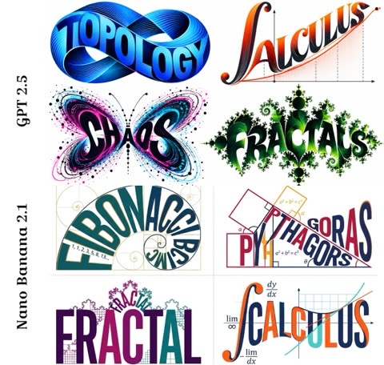

# Posters and editorial layouts

[Back to the list](../../README.md) · All 97 entries

<a id="gpt-image-flat-vector-city-travel-poster-template"></a>
### Flat vector travel poster template for any city

<a href="https://x.com/MahnoorAi12/status/2091349007922778211"></a>

A single CITY_NAME placeholder drives five identity slots (landmark, transport, lifestyle moment, native plant, viewpoint), so the scene changes per city. Strict color system, small figure count and a long negative prompt keep the flat vector look quiet and consistent.

GPT Image 2 · Text-to-image · Source: [@MahnoorAi12 on X](https://x.com/MahnoorAi12/status/2091349007922778211) · 3,421 likes on 2026-10-28

[`travel-poster`](tags.md#tag-travel-poster) [`flat-vector`](tags.md#tag-flat-vector) [`template`](tags.md#tag-template) [`city`](tags.md#tag-city) [`minimalist`](tags.md#tag-minimalist)

<details><summary><b>Prompt</b></summary>

```text
Premium minimalist flat-vector travel poster for [CITY_NAME], 3:4 vertical format.

Design an original, sophisticated travel poster that captures the authentic visual personality of [CITY_NAME]. The composition must feel purpose-built for this city rather than following a reusable template.

CITY IDENTITY

First interpret the unique visual character of [CITY_NAME] and build the scene around these five elements:

1. A recognizable landmark, architectural feature, or skyline element.
2. A distinctive local way of moving through the city.
3. One subtle everyday lifestyle moment.
4. A native plant, landscape, or environmental characteristic.
5. A composition and viewpoint that naturally belongs to the city.

The overall scene structure must change from city to city. Do not repeatedly use the same object positions or visual formula.

Possible compositions include:
harbor viewpoint, narrow historic lane, riverside garden, coastal path, elevated city overlook, lively market passage, tram avenue, ferry terminal, botanical setting, heritage square, beach promenade, cultural plaza, or skyline terrace.

Choose whichever composition best represents [CITY_NAME].

TYPOGRAPHY

Place “[CITY_NAME]” in the upper-left area with generous clean negative space.

Add one short, sophisticated English tagline inspired by the atmosphere of the city.

Typography should feel understated, editorial, spacious, and premium. Never allow text to dominate the artwork.

VISUAL HIERARCHY

Use one iconic landmark or architectural feature as the main focal point.

Support it with only 2–4 carefully selected local elements. Every added detail should strengthen the sense of place.

Avoid landmark collections or postcard-style collages. Keep the scene visually quiet and intentional.

PEOPLE

Include only 3–6 small-scale figures.

Give each person a believable activity connected to local life, such as:
walking through a historic lane, cycling, waiting for public transport, sketching architecture, boarding a ferry, reading outdoors, taking a quiet photograph, carrying beach equipment, browsing a market, or jogging beside the water.

Avoid crowds and avoid making any single person the main character. Figures should integrate naturally into the environment.

LOCAL CHARACTER

Use city-specific elements only when they genuinely fit [CITY_NAME]:

- local transportation
- architecture
- street furniture
- vegetation
- small signs or wayfinding
- local food references
- recreational activities
- pavement markings
- cultural details

Transport and signage should remain subtle. Instead of always using a large signboard, incorporate details naturally through a small transit marker, station clock, ferry information panel, bike symbol, painted road marking, beach flag, or understated metro icon.

ART DIRECTION

Japanese stationery-inspired aesthetic,
luxury sticker illustration,
premium commercial vector artwork,
modern editorial travel branding,
clean delicate outlines,
uniform line weight,
simple geometric forms,
flat-color illustration,
soft shapes,
balanced visual rhythm,
high-end minimalist postcard design.

COLOR SYSTEM

Build the atmosphere primarily with:
pale powder blue, soft sky blue, mist blue, and cool airy blues.

Balance these with:
warm ivory, cream, soft beige, muted sage, gray-green, and understated architectural neutrals.

Use dusty rose or muted blush only for tiny visual accents such as flowers, clothing details, small signs, awnings, or decorative objects.

Colors should remain soft, sophisticated, slightly desaturated, and cohesive.

MOOD

Fresh, airy, peaceful, refined, contemporary, elegant.

The final artwork should feel like a premium boutique travel postcard or luxury lifestyle brand illustration, with generous breathing room and a relaxed sense of place.

IMPORTANT QUALITY RULES

Every city must have its own visual identity.
Change the camera angle, scene structure, landmark placement, foreground treatment, and supporting details according to the city's character.

Do not simply replace [CITY_NAME] inside an existing composition.

NEGATIVE PROMPT

No photorealism.
No realism.
No watercolor.
No painterly brushwork.
No gradients.
No heavy shadows.
No dramatic cinematic lighting.
No paper texture.
No excessive detail.
No cluttered background.
No landmark collage.
No crowded streets.
No oversized characters.
No dominant hero character.
No repetitive café composition.
No fixed signboard position.
No identical foreground treatment.
No generic tourist-poster formula.
No copied layout from another city.
No unnecessary decorative elements.
```

</details>

<a id="gpt-image-tv-show-world-isometric-map-diorama"></a>
### Isometric TV Show World Map Diorama Poster

<a href="https://x.com/TechieBySA/status/2091167214195847433"></a>

One swappable show placeholder with branching rules for fictional or real settings makes the diorama take the exact silhouette of the world, extruded as a rock slab. A fixed layout with an empty top third for tracked caps and a bold condensed title keeps the poster clean.

GPT Image 2 · Text-to-image · Source: [@TechieBySA on X](https://x.com/TechieBySA/status/2091167214195847433) · 2,678 likes on 2026-10-28

[`isometric`](tags.md#tag-isometric) [`diorama`](tags.md#tag-diorama) [`tilt-shift`](tags.md#tag-tilt-shift) [`tv-show`](tags.md#tag-tv-show) [`template`](tags.md#tag-template)

<details><summary><b>Prompt</b></summary>

```text
Simply replace [TV SHOW]:✨

“Ultra-detailed photorealistic isometric miniature scale-model diorama of the world from [TV SHOW], floating on a pure off-white studio background with a soft drop shadow beneath.

If [TV SHOW] has a fictional world map: the diorama takes the exact silhouette shape of that fictional continent or world, extruded downward into a thick slab of raw rock and earth with rough cliff-like edges. The top surface recreates the complete world geography exactly as established in the show — every region, kingdom, city, landmark, mountain range, forest and river in its correct canonical position.

If [TV SHOW] is set in the real world: the diorama takes the exact geographic silhouette shape of the real city, state or region where the show is primarily set, extruded into a thick rock slab. The top surface is filled entirely with locations, landmarks, routes and environments from the show rendered in the show's authentic color palette and visual atmosphere — not generic realistic geography but the world as it feels in the show.

In both cases: dense micro-detail throughout — tiny figures in show-accurate clothing, vehicles, buildings, roads, trees, all authentic to the show's world. Every iconic location a fan would recognize is present and accurately placed.

Style: hyper-realistic tilt-shift miniature photography — extremely sharp, everything in focus, no blur. Lighting and color palette match the show's visual identity exactly.

Layout: diorama floats centered in the lower two-thirds, clear margins all sides. Upper third is empty off-white space with minimalist editorial typography, centered: small wide-tracked caps with the location or world name at the very top, then [TV SHOW] in a bold condensed sans-serif in medium charcoal grey — large and dominant, then small wide-tracked caps below with network and year.

Minimalist editorial poster aesthetic, premium print quality, 4:5 aspect ratio.”
```

</details>

<a id="nano-banana-monoline-city-travel-poster-kyoto"></a>
### Kyoto Street Monoline Travel Poster in Red

<a href="https://x.com/Goodmanprotocol/status/2052974175435026714"></a>

A destination placeholder lets one template serve any city. The prompt fixes a one ink plus one background palette with examples per city, asks for dense monoline detail and local language signage, and sets a text quality clause to keep the typography readable.

Nano Banana 2 · Text-to-image · Source: [@Goodmanprotocol on X](https://x.com/Goodmanprotocol/status/2052974175435026714) · 1,436 likes on 2026-10-29

[`travel-poster`](tags.md#tag-travel-poster) [`line-art`](tags.md#tag-line-art) [`monochrome`](tags.md#tag-monochrome) [`swiss-modernist`](tags.md#tag-swiss-modernist) [`template`](tags.md#tag-template)

<details><summary><b>Prompt</b></summary>

```text
Create an ultra-high-resolution minimalist line-art travel poster of [DESTINATION], portraying the city as a stylish everyday urban scene rather than a tourist postcard.

CORE COMPOSITION:
- Central composition shows the city’s most iconic street, intersection, alley, tram street, or pedestrian avenue
- Foreground includes locals, commuters, cyclists, travelers, shoppers, students, café visitors
- People should naturally reflect the city’s local lifestyle and fashion culture
- Background filled with realistic local signage, cafés, restaurants, transportation signs, storefronts, and architectural details
- Landmarks should appear naturally integrated into everyday life, never exaggerated
- Include authentic local-language typography and culturally recognizable visual elements
- Large bold typography at the top center:
  “[DESTINATION]”
- Subtitle below:
  local language + country name
  examples:
  東京 JAPAN
  서울 KOREA
  ΚΟΛΩΝΙΑ GERMANY

STYLE:
ultra clean vector illustration,
Swiss modernist travel poster,
minimal line art,
monoline drawing,
mid-century editorial aesthetic,
architectural illustration,
Japanese graphic poster style,
precise geometric perspective,
extremely clean negative space,
premium travel branding aesthetic

LINE STYLE:
- monochrome line-based illustration only
- thin and highly precise linework
- minimal fill areas
- intricate city-map-like detail density
- rhythmic layering of signs, buildings, windows, and street objects
- visually dense yet highly organized composition

COLOR SYSTEM — VERY IMPORTANT:
- use only ONE main color + ONE background color
- automatically choose a color that best represents the city’s atmosphere
- monochrome silkscreen poster aesthetic
- no rainbow palettes
- no excessive neon
- color should reflect the city’s architecture, climate, nightlife, and cultural identity

Examples:
Tokyo → vivid red on warm ivory
Paris → deep navy on cream
New York → charcoal black on light gray
Kyoto → muted burgundy on warm cream
Hong Kong → teal blue on pale ivory
Santorini → Mediterranean blue on white
Cairo → desert sepia on sand beige

COMPOSITION:
- vertical poster layout
- frontal street-level perspective
- pedestrians crossing streets or moving naturally
- balanced urban rhythm and visual flow
- should feel like a premium city-brand campaign poster

MOOD:
stylish urban life,
calm but lively,
editorial travel magazine cover,
timeless city identity,
premium tourism campaign visual,
minimal yet highly detailed

TEXT QUALITY — EXTREMELY IMPORTANT:
- all typography must be readable and accurate
- no random characters
- no broken or distorted letters
- local signage should feel authentic and natural
- professional editorial typography alignment

OUTPUT:
- vertical poster composition
- 8K ultra detailed
- print-ready
- ultra sharp vector quality
```

</details>

<a id="gpt-image-city-placeholder-flat-vector-travel-poster"></a>
### Flat vector travel poster with city placeholder

<a href="https://x.com/AiwithLariab/status/2091435219002003957"></a>

A single city placeholder is expanded into five identity elements: landmark, local transport, lifestyle moment, native plant and viewpoint. Strict limits on figure count, a pale blue and cream palette and a long negative prompt keep each city's layout distinct.

GPT Image 2 · Text-to-image · Source: [@AiwithLariab on X](https://x.com/AiwithLariab/status/2091435219002003957) · 954 likes on 2026-10-28

[`travel-poster`](tags.md#tag-travel-poster) [`flat-vector`](tags.md#tag-flat-vector) [`city`](tags.md#tag-city) [`template`](tags.md#tag-template) [`minimalist`](tags.md#tag-minimalist)

<details><summary><b>Prompt</b></summary>

```text
Premium minimalist flat-vector travel poster for [CITY_NAME], 3:4 vertical format.

Design an original, sophisticated travel poster that captures the authentic visual personality of [CITY_NAME]. The composition must feel purpose-built for this city rather than following a reusable template.

CITY IDENTITY

First interpret the unique visual character of [CITY_NAME] and build the scene around these five elements:

1. A recognizable landmark, architectural feature, or skyline element.
2. A distinctive local way of moving through the city.
3. One subtle everyday lifestyle moment.
4. A native plant, landscape, or environmental characteristic.
5. A composition and viewpoint that naturally belongs to the city.

The overall scene structure must change from city to city. Do not repeatedly use the same object positions or visual formula.

Possible compositions include:
harbor viewpoint, narrow historic lane, riverside garden, coastal path, elevated city overlook, lively market passage, tram avenue, ferry terminal, botanical setting, heritage square, beach promenade, cultural plaza, or skyline terrace.

Choose whichever composition best represents [CITY_NAME].

TYPOGRAPHY

Place “[CITY_NAME]” in the upper-left area with generous clean negative space.

Add one short, sophisticated English tagline inspired by the atmosphere of the city.

Typography should feel understated, editorial, spacious, and premium. Never allow text to dominate the artwork.

VISUAL HIERARCHY

Use one iconic landmark or architectural feature as the main focal point.

Support it with only 2–4 carefully selected local elements. Every added detail should strengthen the sense of place.

Avoid landmark collections or postcard-style collages. Keep the scene visually quiet and intentional.

PEOPLE

Include only 3–6 small-scale figures.

Give each person a believable activity connected to local life, such as:
walking through a historic lane, cycling, waiting for public transport, sketching architecture, boarding a ferry, reading outdoors, taking a quiet photograph, carrying beach equipment, browsing a market, or jogging beside the water.

Avoid crowds and avoid making any single person the main character. Figures should integrate naturally into the environment.

LOCAL CHARACTER

Use city-specific elements only when they genuinely fit [CITY_NAME]:

- local transportation
- architecture
- street furniture
- vegetation
- small signs or wayfinding
- local food references
- recreational activities
- pavement markings
- cultural details

Transport and signage should remain subtle. Instead of always using a large signboard, incorporate details naturally through a small transit marker, station clock, ferry information panel, bike symbol, painted road marking, beach flag, or understated metro icon.

ART DIRECTION

Japanese stationery-inspired aesthetic,
luxury sticker illustration,
premium commercial vector artwork,
modern editorial travel branding,
clean delicate outlines,
uniform line weight,
simple geometric forms,
flat-color illustration,
soft shapes,
balanced visual rhythm,
high-end minimalist postcard design.

COLOR SYSTEM

Build the atmosphere primarily with:
pale powder blue, soft sky blue, mist blue, and cool airy blues.

Balance these with:
warm ivory, cream, soft beige, muted sage, gray-green, and understated architectural neutrals.

Use dusty rose or muted blush only for tiny visual accents such as flowers, clothing details, small signs, awnings, or decorative objects.

Colors should remain soft, sophisticated, slightly desaturated, and cohesive.

MOOD

Fresh, airy, peaceful, refined, contemporary, elegant.

The final artwork should feel like a premium boutique travel postcard or luxury lifestyle brand illustration, with generous breathing room and a relaxed sense of place.

IMPORTANT QUALITY RULES

Every city must have its own visual identity.
Change the camera angle, scene structure, landmark placement, foreground treatment, and supporting details according to the city's character.

Do not simply replace [CITY_NAME] inside an existing composition.

NEGATIVE PROMPT

No photorealism.
No realism.
No watercolor.
No painterly brushwork.
No gradients.
No heavy shadows.
No dramatic cinematic lighting.
No paper texture.
No excessive detail.
No cluttered background.
No landmark collage.
No crowded streets.
No oversized characters.
No dominant hero character.
No repetitive café composition.
No fixed signboard position.
No identical foreground treatment.
No generic tourist-poster formula.
No copied layout from another city.
No unnecessary decorative elements.
```

</details>

<a id="gpt-image-photo-to-handmade-collage-split-poster"></a>
### Split editorial poster pairing photo with handmade collage

<a href="https://x.com/saniaspeaks_/status/2097176979497791899"></a>

A strict two equal halves layout keeps the faithful photo on top and a tiny handmade collage in ivory negative space below. Limiting the palette to four colors extracted from the photo, plus named textures like torn paper and gouache, ties the two halves together.

GPT Image 2 · Edit · Source: [@saniaspeaks_ on X](https://x.com/saniaspeaks_/status/2097176979497791899) · 653 likes on 2026-10-28

[`editorial-poster`](tags.md#tag-editorial-poster) [`mixed-media`](tags.md#tag-mixed-media) [`split-layout`](tags.md#tag-split-layout) [`photo-reinterpretation`](tags.md#tag-photo-reinterpretation) [`negative-space`](tags.md#tag-negative-space)

<details><summary><b>Prompt</b></summary>

```text
Create a premium editorial art poster for every uploaded photograph, treating each image as its own independent composition and never merging multiple photos together. Use a strict 3:4 vertical format with the canvas split into two perfectly equal horizontal halves: the upper half should remain a faithful, photorealistic presentation of the original image, preserving the subject’s exact identity, facial features, proportions, pose, clothing, objects, composition, lighting, shadows, mood, and natural colors, enhanced only with sophisticated editorial color grading and seamless environmental extension where necessary; the lower half should transform the visual story into an entirely different artistic interpretation—a tiny, carefully composed handmade mixed-media artwork centered within expansive warm ivory negative space, occupying no more than 10–20% of the lower section, using expressive ink sketching, layered gouache-like color fields, subtle collage textures, torn-paper edges, imperfect brushwork, visible fibers, soft pigment variations, and charming human imperfections while retaining the most recognizable silhouette, gesture, objects, and emotional narrative from the original photo. Extract up to four dominant harmonious colors from each photograph and reinterpret them in a muted, sophisticated palette. Add only occasional understated editorial typography when it genuinely enhances the composition, such as a poetic title, place, date, or single word. The overall result should feel like a collectible contemporary art publication cover—minimal, poetic, tactile, elegant, emotionally quiet, visually distinctive, and unmistakably connected to its original photograph.
```

</details>

<a id="nano-banana-monstera-leaf-hidden-words"></a>
### Monstera leaf gaps forming hidden words

<a href="https://x.com/fofrAI/status/2107509669514113058"></a>

The prompt names one real object and asks for the text to emerge organically from its natural features, so the lettering follows the leaf's own cut-outs instead of sitting on top. A simple backdrop keeps the gaps readable as letterforms.

Nano Banana 2.1 · Text-to-image · Source: [@fofrAI on X](https://x.com/fofrAI/status/2107509669514113058) · 549 likes on 2026-10-28

[`text-in-image`](tags.md#tag-text-in-image) [`monstera`](tags.md#tag-monstera) [`nature`](tags.md#tag-nature) [`typography`](tags.md#tag-typography) [`photo`](tags.md#tag-photo)

<details><summary><b>Prompt</b></summary>

```text
A photo of a monstera leaf against a simple backdrop, cleverly and organically appearing within the natural gaps of the leaf are the words Nano Banana
```

</details>

<a id="nano-banana-levitating-outfit-fashion-editorial-labels"></a>
### Levitating Outfit Editorial With Callout Labels

<a href="https://x.com/AllaAisling/status/2034382842084708533"></a>

The prompt lists garments in order from footwear up to headwear and gives each fabric its own physics. A fixed label format of uppercase name, italic fabric and one defining detail, plus a three-part light setup of key, warm fill and cool rim, keeps the invisible-body look consistent.

Nano Banana 2 · Text-to-image · Source: [@AllaAisling on X](https://x.com/AllaAisling/status/2034382842084708533) · 503 likes on 2026-10-28

[`fashion`](tags.md#tag-fashion) [`levitation`](tags.md#tag-levitation) [`editorial`](tags.md#tag-editorial) [`template`](tags.md#tag-template) [`callout-labels`](tags.md#tag-callout-labels)

<details><summary><b>Prompt</b></summary>

```text
Prompt Studio: Gravity Fashion Editorial, with Nano Banana 2 in Firefly

Complete [STYLE] outfit floating in its exact worn position around  an invisible body with every piece suspended mid-breath, mid-billow.  LOOK (bottom to top): [FOOTWEAR] → [BOTTOMS] → [TOP] → [LAYER] →  [ACCESSORIES] → [JEWELLERY] → [HEADWEAR]  FABRIC PHYSICS: each material true to its weight, wool hangs,  silk drapes, denim holds its crease, leather keeps its shape.  Every edge lifting slightly as if caught in one silent gust.  LABELS: hairline leader to floating label box. "[GARMENT]" uppercase / "[FABRIC]" italic / "[ONE DEFINING DETAIL]"  LIGHTING: soft directional from upper left + warm fill from below  catching linings and sole edges + cool rim outlining the silhouette. BACKGROUND: [COLOR] seamless, fashion-forward. TITLE: "[LOOK NAME]" elegant serif type, top right. SUBTITLE: "[MOOD / OCCASION]" italic.  Mood: high-concept levitation editorial, the outfit exists,  the person is imagination. 4K, extraordinary fabric fidelity, tack sharp.

Check ALTs for ideas 👇
@AdobeFirefly
```

</details>

<a id="gpt-image-halftone-architecture-poster"></a>
### Building photo to halftone travel-collage poster

<a href="https://x.com/Naiknelofar788/status/2100067049288634730"></a>

Long spec with a closing priority rule: architectural accuracy first, the halftone treatment second.

GPT Image 2.5 · Edit · Source: [@Naiknelofar788 on X](https://x.com/Naiknelofar788/status/2100067049288634730) · 497 likes on 2026-10-27

[`halftone`](tags.md#tag-halftone) [`architecture`](tags.md#tag-architecture) [`travel`](tags.md#tag-travel) [`collage`](tags.md#tag-collage)

<details><summary><b>Prompt</b></summary>

```text
Turn this structure photo into a single high-end halftone architectural travel-collage poster. Output one poster per uploaded photo — never merge multiple structures or photos into one frame.

FORMAT

3:4 vertical canvas. Split into two roughly equal zones — real architectural photo on top, printed reconstruction below — divided by one clean, sharp horizontal line.

Do not stretch, warp, tilt, or unnaturally reposition the structure to force the proportions.

TOP HALF — THE REAL SHOT

Preserve the original structure faithfully: same architecture, proportions, perspective, distinctive details, surrounding elements, natural light and shadow, and original color mood.

Keep recognizable features such as:

* façade
* windows and arches
* towers or domes
* doors and structural details
* roofline
* surrounding landscape or street elements

Add only a subtle high-end color grade and the faintest film grain. Do not redesign or reinterpret the architecture.

BOTTOM HALF — THE PRINTED RECONSTRUCTION

Rebuild the same structure as an experimental printed architectural collage using:

torn photographic fragments + fixed-width ASCII character fields + photocopy halftone dots + architectural linework.

The structure must remain immediately recognizable.

* Torn-edge photographic fragments preserve the most important architectural details.
* Brick, stone, glass, metal, shadows, windows, and surrounding textures gradually dissolve outward into ASCII characters, black halftone dots, fragmented print grain, and fine architectural drafting lines.
* Use thin technical construction lines to subtly trace the structure’s geometry.
* Let selected areas break apart into paper fibers and halftone fragments, creating the feeling that the building is emerging from an archival print.
* Keep the main silhouette strong and readable.
* Texture: rough white paper-fiber edges, subtle photocopy imperfections, slight print misregistration, faded ink, old-paper stains, a few restrained crop marks, and one small red calibration bar.
* Color: warm gray old-paper background + black ink + the structure’s original muted colors + a single restrained red accent.
* Never fully desaturate the structure.

The structure should occupy roughly 60–88% of the frame width, scaled according to what reads best for the architecture.

Leave 22–38% of the paper visibly untouched and empty, creating generous negative space so the poster feels like an archival architectural specimen rather than a packed digital screen.

TYPOGRAPHY

Add one clean, readable fixed-width architectural title based on the structure:

[STRUCTURE NAME]

Below it include:

[CITY, COUNTRY]
REC. STUDY 01

Add one short observational caption related to the architecture, such as:

“A monumental study in geometry, time, and place.”

Typography should feel like an old architectural archive mixed with an underground experimental design journal.

A few loose ASCII glyphs may trace the outer silhouette or architectural edges as texture only — never use ASCII to invent windows, doors, structural details, or technical specifications.

MOOD

Early digital systems × analog photocopy × architectural archive × underground zine × modern travel editorial.

The structure should feel like it is surfacing from an old printed document — half photograph, half architectural drawing, half experimental print.

Sophisticated, minimal, tactile, intellectual, slightly mysterious, and highly collectible.

AVOID

Solid black terminal backgrounds, dense walls of code, cyberpunk neon, excessive ASCII, distorted architecture, impossible geometry, invented architectural details, fake technical specifications, random symbols with no meaning, garbled text, excessive colors, brand logos, QR codes, watermarks, author credits, or tourist-poster clichés.

Priority: Preserve the structure’s identity and architectural accuracy first. The experimental halftone/ASCII treatment should enhance the architecture, not hide it.
```

</details>

<a id="gpt-image-oversized-type-pink-fashion-editorial-poster"></a>
### Pink Fashion Poster With Giant Glowing Lettering

<a href="https://x.com/SimplyAnnisa/status/2053814655655543119"></a>

A fill in the blank template that lists style, subject, layout, typography, lighting and palette as separate labeled blocks. Placing the huge title behind a centered full body model gives depth, and a single monochrome color keeps the poster cohesive.

GPT Image 2 · Text-to-image · Source: [@SimplyAnnisa on X](https://x.com/SimplyAnnisa/status/2053814655655543119) · 444 likes on 2026-10-28

[`fashion`](tags.md#tag-fashion) [`editorial`](tags.md#tag-editorial) [`typography`](tags.md#tag-typography) [`monochrome`](tags.md#tag-monochrome) [`template`](tags.md#tag-template)

<details><summary><b>Prompt</b></summary>

```text
Create a premium high-fashion editorial poster for [BRAND NAME].

TOPIC:
[STREETWEAR / FASHION COLLECTION / EDITORIAL CAMPAIGN]

STYLE & ART DIRECTION:

Oversized typography editorial aesthetic

Minimal futuristic fashion design

Korean high-fashion poster influence

Luxury streetwear branding

Avant-garde magazine-cover atmosphere

Soft monochromatic composition

Pinterest fashion-editorial aesthetic

High-end commercial styling

Modern runway campaign design

Minimal but bold visual hierarchy

Vogue-meets-streetwear atmosphere

MAIN SUBJECT:

A full-body fashion model prominently centered in the composition

Oversized luxury streetwear outfit

Fashion-forward silhouette and styling

Minimal expressive pose

Elegant emotional neutrality

Realistic luxury-fashion photography

Premium editorial lighting

Modern runway attitude

Soft futuristic mood

Clean symmetrical body positioning

LAYOUT & COMPOSITION:

Same exact editorial composition and hierarchy as the reference design

Massive oversized typography placed behind the model

Typography integrated into the composition as a graphic element

Strong centered symmetry

Minimal clean background

Spacious luxury editorial layout

Magazine-cover inspired balance

Minimal distractions

Strong visual focus on the fashion styling

TEXT & TYPOGRAPHY:

Huge bold geometric typography

Editorial fashion font style

Oversized lettering occupying most of the background

Minimal secondary micro typography

Luxury magazine hierarchy

Main title:
"[MAIN FASHION WORD]"

Supporting text:
"[COLLECTION / EDITORIAL SUBTITLE]"

DEPTH & LIGHTING:

Soft editorial studio lighting

Luxury fashion shadows

Smooth pastel reflections

Minimal contrast

Premium commercial skin rendering

High-end fashion atmosphere

EXTRA DESIGN DETAILS:

Tiny editorial text blocks

Magazine micro-details

Fashion-brand symbols

Minimal graphic accents

Soft texture overlays

Luxury typography interaction

Editorial spacing

COLOR PALETTE:

[PRIMARY MONOCHROMATIC COLOR]

Soft pastel tones

White / cream highlights

Minimal luxury contrast

QUALITY:

Ultra realistic fashion photography

Premium editorial poster design

Behance-quality fashion campaign

Vogue-style streetwear composition

Same exact visual identity and layout as the reference

Ultra high resolution
```

</details>

<a id="gpt-image-flat-vector-city-travel-poster-template-2"></a>
### Flat vector Kyoto riverside travel poster

<a href="https://x.com/MissDelulu9/status/2091724761424670980"></a>

A single [CITY_NAME] placeholder turns the prompt into a reusable template. A fixed checklist (landmark, transport, lifestyle moment, local details, signage), a tight pastel palette and a long negative list keep the flat vector style consistent while the composition changes per city.

GPT Image 2 · Text-to-image · Source: [@MissDelulu9 on X](https://x.com/MissDelulu9/status/2091724761424670980) · 429 likes on 2026-10-28

[`travel-poster`](tags.md#tag-travel-poster) [`flat-vector`](tags.md#tag-flat-vector) [`template`](tags.md#tag-template) [`city`](tags.md#tag-city) [`pastel`](tags.md#tag-pastel)

<details><summary><b>Prompt</b></summary>

```text
Premium minimalist flat-vector travel poster for [CITY_NAME], 3:4 vertical.

Create an original city-specific travel poster that captures the authentic personality of [CITY_NAME]. Choose the best composition for the city harbor, historic lane, riverside, coastal path, market, tram avenue, heritage square, skyline terrace, etc.

Include:
-One iconic landmark as the main focal point
-One distinctive local transport element
-One subtle everyday lifestyle moment
-Native vegetation or landscape
-3–6 small, naturally integrated people
-2–4 carefully chosen local details
-Subtle authentic signage/wayfinding

Typography:
Place “[CITY_NAME]” upper-left with generous negative space. Add one short elegant English tagline. Premium editorial typography, understated and spacious.

Style:
Japanese stationery-inspired, luxury sticker illustration, premium commercial vector, modern editorial travel branding, delicate uniform outlines, geometric shapes, flat colors, soft forms, minimalist postcard aesthetic.

Colors:
Pale powder blue, sky blue, mist blue, ivory, cream, beige, muted sage and gray-green. Tiny dusty-rose accents only. Soft, sophisticated, slightly desaturated palette.

Mood:
Fresh, airy, peaceful, refined, contemporary and elegant.

Important:
Make every city visually unique. Change the viewpoint, composition, landmark placement and foreground according to the city's identity. Do not reuse a generic template.

Negative:
No photorealism, realism, watercolor, painterly brushwork, gradients, heavy shadows, cinematic lighting, paper texture, clutter, landmark collage, crowds, oversized characters, dominant hero character, repetitive café scenes, generic tourist-poster layouts, copied compositions or unnecessary decoration.
```

</details>

<a id="gpt-image-photo-to-paper-illustration-split-poster"></a>
### Lakeside Photo Paired With Paper Illustration

<a href="https://x.com/harboriis/status/2107346549542203400"></a>

A strict 50/50 split keeps the top as a faithful photo and turns the bottom into a small centered handmade illustration of the same scene. Capping the palette at 4 colors extracted from the photo, plus generous paper negative space, ties the two halves together.

GPT Image 2.5 · Edit · Source: [@harboriis on X](https://x.com/harboriis/status/2107346549542203400) · 417 likes on 2026-10-27

[`editorial-poster`](tags.md#tag-editorial-poster) [`photo-to-illustration`](tags.md#tag-photo-to-illustration) [`split-layout`](tags.md#tag-split-layout) [`paper-texture`](tags.md#tag-paper-texture) [`minimalist`](tags.md#tag-minimalist)

<details><summary><b>Prompt</b></summary>

```text
Create one independent high-end editorial poster for each uploaded photo. Never combine photos.

FORMAT
Strict 3:4 vertical composition with an exact 50/50 horizontal split. The top and bottom halves must be equal in height and visually connected as one refined editorial cover.

TOP HALF: ORIGINAL PHOTO
Use the original photo faithfully. Preserve the subject, identity, facial features, proportions, pose, clothing, objects, composition, lighting, shadows, atmosphere, and color mood. Keep it fully photorealistic with only subtle premium editorial color grading. Never stylize, distort, replace, or alter the main subject. Extend only surrounding background when necessary, seamlessly and naturally.

BOTTOM HALF: HAND-DRAWN ILLUSTRATION
Reinterpret the same scene as a minimalist handmade paper illustration. Preserve the recognizable subject, silhouette, pose, key objects, and main visual story.

Use delicate imperfect lines, simple acrylic-style flat color shapes, visible brush marks, rough paper texture, organic edges, and subtle handmade imperfections. Keep the illustration small and centered, occupying about 10–20% of the bottom half, with generous negative space.

Use a rough white, warm off-white, or pale natural paper background with only minimal environmental details.

COLOR
Extract colors from the original photo and reduce them to a maximum of 4 restrained, harmonious colors. Use controlled flat color blocks while maintaining subtle paper grain and brush texture.

TYPOGRAPHY
Optional minimal editorial text only when appropriate, such as a short title, keyword, location, or number. Keep it understated and never force text into the design.

STYLE
Quiet, poetic, refined, minimal, relaxed, artistic, thoughtful, premium, high-recognition.

FINAL
Maintain the exact 50/50 split. The top must remain a faithful photograph, while the bottom is a simplified handmade illustration of the same scene. Avoid clutter, excessive colors, heavy typography, artificial effects, or unnecessary details. The result should feel like a premium contemporary independent art publication cover.
```

</details>

<a id="gpt-image-split-photo-sketch-travel-journal-poster"></a>
### Real photo and watercolor sketch travel poster

<a href="https://x.com/MissDelulu9/status/2096902953110299096"></a>

An exact 50/50 split keeps the top half as the untouched reference photo and turns the bottom half into the same scene as colored pencil and watercolor on cream paper. Naming the paper, strokes, washes and cross hatching, plus fixed handwritten captions above and below, keeps the sketch faithful and the layout stable.

GPT Image 2 · Edit · Source: [@MissDelulu9 on X](https://x.com/MissDelulu9/status/2096902953110299096) · 417 likes on 2026-10-28

[`travel-journal`](tags.md#tag-travel-journal) [`split-layout`](tags.md#tag-split-layout) [`watercolor-sketch`](tags.md#tag-watercolor-sketch) [`colored-pencil`](tags.md#tag-colored-pencil) [`photo-to-sketch`](tags.md#tag-photo-to-sketch)

<details><summary><b>Prompt</b></summary>

```text
Create a premium vertical travel-journal poster in an exact 50/50 split.

Top 50%: Keep the original reference photo completely real and unchanged same composition, architecture, people, colors, lighting, perspective, and details.

Bottom 50%: Transform the same photo into a delicate hand-drawn colored-pencil + watercolor sketch on warm cream paper, with visible pencil strokes, soft washes, subtle paper grain, imperfect outlines, and gentle cross-hatching. Keep every subject recognizable.

Add elegant handwritten text: “A Beautiful Day” above and “Memories to Keep” below. Minimal, nostalgic, sophisticated travel-magazine aesthetic. No extra objects, no photorealism in the bottom half, exact 50/50 layout.
```

</details>

<a id="gpt-image-editorial-city-travel-artwork-reflection"></a>
### San Francisco editorial travel poster with glass reflection

<a href="https://x.com/MahnoorAi12/status/2091711340666568868"></a>

One template swaps in any city through bracketed slots for name, landscape, architecture and tagline. A muted palette, a glass reflection band, faint geometric borders and small widely spaced magazine type keep the look cohesive. The long avoid list blocks landmark collage and oversized text.

GPT Image 2 · Text-to-image · Source: [@MahnoorAi12 on X](https://x.com/MahnoorAi12/status/2091711340666568868) · 356 likes on 2026-10-28

[`travel-poster`](tags.md#tag-travel-poster) [`city`](tags.md#tag-city) [`template`](tags.md#tag-template) [`reflection`](tags.md#tag-reflection) [`editorial`](tags.md#tag-editorial)

<details><summary><b>Prompt</b></summary>

```text
Create a premium 4:5 vertical contemporary travel artwork featuring [CITY NAME], [COUNTRY], transformed into a serene, sophisticated and collectible editorial travel landscape.

Build the entire composition around the unique identity of [CITY NAME]. Naturally integrate its most recognizable combination of landscape, architecture, culture, streets, nature, waterfront or mountains, depending on what genuinely defines the city. The scene should feel like one cohesive environment rather than a collage of separate landmarks.

In the background, create an atmospheric sense of place using [CITY'S SIGNATURE LANDSCAPE — e.g. coastline, mountains, river, desert, forest, skyline, historic district], with soft depth, subtle haze and elegant natural lighting.

In the foreground, introduce refined simplified architectural forms inspired by [CITY'S HISTORIC / CULTURAL ARCHITECTURE]. Include characteristic rooftops, facades, streets, balconies, walls, pathways and local textures. Add subtle vegetation and a few tiny human silhouettes naturally interacting with the environment, keeping them understated and non-dominant.

Make the visual identity unmistakably [CITY NAME], but avoid turning the artwork into a landmark collage. Every element should flow naturally into the surrounding landscape.

Use a sophisticated, slightly desaturated palette inspired by the destination, combining warm ivory, soft beige, muted earth tones, gentle architectural colors and subtle environmental blues/greens. Keep the entire palette harmonious, refined and luxurious.

Place the entire landscape above a calm glass-like reflective surface, creating delicate vertical reflections of the architecture, landscape and major visual elements. Keep the reflections soft, atmospheric and slightly faded.

Add extremely subtle translucent geometric forms around the borders to create a contemporary gallery-art aesthetic without distracting from the destination.

Use generous negative space, atmospheric haze, diffused natural light, delicate shadows, fine architectural linework, tactile paper grain and restrained watercolor-and-gouache textures blended with sophisticated modern digital illustration.

At the top, add elegant magazine typography:

[CITY NAME]
[SHORT POETIC CITY TAGLINE]
No. 05 — 2026

Typography should be small, refined, widely spaced, minimal and perfectly aligned.

Avoid anime aesthetics, excessive cultural symbols, clutter, photorealistic collage, generic stock imagery, oversized landmarks, excessive decoration and oversized typography.

The final artwork should feel like a rare collectible luxury travel print — tranquil, artistic, timeless, sophisticated and instantly recognizable as [CITY NAME].

Important: Prioritize the authentic visual character of the chosen city. Do not force elements that do not belong there. Adapt the architecture, landscape, vegetation, atmosphere and color palette specifically to the city.
```

</details>

<a id="gpt-image-editorial-split-poster-roses"></a>
### Editorial poster of woman with roses and yellow bag

<a href="https://x.com/Ziha_ai/status/2106990557813968909"></a>

The canvas is split into two exact halves. The top keeps the original photo untouched, and the bottom rebuilds the subject over one low saturation color window sampled from the photo. The subject crosses the window edge into white negative space, which gives depth and avoids a sticker look.

GPT Image 2.5 · Edit · Source: [@Ziha_ai on X](https://x.com/Ziha_ai/status/2106990557813968909) · 337 likes on 2026-10-27

[`editorial-poster`](tags.md#tag-editorial-poster) [`split-layout`](tags.md#tag-split-layout) [`color-window`](tags.md#tag-color-window) [`negative-space`](tags.md#tag-negative-space) [`photo-reconstruction`](tags.md#tag-photo-reconstruction)

<details><summary><b>Prompt</b></summary>

```text
Premium Editorial Poster Instructions

Each uploaded photo must be made into a separate, independent, premium editorial poster, and multiple photos must not be combined. Use a strict 3:4 vertical canvas. Split the canvas horizontally in the exact center: the upper half and the lower half each occupy 50% of the height, are equally wide, and equally high, with no alteration of proportion.

The upper half uses the original photo directly and must not be regenerated. Preserve the identity of the main subject, the human body or architectural structure, proportions, perspective, spatial relationships, texture, natural light and shadow, color, and environment in their entirety. Only slight cropping and restrained premium color grading are permitted; re-drawing the main subject, fictional light, HDR, excessive saturation, plastic texture, and fictional content are prohibited. hibited. When needing to adapt to the frame, only environmental areas such as sky, water surface, ground, walls, plants, or background can be extended.

The lower half extracts and reconstructs the "narrative core" of the photo: it can be a single primary subject, or a group of related elements that together embody the photo's identity, scale, action, o story relationship. Maintain its realistic, recognizable appearance, proportion, internal structure, texture, and relative position. Do not remove important related elements, and do not directly us rectangular photo cutouts. The reconstructed subject typically occupies 55%-80% of the width of the lower area. It should naturally extend based on the photo's primary direction and retain plausible ground, water lines, shadows, or softly dissipated edges to integrate into the background, avoiding a sticker-like or floating appearance.

Incorporate a narrow, low-saturation geometric color field behind or through the center of the subject, serving as a "critical window" between reality and editorial abstraction. The color of the window must be extracted from the original photo, and its orientation (horizontal, vertical, or diagonal) chosen based on the overall narrative direction.

The subject must actively pass through the window: part of it is within the color field, and part enters the open negative space, naturally crossing the window's boundary to create occlusion, penetration, and spatial depth. The window is not a frame or a card; it must not fully enclose the subject. Only one primary window is allowed; multiple color blocks, thick borders, rounded corners, strong gradients, and drop shadows are prohibited.

Use a white, cool white, very light gray, or near-white background for the lower half, coordinated with the photo. Employ a restrained asymmetrical composition and abundant negative space to establish a three-tier hierarchy:

Reconstructed subject or narrative composition

Low-saturation geometric window
```

</details>

<a id="gpt-image-product-campaign-poster-grid-template"></a>
### Premium product campaign poster from reference photo

<a href="https://x.com/ZaraIrahh/status/2054139543423492547"></a>

A product photo is locked as the source of truth, then a 12 column grid and four stacked layers (color block, giant cropped word, model with product, flat text) keep the layout controlled. Every text element is listed exactly once with placeholders, so the typography renders cleanly.

GPT Image 2 · Edit · Source: [@ZaraIrahh on X](https://x.com/ZaraIrahh/status/2054139543423492547) · 289 likes on 2026-10-29

[`product-poster`](tags.md#tag-product-poster) [`campaign-template`](tags.md#tag-campaign-template) [`glassmorphism`](tags.md#tag-glassmorphism) [`reference-image`](tags.md#tag-reference-image) [`typography`](tags.md#tag-typography)

<details><summary><b>Prompt</b></summary>

```text
REFERENCE IMAGE INSTRUCTION: Use the uploaded product photo as the exact source of truth for the product's appearance, color, finish, branding, and form factor. Do not invent or alter any product detail. Reproduce it with photorealistic precision.
---
Create a photorealistic premium [PRODUCT CATEGORY] campaign poster in a 4:5 vertical aspect ratio. Design it as a clean global OOH, digital, and social campaign layout with strict grid alignment, premium white space, and precise typography. The campaign idea is "[CAMPAIGN TAGLINE]," but do not render that phrase as visible text.

Use a strict 12-column poster grid with 6% outer margins. Keep all text aligned to this grid. The image has four layers: background shape, giant background typography, subject/product photography, and clean graphic text overlays.

BACKGROUND: Pure matte white canvas. Place one large rounded-rectangle block behind the subject, occupying roughly 70% of the poster height and 76% of the width, centered slightly above the middle. The block uses a controlled [PRIMARY BRAND COLOR] gradient, glowing gently from top-left to bottom-right. Behind the subject and product, place giant cropped typography reading "[BACKGROUND HERO WORD]" in ultra-bold geometric sans-serif letters. The word is a background layer only: huge, partially cropped by the frame edges, wide letter spacing, darker [PRIMARY BRAND COLOR] than the rectangle, subtle embossed depth, soft shadow, and low enough contrast that it does not fight the product.

SUBJECT AND PRODUCT: [DESCRIBE MODEL OR SUBJECT — e.g., "a female model with a clean editorial look, neutral confident expression, natural slightly wind-touched hair, muted off-white outfit, and [ACCENT COLOR] jacket"]. Shoot from a slightly low hero angle. Body angled for depth, face turned toward the viewer with direct eye contact. One hand extends toward the camera holding the product from the uploaded reference image. The product is the dominant foreground object, slightly tilted to reveal [KEY PRODUCT DETAIL — e.g., "the triple camera system, brushed titanium edges, and centered brand logo"]. Keep the product sharp with realistic surface reflections, material texture, faint micro-details, and soft bloom around premium features. Keep the model's face readable behind it.

LIGHTING: Soft studio key light from front-left, warm rim light from the right, and subtle [PRIMARY BRAND COLOR] bounce from the background block. Skin remains natural and non-airbrushed with realistic catchlights. Product edges have clean [MATERIAL FINISH — e.g., "metallic / matte / glossy"] highlights. Shadows are soft and controlled.

TYPOGRAPHY OVERLAY: All text must be flat, crisp, perfectly aligned graphic typography — not painted onto the scene. Render exactly these text elements once, with no extra text:

Top left, small black logo: [BRAND LOGO NAME/MARK]

Top right, thin sans-serif: "[BRAND SUB-TAGLINE — e.g., 'Built for Apple Intelligence.']"

Mid left, glassmorphism pill: "[PRODUCT NAME — e.g., 'iPhone 17 Pro']"

Large background type: "[BACKGROUND HERO WORD]"

Bottom right body copy, small clean sans-serif:
"[PRODUCT NAME]. [POWER STATEMENT — one sentence.]
[FEATURE 1]. [FEATURE 2].
[CLOSING LINE — e.g., 'Designed for what's next.']"

BOTTOM FEATURE STRIP: Place four equal-width glass-white rounded cards along the bottom, aligned to the grid, same height, same spacing, same baseline alignment. Each card has one minimal line icon above the heading. Render exactly:
Card 1: "[FEATURE HEADING 1]" / "[FEATURE SUBLINE 1]"
Card 2: "[FEATURE HEADING 2]" / "[FEATURE SUBLINE 2]"
Card 3: "[FEATURE HEADING 3]" / "[FEATURE SUBLINE 3]"
Card 4: "[FEATURE HEADING 4]" / "[FEATURE SUBLINE 4]"

GRAPHIC DETAILS: Two or three small sparkle icons only, subtle grain, soft glassmorphism, controlled [PRIMARY BRAND COLOR]-white-[ACCENT COLOR] palette, no neon, no oversaturation.
```

</details>

<a id="gpt-image-tram-photo-paper-illustration-poster"></a>
### Rusty red tram photo paired with paper illustration

<a href="https://x.com/Ziha_ai/status/2104111940180316193"></a>

The prompt splits a 3:4 canvas into two equal halves, with the original photo kept intact on top and a tiny four color paper illustration below. Capping the illustration at 10 to 20 percent of the bottom half and demanding warm off white negative space gives it an art book cover feel.

GPT Image 2.5 · Edit · Source: [@Ziha_ai on X](https://x.com/Ziha_ai/status/2104111940180316193) · 266 likes on 2026-10-27

[`editorial-poster`](tags.md#tag-editorial-poster) [`photo-to-illustration`](tags.md#tag-photo-to-illustration) [`split-layout`](tags.md#tag-split-layout) [`negative-space`](tags.md#tag-negative-space) [`paper-texture`](tags.md#tag-paper-texture)

<details><summary><b>Prompt</b></summary>

```text
Create a high-end editorial poster using the uploaded photo as the exact reference, in a strict 3:4 vertical format divided horizontally into two equal 50/50 sections. Preserve the original photo faithfully in the top half, including subjects, identity, pose, clothing, objects, lighting, colors, and realistic texture, with only subtle premium editorial color grading. In the bottom half, reinterpret the most recognizable elements as a small, centered, minimalist handmade paper illustration using delicate imperfect lines, bold flat acrylic-like color shapes, subtle paper grain, organic edges, and no more than 4 colors extracted from the original photo. Keep the illustration only 10–20% of the bottom section with lots of warm off-white negative space and optional minimal editorial typography. The overall result should feel quiet, poetic, refined, artistic, premium, and like an independent art-book cover, avoiding cartoon, watercolor, colored-pencil, 3D, glossy, busy, or commercial aesthetics.
```

</details>

<a id="nano-banana-photo-sketch-editorial"></a>
### Photograph above, sketch below: an editorial template

<a href="https://x.com/ChillaiKalan__/status/2111332272670417236"></a>

Fill `[SUBJECT]` and `[SETTING]`. The ban list covers the usual split-poster failures: heavy borders, mismatched faces.

Nano Banana 2.1 · Text-to-image · Source: [@ChillaiKalan__ on X](https://x.com/ChillaiKalan__/status/2111332272670417236) · 266 likes on 2026-10-27

[`split-composition`](tags.md#tag-split-composition) [`template`](tags.md#tag-template) [`editorial`](tags.md#tag-editorial)

<details><summary><b>Prompt</b></summary>

```text
Create a premium editorial poster featuring a two-part visual composition. The upper half shows a photorealistic photograph of [SUBJECT] in [SETTING], captured in warm natural sunlight with realistic skin texture, authentic expressions, soft highlights, and cinematic depth of field. The lower half transforms the exact same scene into a beautiful hand-painted digital illustration, preserving the subject’s pose, hairstyle, clothing, colors, and key visual details.

Place the illustrated scene inside a clean rectangular frame on a warm ivory, subtly textured paper background. Use a charming contemporary illustration style with delicate brush textures, simplified organic shapes, pastel colors, soft outlines, and a nostalgic summer-magazine aesthetic. Add tasteful decorative elements that complement the scene.

Below the illustration, include a centered minimalist editorial title reading “[MAIN TITLE]” in thin, widely spaced uppercase typography, followed by a smaller subtitle reading “[TAGLINE]” in elegant letter-spaced text. Add a short, thin pastel-colored line underneath.

Maintain balanced spacing, refined art direction, a cohesive color palette, and a sophisticated print-design finish. Vertical 3:4 composition, high resolution, natural lighting, polished editorial layout, aesthetically pleasing, realistic-to-illustration transformation.

Avoid clutter, excessive text, distorted anatomy, inconsistent facial features, harsh colors, heavy borders, and unnecessary graphic elements.
```

</details>

<a id="nano-banana-traveler-on-giant-country-map-poster"></a>
### Traveler Sitting on Giant Country Map Poster

<a href="https://x.com/frametheory058/status/2038934237479674133"></a>

A reference photo keeps the face while placeholders for continent, country and landmarks make the prompt reusable. Layered scene directions (map and pins in the foreground, landmark horizon behind, floating country name in the sky) are followed by camera, lighting and film grade details.

Nano Banana 2 · Edit · Source: [@frametheory058 on X](https://x.com/frametheory058/status/2038934237479674133) · 252 likes on 2026-10-28

[`travel`](tags.md#tag-travel) [`map`](tags.md#tag-map) [`reference-face`](tags.md#tag-reference-face) [`editorial`](tags.md#tag-editorial) [`template`](tags.md#tag-template)

<details><summary><b>Prompt</b></summary>

```text
"Ultra-realistic editorial travel concept.
A wanderer with the same face as in the reference photo is sitting casually on a giant, hyper-realistic travel map of [CONTINENT], zoomed into [COUNTRY]. On the map, there are large 3D location pins marking destinations across [COUNTRY].
Behind him stretches a breathtaking, cinematic horizon of [COUNTRY], featuring iconic landmarks like [LANDMARK 1], [LANDMARK 2], and [LANDMARK 3], seamlessly blended into one visually stunning environment. The word “[COUNTRY NAME IN CAPS]” floats boldly in clean luxury travel typography across the sky.
He is dressed in versatile streetwear suitable for any destination: cream cargo pants, a light pink hoodie, chunky sneakers, a crossbody bag, a cap, and carrying a Sony A7C II camera.
Surrounding elements include playful sketches of airplanes, flight tickets, passport stamps, and subtle [COUNTRY-THEMED ELEMENTS] (like cultural patterns, textures, environment-specific elements).
Shot on Sony A7C II, 35mm f/1.4 lens, ultra-shallow depth of field, razor-sharp focus on subject, creamy cinematic bokeh in background.
High-end commercial lighting setup, soft diffused key light, subtle rim light outlining the subject, global illumination, HDR tone mapping, realistic light falloff, soft shadows.
Hyper-detailed skin texture, realistic fabric folds, micro-details, physically accurate materials, 8K resolution, ultra high dynamic range.
Professional color grading based on environment:
Warm golden tones for deserts/tropical
Cool blue tones for winter/mountains
Neon tones for city/night scenes
Kodak Portra 400 film look, soft contrast, rich highlights, clean whites, no overexposure.
Rule of thirds composition, depth layering (foreground, midground, background), cinematic perspective, slight low-angle shot for dominance.
Atmospheric depth with light haze, volumetric lighting, subtle particles in air, environment interaction (fog, snow, sand, rain depending on location).
Vogue-style editorial photography, high-end travel magazine aesthetic, luxury advertisement quality, global campaign look.
Ultra photorealistic, no CGI look, indistinguishable from real photograph, insanely realistic, trending on Instagram, cinematic masterpiece.
```

</details>

<a id="gpt-image-photo-to-paper-illustration-editorial-split-poster"></a>
### Photo above, minimalist paper illustration below, split poster

<a href="https://x.com/saniaspeaks_/status/2102972265541304823"></a>

A strict 50/50 split keeps the original photo intact on top and redraws its key elements below as a tiny handmade illustration. The four color cap, the 10 to 20 percent size limit and the negative space keep it quiet, and the exclusion list rules out cartoon, watercolor and 3D looks.

GPT Image 2.5 · Edit · Source: [@saniaspeaks_ on X](https://x.com/saniaspeaks_/status/2102972265541304823) · 248 likes on 2026-10-28

[`editorial-poster`](tags.md#tag-editorial-poster) [`photo-to-illustration`](tags.md#tag-photo-to-illustration) [`split-layout`](tags.md#tag-split-layout) [`paper-texture`](tags.md#tag-paper-texture) [`minimalist`](tags.md#tag-minimalist)

<details><summary><b>Prompt</b></summary>

```text
Create a high-end editorial poster using the uploaded photo as the exact reference, in a strict 3:4 vertical format divided horizontally into two equal 50/50 sections. Preserve the original photo faithfully in the top half, including subjects, identity, pose, clothing, objects, lighting, colors, and realistic texture, with only subtle premium editorial color grading. In the bottom half, reinterpret the most recognizable elements as a small, centered, minimalist handmade paper illustration using delicate imperfect lines, bold flat acrylic-like color shapes, subtle paper grain, organic edges, and no more than 4 colors extracted from the original photo. Keep the illustration only 10–20% of the bottom section with lots of warm off-white negative space and optional minimal editorial typography. The overall result should feel quiet, poetic, refined, artistic, premium, and like an independent art-book cover, avoiding cartoon, watercolor, colored-pencil, 3D, glossy, busy, or commercial aesthetics.
```

</details>

<a id="nano-banana-half-face-name-portrait"></a>
### Half face, name stacked beside it

<a href="https://x.com/Emmma___0/status/2108777847800426542"></a>

Each letter of the name hides part of the other half of the face. Fill in name, backdrop and lighting.

Nano Banana 2.1 · Edit · Source: [@Emmma___0 on X](https://x.com/Emmma___0/status/2108777847800426542) · 244 likes on 2026-10-27

[`typography`](tags.md#tag-typography) [`studio`](tags.md#tag-studio) [`template`](tags.md#tag-template)

<details><summary><b>Prompt</b></summary>

```text
Transform the uploaded image into a modern studio portrait. Preserve the subject’s identity and features. Show half the face on the left; stack [NAME] vertically on the right, with each letter filled by matching details from the hidden half. Seamless alignment, [BACKGROUND] backdrop, [LIGHTING], modern typography.
```

</details>

<a id="nano-banana-retro-winter-fashion-ad-four-models"></a>
### Retro Winter Fashion Ad With Four Models

<a href="https://x.com/rovvmut_/status/2029228739192865157"></a>

Each model gets its own clothing, pose and position, and a hex coded teal grey and burnt orange palette keeps the group cohesive. Header, footer and a large serif wordmark overlapping the models are specified separately to create a layered poster look.

Nano Banana 2 · Text-to-image · Source: [@rovvmut_ on X](https://x.com/rovvmut_/status/2029228739192865157) · 238 likes on 2026-10-28

[`fashion`](tags.md#tag-fashion) [`advertisement`](tags.md#tag-advertisement) [`retro`](tags.md#tag-retro) [`typography`](tags.md#tag-typography) [`group-portrait`](tags.md#tag-group-portrait)

<details><summary><b>Prompt</b></summary>

```text
A wide-angle, studio fashion advertisement with a sophisticated retro-modern aesthetic. The scene is set against a monochromatic teal-grey (#506D6D) architectural backdrop featuring minimalist geometric props, including a fluted column and stepped circular platforms. The lighting is professionally diffused studio light, creating soft, graduated shadows that provide depth without harshness.

The Subjects:
Four models are posed in a cohesive, stylish group dynamic:

A Black man on the far left, standing tall in a brown tweed blazer, a deep burgundy turtleneck, and dark yellow-and-brown checkered trousers. He is smiling and warmly holding the hand of the woman next to him.

A Black woman with a voluminous afro, sitting sideways on a vintage 1950s wooden television set. She wears a dark brown knit top and vibrant burnt orange (#E88D4D) trousers with sleek brown leather boots.

A White woman sitting on the floor in the center, leaning forward with her hand to her face. she wears a vintage-style headband, an argyle-patterned sleeveless top in orange and slate blue, a brown wool skirt, and white wedge sandals.

A White man leaning into the frame from the center-right, hands on his knees. He wears a heavy cream-colored cable-knit sweater with dark trim and tailored brown trousers.
Furniture & Props:
To the right stands a minimalist dark teal industrial clothing rack. It displays curated garments including hanging shirts, a wide-brimmed white fedora, and a prominent structured orange leather messenger bag. At the base of the rack are white high-top sneakers and sandals. A single, truncated orange cone prop sits in the foreground.
Primary Text: A massive, high-contrast white serif font (Bodoni-style) reading "KAIRO" is overlaid across the center-left, partially occluding the models to create a layered, 3D effect.
Header: At the top center, the words "winter" (in orange cursive script) and "COLLECTION" (in white clean sans-serif) are centered.
Footer: The URL "
http://
KAIROFASHION.COM" is printed in small, wide-tracked white sans-serif in the bottom right corner.
Color Palette:
A sophisticated mix of Teal-Grey, Burnt Orange, Chocolate Brown, and Crisp White, creating a warm yet muted autumnal atmosphere.
```

</details>

<a id="gpt-image-birthday-poster-man-carved-paper-number"></a>
### Birthday poster with man sitting in carved number

<a href="https://x.com/Alina_with_Ai/status/2067250994954846272"></a>

A single material, white textured paper wall, holds the whole scene, and the carved number acts as a window onto balloons and flowers. The subject sits on the number's edge with limbs breaking the frame, and side sunlight gives believable depth. Note the prompt mixes the numbers 04 and 18, so keep the number consistent when reusing it.

GPT Image 2 · Edit · Source: [@Alina_with_Ai on X](https://x.com/Alina_with_Ai/status/2067250994954846272) · 231 likes on 2026-10-28

[`birthday`](tags.md#tag-birthday) [`paper-carving`](tags.md#tag-paper-carving) [`balloons`](tags.md#tag-balloons) [`reference-photo`](tags.md#tag-reference-photo) [`editorial`](tags.md#tag-editorial)

<details><summary><b>Prompt</b></summary>

```text
Professional luxury birthday poster, vertical 3:4 ratio. The entire scene is crafted from premium snow-white textured paper walls with elegant architectural depth. A giant number “04” is precisely carved into the wall, featuring realistic depth, refined inner shadows, smooth edges, and luxurious volumetric detailing.

Inside the carved number, a sophisticated birthday celebration setup is revealed, decorated with dark blue, pastel blue, and white balloons, delicate white flowers, premium floral arrangements, and high-end festive styling.

The man from the reference photo is sitting casually on the lower curve of the number “18,” with one leg bent and the other hanging naturally. He wears a radiant smile and looks slightly upward with confidence and joy. His face, shoulder, one arm, and one leg extend beyond the carved number frame, creating a highly realistic 3D pop-out window effect.

Warm cinematic sunlight enters from one side, producing soft highlights, realistic shadows, and elegant depth. Ultra-detailed photorealistic skin texture, natural facial features, premium studio-quality lighting, crystal-clear focus, luxury editorial photography, and masterpiece-level realism.

Elegant wall typography: , ALAINA Ai” “CHAPTER 28” “365 MORE DAYS OF MIRACLES”

Pure minimalist composition, luxury magazine-cover aesthetics, premium art direction, realistic depth and shadows, natural color grading, clean background, no tree shadows, no artificial AI artifacts, no distortion, no extra limbs, no text errors, first-class birthday campaign photography, ultra-realistic, award-winning editorial quality, 8K detail.
```

</details>

<a id="gpt-image-futuristic-editorial-profile-poster-template"></a>
### Futuristic editorial poster with side-profile portrait

<a href="https://x.com/HustleXR/status/2093967364379324896"></a>

A reusable template with bracketed slots for subject, clothing, three accent colors, title and body text. Fixing the layout (white ground, bold shapes, fine circuit lines, asymmetrical magazine grid) and the 4:5 ratio keeps the typography and composition controlled.

GPT Image 2 · Text-to-image · Source: [@HustleXR on X](https://x.com/HustleXR/status/2093967364379324896) · 214 likes on 2026-10-28

[`editorial-poster`](tags.md#tag-editorial-poster) [`template`](tags.md#tag-template) [`side-profile`](tags.md#tag-side-profile) [`futuristic`](tags.md#tag-futuristic) [`typography`](tags.md#tag-typography)

<details><summary><b>Prompt</b></summary>

```text
Conceptual futuristic editorial poster design featuring [HUMAN] in a large side-profile portrait, wearing [CLOTHING], sleek contemporary fashion styling, clean studio lighting, white background with bold [COLOR1] graphic shapes, fine [COLOR2] circuit-like line diagrams, and subtle [COLOR3] interface accents. Large uppercase title "[TITLE]" placed prominently at the top, a short block of small editorial text reading "[TEXT]", modern experimental typography, asymmetrical magazine layout, sharp high-contrast composition, premium graphic design aesthetic, 4:5 aspect ratio.
```

</details>

<a id="gpt-image-landmark-sketch-travel-poster"></a>
### Istanbul landmark sketch travel poster in red ink

<a href="https://x.com/Naiknelofar788/status/2101315631237021853"></a>

A fill in the blank template swaps in the landmark, city and coordinates while fixed style terms keep the look consistent. Ivory paper, hatching, halftone, geometric shapes and a 4:5 ratio give the print feel.

GPT Image 2.5 · Text-to-image · Source: [@Naiknelofar788 on X](https://x.com/Naiknelofar788/status/2101315631237021853) · 211 likes on 2026-10-28

[`travel-poster`](tags.md#tag-travel-poster) [`architecture`](tags.md#tag-architecture) [`sketch`](tags.md#tag-sketch) [`halftone`](tags.md#tag-halftone) [`template`](tags.md#tag-template)

<details><summary><b>Prompt</b></summary>

```text
A sophisticated minimalist architectural art poster featuring [LANDMARK / STRUCTURE] as the central subject, illustrated in a refined hand-drawn architectural sketch style. Preserve the landmark’s recognizable silhouette, proportions, and defining architectural details, while transforming it into an elegant artistic composition.

Use a limited monochromatic color palette inspired by the location, with soft vintage tones on a warm ivory/off-white paper background. Combine delicate ink lines, fine architectural hatching, subtle halftone texture, and lightly distressed print details.

Surround the structure with a few abstract geometric shapes, soft translucent circles, subtle atmospheric elements, birds, or tiny contextual details that complement the landmark without overpowering it. Add a subtle sense of depth through overlapping layers and faded linework.

Include small minimalist typography on one side: [CITY / COUNTRY], [LANDMARK NAME], and optional coordinates or a short location descriptor, arranged like a premium travel-art print.

Clean negative space, editorial graphic design, museum-quality travel poster aesthetic, elegant composition, understated luxury, vintage screen-print texture, artistic architectural illustration, no people, no photorealistic background, no unnecessary objects, 4:5 vertical composition.

[LANDMARK] reimagined as a collectible minimalist travel-art poster, combining architectural sketching, vintage printmaking, geometric abstract shapes, delicate linework, halftone texture, muted location-inspired colors, and elegant negative space. The landmark remains instantly recognizable but feels like a hand-crafted piece of modern graphic art. Add tiny birds, subtle environmental elements, coordinates, and minimal location typography. Premium editorial aesthetic, artistic, sophisticated, highly shareable, 4:5 vertical.
```

</details>

<a id="gpt-image-travel-poster-photo-diorama-split"></a>
### Shanghai skyline photo paired with isometric miniature diorama

<a href="https://x.com/Goodmanprotocol/status/2107675234858131544"></a>

The poster is split into two stacked halves, a photoreal destination scene on top and an isometric diorama of the same scene on a dark slab below. Continuity rules, a bracketed location slot and fixed typography blocks with warm off white negative space keep the layout reusable for any city.

GPT Image 2.5 · Text-to-image · Source: [@Goodmanprotocol on X](https://x.com/Goodmanprotocol/status/2107675234858131544) · 200 likes on 2026-10-28

[`travel-poster`](tags.md#tag-travel-poster) [`isometric`](tags.md#tag-isometric) [`diorama`](tags.md#tag-diorama) [`miniature`](tags.md#tag-miniature) [`editorial-layout`](tags.md#tag-editorial-layout)

<details><summary><b>Prompt</b></summary>

```text
Create a premium 3:4 vertical editorial travel poster for [COUNTRY / CITY / LOCATION / SUBJECT].

TEXT-TO-IMAGE ONLY — generate the entire artwork creatively from [COUNTRY / CITY / LOCATION / SUBJECT] alone. No reference image required.

COMPOSITION
Divide the poster into two seamless stacked halves with no gap.

TOP HALF:
Create a full-width photorealistic cinematic travel scene representing [COUNTRY / CITY / LOCATION / SUBJECT]. Automatically choose its most recognizable architecture, surroundings, atmosphere, materials, colors, and natural lighting. Treat this as the authentic photographic view of the destination.

BOTTOM HALF:
Transform the same scene into a highly detailed isometric miniature diorama viewed from approximately a 45° elevated angle. Rebuild the recognizable architecture, streets, landscape, vegetation, and surrounding elements as a physically believable miniature world on a thin dark-gray rectangular base slab.

Maintain visual continuity between the upper photograph and lower diorama — same architecture, same environment, same lighting mood, and recognizable details — while making the lower section clearly handcrafted as a miniature.

EDITORIAL LAYOUT
Place the diorama toward the lower-right area, leaving generous warm off-white negative space around it.

Use thin dark-navy sans-serif typography in the empty space:
- a poetic 3-line uppercase title
- “/”
- a short 4-line travel verse
- bottom-left: “001” followed by a thin horizontal rule and [CITY / COUNTRY]
- bottom-right: a thin horizontal rule followed by accurate GPS coordinates

Automatically determine the appropriate city, country, landmark, and coordinates from [COUNTRY / CITY / LOCATION / SUBJECT].

STYLE
Photorealistic travel photography × hyper-detailed architectural miniature × premium editorial design × quiet luxury travel journal.

Use realistic materials, miniature-scale details, natural shadows, subtle depth of field, warm off-white paper, restrained dark-navy typography, and sophisticated negative space.

The lower diorama must feel physically constructed rather than like a flat illustration — tiny buildings, roads, vegetation, textures, shadows, and architectural details should have believable scale and depth.

FINAL AESTHETIC
Minimal, intelligent, atmospheric, collectible, and highly refined — a contemporary travel journal combining the real destination with its miniature architectural memory.

Avoid collage seams, separate unrelated scenes, generic architecture, invented landmarks, excessive typography, glossy CGI, cartoon styling, clutter, logos, watermarks, borders, and UI elements.

FORMAT
3:4 vertical, two stacked halves, no gap, upper photorealistic destination scene, lower isometric miniature diorama, premium editorial finish.
```

</details>

<a id="nano-banana-green-hoodie-fashion-ad-layout"></a>
### Green hoodie fashion ad with serif headline and ribbon

<a href="https://x.com/rovvmut_/status/2029599397483532714"></a>

The prompt splits the ad into attire, graphic design and layout, and environment blocks, and it gives exact text strings, positions and a three color palette. Naming UI accents such as a size pill, a thumbnail and color swatches places every element precisely around the uploaded model.

Nano Banana 2 · Edit · Source: [@rovvmut_ on X](https://x.com/rovvmut_/status/2029599397483532714) · 193 likes on 2026-10-28

[`fashion-ad`](tags.md#tag-fashion-ad) [`typography`](tags.md#tag-typography) [`hoodie`](tags.md#tag-hoodie) [`studio-lighting`](tags.md#tag-studio-lighting) [`layout`](tags.md#tag-layout)

<details><summary><b>Prompt</b></summary>

```text
Nano Banana 2 Product Advertisement Prompt:

A professional commercial fashion advertisement featuring a young male model in the uploaded image, sitting on a minimalist white matte cube. He has a neutral, confident expression and is looking directly at the camera.

Attire & Styling:
Hoodie: A high-quality, heavyweight forest green (British Racing Green) hoodie. It features a relaxed fit, a spacious kangaroo pocket, and metal-tipped drawstrings.
Bottoms: Clean, slim-fit white trousers with visible seams.
Footwear: Stylish low-top sneakers in a color-blocked design of forest green, navy blue, and white, with off-white midsoles and white laces.
Accessories: Simple silver bands/rings on his fingers.

Graphic Design & Layout:
Typography: The word "HOODIE" is written in a massive, elegant high-contrast serif font across the top. A small, four-pointed yellow spark icon is centered inside the "O". Above this, "K A I R O  P R E M I U M" is printed in a wide-spaced sans-serif font.
Branding Elements: A dark green diagonal "caution tape" style ribbon crosses the bottom third of the frame, with the words "PREMIUM HOODIE" repeating in white uppercase text.
UI Accents: * A yellow pill-shaped size selector labeled "S M L XL" on the left.
A small thumbnail of the hoodie floating on the mid-left.
Three circular color swatches (Green, Yellow, Black) on the right side.
Two blocks of justified serif body text describing the product's comfort and eco-friendly materials.
The URL "
http://
kairofashion.com" in the bottom left corner.

Environment & Lighting:
Setting: A clean, bright, white-on-white minimalist studio cove.
Lighting: Soft, diffused studio lighting creates gentle shadows under the model and the cube, emphasizing the rich texture of the green fabric and the crispness of the white pants.
Color Palette: Deep forest green, bright white, and golden yellow accents.
```

</details>

<a id="gpt-image-split-photo-paper-illustration-poster"></a>
### Pet cuddle photo paired with minimal paper illustration

<a href="https://x.com/saniaspeaks_/status/2102730273347846346"></a>

The prompt splits the canvas into two exact halves: a faithfully preserved photo on top and a small hand drawn redraw on paper below. A palette capped at four colors extracted from the photo, a 10 to 20 percent subject size and a large negative space instruction keep the pair cohesive.

GPT Image 2.5 · Edit · Source: [@saniaspeaks_ on X](https://x.com/saniaspeaks_/status/2102730273347846346) · 187 likes on 2026-10-28

[`editorial-poster`](tags.md#tag-editorial-poster) [`photo-to-illustration`](tags.md#tag-photo-to-illustration) [`split-layout`](tags.md#tag-split-layout) [`negative-space`](tags.md#tag-negative-space) [`paper-texture`](tags.md#tag-paper-texture)

<details><summary><b>Prompt</b></summary>

```text
Create one independent high-end editorial poster for each uploaded photo. Do not combine multiple photos into a collage. Each photo must be processed and output as a separate poster. OVERALL FORMAT Strict 3:4 vertical composition. Divide the canvas horizontally into two exactly equal sections, with a precise 1:1 height ratio. The top half occupies exactly 50% of the canvas. The bottom half occupies exactly 50% of the canvas.

The two sections should feel visually connected as one refined art publication cover. TOP HALF — ORIGINAL PHOTOGRAPH Preserve the original photograph as faithfully as possible. Keep the main composition, subjects, identity, facial features, body proportions, poses, expressions, clothing, objects, and spatial relationships unchanged. Preserve the realistic photographic texture, natural lighting, shadows, atmosphere, and original color mood.

Apply only subtle, sophisticated editorial color grading, creating the feeling of a premium magazine photograph, contemporary art book, or high-end independent publication. The image should remain photorealistic and authentic, never overly retouched or artificially stylized. If necessary to fit the 3:4 composition naturally, extend the sky, ground, walls, or surrounding environmental background. Background extension must feel seamless and photographic.

Never stretch, distort, reshape, replace, or alter the main subject. BOTTOM HALF — MINIMAL HAND-DRAWN PAPER ILLUSTRATION Extract the most recognizable visual elements from the original photograph and reinterpret them as a minimalist hand-drawn paper-cover illustration. Preserve: The most recognizable subject Essential silhouette and proportions Key pose or gesture Important objects The core narrative relationship between people and objects Highly simplify the image.

Remove unnecessary details and retain only the visual information needed for immediate recognition. Use: Delicate, slightly imperfect hand-drawn lines A small number of bold, clearly defined acrylic-style flat color shapes Rough paper texture Visible handmade brush marks Slightly irregular, organic edges Subtle imperfections that make it feel genuinely handmade The main illustrated subject should be small, centered, and carefully composed, occupying approximately 10–20% of the bottom half.

Leave a large amount of negative space around the illustration. The background should primarily resemble: Rough white paper Warm off-white paper Pale natural paper Minimal editorial book-cover stock Use only a few lines or small color shapes to suggest the surrounding environment. COLOR PALETTE Extract the dominant colors directly from the original photograph. Compress the palette into no more than 4 main colors. Keep the colors restrained, sophisticated, and harmonious.

Use bold but controlled flat color blocks. Avoid excessive color variation. Preserve subtle paper grain and handmade brush texture. The illustration should visually feel like a simplified color interpretation of the photograph. TYPOGRAPHY A small amount of simple typography may be included when appropriate. Possible elements: A short title Keyword Object name Location Year Number Short phrase Text should be minimal, understated, and editorial.

Typography should naturally interact with the large areas of negative space and the small illustration, evoking: Art book covers Independent publishing Contemporary editorial design Thoughtful children's picture books Do not force text into the composition if it does not naturally fit the photograph. VISUAL LANGUAGE The final poster should feel: Quiet · Poetic · Refined · Minimal · Innocent · Relaxed · Artistic · Thoughtful · High-recognition · Premium The visual concept should be:

Prioritize recognition, restraint, negative space, material texture, subtle imperfection, editorial sophistication, and artistic storytelling over decorative complexity.
```

</details>

<a id="nano-banana-novel-cover-woman-reading-candlelit-room"></a>
### Woman Reading Black Velvet Novel by Candlelight

<a href="https://x.com/JuliaClarky/status/2079417419114942568"></a>

The exact title and author text are quoted with a font style and placement for each, so the book cover renders legibly. Candlelight, antique furniture and dark flowers set the mood, and a second prompt reuses the same title for a matching scene.

Nano Banana 2 · Text-to-image · Source: [@JuliaClarky on X](https://x.com/JuliaClarky/status/2079417419114942568) · 159 likes on 2026-10-28

[`book-cover`](tags.md#tag-book-cover) [`candlelight`](tags.md#tag-candlelight) [`vintage-room`](tags.md#tag-vintage-room) [`typography`](tags.md#tag-typography) [`cinematic`](tags.md#tag-cinematic)

<details><summary><b>Prompt</b></summary>

```text
A luxurious cinematic novel cover poster featuring a beautiful young woman sitting in an elegant dimly lit vintage room, holding a premium black hardcover book in her hands while reading it. She has a captivating expression, a shy mysterious smile, and emotional eyes as she gets lost in the story. The book cover in her hands is clearly visible and features a seductive luxury design with black velvet texture, golden embossed details, deep red roses, and elegant typography. The main title on the book cover reads “HIS TEMPTATION” in a bold sophisticated serif font, and directly underneath the title it says “by Elena Voss” in a smaller elegant font. Add candlelight, antique furniture, dark flowers, dramatic shadows, cinematic lighting, high-fashion editorial style, realistic photography, ultra detailed, 8K, professional bestselling novel cover design, mysterious and intense atmosphere.

Prompt 2 — “His Temptation” Movie Scene at Home A cinematic back-view shot of a young woman sitting comfortably on a luxurious velvet sofa in her elegant living room at night. She is watching the movie adaptation of the novel “His Temptation” on a large LED screen. The camera is positioned behind her, showing her silhouette, long hair, and relaxed posture as she becomes completely absorbed in the story. The LED screen displays a dramatic romantic scene featuring the mysterious male lead and female lead from the novel. The room has warm golden lamps, candles, a large bookshelf, soft cushions, dark flowers, and a cozy luxury interior. A copy of the book “His Temptation” by Elena Voss rests on the coffee table beside her. Emotional cinematic atmosphere, realistic home setting, professional film camera shot, shallow depth of field, ultra realistic, 8K movie still quality. 🖤
```

</details>

<a id="gpt-image-photo-line-art-travel-poster"></a>
### Shanghai skyline photo turning into line art wake

<a href="https://x.com/Goodmanprotocol/status/2103408270425960905"></a>

The prompt splits the poster into an exact half photo and half ivory paper, then asks one element, here a ferry wake, to continue across the seam as pen line art. A tiny ink figure at 7 to 10 percent of the height and a short caption keep the layout quiet, and the bracketed placeholder lets the same structure work for any place.

GPT Image 2.5 · Text-to-image · Source: [@Goodmanprotocol on X](https://x.com/Goodmanprotocol/status/2103408270425960905) · 146 likes on 2026-10-28

[`travel-poster`](tags.md#tag-travel-poster) [`line-art`](tags.md#tag-line-art) [`photo-to-sketch`](tags.md#tag-photo-to-sketch) [`editorial`](tags.md#tag-editorial) [`template`](tags.md#tag-template)

<details><summary><b>Prompt</b></summary>

```text
Create a premium 2:3 vertical “Photo × Line Art” travel editorial poster for [COUNTRY / LOCATION / SUBJECT].

TEXT-TO-IMAGE ONLY — generate the entire composition creatively from [COUNTRY / LOCATION / SUBJECT] alone. No reference image required.

COMPOSITION
Divide the artwork into two equal 50/50 sections. The upper half is a sophisticated realistic travel photograph depicting the most recognizable scene, landmark, architecture, landscape, or cultural element of [COUNTRY / LOCATION / SUBJECT].

The lower half transitions into clean warm ivory paper with extremely subtle fine-fiber texture and generous negative space.

CONTINUOUS VISUAL CONNECTION
Identify one distinctive element from the upper scene—such as water, a road, rope, cable, bridge, branch, shoreline, architectural edge, reflection, or light—and extend it naturally across the center boundary.

The element must continuously transform from realistic photographic detail into a delicate black pen line drawing. The transition should feel seamless, intentional, and visually clever, with no gap or abrupt restart.

LINE-ART CHARACTER
Create one tiny black ink figure interacting with the extended line. The figure should occupy only about 7–10% of the total artwork height, with a simple expressive action such as pulling, climbing, carrying, pushing, observing, walking, or resting.

Use thin, slightly imperfect hand-drawn lines, simplified clothing and props, minimal facial detail, and relaxed editorial sketchbook character.

TYPOGRAPHY
Add one short, gentle English phrase of 2–5 words, generated specifically for [COUNTRY / LOCATION / SUBJECT]. Keep it small and understated, functioning as an emotional caption rather than a headline.

FINAL AESTHETIC
Realistic travel photography × minimalist black line art × clever visual continuation × contemporary editorial poster × poetic travel storytelling. Keep the composition refined, quiet, spacious, and sophisticated. Every location should receive a unique connection concept based on its visual identity.

Avoid: disconnected upper and lower sections, floating figures, isolated icons, oversized characters, detailed faces, anime, cartoon styling, thick outlines, dense sketching, full scene illustration, infographic layouts, grids, collage panels, stamps, borders, excessive text, yellow paper, logos, watermarks, or UI elements.

FORMAT: 2:3 vertical, exact 50/50 composition, premium editorial travel-poster aesthetic.
```

</details>

<a id="nano-banana-graffiti-streetwear-portrait-poster"></a>
### Graffiti Streetwear Portrait Poster with Spray Lettering

<a href="https://x.com/SadiaMalik182/status/2068623080491012278"></a>

Stacks named graffiti elements (typography, drips, stickers, splashes) around a posed fashion subject. The line asking for a premium editorial look rather than a messy mural keeps the busy background controlled, and a negative prompt guards against artifacts.

Nano Banana 2 · Text-to-image · Source: [@SadiaMalik182 on X](https://x.com/SadiaMalik182/status/2068623080491012278) · 138 likes on 2026-10-28

[`graffiti`](tags.md#tag-graffiti) [`streetwear`](tags.md#tag-streetwear) [`fashion-poster`](tags.md#tag-fashion-poster) [`spray-paint`](tags.md#tag-spray-paint) [`editorial`](tags.md#tag-editorial)

<details><summary><b>Prompt</b></summary>

```text
Create a high-detail portrait poster in a bold American graffiti-inspired art style, combining modern urban street aesthetics with expressive American visual culture. Feature dynamic graffiti typography, layered spray-paint textures, hand-drawn symbols, abstract paint splashes, neon brush strokes, urban sticker elements, American calligraphy accents, and decorative ornaments that reinforce a vibrant street-art atmosphere.

The subject should pose confidently in fashionable contemporary streetwear, wearing layered oversized urban fashion pieces, premium casual styling, cargo denim, statement sneakers, and expressive accessories. Use a charismatic fashion-model pose with natural attitude and cinematic presence.

Fill the background with colorful graffiti walls, spray textures, stickers, urban signage, painted symbols, paint drips, street culture graphics, and modern American-inspired visual motifs. Maintain a premium editorial campaign look rather than a messy street mural.

Cinematic lighting, realistic skin texture, strong contrast, ultra-sharp details, vibrant color harmony, luxury street-fashion campaign aesthetic, poster-ready composition, immersive storytelling, ultra-detailed textures, premium urban atmosphere, 8K ultra-high resolution.

Negative Prompt: blurry details, bad anatomy, extra fingers, distorted face, low quality, dull colors, messy composition, watermark, logo, text artifacts.
```

</details>

<a id="gpt-image-architectural-landmark-graphite-watercolor-poster"></a>
### Leaning Tower of Pisa graphite and watercolor poster

<a href="https://x.com/Naiknelofar788/status/2104418521233215906"></a>

Swap the placeholders for any landmark and city. Layered detail levels, one unexpected pencil line that breaks beside a handwritten coordinate, and a single accent color tied to the country give the poster depth and a personal touch.

GPT Image 2.5 · Text-to-image · Source: [@Naiknelofar788 on X](https://x.com/Naiknelofar788/status/2104418521233215906) · 129 likes on 2026-10-28

[`architecture`](tags.md#tag-architecture) [`landmark`](tags.md#tag-landmark) [`graphite`](tags.md#tag-graphite) [`watercolor`](tags.md#tag-watercolor) [`travel-poster`](tags.md#tag-travel-poster)

<details><summary><b>Prompt</b></summary>

```text
Create an exceptionally original minimalist architectural art poster featuring [LANDMARK] in [CITY, COUNTRY].

Depict the landmark in its recognizable natural architectural appearance, with its authentic proportions, distinctive structure, materials, and characteristic details. Combine fine graphite architectural drawing with subtle vintage watercolor washes, creating the feeling of a sophisticated illustrated travel archive.

The landmark should be the central visual focus, surrounded by an intricate but restrained world of extremely delicate architectural linework: construction measurements, perspective guides, tiny streets, rooftops, surrounding buildings, local landscape, clouds, birds, shadows, fragments of maps, compass marks, elevation studies, structural details, and subtle environmental contours.

Use a layered visual language where some elements are highly detailed while others fade into the paper, creating depth without making the composition feel crowded.

Add one unexpected artistic detail: a single continuous pencil line travels around the landmark without directly tracing its outline. Allow it to occasionally intersect with construction lines, then break at one point beside a tiny handwritten coordinate, date, measurement, or architectural note.

Use warm ivory handmade paper, graphite pencil, extremely fine ink lines, delicate watercolor washes, subtle eraser dust, visible paper fibers, faint halftone imperfections, soft natural shadows, and lightly weathered archival texture.

Color palette

Keep the overall artwork muted, sophisticated, and vintage. Use warm ivory and graphite as the foundation, with the landmark shown in its authentic recognizable colors through restrained watercolor washes.

Add one subtle accent color inspired by [CITY/COUNTRY] — for example:

- Italy → muted terracotta
- Japan → restrained vermilion
- France → faded blue
- UK → muted navy or burgundy
- India → subtle saffron
- USA → muted teal or dusty red

Avoid bright digital colors.

Surrounding details

Include carefully chosen elements associated with [CITY/COUNTRY], such as:

- local architecture
- landscape or geography
- streets and rooftops
- transportation
- vegetation
- small cultural details
- map fragments
- architectural ornaments
- elevation or measurement diagrams
- compass rose
- coordinates
- faint historical annotations

These details should frame and contextualize the landmark rather than compete with it.

Typography

Place small, refined typography in generous negative space:

[LANDMARK NAME]
[CITY, COUNTRY]

“drawn by everything around it.”

Use elegant editorial serif typography with generous spacing. Add only a few tiny handwritten architectural annotations or coordinates.

Artistic direction

The final composition should feel mysterious, intelligent, timeless, and unexpectedly beautiful — somewhere between a vintage European travel poster, an architect's working sketch, a museum exhibition print, and a collector's archival illustration.

No people.
No photorealistic background.
No excessive typography.
No decorative clutter.
No neon colors.
No glossy digital rendering.
No cartoon aesthetic.
No generic stock-travel-poster appearance.

4:5 vertical composition, premium editorial design, tactile handmade paper, sophisticated architectural illustration, precise fine-line details, subtle watercolor, elegant negative space, balanced visual hierarchy, museum-quality contemporary art poster.
```

</details>

<a id="gpt-image-city-screenprint-travel-poster-paris"></a>
### Paris landmark screenprint travel poster with green car

<a href="https://x.com/Maercihh/status/2099757585264251102"></a>

A JSON template where only the city name changes, while the model picks 4 to 7 landmarks as bold black silhouettes, one local vehicle along the bottom edge and a 2 to 4 color palette. A do not copy list, a ban on extra text and cream paper with ink grain keep the result a handmade print rather than clean vector art.

GPT Image 2.5 · Text-to-image · Source: [@Maercihh on X](https://x.com/Maercihh/status/2099757585264251102) · 129 likes on 2026-10-28

[`travel-poster`](tags.md#tag-travel-poster) [`screenprint`](tags.md#tag-screenprint) [`city-template`](tags.md#tag-city-template) [`landmarks`](tags.md#tag-landmarks) [`json-prompt`](tags.md#tag-json-prompt)

<details><summary><b>Prompt</b></summary>

```text
{
  "input": {
    "city_name": "{{USER_INPUT_CITY}}"
  },

  "reference_style": {
    "use_uploaded_reference_images": true,
    "reference_images_define": [
      "overall composition",
      "hand-cut screenprint aesthetic",
      "bold black graphic silhouettes",
      "limited color palette",
      "vintage travel poster character",
      "rough ink texture",
      "slightly imperfect handmade edges",
      "large oversized city typography",
      "layered landmark arrangement",
      "bottom transportation element",
      "cream/off-white paper background",
      "minimal editorial composition"
    ],
    "do_not_copy": [
      "specific landmarks",
      "specific city name",
      "specific vehicle",
      "specific color combinations",
      "exact typography arrangement",
      "exact landmark placement"
    ]
  },

  "generation": {
    "type": "vintage_city_travel_poster",
    "aspect_ratio": "3:4",
    "resolution": "high",
    "orientation": "portrait",

    "city_adaptation": {
      "primary_rule": "Everything must be redesigned around the user's city_name.",
      "identify_city": true,
      "research_visual_identity": true,

      "landmarks": {
        "count": "4-7",
        "selection": "Automatically select the most recognizable and visually distinctive landmarks of the specified city.",
        "prioritize": [
          "major landmark",
          "historic architecture",
          "modern architectural icon",
          "religious or cultural landmark",
          "bridge or monument",
          "recognizable skyline element"
        ],
        "rendering": "Convert each landmark into simplified bold black screenprint silhouettes while preserving its recognizable architectural identity."
      },

      "transportation": {
        "automatically_select": true,
        "instruction": "Choose a transportation vehicle strongly associated with the specified city, such as a taxi, tram, bus, metro train, tuk-tuk, cable car, rickshaw, classic car, ferry, or other iconic local transport.",
        "placement": "large foreground element along the bottom edge",
        "style": "simplified vintage screenprint illustration"
      },

      "colors": {
        "automatically_adapt": true,
        "instruction": "Select a restrained 2-4 color palette inspired by the city's visual identity, local transportation, flag, architecture, or cultural colors.",
        "black": "dominant graphic ink color",
        "background": "warm aged cream paper",
        "accent_colors": "city-specific and muted, never overly saturated"
      },

      "typography": {
        "text": "{{USER_INPUT_CITY}}",
        "case": "uppercase",
        "style": "large bold irregular condensed display lettering",
        "placement": "integrated prominently between or behind the landmarks",
        "texture": "rough printed ink",
        "alignment": "slightly imperfect and organic",
        "rule": "The city name must be perfectly spelled and clearly readable."
      },

      "secondary_text": {
        "enabled": false,
        "instruction": "Do not add arbitrary slogans, dates, tourist phrases, descriptions, or extra readable text."
      },

      "local_details": {
        "automatically_adapt": true,
        "instruction": "Add subtle visual details that immediately reinforce the identity of the specified city without overcrowding the composition."
      }
    },

    "composition": {
      "layout": "editorial vintage travel poster",
      "landmarks": "arranged dynamically around the typography",
      "typography": "large central visual anchor",
      "foreground": "one iconic city transportation element",
      "depth": "flat graphic layering with minimal overlap",
      "negative_space": "generous cream-colored negative space",
      "balance": "asymmetrical but visually balanced",
      "cropping": "allow selected landmarks or transportation to naturally extend toward the edges"
    },

    "art_direction": {
      "medium": "hand-pulled screenprint / linocut-inspired travel poster",
      "visual_language": [
        "bold silhouettes",
        "flat shapes",
        "rough ink edges",
        "visible print grain",
        "subtle ink distress",
        "slight registration imperfections",
        "handmade imperfections",
        "graphic editorial design",
        "mid-century travel poster influence"
      ],
      "linework": "strong, chunky and simplified",
      "texture": "authentic paper grain and uneven ink coverage",
      "finish": "physical printed artwork rather than digitally perfect vector art"
    },

    "background": {
      "color": "warm ivory / aged cream",
      "texture": "subtle natural paper fibers",
      "pattern": "none",
      "gradient": false
    },

    "quality": {
      "photorealism": false,
      "vector_perfection": false,
      "digital_gloss": false,
      "clean_modern_ui": false,
      "high_detail": true,
      "print_ready_appearance": true
    }
  },

  "constraints": {
    "user_controls_only": [
      "city_name"
    ],
    "model_controls": [
      "landmark selection",
      "landmark arrangement",
      "transportation",
      "color palette",
      "local visual details",
      "typographic composition",
      "graphic hierarchy"
    ],
    "must_have": [
      "correct city name",
      "recognizable landmarks from that city",
      "city-specific transportation or mobility element",
      "warm cream paper background",
      "bold black screenprint forms",
      "large city typography",
      "vintage handmade print texture",
      "cohesive travel-poster composition"
    ],
    "avoid": [
      "landmarks from other cities",
      "generic buildings",
      "generic tourist imagery",
      "photorealistic rendering",
      "3D rendering",
      "glossy gradients",
      "neon colors",
      "modern corporate poster design",
      "random text",
      "misspelled city name",
      "extra slogans",
      "watermarks",
      "logos",
      "AI artifacts",
      "overly clean vector edges"
    ]
  },

  "output_instruction": "Create a single finished vintage screenprint travel poster representing {{USER_INPUT_CITY}}. Preserve the artistic language and visual restraint of the supplied references, but completely redesign the landmarks, transportation, color accents and local details so they authentically belong to the specified city."
}
```

</details>

<a id="nano-banana-papercraft-globe-country-travel-poster"></a>
### Papercraft globe travel poster for Brazil

<a href="https://x.com/SimplyAnnisa/status/2070347440423576022"></a>

A fill in the blank template swaps one country into a fixed layout: serif title, corner quote and badge, a five item checklist, and a traveler seated on a papercraft globe. Naming each text slot and the miniature props around the base keeps the poster composition stable across countries.

Nano Banana 2 · Text-to-image · Source: [@SimplyAnnisa on X](https://x.com/SimplyAnnisa/status/2070347440423576022) · 125 likes on 2026-10-28

[`travel-poster`](tags.md#tag-travel-poster) [`papercraft`](tags.md#tag-papercraft) [`globe`](tags.md#tag-globe) [`template`](tags.md#tag-template) [`diorama`](tags.md#tag-diorama)

<details><summary><b>Prompt</b></summary>

```text
Design a premium vintage-inspired travel poster on a clean cream background featuring a highly detailed 3D papercraft globe of {COUNTRY} filled with its iconic landmarks, landscapes, wildlife, cultural symbols, regional labels, transportation, food, and famous attractioAt the top place the bold serif title "{COUNTRY}", with "{TOP LEFT QUOTE}" on the upper left, a circular badge reading "{COUNTRY} {BADGE TEXT}" on the upper right, and the subtitle "{COUNTRY SUBTITLE}" below the title. Position a famous {COUNTRY} celebrity/traveler sitting on top of the globe wearing stylish travel clothing and holding a {TRAVEL ACCESSORY}. Add a left vertical checklist with five themed experiences and minimalist icons.Arrange miniature vehicles, traditional foods, wildlife, souvenirs, and famous monuments neatly around the base of the globe. Finish with the bottom slogan "{BOTTOM TAGLINE}". Hyper-realistic, intricate papercraft diorama, editorial travel poster, premium print design, vibrant colors, soft shadows, centered composition, ultra-detailed, 8K.
```

</details>

<a id="gpt-image-hiker-leaf-disintegration-motivational-poster"></a>
### Hiker disintegrating into autumn leaves motivational poster

<a href="https://x.com/mehwishkiran07/status/2100787007811362831"></a>

One side of the figure is told to disintegrate into leaves, dust and birds, which gives the poster a single focal effect. Exact quoted text for each typographic element, plus a second framed version with a torn-paper border, produces a two-panel layout.

GPT Image 2.5 · Edit · Source: [@mehwishkiran07 on X](https://x.com/mehwishkiran07/status/2100787007811362831) · 121 likes on 2026-10-28

[`motivational-poster`](tags.md#tag-motivational-poster) [`disintegration`](tags.md#tag-disintegration) [`autumn`](tags.md#tag-autumn) [`typography`](tags.md#tag-typography) [`golden-hour`](tags.md#tag-golden-hour)

<details><summary><b>Prompt</b></summary>

```text
Create a cinematic, ultra-realistic motivational poster of a young woman hiking on a rocky mountain trail at golden hour, with a breathtaking lake, mountains, and warm sunset in the background. She wears a cozy beige fleece jacket over a black top, olive cargo pants, hiking boots, and a backpack. Her hair is tied in a messy bun, with a natural, confident expression.
Create a dramatic disintegration effect on the right side of her body, where her figure transforms into flying autumn leaves, dust particles, and small fragments carried into the sky. Add several black birds flying among the leaves. Include ancient stone ruins on the right side and a large rock with the text “SAME HUSTLE BIGGER TOMORROW.”
On the left side, add elegant typography: “Progress” in stylish handwritten script, followed by “LOOKS GOOD ON YOU” in clean uppercase serif lettering. Use warm orange, brown, and golden tones, cinematic lighting, shallow depth of field, realistic textures, atmospheric perspective, high detail, professional advertising photography, 8K quality.
Create a second framed version below with a white artistic torn-paper/paint-splatter border and autumn leaves around the edges. At the bottom add the handwritten text “Same Girl… Bigger Dreams ♡” and below it: “REAL MOMENTS • BRIGHTER DAYS • A KINDER ME.”
```

</details>

<a id="nano-banana-three-panel-streetwear-editorial-poster"></a>
### Three panel streetwear editorial poster in muted browns

<a href="https://x.com/saniaspeaks_/status/2040591799757230151"></a>

A JSON prompt locks identity to an uploaded reference, then gives each of the three frames its own shot type, lighting and mood. A shared color grade of muted brown with film grain, plus a negative constraints list, keeps the collage cohesive.

Nano Banana 2 · Edit · Source: [@saniaspeaks_ on X](https://x.com/saniaspeaks_/status/2040591799757230151) · 119 likes on 2026-10-28

[`json-prompt`](tags.md#tag-json-prompt) [`multi-panel`](tags.md#tag-multi-panel) [`streetwear`](tags.md#tag-streetwear) [`identity-lock`](tags.md#tag-identity-lock) [`film-grain`](tags.md#tag-film-grain)

<details><summary><b>Prompt</b></summary>

```text
"style": "editorial poster, retro analog-digital fusion, urban streetwear aesthetic",
  "aspect_ratio": "4:5",
  "resolution": "high resolution",
  "identity_preservation": {
    "use_reference_image": true,
    "strict_identity_lock": true,
    "notes": "Maintain the exact facial features, proportions, skin texture, and identity from the uploaded reference photo."
  },
  "composition": {
    "layout": "multi-panel collage",
    "frames": 3,
    "structure": "asymmetric arrangement",
    "design": "editorial poster style with layered visual storytelling"
  },
  "subject": {
    "gender": "female",
    "appearance": {
      "hair": "softly tousled mid-length hair with natural volume",
      "features": "delicate facial features",
      "expression": "subtle, confident, calm"
    },
    "styling": {
      "fashion": "urban streetwear",
      "palette": "muted brown tones, earthy neutrals",
      "aesthetic": "modern with retro influence"
    }
  },
  "frames_details": [
    {
      "frame": 1,
      "type": "close-up portrait",
      "focus": "face and expression",
      "lighting": "soft cinematic lighting",
      "mood": "intimate and editorial"
    },
    {
      "frame": 2,
      "type": "mid-shot",
      "focus": "outfit and posture",
      "lighting": "natural street-style lighting",
      "mood": "confident and modern"
    },
    {
      "frame": 3,
      "type": "creative angle",
      "focus": "artistic composition",
      "lighting": "mixed analog-style light with subtle grain",
      "mood": "retro-digital fusion aesthetic"
    }
  ],
  "environment": {
    "setting": "urban street background",
    "details": [
      "textured walls",
      "subtle city elements",
      "minimal distractions"
    ],
    "atmosphere": "calm, stylish, editorial"
  },
  "color_grading": {
    "tones": "muted brown, warm neutrals",
    "style": "film-inspired with slight grain",
    "contrast": "balanced cinematic contrast"
  },
  "camera": {
    "style": "editorial photography",
    "depth_of_field": "shallow",
    "focus": "sharp on subject, soft background"
  },
  "quality": {
    "realism": "photorealistic",
    "detail": "high detail skin and fabric textures",
    "finish": "magazine-quality"
  },
  "constraints": [
    "no face alteration",
    "no cartoon or illustration",
    "no distortion",
    "no watermark",
    "no text unless part of design"
  ],
  "output_goal": "Create a high-end editorial poster-style multi-panel collage of the same woman in three asymmetric frames with a cohesive muted-brown urban streetwear and retro analog-digital aesthetic."
}
```

</details>

<a id="gpt-image-architectural-travel-postcard-seoul"></a>
### Seoul Gwanghwamun Gate Architectural Travel Postcard

<a href="https://x.com/AiwithLariab/status/2105494196195049873"></a>

Fill in bracketed slots for destination and country, then let the model pick one landmark as the dominant subject. Fine ink linework with only two to four muted colors, a faded street map layer and a ranked visual hierarchy keep the layout editorial.

GPT Image 2.5 · Text-to-image · Source: [@AiwithLariab on X](https://x.com/AiwithLariab/status/2105494196195049873) · 118 likes on 2026-10-28

[`travel-poster`](tags.md#tag-travel-poster) [`architecture`](tags.md#tag-architecture) [`pen-and-ink`](tags.md#tag-pen-and-ink) [`template`](tags.md#tag-template) [`seoul`](tags.md#tag-seoul)

<details><summary><b>Prompt</b></summary>

```text
DESTINATION: [CITY / DESTINATION]
COUNTRY: [COUNTRY]

Create a sophisticated vertical 2:3 premium architectural travel postcard for [DESTINATION], [COUNTRY].

CORE STYLE

Use the visual language of a high-end contemporary architectural travel poster combined with refined vintage editorial illustration.

The design should feel:
- elegant
- cultured
- timeless
- architectural
- collectible
- premium
- museum-shop quality

Combine extremely detailed architectural pen-and-ink illustration, delicate graphite linework, restrained watercolor-style flat color, archival cartographic graphics, elegant editorial typography, and generous white space.

Do NOT make it look like a generic tourist poster.

MAIN ARCHITECTURAL HERO

Select ONE iconic and instantly recognizable architectural landmark strongly associated with [DESTINATION].

Examples can include:
- historic monument
- palace
- cathedral
- mosque
- temple
- tower
- bridge
- government building
- famous street façade
- traditional architectural landmark
- modern architectural icon

The selected landmark must be the dominant visual subject.

Show it from a believable three-quarter or slightly dramatic architectural perspective.

Maintain accurate architectural proportions and recognizable structural details.

Do not combine multiple major landmarks into one main illustration.

ILLUSTRATION STYLE

Render the main landmark using exceptionally fine black or dark graphite ink lines.

Include:
- detailed architectural hatching
- precise windows
- doors
- columns
- roofs
- arches
- ornaments
- façade details
- realistic structural geometry
- subtle hand-drawn imperfections

Keep the architecture primarily as detailed line art with selective flat color.

Use refined illustrative detailing rather than photorealistic rendering.

COLOR PALETTE

Use mostly white space with only 2–4 sophisticated destination-specific colors.

Choose colors naturally associated with [DESTINATION] or the landmark.

Examples:
- muted architectural stone tones
- traditional local colors
- restrained blue
- muted green
- terracotta
- burgundy
- soft red
- architectural gold
- subtle natural tones

Colors should be elegant and slightly muted.

Avoid:
- neon colors
- excessive saturation
- gradients
- glossy effects
- muddy sepia
- excessive beige
- photorealistic color grading

BACKGROUND

Use a clean pure white background.

Behind the architecture, add extremely subtle archival graphic elements such as:

- faint city map
- street plan
- river outline
- coordinates
- contour lines
- architectural diagram
- compass
- grid lines
- local-language annotations
- minimal geographical markings

These elements must remain secondary and lightly faded.

Do not allow the background map to overpower the main architecture.

COMPOSITION

Use a vertical 2:3 editorial composition.

The main landmark should occupy approximately 60–75% of the artwork.

Create generous negative space around the typography and architectural subject.

Use an asymmetric premium editorial layout.

The composition should feel carefully designed rather than centered like a basic tourist souvenir.

Tasteful cropping is allowed when it creates a stronger architectural composition.

TYPOGRAPHY

At the top or upper-left area, display:

[DESTINATION]

Use large elegant high-contrast editorial serif typography inspired by premium architecture magazines and museum catalogues.

Below it, optionally include:

[LOCAL NAME]

using the authentic local writing system of the destination.

For example:
Seoul
서울

London
London

Tokyo
東京

Paris
Paris

Use restrained typography with generous letter spacing.

Do not use giant decorative typography that overwhelms the architecture.

SECONDARY INFORMATION

Include a small elegant information block containing destination-specific details such as:

[SHORT DESTINATION DESCRIPTION]

[COORDINATES]

[LOCAL NAME]

[COUNTRY]

Use tiny refined typography with generous spacing.

Optional subtle elements:

- compass
- small architectural sketch
- miniature landmark drawing
- local-language stamp-like mark
- faint map label

Keep all secondary elements minimal.

ARCHIVAL MAP ELEMENT

Include a very subtle map or street-plan layer related specifically to [DESTINATION].

If the destination has a recognizable river, coastline, mountain, historic district, or urban grid, integrate it naturally into the background.

Add a small understated geographical label where appropriate.

Do not create a cluttered map.

CONTEXTUAL DETAILS

Add only a few tiny environmental elements when they naturally belong to the location:

- pedestrians
- bicycles
- trees
- street lamps
- local vehicles
- benches
- small street details
- birds

These elements should primarily establish scale and atmosphere.

Do not turn the image into a busy city scene.

DESTINATION AUTHENTICITY

Make the architecture, typography, environmental details, colors, map elements, and small contextual objects culturally and geographically appropriate to [DESTINATION], [COUNTRY].

Avoid generic architecture that could belong to another city.

The landmark must immediately communicate the destination.

VISUAL HIERARCHY

Priority order:

1. Main architectural landmark
2. Destination name
3. Supporting map / archival graphics
4. Local-language name
5. Small contextual details
6. Coordinates and information strip

Everything should support the main landmark.

BOTTOM INFORMATION STRIP

At the bottom, add a refined museum-catalogue-style information strip:

[DESTINATION]  |  [COUNTRY]  |  [ARCHITECTURAL STYLE]  |  EST. [YEAR]

Keep it small, elegant, evenly spaced, and understated.

If the landmark's construction date is uncertain, use an appropriate historical date or omit the year rather than inventing information.

MOOD

Quiet urban sophistication.

Cultural authenticity.

Architectural heritage.

Modern editorial design.

Historical character combined with contemporary graphic design.

The final artwork should feel like a premium collectible architectural print purchased from a museum design shop.

AVOID

No landmark collage.

No fake architecture.

No random buildings.

No generic tourist-poster aesthetic.

No cartoon style.

No 3D rendering.

No glossy photorealism.

No excessive vintage filters.

No heavy sepia.

No fake passport stamps.

No excessive decorative elements.

No clutter.

No giant unnecessary text.

No random flags.

No inaccurate cultural symbols.

No distorted architecture.

No unrealistic perspective.

No excessive gradients.

No excessive beige.

FINAL GOAL

Create a highly detailed, sophisticated, timeless architectural travel postcard that could work consistently for ANY city or country while maintaining the same premium visual identity.

Only change the destination-specific elements such as:

[DESTINATION]
[COUNTRY]
[ICONIC LANDMARK]
[LOCAL NAME]
[ARCHITECTURAL STYLE]
[COORDINATES]
[ESTABLISHED / CONSTRUCTION YEAR]
[DESTINATION-SPECIFIC COLORS]
[MAP / GEOGRAPHICAL ELEMENTS]

Everything else should maintain the same refined editorial postcard design language.
```

</details>

<a id="nano-banana-underwater-sinking-man-triptych-poster"></a>
### Three frame underwater movie poster of sinking man

<a href="https://x.com/NikhilRajX/status/2029451287914528979"></a>

The prompt splits the poster into top, middle and bottom frames, each with its own shot size: close up, medium and wide. This builds a sense of scale from face to abyss. Volumetric light beams, bubbles and teal grading unify the frames, and a short title line sets the poster typography.

Nano Banana 2 · Text-to-image · Source: [@NikhilRajX on X](https://x.com/NikhilRajX/status/2029451287914528979) · 118 likes on 2026-10-28

[`movie-poster`](tags.md#tag-movie-poster) [`underwater`](tags.md#tag-underwater) [`triptych`](tags.md#tag-triptych) [`cinematic`](tags.md#tag-cinematic) [`volumetric-light`](tags.md#tag-volumetric-light)

<details><summary><b>Prompt</b></summary>

```text
Gemini Nano Banana 2 on Yapper.

Prompt: A cinematic underwater movie poster showing a young man slowly sinking in deep ocean water. The composition is split into three horizontal cinematic frames. In the top frame, a close-up of the man’s face underwater with small air bubbles escaping from his mouth, soft sunlight rays penetrating from the surface above, illuminating floating particles in the water. In the middle frame, a medium shot of the man floating weightlessly underwater, wearing a loose white shirt and dark pants, his hair and clothes drifting naturally with the water currents, dramatic volumetric light beams from above. In the bottom frame, a wide shot showing the man alone in the vast deep blue ocean abyss, surrounded by darkness and fading light rays, creating a sense of scale and isolation.
Atmosphere is emotional, mysterious, and cinematic. Deep teal and blue color grading, soft foggy underwater diffusion, ultra-realistic water physics, bubbles and particles, dramatic lighting, shallow depth of field, high contrast, IMAX movie poster style, 8k, hyper-realistic photography.
Minimal movie title text at the bottom: “BEYOND THE DEPTHS”, elegant cinematic typography.
```

</details>

<a id="gpt-image-sahara-double-exposure-travel-poster"></a>
### Sahara double exposure travel poster with walking woman

<a href="https://x.com/AiwithLariab/status/2106607115733553225"></a>

The prompt names a double exposure silhouette style, then lists the landscape elements (dunes, oasis, towers, camel caravan) so they merge into a profile. It also fixes the outfit, a 4:5 ratio, ivory paper negative space and no text.

GPT Image 2.5 · Text-to-image · Source: [@AiwithLariab on X](https://x.com/AiwithLariab/status/2106607115733553225) · 116 likes on 2026-10-28

[`travel-poster`](tags.md#tag-travel-poster) [`double-exposure`](tags.md#tag-double-exposure) [`desert`](tags.md#tag-desert) [`silhouette`](tags.md#tag-silhouette) [`golden-hour`](tags.md#tag-golden-hour)

<details><summary><b>Prompt</b></summary>

```text
Create a premium cinematic travel poster in a sophisticated double-exposure / silhouette collage style. A stylish young adult woman walking toward the right side of the frame, wearing a beige wide-brimmed safari hat, dark sunglasses, elegant white oversized button-up shirt with rolled sleeves, high-waisted cream trousers, white sneakers, and a small brown leather crossbody bag. Preserve realistic human proportions and natural walking posture.
Behind and partially merged into the woman’s silhouette is a breathtaking golden Sahara desert landscape at sunset: vast rolling sand dunes, dramatic layered mountains, warm orange sunlight, a glowing sun near the horizon, palm trees surrounding a small desert oasis, traditional desert village architecture, ancient stone towers, tents, and a small camel caravan crossing the dunes.
The desert landscape forms an artistic human-profile silhouette on the left side, seamlessly blending into the woman's walking composition on the right. Elegant paint-splash and ink-brush edges around the landscape, subtle dust particles, soft atmospheric haze, warm golden-hour lighting, luxury travel editorial aesthetic, sophisticated minimal composition.
Background: clean warm ivory/cream paper texture with large negative space on the right and lower area. High-end tourism campaign poster, artistic commercial photography, photorealistic desert details, realistic fabric texture, cinematic depth, refined composition, premium magazine advertising style.
Composition: vertical 4:5, full-body woman on the right, desert silhouette dominating the left, balanced negative space, clean edges, no text, no logo, no watermark, ultra-detailed, high resolution.
```

</details>

<a id="gpt-image-architectural-passport-travel-poster"></a>
### Tokyo Kaminarimon colored pencil architectural passport poster

<a href="https://x.com/Naiknelofar788/status/2105486629586796891"></a>

Contrast drives it: the landmark is fully colored and detailed while the city map, measurements and elevation sketches stay ghost faint on ivory paper. A short palette list, bracketed placeholders for city and landmark, and listed imperfections like smudges and erased construction lines keep the hand drawn feel.

GPT Image 2.5 · Text-to-image · Source: [@Naiknelofar788 on X](https://x.com/Naiknelofar788/status/2105486629586796891) · 113 likes on 2026-10-28

[`travel-poster`](tags.md#tag-travel-poster) [`colored-pencil`](tags.md#tag-colored-pencil) [`architecture`](tags.md#tag-architecture) [`sketchbook`](tags.md#tag-sketchbook) [`template`](tags.md#tag-template)

<details><summary><b>Prompt</b></summary>

```text
Create a highly detailed “Architectural Passport” travel poster for [CITY / LANDMARK], designed to look like a premium collectible art print that blends colored-pencil illustration, fine ink drawing, vintage architectural documentation, and subtle watercolor texture.

Place the landmark as the dramatic hero, drawn with intricate hand-rendered details, realistic perspective, delicate pencil hatching, visible paper grain, and carefully controlled pops of natural color. Surround it with a faint city map, street names, architectural measurements, tiny elevation sketches, construction lines, botanical details, directional arrows, and miniature diagrammatic studies.

Use an elegant warm ivory paper background with mostly muted graphite, charcoal, terracotta, olive green, dusty blue, and warm beige tones. Keep the background extremely clean and editorial, allowing the landmark to visually emerge from the page.

Add sophisticated typography:
[CITY]
[LANDMARK NAME]
small coordinates, founding/construction date, architectural style, neighborhood name, and tiny archival annotations.

Include one or two miniature architectural detail drawings beside the main structure, as if taken from an architect’s sketchbook. Add subtle imperfections: pencil smudges, uneven ink pressure, erased construction marks, paper fibers, faint halftone texture, and hand-drawn annotation marks.

The composition should feel like a cross between a vintage travel poster, an architectural magazine cover, a museum exhibition print, and a designer’s sketchbook.

Visual hook: make the landmark extremely detailed and colorful while the surrounding city information remains almost ghost-like, creating a striking contrast between “the place” and “the blueprint of the place.”

Vertical 4:5 composition, premium editorial design, sophisticated negative space, ultra-detailed hand illustration, realistic architectural perspective, tactile paper texture, collectible poster aesthetic, visually striking at thumbnail size, no photorealistic rendering, no 3D CGI look.
```

</details>

<a id="gpt-image-golden-thread-travel-poster-template"></a>
### Realistic city skyline becoming ink sketch on ivory paper

<a href="https://x.com/Goodmanprotocol/status/2105230944617775113"></a>

A single golden thread links a cinematic upper photo to a small ink illustration on ivory paper, which holds the two halves together. Bracketed placeholders let one template cover any destination, and the avoid list blocks split screen rigidity and clutter.

GPT Image 2.5 · Text-to-image · Source: [@Goodmanprotocol on X](https://x.com/Goodmanprotocol/status/2105230944617775113) · 113 likes on 2026-10-28

[`travel-poster`](tags.md#tag-travel-poster) [`golden-thread`](tags.md#tag-golden-thread) [`ink-illustration`](tags.md#tag-ink-illustration) [`template`](tags.md#tag-template) [`cinematic`](tags.md#tag-cinematic)

<details><summary><b>Prompt</b></summary>

```text
Create a premium 4:5 vertical conceptual travel-art poster for [COUNTRY / CITY / LOCATION / SUBJECT].

TEXT-TO-IMAGE ONLY — generate the entire artwork from [COUNTRY / CITY / LOCATION / SUBJECT] alone.

CORE CONCEPT
Create a poetic travel memory in which a cinematic realistic destination scene gradually transforms into a delicate hand-drawn illustration through one continuous golden thread.

UPPER SCENE
Create a breathtaking, highly realistic cinematic view of the most iconic location associated with [COUNTRY / CITY / LOCATION / SUBJECT]. Automatically choose the most atmospheric lighting—sunrise, sunset, golden hour, or blue hour.

Show authentic architecture, landscape, proportions, recognizable local details, realistic materials, atmospheric depth, natural light, subtle film grain, and sophisticated editorial travel-photography composition.

GOLDEN THREAD
Choose one meaningful visual element from the scene—such as the sun, tower, dome, window, streetlight, mountain peak, river, bridge, cable, or architectural detail—and transform it into one thin golden thread that naturally extends downward from the scene.

The thread should remain continuous, delicate, slightly imperfect, and elegant as it travels into the open space below.

LOWER STORY
On warm ivory textured paper, let the golden thread evolve into a tiny minimalist ink illustration inspired by [COUNTRY / CITY / LOCATION / SUBJECT].

Automatically choose one meaningful local symbol, traveler, traditional object, miniature landmark, street scene, boat, train, flower, map element, or cultural detail. Draw it with fine black ink lines, subtle hatching, tiny golden accents, and very little detail.

Keep the illustration small and surrounded by generous negative space. It should feel like a quiet continuation of the upper scene rather than a separate picture.

TYPOGRAPHY
Add minimal refined editorial typography based on [COUNTRY / CITY / LOCATION / SUBJECT]. Use a small destination name, landmark name, or short poetic phrase. Keep the typography subtle and secondary.

FINAL AESTHETIC
Cinematic travel photography × delicate ink illustration × continuous golden thread × warm ivory paper × poetic visual storytelling × premium editorial art print.

The upper scene should feel authentic and visually dominant, while the lower illustration feels like a beautiful hand-drawn memory emerging naturally from the destination.

Avoid split-screen rigidity, collage clutter, disconnected illustration, random objects, cartoon styling, distorted architecture, excessive text, logos, watermarks, heavy vintage effects, or generic travel imagery.

FORMAT: 4:5 vertical, sophisticated museum-quality travel artwork, generous negative space. Generate for new york
```

</details>

<a id="gpt-image-split-editorial-poster-photo-to-cutout"></a>
### Windmill photo turned into split editorial poster

<a href="https://x.com/AiwithLariab/status/2109302875629478374"></a>

The prompt fixes a 3:4 canvas split at exact center, keeping the original photo on top. The subject is rebuilt on a near white lower half, crossing one low saturation color field sampled from the photo.

GPT Image 2.5 · Edit · Source: [@AiwithLariab on X](https://x.com/AiwithLariab/status/2109302875629478374) · 106 likes on 2026-10-28

[`editorial-poster`](tags.md#tag-editorial-poster) [`split-layout`](tags.md#tag-split-layout) [`color-field`](tags.md#tag-color-field) [`negative-space`](tags.md#tag-negative-space) [`photo-reconstruction`](tags.md#tag-photo-reconstruction)

<details><summary><b>Prompt</b></summary>

```text
Premium Editorial Poster Instructions
Each uploaded photo must be transformed into a separate, independent premium editorial poster. Never combine multiple photos into one design. Use a strict 3:4 vertical canvas divided horizontally at the exact center into two equal halves, each occupying 50% of the total height and full width, without altering proportions.

The upper half must use the original photo directly without regeneration. Preserve the main subject's identity, human anatomy or architectural structure, proportions, perspective, spatial relationships, textures, natural lighting, shadows, colors, and environment exactly as shown. Only slight cropping and restrained premium color grading are permitted. Do not redraw the main subject, introduce artificial lighting, apply excessive HDR or saturation, create plastic textures, or add fictional elements. If necessary, extend only environmental areas such as the sky, water, ground, walls, plants, or background.

The lower half must reconstruct the photo's central narrative, whether it is a single primary subject or a connected group of elements representing the image's identity, scale, action, or story. Preserve realistic appearance, recognizable identity, proportions, internal structure, texture, and relative positioning. Do not remove important related elements or use a rectangular photo cutout. The reconstructed subject should occupy approximately 55%–80% of the lower half's width. Extend the subject naturally according to the scene's direction, maintaining believable ground contact, waterlines, realistic shadows, or softly fading edges. Integrate it seamlessly into the background without a sticker-like or floating appearance.

Place one narrow, low-saturation geometric color field behind or partially through the subject, creating a subtle transition between photographic realism and editorial abstraction. Extract the color from the original photo and choose a horizontal, vertical, or diagonal orientation according to the scene's narrative direction. The subject must visibly cross the color field's boundary, with part overlapping the colored area and another part extending into the open negative space. Create natural occlusion, overlap, and spatial depth. The color field must not act as a frame or card and must never completely enclose the subject. Use only one primary geometric window. Do not add multiple color blocks, thick borders, rounded corners, strong gradients, or drop shadows.

Use a white, cool-white, very light gray, or near-white background in the lower half, coordinated with the original photograph. Maintain a restrained asymmetrical composition with generous negative space and a clear visual hierarchy: the reconstructed subject as the primary focus, the low-saturation geometric window as the secondary element, and the clean background as supporting space.

The final poster must look premium, refined, realistic, and editorial while preserving the original photo's visual identity, exact two-half composition, original proportions, and overall artistic direction.
```

</details>

<a id="nano-banana-landmark-photo-geometric-split-poster"></a>
### Landmark photo above, geometric illustration below

<a href="https://www.reddit.com/r/GeminiAI/comments/1x97v1p/turn_landmark_photos_into_geometric_architecture"></a>

The canvas is split into two exactly equal halves, with the top kept as a faithful photograph and the bottom redrawn from a few large shapes. Aligning towers and rooflines across the dividing line keeps the landmark recognizable in both halves.

Nano Banana 2.1 · Edit · Source: [u/Few-Profession421 on Reddit](https://www.reddit.com/r/GeminiAI/comments/1x97v1p/turn_landmark_photos_into_geometric_architecture) · 101 likes on 2026-10-28

[`landmark`](tags.md#tag-landmark) [`split-poster`](tags.md#tag-split-poster) [`geometric`](tags.md#tag-geometric) [`screen-print`](tags.md#tag-screen-print) [`photo-to-illustration`](tags.md#tag-photo-to-illustration)

<details><summary><b>Prompt</b></summary>

```text
Using the uploaded photograph of [LANDMARK], [CITY], [COUNTRY], create one premium 3:4 vertical editorial poster.
Divide the canvas into two exactly equal horizontal halves with a straight central boundary.
Top 50% — Photography
Preserve the landmark’s identity, proportions, materials, perspective, surroundings, and natural lighting. Apply restrained editorial color grading. Extend the environment only if necessary; never stretch, distort, or redesign the building.
Bottom 50% — Geometric illustration
Reinterpret the same landmark using a few large, cohesive rectangles, circles, triangles, arches, and layered planes. Preserve its distinctive silhouette and structural rhythm. Avoid tiny fragments and generic building symbols.
Use a restrained palette drawn from the photograph, with subtle paper grain, matte surfaces, and delicate screen-print texture.
Keep the viewing angle consistent between both halves. Where possible, align signature towers, rooflines, or dominant verticals across the division. Balance the composition with generous negative space.
No text, numbers, logos, watermarks, borders, added flags, unrelated landmarks, or multiple-photo collages. Output one complete standalone poster.
```

</details>

<a id="gpt-image-watercolor-travel-editorial-three-city-woman"></a>
### Watercolor Splash Travel Poster of Woman in Dubai

<a href="https://x.com/KrishnaBio1/status/2102691221764477093"></a>

The prompt assigns each reference photo its own city, outfit and mood, then asks for watercolor splash transitions so the scenes read as one story. Repeating the instruction to keep the face and proportions consistent holds identity across the scenes, and a handwritten title at the bottom completes the editorial layout.

GPT Image 2.5 · Edit · Source: [@KrishnaBio1 on X](https://x.com/KrishnaBio1/status/2102691221764477093) · 97 likes on 2026-10-28

[`watercolor`](tags.md#tag-watercolor) [`travel-poster`](tags.md#tag-travel-poster) [`scrapbook`](tags.md#tag-scrapbook) [`reference-photos`](tags.md#tag-reference-photos) [`editorial`](tags.md#tag-editorial)

<details><summary><b>Prompt</b></summary>

```text
Create a premium vertical 9:16 luxury travel artwork by seamlessly combining all three uploaded reference images into one cohesive visual story.

Show the same stylish woman traveling through three iconic destinations:
1. Paris — elegant Parisian streets with the Eiffel Tower, beige sophisticated outfit, black sunglasses and luxury city-walk atmosphere.
2. Dubai — modern waterfront promenade with Burj Khalifa, soft neutral modest outfit with a flowing scarf, warm upscale atmosphere.
3. Sydney — Sydney Opera House beside the waterfront, casual white top, light blue jeans, sneakers and relaxed summer-travel mood.

Blend all three destinations together with elegant watercolor splash transitions, soft artistic paint textures, subtle paper details and realistic photographic elements. Keep the woman’s appearance, facial identity, proportions and styling natural and consistent throughout the three scenes.

Luxury travel editorial aesthetic, cinematic natural lighting, premium composition, soft pastel tones, realistic details mixed with artistic watercolor, clean elegant background, sophisticated lifestyle photography, high-end travel magazine design, ultra-detailed, sharp subject, balanced composition, 8K quality.

Add a tasteful handwritten-style title near the bottom:
“WANDER • DREAM • DISCOVER”

Make the final image feel like one beautiful international travel story rather than three unrelated pictures.
```

</details>

<a id="gpt-image-red-white-motivational-fashion-poster-triple-portrait"></a>
### Red and white motivational fashion poster with triple portrait

<a href="https://x.com/mehwishkiran07/status/2102714995427737651"></a>

One reference photo is locked as the identity source, then placed at three scales (huge close-up, mid-shot, full-body) with numbered layout positions so the poster layers without looking duplicated. Every text block is given a position and a style, such as deep red brush script for one word and small dark type for the rest, and the closing line asks for correct spelling.

GPT Image 2.5 · Edit · Source: [@mehwishkiran07 on X](https://x.com/mehwishkiran07/status/2102714995427737651) · 92 likes on 2026-10-28

[`fashion-poster`](tags.md#tag-fashion-poster) [`identity-reference`](tags.md#tag-identity-reference) [`typography`](tags.md#tag-typography) [`red-white`](tags.md#tag-red-white) [`triple-portrait`](tags.md#tag-triple-portrait)

<details><summary><b>Prompt</b></summary>

```text
> Use the uploaded reference image as the primary identity reference. Preserve the subject’s exact facial identity, facial structure, skin tone, hairstyle, eyes, nose, lips, jawline, and overall likeness. Create a premium cinematic motivational fashion poster in a vertical 4:5 composition.

The poster features the same person in three integrated appearances/scales:

1. A huge close-up portrait occupying the upper-left and center background, showing the face in sharp detail with a confident, subtle smile and natural realistic skin texture.

2. A large half/full upper-body portrait positioned on the right side, slightly behind the main subject, maintaining the exact same identity and hairstyle.

3. A full-body fashion portrait in the center foreground, walking confidently toward the camera with both hands naturally placed in the trouser pockets.

Create a luxury editorial fashion campaign aesthetic, cinematic photography, ultra-realistic skin texture, realistic hair strands, natural facial proportions, premium studio lighting, sharp focus, sophisticated confident expression.

Outfit: elegant monochromatic white fashion outfit. For the female version, a tailored white blazer, fitted white top, high-waisted white trousers and clean white sneakers. For the male version, a perfectly tailored white blazer, open-collar white shirt, white trousers and clean white sneakers. Add a premium minimalist wristwatch.

Background: dramatic white and deep crimson-red abstract paint splashes, energetic brush strokes, textured grunge effects, dark red metropolitan city skyline silhouettes emerging from the paint, cinematic reflections on a glossy wet floor, strong red atmospheric glow, high contrast between white and crimson.

The composition should feel like a high-end fashion magazine cover mixed with a motivational movie poster. Layer the large portraits naturally into the background without looking duplicated or artificial. Maintain realistic depth, scale, perspective, shadows and lighting consistency across all three versions of the subject.

Add elegant editorial typography integrated into the design:

Top right: SAME
DREAMS
BIGGER
MOVES

Left side: DISCIPLINE
CREATIVITY
PROGRESS
FREEDOM

Large lower-left text:
VISION

Large handwritten brush-script text on lower-right:
Better

Under it: THAN
YESTERDAY

Bottom-left: A
YOUNG
MIND
WITH
A BIG
VISION

Bottom-right: GOOD
IDEAS
TAKE TIME

Typography should be elegant, editorial, clean and perfectly aligned, with deep red brush lettering for “Better” and subtle black/dark typography for the smaller text.

Overall style: ultra-photorealistic, cinematic, premium luxury fashion campaign, sophisticated editorial composition, dramatic red-and-white color palette, realistic photography, high detail, sharp facial features, natural skin pores, realistic hair, volumetric lighting, glossy reflections, professional art direction, 8K quality, highly polished commercial poster.

Important: Keep the subject’s identity consistent across all three appearances. Do not change the face, age, ethnicity, facial proportions or recognizable features. No extra fingers, distorted hands, duplicated limbs, warped face, unnatural anatomy, blurry face, cartoon appearance or plastic skin. Ensure all typography is correctly spelled and readable.
```

</details>

<a id="gpt-image-minimalist-ink-sketch-travel-poster"></a>
### Minimalist ink sketch travel poster of a landmark

<a href="https://x.com/Naiknelofar788/status/2115000503151231060"></a>

Fill-in placeholders for landmark and destination make it reusable. Fine ink outlines are paired with a limited pastel palette, dry-brush color patches on ivory paper and a fixed typography block with a divider. Negative prompts such as no 3D and no extra text keep the result clean.

GPT Image 2.5 · Text-to-image · Source: [@Naiknelofar788 on X](https://x.com/Naiknelofar788/status/2115000503151231060) · 87 likes on 2026-10-28

[`travel-poster`](tags.md#tag-travel-poster) [`ink-sketch`](tags.md#tag-ink-sketch) [`pastel`](tags.md#tag-pastel) [`minimalist`](tags.md#tag-minimalist) [`template`](tags.md#tag-template)

<details><summary><b>Prompt</b></summary>

```text
Create a beautiful, minimalist hand-drawn travel illustration of [LANDMARK / CITY / COUNTRY], inspired by Japanese architectural sketchbook art and contemporary minimalist travel posters.

Illustration style:

Fine black ink outlines with loose, expressive, imperfect hand-drawn strokes.
Simplified architectural forms that preserve the destination’s most recognizable features.
Soft, dry-brush pastel colour patches in the background, with a distressed, textured, almost crayon-like finish.
A limited palette of muted sage green, dusty pink, pale blue, warm beige, and soft ochre.
Warm ivory paper background with subtle natural paper grain.
Delicate sketchy trees, tiny shrubs, birds, distant mountains, clouds, or other location-specific elements.
Beautiful negative space and an airy, uncluttered composition.
Artistic imperfections, uneven ink lines, and a handmade illustration aesthetic.

Composition:
Place the iconic landmark in the lower half of the image, drawn in elegant black ink. Add a few surrounding elements to create a small, atmospheric scene. Behind the architecture, incorporate abstract vertical or irregular pastel brushstrokes that add colour without overpowering the drawing.

Typography:
At the top, write the destination name in thin, spaced-out uppercase lettering: “[DESTINATION NAME]”. Place the country name directly underneath in smaller, elegant uppercase letters. Add a fine horizontal divider with tiny circular endpoints between the title and subtitle, if appropriate.

Overall mood: Peaceful, poetic, artistic, minimalist, nostalgic, and sophisticated — like a page from a beautifully illustrated travel journal.

Technical details: Square 1:1 composition, crisp fine-line drawing, restrained pastel colours, plenty of cream negative space, no photorealism, no 3D effects, no glossy finish, no heavy shadows, no clutter, and no extra text. Ensure the destination name is spelled correctly.
```

</details>

<a id="nano-banana-editorial-poster-motion-ghost-figures"></a>
### Editorial portrait poster with blurred ghost figures

<a href="https://x.com/CodeByPoonam/status/2107769327751709117"></a>

Locks identity to the uploaded photo, then fixes the layout in labeled blocks for scene, background, lighting and text. Big condensed type overlaps the lower body for depth, and a closing negative list blocks stray shapes and extra text.

Nano Banana 2.1 · Edit · Source: [@CodeByPoonam on X](https://x.com/CodeByPoonam/status/2107769327751709117) · 83 likes on 2026-10-28

[`editorial-poster`](tags.md#tag-editorial-poster) [`identity-lock`](tags.md#tag-identity-lock) [`typography`](tags.md#tag-typography) [`motion-blur`](tags.md#tag-motion-blur) [`cinematic`](tags.md#tag-cinematic)

<details><summary><b>Prompt</b></summary>

```text
Use the uploaded photo of me as the main subject. Keep my face, skin tone, hair and features exactly the same. Recreate the style and layout of the reference poster.

Scene: A vertical 4:5 editorial poster. I stand in the center, facing the camera with a calm, serious expression. My head is slightly tilted. I wear a flowy, elegant midi dress in a deep charcoal navy shade. The fabric has soft natural folds.

Background: A soft blue-grey studio wall with a cinematic teal and navy gradient. Two blurred, motion-smeared figures in dark oversized clothing stand on the left and right edges. They look like long-exposure ghosts. Keep them out of focus.

Lighting: Soft, moody natural light. Gentle rim light on my hair. Muted film tones, fine grain, shallow depth of field. Fashion editorial look.

Text layout:
- Top center: small, wide-spaced white text "SONI"
- Center, over the lower body: huge, bold, condensed white sans-serif text "PROMPT". It sits in front of the dress, slightly overlapping me.
- Just below it: orange handwritten script text "NanoBanana 2.1", slightly tilted

Do not add any arrow, button, oval or pill shape. Do not add any other text, logos or watermarks.

Style: premium magazine poster, clean typography, high contrast text, cinematic, photorealistic, 4:5  aspect ratio
```

</details>

<a id="gpt-image-rainy-day-editorial-poster"></a>
### Rainy Day Editorial Poster with Umbrella Walker

<a href="https://x.com/Goodmanprotocol/status/2100508937514897577"></a>

A bracketed subject slot makes the template reusable, and the prompt sets the palette, 22 to 30 percent negative space and a type hierarchy of brush title, serif caption and small supporting text. Film grain and paper texture give it a printed zine look.

GPT Image 2.5 · Text-to-image · Source: [@Goodmanprotocol on X](https://x.com/Goodmanprotocol/status/2100508937514897577) · 76 likes on 2026-10-28

[`editorial`](tags.md#tag-editorial) [`poster`](tags.md#tag-poster) [`template`](tags.md#tag-template) [`typography`](tags.md#tag-typography) [`film-grain`](tags.md#tag-film-grain)

<details><summary><b>Prompt</b></summary>

```text
Create one premium 3:4 vertical editorial art poster for [COUNTRY / LOCATION / SUBJECT].

TEXT-TO-IMAGE GENERATION ONLY. Generate the complete artwork from [COUNTRY / LOCATION / SUBJECT] alone. No reference image or additional visual input is required.

Automatically interpret the subject and create a visually compelling composition that reflects its character, atmosphere, appearance, setting, colors, and distinctive visual identity.

LOWER SECTION

Use a refined background palette inspired by [COUNTRY / LOCATION / SUBJECT], using limited low-saturation tones such as misty gray, warm beige, light khaki, cream white, dusty rose, or soft gray-pink, selecting only the colors that naturally suit the subject.

Keep approximately 22–30% continuous negative space. Avoid complicated scenery, excessive objects, sticker-like elements, or meaningless decoration.

TYPOGRAPHY

Create a sophisticated editorial typography system based on the subject.

Automatically generate a short main title inspired by the subject's appearance, mood, action, or personality.

Add one natural 8–16 word English sentence written like a subtle editorial note or magazine caption.

Use a carefully designed hand-drawn or retro bubble-style font for the main title. Use smaller refined typography for supporting text, such as an elegant serif, subtle typewriter style, or delicate book-inspired font.

Create clear hierarchy, breathing room, and intentional spacing. Typography should feel integrated into the artwork rather than simply placed on top.

VISUAL STYLE

Keep the overall palette restrained and cohesive, with subtle film grain, tactile paper texture, and a gentle printed-editorial quality.

Allow slight asymmetry and imperfect positioning to create a sophisticated independent-magazine aesthetic without making the composition messy.

IMPORTANT

Keep the main subject recognizable and naturally proportioned. Do not cartoonize the person or subject.

Avoid:
multiple mascots, existing animated characters, brand logos, QR codes, watermarks, signatures, gibberish text, incorrect hands, extra limbs, excessive decoration, cheap templates, overly cute styling, or cluttered compositions.

FINAL LOOK

The finished artwork should feel like a premium independent fashion magazine, contemporary art publication, or sophisticated editorial ZINE—minimal, tactile, slightly imperfect, modern, and visually intelligent.

STRICT 3:4 VERTICAL | TEXT-ONLY GENERATION | RESTRAINED COLORS | 22–30% NEGATIVE SPACE | PREMIUM EDITORIAL TYPOGRAPHY | SUBTLE FILM GRAIN & PAPER PRINT TEXTURE.

Generate everything autonomously from [COUNTRY / LOCATION / SUBJECT] alone.
```

</details>

<a id="gpt-image-japanese-comic-poster-photo-comparison"></a>
### Photo and Japanese comic poster comparison of Istanbul cats

<a href="https://x.com/Goodmanprotocol/status/2114688658746028256"></a>

The image splits into two halves, with the uploaded photo untouched on top and a redrawn version below. Exact hex colors for ink, red, blue and paper, plus a headline split across two lines in two colors, keep the screen-print look consistent.

GPT Image 2.5 · Edit · Source: [@Goodmanprotocol on X](https://x.com/Goodmanprotocol/status/2114688658746028256) · 69 likes on 2026-10-28

[`comparison`](tags.md#tag-comparison) [`screen-print`](tags.md#tag-screen-print) [`japanese-comic`](tags.md#tag-japanese-comic) [`poster`](tags.md#tag-poster) [`limited-palette`](tags.md#tag-limited-palette)

<details><summary><b>Prompt</b></summary>

```text
Create a 3:4 vertical comparison image divided into two equal horizontal halves, seamlessly joined without borders or gaps.

TOP HALF: Display the uploaded photograph exactly as it is, without editing, recoloring, or adding text. Preserve proportions; crop only peripheral background if necessary.

BOTTOM HALF: Redraw the same subject as a Japanese hand-drawn comic poster with minimalist, limited-color screen-print aesthetics. Preserve the subject's recognizable features, pose, proportions, colors, and relationships between objects. Adapt naturally to people, animals, objects, or landscapes. Keep the essential scenery and add nothing absent from the original photograph.

ART STYLE: Delicate, slightly irregular ink-black outlines (#02030B), simplified shapes, clean opaque color blocks, and minimal hard-edged shadows. Use warm red (#E9444B), muted gray-blue (#5296BD), and off-white paper (#ECEDE5), with red dominant over blue. Avoid photorealistic textures, dense hatching, 3D effects, and excessive details.

LAYOUT & TEXT: Position the illustration in the upper-middle of the bottom half, with generous negative space and bold, hand-carved typography below. Add a small handwritten, subject-related caption at the top and a short handwritten annotation beside the subject, both in black. The main headline reads “Jen” in warm red on the first line and “Style” in gray-blue on the second. Each appears once. Keep all text within the bottom half, fully legible and uncropped. Replace sample text only when the user provides alternatives.

FINAL RESULT: One complete 3:4 image, with the untouched original photograph above and its Japanese hand-drawn, limited-color poster interpretation below. No extra borders, watermarks, invented elements, or decorative clutter.
```

</details>

<a id="gpt-image-photo-to-ink-editorial-split-poster"></a>
### Photo and black ink illustration split poster

<a href="https://x.com/TheVirtualMuse/status/2109930829942288624"></a>

Splits the canvas into exact halves, keeping the reference photo on top and redrawing its subject as a pen illustration on a black ink block below. Strict size ratios, a black and white palette with one optional accent, and fixed handwritten text slots for title, coordinates and diary line keep the layout consistent.

GPT Image 2.5 · Edit · Source: [@TheVirtualMuse on X](https://x.com/TheVirtualMuse/status/2109930829942288624) · 69 likes on 2026-10-28

[`editorial`](tags.md#tag-editorial) [`split-layout`](tags.md#tag-split-layout) [`ink-illustration`](tags.md#tag-ink-illustration) [`handwritten-typography`](tags.md#tag-handwritten-typography) [`poster`](tags.md#tag-poster)

<details><summary><b>Prompt</b></summary>

```text
Using the uploaded reference image, create a single high-resolution vertical 2:3 editorial art poster.

Divide the canvas into two perfectly equal horizontal sections, each occupying exactly 50% of the total height. Separate them with a clean, perfectly straight horizontal dividing line.

1. TOP HALF — ORIGINAL REFERENCE PHOTOGRAPH

Use the uploaded reference photograph directly in the upper 50% of the poster.

Preserve its original photographic quality, sharpness, natural lighting, and color relationships.

Allow only subtle, intelligent cropping around the outer edges when necessary, without compromising the main subject.

If required, naturally extend a small portion of the surrounding environment to fit the composition.

Do not redraw, illustrate, stretch, blur, or modify the subject's appearance, structure, or spatial relationships.

Do not introduce black borders, white margins, or empty edges.

2. BOTTOM HALF — MINIMALIST EDITORIAL ILLUSTRATION

Use a warm, near-white ivory paper background with an extremely subtle paper texture.

Analyze the main subject and visual story of the uploaded reference image.

Extract only the primary subject, preserving one or two essential identifying elements.

Remove or heavily simplify all secondary details, including background architecture, crowds, vehicles, fences, signs, trees, and other unnecessary elements.

Transform the primary subject into a sophisticated black-ink editorial illustration.

ILLUSTRATION STYLE:

Use natural, clean pen strokes with varied line weight.

Preserve an authentic hand-drawn appearance with expressive but controlled linework.

Avoid overly precise engraving aesthetics, excessive internal details, and dense cross-hatching.

Place a large, nearly pure-black rectangular ink block behind the illustrated subject.

The rectangular block should have subtly imperfect, handmade print-style edges.

Keep the black background clean, with only fine paper grain and minimal noise.

Avoid obvious hatching, scratches, architectural lines, or complex textures.

ILLUSTRATION SCALE AND COMPOSITION:

The illustrated subject must occupy approximately 72–77% of the canvas width and 58–64% of the bottom section's height.

Maintain a clear visual focal point with generous negative space surrounding the illustration.

3. COLOR RULES

The bottom illustration must follow a strictly black-and-white color palette by default.

Preserve only one localized accent color if the original reference image contains a clearly distinctive, concentrated color element with meaningful narrative importance.

Ordinary blue skies, green vegetation, stone surfaces, skin tones, and environmental colors must not be treated as accent colors.

Any preserved accent color must remain strictly localized to the relevant subject or area.

Never allow accent colors to spread across the entire illustration.

4. TYPOGRAPHY AND EDITORIAL LAYOUT

Automatically generate concise, meaningful English typography based on the content of the uploaded reference photograph.

The typography must resemble handwritten editorial annotations from an independent art publication.

TOP-LEFT CORNER:

Generate a short handwritten title consisting of 2–5 words, arranged across two lines.

Directly beneath the title, include three short English action verbs relevant to the photograph.

TOP-RIGHT CORNER:

Display only two lines of geographic coordinates:

Latitude
Longitude

Do not include any additional text in this area.

BOTTOM-LEFT CORNER:

Display the location name followed by the word "DIARY."

Directly beneath it, add one short descriptive English sentence inspired by the photograph.

TYPOGRAPHY STYLE:

Use a rough, upright, slightly irregular handwritten typeface.

Maintain subtle imperfections and a natural editorial annotation aesthetic.

Avoid elegant cursive, calligraphy, overly decorative lettering, and excessively polished typography.

5. FINAL ART DIRECTION

The finished poster must combine:

Authentic, high-quality photography.
Minimalist black-and-white editorial illustration.
Generous negative space.
Independent art publication aesthetics.
Quiet, restrained, sophisticated visual storytelling.
Natural handwritten typography.
A balanced relationship between documentary realism and expressive hand-drawn artwork.

The overall result should resemble a carefully designed, collectible editorial art print.

6. FINAL OUTPUT REQUIREMENTS

ASPECT RATIO:
2:3 vertical.

RESOLUTION:
High-resolution, sharp, print-quality output.

COMPOSITION:

Exactly 50% original reference photography on top.

Exactly 50% editorial illustration on the bottom.

One perfectly straight horizontal dividing line.

One complete, standalone poster.

RESTRICTIONS:

No collages.
No multi-poster layouts.
No combined images.
No unnecessary decorative elements.
No modifications to the original subject's identity or appearance.
No excessive illustration details.
No changes to the original photograph's natural color relationships.

FINAL GOAL:

Create a sophisticated, visually balanced editorial art poster that faithfully preserves the uploaded reference photograph while transforming its primary subject into an expressive, minimalist black-ink illustration.
```

</details>

<a id="gpt-image-food-photo-ingredient-sketchbook-poster"></a>
### Pizza photo above hand-drawn ingredient sketchbook

<a href="https://x.com/Goodmanprotocol/status/2108555814604812483"></a>

The prompt splits the canvas into a realistic food photo on top and a gouache ingredient sheet below, with a hard horizontal divider and a fixed height ratio. A small dish illustration in the center, arrows and numbered specimens give the lower half a field-note structure, and a long avoid list keeps it uncluttered.

GPT Image 2.5 · Text-to-image · Source: [@Goodmanprotocol on X](https://x.com/Goodmanprotocol/status/2108555814604812483) · 67 likes on 2026-10-28

[`food`](tags.md#tag-food) [`poster`](tags.md#tag-poster) [`editorial`](tags.md#tag-editorial) [`sketchbook`](tags.md#tag-sketchbook) [`split-layout`](tags.md#tag-split-layout)

<details><summary><b>Prompt</b></summary>

```text
Create a premium 3:4 vertical editorial food-art poster for [COUNTRY / CITY / LOCAL DISH / FOOD SUBJECT].

TEXT-TO-IMAGE ONLY.
Generate the entire composition from the written dish or food subject alone. Do not request, upload, use, or depend on any reference image or existing photograph. Automatically identify the dish’s authentic appearance, ingredients, textures, and cultural identity.

CORE CONCEPT:
Create one elegant travel-food editorial poster combining realistic food photography in the upper section with a handmade ingredient-observation sketchbook in the lower section. Feature ONE recognizable plate or bowl containing a single dish, with at least three visually distinct ingredients.

UPPER SECTION — REALISTIC FOOD PHOTOGRAPHY:
Occupy approximately 48% of the canvas height. Create a beautifully composed, authentic photographic view of the specified local dish, preserving believable ingredient textures, natural lighting, realistic proportions, and culturally accurate presentation. Use subtle food-magazine color grading and extremely light film grain. Keep the entire plate or bowl visible.

SECTION DIVIDER:
Separate both sections with a straight, clean horizontal boundary. A very thin warm-ivory paper strip is optional. No gradients, blending, or elements crossing the divider.

LOWER SECTION — INGREDIENT OBSERVATION SHEET:
Use warm ivory drawing paper with visible fibers, fine grain, faint smudges, and subtle handmade irregularities. Create a sparse, asymmetrical food-field-note composition rather than repeating the full photographic dish.

Place ONE small, simplified but recognizable illustration of the complete dish near the center. Keep it secondary and compact, occupying approximately one-third of the lower section’s width.

Around it, illustrate 3–6 individually selected ingredients inferred from the dish. Use small watercolor specimens, cut-surface studies, herb sketches, grain clusters, sauce swatches, or distinctive ingredient shapes. Arrange them at varied sizes and angles with generous breathing room.

DRAWING STYLE:
Matte gouache, delicate black-ink outlines, slightly hesitant hand-drawn strokes, dry-brush gaps, uneven pigment coverage, soft watercolor edges, visible paper texture, and restrained natural colors. Keep ingredients recognizable without excessive detail. Add a few fine arrows and small handwritten numbers connecting specimens to the miniature dish.

TYPOGRAPHY:
Use minimal, understated editorial annotations only when helpful. Short ingredient names or tiny handwritten notes are acceptable. Keep all text small and secondary; avoid unnecessary titles or decorative lettering.

COLOR PALETTE:
Derive the colors naturally from the dish, balanced by warm cream, muted earth tones, and subtle ink details.

FINAL AESTHETIC:
Authentic local food photography × handmade ingredient studies × refined travel-food editorial × collectible culinary field notebook.

AVOID:
Multiple dishes, duplicate plates, mixed meals, inaccurate ingredients, excessive garnish, crowded layouts, gradients, bleeding transitions, glossy digital painting, flat vector infographics, 3D rendering, commercial menu styling, excessive text, logos, watermarks, and interface elements.

FORMAT:
3:4 vertical portrait, approximately 48% photographic food scene above and 52% illustrated ingredient-observation sheet below, crisp horizontal separation, generous negative space, premium publication quality, ultra-high definition.
```

</details>

<a id="gpt-image-photo-over-paper-sculpture-editorial-poster"></a>
### Photo above, paper cutout poster below

<a href="https://x.com/j_smeaton99/status/2111755839895699812"></a>

A strict 3:4 canvas split 50/50 keeps the original photo on top and rebuilds the subject as layered cardstock cutouts below. Palette is derived from the source image, with exclusion lists and sparing typography keeping each poster distinct.

GPT Image 2.5 · Edit · Source: [@j_smeaton99 on X](https://x.com/j_smeaton99/status/2111755839895699812) · 64 likes on 2026-10-28

[`paper-cutout`](tags.md#tag-paper-cutout) [`editorial-poster`](tags.md#tag-editorial-poster) [`photo-to-collage`](tags.md#tag-photo-to-collage) [`pastel-palette`](tags.md#tag-pastel-palette) [`split-layout`](tags.md#tag-split-layout)

<details><summary><b>Prompt</b></summary>

```text
Create a collection of individual, high-end editorial art posters, producing one separate design for every uploaded photograph. Treat each image as its own creative project, with no image merging, repeated layouts, or borrowed design elements between posters.

CANVAS & STRUCTURE: Use a strict 3:4 vertical format with a precise 50/50 horizontal division. The upper section must retain the original photograph, including the subject’s face, identity, pose, clothing, defining details, original color relationships, and natural lighting. Apply only restrained tonal refinement for a polished magazine finish. Do not reconstruct, reshape, or replace the photographed subject.

PHOTOGRAPHIC UPPER PANEL: Preserve the authentic image as the visual anchor. Simplify distracting surroundings only where necessary, without altering the subject or compromising the photograph’s original character.

LOWER PANEL — PAPER SCULPTURE: Reinterpret the subject’s defining features, silhouette, or visual story as a contemporary handcrafted paper composition. Build the artwork from bold cutouts, abstract contours, overlapping cardstock, and carefully arranged geometric fragments. Reduce unnecessary details while retaining recognizable visual connections to the original photograph. The result should feel like an art director’s handcrafted mixed-media experiment, not a cartoon illustration.

LAYOUT & SPATIAL DESIGN: Create a striking contrast between a spacious, pale upper field and a confidently colored lower section extending edge to edge. Let the subject interact visually with the dividing line, creating a seamless relationship between photography and collage. Introduce an off-center shape, architectural color panel, or restrained graphic accent only when it strengthens the composition. Keep the arrangement intentional, airy, and visually distinctive.

PALETTE & MATERIALS: Derive a small selection of complementary colors from the source image, then translate them into luminous, understated pastel tones. Combine matte paper surfaces, fine fibrous grain, slightly irregular cut edges, and delicate overlapping layers. Establish dimension through the arrangement of paper elements rather than pronounced shadows, gradients, or artificial depth.

EDITORIAL FINISH: Use typography sparingly. If suitable, include a small art-publication title, discreet caption, or minimal typographic detail, positioned with precision. Avoid unnecessary text, decorative labels, and oversized lettering.

ARTISTIC DIRECTION: Contemporary gallery poster meets independent art-journal design. Balance photographic authenticity with tactile paper craftsmanship, bold color blocking, thoughtful asymmetry, and generous breathing room. Every poster should have its own visual character, derived directly from its source photograph.

STRICT EXCLUSIONS: No combined photographs, duplicated designs, distorted anatomy, altered facial identity, full-scene illustration, cartoon rendering, glossy 3D elements, excessive drop shadows, gradients, busy backgrounds, or mass-produced template aesthetics.

FINAL OBJECTIVE: Produce a refined, collectible-quality editorial poster that feels individually art-directed. The original photograph remains authentic in the upper half, while the lower half translates its visual identity into a fresh, tactile, minimalist paper-art interpretation.
```

</details>

<a id="gpt-image-opera-house-riso-zine-split-poster"></a>
### Sydney Opera House photo and risograph zine reconstruction

<a href="https://x.com/sebatheepan/status/2101034408253837454"></a>

A split canvas pairs a faithful photo on top with a two ink risograph rebuild below, and a rule to preserve the architecture keeps the landmark recognizable. Fixed slots for structure, light, density and caption let one master prompt yield a whole series, with one red accent and set negative space.

GPT Image 2.5 · Text-to-image · Source: [@sebatheepan on X](https://x.com/sebatheepan/status/2101034408253837454) · 52 likes on 2026-10-29

[`risograph`](tags.md#tag-risograph) [`zine`](tags.md#tag-zine) [`architecture`](tags.md#tag-architecture) [`split-layout`](tags.md#tag-split-layout) [`template`](tags.md#tag-template)

<details><summary><b>Prompt</b></summary>

```text
─────────────────────────
One poster, 3:4 vertical canvas. Split into two roughly equal zones — a realistic photograph on top, a printed reconstruction below — divided by one clean sharp horizontal line. The structure must not be stretched, warped, tilted or repositioned unnaturally.

TOP HALF — THE REAL SHOT
{STRUCTURE DESCRIPTION}. {PLATE LIGHT}. Preserve the structure faithfully: same architecture, proportions, perspective, distinctive details, natural light and shadow. Add only a subtle high-end color grade and the faintest film grain. Never redesign or reinterpret the architecture.

BOTTOM HALF — THE PRINTED RECONSTRUCTION
Rebuild the same structure as a two-color risograph zine print: bold flat spot-color shapes (one deep ink layer plus the structure's muted colors as a second spot layer), visible misregistration offsets between the layers, drum streaks, coarse layered ink-grain, halftone texture from overlapping dots, a zine masthead bar, two staple marks and paste-up edges. The photograph dissolves outward into flat spot-color shapes, misaligned layers and grainy ink. The structure must remain immediately recognizable. {PLATE DENSITY}.
Texture: cheap zine paper, layered soy ink, misregistration, drum streaks, folded-edge wear, cut-and-paste edges, restrained crop marks, one small fluorescent red calibration bar. Color: cream zine paper, black ink, one deep spot color, the structure's original muted colors, a single fluorescent red accent. Never fully desaturate the structure.
The structure occupies roughly 60-88% of the frame width. Leave 22-38% of the paper visibly untouched and empty — generous negative space so the poster reads as an archival specimen, not a packed screen.

TYPOGRAPHY — a clean fixed-width architectural title block, pinned top-left at a small fixed inset, black ink, monospaced technical typeface, verbatim, each line in caps:
"{NAME}"
"{CITY, COUNTRY}"
"ZINE PLATE 0N"
A thin horizontal rule under the third line, then one short observational caption verbatim:
"{CAPTION}"

A solid vertical red rectangle — the only red in the poster — is pinned to the bottom-right corner zone about 12% from the bottom and right edges. Four thin black crop marks sit in the four corners of the bottom half at identical insets. Red bar, crop marks and text block keep exactly the same position and size relative to the frame.

MOOD: underground zine crossed with an architecture fanzine — young, tactile, collectible. Sophisticated, minimal, tactile, intellectual, slightly mysterious, highly collectible.

AVOID: solid black terminal backgrounds, dense walls of code, cyberpunk neon, excessive decorative glyphs, distorted architecture, impossible geometry, invented architectural details, fake technical specifications, random meaningless symbols, garbled text, extra colors, brand logos, QR codes, watermarks, author credits, tourist-poster clichés.

Priority: preserve the structure's identity and architectural accuracy first. The experimental print treatment enhances the architecture, never hides it.

──────────────────────────────────────────────
THE FOUR VARIATIONS (one axis change per plate)
──────────────────────────────────────────────
PLATE 01 — DENSE · light: "Golden-hour sunlight with long warm shadows" · density: "The print treatment is at its densest and richest: layered marks, full system detail"
PLATE 02 — LINEWORK · light: "Soft overcast daylight, muted flat tones" · density: "The print is linework-forward: thin drafting lines and technical geometry dominate the reconstruction"
PLATE 03 — FRAGMENT · light: "Blue-hour dusk with cool tones, the shells glowing warm against the dusk" · density: "The print is fragment-forward: torn photographic fragments dominate, with fewer system marks around them"
PLATE 04 — MINIMAL · light: "Bright midday sunlight with crisp shadows" · density: "The print is the minimal plate of the set: sparse marks, maximum untouched paper"
```

</details>

<a id="gpt-image-photo-to-ink-golden-thread-travel-poster"></a>
### Paris sunset photo flowing into ink sketch poster

<a href="https://x.com/Ziha_ai/status/2103336789339709511"></a>

The prompt splits the canvas into a photo section, a transition and an ink section, and a single golden thread links them. Bracketed placeholders for landmark and time of day make it reusable, and the closing negative list keeps the photo dominant and the layout uncluttered.

GPT Image 2.5 · Text-to-image · Source: [@Ziha_ai on X](https://x.com/Ziha_ai/status/2103336789339709511) · 48 likes on 2026-10-28

[`travel-poster`](tags.md#tag-travel-poster) [`photo-to-ink`](tags.md#tag-photo-to-ink) [`golden-thread`](tags.md#tag-golden-thread) [`landmark`](tags.md#tag-landmark) [`template`](tags.md#tag-template)

<details><summary><b>Prompt</b></summary>

```text
Create a sophisticated conceptual travel-art poster based on [LANDMARK / CITY / COUNTRY], inspired by the visual storytelling of a real photograph seamlessly transitioning into delicate hand-drawn illustration.

TOP SECTION — REALISTIC PHOTOGRAPH:
Show a breathtaking, cinematic photograph of [LANDMARK / CITY / COUNTRY] during [sunrise / sunset / golden hour / blue hour]. Preserve the authentic architecture, landscape, proportions, recognizable details, atmosphere, natural lighting, and distinctive visual identity of the location. Use dramatic warm light, glowing highlights, realistic textures, atmospheric depth, subtle film grain, and an editorial travel-photography aesthetic.

THE TRANSITION:
From one important visual element of the photograph — such as the sun, a window, tower, dome, streetlight, mountain peak, river, or architectural detail — create a single thin golden thread / beam of light that naturally extends downward from the photograph into the empty paper space. The thread should feel delicate, handmade, slightly imperfect, and continuous.

BOTTOM SECTION — HAND-DRAWN STORY:
On warm ivory textured paper, transform the end of the golden thread into a beautiful minimal ink illustration connected to [LANDMARK / CITY / COUNTRY]. The thread could lead to a tiny illustrated traveler, artist, child, architect, traditional object, local street scene, miniature landmark, map element, flower, boat, train, or another meaningful cultural symbol.

Keep the illustration extremely elegant and sparse, using fine black ink lines, subtle hatching, tiny golden accents, and lots of negative space. Integrate small recognizable details from [CITY / COUNTRY] into the illustration without making it crowded.

TYPOGRAPHY:
Add a small handwritten or refined editorial phrase such as:
[CITY] [PLACE NAME]

Add minimal typography: [CITY / COUNTRY] — [LANDMARK NAME], with optional coordinates or a small location descriptor.

STYLE: premium conceptual travel poster, poetic visual storytelling, real photography + minimalist ink illustration, warm ivory paper, delicate golden thread, sophisticated editorial composition, museum-quality art print, subtle vintage texture, emotional but understated, generous negative space, vertical 4:5 composition.

IMPORTANT: Keep the real photograph visually dominant and authentic. The illustrated section should feel like it is physically connected to the photograph by the single continuous golden thread. No collage clutter, no excessive typography, no random objects, no cartoonish style, no distorted architecture.
```

</details>

<a id="gpt-image-city-travel-poster-vector-template"></a>
### Zurich Vector Travel Poster Template

<a href="https://x.com/Maercihh/status/2113234692199641441"></a>

A JSON prompt with a single city name placeholder lets the model pick the landmarks, transport and country text by itself. Layered depth, a fixed navy and ivory palette and a separate typography band keep every city in the same vintage poster style.

GPT Image 2.5 · Text-to-image · Source: [@Maercihh on X](https://x.com/Maercihh/status/2113234692199641441) · 44 likes on 2026-10-29

[`travel-poster`](tags.md#tag-travel-poster) [`vector`](tags.md#tag-vector) [`template`](tags.md#tag-template) [`json-prompt`](tags.md#tag-json-prompt) [`city`](tags.md#tag-city)

<details><summary><b>Prompt</b></summary>

```text
{
"input": {
"city_name": "{{CITY NAME}}"
},

"generation": {
"type": "premium_illustrated_travel_poster",
"aspect_ratio": "3:4",
"orientation": "portrait",
"resolution": "high",
"reference_mode": "use_uploaded_images_for_style_reference_only",
"city_adaptation": "fully_automatic"
},

"creative_direction": {
"objective": "Create a beautifully composed, destination-specific illustrated travel poster that resembles a premium vintage European travel print with crisp modern vector artwork. Every generated image must feel like an authentic visual postcard of the specified city.",

"art_style": {
  "primary": "refined_flat_vector_illustration",
  "secondary": "mid_century_travel_poster",
  "influences": [
    "classic European tourism posters",
    "Japanese illustrated travel prints",
    "modern editorial vector artwork",
    "minimalist architectural illustration"
  ],
  "rendering": "clean geometric shapes, precise architectural outlines, layered silhouettes, controlled shading, subtle tonal gradients, carefully simplified details",
  "texture": "smooth matte printed-paper appearance with extremely subtle print texture",
  "realism_level": "stylized illustration with recognizable architectural accuracy",
  "avoid": [
    "photorealism",
    "3D rendering",
    "watercolor effects",
    "rough sketching",
    "childish cartoon styling",
    "excessive gradients",
    "plastic-looking surfaces",
    "generic AI artwork"
  ]
},

"destination_intelligence": {
  "instruction": "Identify the actual city, its country, and its most recognizable visual landmarks. Build the composition around a carefully selected combination of authentic architecture, local scenery, transportation, public spaces, and cultural elements.",
  "landmarks": "Select 2 to 4 recognizable landmarks or architectural features associated with the specified city.",
  "architecture": "Reproduce the city's characteristic architectural styles, rooflines, facades, towers, monuments, and urban structures.",
  "natural_environment": "Include locally appropriate mountains, rivers, lakes, coastlines, gardens, trees, or other landscape elements when relevant.",
  "transportation": "Add a locally recognizable train, tram, bus, boat, bicycle, or other transportation element only when appropriate.",
  "cultural_details": "Include subtle, authentic local details such as street lamps, traditional storefronts, bridges, signage, or regional vegetation.",
  "accuracy_rule": "Do not invent landmarks or combine unrelated cities. All recognizable locations and cultural details must correspond to the requested destination.",
  "fallback": "If a city has limited internationally recognizable landmarks, create an authentic composition using its actual architecture, urban character, and regional landscape."
},

"composition": {
  "layout": "large illustrated cityscape in the upper portion, destination typography in a separate lower section",
  "main_illustration": {
    "coverage": "approximately 78 to 83 percent of the canvas height",
    "framing": "a carefully composed, almost rectangular scenic illustration with clean edges",
    "perspective": "slightly elevated or street-level architectural perspective chosen to best showcase the destination",
    "depth_layers": [
      "foreground with flowers, trees, benches, railings, steps, pedestrians, or waterfront details",
      "middle ground with streets, bridges, public spaces, transport, and prominent architecture",
      "background with the city's skyline, secondary landmarks, and natural landscape"
    ],
    "visual_hierarchy": "one dominant landmark supported by complementary architectural elements",
    "spacing": "balanced, intentional, and visually rich without overcrowding",
    "human_figures": "small, elegantly simplified pedestrians used sparingly to establish scale",
    "sky": "clean pale sky with a few minimal stylized clouds or birds when appropriate"
  },

  "foreground_details": {
    "instruction": "Select destination-appropriate details that frame the scene naturally without obscuring its important landmarks.",
    "density": "moderate",
    "rule": "Avoid forcing flowers, boats, trees, or other elements into cities where they would look geographically or compositionally unnatural."
  },

  "background": {
    "color": "warm white or very pale ivory",
    "style": "minimal, uncluttered, print-ready",
    "negative_space": "generous space surrounding the illustration and destination typography"
  }
},

"color_palette": {
  "primary": [
    "deep navy blue",
    "cobalt blue",
    "sky blue",
    "warm ivory",
    "soft cream"
  ],
  "secondary": [
    "muted forest green",
    "sage green",
    "warm architectural beige",
    "terracotta",
    "soft grey"
  ],
  "adaptation": "Adjust accent colors to complement the city's architecture, national character, and natural surroundings.",
  "contrast": "clear and harmonious with strong separation between architectural layers",
  "saturation": "moderate, elegant, and print-friendly",
  "lighting": "bright, soft daylight with minimal hard shadows"
},

"typography": {
  "placement": "centered beneath the illustration",
  "city_name": {
    "text": "{{CITY NAME IN UPPERCASE}}",
    "font_style": "large, elegant, geometric sans-serif",
    "weight": "regular to medium",
    "letter_spacing": "very wide",
    "alignment": "center",
    "color": "deep navy blue",
    "importance": "primary visual anchor of the lower section"
  },

  "country_name": {
    "text": "Automatically identify the correct country and display its name in uppercase",
    "font_style": "small, clean sans-serif",
    "letter_spacing": "wide",
    "alignment": "center",
    "color": "muted navy or a restrained destination-appropriate accent",
    "position": "directly below the city name"
  },

  "decorative_elements": {
    "horizontal_lines": "thin symmetrical horizontal lines on either side of the country name when visually appropriate",
    "national_emblem": "Optional small, accurate national symbol beneath the typography only when suitable",
    "rule": "Keep typography minimal, legible, accurately spelled, and free of additional promotional copy."
  }
},

"image_quality": {
  "edges": "crisp and clean",
  "architecture": "recognizable, coherent, and carefully detailed",
  "shapes": "precise geometric silhouettes",
  "print_quality": "premium travel-poster finish",
  "composition_quality": "professional graphic-design balance",
  "text_quality": "correct city and country spelling",
  "final_appearance": "a sophisticated collectible illustrated travel poster suitable for high-quality social media publishing"
}

},

"strict_rules": {
"preserve_reference_style": true,
"change_destination_automatically": true,
"use_real_city_landmarks": true,
"use_correct_country_name": true,
"keep_illustration_above_typography": true,
"maintain_clean_ivory_background": true,
"maintain_wide_letter_spacing": true,
"keep_composition_balanced": true,
"no_unrequested_text": true,
"no_watermarks": true,
"no_borders_unless_integral_to_design": true,
"no_photographic_rendering": true,
"no_unrelated_landmarks": true,
"no_misspelled_text": true
},

"negative_prompt": [
"photorealistic photography",
"3D CGI",
"anime",
"childlike cartoon",
"watercolor painting",
"oil painting",
"messy sketch lines",
"overly textured paper",
"dark dramatic lighting",
"neon colors",
"cluttered composition",
"distorted buildings",
"incorrect landmarks",
"geographically inconsistent scenery",
"unreadable typography",
"misspelled city name",
"incorrect country name",
"random letters",
"excessive text",
"watermarks",
"logos",
"cropped landmarks",
"unbalanced typography",
"photographic cutouts"
]
}
```

</details>

<a id="gpt-image-tilt-shift-map-road-travel-poster"></a>
### Tilt shift Shanghai skyline rising from vintage map

<a href="https://x.com/Goodmanprotocol/status/2109581797944443143"></a>

A fill in city placeholder drives a clear foreground, middle ground and background layout, with a winding road leading from the printed map to the skyline. One vehicle as the focal point, golden hour light and a tilt shift diorama look keep the scene believable, and the avoid list limits clutter.

GPT Image 2.5 · Text-to-image · Source: [@Goodmanprotocol on X](https://x.com/Goodmanprotocol/status/2109581797944443143) · 44 likes on 2026-10-28

[`tilt-shift`](tags.md#tag-tilt-shift) [`miniature`](tags.md#tag-miniature) [`travel-poster`](tags.md#tag-travel-poster) [`vintage-map`](tags.md#tag-vintage-map) [`golden-hour`](tags.md#tag-golden-hour)

<details><summary><b>Prompt</b></summary>

```text
Create a premium FULL-FRAME 4:5 vertical miniature tilt-shift travel poster for [CITY / LOCATION].

TEXT-TO-IMAGE ONLY — generate the entire scene from the destination name alone. No reference image required.

CORE CONCEPT:
A vintage printed city map transforms into a winding elevated road leading toward the destination’s iconic skyline. One realistic local vehicle drives along the curved road, becoming the main focal point.

COMPOSITION:
Foreground: detailed vintage map with “[CITY NAME]” printed boldly across it. Middle ground: a winding road emerging naturally from the map. Background: recognizable landmarks, authentic architecture, and local scenery arranged in atmospheric depth.

STYLE:
Photorealistic miniature diorama, tilt-shift photography, intricate cartographic textures, realistic vehicle details, shallow depth of field, warm golden-hour lighting, and cinematic shadows.

FINAL AESTHETIC:
A premium collectible travel poster blending vintage cartography with a realistic miniature world. Strong visual depth, authentic local atmosphere, and clean, uncluttered composition.

AVOID:
Unrelated landmarks, distorted roads, oversized vehicles, excessive labels, incorrect text, logos, watermarks, and borders.

FORMAT: Full-bleed 4:5 vertical composition.
```

</details>

<a id="nano-banana-photo-to-painting-sunset-pair"></a>
### Sunset rooftop photo paired with painted version

<a href="https://x.com/Aqsahere_/status/2113482539570716831"></a>

A two section layout makes the model redraw the same moment as a painting, and it locks pose, outfit, colors and lighting direction so the character stays recognizable. Bracketed slots for subject, setting, title and tagline make it reusable.

Nano Banana 2.1 · Text-to-image · Source: [@Aqsahere_ on X](https://x.com/Aqsahere_/status/2113482539570716831) · 40 likes on 2026-10-28

[`photo-to-painting`](tags.md#tag-photo-to-painting) [`editorial-poster`](tags.md#tag-editorial-poster) [`two-section-layout`](tags.md#tag-two-section-layout) [`sunset`](tags.md#tag-sunset) [`template`](tags.md#tag-template)

<details><summary><b>Prompt</b></summary>

```text
Design a sophisticated vertical editorial poster with a seamless two-section composition.

In the upper section, present a highly realistic photograph of [SUBJECT] in [SETTING]. Use warm, natural daylight, authentic facial expression, detailed skin texture, subtle highlights, realistic shadows, and cinematic depth of field for a polished photographic feel.

In the lower section, recreate the exact same moment as a refined hand-painted digital artwork. Keep the character instantly recognizable by matching the original pose, facial features, hairstyle, outfit, colors, lighting direction, and important background elements, while giving the scene a soft artistic interpretation.

Surround the illustrated section with a warm ivory paper layout featuring subtle paper grain and elegant editorial spacing. The artwork should have delicate painterly strokes, organic shapes, muted pastel tones, gentle contours, and a nostalgic contemporary magazine aesthetic. Add a few minimal decorative botanical or seasonal details that naturally enhance the composition.

Under the artwork, place a centered editorial heading: “[MAIN TITLE]” using thin, sophisticated uppercase lettering with generous spacing. Beneath it, add “[TAGLINE]” in a smaller elegant typeface with subtle letter spacing, followed by a short delicate pastel accent line.

Keep the entire design clean, balanced, refined, and visually cohesive. Use a vertical 3:4 format, high resolution, sophisticated print aesthetics, natural color grading, and a seamless transition from photography to illustration.

Avoid visual clutter, excessive typography, thick borders, harsh saturation, distorted anatomy, inconsistent facial details, awkward proportions, or unnecessary graphic decorations.
```

</details>

<a id="nano-banana-math-typography-gestalt-2x2-grid"></a>
### Math Concept Words Shaped Into Symbols

<a href="https://x.com/Gdgtify/status/2114728003737391525"></a>

A 2x2 grid template swaps in a word slot and lets the model infer a symbol, texture and palette for each topic. Weighted segments with a negative weight on 3D, messy and photographic looks keep the result flat, vector and legible.

Nano Banana 2.1 · Text-to-image · Source: [@Gdgtify on X](https://x.com/Gdgtify/status/2114728003737391525) · 23 likes on 2026-10-29

[`typography`](tags.md#tag-typography) [`logo-design`](tags.md#tag-logo-design) [`math`](tags.md#tag-math) [`vector-art`](tags.md#tag-vector-art) [`grid`](tags.md#tag-grid)

<details><summary><b>Prompt</b></summary>

```text
Tested one of my logo prompts with Nano Banana 2.1 & GPT 2.5 for math.

Prompt: 2x2 grid, 16:9, do this 4 math topics,   A clever, striking typographic illustration on a pure white background::5  The Typography: The word "[WORD/CONCEPT]" written in massive, bold font. The letters stretch, bend, and warp to perfectly form the physical shape of AI_INFER(a symbol representing the word)::5  The Details: AI_INFER(Highly stylized textures, flowing ribbons, ink splatters, or mechanical parts seamlessly blending into the letters)::4  The Palette: AI_INFER(A bold, thematic color scheme fitting the concept), high contrast, graphic design, vector art style::4  Style: Award-winning typography, Dribbble shot, logo design, gestalt illusion::3  3D render, messy, illegible, text overlay, unreadable, photography::-4
```

</details>

<a id="nano-banana-concept-word-typography-2x2-grid"></a>
### Four concept words shaped into typographic symbols

<a href="https://x.com/Gdgtify/status/2109259469557563658"></a>

A single template with a bracketed word slot and AI_INFER placeholders lets the model pick the symbol, texture and palette for each word. Numeric weights after each clause (::5 for the main idea, a negative weight for 3D and illegible text) steer the layout, and a 2x2 grid request gives four concepts in one render.

Nano Banana 2.1 · Text-to-image · Source: [@Gdgtify on X](https://x.com/Gdgtify/status/2109259469557563658) · 22 likes on 2026-10-29

[`typography`](tags.md#tag-typography) [`logo-design`](tags.md#tag-logo-design) [`gestalt`](tags.md#tag-gestalt) [`vector-style`](tags.md#tag-vector-style) [`grid`](tags.md#tag-grid)

<details><summary><b>Prompt</b></summary>

```text
Nano Banana 2.1's timing couldn't be any better. I have TONS of logo prompts to test.

Prompt: 2x2 grid, do this for truth, conflict, creativity, and humanity:      A clever, striking typographic illustration on a pure white background::5  The Typography: The word "[WORD/CONCEPT]" written in massive, bold font. The letters stretch, bend, and warp to perfectly form the physical shape of AI_INFER(a symbol representing the word)::5  The Details: AI_INFER(Highly stylized textures, flowing ribbons, ink splatters, or mechanical parts seamlessly blending into the letters)::4  The Palette: AI_INFER(A bold, thematic color scheme fitting the concept), high contrast, graphic design, vector art style::4  Style: Award-winning typography, Dribbble shot, logo design, gestalt illusion::3  3D render, messy, illegible, text overlay, unreadable, photography::-4
```

</details>

<a id="gpt-image-annotated-autumn-fashion-lookbook-poster"></a>
### Pastel autumn outfit lookbook with handwritten annotations

<a href="https://x.com/LiEvanna85716/status/2097663816339427547"></a>

The prompt fixes the palette, the frame and the exact headline text in quotes, so layout and typography stay controlled. Handwritten labels with thin arrows tie each piece of clothing to a name, which gives the catalog feel.

GPT Image 2.5 · Text-to-image · Source: [@LiEvanna85716 on X](https://x.com/LiEvanna85716/status/2097663816339427547) · found via [wangrunlin/awesome-gpt-image-2-5-prompts](https://github.com/wangrunlin/awesome-gpt-image-2-5-prompts)

[`fashion`](tags.md#tag-fashion) [`lookbook`](tags.md#tag-lookbook) [`pastel`](tags.md#tag-pastel) [`annotated`](tags.md#tag-annotated) [`e-commerce`](tags.md#tag-e-commerce)

<details><summary><b>Prompt</b></summary>

```text
Create a clean fashion e-commerce lookbook poster featuring a young female model in a cute, simple autumn outfit.
Use a soft pastel pink, blue and lavender gradient background. Keep the overall design minimal, clean and slightly playful, like a modern Korean/Japanese fashion catalog.

Show the full-body model as the main focus, with realistic skin, natural proportions and clear clothing details. The outfit should be simple and wearable: cardigan or hoodie, fitted top, shorts or pleated skirt, socks and sneakers/Mary Jane shoes.

Add handwritten English annotations with thin arrows pointing to individual clothing pieces, such as “Cardigan”, “Polo Shirt”, “Shorts”, “Sneakers” and “Bag”.

Add a bold English fashion headline at the top: “AUTUMN DAILY OUTFIT”, plus a few small decorative English phrases such as “NEW SEASON 2026”, “SIMPLE · COMFY · BETTER ME” and “OUTFIT IDEAS FOR A BRIGHTER YOU”.

Use a structured rectangular frame around the main content, subtle rounded corners, plenty of negative space, and only a few minimal heart/star doodles.

The final image should feel like a polished fashion e-commerce campaign poster — minimal, youthful, realistic, highly readable typography, clean product presentation, not cluttered, with the outfit as the visual focus.

Vertical 3:4 composition, high-resolution commercial fashion photography.
```

</details>

<a id="gpt-image-apple-style-nature-science-poster"></a>
### Apple style wildlife science poster series

<a href="https://x.com/berryxia/status/2048251413147644100"></a>

A fixed layout of title block, oversized hero animal and four column icon footer is filled in through placeholders, so one template serves any species. A long list of banned elements (cards, rounded boxes, yellow paper) keeps the pure white keynote look.

GPT Image 2 · Text-to-image · Source: [@berryxia on X](https://x.com/berryxia/status/2048251413147644100) · found via [freestylefly/awesome-gpt-image-2](https://github.com/freestylefly/awesome-gpt-image-2)

[`science-poster`](tags.md#tag-science-poster) [`apple-style`](tags.md#tag-apple-style) [`animals`](tags.md#tag-animals) [`minimal`](tags.md#tag-minimal) [`template`](tags.md#tag-template)

<details><summary><b>Prompt</b></summary>

```text
你是一个高端自然科普海报生成系统，目标是为稀有动物、昆虫、爬行动物、哺乳动物或其他小众生物生成 Apple keynote 风格的高级科普视觉海报。

整体视觉方向：
生成一张 9:16 竖版高级科普海报，画面采用极简、纯白、干净、现代、Apple 式产品发布海报语言。背景应为纯白或极浅灰白渐变，保持大量留白。整体设计应具备高级感、克制感、视觉冲击力和科学展示感。

核心设计原则：
1. 主体动物必须被极度放大，成为画面最强视觉中心。
2. 主体应具有强烈立体感、真实质感、高清细节和柔和棚拍光影。
3. 海报信息要少而准，避免拥挤。
4. 不使用传统信息图的卡片、圆角框、复杂底纹、淡黄色纸张质感或装饰性边框。
5. 底部信息区只使用四列极简 icon + 标题 + 短说明，通过细竖线分隔。
6. 文字排版要像高端发布会视觉，标题巨大，副标题克制，正文小而清晰。
7. 风格关键词：Apple-inspired, premium editorial, pure white background, hero subject, clean typography, minimal infographic, high-end science poster.

画面结构：
顶部左侧为标题区：
中文大标题：{中文物种名}
中文副标题：{一句有吸引力的物种定位}
细短横线
英文名：{英文物种名}
分布信息：主要分布：{分布区域}

中部与下中部为主体视觉：
生成一个超高清、真实、具有强烈立体感的 {中文物种名}。
主体应占据画面 50% 到 70% 的视觉面积。
主体姿态应具有展示性、力量感或识别度。
保持白色背景，不添加复杂自然环境。
可以保留少量必要承托物，例如树枝、岩石、雪地、沙土或木皮，但必须简洁。
主体要有真实阴影，使其像高级产品摄影一样立在画面中。

底部信息区：
用四个极简信息栏目展示科普信息。
每个栏目包含：
一个细线 icon
一个彩色小标题
一段 1 到 3 行短文字
栏目之间用极细浅灰竖线分隔。
不使用卡片框，不使用圆角背景，不使用大面积色块。

四个信息栏目：
栏目 1：
标题：{重点特征1标题}
说明：{重点特征1短说明}

栏目 2：
标题：{重点特征2标题}
说明：{重点特征2短说明}

栏目 3：
标题：{重点特征3标题}
说明：{重点特征3短说明}

栏目 4：
标题：{重点特征4标题}
说明：{重点特征4短说明}

底部总结句：
在最底部居中放置一句灰色小字总结：
{一句高级、克制、有记忆点的科普总结}

字体与排版：
中文标题使用大号黑色、高级、稳重、有力量感的字体。
副标题使用灰色，中等字号，字距略宽。
英文名使用小号灰色，简洁现代。
正文使用清晰现代中文字体，保持可读。
所有文字必须留有足够呼吸感。

色彩规范：
背景：纯白、极浅灰、轻微柔光渐变。
主标题：黑色或深石墨色。
副标题与正文：中性灰。
底部四个信息标题可使用低饱和强调色：
暖棕、冷蓝、松石绿、紫色、橙色。
颜色只用于 icon 和小标题，不要大面积铺色。

图像质量：
2K 高清质感，细节清晰，主体锐利，光影真实。
主体纹理必须可信，例如毛发、鳞片、甲壳、皮肤褶皱、羽毛或斑纹。
避免变形、错误肢体、错误解剖结构、模糊主体、低质贴图、塑料感、卡通感。

禁止项：
不要使用淡黄色旧纸背景。
不要使用复杂信息图网格。
不要使用圆角卡片。
不要使用厚边框。
不要使用大面积装饰图形。
不要添加无关 logo。
不要添加多余小字。
不要让主体太小。
不要让文字压住主体。
不要让底部信息区过度拥挤。
不要出现儿童科普风、卡通风、低端展板风。

最终输出：
生成一张 9:16 竖版、高级、干净、强视觉冲击的 Apple 风自然科普海报。
```

</details>

<a id="gpt-image-black-white-profile-typographic-poster"></a>
### Black and white typographic profile portrait poster

<a href="https://x.com/HustleXR/status/2093206386012230000"></a>

The portrait is built from bold silhouette blocks and rough ink edges, with the main text placed only inside the neck and body so the lettering fuses with the figure. Placeholders for subject, feature, text and logo make it a reusable template.

GPT Image 2 · Text-to-image · Source: [@HustleXR on X](https://x.com/HustleXR/status/2093206386012230000) · found via [freestylefly/awesome-gpt-image-2](https://github.com/freestylefly/awesome-gpt-image-2)

[`typography`](tags.md#tag-typography) [`black-and-white`](tags.md#tag-black-and-white) [`side-profile`](tags.md#tag-side-profile) [`editorial`](tags.md#tag-editorial) [`ink-texture`](tags.md#tag-ink-texture)

<details><summary><b>Prompt</b></summary>

```text
High-contrast black and white typographic portrait poster of [HUMAN], shown in side profile with [FEATURE]. Build the portrait with bold black silhouette blocks, sharp negative space, rough ink edges, fragmented stencil shapes, tiny editorial microtext, vertical typographic accents and expressive hand-drawn calligraphic marks. Integrate one large readable text block saying “[TEXT]” in 2 to 4 stacked lines, placed only inside the neck and body area, using oversized scribbled lettering that feels fused into the silhouette. Include a graphic design logo reading “[LOGO]” near the footer. Minimal off-white paper background, asymmetrical layout, cropped vertical composition, experimental editorial poster design, raw ink print texture, aspect ratio 4:5.
```

</details>

<a id="gpt-image-character-photo-book-japanese"></a>
### Japanese photo book cover for a chibi character

<a href="https://x.com/Kashiko_AIart/status/2046492817804099794"></a>

A reference character image carries the identity, and one short instruction asks for a professional designer photo book in Japanese. The result is a cover with a hero shot, a grid of varied scenes and small info badges. Adding lines such as rich scenes and large amount of information pushes the layout to be denser.

GPT Image 2 · Edit · Source: [@Kashiko_AIart on X](https://x.com/Kashiko_AIart/status/2046492817804099794) · found via [freestylefly/awesome-gpt-image-2](https://github.com/freestylefly/awesome-gpt-image-2)

[`photo-book`](tags.md#tag-photo-book) [`character`](tags.md#tag-character) [`japanese-text`](tags.md#tag-japanese-text) [`layout`](tags.md#tag-layout) [`chibi`](tags.md#tag-chibi)

<details><summary><b>Prompt</b></summary>

```text
・丰富的场景
・信息量较多

[English]
Please use this character to create a photo book crafted by a professional designer. The language should be Japanese.

Adding prompts according to your preferences will make it more colorful and rich
・Rich scenes
・Large amount of information
```

</details>

<a id="gpt-image-chessboard-low-angle-menswear-campaign-poster"></a>
### Low angle chessboard luxury menswear campaign poster

<a href="https://x.com/harboriis/status/2058414859658956888"></a>

A low angle across a glossy chessboard and a king piece held in forced perspective put the foreground object and the model's gaze at the centre. Amber chandelier lighting, scattered pieces for depth, and quoted bottom typography with a 4:5 ratio finish the campaign layout.

GPT Image 2 · Text-to-image · Source: [@harboriis on X](https://x.com/harboriis/status/2058414859658956888) · found via [freestylefly/awesome-gpt-image-2](https://github.com/freestylefly/awesome-gpt-image-2)

[`fashion-campaign`](tags.md#tag-fashion-campaign) [`chess`](tags.md#tag-chess) [`low-angle`](tags.md#tag-low-angle) [`typography`](tags.md#tag-typography) [`luxury`](tags.md#tag-luxury)

<details><summary><b>Prompt</b></summary>

```text
Ultra-realistic luxury fashion campaign poster shot from a dramatic low-angle perspective across a glossy chessboard table. A stylish young male model with sharp facial features, textured curly hair, wearing thin luxury glasses and a fitted sleeveless knitted brown vest, leaning forward in a confident pose. One hand extended toward the camera holding a large white king chess piece in forced perspective, dominating the foreground. Tattooed arms visible, intense confident facial expression, direct eye contact. Elegant vintage royal interior background with dark paneled walls, warm chandelier wall lights, cinematic amber lighting, moody shadows, luxury editorial atmosphere. Chess pieces scattered on the board in foreground and background for depth. High contrast premium fashion advertising style, ultra-detailed skin texture, sharp focus on face and chess piece, shallow depth of field, glossy reflections on chessboard, dramatic commercial campaign photography, luxury menswear brand aesthetic. Bold typography at bottom saying “DRESSED TO DOMINATE”, premium poster layout, cinematic color grading, high-end fashion ad, editorial magazine quality, 4:5 aspect ratio.
```

</details>

<a id="gpt-image-city-name-landmark-typography-travel-poster"></a>
### City Name Typography Travel Poster With Landmarks

<a href="https://x.com/Goodmanprotocol/status/2071819124708438092"></a>

The city name becomes the composition, with landmarks placed inside the letters while the letterforms stay legible. A limited palette of navy, cream, muted red and gray blue, plus a demand for city-accurate details, keeps the flat vector look consistent.

GPT Image 2 · Text-to-image · Source: [@Goodmanprotocol on X](https://x.com/Goodmanprotocol/status/2071819124708438092) · found via [freestylefly/awesome-gpt-image-2](https://github.com/freestylefly/awesome-gpt-image-2)

[`travel-poster`](tags.md#tag-travel-poster) [`typography`](tags.md#tag-typography) [`flat-vector`](tags.md#tag-flat-vector) [`landmarks`](tags.md#tag-landmarks) [`city`](tags.md#tag-city)

<details><summary><b>Prompt</b></summary>

```text
Create a clean, modern typographic travel poster where the city name itself becomes the composition. Render the city name in large, bold, uppercase sans-serif letters spanning the width of the artwork. Seamlessly integrate the city's most iconic landmarks, architecture, monuments, streets, transportation, cultural symbols, cafés, bridges, parks, skylines, sculptures, waterfronts, historic buildings, and local details into, around, and inside the letters. Let landmarks naturally interact with the typography while preserving legibility.
Use an elegant flat vector illustration style with crisp geometric shapes, minimal detail, clean outlines, subtle shadows, and a premium editorial aesthetic. Maintain a limited color palette of deep navy, warm cream, muted red, and soft gray-blue for a timeless travel-poster look.
Add small decorative elements such as street lamps, trees, clouds, birds, benches, bicycles, fountains, trams, ferries, or other city-specific objects where appropriate. Keep generous negative space with a clean background and perfectly balanced composition.
Ensure every landmark, architectural style, vehicle, sign, and cultural element is accurate to the chosen city—avoid generic or incorrect landmarks. If desired, include a small elegant tagline beneath the city name (such as a famous nickname or slogan) in minimal typography.
Style: premium flat vector, minimalist travel poster, geometric illustration, editorial design, tourism branding, clean typography, high contrast, ultra-sharp lines, museum-quality print, modern graphic design, centered composition, scalable SVG aesthetic, 8K resolution.
```

</details>

<a id="gpt-image-crystal-arch-country-travel-poster"></a>
### Crystal glass arch country travel poster

<a href="https://x.com/Taaruk_/status/2091391283063361558"></a>

A glass arch frame on a reflective surface holds one panorama of landmarks, and a COUNTRY placeholder makes the prompt reusable for any destination. A pastel golden hour palette, prism edge highlights, a mirror reflection and fixed typography lines keep the layout consistent.

GPT Image 2 · Text-to-image · Source: [@Taaruk_ on X](https://x.com/Taaruk_/status/2091391283063361558) · found via [freestylefly/awesome-gpt-image-2](https://github.com/freestylefly/awesome-gpt-image-2)

[`travel-poster`](tags.md#tag-travel-poster) [`glass-frame`](tags.md#tag-glass-frame) [`reflection`](tags.md#tag-reflection) [`golden-hour`](tags.md#tag-golden-hour) [`typography`](tags.md#tag-typography)

<details><summary><b>Prompt</b></summary>

```text
Create a luxurious, dreamy country travel-art collection in the exact visual language of an elegant premium tourism campaign: a large transparent crystal/glass architectural frame or arched glass display standing on a glossy reflective surface, containing a highly detailed cinematic illustration of the destination. For [COUNTRY], feature its most iconic landmarks, historic architecture, distinctive landscapes, local transportation, cultural elements, national flag, flowers and recognizable scenery arranged as one seamless poetic panorama. Use warm golden-hour sunlight, soft atmospheric haze, pastel cream, champagne, muted blue and sage tones, delicate clouds, subtle birds, realistic glass refraction and rainbow prism highlights along the edges. Create a perfect mirror reflection beneath the glass structure, extending the entire composition downward with beautifully softened reflections. Add elegant editorial typography at the top reading “[COUNTRY]”, with smaller refined text “THE SOUL OF [COUNTRY]” and “A JOURNEY THROUGH TIME • 2026” beneath it. Sophisticated luxury travel magazine aesthetic, photorealistic yet painterly, cinematic depth, fine-art composition, extremely detailed architecture, serene atmosphere, premium advertising photography, symmetrical balanced framing, soft film grain, 8K, vertical 4:5, no clutter, no modern UI elements, no extra text.
```

</details>

<a id="gpt-image-futuristic-paris-vintage-travel-poster"></a>
### Futuristic Paris travel poster with giant flowers

<a href="https://x.com/Naiknelofar788/status/2093230701986672924"></a>

The prompt lists concrete scene elements (sculptural buildings, oversized plants, tiny people, floating objects) and names one focal point. It then fuses two style references, vintage travel poster and luxury editorial, and closes with paper texture, film grain, negative constraints and the 4:5 ratio.

GPT Image 2 · Text-to-image · Source: [@Naiknelofar788 on X](https://x.com/Naiknelofar788/status/2093230701986672924) · found via [freestylefly/awesome-gpt-image-2](https://github.com/freestylefly/awesome-gpt-image-2)

[`travel-poster`](tags.md#tag-travel-poster) [`futuristic`](tags.md#tag-futuristic) [`surreal-architecture`](tags.md#tag-surreal-architecture) [`vintage`](tags.md#tag-vintage) [`editorial`](tags.md#tag-editorial)

<details><summary><b>Prompt</b></summary>

```text
Create a visually unforgettable editorial art poster of a dreamlike futuristic world where familiar everyday life meets surreal architecture. Grand sculptural buildings, winding roads, oversized plants, tiny people, unexpected floating elements, dramatic perspective, cinematic atmosphere, and one iconic focal point. Blend vintage travel-poster design with modern luxury editorial aesthetics, sophisticated muted colors, soft natural light, subtle film grain, tactile paper texture, clean geometric shapes, minimal composition, nostalgic yet futuristic, whimsical but premium, highly detailed, instantly recognizable silhouette, Pinterest-worthy, Instagram-viral aesthetic, collectible art print, no clutter, no photorealism, vertical 4:5.
```

</details>

<a id="gpt-image-giant-controller-streetwear-energy-poster"></a>
### Giant gaming controller streetwear poster with ENERGY typography

<a href="https://x.com/AIwithkhan/status/2052973449107349725"></a>

The prompt fixes one oversized prop, a seated pose with one leg down and one knee raised, and a narrow pastel palette. A huge cream condensed word fills the background behind the subject and gives the poster its layered editorial depth.

GPT Image 2 · Text-to-image · Source: [@AIwithkhan on X](https://x.com/AIwithkhan/status/2052973449107349725) · found via [freestylefly/awesome-gpt-image-2](https://github.com/freestylefly/awesome-gpt-image-2)

[`streetwear`](tags.md#tag-streetwear) [`campaign-poster`](tags.md#tag-campaign-poster) [`typography`](tags.md#tag-typography) [`pastel-neon`](tags.md#tag-pastel-neon) [`studio-lighting`](tags.md#tag-studio-lighting)

<details><summary><b>Prompt</b></summary>

```text
Luxury futuristic streetwear campaign poster featuring a confident athletic girl sitting on a gigantic oversized retro gaming controller instead of sunglasses, clean editorial advertising aesthetic, massive bold typography in the background saying “ENERGY”, glossy reflective floor, cinematic studio lighting, pastel neon color palette with lavender, silver, and soft cyan tones.

The girl has curly shoulder-length hair, relaxed confident attitude, wearing an oversized white graphic T-shirt, loose black athletic shorts, high white socks, and modern sneakers. Casual sporty fashion styling, natural makeup, youthful Gen-Z streetwear vibe. She is casually seated on top of the giant gaming controller with one leg hanging down and one knee raised, looking away from the camera with cool effortless confidence.

The oversized gaming controller is ultra detailed with futuristic buttons, glowing accents, premium matte materials, and soft LED reflections. Minimal luxury branding on the controller side. Giant cream-colored typography fills the background vertically in a bold condensed font.

Environment: seamless studio backdrop with glossy floor reflections, high-end commercial fashion photography, ultra realistic textures, dramatic shadows, premium editorial layout, modern tech-fashion advertisement aesthetic, symmetrical composition, luxury product campaign style, 4:3 aspect ratio, hyper detailed, photorealistic.
```

</details>

<a id="gpt-image-golden-phone-screen-burst-ad-poster"></a>
### Woman in orange bursting from golden phone

<a href="https://x.com/you1873118/status/2052624395932455061"></a>

Forced perspective pushes a sneaker sole toward the camera, and a wide angle lens with shallow depth of field sells the effect of stepping out of the screen. A strict orange, white and gold palette, floating 3D icons and a clean layout zone for typography and a QR code give it a finished ad poster structure. An uploaded face reference keeps the identity.

GPT Image 2 · Edit · Source: [@you1873118 on X](https://x.com/you1873118/status/2052624395932455061) · found via [freestylefly/awesome-gpt-image-2](https://github.com/freestylefly/awesome-gpt-image-2)

[`ad-poster`](tags.md#tag-ad-poster) [`3d-render`](tags.md#tag-3d-render) [`forced-perspective`](tags.md#tag-forced-perspective) [`social-media`](tags.md#tag-social-media) [`orange-gold`](tags.md#tag-orange-gold)

<details><summary><b>Prompt</b></summary>

```text
动态的豪华商业广告海报，特色是超现实3D渲染的充满活力的年轻女性，以上传的女性面部作为参考，穿着高级亮橙色设计师服装、豪华配饰以及时尚的金色墨镜，自信地从一个巨大的金色智能手机屏幕中爆发出色。她的姿势有力且时尚，一只运动鞋通过强烈的强制透视戏剧性地穿过数字显示屏，踏入现实。

构图在前台强调她白色豪华运动鞋，带有纹理口香糖鞋底，通过电影般的广角镜头失真和浅景深增强。漂浮的闪亮3D社交媒体图标、金色几何元素和豪华品牌图形环绕着她，营造出高端影响者营销美学。

明亮的摄影棚灯光营造出充满活力的优质促销氛围，金属金色手机边缘的丰富反射与哑光织物质地形成对比。主导的橙色、白色和金色调色板传递出超现代豪华X / Twitter 广告氛围。干净的白色背景上带有大胆的编辑排版、优质软件品牌元素、优雅的UI图形、漂浮的互动图标以及时尚的二维码区域。

超现实8K品质、电影般的阴影、精致的商业艺术指导、豪华女性能量、时尚营销美学、现代社交媒体品牌、闪亮反射以及高端数字广告风格。

宽高比：3:4。
```

</details>

<a id="gpt-image-great-barrier-reef-travel-poster"></a>
### Great Barrier Reef Mid Century Travel Poster

<a href="https://x.com/jzaib4269/status/2055487295734620522"></a>

The prompt splits the scene into foreground, midground, background and sky layers, so the above and below water view stays organized. Negative constraints (no textures, no gradients) and exact poster text with a divider icon keep the flat vintage print look.

GPT Image 2 · Text-to-image · Source: [@jzaib4269 on X](https://x.com/jzaib4269/status/2055487295734620522) · found via [freestylefly/awesome-gpt-image-2](https://github.com/freestylefly/awesome-gpt-image-2)

[`travel-poster`](tags.md#tag-travel-poster) [`flat-vector`](tags.md#tag-flat-vector) [`mid-century`](tags.md#tag-mid-century) [`underwater`](tags.md#tag-underwater) [`typography`](tags.md#tag-typography)

<details><summary><b>Prompt</b></summary>

```text
Create a premium editorial travel poster illustration of the Great Barrier Reef, Australia.
Style: Flat vector illustration, ultra-clean minimalism, mid-century modern travel poster aesthetic, inspired by vintage tourism prints and Scandinavian graphic design. No photorealism, no textures, no noise, no gradients. Use crisp shapes, smooth color blocks, and harmonious vibrant tones.
Composition (vertical 3:4 layout):
Foreground (underwater): A rich coral reef ecosystem filled with colorful corals in pink, orange, yellow, and red tones. Include tropical fish of various species (striped, bright yellow, blue, and orange), and a large sea turtle swimming gracefully toward the right. Clear turquoise water with high visibility.
Midground: A female snorkeler swimming horizontally just beneath the water surface, wearing fins and a snorkel mask, observing the reef below. Light rays subtly pass through the water surface.
Background (above water): A calm tropical ocean with shallow reef patches visible through crystal-clear water. A white leisure boat floats peacefully on the left, and a small sailboat appears far in the distance. On the horizon, soft green islands or hills stretch across.
Sky: Bright blue sky with fluffy white clouds and a few birds flying, enhancing the serene vacation mood.
Typography:
At the bottom of the poster, include bold uppercase text:
“GREAT BARRIER REEF”
Below it, smaller spaced-out text:
“AUSTRALIA”
Add a small decorative coral icon between divider lines.
Mood & Lighting: Bright daylight, calm, inviting, tropical paradise atmosphere. Colors should feel fresh, vibrant, and relaxing with strong contrast between coral reef and ocean blues.
```

</details>

<a id="gpt-image-guadalajara-vintage-movie-travel-poster"></a>
### Guadalajara vintage travel poster with mariachi silhouette

<a href="https://x.com/MiMundoConIA/status/2077046470335938826"></a>

Splits the scene into foreground, midground and background layers so the theatre and cathedral sit apart, and keeps the musician a featureless silhouette to avoid face errors. Vintage print texture is described through grain, halftone and ink bleed rather than a style label.

GPT Image 2 · Text-to-image · Source: [@MiMundoConIA on X](https://x.com/MiMundoConIA/status/2077046470335938826) · found via [freestylefly/awesome-gpt-image-2](https://github.com/freestylefly/awesome-gpt-image-2)

[`travel-poster`](tags.md#tag-travel-poster) [`vintage`](tags.md#tag-vintage) [`film-grain`](tags.md#tag-film-grain) [`silhouette`](tags.md#tag-silhouette) [`typography`](tags.md#tag-typography)

<details><summary><b>Prompt</b></summary>

```text
@Crea una imagen {
  "style": "Cinematic Vintage Movie Poster — Guadalajara, Mexico",
  "target_tool": "DALL-E 3 (ChatGPT)",
  "prompt": "Generate a vertical portrait-format movie poster image, taller than wide in a 2:3 aspect ratio. The image is a cinematic vintage travel movie poster for Guadalajara, Mexico, rendered with the visual texture of an aged large-format film poster: heavy 35mm film grain throughout especially in the shadow areas, slightly faded and warm-shifted color tones as if printed on aged matte paper stock, a subtle halftone dot pattern visible in the midtones, and a very slight ink bleed at high-contrast edges giving it an authentic vintage printed poster feel. Foreground: a single dark silhouette of a lone mariachi musician standing still at the center-bottom of the frame, rendered as a pure clean dark silhouette with no facial features visible — traditional wide-brim charro sombrero, fitted traje de charro suit outline, holding a guitarrón — casting a long warm shadow across the honey-colored cantera stone paving of Plaza de la Liberación below, with colorful papel picado banners in red, orange, green and yellow cut tissue paper strung in loose diagonal lines overhead from building to building, swaying slightly, framing the upper composition, no people other than the single silhouetted figure, no vehicles, no modern objects. Midground: the grand honey-amber cantera stone neoclassical facade of the Teatro Degollado rising directly behind the silhouette, its ornate columned portico and triangular pediment warmly lit by the low golden-hour sun hitting from the left, long dramatic shadows stretching across the stone paving, the warm amber volcanic stone glowing intensely in the golden light. Background: the twin neo-Gothic spires of the Catedral Metropolitana de Guadalajara rising tall into the upper frame against a vast deep cerulean blue sky transitioning to burnt amber and deep orange near the horizon, a single scattered cloud catching violet and gold light from below, the cathedral facade in warm honey stone matching the Teatro Degollado's palette. Color grade: saturated warm amber and golden honey tones dominating the stone architecture, deep cobalt blue in the upper sky, rich burnt orange near the horizon, faded warm sepia in the shadow areas consistent with a vintage printed poster. At the very top of the image, centered above the spires, render the single word GUADALAJARA in bold condensed uppercase display serif letters in warm cream-gold with a faint dark drop shadow, leaving clear sky negative space for the title. No modern buildings, no cars, no utility wires, no people other than the single dark silhouette visible anywhere in the scene.",
  "target": "🎯 Target: DALL-E 3 (ChatGPT) — 💡 Foreground/midground/background separation places Teatro Degollado and the Cathedral in distinct spatial layers, the mariachi silhouette is specified as a featureless outline to eliminate aberration risk, and vintage print texture is described visually rather than as a style label."
}
```

</details>

<a id="gpt-image-indian-menu-beef-roast-promo"></a>
### Kerala beef roast restaurant promo poster

<a href="https://x.com/Johnson998877/status/2050354965110268123"></a>

Starts from a real menu photo and asks for an appetizing explanatory image, so the dish and its details stay grounded in the source. Requiring English text that stays readable on a small phone screen pushes the model toward large headline type, short taglines and badge style callouts.

GPT Image 2 · Edit · Source: [@Johnson998877 on X](https://x.com/Johnson998877/status/2050354965110268123) · found via [freestylefly/awesome-gpt-image-2](https://github.com/freestylefly/awesome-gpt-image-2)

[`food-poster`](tags.md#tag-food-poster) [`menu-redesign`](tags.md#tag-menu-redesign) [`restaurant`](tags.md#tag-restaurant) [`legible-text`](tags.md#tag-legible-text) [`mobile-friendly`](tags.md#tag-mobile-friendly)

<details><summary><b>Prompt</b></summary>

```text
这是india 料理中的一份真实menu。根据此 重新生成带文本说明的 引人入胜垂涎欲滴的 说明图片 先用English 文本易于识别（手机小屏幕） 这个是beef roast
```

</details>

<a id="gpt-image-jewelry-necklace-miniature-city-poster"></a>
### Giant ruby necklace with miniature city poster

<a href="https://x.com/Umar__786Ai/status/2055664244138349055"></a>

A monumental object is scaled up as architecture, with a listed set of tiny city elements (highways, bridges, drones, figures) built around it. A single crimson monochrome palette with gold accents, tilt shift depth of field and a quoted headline at the top keeps it reading as a luxury ad.

GPT Image 2 · Text-to-image · Source: [@Umar__786Ai on X](https://x.com/Umar__786Ai/status/2055664244138349055) · found via [freestylefly/awesome-gpt-image-2](https://github.com/freestylefly/awesome-gpt-image-2)

[`jewelry`](tags.md#tag-jewelry) [`miniature-world`](tags.md#tag-miniature-world) [`luxury-ad`](tags.md#tag-luxury-ad) [`monochrome`](tags.md#tag-monochrome) [`typography`](tags.md#tag-typography)

<details><summary><b>Prompt</b></summary>

```text
Create a hyper-detailed luxury advertising poster in a cinematic miniature-world style. A gigantic royal diamond necklace with intricate gold filigree and massive ruby gemstones stands in the center like an architectural monument. Surround the necklace with a futuristic miniature city built around and inside the jewelry piece, including skyscrapers, elevated highways, bridges, spiral staircases, tiny human figures, luxury billboards, drones, helicopters, and cinematic urban activity. Use a deep crimson red monochrome background with gold and ruby accents. Add premium fashion-ad aesthetics, ultra-realistic textures, glossy reflections, dramatic studio lighting, depth of field, tilt-shift miniature effect, and high-end commercial composition. Include bold elegant typography at the top saying: “EMBRACE THE EXTRAORDINARY”. Style inspired by luxury jewelry campaigns, surreal city-building concepts, and premium 3D advertising renders. Ultra realistic, 8K, octane render, sharp focus, highly detailed, cinematic shadows, symmetrical composition.
```

</details>

<a id="gpt-image-kaohsiung-watercolor-collage-travel-poster"></a>
### Kaohsiung watercolor collage travel poster at sunset

<a href="https://x.com/SimplyAnnisa/status/2058372965641662876"></a>

The prompt splits the poster into scene, design elements placed by corner, and style, with exact text strings and coordinates for each position. Translucent geometric overlays and watercolor splashes in a teal and beige palette tie the illustration and photo collage layers together.

GPT Image 2 · Text-to-image · Source: [@SimplyAnnisa on X](https://x.com/SimplyAnnisa/status/2058372965641662876) · found via [freestylefly/awesome-gpt-image-2](https://github.com/freestylefly/awesome-gpt-image-2)

[`travel-poster`](tags.md#tag-travel-poster) [`watercolor`](tags.md#tag-watercolor) [`collage`](tags.md#tag-collage) [`typography`](tags.md#tag-typography) [`city`](tags.md#tag-city)

<details><summary><b>Prompt</b></summary>

```text
Watercolor and collage travel poster for Kaohsiung, Taiwan, vertical layout, soft pastel and warm golden hour color palette.

Scene: Waterfront promenade at sunset with a modern light rail tram on the right, a person walking a bicycle on the left, and people strolling along the path. In the background: Kaohsiung skyline with the 85 Sky Tower and other skyscrapers, a harbor with a ferry boat, port cranes, and the Pier-2 Art Center building with murals. Seagulls flying in the sky, trees lining the walkway, calm water reflecting the light.

Design elements:
- Large text top left: 'KAO HSIUNG 2026', smaller text below 'Sea Breeze Slow Light Southern City'
- Top right: Vertical Chinese characters, 'KAOHSIUNG TAIWAN' in small caps below
- Bottom left: Coordinates '22.6273° N 120.3014° E', 'KAOHSIUNG TAIWAN', wave icon
- Bottom center: Handwritten script 'Kaohsiung'
- Bottom right: Vertical list 'Harbor Art Light Rail People Slow Life', vertical Chinese text
- Overlay effects: Semi-transparent geometric shapes, watercolor splashes, and texture layers in teal and beige

Style: Modern travel poster meets watercolor painting, airy and atmospheric, blend of illustration and photo-collage, warm and tranquil mood, high detail.
```

</details>

<a id="gpt-image-luxury-personal-color-profile-editorial-sheet"></a>
### Luxury personal color profile editorial sheet

<a href="https://x.com/meng_dagg695/status/2049822844918575586"></a>

The prompt fixes one warm ecru background and a single serif plus sans type pair, then numbers ten panels, each with its own content spec such as labels, HEX swatches and mood captions. A closing render specs line keeps lighting and flat matte surfaces consistent across the whole grid.

GPT Image 2 · Edit · Source: [@meng_dagg695 on X](https://x.com/meng_dagg695/status/2049822844918575586) · found via [freestylefly/awesome-gpt-image-2](https://github.com/freestylefly/awesome-gpt-image-2)

[`color-analysis`](tags.md#tag-color-analysis) [`editorial-layout`](tags.md#tag-editorial-layout) [`swatches`](tags.md#tag-swatches) [`fashion`](tags.md#tag-fashion) [`magazine`](tags.md#tag-magazine)

<details><summary><b>Prompt</b></summary>

```text
LUXURY PERSONAL COLOR PROFILE — EDITORIAL LAYOUT
Studio portrait of subject as anchor — skin retouched to luminous glass-like perfection, preserved natural structure, realistic pore texture, soft directional key lighting, no facial alteration. Background: warm ecru parchment with subtle linen grain texture. Layout reads like a Vogue Italia beauty supplement printed on heavyweight matte stock. Structured editorial grid, 3-column asymmetric, wide negative space, serif condensed display headers, all labels in spaced uppercase tracking, cohesive warm ivory/sand/ecru background system throughout all panels, ultra-photorealistic 8K, soft diffused studio lighting, flat elegant surfaces, no drop shadows.
PANELS:
① UNDERTONE DIAGNOSIS — Tonal spectrum bar from cool ash to warm amber, precision needle marker on subject's reading. Labels: Cool / Neutral-Cool / Neutral / Neutral-Warm / Warm. Fine annotation text.
② SEASONAL COLOR PALETTE — 10–12 fabric-textured swatches in subject's optimal season. Each labeled with poetic color name and HEX. Grouped: Power Colors / Softest Options / Harmonizing Neutrals.
③ COLORS TO AVOID — Desaturated row of clashing tones with fine editorial strikethrough. Clean, non-harsh presentation.
④ MAKEUP CARTOGRAPHY — Eyeshadow gradient dust swatches / blush tones fanned on skin strip / lip spectrum barely-there to bold / highlighter finishes labeled: champagne, rose gold, pearlescent ivory.
⑤ HAIR COLOR SPECTRUM — Curved gradient strip: base, dimension, highlight, contrast tones. Gold bracket indicators on best options.
⑥ JEWELRY & METAL GUIDE — Flat-lay editorial render: yellow gold, rose gold, oxidized silver, platinum finishes alongside complementary stone tones. Minimal styling.
⑦ YOU IN YOUR PALETTE — 3–4 editorial lookbook frames, subject in palette-correct outfits. Mood labels: Quiet Luxury / Off-Duty Editorial / Evening Presence.
⑧ CAPSULE WARDROBE GRID — Outfit flatlay: tops, bottoms, outerwear, shoes, bag — all palette-correct. Coordinating lines showing interchangeability. Net-a-Porter editorial aesthetic.
⑨ PRINTS & PATTERNS — 4 fabric print thumbnails: micro geometric, tonal abstract, classic stripe, floral scale. One-line styling note per print.
⑩ STYLE ARCHETYPE — Single typographic panel. Style identity title set large (e.g. "Modern Romantic / Warm Classicist"). Three defining aesthetic words. Four-line editorial wardrobe philosophy note.
RENDER SPECS: Ultra-photorealistic, 8K, editorial magazine print quality, warm neutral color grading, soft diffused studio lighting consistent across all panels, one serif display font + one fine sans-serif body font, no gradients, flat matte surfaces only.
```

</details>

<a id="gpt-image-minimalist-hallstatt-travel-poster"></a>
### Minimalist Hallstatt lakeside travel poster with alpine mountains

<a href="https://x.com/Taaruk_/status/2059188921096085888"></a>

The prompt names a flat vector style and a Scandinavian pastel palette, then lists each destination with its signature landmarks, which keeps every scene specific. Asking for destination name typography and geometric landscape shapes gives the poster a clear layout and a clean finish.

GPT Image 2 · Text-to-image · Source: [@Taaruk_ on X](https://x.com/Taaruk_/status/2059188921096085888) · found via [freestylefly/awesome-gpt-image-2](https://github.com/freestylefly/awesome-gpt-image-2)

[`travel-poster`](tags.md#tag-travel-poster) [`flat-vector`](tags.md#tag-flat-vector) [`pastel`](tags.md#tag-pastel) [`typography`](tags.md#tag-typography) [`landscape`](tags.md#tag-landscape)

<details><summary><b>Prompt</b></summary>

```text
Minimalist flat travel poster illustration series of iconic destinations around the world, clean vector art style, Scandinavian color palette, soft pastel tones, calm atmospheric scenery, Hallstatt Austria lakeside village with alpine mountains and reflections, Bergen Norway colorful harbor houses with fjord background, Kyoto Japan traditional riverside town with cherry blossoms and pagoda, Santorini Greece white architecture with blue domes overlooking the sea, ultra clean composition, geometric landscape shapes, smooth gradients, elegant typography with destination names, modern tourism poster aesthetic, serene travel mood, crisp vector lines, cinematic wide-angle scenery, peaceful skies with stylized clouds, highly detailed environment art, contemporary flat illustration, premium editorial travel design, balanced composition, minimal shadows, dreamy vacation atmosphere, soft morning lighting, high-end Airbnb poster vibe, Behance trending style, 4k, ultra detailed
```

</details>

<a id="gpt-image-monochrome-watercolor-city-travel-poster"></a>
### Monochrome blue watercolor Tokyo travel poster

<a href="https://x.com/Goodmanprotocol/status/2062564327140503787"></a>

A bracketed template swaps city, color, landmarks, street lamp and vehicle while the layout stays fixed. Low pedestrian eye level, white negative space and an upper left serif title give a consistent poster look.

GPT Image 2 · Text-to-image · Source: [@Goodmanprotocol on X](https://x.com/Goodmanprotocol/status/2062564327140503787) · found via [freestylefly/awesome-gpt-image-2](https://github.com/freestylefly/awesome-gpt-image-2)

[`watercolor`](tags.md#tag-watercolor) [`travel-poster`](tags.md#tag-travel-poster) [`monochrome`](tags.md#tag-monochrome) [`template`](tags.md#tag-template) [`cityscape`](tags.md#tag-cityscape)

<details><summary><b>Prompt</b></summary>

```text
Minimalist vintage watercolor travel poster illustration of [CITY NAME], [COUNTRY], rendered entirely in elegant monochromatic [COLOR] watercolor and fine ink linework.

Aspect ratio: 4:5 vertical composition optimized for poster and social media presentation.

A peaceful early-morning streetscape featuring the iconic [PRIMARY LANDMARK] and [SECONDARY LANDMARK/LOCATION] in the foreground, viewed from a slightly low pedestrian-level perspective. Historic local architecture, elegant facades, ornate details, arched windows, decorative cornices, and traditional street elements line the spacious surroundings, creating a timeless urban atmosphere. A classic [LOCAL STREET ELEMENT OR LAMP STYLE] stands prominently on the left side, while mature leafy trees frame portions of the scene, their foliage painted with soft watercolor washes and delicate splatter textures. In the distance, [DISTANT LANDMARK OR SKYLINE FEATURE] rises gracefully against the skyline, serving as a recognizable cultural landmark. A vintage [LOCAL VEHICLE] or a few small pedestrians add subtle life and scale without disturbing the tranquil mood.

The composition includes large areas of clean white negative space, soft cloudy watercolor textures in the sky, delicate paper grain, and subtle watercolor blooms. The paving, street, or plaza stretches dramatically across the foreground, leading the viewer’s eye toward the landmark ensemble. Typography in the upper-left corner reads “[CITY NAME], [COUNTRY]” in a refined serif font, styled like a sophisticated travel journal or collectible city poster.

Handcrafted watercolor illustration, architectural sketch aesthetic, serene urban atmosphere, soft natural morning lighting, muted monochromatic palette, highly detailed line art, elegant travel-poster design, minimalist luxury wall-art style, timeless local charm, premium stationery illustration, ultra-detailed, high-resolution, clean composition, Pinterest-worthy, Instagram-worthy, gallery-quality artwork.
```

</details>

<a id="gpt-image-noir-streetwear-hoodie-campaign-poster"></a>
### Dark streetwear hoodie campaign poster in wet alley

<a href="https://x.com/Daniel_adsss/status/2048542581638701446"></a>

One hero product, a named setting (wet concrete, low light, smoke) and a short headline give the model a clear focal point and text hierarchy. A restricted palette of deep black with grey accents, plus the instruction of no clutter and no collage, keeps the layout clean.

GPT Image 2 · Text-to-image · Source: [@Daniel_adsss on X](https://x.com/Daniel_adsss/status/2048542581638701446) · found via [freestylefly/awesome-gpt-image-2](https://github.com/freestylefly/awesome-gpt-image-2)

[`streetwear`](tags.md#tag-streetwear) [`campaign`](tags.md#tag-campaign) [`hoodie`](tags.md#tag-hoodie) [`brand-poster`](tags.md#tag-brand-poster) [`dark-moody`](tags.md#tag-dark-moody)

<details><summary><b>Prompt</b></summary>

```text
Create a premium, highly realistic 1:1 campaign poster for NOIR, a modern streetwear brand. Show one hero oversized hoodie as the main focus against a gritty urban backdrop with wet concrete floors, dramatic low lighting, subtle smoke in the air and a raw street energy. Add bold minimal typography with the brand name NOIR and a short campaign headline like "Wear the Dark." Make it feel like a real high-end streetwear editorial, sharp detail, realistic fabric textures, modern and edgy, deep black tones with subtle grey accents, no clutter, no collage.
```

</details>

<a id="gpt-image-overthinking-giant-head-seat-poster"></a>
### Woman Sitting on Her Giant Head, Overthinking Poster

<a href="https://x.com/AIwithAliya/status/2049044716642316758"></a>

One surreal twist, a scaled up copy of her own head used as a seat, is stated in its own paragraph and backed by a plain blush and cream studio. Typography is specified line by line with size, hand drawn style, color and a crossed out word, so the text lands as part of the layout.

GPT Image 2 · Text-to-image · Source: [@AIwithAliya on X](https://x.com/AIwithAliya/status/2049044716642316758) · found via [freestylefly/awesome-gpt-image-2](https://github.com/freestylefly/awesome-gpt-image-2)

[`surreal`](tags.md#tag-surreal) [`fashion-editorial`](tags.md#tag-fashion-editorial) [`typography`](tags.md#tag-typography) [`pastel`](tags.md#tag-pastel) [`self-portrait`](tags.md#tag-self-portrait)

<details><summary><b>Prompt</b></summary>

```text
Ultra-realistic conceptual portrait of a young woman with long wavy hair and soft defined features, wearing rose-tinted rectangular sunglasses, an oversized ivory cropped t-shirt, fitted light-wash denim jeans, and clean white sneakers. She is sitting casually with a confident yet relaxed posture.

The twist: she is seated on a large, hyper-realistic version of her own detached head placed on the ground. The head is scaled up, lying sideways, with the same facial features and sunglasses, creating a surreal self-reflection concept.

Composition: centered, full-body shot, neutral studio background with soft blush and cream tones, minimal aesthetic. Clean negative space.

Typography integrated into the background:

Handwritten-style text at the top: "OVERTHINKING"

Below it, smaller text: "TRAPPED IN MY OWN HEART" with "HEART" crossed out

Large, rough, scribbled text in deep pink: "MIND"

Lighting: soft diffused studio lighting, subtle shadows, high detail, fashion editorial quality.

Style: blend of surrealism and modern luxury streetwear campaign, pastel feminine aesthetic, minimal yet expressive, high-resolution, 8k, sharp focus, natural skin texture.

Mood: introspective, emotional weight, identity, self-awareness, quiet confidence.
```

</details>

<a id="gpt-image-personalized-travel-magazine-page"></a>
### Personalized vertical travel magazine page with attached person

<a href="https://x.com/minchoi/status/2097525572591136869"></a>

A bracketed destination slot makes the template reusable, and the attached person is blended into the destination photography. Listing the page parts (headline, tips, recommendations, captions) and ending with a check of every visible word keeps the text readable.

GPT Image 2.5 · Edit · Source: [@minchoi on X](https://x.com/minchoi/status/2097525572591136869) · found via [wangrunlin/awesome-gpt-image-2-5-prompts](https://github.com/wangrunlin/awesome-gpt-image-2-5-prompts)

[`travel-magazine`](tags.md#tag-travel-magazine) [`editorial-layout`](tags.md#tag-editorial-layout) [`personalized`](tags.md#tag-personalized) [`template`](tags.md#tag-template) [`vertical`](tags.md#tag-vertical)

<details><summary><b>Prompt</b></summary>

```text
Create a vertical 9:16 travel-magazine page about [DESTINATION]. Blend the attached person naturally into the destination photography. Include a clear headline, short travel tips, recommendations, and photo captions. Use the whole page with a readable editorial hierarchy. Check every visible word.
```

</details>

<a id="gpt-image-phoenix-rebirth-typography-poster"></a>
### Phoenix Rebirth Typography Poster with Burning Wings

<a href="https://x.com/dotey/status/2048793351290327381"></a>

A single INPUT_TEXT placeholder makes the prompt reusable for any title. It asks for custom letterforms, one visual metaphor that interacts with the type, and a restrained 4 to 6 colour system with risograph grain.

GPT Image 2 · Text-to-image · Source: [@dotey on X](https://x.com/dotey/status/2048793351290327381) · found via [freestylefly/awesome-gpt-image-2](https://github.com/freestylefly/awesome-gpt-image-2)

[`typography`](tags.md#tag-typography) [`poster`](tags.md#tag-poster) [`conceptual`](tags.md#tag-conceptual) [`risograph`](tags.md#tag-risograph) [`template`](tags.md#tag-template)

<details><summary><b>Prompt</b></summary>

```text
Create ONE finished premium conceptual typography poster for the exact title:

“[INPUT_TEXT]”

Single poster only. No moodboard, grid, presentation board, mockup, captions, prompt text, process sheet, or sample labels.

The title “[INPUT_TEXT]” must be the dominant visual structure of the poster: huge, readable, powerful, and spelled exactly. Do not translate, shorten, replace, or misspell it. Do not add other large readable text. Optional micro catalog text is allowed only if it stays subtle and secondary.

Silently interpret the title’s meaning, mood, cultural aura, symbolic associations, psychological tension, and visual rhythm. Turn that interpretation into one strong visual metaphor.

Typography is the hero. Design custom-looking letterforms whose weight, width, contrast, spacing, rhythm, distortion, negative space, edge quality, and ink texture express the temperament of the title. The type should feel intentionally designed, not like a default font.

If “[INPUT_TEXT]” refers to a widely known person, make a large editorial portrait or full / half-body figure a major visual presence, occupying roughly 40–70% of the composition. The figure should feel recognizable through aura, posture, styling, era, expression, lighting, and symbolic atmosphere, but should not copy a specific existing photograph, official poster, campaign image, logo, slogan, or copyrighted composition. The portrait must interact with the typography: overlapping the letters, emerging from them, being framed by them, casting shadows on them, breaking through them, or being partially hidden behind them.

For all other titles, use a human figure, landscape, object, or atmospheric setting only when it strengthens the meaning. It must interact with the typography and deepen the concept, not decorate it.

Use a rich but restrained 4–6 color system matched to the theme: dominant background color, primary typography color, figure / landscape tone, emotional accent color, muted support color, and subtle paper / ink texture tone. Avoid flat black-white-red defaults unless conceptually necessary.

Composition style: high-end editorial poster, museum-quality graphic design, dramatic scale, strong hierarchy, few elements, intelligent whitespace, bold flat color areas, sharp cropping, silkscreen / lithograph / risograph grain, paper fibers, subtle ink imperfections, refined visual tension.

The final image should feel like a complete visual sentence: the title, the figure or setting, the color, and the typography explain each other.

Avoid generic word art, glossy 3D lettering, random icons, stock-photo realism, cluttered collage, excessive grunge, tourist clichés, official logos, copied slogans, copied campaign aesthetics, unrelated text, and misspelled typography.

-----

INPUT_TEXT：Phoenix Rebirth
```

</details>

<a id="gpt-image-porto-mid-century-travel-poster"></a>
### Mid-century isometric travel poster of Porto

<a href="https://x.com/Goodmanprotocol/status/2053523890744545437"></a>

A strict three color palette of cream, black linework and one flat accent color keeps the screen print look coherent. Bracketed city, landmark and color slots make it reusable, and the bold top title with a smaller local name line sets the poster hierarchy.

GPT Image 2 · Text-to-image · Source: [@Goodmanprotocol on X](https://x.com/Goodmanprotocol/status/2053523890744545437) · found via [freestylefly/awesome-gpt-image-2](https://github.com/freestylefly/awesome-gpt-image-2)

[`travel-poster`](tags.md#tag-travel-poster) [`mid-century`](tags.md#tag-mid-century) [`isometric`](tags.md#tag-isometric) [`screen-print`](tags.md#tag-screen-print) [`template`](tags.md#tag-template)

<details><summary><b>Prompt</b></summary>

```text
Create a vertical mid-century travel poster for [CITY NAME] featuring [LANDMARK]. Use a strict 3-color palette: cream paper, black technical linework, and [COLOR].
Style: Minimalist isometric bird's-eye view with ultra-fine hatching and screen-print texture.
Color usage: Solid flat [COLOR] for the entire sky and small accents on roofs or streets. No gradients.
Text: Bold sans-serif "[CITY NAME]" at top in cream, with the local language name in smaller cream text below.
```

</details>

<a id="gpt-image-poster-redesign-male-perspective-lyric"></a>
### Anime schoolboy with bouquet on blue lyric poster

<a href="https://x.com/ponzponz15/status/2097513870969688188"></a>

Anchors the edit to the original poster by asking to retain its composition and visual world, so the layout stays fixed while the concept changes. Asking for all visible text to be replaced with new copy forces the model to rewrite headlines, labels and captions to match the new perspective.

GPT Image 2.5 · Edit · Source: [@ponzponz15 on X](https://x.com/ponzponz15/status/2097513870969688188) · found via [wangrunlin/awesome-gpt-image-2-5-prompts](https://github.com/wangrunlin/awesome-gpt-image-2-5-prompts)

[`poster-redesign`](tags.md#tag-poster-redesign) [`reference-edit`](tags.md#tag-reference-edit) [`text-replacement`](tags.md#tag-text-replacement) [`anime`](tags.md#tag-anime) [`typography`](tags.md#tag-typography)

<details><summary><b>Prompt</b></summary>

```text
Using the original poster as reference, retain its overall composition and visual world. Reinterpret it from a male perspective and replace all visible text with new copy that fits the revised concept.
```

</details>

<a id="gpt-image-raw-sketchy-portrait-poster-with-animal"></a>
### Raw sketchy ink portrait poster with dog

<a href="https://x.com/kingofdairyque/status/2093279729717780736"></a>

A fill in template with HUMAN, CLOTHING, ANIMAL, SCENERY and COLORS slots. Broken ink contours, flat shadow blocks, one warm field against one cool field, and scenery cut down to two or three silhouettes keep the face dominant.

GPT Image 2 · Text-to-image · Source: [@kingofdairyque on X](https://x.com/kingofdairyque/status/2093279729717780736) · found via [freestylefly/awesome-gpt-image-2](https://github.com/freestylefly/awesome-gpt-image-2)

[`sketchy-ink`](tags.md#tag-sketchy-ink) [`portrait-poster`](tags.md#tag-portrait-poster) [`animal-companion`](tags.md#tag-animal-companion) [`limited-palette`](tags.md#tag-limited-palette) [`template`](tags.md#tag-template)

<details><summary><b>Prompt</b></summary>

```text
Raw sketchy graphic portrait poster of [HUMAN] wearing [CLOTHING], half-body and large in frame, accompanied closely by [ANIMAL], with a minimal [SCENERY] background. Render in a rough expressive illustrated style with broken black ink contours, loose sketch lines, scratchy hatching, irregular stroke weight, imperfect line edges, fast gestural mark-making, simplified anatomy, flat cel-like shadow blocks, and reduced detail. Use a restrained [COLORS] palette with one dominant warm field, one cool counter-field, dark inked shadows, and a few pale highlight accents. Keep the face oversized and central, crop around mid-torso, and place the animal in the lower foreground or tucked beside the subject, drawn with the same simplified raw linework. Reduce the scenery into only 2 or 3 bold silhouette shapes behind the subject, with no detailed environment rendering. Add a narrow warm off-white poster border and very light print texture. Strong attitude, graphic poster energy, intentionally imperfect strokes, raw and sketchy finish, ar 4:5
```

</details>

<a id="gpt-image-red-beam-editorial-portrait-poster"></a>
### Red Light Beam Editorial Portrait Poster

<a href="https://x.com/Goodmanprotocol/status/2092471662126211143"></a>

The prompt fills in slots for subject, interference, title, palette and mood, and allows only one interference method so the effects do not compete. A neutral palette with a single accent color, plus oversized headline type that overlaps the subject, gives the poster its editorial look.

GPT Image 2 · Text-to-image · Source: [@Goodmanprotocol on X](https://x.com/Goodmanprotocol/status/2092471662126211143) · found via [freestylefly/awesome-gpt-image-2](https://github.com/freestylefly/awesome-gpt-image-2)

[`editorial`](tags.md#tag-editorial) [`typography`](tags.md#tag-typography) [`portrait-poster`](tags.md#tag-portrait-poster) [`template`](tags.md#tag-template) [`red-accent`](tags.md#tag-red-accent)

<details><summary><b>Prompt</b></summary>

```text
Create a medium-sized 9:16 experimental editorial portrait poster using the following customizable inputs:

Subject: [Adult Male or Female Portrait]
Interference: [Color Split / Narrow Light Beam / Horizontal Cut / Motion Veil]
Title: [Title]
Palette: [Main Neutral Tones + One Accent Color]
Mood: [Sharp / Cinematic / Restrained / Experimental]

Create a striking close-up or waist-up portrait with the subject occupying a strong portion of the frame. Preserve realistic facial features, natural skin texture, authentic hair, realistic proportions, clear emotion, and a strong silhouette. The portrait must work visually as a fashion photograph before the graphic intervention is applied.

Use only one primary interference method:

Color Split: Uneven translucent bands selectively shift, reveal, separate, or distort portions of the portrait.

Narrow Light Beam: A single controlled beam cuts across the face or body and continues naturally into the surrounding space.

Horizontal Cut: Bold horizontal bands interrupt selected areas of the portrait and interact with oversized typography.

Motion Veil: Keep the main portrait sharp while selected areas create subtle horizontal photographic motion trails.

Make typography an integral part of the composition. Use one dominant headline, allowing letters to crop beyond the frame, overlap the subject, disappear behind the body, or interact with the interference.

Keep supporting text minimal: one small series label and one short phrase.

Use mostly black, white, grey, charcoal, or deep neutral tones, plus one accent color. Keep skin tones natural and avoid excessive warmth or yellow grading.

Add only a few subtle graphic details such as fine lines, circles, or open corner marks when necessary.

The final composition should feel like a premium fashion editorial, contemporary photography poster, or experimental art-direction piece—clean, intentional, sophisticated, and visually balanced.

Avoid multiple competing effects, dense text, UI elements, heavy glitches, random collage, excessive decoration, numbering, “Vol.” or “Issue” labels, sparkle symbols, logos, watermarks, distorted anatomy, plastic skin, oversaturation, and generic template aesthetics.

Keep the overall treatment medium in scale, refined, adaptable, and universally applicable to different people, titles, themes, palettes, and editorial concepts.
```

</details>

<a id="gpt-image-rio-ticket-pop-up-diorama-poster"></a>
### Rio miniature diorama rising from a ticket

<a href="https://x.com/john_my07/status/2091408386466214031"></a>

A hand holding an aged ticket in the foreground sets the scale, and the miniature city rises from behind it in layers of paper, wood and plaster with cast shadows. Naming each sketch and its position on the cream page, then asking for a sharp centre and softer surroundings, keeps the layout controlled.

GPT Image 2 · Text-to-image · Source: [@john_my07 on X](https://x.com/john_my07/status/2091408386466214031) · found via [freestylefly/awesome-gpt-image-2](https://github.com/freestylefly/awesome-gpt-image-2)

[`travel-poster`](tags.md#tag-travel-poster) [`diorama`](tags.md#tag-diorama) [`paper-craft`](tags.md#tag-paper-craft) [`miniature`](tags.md#tag-miniature) [`vintage`](tags.md#tag-vintage)

<details><summary><b>Prompt</b></summary>

```text
Create a highly detailed, photorealistic miniature travel-poster diorama inspired by Rio de Janeiro, arranged as a handcrafted 3D paper scene on a warm ivory, slightly textured background.

In the foreground, a realistic human hand holds a vintage Brazilian travel ticket or Rio-themed transit card vertically on the left side. Give the card aged paper texture, subtle printing imperfections, elegant typography, and authentic-looking travel details. From behind the card, a miniature Rio de Janeiro landscape physically rises outward like an intricate pop-up diorama.

Make Christ the Redeemer the dominant central landmark, positioned high above a miniature cityscape with lush green mountains surrounding it. Below, build a tiny realistic Rio street featuring a classic yellow taxi, colorful buildings, palm trees, pedestrians, cyclists, street lamps, tiled sidewalks, and small Brazilian urban details. Add Copacabana beach elements in the distance with tiny umbrellas, beachgoers, and a glimpse of the Atlantic Ocean. Layer the architecture and terrain so everything appears physically constructed from paper, wood, plaster, and miniature materials, with convincing depth, cast shadows, overlapping surfaces, and a slight three-quarter perspective.

Around the main 3D scene, incorporate delicate black, charcoal, and muted sepia hand-drawn travel illustrations on the cream paper. Include a small Sugarloaf Mountain sketch in the upper left, an artistic Copacabana promenade illustration in the upper right, a detailed Selarón Steps sketch along the right side, and a small Ipanema beachfront skyline drawing near the bottom. Add subtle handwritten travel notes, tiny map markings, architectural outlines, compass symbols, postage-stamp details, and understated Brazilian travel annotations.

Keep the composition refined rather than crowded. Blend realistic miniature photography with vintage travel-journal design, tactile paper fibers, faint ink bleed, imperfect hand-drawn lines, warm natural studio lighting, gentle shadows, subtle film grain, and a sophisticated cream, charcoal, muted green, ocean blue, and Brazilian yellow palette.

The final image should feel like a premium collectible Rio de Janeiro travel postcard transformed into a physical miniature world, with the central diorama sharply detailed and the surrounding illustrations slightly softer. Highly realistic human hand and fingers, believable miniature materials, cinematic product photography, editorial travel-magazine aesthetic, shallow depth of field, ultra-fine textures, photorealistic 3D details, vertical 4:5 composition, 8K quality.
```

</details>

<a id="gpt-image-rubber-stamp-travel-field-notes-poster"></a>
### Travel photo beside rubber stamp field notes

<a href="https://x.com/MahnoorAi12/status/2092221482139349307"></a>

The prompt splits the frame 58 to 42 between an untouched photo and aged paper, then reduces the scene to a small multi color stamp. Ink layers with misregistration and dry gaps, plus a short typewriter caption, keep the result tactile.

GPT Image 2 · Edit · Source: [@MahnoorAi12 on X](https://x.com/MahnoorAi12/status/2092221482139349307) · found via [freestylefly/awesome-gpt-image-2](https://github.com/freestylefly/awesome-gpt-image-2)

[`rubber-stamp`](tags.md#tag-rubber-stamp) [`field-notes`](tags.md#tag-field-notes) [`travel`](tags.md#tag-travel) [`typewriter`](tags.md#tag-typewriter) [`aged-paper`](tags.md#tag-aged-paper)

<details><summary><b>Prompt</b></summary>

```text
Rubber Stamp Travel Field Notes Poster — Natural Realism Version

Create a separate “Rubber Stamp Travel Field Notes Poster” for each photo I upload. Output each photo individually. Never create a collage or combine multiple photos.

Use a 4:3 landscape composition with a natural visual transition between the original photograph on the left and the aged-paper field-note area on the right. Do not add an obvious dividing line.

LEFT — ORIGINAL PHOTOGRAPH

The left side should occupy roughly 58% of the frame.

Keep the uploaded photograph visually authentic and recognizable. Preserve the original subject, perspective, terrain, architecture, plants, people, spatial relationships, natural light, shadows, textures, and overall atmosphere.

Do not redesign or reinterpret the photograph.

Only apply a very subtle editorial photo treatment: gentle tonal balancing, restrained color grading, slightly softened highlights, and extremely fine natural film grain. It should still look like a real photograph taken on location rather than an AI-generated image.

Natural cropping is allowed if needed to fit the 4:3 layout, but do not stretch, distort, move, replace, or redraw the main subject.

Avoid excessive sharpness, HDR effects, artificial clarity, cinematic color grading, or overly perfect details.

RIGHT — AGED PAPER FIELD NOTES

The right side should occupy roughly 42% of the frame.

Use warm off-white, slightly aged paper with a believable physical texture. Include very subtle paper fibers, fine grain, faint handling marks, and a matte surface.

Keep large areas completely unprinted.

The paper should feel like a real sheet from an architect's travel notebook or field journal, not a designed poster background.

Avoid overly strong stains, decorative textures, vintage filters, or artificial grunge.

SMALL RUBBER STAMP

Study the uploaded photograph and identify only the few visual features that make the location immediately recognizable.

Reduce them into a compact, imperfect multi-color rubber stamp impression.

Do not reproduce the photograph element by element.

Simplify aggressively and retain only the most meaningful visual relationships:

- distinctive architecture and silhouette
- important roof, tower, dome, arch, or structural shape
- mountain or terrain contours
- shoreline or road direction
- a few recognizable trees or vegetation forms
- simplified settlement layers
- one or two important foreground shapes when visually relevant

Remove crowds, cars, dense windows, repetitive buildings, tiny vegetation, decorative objects, and insignificant background details.

The result should look like something a traveler could have actually carved into a small rubber stamp, not a miniature illustration of the entire photograph.

Place the stamp in the lower-middle portion of the right paper area, occupying approximately 30–38% of the right section's height.

Keep generous blank paper around it.

Do not enlarge it into a large illustration.

STAMP COLOR & PRINT CHARACTER

Extract approximately 2–4 muted spot colors naturally from the original photograph.

Possible colors include:

- carbon black
- deep green
- brick or muted red
- ochre
- slate blue
- taupe or earthy brown

Do not force these colors if the photograph suggests a different restrained palette.

Each color should appear as a separate physical ink layer.

Make the print feel genuinely handmade:

- slightly uneven pressure
- tiny gaps in the ink
- dry areas
- paper showing through
- rough carved edges
- irregular line thickness
- small contour breaks
- granular ink texture
- faint ghosting
- slight natural color-layer misregistration
- subtle edge variation

The imperfections should be small and believable, as if the stamp was pressed onto paper by hand.

Avoid perfectly aligned digital layers, smooth vector edges, clean gradients, or artificially exaggerated distress.

The stamp should look physically printed, not digitally illustrated.

FIELD-NOTE TYPOGRAPHY

Generate a small amount of text based only on the actual location and imagery in the photograph:

Location — English name
No. — Number
Three short English keywords
Gregorian calendar year

Place the text below or beside the stamp within the available whitespace.

Use a small, understated typewriter or archival field-note style.

The typography should have very slight mechanical irregularity, as though typed or printed on an old field notebook.

Keep it quiet and secondary to the photograph.

Spell the location and all words correctly.

Do not add slogans, brands, tourist phrases, decorative quotes, or unnecessary text.

OVERALL REALISM

The finished image should feel like a real travel photograph mounted beside a small handmade field stamp on an architect's personal notebook page.

Prioritize subtle physical realism over visual perfection.

The photograph should remain the strongest visual element.

The stamp should feel like a small fragment of memory extracted from the photograph rather than a second illustration.

Use restrained contrast, natural imperfections, believable paper texture, and slightly imperfect printing.

The final result should feel quiet, tactile, documentary, collectible, and genuinely handmade.

Avoid

Obvious dividing lines, circular seals, postage-stamp borders, perforations, wax seals, sticker layouts, souvenir-card designs, generic travel templates, smooth vector logos, polished digital illustrations, cartoon styling, 3D rendering, plastic textures, glossy gradients, excessive saturation, HDR effects, excessive text, decorative clutter, overly clean geometry, perfectly aligned ink layers, dense miniature architecture, or any alteration/redrawing of the original photograph.
```

</details>

<a id="gpt-image-santorini-family-travel-diary-print"></a>
### Santorini family travel diary, photo above print

<a href="https://x.com/frametheory058/status/2098253373237875074"></a>

A torn paper transition splits one scene into a natural photo and a navy, terracotta and ivory risograph reinterpretation of the same family. Quoting the exact text lines and listing negatives like rigid half split and excessive stickers keeps the layout controlled.

GPT Image 2.5 · Text-to-image · Source: [@frametheory058 on X](https://x.com/frametheory058/status/2098253373237875074) · found via [wangrunlin/awesome-gpt-image-2-5-prompts](https://github.com/wangrunlin/awesome-gpt-image-2-5-prompts)

[`travel-poster`](tags.md#tag-travel-poster) [`santorini`](tags.md#tag-santorini) [`risograph`](tags.md#tag-risograph) [`family`](tags.md#tag-family) [`torn-paper`](tags.md#tag-torn-paper)

<details><summary><b>Prompt</b></summary>

```text
Design a vertical 4:5 Santorini travel diary. Above, show a fictional couple kissing their smiling daughter’s cheeks at sunset, among white houses, blue domes and sea. Use natural photographic skin and hands. Below a torn-paper transition, reinterpret the same family as a navy, terracotta and ivory screen print with rough ink and risograph texture. Keep identities consistent. Add only “TRAVEL DIARY”, “Sept 11, 2026”, “SANTORINI — GREECE”, “MORE GOOD DAYS” and “A SMALL DIARY — #001.” Use sparse stamps and taped photos. No Chinese text, rigid half split, excessive stickers or distorted anatomy.
```

</details>

<a id="gpt-image-sci-fi-momotaro-key-visual"></a>
### Sci-fi Momotaro animation key visual poster

<a href="https://x.com/SSSS_CRYPTOMAN/status/2046575354555617761"></a>

The prompt names a fictional animation key visual and asks for characters, background, logo and slogan in one illustration, so the model builds a full poster layout with title lockup and taglines. A single theme plus a worldview goal is enough to get a coherent composition.

GPT Image 2 · Text-to-image · Source: [@SSSS_CRYPTOMAN on X](https://x.com/SSSS_CRYPTOMAN/status/2046575354555617761) · found via [freestylefly/awesome-gpt-image-2](https://github.com/freestylefly/awesome-gpt-image-2)

[`key-visual`](tags.md#tag-key-visual) [`sci-fi`](tags.md#tag-sci-fi) [`anime-poster`](tags.md#tag-anime-poster) [`logo-design`](tags.md#tag-logo-design) [`bilingual-prompt`](tags.md#tag-bilingual-prompt)

<details><summary><b>Prompt</b></summary>

```text
[中文]
设计虚构动画的钥匙视觉图。主题是「科幻桃太郎」。设计有魅力的角色、背景、标志和宣传语，以一幅美丽插画的形式完成，让世界观在一张图中传达出来。

[English]
Design a key visual for a fictional animation. The theme is "Sci-Fi Momotaro". Design charming characters, backgrounds, logos, and promotional slogans, completed in the form of a beautiful illustration, allowing the worldview to be conveyed in a single image.
```

</details>

<a id="gpt-image-strength-dumbbell-fitness-campaign-poster"></a>
### Red fitness campaign poster with giant dumbbell

<a href="https://x.com/AIwithSynthia/status/2048601383545577614"></a>

A single oversized prop and a large background word give the poster a clear focal hierarchy, while the model pose is spelled out limb by limb. The minimal black studio, reflective floor and a one color red palette keep the layout clean and luxurious.

GPT Image 2 · Text-to-image · Source: [@AIwithSynthia on X](https://x.com/AIwithSynthia/status/2048601383545577614) · found via [freestylefly/awesome-gpt-image-2](https://github.com/freestylefly/awesome-gpt-image-2)

[`fitness`](tags.md#tag-fitness) [`campaign`](tags.md#tag-campaign) [`typography`](tags.md#tag-typography) [`studio`](tags.md#tag-studio) [`red-black`](tags.md#tag-red-black)

<details><summary><b>Prompt</b></summary>

```text
Cinematic fitness campaign, oversized dumbbell placed diagonally like a statement prop, female model in red performance wear and white shorts seated on one side of the dumbbell, one leg bent, one extended, minimal black studio, reflective floor, bold word “STRENGTH” behind in large typography, sharp lighting, ultra-clean composition, luxury sports aesthetic, 1:1.
```

</details>

<a id="gpt-image-surreal-anime-uncle-posters"></a>
### Four surreal anime posters with Japanese titles

<a href="https://x.com/aiehon_aya/status/2046499177916682600"></a>

Asks for four variations in one grid and frames the concept as a serious yet absurd animated film. Requiring Japanese title and broadcast text pushes the model toward full poster typography with credits and air dates.

GPT Image 2 · Text-to-image · Source: [@aiehon_aya on X](https://x.com/aiehon_aya/status/2046499177916682600) · found via [freestylefly/awesome-gpt-image-2](https://github.com/freestylefly/awesome-gpt-image-2)

[`movie-poster`](tags.md#tag-movie-poster) [`anime`](tags.md#tag-anime) [`japanese-typography`](tags.md#tag-japanese-typography) [`surreal`](tags.md#tag-surreal) [`grid`](tags.md#tag-grid)

<details><summary><b>Prompt</b></summary>

```text
[中文]
一个看似真实却微妙地古怪的女装大叔出现的电影海报，4 种。达到专业设计师制作的水平。 企划和设定本身就是那种“这种东西真要拍成电影吗？”的、认真却忍不住想笑的超现实动画。 标题和播出信息也要用日文显示的状态。

[English]
A movie poster featuring a seemingly realistic yet subtly bizarre cross-dressing older man, 4 variations. Reaching the level of a professional designer's production. The project and setting itself is a surreal animation of the "Are they really making a movie out of this?" kind, serious yet irresistibly funny. The title and broadcast information should also be displayed in Japanese.
```

</details>

<a id="gpt-image-surreal-self-head-seat-campaign-poster"></a>
### Man Seated on Giant Own Head Poster

<a href="https://x.com/Shorelyn_/status/2060207260685791267"></a>

A single surreal twist is stated outright, then fixed by composition, lighting and style blocks. Exact typography lines, including a crossed out word, are quoted so the text renders as hand lettering in the negative space.

GPT Image 2 · Text-to-image · Source: [@Shorelyn_ on X](https://x.com/Shorelyn_/status/2060207260685791267) · found via [freestylefly/awesome-gpt-image-2](https://github.com/freestylefly/awesome-gpt-image-2)

[`surreal`](tags.md#tag-surreal) [`campaign`](tags.md#tag-campaign) [`streetwear`](tags.md#tag-streetwear) [`typography`](tags.md#tag-typography) [`studio-portrait`](tags.md#tag-studio-portrait)

<details><summary><b>Prompt</b></summary>

```text
Ultra-realistic conceptual portrait of a young man with curly hair and light stubble, wearing yellow-tinted rectangular sunglasses, a beige minimal t-shirt, blue jeans, and off-white sneakers. He is sitting casually with a relaxed posture.

The twist: he is seated on a large, hyper-realistic version of his own detached head placed on the ground. The head is scaled up, lying sideways, with the same facial features and sunglasses, creating a surreal self-reflection concept.

Composition: centered, full-body shot, neutral studio background with soft beige tones, minimal aesthetic. Clean negative space.

Typography integrated into the background:

* Handwritten-style text at the top: “HEAVY”
* Below it, smaller text: “ON MY OWN MIND” with “MIND” crossed out
* Large, rough, scribbled text in black: “HEAD”

Lighting: soft diffused studio lighting, subtle shadows, high detail, fashion editorial quality.

Style: blend of surrealism and modern streetwear campaign, minimal yet expressive, high-resolution, 8k, sharp focus, natural skin texture.

Mood: introspective, mental weight, identity, self-awareness.
```

</details>

<a id="gpt-image-teddy-bear-holiday-card"></a>
### Nostalgic Christmas card with an old teddy bear

<a href="https://developers.openai.com/api/docs/guides/image-prompting#design-a-holiday-card"></a>

Scene, mood, style and constraints are labeled blocks, and the card text is given verbatim as the only text allowed. Preview: the Sunburst variant.

GPT Image 2.5 · Text-to-image · Source: [OpenAI image prompting guide](https://developers.openai.com/api/docs/guides/image-prompting#design-a-holiday-card)

[`holiday`](tags.md#tag-holiday) [`card`](tags.md#tag-card) [`text-render`](tags.md#tag-text-render)

<details><summary><b>Prompt</b></summary>

```text
Create a Christmas holiday card illustration.

Scene:
a cozy Christmas scene with an old teddy bear sitting inside a keepsake box, slightly worn fur, soft stitching repairs, placed near a window with falling snow outside. The scene suggests the child has grown up, but the memories remain.

Mood:
Warm, nostalgic, gentle, emotional.

Style:
Premium holiday card photography, soft cinematic lighting,
realistic textures, shallow depth of field,
tasteful bokeh lights, high print-quality composition.

Constraints:
- Original artwork only
- No trademarks
- No watermarks
- No logos

Include ONLY this card text (verbatim):
"Merry Christmas — some memories never fade."
```

</details>

<a id="gpt-image-vintage-indonesian-catnip-poster"></a>
### Vintage Indonesian catnip poster with flying tuxedo cat

<a href="https://x.com/NyaiiBubu/status/2053075349424992532"></a>

Stacks era cues (1970s paper texture, distressed print, faded colors, grain, scratches) with a funny central subject and a quoted headline to keep the typography exact. Listing ad furniture such as a fake product jar, badges and a price tag makes the layout read as a real period advertisement.

GPT Image 2 · Text-to-image · Source: [@NyaiiBubu on X](https://x.com/NyaiiBubu/status/2053075349424992532) · found via [freestylefly/awesome-gpt-image-2](https://github.com/freestylefly/awesome-gpt-image-2)

[`vintage-poster`](tags.md#tag-vintage-poster) [`retro-typography`](tags.md#tag-retro-typography) [`indonesian`](tags.md#tag-indonesian) [`cat`](tags.md#tag-cat) [`distressed-print`](tags.md#tag-distressed-print)

<details><summary><b>Prompt</b></summary>

```text
Ultra realistic vintage Indonesian catnip advertisement poster, retro 1970s paper texture, distressed print, faded colors. A black-and-white tuxedo cat wearing cute vintage housewife clothes floating happily in the air after smelling catnip, euphoric expression, swirling catnip leaves, absurd Indonesian meme energy. Bold retro typography: “BIKIN KUCING SENENG FLY!” fake catnip jar product, old-school badges, price tag, nostalgic warung advertisement aesthetic, cinematic lighting, grain, scratches, authentic aged poster look.
```

</details>

<a id="gpt-image-volumetric-laser-black-stage-poster"></a>
### Volumetric laser poster on a black stage

<a href="https://x.com/zhidawang219555/status/2090246237094310178"></a>

Six laser planes slice a black theatre, each with a stated origin, perspective and haze thickness. The title shares perspective with one plane, the face gets a single rim light, and the small text sits in pure black negative space.

GPT Image 2 · Text-to-image · Source: [@zhidawang219555 on X](https://x.com/zhidawang219555/status/2090246237094310178) · found via [freestylefly/awesome-gpt-image-2](https://github.com/freestylefly/awesome-gpt-image-2)

[`laser`](tags.md#tag-laser) [`volumetric-light`](tags.md#tag-volumetric-light) [`black-stage`](tags.md#tag-black-stage) [`typography`](tags.md#tag-typography) [`diagonal-composition`](tags.md#tag-diagonal-composition)

<details><summary><b>Prompt</b></summary>

```text
从全黑剧场开始，像切标本一样用六片真实体积激光把空间分层。光面必须有明确起点、透视和薄雾中的厚度，人物站在交汇点，透明道具折射出一小束异色光扇。构图沿左下至右上的对角线推进，脸只用一道克制边光揭示；标题与其中一片光面共享透视，小字留在纯黑负空间。每次替换主题与角色时，不得退化成夜店模板、HUD、霓虹城市或无物理来源的光线。
```

</details>

<a id="gpt-image-western-chu-overlord-dark-poster"></a>
### Dark Chinese style Western Chu Overlord poster

<a href="https://x.com/stellimbris/status/2048633434961072617"></a>

A pure black background with one huge distressed stone-carved title fills the frame, and a strict black, white, gold and red palette keeps the contrast sharp. Texture words (grain, cracks, noise, paper texture) and small finishing details (seal, tagline) give it a cinematic print feel.

GPT Image 2 · Text-to-image · Source: [@stellimbris on X](https://x.com/stellimbris/status/2048633434961072617) · found via [freestylefly/awesome-gpt-image-2](https://github.com/freestylefly/awesome-gpt-image-2)

[`chinese-style`](tags.md#tag-chinese-style) [`dark-poster`](tags.md#tag-dark-poster) [`typography`](tags.md#tag-typography) [`cinematic`](tags.md#tag-cinematic) [`texture`](tags.md#tag-texture)

<details><summary><b>Prompt</b></summary>

```text
竖版国风暗黑海报，黑色纯背景，中央巨大的中文标题字，占据画面大部分空间，字体为粗粝做旧的米白色石刻/旧纸质感，带明显颗粒、磨损、裂痕与噪点；整体构图层次丰富，强烈黑白金红对比，东方审美，神秘、压抑、欲望与审判感并存 电影海报质感 高级平面设计，极致细节 纸张纹理 印章落款 小字标语，4K
```

</details>

<a id="gpt-image-where-is-name-crowd-search-poster"></a>
### Crowd search poster with a hidden person in New York

<a href="https://x.com/icreatelife/status/2046639884421550482"></a>

A fill in the name template that names only the poster format and lets the city be swapped, so the model supplies the dense crowd, street signs and landmarks. The circled answer and a header card with a stamp portrait come from the search poster format itself.

GPT Image 2 · Text-to-image · Source: [@icreatelife on X](https://x.com/icreatelife/status/2046639884421550482) · found via [ZeroLu/awesome-gpt-image](https://github.com/ZeroLu/awesome-gpt-image)

[`search-poster`](tags.md#tag-search-poster) [`crowd-scene`](tags.md#tag-crowd-scene) [`city`](tags.md#tag-city) [`template`](tags.md#tag-template) [`personalised`](tags.md#tag-personalised)

<details><summary><b>Prompt</b></summary>

```text
Create a "Where is [Your Name]" crowd search poster set in the city of your choosing
```

</details>

<a id="gpt-image-wildcamp-giant-tent-night-poster"></a>
### Bearded hiker beside giant orange tent at night

<a href="https://x.com/Strength04_X/status/2056258909334306897"></a>

The prompt fixes the scale contrast, a tent three times taller than the man, and names a warm campfire light source against a starry sky. It places each text element by position and role: a large headline in the sky, a tagline at the bottom and a small credit in the corner.

GPT Image 2 · Text-to-image · Source: [@Strength04_X on X](https://x.com/Strength04_X/status/2056258909334306897) · found via [freestylefly/awesome-gpt-image-2](https://github.com/freestylefly/awesome-gpt-image-2)

[`camping`](tags.md#tag-camping) [`advertising`](tags.md#tag-advertising) [`night-sky`](tags.md#tag-night-sky) [`typography`](tags.md#tag-typography) [`cinematic-lighting`](tags.md#tag-cinematic-lighting)

<details><summary><b>Prompt</b></summary>

```text
An outdoor adventure advertisement poster featuring a rugged bearded man in full hiking gear standing confidently beside a massive orange camping tent three times taller than him, fully pitched in a dramatic forest clearing surrounded by towering pine trees beneath a deep starry night sky. The tent features a bold white “WILDCAMP” logo stitched onto the rainfly. Warm cinematic campfire lighting illuminates the scene with realistic shadows and rich outdoor textures, creating a premium adventure-commercial aesthetic. Large rugged serif typography reading “WILDCAMP” dominates the dark sky area in bold orange lettering, while the tagline “Sleep under the stars.” appears elegantly at the bottom. Small grey text in the top-right corner reads “Designed with GPT Image 2.” Photorealistic, ultra-detailed, cinematic outdoor advertising style with dramatic atmosphere and high-end commercial composition.
```

</details>
