# Posters and editorial layouts

[Back to the list](../../README.md) · All 189 entries · **1** · [2](image-poster-2.md)

<a id="gpt-image-flat-vector-city-travel-poster-template"></a>
### Flat vector travel poster template for any city

<a href="https://x.com/MahnoorAi12/status/2091349007922778211"></a>

A single CITY_NAME placeholder drives five identity slots (landmark, transport, lifestyle moment, native plant, viewpoint), so the scene changes per city. Strict color system, small figure count and a long negative prompt keep the flat vector look quiet and consistent.

GPT Image 2 · Text-to-image · Source: [@MahnoorAi12 on X](https://x.com/MahnoorAi12/status/2091349007922778211) · 3,421 likes on 2026-10-28

[`travel-poster`](tags.md#tag-travel-poster) [`flat-vector`](tags.md#tag-flat-vector) [`template`](tags.md#tag-template) [`city`](tags.md#tag-city) [`minimalist`](tags.md#tag-minimalist)

<details><summary><b>Prompt</b></summary>

```text
Premium minimalist flat-vector travel poster for [CITY_NAME], 3:4 vertical format.

Design an original, sophisticated travel poster that captures the authentic visual personality of [CITY_NAME]. The composition must feel purpose-built for this city rather than following a reusable template.

CITY IDENTITY

First interpret the unique visual character of [CITY_NAME] and build the scene around these five elements:

1. A recognizable landmark, architectural feature, or skyline element.
2. A distinctive local way of moving through the city.
3. One subtle everyday lifestyle moment.
4. A native plant, landscape, or environmental characteristic.
5. A composition and viewpoint that naturally belongs to the city.

The overall scene structure must change from city to city. Do not repeatedly use the same object positions or visual formula.

Possible compositions include:
harbor viewpoint, narrow historic lane, riverside garden, coastal path, elevated city overlook, lively market passage, tram avenue, ferry terminal, botanical setting, heritage square, beach promenade, cultural plaza, or skyline terrace.

Choose whichever composition best represents [CITY_NAME].

TYPOGRAPHY

Place “[CITY_NAME]” in the upper-left area with generous clean negative space.

Add one short, sophisticated English tagline inspired by the atmosphere of the city.

Typography should feel understated, editorial, spacious, and premium. Never allow text to dominate the artwork.

VISUAL HIERARCHY

Use one iconic landmark or architectural feature as the main focal point.

Support it with only 2–4 carefully selected local elements. Every added detail should strengthen the sense of place.

Avoid landmark collections or postcard-style collages. Keep the scene visually quiet and intentional.

PEOPLE

Include only 3–6 small-scale figures.

Give each person a believable activity connected to local life, such as:
walking through a historic lane, cycling, waiting for public transport, sketching architecture, boarding a ferry, reading outdoors, taking a quiet photograph, carrying beach equipment, browsing a market, or jogging beside the water.

Avoid crowds and avoid making any single person the main character. Figures should integrate naturally into the environment.

LOCAL CHARACTER

Use city-specific elements only when they genuinely fit [CITY_NAME]:

- local transportation
- architecture
- street furniture
- vegetation
- small signs or wayfinding
- local food references
- recreational activities
- pavement markings
- cultural details

Transport and signage should remain subtle. Instead of always using a large signboard, incorporate details naturally through a small transit marker, station clock, ferry information panel, bike symbol, painted road marking, beach flag, or understated metro icon.

ART DIRECTION

Japanese stationery-inspired aesthetic,
luxury sticker illustration,
premium commercial vector artwork,
modern editorial travel branding,
clean delicate outlines,
uniform line weight,
simple geometric forms,
flat-color illustration,
soft shapes,
balanced visual rhythm,
high-end minimalist postcard design.

COLOR SYSTEM

Build the atmosphere primarily with:
pale powder blue, soft sky blue, mist blue, and cool airy blues.

Balance these with:
warm ivory, cream, soft beige, muted sage, gray-green, and understated architectural neutrals.

Use dusty rose or muted blush only for tiny visual accents such as flowers, clothing details, small signs, awnings, or decorative objects.

Colors should remain soft, sophisticated, slightly desaturated, and cohesive.

MOOD

Fresh, airy, peaceful, refined, contemporary, elegant.

The final artwork should feel like a premium boutique travel postcard or luxury lifestyle brand illustration, with generous breathing room and a relaxed sense of place.

IMPORTANT QUALITY RULES

Every city must have its own visual identity.
Change the camera angle, scene structure, landmark placement, foreground treatment, and supporting details according to the city's character.

Do not simply replace [CITY_NAME] inside an existing composition.

NEGATIVE PROMPT

No photorealism.
No realism.
No watercolor.
No painterly brushwork.
No gradients.
No heavy shadows.
No dramatic cinematic lighting.
No paper texture.
No excessive detail.
No cluttered background.
No landmark collage.
No crowded streets.
No oversized characters.
No dominant hero character.
No repetitive café composition.
No fixed signboard position.
No identical foreground treatment.
No generic tourist-poster formula.
No copied layout from another city.
No unnecessary decorative elements.
```

</details>

<a id="nano-banana-brand-grid-poster-template"></a>
### Adidas runner and Red Bull F1 in muted grid

<a href="https://x.com/AmirMushich/status/2028115571724660920">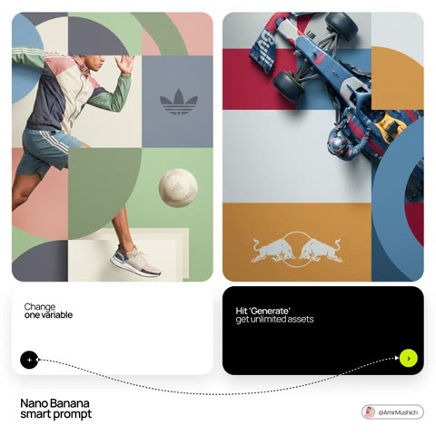</a>

A brand slot plus numbered phases (layering, 2x2 grid, muted palette, studio light, single logo) gives the model a fixed checklist, so one template works for any brand. Naming palette shifts with examples like dusty rose and slate blue keeps the colours soft and free of gradients.

Nano Banana 2 · Text-to-image · Source: [@AmirMushich on X](https://x.com/AmirMushich/status/2028115571724660920) · 2,570 likes on 2026-10-29

[`brand-poster`](tags.md#tag-brand-poster) [`template`](tags.md#tag-template) [`muted-palette`](tags.md#tag-muted-palette) [`geometric`](tags.md#tag-geometric)

<details><summary><b>Prompt</b></summary>

```text
(access Nano Banana 2 here:
https://
amirmushich.link/LTX_NBP)

[BRAND NAME]. Act as a World-Class Editorial Designer.

PHASE 1: DYNAMIC SUBJECT LOGIC.

- Subject Selection: Autonomously analyze [BRAND NAME].

- Layering (The Sandwich Effect): Interweave the subject with background shapes. Some parts of the car/person must be hidden behind geometric blocks, while other parts (wheels, limbs, props) must overlap them to create 3D depth.

PHASE 2: GRID & GEOMETRY.

- Layout: A clean 2x2 grid composition.

- Overlays: Superimpose large, bold geometric arcs and circles over the grid.

- Visual Balance: Place one iconic product prop (e.g., a floating key fob for cars or a ball for sports) in a separate quadrant to balance the subject.

PHASE 3: SOPHISTICATED MUTED PALETTE.

- Color Direction: DO NOT use aggressive neon or oversaturated colors.

- Palette: Identify the core colors of [BRAND NAME] and shift them to a "Sophisticated Muted" spectrum.

- Tones: Use desaturated, earthy, or "dusty" versions of the brand colors (e.g., instead of hot pink, use dusty rose; instead of bright mint, use sage green; instead of royal blue, use slate blue).

- Finish: Matte, flat color blocks with zero gradients.

PHASE 4: PHOTOGRAPHY & LIGHTING.

- Subject Style: High-end commercial studio photography.

- Lighting: Soft, diffused studio lighting with gentle highlights. No harsh shadows.

- Integration: The subject must feel physically embedded into the graphic grid.

PHASE 5: MINIMALIST BRANDING.

- Logo: Place a clean, single-color [BRAND NAME] logo in the center of one background block. No taglines, just the iconic symbol.
```

</details>

<a id="gpt-image-luffy-streetwear-poster"></a>
### Monkey D. Luffy in red streetwear poster

<a href="https://x.com/ChillaiKalan__/status/2051938130505453866">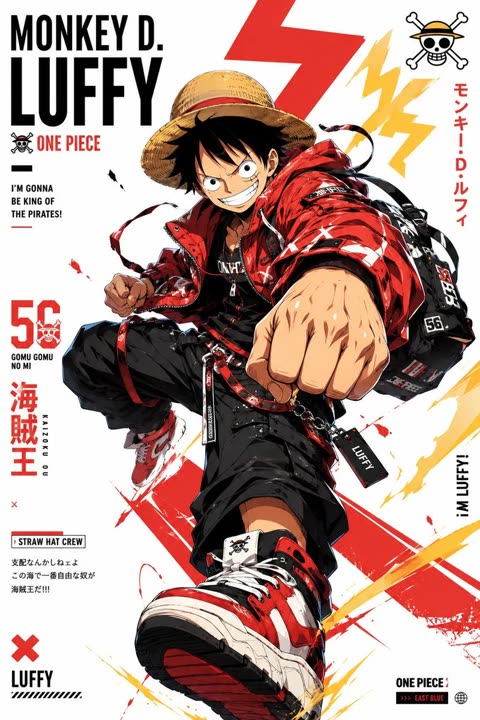</a>

A fixed style block sets the pose rules, palette, background and lighting once, so a character name slotted into the template gives a consistent poster. Asking for canon identity elements such as the straw hat keeps the character recognisable while the outfit is restyled as streetwear.

GPT Image 2 · Text-to-image · Source: [@ChillaiKalan__ on X](https://x.com/ChillaiKalan__/status/2051938130505453866) · 1,891 likes on 2026-10-29

[`one-piece`](tags.md#tag-one-piece) [`luffy`](tags.md#tag-luffy) [`streetwear`](tags.md#tag-streetwear) [`anime-poster`](tags.md#tag-anime-poster)

<details><summary><b>Prompt</b></summary>

```text
Create a stylized illustration of {character_name} from {franchise}.

Character Analysis:

Derive the character’s core personality archetype based on canon portrayal (e.g., heroic, calm, mysterious, aggressive).
Identify the signature color from the original design and use it as the primary visual accent.

Pose & Body Language:

Generate an iconic pose that reflects the personality archetype:
Energetic / Heroic: dynamic action, wide stance, explosive movement
Calm / Confident: balanced, relaxed posture, minimal motion
Dark / Mysterious: low stance, subtle movement, sharp or hidden gaze
Aggressive / Intense: forward-leaning attack stance, visible tension, clenched fists

Facial Expression:

Match expression precisely to the character’s personality and emotional tone.

Art Style:

Anime × streetwear × graphic poster hybrid
Clean lineart, semi-flat shading, high contrast
Modern, minimal, and visually striking

Composition:

Vertical format ({aspect_ratio})
Off-center subject placement
Strong diagonal visual flow
Layered depth for a dynamic poster feel

Outfit Design:

Reimagine the original costume as modern streetwear / techwear
Preserve recognizable identity elements of the character

Color Palette:

Dominant clean white background
Use signature color as the primary accent
Add one secondary accent (complementary or analogous tone)
Keep palette minimal, bold, and high-contrast

Background:

Abstract geometric poster layout
Use negative space effectively
Integrate subtle accents using the character’s color theme

Effects:

Energy strokes, paint lines, and motion accents
Effects should follow the character’s energy and color identity

Lighting:

Sharp directional lighting
Crisp shadows
Subtle glow using the signature color

Rendering Quality:

Ultra-clean vector-style finish
Poster-quality composition
4K resolution, high detail
```

</details>

<a id="nano-banana-monoline-city-travel-poster-kyoto"></a>
### Kyoto Street Monoline Travel Poster in Red

<a href="https://x.com/Goodmanprotocol/status/2052974175435026714">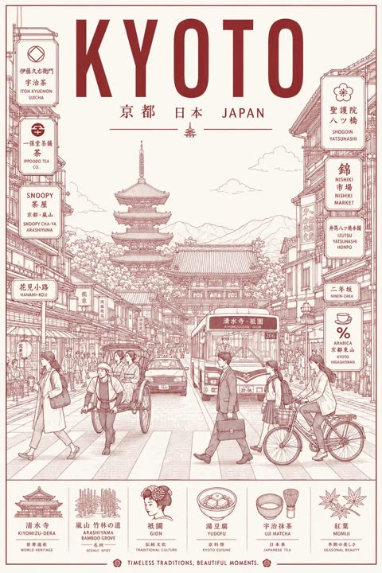</a>

A destination placeholder lets one template serve any city. The prompt fixes a one ink plus one background palette with examples per city, asks for dense monoline detail and local language signage, and sets a text quality clause to keep the typography readable.

Nano Banana 2 · Text-to-image · Source: [@Goodmanprotocol on X](https://x.com/Goodmanprotocol/status/2052974175435026714) · 1,436 likes on 2026-10-29

[`travel-poster`](tags.md#tag-travel-poster) [`line-art`](tags.md#tag-line-art) [`monochrome`](tags.md#tag-monochrome) [`swiss-modernist`](tags.md#tag-swiss-modernist) [`template`](tags.md#tag-template)

<details><summary><b>Prompt</b></summary>

```text
Create an ultra-high-resolution minimalist line-art travel poster of [DESTINATION], portraying the city as a stylish everyday urban scene rather than a tourist postcard.

CORE COMPOSITION:
- Central composition shows the city’s most iconic street, intersection, alley, tram street, or pedestrian avenue
- Foreground includes locals, commuters, cyclists, travelers, shoppers, students, café visitors
- People should naturally reflect the city’s local lifestyle and fashion culture
- Background filled with realistic local signage, cafés, restaurants, transportation signs, storefronts, and architectural details
- Landmarks should appear naturally integrated into everyday life, never exaggerated
- Include authentic local-language typography and culturally recognizable visual elements
- Large bold typography at the top center:
  “[DESTINATION]”
- Subtitle below:
  local language + country name
  examples:
  東京 JAPAN
  서울 KOREA
  ΚΟΛΩΝΙΑ GERMANY

STYLE:
ultra clean vector illustration,
Swiss modernist travel poster,
minimal line art,
monoline drawing,
mid-century editorial aesthetic,
architectural illustration,
Japanese graphic poster style,
precise geometric perspective,
extremely clean negative space,
premium travel branding aesthetic

LINE STYLE:
- monochrome line-based illustration only
- thin and highly precise linework
- minimal fill areas
- intricate city-map-like detail density
- rhythmic layering of signs, buildings, windows, and street objects
- visually dense yet highly organized composition

COLOR SYSTEM — VERY IMPORTANT:
- use only ONE main color + ONE background color
- automatically choose a color that best represents the city’s atmosphere
- monochrome silkscreen poster aesthetic
- no rainbow palettes
- no excessive neon
- color should reflect the city’s architecture, climate, nightlife, and cultural identity

Examples:
Tokyo → vivid red on warm ivory
Paris → deep navy on cream
New York → charcoal black on light gray
Kyoto → muted burgundy on warm cream
Hong Kong → teal blue on pale ivory
Santorini → Mediterranean blue on white
Cairo → desert sepia on sand beige

COMPOSITION:
- vertical poster layout
- frontal street-level perspective
- pedestrians crossing streets or moving naturally
- balanced urban rhythm and visual flow
- should feel like a premium city-brand campaign poster

MOOD:
stylish urban life,
calm but lively,
editorial travel magazine cover,
timeless city identity,
premium tourism campaign visual,
minimal yet highly detailed

TEXT QUALITY — EXTREMELY IMPORTANT:
- all typography must be readable and accurate
- no random characters
- no broken or distorted letters
- local signage should feel authentic and natural
- professional editorial typography alignment

OUTPUT:
- vertical poster composition
- 8K ultra detailed
- print-ready
- ultra sharp vector quality
```

</details>

<a id="gpt-image-carved-22-birthday-poster-pop-out"></a>
### Luxury birthday poster with carved 22 wall

<a href="https://x.com/Sairah_0/status/2064643917895839913">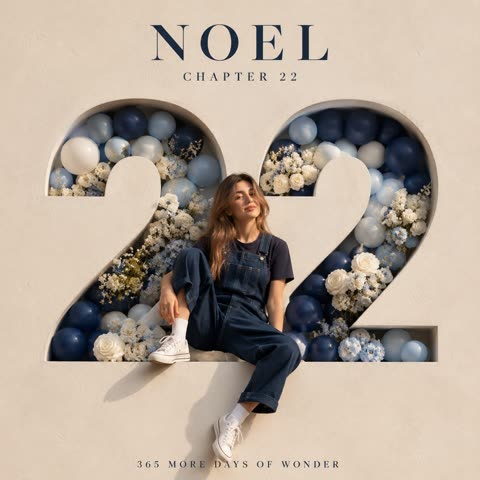</a>

The number is carved into a textured wall with inner shadows and filled with balloons and flowers, while the subject sits on its curve and extends past the edge for a 3D pop out. A reference face instruction, a limited navy and white palette, side sunlight and exact typography lines keep the poster consistent.

GPT Image 2 · Edit · Source: [@Sairah_0 on X](https://x.com/Sairah_0/status/2064643917895839913) · 1,026 likes on 2026-10-29

[`birthday`](tags.md#tag-birthday) [`pop-out`](tags.md#tag-pop-out) [`carved-number`](tags.md#tag-carved-number) [`navy-palette`](tags.md#tag-navy-palette) [`reference-face`](tags.md#tag-reference-face)

<details><summary><b>Prompt</b></summary>

```text
Professional luxury birthday poster, 3:4 ratio. Entire frame filled with a premium off-white luxury paper textured wall. Large number “22” precisely carved into the wall with visible depth, realistic inner shadows, and elegant dimensional detailing. Inside the number: navy blue, pastel blue, and white balloons, delicate white flowers, refined bouquet arrangements, and premium celebration styling. A happy 22-year-old child with preserved reference facial features, wearing a navy blue T-shirt and navy blue denim overalls, sitting casually on the lower curve of the number “22” with one leg bent and the other dangling naturally, smiling brightly while looking slightly upward. Face, shoulder, one arm, and one foot extend outside the carved number, creating a realistic 3D pop-out effect. Warm cinematic sunlight entering from one side, soft rim lighting, photorealistic skin texture, premium studio photography, ultra-realistic details, sharp focus, luxury editorial quality. Typography on the wall: “NOEL”, “CHAPTER 22”, “365 MORE DAYS OF WONDER”. Clean minimalist composition, luxury magazine cover aesthetic, high-end art direction, realistic shadows, natural colors, no tree shadows, no fake lighting, no AI artifacts, premium birthday campaign photography, masterpiece quality."
```

</details>

<a id="gpt-image-vivajuice-beverage-ad-poster"></a>
### Juice bottle ad with crouching model in hallway

<a href="https://x.com/AIwithSarah_/status/2049452842931630202">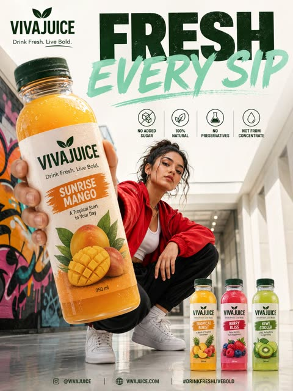</a>

Forced perspective makes the foreground bottle dominate while the crouching pose adds depth. Naming each text block and its position in the prompt keeps the headline, badges and flavor row in the requested layout.

GPT Image 2 · Text-to-image · Source: [@AIwithSarah_ on X](https://x.com/AIwithSarah_/status/2049452842931630202) · 866 likes on 2026-10-29

[`beverage`](tags.md#tag-beverage) [`advertisement`](tags.md#tag-advertisement) [`forced-perspective`](tags.md#tag-forced-perspective) [`typography`](tags.md#tag-typography)

<details><summary><b>Prompt</b></summary>

```text
GPT Image 2 on ChatGPT.

Prompt: Create a premium modern beverage advertisement poster in a vertical 3:4 format featuring a stylish young female model crouching confidently in a bright urban indoor hallway with colorful graffiti wall art on one side and clean minimal architecture on the other, giving a trendy streetwear lifestyle vibe. The model wears casual fashionable clothes such as a red oversized jacket, white inner top, black joggers, and white sneakers, looking directly at the camera with a cool confident expression. In the foreground, a giant realistic fruit juice bottle is held toward the camera in forced perspective, dominating the composition with sharp focus and glossy reflections. The bottle should have a completely different fictional brand name such as “VIVAJUICE” in bold modern typography, with attractive fruit illustrations on the label and flavor text like “Sunrise Mango” or “Tropical Burst.” At the top left, place the brand logo and a catchy tagline like “Drink Fresh. Live Bold.” Across the top center, add huge bold overlapping typography reading “PURE AS NATURE” or “FRESH EVERY SIP” in contrasting colors like dark green and mint. Below the headline, include 4 clean icon-based feature badges in a row with text such as “NO ADDED SUGAR,” “100% NATURAL,” “NO PRESERVATIVES,” and “NOT FROM CONCENTRATE.” At the bottom right, display three smaller bottle variants in different flavors neatly arranged. Use soft natural lighting mixed with commercial studio polish, realistic shadows, shallow depth of field, glossy floor reflections, and a premium energetic eCommerce campaign aesthetic inspired by modern Instagram and billboard ads.
```

</details>

<a id="gpt-image-chapter-28-ivory-birthday-poster"></a>
### Man seated on giant 3D number 28

<a href="https://x.com/Taaruk_/status/2065261505713782784">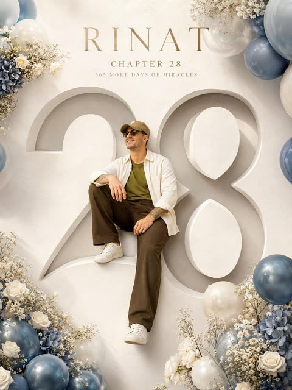</a>

Fill-in slots for name and age make the prompt reusable for any birthday. Naming the carved number, the seated pose, and the exact flowers and balloon colours pins the composition, while the lighting and lens terms set the editorial finish.

GPT Image 2 · Text-to-image · Source: [@Taaruk_ on X](https://x.com/Taaruk_/status/2065261505713782784) · 855 likes on 2026-10-29

[`birthday`](tags.md#tag-birthday) [`poster`](tags.md#tag-poster) [`3d-typography`](tags.md#tag-3d-typography) [`floral`](tags.md#tag-floral)

<details><summary><b>Prompt</b></summary>

```text
Create a luxury minimalist birthday milestone poster featuring a giant 3D number “[AGE]” carved into a premium ivory-white wall. A stylish person is naturally sitting, leaning, or hanging from the number, posing confidently. Elegant floral arrangements with white roses, baby's breath, hydrangeas, and pastel blue balloons frame the composition. Soft natural sunlight, premium editorial photography, modern celebration aesthetic, clean luxury design, subtle shadows, sophisticated typography. At the top, display the name “[NAME]” in elegant serif font, followed by “CHAPTER [AGE]” and the quote “365 More Days of Miracles.” Neutral beige and white color palette, high-end event styling, dreamy atmosphere, photorealistic, magazine-quality portrait, ultra-detailed textures, luxury birthday photoshoot, Instagram-worthy, shallow depth of field, soft lighting, 8K masterpiece, professional fashion photography.
```

</details>

<a id="gpt-image-portugal-lisbon-double-exposure-poster"></a>
### Profile portrait fused with Lisbon, Portugal travel poster

<a href="https://x.com/frametheory058/status/2060332705532063968">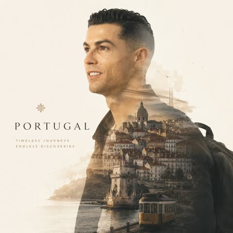</a>

The prompt fixes the layout first: a portrait double exposed with landmarks, a creamy beige field, golden hour grading, and a small serif title block with a tagline. Listing landmarks, transport and street life by category gives concrete content without dictating every detail.

GPT Image 2 · Text-to-image · Source: [@frametheory058 on X](https://x.com/frametheory058/status/2060332705532063968) · 775 likes on 2026-10-29

[`double-exposure`](tags.md#tag-double-exposure) [`travel-poster`](tags.md#tag-travel-poster) [`editorial`](tags.md#tag-editorial) [`portrait`](tags.md#tag-portrait)

<details><summary><b>Prompt</b></summary>

```text
Create an ultra-premium cinematic travel poster in a sophisticated double-exposure editorial style.

Use [CELEBRITY NAME] from [COUNTRY] as the main subject. Preserve the exact recognizable facial structure, hairstyle, expression, skin texture, and realistic likeness of the celebrity with photorealistic detail.

The composition should feel like a luxury international tourism campaign mixed with high-end fashion editorial photography and professional Adobe Photoshop compositing.

Design the poster using the actual map/silhouette shape of [COUNTRY] as a major compositional element. Seamlessly blend the celebrity portrait into the country silhouette while integrating iconic landmarks, architecture, skylines, streets, culture, transportation, landscapes, nature, and atmosphere of [COUNTRY].

The celebrity should appear stylish, elegant, and cinematic, wearing modern luxury travel fashion such as a neutral-toned jacket, minimal outfit, and sophisticated traveler styling.

Inside the composition, include realistic iconic elements associated with [COUNTRY], such as:

- famous monuments
- skyline/city views
- historical architecture
- coastal or mountain scenery
- local culture and transportation
- cinematic streets and cafes
- recognizable national atmosphere

Use MASTER-LEVEL PROFESSIONAL COLOR GRADING:

- warm cinematic golden-hour lighting
- creamy beige/off-white luxury background
- rich soft highlights
- muted premium tones
- subtle shadows
- atmospheric haze
- realistic contrast
- filmic dynamic range
- elegant depth separation
- polished editorial finish

The blending must look seamless and realistic:

- no harsh edges
- no artificial overlays
- no clutter
- no random floating elements
- realistic light interaction
- smooth compositing transitions
- natural texture consistency

Typography should look like a luxury tourism brand campaign:

- elegant serif fonts
- minimal clean layout
- refined spacing
- premium hierarchy
- cinematic slogan/tagline
- subtle decorative elements

Poster aesthetic:

- luxury travel advertisement
- Netflix documentary poster vibe
- high-end tourism campaign
- editorial magazine quality
- timeless sophisticated aesthetic
- cinematic realism
- polished professional design
- visually balanced composition
- strong focal hierarchy

Avoid:
cartoon style, AI artifacts, distorted anatomy, extra limbs, oversaturated colors, messy composition, fake lighting, unrealistic textures, duplicate features, low-quality blending, cheap typography, cluttered layout, random elements, exaggerated fantasy effects.

Ultra realistic, highly detailed, photorealistic, cinematic, masterpiece quality, professional color grading, luxury editorial aesthetic.

Aspect Ratio: 1:1
```

</details>

<a id="gpt-image-barcelona-isometric-diorama-poster"></a>
### Barcelona city tile diorama on plain studio background

<a href="https://x.com/TechieBySA/status/2089361378242879538">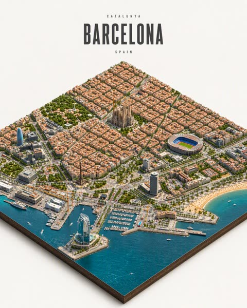</a>

A fill-in [CITY] slot turns the prompt into a reusable template for a whole series. The explicit tile geometry (45 to 50 degree high angle, diamond orientation, thin dark wood slab edge) makes the scene read as a physical scale model, and the reserved upper third holds a three-line type block.

GPT Image 2 · Text-to-image · Source: [@TechieBySA on X](https://x.com/TechieBySA/status/2089361378242879538) · 693 likes on 2026-10-29

[`isometric`](tags.md#tag-isometric) [`diorama`](tags.md#tag-diorama) [`tilt-shift`](tags.md#tag-tilt-shift) [`city-map`](tags.md#tag-city-map)

<details><summary><b>Prompt</b></summary>

```text
Simply replace [CITY]:✨

"Ultra-detailed photorealistic isometric miniature scale-model diorama of [CITY], presented as a thin flat square tile resting on a pure off-white seamless studio background. The tile is a clean, precisely cut square slab with straight vertical edges revealing a thin band of dark wood/earth material along the sides — like a professionally built architectural model mounted on a display base. The tile is rotated so it reads as a diamond in perspective, viewed from a high isometric angle of roughly 45–50° looking down, with the front corner of the slab pointing toward the lower part of the frame.

The entire top surface is filled edge to edge with a meticulously accurate miniature recreation of the city's real urban fabric: the actual street grid and road layout, real residential blocks with correct local architecture and rooftop materials, the city's most recognizable landmarks in their true relative positions and true-to-life scale (never exaggerated), plazas, parks, tree-lined boulevards, rivers or coastline if the city has them, bridges, and any major stadium or arena. Include dense micro-detail: individual parked cars, moving traffic, buses, tiny pedestrians in plazas, street lamps, awnings, rooftop AC units, construction cranes, parking lots with rows of cars, boats in water if applicable. Every tree is individually modeled. Roads show painted lane markings and crosswalks.

Rendering style: hyper-realistic tilt-shift miniature photography look — extremely sharp, high resolution, everything in focus across the whole tile, no blur. Bright, soft, even daylight studio lighting from above with gentle diffuse shadows, no harsh contrast, no dramatic side lighting. Natural saturated color: green pitches and parks, terracotta and stone rooftops, blue water, grey asphalt. Clean and premium.

Layout: the diorama occupies the lower two-thirds of the frame. The upper third is empty off-white negative space containing minimalist editorial typography, centered and small relative to the frame: a small line of wide-tracked small caps at the very top, then directly below the city name in a bold condensed sans-serif display font in dark charcoal grey (large but not full-bleed — restrained), then a line of small wide-tracked small caps below that with a short subtitle or region name. Generous white space between the typography block and the top edge of the diorama.

Minimalist editorial poster aesthetic, premium print quality, 4:5 aspect ratio."
```

</details>

<a id="gpt-image-human-fragments-typography-poster-template"></a>
### Editorial typography poster with woman and bicycle

<a href="https://x.com/ChillaiKalan__/status/2084503517709119999">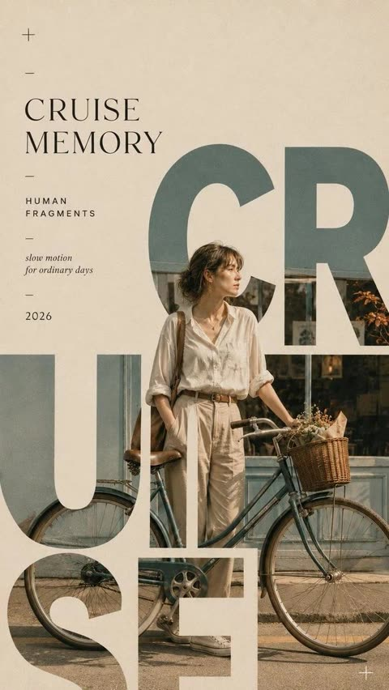</a>

Oversized letters act as the layout structure, so the person and street scene appear inside the glyphs and break past their edges. Bracketed slots for theme, subject, state and palette plus a fixed series and year make it a reusable template.

GPT Image 2 · Text-to-image · Source: [@ChillaiKalan__ on X](https://x.com/ChillaiKalan__/status/2084503517709119999) · 621 likes on 2026-10-29

[`typography`](tags.md#tag-typography) [`editorial`](tags.md#tag-editorial) [`template`](tags.md#tag-template) [`lifestyle`](tags.md#tag-lifestyle) [`9-16`](tags.md#tag-9-16)

<details><summary><b>Prompt</b></summary>

```text
Create a 9:16 editorial typography poster from a single human-centered lifestyle moment.

Use oversized typography as the main composition structure. Let the person, movement, city space, or everyday scene appear inside the letters, pass through them, or break beyond their edges. The image should feel integrated with the type, not simply placed behind text.Theme: [Custom Title]
Subject: [Subject Gender Or Origin]
Human state: [Human State]
Color palette: [Color Palette]
Series: HUMAN FRAGMENTS
Year: 2026
```

</details>

<a id="gpt-image-mykonos-flat-vector-travel-poster"></a>
### Whitewashed Mykonos harbor with windmills travel poster

<a href="https://x.com/Goodmanprotocol/status/2053347075648278737">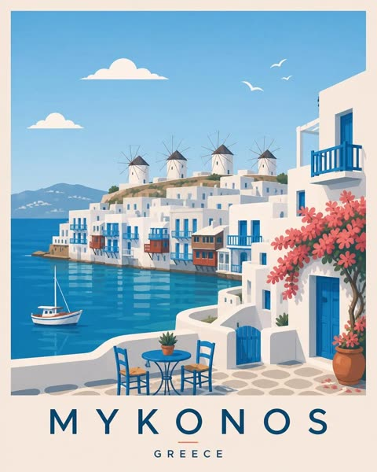</a>

A fixed style block (flat vector, no gradients, Scandinavian editorial) plus a destination slot lets one layout be reused for any place. Listing the layers in order, from foreground waterfront to midground houses to background landmark, gives the model a clear depth structure.

GPT Image 2 · Text-to-image · Source: [@Goodmanprotocol on X](https://x.com/Goodmanprotocol/status/2053347075648278737) · 587 likes on 2026-10-29

[`travel-poster`](tags.md#tag-travel-poster) [`flat-vector`](tags.md#tag-flat-vector) [`typography`](tags.md#tag-typography) [`template`](tags.md#tag-template)

<details><summary><b>Prompt</b></summary>

```text
Create a premium editorial travel poster illustration of [DESTINATION].

Style:

flat vector illustration, ultra clean minimalism,

mid-century modern aesthetic,

editorial travel poster style (Scandinavian design inspired),

no photorealism, no textures, no noise, no gradients

Composition:

vertical 4:5 poster layout,

foreground: calm waterfront / road / natural edge

midground: colorful local houses or buildings with clean geometric shapes

background: iconic natural landscape or mountain of [DESTINATION]

add 1–2 landmark structures (church, tower, bridge, etc.) subtly

Architecture:

simplified geometric buildings,

clean edges, flat colors,

slightly varied roof colors (harmonious palette, not random)

Color palette:

soft, cohesive, location-inspired colors

pastel tones + muted contrast

bright but not saturated

(example: sky blue, coral, mustard, navy, soft green)

Lighting:

bright daylight, soft shadows,

clean and fresh atmosphere

Typography:

add text at bottom center:

"[DESTINATION]" (large, modern sans-serif, spaced letters)

"[COUNTRY]" (small subtitle below)

Mood:

calm, clean, premium, slightly dreamy travel magazine feel

Quality:

ultra clean edges,

perfect alignment,

no distortion,

high resolution, print-ready
```

</details>

<a id="gpt-image-orange-juice-campaign-poster"></a>
### Orange juice campaign poster with feature cards

<a href="https://x.com/Emmma___0/status/2053667545371361587">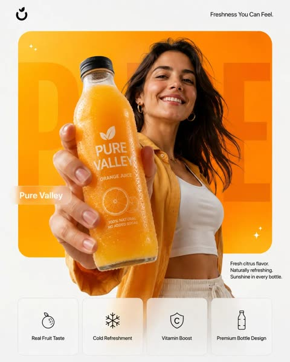</a>

A fill-in template with fixed slots for product, tagline, benefits and feature cards keeps the whole campaign layout consistent. Specifying 4:5 format, a rounded colour panel and a strong low angle on a held product makes the bottle the hero.

GPT Image 2 · Text-to-image · Source: [@Emmma___0 on X](https://x.com/Emmma___0/status/2053667545371361587) · 560 likes on 2026-10-29

[`product-poster`](tags.md#tag-product-poster) [`campaign`](tags.md#tag-campaign) [`template`](tags.md#tag-template) [`food-drink`](tags.md#tag-food-drink)

<details><summary><b>Prompt</b></summary>

```text
Create a photorealistic premium product campaign poster in a 4:5 vertical aspect ratio.

Product: [PRODUCT NAME]
Brand style: [BRAND / PREMIUM / LUXURY / TECH / BEAUTY / FOOD / DRINK]
Main subject: A confident model holding or presenting the product close to the camera, with the product in sharp focus and the model slightly behind it. Use a strong perspective angle so the product feels powerful, premium, and hero-like.

Background:
Use a clean studio background with a large rounded rectangle panel behind the subject. The panel color should match the product theme: [COLOR THEME]. Add subtle oversized typography or abstract product-related shapes in the background, softly blended and partially hidden behind the subject.

Lighting:
Cinematic softbox lighting, realistic shadows, premium commercial photography, glossy highlights on the product, clean reflections, sharp details, high-end advertising look.

Composition:
Top-left: small minimalist brand logo placeholder.
Top-right: short tagline: “[TAGLINE]”
Middle-left: small glassmorphism label with product name: “[PRODUCT NAME]”
Bottom-right: short product description:
“[ONE-LINE BENEFIT 1]
[ONE-LINE BENEFIT 2]
[ONE-LINE BENEFIT 3]”

Bottom section:
Add four clean feature cards with minimal black icons and short labels:
1. [FEATURE 1]
2. [FEATURE 2]
3. [FEATURE 3]
4. [FEATURE 4]

Style:
Premium campaign poster, realistic product photography, minimalistic layout, modern typography, clean negative space, luxury branding, high detail, cinematic advertising, professional commercial poster, ultra-realistic, sharp focus, elegant shadows.

Avoid:
messy text, extra logos, distorted product, wrong spelling, low-quality graphics, cartoon style, over-saturated colors.
```

</details>

<a id="gpt-image-2027-watercolor-calendar"></a>
### 2027 watercolor calendar with one seated man per month

<a href="https://x.com/Fujimoto_hina/status/2055895559429644702">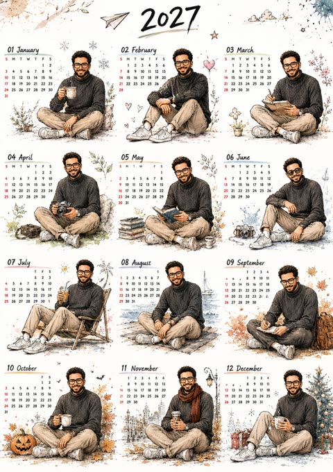</a>

The same character is held consistent across twelve panels by fixing the face, curly hair, glasses and beard in every scene. A 3x4 month grid with seasonal doodle borders on a clean white ground keeps the layout orderly.

GPT Image 2 · Edit · Source: [@Fujimoto_hina on X](https://x.com/Fujimoto_hina/status/2055895559429644702) · 516 likes on 2026-10-29

[`calendar`](tags.md#tag-calendar) [`watercolor`](tags.md#tag-watercolor) [`character-consistency`](tags.md#tag-character-consistency) [`korean-illustration`](tags.md#tag-korean-illustration)

<details><summary><b>Prompt</b></summary>

```text
{
  "prompt": "Create a premium 2027 desktop calendar poster in A4 vertical format featuring the same young man from the reference image, illustrated in a Korean hand-drawn illustration style. Design a 3x4 monthly grid layout from January to December 2027. Each month should feature the character sitting in a different relaxed pose and seasonal environment while maintaining consistent facial identity, curly hair, glasses, beard, warm smile, and cozy aesthetic. Use full-body compositions with natural expressions and dynamic seated poses.\n\nArt style should combine watercolor, ink sketch, comic doodle textures, pastel washes, splatter brush strokes, freehand sketch lines, and soft painterly rendering. Keep a clean white background with artistic negative space. Surround each month with symbolic seasonal doodles and decorative edge elements such as flowers, books, coffee cups, snowflakes, pumpkins, lanterns, cameras, stars, paper planes, autumn leaves, beach props, Christmas decorations, travel icons, and whimsical sketch marks.\n\nCharacter clothing should have highly detailed knit textures, layered winter-fashion inspired outfits, soft neutral tones, rolled pants, sneakers, scarves, and cozy casual aesthetics. Maintain an elegant editorial illustration feel with high detail, atmospheric storytelling, expressive linework, and premium stationery design quality.\n\nMonthly scene concepts:\n- January: sitting with hot coffee and winter doodles\n- February: cozy seated pose with heart and flower sketches\n- March: sitting while sketching in a notebook\n- April: sitting with vintage camera and spring leaves\n- May: reading books beside stacked novels\n- June: relaxed pose with travel and sea doodles\n- July: sitting on beach chair with summer drink\n- August: seated near ocean-themed illustrations\n- September: journaling with autumn leaves\n- October: cozy Halloween-inspired atmosphere with pumpkin doodles\n- November: warm scarf and city sketch background\n- December: sitting beside Christmas decorations and gifts\n\nTypography should be elegant handwritten brush style for month titles and modern minimal calendar formatting. Use soft neutral and pastel color palettes mixed with black ink textures. Add subtle paint splashes, rough paper grain, sketch imperfections, and artistic composition balance. Ultra detailed, high quality, cinematic illustration aesthetic, premium printable calendar poster design.",
  "size": "1024x1792"
}
```

</details>

<a id="gpt-image-halftone-architecture-poster"></a>
### Building photo to halftone travel-collage poster

<a href="https://x.com/Naiknelofar788/status/2100067049288634730"></a>

Long spec with a closing priority rule: architectural accuracy first, the halftone treatment second.

GPT Image 2.5 · Edit · Source: [@Naiknelofar788 on X](https://x.com/Naiknelofar788/status/2100067049288634730) · 497 likes on 2026-10-27

[`halftone`](tags.md#tag-halftone) [`architecture`](tags.md#tag-architecture) [`travel`](tags.md#tag-travel) [`collage`](tags.md#tag-collage)

<details><summary><b>Prompt</b></summary>

```text
Turn this structure photo into a single high-end halftone architectural travel-collage poster. Output one poster per uploaded photo — never merge multiple structures or photos into one frame.

FORMAT

3:4 vertical canvas. Split into two roughly equal zones — real architectural photo on top, printed reconstruction below — divided by one clean, sharp horizontal line.

Do not stretch, warp, tilt, or unnaturally reposition the structure to force the proportions.

TOP HALF — THE REAL SHOT

Preserve the original structure faithfully: same architecture, proportions, perspective, distinctive details, surrounding elements, natural light and shadow, and original color mood.

Keep recognizable features such as:

* façade
* windows and arches
* towers or domes
* doors and structural details
* roofline
* surrounding landscape or street elements

Add only a subtle high-end color grade and the faintest film grain. Do not redesign or reinterpret the architecture.

BOTTOM HALF — THE PRINTED RECONSTRUCTION

Rebuild the same structure as an experimental printed architectural collage using:

torn photographic fragments + fixed-width ASCII character fields + photocopy halftone dots + architectural linework.

The structure must remain immediately recognizable.

* Torn-edge photographic fragments preserve the most important architectural details.
* Brick, stone, glass, metal, shadows, windows, and surrounding textures gradually dissolve outward into ASCII characters, black halftone dots, fragmented print grain, and fine architectural drafting lines.
* Use thin technical construction lines to subtly trace the structure’s geometry.
* Let selected areas break apart into paper fibers and halftone fragments, creating the feeling that the building is emerging from an archival print.
* Keep the main silhouette strong and readable.
* Texture: rough white paper-fiber edges, subtle photocopy imperfections, slight print misregistration, faded ink, old-paper stains, a few restrained crop marks, and one small red calibration bar.
* Color: warm gray old-paper background + black ink + the structure’s original muted colors + a single restrained red accent.
* Never fully desaturate the structure.

The structure should occupy roughly 60–88% of the frame width, scaled according to what reads best for the architecture.

Leave 22–38% of the paper visibly untouched and empty, creating generous negative space so the poster feels like an archival architectural specimen rather than a packed digital screen.

TYPOGRAPHY

Add one clean, readable fixed-width architectural title based on the structure:

[STRUCTURE NAME]

Below it include:

[CITY, COUNTRY]
REC. STUDY 01

Add one short observational caption related to the architecture, such as:

“A monumental study in geometry, time, and place.”

Typography should feel like an old architectural archive mixed with an underground experimental design journal.

A few loose ASCII glyphs may trace the outer silhouette or architectural edges as texture only — never use ASCII to invent windows, doors, structural details, or technical specifications.

MOOD

Early digital systems × analog photocopy × architectural archive × underground zine × modern travel editorial.

The structure should feel like it is surfacing from an old printed document — half photograph, half architectural drawing, half experimental print.

Sophisticated, minimal, tactile, intellectual, slightly mysterious, and highly collectible.

AVOID

Solid black terminal backgrounds, dense walls of code, cyberpunk neon, excessive ASCII, distorted architecture, impossible geometry, invented architectural details, fake technical specifications, random symbols with no meaning, garbled text, excessive colors, brand logos, QR codes, watermarks, author credits, or tourist-poster clichés.

Priority: Preserve the structure’s identity and architectural accuracy first. The experimental halftone/ASCII treatment should enhance the architecture, not hide it.
```

</details>

<a id="gpt-image-crystal-number-birthday-poster-child"></a>
### Crystal glass number birthday poster with child

<a href="https://x.com/MahnoorAi12/status/2064970191092826474">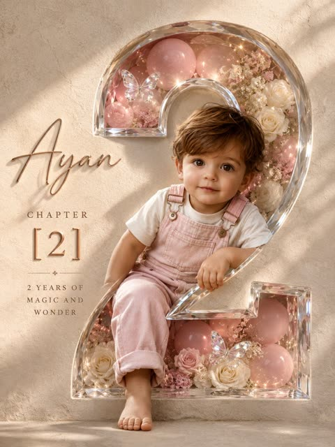</a>

Face identity is locked with an explicit consistency instruction, and the body parts that break the number frame give a 3D pop out effect. Material, lighting and typography blocks are written separately, with a negative prompt aimed at face drift and extra limbs. The age and name are bracketed slots to swap.

GPT Image 2 · Edit · Source: [@MahnoorAi12 on X](https://x.com/MahnoorAi12/status/2064970191092826474) · 482 likes on 2026-10-29

[`birthday`](tags.md#tag-birthday) [`crystal-glass`](tags.md#tag-crystal-glass) [`face-consistency`](tags.md#tag-face-consistency) [`pop-out`](tags.md#tag-pop-out) [`pastel`](tags.md#tag-pastel)

<details><summary><b>Prompt</b></summary>

```text
:::writing{variant="document" id="58372"} Professional luxury birthday poster, 3:4 portrait composition, ultra high-end studio photography aesthetic, premium off-white textured paper wall background with subtle grain and depth.
A giant luxury crystal-glass number [AGE] is precisely carved into the wall with realistic thickness, beveled edges, transparent glass material, sparkling reflections, crystal highlights, light refractions, and deep inner shadows creating dramatic 3D depth.
Inside the number: elegant pastel pink balloons, premium white roses, luxury flower bouquets, soft floating sparkles, delicate crystal butterflies, dreamy magical atmosphere, clean minimal styling, high-end editorial design.
A happy [AGE]-year-old child with EXACT facial identity preserved from the uploaded reference image. Identical facial features, identical eyes, nose, lips, face shape, skin tone, hairstyle, expression style, and overall appearance. Face consistency is the highest priority.
Wearing a milky white T-shirt and premium pastel pink denim overalls with realistic fabric texture and luxury styling.
The child's head, shoulders, one hand, and one foot extend outside the number frame, creating an ultra-realistic 3D pop-out effect with accurate perspective, natural depth, realistic shadows, and seamless integration between foreground and background.
Warm cinematic golden sunlight entering from one side, soft rim lighting, realistic skin texture, studio-quality photography lighting, natural shadows, luxury portrait lighting, shallow depth of field.
Elegant typography integrated directly onto the wall:
[Ayan]
CHAPTER [2]
[AGE] YEARS OF MAGIC AND WONDER
Minimal luxury editorial layout, Vogue magazine cover style, premium birthday campaign photography, award-winning composition, soft contrast, natural pastel colors, crystal reflections, ultra-sharp focus, photorealistic rendering, masterpiece quality, luxury realism.
Negative Prompt: different face, altered facial features, face swap, wrong child, duplicate body parts, extra fingers, extra limbs, deformed hands, distorted face, crossed eyes, blurry face, low quality, AI artifacts, text errors, watermark, logo, bad anatomy, oversaturated colors, cropped head, unrealistic skin, poor lighting.
8K ultra-detailed, hyper-realistic, premium luxury birthday poster. :::
Sab se important improvement ye hai:
"EXACT facial identity preserved from the uploaded reference image" aur "Face consistency is the highest priority"
```

</details>

<a id="gpt-image-watercolor-city-travel-poster-cafe"></a>
### Watercolor Los Angeles Cafe Travel Poster

<a href="https://x.com/oggii_0/status/2055876530988015791">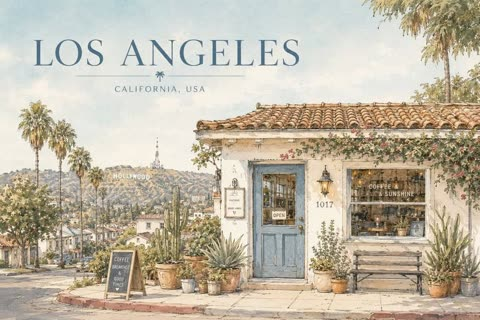</a>

Bracketed CITY, COUNTRY and LANDMARK variables turn one prompt into a template for any city. Separate blocks for style, composition, typography, palette and texture keep the sky open for the title and the landmark small in the background.

GPT Image 2 · Text-to-image · Source: [@oggii_0 on X](https://x.com/oggii_0/status/2055876530988015791) · 471 likes on 2026-10-29

[`watercolor`](tags.md#tag-watercolor) [`travel-poster`](tags.md#tag-travel-poster) [`city-template`](tags.md#tag-city-template) [`architecture`](tags.md#tag-architecture) [`typography`](tags.md#tag-typography)

<details><summary><b>Prompt</b></summary>

```text
[COUNTRY] = South Korea
[LANDMARK] = a recognizable landmark or scenic element of [CITY]

Create a serene architectural travel illustration inspired by [CITY], [COUNTRY], in a soft hand-drawn watercolor and ink style.

Main concept:
Show a quiet, charming street-side house or small building inspired by the everyday atmosphere of [CITY], [COUNTRY], while subtly incorporating [LANDMARK] in the composition.
The landmark should appear naturally in the background, distance, or surrounding scenery, so the image clearly feels connected to [CITY], [COUNTRY] without losing the calm residential mood.

Visual style:
delicate hand-drawn architectural illustration,
soft watercolor washes,
thin ink outlines,
slightly imperfect sketch lines,
warm sunlit atmosphere,
gentle pastel palette,
subtle paper texture,
quiet travel sketchbook aesthetic,
minimal yet detailed composition,
calm editorial illustration mood,
poetic everyday scenery,
cozy and refined visual tone,
no photorealism,
no harsh contrast,
no saturated colors,
no dramatic lighting.

Scene:
A peaceful small house, café, studio, or local building with simple walls, a tiled or regionally inspired roof, painted doors or windows, and several potted plants arranged naturally in front.
Include subtle local architectural details and everyday design elements that feel authentic to [CITY], [COUNTRY].
Incorporate [LANDMARK] as a softly integrated city symbol — for example, visible above rooftops, in the distance, or as part of the surrounding skyline or landscape.
The overall scene should feel quiet, elegant, warm, and locally rooted.

Composition:
landscape travel-poster format,
wide horizontal layout,
large open sky occupying the upper half or upper-left area,
main building placed across the lower portion of the composition,
balanced negative space,
front-facing or slightly angled composition,
potted plants and small objects along the base,
landmark subtly placed in the background or upper distance,
clean and spacious layout,
minimal but emotionally rich composition.

Typography:
Include the city name “[CITY]” clearly in the image.
Render “[CITY]” as elegant travel-poster typography, large but refined, placed prominently in the sky area or upper portion of the composition.
Optionally include “[COUNTRY]” in smaller text beneath or near the city name.
The text should feel integrated into the poster design, not like a random overlay.
Use clean, tasteful lettering that matches the calm watercolor travel-poster mood.

Color palette:
pale sky blue,
warm cream,
terracotta,
muted blue accents,
olive and soft green,
light earthy browns,
soft natural neutrals.

Texture:
visible watercolor paper grain,
transparent paint layering,
soft handmade brush texture,
gentle ink-and-wash finish.

Mood:
peaceful,
sunny,
quiet,
nostalgic,
cozy,
refined,
poetic,
calm everyday travel atmosphere.

Important:
The image should express both the intimate charm of a local building and the identity of [CITY], [COUNTRY] through the inclusion of [LANDMARK].
Do not make the landmark too dominant; it should support the mood rather than overpower the house scene.
The city name “[CITY]” must be visible and clearly readable in the final image.

Aspect ratio: 4:3 or 3:2

Creator: @hermes_agent_kr on Threads
```

</details>

<a id="gpt-image-bw-panels-color-cutout-fashion-poster"></a>
### Fashion Poster with Color Cutout over B&W Panels

<a href="https://x.com/saniaspeaks_/status/2061289299060924451">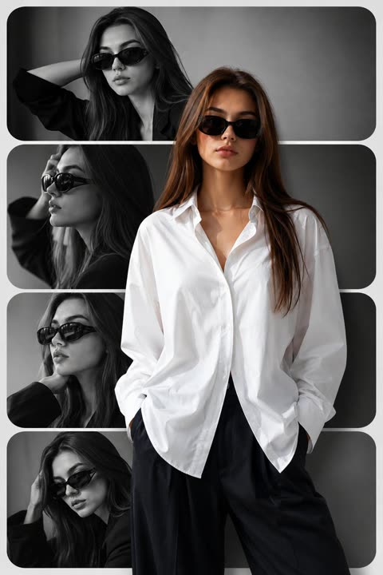</a>

Stacks four rounded black and white portrait panels as a background and overlays a full color cutout of the same subject, so contrast and depth layering carry the design. Explicit no text, no typography and soft shadow instructions keep the composition clean.

GPT Image 2 · Text-to-image · Source: [@saniaspeaks_ on X](https://x.com/saniaspeaks_/status/2061289299060924451) · 445 likes on 2026-10-29

[`collage`](tags.md#tag-collage) [`fashion`](tags.md#tag-fashion) [`editorial`](tags.md#tag-editorial) [`black-and-white`](tags.md#tag-black-and-white) [`layering`](tags.md#tag-layering)

<details><summary><b>Prompt</b></summary>

```text
MODERN EDITORIAL COLLAGE POSTER DESIGN. THE BACKGROUND FEATURES FOUR STACKED ROUNDED PANELS FILLED WITH BLACK AND WHITE CINEMATIC PORTRAITS OF A STYLISH YOUNG WOMAN WEARING SUNGLASSES IN DIFFERENT FASHION POSES. OVERLAYED IN THE FOREGROUND IS A HIGH-QUALITY FULL-COLOR CUTOUT OF THE SAME WOMAN WEARING A WHITE OVERSIZED SHIRT WITH BLACK PANTS AND SUNGLASSES, STRIKING A CONFIDENT FASHION POSE.
CLEAN MINIMAL DESIGN, NO TEXT, NO TYPOGRAPHY, NO LETTERS, SOFT SHADOWS, DEPTH LAYERING, HIGH CONTRAST LIGHTING, PREMIUM MAGAZINE STYLE, ULTRA REALISTIC, 8K, PROFESSIONAL POSTER COMPOSITION.
```

</details>

<a id="gpt-image-oversized-type-pink-fashion-editorial-poster"></a>
### Pink Fashion Poster With Giant Glowing Lettering

<a href="https://x.com/SimplyAnnisa/status/2053814655655543119">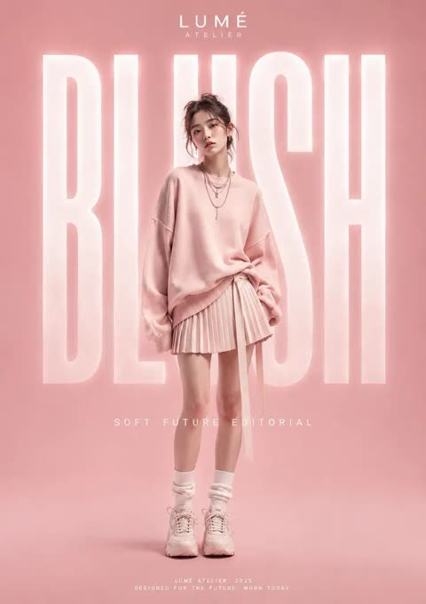</a>

A fill in the blank template that lists style, subject, layout, typography, lighting and palette as separate labeled blocks. Placing the huge title behind a centered full body model gives depth, and a single monochrome color keeps the poster cohesive.

GPT Image 2 · Text-to-image · Source: [@SimplyAnnisa on X](https://x.com/SimplyAnnisa/status/2053814655655543119) · 444 likes on 2026-10-28

[`fashion`](tags.md#tag-fashion) [`editorial`](tags.md#tag-editorial) [`typography`](tags.md#tag-typography) [`monochrome`](tags.md#tag-monochrome) [`template`](tags.md#tag-template)

<details><summary><b>Prompt</b></summary>

```text
Create a premium high-fashion editorial poster for [BRAND NAME].

TOPIC:
[STREETWEAR / FASHION COLLECTION / EDITORIAL CAMPAIGN]

STYLE & ART DIRECTION:

Oversized typography editorial aesthetic

Minimal futuristic fashion design

Korean high-fashion poster influence

Luxury streetwear branding

Avant-garde magazine-cover atmosphere

Soft monochromatic composition

Pinterest fashion-editorial aesthetic

High-end commercial styling

Modern runway campaign design

Minimal but bold visual hierarchy

Vogue-meets-streetwear atmosphere

MAIN SUBJECT:

A full-body fashion model prominently centered in the composition

Oversized luxury streetwear outfit

Fashion-forward silhouette and styling

Minimal expressive pose

Elegant emotional neutrality

Realistic luxury-fashion photography

Premium editorial lighting

Modern runway attitude

Soft futuristic mood

Clean symmetrical body positioning

LAYOUT & COMPOSITION:

Same exact editorial composition and hierarchy as the reference design

Massive oversized typography placed behind the model

Typography integrated into the composition as a graphic element

Strong centered symmetry

Minimal clean background

Spacious luxury editorial layout

Magazine-cover inspired balance

Minimal distractions

Strong visual focus on the fashion styling

TEXT & TYPOGRAPHY:

Huge bold geometric typography

Editorial fashion font style

Oversized lettering occupying most of the background

Minimal secondary micro typography

Luxury magazine hierarchy

Main title:
"[MAIN FASHION WORD]"

Supporting text:
"[COLLECTION / EDITORIAL SUBTITLE]"

DEPTH & LIGHTING:

Soft editorial studio lighting

Luxury fashion shadows

Smooth pastel reflections

Minimal contrast

Premium commercial skin rendering

High-end fashion atmosphere

EXTRA DESIGN DETAILS:

Tiny editorial text blocks

Magazine micro-details

Fashion-brand symbols

Minimal graphic accents

Soft texture overlays

Luxury typography interaction

Editorial spacing

COLOR PALETTE:

[PRIMARY MONOCHROMATIC COLOR]

Soft pastel tones

White / cream highlights

Minimal luxury contrast

QUALITY:

Ultra realistic fashion photography

Premium editorial poster design

Behance-quality fashion campaign

Vogue-style streetwear composition

Same exact visual identity and layout as the reference

Ultra high resolution
```

</details>

<a id="gpt-image-flat-vector-city-travel-poster-template-2"></a>
### Flat vector Kyoto riverside travel poster

<a href="https://x.com/MissDelulu9/status/2091724761424670980">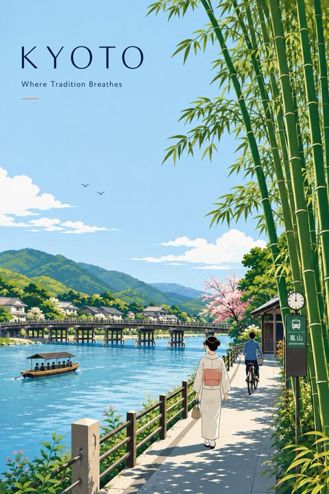</a>

A single [CITY_NAME] placeholder turns the prompt into a reusable template. A fixed checklist (landmark, transport, lifestyle moment, local details, signage), a tight pastel palette and a long negative list keep the flat vector style consistent while the composition changes per city.

GPT Image 2 · Text-to-image · Source: [@MissDelulu9 on X](https://x.com/MissDelulu9/status/2091724761424670980) · 429 likes on 2026-10-28

[`travel-poster`](tags.md#tag-travel-poster) [`flat-vector`](tags.md#tag-flat-vector) [`template`](tags.md#tag-template) [`city`](tags.md#tag-city) [`pastel`](tags.md#tag-pastel)

<details><summary><b>Prompt</b></summary>

```text
Premium minimalist flat-vector travel poster for [CITY_NAME], 3:4 vertical.

Create an original city-specific travel poster that captures the authentic personality of [CITY_NAME]. Choose the best composition for the city harbor, historic lane, riverside, coastal path, market, tram avenue, heritage square, skyline terrace, etc.

Include:
-One iconic landmark as the main focal point
-One distinctive local transport element
-One subtle everyday lifestyle moment
-Native vegetation or landscape
-3–6 small, naturally integrated people
-2–4 carefully chosen local details
-Subtle authentic signage/wayfinding

Typography:
Place “[CITY_NAME]” upper-left with generous negative space. Add one short elegant English tagline. Premium editorial typography, understated and spacious.

Style:
Japanese stationery-inspired, luxury sticker illustration, premium commercial vector, modern editorial travel branding, delicate uniform outlines, geometric shapes, flat colors, soft forms, minimalist postcard aesthetic.

Colors:
Pale powder blue, sky blue, mist blue, ivory, cream, beige, muted sage and gray-green. Tiny dusty-rose accents only. Soft, sophisticated, slightly desaturated palette.

Mood:
Fresh, airy, peaceful, refined, contemporary and elegant.

Important:
Make every city visually unique. Change the viewpoint, composition, landmark placement and foreground according to the city's identity. Do not reuse a generic template.

Negative:
No photorealism, realism, watercolor, painterly brushwork, gradients, heavy shadows, cinematic lighting, paper texture, clutter, landmark collage, crowds, oversized characters, dominant hero character, repetitive café scenes, generic tourist-poster layouts, copied compositions or unnecessary decoration.
```

</details>

<a id="nano-banana-dubai-double-exposure-travel-poster"></a>
### Minimalist double exposure Dubai travel poster

<a href="https://x.com/Naiknelofar788/status/2048929122936909857">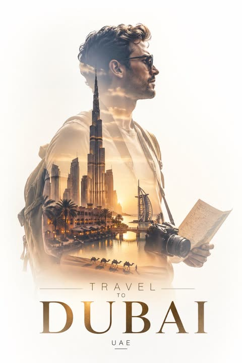</a>

The prompt splits the brief into labeled blocks for subject, effect, layout, text and aesthetic, so each requirement is explicit. Naming a profile silhouette filled with landmarks, plus a white background and negative space, keeps the double exposure soft and uncluttered.

Nano Banana 2 · Text-to-image · Source: [@Naiknelofar788 on X](https://x.com/Naiknelofar788/status/2048929122936909857) · 380 likes on 2026-10-29

[`double-exposure`](tags.md#tag-double-exposure) [`travel-poster`](tags.md#tag-travel-poster) [`minimalist`](tags.md#tag-minimalist) [`dubai`](tags.md#tag-dubai) [`silhouette`](tags.md#tag-silhouette)

<details><summary><b>Prompt</b></summary>

```text
Create a minimalist double exposure travel poster for DUBAI.
**Main Subject:** A stylish international traveler, depicted in a sharp profile silhouette. The subject should be dressed in modern travel fashion (simple, neat clothing) with subtle elements such as sunglasses, a camera strap, or a map in hand.
**Effect:** Inside the silhouette, use a double exposure effect filled with iconic DUBAI visuals such as landmarks, architecture, cultural elements, landscapes, and city atmosphere. The composition should be blended, soft, and seamless—not overloaded, with a clear focus.
**Layout & Style:** Maintain a clean and elegant layout using a bright or white background, soft gradient lighting, minimal distractions, and smooth transitions between elements.
**Text:** Add a modern editorial headline in a large, clear font: **'TRAVEL DUBAI'**.
Optional small subtext: **[UAE]**
**Aesthetic:** The design style should resemble a premium travel campaign with:
 * Minimalist composition
 * Soft glow and cinematic lighting
 * High-end branding aesthetic
 * No clutter, no busy collages
 * Balanced negative space
**Final Look:** Sophisticated, modern double exposure poster, elegant, print-ready, ultra-detailed, 4K."
```

</details>

<a id="gpt-image-mood-sky-low-angle-portrait-poster"></a>
### Low angle sky poster with curved date text

<a href="https://x.com/SimplyAnnisa/status/2053416803297358135">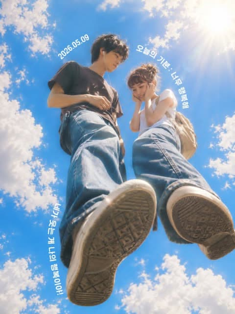</a>

A bracketed template (input, goal, subject lock, composition, mood to sky table, text, style, prohibited list) takes a portrait reference and keeps the identity while hiding the frontal face. The camera flat on the ground, visible shoe soles and white text curved along the body silhouette give the strong perspective.

GPT Image 2 · Edit · Source: [@SimplyAnnisa on X](https://x.com/SimplyAnnisa/status/2053416803297358135) · 362 likes on 2026-10-29

[`low-angle`](tags.md#tag-low-angle) [`sky`](tags.md#tag-sky) [`poster`](tags.md#tag-poster) [`typography`](tags.md#tag-typography) [`reference-photo`](tags.md#tag-reference-photo)

<details><summary><b>Prompt</b></summary>

```text
[INPUT]

- reference image: {Portrait Photo}

- Date: {Today's Date
http://
yyyy.mm.dd}

- Today's Mood: { }

[Goal]

Create a poster of the sky using an extreme low-angle perspective, looking up at the subject from the ground.

Express today's mood through the sky, light, clouds, and color scheme.

[Maintain Subject]

Maintain the facial mood, hair, body shape, and clothing style of the uploaded subject.

However, the face should not be shown from the front; instead, a side profile or just a slight glimpse of the jawline should be visible.

[Key Composition]

- The camera is almost flat on the ground.

- The subject is slightly floating above the camera or in a jumping moment.

- The soles of the shoes are prominently visible close to the camera.

- The legs appear long with a sense of perspective.

- The subject is in a side view or semi-profile.

- The sky occupies most of the screen.

[Sky by Mood]

Create a sky that matches today's mood.

 Examples:

- Happiness: Clear blue sky, white clouds, warm sunlight

- Excitement: Pink clouds, soft sunshine

- Calmness: Pale blue sky, thin clouds

- Loneliness: Sunset, long shadows, empty sky

- Frustration: Low, heavy clouds

- Rain: Overcast sky, raindrops, wet lens texture

[Text]

Arrange the date and mood message in a curved line along the outline or silhouette of the figure's body.

Text to include:

“{Date}”

“{Today’s Mood}”

“{Short Message}”

Text should be white, rounded, and bold poster typography.

Avoid overly long sentences and arrange text for easy readability.

If no short message input is provided, it should be automatically generated and entered.

[Style]

Sentimental Sky Poster, Warm Eye View, Bottom View, Wide Angle, Cinematic Fashion Poster, Clear Film Photo, Vast Sky, Clean Typography.

 [Prohibited]
- No ordinary standing poses
- No poses where shoe soles are not visible
- No frontal face close-ups
- No indoor backgrounds
- No excessive text
- No random text
- No watermarks/logos
```

</details>

<a id="gpt-image-editorial-city-travel-artwork-reflection"></a>
### San Francisco editorial travel poster with glass reflection

<a href="https://x.com/MahnoorAi12/status/2091711340666568868">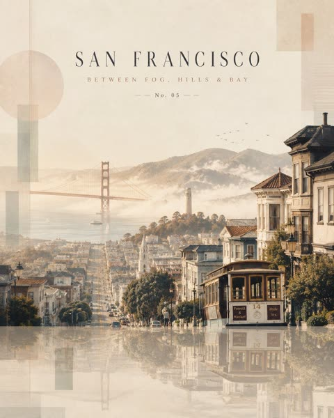</a>

One template swaps in any city through bracketed slots for name, landscape, architecture and tagline. A muted palette, a glass reflection band, faint geometric borders and small widely spaced magazine type keep the look cohesive. The long avoid list blocks landmark collage and oversized text.

GPT Image 2 · Text-to-image · Source: [@MahnoorAi12 on X](https://x.com/MahnoorAi12/status/2091711340666568868) · 356 likes on 2026-10-28

[`travel-poster`](tags.md#tag-travel-poster) [`city`](tags.md#tag-city) [`template`](tags.md#tag-template) [`reflection`](tags.md#tag-reflection) [`editorial`](tags.md#tag-editorial)

<details><summary><b>Prompt</b></summary>

```text
Create a premium 4:5 vertical contemporary travel artwork featuring [CITY NAME], [COUNTRY], transformed into a serene, sophisticated and collectible editorial travel landscape.

Build the entire composition around the unique identity of [CITY NAME]. Naturally integrate its most recognizable combination of landscape, architecture, culture, streets, nature, waterfront or mountains, depending on what genuinely defines the city. The scene should feel like one cohesive environment rather than a collage of separate landmarks.

In the background, create an atmospheric sense of place using [CITY'S SIGNATURE LANDSCAPE — e.g. coastline, mountains, river, desert, forest, skyline, historic district], with soft depth, subtle haze and elegant natural lighting.

In the foreground, introduce refined simplified architectural forms inspired by [CITY'S HISTORIC / CULTURAL ARCHITECTURE]. Include characteristic rooftops, facades, streets, balconies, walls, pathways and local textures. Add subtle vegetation and a few tiny human silhouettes naturally interacting with the environment, keeping them understated and non-dominant.

Make the visual identity unmistakably [CITY NAME], but avoid turning the artwork into a landmark collage. Every element should flow naturally into the surrounding landscape.

Use a sophisticated, slightly desaturated palette inspired by the destination, combining warm ivory, soft beige, muted earth tones, gentle architectural colors and subtle environmental blues/greens. Keep the entire palette harmonious, refined and luxurious.

Place the entire landscape above a calm glass-like reflective surface, creating delicate vertical reflections of the architecture, landscape and major visual elements. Keep the reflections soft, atmospheric and slightly faded.

Add extremely subtle translucent geometric forms around the borders to create a contemporary gallery-art aesthetic without distracting from the destination.

Use generous negative space, atmospheric haze, diffused natural light, delicate shadows, fine architectural linework, tactile paper grain and restrained watercolor-and-gouache textures blended with sophisticated modern digital illustration.

At the top, add elegant magazine typography:

[CITY NAME]
[SHORT POETIC CITY TAGLINE]
No. 05 — 2026

Typography should be small, refined, widely spaced, minimal and perfectly aligned.

Avoid anime aesthetics, excessive cultural symbols, clutter, photorealistic collage, generic stock imagery, oversized landmarks, excessive decoration and oversized typography.

The final artwork should feel like a rare collectible luxury travel print — tranquil, artistic, timeless, sophisticated and instantly recognizable as [CITY NAME].

Important: Prioritize the authentic visual character of the chosen city. Do not force elements that do not belong there. Adapt the architecture, landscape, vegetation, atmosphere and color palette specifically to the city.
```

</details>

<a id="nano-banana-ink-watercolor-city-travel-sketch-poster"></a>
### Ink and watercolor city street travel poster

<a href="https://x.com/Naiknelofar788/status/2054567307880669248">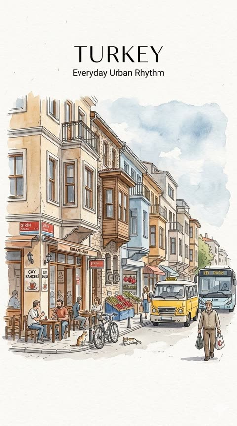</a>

Delicate black ink linework with airy watercolor washes on grainy sketchbook paper creates a hand drawn travel journal look, and generous negative space keeps the layout editorial. To reuse it for another city, as in this Turkey version, swap the bracketed city name and the listed local details such as taxis and buildings.

Nano Banana 2 · Text-to-image · Source: [@Naiknelofar788 on X](https://x.com/Naiknelofar788/status/2054567307880669248) · 355 likes on 2026-10-29

[`travel-poster`](tags.md#tag-travel-poster) [`watercolor`](tags.md#tag-watercolor) [`ink-sketch`](tags.md#tag-ink-sketch) [`city-scene`](tags.md#tag-city-scene) [`template`](tags.md#tag-template)

<details><summary><b>Prompt</b></summary>

```text
Minimalist ultra-high-resolution travel sketch poster of New York City, on clean white sketchbook paper with subtle paper grain texture. Style: refined pen drawing + loose watercolor sketch. Delicate black ink linework, airy watercolor washes, elegant urban details. Show a calm everyday NYC street scene — small cafés, yellow taxis, bicycles, crosswalks, brownstone buildings, subtle local signage, fashionable pedestrians, soft morning light. Spacious editorial composition with generous negative space. Mood: calm, modern, sophisticated, poetic. Typography: “[NEW YORK]” “Everyday Urban Rhythm” Premium travel sketch aesthetic, minimal and stylish, ultra-realistic watercolor + ink travel journal style, ultra-high-resolution, 9:16.
```

</details>

<a id="gpt-image-diagonal-donut-box-poster"></a>
### Diagonal donut boxes with solid and outline type

<a href="https://x.com/oggii_0/status/2057758702812500383">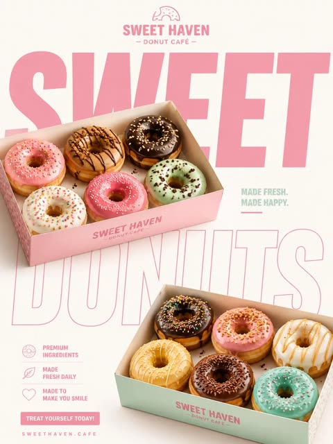</a>

Two product trays sit on opposite diagonals so the eye zig-zags between them. Solid and outline oversized type layered behind the trays makes the lettering part of the composition.

GPT Image 2 · Text-to-image · Source: [@oggii_0 on X](https://x.com/oggii_0/status/2057758702812500383) · 316 likes on 2026-10-29

[`poster`](tags.md#tag-poster) [`food-photography`](tags.md#tag-food-photography) [`typography`](tags.md#tag-typography) [`diagonal-layout`](tags.md#tag-diagonal-layout)

<details><summary><b>Prompt</b></summary>

```text
A premium fast-food advertising poster promoting [PRODUCT TYPE / FOOD ITEM / FMCG PRODUCT] using oversized editorial typography, clean commercial composition, and modern minimal branding aesthetics.

STYLE & ART DIRECTION:
Minimal commercial advertising aesthetics,
high-end FMCG campaign design,
editorial fast-food branding visuals,
modern social-media poster composition,
clean studio advertising style,
Pinterest-trending food campaign aesthetics,
premium Behance-style typography poster,
bold geometric branding system,
minimal product-focused commercial design,
high-contrast editorial food photography.

MAIN SUBJECT:
Two premium trays/containers of [PRODUCT],
placed diagonally across the composition,
crispy detailed food texture,
professional commercial food styling,
studio-shot realism,
dynamic asymmetrical positioning,
premium FMCG presentation quality,
high-detail texture rendering,
appetizing commercial appearance.

LAYOUT & COMPOSITION:
Maintain the SAME composition structure as the reference:
brand logo centered at top,
upper tray positioned diagonally in upper-left area,
lower tray positioned diagonally in lower-right area,
oversized typography integrated behind and between products,
large cropped letters extending outside frame,
strong negative space balance,
editorial asymmetrical composition,
clean visual rhythm,
dynamic zig-zag eye movement,
premium spacing hierarchy.

TYPOGRAPHY:
Extra-bold geometric sans-serif typography,
oversized cropped text composition,
mix of solid-fill and outline typography,
large-scale editorial lettering,
minimal wording with maximum visual impact,
modern FMCG typography hierarchy,
clean contemporary branding style,
typography functioning as compositional element.

DEPTH & LIGHTING:
Professional commercial studio lighting,
soft realistic shadows,
clean overhead illumination,
high-detail texture enhancement,
crispy surface highlights,
premium food-photography depth,
minimal soft-gray shadow casting,
luxury advertising lighting style.

EXTRA DESIGN DETAILS:
Minimal clean background,
subtle paper-tray branding graphics,
high-end packaging design,
editorial poster balance,
strong whitespace usage,
premium commercial realism,
modern social-media campaign aesthetics,
minimal graphic clutter,
sharp product separation,
clean advertising finish.

COLOR PALETTE:
Primary brand color dominance,
high-contrast warm food tones,
clean white/light-gray background,
minimal controlled palette,
brand-consistent typography colors,
bold modern color blocking.

QUALITY:
Ultra high-resolution commercial rendering,
8K premium advertising quality,
Behance-level campaign presentation,
Pinterest-trending FMCG aesthetics,
professional editorial composition,
luxury commercial poster realism,
high-end typography integration,
award-winning advertising art direction.
```

</details>

<a id="gpt-image-gap-new-uniform-campaign-poster"></a>
### Model beside oversized navy GAP campaign typography

<a href="https://x.com/Diplomeme/status/2064211120412590441">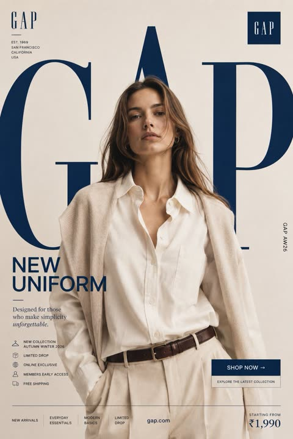</a>

The prompt sets a strict visual hierarchy with typography at 70 percent, model at 20 percent and promo elements at 10 percent, plus a locked palette of cream and navy. Naming a lens, studio lighting and grading terms steers the photo toward a restrained luxury look.

GPT Image 2 · Text-to-image · Source: [@Diplomeme on X](https://x.com/Diplomeme/status/2064211120412590441) · 307 likes on 2026-10-29

[`fashion`](tags.md#tag-fashion) [`poster`](tags.md#tag-poster) [`typography`](tags.md#tag-typography) [`campaign`](tags.md#tag-campaign)

<details><summary><b>Prompt</b></summary>

```text
"NEW UNIFORM"

FORMAT

Ultra-Premium Fashion SMM Promotional Poster
Vertical 4:5
Instagram Hero Creative
American Lifestyle Fashion Advertising
Commercial Fashion Graphic Design
Agency-Level Art Direction
Behance Front Page Quality
8K UHD
Hyper-Realistic
Fashion × Graphic Design Fusion
Zero AI Slop
Zero Generic Fashion Campaigns
Zero Editorial-Only Aesthetic

CORE STRATEGY

This is not a fashion campaign.

This is a lifestyle statement disguised as a promotional poster.

The design should feel like Gap's flagship storefront,
a premium lifestyle magazine cover,
and a global billboard campaign
merged into one visual.

The graphic design is equally important as the fashion.

Typography is not decoration.

Typography is architecture.

CAMPAIGN IDEA

"NEW UNIFORM"

Not office uniform.

Not school uniform.

The uniform of modern confidence.

The clothes aren't being sold.

The lifestyle is.

MASTER VISUAL

Massive oversized GAP typography dominates the entire composition.

The word:

GAP

occupies nearly 75% of the canvas.

Typography is integrated into the design.

Letters extend beyond frame edges.

Some letters cropped.

Some hidden behind the model.

Some functioning as compositional structures.

The typography should feel monumental.

The iconic GAP square logo appears subtly integrated within the layout.

HERO SUBJECT

Female model.

Natural beauty.

Confident expression.

Minimal makeup.

Effortless American luxury energy.

No smiling.

No dramatic posing.

Relaxed confidence.

Wardrobe:

Oversized cream Oxford shirt.

Relaxed tailored trousers.

Premium neutral knit layering.

Classic leather accessories.

Elevated everyday styling.

Modern American minimalism.

POSE

Model stepping through the giant typography.

One foot slightly forward.

Direct eye contact.

Hands relaxed.

Body partially intersecting typography.

The feeling:

She owns the moment effortlessly.

COMPOSITION

Typography occupies 70%.

Model occupies 20%.

Promotional elements occupy 10%.

Visual hierarchy:

GAP
↓
Model
↓
Promotion
↓
CTA

Everything feels intentional.

COLOR SYSTEM

Primary:

Cream

Ivory

Stone

Soft Beige

Navy Blue

White

Accent:

Classic Gap Navy

Muted Silver

No bright colors.

No trend-chasing palettes.

Timeless restraint.

BACKGROUND

Clean luxury backdrop.

Large soft gradient.

Minimal studio environment.

Subtle paper texture.

No architecture.

No scenery.

No distractions.

The design itself creates the environment.

GRAPHIC DESIGN SYSTEM

Floating collection cards.

Lifestyle editorial labels.

Minimal grid system.

Thin lines.

Micro typography.

Premium retail campaign hierarchy.

Global flagship-store energy.

PROMOTIONAL ELEMENTS

NEW COLLECTION

AUTUMN WINTER 2026

LIMITED DROP

ONLINE EXCLUSIVE

MEMBERS EARLY ACCESS

FREE SHIPPING

Integrated naturally into layout.

Not banner spam.

TYPOGRAPHY HIERARCHY

Top Left

GAP

small luxury wordmark

Center Massive Typography

G
A
P

occupying most of composition

bold heritage typography

extremely large scale

partially cropped

Campaign Title

NEW
UNIFORM

bold elegant typography

Supporting Copy

Designed for those who make simplicity unforgettable.

PROMOTIONAL CTA BLOCK

SHOP NOW →

Explore the latest collection

BOTTOM FEATURE STRIP

NEW ARRIVALS

EVERYDAY ESSENTIALS

MODERN BASICS

LIMITED DROP

Bottom Right

Starting From ₹1,990

Bottom Center


http://
gap.com
Vertical Edge Text
GAP AW26
LIGHTING
Luxury studio lighting.
Large soft source.
Editorial contrast.
Natural skin rendering.
Premium fabric highlights.

Subtle shadows.

Lifestyle campaign quality.

CAMERA

ARRI Alexa Mini LF

85mm Lens

Commercial fashion photography

Shallow depth of field
Extremely sharp fabric rendering
Ultra-premium advertising quality
POST-PRODUCTION
Premium American fashion campaign grading.
Rich navy tones.
Cream highlights.
Visible textile texture.
Natural skin detail.
No excessive retouching.
No artificial HDR.
No fake luxury effects.
```

</details>

<a id="gpt-image-product-plot-twist-five-brand-posters"></a>
### Five brand posters with action splashes and slogans

<a href="https://x.com/aziz4ai/status/2068736795827646513">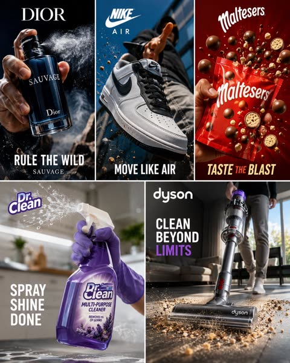</a>

This is a template with slots for product, brand and a three word slogan, so one prompt yields many ads. It locks the product shape, label and logo, then asks for one captured moment of hand action with splash, mist or particle effects under rim light and shallow depth of field.

GPT Image 2 · Text-to-image · Source: [@aziz4ai on X](https://x.com/aziz4ai/status/2068736795827646513) · 304 likes on 2026-10-29

[`product-poster`](tags.md#tag-product-poster) [`ugc-style`](tags.md#tag-ugc-style) [`slogan`](tags.md#tag-slogan) [`template`](tags.md#tag-template)

<details><summary><b>Prompt</b></summary>

```text
Create a premium UGC-style advertising poster for [PRODUCT] by [BRAND]. Use the product as the clear hero of the image and preserve the product shape, packaging, logo, label, colors, proportions, and readable text with strong visual accuracy.

Design the image as a powerful commercial poster with a bold editorial feel and a high-impact visual hook. The scene should feel like a real viral UGC moment elevated into a luxury campaign. Show a human hand naturally interacting with the product in a dynamic action moment such as grabbing it, tossing it, spraying it, opening it, pouring it, unboxing it, or pushing it toward the camera. Capture the exact split second of action with strong cinematic tension and scroll-stopping energy.

Add product-related action effects that enhance the visual hook, such as frozen splashes, flying particles, dust bursts, liquid trails, mist, shattered texture bursts, energetic motion blur, glow accents, or floating ingredients depending on the product category. The action should feel bold, intentional, premium, and visually irresistible.

Make the product the sharpest and most dominant subject in the frame. The composition should feel like a polished advertising poster, not just a casual photo. Use dramatic editorial lighting, clean rim light, realistic reflections, crisp focus, shallow depth of field, premium contrast, cinematic color grading, and a refined luxury commercial finish.

Include the brand logo clearly and tastefully as part of the poster design, either on the product packaging and/or as a clean design element in the composition. Also include one strong advertising slogan made of exactly 3 words:
"[SLOGAN]"

The slogan must feel bold, memorable, premium, and campaign-worthy. Place it in a visually powerful way, using clean high-end typography and a layout that supports the product without overpowering it.

Composition: vertical poster, 4:5 or 9:16, dynamic close-up or medium-close framing, product large in the foreground, partial human presence, strong negative space, premium ad layout, viral commercial energy.

Mood: bold, premium, modern, playful, energetic, stylish, addictive, visually striking.

No fake branding, no distorted logo, no unreadable packaging, no messy anatomy, no cheap CGI, no cluttered layout, no weak composition, no duplicated product, no watermark.
```

</details>

<a id="gpt-image-tartaglia-ink-wash-double-exposure-poster"></a>
### Tartaglia key visual with ink wash double exposure

<a href="https://x.com/SimplyAnnisa/status/2052771565318897945">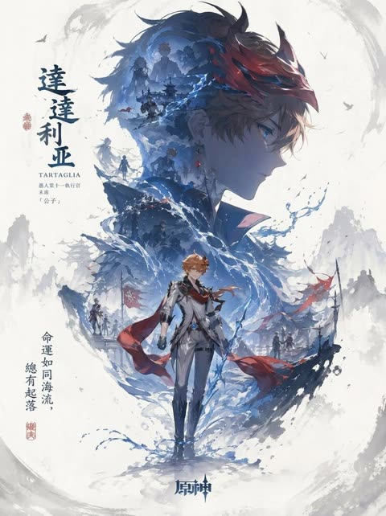</a>

The bracketed character slot is filled with a name, and a huge head silhouette in the upper half sets the hierarchy above the full figure. Double exposure scenes, ink diffusion at the edges and a vertical flowing line tie the collage layers into one composition.

GPT Image 2 · Text-to-image · Source: [@SimplyAnnisa on X](https://x.com/SimplyAnnisa/status/2052771565318897945) · 303 likes on 2026-10-29

[`genshin-impact`](tags.md#tag-genshin-impact) [`ink-wash`](tags.md#tag-ink-wash) [`double-exposure`](tags.md#tag-double-exposure) [`character-poster`](tags.md#tag-character-poster)

<details><summary><b>Prompt</b></summary>

```text
A character promotional poster of [XXX], using a unified vertical key-visual composition. Each poster follows a hierarchical layout with a larger upper section and smaller lower section: the upper half features the character’s most recognizable head, facial contour, mask, or upper-body silhouette as a massive visual centerpiece, forming a highly identifiable silhouette-style dominant shape. The middle and lower section contains the full character as the secondary focal point, standing in a stable pose or subtle motion, creating the visual core of the composition. Inside the large silhouette and around the character, use double exposure and collage-style narrative composition, blending multiple scenes, symbolic imagery, small character interactions, supporting elements, and environments layered into mist, ink-wash textures, and negative space. Symmetrical or echoing side sub-scenes are placed on the left and right to create narrative tension and spatial variation. A flowing visual line runs vertically through the entire composition, connecting the main character, internal collage, and upper silhouette, enhancing visual unity and guiding the viewer’s eye. The overall image should preserve large areas of negative space, while the edges use ink diffusion, blur, and fragmented fading effects to create the balance of emptiness and solidity found in Eastern aesthetics, with a breathable sense of space. The overall style should remain unified, premium, restrained, and cinematic, emphasizing layering, storytelling, key visual impact, and a cohesive series-poster visual language.
```

</details>

<a id="gpt-image-lego-brick-shadow-city-poster"></a>
### Red LEGO brick casts a shadow city

<a href="https://x.com/aziz4ai/status/2071117068003377177">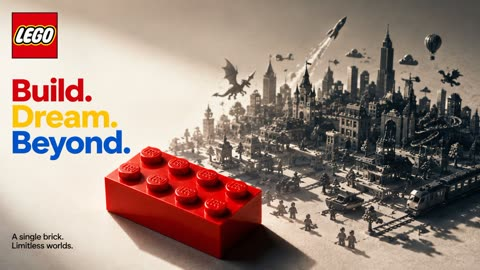</a>

A hard directional light keeps the product sharp and dominant while its shadow opens into a miniature city, so the shadow carries the brand's imagination story. The three-word slogan stacks in brand colours on the upper left for a clear hierarchy.

GPT Image 2 · Text-to-image · Source: [@aziz4ai on X](https://x.com/aziz4ai/status/2071117068003377177) · 301 likes on 2026-10-29

[`lego`](tags.md#tag-lego) [`shadow-story`](tags.md#tag-shadow-story) [`product-shadow`](tags.md#tag-product-shadow) [`brand-poster`](tags.md#tag-brand-poster)

<details><summary><b>Prompt</b></summary>

```text
Create a premium advertising poster for [BRAND] featuring [PRODUCT].

Use the product’s shadow as the main storytelling device.

The product must remain sharp, accurate, recognizable, premium, and visually dominant. Place it under dramatic controlled lighting so its shadow transforms into a cinematic scene, symbol, environment, or narrative that represents the product’s purpose, emotional promise, function, or brand DNA.

The shadow should not be random. It must reveal the hidden story behind the product:
- performance products cast shadows of motion, speed, athletes, impact, or ambition
- luxury products cast shadows of elegance, heritage, exclusivity, or desire
- tech products cast shadows of intelligence, creativity, precision, or the future
- food and beverage products cast shadows of flavor, refreshment, warmth, craving, or celebration
- lifestyle products cast shadows of comfort, identity, freedom, or everyday transformation

Make the image feel like a world-class campaign poster with a strong visual hook, cinematic lighting, realistic shadows, premium product detail, refined composition, tasteful typography, and strong visual hierarchy.

Add a short 3-word slogan that fits the concept and feels aligned with the brand’s tone.

The final result should feel iconic, polished, scroll-stopping, and art-directed specifically for this exact brand and product.

Avoid copying any existing campaign. Create a fresh original visual idea.

Aspect ratio: [RATIO]
```

</details>

<a id="gpt-image-product-campaign-poster-grid-template"></a>
### Premium product campaign poster from reference photo

<a href="https://x.com/ZaraIrahh/status/2054139543423492547">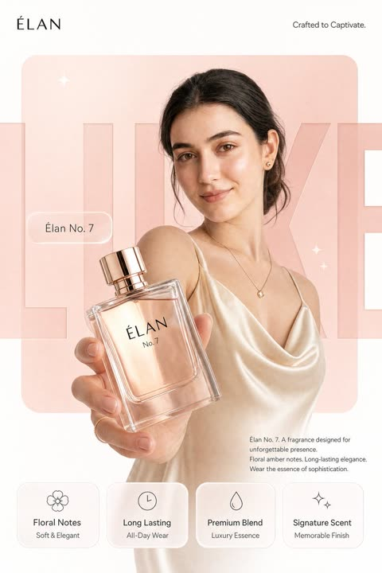</a>

A product photo is locked as the source of truth, then a 12 column grid and four stacked layers (color block, giant cropped word, model with product, flat text) keep the layout controlled. Every text element is listed exactly once with placeholders, so the typography renders cleanly.

GPT Image 2 · Edit · Source: [@ZaraIrahh on X](https://x.com/ZaraIrahh/status/2054139543423492547) · 289 likes on 2026-10-29

[`product-poster`](tags.md#tag-product-poster) [`campaign-template`](tags.md#tag-campaign-template) [`glassmorphism`](tags.md#tag-glassmorphism) [`reference-image`](tags.md#tag-reference-image) [`typography`](tags.md#tag-typography)

<details><summary><b>Prompt</b></summary>

```text
REFERENCE IMAGE INSTRUCTION: Use the uploaded product photo as the exact source of truth for the product's appearance, color, finish, branding, and form factor. Do not invent or alter any product detail. Reproduce it with photorealistic precision.
---
Create a photorealistic premium [PRODUCT CATEGORY] campaign poster in a 4:5 vertical aspect ratio. Design it as a clean global OOH, digital, and social campaign layout with strict grid alignment, premium white space, and precise typography. The campaign idea is "[CAMPAIGN TAGLINE]," but do not render that phrase as visible text.

Use a strict 12-column poster grid with 6% outer margins. Keep all text aligned to this grid. The image has four layers: background shape, giant background typography, subject/product photography, and clean graphic text overlays.

BACKGROUND: Pure matte white canvas. Place one large rounded-rectangle block behind the subject, occupying roughly 70% of the poster height and 76% of the width, centered slightly above the middle. The block uses a controlled [PRIMARY BRAND COLOR] gradient, glowing gently from top-left to bottom-right. Behind the subject and product, place giant cropped typography reading "[BACKGROUND HERO WORD]" in ultra-bold geometric sans-serif letters. The word is a background layer only: huge, partially cropped by the frame edges, wide letter spacing, darker [PRIMARY BRAND COLOR] than the rectangle, subtle embossed depth, soft shadow, and low enough contrast that it does not fight the product.

SUBJECT AND PRODUCT: [DESCRIBE MODEL OR SUBJECT — e.g., "a female model with a clean editorial look, neutral confident expression, natural slightly wind-touched hair, muted off-white outfit, and [ACCENT COLOR] jacket"]. Shoot from a slightly low hero angle. Body angled for depth, face turned toward the viewer with direct eye contact. One hand extends toward the camera holding the product from the uploaded reference image. The product is the dominant foreground object, slightly tilted to reveal [KEY PRODUCT DETAIL — e.g., "the triple camera system, brushed titanium edges, and centered brand logo"]. Keep the product sharp with realistic surface reflections, material texture, faint micro-details, and soft bloom around premium features. Keep the model's face readable behind it.

LIGHTING: Soft studio key light from front-left, warm rim light from the right, and subtle [PRIMARY BRAND COLOR] bounce from the background block. Skin remains natural and non-airbrushed with realistic catchlights. Product edges have clean [MATERIAL FINISH — e.g., "metallic / matte / glossy"] highlights. Shadows are soft and controlled.

TYPOGRAPHY OVERLAY: All text must be flat, crisp, perfectly aligned graphic typography — not painted onto the scene. Render exactly these text elements once, with no extra text:

Top left, small black logo: [BRAND LOGO NAME/MARK]

Top right, thin sans-serif: "[BRAND SUB-TAGLINE — e.g., 'Built for Apple Intelligence.']"

Mid left, glassmorphism pill: "[PRODUCT NAME — e.g., 'iPhone 17 Pro']"

Large background type: "[BACKGROUND HERO WORD]"

Bottom right body copy, small clean sans-serif:
"[PRODUCT NAME]. [POWER STATEMENT — one sentence.]
[FEATURE 1]. [FEATURE 2].
[CLOSING LINE — e.g., 'Designed for what's next.']"

BOTTOM FEATURE STRIP: Place four equal-width glass-white rounded cards along the bottom, aligned to the grid, same height, same spacing, same baseline alignment. Each card has one minimal line icon above the heading. Render exactly:
Card 1: "[FEATURE HEADING 1]" / "[FEATURE SUBLINE 1]"
Card 2: "[FEATURE HEADING 2]" / "[FEATURE SUBLINE 2]"
Card 3: "[FEATURE HEADING 3]" / "[FEATURE SUBLINE 3]"
Card 4: "[FEATURE HEADING 4]" / "[FEATURE SUBLINE 4]"

GRAPHIC DETAILS: Two or three small sparkle icons only, subtle grain, soft glassmorphism, controlled [PRIMARY BRAND COLOR]-white-[ACCENT COLOR] palette, no neon, no oversaturation.
```

</details>

<a id="gpt-image-jeju-tangerine-stall-poster"></a>
### Jeju travel poster with tangerine stand and sketcher

<a href="https://x.com/ChillaiKalan__/status/2069319929871081910">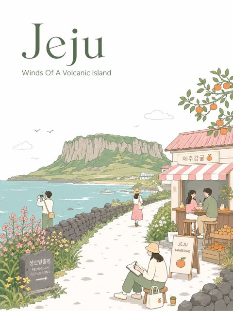</a>

A fixed layout block keeps the upper-left as clean white negative space while the landmark sits in the mid-background. Capping the people at three to five with specific daily-life actions keeps the scene calm and readable.

GPT Image 2 · Text-to-image · Source: [@ChillaiKalan__ on X](https://x.com/ChillaiKalan__/status/2069319929871081910) · 266 likes on 2026-10-29

[`travel-poster`](tags.md#tag-travel-poster) [`flat vector`](tags.md#tag-flatvector) [`template`](tags.md#tag-template) [`minimal`](tags.md#tag-minimal)

<details><summary><b>Prompt</b></summary>

```text
Premium minimal flat-vector travel poster for [CITY_NAME], 3:4 vertical.

Top-left typography:
[CITY_NAME]
[Short elegant English caption matching the city mood]

Create a soft premium stationery-style city travel poster with a clean, airy, high-end postcard mood.

BACKGROUND RULE:
Use a clean white or near-white background.
Keep the upper-left typography area mostly pure white and spacious.
Do not use peach, beige, cream, warm tinted background wash, or paper-like background color.
Warm tones may appear only in architecture, flowers, clothing, café details, and small objects.

CITY ADAPTATION:
Automatically adapt the scene to [CITY_NAME].
Use one iconic primary landmark as the main visual anchor in the middle or background.
Add local architecture, a small café or street-side shop, a local transport sign, a slim street lamp, trees, flower pots, and a few refined city-specific details.
Optional secondary landmark may appear very small and subtle in the far background, but it must not compete with the primary landmark.
Avoid landmark collage or overly dense city elements.

PEOPLE:
Use only 3–5 people.
Show small natural daily-life moments:
two people talking at a café table,
one person walking quietly,
one person taking a photo,
and optionally one person sketching or jogging.
Avoid crowds.
Avoid a single hero character.

COMPOSITION:
Keep large clean white negative space in the upper-left.
Place the main landmark clearly in the middle-to-background.
Place the café or local shop on one side.
Keep the scene simple, balanced, spacious, and uncluttered.
Avoid filling the top area with too many branches, clouds, birds, flowers, or decorative elements.

STYLE:
Soft stationery illustration aesthetic,
premium sticker illustration,
minimal flat-vector poster,
clean thin outlines,
consistent line weight,
flat colors only,
rounded forms,
tiny dot eyes,
simple facial features,
elegant graphic balance.

COLOR PALETTE:
blush pink,
dusty rose,
sage green,
warm cream,
soft beige,
muted gray-green.

Use these colors softly on objects only.
Do not use them as a full background wash.

MOOD:
minimal,
elegant,
calm,
refined,
romantic,
clean,
premium travel postcard,
greeting card,
wall art,
book-cover,
lifestyle branding.

CAPTION RULE:
Generate one short English caption, 3–7 words.
It should feel elegant, poetic, simple, and city-specific.
Avoid clichés, exclamation marks, and tourist brochure language.

NEGATIVE PROMPT:
No realism.
No photorealism.
No watercolor.
No painterly effects.
No gradients.
No shading.
No texture.
No peach background.
No beige background wash.
No dense background.
No crowded streets.
No excessive landmark collage.
No overly detailed architecture.
```

</details>

<a id="gpt-image-tram-photo-paper-illustration-poster"></a>
### Rusty red tram photo paired with paper illustration

<a href="https://x.com/Ziha_ai/status/2104111940180316193">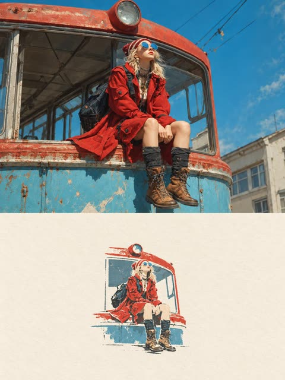</a>

The prompt splits a 3:4 canvas into two equal halves, with the original photo kept intact on top and a tiny four color paper illustration below. Capping the illustration at 10 to 20 percent of the bottom half and demanding warm off white negative space gives it an art book cover feel.

GPT Image 2.5 · Edit · Source: [@Ziha_ai on X](https://x.com/Ziha_ai/status/2104111940180316193) · 266 likes on 2026-10-27

[`editorial-poster`](tags.md#tag-editorial-poster) [`photo-to-illustration`](tags.md#tag-photo-to-illustration) [`split-layout`](tags.md#tag-split-layout) [`negative-space`](tags.md#tag-negative-space) [`paper-texture`](tags.md#tag-paper-texture)

<details><summary><b>Prompt</b></summary>

```text
Create a high-end editorial poster using the uploaded photo as the exact reference, in a strict 3:4 vertical format divided horizontally into two equal 50/50 sections. Preserve the original photo faithfully in the top half, including subjects, identity, pose, clothing, objects, lighting, colors, and realistic texture, with only subtle premium editorial color grading. In the bottom half, reinterpret the most recognizable elements as a small, centered, minimalist handmade paper illustration using delicate imperfect lines, bold flat acrylic-like color shapes, subtle paper grain, organic edges, and no more than 4 colors extracted from the original photo. Keep the illustration only 10–20% of the bottom section with lots of warm off-white negative space and optional minimal editorial typography. The overall result should feel quiet, poetic, refined, artistic, premium, and like an independent art-book cover, avoiding cartoon, watercolor, colored-pencil, 3D, glossy, busy, or commercial aesthetics.
```

</details>

<a id="nano-banana-photo-sketch-editorial"></a>
### Photograph above, sketch below: an editorial template

<a href="https://x.com/ChillaiKalan__/status/2111332272670417236"></a>

Fill `[SUBJECT]` and `[SETTING]`. The ban list covers the usual split-poster failures: heavy borders, mismatched faces.

Nano Banana 2.1 · Text-to-image · Source: [@ChillaiKalan__ on X](https://x.com/ChillaiKalan__/status/2111332272670417236) · 266 likes on 2026-10-27

[`split-composition`](tags.md#tag-split-composition) [`template`](tags.md#tag-template) [`editorial`](tags.md#tag-editorial)

<details><summary><b>Prompt</b></summary>

```text
Create a premium editorial poster featuring a two-part visual composition. The upper half shows a photorealistic photograph of [SUBJECT] in [SETTING], captured in warm natural sunlight with realistic skin texture, authentic expressions, soft highlights, and cinematic depth of field. The lower half transforms the exact same scene into a beautiful hand-painted digital illustration, preserving the subject’s pose, hairstyle, clothing, colors, and key visual details.

Place the illustrated scene inside a clean rectangular frame on a warm ivory, subtly textured paper background. Use a charming contemporary illustration style with delicate brush textures, simplified organic shapes, pastel colors, soft outlines, and a nostalgic summer-magazine aesthetic. Add tasteful decorative elements that complement the scene.

Below the illustration, include a centered minimalist editorial title reading “[MAIN TITLE]” in thin, widely spaced uppercase typography, followed by a smaller subtitle reading “[TAGLINE]” in elegant letter-spaced text. Add a short, thin pastel-colored line underneath.

Maintain balanced spacing, refined art direction, a cohesive color palette, and a sophisticated print-design finish. Vertical 3:4 composition, high resolution, natural lighting, polished editorial layout, aesthetically pleasing, realistic-to-illustration transformation.

Avoid clutter, excessive text, distorted anatomy, inconsistent facial features, harsh colors, heavy borders, and unnecessary graphic elements.
```

</details>

<a id="nano-banana-tom-cruise-gucci-soap-portrait"></a>
### Gritty Tom Cruise portrait with GUCCI slogan

<a href="https://x.com/rovvmut_/status/2028499516119453886">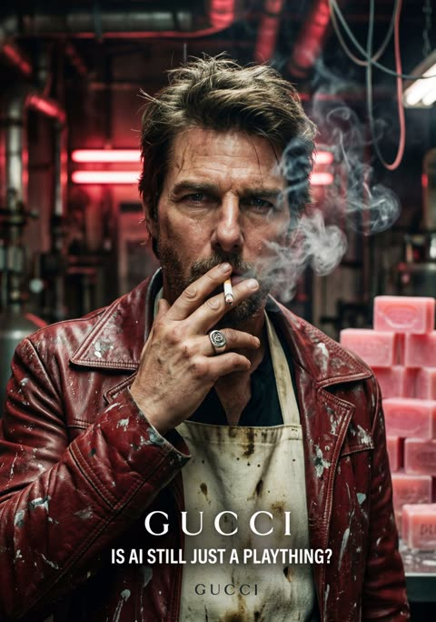</a>

Naming a close shot, heavy film grain and haze, and a fixed palette of reds, pinks and earth tones makes the image read as one cinematic still. Spelling out the logo and slogan text exactly keeps the serif headline and sans line clearly legible over the busy background.

Nano Banana 2 · Text-to-image · Source: [@rovvmut_ on X](https://x.com/rovvmut_/status/2028499516119453886) · 265 likes on 2026-10-29

[`celebrity`](tags.md#tag-celebrity) [`cinematic`](tags.md#tag-cinematic) [`text-overlay`](tags.md#tag-text-overlay) [`film-grain`](tags.md#tag-film-grain)

<details><summary><b>Prompt</b></summary>

```text
Nano Banana 2 on
@SocialSight


Prompt: A highly detailed, cinematic portrait of Tom Cruise, featuring a gritty, industrial aesthetic. He has messy, spiked dark-blonde hair, facial stubble, and a look of intense, weary focus. He is captured in a close-up shot, holding a lit cigarette to his mouth with his right hand; a thick trail of white smoke curls upward. On his finger is a prominent silver signet ring engraved with a luxury interlocking "GG" logo. The man wears a distressed, dark red leather jacket heavily marked with white paint splatters and deep creases, layered over a filthy, stained cream-colored canvas apron. The center of the frame features the word "GUCCI" in a clean, white, authoritative serif font. Below it, in smaller text on the apron, is the phrase "IS AI STILL JUST A PLAYTHING?" followed by a second, faded "GUCCI" logo. The background is a blurred industrial laboratory or "soap factory" setting. To the right are stacks of translucent pink rectangular soap blocks. In the upper background, dark industrial machinery and hanging wires are illuminated by glowing red horizontal neon lights, creating a moody, high-contrast atmosphere. The entire image has a heavy film grain, a hazy atmosphere, and a color palette dominated by deep reds, pale pinks, and grimy earth tones.
```

</details>

<a id="gpt-image-energy-bar-botanical-fmcg-poster"></a>
### Tilted energy bar on orange with botanical sketches

<a href="https://x.com/ZaraIrahh/status/2055853487116919038">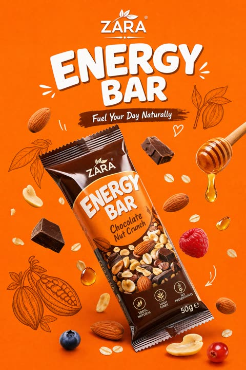</a>

A template with fill-in slots that fixes the layout order and hierarchy, then pins a solid single colour background, a centred tilted pack and floating ingredients. Naming hand drawn botanical line art behind the product keeps the decoration separate from the packshot.

GPT Image 2 · Text-to-image · Source: [@ZaraIrahh on X](https://x.com/ZaraIrahh/status/2055853487116919038) · 255 likes on 2026-10-29

[`fmcg`](tags.md#tag-fmcg) [`snack-ad`](tags.md#tag-snack-ad) [`product-poster`](tags.md#tag-product-poster) [`botanical`](tags.md#tag-botanical)

<details><summary><b>Prompt</b></summary>

```text
Create a premium FMCG snack-product advertising poster for [BRAND NAME].
TOPIC:
[ENERGY BAR / HEALTHY SNACK / SWEET PRODUCT CAMPAIGN]
STYLE & ART DIRECTION:
Bright playful commercial aesthetic

Modern healthy-snack branding

Pinterest FMCG advertising style

Flat-lay product-focused composition

Hand-drawn botanical illustration mix

Vibrant youthful atmosphere

Clean premium supermarket-ad style

Energetic healthy-food storytelling

Modern packaging-brand identity

Bold candy-color aesthetic

MAIN SUBJECT:

A realistic snack package prominently positioned in the center

Product tilted dynamically for visual energy

Floating ingredients surrounding the package

Realistic fruits, chocolate pieces, nuts, or flavor elements

Glossy premium packaging reflections

Commercial product photography

Energetic healthy lifestyle atmosphere

Vibrant youthful branding mood

LAYOUT & COMPOSITION:

Same exact composition and hierarchy as the reference image

Solid monochromatic background

Product placed centrally

Floating ingredient arrangement around the product

Hand-drawn botanical illustrations integrated behind and around the packaging

Minimal but energetic visual balance

Spacious clean layout

Strong FMCG hierarchy

TEXT & TYPOGRAPHY:

Large playful rounded typography

Youthful healthy-snack branding

Friendly energetic font style

Main title:
"[PRODUCT NAME]"

Supporting text:
"[FLAVOR / HEALTHY TAGLINE]"

DEPTH & LIGHTING:

Bright commercial studio lighting

Soft realistic shadows

Glossy package highlights

Floating-object depth

Smooth food reflections

Vibrant premium contrast

EXTRA DESIGN DETAILS:

Hand-drawn fruit illustrations

Floating ingredients

Dynamic packaging angle

Minimal decorative doodles

Organic food textures

Youthful energetic spacing

COLOR PALETTE:

[PRIMARY BRAND COLOR]

Bright complementary tones

Candy-inspired highlights

Vibrant fruit colors

QUALITY:

Ultra realistic commercial product photography

Premium FMCG advertising campaign

Behance-quality branding composition

Same exact visual identity and layout as the reference

Ultra high resolution
```

</details>

<a id="nano-banana-traveler-on-giant-country-map-poster"></a>
### Traveler Sitting on Giant Country Map Poster

<a href="https://x.com/frametheory058/status/2038934237479674133">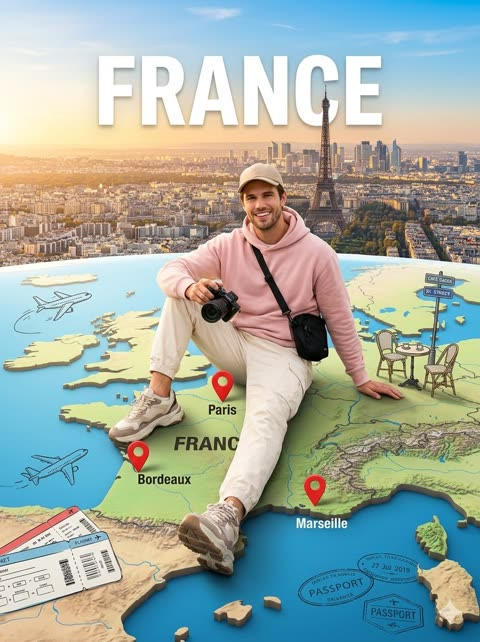</a>

A reference photo keeps the face while placeholders for continent, country and landmarks make the prompt reusable. Layered scene directions (map and pins in the foreground, landmark horizon behind, floating country name in the sky) are followed by camera, lighting and film grade details.

Nano Banana 2 · Edit · Source: [@frametheory058 on X](https://x.com/frametheory058/status/2038934237479674133) · 252 likes on 2026-10-28

[`travel`](tags.md#tag-travel) [`map`](tags.md#tag-map) [`reference-face`](tags.md#tag-reference-face) [`editorial`](tags.md#tag-editorial) [`template`](tags.md#tag-template)

<details><summary><b>Prompt</b></summary>

```text
"Ultra-realistic editorial travel concept.
A wanderer with the same face as in the reference photo is sitting casually on a giant, hyper-realistic travel map of [CONTINENT], zoomed into [COUNTRY]. On the map, there are large 3D location pins marking destinations across [COUNTRY].
Behind him stretches a breathtaking, cinematic horizon of [COUNTRY], featuring iconic landmarks like [LANDMARK 1], [LANDMARK 2], and [LANDMARK 3], seamlessly blended into one visually stunning environment. The word “[COUNTRY NAME IN CAPS]” floats boldly in clean luxury travel typography across the sky.
He is dressed in versatile streetwear suitable for any destination: cream cargo pants, a light pink hoodie, chunky sneakers, a crossbody bag, a cap, and carrying a Sony A7C II camera.
Surrounding elements include playful sketches of airplanes, flight tickets, passport stamps, and subtle [COUNTRY-THEMED ELEMENTS] (like cultural patterns, textures, environment-specific elements).
Shot on Sony A7C II, 35mm f/1.4 lens, ultra-shallow depth of field, razor-sharp focus on subject, creamy cinematic bokeh in background.
High-end commercial lighting setup, soft diffused key light, subtle rim light outlining the subject, global illumination, HDR tone mapping, realistic light falloff, soft shadows.
Hyper-detailed skin texture, realistic fabric folds, micro-details, physically accurate materials, 8K resolution, ultra high dynamic range.
Professional color grading based on environment:
Warm golden tones for deserts/tropical
Cool blue tones for winter/mountains
Neon tones for city/night scenes
Kodak Portra 400 film look, soft contrast, rich highlights, clean whites, no overexposure.
Rule of thirds composition, depth layering (foreground, midground, background), cinematic perspective, slight low-angle shot for dominance.
Atmospheric depth with light haze, volumetric lighting, subtle particles in air, environment interaction (fog, snow, sand, rain depending on location).
Vogue-style editorial photography, high-end travel magazine aesthetic, luxury advertisement quality, global campaign look.
Ultra photorealistic, no CGI look, indistinguishable from real photograph, insanely realistic, trending on Instagram, cinematic masterpiece.
```

</details>

<a id="gpt-image-iphone-17-pro-orange-ad-poster"></a>
### Woman holding orange iPhone 17 Pro in ad poster

<a href="https://x.com/AIwithSarah_/status/2051245277563294091">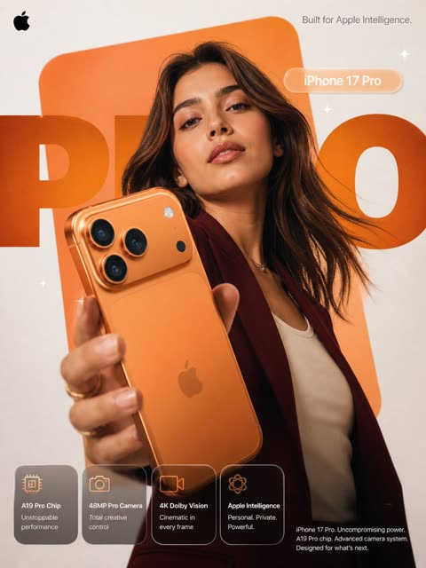</a>

The layout is pinned with explicit placement, such as an off-center panel, a cropped oversized PRO word and a foreground phone in forced perspective, and every UI string is given word for word so the text renders cleanly. Lens and lighting specs (50mm, shallow depth of field, key light from the front left, warm rim light) give it a studio photo look instead of a flat render.

GPT Image 2 · Text-to-image · Source: [@AIwithSarah_ on X](https://x.com/AIwithSarah_/status/2051245277563294091) · 250 likes on 2026-10-29

[`iphone-17-pro`](tags.md#tag-iphone-17-pro) [`advertising`](tags.md#tag-advertising) [`product-poster`](tags.md#tag-product-poster) [`forced-perspective`](tags.md#tag-forced-perspective)

<details><summary><b>Prompt</b></summary>

```text
GPT Image 2 on ChatGPT app.

Prompt: Create a premium Apple-style smartphone advertisement poster in 3:4 vertical format, ultra-high resolution, with a clean, modern, global campaign aesthetic. A minimal white studio background features a large rounded rectangular orange gradient panel placed slightly off-center behind the subject, soft and luminous rather than flat, with oversized background typography “PRO” in a deep orange tone (slightly darker than the panel), very large and partially cropped by the frame edges, with soft shadow and subtle depth. The subject is a stylish young female model with smooth, well-styled hair (straight or soft waves), glowing skin with minimal makeup, and refined, modern features, posed with a calm, confident, effortless expression and direct eye contact, shot from a slightly low angle, one hand extended toward the camera holding the phone while her body is slightly angled for depth and elegance. She wears a deep maroon tailored jacket over a clean off-white or cream inner top with minimal accessories like a delicate ring or thin chain. The hero product is the iPhone 17 Pro in Titanium Orange finish, placed in the extreme foreground using forced perspective and slightly tilted to highlight camera depth, featuring ultra-realistic triple camera lenses, accurate reflections, deep glass elements, brushed titanium edges with subtle highlights, a soft Apple logo reflection, and fine premium material texture with no plastic feel. Lighting is soft and refined with a key light from the front-left for smooth skin tones, a warm rim light from the right defining the edges of the phone and hair, subtle orange bounce from the background, and gentle shadows without harsh contrast. UI elements include a small Apple logo at the top left, “Built for Apple Intelligence.” in a thin font at the top right, a floating glass-style pill reading “iPhone 17 Pro,” 2–3 subtle sparkle accents, and a very light grain for realism. The bottom section includes four rounded glass cards with minimal icons: A19 Pro Chip – Unstoppable performance, 48MP Pro Camera – Total creative control, 4K Dolby Vision – Cinematic in every frame, and Apple Intelligence – Personal. Private. Powerful. In the bottom right, include a small clean paragraph: “iPhone 17 Pro. Uncompromising power. A19 Pro chip. Advanced camera system. Designed for what’s next.” The camera and render style should emulate a 50mm lens with shallow depth of field, slight natural lens distortion, HDR lighting, and ultra-realistic textures across skin, metal, and glass, maintaining an overall direction that feels like a real studio shoot—premium, effortless, and never over-designed or artificially perfect.
```

</details>

<a id="gpt-image-teal-duotone-say-hello-fashion-poster"></a>
### Teal duotone fashion poster with SAY HELLO doodles

<a href="https://x.com/Xaroon_x/status/2067194751686709567">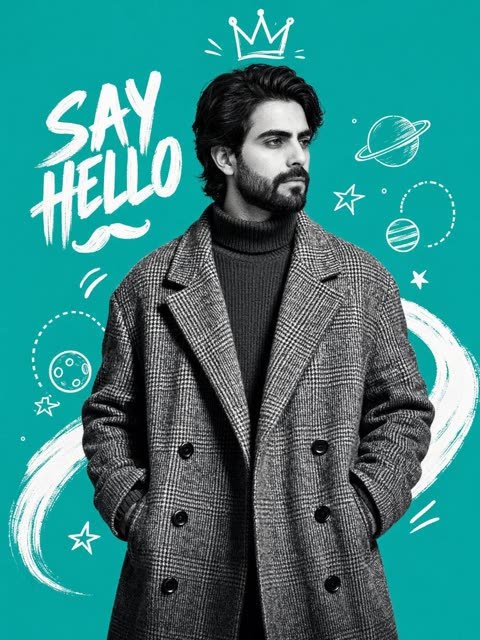</a>

Naming the uploaded portrait as the reference and fixing the palette as a black and white duotone on a solid teal ground locks both the subject and the colours. Listing each doodle, the handwritten text and a centred mid thigh crop gives the layout a clear structure.

GPT Image 2 · Edit · Source: [@Xaroon_x on X](https://x.com/Xaroon_x/status/2067194751686709567) · 246 likes on 2026-10-29

[`fashion`](tags.md#tag-fashion) [`duotone`](tags.md#tag-duotone) [`doodles`](tags.md#tag-doodles) [`portrait`](tags.md#tag-portrait)

<details><summary><b>Prompt</b></summary>

```text
Create a trendy 3:4 vertical fashion poster using the uploaded portrait as reference. Convert the subject to high-contrast black-and-white duotone on a solid bright teal background. Keep stylish hair, beard, and a confident editorial pose. Dress him in an oversized double-breasted plaid wool overcoat over a ribbed turtleneck sweater, hands in pockets. Add playful white hand-drawn doodles (crown, stars, planets, dotted circles, motion lines, brush swooshes) around the figure. Include bold handwritten text “SAY HELLO” with a small doodle mustache underneath. Modern streetwear-meets-collage fashion magazine aesthetic, clean composition, centered mid-thigh crop.
```

</details>

<a id="gpt-image-starbucks-cup-forest-poster"></a>
### Starbucks cup holds a miniature forest world

<a href="https://x.com/Diplomeme/status/2098626670186090499">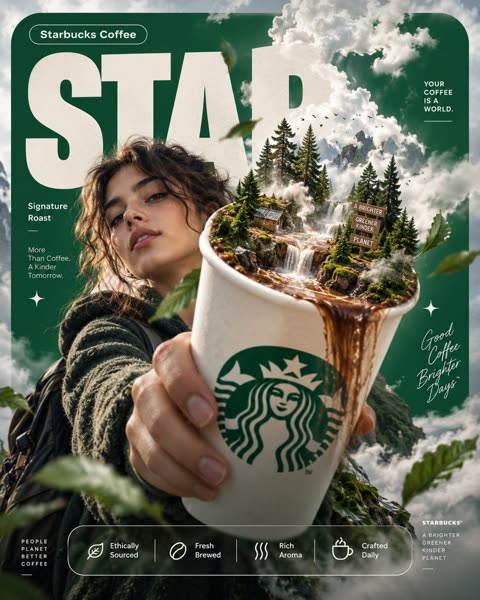</a>

The layout is written as separate blocks (rounded background panel, cropped oversized type behind the subject, bottom feature strip), so each element lands in its place. The surreal idea sits on the product itself: the coffee inside the cup becomes a forest with a waterfall, and the steam turns into clouds above the subject.

GPT Image 2.5 · Text-to-image · Source: [@Diplomeme on X](https://x.com/Diplomeme/status/2098626670186090499) · 242 likes on 2026-10-29

[`surreal`](tags.md#tag-surreal) [`poster`](tags.md#tag-poster) [`coffee-brand`](tags.md#tag-coffee-brand) [`typography`](tags.md#tag-typography)

<details><summary><b>Prompt</b></summary>

```text
4:5 vertical premium poster, 8K, bold commercial layout × surreal realism

🧠 CORE IDEA:
“YOUR COFFEE IS A WORLD.”

🎬 LAYOUT (INSPIRED BY SOURCE):

BACKGROUND BLOCK:
Large rounded rectangle in deep Starbucks green

GIANT TYPOGRAPHY:
“STAR”
bold, cropped, sitting behind subject

👤 SUBJECT:

Young adult holding Starbucks cup toward camera
same perspective as reference (foreground dominance)

calm expression, slight curiosity

☕ PRODUCT + SURREAL TWIST:

Starbucks cup in hand →

Inside the cup:
- miniature forest ecosystem
- tiny waterfall of coffee flowing
- mist rising into sky

Steam morphs into clouds above subject

✨ GRAPHIC ELEMENTS:

- sparkle icons ✦
- soft fog layers
- floating leaves

✍️ TEXT SYSTEM:

Top pill:
“Starbucks Coffee”

Small text:
“Signature Roast”

BOTTOM FEATURE STRIP:

- Ethically Sourced
- Fresh Brewed
- Rich Aroma
- Crafted Daily
```

</details>

<a id="nano-banana-retro-winter-fashion-ad-four-models"></a>
### Retro Winter Fashion Ad With Four Models

<a href="https://x.com/rovvmut_/status/2029228739192865157">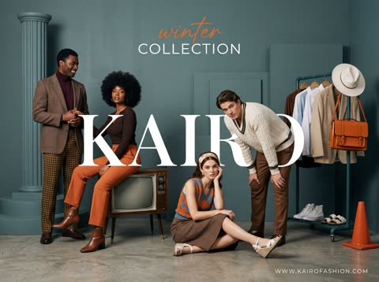</a>

Each model gets its own clothing, pose and position, and a hex coded teal grey and burnt orange palette keeps the group cohesive. Header, footer and a large serif wordmark overlapping the models are specified separately to create a layered poster look.

Nano Banana 2 · Text-to-image · Source: [@rovvmut_ on X](https://x.com/rovvmut_/status/2029228739192865157) · 238 likes on 2026-10-28

[`fashion`](tags.md#tag-fashion) [`advertisement`](tags.md#tag-advertisement) [`retro`](tags.md#tag-retro) [`typography`](tags.md#tag-typography) [`group-portrait`](tags.md#tag-group-portrait)

<details><summary><b>Prompt</b></summary>

```text
A wide-angle, studio fashion advertisement with a sophisticated retro-modern aesthetic. The scene is set against a monochromatic teal-grey (#506D6D) architectural backdrop featuring minimalist geometric props, including a fluted column and stepped circular platforms. The lighting is professionally diffused studio light, creating soft, graduated shadows that provide depth without harshness.

The Subjects:
Four models are posed in a cohesive, stylish group dynamic:

A Black man on the far left, standing tall in a brown tweed blazer, a deep burgundy turtleneck, and dark yellow-and-brown checkered trousers. He is smiling and warmly holding the hand of the woman next to him.

A Black woman with a voluminous afro, sitting sideways on a vintage 1950s wooden television set. She wears a dark brown knit top and vibrant burnt orange (#E88D4D) trousers with sleek brown leather boots.

A White woman sitting on the floor in the center, leaning forward with her hand to her face. she wears a vintage-style headband, an argyle-patterned sleeveless top in orange and slate blue, a brown wool skirt, and white wedge sandals.

A White man leaning into the frame from the center-right, hands on his knees. He wears a heavy cream-colored cable-knit sweater with dark trim and tailored brown trousers.
Furniture & Props:
To the right stands a minimalist dark teal industrial clothing rack. It displays curated garments including hanging shirts, a wide-brimmed white fedora, and a prominent structured orange leather messenger bag. At the base of the rack are white high-top sneakers and sandals. A single, truncated orange cone prop sits in the foreground.
Primary Text: A massive, high-contrast white serif font (Bodoni-style) reading "KAIRO" is overlaid across the center-left, partially occluding the models to create a layered, 3D effect.
Header: At the top center, the words "winter" (in orange cursive script) and "COLLECTION" (in white clean sans-serif) are centered.
Footer: The URL "
http://
KAIROFASHION.COM" is printed in small, wide-tracked white sans-serif in the bottom right corner.
Color Palette:
A sophisticated mix of Teal-Grey, Burnt Orange, Chocolate Brown, and Crisp White, creating a warm yet muted autumnal atmosphere.
```

</details>

<a id="gpt-image-flat-vector-city-travel-poster-template-2-2"></a>
### Minimal flat vector city travel poster template

<a href="https://x.com/oggii_0/status/2069643205818437808">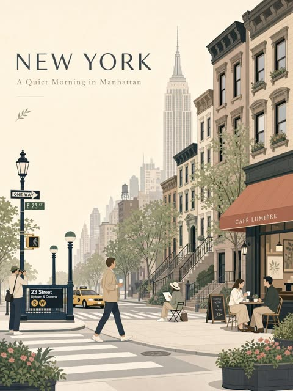</a>

A CITY_NAME placeholder lets the model fill in the landmark, architecture and street details itself. Reserving upper left negative space for type, capping the figures at three to six, and fixing the palette and a list of banned effects keep the flat vector look consistent.

GPT Image 2 · Text-to-image · Source: [@oggii_0 on X](https://x.com/oggii_0/status/2069643205818437808) · 234 likes on 2026-10-29

[`travel-poster`](tags.md#tag-travel-poster) [`flat-vector`](tags.md#tag-flat-vector) [`template`](tags.md#tag-template) [`city`](tags.md#tag-city) [`pastel-palette`](tags.md#tag-pastel-palette)

<details><summary><b>Prompt</b></summary>

```text
GPT Image 2 on Chatgpt

Prompt: Premium minimal flat-vector travel poster for [CITY_NAME], 3:4 vertical.

Create an airy, elegant city scene with large typography-safe negative space in the upper-left.
Add “[CITY_NAME]” and one short refined English caption that matches the city mood.

Automatically adapt the illustration to [CITY_NAME]:
include one iconic primary landmark, local architecture, café culture, a transport sign, street lamps, flowers, trees, small city details, and calm daily-life moments.

Use only 3–6 people, naturally interacting with the city:
talking at a café, walking, jogging, sketching, or taking photos.
Avoid crowds, avoid a single hero character, and keep the composition open and uncluttered.

Style:
Japanese stationery aesthetic, luxury sticker illustration, premium commercial flat-vector poster, clean thin outlines, consistent line weight, flat colors only.

Palette:
pale powder blue, soft sky blue, mist blue as the dominant background tones;
warm cream, soft beige, sage green, muted gray-green for architecture and nature;
dusty rose or blush pink only as tiny accents on flowers, signs, awnings, or small decorative details.

Mood:
fresh, minimal, elegant, calm, refined, high-end travel postcard and lifestyle branding.

No realism, no watercolor, no painterly effects, no photorealism, no shading, no gradients, no texture, no dense background.
```

</details>

<a id="nano-banana-adidas-editorial-collage-campaign-poster"></a>
### Model in orange adidas outfit with torn fabric collage

<a href="https://x.com/youraipulse/status/2031843569942622631">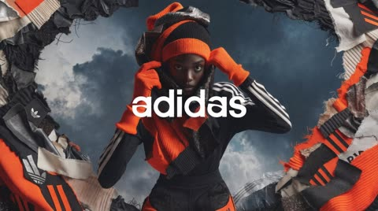</a>

A single brand slot in the prompt sets the palette, outfit colors and symbol, so one template works across brands. Torn-edge material swatches arranged around the model form a frame, and the logo sits at the center as the focal point.

Nano Banana 2 · Text-to-image · Source: [@youraipulse on X](https://x.com/youraipulse/status/2031843569942622631) · 233 likes on 2026-10-29

[`fashion`](tags.md#tag-fashion) [`collage`](tags.md#tag-collage) [`campaign`](tags.md#tag-campaign) [`template`](tags.md#tag-template)

<details><summary><b>Prompt</b></summary>

```text
[BRAND]. A high fashion campaign poster. A model with a strong expressive face as the centerpiece, wearing a signature outfit in the brand's exact official color palette. Dramatic surreal atmospheric background. Layered collage of torn-edge material swatches surrounding the model. Brand's iconic symbol woven into the scene. Logo overlaid in the center in clean serif font. Macro detail on fabric texture and stitching. Cinematic lighting, rich contrast, 8K

Save for later and follow for more
@youraipulse
```

</details>

<a id="gpt-image-birthday-poster-man-carved-paper-number"></a>
### Birthday poster with man sitting in carved number

<a href="https://x.com/Alina_with_Ai/status/2067250994954846272">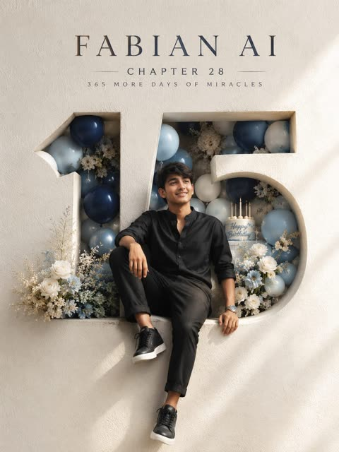</a>

A single material, white textured paper wall, holds the whole scene, and the carved number acts as a window onto balloons and flowers. The subject sits on the number's edge with limbs breaking the frame, and side sunlight gives believable depth. Note the prompt mixes the numbers 04 and 18, so keep the number consistent when reusing it.

GPT Image 2 · Edit · Source: [@Alina_with_Ai on X](https://x.com/Alina_with_Ai/status/2067250994954846272) · 231 likes on 2026-10-28

[`birthday`](tags.md#tag-birthday) [`paper-carving`](tags.md#tag-paper-carving) [`balloons`](tags.md#tag-balloons) [`reference-photo`](tags.md#tag-reference-photo) [`editorial`](tags.md#tag-editorial)

<details><summary><b>Prompt</b></summary>

```text
Professional luxury birthday poster, vertical 3:4 ratio. The entire scene is crafted from premium snow-white textured paper walls with elegant architectural depth. A giant number “04” is precisely carved into the wall, featuring realistic depth, refined inner shadows, smooth edges, and luxurious volumetric detailing.

Inside the carved number, a sophisticated birthday celebration setup is revealed, decorated with dark blue, pastel blue, and white balloons, delicate white flowers, premium floral arrangements, and high-end festive styling.

The man from the reference photo is sitting casually on the lower curve of the number “18,” with one leg bent and the other hanging naturally. He wears a radiant smile and looks slightly upward with confidence and joy. His face, shoulder, one arm, and one leg extend beyond the carved number frame, creating a highly realistic 3D pop-out window effect.

Warm cinematic sunlight enters from one side, producing soft highlights, realistic shadows, and elegant depth. Ultra-detailed photorealistic skin texture, natural facial features, premium studio-quality lighting, crystal-clear focus, luxury editorial photography, and masterpiece-level realism.

Elegant wall typography: , ALAINA Ai” “CHAPTER 28” “365 MORE DAYS OF MIRACLES”

Pure minimalist composition, luxury magazine-cover aesthetics, premium art direction, realistic depth and shadows, natural color grading, clean background, no tree shadows, no artificial AI artifacts, no distortion, no extra limbs, no text errors, first-class birthday campaign photography, ultra-realistic, award-winning editorial quality, 8K detail.
```

</details>

<a id="gpt-image-city-landmark-split-photo-graphic-travel-poster"></a>
### Shanghai skyline split photo and flat graphic poster

<a href="https://x.com/Goodmanprotocol/status/2090495333877141904">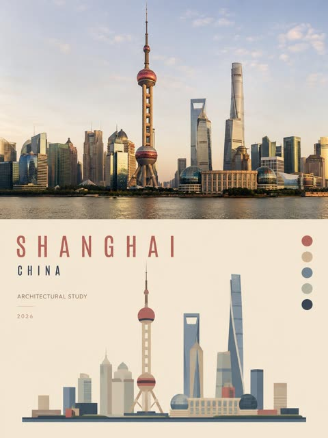</a>

A fixed 50/50 split pairs a realistic hero landmark photo with a flat geometric redraw of the same landmark. A palette of 4 to 6 colors drawn from the photo, Swiss exhibition poster references and a long avoid list keep it cohesive, and swapping the [CITY] placeholder reuses it for any city.

GPT Image 2 · Text-to-image · Source: [@Goodmanprotocol on X](https://x.com/Goodmanprotocol/status/2090495333877141904) · 226 likes on 2026-10-29

[`travel-poster`](tags.md#tag-travel-poster) [`landmark`](tags.md#tag-landmark) [`split-layout`](tags.md#tag-split-layout) [`swiss-design`](tags.md#tag-swiss-design) [`city`](tags.md#tag-city)

<details><summary><b>Prompt</b></summary>

```text
Create a refined 3:4 vertical premium travel poster for [CITY].

First identify the city, country, architecture, landscape, climate, cultural character, and visual identity. Select ONE iconic and highly recognizable real-world landmark or subject as the HERO. Establish one believable photographic viewpoint and ensure every environmental element logically belongs to that location. Do not create a collage of unrelated landmarks.

COMPOSITION: Divide the poster into two perfectly equal sections: 50% top and 50% bottom. Use a warm beige, ivory, or soft-white background with generous negative space and precise alignment.

TOP — HERO PHOTOGRAPH: Create an ultra-realistic, high-end editorial photograph of the chosen landmark from a believable real-world viewpoint. Preserve accurate architecture, proportions, materials, surrounding environment, natural lighting, shadows, atmosphere, and geographic character. The scene should feel like premium architectural photography or a museum-quality travel photograph, with realistic textures and sophisticated cinematic composition.

BOTTOM — GRAPHIC INTERPRETATION: Reinterpret the same hero landmark as a sophisticated flat graphic design. Extract its most recognizable silhouette, contours, structural details, proportions, and distinctive architectural elements. Simplify them into elegant geometric shapes, flat color blocks, thin lines, restrained divisions, and generous negative space. The landmark must remain instantly recognizable without becoming a realistic illustration, 3D render, cartoon, or game graphic.

COLOR & TYPOGRAPHY: Derive a restrained palette of approximately 4–6 colors from the city's architecture, environment, and hero photograph. Keep the palette sophisticated with slightly muted saturation. Add minimal geometric accents only when they improve the composition.

Use limited, elegant typography such as: [CITY] [COUNTRY] ARCHITECTURAL STUDY 2026

Use Swiss/international graphic design, architectural exhibition posters, luxury editorial design, and museum visual identity as the aesthetic reference. Keep typography subtle, with generous letter spacing and strong visual hierarchy.

FINAL AESTHETIC: Sophisticated, minimal, contemporary, culturally authentic, artistic, and premium. The photographic upper half and graphic lower half should feel like two expressions of the same visual identity. The final result should resemble a world-class gallery poster, collector's travel print, architectural exhibition artwork, or luxury brand campaign.

Avoid landmark collages, inaccurate architecture, invented structures, excessive text, tourist-brochure aesthetics, neon, flashy effects, heavy gradients, glossy 3D rendering, cartoon styling, game UI, clutter, excessive decoration, and generic AI-generated cityscapes.
```

</details>

<a id="gpt-image-orange-panel-cowboy-hat-fashion-poster"></a>
### Orange Panel Cutout Fashion Poster With Wide Hat

<a href="https://x.com/harboriis/status/2099350017844867510">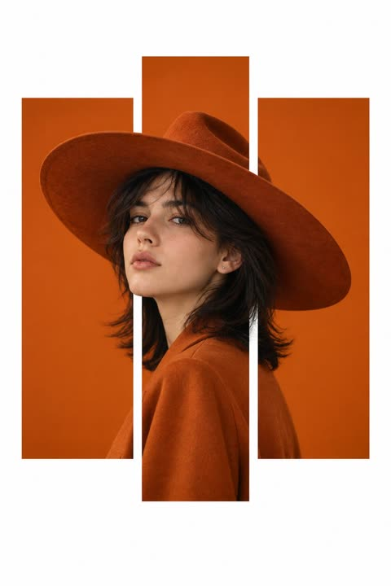</a>

Three tall panels of different heights on a white ground are described first, then the subject is told to cross all of them, which produces the cutout overlap. A single burnt orange palette plus explicit bans on text, logos and extra objects keeps the layout clean.

GPT Image 2.5 · Text-to-image · Source: [@harboriis on X](https://x.com/harboriis/status/2099350017844867510) · 223 likes on 2026-10-29

[`fashion-editorial`](tags.md#tag-fashion-editorial) [`minimalist`](tags.md#tag-minimalist) [`cutout-effect`](tags.md#tag-cutout-effect) [`monochromatic`](tags.md#tag-monochromatic) [`orange`](tags.md#tag-orange)

<details><summary><b>Prompt</b></summary>

```text
Create a vertical 2:3 fashion editorial poster with a minimalist, modern aesthetic. Use a clean white background with three tall, rectangular orange panels arranged vertically across the center, with narrow white gaps between them. The middle panel is slightly taller than the two outer panels.

Feature a realistic young woman with fair skin, delicate facial features, and light brown hair styled neatly under a large, wide-brimmed burnt-orange cowboy hat. She wears an elegant burnt-orange long-sleeve blouse with soft folds and a refined fashion-forward look.

Position the woman in a three-quarter profile, facing slightly toward the camera with a calm, confident expression. Her head and oversized hat extend across all three orange panels, while her body is primarily visible through the center panel. The orange panels should create a striking cutout effect, with parts of the portrait appearing to overlap the panel edges.

Use warm studio lighting, soft natural skin texture, subtle shadows, crisp edges, high-end fashion photography, balanced negative space, and a premium contemporary magazine design. Use a monochromatic burnt-orange color palette against a pure white background.

No text, no logos, no typography, no borders, no extra objects. Focus entirely on the woman, the oversized hat, and the geometric orange panel composition.
```

</details>

<a id="nano-banana-rebel-street-tracksuit-portrait"></a>
### Woman in teal track jacket against torn street posters

<a href="https://x.com/Maercihh/status/2034530612477034796">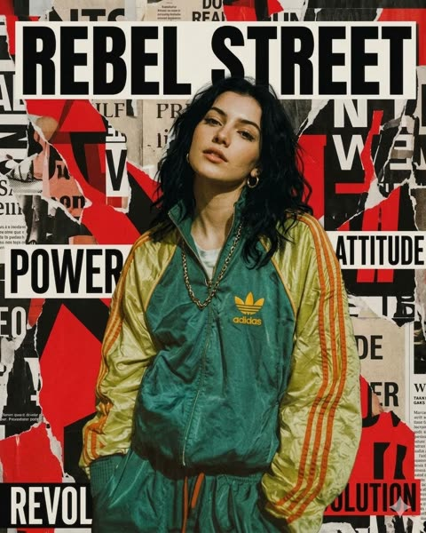</a>

The prompt spells out the exact headline words REBEL STREET, POWER and ATTITUDE and locks the poster palette to red, white and black, so the type stays legible and on-palette. Each wardrobe piece is listed separately, which keeps the outfit details stable in the output.

Nano Banana 2 · Text-to-image · Source: [@Maercihh on X](https://x.com/Maercihh/status/2034530612477034796) · 219 likes on 2026-10-29

[`streetwear`](tags.md#tag-streetwear) [`typography`](tags.md#tag-typography) [`collage`](tags.md#tag-collage) [`editorial`](tags.md#tag-editorial)

<details><summary><b>Prompt</b></summary>

```text
{
   "A cinematic editorial portrait of a young, attractive fair-skinned woman with messy, wavy black hair. She is wearing a vintage teal and gold Adidas track jacket with orange stripes, matching track pants, gold hoop earrings, and a thick gold chain necklace. She is looking at the camera with a confident, rebellious expression. The background is a grunge collage of layered, torn street posters in red, white, and black. Bold typography is visible on the posters, featuring the prominent text 'REBEL STREET' at the top, along with fragmented words like 'POWER' and 'ATTITUDE'. The overall aesthetic is urban streetwear, featuring gritty textures and warm, dramatic lighting.",
  "caption": "Rebel Street: Unapologetic power and attitude."
}
```

</details>

<a id="gpt-image-futuristic-editorial-profile-poster-template"></a>
### Futuristic editorial poster with side-profile portrait

<a href="https://x.com/HustleXR/status/2093967364379324896">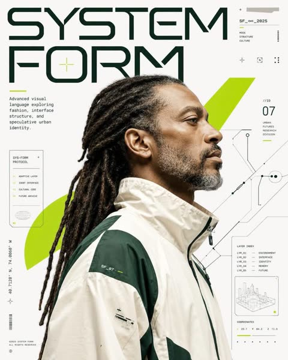</a>

A reusable template with bracketed slots for subject, clothing, three accent colors, title and body text. Fixing the layout (white ground, bold shapes, fine circuit lines, asymmetrical magazine grid) and the 4:5 ratio keeps the typography and composition controlled.

GPT Image 2 · Text-to-image · Source: [@HustleXR on X](https://x.com/HustleXR/status/2093967364379324896) · 214 likes on 2026-10-28

[`editorial-poster`](tags.md#tag-editorial-poster) [`template`](tags.md#tag-template) [`side-profile`](tags.md#tag-side-profile) [`futuristic`](tags.md#tag-futuristic) [`typography`](tags.md#tag-typography)

<details><summary><b>Prompt</b></summary>

```text
Conceptual futuristic editorial poster design featuring [HUMAN] in a large side-profile portrait, wearing [CLOTHING], sleek contemporary fashion styling, clean studio lighting, white background with bold [COLOR1] graphic shapes, fine [COLOR2] circuit-like line diagrams, and subtle [COLOR3] interface accents. Large uppercase title "[TITLE]" placed prominently at the top, a short block of small editorial text reading "[TEXT]", modern experimental typography, asymmetrical magazine layout, sharp high-contrast composition, premium graphic design aesthetic, 4:5 aspect ratio.
```

</details>

<a id="gpt-image-landmark-sketch-travel-poster"></a>
### Hagia Sophia ink sketch travel poster with red sun

<a href="https://x.com/Naiknelofar788/status/2101315631237021853">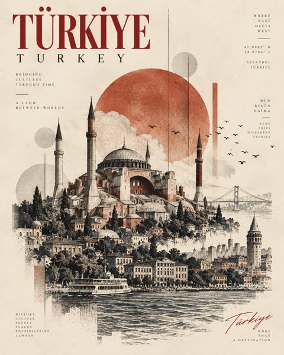</a>

A fill in the blank template swaps in the landmark, city and coordinates, while fixed style terms like ivory paper, hatching, halftone and geometric circles keep every print consistent. Side typography and wide negative space make it read as a premium travel art print.

GPT Image 2.5 · Text-to-image · Source: [@Naiknelofar788 on X](https://x.com/Naiknelofar788/status/2101315631237021853) · 211 likes on 2026-10-28

[`travel-poster`](tags.md#tag-travel-poster) [`architecture`](tags.md#tag-architecture) [`sketch`](tags.md#tag-sketch) [`halftone`](tags.md#tag-halftone) [`template`](tags.md#tag-template)

<details><summary><b>Prompt</b></summary>

```text
A sophisticated minimalist architectural art poster featuring [LANDMARK / STRUCTURE] as the central subject, illustrated in a refined hand-drawn architectural sketch style. Preserve the landmark’s recognizable silhouette, proportions, and defining architectural details, while transforming it into an elegant artistic composition.

Use a limited monochromatic color palette inspired by the location, with soft vintage tones on a warm ivory/off-white paper background. Combine delicate ink lines, fine architectural hatching, subtle halftone texture, and lightly distressed print details.

Surround the structure with a few abstract geometric shapes, soft translucent circles, subtle atmospheric elements, birds, or tiny contextual details that complement the landmark without overpowering it. Add a subtle sense of depth through overlapping layers and faded linework.

Include small minimalist typography on one side: [CITY / COUNTRY], [LANDMARK NAME], and optional coordinates or a short location descriptor, arranged like a premium travel-art print.

Clean negative space, editorial graphic design, museum-quality travel poster aesthetic, elegant composition, understated luxury, vintage screen-print texture, artistic architectural illustration, no people, no photorealistic background, no unnecessary objects, 4:5 vertical composition.

[LANDMARK] reimagined as a collectible minimalist travel-art poster, combining architectural sketching, vintage printmaking, geometric abstract shapes, delicate linework, halftone texture, muted location-inspired colors, and elegant negative space. The landmark remains instantly recognizable but feels like a hand-crafted piece of modern graphic art. Add tiny birds, subtle environmental elements, coordinates, and minimal location typography. Premium editorial aesthetic, artistic, sophisticated, highly shareable, 4:5 vertical.
```

</details>

<a id="gpt-image-travel-poster-photo-diorama-split"></a>
### Shanghai skyline photo paired with isometric miniature diorama

<a href="https://x.com/Goodmanprotocol/status/2107675234858131544">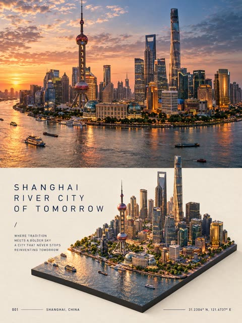</a>

The poster is split into two stacked halves, a photoreal destination scene on top and an isometric diorama of the same scene on a dark slab below. Continuity rules, a bracketed location slot and fixed typography blocks with warm off white negative space keep the layout reusable for any city.

GPT Image 2.5 · Text-to-image · Source: [@Goodmanprotocol on X](https://x.com/Goodmanprotocol/status/2107675234858131544) · 200 likes on 2026-10-28

[`travel-poster`](tags.md#tag-travel-poster) [`isometric`](tags.md#tag-isometric) [`diorama`](tags.md#tag-diorama) [`miniature`](tags.md#tag-miniature) [`editorial-layout`](tags.md#tag-editorial-layout)

<details><summary><b>Prompt</b></summary>

```text
Create a premium 3:4 vertical editorial travel poster for [COUNTRY / CITY / LOCATION / SUBJECT].

TEXT-TO-IMAGE ONLY — generate the entire artwork creatively from [COUNTRY / CITY / LOCATION / SUBJECT] alone. No reference image required.

COMPOSITION
Divide the poster into two seamless stacked halves with no gap.

TOP HALF:
Create a full-width photorealistic cinematic travel scene representing [COUNTRY / CITY / LOCATION / SUBJECT]. Automatically choose its most recognizable architecture, surroundings, atmosphere, materials, colors, and natural lighting. Treat this as the authentic photographic view of the destination.

BOTTOM HALF:
Transform the same scene into a highly detailed isometric miniature diorama viewed from approximately a 45° elevated angle. Rebuild the recognizable architecture, streets, landscape, vegetation, and surrounding elements as a physically believable miniature world on a thin dark-gray rectangular base slab.

Maintain visual continuity between the upper photograph and lower diorama — same architecture, same environment, same lighting mood, and recognizable details — while making the lower section clearly handcrafted as a miniature.

EDITORIAL LAYOUT
Place the diorama toward the lower-right area, leaving generous warm off-white negative space around it.

Use thin dark-navy sans-serif typography in the empty space:
- a poetic 3-line uppercase title
- “/”
- a short 4-line travel verse
- bottom-left: “001” followed by a thin horizontal rule and [CITY / COUNTRY]
- bottom-right: a thin horizontal rule followed by accurate GPS coordinates

Automatically determine the appropriate city, country, landmark, and coordinates from [COUNTRY / CITY / LOCATION / SUBJECT].

STYLE
Photorealistic travel photography × hyper-detailed architectural miniature × premium editorial design × quiet luxury travel journal.

Use realistic materials, miniature-scale details, natural shadows, subtle depth of field, warm off-white paper, restrained dark-navy typography, and sophisticated negative space.

The lower diorama must feel physically constructed rather than like a flat illustration — tiny buildings, roads, vegetation, textures, shadows, and architectural details should have believable scale and depth.

FINAL AESTHETIC
Minimal, intelligent, atmospheric, collectible, and highly refined — a contemporary travel journal combining the real destination with its miniature architectural memory.

Avoid collage seams, separate unrelated scenes, generic architecture, invented landmarks, excessive typography, glossy CGI, cartoon styling, clutter, logos, watermarks, borders, and UI elements.

FORMAT
3:4 vertical, two stacked halves, no gap, upper photorealistic destination scene, lower isometric miniature diorama, premium editorial finish.
```

</details>

<a id="gpt-image-aftermath-survival-streetwear-poster"></a>
### Man in survival streetwear beside wrecked car poster

<a href="https://x.com/Xaroon_x/status/2071179557731008802">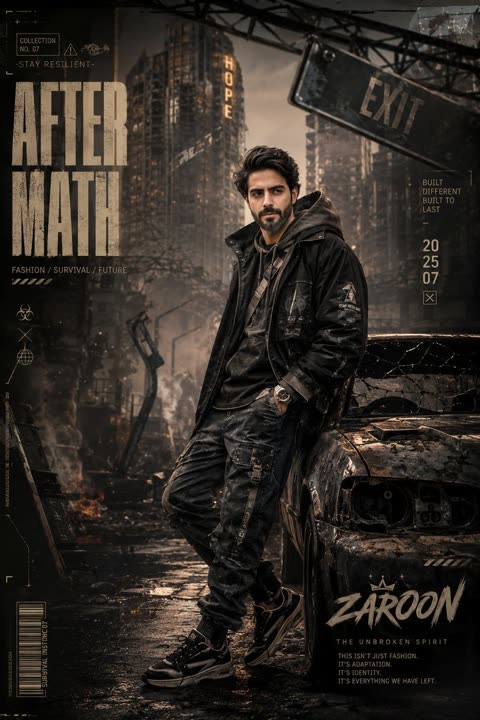</a>

Pairing an editorial fashion frame with a ruined city lets the wardrobe stay sharp while debris, dust and signage carry the story. Naming the fabrics, weathering and display typeface gives concrete controls for each layer.

GPT Image 2 · Edit · Source: [@Xaroon_x on X](https://x.com/Xaroon_x/status/2071179557731008802) · 193 likes on 2026-10-29

[`fashion`](tags.md#tag-fashion) [`editorial`](tags.md#tag-editorial) [`post-apocalyptic`](tags.md#tag-post-apocalyptic) [`streetwear`](tags.md#tag-streetwear)

<details><summary><b>Prompt</b></summary>

```text
A contemporary editorial fashion poster inspired by the Post-Apocalyptic Street aesthetic, blending futuristic survival themes with modern high-end streetwear fashion. The overall atmosphere should feel cinematic, dramatic, and visually immersive, portraying a once-thriving metropolitan city that has fallen into decay while maintaining a sophisticated editorial fashion identity. The contrast between destruction and contemporary style should become the defining visual narrative of the composition.

The environment should feature abandoned city streets, damaged buildings, cracked roads, scattered debris, broken signage, exposed concrete, drifting dust, subtle smoke, weathered metal structures, and remnants of urban civilization. Enhance the layout with carefully integrated decorative ornaments such as distressed textures, warning symbols, torn posters, industrial graphics, futuristic interface elements, survival-inspired markings, and layered design accents that reinforce the post-apocalyptic atmosphere without overwhelming the overall composition.

The subject should not replicate the pose from the reference image. Instead, present a naturally expressive pose with elegant body language commonly seen in international fashion editorials. The posture should project resilience, quiet confidence, and effortless style, incorporating subtle movement that avoids stiff, static, or lifeless appearances. Facial expression should feel determined, composed, and emotionally engaging, reflecting the spirit of survival while maintaining a refined fashion presence.

Wardrobe styling should feature contemporary streetwear reimagined through a survival-inspired aesthetic. Combine fashionable oversized jackets, hoodies, cargo pants, utility garments, layered clothing, tactical-inspired accessories, and modern sneakers or rugged boots. Clothing should appear naturally weathered with subtle dust, distressed textures, worn edges, and carefully placed tears that support the narrative without looking excessive. Incorporate a balanced mix of colors, fabrics, patterns, and materials to ensure the outfit remains stylish, dynamic, and visually interesting rather than repetitive or monotonous.

Typography should function as a prominent visual element, utilizing bold, eye-catching, and creatively selected typefaces inspired by futuristic graphics, urban culture, and premium editorial design. Avoid generic or standard fonts. The typography hierarchy, placement, spacing, and composition should enhance the storytelling while maintaining a polished and contemporary visual identity.

The final artwork should feel cinematic, atmospheric, and fashion-forward, seamlessly combining post-apocalyptic storytelling with modern streetwear aesthetics. Every design element should appear intentional, premium, and visually compelling, avoiding anything that feels generic, ordinary, mediocre, or template-based. Ultra-detailed 8K quality, professional editorial poster design, refined visual storytelling, premium composition, dystopian urban aesthetics, and high-end contemporary fashion campaign presentation.
```

</details>

<a id="nano-banana-green-hoodie-fashion-ad-layout"></a>
### Green hoodie fashion ad with serif headline and ribbon

<a href="https://x.com/rovvmut_/status/2029599397483532714">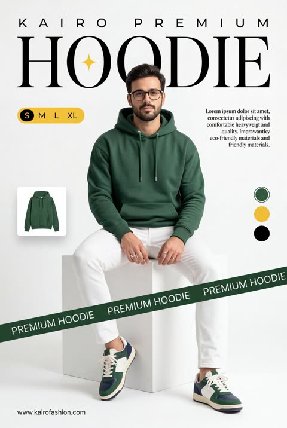</a>

The prompt splits the ad into attire, graphic design and layout, and environment blocks, and it gives exact text strings, positions and a three color palette. Naming UI accents such as a size pill, a thumbnail and color swatches places every element precisely around the uploaded model.

Nano Banana 2 · Edit · Source: [@rovvmut_ on X](https://x.com/rovvmut_/status/2029599397483532714) · 193 likes on 2026-10-28

[`fashion-ad`](tags.md#tag-fashion-ad) [`typography`](tags.md#tag-typography) [`hoodie`](tags.md#tag-hoodie) [`studio-lighting`](tags.md#tag-studio-lighting) [`layout`](tags.md#tag-layout)

<details><summary><b>Prompt</b></summary>

```text
Nano Banana 2 Product Advertisement Prompt:

A professional commercial fashion advertisement featuring a young male model in the uploaded image, sitting on a minimalist white matte cube. He has a neutral, confident expression and is looking directly at the camera.

Attire & Styling:
Hoodie: A high-quality, heavyweight forest green (British Racing Green) hoodie. It features a relaxed fit, a spacious kangaroo pocket, and metal-tipped drawstrings.
Bottoms: Clean, slim-fit white trousers with visible seams.
Footwear: Stylish low-top sneakers in a color-blocked design of forest green, navy blue, and white, with off-white midsoles and white laces.
Accessories: Simple silver bands/rings on his fingers.

Graphic Design & Layout:
Typography: The word "HOODIE" is written in a massive, elegant high-contrast serif font across the top. A small, four-pointed yellow spark icon is centered inside the "O". Above this, "K A I R O  P R E M I U M" is printed in a wide-spaced sans-serif font.
Branding Elements: A dark green diagonal "caution tape" style ribbon crosses the bottom third of the frame, with the words "PREMIUM HOODIE" repeating in white uppercase text.
UI Accents: * A yellow pill-shaped size selector labeled "S M L XL" on the left.
A small thumbnail of the hoodie floating on the mid-left.
Three circular color swatches (Green, Yellow, Black) on the right side.
Two blocks of justified serif body text describing the product's comfort and eco-friendly materials.
The URL "
http://
kairofashion.com" in the bottom left corner.

Environment & Lighting:
Setting: A clean, bright, white-on-white minimalist studio cove.
Lighting: Soft, diffused studio lighting creates gentle shadows under the model and the cube, emphasizing the rich texture of the green fabric and the crispness of the white pants.
Color Palette: Deep forest green, bright white, and golden yellow accents.
```

</details>

<a id="gpt-image-matcha-latte-cream-cheese-pour-poster"></a>
### Matcha latte poster with pouring stream and cream cheese

<a href="https://x.com/im_shahid7/status/2079513962685866076">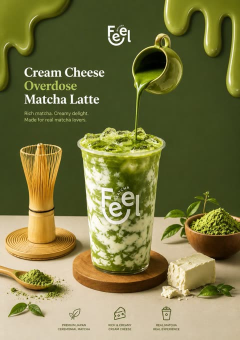</a>

Attaching the product photo as a reference and asking to keep its cup, logo and colours exact holds the brand identity. A flavour-matched monochrome backdrop plus a separate pour stream and dripping liquid frame the product without clutter.

GPT Image 2 · Edit · Source: [@im_shahid7 on X](https://x.com/im_shahid7/status/2079513962685866076) · 192 likes on 2026-10-29

[`matcha`](tags.md#tag-matcha) [`beverage-ad`](tags.md#tag-beverage-ad) [`product-reference`](tags.md#tag-product-reference) [`pouring-liquid`](tags.md#tag-pouring-liquid)

<details><summary><b>Prompt</b></summary>

```text
Advertising poster

Use the uploaded product image as your main reference point.

Keep the cup shape, logo placement, typography, proportions, corporate identity elements, lid design, textures, colors, materials, and overall brand style exactly as shown in the reference image.

Create an ultra-realistic Korean-style premium beverage advertising campaign.

The drink is elegantly located in the center of a luxurious minimalist studio. The background color is inspired by the taste of the drink and fits seamlessly into the exquisite monochromatic palette.

Large shiny drops of liquid made from the drink's signature ingredient naturally flow down from the upper edges of the composition.

The dynamic moment of pouring the ingredients is captured in the air above the drink, demonstrating how the thick liquid pours into the cup in an elegant cascade. The pouring element should be luxurious, appetizing and physically realistic.

The drink demonstrates the magnificent effects of mixing ingredients inside the cup, creating stunning gradients, swirling textures, creamy transitions and flowing ribbons of flavor.

High-quality ingredients are neatly arranged around the base of the product, which tell the story of the drink's taste.:

Fresh ingredients
Flavor cubes
Sauce cubes
Natural side dishes
Exquisite culinary accents

All ingredients should look freshly prepared and very photorealistic.

The composition corresponds to the aesthetics of advertising elite Korean cafes:

Minimalist luxury style
Pure negative space
Balanced product focus
Elegant visual hierarchy
Premium Commercial Photography

Lighting:

Soft studio lighting
Luxury backlight for photographing food
Gentle shadows
Subtle reflections
High-quality drink of commercial quality

Materials:

Glossy liquids
Realistic ice cubes
Crystal clear glass
Rich creamy texture
Detailed surface of ingredients

Mood:

An advertisement for a luxury Korean cafe, an advertising campaign for premium drinks, an elegant culinary editorial, commercial photography of products, sophisticated minimalist branding, and world-class advertising quality.

Ultra-realistic, 8K, ultra-detailed, commercial food photography, premium Korean advertising, luxury drink poster, shallow depth of field, masterpiece quality.
```

</details>

<a id="gpt-image-porsche-911-gt3-rs-yellow-poster"></a>
### Yellow Porsche 911 GT3 RS poster with tall type

<a href="https://x.com/Diplomeme/status/2097641872068063436">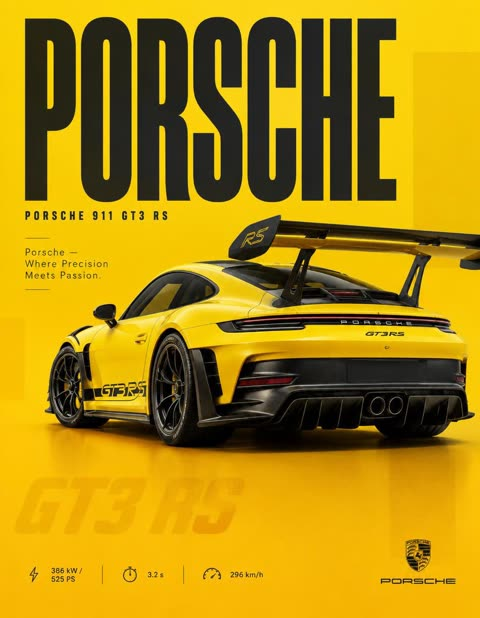</a>

Labelled sections for background, product, typography, editorial, faded text and specs lock the layout in place. A flat yellow field with charcoal type forms a tight two-colour system that frames the rear 3/4 car.

GPT Image 2.5 · Text-to-image · Source: [@Diplomeme on X](https://x.com/Diplomeme/status/2097641872068063436) · 182 likes on 2026-10-29

[`poster`](tags.md#tag-poster) [`typography`](tags.md#tag-typography) [`automotive`](tags.md#tag-automotive)

<details><summary><b>Prompt</b></summary>

```text
GPT image 2.5 Flare on
@MageSpace_


This new version looks more detailed and has better prompt understanding.

Try it with prompt : 4:5 vertical social poster, ultra high resolution, 8K

SCENE / BACKGROUND:
Flat racing yellow with subtle gradient (light → deep amber)
Grain texture 2–3%
Soft rectangular overlays at 3% opacity

PRODUCT:
Porsche 911 GT3 RS
Gloss yellow with carbon details
Rear 3/4 angle, slightly elevated
Wing dominant

Position:
Right of center

TYPOGRAPHY:
“PORSCHE”
Ultra tall, condensed, stretched
Deep charcoal

Secondary:
“PORSCHE 911 GT3 RS”

EDITORIAL:
“Porsche — Where Precision Meets Passion”

Focus:
engineering, obsession, track DNA

FADED TEXT:
“GT3 RS” at 3–5%

SPECS:
386 kW / 525 PS
3.2 s
296 km/h

LIGHTING:
Clean studio, sharp highlights

MOOD:
Precision.
Iconic.
Timeless performance.
```

</details>

<a id="gpt-image-iphone-duo-anything-posable-poster"></a>
### Model holds iPhone Duo over giant DUO lettering

<a href="https://x.com/Diplomeme/status/2097978468642480487">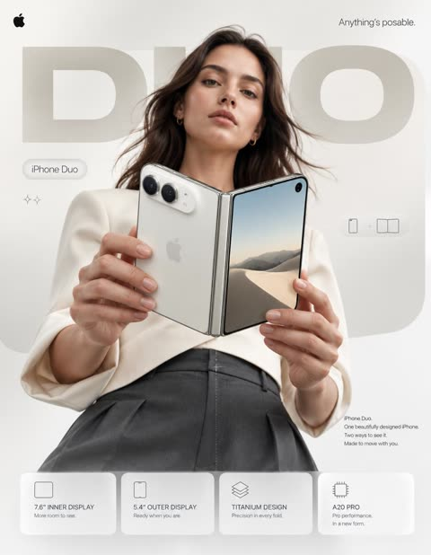</a>

The prompt builds the poster in layers: a giant cropped DUO layer sits behind the subject, a low hero angle and shallow depth keep the phone as the dominant object, and the four feature cards are described as glass panels so they read as part of the layout rather than a spec sheet.

GPT Image 2.5 · Text-to-image · Source: [@Diplomeme on X](https://x.com/Diplomeme/status/2097978468642480487) · 176 likes on 2026-10-29

[`foldable-phone`](tags.md#tag-foldable-phone) [`product-poster`](tags.md#tag-product-poster) [`giant-typography`](tags.md#tag-giant-typography) [`editorial`](tags.md#tag-editorial)

<details><summary><b>Prompt</b></summary>

```text
4:5 vertical premium smartphone campaign poster, ultra-high resolution (8K), global OOH + digital + social ready
Style: Apple-level art direction × contemporary product photography × bold editorial composition × hyper-real commercial photography

🧠 CORE INTENT:
“ANYTHING’S POSABLE.”

One iPhone.
More ways to see it.
More ways to use it.
More ways to make it yours.

Effortless flexibility.
Physical intelligence.
One device that adapts to the moment.

🎬 SCENE COMPOSITION:

BACKGROUND:
Pure matte white architectural studio environment with a dominant oversized rounded rectangle block in ultra-soft warm silver gradient (top-left → bottom-right illumination)

The background block creates a subtle dimensional stage behind the subject and product.

GIANT TYPOGRAPHY (BACKGROUND LAYER):
“DUO”

* ultra-bold geometric sans-serif
* stretched wide kerning
* partially cropped by frame edges
* soft shadow depth
* color: very light warm grey
* subtle embossed / debossed effect
* typography positioned behind the subject and product
* large enough to function as an architectural graphic element

👤 SUBJECT (HUMAN ELEMENT):

Female model, clean contemporary editorial look, Apple-style casting

* neutral expression
* confident, calm, effortless
* natural skin texture
* hair: natural flow, slightly wind-touched
* minimal makeup
* understated styling

OUTFIT:
→ sculptural off-white tailored top
→ deep graphite trousers
→ minimal accessories
→ no visible branding
→ sophisticated contemporary styling

POSE:

* Shot from slightly low angle (hero perspective)
* Body slightly angled toward camera
* One hand holding iPhone Duo in its compact closed configuration
* Other hand lightly supporting the device as it opens
* iPhone Duo positioned prominently between viewer and subject
* Face aligned toward viewer
* direct eye contact
* relaxed posture
* pose communicates control rather than excitement

📱 PRODUCT (HERO FOCUS):

DEVICE:
iPhone Duo

FINISH:
Premium titanium finish with physically accurate metallic surface response

POSITION:
Extreme foreground (forced perspective)
Slightly rotated toward camera to reveal the thin profile, hinge construction and display relationship

The device must remain the dominant visual object.

PRODUCT CONFIGURATION:
iPhone Duo shown transitioning from compact outer-display mode into its expansive unfolded configuration.

One continuous physical device.
No impossible geometry.
No duplicated products.
No floating components.

DETAILING:

* ultra-thin titanium frame
* precision hinge construction
* seamless folding display
* extremely thin bezels
* hyper-sharp camera system
* lens reflections physically accurate
* brushed titanium edge highlights
* subtle micro-scratches
* realistic fingerprints / material response kept extremely subtle
* Apple logo centered with restrained reflective gloss
* physically accurate display reflections
* realistic hinge shadow and contact points

The unfolded display should feel expansive and architectural rather than simply “larger.”

REFLECTION:

* soft studio reflection across titanium edges
* subtle screen reflections
* controlled highlight around hinge
* micro light bloom around metallic edges

✨ LIGHTING SYSTEM:

MAIN LIGHT:
Soft studio key light (front-left)
→ smooth skin tones
→ clean product highlights
→ controlled white-to-silver transitions

RIM LIGHT:
Cool-white edge light from right
→ enhances phone silhouette
→ separates titanium edges from white background
→ reveals the thinness of the device

ACCENT LIGHT:
Very subtle warm-silver glow from background architectural block

SHADOW:
Soft drop shadow beneath subject + phone
Soft contact shadow around hinge
(no harsh contrast)

🎨 COLOR SYSTEM:

* Primary: clean Apple white
* Secondary: titanium silver / warm metallic grey
* Accent: subtle graphite
* Background: warm neutral white
* Contrast: deep micro-shadows

No over-saturation.
No neon.
No unnecessary color effects.
Controlled premium palette.

✨ GRAPHIC ELEMENTS:

* Minimal sparkle icons ✦ (2 only)
* One subtle translucent UI pill floating near the unfolded display
* Thin technical construction line following the phone’s folding axis
* Very subtle grain for realism
* Minimal geometric indicators showing the transition between closed and open states

All graphic elements remain secondary to the product.

✍️ TYPOGRAPHY SYSTEM:

TOP LEFT:
Apple logo (black, small, clean)

TOP RIGHT:
“Anything’s posable.” (thin sans-serif)

MID LEFT (pill):
“iPhone Duo”

CENTER DOMINANT:
“DUO” (background type)

BOTTOM RIGHT (body text):
Small paragraph:

“iPhone Duo.
One beautifully designed iPhone.
Two ways to see it.
Made to move with you.”

📊 FEATURE STRIP (BOTTOM GRID):

4 rounded cards (glass-white panels):

1. 7.6″ INNER DISPLAY
    “More room to see.”
2. 5.4″ OUTER DISPLAY
    “Ready when you are.”
3. TITANIUM DESIGN
    “Precision in every fold.”
4. A20 PRO
    “Pro performance. In a new form.”

Icons minimal line style.

Cards must feel integrated into the poster rather than appearing as a generic technology specification panel.

📐 COMPOSITION GRID:

* Top: brand + statement
* Mid: subject + product (dominant)
* Background: giant “DUO” typography layer
* Bottom: feature modules

Strong vertical hierarchy.

The product overlaps the background typography.

The model creates secondary depth behind the phone.

Eye flow:
Face → Phone → Hinge → “DUO” → Features

The iPhone Duo must remain the first visual priority.

🎥 CAMERA SPECS:

* ARRI Alexa Mini LF
* 50mm premium anamorphic lens
* shallow depth of field around subject
* product maintained in extremely high optical clarity
* HDR rendering
* ultra-real skin + titanium material detail
* subtle lens distortion for realism
* physically accurate reflections
* controlled cinematic highlight roll-off
* realistic depth separation
* premium commercial product photography

Slightly low camera position for a subtle hero perspective.

No extreme wide-angle distortion.
No exaggerated perspective.
No artificial CGI appearance.

🎯 FINAL ART DIRECTION:

Apple-level campaign restraint with enough visual tension to feel contemporary and editorial.

The poster should communicate that iPhone Duo is not simply a phone that folds.

Its ability to change position becomes the central visual language of the campaign.

Premium.
Precise.
Human.
Physical.
Confident.

No generic foldable-phone aesthetic.
No futuristic sci-fi environment.
No excessive holograms.
No neon.
No cyberpunk styling.
No random floating UI.
No distorted hands.
No malformed device geometry.
No impossible hinge.
No duplicated cameras.
No fake Apple branding.
No clutter.
No cheap AI-rendered appearance.

FINAL OUTPUT:
4:5 vertical
8K
hyper-real commercial photography
premium Apple campaign art direction
global advertising quality
OOH billboard ready
social media ready
Behance-level visual design
```

</details>

<a id="gpt-image-dhl-delivered-at-speed-poster"></a>
### DHL cargo jet, truck and warehouse on yellow poster

<a href="https://x.com/Diplomeme/status/2071447385998508240"></a>

The prompt is split into labelled sections for layout, a strict hex palette and fixed headline, subhead and CTA text, which keeps the type readable and the colours on brand. The 70mm lens and the 3/4 forward angle make the aircraft the dominant diagonal in the frame.

GPT Image 2 · Text-to-image · Source: [@Diplomeme on X](https://x.com/Diplomeme/status/2071447385998508240) · 170 likes on 2026-10-29

[`dhl`](tags.md#tag-dhl) [`poster`](tags.md#tag-poster) [`logistics`](tags.md#tag-logistics) [`brand-palette`](tags.md#tag-brand-palette)

<details><summary><b>Prompt</b></summary>

```text
Act as a senior art director from a global advertising agency specializing in premium logistics and transportation campaigns.

Create an ultra-premium social media campaign poster for DHL in vertical 4:5 format.

OBJECTIVE:
Position DHL as the fastest and most reliable global logistics network, emphasizing speed, precision, and worldwide delivery capability.

ART DIRECTION:
Bold commercial energy.
Industrial precision.
High-speed visual storytelling.
Clean but aggressive.
Premium enterprise campaign.
Behance front-page quality.

BRAND LANGUAGE:
High velocity.
Global logistics.
Urgent movement.
Operational excellence.
Industrial precision.

LAYOUT ENGINEERING:
Dynamic asymmetrical editorial composition.
Strong diagonal visual flow.
Large premium negative space for headline.
Clear hierarchy between hero visual, supporting graphics, and CTA.

VISUAL HIERARCHY:
Hero subject occupies 50 percent of composition.
Motion elements occupy 30 percent.
Branding and typography occupy 20 percent.

HERO SUBJECT:
A premium DHL cargo aircraft flying aggressively toward camera at dynamic 3/4 perspective, emerging from clouds with strong forward motion.
Visible DHL branding on fuselage.
Aircraft feels dominant, fast, and powerful.

SECONDARY ELEMENTS:
DHL delivery truck,
shipping containers,
cargo pallets,
subtle world route lines,
warehouse infrastructure.

Use sparingly to support scale without clutter.

GEOMETRY BLOCK:
Bold diagonal graphic planes inspired by motion streaks and speed lanes.
Angular yellow and red shapes cutting across composition.
Strong directional energy.

BACKGROUND:
Expansive dramatic sky with cloud layers and atmospheric depth.
Subtle world map grid integrated into background.
Motion blur streaks emphasizing global movement.

MOTION / ENERGY:
Extreme speed visualization.
High-velocity streak lines.
Directional motion blur.
Particle trails.
Compressed airflow around aircraft.
Visual energy should feel fast and aggressive.

LIGHTING:
High-contrast commercial lighting.
Golden sunlight breaking through clouds.
Strong yellow rim lighting.
Sharp reflections on aircraft body.
Premium HDR realism.

COLOR SYSTEM:
Strict DHL palette.

Primary:
DHL Yellow (#FFCC00)

Secondary:
DHL Red (#D40511)

Support:
White
Black

No extra colors.

TYPOGRAPHY SAFE ZONES:
Reserve large clean headline area in upper third.
Reserve CTA area near lower third.
Maintain clean readable hierarchy.

HEADLINE:
DELIVERED AT SPEED

SUBHEAD:
GLOBAL SHIPPING. ZERO COMPROMISE.

CTA:
SHIP NOW

CAMERA:
Cinematic aerial commercial photography
70mm compression lens
Dynamic forward perspective

POST PROCESS:
Micro contrast sharpening
Subtle bloom
Print-quality finish
Premium commercial polish

QUALITY:
Hyper-realistic
Photorealistic commercial advertising
Premium global campaign quality
Ultra-detailed
8K UHD

NEGATIVE:
No AI artifacts
No warped aircraft
No clutter
No broken text
No distorted perspective
No cheap stock-ad aesthetics
```

</details>

<a id="gpt-image-tennis-ball-sculpture-goal-athlete-poster"></a>
### Athlete lying on giant tennis ball, huge GOAL behind

<a href="https://x.com/im_shahid7/status/2086775895017361435"></a>

A single oversized prop becomes the sculpture and the athlete rests on its curve, so the scale contrast carries the concept. Naming the mirrored floor and cinematic lighting sets the reflection and the moody key light.

GPT Image 2 · Text-to-image · Source: [@im_shahid7 on X](https://x.com/im_shahid7/status/2086775895017361435) · 170 likes on 2026-10-29

[`sports-fashion`](tags.md#tag-sports-fashion) [`surreal-scale`](tags.md#tag-surreal-scale) [`typography`](tags.md#tag-typography) [`reflection`](tags.md#tag-reflection)

<details><summary><b>Prompt</b></summary>

```text
Avant-garde sports fashion, advertising, a huge tennis ball set up like a monumental sculpture, a male athlete sprawled across the curved surface of the ball like modern furniture, the huge word "GOAL" in bold typography behind, the background of the burnt green studio, shiny mirrored floor, luxurious sports editorial style, cinematic lighting, ultra-pure composition, 1:1
```

</details>

<a id="nano-banana-dune-walk-linen-sneaker-poster"></a>
### Man in linen strides past giant WALK typography

<a href="https://x.com/Ozayrr_irl/status/2050214923100368911"></a>

A low camera angle and an oversized terracotta headline placed behind the figure create depth, while the sharp foreground sneakers anchor the product. Naming the exact tagline text and the 9:16 layout keeps the poster clean.

Nano Banana 2 · Text-to-image · Source: [@Ozayrr_irl on X](https://x.com/Ozayrr_irl/status/2050214923100368911) · 168 likes on 2026-10-29

[`sneaker-ad`](tags.md#tag-sneaker-ad) [`typography`](tags.md#tag-typography) [`lifestyle`](tags.md#tag-lifestyle) [`editorial`](tags.md#tag-editorial)

<details><summary><b>Prompt</b></summary>

```text
" A warm editorial vertical lifestyle sneaker poster (9:16 ratio).
A young American white man with sharp jawline and defined facial features,
wearing oversized cream linen pants and a beige crewneck, casually mid-stride
with one foot forward — shot from below at a low ground-level angle,
confident and relaxed energy. Large earthy bold typography "WALK" in terracotta
brown behind the figure. Brand name "DUNE" at the bottom. Taglines:
"SLOW DOWN TO STAND OUT." / "MADE FOR THE JOURNEY." Sand-colored suede sneakers
with terracotta sole in sharp foreground. Warm sandy gradient background with
subtle dust particle atmosphere. Ultra photorealistic, 8K, no text overlays
on subject, cinematic color grading."
```

</details>

<a id="gpt-image-red-suit-multi-exposure-poster"></a>
### Red suit woman, portrait merging into walking figure

<a href="https://x.com/AvelyrahnAI/status/2061280653900202437"></a>

Showing one subject twice, a tight portrait on the left and a full length walking figure on the right with the same wardrobe, makes the poster read as a multi exposure layout. Asking for model style photography and an uploaded face reference keeps the identity consistent across both figures.

GPT Image 2 · Edit · Source: [@AvelyrahnAI on X](https://x.com/AvelyrahnAI/status/2061280653900202437) · 165 likes on 2026-10-29

[`multi-exposure`](tags.md#tag-multi-exposure) [`portrait`](tags.md#tag-portrait) [`fashion`](tags.md#tag-fashion) [`poster`](tags.md#tag-poster)

<details><summary><b>Prompt</b></summary>

```text
multi-exposure poster design featuring an Over-sized body young Indian woman portrait.  wavy shoulder hair bouncy part of the middle of hair,, wearing dark sunglasses, red formal coat pant with white shirt , and a silver chain necklace with black heels. The composition features a large, expressive close-up portrait of the woman  left, blending into a full-body shot of the same women walking confidently forward on the right, photography like model .The background is a dramatic, ethereal scene In the left bottom corner add a small triangle with a stylized "⚔️" inside it and a text "AvelyrahnAi" beneath it. Keep the face 100% same as in the uploaded picture. Over-sized body portrait.
```

</details>

<a id="nano-banana-vintage-country-travel-poster-template"></a>
### Vintage Parchment Travel Posters for Any Country

<a href="https://x.com/TechieBySA/status/2044113138551763191"></a>

A single country placeholder drives the whole poster, so one template yields a matching series. The prompt stacks layout cues in order: parchment texture, baroque gold border, panoramic landmarks, foreground cultural objects, golden hour light, then serif title and italic subtitle.

Nano Banana 2 · Text-to-image · Source: [@TechieBySA on X](https://x.com/TechieBySA/status/2044113138551763191) · 151 likes on 2026-10-29

[`travel-poster`](tags.md#tag-travel-poster) [`vintage`](tags.md#tag-vintage) [`template`](tags.md#tag-template) [`landmarks`](tags.md#tag-landmarks) [`parchment`](tags.md#tag-parchment)

<details><summary><b>Prompt</b></summary>

```text
“Vintage illustrated travel poster of [COUNTRY], aged parchment background
texture, ornate gold baroque decorative border, hyper-detailed editorial
illustration style, wide panoramic scene featuring the most iconic landmarks
and landscapes of [COUNTRY], foreground scattered with local cultural symbols
(traditional food, national flag, flora, iconic objects), warm golden hour
sunset lighting, rich earthy tones with pops of color, large serif display
title text "COUNTRY" at top, elegant italic subtitle below, small decorative
flourishes and botanical elements in corners, 4:5 aspect ratio.”
```

</details>

<a id="gpt-image-photo-line-art-travel-poster"></a>
### Shanghai skyline photo turning into line art wake

<a href="https://x.com/Goodmanprotocol/status/2103408270425960905"></a>

The prompt splits the poster into an exact half photo and half ivory paper, then asks one element, here a ferry wake, to continue across the seam as pen line art. A tiny ink figure at 7 to 10 percent of the height and a short caption keep the layout quiet, and the bracketed placeholder lets the same structure work for any place.

GPT Image 2.5 · Text-to-image · Source: [@Goodmanprotocol on X](https://x.com/Goodmanprotocol/status/2103408270425960905) · 146 likes on 2026-10-28

[`travel-poster`](tags.md#tag-travel-poster) [`line-art`](tags.md#tag-line-art) [`photo-to-sketch`](tags.md#tag-photo-to-sketch) [`editorial`](tags.md#tag-editorial) [`template`](tags.md#tag-template)

<details><summary><b>Prompt</b></summary>

```text
Create a premium 2:3 vertical “Photo × Line Art” travel editorial poster for [COUNTRY / LOCATION / SUBJECT].

TEXT-TO-IMAGE ONLY — generate the entire composition creatively from [COUNTRY / LOCATION / SUBJECT] alone. No reference image required.

COMPOSITION
Divide the artwork into two equal 50/50 sections. The upper half is a sophisticated realistic travel photograph depicting the most recognizable scene, landmark, architecture, landscape, or cultural element of [COUNTRY / LOCATION / SUBJECT].

The lower half transitions into clean warm ivory paper with extremely subtle fine-fiber texture and generous negative space.

CONTINUOUS VISUAL CONNECTION
Identify one distinctive element from the upper scene—such as water, a road, rope, cable, bridge, branch, shoreline, architectural edge, reflection, or light—and extend it naturally across the center boundary.

The element must continuously transform from realistic photographic detail into a delicate black pen line drawing. The transition should feel seamless, intentional, and visually clever, with no gap or abrupt restart.

LINE-ART CHARACTER
Create one tiny black ink figure interacting with the extended line. The figure should occupy only about 7–10% of the total artwork height, with a simple expressive action such as pulling, climbing, carrying, pushing, observing, walking, or resting.

Use thin, slightly imperfect hand-drawn lines, simplified clothing and props, minimal facial detail, and relaxed editorial sketchbook character.

TYPOGRAPHY
Add one short, gentle English phrase of 2–5 words, generated specifically for [COUNTRY / LOCATION / SUBJECT]. Keep it small and understated, functioning as an emotional caption rather than a headline.

FINAL AESTHETIC
Realistic travel photography × minimalist black line art × clever visual continuation × contemporary editorial poster × poetic travel storytelling. Keep the composition refined, quiet, spacious, and sophisticated. Every location should receive a unique connection concept based on its visual identity.

Avoid: disconnected upper and lower sections, floating figures, isolated icons, oversized characters, detailed faces, anime, cartoon styling, thick outlines, dense sketching, full scene illustration, infographic layouts, grids, collage panels, stamps, borders, excessive text, yellow paper, logos, watermarks, or UI elements.

FORMAT: 2:3 vertical, exact 50/50 composition, premium editorial travel-poster aesthetic.
```

</details>

<a id="nano-banana-floating-outfit-fashion-editorial"></a>
### Floating winter outfit with labeled fabric callouts

<a href="https://x.com/Strength04_X/status/2034474068087566463"></a>

A bottom to top garment list with bracketed slots fixes the layering order, and per-fabric physics lines keep wool, silk and leather behaving differently. Hairline leader labels, a three-light setup and a serif title block turn it into a fashion editorial.

Nano Banana 2 · Text-to-image · Source: [@Strength04_X on X](https://x.com/Strength04_X/status/2034474068087566463) · 140 likes on 2026-10-29

[`fashion`](tags.md#tag-fashion) [`levitation`](tags.md#tag-levitation) [`outfit`](tags.md#tag-outfit) [`labels`](tags.md#tag-labels) [`editorial`](tags.md#tag-editorial)

<details><summary><b>Prompt</b></summary>

```text
Complete [STYLE] outfit floating in its exact worn position around  an invisible body with every piece suspended mid-breath, mid-billow.  LOOK (bottom to top): [FOOTWEAR] → [BOTTOMS] → [TOP] → [LAYER] →  [ACCESSORIES] → [JEWELLERY] → [HEADWEAR]  FABRIC PHYSICS: each material true to its weight, wool hangs,  silk drapes, denim holds its crease, leather keeps its shape.  Every edge lifting slightly as if caught in one silent gust.  LABELS: hairline leader to floating label box. "[GARMENT]" uppercase / "[FABRIC]" italic / "[ONE DEFINING DETAIL]"  LIGHTING: soft directional from upper left + warm fill from below  catching linings and sole edges + cool rim outlining the silhouette. BACKGROUND: [COLOR] seamless, fashion-forward. TITLE: "[LOOK NAME]" elegant serif type, top right. SUBTITLE: "[MOOD / OCCASION]" italic.  Mood: high-concept levitation editorial, the outfit exists,  the person is imagination. 4K, extraordinary fabric fidelity, tack sharp.
```

</details>

<a id="nano-banana-graffiti-streetwear-portrait-poster"></a>
### Graffiti Streetwear Portrait Poster with Spray Lettering

<a href="https://x.com/SadiaMalik182/status/2068623080491012278"></a>

Stacks named graffiti elements (typography, drips, stickers, splashes) around a posed fashion subject. The line asking for a premium editorial look rather than a messy mural keeps the busy background controlled, and a negative prompt guards against artifacts.

Nano Banana 2 · Text-to-image · Source: [@SadiaMalik182 on X](https://x.com/SadiaMalik182/status/2068623080491012278) · 138 likes on 2026-10-28

[`graffiti`](tags.md#tag-graffiti) [`streetwear`](tags.md#tag-streetwear) [`fashion-poster`](tags.md#tag-fashion-poster) [`spray-paint`](tags.md#tag-spray-paint) [`editorial`](tags.md#tag-editorial)

<details><summary><b>Prompt</b></summary>

```text
Create a high-detail portrait poster in a bold American graffiti-inspired art style, combining modern urban street aesthetics with expressive American visual culture. Feature dynamic graffiti typography, layered spray-paint textures, hand-drawn symbols, abstract paint splashes, neon brush strokes, urban sticker elements, American calligraphy accents, and decorative ornaments that reinforce a vibrant street-art atmosphere.

The subject should pose confidently in fashionable contemporary streetwear, wearing layered oversized urban fashion pieces, premium casual styling, cargo denim, statement sneakers, and expressive accessories. Use a charismatic fashion-model pose with natural attitude and cinematic presence.

Fill the background with colorful graffiti walls, spray textures, stickers, urban signage, painted symbols, paint drips, street culture graphics, and modern American-inspired visual motifs. Maintain a premium editorial campaign look rather than a messy street mural.

Cinematic lighting, realistic skin texture, strong contrast, ultra-sharp details, vibrant color harmony, luxury street-fashion campaign aesthetic, poster-ready composition, immersive storytelling, ultra-detailed textures, premium urban atmosphere, 8K ultra-high resolution.

Negative Prompt: blurry details, bad anatomy, extra fingers, distorted face, low quality, dull colors, messy composition, watermark, logo, text artifacts.
```

</details>

<a id="gpt-image-photo-to-manga-split-panel-poster"></a>
### Photo and manga redraw split poster, girl on petals

<a href="https://x.com/oggii_0/status/2114943832894972403"></a>

The prompt splits the canvas exactly 50/50, leaving the photo untouched above and redrawing it below with a limited hex coded palette and per subject rules that keep the pose and identity faithful. The redrawn figure fills most of the lower panel rather than sitting small, so the margins are tighter than the prompt asks for.

GPT Image 2.5 · Edit · Source: [@oggii_0 on X](https://x.com/oggii_0/status/2114943832894972403) · 136 likes on 2026-10-28

[`photo-to-manga`](tags.md#tag-photo-to-manga) [`split-panel`](tags.md#tag-split-panel) [`limited-palette`](tags.md#tag-limited-palette) [`handwritten-caption`](tags.md#tag-handwritten-caption) [`print-poster`](tags.md#tag-print-poster)

<details><summary><b>Prompt</b></summary>

```text
Turn any photo into a minimalist Japanese manga print poster with GPT Image 2.5.

Prompt: Task: Create a 3:4 Split-Panel Photo-to-Japanese Illustration Poster

Transform the uploaded photograph into a vertically composed 3:4 comparison poster. The upper half displays the original photograph, while the lower half features a Japanese hand-drawn manga illustration with a limited-color print-poster aesthetic, faithfully redrawn from the same photograph.

Divide the canvas into two equal horizontal sections, each occupying exactly 50% of the total height. Both sections must have the same width. The horizontal division should connect seamlessly, with no gap, border, overlap, or decorative separator.

1. Upper Half — Original Photograph

- Preserve the original photograph exactly as it is.
- Do not redraw, recolor, retouch, or add any text to the photograph.
- Scale proportionally without stretching or distorting the image.
- If necessary, crop peripheral background areas first while preserving the main subject and important visual details.
- If the aspect ratio cannot be accommodated without compromising essential content, extend the edges with a light grayish-cream background. Never invent or reconstruct missing parts of the original photograph.

2. Lower Half — Japanese Hand-Drawn Illustration

Redraw the photograph as a Japanese-inspired hand-drawn manga illustration with a minimalist, limited-color screen-print poster aesthetic.

The original photograph is the exclusive source of the subject's identity, appearance, pose, structure, composition, layout, and relationships between objects.

For people:

- Preserve recognizable facial shape, hairstyle silhouette, expression, pose, gestures, and clothing category.
- Simplify the face into clean manga-style shapes.
- Render hair as grouped, flowing masses rather than individual strands.
- Express clothing through elegant, simplified fashion silhouettes.

For animals:

- Preserve the species, body proportions, distinctive coat-color patterns, and pose.
- Use simplified contours and flat color blocks to retain recognizability.

For objects:

- Preserve the original silhouette, essential structural details, and proportions.

For landscapes and scenery:

- Preserve the terrain, architecture, distribution of visible elements, and spatial depth.
- Redraw the main landscape as a cohesive illustration rather than reducing it to an isolated object.

Preserve all visible contact, overlap, and occlusion relationships. Depict only what is visible in the source photograph. Do not introduce new subjects, props, gestures, or structures outside the original image.

If an additional style reference is provided, use it only for drawing technique, color palette, and layout. Never copy its subjects or content.

3. Linework and Color Treatment

Use a consistent combination of delicate ink outlines, naturally simplified shapes, and limited-color flat fills.

- Ink outline: Near-black "#02030B", with varied pressure, subtle line-weight changes, occasional pauses, and slightly irregular hand-drawn edges.
- Keep internal lines minimal, retaining only the structural details necessary to define form.
- Use clean, continuous, opaque color blocks.
- Merge shadows into a small number of hard-edged color shapes.
- Avoid individual hair strands, dense hatching, photorealistic textures, and excessive decorative detail.
- Preserve the subject's essential natural colors and distinctive identifying color patterns.

Lower-panel background: Light grayish cream "#ECEDE5".

Primary accent: Warm red "#E9444B".

Secondary accent: Muted blue-gray "#5296BD".

Use red as the dominant accent and blue sparingly. Ensure that accent colors complement the subject without compromising its recognizability.

Simplify the background to the cream paper tone, retaining only the environmental details needed to communicate the setting, explain the action, and preserve spatial relationships. For landscape photographs, translate the principal scenery into the illustration rather than omitting it.

4. Lower Panel — Minimalist Poster Layout

Create a refined editorial composition with a small illustration surrounded by generous negative space.

- Treat the subject and essential environmental elements as one cohesive illustration.
- Scale the complete illustration proportionally and center it within the lower panel.
- Keep the entire illustration group within approximately 65–70% of the panel width and 60–65% of the panel height.
- Fit the illustration within these limits without stretching or distorting it.
- Maintain generous light grayish-cream margins on all sides.
- Do not let the illustration touch the edges or fill the entire panel.
- Do not use large background color blocks to fill the empty space.
- Do not add a border around the illustration.

The overall layout should resemble a thoughtfully designed Japanese art-print poster: restrained, balanced, airy, and visually sophisticated.

5. Handwritten Typography

Add two small handwritten text elements within the negative space of the lower panel.

Top area: Place a small, delicate, near-black handwritten phrase, such as:

“FROM LIFE TO LINES.”

Beside the illustration: Add an even smaller, casual handwritten phrase, such as:

“another way to see.”

Generate both phrases automatically based on the subject, setting, and emotional atmosphere of the original photograph. The wording should feel concise, natural, poetic, and contextually relevant.

The example phrases are references for tone and placement only. Do not use them automatically if a more fitting caption can be generated.

Typography must remain subtle and secondary to the illustration. Use a natural handwritten style with fine, slightly imperfect strokes. Ensure all generated text is spelled correctly and legible.

6. Final Output Requirements

- Aspect ratio: 3:4 portrait.
- Upper half: 50% of canvas height, displaying the untouched original photograph.
- Lower half: 50% of canvas height, displaying the Japanese-inspired hand-drawn illustration.
- Equal panel widths, seamless horizontal transition, no gap, no frame, and no overlap.
- Consistent minimalist Japanese manga linework and limited-color print-poster styling.
- Small, centered illustration with generous cream-colored negative space.
- Subtle, context-aware handwritten typography in the lower panel.

Core principle: The original photograph determines what is depicted. The illustration style determines how the lower half is redrawn. Preserve the source's identity and composition while transforming the lower panel into an elegant, minimalist Japanese illustration poster.
```

</details>

<a id="gpt-image-london-corgi-walk-flat-poster"></a>
### Woman and corgi in London flat poster

<a href="https://x.com/itxabdullaa/status/2068703552592367804"></a>

Fixed style terms such as thick black outlines, flat solid fills, pastel color blocking and minimal face details lock the look, so only the slots change the scene. Sparse confetti doodles and clean negative space keep the layout crisp and poster-like.

GPT Image 2 · Text-to-image · Source: [@itxabdullaa on X](https://x.com/itxabdullaa/status/2068703552592367804) · 134 likes on 2026-10-29

[`flat-vector`](tags.md#tag-flat-vector) [`template`](tags.md#tag-template) [`pastel`](tags.md#tag-pastel) [`travel`](tags.md#tag-travel)

<details><summary><b>Prompt</b></summary>

```text
GPT Image 2 on Chatgpt

Prompt: Playful flat-vector poster illustration of [HUMAN] posing with [ANIMAL] in [POSE], wearing [CLOTHING], set in [SCENERY]. Use clean thick black  outlines, simple rounded geometric shapes, flat solid color fills, minimal facial details, small neutral eyes, calm deadpan expression, simplified hands and body proportions, pastel color blocking, sparse confetti doodles, tiny abstract icons, clean negative space, crisp graphic poster layout, and a controlled [PALETTE]. Vertical 4:5 composition.
```

</details>

<a id="gpt-image-anime-tv-show-cast-posters"></a>
### Four TV show cast posters with signature quotes

<a href="https://x.com/TechieBySA/status/2059239464858247449"></a>

A reusable template with a [TV SHOW] slot that fixes the poster layout: hero front and center, supporting cast at varying depths, bold title at top and one quote as a graphic element. Locking canonical outfits and a show color accent on white keeps every filled-in poster consistent.

GPT Image 2 · Text-to-image · Source: [@TechieBySA on X](https://x.com/TechieBySA/status/2059239464858247449) · 131 likes on 2026-10-29

[`anime`](tags.md#tag-anime) [`poster`](tags.md#tag-poster) [`tv-shows`](tags.md#tag-tv-shows) [`template`](tags.md#tag-template)

<details><summary><b>Prompt</b></summary>

```text
“Anime editorial poster of the cast of [TV SHOW]. The main character front and center, large, mid-body composition. Supporting characters arranged behind at varying depths and scales. Every character in their exact canonical outfit, no redesigns. Clean anime lineart, semi-flat shading, high contrast. Show’s signature color as dominant accent against a white background. Bold show title typography at the top in the show’s original font style. One iconic quote integrated as a graphic element. Background reflects the show’s setting rendered as abstract graphic shapes and texture. Paint strokes, diagonal energy lines, gritty overlays matching the show’s tone. Poster-quality finish, 4K, vertical 3:4 format.”
```

</details>

<a id="gpt-image-architectural-landmark-graphite-watercolor-poster"></a>
### Leaning Tower of Pisa graphite and watercolor poster

<a href="https://x.com/Naiknelofar788/status/2104418521233215906"></a>

Swap the placeholders for any landmark and city. Layered detail levels, one unexpected pencil line that breaks beside a handwritten coordinate, and a single accent color tied to the country give the poster depth and a personal touch.

GPT Image 2.5 · Text-to-image · Source: [@Naiknelofar788 on X](https://x.com/Naiknelofar788/status/2104418521233215906) · 129 likes on 2026-10-28

[`architecture`](tags.md#tag-architecture) [`landmark`](tags.md#tag-landmark) [`graphite`](tags.md#tag-graphite) [`watercolor`](tags.md#tag-watercolor) [`travel-poster`](tags.md#tag-travel-poster)

<details><summary><b>Prompt</b></summary>

```text
Create an exceptionally original minimalist architectural art poster featuring [LANDMARK] in [CITY, COUNTRY].

Depict the landmark in its recognizable natural architectural appearance, with its authentic proportions, distinctive structure, materials, and characteristic details. Combine fine graphite architectural drawing with subtle vintage watercolor washes, creating the feeling of a sophisticated illustrated travel archive.

The landmark should be the central visual focus, surrounded by an intricate but restrained world of extremely delicate architectural linework: construction measurements, perspective guides, tiny streets, rooftops, surrounding buildings, local landscape, clouds, birds, shadows, fragments of maps, compass marks, elevation studies, structural details, and subtle environmental contours.

Use a layered visual language where some elements are highly detailed while others fade into the paper, creating depth without making the composition feel crowded.

Add one unexpected artistic detail: a single continuous pencil line travels around the landmark without directly tracing its outline. Allow it to occasionally intersect with construction lines, then break at one point beside a tiny handwritten coordinate, date, measurement, or architectural note.

Use warm ivory handmade paper, graphite pencil, extremely fine ink lines, delicate watercolor washes, subtle eraser dust, visible paper fibers, faint halftone imperfections, soft natural shadows, and lightly weathered archival texture.

Color palette

Keep the overall artwork muted, sophisticated, and vintage. Use warm ivory and graphite as the foundation, with the landmark shown in its authentic recognizable colors through restrained watercolor washes.

Add one subtle accent color inspired by [CITY/COUNTRY] — for example:

- Italy → muted terracotta
- Japan → restrained vermilion
- France → faded blue
- UK → muted navy or burgundy
- India → subtle saffron
- USA → muted teal or dusty red

Avoid bright digital colors.

Surrounding details

Include carefully chosen elements associated with [CITY/COUNTRY], such as:

- local architecture
- landscape or geography
- streets and rooftops
- transportation
- vegetation
- small cultural details
- map fragments
- architectural ornaments
- elevation or measurement diagrams
- compass rose
- coordinates
- faint historical annotations

These details should frame and contextualize the landmark rather than compete with it.

Typography

Place small, refined typography in generous negative space:

[LANDMARK NAME]
[CITY, COUNTRY]

“drawn by everything around it.”

Use elegant editorial serif typography with generous spacing. Add only a few tiny handwritten architectural annotations or coordinates.

Artistic direction

The final composition should feel mysterious, intelligent, timeless, and unexpectedly beautiful — somewhere between a vintage European travel poster, an architect's working sketch, a museum exhibition print, and a collector's archival illustration.

No people.
No photorealistic background.
No excessive typography.
No decorative clutter.
No neon colors.
No glossy digital rendering.
No cartoon aesthetic.
No generic stock-travel-poster appearance.

4:5 vertical composition, premium editorial design, tactile handmade paper, sophisticated architectural illustration, precise fine-line details, subtle watercolor, elegant negative space, balanced visual hierarchy, museum-quality contemporary art poster.
```

</details>

<a id="gpt-image-city-screenprint-travel-poster-paris"></a>
### Paris landmark screenprint travel poster with green car

<a href="https://x.com/Maercihh/status/2099757585264251102"></a>

A JSON template where only the city name changes, while the model picks 4 to 7 landmarks as bold black silhouettes, one local vehicle along the bottom edge and a 2 to 4 color palette. A do not copy list, a ban on extra text and cream paper with ink grain keep the result a handmade print rather than clean vector art.

GPT Image 2.5 · Text-to-image · Source: [@Maercihh on X](https://x.com/Maercihh/status/2099757585264251102) · 129 likes on 2026-10-28

[`travel-poster`](tags.md#tag-travel-poster) [`screenprint`](tags.md#tag-screenprint) [`city-template`](tags.md#tag-city-template) [`landmarks`](tags.md#tag-landmarks) [`json-prompt`](tags.md#tag-json-prompt)

<details><summary><b>Prompt</b></summary>

```text
{
  "input": {
    "city_name": "{{USER_INPUT_CITY}}"
  },

  "reference_style": {
    "use_uploaded_reference_images": true,
    "reference_images_define": [
      "overall composition",
      "hand-cut screenprint aesthetic",
      "bold black graphic silhouettes",
      "limited color palette",
      "vintage travel poster character",
      "rough ink texture",
      "slightly imperfect handmade edges",
      "large oversized city typography",
      "layered landmark arrangement",
      "bottom transportation element",
      "cream/off-white paper background",
      "minimal editorial composition"
    ],
    "do_not_copy": [
      "specific landmarks",
      "specific city name",
      "specific vehicle",
      "specific color combinations",
      "exact typography arrangement",
      "exact landmark placement"
    ]
  },

  "generation": {
    "type": "vintage_city_travel_poster",
    "aspect_ratio": "3:4",
    "resolution": "high",
    "orientation": "portrait",

    "city_adaptation": {
      "primary_rule": "Everything must be redesigned around the user's city_name.",
      "identify_city": true,
      "research_visual_identity": true,

      "landmarks": {
        "count": "4-7",
        "selection": "Automatically select the most recognizable and visually distinctive landmarks of the specified city.",
        "prioritize": [
          "major landmark",
          "historic architecture",
          "modern architectural icon",
          "religious or cultural landmark",
          "bridge or monument",
          "recognizable skyline element"
        ],
        "rendering": "Convert each landmark into simplified bold black screenprint silhouettes while preserving its recognizable architectural identity."
      },

      "transportation": {
        "automatically_select": true,
        "instruction": "Choose a transportation vehicle strongly associated with the specified city, such as a taxi, tram, bus, metro train, tuk-tuk, cable car, rickshaw, classic car, ferry, or other iconic local transport.",
        "placement": "large foreground element along the bottom edge",
        "style": "simplified vintage screenprint illustration"
      },

      "colors": {
        "automatically_adapt": true,
        "instruction": "Select a restrained 2-4 color palette inspired by the city's visual identity, local transportation, flag, architecture, or cultural colors.",
        "black": "dominant graphic ink color",
        "background": "warm aged cream paper",
        "accent_colors": "city-specific and muted, never overly saturated"
      },

      "typography": {
        "text": "{{USER_INPUT_CITY}}",
        "case": "uppercase",
        "style": "large bold irregular condensed display lettering",
        "placement": "integrated prominently between or behind the landmarks",
        "texture": "rough printed ink",
        "alignment": "slightly imperfect and organic",
        "rule": "The city name must be perfectly spelled and clearly readable."
      },

      "secondary_text": {
        "enabled": false,
        "instruction": "Do not add arbitrary slogans, dates, tourist phrases, descriptions, or extra readable text."
      },

      "local_details": {
        "automatically_adapt": true,
        "instruction": "Add subtle visual details that immediately reinforce the identity of the specified city without overcrowding the composition."
      }
    },

    "composition": {
      "layout": "editorial vintage travel poster",
      "landmarks": "arranged dynamically around the typography",
      "typography": "large central visual anchor",
      "foreground": "one iconic city transportation element",
      "depth": "flat graphic layering with minimal overlap",
      "negative_space": "generous cream-colored negative space",
      "balance": "asymmetrical but visually balanced",
      "cropping": "allow selected landmarks or transportation to naturally extend toward the edges"
    },

    "art_direction": {
      "medium": "hand-pulled screenprint / linocut-inspired travel poster",
      "visual_language": [
        "bold silhouettes",
        "flat shapes",
        "rough ink edges",
        "visible print grain",
        "subtle ink distress",
        "slight registration imperfections",
        "handmade imperfections",
        "graphic editorial design",
        "mid-century travel poster influence"
      ],
      "linework": "strong, chunky and simplified",
      "texture": "authentic paper grain and uneven ink coverage",
      "finish": "physical printed artwork rather than digitally perfect vector art"
    },

    "background": {
      "color": "warm ivory / aged cream",
      "texture": "subtle natural paper fibers",
      "pattern": "none",
      "gradient": false
    },

    "quality": {
      "photorealism": false,
      "vector_perfection": false,
      "digital_gloss": false,
      "clean_modern_ui": false,
      "high_detail": true,
      "print_ready_appearance": true
    }
  },

  "constraints": {
    "user_controls_only": [
      "city_name"
    ],
    "model_controls": [
      "landmark selection",
      "landmark arrangement",
      "transportation",
      "color palette",
      "local visual details",
      "typographic composition",
      "graphic hierarchy"
    ],
    "must_have": [
      "correct city name",
      "recognizable landmarks from that city",
      "city-specific transportation or mobility element",
      "warm cream paper background",
      "bold black screenprint forms",
      "large city typography",
      "vintage handmade print texture",
      "cohesive travel-poster composition"
    ],
    "avoid": [
      "landmarks from other cities",
      "generic buildings",
      "generic tourist imagery",
      "photorealistic rendering",
      "3D rendering",
      "glossy gradients",
      "neon colors",
      "modern corporate poster design",
      "random text",
      "misspelled city name",
      "extra slogans",
      "watermarks",
      "logos",
      "AI artifacts",
      "overly clean vector edges"
    ]
  },

  "output_instruction": "Create a single finished vintage screenprint travel poster representing {{USER_INPUT_CITY}}. Preserve the artistic language and visual restraint of the supplied references, but completely redesign the landmarks, transportation, color accents and local details so they authentically belong to the specified city."
}
```

</details>

<a id="nano-banana-subway-focus-dreams-poster"></a>
### Woman on subway platform with street art typography poster

<a href="https://x.com/AIwithZeeshi/status/2082061700438651277"></a>

A motion blurred train behind a sharp subject sets the scene, and the prompt names each text line with its font style and colour so the type hierarchy holds. Listing the splashes, grid overlays and vertical side text as separate instructions keeps the layout balanced.

Nano Banana 2 · Text-to-image · Source: [@AIwithZeeshi on X](https://x.com/AIwithZeeshi/status/2082061700438651277) · 127 likes on 2026-10-29

[`poster`](tags.md#tag-poster) [`typography`](tags.md#tag-typography) [`street art`](tags.md#tag-streetart) [`portrait`](tags.md#tag-portrait)

<details><summary><b>Prompt</b></summary>

```text
A cinematic, high-fidelity portrait of a young woman standing perfectly still on a subway platform as a train rushes behind her. She has warm brown hair with soft bangs and a few loose strands blowing in the wind created by the passing train. Her face is clear and sharp, featuring delicate freckles, soft makeup, and a calm, slightly pensive expression. Add bold red, black, and gray paint splashes with geometric circles, lines, and grid overlays for a modern urban street-art aesthetic. Include the typography: "FOCUS" in large cream uppercase letters, "on your" in red brush script, and "Dreams" in elegant black script, along with the motivational text "DISCIPLINE TODAY • STRENGTH TOMORROW • LEGACY FOREVER", vertical "STAY FOCUSED" on the right, subtle dot accents centered at the bottom. Style it as a luxury, magazine-quality, high-resolution graphic design poster with a clean, balanced composition.
```

</details>

<a id="gpt-image-jbl-feel-the-sound-orange-poster"></a>
### JBL orange poster with stacked FEEL THE SOUND headline

<a href="https://x.com/Diplomeme/status/2103429083652821045"></a>

Fixing the layout as an ordered sequence of zones with one brand colour and a named type system keeps the stacked headline, product hero and feature strip in place. The 50mm lens and low angle camera give the headphones presence without extra effects.

GPT Image 2.5 · Text-to-image · Source: [@Diplomeme on X](https://x.com/Diplomeme/status/2103429083652821045) · 126 likes on 2026-10-29

[`typography`](tags.md#tag-typography) [`jbl`](tags.md#tag-jbl) [`headphones`](tags.md#tag-headphones) [`product-ad`](tags.md#tag-product-ad)

<details><summary><b>Prompt</b></summary>

```text
FORMAT:
4:5 vertical hyper-commercial JBL headphone campaign poster, ultra-high-resolution 8K, global OOH + Instagram + Meta advertising, BOLD TYPOGRAPHY–FIRST DESIGN, aggressive editorial graphic design, premium product photography, contemporary JBL advertising language
⸻
🧠 CORE IDEA
FEEL THE SOUND.
Make typography the dominant visual element, with JBL’s signature orange brand color controlling the entire visual environment.
The poster should communicate powerful JBL audio through a physical graphic metaphor:
SOUND → IMPACT → MOVEMENT
The typography appears to react to the sound, creating a visual sense of bass, rhythm and energy.
⸻
🎬 MASTER COMPOSITION
Create a highly graphic, typography-dominated composition.
TOP 40% — TYPOGRAPHY DOMINATION
Massive stacked headline:
FEEL
THE
SOUND.
Use extremely bold condensed sans-serif typography.
The words should occupy almost the entire width of the poster.
Aggressive scale.
Some letters cropped by the edges.
Typography should feel physically pushed by sound pressure.
⸻
🟠 BRAND-COLOR BACKGROUND
Use JBL’s signature orange as the dominant full-frame background.
Strong, saturated JBL orange.
Build subtle tonal variations within the orange rather than introducing unrelated background colors.
Use:
* Deep orange shadows
* Bright orange highlights
* Slight darker orange graphic blocks
* Black typography
* White microcopy
The entire poster should immediately feel like JBL even before the logo is seen.
⸻
🎧 PRODUCT + SUBJECT
Place a realistic person wearing a JBL headphone prominently in the center/lower-middle section.
The headphone must remain highly recognizable and physically accurate.
Subject positioned directly within the typography composition.
The person should feel energetic and immersed in the music.
Natural expression.
No exaggerated fashion pose.
The headphone is the product hero.
⸻
💥 TYPOGRAPHIC VISUAL METAPHOR
Create oversized graphic words around the product:
BASS
BEAT
POWER
RHYTHM
ENERGY
These words should appear as huge background typography.
Some letters can stretch, overlap and partially disappear behind the subject.
Use typography to create the sensation of sound physically moving through the poster.
Add subtle directional typographic distortion around the headphone.
No literal sound waves.
No futuristic holograms.
⸻
✍️ TYPOGRAPHY SYSTEM
Typography is the hero graphic element.
PRIMARY HEADLINE
FEEL THE SOUND.
Extremely heavy bold grotesk / condensed sans-serif.
Huge scale.
Tight kerning.
Strong black typography against JBL orange.
SECONDARY COPY
JBL
PURE BASS. PURE ENERGY.
MICROCOPY
WIRELESS • IMMERSIVE • POWERFUL
Small uppercase commercial typography.
⸻
📦 FEATURE STRIP
Bottom section contains a highly structured commercial information bar:
JBL PURE BASS SOUND
WIRELESS FREEDOM
IMMERSIVE AUDIO
ALL-DAY PLAYTIME
Use compact uppercase typography separated by thin black rules.
Keep the information visually organized and highly legible.
⸻
📣 CTA
Large bold CTA:
TURN IT UP.
Below:
DISCOVER JBL AUDIO
JBL logo positioned prominently but cleanly.
⸻
🎨 COLOR SYSTEM
PRIMARY: JBL signature orange.
SECONDARY: Deep black.
ACCENT: White.
Orange must dominate the entire background.
Black provides the major typography contrast.
White is reserved for small supporting information and selected graphic details.
No unnecessary blue, purple, cyan or neon gradients.
⸻
💡 LIGHTING
High-end commercial product photography.
Strong directional studio lighting.
Controlled highlights on the headphones.
Natural skin texture.
Subtle orange environmental bounce light.
Deep controlled shadows.
High contrast.
The product must separate clearly from the orange background.
⸻
🔍 HYPER DETAILING
Ultra-realistic headphone materials:
* precise matte and gloss surfaces
* realistic ear cushions
* detailed controls
* subtle reflections
* accurate JBL branding
* realistic skin pores
* natural clothing texture
Typography must remain razor sharp and professionally typeset.
⸻
📐 COMPOSITION FLOW
1. MASSIVE “FEEL THE SOUND.” HEADLINE
↓
2. JBL ORANGE GRAPHIC FIELD
↓
3. PRODUCT + HUMAN HERO
↓
4. GIANT BASS / BEAT / POWER TYPOGRAPHY
↓
5. PRODUCT NAME / BRANDING
↓
6. FEATURE STRIP
↓
7. CTA + JBL LOGO
The concept must be understood within one second.
⸻
🎥 CAMERA / RENDER
Professional commercial photography.
50mm lens.
Slightly low-angle perspective to give the product presence.
Ultra-realistic 8K product detail.
Sharp commercial focus.
Clean edges.
Print-quality typography.
Premium global advertising execution.
⸻
🚫 NEGATIVE DIRECTION
No generic headphone advertisement.
No blue background.
No purple neon.
No cyberpunk aesthetic.
No holograms.
No floating headphones.
No random particles.
No excessive lens flares.
No fantasy environment.
No excessive cinematic VFX.
No tiny headline.
No minimalist typography.
No luxury-fashion-only aesthetic.
No cluttered unreadable layout.
No incorrect JBL logo.
No distorted headphones.
No fake product details.
⸻
🔥 FINAL FEEL
JBL × BOLD TYPOGRAPHY × ORANGE BRAND WORLD × PRODUCT PHOTOGRAPHY × SOUND ENERGY
BIG TYPE.
JBL ORANGE.
REAL PRODUCT.
PHYSICAL SOUND.
MAXIMUM COMMERCIAL IMPACT.
```

</details>

<a id="gpt-image-kfc-crispy-bucket-miniature-world-poster"></a>
### Man holds KFC bucket with miniature chicken landscape

<a href="https://x.com/Diplomeme/status/2078325613199610080"></a>

A full layout spec sets the depth order: a red background block, a giant cropped headline behind the subject, and the bucket in the foreground. Naming a camera body, lens and lighting setup keeps the surreal miniature scene photorealistic and focused on the product.

GPT Image 2 · Text-to-image · Source: [@Diplomeme on X](https://x.com/Diplomeme/status/2078325613199610080) · 125 likes on 2026-10-29

[`advertising`](tags.md#tag-advertising) [`surreal`](tags.md#tag-surreal) [`food-photography`](tags.md#tag-food-photography) [`typography`](tags.md#tag-typography)

<details><summary><b>Prompt</b></summary>

```text
4:5 vertical premium advertising poster, 8K ultra-high resolution, bold commercial layout × surreal realism, world-class brand campaign, luxury editorial food advertising, photorealistic, premium visual storytelling.

🧠 CORE IDEA:
"CRISPY HAS A WORLD OF ITS OWN."

🎬 LAYOUT

BACKGROUND BLOCK:
Large rounded rectangle in iconic KFC red with soft rounded corners, premium minimalist composition, clean white negative space.

GIANT TYPOGRAPHY:
"CRISP"

Massive bold typography, heavily cropped, positioned behind the subject with subtle depth.

👤 SUBJECT

Young adult holding an iconic KFC chicken bucket toward the camera.

Bucket dominates the foreground with strong perspective.

Relaxed smile, excited anticipation, direct eye contact.

Modern casual clothing in neutral tones to keep focus on the product.

🍗 PRODUCT + SURREAL TWIST

Classic KFC bucket becomes an entire miniature fried chicken universe.

Inside the bucket:

• Golden crispy mountains made of fried chicken
• Rolling mashed potato hills
• Rivers of glossy KFC gravy
• Tiny biscuit cottages
• Corn fields made from sweet corn kernels
• Miniature chicken farms with red barns
• Small wooden windmills turning from rising heat
• Tiny chefs walking through the landscape
• Warm buttery sunlight illuminating everything

The landscape feels handcrafted and alive.

☁ ATMOSPHERE

Fresh hot steam rises naturally from the bucket.

Steam transforms into soft clouds above the subject.

Golden crispy crumbs float like leaves.

Tiny herbs drift through the air.

Subtle warm light rays emerge from the bucket.

✨ GRAPHIC ELEMENTS

• Crispy crumb particles
• Pepper flakes
• Floating herbs
• Warm food steam
• Golden sparkles
• Soft volumetric lighting
• Premium food styling

🎨 COLOR PALETTE

KFC Red

Crispy Golden Brown

Warm Cream

Rich Gravy Brown

Soft White

Buttery Yellow

✍️ TEXT SYSTEM

Top Pill:
Kentucky Fried Chicken

Headline:
CRISPY HAS A
WORLD OF ITS OWN.

Small Copy:
Every piece is hand-breaded, pressure-cooked, and crafted to deliver the unmistakable KFC crunch.

BOTTOM FEATURE STRIP

• Original Recipe
• Hand Breaded
• Pressure Cooked
• Finger Lickin' Good

📸 CAMERA

Phase One XF IQ4 150MP

80mm lens

Ultra shallow depth of field

Luxury commercial food photography

Hero bucket perfectly sharp

💡 LIGHTING

Warm cinematic key light

Golden rim lighting

Natural food reflections

Soft volumetric steam

Premium restaurant advertising lighting

🎯 VISUAL STYLE

Apple-level advertising precision

Luxury editorial food campaign

Hyper-realistic surrealism

Award-winning commercial food photography

Rich textures with perfectly crispy chicken

No AI artifacts

Impossible yet believable realism

Global flagship KFC campaign quality.
```

</details>

<a id="nano-banana-papercraft-globe-country-travel-poster"></a>
### Papercraft globe travel poster for Brazil

<a href="https://x.com/SimplyAnnisa/status/2070347440423576022"></a>

A fill in the blank template swaps one country into a fixed layout: serif title, corner quote and badge, a five item checklist, and a traveler seated on a papercraft globe. Naming each text slot and the miniature props around the base keeps the poster composition stable across countries.

Nano Banana 2 · Text-to-image · Source: [@SimplyAnnisa on X](https://x.com/SimplyAnnisa/status/2070347440423576022) · 125 likes on 2026-10-28

[`travel-poster`](tags.md#tag-travel-poster) [`papercraft`](tags.md#tag-papercraft) [`globe`](tags.md#tag-globe) [`template`](tags.md#tag-template) [`diorama`](tags.md#tag-diorama)

<details><summary><b>Prompt</b></summary>

```text
Design a premium vintage-inspired travel poster on a clean cream background featuring a highly detailed 3D papercraft globe of {COUNTRY} filled with its iconic landmarks, landscapes, wildlife, cultural symbols, regional labels, transportation, food, and famous attractioAt the top place the bold serif title "{COUNTRY}", with "{TOP LEFT QUOTE}" on the upper left, a circular badge reading "{COUNTRY} {BADGE TEXT}" on the upper right, and the subtitle "{COUNTRY SUBTITLE}" below the title. Position a famous {COUNTRY} celebrity/traveler sitting on top of the globe wearing stylish travel clothing and holding a {TRAVEL ACCESSORY}. Add a left vertical checklist with five themed experiences and minimalist icons.Arrange miniature vehicles, traditional foods, wildlife, souvenirs, and famous monuments neatly around the base of the globe. Finish with the bottom slogan "{BOTTOM TAGLINE}". Hyper-realistic, intricate papercraft diorama, editorial travel poster, premium print design, vibrant colors, soft shadows, centered composition, ultra-detailed, 8K.
```

</details>

<a id="gpt-image-starbucks-brew-big-cup-overlap-poster"></a>
### Iced Starbucks cup over giant BREW BIG poster

<a href="https://x.com/Diplomeme/status/2113124509477998992"></a>

Oversized type is the hero, cropped by the canvas edges, and the cup sits in front of the word so scale and overlap create depth. A fixed brand green, one photoreal hero object and a short bottom feature strip keep the hierarchy clear.

GPT Image 2.5 · Text-to-image · Source: [@Diplomeme on X](https://x.com/Diplomeme/status/2113124509477998992) · 122 likes on 2026-10-29

[`starbucks`](tags.md#tag-starbucks) [`typography`](tags.md#tag-typography) [`product-ad`](tags.md#tag-product-ad) [`forced-perspective`](tags.md#tag-forced-perspective)

<details><summary><b>Prompt</b></summary>

```text
STARBUCKS — “BREW BIG.”

4:5 vertical premium poster, 8K, exaggerated bold typography × high-impact commercial art direction × photorealistic product advertising

🧠 CORE IDEA:
“BREW BIG.”

🎬 LAYOUT:

BACKGROUND BLOCK:
Solid, vivid Starbucks green background with oversized graphic shapes and strong contrast.

GIANT TYPOGRAPHY:
“BREW”
Extremely bold, oversized, tightly cropped typography dominating almost the entire composition. Letters extend beyond the canvas edges, with the Starbucks cup overlapping the text.

👤 SUBJECT:

A hand holding an iced Starbucks drink directly toward the camera, extreme forced perspective, cup dramatically enlarged in the foreground, realistic condensation, crisp ice, natural lighting.

☕ PRODUCT + VISUAL TWIST:

The Starbucks cup becomes the centerpiece of the typography. The oversized word “BREW” appears to wrap behind the cup, creating striking depth through scale, layering, and composition. Keep the cup, logo, and beverage completely photorealistic.

✨ GRAPHIC ELEMENTS:

* Oversized green and white shapes
* Sharp contrasting shadows
* Minimal starburst accents
* Small directional arrows
* Bold editorial layering

✍️ TEXT SYSTEM:

Top pill:
“STARBUCKS COFFEE”

Main headline:
“BREW BIG.”

Supporting text:
“YOUR DAILY DOSE OF EXTRAORDINARY.”

BOTTOM FEATURE STRIP:

* Freshly Brewed
* Rich Flavour
* Iced or Hot
* Made for Your Moment

ANTI-SLOP DIRECTION:
Typography is the main design feature, not a small decorative element. Extreme scale, aggressive cropping, strong visual hierarchy, deliberate overlap, premium print-ad finish. No floating coffee beans, no miniature landscapes, no random surreal objects, no excessive particles, no cluttered layouts, no generic gradients. The final poster should feel like a bold global advertising campaign with unmistakable graphic impact.
```

</details>

<a id="gpt-image-hiker-leaf-disintegration-motivational-poster"></a>
### Hiker disintegrating into autumn leaves motivational poster

<a href="https://x.com/mehwishkiran07/status/2100787007811362831"></a>

One side of the figure is told to disintegrate into leaves, dust and birds, which gives the poster a single focal effect. Exact quoted text for each typographic element, plus a second framed version with a torn-paper border, produces a two-panel layout.

GPT Image 2.5 · Edit · Source: [@mehwishkiran07 on X](https://x.com/mehwishkiran07/status/2100787007811362831) · 121 likes on 2026-10-28

[`motivational-poster`](tags.md#tag-motivational-poster) [`disintegration`](tags.md#tag-disintegration) [`autumn`](tags.md#tag-autumn) [`typography`](tags.md#tag-typography) [`golden-hour`](tags.md#tag-golden-hour)

<details><summary><b>Prompt</b></summary>

```text
Create a cinematic, ultra-realistic motivational poster of a young woman hiking on a rocky mountain trail at golden hour, with a breathtaking lake, mountains, and warm sunset in the background. She wears a cozy beige fleece jacket over a black top, olive cargo pants, hiking boots, and a backpack. Her hair is tied in a messy bun, with a natural, confident expression.
Create a dramatic disintegration effect on the right side of her body, where her figure transforms into flying autumn leaves, dust particles, and small fragments carried into the sky. Add several black birds flying among the leaves. Include ancient stone ruins on the right side and a large rock with the text “SAME HUSTLE BIGGER TOMORROW.”
On the left side, add elegant typography: “Progress” in stylish handwritten script, followed by “LOOKS GOOD ON YOU” in clean uppercase serif lettering. Use warm orange, brown, and golden tones, cinematic lighting, shallow depth of field, realistic textures, atmospheric perspective, high detail, professional advertising photography, 8K quality.
Create a second framed version below with a white artistic torn-paper/paint-splatter border and autumn leaves around the edges. At the bottom add the handwritten text “Same Girl… Bigger Dreams ♡” and below it: “REAL MOMENTS • BRIGHTER DAYS • A KINDER ME.”
```

</details>

<a id="nano-banana-three-panel-streetwear-editorial-poster"></a>
### Three panel streetwear editorial poster in muted browns

<a href="https://x.com/saniaspeaks_/status/2040591799757230151"></a>

A JSON prompt locks identity to an uploaded reference, then gives each of the three frames its own shot type, lighting and mood. A shared color grade of muted brown with film grain, plus a negative constraints list, keeps the collage cohesive.

Nano Banana 2 · Edit · Source: [@saniaspeaks_ on X](https://x.com/saniaspeaks_/status/2040591799757230151) · 119 likes on 2026-10-28

[`json-prompt`](tags.md#tag-json-prompt) [`multi-panel`](tags.md#tag-multi-panel) [`streetwear`](tags.md#tag-streetwear) [`identity-lock`](tags.md#tag-identity-lock) [`film-grain`](tags.md#tag-film-grain)

<details><summary><b>Prompt</b></summary>

```text
"style": "editorial poster, retro analog-digital fusion, urban streetwear aesthetic",
  "aspect_ratio": "4:5",
  "resolution": "high resolution",
  "identity_preservation": {
    "use_reference_image": true,
    "strict_identity_lock": true,
    "notes": "Maintain the exact facial features, proportions, skin texture, and identity from the uploaded reference photo."
  },
  "composition": {
    "layout": "multi-panel collage",
    "frames": 3,
    "structure": "asymmetric arrangement",
    "design": "editorial poster style with layered visual storytelling"
  },
  "subject": {
    "gender": "female",
    "appearance": {
      "hair": "softly tousled mid-length hair with natural volume",
      "features": "delicate facial features",
      "expression": "subtle, confident, calm"
    },
    "styling": {
      "fashion": "urban streetwear",
      "palette": "muted brown tones, earthy neutrals",
      "aesthetic": "modern with retro influence"
    }
  },
  "frames_details": [
    {
      "frame": 1,
      "type": "close-up portrait",
      "focus": "face and expression",
      "lighting": "soft cinematic lighting",
      "mood": "intimate and editorial"
    },
    {
      "frame": 2,
      "type": "mid-shot",
      "focus": "outfit and posture",
      "lighting": "natural street-style lighting",
      "mood": "confident and modern"
    },
    {
      "frame": 3,
      "type": "creative angle",
      "focus": "artistic composition",
      "lighting": "mixed analog-style light with subtle grain",
      "mood": "retro-digital fusion aesthetic"
    }
  ],
  "environment": {
    "setting": "urban street background",
    "details": [
      "textured walls",
      "subtle city elements",
      "minimal distractions"
    ],
    "atmosphere": "calm, stylish, editorial"
  },
  "color_grading": {
    "tones": "muted brown, warm neutrals",
    "style": "film-inspired with slight grain",
    "contrast": "balanced cinematic contrast"
  },
  "camera": {
    "style": "editorial photography",
    "depth_of_field": "shallow",
    "focus": "sharp on subject, soft background"
  },
  "quality": {
    "realism": "photorealistic",
    "detail": "high detail skin and fabric textures",
    "finish": "magazine-quality"
  },
  "constraints": [
    "no face alteration",
    "no cartoon or illustration",
    "no distortion",
    "no watermark",
    "no text unless part of design"
  ],
  "output_goal": "Create a high-end editorial poster-style multi-panel collage of the same woman in three asymmetric frames with a cohesive muted-brown urban streetwear and retro analog-digital aesthetic."
}
```

</details>

<a id="gpt-image-architectural-travel-postcard-seoul"></a>
### Seoul Gwanghwamun Gate Architectural Travel Postcard

<a href="https://x.com/AiwithLariab/status/2105494196195049873"></a>

Fill in bracketed slots for destination and country, then let the model pick one landmark as the dominant subject. Fine ink linework with only two to four muted colors, a faded street map layer and a ranked visual hierarchy keep the layout editorial.

GPT Image 2.5 · Text-to-image · Source: [@AiwithLariab on X](https://x.com/AiwithLariab/status/2105494196195049873) · 118 likes on 2026-10-28

[`travel-poster`](tags.md#tag-travel-poster) [`architecture`](tags.md#tag-architecture) [`pen-and-ink`](tags.md#tag-pen-and-ink) [`template`](tags.md#tag-template) [`seoul`](tags.md#tag-seoul)

<details><summary><b>Prompt</b></summary>

```text
DESTINATION: [CITY / DESTINATION]
COUNTRY: [COUNTRY]

Create a sophisticated vertical 2:3 premium architectural travel postcard for [DESTINATION], [COUNTRY].

CORE STYLE

Use the visual language of a high-end contemporary architectural travel poster combined with refined vintage editorial illustration.

The design should feel:
- elegant
- cultured
- timeless
- architectural
- collectible
- premium
- museum-shop quality

Combine extremely detailed architectural pen-and-ink illustration, delicate graphite linework, restrained watercolor-style flat color, archival cartographic graphics, elegant editorial typography, and generous white space.

Do NOT make it look like a generic tourist poster.

MAIN ARCHITECTURAL HERO

Select ONE iconic and instantly recognizable architectural landmark strongly associated with [DESTINATION].

Examples can include:
- historic monument
- palace
- cathedral
- mosque
- temple
- tower
- bridge
- government building
- famous street façade
- traditional architectural landmark
- modern architectural icon

The selected landmark must be the dominant visual subject.

Show it from a believable three-quarter or slightly dramatic architectural perspective.

Maintain accurate architectural proportions and recognizable structural details.

Do not combine multiple major landmarks into one main illustration.

ILLUSTRATION STYLE

Render the main landmark using exceptionally fine black or dark graphite ink lines.

Include:
- detailed architectural hatching
- precise windows
- doors
- columns
- roofs
- arches
- ornaments
- façade details
- realistic structural geometry
- subtle hand-drawn imperfections

Keep the architecture primarily as detailed line art with selective flat color.

Use refined illustrative detailing rather than photorealistic rendering.

COLOR PALETTE

Use mostly white space with only 2–4 sophisticated destination-specific colors.

Choose colors naturally associated with [DESTINATION] or the landmark.

Examples:
- muted architectural stone tones
- traditional local colors
- restrained blue
- muted green
- terracotta
- burgundy
- soft red
- architectural gold
- subtle natural tones

Colors should be elegant and slightly muted.

Avoid:
- neon colors
- excessive saturation
- gradients
- glossy effects
- muddy sepia
- excessive beige
- photorealistic color grading

BACKGROUND

Use a clean pure white background.

Behind the architecture, add extremely subtle archival graphic elements such as:

- faint city map
- street plan
- river outline
- coordinates
- contour lines
- architectural diagram
- compass
- grid lines
- local-language annotations
- minimal geographical markings

These elements must remain secondary and lightly faded.

Do not allow the background map to overpower the main architecture.

COMPOSITION

Use a vertical 2:3 editorial composition.

The main landmark should occupy approximately 60–75% of the artwork.

Create generous negative space around the typography and architectural subject.

Use an asymmetric premium editorial layout.

The composition should feel carefully designed rather than centered like a basic tourist souvenir.

Tasteful cropping is allowed when it creates a stronger architectural composition.

TYPOGRAPHY

At the top or upper-left area, display:

[DESTINATION]

Use large elegant high-contrast editorial serif typography inspired by premium architecture magazines and museum catalogues.

Below it, optionally include:

[LOCAL NAME]

using the authentic local writing system of the destination.

For example:
Seoul
서울

London
London

Tokyo
東京

Paris
Paris

Use restrained typography with generous letter spacing.

Do not use giant decorative typography that overwhelms the architecture.

SECONDARY INFORMATION

Include a small elegant information block containing destination-specific details such as:

[SHORT DESTINATION DESCRIPTION]

[COORDINATES]

[LOCAL NAME]

[COUNTRY]

Use tiny refined typography with generous spacing.

Optional subtle elements:

- compass
- small architectural sketch
- miniature landmark drawing
- local-language stamp-like mark
- faint map label

Keep all secondary elements minimal.

ARCHIVAL MAP ELEMENT

Include a very subtle map or street-plan layer related specifically to [DESTINATION].

If the destination has a recognizable river, coastline, mountain, historic district, or urban grid, integrate it naturally into the background.

Add a small understated geographical label where appropriate.

Do not create a cluttered map.

CONTEXTUAL DETAILS

Add only a few tiny environmental elements when they naturally belong to the location:

- pedestrians
- bicycles
- trees
- street lamps
- local vehicles
- benches
- small street details
- birds

These elements should primarily establish scale and atmosphere.

Do not turn the image into a busy city scene.

DESTINATION AUTHENTICITY

Make the architecture, typography, environmental details, colors, map elements, and small contextual objects culturally and geographically appropriate to [DESTINATION], [COUNTRY].

Avoid generic architecture that could belong to another city.

The landmark must immediately communicate the destination.

VISUAL HIERARCHY

Priority order:

1. Main architectural landmark
2. Destination name
3. Supporting map / archival graphics
4. Local-language name
5. Small contextual details
6. Coordinates and information strip

Everything should support the main landmark.

BOTTOM INFORMATION STRIP

At the bottom, add a refined museum-catalogue-style information strip:

[DESTINATION]  |  [COUNTRY]  |  [ARCHITECTURAL STYLE]  |  EST. [YEAR]

Keep it small, elegant, evenly spaced, and understated.

If the landmark's construction date is uncertain, use an appropriate historical date or omit the year rather than inventing information.

MOOD

Quiet urban sophistication.

Cultural authenticity.

Architectural heritage.

Modern editorial design.

Historical character combined with contemporary graphic design.

The final artwork should feel like a premium collectible architectural print purchased from a museum design shop.

AVOID

No landmark collage.

No fake architecture.

No random buildings.

No generic tourist-poster aesthetic.

No cartoon style.

No 3D rendering.

No glossy photorealism.

No excessive vintage filters.

No heavy sepia.

No fake passport stamps.

No excessive decorative elements.

No clutter.

No giant unnecessary text.

No random flags.

No inaccurate cultural symbols.

No distorted architecture.

No unrealistic perspective.

No excessive gradients.

No excessive beige.

FINAL GOAL

Create a highly detailed, sophisticated, timeless architectural travel postcard that could work consistently for ANY city or country while maintaining the same premium visual identity.

Only change the destination-specific elements such as:

[DESTINATION]
[COUNTRY]
[ICONIC LANDMARK]
[LOCAL NAME]
[ARCHITECTURAL STYLE]
[COORDINATES]
[ESTABLISHED / CONSTRUCTION YEAR]
[DESTINATION-SPECIFIC COLORS]
[MAP / GEOGRAPHICAL ELEMENTS]

Everything else should maintain the same refined editorial postcard design language.
```

</details>

<a id="nano-banana-underwater-sinking-man-triptych-poster"></a>
### Three frame underwater movie poster of sinking man

<a href="https://x.com/NikhilRajX/status/2029451287914528979"></a>

The prompt splits the poster into top, middle and bottom frames, each with its own shot size: close up, medium and wide. This builds a sense of scale from face to abyss. Volumetric light beams, bubbles and teal grading unify the frames, and a short title line sets the poster typography.

Nano Banana 2 · Text-to-image · Source: [@NikhilRajX on X](https://x.com/NikhilRajX/status/2029451287914528979) · 118 likes on 2026-10-28

[`movie-poster`](tags.md#tag-movie-poster) [`underwater`](tags.md#tag-underwater) [`triptych`](tags.md#tag-triptych) [`cinematic`](tags.md#tag-cinematic) [`volumetric-light`](tags.md#tag-volumetric-light)

<details><summary><b>Prompt</b></summary>

```text
Gemini Nano Banana 2 on Yapper.

Prompt: A cinematic underwater movie poster showing a young man slowly sinking in deep ocean water. The composition is split into three horizontal cinematic frames. In the top frame, a close-up of the man’s face underwater with small air bubbles escaping from his mouth, soft sunlight rays penetrating from the surface above, illuminating floating particles in the water. In the middle frame, a medium shot of the man floating weightlessly underwater, wearing a loose white shirt and dark pants, his hair and clothes drifting naturally with the water currents, dramatic volumetric light beams from above. In the bottom frame, a wide shot showing the man alone in the vast deep blue ocean abyss, surrounded by darkness and fading light rays, creating a sense of scale and isolation.
Atmosphere is emotional, mysterious, and cinematic. Deep teal and blue color grading, soft foggy underwater diffusion, ultra-realistic water physics, bubbles and particles, dramatic lighting, shallow depth of field, high contrast, IMAX movie poster style, 8k, hyper-realistic photography.
Minimal movie title text at the bottom: “BEYOND THE DEPTHS”, elegant cinematic typography.
```

</details>

<a id="nano-banana-car-ad-poster-template"></a>
### Four car ad posters: Scorpio N, Swift, i20, Seltos

<a href="https://x.com/Diplomeme/status/2041366564516368436"></a>

The car is locked to a 3/4 front angle with a reflection on the surface, and every text element has a fixed corner or edge slot, so one template works across brands. Camera terms such as ARRI Alexa Mini LF, 50mm anamorphic and shallow DOF push the render toward a commercial photo look.

Nano Banana 2 · Text-to-image · Source: [@Diplomeme on X](https://x.com/Diplomeme/status/2041366564516368436) · 117 likes on 2026-10-29

[`automotive`](tags.md#tag-automotive) [`commercial-poster`](tags.md#tag-commercial-poster) [`template`](tags.md#tag-template) [`typography`](tags.md#tag-typography)

<details><summary><b>Prompt</b></summary>

```text
Hyper-realistic professional automotive commercial ad poster. [BRAND] [MODEL] in [COLOR] parked at a perfect 3/4 front angle on [SURFACE]. Background: [ENVIRONMENT]. [WEATHER/ATMOSPHERE]. The car hyper-detailed — every panel line sharp, all lights on and glowing, [SIGNATURE DESIGN DETAIL] catching [LIGHT SOURCE], alloy wheels clean and sharp, car reflection visible on [SURFACE] below. [ATMOSPHERE DETAIL — mist / dust / rain / stars].
Typography: top left — [BRAND] logo white. Center — “[MODEL NAME]” in large bold white. Bottom left — “[HEADLINE TAGLINE]” in italic serif white. Below — “[ENGINE · FEATURE · FEATURE]” in 8px tracked caps white. Bottom right — “Starting [PRICE]*” white. Thin horizontal rule separating tagline from specs. Bottom center — “[BRAND WEBSITE]” 7px tracked caps. Left edge vertical — “[MODEL · YEAR]” 7px white rotated 90 degrees.
Lighting: [MAIN LIGHT SOURCE], strong specular on car panels, all brand lights illuminated, [MOOD LIGHT — warm amber / cold blue / golden sunrise / storm dramatic]. Mood: [MOOD]. Shot on ARRI Alexa Mini LF, 50mm anamorphic, shallow DOF, HDR, professional automotive ad campaign poster, 4:5 portrait.

Fill details


https://
prmpt.bio/diplomeme/auto
motive-commercial-posters?ref=creator_MU38OJbi
…
```

</details>

<a id="gpt-image-sahara-double-exposure-travel-poster"></a>
### Sahara double exposure travel poster with walking woman

<a href="https://x.com/AiwithLariab/status/2106607115733553225"></a>

The prompt names a double exposure silhouette style, then lists the landscape elements (dunes, oasis, towers, camel caravan) so they merge into a profile. It also fixes the outfit, a 4:5 ratio, ivory paper negative space and no text.

GPT Image 2.5 · Text-to-image · Source: [@AiwithLariab on X](https://x.com/AiwithLariab/status/2106607115733553225) · 116 likes on 2026-10-28

[`travel-poster`](tags.md#tag-travel-poster) [`double-exposure`](tags.md#tag-double-exposure) [`desert`](tags.md#tag-desert) [`silhouette`](tags.md#tag-silhouette) [`golden-hour`](tags.md#tag-golden-hour)

<details><summary><b>Prompt</b></summary>

```text
Create a premium cinematic travel poster in a sophisticated double-exposure / silhouette collage style. A stylish young adult woman walking toward the right side of the frame, wearing a beige wide-brimmed safari hat, dark sunglasses, elegant white oversized button-up shirt with rolled sleeves, high-waisted cream trousers, white sneakers, and a small brown leather crossbody bag. Preserve realistic human proportions and natural walking posture.
Behind and partially merged into the woman’s silhouette is a breathtaking golden Sahara desert landscape at sunset: vast rolling sand dunes, dramatic layered mountains, warm orange sunlight, a glowing sun near the horizon, palm trees surrounding a small desert oasis, traditional desert village architecture, ancient stone towers, tents, and a small camel caravan crossing the dunes.
The desert landscape forms an artistic human-profile silhouette on the left side, seamlessly blending into the woman's walking composition on the right. Elegant paint-splash and ink-brush edges around the landscape, subtle dust particles, soft atmospheric haze, warm golden-hour lighting, luxury travel editorial aesthetic, sophisticated minimal composition.
Background: clean warm ivory/cream paper texture with large negative space on the right and lower area. High-end tourism campaign poster, artistic commercial photography, photorealistic desert details, realistic fabric texture, cinematic depth, refined composition, premium magazine advertising style.
Composition: vertical 4:5, full-body woman on the right, desert silhouette dominating the left, balanced negative space, clean edges, no text, no logo, no watermark, ultra-detailed, high resolution.
```

</details>

<a id="gpt-image-architectural-passport-travel-poster"></a>
### Tokyo Kaminarimon colored pencil architectural passport poster

<a href="https://x.com/Naiknelofar788/status/2105486629586796891"></a>

Contrast drives it: the landmark is fully colored and detailed while the city map, measurements and elevation sketches stay ghost faint on ivory paper. A short palette list, bracketed placeholders for city and landmark, and listed imperfections like smudges and erased construction lines keep the hand drawn feel.

GPT Image 2.5 · Text-to-image · Source: [@Naiknelofar788 on X](https://x.com/Naiknelofar788/status/2105486629586796891) · 113 likes on 2026-10-28

[`travel-poster`](tags.md#tag-travel-poster) [`colored-pencil`](tags.md#tag-colored-pencil) [`architecture`](tags.md#tag-architecture) [`sketchbook`](tags.md#tag-sketchbook) [`template`](tags.md#tag-template)

<details><summary><b>Prompt</b></summary>

```text
Create a highly detailed “Architectural Passport” travel poster for [CITY / LANDMARK], designed to look like a premium collectible art print that blends colored-pencil illustration, fine ink drawing, vintage architectural documentation, and subtle watercolor texture.

Place the landmark as the dramatic hero, drawn with intricate hand-rendered details, realistic perspective, delicate pencil hatching, visible paper grain, and carefully controlled pops of natural color. Surround it with a faint city map, street names, architectural measurements, tiny elevation sketches, construction lines, botanical details, directional arrows, and miniature diagrammatic studies.

Use an elegant warm ivory paper background with mostly muted graphite, charcoal, terracotta, olive green, dusty blue, and warm beige tones. Keep the background extremely clean and editorial, allowing the landmark to visually emerge from the page.

Add sophisticated typography:
[CITY]
[LANDMARK NAME]
small coordinates, founding/construction date, architectural style, neighborhood name, and tiny archival annotations.

Include one or two miniature architectural detail drawings beside the main structure, as if taken from an architect’s sketchbook. Add subtle imperfections: pencil smudges, uneven ink pressure, erased construction marks, paper fibers, faint halftone texture, and hand-drawn annotation marks.

The composition should feel like a cross between a vintage travel poster, an architectural magazine cover, a museum exhibition print, and a designer’s sketchbook.

Visual hook: make the landmark extremely detailed and colorful while the surrounding city information remains almost ghost-like, creating a striking contrast between “the place” and “the blueprint of the place.”

Vertical 4:5 composition, premium editorial design, sophisticated negative space, ultra-detailed hand illustration, realistic architectural perspective, tactile paper texture, collectible poster aesthetic, visually striking at thumbnail size, no photorealistic rendering, no 3D CGI look.
```

</details>

<a id="gpt-image-golden-thread-travel-poster-template"></a>
### Golden thread links city photo to ink sketch poster

<a href="https://x.com/Goodmanprotocol/status/2105230944617775113"></a>

One golden thread grows from a landmark in the cinematic upper photo down into a small ink drawing on ivory paper, so the two styles read as one picture instead of a split screen. Change the destination in the placeholders or the final line; the sample shown was made for Shanghai.

GPT Image 2.5 · Text-to-image · Source: [@Goodmanprotocol on X](https://x.com/Goodmanprotocol/status/2105230944617775113) · 113 likes on 2026-10-28

[`travel-poster`](tags.md#tag-travel-poster) [`golden-thread`](tags.md#tag-golden-thread) [`ink-illustration`](tags.md#tag-ink-illustration) [`template`](tags.md#tag-template) [`cinematic`](tags.md#tag-cinematic)

<details><summary><b>Prompt</b></summary>

```text
Create a premium 4:5 vertical conceptual travel-art poster for [COUNTRY / CITY / LOCATION / SUBJECT].

TEXT-TO-IMAGE ONLY — generate the entire artwork from [COUNTRY / CITY / LOCATION / SUBJECT] alone.

CORE CONCEPT
Create a poetic travel memory in which a cinematic realistic destination scene gradually transforms into a delicate hand-drawn illustration through one continuous golden thread.

UPPER SCENE
Create a breathtaking, highly realistic cinematic view of the most iconic location associated with [COUNTRY / CITY / LOCATION / SUBJECT]. Automatically choose the most atmospheric lighting—sunrise, sunset, golden hour, or blue hour.

Show authentic architecture, landscape, proportions, recognizable local details, realistic materials, atmospheric depth, natural light, subtle film grain, and sophisticated editorial travel-photography composition.

GOLDEN THREAD
Choose one meaningful visual element from the scene—such as the sun, tower, dome, window, streetlight, mountain peak, river, bridge, cable, or architectural detail—and transform it into one thin golden thread that naturally extends downward from the scene.

The thread should remain continuous, delicate, slightly imperfect, and elegant as it travels into the open space below.

LOWER STORY
On warm ivory textured paper, let the golden thread evolve into a tiny minimalist ink illustration inspired by [COUNTRY / CITY / LOCATION / SUBJECT].

Automatically choose one meaningful local symbol, traveler, traditional object, miniature landmark, street scene, boat, train, flower, map element, or cultural detail. Draw it with fine black ink lines, subtle hatching, tiny golden accents, and very little detail.

Keep the illustration small and surrounded by generous negative space. It should feel like a quiet continuation of the upper scene rather than a separate picture.

TYPOGRAPHY
Add minimal refined editorial typography based on [COUNTRY / CITY / LOCATION / SUBJECT]. Use a small destination name, landmark name, or short poetic phrase. Keep the typography subtle and secondary.

FINAL AESTHETIC
Cinematic travel photography × delicate ink illustration × continuous golden thread × warm ivory paper × poetic visual storytelling × premium editorial art print.

The upper scene should feel authentic and visually dominant, while the lower illustration feels like a beautiful hand-drawn memory emerging naturally from the destination.

Avoid split-screen rigidity, collage clutter, disconnected illustration, random objects, cartoon styling, distorted architecture, excessive text, logos, watermarks, heavy vintage effects, or generic travel imagery.

FORMAT: 4:5 vertical, sophisticated museum-quality travel artwork, generous negative space. Generate for new york
```

</details>

<a id="nano-banana-messi-argentina-travel-poster"></a>
### Messi in a jacket filled with Argentina landmarks

<a href="https://x.com/sipteaandcoffee/status/2062690114497851717"></a>

The landmark montage is printed onto the subject's jacket and backpack, so the figure reads as a double exposure frame. A plain warm beige backdrop, an upward gaze and a right-aligned bold wordmark with slogans keep the layout clean and ad-like.

Nano Banana 2 · Text-to-image · Source: [@sipteaandcoffee on X](https://x.com/sipteaandcoffee/status/2062690114497851717) · 113 likes on 2026-10-29

[`double-exposure`](tags.md#tag-double-exposure) [`travel-poster`](tags.md#tag-travel-poster) [`typography`](tags.md#tag-typography) [`celebrity`](tags.md#tag-celebrity)

<details><summary><b>Prompt</b></summary>

```text
Nano Banana 2 on Higgsfield

Prompt: Ultra-premium travel tourism poster featuring Lionel Messi, designed in a sophisticated double-exposure style. A highly detailed cinematic portrait of Lionel Messi standing confidently against a warm beige minimalist background, wearing a sleek black bomber jacket and backpack, holding a smartphone in one hand. His gaze is directed upward with a determined and inspirational expression.
Inside his silhouette, a breathtaking montage of Argentina's iconic landscapes and landmarks is seamlessly blended, including the colorful houses of La Boca in Buenos Aires, the majestic Perito Moreno Glacier in Patagonia, dramatic Andean mountains, the iconic Obelisco, vibrant tango streets, golden-hour reflections on the Río de la Plata, and the thundering Iguazu Falls. Small birds fly across the sunset sky, enhancing the sense of freedom and discovery.
Elegant modern typography on the right side reads "ARGENTINA" in large bold letters with subtle Argentine flag accents (light blue and white). Premium tourism campaign branding includes motivational travel slogans such as "Move. Explore. Feel." and "Time to Discover." Clean luxury advertising layout, high-end magazine cover aesthetic, soft golden lighting, realistic skin texture, ultra-sharp details, cinematic color grading, professional commercial photography, destination marketing campaign, award-winning graphic design, photorealistic double exposure, depth, atmosphere, and storytelling.
Style Keywords:
Double exposure, luxury tourism poster, cinematic portrait photography, travel advertisement, premium branding, photorealistic, ultra-detailed, warm beige tones, golden hour lighting, editorial design, modern typography, inspirational travel campaign, 8K quality, masterpiece composition.
```

</details>

<a id="gpt-image-photo-scratchboard-diary-poster"></a>
### Carousel Photo Above, Scratchboard Ink Diary Below

<a href="https://x.com/harboriis/status/2113153634833993796"></a>

The poster splits into two equal halves with one straight dividing line. A full bleed reference photo sits above, and the same subject is redrawn below as a black ink block with white etched lines that breaks out into pen strokes on ivory. Strict color limits and handwritten typography slots for title, coordinates and diary caption keep the layout consistent.

GPT Image 2.5 · Edit · Source: [@harboriis on X](https://x.com/harboriis/status/2113153634833993796) · 111 likes on 2026-10-29

[`scratchboard`](tags.md#tag-scratchboard) [`editorial-poster`](tags.md#tag-editorial-poster) [`photo-to-illustration`](tags.md#tag-photo-to-illustration) [`monochrome`](tags.md#tag-monochrome) [`handwritten-type`](tags.md#tag-handwritten-type)

<details><summary><b>Prompt</b></summary>

```text
Create a high-resolution, vertical 2:3 editorial art poster using the uploaded reference photo.

TOP HALF: Use the original photograph full bleed, preserving the subject's identity, appearance, natural lighting, and photographic quality. Crop carefully if needed. No borders or margins.

BOTTOM HALF: On textured ivory paper, create a monochrome scratchboard illustration of only the main subject and essential accessories. Place a large, rough-edged black ink block in the center. The figure must be larger than the block, with roughly two-thirds inside it and the lower third breaking out onto the ivory paper. Add loose horizontal ink strokes beneath the feet for grounding.

Inside the black block, use fine white and light-grey etched linework. Outside it, continue the same figure in expressive black pen strokes on ivory. Ensure a seamless transition between both tonal styles. Avoid excessive hatching and unnecessary background details.

COLORS: The bottom half must use only black, white, and ivory, with subtle paper grain.

TYPOGRAPHY: Use rough, upright handwritten lettering.

- Top left: a 2 to 4 word title across two lines, followed by three short lowercase verbs separated by periods.
- Top right: latitude and longitude on two lines only.
- Bottom left: the location or theme followed by “DIARY.”, with a short descriptive sentence beneath.
- Keep all typography black on ivory, natural and imperfect, never cursive.

FINAL COMPOSITION: Exactly one standalone poster with two equal horizontal halves and one perfectly straight dividing line. Preserve the original subject's identity and proportions. Maintain generous negative space and a restrained, collectible editorial aesthetic, combining documentary photography with expressive hand-printed illustration. Print quality, 2:3 vertical aspect ratio.
```

</details>

<a id="gpt-image-titanic-still-handmade-paper-poster"></a>
### Film still above, tiny paper sketch and TITANIC below

<a href="https://x.com/weiinberg/status/2102985897625239876"></a>

Splitting the frame into a photo panel and a small lower panel keeps the scene recognizable while the ivory paper gives the sketch room to breathe. Capping the artwork at four sampled colors and asking for uneven edges keeps the illustration flat and handmade rather than polished.

GPT Image 2.5 · Edit · Source: [@weiinberg on X](https://x.com/weiinberg/status/2102985897625239876) · 109 likes on 2026-10-29

[`editorial-poster`](tags.md#tag-editorial-poster) [`handmade-paper`](tags.md#tag-handmade-paper) [`film-still`](tags.md#tag-film-still) [`minimal-typography`](tags.md#tag-minimal-typography)

<details><summary><b>Prompt</b></summary>

```text
Create a sophisticated 3:4 vertical editorial art poster based directly on the uploaded photograph. Divide the composition into two equal horizontal panels.

Upper panel: retain the photograph as the primary visual, preserving the people, facial appearance, pose, wardrobe, props, lighting, atmosphere, colors, and photographic realism. Do not reinterpret or substantially alter the scene. Apply only a restrained, high-end editorial grade with subtle tonal refinement and natural film-like texture.

Lower panel: create a very small, centered handmade-paper interpretation of the key visual relationship from the photograph. Reduce the recognizable figures and essential gesture into an understated graphic illustration made from delicate, slightly irregular hand-drawn contours and a few strong, flat acrylic-style shapes. Use organic imperfections, softly fibrous paper texture, and naturally uneven edges. Limit the artwork to a maximum of four colors sampled or closely derived from the original photograph.

Keep this illustrated element intentionally tiny—approximately 10–20% of the lower panel—and surround it with generous warm ivory/off-white negative space. If typography is included, use only restrained, sophisticated editorial type with minimal visual weight.

The finished piece should resemble a quiet independent art-book cover or gallery print: poetic, restrained, tactile, elegant, and premium. Favor simplicity, subtle imperfections, and visual breathing room over decoration.

Avoid: cartoon aesthetics, watercolor effects, colored-pencil rendering, 3D elements, glossy finishes, excessive detail, busy compositions, commercial advertising aesthetics, or overly polished digital illustration.
```

</details>

<a id="nano-banana-messi-argentina-double-exposure-poster"></a>
### Messi double exposure over Argentina skyline poster

<a href="https://x.com/sipteaandcoffee/status/2063691460529258660"></a>

Structured fields name the subject and ratio, then the body places the city inside the portrait silhouette as a double exposure. Dawn light, haze and volumetric beams keep the blend cinematic instead of collage-like.

Nano Banana 2 · Text-to-image · Source: [@sipteaandcoffee on X](https://x.com/sipteaandcoffee/status/2063691460529258660) · 107 likes on 2026-10-29

[`double-exposure`](tags.md#tag-double-exposure) [`portrait`](tags.md#tag-portrait) [`sports`](tags.md#tag-sports) [`travel`](tags.md#tag-travel) [`poster`](tags.md#tag-poster)

<details><summary><b>Prompt</b></summary>

```text
{
"PLAYER": "Lionel Messi",
"COUNTRY": "Argentina",
"aspect_ratio": "4:5",
"prompt": "Ultra-premium cinematic double-exposure poster featuring an elite football icon Lionel Messi, captured in a powerful three-quarter pose with a calm yet determined gaze. The portrait dominates the composition, showcasing striking facial features, expressive eyes, and ultra-realistic skin detail. Inside his silhouette unfolds an immersive world of travel, culture, and football excellence. Seamlessly integrate a breathtaking Argentina panorama within the portrait, featuring elegant boulevards, illuminated bridges, modern architectural masterpieces, historic districts, vibrant waterfronts, cultural landmarks, and a world-class football arena. The cityscape should feel organically woven into the athlete's identity, symbolizing ambition, movement, and global influence. Atmospheric dawn lighting with warm amber sunlight breaking through soft clouds, cinematic haze, volumetric beams, subtle lens reflections, and realistic environmental depth. Dynamic layers of architecture, urban textures, and distant skylines create a sense of scale and discovery. Flowing motion elements, wind-swept hair, and subtle energy trails add elegance and momentum. Luxury fashion campaign aesthetic combined with elite sports storytelling, premium tourism advertisement quality, sophisticated editorial art direction, minimal high-fashion typography placement, refined composition, rich contrast, cinematic color grading, photorealistic rendering, hyper-detailed textures, realistic reflections, magazine-cover sophistication, global superstar energy, inspiring travel narrative, contemporary luxury branding, blockbuster promotional artwork, award-winning visual design, masterpiece quality, ultra-high resolution, 8K."
}
```

</details>

<a id="gpt-image-split-editorial-poster-photo-to-cutout"></a>
### Windmill photo turned into split editorial poster

<a href="https://x.com/AiwithLariab/status/2109302875629478374"></a>

The prompt fixes a 3:4 canvas split at exact center, keeping the original photo on top. The subject is rebuilt on a near white lower half, crossing one low saturation color field sampled from the photo.

GPT Image 2.5 · Edit · Source: [@AiwithLariab on X](https://x.com/AiwithLariab/status/2109302875629478374) · 106 likes on 2026-10-28

[`editorial-poster`](tags.md#tag-editorial-poster) [`split-layout`](tags.md#tag-split-layout) [`color-field`](tags.md#tag-color-field) [`negative-space`](tags.md#tag-negative-space) [`photo-reconstruction`](tags.md#tag-photo-reconstruction)

<details><summary><b>Prompt</b></summary>

```text
Premium Editorial Poster Instructions
Each uploaded photo must be transformed into a separate, independent premium editorial poster. Never combine multiple photos into one design. Use a strict 3:4 vertical canvas divided horizontally at the exact center into two equal halves, each occupying 50% of the total height and full width, without altering proportions.

The upper half must use the original photo directly without regeneration. Preserve the main subject's identity, human anatomy or architectural structure, proportions, perspective, spatial relationships, textures, natural lighting, shadows, colors, and environment exactly as shown. Only slight cropping and restrained premium color grading are permitted. Do not redraw the main subject, introduce artificial lighting, apply excessive HDR or saturation, create plastic textures, or add fictional elements. If necessary, extend only environmental areas such as the sky, water, ground, walls, plants, or background.

The lower half must reconstruct the photo's central narrative, whether it is a single primary subject or a connected group of elements representing the image's identity, scale, action, or story. Preserve realistic appearance, recognizable identity, proportions, internal structure, texture, and relative positioning. Do not remove important related elements or use a rectangular photo cutout. The reconstructed subject should occupy approximately 55%–80% of the lower half's width. Extend the subject naturally according to the scene's direction, maintaining believable ground contact, waterlines, realistic shadows, or softly fading edges. Integrate it seamlessly into the background without a sticker-like or floating appearance.

Place one narrow, low-saturation geometric color field behind or partially through the subject, creating a subtle transition between photographic realism and editorial abstraction. Extract the color from the original photo and choose a horizontal, vertical, or diagonal orientation according to the scene's narrative direction. The subject must visibly cross the color field's boundary, with part overlapping the colored area and another part extending into the open negative space. Create natural occlusion, overlap, and spatial depth. The color field must not act as a frame or card and must never completely enclose the subject. Use only one primary geometric window. Do not add multiple color blocks, thick borders, rounded corners, strong gradients, or drop shadows.

Use a white, cool-white, very light gray, or near-white background in the lower half, coordinated with the original photograph. Maintain a restrained asymmetrical composition with generous negative space and a clear visual hierarchy: the reconstructed subject as the primary focus, the low-saturation geometric window as the secondary element, and the clean background as supporting space.

The final poster must look premium, refined, realistic, and editorial while preserving the original photo's visual identity, exact two-half composition, original proportions, and overall artistic direction.
```

</details>

<a id="gpt-image-money-heist-particle-cast-poster"></a>
### Money Heist cast rendered as white particle portraits

<a href="https://x.com/frametheory058/status/2062366259908575596"></a>

The prompt names a render engine and a point cloud look, then limits the palette to black, white and tiny orange accents so the output stays monochrome. Thin mono text on the left and right edges stays secondary to the particle portraits.

GPT Image 2 · Edit · Source: [@frametheory058 on X](https://x.com/frametheory058/status/2062366259908575596) · 103 likes on 2026-10-29

[`particle-art`](tags.md#tag-particle-art) [`monochrome`](tags.md#tag-monochrome) [`poster`](tags.md#tag-poster) [`fan-art`](tags.md#tag-fan-art)

<details><summary><b>Prompt</b></summary>

```text
Transform the uploaded image into a high-contrast monochrome particle-render aesthetic. Subject reconstructed entirely from thousands of tiny glowing white dots and voxel-like particles on a pure black background. Use point-cloud dispersion, volumetric particles, halftone density gradients, and scattered noise trails to define the silhouette. Preserve the original subject composition and pose, but simplify details into clean geometric forms. Style should feel like futuristic AI architecture visualization mixed with experimental generative art.  Visual characteristics:  black background only  white particle clusters forming the subject  subtle floating debris and dissolving particles around edges  sparse orange/red accent particles (very minimal)  cinematic negative space  ultra minimal  soft bloom glow on dense particle areas  depth created through particle density  abstract but recognizable silhouette  no realistic textures  no colors besides black, white, and tiny orange accents  brutalist futuristic design aesthetic  clean composition  vertical poster layout  slight voxel / point-cloud rendering effect  high contrast  generative AI art style  experimental architecture visualization aesthetic  Typography treatment: small thin mono-space typography placed minimally on left and right sides, similar to futuristic design posters, white text only, subtle and secondary to the artwork  Rendering style: octane render, point cloud simulation, particle system render, volumetric dispersion, procedural dots, cinematic lighting, ultra detailed, abstract minimalism  Negative prompt: realistic shading, painterly textures, colorful backgrounds, low contrast, photorealism, messy composition, extra objects, blur, noisy artifacts, low resolution
```

</details>

<a id="nano-banana-monochrome-tech-product-promo-poster"></a>
### Monochrome headphone promo poster with giant background type

<a href="https://x.com/Sheldon056/status/2074697587756806354"></a>

Section headers (style, subject, layout, typography, lighting, palette) split the brief into clear parts, and bracketed placeholders for brand, product and color make it reusable. Oversized cropped background text behind a floating 3D hero product gives the poster depth.

Nano Banana 2 · Text-to-image · Source: [@Sheldon056 on X](https://x.com/Sheldon056/status/2074697587756806354) · 102 likes on 2026-10-29

[`tech-poster`](tags.md#tag-tech-poster) [`product-render`](tags.md#tag-product-render) [`monochrome`](tags.md#tag-monochrome) [`typography`](tags.md#tag-typography) [`social-media`](tags.md#tag-social-media)

<details><summary><b>Prompt</b></summary>

```text
Nano Banana 2 on Gemini

Prompt: Create a premium modern tech product promotional social media poster for [BRAND NAME].

TOPIC:
[PRODUCT NAME]

STYLE & ART DIRECTION:

Modern futuristic tech advertising design

Minimal premium commercial poster aesthetic

Monochromatic color branding

Clean geometric composition

High-end electronic product advertisement

Soft abstract background elements

Instagram and Behance-quality tech campaign style

MAIN SUBJECT:

A large realistic 3D render of [PRODUCT]

Product centered prominently as the hero element

High-detail premium material textures

Soft reflective surfaces

Product slightly floating above the background

Realistic studio product rendering

Strong focus on curves, materials, and lighting

LAYOUT & COMPOSITION:

Centralized symmetrical composition

Giant background typography behind the product

Large cropped bold text integrated into the background

Minimal clean layout with spacious negative space

Simple CTA button at the bottom center

Small social/contact information aligned at the bottom

Abstract geometric overlays in the corners

TEXT & TYPOGRAPHY:

Bold futuristic typography

Large oversized background text

Minimal modern sans-serif fonts

Clean premium branding style

Short high-impact promotional wording

DEPTH & LIGHTING:

Soft cinematic studio lighting

Ambient shadows beneath the product

Smooth reflective highlights

Subtle glow around edges

Premium product render depth

Clean soft shadow gradients

EXTRA DESIGN DETAILS:

Transparent geometric overlays

Rounded modern shapes

Minimal UI-inspired elements

Soft gradients

Futuristic visual identity

Elegant commercial balance

COLOR PALETTE:

[PRIMARY COLOR]

Tonal monochromatic shades

Soft highlights and shadows

White typography accents

QUALITY:

Ultra realistic

High-end product advertisement

Behance-quality composition

Premium studio render quality

Ultra high resolution
```

</details>

<a id="nano-banana-landmark-photo-geometric-split-poster"></a>
### Landmark photo above, geometric illustration below

<a href="https://www.reddit.com/r/GeminiAI/comments/1x97v1p/turn_landmark_photos_into_geometric_architecture"></a>

The canvas is split into two exactly equal halves, with the top kept as a faithful photograph and the bottom redrawn from a few large shapes. Aligning towers and rooflines across the dividing line keeps the landmark recognizable in both halves.

Nano Banana 2.1 · Edit · Source: [u/Few-Profession421 on Reddit](https://www.reddit.com/r/GeminiAI/comments/1x97v1p/turn_landmark_photos_into_geometric_architecture) · 101 likes on 2026-10-28

[`landmark`](tags.md#tag-landmark) [`split-poster`](tags.md#tag-split-poster) [`geometric`](tags.md#tag-geometric) [`screen-print`](tags.md#tag-screen-print) [`photo-to-illustration`](tags.md#tag-photo-to-illustration)

<details><summary><b>Prompt</b></summary>

```text
Using the uploaded photograph of [LANDMARK], [CITY], [COUNTRY], create one premium 3:4 vertical editorial poster.
Divide the canvas into two exactly equal horizontal halves with a straight central boundary.
Top 50% — Photography
Preserve the landmark’s identity, proportions, materials, perspective, surroundings, and natural lighting. Apply restrained editorial color grading. Extend the environment only if necessary; never stretch, distort, or redesign the building.
Bottom 50% — Geometric illustration
Reinterpret the same landmark using a few large, cohesive rectangles, circles, triangles, arches, and layered planes. Preserve its distinctive silhouette and structural rhythm. Avoid tiny fragments and generic building symbols.
Use a restrained palette drawn from the photograph, with subtle paper grain, matte surfaces, and delicate screen-print texture.
Keep the viewing angle consistent between both halves. Where possible, align signature towers, rooflines, or dominant verticals across the division. Balance the composition with generous negative space.
No text, numbers, logos, watermarks, borders, added flags, unrelated landmarks, or multiple-photo collages. Output one complete standalone poster.
```

</details>

<a id="gpt-image-fisheye-wink-canopy-selfie-doodles"></a>
### Winking fisheye selfie under a striped market canopy

<a href="https://x.com/j_smeaton99/status/2061275461817450870"></a>

Pinning the lens as an arm's length ultra wide fisheye with flash, grain and a named pose makes the selfie feel real, and listing each handwritten phrase separately keeps the marker text readable.

GPT Image 2 · Text-to-image · Source: [@j_smeaton99 on X](https://x.com/j_smeaton99/status/2061275461817450870) · 95 likes on 2026-10-29

[`fisheye`](tags.md#tag-fisheye) [`selfie`](tags.md#tag-selfie) [`doodles`](tags.md#tag-doodles) [`magazine-cover`](tags.md#tag-magazine-cover)

<details><summary><b>Prompt</b></summary>

```text
Create a hyper-realistic internet-culture editorial poster inspired by chaotic festival selfies, scrapbook doodles, candid flash photography, and modern meme culture.

Main Concept

An absurdly close fisheye-style smartphone selfie of a stylish young woman beneath a colorful outdoor market canopy. The image should feel like a spontaneous viral moment transformed into a premium indie magazine cover—funny, expressive, energetic, and completely unfiltered.

Subject

A trend-forward young woman occupies most of the frame, photographed from arm’s length using an ultra-wide smartphone lens. Her face dominates the composition with realistic fisheye distortion, creating exaggerated perspective around the nose, cheeks, lips, and forehead while maintaining natural facial proportions and believable realism.

Wardrobe

Oversized retro windbreaker
Teal, cobalt blue, turquoise, and white color-block design
Casual everyday styling
Small layered necklaces
Simple hoop earrings
No luxury fashion appearance
Authentic youth-culture street style

Improved Pose

Instead of a purely goofy face, create a more photogenic yet playful candid pose:

One hand resting lightly beneath her chin
Head tilted slightly toward camera
Shoulder subtly raised toward face
Relaxed posture as if joking with friends
Direct engagement with the camera

Expression

Capture a playful split-second reaction:

One eye closed in an exaggerated wink
Slightly raised eyebrow on the opposite side
Soft duck-face pout mixed with a playful smirk
Cheeks slightly lifted
Expression feels teasing, funny, and confident rather than awkward
Natural candid energy, not influencer posing

Camera & Composition

Extreme close-up selfie
Smartphone held at arm’s length
Ultra-wide fisheye perspective
Face occupies approximately 70–80% of frame
Slight camera tilt for spontaneous energy
Vertical magazine-cover composition
Portrait remains the clear focal point

Environment

A vibrant outdoor market or festival scene beneath a striped canopy.

Include:

Teal and cream canopy fabric overhead
Hanging lanterns
String lights
Support poles
Blurred crowd activity
Busy but authentic atmosphere
Background slightly out of focus

Doodle Layer

Surround the portrait with playful marker-style illustrations:

Oversized doodled crown above head
White lightning bolts
Hand-drawn stars
Smiley faces
Sparkles
Squiggly energy lines
Comic-style impact bursts
Random circled details
Rough arrows pointing toward expression

Include handwritten notes:

“WHAT WAS THAT?”
“ZERO CHILL DETECTED”
“LEGEND IN THE MAKING”
“100% CHAOS”
“NOT NORMAL”
“ON MY OWN WAVE”

Also include:

Cartoon lizard riding a skateboard near one edge
White sticker-like outlines around doodles

Typography

Imperfect handwritten marker lettering.

Characteristics:

Uneven sizes
Different angles
Natural marker texture
Looks drawn directly onto a printed photograph
Playful, spontaneous, and readable

Lighting

Strong direct smartphone flash.

Features:

Bright flash highlights
Slightly overexposed hotspots
Natural skin texture
Visible pores and realistic detail
Authentic social-media snapshot feel
Mild digital grain
High contrast
Crisp focus on face

Color Palette

Teal canopy tones
Turquoise accents
Cobalt blue jacket
Warm natural skin tones
White doodle outlines
Red handwritten annotations
Yellow stars and highlights
Orange accent doodles
Sky-blue marker scribbles

Style Keywords

Hyper-realistic photography, viral selfie aesthetic, internet-core, meme-core editorial design, scrapbook collage, youth-culture zine, flash portrait photography, candid reaction image, indie magazine cover, chaotic social-media energy, authentic festival snapshot.

Aspect Ratio: 3:4
Quality: Ultra-detailed, photorealistic, editorial-grade, realistic smartphone flash photography.
```

</details>

<a id="gpt-image-red-white-motivational-fashion-poster-triple-portrait"></a>
### Red and white motivational fashion poster with triple portrait

<a href="https://x.com/mehwishkiran07/status/2102714995427737651"></a>

One reference photo is locked as the identity source, then placed at three scales (huge close-up, mid-shot, full-body) with numbered layout positions so the poster layers without looking duplicated. Every text block is given a position and a style, such as deep red brush script for one word and small dark type for the rest, and the closing line asks for correct spelling.

GPT Image 2.5 · Edit · Source: [@mehwishkiran07 on X](https://x.com/mehwishkiran07/status/2102714995427737651) · 92 likes on 2026-10-28

[`fashion-poster`](tags.md#tag-fashion-poster) [`identity-reference`](tags.md#tag-identity-reference) [`typography`](tags.md#tag-typography) [`red-white`](tags.md#tag-red-white) [`triple-portrait`](tags.md#tag-triple-portrait)

<details><summary><b>Prompt</b></summary>

```text
> Use the uploaded reference image as the primary identity reference. Preserve the subject’s exact facial identity, facial structure, skin tone, hairstyle, eyes, nose, lips, jawline, and overall likeness. Create a premium cinematic motivational fashion poster in a vertical 4:5 composition.

The poster features the same person in three integrated appearances/scales:

1. A huge close-up portrait occupying the upper-left and center background, showing the face in sharp detail with a confident, subtle smile and natural realistic skin texture.

2. A large half/full upper-body portrait positioned on the right side, slightly behind the main subject, maintaining the exact same identity and hairstyle.

3. A full-body fashion portrait in the center foreground, walking confidently toward the camera with both hands naturally placed in the trouser pockets.

Create a luxury editorial fashion campaign aesthetic, cinematic photography, ultra-realistic skin texture, realistic hair strands, natural facial proportions, premium studio lighting, sharp focus, sophisticated confident expression.

Outfit: elegant monochromatic white fashion outfit. For the female version, a tailored white blazer, fitted white top, high-waisted white trousers and clean white sneakers. For the male version, a perfectly tailored white blazer, open-collar white shirt, white trousers and clean white sneakers. Add a premium minimalist wristwatch.

Background: dramatic white and deep crimson-red abstract paint splashes, energetic brush strokes, textured grunge effects, dark red metropolitan city skyline silhouettes emerging from the paint, cinematic reflections on a glossy wet floor, strong red atmospheric glow, high contrast between white and crimson.

The composition should feel like a high-end fashion magazine cover mixed with a motivational movie poster. Layer the large portraits naturally into the background without looking duplicated or artificial. Maintain realistic depth, scale, perspective, shadows and lighting consistency across all three versions of the subject.

Add elegant editorial typography integrated into the design:

Top right: SAME
DREAMS
BIGGER
MOVES

Left side: DISCIPLINE
CREATIVITY
PROGRESS
FREEDOM

Large lower-left text:
VISION

Large handwritten brush-script text on lower-right:
Better

Under it: THAN
YESTERDAY

Bottom-left: A
YOUNG
MIND
WITH
A BIG
VISION

Bottom-right: GOOD
IDEAS
TAKE TIME

Typography should be elegant, editorial, clean and perfectly aligned, with deep red brush lettering for “Better” and subtle black/dark typography for the smaller text.

Overall style: ultra-photorealistic, cinematic, premium luxury fashion campaign, sophisticated editorial composition, dramatic red-and-white color palette, realistic photography, high detail, sharp facial features, natural skin pores, realistic hair, volumetric lighting, glossy reflections, professional art direction, 8K quality, highly polished commercial poster.

Important: Keep the subject’s identity consistent across all three appearances. Do not change the face, age, ethnicity, facial proportions or recognizable features. No extra fingers, distorted hands, duplicated limbs, warped face, unnatural anatomy, blurry face, cartoon appearance or plastic skin. Ensure all typography is correctly spelled and readable.
```

</details>

<a id="gpt-image-new-york-brooklyn-storybook-poster"></a>
### Child on Brooklyn street under glowing NEW YORK lettering

<a href="https://x.com/Xaroon_x/status/2078485584717271512"></a>

Glowing contour lines and a wobbly hand-lettered title sell the childlike look without needing a specific art style name. Pinning a full-body view and a 3:4 vertical format keeps the composition ready to use as a poster.

GPT Image 2 · Text-to-image · Source: [@Xaroon_x on X](https://x.com/Xaroon_x/status/2078485584717271512) · 91 likes on 2026-10-29

[`storybook`](tags.md#tag-storybook) [`glowing-outline`](tags.md#tag-glowing-outline) [`children-illustration`](tags.md#tag-children-illustration) [`new-york`](tags.md#tag-new-york)

<details><summary><b>Prompt</b></summary>

```text
A cute little child in a comfy taxi-yellow hoodie, denim shorts and white sneakers standing on a Brooklyn cobblestone street, looking up at the Brooklyn Bridge, minimalist children's drawing style, thick white lines, glowing contours. At the top of the poster, the city name "NEW YORK" hand-lettered in a cute rounded playful children's font, slightly wobbly like a child's handwriting, with thick glowing white strokes. The bridge's gothic arches and the Manhattan skyline drawn as simple, naive childlike shapes with luminous white outlines. The background is softly blurred with steel-blue and warm brick-red splashes, no architectural detail, only color patches. Floating elements like tiny yellow taxis, drifting pigeons, and small glowing stars add a whimsical touch. Full-body view, warm and simple aesthetic, vertical 3:4 poster.
```

</details>

<a id="nano-banana-avant-mode-tech-overlay-couture-cover"></a>
### Avant couture man with face tracking overlay

<a href="https://x.com/iamrealsnow/status/2052677376128196975"></a>

Layering a HUD overlay with tracking labels and a bold masthead over a studio fashion portrait turns it into a magazine cover. Listing the frame, grid, barcode and headline as separate items keeps each element distinct in the output.

Nano Banana 2 · Text-to-image · Source: [@iamrealsnow on X](https://x.com/iamrealsnow/status/2052677376128196975) · 88 likes on 2026-10-29

[`fashion`](tags.md#tag-fashion) [`editorial`](tags.md#tag-editorial) [`tech-overlay`](tags.md#tag-tech-overlay) [`magazine`](tags.md#tag-magazine)

<details><summary><b>Prompt</b></summary>

```text
.
Ultra-realistic fashion editorial portrait of a confident man in avant-garde white couture with dramatic structured shoulders, hands reaching toward camera (perspective distortion), intense gaze, long wind-blown messy hair, studio soft lighting, grey textured background, high contrast, Vogue-style.
Add overlays: face detection box centered on face, thin white frame with corner handles, subtle grid, UI markers, cursor, tracking points, experimental tech overlay, magazine layout with bold text “AVANT MODE”, barcode. Ultra-sharp, cinematic lighting, 8K, professional fashion photography, --ar 3:4 --v 6 --style raw
```

</details>

<a id="gpt-image-minimalist-ink-sketch-travel-poster"></a>
### Minimalist ink sketch travel poster of a landmark

<a href="https://x.com/Naiknelofar788/status/2115000503151231060"></a>

Fill-in placeholders for landmark and destination make it reusable. Fine ink outlines are paired with a limited pastel palette, dry-brush color patches on ivory paper and a fixed typography block with a divider. Negative prompts such as no 3D and no extra text keep the result clean.

GPT Image 2.5 · Text-to-image · Source: [@Naiknelofar788 on X](https://x.com/Naiknelofar788/status/2115000503151231060) · 87 likes on 2026-10-28

[`travel-poster`](tags.md#tag-travel-poster) [`ink-sketch`](tags.md#tag-ink-sketch) [`pastel`](tags.md#tag-pastel) [`minimalist`](tags.md#tag-minimalist) [`template`](tags.md#tag-template)

<details><summary><b>Prompt</b></summary>

```text
Create a beautiful, minimalist hand-drawn travel illustration of [LANDMARK / CITY / COUNTRY], inspired by Japanese architectural sketchbook art and contemporary minimalist travel posters.

Illustration style:

Fine black ink outlines with loose, expressive, imperfect hand-drawn strokes.
Simplified architectural forms that preserve the destination’s most recognizable features.
Soft, dry-brush pastel colour patches in the background, with a distressed, textured, almost crayon-like finish.
A limited palette of muted sage green, dusty pink, pale blue, warm beige, and soft ochre.
Warm ivory paper background with subtle natural paper grain.
Delicate sketchy trees, tiny shrubs, birds, distant mountains, clouds, or other location-specific elements.
Beautiful negative space and an airy, uncluttered composition.
Artistic imperfections, uneven ink lines, and a handmade illustration aesthetic.

Composition:
Place the iconic landmark in the lower half of the image, drawn in elegant black ink. Add a few surrounding elements to create a small, atmospheric scene. Behind the architecture, incorporate abstract vertical or irregular pastel brushstrokes that add colour without overpowering the drawing.

Typography:
At the top, write the destination name in thin, spaced-out uppercase lettering: “[DESTINATION NAME]”. Place the country name directly underneath in smaller, elegant uppercase letters. Add a fine horizontal divider with tiny circular endpoints between the title and subtitle, if appropriate.

Overall mood: Peaceful, poetic, artistic, minimalist, nostalgic, and sophisticated — like a page from a beautifully illustrated travel journal.

Technical details: Square 1:1 composition, crisp fine-line drawing, restrained pastel colours, plenty of cream negative space, no photorealism, no 3D effects, no glossy finish, no heavy shadows, no clutter, and no extra text. Ensure the destination name is spelled correctly.
```

</details>

<a id="gpt-image-prime-hydration-luxury-editorial-poster"></a>
### Black studio poster of athlete holding lime PRIME bottle

<a href="https://x.com/Diplomeme/status/2073457723379995093"></a>

A locked front-facing stance with direct eye contact, and a lime bottle as the only saturated element on a matte black cyclorama, makes the product the focal point. The oversized condensed masthead sits behind the figure, which keeps the top band as negative space and reads as a fashion cover rather than a sports ad.

GPT Image 2 · Text-to-image · Source: [@Diplomeme on X](https://x.com/Diplomeme/status/2073457723379995093) · 85 likes on 2026-10-29

[`fashion-editorial`](tags.md#tag-fashion-editorial) [`product-poster`](tags.md#tag-product-poster) [`studio-lighting`](tags.md#tag-studio-lighting) [`minimal-typography`](tags.md#tag-minimal-typography)

<details><summary><b>Prompt</b></summary>

```text
SYSTEM ROLE

You are an elite commercial art director specializing in luxury editorial advertising, fashion photography, and premium product campaigns.

Think like a hybrid of:

Balenciaga Campaign Team
Nike Editorial
Apple Product Marketing
AKQA Sports

Core behavior:

- prioritize restraint and luxury
- preserve Prime brand identity
- reject generic sports advertising
- avoid AI-generated clichés

Never create stadium scenes, splash effects, generic athlete posters, or AI-slop visuals.

TASK

Create an ultra-premium editorial social media campaign poster for PRIME Hydration.

Campaign objective:

Transform PRIME from a sports drink into a premium cultural status object through luxury editorial storytelling.

Final creative must feel minimal, iconic, premium, and instantly recognizable.

BRAND DNA

Brand:
PRIME Hydration

Industry:
Sports Hydration / Lifestyle Beverage

Core Brand Values:

- performance
- culture
- youth
- hype
- identity
- desirability

Brand truth:

PRIME does not simply hydrate.

PRIME signals cultural energy and elite performance.

Psychological positioning:

Hydration as identity.

HERO SUBJECT

Use one elite athlete as the hero.

Athlete characteristics:

- lean muscular physique
- premium sportswear styling
- calm intense facial expression
- direct eye contact
- silent confidence

Critical:

No action pose.

Stillness must communicate power.

Pose:

Athlete stands front-facing, slightly off-center, body relaxed but powerful, PRIME bottle hanging naturally in one hand near thigh, shoulders squared, chin slightly lowered, eyes locked into camera.

Expression must feel intimidating yet controlled.

PRODUCT HERO

Use PRIME bottle as premium secondary hero.

Bottle details:

- tack sharp focus
- cold condensation droplets
- matte bottle texture
- crisp label readability
- clean specular highlights

Bottle must feel collectible.

ENVIRONMENT

Create ultra-minimal luxury studio environment.

Scene:

matte black seamless cyclorama studio
deep negative space
subtle floor reflection
clean shadow falloff
no props
no sports environment

Environment must feel expensive and silent.

VISUAL COMPOSITION

Platform:
Instagram SMM

Aspect Ratio:
4:5 vertical

Resolution:
1080 x 1350

Composition blueprint:

Top 25%
Negative space + editorial masthead

Center 60%
Athlete portrait + bottle

Bottom 15%
Minimal CTA + brand mark

Composition ratio:

45% negative space
35% athlete
20% product + typography

Strong negative space required.

COLOR SYSTEM

Primary:

Matte Black
White

Secondary:

Deep Gray
Skin highlights

Accent:

PRIME bottle flavor color only

Color rules:

Black dominates.
Bottle color becomes visual focal point.
No extra neon.

TYPOGRAPHY SYSTEM

Use:

oversized condensed sans serif
luxury editorial spacing
minimal hierarchy
massive scale

Typography placement:

large but sparse
partially cropped
fashion-magazine style

Headline examples:

PRIME

or

STAY PRIME

or

FUEL DISCIPLINE

Typography must feel premium and iconic.

GRAPHIC DESIGN SYSTEM

Use:

editorial grid
negative space
minimal overlays
clean alignment
zero clutter

Design language must feel:

luxury
minimal
fashion-forward
timeless

LIGHTING

Use high-fashion studio lighting.

Lighting setup:

hard overhead spotlight
strong side rim light
deep controlled shadows
sharp skin highlights
precise bottle reflections

Skin texture must remain realistic.

MATERIAL DETAIL

Materials:

matte fabric realism
natural skin pores
micro sweat sheen
condensation droplets
soft floor reflection

Everything must feel tactile and premium.

ANTI-SLOP NEGATIVES

Avoid:

stadiums
energy bursts
splash effects
cheap neon
generic sports poses
messy typography
AI artifacts
plastic skin

QUALITY BAR

Balenciaga editorial quality.
Nike campaign discipline.
Apple product lighting precision.

Viewer reaction:

"This feels like luxury culture, not a beverage ad."
```

</details>

<a id="nano-banana-editorial-poster-motion-ghost-figures"></a>
### Editorial portrait poster with blurred ghost figures

<a href="https://x.com/CodeByPoonam/status/2107769327751709117"></a>

Locks identity to the uploaded photo, then fixes the layout in labeled blocks for scene, background, lighting and text. Big condensed type overlaps the lower body for depth, and a closing negative list blocks stray shapes and extra text.

Nano Banana 2.1 · Edit · Source: [@CodeByPoonam on X](https://x.com/CodeByPoonam/status/2107769327751709117) · 83 likes on 2026-10-28

[`editorial-poster`](tags.md#tag-editorial-poster) [`identity-lock`](tags.md#tag-identity-lock) [`typography`](tags.md#tag-typography) [`motion-blur`](tags.md#tag-motion-blur) [`cinematic`](tags.md#tag-cinematic)

<details><summary><b>Prompt</b></summary>

```text
Use the uploaded photo of me as the main subject. Keep my face, skin tone, hair and features exactly the same. Recreate the style and layout of the reference poster.

Scene: A vertical 4:5 editorial poster. I stand in the center, facing the camera with a calm, serious expression. My head is slightly tilted. I wear a flowy, elegant midi dress in a deep charcoal navy shade. The fabric has soft natural folds.

Background: A soft blue-grey studio wall with a cinematic teal and navy gradient. Two blurred, motion-smeared figures in dark oversized clothing stand on the left and right edges. They look like long-exposure ghosts. Keep them out of focus.

Lighting: Soft, moody natural light. Gentle rim light on my hair. Muted film tones, fine grain, shallow depth of field. Fashion editorial look.

Text layout:
- Top center: small, wide-spaced white text "SONI"
- Center, over the lower body: huge, bold, condensed white sans-serif text "PROMPT". It sits in front of the dress, slightly overlapping me.
- Just below it: orange handwritten script text "NanoBanana 2.1", slightly tilted

Do not add any arrow, button, oval or pill shape. Do not add any other text, logos or watermarks.

Style: premium magazine poster, clean typography, high contrast text, cinematic, photorealistic, 4:5  aspect ratio
```

</details>

<a id="gpt-image-humble-pie-pistachio-almond-ad"></a>
### Woman holding Humble Pie pistachio ice cream tub ad

<a href="https://x.com/Chaemate_/status/2070802529504420212"></a>

Uploading a reference photo and listing the exact facial features to keep holds the face steady while only wardrobe, pose and setting change. Spelling out zones (headline left, subject center right, tub stack far right) with the exact copy lets every label land where the prompt asks.

GPT Image 2 · Edit · Source: [@Chaemate_ on X](https://x.com/Chaemate_/status/2070802529504420212) · 77 likes on 2026-10-29

[`ice-cream`](tags.md#tag-ice-cream) [`advertising`](tags.md#tag-advertising) [`identity-consistency`](tags.md#tag-identity-consistency) [`typography`](tags.md#tag-typography)

<details><summary><b>Prompt</b></summary>

```text
Use my uploaded reference image of Mira as the identity reference. Preserve her face exactly. Do NOT alter her facial identity, facial proportions, eye shape, nose, lips, jawline, eyebrows, skin tone, smile, or recognizable facial features. Maintain perfect identity consistency. Only change hairstyle, outfit, pose, accessories, lighting, and environment.

Create a premium luxury ice cream advertisement for a fictional ice cream brand called Humble Pie in a cinematic commercial style.

Composition

Create a 16:9 landscape composition suitable for a billboard, website hero banner, or premium advertising campaign.

Mira stands on the right side of the frame while the left side contains bold advertising typography and branding.

Pose

Mira is holding an open Humble Pie Pistachio Almond ice cream tub toward the camera with one hand.

The lid is completely removed.

Inside the tub, the ice cream should look freshly packed, with beautiful rounded artisan scoops visible on top, exactly like premium ice cream tubs seen in luxury advertisements.

The surface must NOT look eaten or hollow.

Several smooth, rounded pistachio scoops should be stacked naturally above the rim.

With the other hand, Mira is holding a spoon with one perfectly rounded pistachio ice cream scoop, bringing it toward her mouth.

She has a joyful, energetic expression as if she's about to take the first delicious bite.

Face

Keep Mira's facial identity 100% identical to the reference.

Do not modify:

eye shape
eyebrow shape
nose
lips
smile
face proportions
cheekbones
jawline
skin texture

Only improve commercial-quality lighting.

Hairstyle

Give Mira a stylish modern hairstyle.

Loose textured half-up hairstyle with soft volume, face-framing strands, luxurious waves, glossy hair, elegant commercial beauty styling.

Outfit

Dress Mira in a fashion-forward premium outfit.

Color:

Ultra-bright fluorescent chartreuse / electric neon lemon yellow

The color should be extremely vibrant and eye-catching while remaining luxurious.

The outfit should look like premium designer fashion suitable for a luxury lifestyle advertisement.

Accessories

Replace the necklace with a minimal elegant luxury gold necklace.

Simple gold earrings.

Natural makeup.

Product

Brand name:

Humble Pie

Flavor:

Pistachio Almond

The packaging should look premium, modern, minimal, and luxurious.

The large ice cream tub in Mira's hand should clearly display:

Humble Pie
Pistachio Almond
Premium Ice Cream

Add realistic pistachios around the product.

Background

Luxury studio environment.

Warm olive-green wall with soft sunlight.

Large tropical leaf shadows.

Soft cinematic lighting.

Premium commercial atmosphere.

Typography

Create a modern advertising layout.

Large headline:

MADE FOR REAL MOMENTS.

Subheadline:

Real ingredients. Unreal indulgence.

Top-left logo:

Humble Pie Ice Cream

Bottom CTA:

SCOOP HAPPINESS

Include small premium feature icons:

Real Ingredients
No Artificial Flavors
Made With Love
Delivered To Your Door

On the right side, showcase multiple Humble Pie flavor tubs stacked vertically.

Lighting

Luxury commercial photography.

Golden-hour sunlight.

Soft rim lighting.

Natural skin tones.

Beautiful highlights.

Subtle shadows.

Ultra-clean reflections.

Camera

Medium shot.

Slight low angle.

85mm commercial lens.

Extremely sharp focus.

Luxury advertising composition.

Style

Apple-level commercial photography.

Luxury FMCG campaign.

Magazine-quality.

High-end product advertising.

Hyper-realistic.

Photorealistic.

Ultra-detailed.

8K.

Award-winning commercial photography.

Perfect typography alignment.

Premium color grading.

Crisp packaging details.

Luxury visual storytelling.

Most Important Instruction: Preserve Mira's facial identity exactly as in the reference image. Do not generate a different woman. Only change the hairstyle, outfit, jewelry, pose, product interaction, background, typography, and commercial styling while keeping her face identical.
```

</details>

<a id="gpt-image-rainy-day-editorial-poster"></a>
### Rainy Day Editorial Poster with Umbrella Walker

<a href="https://x.com/Goodmanprotocol/status/2100508937514897577"></a>

A bracketed subject slot makes the template reusable, and the prompt sets the palette, 22 to 30 percent negative space and a type hierarchy of brush title, serif caption and small supporting text. Film grain and paper texture give it a printed zine look.

GPT Image 2.5 · Text-to-image · Source: [@Goodmanprotocol on X](https://x.com/Goodmanprotocol/status/2100508937514897577) · 76 likes on 2026-10-28

[`editorial`](tags.md#tag-editorial) [`poster`](tags.md#tag-poster) [`template`](tags.md#tag-template) [`typography`](tags.md#tag-typography) [`film-grain`](tags.md#tag-film-grain)

<details><summary><b>Prompt</b></summary>

```text
Create one premium 3:4 vertical editorial art poster for [COUNTRY / LOCATION / SUBJECT].

TEXT-TO-IMAGE GENERATION ONLY. Generate the complete artwork from [COUNTRY / LOCATION / SUBJECT] alone. No reference image or additional visual input is required.

Automatically interpret the subject and create a visually compelling composition that reflects its character, atmosphere, appearance, setting, colors, and distinctive visual identity.

LOWER SECTION

Use a refined background palette inspired by [COUNTRY / LOCATION / SUBJECT], using limited low-saturation tones such as misty gray, warm beige, light khaki, cream white, dusty rose, or soft gray-pink, selecting only the colors that naturally suit the subject.

Keep approximately 22–30% continuous negative space. Avoid complicated scenery, excessive objects, sticker-like elements, or meaningless decoration.

TYPOGRAPHY

Create a sophisticated editorial typography system based on the subject.

Automatically generate a short main title inspired by the subject's appearance, mood, action, or personality.

Add one natural 8–16 word English sentence written like a subtle editorial note or magazine caption.

Use a carefully designed hand-drawn or retro bubble-style font for the main title. Use smaller refined typography for supporting text, such as an elegant serif, subtle typewriter style, or delicate book-inspired font.

Create clear hierarchy, breathing room, and intentional spacing. Typography should feel integrated into the artwork rather than simply placed on top.

VISUAL STYLE

Keep the overall palette restrained and cohesive, with subtle film grain, tactile paper texture, and a gentle printed-editorial quality.

Allow slight asymmetry and imperfect positioning to create a sophisticated independent-magazine aesthetic without making the composition messy.

IMPORTANT

Keep the main subject recognizable and naturally proportioned. Do not cartoonize the person or subject.

Avoid:
multiple mascots, existing animated characters, brand logos, QR codes, watermarks, signatures, gibberish text, incorrect hands, extra limbs, excessive decoration, cheap templates, overly cute styling, or cluttered compositions.

FINAL LOOK

The finished artwork should feel like a premium independent fashion magazine, contemporary art publication, or sophisticated editorial ZINE—minimal, tactile, slightly imperfect, modern, and visually intelligent.

STRICT 3:4 VERTICAL | TEXT-ONLY GENERATION | RESTRAINED COLORS | 22–30% NEGATIVE SPACE | PREMIUM EDITORIAL TYPOGRAPHY | SUBTLE FILM GRAIN & PAPER PRINT TEXTURE.

Generate everything autonomously from [COUNTRY / LOCATION / SUBJECT] alone.
```

</details>

<a id="gpt-image-red-bull-russian-poster-model-can"></a>
### Red Bull Russian poster with model holding can

<a href="https://x.com/codewithhajra/status/2071604951919329794"></a>

Attaching the product photo as an exact reference locks the can's logo, colours and packaging, and a low angle wide lens with forced perspective makes it dominate the foreground. Requiring fully legible, error free Russian headlines and slogans keeps the typography clean and poster-like.

GPT Image 2 · Edit · Source: [@codewithhajra on X](https://x.com/codewithhajra/status/2071604951919329794) · 75 likes on 2026-10-29

[`red-bull`](tags.md#tag-red-bull) [`poster`](tags.md#tag-poster) [`russian-text`](tags.md#tag-russian-text) [`forced-perspective`](tags.md#tag-forced-perspective) [`product-reference`](tags.md#tag-product-reference)

<details><summary><b>Prompt</b></summary>

```text
Use the downloaded product image as an exact reference. Fully preserve the shape, packaging, materials, colors, proportions, logo, and brand elements.
An ultra-realistic commercial advertising poster. A low-angle wide-angle lens view. A confident, stylish model holding the product, directly facing the camera. The product dominates the foreground due to the forced perspective effect.
A modern fashion image, with clothing, accessories, and color palette automatically adapting to the product's style and colors. Dynamic energy, premium brand aesthetics, trendy lifestyle content.
A highly detailed product with realistic textures, reflections, water droplets, and perfectly legible packaging. The background is filled with graphic elements in the brand's colors: graffiti, brush strokes, paint splashes, collage textures, arrows, stars, lightning bolts, stickers, and advertising typography.
All text in the image must be written in Russian, fully legible, grammatically correct, without spelling errors, random symbols, distorted letters, unreadable words, or AI artifacts. All headlines, slogans, descriptions, flavors, characteristics, and advertising phrases should look like a real professional advertisement.
The AI automatically adapts fonts, sizes, composition, and text placement to the poster layout.
Premium magazine design, high contrast, sharp focus, commercial product photography, luxury advertising, fashion editorial, ultra realistic, photorealistic, HDR, 8K.
Avoid: unreadable text, errors in Russian, AI artifacts, CGI, cartoonish style, distorted product, blurriness, watermarks, and low quality.
```

</details>

<a id="gpt-image-food-photo-ingredient-sketchbook-poster"></a>
### Pizza photo above hand-drawn ingredient sketchbook

<a href="https://x.com/Goodmanprotocol/status/2108555814604812483"></a>

The prompt splits the canvas into a realistic food photo on top and a gouache ingredient sheet below, with a hard horizontal divider and a fixed height ratio. A small dish illustration in the center, arrows and numbered specimens give the lower half a field-note structure, and a long avoid list keeps it uncluttered.

GPT Image 2.5 · Text-to-image · Source: [@Goodmanprotocol on X](https://x.com/Goodmanprotocol/status/2108555814604812483) · 67 likes on 2026-10-28

[`food`](tags.md#tag-food) [`poster`](tags.md#tag-poster) [`editorial`](tags.md#tag-editorial) [`sketchbook`](tags.md#tag-sketchbook) [`split-layout`](tags.md#tag-split-layout)

<details><summary><b>Prompt</b></summary>

```text
Create a premium 3:4 vertical editorial food-art poster for [COUNTRY / CITY / LOCAL DISH / FOOD SUBJECT].

TEXT-TO-IMAGE ONLY.
Generate the entire composition from the written dish or food subject alone. Do not request, upload, use, or depend on any reference image or existing photograph. Automatically identify the dish’s authentic appearance, ingredients, textures, and cultural identity.

CORE CONCEPT:
Create one elegant travel-food editorial poster combining realistic food photography in the upper section with a handmade ingredient-observation sketchbook in the lower section. Feature ONE recognizable plate or bowl containing a single dish, with at least three visually distinct ingredients.

UPPER SECTION — REALISTIC FOOD PHOTOGRAPHY:
Occupy approximately 48% of the canvas height. Create a beautifully composed, authentic photographic view of the specified local dish, preserving believable ingredient textures, natural lighting, realistic proportions, and culturally accurate presentation. Use subtle food-magazine color grading and extremely light film grain. Keep the entire plate or bowl visible.

SECTION DIVIDER:
Separate both sections with a straight, clean horizontal boundary. A very thin warm-ivory paper strip is optional. No gradients, blending, or elements crossing the divider.

LOWER SECTION — INGREDIENT OBSERVATION SHEET:
Use warm ivory drawing paper with visible fibers, fine grain, faint smudges, and subtle handmade irregularities. Create a sparse, asymmetrical food-field-note composition rather than repeating the full photographic dish.

Place ONE small, simplified but recognizable illustration of the complete dish near the center. Keep it secondary and compact, occupying approximately one-third of the lower section’s width.

Around it, illustrate 3–6 individually selected ingredients inferred from the dish. Use small watercolor specimens, cut-surface studies, herb sketches, grain clusters, sauce swatches, or distinctive ingredient shapes. Arrange them at varied sizes and angles with generous breathing room.

DRAWING STYLE:
Matte gouache, delicate black-ink outlines, slightly hesitant hand-drawn strokes, dry-brush gaps, uneven pigment coverage, soft watercolor edges, visible paper texture, and restrained natural colors. Keep ingredients recognizable without excessive detail. Add a few fine arrows and small handwritten numbers connecting specimens to the miniature dish.

TYPOGRAPHY:
Use minimal, understated editorial annotations only when helpful. Short ingredient names or tiny handwritten notes are acceptable. Keep all text small and secondary; avoid unnecessary titles or decorative lettering.

COLOR PALETTE:
Derive the colors naturally from the dish, balanced by warm cream, muted earth tones, and subtle ink details.

FINAL AESTHETIC:
Authentic local food photography × handmade ingredient studies × refined travel-food editorial × collectible culinary field notebook.

AVOID:
Multiple dishes, duplicate plates, mixed meals, inaccurate ingredients, excessive garnish, crowded layouts, gradients, bleeding transitions, glossy digital painting, flat vector infographics, 3D rendering, commercial menu styling, excessive text, logos, watermarks, and interface elements.

FORMAT:
3:4 vertical portrait, approximately 48% photographic food scene above and 52% illustrated ingredient-observation sheet below, crisp horizontal separation, generous negative space, premium publication quality, ultra-high definition.
```

</details>

<a id="gpt-image-photo-over-paper-sculpture-editorial-poster"></a>
### Photo above, paper cutout poster below

<a href="https://x.com/j_smeaton99/status/2111755839895699812"></a>

A strict 3:4 canvas split 50/50 keeps the original photo on top and rebuilds the subject as layered cardstock cutouts below. Palette is derived from the source image, with exclusion lists and sparing typography keeping each poster distinct.

GPT Image 2.5 · Edit · Source: [@j_smeaton99 on X](https://x.com/j_smeaton99/status/2111755839895699812) · 64 likes on 2026-10-28

[`paper-cutout`](tags.md#tag-paper-cutout) [`editorial-poster`](tags.md#tag-editorial-poster) [`photo-to-collage`](tags.md#tag-photo-to-collage) [`pastel-palette`](tags.md#tag-pastel-palette) [`split-layout`](tags.md#tag-split-layout)

<details><summary><b>Prompt</b></summary>

```text
Create a collection of individual, high-end editorial art posters, producing one separate design for every uploaded photograph. Treat each image as its own creative project, with no image merging, repeated layouts, or borrowed design elements between posters.

CANVAS & STRUCTURE: Use a strict 3:4 vertical format with a precise 50/50 horizontal division. The upper section must retain the original photograph, including the subject’s face, identity, pose, clothing, defining details, original color relationships, and natural lighting. Apply only restrained tonal refinement for a polished magazine finish. Do not reconstruct, reshape, or replace the photographed subject.

PHOTOGRAPHIC UPPER PANEL: Preserve the authentic image as the visual anchor. Simplify distracting surroundings only where necessary, without altering the subject or compromising the photograph’s original character.

LOWER PANEL — PAPER SCULPTURE: Reinterpret the subject’s defining features, silhouette, or visual story as a contemporary handcrafted paper composition. Build the artwork from bold cutouts, abstract contours, overlapping cardstock, and carefully arranged geometric fragments. Reduce unnecessary details while retaining recognizable visual connections to the original photograph. The result should feel like an art director’s handcrafted mixed-media experiment, not a cartoon illustration.

LAYOUT & SPATIAL DESIGN: Create a striking contrast between a spacious, pale upper field and a confidently colored lower section extending edge to edge. Let the subject interact visually with the dividing line, creating a seamless relationship between photography and collage. Introduce an off-center shape, architectural color panel, or restrained graphic accent only when it strengthens the composition. Keep the arrangement intentional, airy, and visually distinctive.

PALETTE & MATERIALS: Derive a small selection of complementary colors from the source image, then translate them into luminous, understated pastel tones. Combine matte paper surfaces, fine fibrous grain, slightly irregular cut edges, and delicate overlapping layers. Establish dimension through the arrangement of paper elements rather than pronounced shadows, gradients, or artificial depth.

EDITORIAL FINISH: Use typography sparingly. If suitable, include a small art-publication title, discreet caption, or minimal typographic detail, positioned with precision. Avoid unnecessary text, decorative labels, and oversized lettering.

ARTISTIC DIRECTION: Contemporary gallery poster meets independent art-journal design. Balance photographic authenticity with tactile paper craftsmanship, bold color blocking, thoughtful asymmetry, and generous breathing room. Every poster should have its own visual character, derived directly from its source photograph.

STRICT EXCLUSIONS: No combined photographs, duplicated designs, distorted anatomy, altered facial identity, full-scene illustration, cartoon rendering, glossy 3D elements, excessive drop shadows, gradients, busy backgrounds, or mass-produced template aesthetics.

FINAL OBJECTIVE: Produce a refined, collectible-quality editorial poster that feels individually art-directed. The original photograph remains authentic in the upper half, while the lower half translates its visual identity into a fresh, tactile, minimalist paper-art interpretation.
```

</details>

<a id="nano-banana-maggi-2-minute-magic-billboard"></a>
### Maggi 2 Minute Magic noodle billboard at sunrise

<a href="https://x.com/Diplomeme/status/2109694043559223444"></a>

A numbered spec sheet sets the format, camera, lighting and a three plane layout, with a reserved clear zone for the headline so the type never covers the bowl. Ghosted background words recede behind the fork and steam to add depth without competing with the product.

Nano Banana 2.1 · Text-to-image · Source: [@Diplomeme on X](https://x.com/Diplomeme/status/2109694043559223444) · 62 likes on 2026-10-29

[`typography`](tags.md#tag-typography) [`food-photography`](tags.md#tag-food-photography) [`billboard`](tags.md#tag-billboard) [`brand`](tags.md#tag-brand)

<details><summary><b>Prompt</b></summary>

```text
AGENCY-GRADE CINEMATIC FMCG BILLBOARD CAMPAIGN
FORMAT: Premium FMCG Key Visual / Outdoor Advertising Billboard
ASPECT RATIO: 4:5 Portrait
RESOLUTION: Ultra-high-resolution 8K, print-ready detail
VISUAL STYLE: Hyper-realistic commercial food photography, premium Indian FMCG advertising, large-format editorial art direction
CAMERA: ARRI Alexa Mini LF visual character, 35mm anamorphic perspective, controlled low-angle composition
ART DIRECTION: Murphy AI
CORE CREATIVE IDEA:
Transform an ordinary bowl of Maggi into an irresistible moment of instant gratification. The visual should communicate speed, warmth, familiarity, and intense food craving in a single frame. The noodles are the hero; the typography becomes a monumental graphic element integrated into the photographic environment. The final result must feel like a professionally art-directed global billboard campaign, not a generic AI-generated food poster.
01 — HERO SCENE & ENVIRONMENT
A cinematic Indian roadside chai-and-snack stall at first light, captured immediately after a light drizzle. The setting feels authentic, atmospheric, and unexpectedly premium. A dark, rain-dampened stainless-steel counter occupies the foreground, reflecting the warm amber glow of the rising sun.
At the exact center of the composition sits a generous ceramic bowl filled with freshly prepared Maggi Masala noodles. The noodles retain their unmistakable thin, curly structure, coated in a rich golden-yellow masala sheen with subtle orange seasoning, delicate oil highlights, and realistic moisture.
A stainless-steel fork enters from the upper-right quadrant, lifting a substantial bundle of noodles in a dramatic upward arc. Individual strands separate naturally, forming intricate overlapping curves with physically believable weight, tension, and gravity. Some strands remain connected to the bowl, creating a continuous visual path that directs the eye from the food toward the headline.
Thick, freshly released steam rises from the bowl in distinct translucent layers. Warm sunlight penetrates the vapor, creating luminous golden edges and subtle volumetric depth without obscuring the food.
A few microscopic droplets of masala-coated moisture catch the backlight near the lifted noodles. Keep the action restrained and appetizing; no exaggerated splashes or artificial floating ingredients.
02 — PRODUCT HERO & PACKAGING ACCURACY
Position one upright, sealed Maggi Masala Noodles packet behind the bowl, slightly left of center. Place a second, partially opened packet beside it, with the uncooked noodle cake visibly emerging from its original packaging.
The packaging must remain physically plausible, with realistic plastic-film reflections, natural folds, accurate packet proportions, and legible branding.
Use authentic Maggi packaging references wherever supplied. Preserve the original red-and-yellow brand identity, logo proportions, product naming, and packaging artwork. Do not invent additional product claims, redesign the logo, or generate counterfeit-looking package text.
The bowl remains the largest physical object in the foreground. The packets provide immediate brand recognition without competing with the noodles.
Any distant stall objects must be secondary, softly defocused, and free of distracting signage.
03 — COMPOSITION & VISUAL HIERARCHY
Build the frame using a carefully controlled three-plane composition.
FOREGROUND:
The reflective counter, the bowl, individual noodle strands, and subtle moisture details. Razor-sharp food texture with premium commercial styling.
MIDGROUND:
The Maggi packaging, fork, and ascending noodle movement. The fork and noodle strands form the principal diagonal leading line.
BACKGROUND:
A quiet, early-morning Indian street with shuttered storefronts, indistinct architectural silhouettes, distant atmospheric haze, and restrained practical lights.
Use a low camera position close to counter height. Keep the bowl visually substantial and the lifted noodles silhouetted against a brighter area of steam and sunrise.
Reserve a clean, dark-to-warm gradient in the upper-middle and right portions of the frame for the primary headline. Typography must remain readable at billboard viewing distance.
The composition should feel bold and asymmetrical, with deliberate negative space rather than excessive decorative elements.
04 — PRIMARY BILLBOARD TYPOGRAPHY
MAIN HEADLINE:
“2 MINUTE
MAGIC”
Set in monumental, ultra-bold condensed sans-serif typography with custom optical spacing, tight kerning, and precise alignment.
The headline occupies the central upper half of the poster, extending across the composition without covering the bowl or the critical noodle silhouette.
Use warm ivory or pale butter-yellow lettering with selective deep-red accents. Introduce subtle dimensional separation through controlled shadowing and atmospheric integration, never through excessive bevels, extrusion, or artificial 3D effects.
The numeral “2” should be the dominant typographic anchor. “MINUTE” creates a strong horizontal block, while “MAGIC” delivers the final visual impact.
The typography should feel engineered for a high-visibility Times Square-scale advertising installation: immediate comprehension, powerful contrast, and unmistakable hierarchy.
05 — SECONDARY TYPOGRAPHIC SYSTEM
BACKGROUND TYPOGRAPHY:
“HOT / FAST / TASTY / AGAIN”
Repeat this phrase as oversized, low-opacity typographic layers receding into the background. Use progressively reduced contrast and carefully controlled perspective to create depth.
The words must sit behind the physical subject, with portions naturally disappearing into the atmospheric haze. Maintain sufficient separation from the main headline.
MID-LEFT SUPPORTING COPY:
“NO WAIT.
JUST CRAVE.”
Set in bold condensed uppercase lettering, smaller than the headline but strong enough to read at a glance. Position it within a controlled dark region to preserve legibility.
BOTTOM-LEFT PRODUCT DESCRIPTOR:
“INSTANT NOODLES · MASALA FLAVOUR · 2026 EDITION”
Use a clean, compact grotesk sans-serif with generous tracking, precise baseline alignment, and restrained visual weight.
BOTTOM-RIGHT:
“
http://
maggi.com”
Set in small, clean, high-contrast typography with comfortable spacing from the frame edges.
LEFT VERTICAL EDGE:
“QUICK · COMFORT · FLAVOUR”
Run vertically along the left margin as a narrow editorial detail. Maintain consistent letter spacing and a clear safe margin.
BRAND SIGNATURE — TOP LEFT:
Authentic Maggi logo, reproduced faithfully from the supplied reference.
Directly beneath the logo, place:
“MURPHY AI”
Use small, thin, understated uppercase typography with generous tracking. Treat it as a discreet creative studio signature rather than a competing brand element.
06 — LIGHTING & FOOD PHOTOGRAPHY
PRIMARY LIGHT:
Warm sunrise backlight entering from the rear-left, producing a golden halo around the steam and delicate highlights across the lifted noodles.
FILL:
Soft, neutral frontal fill sufficient to reveal the individual noodle strands, masala coating, and bowl rim without flattening the shadows.
EDGE LIGHT:
A narrow, naturally motivated highlight along the fork, selected noodle strands, and upper edge of the packaging.
SURFACE LIGHT:
Long, broken reflections across the wet stainless-steel counter, with realistic changes in brightness and texture.
SHADOWS:
Deep, controlled blacks in the background and underneath the bowl. Preserve detail in the dark areas.
The image should exhibit the tonal richness of a premium food commercial, with bright appetizing highlights, dimensional shadows, and restrained HDR. Avoid oversaturation, excessive orange color grading, and artificial glow.
07 — COLOR SCIENCE & MATERIAL DETAIL
CORE PALETTE:
• Signature Maggi red
• Saturated brand yellow
• Golden-orange sunrise
• Warm ivory typography
• Deep charcoal-black shadows
• Neutral stainless-steel reflections
FOOD TEXTURE:
Individual noodle ridges must remain distinct. Show realistic masala adherence, delicate moisture, tiny oil highlights, and natural variations in strand thickness.
STEAM:
Translucent, volumetric, and irregular. It must behave like real hot food vapor, not smoke from a fire or digitally generated ribbons.
PACKAGING:
Realistic printed plastic film with accurate specular highlights and subtle surface creasing.
COUNTER:
Wet brushed stainless steel with directional grain, tiny water droplets, and broken reflections.
All materials must respond consistently to the same light sources.
08 — CAMERA & IMAGE CHARACTER
Camera reference: ARRI Alexa Mini LF.
Lens character: 35mm anamorphic-inspired perspective.
Focus: Precise on the lifted noodles and bowl, with the packaging remaining sufficiently legible.
Depth of field: Shallow but commercially controlled.
Exposure: Protect the bright steam and packaging highlights while retaining rich shadow detail.
Motion impression: Freeze the noodles at the most visually compelling instant, preserving strand separation and believable physical structure.
Image finish: Natural microcontrast, realistic optical falloff, fine photographic texture, premium commercial color grading.
The final image must resemble a real food campaign shot by a specialist commercial photography team, with typography and graphic design added through a disciplined professional art-direction process.
09 — FINAL ART DIRECTION
The finished billboard must communicate three things within the first second:
1. The unmistakable craving appeal of freshly cooked Maggi.
2. The immediate promise of speed through “2 MINUTE MAGIC.”
3. The warmth and comfort of an everyday food moment transformed into a premium advertising image.
Maintain a clear distinction between photography, product packaging, and typography while ensuring that all three operate as one cohesive visual system.
The atmosphere may be cinematic, but the food must remain believable. The design may be monumental, but the layout must remain disciplined.
No unnecessary props. No cluttered street scene. No random floating spice particles. No excessive steam obscuring the product. No distorted noodles. No warped fork. No duplicate packaging. No malformed lettering. No illegible logo. No plastic-looking food. No synthetic CGI aesthetic. No arbitrary typography floating across the frame.
FINAL OUTPUT:
A striking 4:5 portrait Maggi billboard key visual with authentic brand presence, extraordinary food texture, dramatic sunrise lighting, monumental editorial typography, premium FMCG art direction, and a subtle Murphy AI signature.
The image should feel ready for a major outdoor advertising campaign: visually immediate, commercially polished, appetizing at first glance, and memorable from a distance.
```

</details>

<a id="gpt-image-neon-designer-poster-puppy-chibi"></a>
### Neon designer poster with puppy and chibi figure

<a href="https://x.com/HaniaAi12/status/2063413890755817700"></a>

A low angle camera makes the foreground sneakers loom large while a miniature chibi figure on a display base adds a second focal point. Spelling out lighting cues like glossy reflections and volumetric glow, plus the 9:16 layout, keeps the premium toy photography look steady.

GPT Image 2 · Text-to-image · Source: [@HaniaAi12 on X](https://x.com/HaniaAi12/status/2063413890755817700) · 60 likes on 2026-10-29

[`poster`](tags.md#tag-poster) [`neon-blue`](tags.md#tag-neon-blue) [`chibi`](tags.md#tag-chibi) [`3d-render`](tags.md#tag-3d-render)

<details><summary><b>Prompt</b></summary>

```text
Create an ultra-detailed 3D stylized creative designer poster featuring a cool young digital artist standing confidently in the center of a futuristic blue neon studio. The character wears oversized black streetwear with electric-blue graphic accents, black cargo pants, layered silver chains, black sunglasses, and clean white sneakers. A cute fluffy puppy sits on the artist's shoulder. The camera angle is dramatic low-angle perspective, making the sneakers appear larger for a premium poster effect.

Surround the character with floating creative elements including a glowing laptop, professional camera, design books, notebooks, 3D icons, social media symbols, holographic UI panels, graphic design tools, and futuristic blue geometric shapes. Add motivational typography such as "DESIGN MODE", "CREATE • BUILD • INSPIRE", and "CREATIVE NEVER SLEEPS" integrated into the scene.

Include a collectible chibi mini-figure version of the character standing beside the main subject on a display base. Use cinematic blue lighting, glossy reflections, volumetric glow, depth of field, floating particles, luxury toy-photography aesthetics, high-end 3D rendering, Octane Render quality, ultra-sharp details, vibrant neon blue color palette, futuristic creator workspace atmosphere, premium commercial poster design, trending ArtStation style, masterpiece quality, 8K resolution, vertical 9:16 composition.
```

</details>

<a id="gpt-image-opera-house-riso-zine-split-poster"></a>
### Sydney Opera House photo and risograph zine reconstruction

<a href="https://x.com/sebatheepan/status/2101034408253837454"></a>

A split canvas pairs a faithful photo on top with a two ink risograph rebuild below, and a rule to preserve the architecture keeps the landmark recognizable. Fixed slots for structure, light, density and caption let one master prompt yield a whole series, with one red accent and set negative space.

GPT Image 2.5 · Text-to-image · Source: [@sebatheepan on X](https://x.com/sebatheepan/status/2101034408253837454) · 52 likes on 2026-10-29

[`risograph`](tags.md#tag-risograph) [`zine`](tags.md#tag-zine) [`architecture`](tags.md#tag-architecture) [`split-layout`](tags.md#tag-split-layout) [`template`](tags.md#tag-template)

<details><summary><b>Prompt</b></summary>

```text
─────────────────────────
One poster, 3:4 vertical canvas. Split into two roughly equal zones — a realistic photograph on top, a printed reconstruction below — divided by one clean sharp horizontal line. The structure must not be stretched, warped, tilted or repositioned unnaturally.

TOP HALF — THE REAL SHOT
{STRUCTURE DESCRIPTION}. {PLATE LIGHT}. Preserve the structure faithfully: same architecture, proportions, perspective, distinctive details, natural light and shadow. Add only a subtle high-end color grade and the faintest film grain. Never redesign or reinterpret the architecture.

BOTTOM HALF — THE PRINTED RECONSTRUCTION
Rebuild the same structure as a two-color risograph zine print: bold flat spot-color shapes (one deep ink layer plus the structure's muted colors as a second spot layer), visible misregistration offsets between the layers, drum streaks, coarse layered ink-grain, halftone texture from overlapping dots, a zine masthead bar, two staple marks and paste-up edges. The photograph dissolves outward into flat spot-color shapes, misaligned layers and grainy ink. The structure must remain immediately recognizable. {PLATE DENSITY}.
Texture: cheap zine paper, layered soy ink, misregistration, drum streaks, folded-edge wear, cut-and-paste edges, restrained crop marks, one small fluorescent red calibration bar. Color: cream zine paper, black ink, one deep spot color, the structure's original muted colors, a single fluorescent red accent. Never fully desaturate the structure.
The structure occupies roughly 60-88% of the frame width. Leave 22-38% of the paper visibly untouched and empty — generous negative space so the poster reads as an archival specimen, not a packed screen.

TYPOGRAPHY — a clean fixed-width architectural title block, pinned top-left at a small fixed inset, black ink, monospaced technical typeface, verbatim, each line in caps:
"{NAME}"
"{CITY, COUNTRY}"
"ZINE PLATE 0N"
A thin horizontal rule under the third line, then one short observational caption verbatim:
"{CAPTION}"

A solid vertical red rectangle — the only red in the poster — is pinned to the bottom-right corner zone about 12% from the bottom and right edges. Four thin black crop marks sit in the four corners of the bottom half at identical insets. Red bar, crop marks and text block keep exactly the same position and size relative to the frame.

MOOD: underground zine crossed with an architecture fanzine — young, tactile, collectible. Sophisticated, minimal, tactile, intellectual, slightly mysterious, highly collectible.

AVOID: solid black terminal backgrounds, dense walls of code, cyberpunk neon, excessive decorative glyphs, distorted architecture, impossible geometry, invented architectural details, fake technical specifications, random meaningless symbols, garbled text, extra colors, brand logos, QR codes, watermarks, author credits, tourist-poster clichés.

Priority: preserve the structure's identity and architectural accuracy first. The experimental print treatment enhances the architecture, never hides it.

──────────────────────────────────────────────
THE FOUR VARIATIONS (one axis change per plate)
──────────────────────────────────────────────
PLATE 01 — DENSE · light: "Golden-hour sunlight with long warm shadows" · density: "The print treatment is at its densest and richest: layered marks, full system detail"
PLATE 02 — LINEWORK · light: "Soft overcast daylight, muted flat tones" · density: "The print is linework-forward: thin drafting lines and technical geometry dominate the reconstruction"
PLATE 03 — FRAGMENT · light: "Blue-hour dusk with cool tones, the shells glowing warm against the dusk" · density: "The print is fragment-forward: torn photographic fragments dominate, with fewer system marks around them"
PLATE 04 — MINIMAL · light: "Bright midday sunlight with crisp shadows" · density: "The print is the minimal plate of the set: sparse marks, maximum untouched paper"
```

</details>

<a id="gpt-image-photo-to-ink-golden-thread-travel-poster"></a>
### Paris sunset photo flowing into ink sketch poster

<a href="https://x.com/Ziha_ai/status/2103336789339709511"></a>

The prompt splits the canvas into a photo section, a transition and an ink section, and a single golden thread links them. Bracketed placeholders for landmark and time of day make it reusable, and the closing negative list keeps the photo dominant and the layout uncluttered.

GPT Image 2.5 · Text-to-image · Source: [@Ziha_ai on X](https://x.com/Ziha_ai/status/2103336789339709511) · 48 likes on 2026-10-28

[`travel-poster`](tags.md#tag-travel-poster) [`photo-to-ink`](tags.md#tag-photo-to-ink) [`golden-thread`](tags.md#tag-golden-thread) [`landmark`](tags.md#tag-landmark) [`template`](tags.md#tag-template)

<details><summary><b>Prompt</b></summary>

```text
Create a sophisticated conceptual travel-art poster based on [LANDMARK / CITY / COUNTRY], inspired by the visual storytelling of a real photograph seamlessly transitioning into delicate hand-drawn illustration.

TOP SECTION — REALISTIC PHOTOGRAPH:
Show a breathtaking, cinematic photograph of [LANDMARK / CITY / COUNTRY] during [sunrise / sunset / golden hour / blue hour]. Preserve the authentic architecture, landscape, proportions, recognizable details, atmosphere, natural lighting, and distinctive visual identity of the location. Use dramatic warm light, glowing highlights, realistic textures, atmospheric depth, subtle film grain, and an editorial travel-photography aesthetic.

THE TRANSITION:
From one important visual element of the photograph — such as the sun, a window, tower, dome, streetlight, mountain peak, river, or architectural detail — create a single thin golden thread / beam of light that naturally extends downward from the photograph into the empty paper space. The thread should feel delicate, handmade, slightly imperfect, and continuous.

BOTTOM SECTION — HAND-DRAWN STORY:
On warm ivory textured paper, transform the end of the golden thread into a beautiful minimal ink illustration connected to [LANDMARK / CITY / COUNTRY]. The thread could lead to a tiny illustrated traveler, artist, child, architect, traditional object, local street scene, miniature landmark, map element, flower, boat, train, or another meaningful cultural symbol.

Keep the illustration extremely elegant and sparse, using fine black ink lines, subtle hatching, tiny golden accents, and lots of negative space. Integrate small recognizable details from [CITY / COUNTRY] into the illustration without making it crowded.

TYPOGRAPHY:
Add a small handwritten or refined editorial phrase such as:
[CITY] [PLACE NAME]

Add minimal typography: [CITY / COUNTRY] — [LANDMARK NAME], with optional coordinates or a small location descriptor.

STYLE: premium conceptual travel poster, poetic visual storytelling, real photography + minimalist ink illustration, warm ivory paper, delicate golden thread, sophisticated editorial composition, museum-quality art print, subtle vintage texture, emotional but understated, generous negative space, vertical 4:5 composition.

IMPORTANT: Keep the real photograph visually dominant and authentic. The illustrated section should feel like it is physically connected to the photograph by the single continuous golden thread. No collage clutter, no excessive typography, no random objects, no cartoonish style, no distorted architecture.
```

</details>

<a id="gpt-image-city-travel-poster-vector-template"></a>
### Zurich Vector Travel Poster Template

<a href="https://x.com/Maercihh/status/2113234692199641441"></a>

A JSON prompt with a single city name placeholder lets the model pick the landmarks, transport and country text by itself. Layered depth, a fixed navy and ivory palette and a separate typography band keep every city in the same vintage poster style.

GPT Image 2.5 · Text-to-image · Source: [@Maercihh on X](https://x.com/Maercihh/status/2113234692199641441) · 44 likes on 2026-10-29

[`travel-poster`](tags.md#tag-travel-poster) [`vector`](tags.md#tag-vector) [`template`](tags.md#tag-template) [`json-prompt`](tags.md#tag-json-prompt) [`city`](tags.md#tag-city)

<details><summary><b>Prompt</b></summary>

```text
{
"input": {
"city_name": "{{CITY NAME}}"
},

"generation": {
"type": "premium_illustrated_travel_poster",
"aspect_ratio": "3:4",
"orientation": "portrait",
"resolution": "high",
"reference_mode": "use_uploaded_images_for_style_reference_only",
"city_adaptation": "fully_automatic"
},

"creative_direction": {
"objective": "Create a beautifully composed, destination-specific illustrated travel poster that resembles a premium vintage European travel print with crisp modern vector artwork. Every generated image must feel like an authentic visual postcard of the specified city.",

"art_style": {
  "primary": "refined_flat_vector_illustration",
  "secondary": "mid_century_travel_poster",
  "influences": [
    "classic European tourism posters",
    "Japanese illustrated travel prints",
    "modern editorial vector artwork",
    "minimalist architectural illustration"
  ],
  "rendering": "clean geometric shapes, precise architectural outlines, layered silhouettes, controlled shading, subtle tonal gradients, carefully simplified details",
  "texture": "smooth matte printed-paper appearance with extremely subtle print texture",
  "realism_level": "stylized illustration with recognizable architectural accuracy",
  "avoid": [
    "photorealism",
    "3D rendering",
    "watercolor effects",
    "rough sketching",
    "childish cartoon styling",
    "excessive gradients",
    "plastic-looking surfaces",
    "generic AI artwork"
  ]
},

"destination_intelligence": {
  "instruction": "Identify the actual city, its country, and its most recognizable visual landmarks. Build the composition around a carefully selected combination of authentic architecture, local scenery, transportation, public spaces, and cultural elements.",
  "landmarks": "Select 2 to 4 recognizable landmarks or architectural features associated with the specified city.",
  "architecture": "Reproduce the city's characteristic architectural styles, rooflines, facades, towers, monuments, and urban structures.",
  "natural_environment": "Include locally appropriate mountains, rivers, lakes, coastlines, gardens, trees, or other landscape elements when relevant.",
  "transportation": "Add a locally recognizable train, tram, bus, boat, bicycle, or other transportation element only when appropriate.",
  "cultural_details": "Include subtle, authentic local details such as street lamps, traditional storefronts, bridges, signage, or regional vegetation.",
  "accuracy_rule": "Do not invent landmarks or combine unrelated cities. All recognizable locations and cultural details must correspond to the requested destination.",
  "fallback": "If a city has limited internationally recognizable landmarks, create an authentic composition using its actual architecture, urban character, and regional landscape."
},

"composition": {
  "layout": "large illustrated cityscape in the upper portion, destination typography in a separate lower section",
  "main_illustration": {
    "coverage": "approximately 78 to 83 percent of the canvas height",
    "framing": "a carefully composed, almost rectangular scenic illustration with clean edges",
    "perspective": "slightly elevated or street-level architectural perspective chosen to best showcase the destination",
    "depth_layers": [
      "foreground with flowers, trees, benches, railings, steps, pedestrians, or waterfront details",
      "middle ground with streets, bridges, public spaces, transport, and prominent architecture",
      "background with the city's skyline, secondary landmarks, and natural landscape"
    ],
    "visual_hierarchy": "one dominant landmark supported by complementary architectural elements",
    "spacing": "balanced, intentional, and visually rich without overcrowding",
    "human_figures": "small, elegantly simplified pedestrians used sparingly to establish scale",
    "sky": "clean pale sky with a few minimal stylized clouds or birds when appropriate"
  },

  "foreground_details": {
    "instruction": "Select destination-appropriate details that frame the scene naturally without obscuring its important landmarks.",
    "density": "moderate",
    "rule": "Avoid forcing flowers, boats, trees, or other elements into cities where they would look geographically or compositionally unnatural."
  },

  "background": {
    "color": "warm white or very pale ivory",
    "style": "minimal, uncluttered, print-ready",
    "negative_space": "generous space surrounding the illustration and destination typography"
  }
},

"color_palette": {
  "primary": [
    "deep navy blue",
    "cobalt blue",
    "sky blue",
    "warm ivory",
    "soft cream"
  ],
  "secondary": [
    "muted forest green",
    "sage green",
    "warm architectural beige",
    "terracotta",
    "soft grey"
  ],
  "adaptation": "Adjust accent colors to complement the city's architecture, national character, and natural surroundings.",
  "contrast": "clear and harmonious with strong separation between architectural layers",
  "saturation": "moderate, elegant, and print-friendly",
  "lighting": "bright, soft daylight with minimal hard shadows"
},

"typography": {
  "placement": "centered beneath the illustration",
  "city_name": {
    "text": "{{CITY NAME IN UPPERCASE}}",
    "font_style": "large, elegant, geometric sans-serif",
    "weight": "regular to medium",
    "letter_spacing": "very wide",
    "alignment": "center",
    "color": "deep navy blue",
    "importance": "primary visual anchor of the lower section"
  },

  "country_name": {
    "text": "Automatically identify the correct country and display its name in uppercase",
    "font_style": "small, clean sans-serif",
    "letter_spacing": "wide",
    "alignment": "center",
    "color": "muted navy or a restrained destination-appropriate accent",
    "position": "directly below the city name"
  },

  "decorative_elements": {
    "horizontal_lines": "thin symmetrical horizontal lines on either side of the country name when visually appropriate",
    "national_emblem": "Optional small, accurate national symbol beneath the typography only when suitable",
    "rule": "Keep typography minimal, legible, accurately spelled, and free of additional promotional copy."
  }
},

"image_quality": {
  "edges": "crisp and clean",
  "architecture": "recognizable, coherent, and carefully detailed",
  "shapes": "precise geometric silhouettes",
  "print_quality": "premium travel-poster finish",
  "composition_quality": "professional graphic-design balance",
  "text_quality": "correct city and country spelling",
  "final_appearance": "a sophisticated collectible illustrated travel poster suitable for high-quality social media publishing"
}

},

"strict_rules": {
"preserve_reference_style": true,
"change_destination_automatically": true,
"use_real_city_landmarks": true,
"use_correct_country_name": true,
"keep_illustration_above_typography": true,
"maintain_clean_ivory_background": true,
"maintain_wide_letter_spacing": true,
"keep_composition_balanced": true,
"no_unrequested_text": true,
"no_watermarks": true,
"no_borders_unless_integral_to_design": true,
"no_photographic_rendering": true,
"no_unrelated_landmarks": true,
"no_misspelled_text": true
},

"negative_prompt": [
"photorealistic photography",
"3D CGI",
"anime",
"childlike cartoon",
"watercolor painting",
"oil painting",
"messy sketch lines",
"overly textured paper",
"dark dramatic lighting",
"neon colors",
"cluttered composition",
"distorted buildings",
"incorrect landmarks",
"geographically inconsistent scenery",
"unreadable typography",
"misspelled city name",
"incorrect country name",
"random letters",
"excessive text",
"watermarks",
"logos",
"cropped landmarks",
"unbalanced typography",
"photographic cutouts"
]
}
```

</details>

<a id="gpt-image-tilt-shift-map-road-travel-poster"></a>
### Tilt shift Shanghai skyline rising from vintage map

<a href="https://x.com/Goodmanprotocol/status/2109581797944443143"></a>

A fill in city placeholder drives a clear foreground, middle ground and background layout, with a winding road leading from the printed map to the skyline. One vehicle as the focal point, golden hour light and a tilt shift diorama look keep the scene believable, and the avoid list limits clutter.

GPT Image 2.5 · Text-to-image · Source: [@Goodmanprotocol on X](https://x.com/Goodmanprotocol/status/2109581797944443143) · 44 likes on 2026-10-28

[`tilt-shift`](tags.md#tag-tilt-shift) [`miniature`](tags.md#tag-miniature) [`travel-poster`](tags.md#tag-travel-poster) [`vintage-map`](tags.md#tag-vintage-map) [`golden-hour`](tags.md#tag-golden-hour)

<details><summary><b>Prompt</b></summary>

```text
Create a premium FULL-FRAME 4:5 vertical miniature tilt-shift travel poster for [CITY / LOCATION].

TEXT-TO-IMAGE ONLY — generate the entire scene from the destination name alone. No reference image required.

CORE CONCEPT:
A vintage printed city map transforms into a winding elevated road leading toward the destination’s iconic skyline. One realistic local vehicle drives along the curved road, becoming the main focal point.

COMPOSITION:
Foreground: detailed vintage map with “[CITY NAME]” printed boldly across it. Middle ground: a winding road emerging naturally from the map. Background: recognizable landmarks, authentic architecture, and local scenery arranged in atmospheric depth.

STYLE:
Photorealistic miniature diorama, tilt-shift photography, intricate cartographic textures, realistic vehicle details, shallow depth of field, warm golden-hour lighting, and cinematic shadows.

FINAL AESTHETIC:
A premium collectible travel poster blending vintage cartography with a realistic miniature world. Strong visual depth, authentic local atmosphere, and clean, uncluttered composition.

AVOID:
Unrelated landmarks, distorted roads, oversized vehicles, excessive labels, incorrect text, logos, watermarks, and borders.

FORMAT: Full-bleed 4:5 vertical composition.
```

</details>

<a id="gpt-image-move-breakdance-poster"></a>
### Breakdancer crashing through giant MOVE letters

<a href="https://x.com/MrLarus/status/2115472681206518096"></a>

A fill-in template that names one technique, giant letter interspersion, and asks the subject and the oversized title to overlap rather than sit on top. The limited palette, cream paper and misregistration cues give it a printed exhibition-poster feel.

GPT Image 2.5 · Text-to-image · Source: [@MrLarus on X](https://x.com/MrLarus/status/2115472681206518096) · 21 likes on 2026-10-29

[`poster`](tags.md#tag-poster) [`typography`](tags.md#tag-typography) [`japanese-design`](tags.md#tag-japanese-design) [`template`](tags.md#tag-template)

<details><summary><b>Prompt</b></summary>

```text
Poster Theme: [Fill in Theme]
Main Title: [Fill in Title]
Subtitle: [Fill in Subtitle]
Core Visual Elements: [Fill in Main Subject]
Visual Design Technique: [Giant Letter Interspersion / Overprinting Misalignment / Letterform Labyrinth / Geometric Refraction, Choose One]
Primary Color Scheme: [Fill in Color Palette]
Exhibition Information: [Fill in Date, Location, etc.]

Design a 9:16 vertical Japanese experimental art poster that fuses Japanese retro graphic design, modern typeface experimentation, and art exhibition visuals. The overall piece should feature a distinct design language, like a professionally laid-out independent art exhibition poster.

Use an oversized title as the primary visual structure of the composition, creating a tangible spatial relationship between the text and core elements. Through interspersion, occlusion, overprinting misalignment, or letterform distortion, craft surprising yet logical visual effects.

The main subject and typography should influence each other, rather than simply being layered on top. Enlarge the most expressive letters or characters, using cropping, overlapping, and scale contrast to ensure viewers immediately spot the visual focal point.

Employ a limited palette of high-contrast colors, paired with a cream-colored aged paper background, natural ink speckles, and vintage printing texture. Subtle areas of color misregistration, edge wear, and silkscreen grain can be retained locally.

Typography should blend large English titles, vertical Chinese or Japanese text, refined English subtitles, and exhibition details. Establish a clear reading hierarchy through font size, weight, and whitespace.

Auxiliary text, geometric markers, and fine lines can be distributed along the edges, but they must revolve around the theme. The composition should feel information-rich while maintaining a clear visual center and comfortable reading rhythm.

The overall image needs to evoke a complete sense of an artwork with strong thumbnail recognizability. Highlight just one core visual technique per piece, avoiding cluttered elements, garbled text, cheap effects, or ordinary text overlays.
```

</details>

<a id="gpt-image-1994-infomercial-crashed-saucer-frame"></a>
### Retro 1994 infomercial frame selling a crashed saucer

<a href="https://x.com/ImagineArt_X/status/2097520474226147462"></a>

Naming the medium and era first (1994 infomercial, standard definition, scanlines) sets the whole look. A short list of concrete props then drives the layout: host, plinth, price starburst, phone number and legal small print.

GPT Image 2.5 · Text-to-image · Source: [@ImagineArt_X on X](https://x.com/ImagineArt_X/status/2097520474226147462) · found via [wangrunlin/awesome-gpt-image-2-5-prompts](https://github.com/wangrunlin/awesome-gpt-image-2-5-prompts)

[`infomercial`](tags.md#tag-infomercial) [`retro-tv`](tags.md#tag-retro-tv) [`scanlines`](tags.md#tag-scanlines) [`ufo`](tags.md#tag-ufo) [`typography`](tags.md#tag-typography)

<details><summary><b>Prompt</b></summary>

```text
a frame grab from a 1994 infomercial, standard definition video with scanlines. A host in a teal blazer, a battered saucer on a rotating plinth with Antarctic ice frozen around one leg, a price starburst, a phone number, and three lines of legal small print.
```

</details>

<a id="gpt-image-adriano-emperor-doodle-football-poster"></a>
### Adriano career stats doodle football poster

<a href="https://x.com/ryanpp27/status/2048602248524214542"></a>

Keep the real player photo intact and wrap him in a glowing neon outline, then surround him with doodles and boxed stat panels. Fixed sections for club, highlights and national team make the layout easy to scan.

GPT Image 2 · Text-to-image · Source: [@ryanpp27 on X](https://x.com/ryanpp27/status/2048602248524214542) · found via [freestylefly/awesome-gpt-image-2](https://github.com/freestylefly/awesome-gpt-image-2)

[`football`](tags.md#tag-football) [`poster`](tags.md#tag-poster) [`doodle`](tags.md#tag-doodle) [`typography`](tags.md#tag-typography)

<details><summary><b>Prompt</b></summary>

```text
Create a scrapbook doodle-style football poster of [PLAYER_NAME].

AI auto-generates realistic career stats (club and national team).

Main photo: realistic, unchanged ([PLAYER_NAME] in action or iconic pose).

Doodles and handwritten notes: white and [PRIMARY_COLOR] neon ink (no warm colors unless specified), arrows, stars, scribbles, sketchy outlines. Add a glowing [PRIMARY_COLOR] outline around the player's body.

Layout (bold handwritten titles and stats):
- Top Title: "[PLAYER_NAME]" plus "[NICKNAME/TITLE]"
- Club Career: total matches and goals plus 2–4 main clubs (apps and goals)
- Highlights: 2–3 standout achievements (e.g., UCL goals, Ballon d'Or, top scorer)
- National Team: caps and goals plus 1–2 international achievements

Style: modern football poster x notebook aesthetic, clean but energetic, slightly messy doodles, high contrast, neon accents on dark or muted background.

Important: all stats must be realistic and proportional to the player's real career.
```

</details>

**1** · [2](image-poster-2.md)
