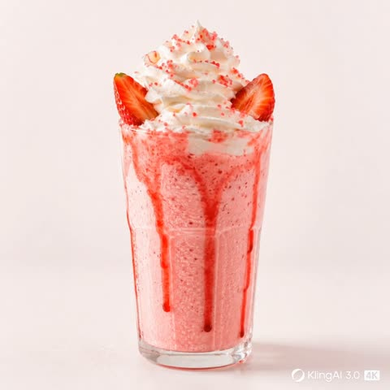
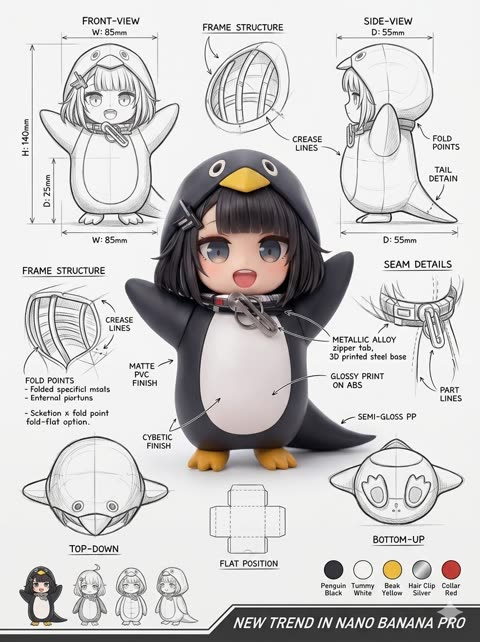

# Product shots and e-commerce

[Back to the list](../../README.md) · All 27 entries

<a id="gpt-image-iced-coffee-glass-studio-product-photo"></a>
### Iced coffee glass on soft beige studio backdrop

<a href="https://x.com/Strength04_X/status/2049082049995362785"></a>

The prompt names each visual layer of the drink, such as the dark coffee base, milk swirls, clear ice and condensation droplets. It adds soft studio lighting and a DSLR macro look to push the result toward premium beverage advertising.

GPT Image 2 · Text-to-image · Source: [@Strength04_X on X](https://x.com/Strength04_X/status/2049082049995362785) · 617 likes on 2026-10-28

[`iced-coffee`](tags.md#tag-iced-coffee) [`beverage`](tags.md#tag-beverage) [`studio-lighting`](tags.md#tag-studio-lighting) [`macro`](tags.md#tag-macro) [`product-photography`](tags.md#tag-product-photography)

<details><summary><b>Prompt</b></summary>

```text
Made with GPT image 2 + Hailuo 2.3 on
@Hailuo_AI


PROMPT - A high-end café-style product photograph of a transparent glass filled with iced coffee, centered against a soft beige and cream seamless studio background. The drink shows a rich dark coffee base blending with creamy milk swirls, creating a smooth gradient effect. Several clear ice cubes are visible with realistic transparency and light refraction. The glass has subtle condensation droplets, adding freshness. Soft natural studio lighting creates delicate highlights and a clean shadow beneath the glass. Ultra-sharp focus, premium beverage advertisement style, DSLR macro photography, hyper realistic, 8K.

PROMPT 2 - Create a hyper-realistic exploded vertical infographic composition of an iced coffee.

Top → Bottom structure:
Foam Layer (light creamy foam with soft airy texture)
→ Coffee Liquid (rich dark espresso layer with smooth gradient)
→ Ice Cubes (transparent cubes with sharp edges and reflections)
→ Milk Layer (soft creamy white layer with smooth blend effect)
→ Glass Base (clear minimal glass structure)

All elements must be perfectly centered, evenly spaced, and aligned vertically. Use a soft beige seamless background with clean café-style lighting and subtle realistic shadows beneath each floating element. The composition should feel like a premium beverage ad combined with a clean infographic layout.

Add clean minimalist text labels with thin pointer lines using these exact labels:
“Foam”
“Coffee”
“Ice”
“Milk”
“Glass”
Ultra-realistic liquid detail, sharp reflections, premium commercial photography, 8K.
```

</details>

<a id="nano-banana-soda-can-paper-tear-fruit-reveal"></a>
### Soda cans torn open to reveal fresh fruit

<a href="https://x.com/Arminn_Ai/status/2027470188644626803"></a>

One continuous paper tear crosses both the can and the backdrop, with a rolled coil at the far end, and the tear reveals tightly packed fruit. Bracketed slots for can type, color, fruit, ink and brand name make the template reusable across flavors.

Nano Banana 2 · Text-to-image · Source: [@Arminn_Ai on X](https://x.com/Arminn_Ai/status/2027470188644626803) · 589 likes on 2026-10-28

[`soda-can`](tags.md#tag-soda-can) [`paper-tear`](tags.md#tag-paper-tear) [`fruit`](tags.md#tag-fruit) [`packaging`](tags.md#tag-packaging) [`template`](tags.md#tag-template)

<details><summary><b>Prompt</b></summary>

```text
A photorealistic, highly detailed commercial product photograph of a standard aluminum [Type of Soda Can] centered against a minimal, textured [Background Color] paper background, with subtle fibers visible. A single, continuous horizontal paper-tear strip runs across the entire width of the frame, seamless from the far-right edge to the far-left edge. The torn channel cuts through the metal body of the can and continues across the background on both sides with a barely perceptible and minimal diagonal slope towards the upper-left. The tear channel is significantly broader, revealing a dense, glistening, and vibrant layer of [Description of Fruit Segments/Sacs/Berries] tightly packed inside. Near the extreme far-left end of this tear, the paper is neatly rolled into a tight, realistic coil that occupies almost the entire left margin. The can features a newly designed, minimalist branding: the upper portion has a stylized, abstract line-art illustration of [Fruit Branch/Plant] in a contrasting [Ink Color], set against a subtle matte geometric [Pattern Type] pattern on the can surface. Below this, the brand name "[Brand Name]" is printed in an elegant, modern dark typography, with smaller technical text "330ml - NATURAL EXTRACT" and a small "Recyclable" logo. A small, detailed graphic of the fruit is located below the torn path. The lighting is soft and cinematic, casting delicate drop shadows beneath the torn paper edges and the large left coil. 8k resolution, macro details on fibrous paper and glossy fruit texture.
```

</details>

<a id="nano-banana-radial-exploded-view-smartphone"></a>
### Radial exploded view of a smartphone's components

<a href="https://x.com/AllaAisling/status/2032126653309030481"></a>

The prompt lists components from the core outward and gives separate material cues for glass, metal, circuit board and rubber. It also fixes the label typography, the three light sources and the title and spec block positions, so the template swaps cleanly to other products.

Nano Banana 2 · Text-to-image · Source: [@AllaAisling on X](https://x.com/AllaAisling/status/2032126653309030481) · 468 likes on 2026-10-28

[`exploded-view`](tags.md#tag-exploded-view) [`product-teardown`](tags.md#tag-product-teardown) [`3d-render`](tags.md#tag-3d-render) [`infographic-labels`](tags.md#tag-infographic-labels) [`dark-background`](tags.md#tag-dark-background)

<details><summary><b>Prompt</b></summary>

```text
Prompt Studio: 3D Radial Explosion with Nano Banana 2 in Firefly

Hyperrealistic 3D radial exploded view of [PRODUCT]  [NUMBER] components  bursting outward from a central axis in every direction, frozen in mid-air.  True spatial explosion, not a vertical stack, depth and parallax visible.  COMPONENTS (core outward): [SHELL] → [DISPLAY] → [FRAME] → [MAINBOARD] →  [BATTERY] → [MICRO PARTS shown in 3x floating callout circles]  MATERIALS: glass refracts and catches specular highlights, aluminium shows  brushed grain and machined edges, PCB traces glow faintly amber,   rubber gaskets matte with micro-texture, cables with soft bend physics.  LABELS: hairline leader to floating box. "[COMPONENT]" uppercase /  "[FUNCTION]" italic / "[KEY SPEC]" monospace. Radiate outward, no overlaps.  LIGHTING: cool diffused overhead + warm amber underlighting on internals +  thin blue rim on outer shell. Displays emit soft UI glow. Circuits self-illuminate.  BACKGROUND: [COLOR], deep, non-reflective. Midnight black recommended. TITLE: "[PRODUCT NAME]" top right. SUBTITLE: "[TAGLINE]".  SPEC BLOCK: "[SPEC 1] / [SPEC 2] / [SPEC 3]" bottom left in monospace.  Mood: iFixit teardown meets NASA manual meets WIRED cover. 4K, tack sharp, extraordinary material fidelity.

Check ALTs for ideas 👇
@AdobeFirefly
```

</details>

<a id="nano-banana-ramen-liquid-explosion-labeled"></a>
### Ramen bowl in a labeled liquid explosion

<a href="https://x.com/AllaAisling/status/2030670376104087834"></a>

A reusable template with bracketed slots for dish, ingredient labels, tagline and background color. It combines a frozen high-speed moment, single-source warm light and a named photographer reference with editorial typography and thin leader-line labels.

Nano Banana 2 · Text-to-image · Source: [@AllaAisling on X](https://x.com/AllaAisling/status/2030670376104087834) · 237 likes on 2026-10-29

[`food`](tags.md#tag-food) [`high-speed`](tags.md#tag-high-speed) [`liquid-splash`](tags.md#tag-liquid-splash) [`labeled-ingredients`](tags.md#tag-labeled-ingredients) [`template`](tags.md#tag-template)

<details><summary><b>Prompt</b></summary>

```text
Prompt Studio: Food, Liquid Explosion with Nano Banana 2 in Firefly

[DISH] captured at the exact millisecond of a dramatic liquid explosion, high-speed photography frozen in time, every droplet suspended mid-air with razor precision. Hero [DISH] at center perfectly intact and hyperreal, surrounded by an orchestrated explosion of its own sauce, broth, or glaze erupting outward in every direction. Droplets catching dramatic single-source warm light like liquid diamonds. Each floating ingredient or droplet labeled with ultra-thin lines in clean uppercase: "[INGREDIENT]  [descriptor]". Dish name in bold editorial typography: "[DISH NAME]". Subtitle: "[TAGLINE]". Pure [COLOR] background. Mood: Harold Edgerton high-speed photography meets Michelin-star food editorial. 4K, tack sharp every droplet, extraordinary and craveable.

Check ALTs for ideas 👇
@AdobeFirefly
```

</details>

<a id="nano-banana-uv-unwrapped-albedo-texture-box-device"></a>
### UV unwrapped albedo texture map of a device

<a href="https://x.com/boredmaxx/status/2044862943498809685"></a>

Give the model a rendered 3D object as the reference, then ask for a flat UV unwrap. Negative constraints (no perspective, no shadows or lighting) and a fixed 1:1 canvas keep the output a clean PBR base color map.

Nano Banana 2 · Edit · Source: [@boredmaxx on X](https://x.com/boredmaxx/status/2044862943498809685) · 182 likes on 2026-10-29

[`uv-unwrap`](tags.md#tag-uv-unwrap) [`albedo-map`](tags.md#tag-albedo-map) [`pbr-texture`](tags.md#tag-pbr-texture) [`hard-surface`](tags.md#tag-hard-surface) [`reference-image`](tags.md#tag-reference-image)

<details><summary><b>Prompt</b></summary>

```text
or just use Nano Banana 2

prompt: UV unwrapped albedo texture map of a hard surface box device, flat 2D layout only, no 3D rendering, no perspective distortion, no shadows or lighting effects, seamless unwrap filling the entire 1:1 square canvas, high-resolution PBR base color map, macro close-up texture details
```

</details>

<a id="nano-banana-exploded-view-headphones-diagram"></a>
### Exploded view diagram of wireless headphones

<a href="https://x.com/Strength04_X/status/2028442638781984986"></a>

A fill in the blank template that names the exploded view diagram format, a white background and studio product lighting. The phrase highly detailed internal components makes the model separate and label each part.

Nano Banana 2 · Text-to-image · Source: [@Strength04_X on X](https://x.com/Strength04_X/status/2028442638781984986) · 160 likes on 2026-10-29

[`exploded-view`](tags.md#tag-exploded-view) [`product-design`](tags.md#tag-product-design) [`diagram`](tags.md#tag-diagram) [`white-background`](tags.md#tag-white-background) [`studio-lighting`](tags.md#tag-studio-lighting)

<details><summary><b>Prompt</b></summary>

```text
product design, [object or vehicle with material accents], exploded view diagram, white background, three-dimensional, highly detailed internal components, studio lighting, product photography, best quality
```

</details>

<a id="nano-banana-luxury-gold-plaque-dessert-cones"></a>
### Luxury chocolate caramel cones with gold brand plaque

<a href="https://x.com/yourPlugAI/status/2070528605986124079"></a>

A fill in the blank template swaps coating, cream, toppings and palette while the fixed brand plaque, faded corner signature and lighting stack stay constant. Macro food photography terms, golden bokeh interior and rim plus key lighting give a luxury ad look.

Nano Banana 2 · Text-to-image · Source: [@yourPlugAI on X](https://x.com/yourPlugAI/status/2070528605986124079) · 152 likes on 2026-10-28

[`food`](tags.md#tag-food) [`dessert`](tags.md#tag-dessert) [`luxury`](tags.md#tag-luxury) [`template`](tags.md#tag-template) [`macro`](tags.md#tag-macro)

<details><summary><b>Prompt</b></summary>

```text
Ultra realistic luxury food advertisement photography of two premium "GILBERTO" dessert cones. Handcrafted waffle cones coated in [COATING MATERIAL AND TEXTURE], overflowing with [PRIMARY CREAM], [MAIN TOPPINGS], [DRIZZLES OR SAUCES], and [ACCENT INGREDIENTS]. Textures are indulgent, luxurious, highly detailed, with realistic moisture, shine, and layered depth.

Add an elegant metallic gold plaque around the center of each cone engraved with the brand name "GILBERTO". Remove all other logos or signatures.

At the bottom left corner place a subtle, semi-transparent gold signature text reading "GILBERTO", softly faded into the scene, elegant and unobtrusive.

Color palette: [PRIMARY COLORS], [ACCENT COLORS], [METALLIC DETAILS].

Background: luxurious [ENVIRONMENT TYPE] with [COLOR TONES], cinematic golden bokeh lights, softly blurred premium interior details, reflective surfaces, sophisticated atmosphere, shallow depth of field.

Lighting: cinematic studio lighting with [LIGHT TEMPERATURE], soft front key light, dramatic rim lighting, subtle backlighting, high-contrast shadows, and rich specular highlights emphasizing the ingredients and coatings.

Composition: centered hero shot, macro food photography, shallow depth of field, premium confectionery advertising campaign, ultra photorealistic textures, luxury magazine quality, hyper detailed, HDR, 8K, masterpiece, aspect ratio 1:1.
```

</details>

<a id="nano-banana-strawberry-milkshake-product-photo"></a>
### Strawberry milkshake on pastel pink studio background

<a href="https://x.com/Strength04_X/status/2090665058980462697"></a>

The prompt lists every texture (syrup drips, whipped cream, condensation) and pairs them with DSLR macro and soft studio lighting cues. A second prompt reuses the same drink as an exploded vertical layer list for an infographic, and the image then feeds a video prompt.

Nano Banana 2 · Text-to-image · Source: [@Strength04_X on X](https://x.com/Strength04_X/status/2090665058980462697) · 140 likes on 2026-10-29

[`food-photography`](tags.md#tag-food-photography) [`beverage`](tags.md#tag-beverage) [`studio-lighting`](tags.md#tag-studio-lighting) [`macro`](tags.md#tag-macro) [`pastel`](tags.md#tag-pastel)

<details><summary><b>Prompt</b></summary>

```text
The milkshake starts to slowly spin while the ingredients separate gently and precisely, maintaining alignment and scale. The motion is smooth, creamy, and controlled with no extra effects.
```

</details>

<a id="nano-banana-luxury-watch-macro-contact-sheet"></a>
### Luxury blue dial watch macro shot grid

<a href="https://x.com/kellyyjjones/status/2078418060374106127"></a>

The prompt lists named watch parts such as sapphire crystal, sunburst dial, exhibition case back and balance wheel, which gives each macro frame its own subject. Camera moves like a 360 degree orbit, a single golden spotlight on a black background and water droplets add variety across frames.

Nano Banana 2 · Text-to-image · Source: [@kellyyjjones on X](https://x.com/kellyyjjones/status/2078418060374106127) · 130 likes on 2026-10-29

[`watch`](tags.md#tag-watch) [`macro`](tags.md#tag-macro) [`luxury`](tags.md#tag-luxury) [`product-shot`](tags.md#tag-product-shot) [`cinematic`](tags.md#tag-cinematic)

<details><summary><b>Prompt</b></summary>

```text
Ultra-realistic cinematic luxury fashion commercial featuring a confident, well-dressed gentleman wearing an elegant premium luxury wristwatch. He is dressed in a perfectly tailored black suit, crisp white shirt, and silk tie, standing inside a modern luxury penthouse overlooking a breathtaking city skyline at golden hour. The camera begins with an extreme macro close-up of the luxury watch on his wrist, revealing the flawless sapphire crystal, polished stainless-steel case, deep sunburst dial, luminous hands, diamond-cut hour markers, and smooth sweeping second hand. As he adjusts his cuff, the watch catches the warm sunlight, creating beautiful cinematic reflections. The camera slowly circles around his wrist while the intricate mechanical movement is visible through the transparent exhibition case back. Premium leather strap with handcrafted stitching, scratch-resistant finish, exceptional craftsmanship, precision engineering, timeless elegance, luxury lifestyle, confidence, success, sophistication. Soft golden sunlight, volumetric lighting, shallow depth of field, realistic skin textures, premium fashion photography, smooth cinematic camera movement, ARRI Alexa 65 look, 8K HDR, hyper-realistic, luxury advertisement, masterpiece quality, no logos, no text, no watermark.Ultra-realistic cinematic luxury watch commercial,
 8-second sequence. The film opens with an extreme macro shot of a premium luxury wristwatch emerging from darkness as a single golden spotlight slowly illuminates every detail. The camera performs a smooth 360° orbit around the watch while the polished stainless-steel case reflects elegant studio lights. The sapphire crystal sparkles with flawless clarity, revealing a deep sunburst dial with diamond-cut hour markers and precision-crafted luminous hands. The sweeping second hand moves perfectly smoothly, emphasizing the high-precision automatic movement. The camera transitions into the transparent exhibition case back, where hundreds of intricate mechanical gears, polished bridges, ruby jewels, and the oscillating balance wheel move in perfect harmony. Slow-motion water droplets glide across the scratch-resistant sapphire crystal and premium metal case, demonstrating exceptional water resistance. Fine leather strap stitching and luxury finishing are revealed through cinematic macro close-ups. Floating golden dust particles, soft volumetric lighting, elegant reflections, dramatic black background, shallow depth of field, premium product cinematography, ARRI Alexa 65 look, 8K HDR, hyper-realistic textures, smooth camera motion, luxury advertisement, timeless elegance, precision engineering, exclusivity, masterpiece quality, no text, no logos, no watermark.
```

</details>

<a id="nano-banana-honey-jar-wheat-field-macro"></a>
### Luxury honey jar in wooden hollow among wheat

<a href="https://x.com/Just_sharon7/status/2039694451552272532"></a>

Stacks a low angle macro view, backlit late afternoon sun and a 90mm f/2.2 lens spec to make the honey glow and blur the foreground wheat. Small details such as ivy, two bees and pollen in the air add realism, and the label text is given in quotes.

Nano Banana 2 · Text-to-image · Source: [@Just_sharon7 on X](https://x.com/Just_sharon7/status/2039694451552272532) · 119 likes on 2026-10-29

[`product-shot`](tags.md#tag-product-shot) [`macro`](tags.md#tag-macro) [`honey`](tags.md#tag-honey) [`backlit`](tags.md#tag-backlit) [`organic-brand`](tags.md#tag-organic-brand)

<details><summary><b>Prompt</b></summary>

```text
Ultra-realistic cinematic product shot of a premium honey jar placed inside a shallow wooden hollow surrounded by tall wild wheat and tiny yellow meadow flowers, captured from an intimate low-angle macro perspective with slight cinematic depth, transparent glass jar filled with luminous deep golden honey, topped with a satin bronze metallic lid and a narrow cream seal strip crossing vertically over the cap, minimal luxury label reading “HUNSET”, jar lightly touched by thin climbing ivy strands for a refined organic detail, one realistic honeybee hovering near the front glass surface while another rests on a wheat stem behind the jar, environment set in a quiet countryside field during late afternoon, warm sunlight filtering through wheat stalks from behind creating glowing translucency inside the honey and soft halo edges around the jar, foreground with blurred wheat tips and soft natural bokeh, distant background fading into creamy green and amber tones, shallow depth of field with extreme sharpness on jar textures, visible honey thickness, subtle glass reflections, detailed plant fibers and pollen particles in air, cinematic luxury advertising mood, shot on 90mm macro lens, f/2.2, ultra-detailed natural textures, premium organic brand campaign style, 8k resolution, no text, no watermark.
```

</details>

<a id="nano-banana-nexora-mango-soda-can-liquid-splash"></a>
### Mango passion fruit soda can with liquid splash

<a href="https://x.com/Draymen424/status/2082742013892628511"></a>

Fruit, color and liquid texture are exposed as swappable placeholders, so one template covers any flavor. Lighting is listed as discrete luxury campaign sources, and an 85mm macro lens with shallow depth of field keeps the logo and condensation sharp.

Nano Banana 2 · Text-to-image · Source: [@Draymen424 on X](https://x.com/Draymen424/status/2082742013892628511) · 113 likes on 2026-10-28

[`beverage`](tags.md#tag-beverage) [`product-photography`](tags.md#tag-product-photography) [`condensation`](tags.md#tag-condensation) [`liquid-splash`](tags.md#tag-liquid-splash) [`template`](tags.md#tag-template)

<details><summary><b>Prompt</b></summary>

```text
Ultra-realistic premium beverage commercial featuring a chilled Nexora aluminum can suspended in mid-air inside a futuristic luxury studio. The environment is surrounded by elegant floating crystal panels and soft volumetric light, with a seamless premium gradient backdrop inspired by {argument name="fruit type" default="FRUIT"} colors, blending deep {argument name="color shade" default="COLOR"} tones into soft glowing highlights.

The matte aluminum can has a sophisticated satin gradient finish inspired by the fruit palette, covered in microscopic condensation droplets with realistic cold texture. The bold flowing "Nexora" logo is embossed with a glossy metallic gradient, accompanied by minimalist premium typography and a subtle metallic authenticity seal.

Instead of resting on a surface, the can levitates at the center while an elegant spiral ribbon of {argument name="liquid texture" default="TEXTURE"} liquid wraps around it in slow motion. The liquid forms smooth twisting arcs with ultra-realistic viscosity, tiny droplets, and delicate mist particles.

Fresh [FRUIT] slices, whole fruits, leaves, and tiny juice droplets orbit naturally around the can with cinematic motion. Small sparkling ice crystals float through the air, emphasizing freshness and premium quality.

Below the floating product, a transparent reflective glass pedestal catches subtle reflections while remaining visually clean. Soft atmospheric particles create depth without distracting from the product.

Lighting is crafted like a luxury perfume campaign:

Large softbox key light for silky reflections
Warm rim lighting outlining every curve
Gentle top spotlight emphasizing condensation
Cinematic volumetric glow
Soft reflective bounce light from below
High-end commercial HDR lighting

Camera uses an 85mm macro cinema lens, shallow depth of field, eye-level perspective, extremely sharp focus on the logo and condensation, with creamy background bokeh and elegant compression.

Color grading is luxurious and vibrant, combining premium beverage advertising aesthetics with fashion-brand sophistication.
```

</details>

<a id="nano-banana-face-wash-tube-water-splash-pedestal"></a>
### Face wash tube on black pedestal with water splash

<a href="https://x.com/Aqib__786Ai/status/2075432044637876431"></a>

Lists the supporting props (water splashes, leaves, bubbles, mist) to signal cleansing and hydration, then names the lighting setup (softbox, rim light, reflections). It ends with a request for negative space so the image can take branding text.

Nano Banana 2 · Text-to-image · Source: [@Aqib__786Ai on X](https://x.com/Aqib__786Ai/status/2075432044637876431) · 112 likes on 2026-10-28

[`product-photography`](tags.md#tag-product-photography) [`skincare`](tags.md#tag-skincare) [`water-splash`](tags.md#tag-water-splash) [`studio-lighting`](tags.md#tag-studio-lighting) [`negative-space`](tags.md#tag-negative-space)

<details><summary><b>Prompt</b></summary>

```text
Refresh Your Skin with Every Wash. made with Nano banana 2 on
@Lart_AI


Try here 👇 👇

https://
lartai.com/?TG=15347

Model : Nana banana 2

Resolution 1080

Ratio 4:5

Prompht: 1

Create a premium commercial product photography image of a luxury face wash tube standing upright on a polished black stone pedestal.

The product is surrounded by crystal-clear water splashes, fresh green leaves, soft bubbles, and subtle mist to represent deep cleansing and hydration.

Background is a soft blue-to-white gradient with elegant lighting and premium skincare aesthetics.

Professional beauty studio lighting with softbox, rim light, realistic reflections, and natural shadows.

Ultra-realistic packaging, sharp details, glossy finish, luxury skincare advertisement, premium cosmetic photography, photorealistic, HDR, 8K quality.

Minimal composition with plenty of negative space for branding.

Prompt 2:

Create a high-end commercial skincare advertisement featuring a premium face wash tube placed on a natural white marble rock beside flowing crystal-clear water.

Fresh aloe vera leaves, cucumber slices, mint leaves, water droplets, soft foam, and floating botanical elements surround the product.

Golden sunrise light mixed with cool blue ambient lighting creates a luxurious skincare atmosphere.

Background is bright, clean, and premium with soft bokeh, realistic reflections, and subtle mist.

Luxury cosmetic campaign style, ultra-photorealistic, cinematic lighting, premium packaging, extremely detailed textures, HDR, ray tracing, award-winning commercial product photography.
```

</details>

<a id="nano-banana-strawberry-yogurt-jar-cotton-candy-clouds"></a>
### Strawberry yogurt jar nested in pink cotton candy clouds

<a href="https://x.com/oggii_0/status/2027789311383621877"></a>

The prompt places the product in a surreal pastel sky and fixes the jar, label shape, rim strawberry and cloud placement in one clear order. Soft diffused daylight, a symmetrical layout and a shallow depth of field with a sharp product keep it realistic yet dreamy.

Nano Banana 2 · Text-to-image · Source: [@oggii_0 on X](https://x.com/oggii_0/status/2027789311383621877) · 103 likes on 2026-10-28

[`product-photography`](tags.md#tag-product-photography) [`pastel`](tags.md#tag-pastel) [`strawberry`](tags.md#tag-strawberry) [`cotton-candy`](tags.md#tag-cotton-candy) [`surreal`](tags.md#tag-surreal)

<details><summary><b>Prompt</b></summary>

```text
Nano Banana 2 on
@SocialSight


Prompt: Ultra-realistic dreamy product photography in a surreal pastel sky environment. A transparent plastic jar filled with thick pink strawberry yogurt smoothie sits centered and slightly embedded inside fluffy cotton-candy-like pink clouds, the jar open at the top with creamy surface visible and a fresh whole strawberry resting on the rim. The jar label is a soft white scalloped shape with simple elegant pink brand text and small strawberry illustrations around the container.
Additional ripe strawberries are placed around the jar partially resting on the clouds. The background is a soft pale blue sky filled with multiple floating pink cotton candy clouds, some clouds containing small strawberries nestled inside them. Lighting is soft diffused daylight creating gentle shadows and glossy highlights on the creamy texture and plastic surface. Clean symmetrical composition, whimsical dessert advertising aesthetic, soft pastel color palette dominated by pink and light blue, shallow depth of field but product fully sharp, highly detailed textures on clouds and fruit, photorealistic 8k quality.
```

</details>

<a id="gpt-image-blue-perfume-corrugated-glass-ad"></a>
### Sky blue perfume bottle behind corrugated glass

<a href="https://x.com/ShamiWeb3/status/2078074982337515555"></a>

A low upward angle makes the bottle loom, while a corrugated glass panel adds vertical distortion over a softly blurred floral box. A tight palette, silver rim light and hydrangea petals with water droplets carry the scent notes visually.

GPT Image 2 · Text-to-image · Source: [@ShamiWeb3 on X](https://x.com/ShamiWeb3/status/2078074982337515555) · found via [YouMind-OpenLab/awesome-gpt-image-2](https://github.com/YouMind-OpenLab/awesome-gpt-image-2)

[`perfume`](tags.md#tag-perfume) [`product-ad`](tags.md#tag-product-ad) [`minimalist`](tags.md#tag-minimalist) [`glass-distortion`](tags.md#tag-glass-distortion) [`blue-palette`](tags.md#tag-blue-palette)

<details><summary><b>Prompt</b></summary>

```text
Minimalist product advertisement featuring [{argument name="product" default="the Vanilla & Blues Eau de Parfum 100ml — a round frosted sky-blue glass bottle filled with pale blue liquid, topped with a twisted seashell-shaped cap in matching light blue and a slim silver collar band, "Vanilla & Blues Eau De Parfum" printed on the rounded face"}] shot from a low upward angle so the bottle looms large and slightly tilted, with its matching blue-and-white floral watercolor box positioned softly out of focus behind it, seen through a vertical corrugated glass panel, with [a pale icy-white studio backdrop with a faint cool blue gradient wash] visible behind the object. Use [a palette of powder blue, frosted ice-white, silver, and soft hydrangea lavender-blue], soft directional lighting with a gentle silver rim-light along the cap and glass edge, semi-obscured contours through the corrugated distortion, elongated vertical distortion lines, elegant editorial mood, asymmetrical off-center composition, subtle depth, smooth gradients, polished commercial styling, delicate blue hydrangea petals and fine water droplets suspended mid-air beside the bottle to evoke its [sweet vanilla, soft floral bouquet, and clean powdery musk] notes, and the title "[VANILLA & BLUES]" in refined serif typography arched gently above the bottle's shoulder, vertical 4:5.
```

</details>

<a id="gpt-image-blueberry-clamshell-ecommerce-poster"></a>
### Blueberry clamshell box e-commerce poster in icy blue

<a href="https://x.com/op7418/status/2046626506722746736"></a>

Fixes the package shape, label colors and camera angle so the product stays believable, then layers a reference thumbnail, calligraphy headline and an icon list. Cool color grading and moisture details on the fruit keep the photo and the graphic layout in one style.

GPT Image 2 · Edit · Source: [@op7418 on X](https://x.com/op7418/status/2046626506722746736) · found via [YouMind-OpenLab/awesome-gpt-image-2](https://github.com/YouMind-OpenLab/awesome-gpt-image-2)

[`ecommerce`](tags.md#tag-ecommerce) [`packaging`](tags.md#tag-packaging) [`blueberry`](tags.md#tag-blueberry) [`chinese-typography`](tags.md#tag-chinese-typography) [`product-poster`](tags.md#tag-product-poster)

<details><summary><b>Prompt</b></summary>

```text
A premium e-commerce poster for fresh blueberries in a clean Chinese product-advertising style. Show a clear plastic clamshell box of blueberries as the main subject, placed diagonally from lower center to right side on folded blue fabric, viewed from a slightly elevated angle. The package must remain realistic and consistent: a transparent square container with rounded corners, filled with dark blue blueberries, with a large irregular rounded label on top in white, pale blue, and deep blue, featuring one oversized blueberry illustration in the center and elegant Chinese branding. Make the fruit inside look larger, plumper, fresher, and covered with subtle moisture droplets, while keeping the overall blueberry arrangement believable. The background is an airy icy-blue tabletop with soft cloudy texture, cool daylight, and scattered loose blueberries around the package. Add a few blurred green leaves entering from the top right and bottom right edges for a fresh natural feeling. In the upper-right corner, include 1 small inset image showing the original product package from above on a warm brown surface, like a reference thumbnail. On the left side, create Chinese promotional typography with a large dark blue calligraphy headline 决茗新, followed by 2 smaller lines of copy: 新鲜蓝莓 自然之选 and 每一颗都是自然的礼物. Below that, place 3 vertically stacked feature icons with short Chinese captions: a leaf icon for natural ripeness, a fruit icon for juicy fullness, and a heart icon for rich nutrition. Near the bottom left, add large white brush-style Chinese text 蓝莓, a secondary line 膳食纤维+花青素, and a small net weight line reading 125克. Use cool blue color grading, crisp commercial lighting, sparkling highlights on the plastic lid, premium supermarket packaging aesthetics, high detail, realistic product photography blended with polished graphic design.
```

</details>

<a id="gpt-image-crumple-chair-design-board"></a>
### Crumpled Paper Chair Concept Design Board

<a href="https://x.com/ShamsAmin56/status/2050281206139461780"></a>

The prompt is split into five numbered stages, from form analysis to ergonomics, structure and finish. Concrete dimensions, angles and material options make the board read as a real product development sheet.

GPT Image 2 · Text-to-image · Source: [@ShamsAmin56 on X](https://x.com/ShamsAmin56/status/2050281206139461780) · found via [freestylefly/awesome-gpt-image-2](https://github.com/freestylefly/awesome-gpt-image-2)

[`product-design`](tags.md#tag-product-design) [`furniture`](tags.md#tag-furniture) [`concept-board`](tags.md#tag-concept-board) [`blueprint`](tags.md#tag-blueprint) [`industrial-design`](tags.md#tag-industrial-design)

<details><summary><b>Prompt</b></summary>

```text
Design Concept: The Crumple Chair Core Philosophy: Translating the "controlled chaos" of a tossed paper ball into a sculptural, high-comfort seating experience.

Stage 1: Observation & Morphological Analysis The goal is to deconstruct the image of the crumpled paper into usable geometric data. Crease Mapping: Identify the primary "valley" and "ridge" lines. These represent potential structural ribs or seams in the chair. Faceted Planes: Break down the sphere into a series of non-uniform polygons. Each flat surface of the paper becomes a potential panel for the chair’s upholstery or shell. Shadow Study: Analyze how the "tossed" form creates deep recesses. These natural pockets guide where the user’s weight will be cradled.

Stage 2: Iterative Form Exploration Moving from a sphere to a seat through "Digital Crumpling." Subtractive Sculpting: Imagine the paper ball as a solid mass. Use Boolean operations to "carve out" a seating cavity that fits the human form while maintaining the external jagged texture. Tension Simulation: Use 3D software (like Rhino or Blender) to simulate a flat sheet of material being compressed. This ensures the folds look authentic and not "modeled." The "Toss" Logic: Experiment with gravity-based simulation dropping a digital mesh to see how it settles naturally, mimicking the "tossed" origin.

Stage 3: Ergonomic Translation & Blueprinting Refining the raw aesthetic into a functional object. The Comfort Core: Overlay a standard ergonomic template (Seating Angle: 105°–110°) over the crumpled form. Adjust the internal "folds" to provide lumbar support and pressure relief. Blueprint Generation: Create technical orthographic views (Front, Side, Top). Map out the dimensions: Seat Height: 450mm Total Width: 850mm Surface Smoothing: Maintain the sharp "paper edges" on the exterior shell while softening the interior contact points for skin comfort.

Stage 4: Structural Integration & Scaling Making the concept physically viable. The Skeleton: Design a hidden internal frame (likely CNC-bent steel rods or a 3D-printed lattice) that follows the most prominent ridges of the paper folds to provide rigidity. Material Selection: * Option A (High-End): Faceted, cast aluminum with a white powder coat. Option B (Soft): Vacuum-formed recycled plastic shell covered in "memory-fold" technical fabric that retains a wrinkled appearance.

Stage 5: Final Prototyping & Material Finish Textural Replication: Apply a matte, slightly porous finish to the material to mimic the tactile feel of heavy-bond paper. Lighting Contrast: Use directional studio lighting in the final renders to emphasize the "tossed" shadows, making the chair look like a giant piece of discarded inspiration. Design Tip: To keep the "tossed" look authentic, avoid symmetry. The most compelling aspect of a crumpled paper ball is its unique irregularity—ensure the left and right sides of the chair are balance-equivalent but not identical
```

</details>

<a id="gpt-image-dieline-3d-box-studio-render"></a>
### Flat dieline assembled into a 3D product box

<a href="https://x.com/Salmaaboukarr/status/2047008188285792724"></a>

The prompt locks the artwork and type as preserved exactly, which keeps the uploaded dieline from being redrawn. It then fixes the camera (upright three quarter angle) and a plain studio setup with diffused light, no props and a matte paperboard texture.

GPT Image 2 · Edit · Source: [@Salmaaboukarr on X](https://x.com/Salmaaboukarr/status/2047008188285792724) · found via [YouMind-OpenLab/awesome-gpt-image-2](https://github.com/YouMind-OpenLab/awesome-gpt-image-2)

[`packaging`](tags.md#tag-packaging) [`dieline`](tags.md#tag-dieline) [`3d-mockup`](tags.md#tag-3d-mockup) [`studio-lighting`](tags.md#tag-studio-lighting) [`product-render`](tags.md#tag-product-render)

<details><summary><b>Prompt</b></summary>

```text
Assemble the dieline into a flawless 3D box with accurate panels, clean folds, undistorted type, and artwork preserved exactly. shoot it upright at a refined ¾ angle in a minimal premium studio setting with a soft neutral background, diffused light, subtle shadows, no props, true colours, matte paperboard texture, and realistic editorial detail
```

</details>

<a id="gpt-image-enamel-pin-set-portrait-center"></a>
### Enamel pin set around a portrait pin

<a href="https://x.com/miratechtool/status/2097710852413497646"></a>

A reference photo is turned into the central pin, with exact pin counts, sizes and roles spelled out, plus material cues like gold outlines, raised edges and studio lighting. A closing list of exclusions keeps the layout clean, though the model may still add extra pins beyond the count requested.

GPT Image 2.5 · Edit · Source: [@miratechtool on X](https://x.com/miratechtool/status/2097710852413497646) · found via [wangrunlin/awesome-gpt-image-2-5-prompts](https://github.com/wangrunlin/awesome-gpt-image-2-5-prompts)

[`enamel-pin`](tags.md#tag-enamel-pin) [`product-photography`](tags.md#tag-product-photography) [`portrait`](tags.md#tag-portrait) [`collectible`](tags.md#tag-collectible) [`reference-image`](tags.md#tag-reference-image)

<details><summary><b>Prompt</b></summary>

```text
Create a hyper-realistic enamel pin collection in a vertical 4:5 composition on a dark textured background. Design exactly 8 separate premium pins with polished gold-metal outlines, glossy hard-enamel surfaces, subtle raised edges, realistic reflections, and soft shadows. The main medium-sized center pin is a portrait of [CHARACTER], preserving the reference image’s recognizable face, hairstyle, skin tone, expression, clothing, and key features while translating them into a detailed premium enamel illustration. Add 1 small name pin reading “[NAME]” and 1 small personality-word pin reading “[WORD]”. The remaining 5 pins should represent [CHARACTER]’s interests and lifestyle, such as creative work, AI/technology, visual creation, photography, travel, friendship, hobbies, or everyday objects, using clever symbolic illustrations rather than excessive text. Arrange everything organically around the portrait with varied pin shapes and sizes, generous spacing, and no rigid grid. Use bold, flat, bright colors with sophisticated contrast, crisp details, realistic metallic depth, and high-end commercial product lighting. Make it feel like a limited-edition designer pin set photographed in a studio—modern, vibrant, personal, collectible, and instantly eye-catching. No city names or specific landmarks, no duplicated pins, no clutter, no random text, no misspellings, no cheap cartoon or plastic appearance.
```

</details>

<a id="gpt-image-geometry-locked-orange-spiral-render"></a>
### Orange spiral sculpture studio render from geometry guide

<a href="https://x.com/higgsfield/status/2097514650518831462"></a>

The prompt lists every geometric attribute to preserve (silhouette, coil count, handedness, pitch, pose, camera angle) and limits the edit to surface and lighting. A hex colour, a named light direction and a closing list of things to leave out keep the render clean.

GPT Image 2.5 · Edit · Source: [@higgsfield on X](https://x.com/higgsfield/status/2097514650518831462) · found via [wangrunlin/awesome-gpt-image-2-5-prompts](https://github.com/wangrunlin/awesome-gpt-image-2-5-prompts)

[`product-render`](tags.md#tag-product-render) [`geometry-guide`](tags.md#tag-geometry-guide) [`studio-lighting`](tags.md#tag-studio-lighting) [`3d-sculpture`](tags.md#tag-3d-sculpture) [`constraint-list`](tags.md#tag-constraint-list)

<details><summary><b>Prompt</b></summary>

```text
Use the supplied rough geometry image as a strict guide for one square studio image of the orange spiral sculpture. Keep its silhouette, coil count, handedness, pitch, tube thickness, pose, camera angle, scale, and image placement unchanged. Refine only the surface and lighting: opaque satin orange near #F28A2E, smooth tubing, subtle highlights, a neutral off-white seamless background, and a short soft contact shadow from a large light above camera-left. Remove viewport shading and mesh facets without altering contours. Add no pedestal, text, borders, or extra objects. The guide already contains the correct pose; do not rotate or mirror it.
```

</details>

<a id="gpt-image-luxury-perfume-hotel-lobby-skyline"></a>
### Luxury perfume bottle on marble with skyline

<a href="https://x.com/Urwa_345/status/2092256327917797570"></a>

Sets one centered hero object, a named surface and a golden hour window backdrop, then adds lens, lighting and material cues such as an 85mm lens, glass refraction and condensation. A closing list of negative constraints keeps the bottle clean and free of text.

GPT Image 2 · Text-to-image · Source: [@Urwa_345 on X](https://x.com/Urwa_345/status/2092256327917797570) · found via [YouMind-OpenLab/awesome-gpt-image-2](https://github.com/YouMind-OpenLab/awesome-gpt-image-2)

[`perfume`](tags.md#tag-perfume) [`commercial-photography`](tags.md#tag-commercial-photography) [`golden-hour`](tags.md#tag-golden-hour) [`marble`](tags.md#tag-marble) [`vertical-9x16`](tags.md#tag-vertical-9x16)

<details><summary><b>Prompt</b></summary>

```text
Ultra-realistic professional commercial product photography of a premium glass perfume bottle placed on a polished black marble table inside a luxurious modern hotel lobby. The perfume bottle has a sophisticated transparent glass design, elegant metallic cap, realistic liquid visible inside, subtle condensation droplets, and clean premium packaging. In the background, a large floor-to-ceiling window overlooks a beautiful modern city skyline during golden hour, with warm sunlight naturally entering the room. The bottle is positioned perfectly in the center of the composition with realistic studio-quality reflections on the glass and marble surface. A few delicate white flowers and minimal luxury accessories are arranged naturally around the product without distracting from it. Soft warm sunlight creates realistic highlights along the edges of the bottle while subtle professional fill lighting keeps the product perfectly exposed. Natural shadows, realistic glass refraction, accurate reflections, physically accurate materials, authentic photography imperfections, shallow depth of field, realistic background bokeh, premium beauty campaign aesthetic, high-end commercial photography, shot on a professional full-frame camera with an 85mm lens, natural cinematic color grading, extremely detailed, photorealistic, 8K resolution, sharp product focus, realistic proportions, vertical 9:16 composition, no fantasy elements, no surreal effects, no floating objects, no distorted packaging, no extra text, no watermark.
```

</details>

<a id="gpt-image-nozomu-capsule-figure-display"></a>
### Pastel Capsule Figure Product Display Ad

<a href="https://x.com/ArtistaNozomu/status/2066112982313263612"></a>

The prompt is split into labeled blocks for goal, canvas, subject, props, signs and constraints. Exact counts for capsules, variants and props, plus quoted sign text, keep the layout and lettering controlled.

GPT Image 2 · Text-to-image · Source: [@ArtistaNozomu on X](https://x.com/ArtistaNozomu/status/2066112982313263612) · found via [YouMind-OpenLab/awesome-gpt-image-2](https://github.com/YouMind-OpenLab/awesome-gpt-image-2)

[`gashapon`](tags.md#tag-gashapon) [`chibi-figure`](tags.md#tag-chibi-figure) [`product-mockup`](tags.md#tag-product-mockup) [`pastel`](tags.md#tag-pastel) [`text-rendering`](tags.md#tag-text-rendering)

<details><summary><b>Prompt</b></summary>

```text
Goal: Create a highly polished pastel product advertisement photo for a fictional gashapon toy line featuring NOZOMU, designed like a collectible capsule figure display.

Canvas: Square 1:1 image, high-resolution commercial product photography with soft studio lighting, shallow depth of field, glossy reflections, and a cute teal, white, lavender, and pale pink palette.

Main subject: Center foreground shows one chibi anime capsule figure standing on a transparent round display base labeled “NOZOMU.” The figure is a small girl with long dark teal hair, large teal eyes, a cheerful open-mouth smile, and a white bear-ear hoodie with teal bear ears. She wears a teal oversized jacket over a white frilly dress, teal ribbons, tiny bear charms, white socks, and white sneakers. Her right hand lifts the edge of the hood, and her left arm is slightly out to the side. The base is clear acrylic with teal trim, decorative white scrollwork, a small bow motif, and the character name on the front.

Background and props: Place the figure in front of a transparent capsule vending machine filled with pastel capsules. Include exactly 9 visible capsule balls: 3 teal capsules, 2 lavender capsules, 2 white capsules, 1 pale blue capsule, and 1 pale pink capsule. The machine has a teal coin panel and a white dial, with small Japanese-style coin-insertion signage. On the right foreground, place exactly 2 large empty transparent capsule halves, slightly open and reflective. On the lower left, place exactly 1 mini brochure/card showing the same character artwork and the text “NOZOMU Mini Collection.” On the lower right, place exactly 1 clear plastic accessory bag containing small teal-and-white toy parts: a tiny bear-face charm, teal ribbon-like pieces, and small white accessories.

Left vending-machine sign: Add a rounded white sign with teal text at upper left. It must read “NOZOMU” in large letters, then “Capsule Figure” and “Mini Collection.” Include two teal rounded labels: one says “全5種” and one says “1回 400円.” Decorate the sign with small pale stars and soft pastel shapes.

Right collection board: Add a large rectangular collection lineup board on the right side with teal border and rounded corners. Header reads “NOZOMU Mini Collection” with a small teal badge reading “全5種.” The board displays exactly 5 variants in a 2-row grid: 1) “Standard” standing pose, 2) “Smile” winking/smiling pose, 3) “Sitting Pose” standing or seated variant image, 4) “Special Color” gray-toned seated version with a pink “New” sticker, and 5) “Secret” as a dark bear-eared silhouette with a white question mark and a small “Premium Rare” badge. Make the labels small but legible, matching the product mockup style.

Visual style: Cute Japanese collectible toy aesthetic, realistic miniature figure material, glossy plastic capsules, pastel teal branding, clean merchandising layout, bokeh highlights, soft shadows, premium catalog photography, detailed anime face and hair sculpt, realistic acrylic reflections.

Constraints: Use exactly one main figure on the central base, exactly one lineup board with five variant entries, exactly one left price/collection sign, exactly one brochure, exactly one accessory bag, exactly two open capsule halves, and exactly nine filled capsules in the machine. Keep all text crisp and integrated into the product design. Do not add extra characters, logos, watermarks, or unrelated objects.
```

</details>

<a id="gpt-image-penguin-figure-packaging-design-sheet"></a>
### Chibi penguin figure packaging design sheet

<a href="https://x.com/iamaiistudio/status/2059305097897914664"></a>

Starts from an attached image and asks for one hero 3D render ringed by technical views, structure sketches, millimeter dimension arrows and handwritten material callouts. The render plus pencil sketch hybrid on a sketchbook background keeps the sheet readable as a design portfolio page.

GPT Image 2 · Edit · Source: [@iamaiistudio on X](https://x.com/iamaiistudio/status/2059305097897914664) · found via [freestylefly/awesome-gpt-image-2](https://github.com/freestylefly/awesome-gpt-image-2)

[`packaging`](tags.md#tag-packaging) [`industrial-design`](tags.md#tag-industrial-design) [`technical-views`](tags.md#tag-technical-views) [`sketchbook`](tags.md#tag-sketchbook) [`chibi`](tags.md#tag-chibi)

<details><summary><b>Prompt</b></summary>

```text
Using the attached image, create an illustration sheet of professional industrial design packaging for the package (PACKAGE TYPE). A centered heroic 3D rendering with realistic materials, soft studio lighting and commercial quality finishes. Surrounded by technical views: front, side, top, bottom, oblique perspective and flat position. Include sketches of the frame structure, crease lines, seam details, and size arrows in millimeters. Show materials and finishes (matte, glossy print, plastic, paper, glass, etc.) in handwritten annotations. Add color swatches, realistic product illustrations, and subtle shadows. Clean sketchbook background, realistic rendering + pencil sketch style, modern design design, ultra-detailed, portfolio ready.
```

</details>

<a id="gpt-image-premium-meat-seafood-brand-hero"></a>
### Premium Steak Brand Hero on Black Marble

<a href="https://x.com/xpg0970/status/2050108279385419965"></a>

The prompt is a fill in the blanks template in three blocks: brand identity, surface and lighting, and product definition. Each field comes with example values, so one template can be reused for beef, crab or shrimp by changing only the product block.

GPT Image 2 · Text-to-image · Source: [@xpg0970 on X](https://x.com/xpg0970/status/2050108279385419965) · found via [freestylefly/awesome-gpt-image-2](https://github.com/freestylefly/awesome-gpt-image-2)

[`product`](tags.md#tag-product) [`e-commerce`](tags.md#tag-e-commerce) [`food`](tags.md#tag-food) [`luxury`](tags.md#tag-luxury) [`template`](tags.md#tag-template)

<details><summary><b>Prompt</b></summary>

```text
一、品牌基础设定
品牌名称：[请填写，例如：PRIME STEAK / OCEAN PRIME]
品牌标语：[请填写，例如：Steakhouse Quality, Your Table / Restaurant Grade, Home Delivered]
主色调：[请填写，例如：黑金 / 深红+金 / 深蓝+银]
字体风格：
标题：[请填写，例如：金色衬线体，大写，奢华感]
正文：[请填写，例如：细衬线体/无衬线体]
二、核心视觉元素
台面材质：[请填写，例如：大理石/黑色石板]
背景调性：[请填写，例如：深色渐变/暗调餐厅环境]
光线风格：[请填写，例如：聚光/侧光/顶部照明]
三、主产品定义（必填）
产品名称/类型：[请填写，例如：和牛牛排 / 帝王蟹 / 北极甜虾]
产品数量/摆放：[请填写，例如：1份单品 / 3块整齐摆放]
呈现方式：[请填写，例如：切片展示 / 带骨展示 / 原壳展示]
产品特色/质感提示：[请填写，例如：肉质纹理清晰、多汁感 / 光泽晶亮 / 肉眼可见油花]
```

</details>

<a id="gpt-image-product-cutout-transparent"></a>
### Product cutout on a transparent background

<a href="https://developers.openai.com/api/docs/guides/image-prompting#create-a-transparent-product-cutout"></a>

Asks for a crisp silhouette with no halos, exact geometry and legible labels, and bans backdrops and drawn checkerboards. Use PNG or WebP with background=transparent. Preview: the Sunburst variant.

GPT Image 2.5 · Edit · Source: [OpenAI image prompting guide](https://developers.openai.com/api/docs/guides/image-prompting#create-a-transparent-product-cutout)

[`product`](tags.md#tag-product) [`transparent`](tags.md#tag-transparent) [`cutout`](tags.md#tag-cutout)

<details><summary><b>Prompt</b></summary>

```text
Extract the product from the input image and isolate it on a fully transparent background.
Output: centered product, crisp silhouette, no halos/fringing.
Preserve product geometry and label legibility exactly.
Add only light polishing. Do not add a solid backdrop, checkerboard, scenery, or shadow.
Do not restyle the product; remove the background and preserve clean alpha transparency.
```

</details>

Inputs: [1](https://developers.openai.com/images/platform/guides/image-prompting/shampoo.webp)

<a id="gpt-image-three-reference-amber-shampoo-bottle-ad"></a>
### Amber shampoo bottle ad with leaf shadows

<a href="https://x.com/jackzhang123vip/status/2098414576031481953"></a>

Each reference gets one narrow job: product identity, mood, or layout. An explicit conflict priority order and a list of what must not be copied keep the label text accurate and the right side empty for copy.

GPT Image 2.5 · Edit · Source: [@jackzhang123vip on X](https://x.com/jackzhang123vip/status/2098414576031481953) · found via [wangrunlin/awesome-gpt-image-2-5-prompts](https://github.com/wangrunlin/awesome-gpt-image-2-5-prompts)

[`product-ad`](tags.md#tag-product-ad) [`multi-reference`](tags.md#tag-multi-reference) [`negative-space`](tags.md#tag-negative-space) [`packaging`](tags.md#tag-packaging) [`label-accuracy`](tags.md#tag-label-accuracy)

<details><summary><b>Prompt</b></summary>

```text
Image 1 is the primary reference for the product itself; Image 2 provides only the color, lighting, tonal values, and overall atmosphere; Image 3 provides only the composition, product placement, visual proportions, and negative space structure. Conflict priority: Product authenticity and label accuracy from Image 1 > Layout structure from Image 3 > Color and lighting from Image 2. Create a 1024×1536 vertical commercial product advertisement. Use the exact shampoo bottle from Image 1, placing it fully on the left side of the frame, while reserving a large, clean, and uniform area of ​​negative space for copy on the right, as shown in Image 3. Apply the atmosphere from Image 2—featuring soft warm light entering from the top-left, low-saturation creamy tones, pale apricot hues, and grey-green accents—but do not replicate the objects found in Image 2. Fully preserve the product's shape, proportions, amber glass, ivory-white pump structure, label size and placement, leaf graphic, and the two lines of accurate text ("“山野洗发露”" and "“净含量 300毫升”"). The text must be clear, in the correct order, and appear only on the product label. Do not redesign, recolor, distort, crop, duplicate, or alter the product. Only physically accurate reflections and natural contact shadows may be added to integrate the product into the environment. The product must be fully visible with safe margins around it; no text may be generated on the right side. Do not replicate the spheres, glass cubes, fabric, cylinders, products, text, logos, or branding elements from Image 2 or Image 3.
Do not add copy, placeholder text, English text, garbled characters, QR codes, watermarks, extra packaging, props, people, or a second product.
```

</details>

<a id="gpt-image-toy-airplane-collectible-box"></a>
### Holiday collectible toy airplane in retail packaging

<a href="https://developers.openai.com/api/docs/guides/image-prompting#design-collectible-merchandise"></a>

Uses product photography cues for materials, lighting and label printing, keeps the design original, and fixes the packaging text verbatim. Preview: the Sunburst variant.

GPT Image 2.5 · Text-to-image · Source: [OpenAI image prompting guide](https://developers.openai.com/api/docs/guides/image-prompting#design-collectible-merchandise)

[`packaging`](tags.md#tag-packaging) [`product`](tags.md#tag-product) [`toy`](tags.md#tag-toy)

<details><summary><b>Prompt</b></summary>

```text
Create a collectible action figure of a vintage-style toy propeller airplane with rounded wings, a front-mounted spinning propeller, slightly worn paint edges, classic childhood proportions, designed as a nostalgic holiday collectible, in blister packaging.

Concept:
A nostalgic holiday collectible inspired by the simple toy airplanes
children used to play with during winter holidays.
Evokes warmth, imagination, and childhood wonder.

Style:
Premium toy photography, realistic plastic and painted metal textures,
studio lighting, shallow depth of field,
sharp label printing, high-end retail presentation.

Constraints:
- Original design only
- No trademarks
- No watermarks
- No logos

Include ONLY this packaging text (verbatim):
"Christmas Memories Edition"
```

</details>

<a id="gpt-image-travel-souvenir-enamel-pin-lake-scene"></a>
### Mountain Lake Souvenir Enamel Pin Badge

<a href="https://x.com/Emmma__0/status/2093194689222705645"></a>

The prompt puts the landscape first and makes the person a small accent at true relative scale. It also says how to render skin, with light enamel and no facial features, and adds a negative list against black silhouettes. Gold outlines on every divider, a contour that follows the scene and a flat navy linen background make it read as a real pin.

GPT Image 2 · Edit · Source: [@Emmma__0 on X](https://x.com/Emmma__0/status/2093194689222705645) · found via [freestylefly/awesome-gpt-image-2](https://github.com/freestylefly/awesome-gpt-image-2)

[`enamel-pin`](tags.md#tag-enamel-pin) [`souvenir`](tags.md#tag-souvenir) [`landscape`](tags.md#tag-landscape) [`gold-outline`](tags.md#tag-gold-outline) [`product-design`](tags.md#tag-product-design)

<details><summary><b>Prompt</b></summary>

```text
Turn the reference photo into a travel souvenir enamel pin badge. Compose it as a SCENE, not a single isolated object.

Subject hierarchy: the defining landscape, terrain or landmark of the photo forms the main body of the badge and occupies most of its area. If a person appears prominently in the photo, keep them in the badge as a small, simplified figure at true relative scale within that landscape — the person is an accent, the landscape is the subject. Preserve the original spatial relationship and scale between the figure and the surroundings.

How to render the person: flat enamel color blocks matching their real clothing and hair color from the photo. The face is a smooth plain area of light skin-tone enamel with no drawn facial features — do NOT render the person as a dark or black silhouette, and do NOT black out the face or head. Skin reads as a warm light enamel color, clearly lighter than the clothing.

Styling: thin polished gold outline around the silhouette and along every internal divider, glossy enamel color fill, gentle even lighting with only a soft sheen on the gold lines, very subtle drop shadow. Outer contour follows the scene's own shape, not a plain rectangle.

Background: flat dark navy coarse linen texture. Badge centered, filling about 60% of the frame.

Avoid: black silhouette figure, blacked-out face, dark featureless head, portrait close-up, detailed facial features, person dominating the badge, cropping out the landscape, three-quarter angle, macro product photography, heavy specular glare, cartoon, realistic scene, text, watermark.
```

</details>
