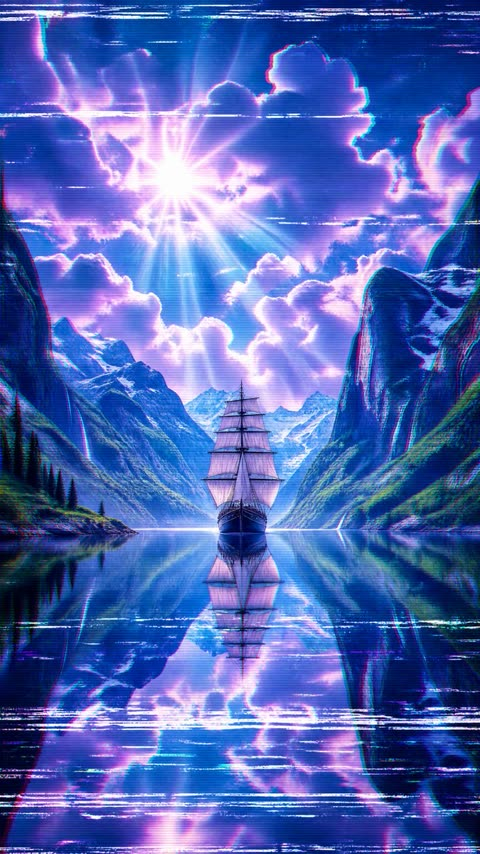
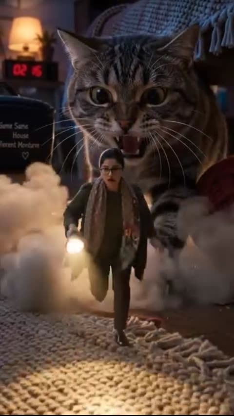
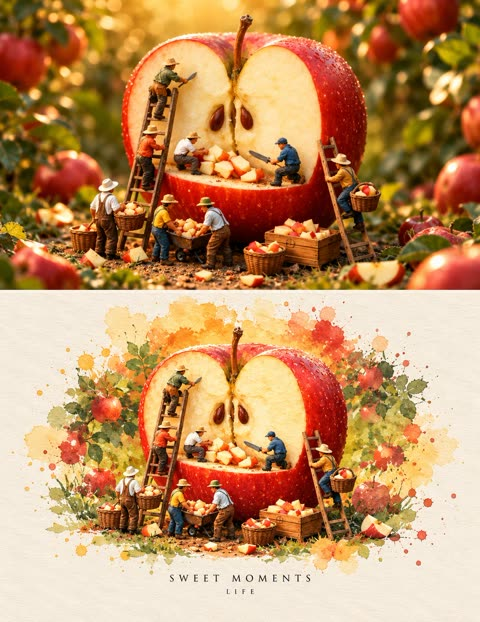
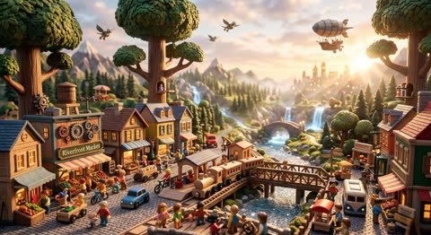
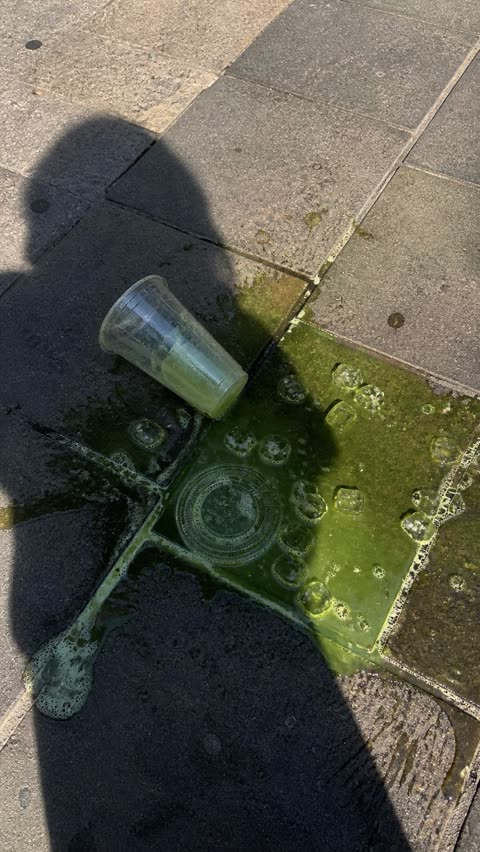

# Photo realism

[Back to the list](../../README.md) · All 26 entries

<a id="gpt-image-pencil-essay-coffee-stain"></a>
### Pencil handwritten essay on lined paper with coffee stain

<a href="https://x.com/chetaslua/status/2095556181012128005"></a>

The prompt fixes the medium (pencil on 8.5x11 lined paper) and the capture method (phone photo). It asks for stroke variance and one small flaw, a coffee stain in a named corner, which gives the realism.

GPT Image 2.5 · Text-to-image · Source: [@chetaslua on X](https://x.com/chetaslua/status/2095556181012128005) · 614 likes on 2026-10-27

[`handwriting`](tags.md#tag-handwriting) [`paper`](tags.md#tag-paper) [`phone-photo`](tags.md#tag-phone-photo) [`texture`](tags.md#tag-texture) [`coffee-stain`](tags.md#tag-coffee-stain)

<details><summary><b>Prompt</b></summary>

```text
🚨 GPT-Image-2.5 Output

I said it to write like einstein it did it without reference < i did not give image or anything   >

left side is AI and right side is real photo from reddit to compare

Prompt : a photorealistic, taken by phone photo of a handwritten essay in pencil, albert einstein handwriting, on an 8.5x11 piece of lined paper, about the history of money in world. make sure there is variance in the writing in a very einstein way. give it a slight coffee stain on the top right corner
```

</details>

<a id="gpt-image-forest-clearing-foliage-noise-test"></a>
### Sunlit woodland clearing with dense green foliage

<a href="https://x.com/mark_k/status/2097411028510179759"></a>

A single plain sentence that names the subject, the photo medium, and a highly detailed cue works as a noise artifact test, because dense repeating foliage exposes texture smearing and grain. The short wording leaves the model free to choose light and composition.

GPT Image 2.5 · Text-to-image · Source: [@mark_k on X](https://x.com/mark_k/status/2097411028510179759) · 415 likes on 2026-10-27

[`forest`](tags.md#tag-forest) [`nature`](tags.md#tag-nature) [`foliage`](tags.md#tag-foliage) [`texture-test`](tags.md#tag-texture-test) [`landscape`](tags.md#tag-landscape)

<details><summary><b>Prompt</b></summary>

```text
GPT-Image-2.5 has arrived in
@ChatGPT
 🔥

It features many improvements, but I couldn't help myself from doing the infamous "noise artifact" test.

The results are mixed!

Prompt: "Photo of a clearing in the woods with lots of green foliage, highly detailed"

See for yourself:
```

</details>

<a id="nano-banana-json-reconstruction"></a>
### JSON prompt that reconstructs a photo shot for shot

<a href="https://x.com/ViralOps_/status/2107538470818484305"></a>

Structured as JSON fields (framing, light, colour, negatives). The post compares the same JSON on Nano Banana 2.1 and GPT Image 2.5.

Nano Banana 2.1 · Edit · Source: [@ViralOps_ on X](https://x.com/ViralOps_/status/2107538470818484305) · 326 likes on 2026-10-27

[`json`](tags.md#tag-json) [`reconstruction`](tags.md#tag-reconstruction) [`comparison`](tags.md#tag-comparison)

<details><summary><b>Prompt</b></summary>

```text
{
  "prompt_type": "detailed_image_reconstruction",
  "aspect_ratio": "4:5 vertical portrait",
  "overall_goal": "Recreate the visual appearance, framing, lighting, styling, and casual smartphone-photo feel of the reference image as closely as possible while keeping the result photorealistic and natural.",

  "subject": {
    "type": "young adult woman",
    "age_range": "early to mid 20s",
    "pose": "standing indoors, upper body turned slightly away from the camera while her face turns toward the lens",
    "body_position": "relaxed casual posture with shoulders slightly angled",
    "expression": "soft neutral expression with a subtle pout, calm and confident",
    "gaze": "looking directly toward the camera",
    "styling": "minimal everyday styling, clean and natural"
  },

  "face": {
    "shape": "soft oval face with a gently tapered jawline",
    "forehead": "medium-height forehead partly framed by center-parted hair",
    "eyebrows": "natural medium-thick dark brown eyebrows with a soft arch",
    "eyes": {
      "shape": "almond-shaped",
      "color": "light brown to hazel",
      "appearance": "bright eyes with visible catchlights",
      "lashes": "long defined eyelashes with subtle mascara"
    },
    "nose": "small straight nose with a softly rounded tip",
    "lips": {
      "shape": "full lips with a defined cupid's bow",
      "color": "natural rosy pink",
      "finish": "soft satin finish, not glossy"
    },
    "skin": {
      "tone": "light warm-neutral skin tone",
      "texture": "smooth natural skin with subtle pores and realistic tonal variation",
      "cheeks": "soft natural pink flush",
      "finish": "fresh luminous skin without heavy retouching"
    },
    "makeup": "very light natural makeup, softly defined lashes, subtle blush, natural pink lips, no dramatic contour"
  },

  "hair": {
    "color": "rich medium-to-dark chocolate brown",
    "length": "very long, extending well below the chest",
    "parting": "clean center part",
    "texture": "mostly straight with very soft natural bends through the lower lengths",
    "density": "thick and healthy-looking",
    "finish": "smooth and glossy but still realistic",
    "front_sections": "two thin face-framing strands falling naturally along both sides of the face",
    "details": "visible individual strands, subtle flyaways near the crown, realistic highlights from sunlight, natural uneven strand separation",
    "movement": "hair hanging naturally over both shoulders and down the front of the shirt"
  },

  "clothing": {
    "top": "oversized plain white crew-neck T-shirt",
    "fit": "loose casual fit",
    "fabric": "soft slightly wrinkled cotton",
    "logos": "none",
    "accessories": "no visible jewelry or prominent accessories"
  },

  "composition": {
    "shot_type": "close upper-body portrait",
    "camera_angle": "slightly above chest level, close to eye level",
    "camera_distance": "approximately arm's-length smartphone distance",
    "subject_position": "face slightly right of center with long hair occupying much of the lower frame",
    "crop": "top of head fully visible, image extending down to around lower torso",
    "orientation": "vertical",
    "perspective": "natural wide smartphone-camera perspective with mild close-range distortion"
  },

  "lighting": {
    "primary_source": "strong warm natural sunlight entering from the side/front through a nearby window",
    "direction": "sunlight striking the subject from camera-left/front",
    "face_effect": "bright warm illumination across the forehead, cheeks, nose, and hair",
    "hair_effect": "distinct brown highlights and soft reflective streaks along individual strands",
    "shadow_quality": "strong but soft-edged natural indoor shadows",
    "exposure": "face slightly brightly exposed while the room behind remains much darker",
    "color_temperature": "warm daylight"
  },

  "environment": {
    "location": "casual indoor residential room",
    "background": "dark gray walls with a white ceiling cornice",
    "left_background": "open doorway or darker hallway area",
    "right_background": "dark wall and partially visible household objects",
    "lower_right": "part of a black tripod or light stand visible",
    "overall_feel": "ordinary lived-in room rather than a studio",
    "depth": "background moderately out of focus but still recognizable"
  },

  "camera": {
    "capture_device": "modern smartphone camera",
    "lens_equivalent": "approximately 24-28mm full-frame equivalent",
    "focus": "sharp focus on face and front hair",
    "depth_of_field": "mostly natural smartphone depth of field with gentle background softness",
    "dynamic_range": "realistic phone-camera HDR with slightly clipped highlights in direct sun",
    "image_character": "casual social-media selfie/photo, not professionally staged"
  },

  "photorealism_details": [
    "real individual hair strands",
    "natural skin pores and micro-texture",
    "subtle peach fuzz",
    "realistic eyelash separation",
    "tiny variations in lip texture",
    "slight fabric creases in the T-shirt",
    "small flyaway hairs around the crown",
    "natural sunlight falloff across the face",
    "slightly imperfect casual framing",
    "realistic indoor shadow noise"
  ],

  "style": {
    "visual_style": "highly photorealistic casual smartphone portrait",
    "mood": "soft, youthful, relaxed, sunlit",
    "processing": "light social-media style processing with warm skin tones and slightly enhanced clarity",
    "avoid": [
      "cinematic movie lighting",
      "studio portrait lighting",
      "overly smooth plastic skin",
      "CGI appearance",
      "anime or illustration",
      "heavy beauty filter",
      "extreme facial symmetry",
      "over-sharpened hair",
      "artificial jet-black hair",
      "dramatic makeup",
      "excessive background blur",
      "professional studio backdrop",
      "text",
      "watermarks",
      "logos"
    ]
  },

  "negative_prompt": "cartoon, anime, illustration, CGI, plastic skin, waxy face, over-retouched skin, excessive beauty filter, unnatural facial symmetry, distorted eyes, crossed eyes, malformed lips, warped face, duplicate hair strands, fake wig appearance, overly black hair, metallic hair shine, stiff hair, messy anatomy, distorted shoulders, extra limbs, extra fingers, studio backdrop, cinematic lighting, dramatic color grading, excessive bokeh, oversaturated colors, text, logo, watermark"
}
```

</details>

<a id="gpt-image-train-platform-snapshot"></a>
### Phone snapshot on a train platform

<a href="https://x.com/MissDelulu9/status/2114965450425868519"></a>

Realism through phone-camera flaws: motion blur on the train, real mobile noise, slight wide-angle distortion.

GPT Image 2.5 · Text-to-image · Source: [@MissDelulu9 on X](https://x.com/MissDelulu9/status/2114965450425868519) · 305 likes on 2026-10-27

[`phone-photo`](tags.md#tag-phone-photo) [`street`](tags.md#tag-street) [`motion-blur`](tags.md#tag-motion-blur)

<details><summary><b>Prompt</b></summary>

```text
Realistic vertical phone street snapshot of a young woman on an urban train platform, slightly right of center, as a silver train with a green stripe rushes behind in horizontal motion blur. Low angle from waist height, close half-body to mid-thigh, handheld and imperfect.

Long deep-black hair sweeps left in station wind. Oversized brown gradient sunglasses hide her eyes; head tilted upward, lips relaxed, cool distant expression. Small oval face, soft jawline, clean East Asian Y2K makeup, nude-pink lips. Warm-white cropped halter tank, low neckline, fitted ribbed cotton, subtle wrinkles, hem above waist. Low-rise loose vintage gray-brown jeans, layered gold necklaces, black quilted chain bag.

Warm-beige skin with natural texture on shoulders, collarbones, arms, waist and abdomen. Cool fluorescent station light, metallic reflections, yellow tactile paving, concrete floor, blurred passengers in train windows. Real mobile noise, slight wide-angle feel.
```

</details>

<a id="gpt-image-raw-chicken-cinematic-food-commercial"></a>
### Raw chicken on dark board, cinematic food commercial

<a href="https://x.com/DuaFatimaAi/status/2091684066622103675"></a>

The prompt splits the commercial into four numbered scenes that follow the food from raw to fried, each with its own camera distance and action. A closing style line stacks macro, shallow depth of field, warm lighting and no text or logos.

GPT Image 2 · Text-to-image · Source: [@DuaFatimaAi on X](https://x.com/DuaFatimaAi/status/2091684066622103675) · 226 likes on 2026-10-28

[`food`](tags.md#tag-food) [`commercial`](tags.md#tag-commercial) [`macro`](tags.md#tag-macro) [`cinematic`](tags.md#tag-cinematic) [`multi-scene`](tags.md#tag-multi-scene)

<details><summary><b>Prompt</b></summary>

```text
Create a hyper-realistic cinematic food commercial showing raw chicken pieces being expertly seasoned and transformed into crispy golden fried chicken.

Scene 1: Close-up of fresh raw chicken pieces arranged on a dark wooden cutting board in a dramatic dark kitchen environment. Soft warm side lighting highlights the natural texture and moisture of the chicken.

Scene 2: A generous blend of spices is sprinkled over the chicken in slow motion. Capture every tiny spice particle floating through the air and landing naturally on the chicken. Use extreme macro detail and shallow depth of field.

Scene 3: The seasoned chicken is carefully lowered into hot oil. Show an intense close-up of the oil rapidly bubbling and sizzling around the chicken, with realistic steam, tiny oil droplets, and crunchy batter forming.

Scene 4: Golden-brown crispy fried chicken is lifted from the hot oil with stainless-steel kitchen tongs. Oil droplets fall back into the pan in slow motion while the crispy textured coating glistens under warm cinematic lighting.

Ultra-realistic food photography, cinematic commercial style, macro close-ups, rich golden tones, realistic textures, dramatic contrast, shallow depth of field, soft background bokeh, slow-motion details, natural movement, professional food advertisement, 4K, highly detailed, appetizing presentation, no text, no logos
```

</details>

<a id="gpt-image-miniature-workers-building-giant-sushi-roll"></a>
### Tiny Workers Building a Giant Sushi Roll

<a href="https://x.com/SeeratFatima112/status/2088658313114423488"></a>

The prompt splits the 10 seconds into eight timed scenes, each with one action and one macro framing, so the sequence stays easy to follow. Camera, audio and quality sections are listed separately, and real human hands give the miniature scale.

GPT Image 2 · Text-to-image · Source: [@SeeratFatima112 on X](https://x.com/SeeratFatima112/status/2088658313114423488) · 222 likes on 2026-10-28

[`miniature`](tags.md#tag-miniature) [`macro`](tags.md#tag-macro) [`asmr`](tags.md#tag-asmr) [`food`](tags.md#tag-food) [`video-prompt`](tags.md#tag-video-prompt)

<details><summary><b>Prompt</b></summary>

```text
Gpt image 2
Prompt Create a 10-second ultra-realistic cinematic miniature-world video showing tiny construction workers building a giant sushi roll with the help of real human hands. The style is realistic ASMR, satisfying miniature construction, macro photography, highly detailed textures, warm cinematic lighting, shallow depth of field.

Scene 1 — 0:00–0:01: Tiny construction workers use a miniature excavator to scoop freshly cooked white rice and place it into a large bowl. Close-up macro shot, realistic rice texture, tiny machinery sounds.

Scene 2 — 0:01–0:02: A giant human hand pours water into the rice bowl while miniature workers carefully wash and mix the rice. Clear water movement, realistic ASMR sound.

Scene 3 — 0:02–0:03: The rice is transferred into a miniature cooking pot. Steam rises as tiny workers supervise the cooking process. Close-up of the lid opening and warm steam escaping.

Scene 4 — 0:03–0:04: Tiny workers spread the cooked sticky rice evenly across a large sheet of nori using miniature tools, while a human hand gently helps flatten and smooth the rice.

Scene 5 — 0:04–0:05: A tiny construction crane carefully lifts large pieces of fresh salmon and places them neatly on top of the rice. The salmon looks glossy, fresh, and realistic.

Scene 6 — 0:05–0:06: Tiny workers bring cucumber and other colorful sushi vegetables and carefully arrange them in straight layers over the salmon. Macro close-up of the ingredients.

Scene 7 — 0:06–0:07: Several miniature construction workers work together to roll the sushi tightly. A human hand assists by gently pushing and guiding the roll. The nori wraps smoothly around the filling.

Scene 8 — 0:07–0:10: A large human hand uses a sharp sushi knife to cut the finished sushi roll into perfect pieces. Tiny workers celebrate around the completed sushi, raising their hands. Add a small “MISSION COMPLETE” sign.

Camera: macro close-ups, smooth cinematic camera movement, realistic focus pulls, shallow depth of field, detailed miniature perspective.

Audio: satisfying ASMR, rice movement, water pouring, steam, tiny construction machinery, knife cutting through sushi, subtle ambient sounds. No music.

Visual quality: photorealistic, cinematic, highly detailed, realistic human hands, realistic miniature workers, natural physics, clean composition, warm restaurant/kitchen environment, 4K, vertical 9:16, smooth motion, no text except the small “MISSION COMPLETE” sign.
```

</details>

<a id="nano-banana-giant-object-miniature-world-macro"></a>
### Miniature people building worlds on giant everyday objects

<a href="https://x.com/DrSadek_/status/2033136123342401904"></a>

A fill in the blank template where only the everyday object changes while the macro lens, f/1.8 depth of field and directional micro shadow cues stay fixed. Dust and surface scratches on the object sell the scale difference against the tiny figures.

Nano Banana 2 · Text-to-image · Source: [@DrSadek_ on X](https://x.com/DrSadek_/status/2033136123342401904) · 219 likes on 2026-10-28

[`macro`](tags.md#tag-macro) [`miniature`](tags.md#tag-miniature) [`surreal`](tags.md#tag-surreal) [`template`](tags.md#tag-template) [`tilt-shift`](tags.md#tag-tilt-shift)

<details><summary><b>Prompt</b></summary>

```text
Create a hyper-realistic macro photograph of a miniature surreal scene. The environment is dominated by a giant, oversized <everyday object>, which has been repurposed as a bustling landscape. Tiny, highly detailed miniature human figures are interacting around and on the object. Shot on an 85mm macro lens with a shallow depth of field (f/1.8) to heavily blur the distant background. Lighting is soft, directional, and casts appropriate micro-shadows to emphasize the massive scale of the object relative to the figures. Intricate environmental details like dust particles and surface scratches are visible on the object. Cinematic, photorealistic, 4K.
```

</details>

<a id="gpt-image-bosphorus-night-kofte-caravan-stall"></a>
### Night Köfte Caravan Stall on the Bosphorus

<a href="https://x.com/ozansihay/status/2107544398531637407"></a>

The prompt packs in concrete scene layers (DIY neon sign, charcoal glow, stools, damacana, ferry silhouette) and states the exact Turkish sign text twice, once on the sign and once on the waiter's shirt. Photographic cues like 35mm f/1.8, film grain and wet asphalt reflections, plus a closing no text errors instruction, keep the realism and the lettering clean.

GPT Image 2.5 · Text-to-image · Source: [@ozansihay on X](https://x.com/ozansihay/status/2107544398531637407) · 216 likes on 2026-10-28

[`night-street`](tags.md#tag-night-street) [`food-stall`](tags.md#tag-food-stall) [`istanbul`](tags.md#tag-istanbul) [`neon-sign`](tags.md#tag-neon-sign) [`documentary`](tags.md#tag-documentary)

<details><summary><b>Prompt</b></summary>

```text
Aynı promptu sırasıyla şu modeller ile denedim;
-Nano Banana 2.1
-GPT Image 2.5
-Grok Imagine 2.0
-Ideogram 4.5

Prompt: Ultra-realistic night street photograph on the Istanbul Bosphorus waterfront. A tiny makeshift caravan food stall, slightly battered metal sides, steam rising. Hand-painted neon-style rickety sign reading “Köfteci Buğra Usta” in Turkish, glowing uneven cyan and warm amber, wires and brackets visibly DIY. Inside the open caravan, the usta grilling köfte over charcoal, orange ember glow on his face and apron. One waiter in a simple dark shirt stands in front of the stall; the same “Köfteci Buğra Usta” lettering is printed on the back of his shirt. Plastic stools and small low tables outside, a few locals eating, soft conversation. A plastic water jug (damacana) near the counter. Behind them, dark Bosphorus water with distant city lights and a faint ferry silhouette. Wet asphalt reflections, streetlamp spill, shallow depth of field, natural film grain, shot on 35mm f/1.8, candid documentary look, no CGI look, no text errors on signs.
```

</details>

<a id="nano-banana-floating-objects-spiral-bedroom-tunnel"></a>
### Woman in Tunnel of Floating Household Objects

<a href="https://x.com/AiwithLariab/status/2048074285953290537"></a>

Describes a spiral of everyday objects receding toward the back wall to build tunnel depth around a calm centered subject. A wide angle, shallow depth of field and subtle motion blur sell the rotation, and render engine keywords set the finish.

Nano Banana 2 · Text-to-image · Source: [@AiwithLariab on X](https://x.com/AiwithLariab/status/2048074285953290537) · 207 likes on 2026-10-28

[`surreal`](tags.md#tag-surreal) [`spiral`](tags.md#tag-spiral) [`bedroom`](tags.md#tag-bedroom) [`wide-angle`](tags.md#tag-wide-angle) [`bokeh`](tags.md#tag-bokeh)

<details><summary><b>Prompt</b></summary>

```text
A women sitting calmly at the center of a wide horizontal swirling spiral made of everyday objects (books, cups, pens, shoes, clothes, pillows, blankets, bags etc) floating and rotating gently around her, the swirling motion expanding outward and receding deep into the bedroom toward the back wall, creating a dynamic tunnel-like depth effect. The room is a normal cozy bedroom with a bed, desk, and soft daylight from a window. Cinematic wide-angle composition, natural warm lighting, shallow depth of field with creamy bokeh, subtle motion blur showing rotation, sharp focus on the man's face. Octane render & unreal engine 5.
```

</details>

<a id="gpt-image-cumulus-cloud-river-reflection-countryside"></a>
### Cumulus clouds mirrored in a countryside river

<a href="https://x.com/churvikv/status/2095472478340468762"></a>

The prompt is split into labeled Environment, Lighting, Materials and Composition blocks, and each block states what to avoid, such as blown out whites and roads dominating the frame. A high aerial viewpoint and an S curve river anchor the cloud reflection as the hero.

GPT Image 2 · Text-to-image · Source: [@churvikv on X](https://x.com/churvikv/status/2095472478340468762) · 148 likes on 2026-10-29

[`landscape`](tags.md#tag-landscape) [`clouds`](tags.md#tag-clouds) [`reflection`](tags.md#tag-reflection) [`aerial-view`](tags.md#tag-aerial-view) [`countryside`](tags.md#tag-countryside)

<details><summary><b>Prompt</b></summary>

```text
A painterly, highly detailed landscape scene with a luminous blue summer sky dominated by towering white cumulus clouds, rendered in a romantic fine-art campaign style. The hero is the dramatic cloud formation and its near-symmetrical reflection in a calm winding river, with patchwork farmland, dense green trees, and a small village church adding scale and pastoral elegance.

Environment:
• Elevated panoramic view over a rural countryside with a broad horizon line
• Massive vertical cloud towers filling most of the upper frame, clustered and sculptural, with soft lavender-gray shading in their interiors
• A reflective river curves through the center of the landscape, mirroring the clouds almost perfectly
• Surrounding fields in green, tan, and muted gold arranged in large geometric plots
• Dense tree lines along the riverbanks, with a few small red-roofed buildings near the water
• A church with a tall dark spire and pale walls positioned right of center in the mid-distance
• Avoid urban elements, roads dominating the frame, modern infrastructure, and visual clutter

Lighting:
• Bright daytime sunlight with crisp atmospheric clarity
• Soft but defined illumination across the clouds, emphasizing volume and height
• Even landscape exposure with gentle contrast and clear reflections in the water
• No harsh blown-out whites, no muddy shadows, no dramatic sunset tones

Materials:
• Billowing cloud masses with soft, cotton-like texture and subtle cool-shadow coloration
• Glassy river surface with mirror-like reflection and slight natural softness
• Organic tree canopies, cultivated farmland textures, stucco walls, dark church spire, clay-tile rooftops

Composition:
• Vertical aspect ratio
• High aerial or hilltop viewpoint looking slightly downward across the valley
• River forms a strong S-curve leading from foreground to mid-ground
• Cloud reflection occupies the lower center, echoing the cloud mass above
• Church and village serve as secondary focal
```

</details>

<a id="gpt-image-sailing-ship-glassy-mountain-lake-god-rays"></a>
### Sailing ship on glassy mountain lake with sun rays

<a href="https://x.com/churvikv/status/2076263875389903041"></a>

The prompt sets a centered subject, then layers sky, sun behind clouds, flanking peaks and a mirror lake so the reflection repeats every element. Closing style keywords for lighting and resolution keep the render clean and sharp.

GPT Image 2 · Text-to-image · Source: [@churvikv on X](https://x.com/churvikv/status/2076263875389903041) · 141 likes on 2026-10-29

[`landscape`](tags.md#tag-landscape) [`sailing-ship`](tags.md#tag-sailing-ship) [`mountains`](tags.md#tag-mountains) [`reflection`](tags.md#tag-reflection) [`god-rays`](tags.md#tag-god-rays)

<details><summary><b>Prompt</b></summary>

```text
A majestic three-masted sailing ship floats on a perfectly still, glassy lake, centered in a dramatic mountain landscape under a bright, clear sky. The brilliant sun is partially hidden behind voluminous, fluffy white clouds, creating a soft, diffused glow with majestic crepuscular rays (God rays) beaming down. The sky is a vibrant, crystal-clear azure blue. Sharp, snow-capped jagged mountain peaks rise on both sides, adding grandeur to the scene. The water acts as a flawless mirror, perfectly reflecting the white sails of the ship, the bright clouds, and the vivid blue tones of the sky. The atmosphere is serene and uplifting, characterized by smooth gradients, clean lines, and high-definition clarity. Style: Digital fantasy illustration, photorealistic lighting, 8k resolution
```

</details>

<a id="gpt-image-giant-cat-living-room-chase"></a>
### Woman running from a giant house cat

<a href="https://x.com/Adnan_Ai2/status/2104888724727468359"></a>

The prompt locks the subject's face, glasses, outfit and proportions across the whole clip. It then states the scale contrast and gives each shot a job: low angle for the cat, reaction close shots for the woman, wide establishing shots. Warm lamp light against cool moonlight adds depth.

GPT Image 2.5 · Edit · Source: [@Adnan_Ai2 on X](https://x.com/Adnan_Ai2/status/2104888724727468359) · 127 likes on 2026-10-28

[`giant-cat`](tags.md#tag-giant-cat) [`cinematic`](tags.md#tag-cinematic) [`photorealistic`](tags.md#tag-photorealistic) [`face-consistency`](tags.md#tag-face-consistency) [`vertical-9-16`](tags.md#tag-vertical-9-16)

<details><summary><b>Prompt</b></summary>

```text
Prompt 2 — Funny Monster Cat Adventure
Create a long, cinematic, photorealistic video showing a funny but dramatic adventure between a woman and a gigantic house cat. Start with the woman peacefully inside her cozy living room, then reveal an enormous fluffy cat entering the background. The woman notices the giant cat, freezes for a moment in disbelief, and then suddenly runs toward the camera while looking over her shoulder. The giant cat follows behind her with exaggerated but realistic movements, creating a playful giant-monster effect.
Keep the woman’s face, hairstyle, glasses, outfit, body proportions, and overall appearance consistent from beginning to end. Give her natural frightened and surprised expressions without making them exaggerated or cartoonish. The giant cat should look extremely realistic, with individual strands of fur, detailed ears, long whiskers, realistic paws, natural blinking, subtle breathing, and believable body movement. Make the size difference between the woman and the cat visually impressive.
Set the entire scene inside a warm, stylish apartment at night. Include a sofa, patterned cushions, a soft blanket, plants, bookshelves, lamps, coffee table, pet accessories, and realistic small decorations. As the chase develops, show cushions moving slightly, the woman running around furniture, and the giant cat carefully following her through the room. Use dynamic tracking shots, a low-angle perspective for the cat, close-up reaction shots of the woman, wide establishing shots, and smooth cinematic camera transitions. Add realistic motion blur, natural hair and clothing movement, soft shadows, warm practical lighting, cool moonlight through the window, atmospheric depth, shallow depth of field, realistic reflections, and premium movie-style cinematography. The final result should feel like a humorous cinematic fantasy scene with realistic visual effects, not an animated cartoon. Ultra-photorealistic, highly detailed, cinematic lighting, professional color grading, realistic physics and movement, 8K quality, vertical 9:16 composition.
```

</details>

<a id="gpt-image-neon-yacht-moonlit-harbour-reflections"></a>
### Neon yacht in moonlit harbour at night

<a href="https://x.com/churvikv/status/2109710598972035578"></a>

The prompt is split into labelled blocks (harbour, moon, boat, hills, town, reflections, palette), so each element gets a fixed position and colour. A separate reflections block assigns magenta and cyan bands under the yacht and amber columns elsewhere, which gives the water its ribbon look.

GPT Image 2.5 · Text-to-image · Source: [@churvikv on X](https://x.com/churvikv/status/2109710598972035578) · 127 likes on 2026-10-28

[`night-scene`](tags.md#tag-night-scene) [`harbour`](tags.md#tag-harbour) [`neon`](tags.md#tag-neon) [`reflections`](tags.md#tag-reflections) [`panoramic`](tags.md#tag-panoramic)

<details><summary><b>Prompt</b></summary>

```text
Photorealistic night harbour scene, wide 16:9 panoramic composition, cinematic, ultra-detailed. Edge to edge, no frame, no border.

HARBOUR: the lower half is calm black water rippling in fine horizontal chop, carrying long smeared vertical reflections that stretch down the frame.

MOON: high in the upper middle of the deep navy night sky hangs one enormous, sharply detailed full moon, its craters crisp, ringed by a soft cool blue-white halo. The sky is darkest at the top corners, paling slightly toward the horizon.

BOAT: just left of centre sits a sleek modern white motor yacht at rest, seen broadside from the front-left. Its flanks are washed in vivid neon ultraviolet magenta along the hull and glowing electric cyan along the upper deck and railings, with a dark tinted glass bridge, a radar mast, a blue-lit stern platform and a line of small dark portholes.

HILLS: behind, layered dark ridgelines rise across the full width, their slopes dotted with scattered warm gold lights of hillside villas and small windows.

TOWN: along the water's edge runs a continuous waterfront promenade of low pale buildings with warm golden lit façades, arcades, windows and streetlamps. A row of moored white boats and small yachts lines the quay in dark silhouette.

REFLECTIONS: the water is split into ribbons of colour. Directly beneath the yacht run two bold vertical bands — bright magenta and electric cyan — vivid and saturated, broken into short ripples. Across the rest of the surface, the town lights throw long warm amber and orange columns, with cooler teal and deep green streaks threading between them in the lower right.

PALETTE: deep navy, near-black water, brilliant magenta, electric cyan, warm amber gold, teal green, silver-white moon. Sharp focus, high dynamic range, glossy wet highlights, clean and unmarked.
```

</details>

<a id="nano-banana-paris-flag-miniature-city-diorama"></a>
### Paris flag transformed into miniature landmark city

<a href="https://x.com/Sheldon056/status/2034418908506296520"></a>

A bracketed [PARIS] slot makes the prompt reusable for any country or city flag. Camera body, lens, aperture and light direction anchor the photoreal look, while the fabric to architecture transformation and tiny visitors add the surreal scale.

Nano Banana 2 · Text-to-image · Source: [@Sheldon056 on X](https://x.com/Sheldon056/status/2034418908506296520) · 106 likes on 2026-10-28

[`miniature`](tags.md#tag-miniature) [`diorama`](tags.md#tag-diorama) [`flag`](tags.md#tag-flag) [`landmark`](tags.md#tag-landmark) [`photorealistic`](tags.md#tag-photorealistic)

<details><summary><b>Prompt</b></summary>

```text
Google Nano Banana 2 on Gemini.

Prompt: Photorealistic hero product photography shot on Sony A7III with 85mm f/1.4 lens at f/2.8, soft natural daylight from upper left creating gentle realistic shadows and visible surface textures: A cutaway [PARIS] flag ingeniously transformed into a luxurious miniature landmark city. The fabric forms iconic buildings, rivers, and glowing streets. Miniature visitors in tiny colorful clothes explore monuments, ride boats, and take photos. Intricate details, physically plausible yet surreal. Shot for a luxury architecture magazine cover, ultra-detailed 8K, perfectly centered square composition, aspect ratio 1:1, no text, no artifacts.
```

</details>

<a id="gpt-image-giant-fruit-miniature-workers-watercolor-pair"></a>
### Giant fruit with tiny workers, photo and watercolor

<a href="https://x.com/mehwishkiran07/status/2107803591281168600"></a>

The prompt fixes the scene by listing worker count, outfits and ladder positions, then adds macro photography and golden hour light terms for realism. A second version in watercolor scrapbook style reuses the same composition and adds serif text at the bottom, giving a matched pair in one image.

GPT Image 2.5 · Text-to-image · Source: [@mehwishkiran07 on X](https://x.com/mehwishkiran07/status/2107803591281168600) · 91 likes on 2026-10-28

[`miniature`](tags.md#tag-miniature) [`diorama`](tags.md#tag-diorama) [`macro`](tags.md#tag-macro) [`watercolor`](tags.md#tag-watercolor) [`dual-style`](tags.md#tag-dual-style)

<details><summary><b>Prompt</b></summary>

```text
A whimsical miniature fantasy scene featuring a gigantic ripe red strawberry growing in a lush green strawberry field. The strawberry is enormous, perfectly centered, with highly detailed glossy red skin covered in hundreds of tiny yellow seeds and fresh green leaves on top. A short brown stem rises from the center.
Surrounding the giant strawberry are five tiny miniature farm workers wearing dark navy work clothes, orange safety helmets, and work boots. They are working around the strawberry as if maintaining and harvesting it. Two workers are climbing tall wooden ladders on both sides of the strawberry, carefully working near its surface. Another worker stands halfway up the right ladder, while another works near the bottom using a small gardening tool. The tiny human scale compared with the enormous strawberry creates a magical miniature-world effect.
The strawberry sits directly on rich dark soil surrounded by tiny green strawberry plants, grass, leaves, and natural ground details. The background is a beautiful softly blurred green agricultural field with warm golden sunlight streaming from above, creating glowing rays, atmospheric haze, creamy bokeh, and a dreamy cinematic mood.
Ultra-realistic macro photography, photorealistic miniature diorama, highly detailed strawberry texture, realistic tiny workers, intricate wooden ladders, natural soil and vegetation, cinematic depth of field, soft background blur, warm golden-hour lighting, volumetric sun rays, realistic shadows, vibrant natural colors, magical scale contrast, whimsical fantasy realism, premium AI art.
Then create a second version in a vintage watercolor scrapbook illustration style using the exact same composition and characters. Place the scene on textured warm cream watercolor paper, surrounded by loose watercolor splashes of orange, yellow, green, and earthy tones. Add soft painted foliage and an artistic sunset circle behind the strawberry, with visible watercolor brush strokes, subtle paper grain, handmade imperfections, and an elegant nostalgic storybook aesthetic.
At the bottom of the watercolor version, add elegant minimalist serif typography:
“SWEET MOMENTS”
“LIFE”
Vertical composition, centered subject, premium editorial scrapbook poster, charming miniature fantasy, highly detailed, cinematic realism blended with delicate watercolor art.
```

</details>

<a id="nano-banana-supper-club-lobster-roll-tray"></a>
### Waitress Holding Silver Tray of Lobster Rolls

<a href="https://x.com/oye_samia/status/2054101412976738575"></a>

The prompt fixes one focal object, the silver tray, and builds a frontal low angle medium shot around it. A one directional candlelight setup, a named camera and lens, and a ban on plastic or CGI looks push it toward photographic realism.

Nano Banana 2 · Text-to-image · Source: [@oye_samia on X](https://x.com/oye_samia/status/2054101412976738575) · 89 likes on 2026-10-29

[`supper-club`](tags.md#tag-supper-club) [`candlelight`](tags.md#tag-candlelight) [`food-photography`](tags.md#tag-food-photography) [`low-angle`](tags.md#tag-low-angle) [`photorealistic`](tags.md#tag-photorealistic)

<details><summary><b>Prompt</b></summary>

```text
Hyper-realistic vertical photograph 4:5. Private dining area of an exclusive supper club with dark wooden panels, burgundy velvet curtains, golden candlelight, and a deep anthracite background.
A stunning woman stands frontally, medium shot from the chest up, slight low angle. She holds with both hands an ornate oval silver tray extended toward the camera. On the tray is a perfect ring of 12 miniature lobster rolls on brioche buns with pink lobster meat. The silver tray is the main focal point of the scene.
Clothing: Elegant black Adidas Originals Firebird-inspired zip-up cropped jacket with three white stripes and Trefoil logo, worn over a starched white fitted dress shirt with a black silk bow tie, paired with a sleek high-waisted black mini skirt or tailored black trousers, statement AP Royal Oak watch in steel, delicate silver rings and earrings.
Lighting: Warm, low golden-amber candlelight coming from the right, sculpting her face and creating beautiful highlights on the silver tray. Deep dramatic shadows on the left. Monochrome black with luxurious gold accents.
Camera: Sony A7R V, 50mm f/1.4 lens, 8K resolution, natural skin texture, natural depth of field with soft organic candle bokeh. No plasticity, no CGI, no AI artifacts.
```

</details>

<a id="nano-banana-miniature-toy-kingdom-macro-sunrise"></a>
### Miniature toy kingdom with trains, waterfalls and airship

<a href="https://x.com/kellyyjjones/status/2076163025464348955"></a>

The prompt lists concrete scene elements (market streets, trains, bridges, waterfalls) and material textures such as plastic, wood, fabric and metal. It then fixes a macro lens, extreme shallow depth of field and golden sunrise volumetric light so the toys read as real. A second paragraph adds a giant human observer for scale.

Nano Banana 2 · Text-to-image · Source: [@kellyyjjones on X](https://x.com/kellyyjjones/status/2076163025464348955) · 82 likes on 2026-10-29

[`miniature`](tags.md#tag-miniature) [`toy-world`](tags.md#tag-toy-world) [`macro`](tags.md#tag-macro) [`golden-light`](tags.md#tag-golden-light) [`fantasy`](tags.md#tag-fantasy)

<details><summary><b>Prompt</b></summary>

```text
A breathtaking ultra-realistic miniature toy universe where every living toy has its own thriving civilization. Tiny colorful cities filled with beautifully crafted toy houses, bustling streets, miniature trains, toy cars, bicycles, and tiny marketplaces full of life. Little toy people laugh, work, and explore while mechanical birds fly overhead and tiny airships drift across the sky. Enormous toy trees tower above the landscape, surrounded by crystal-clear rivers, glowing waterfalls, magical bridges, miniature mountains, and lush forests. Every surface reveals realistic plastic, wood, fabric, and metal textures with intricate craftsmanship. Warm golden sunrise light bathes the world in soft cinematic rays, creating volumetric lighting, gentle lens flares, and dreamy atmospheric fog. Captured in macro photography with an extreme shallow depth of field, making the tiny world feel astonishingly real. Pixar-inspired wonder blended with Hollywood fantasy, ultra-photorealistic, hyper-detailed, Unreal Engine 5 quality, global illumination, ray tracing, HDR, 8K, masterpiece, award-winning cinematic concept art.

A breathtaking ultra-realistic cinematic scene of a giant human standing above a magical toy universe, carefully observing the tiny toy world below. The man looks amazed and curious as he watches miniature toy cities, toy people, tiny vehicles, colorful houses, and a fantasy toy kingdom built like a living world. Massive scale difference between the human and the miniature world, macro photography perspective, cinematic lighting, warm golden sunlight, realistic textures, shallow depth of field, fantasy atmosphere, ultra detailed, 8K, masterpiece quality.
Is koo b improve karoo
```

</details>

<a id="nano-banana-cowboy-grassland-sunset-cumulus"></a>
### Cowboy on Horseback Before Golden Sunset Cloud

<a href="https://x.com/im_shahid7/status/2109289268107776324"></a>

Splits the cloud into a gilded side and a shadow side to force strong light contrast. A telephoto lens, a low horizon and a vertical frame keep the small rider against the huge cloud.

Nano Banana 2.1 · Text-to-image · Source: [@im_shahid7 on X](https://x.com/im_shahid7/status/2109289268107776324) · 72 likes on 2026-10-29

[`landscape`](tags.md#tag-landscape) [`cowboy`](tags.md#tag-cowboy) [`cumulus-cloud`](tags.md#tag-cumulus-cloud) [`golden-hour`](tags.md#tag-golden-hour) [`telephoto`](tags.md#tag-telephoto)

<details><summary><b>Prompt</b></summary>

```text
Vertical landscape photography, vast grassland horizon, a cowboy with black wide-brim hat riding a dark black horse walking horizontally, behind him stands a towering massive cumulus cloud, one side of the cloud is gilded with warm golden sunset light, the other side has deep shadow, strong light and shadow contrast, clear deep blue sky, soft side light from sunset, natural light on meadow, cinematic wilderness atmosphere, realistic outdoor photo, rich light detail, shot on telephoto lens, 8K ultra high definition --ar 9:16 --v 6.0 --style raw --s 220 --q 2
```

</details>

<a id="gpt-image-infinite-clone-line-emerald-portal"></a>
### Endless Row of Clones Before Emerald Portal

<a href="https://x.com/Just_Anika_Here/status/2113126775178088582"></a>

Labeled sections for subject, unexpected visual, environment, lighting and composition keep a surreal idea controlled. A sharp foreground figure against clones fading into fog gives depth, and a closing quality control list guards against identity drift.

GPT Image 2.5 · Text-to-image · Source: [@Just_Anika_Here on X](https://x.com/Just_Anika_Here/status/2113126775178088582) · 44 likes on 2026-10-29

[`sci-fi`](tags.md#tag-sci-fi) [`clones`](tags.md#tag-clones) [`cinematic`](tags.md#tag-cinematic) [`fog`](tags.md#tag-fog) [`portal`](tags.md#tag-portal)

<details><summary><b>Prompt</b></summary>

```text
Create an ultra-detailed, high-quality cinematic sci-fi film still in a 1:1 square aspect ratio.

MAIN SUBJECT: A beautiful young woman standing in the extreme foreground, shown in left-facing side profile, her head slightly lowered and expression calm, mysterious, and confident. She wears a sleek, minimalist black futuristic coat with a high collar. Her dark hair is loosely tied back, with a few natural strands framing her face. Her facial features, skin texture, and hair must look photorealistic and natural.

UNEXPECTED VISUAL: Behind her, an impossibly long, perfectly aligned row of identical versions of the same woman stretches into the distance, each wearing exactly the same black outfit and standing completely motionless. The clones gradually disappear into dense atmospheric fog, creating an eerie sense of infinite repetition.

ENVIRONMENT: A colossal circular portal dominates the background, glowing with intense emerald green and icy cyan light. Towering futuristic monoliths and thin vertical neon light pillars rise through the darkness. The ground is wet, glossy black stone, reflecting the portal and scattered amber lights. Thick rolling fog flows around the subjects' legs and across the reflective floor.

LIGHTING & CAMERA: Dramatic cyan-green volumetric light rays, strong rim lighting outlining the woman's silhouette, deep cinematic shadows, subtle amber highlights, realistic skin pores, fine hair details, rich blacks, controlled highlights, shallow depth of field, and atmospheric perspective. The foreground woman is razor-sharp while the distant clones progressively soften into the mist.

VISUAL STYLE: Premium Hollywood dystopian sci-fi, photorealistic cinematic photography, sophisticated color grading, realistic materials, subtle film grain, powerful composition, surreal scale, mysterious atmosphere, and breathtaking visual depth.

COMPOSITION: The foreground woman occupies the left third of the square frame. The line of clones creates a strong diagonal leading toward the enormous glowing portal in the background. Every clone has consistent facial identity, anatomy, clothing, and proportions.

QUALITY CONTROL: No distorted faces, duplicate body parts, extra limbs, malformed hands, inconsistent outfits, floating objects, random characters, text, logos, watermarks, excessive neon saturation, or artificial plastic skin. Every element must feel intentional, coherent, and visually believable
```

</details>

<a id="gpt-image-1969-festival-crowd"></a>
### Festival crowd in Bethel, New York, August 1969

<a href="https://developers.openai.com/api/docs/guides/image-prompting#use-historical-and-real-world-context"></a>

A place and a date are enough for the model to infer clothing, staging and setting. Inspect the result for period accuracy. Preview: the Sunburst variant.

GPT Image 2.5 · Text-to-image · Source: [OpenAI image prompting guide](https://developers.openai.com/api/docs/guides/image-prompting#use-historical-and-real-world-context)

[`historical`](tags.md#tag-historical) [`crowd`](tags.md#tag-crowd) [`photorealism`](tags.md#tag-photorealism)

<details><summary><b>Prompt</b></summary>

```text
Create a realistic outdoor crowd scene in Bethel, New York on August 16, 1969.
Photorealistic, period-accurate clothing, staging, and environment.
```

</details>

<a id="gpt-image-1994-infomercial-crashed-saucer-frame"></a>
### Retro 1994 infomercial frame selling a crashed saucer

<a href="https://x.com/ImagineArt_X/status/2097520474226147462"></a>

Naming the medium and era first (1994 infomercial, standard definition, scanlines) sets the whole look. A short list of concrete props then drives the layout: host, plinth, price starburst, phone number and legal small print.

GPT Image 2.5 · Text-to-image · Source: [@ImagineArt_X on X](https://x.com/ImagineArt_X/status/2097520474226147462) · found via [wangrunlin/awesome-gpt-image-2-5-prompts](https://github.com/wangrunlin/awesome-gpt-image-2-5-prompts)

[`infomercial`](tags.md#tag-infomercial) [`retro-tv`](tags.md#tag-retro-tv) [`scanlines`](tags.md#tag-scanlines) [`ufo`](tags.md#tag-ufo) [`typography`](tags.md#tag-typography)

<details><summary><b>Prompt</b></summary>

```text
a frame grab from a 1994 infomercial, standard definition video with scanlines. A host in a teal blazer, a battered saucer on a rotating plinth with Antarctic ice frozen around one leg, a price starburst, a phone number, and three lines of legal small print.
```

</details>

<a id="gpt-image-laptop-screen-facetime-night-phone-photo"></a>
### Phone photo of a laptop FaceTime call at night

<a href="https://x.com/kaanakz/status/2056290465503171000"></a>

The prompt says raw phone photo, not a screenshot, then lists screen artifacts such as subpixel grid, moire, dust, fingerprints and uneven reflections. Fixed window layering and exact note text keep the interface believable.

GPT Image 2 · Text-to-image · Source: [@kaanakz on X](https://x.com/kaanakz/status/2056290465503171000) · found via [freestylefly/awesome-gpt-image-2](https://github.com/freestylefly/awesome-gpt-image-2)

[`laptop-screen`](tags.md#tag-laptop-screen) [`facetime`](tags.md#tag-facetime) [`macos`](tags.md#tag-macos) [`smartphone-photo`](tags.md#tag-smartphone-photo) [`night`](tags.md#tag-night)

<details><summary><b>Prompt</b></summary>

```text
Create a raw smartphone photo of a laptop screen, not a screenshot. Aspect ratio 3:4, high-angle downward POV from someone standing over a desk at night. The laptop display fills most of the frame, with a narrow strip of black keyboard and trackpad visible at the bottom. Strong realism: visible RGB subpixel grid, subtle moire bands, small dust specks, faint fingerprints, uneven glass reflections, handheld phone noise, slight perspective skew, no studio polish. macOS dark mode. Background app: Apple Notes with a late-night study note titled "Design Critique" and short visible bullets: "layout", "lighting", "source links", "ship tomorrow". Foreground app: FaceTime live preview window floating lower-right, showing a fictional adult man in his 20s sitting at a cluttered desk, hoodie, tired but amused expression, warm desk lamp behind him, books and sticky notes in the room. A second small Finder window with image thumbnails is partly visible behind it. Make it feel like an accidental real phone photo of a working laptop screen. No real-person likeness, no beauty filter, no perfect UI, no screenshot, no watermark, no cartoon, no 3D render.
```

</details>

<a id="gpt-image-miniature-city-in-hair-macro"></a>
### Miniature city hidden in curly hair

<a href="https://x.com/krafterlab/status/2051399740986740986"></a>

Names the scale trick up front (a city inside real hair on a visible forehead) and anchors it with an 85mm macro lens and shallow depth of field. A long list of imperfections and negatives (dirty buildings, no CGI, no glow) pushes the result toward a real photo.

GPT Image 2 · Text-to-image · Source: [@krafterlab on X](https://x.com/krafterlab/status/2051399740986740986) · found via [freestylefly/awesome-gpt-image-2](https://github.com/freestylefly/awesome-gpt-image-2)

[`miniature`](tags.md#tag-miniature) [`macro`](tags.md#tag-macro) [`surreal`](tags.md#tag-surreal) [`photorealistic`](tags.md#tag-photorealistic) [`hair`](tags.md#tag-hair)

<details><summary><b>Prompt</b></summary>

```text
Macro photograph of a miniature city hidden in human hair, clearly on a real human head, with part of the forehead and hairline visible, realistic skin texture with pores, tiny people walking through the streets between the hair strands, extremely small but realistic proportions, macro photography, 85mm lens, shallow depth of field, natural lighting, neutral colors, no warm tones, ultra realistic hair with visible roots, natural imperfections, slightly messy strands, realistic materials, slightly dirty buildings, no perfect surfaces, photorealistic, looks like a real photo, no illustration, no CGI, no glow
```

</details>

<a id="gpt-image-rice-grain-micro-typography"></a>
### Rice pile with tiny text on one grain

<a href="https://x.com/adonis_singh/status/2046673729082560919"></a>

A single short sentence sets a huge scale contrast, a massive pile against one grain, and quotes the exact text so the model renders it legibly. The odd mixed case wOw tests precise text fidelity at micro size.

GPT Image 2 · Text-to-image · Source: [@adonis_singh on X](https://x.com/adonis_singh/status/2046673729082560919) · found via [ZeroLu/awesome-gpt-image](https://github.com/ZeroLu/awesome-gpt-image)

[`micro-typography`](tags.md#tag-micro-typography) [`rice`](tags.md#tag-rice) [`macro`](tags.md#tag-macro) [`text-rendering`](tags.md#tag-text-rendering) [`scale-contrast`](tags.md#tag-scale-contrast)

<details><summary><b>Prompt</b></summary>

```text
A massive pile of rice, and on one single grain of rice there is tiny text that reads "wOw"
```

</details>

<a id="gpt-image-spilled-matcha-pavement-phone-photo"></a>
### Spilled matcha drink on sunlit pavement

<a href="https://x.com/Shinning1010/status/2050693240253214894"></a>

Lists every physical detail of the spill, including the cup, lid, ice and foam, and sets a handheld phone view from a slightly overhead angle. A long negative prompt against CGI, clean floors and fake liquid keeps the result looking like a raw documentary snapshot.

GPT Image 2 · Text-to-image · Source: [@Shinning1010 on X](https://x.com/Shinning1010/status/2050693240253214894) · found via [freestylefly/awesome-gpt-image-2](https://github.com/freestylefly/awesome-gpt-image-2)

[`smartphone-photo`](tags.md#tag-smartphone-photo) [`street`](tags.md#tag-street) [`spill`](tags.md#tag-spill) [`harsh-sunlight`](tags.md#tag-harsh-sunlight) [`negative-prompt`](tags.md#tag-negative-prompt)

<details><summary><b>Prompt</b></summary>

```text
cartoon, illustration, anime, CGI, 3D render, fantasy style, studio lighting, overly perfect composition, overly clean floor, fake liquid, unrealistic reflections, plastic-looking liquid, oversaturated green, blurry, low resolution, distorted cup, melted plastic, extra cups, duplicated objects, readable brand logo, messy text, watermark, poster design, dramatic artificial lighting, excessive sharpening, over-processed, unrealistic shadow, floating ice, deformed perspective
```

</details>

<a id="gpt-image-welsh-village-cork-notice-board"></a>
### Cork notice board outside a Welsh post office

<a href="https://x.com/ImagineArt_X/status/2097520484569276860"></a>

The prompt gives an exact item count and names each pinned item with its own paper type and typography, so the model renders mixed text styles in one scene. A single blank white card is requested, which tests whether the model leaves empty space.

GPT Image 2.5 · Text-to-image · Source: [@ImagineArt_X on X](https://x.com/ImagineArt_X/status/2097520484569276860) · found via [wangrunlin/awesome-gpt-image-2-5-prompts](https://github.com/wangrunlin/awesome-gpt-image-2-5-prompts)

[`notice-board`](tags.md#tag-notice-board) [`typography`](tags.md#tag-typography) [`village`](tags.md#tag-village) [`mixed-text`](tags.md#tag-mixed-text) [`overcast`](tags.md#tag-overcast)

<details><summary><b>Prompt</b></summary>

```text
a cork notice board outside a Welsh village post office, overcast light, seven pinned items. A choral society flyer, a lost cat poster on yellow paper, a handwritten piano card, a bus timetable with four times, a sheepdog photo, tear off tabs, and one blank white card.
```

</details>
