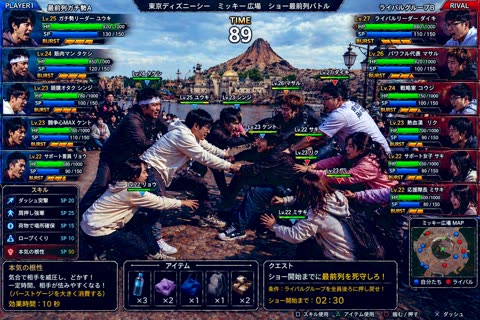
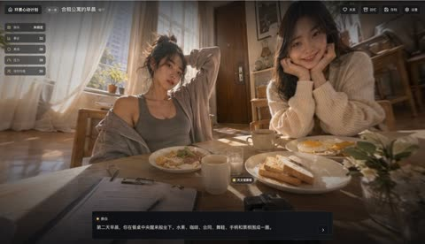
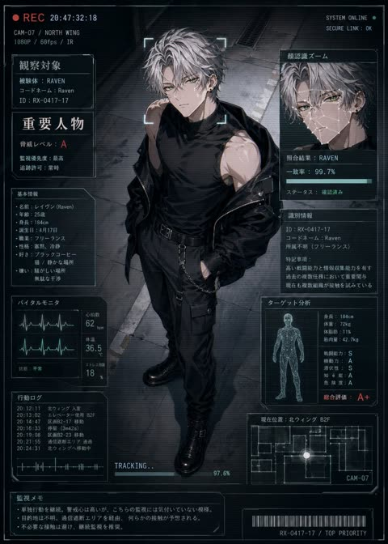
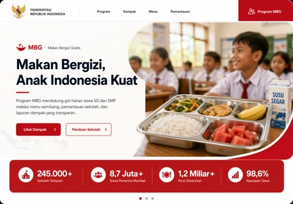
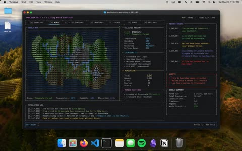
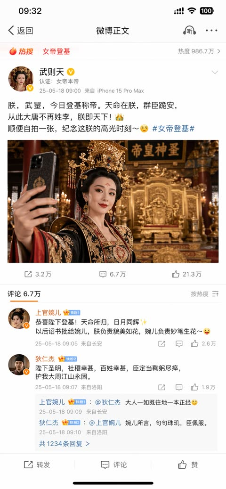

# Phone and UI mockups

[Back to the list](../../README.md) · All 17 entries

<a id="gpt-image-camera-roll-photos-screen"></a>
### iPhone Photos camera roll of a student's day

<a href="https://x.com/sakisuta_/status/2098712371045052764"></a>

The prompt names the exact container, a Photos app screen captured as is, so the model fills one grid with a full day of varied casual shots. Giving a reference person and asking for everyday moments keeps the face consistent across food, friends, desk and sky frames.

GPT Image 2.5 · Edit · Source: [@sakisuta_ on X](https://x.com/sakisuta_/status/2098712371045052764) · 2,439 likes on 2026-10-28

[`camera-roll`](tags.md#tag-camera-roll) [`photos-app`](tags.md#tag-photos-app) [`screenshot`](tags.md#tag-screenshot) [`reference-image`](tags.md#tag-reference-image) [`everyday`](tags.md#tag-everyday)

<details><summary><b>Prompt</b></summary>

```text
Turn one full day's worth of camera roll for the person in the reference image into a single image that captures the iPhone's Photos app screen as-is. Make it a realistic camera roll that feels like it captures casual everyday moments.
```

</details>

<a id="gpt-image-camera-roll-day"></a>
### iPhone camera roll of one subject's full day

<a href="https://x.com/Mayz1169/status/2099479395283214473"></a>

Strict rules keep the subject identical and fix the layout at four thumbnail columns with real iOS chrome. A list of shot types and deliberate flaws like blur, odd crops and handheld framing makes the grid read as a real camera roll.

GPT Image 2.5 · Edit · Source: [@Mayz1169 on X](https://x.com/Mayz1169/status/2099479395283214473) · 762 likes on 2026-10-27

[`ios`](tags.md#tag-ios) [`screenshot`](tags.md#tag-screenshot) [`camera-roll`](tags.md#tag-camera-roll) [`humor`](tags.md#tag-humor)

<details><summary><b>Prompt</b></summary>

```text
Use the uploaded image as the ONLY subject reference.

Create ONE vertical image that looks exactly like a screenshot of the iPhone Photos app, showing one full day of casual camera-roll photos featuring the exact subject from the uploaded reference.

SUBJECT CONSISTENCY
First identify the main subject in the uploaded image. It may be a person, anime character, pet, animal, plush toy, figurine, mascot, object, or other character.

Preserve the subject’s recognizable appearance, colors, proportions, facial features, hairstyle, clothing, accessories, markings, materials, and signature details consistently across every photo.

If the reference contains multiple views of the same subject, understand that they are different views of ONE subject, not multiple characters.

Do not redesign or replace the subject.

DAY-IN-THE-LIFE CAMERA ROLL
Imagine a believable full day for this exact subject based on its appearance, personality, style, and visual world.

Generate many different casual photos from morning to night, as if someone naturally photographed the subject throughout the day.

Automatically choose everyday situations that fit the uploaded subject, such as:
waking up, resting, eating, sitting by a window, traveling, walking outside, visiting cafés or shops, playing, working, relaxing at home, interacting with everyday objects, sunset moments, nighttime outings, and going to sleep.

The activities and environments should adapt naturally to the subject. Do not force human activities onto animals, toys, objects, or non-human characters when they would look unnatural.

Every thumbnail should show a different moment, composition, distance, pose, camera angle, lighting condition, or location.

Mix:
close-ups,
medium shots,
wide shots,
overhead photos,
back views,
detail shots,
slightly blurry movement shots,
imperfect handheld snapshots,
photos where the subject is partially cropped,
environmental photos related to the subject’s day.

The result should feel spontaneous and personal rather than like a professional photoshoot.

IPHONE PHOTOS APP LAYOUT
The FINAL IMAGE itself must look like a real full-screen iPhone Photos app screenshot.

Use a tall smartphone screenshot aspect ratio, approximately 9:19.5.

Create a dense camera-roll gallery using FOUR equal thumbnail columns, closely matching the standard iPhone Photos grid.

Include approximately 24–32 individual photo thumbnails visible on screen.

Use very thin white gaps between thumbnails.

The gallery should fill most of the screen vertically.

Include authentic iPhone Photos interface elements:
• white iOS interface background
• iPhone-style status bar at the top
• time on the upper left
• cellular/Wi-Fi/battery icons on the upper right
• simple navigation controls near the top
• four-column photo gallery
• bottom Photos app navigation bar
• Photos tab selected in blue
• other navigation icons shown in gray
• black home indicator at the very bottom

The UI must look like an actual screenshot of the Photos app, NOT a decorative frame, moodboard, contact sheet, scrapbook, poster, or generic collage.

PHOTO STYLE
Make each thumbnail feel like a genuine casual iPhone camera-roll photo.

Use natural everyday lighting, imperfect framing, realistic exposure variation, occasional motion blur, slight focus imperfections, spontaneous compositions, and believable environmental details.

Keep the same subject recognizable throughout the entire gallery while allowing natural changes in pose, expression, camera distance, and lighting.

If the uploaded reference is illustrated, animated, stylized, or 3D, preserve its original visual identity and style unless realistic photography is explicitly requested.

IMPORTANT
ONE final image only.
The entire output is ONE iPhone Photos app screenshot containing many different photos.
Exactly FOUR thumbnail columns.
Do not create a standalone collage without the iPhone interface.
Do not create multiple separate outputs.
Do not duplicate the exact same photo repeatedly.
Do not introduce unrelated characters or subjects.
Do not change the main subject’s design.
No captions, dates, labels, stickers, watermarks, or decorative text inside the photo thumbnails.
Only normal minimal iOS interface elements may appear.9:16
```

</details>

<a id="gpt-image-iphone-photos-screenshot"></a>
### A full day as an iPhone Photos library screenshot

<a href="https://x.com/BubbleBrain/status/2099759367956349012"></a>

Recreates the real iOS Photos interface down to the status bar, filled with candid shots of the reference person.

GPT Image 2.5 · Edit · Source: [@BubbleBrain on X](https://x.com/BubbleBrain/status/2099759367956349012) · 309 likes on 2026-10-27

[`ios`](tags.md#tag-ios) [`screenshot`](tags.md#tag-screenshot) [`camera-roll`](tags.md#tag-camera-roll)

<details><summary><b>Prompt</b></summary>

```text
Turn the girl from the reference image into a full-day iPhone Photos album screenshot that faithfully recreates the real iPhone “Photos — Library / Today” interface. Keep the top status bar (time, signal, battery), the Library title, the Today label, the photo grid layout, and the bottom tab bar: Library / For You / Albums / Search. The whole image should look like a real phone screenshot.
The girl in the reference image is the only subject in the entire album. Every photo keeps the same identity, the same face, the same hairstyle, the same skin tone, the same body proportions, and the same presence. She is a clearly adult young East Asian woman with long black hair, cool-pale skin, refined cool features, and a private, quiet aura.
The album is a full portrait camera roll. Every thumbnail shows her. The entire screen is filled with solo portraits of her. The whole set is built around this one person only.
All album content is portraits of her: waking-up selfie in bed, selfie under the covers, selfie by the pillow, bathroom-mirror selfie, elevator-mirror selfie, window-side selfie, indoor natural-light selfie, sofa selfie, bedside selfie, after-coming-home selfie, night selfie, close-up face selfie, half-body selfie, full-body mirror selfie, seated solo shot, standing solo shot, side-profile solo shot, looking-back solo shot, indoor hallway solo shot, window-side solo shot, candid bedside shot, chair solo shot, carpet solo shot, and photos taken of her by someone else.
Outfits change continuously through the day. Morning: milky-white camisole lounge top and light-gray home shorts. Late morning: white slim short-sleeve top and pale blue-gray pleated mini skirt. Noon: black thin-strap top and high-waisted denim shorts. Afternoon: light-gray knit cardigan over a white inner layer and a black mini skirt. Evening: dark-gray blazer, white thin-strap top, and black pleated mini skirt. Night: black fitted mini dress with slim silver accessories. Late night after returning home: loose white T-shirt and soft lounge shorts. Each outfit is clearly different; the clothing changes mark a clear passage of time.
Photo mix is fixed at 60% selfies and mirror selfies, 40% solo portraits taken by someone else. Every frame has her as the subject. Every thumbnail keeps real iPhone native-camera texture. Pose, camera distance, angle, expression, lighting, and clothing keep changing.
The sequence runs from morning to late night. Morning feels loose and just-woken. Late morning has clear natural light. Afternoon feels like ordinary going-out. Evening has soft city light. Night has low indoor light. Late night feels quiet and private after coming home.
The whole set is quiet, private, relaxed, and real. The album forms a dense, continuous solo-portrait look, like a full day of private portrait camera roll saved on her own phone.
```

</details>

<a id="gpt-image-arcade-versus-hud-theme-park-crowd-battle"></a>
### Arcade versus game HUD over crowd scrum

<a href="https://x.com/mikko_20100518/status/2047514897404354598"></a>

A real photo scene is overlaid with a full fighting game HUD, and every panel, label, skill and item is spelled out with exact counts and quoted Japanese text. Fixing 10 fighters in two teams of 5 with matching side panels and nameplates keeps the layout tightly controlled.

GPT Image 2 · Text-to-image · Source: [@mikko_20100518 on X](https://x.com/mikko_20100518/status/2047514897404354598) · found via [YouMind-OpenLab/awesome-gpt-image-2](https://github.com/YouMind-OpenLab/awesome-gpt-image-2)

[`game-ui`](tags.md#tag-game-ui) [`hud`](tags.md#tag-hud) [`parody`](tags.md#tag-parody) [`versus-screen`](tags.md#tag-versus-screen) [`japanese-text`](tags.md#tag-japanese-text)

<details><summary><b>Prompt</b></summary>

```text
Create a hyper-detailed comedic Japanese arcade fighting game screenshot styled like a versus battle scene, using a real-world photo aesthetic with game UI overlaid on top. The scene shows an intense mock battle between two groups of theme-park fans competing for the front row at an outdoor show plaza in Tokyo DisneySea. Use a wide 16:9 composition. In the background, clearly show Mediterranean Harbor and Mount Prometheus under bright daytime skies, with the waterfront and DisneySea architecture visible. In the foreground, show exactly 10 young adult people in winter casual clothing, split into 2 opposing teams of 5, physically leaning, grabbing, reaching, and shoving in a tug-of-war-like scrum over position, with exaggerated competitive body language and frozen action as if in a fighting game. Faces should be anonymized with soft blurred blocks. Add floating character labels above each person with levels and names in Japanese. The overall tone is absurdly realistic, like a real candid photo transformed into a polished arcade game battle screen.

Add a full Japanese fighting-game HUD with glossy blue-versus-red interface styling. At the very top, place a center stage title bar reading "東京ディズニーシー　ミッキー広場　ショー最前列バトル" and a large timer in the middle reading "TIME 89". In the top left, add a blue team header "PLAYER1" and team name "最前列ガチ勢A". In the top right, add a red team header "RIVAL" and team name "ライバルグループB". On the left side, stack exactly 5 blue player status panels with portraits, level, Japanese class-like nicknames, HP, SP, and BURST meters. The 5 left-side labels are: "Lv.25 ガチ勢リーダー ユウキ", "Lv.24 筋肉マン タケシ", "Lv.23 眼鏡オタク シンジ", "Lv.23 開角心MAX ケント", "Lv.22 サポート要員 リョウ". On the right side, stack exactly 5 red rival status panels with the labels: "Lv.27 ライバルリーダー ダイキ", "Lv.26 パワフル代表 マサル", "Lv.24 戦略家 コウジ", "Lv.23 熱血漢 リク", "Lv.22 サポート女子 サキ". Each panel should include numeric HP and SP values and segmented BURST gauges, styled like a Japanese arcade RPG-fighter interface.

Place exactly 10 in-battle nameplates above the fighters in the center scene, color-coded blue for the left team and red for the right team. The 10 labels are: "Lv.24 タケシ", "Lv.25 ユウキ", "Lv.23 シンジ", "Lv.23 ケント", "Lv.22 リョウ", "Lv.27 ダイキ", "Lv.26 マサル", "Lv.23 リク", "Lv.22 サキ", "Lv.22 ミサキ".

At the lower left, add a skill menu titled "スキル" listing exactly 5 skills with SP costs: "ダッシュ突撃 SP 20", "肩押し強奪 SP 25", "荷物で場所確保 SP 15", "ロープくぐり SP 10", "本気の根性 SP 50". Beneath that, add a dark description box explaining the highlighted skill "本気の根性" with the Japanese text: "気合で相手を威圧し、どかす！ 一定時間、相手が怯みやすくなる！ （バーストゲージを大きく消費する） 効果時間：10秒".

At the bottom center, add an item menu titled "アイテム" with exactly 5 item slots showing icons and counts: a water bottle "x3", a folded purple towel "x2", a blue drawstring bag "x1", a gray backpack "x1", and a boxed meal "x2". At the lower right, add a quest panel titled "クエスト" with the mission text "ショー開始までに最前列を死守しろ！" and condition text "条件：ライバルグループを全員後ろに押し戻せ！" and countdown text "ショー開始まで：02:30". Beside it, add a mini-map titled "ミッキー広場MAP" showing red and blue dots for both teams in the plaza. Along the very bottom edge, include small controller prompts in Japanese for actions such as skill use, item use, grab/push, and dash.

Use dramatic, saturated lighting, crisp detail, realistic clothing folds, authentic plaza stone pavement, and a high-end Japanese game screenshot look. The image should feel like a ridiculous but believable crossover between a real Tokyo DisneySea crowd photo and a competitive arcade battle game interface.
```

</details>

<a id="gpt-image-astral-vortex-portal-landing-page-ui"></a>
### Astral Vortex Portal Landing Page Design

<a href="https://github.com/stretchcloud/awesome-gpt-image-prompt-2.5/blob/main/docs/hero-backgrounds-1.md"></a>

The prompt pins every color with exact hex values and assigns each to a named UI role. A signature detail, dark text inside a bright portal against white controls outside, fixes the contrast logic, and MUST and AVOID lists lock the type and glass rules.

GPT Image 2.5 · Text-to-image · Source: [Devault on GitHub](https://github.com/stretchcloud/awesome-gpt-image-prompt-2.5/blob/main/docs/hero-backgrounds-1.md)

[`landing-page`](tags.md#tag-landing-page) [`dark-mode`](tags.md#tag-dark-mode) [`glassmorphism`](tags.md#tag-glassmorphism) [`hex-palette`](tags.md#tag-hex-palette) [`serif-typography`](tags.md#tag-serif-typography)

<details><summary><b>Prompt</b></summary>

```text
Design a dark-mode abstract background artwork: an ethereal particle vortex framing a serene morning sky with frosted glass navigation and quiet editorial type.

LAYOUT
Vertically centered hero composition anchored by a global navbar at the top and a floating frosted dock at the bottom. The central focal zone is an unobstructed oval aperture that holds eyebrow, serif display headline, supporting paragraph, primary CTA, and social proof in tight vertical alignment. The bottom dock sits anchored above the lower edge, spanning 1160px across four balanced feature quadrants.

PALETTE (use these exact hex values)
- #15132d — Cosmic Void Indigo: Outer canvas background, edge nebulas, and deep space corners.
- #c2e5e7 — Luminous Sky Core: Illuminated center of the vortex against which the main headline rests.
- #182c38 — Deep Ocean Navy: Display headlines and primary value proposition text inside the bright portal.
- #43616d — Slate Teal Muted: Eyebrow tag and subheadline inside the central light aperture.
- #ffffff — Starlight White: Top nav links, bottom dock headings, and glowing icons.
- linear-gradient(135deg, #2b2347 0%, #462c5b 100%) — Violet Nocturne Gradient: Primary central action button ('Get started') floating below subcopy.
- linear-gradient(135deg, #f2d5e5 0%, #c4f0ea 100%) — Iridescent Dawn Gradient: Top right 'Start for free' navbar CTA button fill.

TYPOGRAPHY
Typeface Instrument Serif (or Cormorant Garamond, Fraunces, New York), weights 400. Sizes 11px caption, 12px body-sm, 14px body, 16px body-lg, 17px heading, 56px display. Tracking -0.015em. Lyrical, contemplative, and premium. The pairing of a delicate, classic serif (Instrument Serif) inside the bright clearing with crisp modern geometric grotesque (Plus Jakarta Sans) conveys visionary intelligence without sacrificing clarity. For production environments where Instrument Serif is unavailable, Cormorant Garamond or Fraunces (Regular, Normal optical size) offer identical weight and emotional warmth.

GEOMETRY & SPACING
Corner radii — cards 24px, links 4px, inputs 999px, buttons 999px. Spacing on a 8px unit, 24px gaps, 96px between sections, 1200px container, airy density.

DEPTH
Depth is created organically through atmospheric layering rather than drop shadows. The background image recedes from dense dark nebula clouds to an infinite glowing sky aperture, while UI components hover via translucent glassmorphism (8% white wash, 1px specular rim highlight, and 24px backdrop blur).

IMAGERY
Photorealistic cinematic digital illustration depicting a swirling ring of celestial stardust, auroral cyan streams, and golden planetary dust framing a calm morning cloudscape. Graphic icons and cartoonish assets are strictly off-brand; all visual richness originates from organic light trails and mist.

SIGNATURE DETAIL — the thing that makes this design itself
The luminous circular vortex portal that naturally inverses content contrast: text is dark slate inside the sunny eye of the storm, while outer interface controls remain glowing starlight white against deep space.

MUST
- Position all primary dark typography directly inside the lighter sky portal center.
- Use full pill radii (999px) for all standalone action buttons.
- Keep navigation links flat and transparent without background container pill encapsulation.
- Maintain heavy blur (20-30px) on the bottom card so cosmic clouds filter smoothly through.

AVOID
- Never place pure white text directly in the bright center sky region.
- Do not give the bottom feature dock solid, opaque backgrounds.
- Avoid square or sharp corners anywhere; everything follows soft rounded conventions.
- Do not use heavy, bold sans-serif typefaces for the central hero message.

OUTPUT
Render as a clean, pixel-crisp UI design at roughly 3424:2416. Flat vector rendering, real legible text, no browser chrome, no device mockup frame, no watermark, no lorem ipsum placeholder blocks.
```

</details>

<a id="gpt-image-bento-fraud-telemetry-website-section"></a>
### Light bento website section with fraud telemetry widgets

<a href="https://github.com/stretchcloud/awesome-gpt-image-prompt-2.5/blob/main/docs/bento-grids-1.md"></a>

The prompt fixes the layout quadrant by quadrant, gives every hex colour a named role, and sets type sizes and radii. It also requires real readable data such as a 92/100 risk score in every tile, so the micro dashboards look like working software.

GPT Image 2.5 · Text-to-image · Source: [Devault on GitHub](https://github.com/stretchcloud/awesome-gpt-image-prompt-2.5/blob/main/docs/bento-grids-1.md)

[`website-section`](tags.md#tag-website-section) [`bento-grid`](tags.md#tag-bento-grid) [`dashboard`](tags.md#tag-dashboard) [`design-system`](tags.md#tag-design-system) [`light-mode`](tags.md#tag-light-mode)

<details><summary><b>Prompt</b></summary>

```text
Design a light-mode website section: crisp bento telemetry mapping machine cognition to live product operations with surgical blue precision.

LAYOUT
The grid follows an asymmetric bento rhythm anchored by a dominant 2-column top half. The upper-left quadrant hosts the display copy alongside a wide spotlight card featuring real-time fraud telemetry and pipeline nodes. The upper-right quadrant stacks an event-driven AI code block over two split metric cards, while the bottom section locks four equal-width capability columns together.

PALETTE (use these exact hex values)
- #F8FAFC — Canvas Background: Global backdrop providing subtle contrast beneath pure white card surfaces.
- #FFFFFF — Card Surface: Modular bento container fill across all feature blocks and nested dashboard components.
- #181F2C — Terminal Canvas: High-contrast background reserved exclusively for the developer code and payload preview.
- #E2E8F0 — Card Border: Hairline 1px perimeter on all cards, mini-mockups, and divider lines.
- #2563EB — Brand Blue: Hero headline emphasis, primary CTA buttons, active checklist checks, and focus elements.
- #EFF6FF — Soft Blue Tint: Background fill for uppercase category pills and active state callouts.
- #0F172A — Heading Slate: Primary headings, bento card titles, and prominent numeric metric labels.
- #64748B — Muted Slate: Supporting descriptive copy, subtitle labels, and inactive meta tags.
- #EF4444 — Risk Alert Coral: High-risk indicators, alert sparklines, and status badges.
- #0D9488 — Telemetry Teal: Observability metric sparklines and system health indicators.

TYPOGRAPHY
Typeface Inter (or Geist, SF Pro Text, Plus Jakarta Sans), weights 400/500/600/700. Sizes 11px caption, 13px body-sm, 14px body, 16px body-lg, 18px subheading, 24px heading, 42px display. Tracking -0.025em at headlines, 0.05em at caps badges. The voice is confident, technical, and frictionless, driven by Inter's dense neutral grotesque letterforms. High headline contrast is achieved by tinting the terminal half of the display phrase in electric #2563EB. The pairing with a monospace font reinforces developer-grade credibility and operational speed.

GEOMETRY & SPACING
Corner radii — cards 16px, links 4px, inputs 8px, buttons 8px. Spacing on a 4px unit, 20px gaps, 80px between sections, 1360px container, comfortable density.

DEPTH
Depth is handled strictly through surface layering rather than intense shadows. The #F8FAFC ground supports level-1 #FFFFFF cards bounded by 1px #E2E8F0 borders and an ambient shadow of `0 1px 3px rgba(15, 23, 42, 0.04)`. Nested preview cards (like the live fraud dial) sit inside recessed ground wells with matched hairline borders.

IMAGERY
There is zero photographic imagery or abstract 3D artwork. Imagery is replaced entirely by functional, scaled-down user interfaces: live risk scores, JSON event payloads, decision matrices, node-to-node connectors, and SVG sparkline charts. Everything simulates an actual operating software state.

SIGNATURE DETAIL — the thing that makes this design itself
The design's signature element is the embedded 'live telemetry micro-widget' inside every bento tile—specifically showing realistic data states like '92/100 High risk' paired with real SVG sparklines and node diagrams. Misusing this pattern occurs when designers treat the mockups as vague placeholder shapes instead of accurately scaled, readable software workflows.

MUST
- Wrap complex capabilities into tangible, high-fidelity micro-UIs rather than relying on abstract marketing illustrations.
- Use solid #2563EB selectively to draw the eye to core messages, primary buttons, and critical flow paths.
- Enforce a 1px #E2E8F0 border on all white surface cards to cleanly separate them from the #F8FAFC canvas.
- Keep icon containers at 36x36px with 8px radii using very pale tints of their respective accent colors.

AVOID
- Do not introduce 3D renderings, isometric illustrations, or generic stock photography.
- Do not use heavy drop shadows; cards should rely on thin borders and near-invisible ambient blur.
- Do not scatter brand blue across every icon; reserve it for primary hierarchy and use domain tints elsewhere.
- Do not let micro-dashboards exceed 13px font size; they must look like realistic shrunk telemetry.

OUTPUT
Render as a clean, pixel-crisp UI design at roughly 1792:1024. Flat vector rendering, real legible text, no browser chrome, no device mockup frame, no watermark, no lorem ipsum placeholder blocks.
```

</details>

<a id="gpt-image-breakfast-dating-sim-visual-novel-ui"></a>
### Breakfast Table Dating Sim Game Screenshot

<a href="https://x.com/cellinlab/status/2049317447556378717"></a>

A structured JSON prompt separates scene, lighting, camera, subjects, table items and background elements with explicit counts, which keeps the crowded composition stable. The UI block lists each panel with its position and exact Chinese labels, so the game interface renders as legible text over a photoreal frame.

GPT Image 2 · Text-to-image · Source: [@cellinlab on X](https://x.com/cellinlab/status/2049317447556378717) · found via [YouMind-OpenLab/awesome-gpt-image-2](https://github.com/YouMind-OpenLab/awesome-gpt-image-2)

[`visual-novel`](tags.md#tag-visual-novel) [`game-ui`](tags.md#tag-game-ui) [`json-prompt`](tags.md#tag-json-prompt) [`chinese-text`](tags.md#tag-chinese-text) [`photorealistic`](tags.md#tag-photorealistic)

<details><summary><b>Prompt</b></summary>

```text
{"type":"cinematic visual novel game screenshot","genre":"romantic live-action interactive story interface","scene":{"location":"shared apartment dining room","time":"early morning","lighting":"warm golden sunrise streaming through large sheer-curtained windows, soft bloom, shallow depth of field, cozy domestic atmosphere","camera":"slightly low seated viewpoint from across a wooden breakfast table, wide-angle lens, intimate first-person perspective","mood":"gentle, nostalgic, subtly flirtatious, slice-of-life"},"subjects":{"count":2,"people":[{"position":"center-left","gender_presentation":"young woman","pose":"sitting casually at the breakfast table, one arm raised behind her head, cardigan slipping off one shoulder","outfit":"gray fitted tank top with a loose light gray cardigan","hair":"messy tied-up dark hair","expression":"relaxed morning look"},{"position":"right foreground","gender_presentation":"young woman","pose":"leaning forward with elbows on the table, face resting in both hands, looking toward the viewer","outfit":"oversized cream knit sweater","hair":"long dark wavy hair","expression":"soft, attentive, affectionate"}]},"table":{"items_count":10,"items":["plate of pasta or breakfast noodles in front of the left woman","plate with toast in the center-right","plate with two fried eggs near the right woman","white coffee mug in the center foreground","second mug near the right woman","small clear glass near the center","metal fork","clipboard with papers at the lower left","small camera at the lower center-right edge","small glass vase with white flowers and green leaves at the lower right"]},"background":{"elements_count":7,"elements":["large bright window with sheer curtains on the left","sunlit wooden floor","wooden door in the center back","wooden chairs","small shelf or cabinet with kitchen items","framed wall picture","softly blurred kitchen area on the far right"]},"ui":{"style":"modern dark translucent game HUD with rounded corners and gold accents","sections":[{"title":"环景心动计划","position":"top-left","count":1,"labels":["第一章 合租公寓的早晨 餐厅"]},{"title":"stats panel","position":"left side vertical","count":5,"labels":["路线 未锁定","事业 32","真诚 38","压力 38","信任均值 30"]},{"title":"action buttons","position":"top-right","count":4,"labels":["关系","回忆","存档","设置"]},{"title":"dialogue box","position":"bottom center","count":2,"labels":["旁白","第二天早晨，你在餐桌中央醒来般坐下。水果、咖啡、合司、舞鞋、手柄和票根围成一圈。"]},{"title":"location tag","position":"lower middle above dialogue box","count":1,"labels":["天文馆黎想"]}]},"rendering":{"look":"photorealistic cinematic still frame, premium dating sim interface, soft film grain, creamy bokeh, warm color grading, realistic skin and fabric textures, slight lens haze"},"parameters":{"chapter title":"{argument name=\"chapter title\" default=\"合租公寓的早晨\"}","game title":"{argument name=\"game title\" default=\"环景心动计划\"}","left character outfit":"{argument name=\"left character outfit\" default=\"gray tank top and loose cardigan\"}","right character outfit":"{argument name=\"right character outfit\" default=\"oversized cream knit sweater\"}","narration text":"{argument name=\"narration text\" default=\"第二天早晨，你在餐桌中央醒来般坐下。水果、咖啡、合司、舞鞋、手柄和票根围成一圈。\"}"}}
```

</details>

<a id="gpt-image-chinese-agency-website-mockup"></a>
### Chinese creative agency website full page mockup

<a href="https://x.com/listudio/status/2097652659788619894"></a>

The prompt allocates each section a percentage of the page height and lists exact Chinese copy for every block. It also fixes a four color palette and a grid, which keeps the long layout coherent and the text accurate.

GPT Image 2.5 · Text-to-image · Source: [@listudio on X](https://x.com/listudio/status/2097652659788619894) · found via [wangrunlin/awesome-gpt-image-2-5-prompts](https://github.com/wangrunlin/awesome-gpt-image-2-5-prompts)

[`website-mockup`](tags.md#tag-website-mockup) [`chinese-text`](tags.md#tag-chinese-text) [`agency`](tags.md#tag-agency) [`long-screenshot`](tags.md#tag-long-screenshot) [`geometric-collage`](tags.md#tag-geometric-collage)

<details><summary><b>Prompt</b></summary>

```text
Please use the latest GPT Image 2.5 image generation capability of the web version to directly generate images, and do not just return the prompt.

Generate a complete visual design drawing of the Chinese official website of a creative design company, a long screenshot of the desktop webpage with a frontal view and no perspective, 9:16 vertical format, with as high a resolution as possible, and a complete display from navigation to footer. White background, cobalt blue, bright yellow, coral red and light sky blue colors, narrow white space, neat grid, right-angled cards, bold bevel geometric collage. The overall look is young, lively, and has a sense of design experimentation.

There is a slim white navigation bar at the top, with the original bold Chinese character mark "见造" and the small slogan "以创意，让世界更有趣" on the left. The navigation on the right is "关于我们、创意服务、精选作品、加入我们、最新动态", and the blue "联系我们 →" button is on the far right.

The first screen occupies about 27% of the entire image. On the left side, there are two lines of "让有趣，" and "改变世界。" in very eye-catching bold cobalt-blue sans-serif type. On the lower left side are small characters "以自由的想象，连接人与品牌，让每一个好点子，成为真实的改变。". On the right side is a clearly adult 20 year old Chinese woman. Black shoulder-length hair is blown by the breeze. She has natural light makeup and real skin. She slightly raises her head and looks to the upper right. Wear a cobalt blue cotton and linen stand-up collared short-sleeved top with a simple slanted placket and a few buttons of the same color. It fits well but is not tight. The character is combined with a blue cube, yellow sphere, coral red ring, and white geometric pedestal. The background is light blue sky and bright natural daylight. The materials and cast shadows are credible.

The white concept horizontal bar at the bottom of the first screen accounts for about 8%, with the small characters "我们的理念" on the left, the bold black title "用创意，为社会留出想象。" in the middle, and the text "我们相信，好的设计不止解决问题，也让人与世界产生新的连接。" and "了解见造 →" on the right.

The service area occupies about 16%, with a narrow column title "创意服务", a brief introduction and "查看全部服务 →" on the left; three equal-width cards on the right: a blue background card with a hand-held light bulb photography as "品牌创意", a yellow background card with colorful geometric building blocks as "传播设计", and a coral red background card with an open laptop as "数字体验". Below each card are two lines of brief Chinese introduction and a right arrow.

The works area occupies about 17%, with the titles "精选作品" and "查看全部作品 →" on the left, and four columns of thumbnails of the flat works on the right, which are a 20-year-old Chinese female portrait poster decorated with colorful paints, an urban geometric installation poster, a blue, white and red editorial design, and a mountain art installation poster. The names of the four projects are "自在生长", "城市游乐场", "灵感发生地" and "山野之间" in order, and the visible text in the thumbnails are all in Chinese.

The recruitment area occupies about 18%, with the entire cobalt blue horizontal bar, the white title "和有趣的人，一起创造新风景。" on the left, the text "让热爱成为日常，让灵感自由生长。" and the white button "查看开放职位 →". On the right, three clearly adult Chinese women aged 20 sit on the yellow and coral red geometric steps and communicate naturally. They are wearing blue stand-up collar tops, off-white cotton and linen shirts, and light yellow simple knitted tops, loose trousers and clean flat shoes. They have long black hair or short shoulder-length hair, natural light makeup, youthfulness, confidence, and kindness. They are not ancient costumes, not professional suits, and have no exaggerated accessories.

About 6% below is the "最新动态" column with a white background, and the three lines of messages are "2026.09.09 见造全新品牌网站正式上线", "2026.09.08 城市游乐场创意计划发布" and "2026.09.01 秋季创意伙伴招募开启". The last approximately 8% is a concise footer, with Chinese "见造", navigation and "© 2026 见造创意。保留所有权利。", leaving a comfortable bottom margin. All interface copy is in readable and accurate Simplified Chinese, with clear levels of title and text. No Japanese, no garbled characters, no third-party logos, no watermarks, no browser borders, no device cases. Output a complete web design drawing.
```

</details>

<a id="gpt-image-cobalt-saas-template-gallery-dashboard"></a>
### Cobalt SaaS Dashboard with Template Gallery

<a href="https://github.com/stretchcloud/awesome-gpt-image-prompt-2.5/blob/main/docs/exclusive-web-1.md"></a>

The prompt fixes the layout order from sidebar to metric cards, chart and card grid. It also gives each color an exact hex value and a role, and names one signature detail, a metrics row above dual buttons in every card, which keeps the long page consistent.

GPT Image 2.5 · Text-to-image · Source: [Devault on GitHub](https://github.com/stretchcloud/awesome-gpt-image-prompt-2.5/blob/main/docs/exclusive-web-1.md)

[`dashboard`](tags.md#tag-dashboard) [`saas`](tags.md#tag-saas) [`web-ui`](tags.md#tag-web-ui) [`hex-palette`](tags.md#tag-hex-palette) [`light-mode`](tags.md#tag-light-mode)

<details><summary><b>Prompt</b></summary>

```text
Design a light-mode web interface screen: crisp cobalt workspace balancing enterprise performance metrics with card-based template discovery.

LAYOUT
Structured fixed-width vertical sidebar navigation (approximately 240px wide) pinned to the left, paired with a dynamic fluid-width content canvas. The main pane begins with a global utility bar, descends into an executive header and search toolbar, flows into an analytics summary layer (5 metric cards above a split 2:1 chart and leaderboard section), and concludes with a responsive 3-column template gallery grid.

PALETTE (use these exact hex values)
- #F8F9FC — App Background: Global application page background surrounding sidebar and main content area
- #FFFFFF — Card Surface: Background for dashboard metric tiles, performance charts, and template cards
- #FFFFFF — Sidebar Surface: Vertical navigation container background separating controls from page content
- #1E6BFF — Cobalt Blue: Primary interactive color for action buttons, active navigation states, and primary trend lines
- #EBF2FE — Soft Blue Tint: Background for active pill filters, badge tags, and selected sidebar items
- #42C3EE — Cyan Accent: Secondary comparison line on charts and conversion rate badge accents
- #10B981 — Positive Green: Positive delta indicators, conversion trend percentages, and success status tags
- #0F172A — Text Primary: High-contrast headings, main metric values, and template titles
- #64748B — Text Secondary: Subheadings, axis labels, inactive navigation links, and microcopy descriptions
- #EEF2F6 — Card Border: Delicate containment line enclosing cards, input fields, and tab clusters

TYPOGRAPHY
Typeface Inter (or Plus Jakarta Sans,SF Pro Display,Roboto), weights 400/500/600/700. Sizes 11px caption, 12px body-sm, 14px body, 16px body-lg, 18px subheading, 20px heading, 24px heading-lg, 28px display. Tracking -0.02em at headings, 0 at body. Inter (or modern neo-grotesque alternatives like Plus Jakarta Sans) gives the dashboard an ultra-clean, technical precision without sacrificing readability. Tight tracking on large display metrics communicates data authority, while comfortable line heights on labels prevent eye fatigue in dense multi-metric cards. Free open-source alternatives like Inter from Google Fonts perfectly reproduce this aesthetic.

GEOMETRY & SPACING
Corner radii — cards 14px, links 6px, inputs 10px, buttons 8px. Spacing on a 8px unit, 20px gaps, 32px between sections, 1360px container, comfortable density.

DEPTH
Depth is handled predominantly through soft planar layering: a pale #F8F9FC background hosting pure white (#FFFFFF) panels bordered with crisp 1px strokes (#EEF2F6). True shadows are minimal, reserved for selected segmented tabs (0 1px 2px rgba(0,0,0,0.06)) and occasional subtle card hover states (0 8px 16px rgba(15,23,42,0.04)).

IMAGERY
Thumbnail imagery showcases scaled-down, pristine marketing landing pages with rounded hero sections, clean typography, and vibrant UI illustrations. Previews are enclosed in light containers mimicking actual viewport frames with delicate 1px borders. Never use uncurated, photographic stock art without an enclosing browser or mobile frame.

SIGNATURE DETAIL — the thing that makes this design itself
The dual-button action footer docked directly below a three-column micro-metrics summary inside each template card. This pairing of deep operational statistics with direct 'Preview' and 'Use Template' CTAs transforms standard gallery cards into actionable performance assets. Misusing it involves separating the metrics from the thumbnail or hiding the primary CTA inside a dropdown menu.

MUST
- Use solid white (#FFFFFF) for every data card against the cool #F8F9FC canvas background.
- Limit intense blue (#1E6BFF) to primary interactive buttons, active indicators, and hero line paths.
- Enclose thumbnail website screenshots in rounded 8px interior frames within template cards.
- Pair numeric labels with compact secondary metadata arranged in structured 3-column micro grids.

AVOID
- Do not use dark gray or black backgrounds for metric cards or chart panels.
- Do not drop thumbnail borders or shadows entirely, causing them to blend into the white card.
- Avoid colored backgrounds for the main canvas that stray outside cool, pale blue-tinted grays.
- Never use sharp 0px corners on input fields, buttons, or card surfaces.

OUTPUT
Render as a clean, pixel-crisp UI design at roughly 1280:3840. Flat vector rendering, real legible text, no browser chrome, no device mockup frame, no watermark, no lorem ipsum placeholder blocks.
```

</details>

<a id="gpt-image-cyberpunk-surveillance-status-screen-japanese-hud"></a>
### Cyberpunk Operative Surveillance Status Screen in Japanese

<a href="https://x.com/himukai_an/status/2048410685835719053"></a>

The prompt numbers every UI panel and gives each a position, a Japanese label and its contents, so the dense HUD layout stays organized around the central figure. A high security camera angle, scanlines and a restricted blue gray palette keep the dossier look consistent.

GPT Image 2 · Text-to-image · Source: [@himukai_an on X](https://x.com/himukai_an/status/2048410685835719053) · found via [YouMind-OpenLab/awesome-gpt-image-2](https://github.com/YouMind-OpenLab/awesome-gpt-image-2)

[`hud`](tags.md#tag-hud) [`anime`](tags.md#tag-anime) [`cyberpunk`](tags.md#tag-cyberpunk) [`status-screen`](tags.md#tag-status-screen) [`japanese-text`](tags.md#tag-japanese-text)

<details><summary><b>Prompt</b></summary>

```text
A cinematic anime-style futuristic surveillance status screen showing a full-body young man standing in the center of a dark industrial corridor, viewed from a slightly high angle as if captured by a security camera. He is a tall, lean, athletic male with messy silver-gray hair, pale skin, and a cool, dangerous presence, wearing a black sleeveless high-neck shirt, black tactical pants with straps and side pockets, a black belt with hanging chain details, heavy black combat boots, and a black jacket slipping off his shoulders. His expression is serious and unreadable, framed by a glowing scan bracket around the face like a live target lock. The overall image is a high-tech HUD dossier overlay in a blue-gray and black palette with subtle cyan interface lines, screen noise, scanlines, and a moody cyberpunk thriller atmosphere. The layout contains 10 distinct UI panels around the character: 1 top-left recording strip with a red REC indicator, timestamp, camera code, location, and video specs; 1 left upper identification panel labeled 観察対象 with subject data including codename Raven and ID; 1 left middle warning panel labeled 重要人物 with risk level A and other threat notes; 1 left lower basic profile panel labeled 基本情報 listing name, age, height, birth date, job, personality, likes, and dislikes; 1 bottom-left vital monitor panel labeled バイタルモニタ with 2 waveform graphs and numeric readouts for heart rate, temperature, and stress; 1 lower-left action log panel labeled 行動ログ with 6 timestamped entries; 1 large upper-right facial recognition panel labeled 顔認識ズーム showing 1 zoomed portrait crop, a match result for RAVEN, a 99.7% accuracy bar, and verified status; 1 right middle identification details panel labeled 識別情報 with ID, codename, affiliation unknown, and a paragraph of notes; 1 right lower target analysis panel labeled ターゲット分析 with 1 wireframe human figure and multiple stat lines including height, weight, body fat, muscle mass, combat ability, mobility, intelligence, danger level, and a large overall evaluation A+; 1 bottom-right current location panel labeled 現在位置 with 1 minimap floor plan, a glowing position dot, and camera label CAM-07. Add 1 bottom-center tracking progress bar reading TRACKING... at 97.6%, 1 bottom-left surveillance memo box labeled 監視メモ with 3 short bullet-style notes, and 1 bottom barcode strip with the code RX-0417-17 / TOP PRIORITY. Include small top-right system text such as SYSTEM ONLINE and SECURE LINK : OK. Use Japanese text throughout the interface, crisp thin-line sci-fi frames, layered transparent screens, realistic lighting on the character, and polished gpt-image-2 anime illustration quality, like a classified character status display for a covert operative named Raven.
```

</details>

<a id="gpt-image-farmers-market-app-ui"></a>
### Farmers market app screen in an iPhone frame

<a href="https://developers.openai.com/api/docs/guides/image-prompting#create-an-interface-preview"></a>

The prompt lists the real sections of a shipping app, such as header, vendor list, specials, location and hours, so the model builds a believable layout instead of concept art. Restrained style cues like a white background, natural accents and minimal decoration keep the screen clean and usable.

GPT Image 2.5 · Text-to-image · Source: [OpenAI image prompting guide](https://developers.openai.com/api/docs/guides/image-prompting#create-an-interface-preview)

[`ui`](tags.md#tag-ui) [`mobile`](tags.md#tag-mobile) [`mockup`](tags.md#tag-mockup)

<details><summary><b>Prompt</b></summary>

```text
Create a realistic mobile app UI mockup for a local farmers market.
Show today’s market with a simple header, a short list of vendors with small photos and categories, a small “Today’s specials” section, and basic information for location and hours.
Design it to be practical, and easy to use. White background, subtle natural accent colors, clear typography, and minimal decoration.
It should look like a real, well-designed, beautiful app for a small local market.
Place the UI mockup in an iPhone frame.
```

</details>

<a id="gpt-image-indonesian-school-nutrition-landing-page"></a>
### Indonesian School Nutrition Program Landing Page Mockup

<a href="https://x.com/F2aldi/status/2047509065040077286"></a>

The prompt lists every UI element by position and count, from the six item navigation bar to the four metric statistics band and three dot carousel. Exact label text in quotes, a fixed palette of white and red, and a precise food item count inside the hero photo keep the layout and the embedded image consistent.

GPT Image 2 · Text-to-image · Source: [@F2aldi on X](https://x.com/F2aldi/status/2047509065040077286) · found via [YouMind-OpenLab/awesome-gpt-image-2](https://github.com/YouMind-OpenLab/awesome-gpt-image-2)

[`landing-page`](tags.md#tag-landing-page) [`website-hero`](tags.md#tag-website-hero) [`government`](tags.md#tag-government) [`red-white-palette`](tags.md#tag-red-white-palette) [`indonesian-text`](tags.md#tag-indonesian-text)

<details><summary><b>Prompt</b></summary>

```text
Create a modern government program landing page UI mockup for Indonesia in a clean, professional web design style, desktop widescreen aspect ratio. The page uses a white background with bold red accents, soft rounded corners, subtle gray dividers, and a polished frontend-dribbble presentation look. At the very top, build a horizontal navigation bar with 6 visible elements: the Indonesian Garuda emblem and the text "PEMERINTAH REPUBLIK INDONESIA" on the left, then 4 centered menu items labeled "Program", "Dampak", "Menu", and "Pemantauan", and on the far right a large red rounded button labeled "Program MBG" with a small people icon. Below it, design a hero section split into two columns. On the left, show a small program label line with a red bowl icon, the text "MBG", a vertical divider, and "Makan Bergizi Gratis". Under that, place a large bold headline reading "Makan Bergizi, Anak Indonesia Kuat" in dark navy, spanning 3 lines. Add a short paragraph in Indonesian below: "Program MBG mendukung gizi harian siswa SD dan SMP melalui menu seimbang, pemantauan sekolah, dan laporan dampak yang transparan." Then place 2 call-to-action buttons side by side: a solid red button labeled "Lihat Dampak" with a right arrow, and an outlined white button with red border labeled "Panduan Sekolah" with a right arrow. On the right side of the hero, place a rounded large photo-style image framed by a sweeping white curved divider and red corner background. The image shows an Indonesian elementary classroom with 5 visible schoolchildren in white uniforms with red ties, seated at desks, warm daylight from windows, shallow depth of field, documentary-photo realism. In the foreground, on a wooden desk, show a stainless steel compartment tray meal with exactly 5 food items: white rice, mixed vegetables, a piece of fried chicken, a banana, and watermelon cubes. Beside the tray, place 1 milk carton labeled "SUSU SEGAR". Under the hero, add a full-width red statistics band with 4 equally spaced metric cards separated by thin vertical dividers. Each card has a white circular icon and bold white text. The 4 metrics are: "245.000+" with label "Sekolah Terlayani", "8,7 Juta+" with label "Siswa Penerima Manfaat", "1,2 Miliar+" with label "Porsi Disalurkan", and "98,6%" with label "Kepuasan Siswa". At the bottom center, add a 3-dot carousel indicator with the left dot active in red and the other 2 dots gray. Include a faint Indonesia map texture in the lower-left background. Use crisp typography, generous whitespace, high-end fintech/government website aesthetics, realistic UI proportions, and a production-ready landing page mockup appearance.
```

</details>

<a id="gpt-image-mac-terminal-world-sim-tui"></a>
### Mac Desktop Terminal Running World Simulation TUI

<a href="https://x.com/fofrAI/status/2046603571286720769"></a>

Naming a real desktop context plus a themed TUI lets the model invent dense panels, ASCII maps, logs and stats on its own. The short open prompt leaves layout to the model while keeping the screenshot believable.

GPT Image 2 · Text-to-image · Source: [@fofrAI on X](https://x.com/fofrAI/status/2046603571286720769) · found via [YouMind-OpenLab/awesome-gpt-image-2](https://github.com/YouMind-OpenLab/awesome-gpt-image-2)

[`screenshot`](tags.md#tag-screenshot) [`terminal`](tags.md#tag-terminal) [`tui`](tags.md#tag-tui) [`mac-desktop`](tags.md#tag-mac-desktop) [`world-sim`](tags.md#tag-world-sim)

<details><summary><b>Prompt</b></summary>

```text
show me a screenshot of a mac desktop, large terminal window visible, doing something in the terminal with an expressive TUI layout related to a world sim
```

</details>

<a id="gpt-image-soft-cloud-storage-app-mint-ui"></a>
### Mint Cloud Storage Mobile App Home Screen

<a href="https://github.com/stretchcloud/awesome-gpt-image-prompt-2.5/blob/main/docs/exclusive-mobile-1.md"></a>

The prompt gives exact hex values with a role for each color, a top-down layout spec, and typography and radius rules. MUST and AVOID lists plus a signature detail keep the cloud hero card consistent.

GPT Image 2.5 · Text-to-image · Source: [Devault on GitHub](https://github.com/stretchcloud/awesome-gpt-image-prompt-2.5/blob/main/docs/exclusive-mobile-1.md)

[`mobile-app`](tags.md#tag-mobile-app) [`cloud-storage`](tags.md#tag-cloud-storage) [`pastel`](tags.md#tag-pastel) [`light-mode`](tags.md#tag-light-mode) [`design-system`](tags.md#tag-design-system)

<details><summary><b>Prompt</b></summary>

```text
Design a light-mode mobile app interface screen: pillowy cloudscapes and organic pastel surfaces guiding calm personal storage.

LAYOUT
The mobile layout follows a top-down single-column hierarchy starting with a sticky-feel status and navigation header. Immediately beneath sits a horizontal swipeable hero card carousel showing peeking sibling cards. A two-column split row hosts quick action and search shortcuts, followed by vertical grouped collection cards separated by bold section titles.

PALETTE (use these exact hex values)
- #FFFFFF — Canvas White: Primary mobile viewport background and base level
- #F8FAFB — Surface Mist: Subtle fill for embedded search inputs and inactive surfaces
- #EEF2F3 — Border Subtle: Hairline card outlines, row dividers, and input strokes
- #0D4744 — Deep Teal: Hero display text, prominent pill CTA button, and high-emphasis labels
- #219D82 — Mint Accent: App logo highlight, active tags, and 'PRO' badge fill
- linear-gradient(135deg, #F0FAF7 0%, #E2F5EE 50%, #D8F0F3 100%) — Card Hero Gradient: Background wash for the primary welcome carousel card
- #1E2A2A — Text Charcoal: Row item headings, section titles, and primary action text
- #768B8A — Text Slate: Subtitles, placeholder text, chevron arrows, and metadata
- #EDF8F5 — Badge Mint Tint: Soft pill container fill behind counter numbers

TYPOGRAPHY
Typeface Plus Jakarta Sans (or Outfit, SF Pro Rounded, Inter), weights 400/500/600/700. Sizes 10px caption, 11px body-sm, 13px body, 14px body-lg, 15px subheading, 17px heading, 24px display. Tracking -0.01em at headlines, 0.08em at uppercase captions. The typographic tone is airy, friendly, and structured, best embodied by rounded geometric sans typefaces like Plus Jakarta Sans or SF Pro Rounded. Generous lowercase proportions paired with letterspaced micro-caps ('WELCOME TO') keep utility feeling relaxed and modern. System fonts like SF Pro with rounded attributes provide seamless zero-cost implementation.

GEOMETRY & SPACING
Corner radii — cards 24px, links 8px, inputs 18px, buttons 999px. Spacing on a 4px unit, 12px gaps, 24px between sections, 390px container, comfortable density.

DEPTH
Depth is created without harsh drop shadows. Instead, surfaces rely on 1px crisp borders (#EEF2F3) set against stark white (#FFFFFF) and delicate background pastel gradients. A very soft, diffuse ambient blur (0px 8px 24px rgba(13, 71, 68, 0.04)) is permitted strictly under active floating cards.

IMAGERY
Visual assets consist of simplified 3D-shaded cloud volumes and stylized vector pictograms. Cloud assets use clean semi-translucent overlapping curvilinear lobes in seafoam green and white. Photorealistic photography is restricted entirely to circular user profile avatars.

SIGNATURE DETAIL — the thing that makes this design itself
The mint-washed cloudscape hero card featuring an overlapping curved vector cloud silhouette paired with a deep teal pill button. This establishes the calm 'cloud sanctuary' motif immediately on launch. Misusing it means replacing the organic vector curves with generic stock photography or harsh linear gradients.

MUST
- Wrap related collection rows inside a single bordered card with 20px corner radius.
- Use pill-shaped 999px radii exclusively for action buttons, pro tags, and count badges.
- Maintain high contrast on headings by pairing Deep Teal (#0D4744) with pure white backgrounds.
- Enclose row icons inside squircle containers tinted to match the icon's primary hue.

AVOID
- Never apply harsh black (#000000) for typography; use #0D4744 or #1E2A2A instead.
- Never use sharp 90-degree corners on buttons, cards, or search inputs.
- Avoid heavy drop shadows; depth is conveyed via faint 1px borders and soft pastel fills.
- Do not make count badges bright red or amber; use the soothing mint pill #EDF8F5.

OUTPUT
Render as a clean, pixel-crisp UI design at roughly 2000:3840. Flat vector rendering, real legible text, no browser chrome, no device mockup frame, no watermark, no lorem ipsum placeholder blocks.
```

</details>

<a id="gpt-image-three-kingdoms-fps-hero-select"></a>
### Three Kingdoms hero select screen with Guan Yu

<a href="https://x.com/op7418/status/2046519666047426967"></a>

A short prompt works by naming a well known game style and a mythological setting, so the model fills in the full hero select layout itself. Player list, roster strip, skill icons and a large calligraphy backdrop all come from that one style reference.

GPT Image 2 · Text-to-image · Source: [@op7418 on X](https://x.com/op7418/status/2046519666047426967) · found via [freestylefly/awesome-gpt-image-2](https://github.com/freestylefly/awesome-gpt-image-2)

[`game-ui`](tags.md#tag-game-ui) [`hero-select`](tags.md#tag-hero-select) [`three-kingdoms`](tags.md#tag-three-kingdoms) [`fantasy`](tags.md#tag-fantasy) [`fps`](tags.md#tag-fps)

<details><summary><b>Prompt</b></summary>

```text
[中文]
模仿《无畏契约》的风格，生成一个三国神话的 FPS 游戏

[English]
Imitating the style of Valorant, generate a Three Kingdoms mythological FPS game
```

</details>

<a id="gpt-image-wu-zetian-weibo-selfie-post"></a>
### Empress Wu Zetian selfie on a Weibo post

<a href="https://x.com/MrLarus/status/2046585220393324553"></a>

A one line prompt pairing a historical figure with a modern social media action lets the model fill in a full Weibo screenshot, with a throne room selfie, hot search tag, post text and in character comments. The anachronism does the work, so no layout needs to be specified.

GPT Image 2 · Text-to-image · Source: [@MrLarus on X](https://x.com/MrLarus/status/2046585220393324553) · found via [freestylefly/awesome-gpt-image-2](https://github.com/freestylefly/awesome-gpt-image-2)

[`weibo`](tags.md#tag-weibo) [`social-media-screenshot`](tags.md#tag-social-media-screenshot) [`historical-figure`](tags.md#tag-historical-figure) [`selfie`](tags.md#tag-selfie) [`anachronism`](tags.md#tag-anachronism)

<details><summary><b>Prompt</b></summary>

```text
[中文]
武则天自拍登记发微博

[English]
Wu Zetian taking a selfie, registering and posting on Weibo.
```

</details>

<a id="gpt-image-xuanwu-gate-wechat-moments"></a>
### WeChat Moments feed of the Xuanwu Gate Incident

<a href="https://x.com/Tz_2022/status/2046523491940225366"></a>

A short topic naming a familiar app format and a historical event is enough. The model fills in period avatars, in-character posts, a likes list and folded comments, so the interface itself carries the story.

GPT Image 2 · Text-to-image · Source: [@Tz_2022 on X](https://x.com/Tz_2022/status/2046523491940225366) · found via [freestylefly/awesome-gpt-image-2](https://github.com/freestylefly/awesome-gpt-image-2)

[`wechat-moments`](tags.md#tag-wechat-moments) [`history`](tags.md#tag-history) [`tang-dynasty`](tags.md#tag-tang-dynasty) [`social-feed`](tags.md#tag-social-feed) [`chinese-text`](tags.md#tag-chinese-text)

<details><summary><b>Prompt</b></summary>

```text
[中文]
玄武门之变的朋友圈

[English]
WeChat Moments of the Xuanwu Gate Incident
```

</details>
