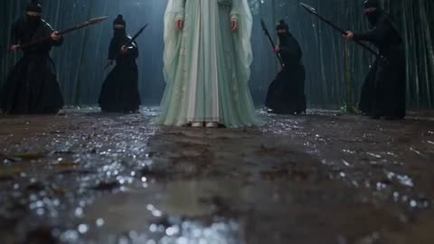
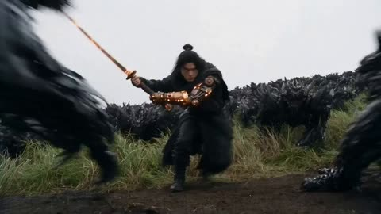
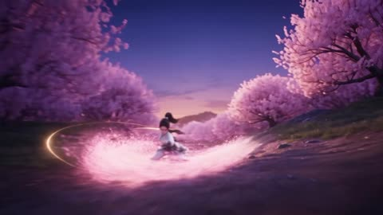
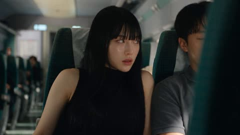
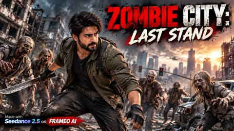
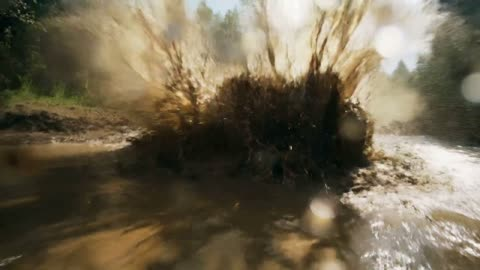

# Action, chases and sports

[Back to the list](../../README.md) · All 242 entries · [1](video-action.md) · [2](video-action-2.md) · [3](video-action-3.md) · **4**

<a id="seedance-wuxia-bamboo-rain-hanfu-duel"></a>
### Wuxia Heroine Surrounded by Assassins in Rain

<a href="https://x.com/Zoyavelle/status/2110235870473461970"></a>

Six timed scenes of 2 to 4 seconds each move from a low-angle tracking shot to a face close-up, a spear thrust, an overhead dodge and a sword fight. The prompt closes with separate style, camera, audio, consistency and negative blocks that keep the outfit and face stable.

Seedance 2.5 · Text-to-video · Source: [@Zoyavelle on X](https://x.com/Zoyavelle/status/2110235870473461970) · found via [LearnPrompt/awesome-seedance](https://github.com/LearnPrompt/awesome-seedance)

[`wuxia`](tags.md#tag-wuxia) [`martial-arts`](tags.md#tag-martial-arts) [`rain`](tags.md#tag-rain) [`multi-shot`](tags.md#tag-multi-shot) [`cinematic`](tags.md#tag-cinematic)

<details><summary><b>Prompt</b></summary>

```text
Create an ultra-realistic, cinematic Chinese Wuxia martial arts action scene set in a dark bamboo forest during heavy rain. A beautiful young East Asian woman with long black hair, delicate facial features, floral hair ornaments, and an elegant flowing pale mint-green traditional Hanfu dress stands calmly surrounded by masked black-clad assassins holding swords and spears.

Scene 1 (0–3 seconds): Low-angle cinematic tracking shot of the woman's flowing silk dress and the muddy forest floor covered in rainwater. Black-clad warriors surround her in a threatening formation. Heavy rain falls continuously, creating realistic splashes and reflections.

Scene 2 (3–6 seconds): Slow camera push-in toward the mysterious woman as she stands fearlessly. Her long wet black hair moves gently in the wind. Assassins approach from the background, holding their weapons ready to attack.

Scene 3 (6–9 seconds): Extreme close-up of her beautiful face, expressive dark eyes, wet eyelashes, and realistic raindrops on her skin. Her expression remains calm, confident, and emotionless. Shallow depth of field, cinematic lighting, highly detailed skin texture.

Scene 4 (9–11 seconds): An assassin thrusts a sharp metal spear toward her face. Extreme close-up of the rain-covered spear blade passing dangerously close to her eyes. Dramatic slow motion, realistic water droplets sliding across the metal, intense suspense.

Scene 5 (11–15 seconds): Dynamic overhead camera shot as the woman suddenly performs an elegant martial arts dodge and spins through the attacking warriors. Her flowing silk sleeves and long hair move naturally with her motion. Smooth camera rotation, realistic sword choreography, cinematic motion blur.

Scene 6 (15–18 seconds): Fast, graceful sword-fighting sequence in the rain. She deflects an incoming weapon with precise movements, pivots sideways, and counters the attackers with fluid Wuxia martial arts techniques. The camera follows her movement with a sweeping tracking shot.

Visual Style: Photorealistic Chinese historical fantasy, premium Wuxia movie cinematography, dark bamboo forest, cold teal and muted green color grading, soft mist, volumetric lighting, realistic heavy rain, detailed wet silk fabric, natural human anatomy, realistic facial expressions, shallow depth of field, 4K cinematic quality, 24fps, dramatic atmosphere.

Camera: Low-angle tracking shots, slow dolly-in, extreme facial close-ups, overhead action shots, dynamic tracking movements, smooth cinematic transitions, controlled slow motion.

Audio: Heavy rainfall, footsteps on wet mud, metallic sword clashes, sharp weapon whooshes, flowing fabric sounds, subtle tense orchestral background music.

Consistency: Maintain the same woman's face, hairstyle, pale mint-green Hanfu outfit, and body proportions throughout the video. Keep all warriors dressed in black traditional assassin clothing. Natural physics, coherent action, realistic weapon movements.

Negative Prompt: Cartoon, anime, CGI appearance, plastic skin, blurry faces, distorted anatomy, extra fingers, extra limbs, duplicate characters, floating weapons, unrealistic fighting, inconsistent clothing, face morphing, flickering, low resolution, oversaturated colors, text, subtitles, watermark.
```

</details>

<a id="seedance-wuxia-fire-sword-shadow-beast-swarm"></a>
### Fire sword warrior against shadow beast swarm

<a href="https://x.com/itsSaira_1/status/2099006619988459985"></a>

A low angle tracking shot opens the prompt, followed by a clear beat sequence: spin and slash, ground shockwave, reticle matrix blast, then a slow motion walk. Concrete VFX cues such as fire arc trails, embers and ash give the action visual detail.

Seedance 2.5 · Text-to-video · Source: [@itsSaira_1 on X](https://x.com/itsSaira_1/status/2099006619988459985) · found via [LearnPrompt/awesome-seedance](https://github.com/LearnPrompt/awesome-seedance)

[`wuxia`](tags.md#tag-wuxia) [`dark-fantasy`](tags.md#tag-dark-fantasy) [`action`](tags.md#tag-action) [`vfx`](tags.md#tag-vfx) [`low-angle`](tags.md#tag-low-angle)

<details><summary><b>Prompt</b></summary>

```text
Cinematic dark fantasy wuxia action scene, low angle dynamic tracking shot. A male warrior in black martial robes and arm guards stands in a tall grass field under an overcast gray sky. He spins dynamically, slashing a glowing fiery sword that leaves arc trails of bright orange fire and sparks. A massive swarm of black shadow beasts charges across the field. He triggers a powerful ground shockwave that blasts dirt, smoke, and embers into the air. A circular matrix of glowing red target reticles and energy lasers shoots outward into the monster swarm. The warrior then rests his blazing sword on his shoulder and walks forward in slow motion through floating embers, smoke, and dissolving black ash. Photorealistic VFX, motion blur, 8k resolution, hyper-detailed.

#ai #AIart️️️️️️️️️️️️️️️️️️️️️️️️️️️️️️️️️️️️️️️️️️️️️️️️️️️
#visualstorytelling #flovaai
#aicreater
#seedance25
```

</details>

<a id="seedance-wuxia-warrior-elemental-battle"></a>
### Warrior woman spins petal vortex in cherry blossoms

<a href="https://x.com/juliaevee/status/2109460837043708104"></a>

The prompt lists four named elemental realms in order, each with its own setting and effect, so the model follows it as a shot list rather than one scene. A fixed costume and a single camera direction (smooth tracking, motion blur) keep the character consistent across the cuts.

Seedance 2.5 · Text-to-video · Source: [@juliaevee on X](https://x.com/juliaevee/status/2109460837043708104)

[`wuxia`](tags.md#tag-wuxia) [`martial-arts`](tags.md#tag-martial-arts) [`elemental`](tags.md#tag-elemental) [`3d-animation`](tags.md#tag-3d-animation)

<details><summary><b>Prompt</b></summary>

```text
Cinematic 3D animation, Wuxia martial arts epic style. A skilled warrior woman with long dark hair in a high ponytail, wearing an elegant white and teal traditional Chinese robe, wields a glowing energy sword. The video features high-energy combat choreography across dramatic elemental realms: starting in a serene valley of pink cherry blossom trees with swirling petal vortexes; transitioning into a stormy, dark night battle against armored soldiers on water with a massive majestic water dragon surge; shifting to a fiery battlefield under a crimson sunset where a giant blazing phoenix bursts into flames; and moving into a frozen, icy cavern where combatants battle around a colossal glowing crystal lotus flower. Smooth camera tracking, dynamic motion blur, dramatic cinematic lighting, photorealistic textures, 4k resolution, fluent and high-fps movement.
```

</details>

<a id="seedance-zombie-apocalypse-train-outbreak"></a>
### Infected woman on train turns passengers into zombies

<a href="https://x.com/doctorwasif/status/2094285140247896553"></a>

Timed beats from 0s to 30s give the model a sequence with one visual change per shot, and the reference face and outfit line keeps the lead consistent through the transformation. Framing words such as close-up, wide and handheld steer each cut so the escalation reads clearly.

Seedance 2.5 · Reference-to-video · Source: [@doctorwasif on X](https://x.com/doctorwasif/status/2094285140247896553)

[`zombie`](tags.md#tag-zombie) [`horror`](tags.md#tag-horror) [`train`](tags.md#tag-train) [`multi-shot`](tags.md#tag-multi-shot)

<details><summary><b>Prompt</b></summary>

```text
Shot 1 (0–1.2s): Character A, matching reference face/outfit, sits beside a passenger on a dim train, feverish, sweating, staring strangely at him.

Shot 2 (1.2–2.4s): Close-up: her trembling hand, faint dark veins appearing, shallow unnatural breathing.

Shot 3 (2.4–3.6s): Her head tilts unnaturally toward him, glassy unfocused eyes, tense profile close-up.

Shot 4 (3.6–4.8s): She suddenly lunges and bites his forearm, teeth breaking skin, his face frozen in shock.

Shot 5 (4.8–6s): Close-up of the wound as dark veins rapidly branch outward, skin blackening.

Shot 6 (6–7.2s): Veins race toward his elbow; skin pales, sweat beads on his forehead.

Shot 7 (7.2–8.5s): His eyes cloud milky white, pupils dilate, breathing becomes wet and ragged.

Shot 8 (8.5–9.7s): His body stiffens and twitches; black veins spread across his neck and jaw.

Shot 9 (9.7–11s): He throws his head back and screams inhumanly, face covered in black veins, slow motion.

Shot 10 (11–12.2s): His head snaps forward; bloodshot empty eyes and slightly unhinged jaw reveal the completed transformation.

Shot 11 (12.2–13.5s): He instantly lunges at another passenger and bites them, sudden violent impact.

Shot 12 (13.5–14.8s): Wider shot: nearby passengers turn, confusion becoming horror.

Shot 13 (14.8–16s): The bitten passenger stumbles back, clutching the wound as dark veins spread up the arm.

Shot 14 (16–17.3s): Passengers rise in panic, grabbing bags and backing away, wide cinematic shot.

Shot 15 (17.3–18.5s): The new victim convulses violently in the aisle as passengers recoil; overhead lights flicker.

Shot 16 (18.5–19.7s): Eyes roll back, then open bloodshot and empty; jaw twitches—the second transformation complete.

Shot 17 (19.7–21s): He lunges at the nearest passenger; screams erupt as the car descends into chaos, handheld camera.

Shot 18 (21–22.5s): Passengers scramble over seats and luggage toward the exit, bags spilling everywhere.

Shot 19 (22.5–24s): A group rushes toward the connecting door, looking back as infection spreads behind them.

Shot 20 (24–25.5s): Door slams shut; survivors barricade it with luggage and cushions as infected hands pound from behind.

Shot 21 (25.5–27.5s): Close-up through the glass: infected faces press against it as cracks spread, emergency lights pulsing.

Shot 22 (27.5–30s): Survivors huddle against the far wall, breathing hard and staring at the shaking door as train lights streak outside, cinematic outbreak ending.
```

</details>

<a id="seedance-zombie-city-machete-last-stand"></a>
### Machete hero fights two zombies in ruined city

<a href="https://x.com/Xaroon_x/status/2116043962465079357"></a>

Three reference images lock the hero, the zombie design and the location, while a timed beat sheet gives one camera direction per segment so the 30 seconds stay readable. The non-graphic violence rule and a closing suspense hook give the clip a clear arc.

Seedance 2.5 · Reference-to-video · Source: [@Xaroon_x on X](https://x.com/Xaroon_x/status/2116043962465079357) · found via [LearnPrompt/awesome-seedance](https://github.com/LearnPrompt/awesome-seedance)

[`zombie`](tags.md#tag-zombie) [`fight`](tags.md#tag-fight) [`reference-images`](tags.md#tag-reference-images) [`multi-shot`](tags.md#tag-multi-shot)

<details><summary><b>Prompt</b></summary>

```text
ZOMBIE CITY: LAST STAND — SEEDANCE 2.5 PROMPT

ENGINE DIRECTIVE: Create exactly 30 seconds of photorealistic Hollywood-style zombie action, 16:9 widescreen, 60fps where supported. Use @image1 for protagonist identity, @image2 for zombie design, and @image3 for the ruined city environment.

CHARACTER CONTINUITY: Preserve @image1's exact face, hairstyle, beard, skin tone, and body structure. Outfit: distressed olive-green field jacket, black shirt, charcoal cargo pants, black gloves, rugged combat boots, crossbody survival bag, and a steel machete. Keep the same appearance throughout.

ZOMBIES — @image2: Two distinct infected humans with pale grey-green decaying skin, cloudy eyes, damaged faces, torn dirty clothing, and aggressive movements. Zombie A wears a ripped grey shirt and dark trousers; Zombie B wears a torn burgundy hoodie and black jeans.

LOCATION — @image3: A devastated downtown street with cracked asphalt, abandoned cars, shattered storefronts, damaged buildings, scattered debris, drifting smoke, and overcast daylight. Maintain consistent geography and lighting.

TIMELINE:

00–03s: Wide cinematic reveal of the ruined city. The protagonist notices two zombies approaching from opposite sides and draws his machete.

03–06s: Zombie A charges. The protagonist dodges its grab and counters with a fast, controlled machete strike. Zombie A collapses.

06–09s: Zombie B rushes from beside an abandoned sedan, attempting to grab and bite the protagonist.

09–12s: Close handheld camera captures the protagonist blocking the attack, breaking free, and pushing Zombie B away.

12–15s: Low-angle tracking shot as Zombie B lunges again. The protagonist dodges and prepares a counterattack.

15–18s: Dynamic side tracking as the protagonist outmaneuvers the zombie on the cracked roadway.

18–21s: Zombie B attacks again. The protagonist pivots, breaks its balance, and forces it to its knees.

21–24s: He delivers a decisive final strike. Zombie B falls motionless. Keep violence non-graphic.

24–27s: The protagonist stands between both defeated zombies, breathing heavily while holding the machete.

27–30s: Close-up of his determined face, followed by a wide reveal of distant zombie silhouettes approaching through the smoky intersection. End on a suspenseful cinematic hook.

AUDIO: Original dark survival-action score, realistic footsteps, zombie snarls, weapon swishes, impacts, wind, distant alarms, and heavy breathing.

QUALITY: Stable identity, consistent wardrobe and weapons, realistic physics, cinematic camera transitions, detailed textures, natural motion blur, synchronized audio, no teleportation, no morphing, no extra limbs, no location changes, and no graphic gore.
```

</details>

<a id="veo-off-road-rally"></a>
### Off-road rally through a river crossing

<a href="https://storage.googleapis.com/gdm-deepmind-com-prod-public/media/media/veo__veo-3__off-road.mp4"></a>

A play-by-play for an 8-second action beat. It also asks for unbranded vehicles, which keeps logos out of the frame.

Veo 3 · Text-to-video · Source: [Veo 3 prompt guide](https://deepmind.google/models/veo/prompt-guide/)

[`veo`](tags.md#tag-veo) [`action`](tags.md#tag-action) [`handheld`](tags.md#tag-handheld) [`sfx`](tags.md#tag-sfx)

<details><summary><b>Prompt</b></summary>

```text
The scene explodes with the raw, visceral, and unpredictable energy of a hardcore off-road rally, captured with a dynamic, almost found-footage or embedded sports documentary aesthetic. The camera is often shaky, seemingly mounted inside one of the vehicles or held by a daring spectator very close to the action, frequently splattered with mud or water, catching unintentional lens flares from the natural, often harsh, sunlight filtering through trees or reflecting off wet surfaces. We are immersed in a challenging, untamed natural environment – perhaps a dense, muddy forest trail, a treacherous rocky incline littered with loose scree, or a series_of shallow, fast-flowing river crossings. Several heavily modified, entirely unidentifiable, and unbranded off-road vehicles are engaged in a frenetic, no-holds-barred race. These are not showroom models; they are custom-built, rugged machines – open-wheeled buggies with exposed engines and prominent roll cages, heavily armored pickup trucks with oversized, knobby tires and snorkel exhausts, their original forms and manufacturers completely obscured by extreme modifications, layers of caked-on mud, and a general air of brutal functionality. The dominant sounds are the deafening, guttural roar of powerful, untamed engines, the whine of transmissions, the percussive impact of suspension bottoming out, and the constant spray of mud and water. Within an 8-second sequence, one of the lead vehicles, a low-slung, open-cockpit buggy so caked in thick, brown mud that its original color is a mystery, approaches a wide, shallow river crossing at incredible speed. Without the slightest hesitation, its unseen driver powers straight into the water. The impact sends an enormous, almost solid, opaque sheet of muddy water, mixed with stones and debris from the riverbed, spectacularly high into the air, completely engulfing the small buggy for a terrifying moment, obscuring it from view as if it has been swallowed by the river itself. Right on its tail, a pursuing, equally mud-encrusted, custom-built truck – a hulking, high-clearance beast with a heavily reinforced external roll cage and no discernible badging – arrives at the river crossing just as this massive wall of airborne water reaches its peak. Instead of slowing or attempting to find a clearer path, the truck's driver, with unwavering aggression, plunges directly into and through this opaque, turbulent curtain of muddy spray at full throttle. A split second later, the truck bursts out from the other side of the deluge, water cascading from its roof and chassis, its oversized windshield wipers struggling frantically to clear the torrent of muddy water obscuring the driver's vision. It lands heavily on the far bank, suspension groaning, but still in hot pursuit of the now-reappearing buggy. This thrilling, messy, and visually spectacular sequence of one vehicle creating a massive environmental obstacle and the next immediately conquering it through sheer force, forms the core, immersive, attention-grabbing event of the 8-second sequence. The race continues with undiminished ferocity, the natural terrain itself an active participant in the conflict.
```

</details>

[1](video-action.md) · [2](video-action-2.md) · [3](video-action-3.md) · **4**
