# Action, chases and sports

[Back to the list](../../README.md) · All 171 entries · **1** · [2](video-action-2.md) · [3](video-action-3.md)

<a id="seedance-seoul-subway-revenge"></a>
### Seoul subway revenge comedy

<a href="https://x.com/AIwithSynthia/status/2108760866422415701"></a>

Sets the camera language in the first line (handheld, fluorescent, real time), then plays the gag in clear beats and spells out what must stay visible at the end.

Seedance 2.5 · Text-to-video · Source: [@AIwithSynthia on X](https://x.com/AIwithSynthia/status/2108760866422415701) · 10,056 likes on 2026-10-27

[`action`](tags.md#tag-action) [`comedy`](tags.md#tag-comedy) [`handheld`](tags.md#tag-handheld) [`subtitles`](tags.md#tag-subtitles)

<details><summary><b>Prompt</b></summary>

```text
Create a live-action cinematic revenge-comedy video set in a Seoul subway station. Use realistic handheld camera movement, cold fluorescent lighting, teal-green accents, and real-time action.

A Korean woman in her 20s with a black bob, sunglasses on her head, a fitted crop top, high-waisted blue jeans, black boots, and a brown shoulder bag descends the subway stairs holding a takeaway coffee. A Korean man with messy dark hair and blonde tips, wearing a dark-green bomber jacket, suddenly hits her from behind and laughs as she stumbles against the handrail. Furious, she chases him onto the platform as he boards a train and mocks her through the closing glass doors.

She punches the glass, creating a dramatic crack and opening. As she confronts him, her coffee cup slips from her hand, falls to the platform, and spills visibly across the floor. She grabs his jacket, forcefully throws him through the air, and sends him crashing into a large metal rubbish bin. The bin rattles and wobbles as he lands inside, looking terrified and humiliated.

She leans toward him and says, "Don't mess around." She then calmly walks away while he remains stuck in the bin.

Maintain identical faces, hairstyles, outfits, and location throughout. Include realistic physics, expressive reactions, cinematic close-ups, subway ambience, and clear white subtitles. Keep the action non-gory, the coffee spill visible, and the final dustbin landing unmistakable.
```

</details>

<a id="kling-basketball-backflip-dunk-court"></a>
### Basketball player backflip dunk on outdoor court

<a href="https://x.com/higgsfield_ai/status/2019083976682684558"></a>

The prompt splits one action into four numbered shots (dribble, jump, mid-air flip, dunk), each with its own shot size and angle. Low angles and a slow-motion close-up on the flip give Kling's physics a clear beat to simulate.

Kling 3.0 · Text-to-video · Source: [@higgsfield_ai on X](https://x.com/higgsfield_ai/status/2019083976682684558) · 2,533 likes on 2026-10-27

[`multi-shot`](tags.md#tag-multi-shot) [`sports`](tags.md#tag-sports) [`basketball`](tags.md#tag-basketball) [`low-angle`](tags.md#tag-low-angle) [`physics`](tags.md#tag-physics)

<details><summary><b>Prompt</b></summary>

```text
Shot 1: A side profile, medium shot of a muscular African American man in athletic wear, intensely dribbling a basketball on an outdoor concrete court towards a hoop against a high white wall under a bright blue sky.
Shot 2: A dynamic, low-angle wide shot showing the man jumping remarkably high into the air, performing a backflip while holding the basketball, with the white wall and sky in the background.
Shot 3: A close-up, slow-motion shot of the man mid-air and upside down during his flip, showing his focused expression and the basketball held firmly in his hands against the sky.
Shot 4: A dramatic, low-angle shot focusing on the basketball hoop as the man, still upside down from his acrobatic jump, powerfully dunks the ball into the net.
```

</details>

<a id="kling-night-courtyard-katana-six-shots"></a>
### Woman slices wooden dummy in night courtyard

<a href="https://x.com/higgsfield_ai/status/2019104313302569185"></a>

Six numbered shots, each with its own framing, move a single scene from a macro mouth detail through wide action to a closing portrait. Naming the camera angle and the physical effect per shot, such as flying wood splinters and dust, gives the model clear impact beats.

Kling 3.0 · Text-to-video · Source: [@higgsfield_ai on X](https://x.com/higgsfield_ai/status/2019104313302569185) · 2,473 likes on 2026-10-27

[`multi-shot`](tags.md#tag-multi-shot) [`action`](tags.md#tag-action) [`katana`](tags.md#tag-katana) [`macro`](tags.md#tag-macro) [`night`](tags.md#tag-night)

<details><summary><b>Prompt</b></summary>

```text
Shot 1: An extreme close-up of a young woman's mouth, her teeth clenched on a wooden toothpick, creating a tense and gritty atmosphere.
Shot 2: A medium shot of the woman in a traditional Japanese-style courtyard at night, illuminated by soft lanterns. She is dressed in a white tank top and dark trousers, holding a katana in a defensive stance with a determined look on her face.
Shot 3: A dynamic, low-angle action shot of the woman jumping high into the air, raising her katana to strike a wooden training dummy that resembles a samurai in armor.
Shot 4: A close-up, high-speed impact shot showing the woman’s katana slicing through the wooden dummy, sending wood splinters and dust flying into the air.
Shot 5: A fast-paced tracking shot of the woman landing gracefully and immediately striking another wooden structure, demonstrating her speed and precision.
Shot 6: A final medium close-up of the woman’s face as she finishes her move. She is slightly breathless, her hair disheveled, with a sharp, focused gaze directed off-camera.
```

</details>

<a id="seedance-anime-rooftop-brawl-kinetic-fight"></a>
### Two Anime Fighters Brawl on Rooftop

<a href="https://x.com/aimikoda/status/2111824828009193814"></a>

Character reference blocks lock each fighter's outfit, then a style and energy header sets cel shading, impact frames and constant camera motion. A four shot list gives each shot its own camera path and a chain of strikes with no pauses, and an Avoid line bans slow motion and freeze frames.

Seedance 2.5 · Reference-to-video · Source: [@aimikoda on X](https://x.com/aimikoda/status/2111824828009193814) · 1,962 likes on 2026-10-27

[`anime`](tags.md#tag-anime) [`fight-scene`](tags.md#tag-fight-scene) [`multi-shot`](tags.md#tag-multi-shot) [`camera-movement`](tags.md#tag-camera-movement) [`character-reference`](tags.md#tag-character-reference)

<details><summary><b>Prompt</b></summary>

```text
References:
@[char1 ref]: Mina. Long black hair, green striped crop top, baggy orange cargo pants with black graffiti, white sneakers, black fingerless boxing gloves on both hands, chain bracelet.
@[char2 ref]: Rue. Long pink hair, black crop top, black cargo shorts with chains and tags, bare knuckles with silver rings, skin visible on both hands, chunky lime sneakers, dog tag necklace.

Visual style: High-sakuga flat-color 2D anime, bold linework, hard cel shading, flat blue and teal backgrounds that flash hot pink or orange on impact, speed smears, impact frames, deep foreshortening.

Energy: Within every shot the camera keeps moving: it spirals around crossing limbs, dives under kicks, skims the floor, and whips between faces, often following a fist or a sole within inches of the lens. Every movement flows straight into the next strike, block, or counter. Every landed hit plays as sakuga impact: a two-frame impact frame, then the struck body whips away in a long smear, elastic recoil, immediate re-entry into her own attack. Heads snap, torsos fold, feet leave the ground, bodies skid across concrete. Each impact throws a color flash, dust, flying hair and cloth, and radiating speed lines.

Avoid: No subtitles. No slow motion, no idle posing, no pauses between actions, no freeze frames, no held two-shots.

Mina and Rue trade one relentless brawl on an empty concrete rooftop with a chain-link fence at the back and a steel vent box at center right. Mina starts screen left, Rue screen right. Whenever they close, one body is nearer the camera and the other clearly behind it with air between. No dialogue; hits, shoe scuffs, chain rattle, wind. Shot list: 4 shots, about 30 seconds, every shot packed edge to edge with exchanges.

Scene 1: 连续时间，天台。
Shot 1: 大全景起，地面高度，低角度；镜头从水泥地面猛然升起，穿过两名已经腾空扑向对方的格斗者之间，然后贴着Mina的拳套甩进中景，并绕着两人交错的手臂急速环绕。Mina的右勾拳与Rue抬起的膝盖在半空撞上，冲击帧，两人同时被震成拖影向后飞开，滑步落地的瞬间已经再次扑上；Mina左直拳，Rue下潜躲过并打出上勾拳，Mina用前臂接住，前臂被顶上自己的下巴，头向后一甩成拖影，她借着仰头的势头打出一记一二连击，第二拳砸开Rue的防守，冲击帧，Rue的头横向甩出，粉发拉成一道弧，她踉跄一步就从踉跄里踢出正蹬，踢中Mina的拳套，把Mina推得双脚在地上滑出一道痕。快速细节切：Rue眯起的眼睛，Mina收紧的拳套，狗牌甩动，然后镜头钻到Rue旋踢的下方。Rue的脚跟掠过Mina低下的头顶，Mina从内侧起身的身体勾拳把Rue整个人折弯在拳套上，冲击帧，Rue的双脚离地，她顺着折弯的势头甩出肘击，Mina双拳套挡住，拳套却被顶进自己的脸，她向后踉跄两步，Rue追上来一记戴戒指的直拳擦着镜头砸过，Mina侧滑，把一记短右拳埋进Rue的肋部，冲击帧，Rue半边身体塌陷成拖影，双脚在地面打滑，她就从打滑里顶出一膝，砸在拳套上，把Mina的胳膊震到自己胸口。

Shot 2: 跟拍起，位于Rue身后腰部高度；镜头随她冲向铁丝网，沿着网向上扫，在她蹬离时翻转，然后落到地面高度，贴着天台地面疾驰穿过两人相撞的缝隙。Rue推开Mina的胸口转身冲向铁丝网，在网上蹬两步，蹬离，后空翻越过从下方冲进来的Mina，落下的膝盖砸中Mina的肩膀，冲击帧，Mina被砸成一个拖影般的前滚翻，从翻滚里起身时顺势扫向Rue落地的那条腿，Rue跳过扫踢，撑手后空翻，落地时Mina的直拳已经到了，Rue格挡，格挡把她自己的手臂震开，Mina的第二拳穿过空档擦中她的太阳穴，冲击帧，Rue半转过身，粉发横扫镜头。快速细节切：荧光绿鞋底填满镜头，橙色工装布料猛甩，铁丝网剧烈震颤，然后镜头贴地。两人再次相撞：Mina低身滑过Rue的飞跃拳，两人在另一侧旋转成背对背，同一瞬间各踢出一记后蹬，鞋底对撞，冲击帧，两人都被踢得向前扑倒撑地，撑起后同时转身甩出旋转背拳，拳套撞上指节，粉色闪光，两人的头各自甩向一侧成拖影，Rue先回过身勾住Mina的腿，Mina跳脱的同时抡出过顶拳，擦过Rue的太阳穴，把她打得转了半圈，Rue转完这半圈的势头直接变成一记反手肘，砸在Mina的肩上，Mina的肩膀被压得一沉。

Shot 3: 高角度俯冲起；镜头向通风箱俯冲，压低绕到箱侧，然后在两张脸之间左右急甩，每一拳都跟着拳头从一张脸甩到另一张脸。Mina，戴黑拳套，跃上通风箱，膝盖朝下砸落；Rue，赤手戴戒指，侧步闪开，一记侧踢踹进箱体，箱体轰然凹陷；Mina从压扁的边缘跃起打出飞身直拳，Rue后仰躲过，扫掉Mina的支撑手臂，Mina侧手翻落地的同时勾拳打中Rue的下颌，冲击帧，Rue的头甩过去，整个人被带得转了半圈，脚步踉跄，又从踉跄里反扑一记直拳，震得Mina的下巴一晃。快速细节切：弯折的金属，断裂的电缆冒着火花，拳套在箱顶打滑，然后镜头切进两张脸之间。隔着废墟的近身对轰：刺拳，格挡，直拳，侧闪，没有一拳停在半路；Rue的膝盖顶进Mina垂下的拳套，把她推退一步；Mina的头槌砸在Rue的眉骨上，冲击帧，Rue的头向后甩成拖影，她的身体先于意识反击，戴戒指的勾拳打在Mina的拳套上；Mina的反击肘撞上Rue的脸颊，冲击帧，粉发炸开，Rue踉跄两步，膝盖一软又撑住，从撑住的那一下里直拳回敬，打得Mina的头偏过去，Mina的头偏到一半就已经转回来，两人同时下蹲。

Shot 4: 高角度大全景起，倾斜成荷兰角；镜头在两人跃起时螺旋下降，在最高点从两人之间穿过，再翻到两人侧面，并在两人上升时继续旋转。两人同时向上爆发，拳头在前，Mina的黑拳套与Rue戴戒指的拳头冲向画面中央同一点，头发向后飞扬成拖影，速度线向中心汇聚，拳头进入触及范围的瞬间背景炸成全屏亮粉色；拳头仍在逼近，头发仍在甩动，镜头仍在旋转，画面在此切断。
```

</details>

<a id="seedance-desert-warrior-reaper-fight"></a>
### Masked warrior fights scythe reaper in desert dust

<a href="https://x.com/techhalla/status/2090568539325317401"></a>

Two image references lock the reaper and the warrior character sheet, then a timed shot list from 0 to 30 seconds names a camera move and a clear action beat for each segment. A shared style block of anamorphic lens, haze and particle physics keeps the look consistent across the cuts.

Seedance 2.5 · Reference-to-video · Source: [@techhalla on X](https://x.com/techhalla/status/2090568539325317401) · 882 likes on 2026-10-27

[`action`](tags.md#tag-action) [`fight-scene`](tags.md#tag-fight-scene) [`multi-shot`](tags.md#tag-multi-shot) [`character-consistency`](tags.md#tag-character-consistency) [`desert`](tags.md#tag-desert)

<details><summary><b>Prompt</b></summary>

```text
I've used 2 image refs as the only reference for this one (both made on MJ), along with this prompt:

Hyper-kinetic desert combat spectacle, extreme high-intensity CGI action, thick volumetric cinematic haze and golden-hour dust storms, aggressive anamorphic 35mm lens with heavy motion blur, relentless handheld tracking and whip pans, deep shadows, heat distortion, ultra-realistic particle systems.

Use the first provided image as exact reference for the ethereal dark reaper silhouette, flowing tattered robes, skull-scythe and arid desert environment. Use the second multi-view character sheet as exact appearance lock for the muscular tribal warrior (mask, red cape, yellow tattered bone-adorned skirt, dreadlocks, scarred body, barefoot).

0-4s: [Extreme Wide Crash-In] Instant violent collision. Warrior explodes forward through dense dust cloud, red cape whipping. Reaper swings massive scythe in wide horizontal arc. Impact detonates shockwave of sand and embers. No pause.

4-8s: [Dynamic Low Tracking] Rapid exchange. Warrior ducks under scythe, delivers spinning elbow to reaper’s ribs, then upward knee. Reaper phases partially, reforms mid-strike, counters with spectral claw rake across warrior’s chest. Fabric and ash particles explode outward.

8-13s: [Orbiting Medium + Dutch Angle] Acrobatic mid-air clash. Warrior vaults off scythe shaft, red cape fully extended, lands dual-fist hammer blow to reaper’s hood. Reaper retaliates with vertical scythe slam that cracks the ground; warrior rolls, rises into spinning back-kick that shreds more robe into black ribbons.

13-18s: [Handheld Close Combat Frenzy] Brutal ground scramble. Warrior grapples the scythe pole, headbutts the mask, then rips free and unleashes three distinct strikes: upward palm, horizontal elbow, downward axe-kick. Reaper absorbs then unleashes tendril-whip of shadow that lashes warrior’s back, drawing blood and dust.

18-23s: [Slow-Motion Impact Montage] Escalating power. Warrior catches scythe mid-swing, twists, drives knee into reaper’s midsection twice, then spinning heel kick that sends the figure airborne. Reaper crashes down in explosion of ash and sand, robes half-dissolved. Warrior advances without mercy.

23-28s: [Wide to Tight Push-In] Finishing sequence. Warrior seizes the collapsing reaper by the remaining hood, delivers a savage rising uppercut followed by a final two-handed overhead smash. Reaper’s entire form shatters into swirling black ash and ember particles that scatter across the desert floor. Warrior stands over the dissipating cloud, breathing hard.

28-30s: [Hard Cut Reverse Extreme Close-Up] Blurred warrior fills foreground, chest heaving, sweat and dust streaking his mask, mouth open in ragged breath. Sharp deep background: the dark figure slowly reconstitutes from residual ash, scythe reforming in hand, rising and stalking forward with predatory stillness.

Photorealistic, ultra-detailed fabric physics and particle simulation, perfect motion blur, volumetric haze at maximum density, coherent anatomy and proportions, stable character consistency, cinematic color grade, movie-level VFX polish.

Hope you like it! 🫡
```

</details>

<a id="seedance-painted-flame-karate-kata-void"></a>
### Painted Flame Karate Kata in Blue Void

<a href="https://x.com/aimikoda/status/2110119492076404869"></a>

Two labeled references split identity from body, costume and effects, and a sixteen shot timeline gives each cut a time range, camera move and technique. Sound cues are tied to the cuts and an avoid list keeps the painted look free of glossy CG fire.

Seedance 2.5 · Reference-to-video · Source: [@aimikoda on X](https://x.com/aimikoda/status/2110119492076404869) · 802 likes on 2026-10-27

[`martial-arts`](tags.md#tag-martial-arts) [`painterly`](tags.md#tag-painterly) [`multi-shot`](tags.md#tag-multi-shot) [`vertical`](tags.md#tag-vertical) [`sound-design`](tags.md#tag-sound-design)

<details><summary><b>Prompt</b></summary>

```text
References:
@[ref1]: The martial artist's face. Identity, dark tousled hair, eyes, and the look of the painted flame around her open hand.
@[ref2]: Her body, costume, setting, and effects. Pale pink short-sleeve top, red wrist wraps and red sash, dark loose trousers, her low kneeling stance, the misty blue void with its dark floor, the looping pink ribbon arcs, and the spark burst.

Visual style: Painterly digital illustration in motion: thick, loose brushstrokes and palette-knife texture, deep blue-teal shadows and haze, figures built from broad painted planes. Every effect is painted, not rendered: flame-like ribbons of orange, hot pink, and violet with white-hot cores, exactly as in @[ref1] and @[ref2].

Avoid: No subtitles. No background music. No clean 3D particle fire, glossy CG effects, or lens-flare glare. No weapons or opponents.

A solo karate kata in a misty blue void, where painted flame grows with every strike and ends in an explosive palm strike into the floor. Vertical 9:16 frame, real-time speed except one brief speed ramp at the final impact. She performs toward screen right, faces screen left after her turn, and faces the lens for the finale; the camera stays on the same side of her line. The flame starts in her right hand; after the first punch it ignites on whichever limb strikes, and each technique leaves its own shape. Warm colors stay on the effects; the setting stays blue-teal. Crackling flame, sharp whooshes, foot stamps, cloth snaps, breath, one kiai, and heavy impact thuds land on the cuts.

Scene 1: Continuous, the misty blue void, its dark floor dusted pale blue.
Shot 1 (0-2s): [Extreme close-up on her eyes, slow push in] Stillness. A single ember drifts across her face as she breathes in. Cut on a sharp inhale.
Shot 2 (2-4s): [Close-up on her right hand, low angle, quick push toward the lens] Her open right hand thrusts at the lens in teisho-uchi, fingers spread as in @[ref1]. Painted flame ignites in the palm and curls up her forearm. Cut as the flame flares.

Scene 2: Continuous, the first form.
Shot 3 (4-6s): [Low wide, fast lateral track] She steps into zenkutsu-dachi and drives a right oi-zuki toward screen right; the flame stretches behind her fist in one long straight ribbon. Cut as the punch locks out.
Shot 4 (6-7s): [Tight side view at waist height] A left gyaku-zuki snaps out past the retracting right fist, and the flame catches on her left fist too. Cut as it locks out.
Shot 5 (7-9s): [Medium, camera whipping around to face her] Her right mae-geri kicks straight at the lens, flame fanning off the foot in a short burst. Cut as the kick retracts.
Shot 6 (9-10s): [Ground level, close on her feet] The kicking foot stamps down, throwing a ring of pale blue dust and orange sparks. Cut as she pivots.
Shot 7 (10-13s): [Orbiting camera with a whip pan] She turns 180 degrees through a right, then left shuto-uke, and her burning hands wrap her in looping pink ribbon arcs as in @[ref2]. She now faces screen left. Cut as the arcs close.

Scene 3: Continuous, the pause and the escalation.
Shot 8 (13-15s): [Low frontal medium, locked] She sinks into kiba-dachi, both fists drawn to her hips. The flames shrink into tight glowing cores in her fists and the dust settles; only her breath is heard. Cut on a sharp exhale.
Shot 9 (15-16s): [Snap zoom into her face] Her kiai rings out, flame reflected in her eyes, hair whipping. Cut at the peak of the shout.
Shot 10 (16-18s): [Low wide] She explodes into ushiro-mawashi-geri, the burning heel drawing one full ring of fire around her. Cut as the ring closes.
Shot 11 (18-19s): [Close tracking on her right fist] An uraken-uchi snaps through the frame toward screen left, its trail cracking like a whip. Cut on the snap.
Shot 12 (19-20s): [Medium from behind her shoulder] Her right empi-uchi drives toward screen left, a short burst flaring off the elbow. Cut as the elbow locks.
Shot 13 (20-22s): [Low angle, camera rising] She crouches and launches into nidan-geri, a spiral of flame climbing around her through both kicks. Cut at the apex.

Scene 4: Continuous, the finale.
Shot 14 (22-24s): [High angle, camera diving down with her] She descends from the apex, turning to face the lens, and drops onto one knee, right palm driving toward the floor. Cut just before contact.
Shot 15 (24-25s): [Ground-level close-up] Her right teisho-uchi hits the floor: a white-hot core flashes and erupts into orange sparks, pink paint flecks, and lifted blue dust, as in @[ref2], with a brief speed ramp at contact. Cut at the peak of the burst.
Shot 16 (25-30s): [Low frontal wide, slow push in to medium] She holds the low kneeling stance from @[ref2] as the burst's ribbons settle into drifting embers and fade. She raises her eyes to the lens and holds.
```

</details>

<a id="veo-golf-ball-tracking-storm-cliff"></a>
### Golfer on stormy cliff, camera tracks ball

<a href="https://x.com/Dheepanratnam/status/2032810971140420073"></a>

The prompt runs as a beat by beat sequence: swing, camera locks onto the ball, approach, then an extreme close up at the cup. It states the tracking behavior outright, with the ball sharp and centered while the background streaks, and adds sound cues like the crack of the club and howling wind.

Veo 3.1 · Text-to-video · Source: [@Dheepanratnam on X](https://x.com/Dheepanratnam/status/2032810971140420073) · 666 likes on 2026-10-27

[`sports`](tags.md#tag-sports) [`tracking-shot`](tags.md#tag-tracking-shot) [`storm`](tags.md#tag-storm) [`physics`](tags.md#tag-physics) [`ball-pov`](tags.md#tag-ball-pov)

<details><summary><b>Prompt</b></summary>

```text
video 1 - veo3.1
video 2 - Sora 2

"A dramatic sports sequence begins on a lush, windswept coastal cliff during a violent rainstorm. A golfer in bright yellow rain gear stands on the tee box, gripping a driver. His stance is planted firmly, eyes locked on a distant green across a churning ocean cove.

As he swings, the clubhead connects with a resounding crack, launching the dimpled white ball into the stormy sky. The camera immediately accelerates and locks onto the golf ball mid-flight.

The camera tracks directly behind the spinning sphere, maintaining perfect alignment as it cuts through the driving rain. The ocean waves and dark clouds become a streaking motion blur while the ball remains sharp and centered.

The howling wind roars as the projectile travels straight and true. The manicured green grows rapidly larger. In the final seconds, the camera closes in tightly as the ball strikes the turf. End on an extreme close-up of the ball ripping through the wet grass, throwing up a spray of dirt before dropping perfectly into the cup."
```

</details>

<a id="kling-paper-bag-locked-tracking"></a>
### Low angle tracking shot locked on paper bag

<a href="https://x.com/higgsfield_ai/status/2019304424297177558"></a>

The prompt names one anchor object and states that the camera is rigidly locked to it, so the subject stays centered while the background streams past. Concrete motion and texture cues such as pumping arm, whitening knuckles and vibrating paper tie the subject's movement to the shot.

Kling 3.0 · Text-to-video · Source: [@higgsfield_ai on X](https://x.com/higgsfield_ai/status/2019304424297177558) · 554 likes on 2026-10-27

[`tracking-shot`](tags.md#tag-tracking-shot) [`locked-camera`](tags.md#tag-locked-camera) [`low-angle`](tags.md#tag-low-angle) [`wide-angle`](tags.md#tag-wide-angle) [`action`](tags.md#tag-action)

<details><summary><b>Prompt</b></summary>

```text
Low-angle wide-angle tracking shot focused on a crumpled brown paper bag held tightly in a man’s hand. The camera is rigidly locked to the bag with precise tracking — the bag stays centered and stable while the world rushes past. The man is running away from someone, sprinting forward; his arm pumps hard, aggressive vertical and lateral motion transferred directly to the bag. Strong grip, whitening knuckles, paper creasing and vibrating from speed.
```

</details>

<a id="seedance-anime-rooftop-four-shot-brawl"></a>
### Four-shot anime rooftop fight between two women

<a href="https://www.reddit.com/r/Seedance_AI/comments/1x97lk3/seedance_25_anime_fight_prompt_a_fourshot_rooftop"></a>

Fixes each fighter's outfit and hand accessories in a character reference block, then splits 30 seconds into four timed shots. Each shot gives one camera move and a chain of strike, recoil and counter, and the audio line names impacts, scuffs, chains and wind.

Seedance 2.5 · Text-to-video · Source: [u/Fresh-Resolution182 on Reddit](https://www.reddit.com/r/Seedance_AI/comments/1x97lk3/seedance_25_anime_fight_prompt_a_fourshot_rooftop) · 530 likes on 2026-10-28

[`anime`](tags.md#tag-anime) [`fight-scene`](tags.md#tag-fight-scene) [`multi-shot`](tags.md#tag-multi-shot) [`camera-movement`](tags.md#tag-camera-movement) [`cel-shading`](tags.md#tag-cel-shading)

<details><summary><b>Prompt</b></summary>

```text
Create a 30-second, four-shot 2D anime fight between two adult women. Bold outlines, flat colors, hard cel shading, deep foreshortening, speed smears, and brief two-frame impact drawings. Blue-teal backgrounds flash pink or orange on contact.

Character references

Mina: long black hair, green striped crop top, orange graffiti cargo pants, white sneakers, black fingerless boxing gloves, chain bracelet.

Rue: long pink hair, black crop top, black cargo shorts with chains, bare hands with silver rings, lime sneakers, dog tags.

Keep their identities, outfits, and hand accessories distinct throughout.

Location: empty concrete rooftop, rear chain-link fence, steel vent at center-right. Mina begins left, Rue right. Maintain readable spacing, depth, and movement.

0–8s — Opening exchange
Rise from floor level between their opening attacks, then orbit around crossing arms. Mina throws a hook; Rue blocks and counters. A straight punch breaks the guard, followed by a push kick that sends Mina sliding into her next approach.

8–16s — Fence rebound
Track Rue toward the fence. She rebounds over Mina, who rolls through the landing attack and answers with a sweep. Drop the camera low as both recover, turn, and exchange kicks.

16–24s — Vent-box clash
Dive toward the vent as Mina attacks from above. Rue evades and dents the metal with a kick. Continue around the damaged vent through a compact sequence of strikes, blocks, and counters.

24–30s — Final collision
Both launch upward. Spiral downward, pass between them, and rotate to a side view as their fists converge. The background flashes hot pink. Cut just before contact, with both fighters and camera still moving.

Use continuous camera movement within each shot. Every impact has direction, recoil, and recovery. No slow motion, extended holds, idle poses, dialogue, subtitles, or gore. Audio: impacts, shoe scuffs, rattling chains, and rooftop wind.
```

</details>

<a id="seedance-kitchen-fight"></a>
### Woman fights three men in a restaurant kitchen

<a href="https://x.com/Alina_with_Ai/status/2113816556140675163"></a>

Ten seconds of fight choreography with the grade and camera fixed up front and a sound list at the end, no music.

Seedance 2.5 · Text-to-video · Source: [@Alina_with_Ai on X](https://x.com/Alina_with_Ai/status/2113816556140675163) · 514 likes on 2026-10-27

[`action`](tags.md#tag-action) [`martial-arts`](tags.md#tag-martial-arts) [`sfx`](tags.md#tag-sfx)

<details><summary><b>Prompt</b></summary>

```text
Cinematic live-action martial arts fight, 10 seconds, wide 16:9, handheld camera with fast whip-pans and slight shake, gritty high-contrast grade with warm brown tile floor and cool steel tones, motion blur on strikes, realistic physics.

Setting: a busy professional restaurant kitchen. Brown quarry-tile floor with black rubber mats, stainless steel prep tables, a rolling rack of fresh vegetables (carrots, greens, red tomatoes), copper pots hanging from a ceiling rail that swing with every impact, gas range and hood, steel refrigerators, wooden produce crates stacked against a white-tiled back wall. In the far background, chefs in white uniforms keep working.

Characters: a young woman with dark hair tied back, grey button-up work shirt with sleeves pushed up and black pants and black boots. She fights 3 men in grey shirts and black aprons (one bearded, one heavyset, one Asian man with short hair), all trying to attack her, one wielding a kitchen knife.

0-1s: She dodges a swinging punch from the bearded man, then blocks the heavyset man's arm with a crossed-arm block, copper pots swaying above.
1-2s: She drops into a low lunge and kicks, sending the man flipping backward over the stainless prep table, legs in the air.
2-3s: She spins toward the next man by the cutting board with vegetables, camera whip-pans with motion blur.
3-4s: She throws a high side kick that knocks a knife aside as a man raises it overhead, third man stepping in behind.
4-5s: Camera cuts wider: she lands a spinning back kick, a man crashes to the floor, wooden crates and papers on the wall behind.
5-6s: She leaps high in the air in a flying kick pose against the white wall, whole body visible.
6-7s: She lands in a ready stance, focused and breathing hard, two men lying defeated on the floor behind the crates, spilled apples on the ground, a knife visible in the background.
7-8s: A man in a grey shirt charges, she counters with a sharp fist strike.
8-10s: Tight shot over her shoulder, a man with a knife lunges at her from the right, copper pots overhead, she steps in to meet him.

Sound: impact thuds, fabric whooshes, shoes squeaking on tile, clattering pots and crates, kitchen ambience, no music.
```

</details>

<a id="wan-livestream-snapper-precision-gun-gameplay"></a>
### Livestream FPS gameplay in an industrial facility

<a href="https://x.com/Inshrah_ali_/status/2104256509077328333">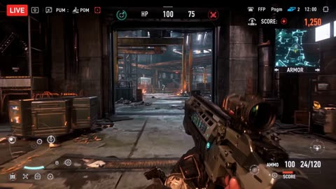</a>

Timed beats from 0 to 6 sec, 6 to 12 sec and onward give the model a shot-by-shot structure, and exact HUD values make the interface checkable. Asking for playable gameplay rather than a trailer keeps the camera and HUD grounded.

Wan 3.0 · Text-to-video · Source: [@Inshrah_ali_ on X](https://x.com/Inshrah_ali_/status/2104256509077328333) · 466 likes on 2026-10-29

[`livestream`](tags.md#tag-livestream) [`fps`](tags.md#tag-fps) [`hud`](tags.md#tag-hud) [`first-person`](tags.md#tag-first-person) [`gameplay`](tags.md#tag-gameplay)

<details><summary><b>Prompt</b></summary>

```text
Create a 30-second ultra-realistic AAA third-person/first-person hybrid livestream gameplay video, 16:9, 4K, resembling an actual professional competitive game being livestreamed. The game is an original tactical snapping/shooting game with a futuristic precision weapon. Make everything feel like real playable gameplay, not a cinematic trailer.

GAMEPLAY STYLE: Unreal Engine 5 quality, realistic physics, responsive controls, detailed environments, professional streamer HUD, weapon animations, hit feedback, minimap, ammo counter, health/armor, objective tracker, kill feed, crosshair, score, ping/FPS indicators, and livestream overlay.

PLAYER: Professional gamer controlling a futuristic Snapper Precision Gun capable of switching between normal direct targeting, optical lens targeting, and microscopic ultra-precision targeting.

0–6 SEC — DIRECT SNAP

The player moves through an abandoned industrial facility while enemies appear from different directions.
Quick camera movement → player raises the Snapper Gun → direct hip/shoulder aim → rapid precision shots eliminate two enemy targets.
HUD instantly updates the score and kill feed.

ON-SCREEN: ENEMIES: 6 | AMMO: 24/120 | HP: 100 | ARMOR: 75 | SCORE: 1,250

6–12 SEC — OPTICAL LENS MODE

The player spots an enemy far across the facility.
Weapon switches into high-powered optical lens mode. Screen smoothly transitions into a realistic scope view with lens reflections, distance marker, wind indicator, rangefinder and moving reticle.

The player tracks the enemy through the lens → precise shot → enemy drops behind cover.

HUD: OPTICAL MODE | RANGE: 187M | ACCURACY: 94%

12–19 SEC — MICROSCOPIC SNAP MODE

The player discovers a tiny exposed component on an enemy's futuristic shield.
Activate Microscope Snap Mode. The screen dramatically magnifies the target, showing an extremely detailed microscopic targeting interface.

The reticle locks onto the tiny weak point → satisfying precision snap → shield breaks → enemy becomes vulnerable.

HUD: MICRO SNAP LOCKED | WEAK POINT DETECTED | +500

19–25 SEC — RAPID COMBAT

Three enemies rush the player from different angles.
The player instantly switches back to direct mode, slides behind cover, leans out and performs fast precision snaps.

Add realistic muzzle flashes, recoil, shell/effect particles, impact sparks, environmental destruction and smooth weapon animations.

KILL FEED:
PLAYER — PRECISION SNAP — ENEMY
PLAYER — HEADSHOT — ENEMY

25–30 SEC — FINAL TARGET

Only one enemy remains. The player runs upstairs while the enemy escapes through a narrow corridor.

Switch between direct view → optical lens → microscope precision mode in one fluid sequence.

The microscopic reticle locks onto a tiny glowing weak point.
FINAL SNAP.

The screen displays:

TARGET ELIMINATED
MISSION COMPLETE
PRECISION: 97%
TOTAL SCORE: 4,850

End with the professional livestream interface still visible, including LIVE indicator, viewer count, chat panel, FPS, ping, minimap, health, armor, ammo, objective tracker, kill feed and weapon status.

IMPORTANT: Everything must look like a polished real AAA game: consistent speed, realistic movement, accurate weapon animations, responsive HUD, professional UI, natural camera motion, synchronized sound effects, realistic lighting and shadows, no glitches, no floating objects, no random UI elements, no copyrighted game interface, and no text appearing except intentional game HUD/livestream elements.

5 best caption also add now creating these Livestream video games through wan 3.0 on budgetpixel is so easy
```

</details>

<a id="kling-hotel-corridor-neon-fight"></a>
### Hotel corridor fight under red neon lights

<a href="https://x.com/higgsfield_ai/status/2019272810838061122"></a>

The prompt sets the location and lighting first, then lists the action beats in order: stance, entrance from the right, block, grab, knee strike, push to the wall. A closing camera line asks for a steady tracking move that follows the action.

Kling 3.0 · Text-to-video · Source: [@higgsfield_ai on X](https://x.com/higgsfield_ai/status/2019272810838061122) · 445 likes on 2026-10-27

[`action`](tags.md#tag-action) [`fight-scene`](tags.md#tag-fight-scene) [`neon`](tags.md#tag-neon) [`tracking-shot`](tags.md#tag-tracking-shot) [`multi-character`](tags.md#tag-multi-character)

<details><summary><b>Prompt</b></summary>

```text
A gritty, cinematic fight scene in a modern, dimly lit hotel corridor with grey concrete walls and dark wooden doors. The scene is illuminated by glowing red vertical neon lights.

A man in a white dress shirt and black trousers is in a defensive stance over a person lying on the floor. Suddenly, an attacker enters from the right, swinging a wooden baseball bat. The man in the white shirt quickly blocks the strike, grabs the attacker, and delivers a powerful knee strike to the midsection before pushing him back against the wall. The camera follows the movement with a steady, high-tension tracking motion.
```

</details>

<a id="h3-samurai-soul-giant-battle-desert"></a>
### Samurai Soul fights a colossal energy giant

<a href="https://x.com/soundofdragon/status/2091922433595056536">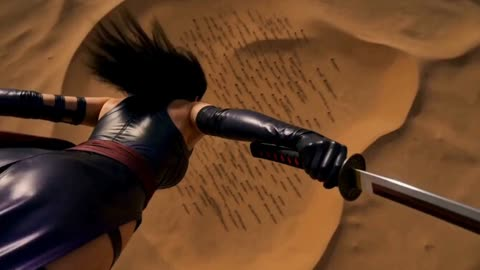</a>

A character sheet is attached as an exact identity reference, and the prompt is split into two-second timed beats, each with its own camera direction, which keeps a fourteen-second fight readable. Pacing words such as rapid cuts, whip-pans and speed ramps set the rhythm across the whole clip.

MiniMax H3 · Reference-to-video · Source: [@soundofdragon on X](https://x.com/soundofdragon/status/2091922433595056536) · 345 likes on 2026-10-29

[`character-reference`](tags.md#tag-character-reference) [`timed-beats`](tags.md#tag-timed-beats) [`fight-choreography`](tags.md#tag-fight-choreography) [`speed-ramp`](tags.md#tag-speed-ramp)

<details><summary><b>Prompt</b></summary>

```text
Use the provided character sheet as the exact reference for female samurai Soul. Preserve her face, hair, proportions, armor, colors, katana and identity. Hyper-realistic 3D CGI, 14s, 4K, 24fps, widescreen. Extremely fast cinematic pace, rapid cuts, whip-pans, speed ramps, aggressive camera movement, intense motion blur, dramatic golden-hour lighting, realistic dust, debris and glowing purple energy.

0–2s: The destroyed mountain EXPLODES. A colossal ancient giant emerges from the dust, towering over the desert, stone-like armored body glowing with purple energy. Camera rockets from its feet to its terrifying face.

2–4s: The giant roars and swings its massive arm. Soul sprints across collapsing rocks, dodging the attack by inches. She leaps onto its arm. Fast tracking camera, flying debris.

4–6s: Soul runs vertically across the giant’s armored body, using cracks as footholds. Rapid close-ups of her feet, katana and glowing purple eyes. The giant tries to grab her.

6–8s: Soul launches from its shoulder, flips through the air and lands on its head. She raises her glowing katana. Camera rapidly circles them, revealing the enormous battlefield below.

8–10s: The giant violently shakes and attacks. Soul dashes across its head and neck, delivering multiple lightning-fast slashes. Bright purple energy trails and explosive sparks follow every strike.

10–12s: Extreme close-up. Soul grips the katana with both hands, eyes blazing purple. She charges forward at maximum speed, blade becoming engulfed in concentrated purple energy.

12–14s: FINAL STRIKE. Soul leaps above the giant and performs one massive vertical katana slash through its body. A brilliant purple energy cut tears downward. The giant splits apart in a colossal shockwave. Camera rapidly pulls back as debris, dust and purple energy engulf the desert.

Style: relentless momentum, no dead frames, fluid sword choreography, realistic physics, epic scale, cinematic Dune × Ghost of Tsushima quality.
```

</details>

<a id="seedance-roller-skater-misty-cliff-road"></a>
### Roller skater on misty cliff road above valley

<a href="https://x.com/SyntheSarah/status/2088122680142930199">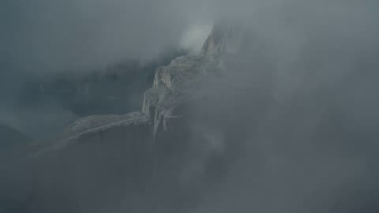</a>

Timed beats (0 to 3 sec, 3 to 6 sec and so on) split the 15 second clip into a shot list, so each segment gets one camera move and one physical event. The identity lock line and the long negative list (face changes, warped wheels, flickering) keep the skater consistent across the cuts.

Seedance 2.5 · Text-to-video · Source: [@SyntheSarah on X](https://x.com/SyntheSarah/status/2088122680142930199) · 276 likes on 2026-10-29

[`roller-skating`](tags.md#tag-roller-skating) [`mountain-cliff`](tags.md#tag-mountain-cliff) [`timed-shot-script`](tags.md#tag-timed-shot-script) [`photorealism`](tags.md#tag-photorealism)

<details><summary><b>Prompt</b></summary>

```text
Create a 15-second ultra-photorealistic cinematic action sequence. A young woman is roller skating alone through an extremely dangerous mountain environment. She wears realistic black technical outdoor clothing, protective gloves, helmet, and professional roller skates. Her face, body proportions, clothing, and skating movement remain perfectly consistent throughout the entire video.
0–3 sec: Wide aerial establishing shot of enormous jagged mountains surrounding a tiny, narrow cliffside road. The road is barely wide enough for one person, with a terrifying vertical drop into a deep fog-covered valley. Dark clouds move rapidly between the peaks while strong wind blows across the cliffs.
3–6 sec: Low-angle tracking shot as the woman skates dangerously close to the edge. Small rocks fall from the cliff beside her and disappear into the abyss. Her wheels realistically react to cracks and uneven pavement. She maintains balance while her hair and clothing move naturally in the powerful wind.
6–9 sec: The path suddenly becomes extremely narrow, with a massive rock wall on one side and a huge drop on the other. She passes beneath a giant overhanging rock while loose stones tumble down behind her. The camera moves alongside her, showing the terrifying scale of the environment.
9–12 sec: A dramatic close tracking shot as she approaches a broken section of the mountain road. A large crack runs across the path. She jumps over it while skating, landing realistically on the other side. Dust and tiny rocks scatter naturally from the impact.
12–15 sec: The camera pulls rapidly backward into a huge cinematic wide shot, revealing the woman skating alone along the impossibly dangerous mountain ridge, surrounded by enormous cliffs, distant waterfalls, heavy clouds, mist, and a seemingly endless valley below.
Style: documentary-level realism, physically accurate human movement, realistic roller-skating physics, natural facial expressions, authentic skin texture, individual hair strands, detailed fabric, real rock formations, atmospheric perspective, natural sunlight breaking through clouds, volumetric mountain mist, realistic wind and dust, subtle handheld camera movement, cinematic lens, realistic depth of field, natural motion blur, high dynamic range, 4K photorealism, premium live-action cinematography.
Negative: CGI appearance, cartoon look, artificial textures, unrealistic physics, floating objects, distorted anatomy, extra fingers, extra limbs, face changes, identity changes, flickering, warped wheels, duplicated objects, oversaturated colors, excessive slow motion, unnatural camera movement.
```

</details>

<a id="kling4-tactical-shooter-gameplay"></a>
### Fake gameplay of a 5v5 tactical shooter

<a href="https://x.com/higgsfield_ai/status/2110905436371370009"></a>

Written as a screen recording: HUD, crosshair, PC game lighting and gunfire sound design. The model gets asked for a game, not a film.

Kling 4.0 · Text-to-video · Source: [@higgsfield_ai on X](https://x.com/higgsfield_ai/status/2110905436371370009) · 260 likes on 2026-10-28

[`gameplay`](tags.md#tag-gameplay) [`pov`](tags.md#tag-pov) [`hud`](tags.md#tag-hud) [`action`](tags.md#tag-action) [`sound-design`](tags.md#tag-sound-design)

<details><summary><b>Prompt</b></summary>

```text
15-second horizontal 16:9 1080p first-person gameplay recording of a competitive 5v5 tactical shooter in team elimination mode, captured straight from a PC screen. Modern next-gen competitive shooter graphics: bright, clean, readable daylight, crisp PBR materials, high frame rate, sharp image. Pure first-person view: the player's hands in purple tactical gloves hold an original assault rifle with a flashy custom skin of hot-pink and teal graffiti patterns, positioned in the lower right of the frame. Clean screen with the HUD turned off: the only on-screen element is a small green crosshair in the center. There is no minimap, no kill feed, no health, ammo or money counters, no timer and no banners. Snappy competitive movement with quick peeks, crouching, strafing and precise flicks. The whole video is one continuous round with no cinematic cuts.

Setting: a sunny Asian harbor market district at midday, an original competitive map. There are narrow alleys between stacked, faded red, blue and yellow shipping containers, sun-bleached concrete, stalls with colorful canvas tarps and hanging paper lanterns, food carts, wooden crates and fish barrels, metal stairs and catwalks, corrugated metal walls, an open harbor basin of deep blue-green water with moored wooden fishing boats and floating pontoons, cranes on the docks in the background, and colorful painted shop signs made of abstract shapes, not letters. Bright high sun, clear blue sky with a few clouds, hard crisp shadows, seagulls in the distance and sunlight glittering on the water.

[00:00–00:02] The player strafes out from behind a shipping container, flicks onto an enemy soldier at the alley entrance and drops him with a short burst. The enemy ragdolls onto the concrete.
[00:02–00:04] He sprints along the containers, wide-swings around a stack of crates and drops an enemy hiding behind them with a quick two-shot tap.
[00:04–00:06] He jiggle-peeks the corner of a market stall and lands a clean headshot on an enemy on the catwalk.
[00:06–00:08] He hops down from the pier onto a floating wooden pontoon at the edge of the harbor basin and casually reloads with a fast magazine swap while moving along the planks.
[00:08–00:10] He advances along the pontoons between moored wooden fishing boats and taps an enemy standing on a boat deck. The body ragdolls off the deck and drops into the water with a splash.
[00:10–00:11] He throws a smoke grenade ahead onto the dock. It bounces across the wooden planks, then pops, and thick grey smoke spreads over the pier in the sunlight.
[00:11–00:13] Two enemies push out of the smoke along the dock. He sprays and taps them down; bullet impacts kick up wood splinters from the planks and small splashes in the water. Both enemies ragdoll onto the dock.
[00:13–00:15] The round is won. Standing alone on the pontoon in the middle of the harbor, he glances down at the sunlit water lapping against the boards, then looks back up and inspects his rifle with a stylish flip animation.

Style: authentic competitive esports gameplay footage that looks like a real ranked match caught on stream, with confident, clean play. Readable action, stable first-person camera with natural view bob and recoil, sharp, high detail, bright saturated daylight colors. No real-world text, no words, no brand logos, no watermark, no IP characters or maps.

Audio: competitive shooter sound design, with punchy rifle bursts with echo off the containers, shell casings clinking on concrete and wood, footsteps on concrete and hollow wooden planks, bullet impacts on wood and metal with small water splashes, a smoke grenade hiss, a crisp magazine reload, seagulls, lapping water against the boats, distant harbor horns and a short round-win sting at the end. No dialogue.
```

</details>

<a id="wan-acrobat-flaming-ring-horse-landing"></a>
### Acrobat leaps through flaming ring onto horse

<a href="https://x.com/iam_mian7/status/2095007196258124056">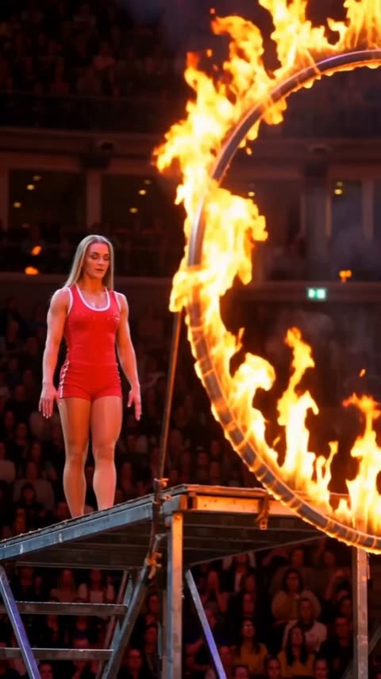</a>

The prompt lays out the stunt as ordered beats: setup on the platform, launch through the ring, backflip, then landing on the moving horse. Lens, slow motion and camera shake are named in their own lines, which keeps a fast action sequence readable.

Wan 3.0 · Text-to-video · Source: [@iam_mian7 on X](https://x.com/iam_mian7/status/2095007196258124056) · 255 likes on 2026-10-29

[`circus`](tags.md#tag-circus) [`stunt`](tags.md#tag-stunt) [`slow motion`](tags.md#tag-slowmotion) [`horse`](tags.md#tag-horse)

<details><summary><b>Prompt</b></summary>

```text
A cinematic live circus performance inside a massive dark arena packed with an excited audience. A highly skilled female acrobat with long blonde hair, wearing a vivid red athletic costume and white shoes, stands on a tall metal platform beside a huge circular ring engulfed in roaring flames. Warm firelight illuminates her face and body against the deep black background.

She takes a moment, gathers momentum, then launches herself dramatically through the center of the flaming ring. Capture her in a powerful backward aerial flip, body fully extended and rotating gracefully in mid-air. As she exits the ring, a majestic white horse gallops beneath her, wearing a dark navy saddle and bridle. She completes the rotation and lands safely onto the moving horse in one fluid, perfectly timed motion.

Camera: vertical 9:16, cinematic telephoto lens, dynamic tracking, slow-motion during the jump, subtle camera shake from the live performance, smooth motion tracking.
Lighting: intense orange firelight, dramatic spotlights, deep shadows, realistic flame illumination, atmospheric smoke and sparks.
Style: photorealistic, high-end cinematic sports footage, realistic anatomy and physics, detailed horse movement, natural crowd reactions, dramatic contrast, shallow depth of field, 4K, ultra-detailed.
Mood: thrilling, dangerous, spectacular, heart-pounding live circus spectacle.
```

</details>

<a id="seedance-two-fighters-ring-duel-rain"></a>
### Two fighters duel with rings and crimson slashes

<a href="https://x.com/GlitterPixely/status/2091189648550695229">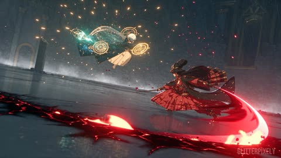</a>

Each reference image is locked to one fighter with an explicit ownership rule for costume, colours and effects, so the two identities never swap. A ten-shot timeline with a fixed combat axis and a camera height limit keeps the choreography readable.

Seedance 2.5 · Reference-to-video · Source: [@GlitterPixely on X](https://x.com/GlitterPixely/status/2091189648550695229) · 246 likes on 2026-10-29

[`reference-lock`](tags.md#tag-reference-lock) [`duel`](tags.md#tag-duel) [`anime-action`](tags.md#tag-anime-action) [`rain`](tags.md#tag-rain) [`multi-shot`](tags.md#tag-multi-shot)

<details><summary><b>Prompt</b></summary>

```text
[REFERENCE LOCK — DO NOT BREAK]
@ Image1 defines Fighter A only: white hair, dark teal long coat, floating brass astrolabe rings, luminous gold-and-teal metal, clockwork geometry, teal-gold energy.
@ Image2 defines Fighter B only: dark hair, ornate black-and-crimson outfit, gold headdress, long crimson cords, red-black ornamental details, crimson-black energy.
Use and only for their assigned fighter’s identity, costume, colors, signature props, and signature VFX. Do not use either portrait’s background, pose, framing, facial expression, or composition. Do not interchange the fighters’ identities, costumes, colors, weapons, VFX, or positions. Keep exactly two fighters throughout the entire video. No duplicates, clones, extra characters, summoned humanoids, or identity changes.

Fighter A’s signature VFX are gold, teal, brass, astrolabe rings, clockwork discs, gears, star-lines, and teal lightning.
Fighter B’s signature VFX are crimson, black, red energy ribbons, burning ornaments, slash afterimages, crimson cords, and red-black crescents.

[GENERATION GOAL]
Create a 30-second AAA anime action-RPG combat cinematic: a brutal, high-speed VFX duel between Fighter A and Fighter B inside a vast rain-slick obsidian arena. The arena floor is reflective black stone with cracks, shallow rainwater, loose debris, and destructible obsidian pillars and slabs. Every major impact must affect the arena through sparks, water spray, shattered stone, dust, debris, scorch marks, and fragments. The fight must feel continuous, physical, and readable. Maintain one consistent combat axis and consistent left-right spatial relationships. Never teleport either fighter. Preserve costume details, hair, headdress, coat, cords, rings, and VFX ownership across every shot. The camera remains inside the fight, between ankle height and shoulder height. Use low angles, Dutch angles, lateral tracking, whip-pans, ring-threading push-ins, crash moves, close near-misses, and aggressive ground-level arcs. Absolutely no aerial shots, overhead shots, bird’s-eye views, top-down framing, distant map views, or detached establishing shots. Use exactly 10 shots, following the timeline below. Within each shot, create a new readable attack, evade, intercept, or counterattack every 1–2 seconds. Prioritize clear silhouettes and cause-and-effect choreography over random particle effects.

[10-SHOT ACTION TIMELINE]
SHOT 1 — 0–3 seconds Begin with a ground-skimming tracking shot behind Fighter A, racing beside the flowing dark teal coat and floating brass astrolabe rings. The camera settles into a diagonal side-wide shot with Fighter B ahead on the wet obsidian floor. Fighter A fires a fan of rotating gold clockwork discs. Fighter B slips between the discs at impossible speed, leaving controlled red-black slash afterimages. The discs strike the arena behind Fighter B, producing bright gold sparks, rain spray, rippling reflections, and broken obsidian fragments. End with both fighters facing one another on the same combat axis, already moving into the next attack.
SHOT 2 — 3–6 seconds Cut to an extreme low 20-degree Dutch angle from Fighter B’s side. Fighter B whips a gigantic crimson-black crescent slash across the arena floor. The slash skims through rainwater and tears up a trail of black stone. Fighter A vaults through the crescent at close range. The brass astrolabe rings rotate around the body and split the slash into gold sparks and red fragments. Fighter A immediately redirects those fragments into a teal-gold constellation drill aimed back at Fighter B. End with the constellation drill accelerating toward Fighter B while the broken crescent burns across the floor.
SHOT 3 — 6–9 seconds Use a shoulder-height lateral tracking shot with both fighters fully readable in profile. Fighter B spins beneath the incoming constellation drill and carves a red-black ribbon tunnel straight through it. The tunnel twists around the gold projectiles instead of simply erasing them. The camera races toward the fighters and threads through a large brass astrolabe ring in the foreground. Both fighters dash past one another in opposite directions. Their attacks collide behind them, detonating into burning gears, crimson embers, teal lightning, rain vapor, and chunks of obsidian. End with Fighter B turning first and launching back toward Fighter A.
SHOT 4 — 9–12 seconds Crash into a fast Dutch-angle push-in from inside a spinning brass ring. Fighter B bursts through the debris with a point-blank crimson strike aimed at Fighter A’s torso. Fighter A blocks at arm’s length using a rotating gold-and-teal ring shield. The shield visibly catches the strike and bends the force sideways. The collision sends glassy obsidian shards, golden cogs, red energy ribbons, and rain droplets directly past the lens. Keep both faces and silhouettes briefly visible through the debris. End with Fighter A forcing Fighter B backward across the wet floor.
SHOT 5 — 12–15 seconds Use a low side-on wide shot with the camera almost touching the arena floor. Both fighters sprint in a tight circular path around one another, never leaving the ground. Fighter A plants luminous teal star-lines that rise vertically from the floor like glowing walls. Fighter B wall-runs across the star-lines, using each glowing foothold to change direction. Every step detonates the wall beneath the foot into red ember geysers and fragments of black stone. Fighter A shatters the final star-wall with a powerful orbital ring punch. The impact creates a gold-teal shockwave that sends both fighters flying in opposite directions. End with both fighters recovering mid-slide, still combat-ready.
SHOT 6 — 15–18 seconds Use a sudden whip-pan into a low rear angle behind Fighter B. Fighter B summons a black-crimson vortex made of twisting ribbons, burning gold ornaments, crimson cords, and sharp ornamental fragments. Fighter A runs directly up the rising debris without becoming airborne for an extended period. The orbiting brass rings drill a narrow teal-gold corridor through the vortex. Fighter A reaches the top of the debris path, then launches downward in a concentrated meteor-like ring-lance strike. Fighter B turns just in time to meet the descending attack with a rising crimson counter-slash. End on the two attacks colliding at the center of the vortex.
SHOT 7 — 18–21 seconds Cut to a tight medium shot at a 35-degree tilted angle between the fighters. Keep both silhouettes clear and separated by only a few feet. Fighter A thrusts a condensed gold-teal astrolabe lance. Fighter B intercepts it with two crossed red-black energy slashes. They exchange exactly three rapid, readable impacts: 1. Fighter B lands a crimson slash. 2. Fighter A blocks with a rotating ring-blade shield. 3. Fighter A answers with a concentrated gold counterburst. Every impact produces visible sparks, metal distortion, red cords, teal lightning, rain spray, and cracking obsidian beneath their feet. End with both fighters forced apart by the counterburst.
SHOT 8 — 21–24 seconds Use an eye-level ultra-wide from the arena edge, looking horizontally across the floor. Keep the camera close enough that the fighters remain large and readable. Do not make this a distant establishing shot. Both fighters ricochet through the battlefield and pass the camera in opposite directions, leaving trails through rain and debris. Fighter B creates a spiral of crimson ribbon dragons. They must remain clearly abstract energy constructs, not additional characters. Fighter A splits the ribbons with rotating clockwork blades. Each destroyed ribbon collapses into a glowing gold-teal meteor fragment that crashes into the arena behind Fighter B. Fighter B turns through the explosions and redirects the remaining crimson ribbons toward Fighter A. End with both attack trails converging toward the center.
SHOT 9 — 24–27 seconds Drop the camera to ankle height and arc around the central collision. Fighter B releases a full-circle crimson-black cut that expands horizontally across the wet arena floor. Fighter A rotates the astrolable rings in a synchronized orbit and fractures the incoming cut into hundreds of spinning molten clockwork pieces. Each piece leaves a gold-teal tracer and reflects in the rainwater. The camera rolls with the debris while remaining below shoulder height. Never become overhead or top-down. The debris storm briefly obscures both fighters, then clears to reveal them charging directly toward one another.
SHOT 10 — 27–30 seconds Use a low diagonal wide shot with no aerial angle. Fighter A and Fighter B charge straight toward the camera from opposite sides of the arena. Keep both full bodies visible and maintain their distinct colors and silhouettes. They collide just behind the foreground plane. The collision creates a massive red-gold-teal implosion: crimson ribbons, brass rings, clockwork fragments, molten obsidian, rain vapor, sparks, and glowing debris blast toward the lens. The shockwave destroys nearby stone and leaves a circular cracked impact zone. As the dust and rain clear, hold for one second on both fighters separated across the ruined arena, still standing and combat-ready. Broken brass rings rotate slowly in the air while crimson sparks fall around Fighter B. The final frame must clearly show both fighters alive, distinct, and ready to continue fighting.

[CAMERA AND MOTION RULES]
Fast, aggressive, cinematic camera movement. Use whip-pans and crash moves only when they connect two readable actions. Use foreground rings, debris, rain, and energy trails for motivated transitions. Keep the camera physically inside the arena. No random camera teleportation. No excessive motion blur that hides the fighters. No frozen poses between attacks. No long charge-ups. No empty cooldowns. No slow motion. No bullet time. No repeated attacks that look identical. No unreadable particle-only collisions.

[STYLE AND IMAGE QUALITY]
AAA anime action-RPG cinematic. Highly detailed character designs. Sharp silhouettes. Dynamic anime impact frames without losing temporal continuity. Premium cel-shaded characters combined with physically rich metal, stone, rain, sparks, smoke, and energy. Strong gold-teal versus crimson-black color separation. Wet obsidian reflections. Controlled depth of field. High contrast. Cohesive lighting. Realistic weight and contact in every strike. All destruction must originate from a visible attack or collision. [AUDIO] No music. No dialogue. No narration. No subtitles. No visible text. Use only: rapid blade impacts, metallic astrolabe ring shrieks, clockwork gear rotations, blade whooshes, crimson energy tearing, teal lightning crackle, rain hitting obsidian, footfalls and slides on wet stone, water sprays, stone fractures, debris impacts, and one enormous final detonation in Shot 10. Audio intensity should escalate continuously toward the final collision, with brief impact-focused gaps only when needed to make the next strike readable.
```

</details>

<a id="h3-drunken-master-motion-poster"></a>
### Drunken master movie poster turned motion poster

<a href="https://x.com/MonetizationDon/status/2087183007874453795"></a>

The prompt starts by locking the uploaded poster artwork, typography and layout, and ends with explicit bans on redesign, new text and distorted lettering. Motion is split into ambient layers, subtle character action, a title reveal and a camera push then pull back to the final frame.

MiniMax H3 · Image-to-video · Source: [@MonetizationDon on X](https://x.com/MonetizationDon/status/2087183007874453795) · 225 likes on 2026-10-28 · found via [SkyNotSilent/awesome-MiniMax-H3-cases](https://github.com/SkyNotSilent/awesome-MiniMax-H3-cases)

[`motion-poster`](tags.md#tag-motion-poster) [`martial-arts`](tags.md#tag-martial-arts) [`typography`](tags.md#tag-typography) [`poster-animation`](tags.md#tag-poster-animation) [`cinematic`](tags.md#tag-cinematic)

<details><summary><b>Prompt</b></summary>

```text
Animate the uploaded CHUNG LEE movie poster as a 10-second cinematic martial-arts motion poster while preserving the original artwork, characters, typography, composition and layout.

Bring the static poster to life with rich cinematic colors — crimson red, golden yellow, fiery orange, electric blue, emerald green and magenta. Animate the lanterns, drifting smoke, flying dust, sparks, debris and the surrounding crowd.

Give CHUNG LEE subtle drunken-master movement: shifting shoulders, flowing hair, a confident expression and a casual lift of the gourd with liquid splashing in slow motion.

Then make “CHUNG LEE” the ultimate visual flex — dramatic brush-stroke reveals, golden particles, energy trails and a powerful 3D pop-out effect that makes the title feel like it is breaking out of the poster.

Add glowing red energy around the Chinese characters, dynamic martial-arts impacts, moving background fighters, cinematic camera movement and bursts of colorful light.

Finish with a dramatic push toward the CHUNG LEE title, then pull back to reveal the complete poster before locking into the final frame.

No redesign. No new text. No distorted typography. Preserve the original poster — just make it move.

Animation made with Minimax H3
```

</details>

<a id="seedance-ling-yin-storm-shrine-battle"></a>
### Barefoot warrior slashes sky creatures on falling slabs

<a href="https://x.com/aimikoda/status/2089388854180512094">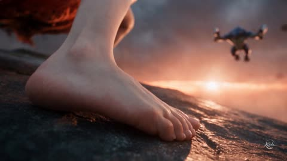</a>

A fixed 20mm lens and a character reference that only locks identity keep the single take camera stable. Each creature is numbered and tied to its species colours, and each 3 second beat names one target, which keeps the dense action readable.

Seedance 2.5 · Reference-to-video · Source: [@aimikoda on X](https://x.com/aimikoda/status/2089388854180512094) · 218 likes on 2026-10-29

[`live-action`](tags.md#tag-live-action) [`fantasy-action`](tags.md#tag-fantasy-action) [`single-take`](tags.md#tag-single-take) [`sword-fight`](tags.md#tag-sword-fight)

<details><summary><b>Prompt</b></summary>

```text
一部真人实拍奇幻动作电影从铃音在风暴虚空中的破碎神社桥上遭到围猎开始，她借四块持续下坠的石板高速突围，摄影机在真实时间内紧贴她的动量完成一镜到底。仅使用 @[character ref] 确定成片中铃音的人物身份、服装、右手护臂与武士刀；忽略参考图的背景、文字、排版、姿势和构图，不让它定义环境、动作、镜头或敌人。

C2、C5、C6、C8、C10是五个彼此独立的剃刀爪兽，每只都有六条肢体、钴蓝色躯壳、浅色腹部与修长前爪。C3、C4、C7、C9是四个彼此独立的剃刀翼兽，每只都身形纤细、躯体钴蓝、双翼青绿、尾端紫色分叉、眼睛黄色。所有编号始终对应同一只生物，不互换、不复制、不融合；被斩开的身体块和断肢仍属于原编号。

整体采用完全写实的真人电影质感：真实演员比例与皮肤、织物和长发的物理响应，可信的重量、抓地、碰撞、惯性与自由落体；怪物以高端实体特效结合无缝生物视效呈现，肌肉、甲壳、翼膜和爪部受力清楚。破碎神社桥、鸟居和始终只有四块的坠落石板悬在雷暴虚空中，珊瑚红侧光与钴蓝风暴背光交错，尘土、碎石和湿冷空气形成深层空间。全程只用一支固定20mm虚拟电影镜头，保持超广角近远尺度、深焦和自然运动模糊；景别变化只来自连续可达的跟随、下潜、上升和包绕轨迹，焦距与摄影机实体连续性不变。

每次斩击都必须产生可见、真实的实体切割。刀刃先在接触点破开甲壳，再沿同一切线连续穿过组织，身体或肢体随即彻底分离；不能只留下光痕、浅表伤口或让刀身无阻力穿模。断肢与身体块保留受击前的线速度、角速度、重量和重力轨迹，彼此碰撞后继续翻落，不消失、不复原、不重新连接。剃刀爪兽的断口喷出荧光青绿色主液流与钴蓝色黏稠液滴；剃刀翼兽的断口喷出珠光紫罗兰色主液流与青蓝色轻薄液滴。所有生物流体均为非红色，珊瑚红只属于刀刃光效。

动作以正常播放速度保持原有的极高速与高密度，不因时长增加而拉慢。采用专业动画格斗般的短促压缩蓄力、瞬时爆发回弹、擦身斩击和不间断惯性贯穿，但所有身体运动、落点与碰撞都符合真人特技和生物力学。摄影机从不安定停驻；每个可读动作阶段只突出一个正在攻击或躲避的目标，其他生物仍沿已建立的背景轨迹运动。无剪辑、无定格、无慢动作、无撞击停帧、无复位、无传送，也不用前景遮挡伪装剪辑。

0-3秒：第一帧中，第一块石板上的铃音赤裸左脚占满前景，C2从右上方沿清晰斜线扑杀；摄影机立刻贴地流入低机位侧面全身构图，她在其腾空挥爪下方爆发回弹，以一次水平斩同时截断两只领先长前爪并横切胸腹。两只断爪、上半身和下半身在同一连续画面中彻底分离，带着青绿色主液流与钴蓝液滴按原冲量翻离。

3-6秒：镜头不停顿地包绕至低机位后方3/4全身构图，铃音右脚掠过第二块石板，C3从右上方收翼俯冲；摄影机沿她的下落弧线钻到下方并抵达贴地正面3/4构图，同一次回弹继续上升，刀刃从C3腹侧进入，切断一侧翼根并将躯干斜分成两块。脱落翅膀与两段身体分别旋落，紫罗兰主液流和青蓝液滴沿俯冲方向甩出。

6-9秒：镜头随动势升至高机位侧面，铃音左脚尖擦过第三块石板，借瞬间摩擦加速腰部旋转；C4以攻击性的S形航线横切她的通道，她用一次交叉斩从近侧翼根贯穿胸部，使整片翅膀连同一侧躯干被斜切分离。各部分沿不同角速度飞向画面左后方，断面与刀路完全一致。

9-14秒：镜头沿原路径降到她身后的后方3/4构图，铃音右脚触及第四块石板的垂直侧面；沿石壁疾跑的C5用两只运动中的长前爪夹住刀身，这个夹持只存在于一瞬。镜头随她滚转滑入紧侧面，她以接触扭矩把刀锋从夹持点旋出，连续切断两只前爪关节并剖开胸部，断爪和被分开的胸腹块脱离石面，喷出青绿色与钴蓝色体液后向外翻落。

14-17秒：摄影机从同一位置贴着第四块石板下缘滑到低机位侧面，倒挂的C6松爪扑出；铃音延续上一段身体弧线，以一次斩击横穿其浅色腹部，切断下方一对肢体并把腹腔分成两个不等大的身体块。所有分离部分因自身扑击惯性继续坠离，甲壳碎片和非红色液滴从真实断面向后喷散。

17-20秒：镜头以前向交接动作升至高机位正面3/4，C7收翼后以喙部领先做螺旋俯冲；铃音从螺旋轴旁掠过，刀锋沿头部至躯干纵向贯穿，把喙、头部和身体切成左右两半。两半仍保留相反的螺旋角动量，带着紫罗兰与青蓝体液分离旋落；铃音继续朝右下方坠向更多生物，镜头不作停顿。

20-24秒：从上一阶段的相机位置和运动矢量直接续接。C8从右下方一根正在坠落的断裂鸟居横梁上蹬出，向左上方截击；铃音用右手护臂拨偏其领先前爪，把反冲转成侧向滚转，再以上挑斩截断该前肢，并从腹部至肩部把身体斜劈成两个大块。两块身体向左下方分离翻落，较大的背甲半身保持可见。

24-27秒：铃音左脚短暂踏过仍在翻落的C8背甲半身，借其残余下坠动量向右上方回弹；此时唯一的主动目标C9从左上方折翼俯冲封住路线。摄影机沿双方交会轴下潜，刀锋以一次紧凑对角斩切断C9一侧翼根并将躯干分成两块；翅膀与身体块带着紫罗兰和青蓝液体沿各自轨迹分离，铃音重新转入右下方坠落。

27-30秒：始终与第四块石板保持相近落速的C10从其下侧松爪扑来，以两只长前爪合拢下降通道；铃音在爪隙中收身穿过，用右手护臂将一爪拨离中线，同时以短促反向斩截断另一只前爪并横断胸腹。断爪、上半身和下半身彻底分离并喷出青绿与钴蓝体液。摄影机随铃音越过这些碎块继续下坠，最后一帧保持她朝右下方高速离开，破碎鸟居下方仍有更多剃刀兽远景轮廓正在上冲，形成开放式持续战斗，不结束动能。

上述构图只是连续高速运动中各经过一次的瞬时取景状态，严格按时间顺序出现；它们之间由身体惯性、落体轨迹、接触反冲和摄影机可达路径连接。铃音始终只有一人，武士刀与右手护臂始终归她所有且结构不变。每次切割从接触到甲壳破裂、刀刃贯穿、断面形成和部件分离都在同一连续镜头内清楚发生；所有断肢、身体块、甲壳碎片和体液保持物理连续性，直到按既有轨迹退出画面。

武士刀始终带有贴着刃口的珊瑚色边缘尾迹，不形成远程剑波。每次实体切割只产生一道符合物种颜色的主液流、少量同色液滴与一簇青色甲壳碎片，全部从真实断面出发并随源速度运动；主喷流在下一次斩击前散开，液滴可短暂附着于坠落碎块。

声音为稀疏断拍脉冲配乐，持续的风暴狂风与远雷打底；石板断裂、赤足触石、衣料抽动、翼膜骤响、利爪刮石、护臂格挡、刀刃切开甲壳与韧性组织、断肢撞击碎石、不同颜色体液飞溅和怪物嘶叫精确跟随动作，所有撞击尾音迅速衰减以维持同样的速度感。无对白。
```

</details>

<a id="seedance-female-fighter-warehouse-showdown"></a>
### Female fighter faces giant armored warrior in warehouse

<a href="https://x.com/SyntheSarah/status/2091007759130988559">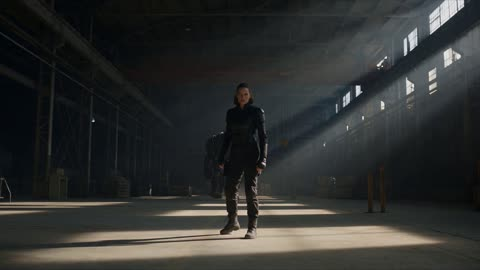</a>

Timed beats across the 15 seconds each get their own camera move, such as a low angle wide shot, a push in, and a brief slow motion dodge. A fixed description of the fighter's face, hair and outfit plus an explicit consistency line keeps her identical from beat to beat.

Seedance 2.5 · Text-to-video · Source: [@SyntheSarah on X](https://x.com/SyntheSarah/status/2091007759130988559) · 213 likes on 2026-10-29

[`action`](tags.md#tag-action) [`martial-arts`](tags.md#tag-martial-arts) [`warehouse`](tags.md#tag-warehouse) [`character-consistency`](tags.md#tag-character-consistency)

<details><summary><b>Prompt</b></summary>

```text
Create a 15-second ultra-realistic cinematic action sequence featuring a female fighter in her mid-20s battling a much larger armored opponent in an abandoned industrial warehouse. Character: A confident athletic woman around 25 years old, realistic proportions, strong but natural physique, sharp expressive eyes, dark shoulder-length hair tied into a practical high ponytail. She wears a fitted black tactical combat outfit with subtle fabric texture, lightweight protective gloves, dark cargo pants and rugged boots. Keep her face, hairstyle, body proportions and outfit perfectly consistent throughout the entire video. Opponent: A huge muscular male warrior wearing heavy, weathered dark metal armor. He is approximately twice her size, intimidating and physically powerful, but completely realistic in anatomy and movement. His armor has scratches, dents and realistic metallic textures. Environment: A massive abandoned industrial warehouse at night. Concrete floor, steel beams, broken windows, scattered crates, dust floating through shafts of cold moonlight, subtle atmospheric haze. No cyberpunk, no neon lights, no futuristic glowing elements. Photorealistic cinematic environment. 0–3 seconds Start with a low-angle wide shot. The female fighter stands alone in the center of the warehouse while the giant armored opponent slowly approaches from the background. Heavy footsteps echo through the building. She raises her fists and takes a defensive fighting stance. The camera slowly pushes toward her, emphasizing the huge size difference. 3–6 seconds The giant suddenly charges at extreme speed and throws a powerful punch toward her. She narrowly dodges sideways at the last second. His fist crashes into a thick concrete pillar, sending small fragments and dust into the air. Use a brief slow-motion moment during the dodge, with realistic cloth and hair movement. 6–10 seconds She immediately counterattacks. She runs toward him, jumps onto a nearby steel structure, uses it as leverage, and launches herself toward his upper body. She lands on his armored shoulder, grabs onto the armor, swings around his back and kicks him hard in the side. The giant loses balance and crashes into several wooden crates. Show dynamic but believable physics, realistic weight and momentum. 10–13 seconds The giant quickly gets back up and swings both arms toward her. She slides underneath the attack, rolls across the concrete floor, grabs a metal chain lying nearby and uses it to pull herself forward. She jumps onto the giant's chest and delivers one powerful final kick that sends him crashing backward through a large wooden wall. 13–15 seconds The camera follows the giant as he crashes through the wall, then rapidly swings back to the female fighter. She lands firmly on the ground, slowly stands straight, breathing heavily, and looks directly toward the camera with a calm, confident expression. Dust and tiny debris fall around her in the background. Visual style: photorealistic Hollywood action cinematography, realistic human anatomy, physically accurate movement, detailed facial features, natural skin texture, realistic fabric and metal textures, dramatic practical lighting, volumetric dust, cinematic depth of field, subtle handheld camera movement, dynamic tracking shots, realistic motion blur, high-detail environment, natural color grading, high contrast, 4K cinematic quality. Action direction: Fast, fluid and believable martial-arts choreography. Every movement must have clear weight and momentum. Avoid exaggerated superhero physics, cartoon movement, floating characters, unnatural body deformation or excessive slow motion.
```

</details>

<a id="wan-korin-neon-alley-fight"></a>
### Korin face in wind and neon light

<a href="https://x.com/navi_Ai2/status/2100089508385403367">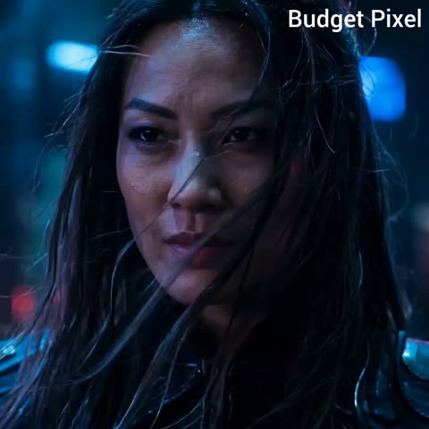</a>

The prompt splits the 15 second fight into timed beats, each with its own camera direction, and fixes the character look once so it stays consistent across cuts. Named choreography beats and a closing style block with explicit no text and no gore lines keep the output clean.

Wan 3.0 · Text-to-video · Source: [@navi_Ai2 on X](https://x.com/navi_Ai2/status/2100089508385403367) · 212 likes on 2026-10-29

[`martial-arts`](tags.md#tag-martial-arts) [`timed-beats`](tags.md#tag-timed-beats) [`neon-noir`](tags.md#tag-neon-noir) [`slow-motion`](tags.md#tag-slow-motion)

<details><summary><b>Prompt</b></summary>

```text
Create a 15-second cinematic action fight video featuring a fierce adult female warrior named Korin in a dark futuristic city alley at night. She wears a stylish black combat outfit with subtle metallic details, long flowing hair, and a confident, determined expression.

0–3 seconds: Start with a dramatic close-up of Korin’s face. Wind moves her hair as she slowly raises her eyes toward an approaching opponent. Neon lights reflect on her face, cinematic atmosphere, subtle handheld camera movement.

3–6 seconds: The opponent rushes toward Korin. She quickly dodges the first punch, spins around, and delivers a powerful kick to the opponent’s chest. Use realistic body movement, dynamic camera tracking, and natural motion blur.

6–10 seconds: Korin immediately attacks with a fast combination of punches and kicks. The opponent blocks some attacks and counterattacks. Show quick footwork, realistic impacts, believable martial-arts choreography, and dramatic camera angles.

10–13 seconds: The opponent attempts a final powerful strike. Korin ducks underneath it, grabs the opponent’s arm, performs a fast throw, and sends them crashing onto the ground.

13–15 seconds: Korin stands calmly over the defeated opponent, breathing heavily. She turns toward the camera with a confident expression while neon lights flicker behind her. End with a dramatic slow-motion shot and cinematic push-in.

Style: high-budget action movie, photorealistic, cinematic lighting, realistic physics, detailed facial expressions, smooth character animation, dynamic camera movement, dramatic atmosphere, professional fight choreography, sharp details, natural motion blur, consistent character appearance throughout, no blood, no gore, no text, no watermark.
```

</details>

<a id="h3-warrior-woman-trex-jungle-temple-battle"></a>
### Warrior Woman Fights T-Rex in Jungle Ruins

<a href="https://x.com/Lianaalane/status/2085625652829708458"></a>

A 14 second timeline splits the fight into timed beats, each with its own shot type: wide establishing, hero close-up, low-angle reveal, handheld dodge, slow-motion swing and a 360 degree jump. A shared style block (ARRI Alexa 35, anamorphic lens, volumetric light) and an explicit non-gory note keep the look consistent and the action safe.

MiniMax H3 · Text-to-video · Source: [@Lianaalane on X](https://x.com/Lianaalane/status/2085625652829708458) · 206 likes on 2026-10-28 · found via [SkyNotSilent/awesome-MiniMax-H3-cases](https://github.com/SkyNotSilent/awesome-MiniMax-H3-cases)

[`action`](tags.md#tag-action) [`fantasy`](tags.md#tag-fantasy) [`dinosaur`](tags.md#tag-dinosaur) [`multi-shot`](tags.md#tag-multi-shot) [`cinematic`](tags.md#tag-cinematic)

<details><summary><b>Prompt</b></summary>

```text
Create a 14-second ultra-realistic Hollywood-style action fantasy film scene featuring a brave young female warrior battling a massive realistic Tyrannosaurus Rex inside an ancient jungle filled with ruined temples, giant trees, mist, mud, rain, smoke, and dramatic sunlight.

Visual Style: Premium Hollywood blockbuster, photorealistic, cinematic, epic scale, realistic human anatomy, realistic dinosaur skin and movement, dramatic lighting, detailed environment, natural physics, intense facial expressions, high-end VFX, ARRI Alexa 35 look, anamorphic lens, shallow depth of field, HDR, subtle film grain, 4K cinematic quality, dynamic camera movement, realistic motion blur.

0–2 seconds — Establishing Shot:
Wide cinematic shot of an ancient jungle temple in the middle of a mysterious rainforest. The female warrior stands alone in the ruins, holding a large sword in one hand. Her clothes are rugged fantasy-warrior clothing, slightly wet from the rain. Mist moves through the trees while birds fly in the distant sky. Slow camera push-in toward her.

2–3 seconds — Hero Close-Up:
Cut to a dramatic close-up of the girl's face. Her hair is slightly wet and moving in the wind. She looks determined and fearless. Small scratches and dirt are visible on her face. She slowly raises her sword and prepares for battle.

3–4 seconds — Dinosaur Reveal:
Suddenly, a massive realistic T-Rex emerges from behind the jungle trees and roars aggressively. Its enormous jaws open, sharp teeth visible, water and mud splashing around its feet. Low-angle camera makes the dinosaur look huge and terrifying.

4–6 seconds — First Attack:
The dinosaur charges toward the girl at full speed. She runs toward the side and performs a fast dodge at the last second. The dinosaur crashes through trees and debris behind her. Use handheld camera movement, fast tracking, realistic impact and flying dust.

6–8 seconds — Sword Counterattack:
The girl quickly turns around and attacks with her sword. Show a dramatic slow-motion moment as she swings the sword toward the dinosaur. The dinosaur moves its head aggressively while roaring. Strong cinematic camera movement follows the sword.

8–10 seconds — Epic Jump:
The dinosaur attacks again. The girl jumps onto a large fallen tree and then leaps into the air above the dinosaur. Her hair and clothing move naturally in slow motion. Camera rotates around her as she raises the sword for the final strike.

10–12 seconds — Final Strike:
She lands a powerful cinematic sword strike against the dinosaur's armored hide. Create a dramatic impact with dust, rainwater, debris and strong camera shake. Keep the action non-gory and suitable for a blockbuster fantasy film.

12–13.5 seconds — Dinosaur Falls Back:
The dinosaur loses balance and falls backward into the muddy ground with a huge impact. Water, dust and leaves fly into the air. The girl lands safely and stands ready, breathing heavily.

13.5–14 seconds — Hero Ending:
Slow cinematic push-in toward the girl. She lowers the sword slightly and looks directly toward the camera with a powerful, fearless expression. Behind her, the defeated dinosaur lies in the misty jungle. Golden sunlight breaks through the clouds, creating an epic silhouette and emotional Hollywood-style ending.
Camera & Cinematography:
Wide establishing shots, low-angle dinosaur shots, close-up facial shots, handheld action camera, tracking shots, 360-degree movement during the jump, dramatic slow motion during key action moments, shallow depth of field for close-ups, realistic motion blur, cinematic composition.
Lighting & Atmosphere:
Dark stormy jungle atmosphere mixed with warm golden sunlight, volumetric light rays, wet surfaces, realistic rain, mist, smoke, flying leaves, dust and water particles.
```

</details>

<a id="h3-warehouse-final-fight-rain-debris"></a>
### Last stand fight in rainy abandoned warehouse

<a href="https://x.com/aiwithaly/status/2085585698699243802"></a>

One scene, one outnumbered fighter, and a clear arc from dodging and countering to a final standoff. Camera moves (handheld, low-angle tracking, slow motion) and a stack of lens and film references (ARRI Alexa 35, anamorphic, grain) set the look. The closing negatives keep text and logos out.

MiniMax H3 · Text-to-video · Source: [@aiwithaly on X](https://x.com/aiwithaly/status/2085585698699243802) · 202 likes on 2026-10-28 · found via [SkyNotSilent/awesome-MiniMax-H3-cases](https://github.com/SkyNotSilent/awesome-MiniMax-H3-cases)

[`action`](tags.md#tag-action) [`martial-arts`](tags.md#tag-martial-arts) [`warehouse`](tags.md#tag-warehouse) [`cinematic`](tags.md#tag-cinematic) [`slow-motion`](tags.md#tag-slow-motion)

<details><summary><b>Prompt</b></summary>

```text
A cinematic 15-second ultra-realistic Hollywood action sequence featuring a skilled fighter facing his final battle inside an abandoned industrial warehouse. Surrounded by three aggressive opponents, he uses precise martial arts movements to dodge attacks, counter strikes, and overcome every challenge with determination. Dust fills the air as sunlight breaks through shattered windows, creating a dramatic battlefield atmosphere. The scene builds toward a tense final confrontation as the fighter stands alone among smoke, rainwater, and debris. Dynamic handheld camera work, low-angle tracking shots, slow-motion action moments, realistic choreography, intense facial expressions, physically accurate movement, dramatic lighting, ARRI Alexa 35 aesthetic, anamorphic lens look, HDR, subtle film grain, premium Hollywood action style, 4K cinematic quality, no text, no logos.
```

</details>

<a id="wan-flame-swordsman-bamboo-storm-duel"></a>
### Flame swordsman and violet demon duel in bamboo storm

<a href="https://x.com/ZaraIrahh/status/2112051914213032430">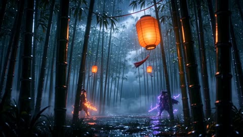</a>

Timed beats from 0:00 to 0:20 give each shot its own camera move and action, so the model paces a multi-shot sequence rather than one clip. The closing block sets the audio cues and a continuity rule, so both character designs stay consistent across cuts.

Wan 3.0 · Text-to-video · Source: [@ZaraIrahh on X](https://x.com/ZaraIrahh/status/2112051914213032430) · 192 likes on 2026-10-29

[`anime`](tags.md#tag-anime) [`sword-fight`](tags.md#tag-sword-fight) [`bamboo-forest`](tags.md#tag-bamboo-forest) [`rain`](tags.md#tag-rain)

<details><summary><b>Prompt</b></summary>

```text
A high-intensity, cinematic anime duel set in a dense bamboo grove at midnight. Heavy rain pours through the forest as traditional paper lanterns sway violently in the storm. Towering bamboo silhouettes vanish into thick, rolling mist. One warrior wields blazing orange flames, while his horned, demonic rival commands wild violet electricity. Their movements are precise, brutal, and impossibly fast. No character names or dialogue.

0:00–0:02 — The Silent Forest
A sweeping establishing shot glides between endless bamboo trunks. Two warriors face each other in the rain, completely still. A lantern flickers overhead, then the entire forest plunges into darkness, leaving only the faint glow of their supernatural blades.

0:02–0:04 — First Contact
An extreme close-up reveals the fiery warrior's focused eye. In a sudden burst of motion, he lunges forward, drawing a blazing arc through the darkness. His opponent blocks at the last instant. The collision releases a violent burst of orange sparks and branching purple lightning.

0:04–0:06 — Through the Bamboo
The camera races alongside the fiery swordsman as he dashes through the grove, slicing through a row of bamboo with a single flowing combination. The stalks begin collapsing behind him. His opponent slips through the falling debris, leaving flickering violet silhouettes in his wake.

0:06–0:08 — Lightning From Above
The camera rises directly overhead as the horned warrior launches into the air. He plunges downward with an electrified strike, splitting the muddy ground into a glowing fissure. The flame-wielding swordsman narrowly evades the impact, sending water and shattered earth flying toward the lens.

0:08–0:11 — Three Exchanges
A rapid sequence of tightly choreographed sword clashes. First, a top-down shot captures their blades locking together. Next, a low-angle view shows sparks scattering across the flooded ground. Finally, the camera circles them in a fast 180-degree rotation as their weapons collide repeatedly. Each impact illuminates individual raindrops suspended in midair.

0:11–0:14 — Blades of the Storm
The demonic swordsman sweeps his weapon outward, unleashing a rotating barrage of crescent-shaped violet energy blades. The flame warrior counters with a powerful spinning technique, creating a spiraling vortex of fire. The two supernatural attacks collide, filling the clearing with swirling embers, electrical arcs, and burning fragments of bamboo.

0:14–0:17 — The Decisive Clash
Time slows as both fighters launch from opposite sides of the clearing. Orange flames wrap around one katana while jagged purple lightning crawls along the other. Their capes, robes, and hair whip in the storm. They meet at the center of the frame, blades crashing together in a blinding flash.

0:17–0:19 — Aftermath of Impact
An extreme wide shot captures a massive pressure wave spreading through the forest. Bamboo stalks bend, snap, and scatter as the ground erupts beneath their feet. Burning orange light and violet electricity tear through the rain-filled mist while shattered lanterns tumble across the clearing.

0:19–0:20 — The Final Detail
The camera settles into a close-up of both warriors standing back-to-back, barely moving. Rain evaporates into steam wherever it touches the flaming katana. Behind them, a hairline fracture slowly spreads across the demon's electrified blade. Cut to black.

Visual Direction & Sound Design:
Premium hand-drawn anime aesthetics blended with dimensional 3D environments. Bold inked contours, dramatic cel shading, expressive smear frames, fluid sword choreography, exaggerated speed lines, and intricate elemental effects. Deep blacks contrast with searing amber fire and luminous violet electricity. Dense volumetric mist, realistic rain simulation, cinematic motion blur, and highly detailed environmental destruction. The soundtrack combines intense Japanese orchestral percussion, deep taiko drums, roaring thunder, sharp metallic blade impacts, and explosive magical sound effects. No dialogue, no subtitles, no character names. Maintain consistent character designs throughout all shots.
```

</details>

<a id="wan-night-street-gang-fight-game-hud"></a>
### Night street gang fight with game HUD

<a href="https://x.com/Inshrah_ali_/status/2100809690850664865">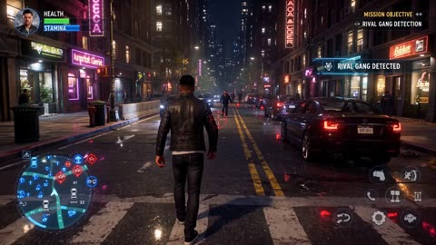</a>

A timestamped beat sheet with a fixed HUD spec keeps the minimap, health bars and pop-up notifications on screen through every cut. Framing the shot as a live player POV with a follow camera makes the footage read as a real gameplay recording.

Wan 3.0 · Text-to-video · Source: [@Inshrah_ali_ on X](https://x.com/Inshrah_ali_/status/2100809690850664865) · 192 likes on 2026-10-29

[`gameplay-hud`](tags.md#tag-gameplay-hud) [`open-world`](tags.md#tag-open-world) [`street-fight`](tags.md#tag-street-fight) [`night-city`](tags.md#tag-night-city)

<details><summary><b>Prompt</b></summary>

```text
Create a 30-second ultra-realistic open-world GANGSTER gameplay cinematic featuring two rival street gangs fighting in a gritty modern city at night. Make the entire video feel like a trending AAA gameplay recording, as if a player is actively controlling the main character.

GAMEPLAY SCREEN / HUD — VERY IMPORTANT:
Add a polished, original modern gameplay interface that stays visible naturally throughout the video:

Top-left: small circular character portrait + green HEALTH BAR and blue STAMINA BAR

Top-right: compact MISSION OBJECTIVE panel

Bottom-left: detailed MINIMAP, circular radar, player arrow, enemy indicators, nearby vehicle icons and objective marker

Bottom-right: transparent action-button icons for punch, dodge, sprint, interact and crouch

Center: small dynamic crosshair/aim indicator when appropriate

Enemy targets: red diamond markers above hostile characters

Teammates: blue/green indicators above friendly characters

Combat feedback: subtle hit indicator, combo counter and XP/reward notification

Mission notifications: sleek pop-up messages such as “RIVAL GANG DETECTED”, “SURVIVE THE AMBUSH”, and “BOSS FIGHT INCOMING”

Add subtle controller-style button prompts when the player approaches objects or enemies

HUD should be semi-transparent, futuristic and minimal, integrated naturally into the scene rather than covering the action.

UI animations should feel responsive: icons pulse, objectives update, health decreases realistically, enemy markers move with characters.

Make the interface original and not an exact recreation of any existing game UI.

0–5 SEC — RIVAL GANG DETECTED

Third-person camera follows the protagonist walking through a neon-lit city street.

HUD:
Minimap activates → several red enemy markers appear → objective panel displays:

MISSION
RIVAL GANG DETECTED

An enemy warning icon flashes briefly.

5–10 SEC — STREET FIGHT

A rival gangster attacks. The player-controlled protagonist blocks, dodges and counterattacks.

Show bottom-right action icons responding to the player's movements. Red enemy markers appear above opponents. Add a small COMBO ×3 indicator after consecutive successful moves.

10–15 SEC — CHAOS

The fight spreads across the street. Gang members run between cars and barriers.

The minimap becomes crowded with moving red and blue indicators.

OBJECTIVE UPDATED:
SURVIVE THE AMBUSH

Add subtle screen shake and damage feedback when the protagonist gets hit.

15–20 SEC — SLOW-MOTION COUNTER

The protagonist becomes surrounded. Gameplay suddenly enters dramatic slow motion.

A DODGE prompt appears near the bottom-right controls. He dodges an incoming attack and performs a counterattack.

The HUD smoothly returns to normal speed.

20–26 SEC — GANG WAR

Both gangs charge toward each other.

The protagonist runs through the battlefield while teammates fight alongside him.

OBJECTIVE:
DEFEAT THE RIVAL GANG

Show dynamic enemy markers, teammate indicators, minimap movement, stamina depletion while sprinting, and realistic combat feedback.

26–30 SEC — BOSS FIGHT

A black SUV arrives. The rival gang leader steps out.

All enemy indicators converge around him.

A dramatic BOSS HEALTH BAR appears across the top-center:

RIVAL GANG LEADER
████████████████████

Then a large original gameplay notification appears:

⚠ BOSS FIGHT INCOMING

The protagonist raises his fists. Camera moves behind him into a classic third-person gameplay position.

CUT TO BLACK.
```

</details>

<a id="wan-photo-editor-chase-comedy"></a>
### A street chase where photo-editing tools are real objects

<a href="https://x.com/johnAGI168/status/2106723741602546165"></a>

Cursors, selection boxes and transform handles exist on the street with shadows and occlusion. Long ban list keeps it from turning cartoony.

Wan 3.0 · Text-to-video · Source: [@johnAGI168 on X](https://x.com/johnAGI168/status/2106723741602546165) · 189 likes on 2026-10-27

[`comedy`](tags.md#tag-comedy) [`vfx`](tags.md#tag-vfx) [`chase`](tags.md#tag-chase) [`multi-shot`](tags.md#tag-multi-shot)

<details><summary><b>Prompt</b></summary>

```text
Duration：30秒

Aspect ratio：16:9横屏

Overall style：电影实拍质感的都市白天喜剧。真人演员，真实街道，手持跟拍的能量感。图像编辑软件的工具和界面元素以实物形态出现在真实街道上，包括光标、虚线选框、变换框、白色方形把手和灰白透明格子，它们有透视、有遮挡，地面上有淡淡的投影。所有编辑都瞬间完成，干净利落，滑稽无害。动作物理动量连续，严禁静止发呆，严禁塑料CG感。

SUBJECT / 角色与道具绑定：

图片1 命名为【Iaro】，容貌、发型、服装、配饰全部以参考图为准，全片保持一致；

（@只在此处声明一次，正文严禁再出现@）

道具【光标】：巨型电脑光标，带细黑描边的白色哑光实物，常态高约1.2米，悬浮在离地1到1.8米之间，地面上有淡灰色投影。光标有三种形态，切换时"啪"地瞬间变形：

- 箭头形态：经典左上指向的白色箭头；

- 油漆桶形态：白色倾斜的小桶图标，桶口朝下；

- 橡皮擦形态：白色长方体橡皮块，长约1米。

每次"点击"时，光标整体向前点约10厘米，伴随清脆的咔哒声。性格固执又狡猾。

路人与动物：

【遛狗姑娘】年轻女性，浅蓝色卫衣，手牵红色狗绳；

【小白】白色小型卷毛狗，常态肩高约25厘米，被放大后肩高约1.5米，性格欢快，见到会动的东西就想追。

ENVIRONMENT / 空间轴线：

现代城市商业街，晴朗白天。自然阳光从画面右上方45度照下，色温约5600K，阴影清晰柔和。人行道上有木质长椅、路边停着一辆白色厢式货车，有一面红砖墙，街角有一条两侧是砖墙、尽头被墙堵死的窄巷。追逐方向全片统一：Iaro始终从画面右侧往左侧逃，光标始终从画面右侧追来。所有招牌、车身、墙面上都没有任何文字、数字或Logo。

AUDIO / 声音位置，严格按时间（全片无台词，无人声）：

① 0.0s起：城市环境声（远处车流、鸟鸣、路人脚步），原创轻快放克配乐（贝斯加军鼓，无人声），低电平进入；

② 1.2s–2.4s：四声连续的"啵、啵、啵、啵"，冰淇淋球被复制出来；

③ 4.0s"咔哒"；5.6s第二声"咔哒"，长椅被复制，"咚"一声落地；6.2s四个冰淇淋球摔在地上，"啪嗒"；

④ 9.4s"咔哒"，接一声弹性拉伸的"啵——"；10.2s巨犬欢快地低沉吠叫"汪！"；

⑤ 13.2s油漆倾泻的"哗——"；16.2s橡皮摩擦的"擦擦擦"；

⑥ 19.0s光标放大，低频上扬"呜——"；20.0s巨犬吠叫，接着"嗷呜"一口，然后是撕咬玩具的"吱吱"声；

⑦ 23.5s甩水声"噗噜噜"；

⑧ 25.5s配乐戛然而止，只剩环境声；25.8s"咔哒"；26.0s爆炸头弹开，"嘭"的一声；26.8s拍头时头发的弹簧声"啵嘤"；

⑨ 28.0s–30.0s安静，光标晃动时两声俏皮的电子音"嘀嘀"，巨犬尾巴拍地"啪、啪、啪"。

--------------------------------------------------------------------------------

SHOT 1（0.0s–3.5s）｜【冰淇淋复制】

Subject：Iaro，光标

Action：Iaro坐在木质长椅中间，右手握一支单球香草冰淇淋甜筒，正伸舌头要舔。0.6s，箭头光标从画面右侧滑入，停在冰淇淋上方30厘米处。1.0s，一个小号虚线选框框住冰淇淋球。1.2s起，"咔哒"四连击，每0.3秒在顶上复制出一个完全一样的冰淇淋球，摞成5个球、约40厘米高的冰淇淋塔，微微摇晃。2.6s，Iaro眼睛睁大，嘴张开，抬头看光标，咧嘴笑，对光标点了点头。

Environment：长椅背后是人行道和店铺，有零星路人走过。

Camera：35mm，平视中景，Iaro在画面左三分之一处，光标在右三分之一处。1.2s起镜头轻微上摇，跟住长高的冰淇淋塔。

Style：冰淇淋表面有真实的奶油质感和阳光高光，球与球接触处轻微压扁。

Performance：从准备舔，到发愣，再到惊喜，要一气呵成。

Constraints：禁止冰淇淋球悬空分离，每个球必须压在下一个上面。禁止光标碰到Iaro。

SHOT 2（3.5s–7.5s）｜【目标换成Iaro】

Subject：Iaro，光标

Action：3.5s，光标慢慢把箭头转向Iaro。4.0s"咔哒"，一个黑白虚线矩形选框"啪"地合拢，把坐着的Iaro连同身下的长椅一起框住，虚线沿边缘流动。4.3s，Iaro的笑容收住，眼睛往下瞟虚线，再瞟回光标。4.8s，Iaro保持右手举着冰淇淋塔不动，屁股贴着椅面向画面左侧一点点平移，左脚先落地，身体侧滑出选框。选框留在原地。5.6s第二声"咔哒"：选框里的长椅被复制，一张一模一样的长椅"咚"地出现在原长椅右边，紧挨着。5.8s，落地震动让冰淇淋塔剧烈摇晃。6.2s，上面4个球依次滑落，"啪嗒"砸在人行道上，只剩最底下1个。6.6s，Iaro低头看剩下的1个球，再抬头看光标，嘴角下拉。7.0s，Iaro转身向画面左侧起跑，右脚蹬地，身体前倾。

Environment：两张长椅紧挨着并排，掉落的冰淇淋在地上摊开。

Camera：35mm，平视中景，与SHOT 1同轴线。7.0s镜头向左甩，跟住起跑。

Style：选框虚线约3厘米粗，在人身上和长椅上投下极淡的虚线影子。

Performance：侧滑时动作慢而小心，像怕吵醒什么，和后面的爆发起跑形成反差。

Constraints：长椅复制必须在5.6s瞬间完成，不得渐变。Iaro的外观不得发生任何变化。

SHOT 3（7.5s–12.0s）｜【小白变巨犬】

Subject：Iaro，光标，遛狗姑娘，小白

Action：Iaro在人行道上全速向画面左侧冲刺，双臂大幅摆动，光标在Iaro右后方2米处追赶。8.4s，前方遛狗姑娘牵着小白迎面走来。8.8s，Iaro右脚起跳，双膝收起，从小白头顶跃过，左脚先落地，继续跑。9.0s，光标的选框套向Iaro，Iaro已经跳过去，选框落在小白身上。9.4s"咔哒"：小白身上出现带8个白色方形把手的变换框，四角的把手同时向外拉，小白在0.5秒内被等比放大到肩高1.5米，像一匹小马。狗绳仍握在遛狗姑娘手里，姑娘的手臂被一下拉到头顶。10.2s，巨犬欢快地"汪"一声，尾巴猛摇，脑袋跟着光标转来转去，眼睛死死盯着光标，前爪在地上跃跃欲试。11.0s，Iaro边跑边回头，看到巨犬，瞪大眼睛，又回头看第二眼。

Environment：路人纷纷后退给巨犬让出空间，巨犬的卷毛逐根清晰，在阳光下发亮。

Camera：24mm，横移跟拍，机位在Iaro右侧3米处，与Iaro同速向左平移，腰部高度，轻微手持颠簸。

Style：放大后的狗毛质感真实，脚掌接地有重量感。

Performance：巨犬全程开心，不凶，像看见一个大号玩具球。

Constraints：禁止狗变形或变丑，只能等比放大。禁止遛狗姑娘摔倒。禁止Iaro碰到小白。

SHOT 4（12.0s–15.0s）｜【油漆桶：货车染紫】

Subject：Iaro，光标

Action：12.0s，Iaro冲到一辆停在路边的白色厢式货车旁，后背和双手掌心紧贴车身侧面，憋住呼吸，屏息躲藏。12.6s，光标"啪"地变成油漆桶形态，悬停在货车车尾上方。13.0s"咔哒"，桶口点在车尾，鲜艳的亮紫色从点击处向车头方向扩散，像水波一样漫过白色车身，0.6秒内覆盖整辆车。13.3s，Iaro瞥见紫色从右侧涌来，在紫色到达后背前0.2秒，双手一推车身，向画面左侧弹开半米。13.8s，整辆货车变成纯亮紫色，Iaro站在旁边，低头看自己的双手，确认没被染色，长出一口气，继续跑。

Environment：紫色只停在车身漆面上，车窗、轮胎、车灯都保持原样。

Camera：35mm，平视中景，侧面拍货车和Iaro，货车占画面右三分之二，Iaro在画面左侧边缘。

Style：紫色漆面在阳光下有真实的车漆反光。

Performance：贴车躲藏时双眼圆睁，嘴唇紧抿。

Constraints：Iaro身上不得沾到任何紫色。禁止油漆液体溅出车身之外，变色只发生在车身表面。

SHOT 5（15.0s–18.0s）｜【橡皮擦：墙上擦出透明格子】

Subject：Iaro，光标

Action：Iaro沿红砖墙向画面左侧奔跑。15.5s，光标"啪"地变成橡皮擦形态，从Iaro右后方追上来，在头部高度从右向左横扫过来。15.9s，Iaro双膝一弯，上身前折，向下滑铲，橡皮擦从Iaro头顶上方擦过，扫在砖墙上。16.2s，"擦擦擦"三下来回摩擦，砖墙被擦掉一块约1米见方的区域。缺口里不是墙洞，而是一块平整的灰白相间的棋盘格透明背景图案，边缘干净。16.8s，Iaro从滑铲中站起，停下回头，把脸凑近那块棋盘格，用右手食指轻戳一下，指尖碰到的是一个平面，Iaro的眉毛挑起。17.4s，橡皮擦又扫过来，Iaro转身拔腿就跑。

Environment：棋盘格每格约5厘米，灰白两色，平铺在墙面上，周围砖块完好。

Camera：35mm，跟拍转为静止中景。16.8s镜头轻推，Iaro的侧脸和棋盘格同时在画面里。

Style：棋盘格像墙面的一部分，同样被阳光照亮，有砖墙一致的透视。

Performance：戳棋盘格时的好奇和怀疑，是这段的笑点。

Constraints：禁止橡皮擦碰到Iaro。棋盘格禁止发光，禁止出现文字或数字。

SHOT 6（18.0s–22.5s）｜【死胡同：巨犬救场】

Subject：Iaro，光标，小白

Action：18.0s，Iaro拐进窄巷，跑到尽头，被墙堵住，转身背贴墙面，双手摊在墙上。18.5s，光标变回箭头形态，飘到巷口，周身出现变换框，从1.2米膨胀到3米高，堵住整个巷口。19.4s，光标拖出一个虚线矩形选框，框住整条巷子和Iaro。Iaro闭上眼，脸扭向一边。20.0s，巨犬从光标身后的巷口跃起，前爪腾空，一口咬住光标的尾端，叼在嘴里，落地后左右猛甩脑袋，像甩玩具一样。光标的变换框和选框同时闪两下消失，光标在狗嘴里缩回1.2米，被甩得左右乱晃。21.0s，巨犬叼着光标趴下，前爪按住，开心地啃咬，尾巴拍地。21.5s，Iaro睁开一只眼，再睁开另一只，背贴着墙慢慢滑坐到地上，喘着气笑出来。

Environment：窄巷两侧是红砖墙，地面有一些积水，巨犬落地时溅起水花。

Camera：18.0s–19.4s，24mm低机位，从Iaro身后、贴近墙角处拍出去，光标在巷口逆光。20.0s切35mm侧面中景，拍巨犬跃起叼住光标的完整动作弧线。

Style：光标在狗嘴里被咬出真实的压痕，有弹性。

Performance：巨犬全程是玩耍，不是攻击。

Constraints：禁止狗撕碎光标。禁止Iaro在本镜头被选中编辑。禁止出现文字。

SHOT 7（22.5s–25.5s）｜【以为结束了】

Subject：Iaro，光标，小白

Action：22.5s，Iaro站起来，拍了拍裤子，走到巨犬面前，伸手挠它的下巴，脸上是得意的笑。23.0s，巨犬张嘴吐舌头哈气，光标从嘴里滑出，湿漉漉、皱巴巴地掉在地上。23.5s，光标晃晃悠悠浮起，飘到Iaro后脑后方1米处，像狗一样抖身，"噗噜噜"甩出一圈水珠，皱褶瞬间恢复平整。Iaro背对着光标，正在摸狗，毫无察觉。

Environment：甩出的水珠在阳光下闪亮，落在地上。

Camera：35mm，平视中景，Iaro和巨犬在画面左侧，光标在画面右侧Iaro的身后升起，镜头静止。

Style：浅景深，Iaro和光标都清晰。

Performance：Iaro完全放松，甚至有点得意，和下一镜形成反差。

Constraints：Iaro不得回头。光标抖水时不得碰到Iaro。

SHOT 8（25.5s–28.0s）｜【红色爆炸头】

Subject：Iaro，光标

Action：25.8s"咔哒"，一个虚线矩形选框"啪"地合拢，只框住Iaro的头部。26.0s，无论Iaro原本是什么发型，都在0.4秒内"嘭"地膨胀成一个巨大的鲜红色爆炸头：直径约60厘米，正圆形，由紧密的小卷组成，整颗都是同一种正红色，比Iaro的肩膀还宽。26.4s，选框消失。26.6s，Iaro整个人僵住，手还停在狗下巴上。Iaro的右手慢慢抬起来，拍了一下头顶，爆炸头像弹簧一样上下弹了两下。

Environment：爆炸头的边缘在阳光下透出红色的光晕。

Camera：35mm，从Iaro侧后方的中景开始，26.0s起缓慢推近，让爆炸头的体积和形状一目了然。

Style：发卷逐根清晰，有真实的蓬松度和弹性，绝不能是一块头套或一颗毛球。

Performance：从僵住到拍头，脸上没有表情，只有手在动。

Constraints：发型变化只能发生在26.0s–26.4s之间。只有发型改变，Iaro的脸、服装、配饰必须与参考图完全一致。爆炸头禁止出现红色以外的颜色。

SHOT 9（28.0s–30.0s）｜【"真的假的？"】

Subject：Iaro，光标，小白

Action：28.0s，Iaro慢慢转身，用0.8秒转过来面向光标，爆炸头随转身轻微颤动。28.8s，Iaro停住，面无表情地瞪着光标，眉毛压低，嘴角下拉，长长地从鼻子呼出一口气。29.0s，光标在画面右侧左右轻快地摇摆两下，一副无辜的样子。29.3s，画面左下角，巨犬的眼睛盯住了这颗又圆又弹的红色爆炸头，脑袋一歪，尾巴越摇越快，前爪压低身体，摆出扑球前的预备姿势。29.6s，Iaro的眼珠慢慢斜向巨犬。30.0s定格。

Environment：巷子里的阳光打在爆炸头上，背景微虚。

Camera：50mm近景，Iaro在画面中央，胸部以上加爆炸头完整入画，光标在右侧边缘，巨犬的脑袋从左下角入画。镜头静止。

Style：喜剧节奏靠最后的停顿和眼神来出效果。

Performance："真的假的？"只靠表情：先是无语，再是警惕，绝不开口。

Constraints：禁止Iaro说话或张口。巨犬禁止真的扑上去，停在预备姿势。禁止出现字幕或文字。

--------------------------------------------------------------------------------

NEGATIVE / 全片负面约束：

禁止任何文字、字母、数字、Logo、水印、字幕，禁止软件界面的文字菜单和工具栏。禁止对白和人声。禁止开场静止发呆。禁止Iaro的脸、服装、配饰偏离参考图或在镜头间漂移（只有SHOT 8的发型变化例外）。禁止假发套感的头发、塑料皮肤、浮肿卧蚕、CG蜡像脸。禁止变形带有恐怖、血腥或伤害感，巨犬禁止凶狠。禁止光标穿过人体，光标漂浮时必须有投影。禁止追逐方向反转。禁止物体悬空。禁止画面卡通化，所有编辑元素都必须像实物一样嵌在真实光线里。
```

</details>

<a id="wan-shadow-puppet-battle"></a>
### Shadow-puppet theatre battle with a pair of scissors

<a href="https://x.com/FellMentKE/status/2092617578338504970"></a>

Starts with a style block (CG, lighting, rendering terms), then the fight, then two plain bans: no music, no subtitles.

Wan 3.0 · Text-to-video · Source: [@FellMentKE on X](https://x.com/FellMentKE/status/2092617578338504970) · 184 likes on 2026-10-27

[`action`](tags.md#tag-action) [`martial-arts`](tags.md#tag-martial-arts) [`cg`](tags.md#tag-cg)

<details><summary><b>Prompt</b></summary>

```text
Style
Hyper-realistic CG cinematography with detailed facial features, realistic skin and hair, cinematic lighting, soft shadows, physically accurate reflections, SSS, global illumination, RTX ray tracing, 4K HDR quality, and realistic cloth and rigid-body physics.

Scene

An ancient theater stage illuminated by flickering candlelight, surrounded by translucent shadow-puppet screens and hundreds of faceless wooden assassins.

The female hero, based on Image 2, wears a dark-red opera costume with copper bells and oversized flowing sleeves. She remains elegant, cold, and completely composed throughout the battle.

Shot 1 — 0–3s

Low-angle FPV fly-through

The camera moves beneath the theater stage as hundreds of wooden puppet assassins close in.

The heroine calmly draws a tiny pair of black iron scissors from her sleeve, holding them delicately between her fingertips.

Shot 2 — 3–5s

Extreme close-up

She gently blows cold air onto the scissors, creating visible white mist.

The tiny scissors rapidly expand into enormous black iron shears.

She says:

“The performance is over. Time to take the final bow.”

Shot 3 — 5–9s

Rapid 180-degree orbit

She launches into an elegant, theatrical combat sequence inspired by shadow puppetry.

Each movement of the giant shears releases razor-sharp black energy blades that slice through the wooden assassins like paper puppets.

Shot 4 — 9–13s

Fast tracking shot

She moves between the wooden pillars, using the environment to propel herself forward.

The giant shears crack the floor and pillars while wood splinters and debris fill the air.

Her flowing sleeves, hair, and copper bells react naturally to every movement.

Shot 5 — 13–15s

Low-angle wide shot · Dutch-angle dolly-in

She lands and rests the giant shears on her shoulder.

Behind her, the motionless assassins stand covered in precise cuts.

With a small flick of her wrist, the entire theater cracks apart and collapses.

Smoke, fire, and black ash fill the background as the image freezes on her cold, confident expression and fades to black.

Audio

Diegetic and action sounds only: wooden boards, copper bells, cold wind, breath, metallic transformation, weapon impacts, energy whooshes, splintering wood, and collapsing debris.

No background music. No subtitles.
```

</details>

<a id="wan-web-swing-heroine-taxi-crash"></a>
### Masked heroine web swing ends in taxi crash

<a href="https://x.com/ariaxawan/status/2112176287750259004"></a>

Five two second shots with hard cuts, each with its own camera move, and a fixed canyon layout and screen direction keep the action coherent. Exact audio timestamps, a 140 BPM score and an end exactly at impact make the final frame land.

Wan 3.0 · Text-to-video · Source: [@ariaxawan on X](https://x.com/ariaxawan/status/2112176287750259004) · 183 likes on 2026-10-28

[`action`](tags.md#tag-action) [`cinematic`](tags.md#tag-cinematic) [`multi-shot`](tags.md#tag-multi-shot) [`anamorphic`](tags.md#tag-anamorphic) [`audio-timing`](tags.md#tag-audio-timing)

<details><summary><b>Prompt</b></summary>

```text
10-second cinematic action sequence, composed for an ultra-wide 2.39:1 anamorphic cinema frame throughout, crop nothing from a different shape. No title card, intro, establishing shot, fade-in, text, subtitles, dialogue, or speech. Open mid-swing and end exactly at impact, with no aftermath or resolution. Five consecutive 2-second sections, hard cuts on motion, no gaps or overlaps. Original adult woman, athletic slim build, fair skin, black high ponytail, fitted matte charcoal bodysuit with electric-teal side and shoulder panels, dark half-mask over nose and above with mouth and chin visible, fingerless black gloves, compact silver-and-teal wrist launchers, grey grip boots. Not an existing character, no emblem, no red or blue costume. A taut, pale white-silver silk web-line connects wrist launcher to anchor, supports her weight. Yellow sedan taxi, black blank roof sign. Dense downtown street canyon between two glass-and-concrete towers, orange dusk reflections, rooftop gantries, tanks and antennae, traffic far below. Keep the same canyon and spatial geography in all shots. Fixed low golden sun from screen-left, soft sky fill, white-gold rim from far facade, warm street lamps, gold highlights, teal-blue shadows, natural skin, mild grain, spherical lens, subtle vignette, sun flare only. Handheld shake throughout, rising at impact, maintain focus and coherent screen direction left-to-right. Shot 1 (0–2s): side-tracking medium-wide view, she is already airborne with line taut, swings smoothly downward through the lowest point, legs tucked, body nearly horizontal, ponytail streaming. Shot 2 (2–4s): low street-level wide-angle looking up, she rises past camera, releases at the apex, performs one fast forward rotation and fires a second line toward the far tower's billboard gantry. Shot 3 (4–6s): close follow from behind, line catches and pulls tight, she swings into the glass facade, boots scrape along it with tiny reflected sparks, then pushes off and turns to face the street. Shot 4 (6–8s): controlled orbit around her, she swings down the tower, line frays against a ledge and snaps, she releases into a head-first dive. Shot 5 (8–10s): compressed side-tracking descent, she fires a final line toward a streetlamp, swings low across the junction as the yellow taxi crosses her path, she twists, but her left shoulder and hip strike the taxi roof edge exactly at 10.0s. Show the roof denting and side window spider-cracking, ponytail whipping forward, car lurching sideways, everyone remains uninjured, no blood or gore. End on the instant of impact, all still moving. Physics-led pendulum motion, believable momentum and anatomy, no impossible body bends. Audio: sharp web-launch thwips at 0.0s, 3.4s, 8.6s, taut-line hum, rising wind rush, cloth flutter, glass scrape, line snap, distant traffic and horns, taxi horn, tire screech, sharp metal-and-glass impact. Fast orchestral score with driving drums and pulsing synth bass at 140 BPM, already playing at 0.0s, open-air sound with short glass-canyon echo. Hard cut audio at 10.0s. No voice.
```

</details>

<a id="h3-warrior-woman-giant-monster-ruined-city-battle"></a>
### Warrior woman duels giant monster in ruined city

<a href="https://x.com/RuzainaMeer/status/2085240792067784843"></a>

The prompt runs as one beat sequence: standoff, charge, dodge, leap, strike, victory. Cinematic camera cues (slow motion, close-up of her face) and a closing style line for lighting and realism fit it into a single 15 second clip.

MiniMax H3 · Text-to-video · Source: [@RuzainaMeer on X](https://x.com/RuzainaMeer/status/2085240792067784843) · 179 likes on 2026-10-28 · found via [SkyNotSilent/awesome-MiniMax-H3-cases](https://github.com/SkyNotSilent/awesome-MiniMax-H3-cases)

[`action`](tags.md#tag-action) [`monster`](tags.md#tag-monster) [`cinematic`](tags.md#tag-cinematic) [`sci-fi`](tags.md#tag-sci-fi) [`slow-motion`](tags.md#tag-slow-motion)

<details><summary><b>Prompt</b></summary>

```text
A powerful warrior woman stands alone in a destroyed futuristic city at night, facing a massive towering monster covered in dark armor and glowing cracks. The monster roars and charges toward her, shaking the ground with every step. She dodges its attacks with incredible speed, leaps through the air, and strikes with a glowing energy weapon. Intense hand-to-hand combat, flying debris, explosions, dramatic slow motion shots, cinematic camera movements, close-up of her determined face. The battle reaches its peak as she unleashes her final powerful attack, defeating the giant monster and standing victorious as the city burns behind her. Epic Hollywood action movie style, ultra-realistic, dramatic lighting, dynamic camera angles, high detail, cinematic quality.
```

</details>

<a id="seedance-rain-bronze-arena-duel"></a>
### Two fighters duel under a giant bronze bell

<a href="https://x.com/GlitterPixely/status/2086471938650624231">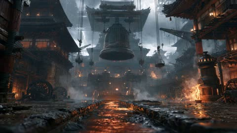</a>

Separate labeled reference images lock the arena and each fighter's look, and a LOCK block forbids swaps, clones and afterimages. Flexible shot blocks with the dialogue written inline let the model pace speech and combat together.

Seedance 2.5 · Reference-to-video · Source: [@GlitterPixely on X](https://x.com/GlitterPixely/status/2086471938650624231) · 175 likes on 2026-10-29

[`anime-action`](tags.md#tag-anime-action) [`multi-reference`](tags.md#tag-multi-reference) [`duel`](tags.md#tag-duel) [`dialogue`](tags.md#tag-dialogue)

<details><summary><b>Prompt</b></summary>

```text
[REF]

@Image
 1 defines only the rain-soaked ancient bronze arena: giant suspended bell, flooded stone lane, furnaces, cranes, timber-and-bronze architecture, orange firelight, storm light, and deep scale. No background people.

@Image
 2 defines only the hooded fighter’s face, black bob haircut, eye covering, rust-brown layered clothing, wraps, pendant, belt gear, proportions, and footwear. Exclude the white background and static pose.

@Image
 3 defines only the teal-haired fighter’s face, black-and-teal bob haircut, distressed teal-and-black clothing, belt gear, gloves, boots, and single hip blade. Exclude the white background and static pose.
[LOCK]
Exactly two fighters and one blade. Do not swap faces, hair, clothes, dialogue, weapons, or effects. The hooded fighter begins by the furnace tower and uses rust-red spatial seals plus an original hand-seal teleportation jutsu. The teal-haired fighter begins beneath the bell and uses cyan blade energy. Preserve the axis between those landmarks. Every teleport shows departure, briefly empty space, then one arrival; the previous position fully disappears. No clones or persistent afterimages.
[STYLE]
High-end stylized anime action-RPG duel. Fast, tactical, forceful combat with rapid hard cuts, explosive acceleration, readable silhouettes, sharp impact endpoints, and immediate environmental damage. Both fighters attack, evade, intercept, and counter. No slow motion or prolonged power-up.
[SEQUENCE]
Shot 1: Extreme wide down the flooded lane; rain lashes sideways, furnaces flare, and the bell sways over both fighters. Push quickly into paired medium shots. In English, cool and challenging, the teal-haired fighter says, {Take off the blindfold.} The hooded fighter listens with mouth closed, then replies in English, calm and amused, {Make me stay long enough.} The teal-haired fighter keeps their mouth closed.
Shot 2: Low lateral tracking. Before the reply fades, the teal-haired fighter explodes forward, the first step blasting water backward, and attacks with one cyan draw-cut. The hooded fighter collapses into a thin rust-red seal ring, fully vanishes, then reappears behind the attacker with a glowing palm strike. The teal-haired fighter spins and catches the palm on the blade flat. A white-hot bronze pressure ring, violent camera jolt, and crater throw water and tiles outward.
Shot 3: Medium-wide on the same axis. The hooded fighter attacks with a sweeping kick, teleports above the counter-slash, then drives a heel into the lane; the teal-haired fighter rolls clear as wet stones buckle. Rain bends toward the next exit before it opens. Reading the clue, the teal-haired fighter pivots early, intercepts the reappearance with a shoulder check and spinning kick, and launches the hooded fighter through a wooden scaffold. Braces bend and wood bursts; the hooded fighter lands crouched.
Shot 4: Clean waist-up close-up of the hooded fighter’s two unobstructed, anatomically correct hands. At fast but readable speed: palms clap; index and middle fingers interlock into a square lattice; thumbs hook as wrists rotate outward; fingertips close into a triangle. Each sign creates one concentric rust-red geometric seal. The pendant flashes, nearby raindrops halt, the bell hums, and the seals compress into a dark bronze sphere. No extra fingers, fused hands, or hidden poses. The teal-haired fighter rushes in to interrupt. Holding the final seal, the hooded fighter says in English with sudden force, {Resonance Jutsu: Ninefold Gate.} The sphere implodes with a vacuum crack; the hooded fighter vanishes before the cyan thrust lands. The bell tolls once and three gates ignite across walls, puddles, and beams.
Shot 5: Three rapid hard cuts show the single hooded fighter teleporting sequentially through three gates, never simultaneously: above with a descending palm; beside the bell chain with a sweeping kick; at ground level with a rust-red thrust. The teal-haired fighter evades the palm, blocks the kick with the blade hilt, and parries the thrust. Each contact creates a cyan-and-rust flash, warped rain, bronze sparks, a vacuum pop, and hard recoil. Re-establish both full bodies after the exchange.
Shot 6: Tight shot on rain curving toward the next exit. The teal-haired fighter predicts it, attacks the empty space first, and splits the forming gate with one cyan slash. The hooded fighter reappears off balance but counters by trapping the blade between two palm seals; metal screams and the ground fractures. The teal-haired fighter elbows free and cuts upward. The hooded fighter bends under the blade, teleports above it, and dives with a two-palm seal strike. The teal-haired fighter raises the blade flat to intercept. Their collision detonates a huge spherical cyan-and-rust shockwave: rain blasts outward, furnace flames flatten, scaffolds shake, stone splits across the lane, and the bell booms. Both fighters are hurled apart and skid through shallow water. Camera shakes only at impact, then stabilizes.
Shot 7: Low wide aftermath. Both rise into guarded stances as rain crashes back into the empty sphere. Rust-red seals dissolve into bronze dust; cyan electricity drains from the blade into puddles. In English, breathing hard but composed, the teal-haired fighter says, {Every exit leaves a sound.} The hooded fighter stays silent with mouth closed. End with both standing and the swinging bell between them.
[VFX / CAMERA / AUDIO]
Keep faces, hands, contact points, and landings readable. Use whip-pans, short tracking bursts, directional motion blur, displaced rain, hard cuts, and brief impact shake. Hooded effects originate from the hands and pendant, form as nonverbal rust-red geometric seals, open along the travel path, snap shut after arrival, spark on collision, and dissolve into dust. Teal effects originate only from the blade, follow each slash, flare on contact, and dissipate into cyan sparks and vapor. Heavy rain, splashing boots, cloth snaps, blade rings, teleport vacuum cracks, bass-heavy impacts, cracking stone, bending metal, debris, furnace roar, and bell resonance. No BGM; only dialogue, ambience, and action sounds. No subtitles, narration, readable text, logos, gore, extra fighters, extra weapons, face swaps, wardrobe changes, body merging, extra limbs, VFX-covered faces, or constant camera shake.
```

</details>

<a id="wan-rainy-street-fight-scene-night"></a>
### Two men face off on a rainy street

<a href="https://x.com/navi_Ai2/status/2099137778386633073">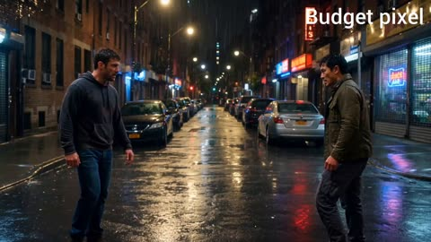</a>

Timed beats (0 to 3 seconds, 3 to 6 seconds and so on) give the model a shot by shot plan, and a separate audio line names the rain, footsteps and breathing. The closing realism block bans superhero physics and requires a consistent cast, which keeps the fight grounded.

Wan 3.0 · Text-to-video · Source: [@navi_Ai2 on X](https://x.com/navi_Ai2/status/2099137778386633073) · 173 likes on 2026-10-29

[`fight-scene`](tags.md#tag-fight-scene) [`night-rain`](tags.md#tag-night-rain) [`handheld-camera`](tags.md#tag-handheld-camera) [`timed-shots`](tags.md#tag-timed-shots)

<details><summary><b>Prompt</b></summary>

```text
Create a 15-second ultra-realistic cinematic fight scene, shot like a high-budget action movie. The scene takes place at night in a narrow urban street after light rain. The wet asphalt reflects streetlights and neon signs, creating realistic cinematic reflections. Two adult male fighters face each other, both wearing slightly dirty, realistic everyday clothing.

0–3 seconds: Start with a wide establishing shot. Both fighters stand several feet apart, breathing heavily and staring at each other with intense expressions. Light rain falls around them. The camera slowly pushes forward with subtle handheld movement. Realistic ambient city sounds, distant traffic, footsteps, rain and heavy breathing.

3–6 seconds: One fighter suddenly moves forward and throws a realistic punch. The other fighter quickly blocks and steps backward. Use natural body mechanics, realistic weight, believable footwork and authentic reactions. Camera switches to a dynamic medium tracking shot, following the movement.

6–10 seconds: The second fighter counters with two fast punches. The first fighter dodges the first punch and blocks the second. Show realistic impact reactions without exaggerated superhero movements. Clothing and hair react naturally to the motion. Use a brief slow-motion moment during the dodge, then immediately return to real-time speed.

10–13 seconds: The fighters exchange a short sequence of close-range defensive movements and strikes. Keep the choreography grounded and realistic, with natural balance, fatigue and imperfect movements. Camera moves around them in a smooth handheld cinematic arc.

13–15 seconds: One fighter lands a strong final body-level strike, causing the other fighter to stumble backward and fall against a wall. End with a close-up of the standing fighter breathing heavily while rain continues falling. The camera slowly pulls back as the street lights flicker in the background.

Visual style: photorealistic, cinematic movie quality, realistic human anatomy, natural skin texture, realistic facial expressions, physically accurate movement, detailed wet clothing, realistic rain droplets, atmospheric night lighting, subtle lens flare, shallow depth of field, natural motion blur, realistic shadows, high dynamic range, cinematic contrast, 35mm film look, professional action cinematography.

Camera: realistic handheld camera, smooth tracking shots, wide establishing shot, medium action shots, close-up reaction shots, natural camera shake during impacts, realistic focus pulls, cinematic depth of field.

Lighting: practical streetlights, soft neon reflections on wet pavement, realistic rim lighting, subtle volumetric atmosphere, natural shadows, no artificial glowing effects.

Audio: realistic rain, footsteps on wet asphalt, breathing, clothing movement, distant traffic, realistic impact sounds, subtle cinematic background score that builds tension.

Important: Make the entire sequence feel like real footage captured by a professional film crew, not animation or a video game. No superhero physics, no exaggerated punches, no impossible movements, no cartoon effects, no excessive camera shake, no distorted faces, no extra fingers or limbs, consistent characters throughout the entire 15 seconds.
```

</details>

<a id="h3-fps-military-base-firefight"></a>
### First person firefight at a night military base

<a href="https://x.com/Just_sharon7/status/2083064417798025721">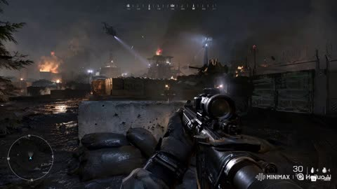</a>

Fixes the camera at eye level in a first person player view and lists each HUD element by name, so the model draws the interface as well as the scene. Asking for authentic handheld motion and no cinematic camera moves keeps the footage reading as live gameplay.

MiniMax H3 · Text-to-video · Source: [@Just_sharon7 on X](https://x.com/Just_sharon7/status/2083064417798025721) · 168 likes on 2026-10-29

[`fps`](tags.md#tag-fps) [`first-person`](tags.md#tag-first-person) [`game-hud`](tags.md#tag-game-hud) [`military-shooter`](tags.md#tag-military-shooter)

<details><summary><b>Prompt</b></summary>

```text
MiniMax H3 on
@Hailuo_AI
 feels like a major step forward for AI video creation.

From cinematic storytelling and product commercials to UI mockups, game-inspired scenes, and branded content, it handles a wide range of creative workflows with impressive consistency.

POV Modern Warfare FPS Gameplay Prompt

Camera: First-person perspective at eye level with authentic handheld player movement, as if recorded directly from a modern AAA military shooter. The player carries a highly detailed assault rifle with realistic animations, visible hands, tactical gloves, dynamic reload mechanics, and weapon sway.  **Opening Action:** The video immediately begins with the player already aiming down a roadway inside a modern military base. Multiple enemy soldiers are visible in the distance near sandbags, barricades, and military vehicles. The player carefully tracks one target, making small aim corrections while maintaining ADS (aim down sights). Fire several controlled bursts immediately at the visible enemies, producing realistic muzzle flashes, shell casings ejecting, smoke, recoil, hit reactions, and dust impacts around the targets. Continue firing in multiple short bursts while adjusting aim between enemies, simulating authentic FPS gameplay rather than scripted animation.  **Movement:** After the opening firefight, lower slightly from ADS and begin advancing cautiously along the road beside concrete barriers, Hesco walls, and parked military vehicles. Frequently check left and right corners, briefly stop to reacquire targets, then raise the weapon and fire additional controlled bursts whenever enemies appear ahead. Continue pushing forward with deliberate player-controlled movement, using cover naturally and maintaining believable tactical pacing.  **Environment:** Large modern military base with guard towers, armored vehicles, shipping containers, blast barriers, damaged buildings, smoke plumes, burning debris, scattered shell casings, dust clouds, and atmospheric battlefield haze. Cool natural daylight mixed with smoke and orange firelight creates a cinematic battlefield atmosphere.  **Camera Motion:** Authentic player-controlled movement with subtle head bob, weapon sway, natural mouse-look adjustments, small left-right corrections while aiming, realistic recoil, smooth tracking of moving targets, brief pauses before shooting, and fluid forward progression. Avoid cinematic camera moves—everything should feel like genuine live gameplay captured by a skilled player.  **Visual Quality:** Ultra-photorealistic, AAA game graphics with realistic PBR materials, detailed weapon models, physically accurate lighting, volumetric smoke, dynamic particle effects, crisp textures, realistic bullet impacts, muzzle flash illumination, motion blur only during rapid movement, and high-end military shooter presentation.  **Gameplay UI:** Display a realistic modern FPS HUD inspired by games like PUBG, Battlefield, or Call of Duty (without copying exact copyrighted assets). Include:  * Central dynamic crosshair or reticle * Ammo counter with magazine and reserve ammunition * Fire mode indicator * Compass at the top * Squad/team status panel * Mini-map in the upper corner * Health bar * Tactical equipment icons (grenades, medkit) * Hit markers when bullets connect * Directional damage indicators * Kill notification feed * Objective marker in the distance * Subtle interaction prompts and realistic HUD animations  The HUD should feel polished, modern, and fully integrated into the gameplay, enhancing the illusion of authentic recorded footage from a contemporary military FPS.
```

</details>

<a id="wan-ballroom-martial-arts-one-take-fight"></a>
### Woman in pink cardigan fights assassin in ballroom

<a href="https://x.com/ZaraIrahh/status/2096103896553001298">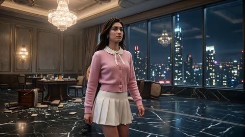</a>

The action is split into timed beats, each with its own camera move, and a style block asks for one continuous take. Concrete physical cues such as glass breaking, debris and motion blur carry the realism.

Wan 3.0 · Text-to-video · Source: [@ZaraIrahh on X](https://x.com/ZaraIrahh/status/2096103896553001298) · 167 likes on 2026-10-29

[`martial-arts`](tags.md#tag-martial-arts) [`one-take`](tags.md#tag-one-take) [`timed-beats`](tags.md#tag-timed-beats) [`action-choreography`](tags.md#tag-action-choreography)

<details><summary><b>Prompt</b></summary>

```text
A single continuous 20-second cinematic long take set inside a lavish luxury hotel ballroom at night. Massive floor-to-ceiling windows reveal a neon city skyline, elegant chandeliers hang overhead, polished black marble floors reflect the lights, overturned tables and scattered glass create a dangerous environment. The scene feels glamorous and sophisticated, but suddenly erupts into an extremely intense, fast-paced hand-to-hand fight.

[0:00–0:03] Medium tracking shot. A sophisticated woman with sharp green eyes, bold dark brows, and deep red lips walks calmly through the ballroom. She wears an adorable feminine outfit: a fitted pastel-pink cardigan, white pleated mini skirt, delicate ribbon at the collar, white ankle socks, and elegant Mary Jane shoes. She looks completely composed and graceful. Without warning, a large muscular assassin in a dark tactical outfit charges toward her from behind.

[0:03–0:06] She instantly turns and blocks his first punch. He throws a rapid combination of heavy strikes. She narrowly dodges each one, ducking, twisting and stepping around him with precise martial-arts movement. Camera circles tightly around them, creating intense kinetic energy. He grabs her arm and attempts to throw her — she reverses the movement and slams him hard onto a marble table.

[0:06–0:09] Before he can recover, he violently sweeps her legs. She hits the floor, rolls underneath a punch, springs back to her feet and immediately launches a brutal counterattack. Rapid punches, elbows, knee strikes, blocks and evasive movements. Her cute skirt and cardigan move naturally with every movement. Realistic weight, momentum and body mechanics.

[0:09–0:12] The assassin grabs her and drives her backward through a decorative glass partition. Camera follows through the impact in one fluid movement. Glass explodes around them. She lands, rolls across the marble floor and immediately rises. Her expression becomes cold and determined. The assassin charges again.

[0:12–0:16] EXTREMELY INTENSE FIGHT SEQUENCE. Continuous rapid choreography with no pause: she parries a punch, strikes his ribs, ducks under a hook, counters with a spinning kick, blocks a heavy strike, grabs his arm and uses his momentum to throw him across the room. He crashes into a wooden table. He immediately gets back up and rushes her. She uses the environment, stepping onto a fallen chair and launching herself into a powerful flying strike. Camera rapidly tracks, whips around and crashes close during every major impact. Realistic motion blur, powerful sound-implied impacts, debris flying through the air.

[0:16–0:18] The assassin attempts one final desperate attack. She catches his arm, pivots with perfect timing and executes a devastating Judo-style throw, sending him crashing onto the marble floor. The impact sends loose glass fragments sliding across the reflective surface. She remains standing, breathing heavily but composed.

[0:18–0:20] Extreme close-up. Her sharp green eyes lock onto the defeated attacker. A tiny strand of hair falls across her face. She calmly fixes her pink cardigan, straightens her pleated skirt and adjusts her ribbon as if nothing happened. She turns and walks away gracefully through the ruined ballroom while city lights shimmer behind her. Camera slowly pushes toward the shattered glass and fades to black.

STYLE: Photorealistic, ultra-detailed 4K cinematic action film, extremely intense hand-to-hand combat, sophisticated feminine aesthetic contrasted with brutal choreography, realistic martial-arts technique, physically accurate body mechanics, realistic impacts and momentum, natural cloth and hair movement, cinematic motion blur, dynamic handheld camera, continuous uninterrupted camera movement, rapid tracking shots, whip pans, dramatic close-ups, shallow depth of field, realistic glass destruction, practical lighting, warm chandelier light mixed with cool blue city light, glossy reflections, high contrast, premium Hollywood action cinematography, relentless pacing, no cuts, one continuous shot.
```

</details>

<a id="kling-thunder-emperor-jiangshi-battle"></a>
### Hooded hero runs across battlefield toward monster army

<a href="https://x.com/RizwanAly07/status/2112516449080348958">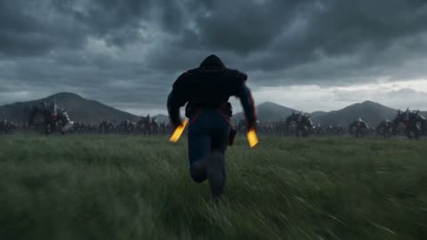</a>

A character lock block gives each reference image one job, image1 for the protagonist and image2 for the monsters, and repeats the identity rules in the negative prompt. Timed beats of about five seconds each, with camera direction per beat, give the model a clear shot list for a 30 second sequence.

Kling 4.0 · Reference-to-video · Source: [@RizwanAly07 on X](https://x.com/RizwanAly07/status/2112516449080348958) · 146 likes on 2026-10-29

[`dark-fantasy`](tags.md#tag-dark-fantasy) [`multi-shot`](tags.md#tag-multi-shot) [`character-lock`](tags.md#tag-character-lock) [`combat`](tags.md#tag-combat)

<details><summary><b>Prompt</b></summary>

```text
DURATION: 30 seconds | FORMAT: horizontal 16:9
STYLE: Ultra-photorealistic dark fantasy combat, 8K HDR, 24fps.

CHARACTER LOCK — ABSOLUTE PRIORITY
image1 = Only reference for the adult MALE Jiangshi protagonist. Preserve his exact male face, hairstyle, outfit, physique, and accessories. Never change his gender, face, or identity.
image2 = Only reference for consistent enemy monsters.

ENVIRONMENT
Vast stormy green battlefield, thousands of monsters, gigantic demons, ruined Taoist temples, shattered altars, navy storm clouds, cyan-white lightning, golden talismans, and black demonic energy. Never show an empty battlefield.

0–5s — LIGHTNING DASH
The male Jiangshi dodges monster claws, slides across grass, and throws explosive golden talismans. Lightning-powered punches and kicks destroy enemies. He says: "비켜라."

5–10s — THUNDERBLADE TORNADO
TECHNIQUE 1: 뇌부천쇄 · 천뢰풍폭
Thousands of lightning blades form a gigantic golden-cyan tornado, tearing through monster armies and destroying stone altars. He charges forward, shouting: "천뢰를 받아라!"

10–15s — THUNDERSTORM
TECHNIQUE 2: 구천뇌우 · 만뢰천폭
He slams a golden talisman into the ground. A colossal Bagua formation appears overhead, unleashing thousands of lightning bolts and three interconnected thunder tornadoes. He shouts: "하늘이여, 쓸어버려라!"

15–20s — LIGHTNING PRISON
TECHNIQUE 3: 팔괘천뢰진 · 팔방봉멸
Eight enormous golden sealing pillars rise, connecting sky and ground with cyan lightning. A gigantic octagonal prison traps thousands of monsters in crushing electrical chains. He shouts: "뇌문, 개방!"

20–25s — DEMON KING
The formations explode in a massive blue-white shockwave. A mountain-sized demon king emerges from black storm energy. The protagonist dodges, attacks with lightning-powered palms, and launches aerial counterattacks before being blasted backward.

25–30s — FINAL ULTIMATE
FINAL TECHNIQUE: 구천뇌제 · 만뢰천벌
He raises a golden talisman as thousands of lightning bolts converge around him. He says: "구천의 벼락이…" then shouts: "네놈을 멸하리라!"

A colossal golden-cyan Bagua formation fills the sky. Thousands of gigantic lightning bolts merge into a devastating thunder pillar, engulfing the demon king in an enormous explosion.

FINAL FRAME: The recognizable male protagonist stands in the foreground as lightning illuminates the monster army and ruined temples.

CAMERA: Dynamic tracking, aggressive whip-pans, fast combat cuts, dramatic low angles, realistic impact shake, continuous battlefield action.

NEGATIVE: No female characters, gender swapping, face morphing, identity changes, outfit changes, inconsistent monsters, cartoon CGI, teleportation, empty backgrounds, logos, subtitles, or watermarks.
```

</details>

<a id="h3-panda-fox-staff-tea-house-fight"></a>
### Panda and fox staff fight on tea house

<a href="https://x.com/eternityspring/status/2094780794552361367">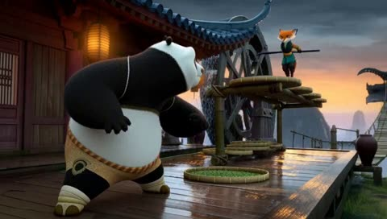</a>

Each strike is staged as contact, then material bending, then whole body displacement, so the physics stays readable. A 28mm full body framing on the hero and a layered sound track keep both fighters clear through the action.

MiniMax H3 · Text-to-video · Source: [@eternityspring on X](https://x.com/eternityspring/status/2094780794552361367) · 139 likes on 2026-10-29

[`martial-arts`](tags.md#tag-martial-arts) [`3d-animation`](tags.md#tag-3d-animation) [`shot-list`](tags.md#tag-shot-list) [`sound-design`](tags.md#tag-sound-design)

<details><summary><b>Prompt</b></summary>

```text
integrated_multimodal_description: [Shot 1] A 15.00-second cinematic 3D animated martial-arts feature with polished stylized animal anatomy, detailed panda and fox fur, expressive but physically coherent poses, wet wood, pottery and water materials, crisp silhouettes, dramatic cool-blue shadow against warm orange sunset light, and brief smear frames only during the fastest motions. The setting is Cloudsteep Tea House, a vast wooden tea workshop built across mountain cliffs after a thunderstorm: tiered tea-drying decks, dark red beams, wet blue-black tiles, hanging bamboo trays, tea sacks, clay jars, steam pipes, a giant wooden waterwheel, a narrow bamboo walkway and a rope suspension bridge above a cloud sea. Spatial continuity remains stable. A 28mm medium-wide camera at the adult male anthropomorphic panda hero Po's waist height clearly shows Po's complete body from head to bare feet with roughly ten percent breathing room around him. Po has a heavy round black-and-white body, green eyes, beige shorts, a reddish-brown belt and wrapped lower legs. He holds a low martial stance on the left foreground. The complete body of an original adult female anthropomorphic red-fox staff fighter named Feiying is visible on a raised beam in the right background; she is slim and agile, with red-and-white fur, a dark teal short jacket, charcoal trousers, muted-gold wrist guards and one ordinary black wooden staff. Feiying stamps off the beam and dives as her staff sweeps low across the wet deck, cutting a narrow arc through the puddle. Immediately before real contact, Po lifts his left foot and leans his full body backward, and the staff passes visibly in front of his belly without intersecting it. The camera arcs right at fast speed while keeping Po's full-body action readable.

[Shot 2] At 00:01.400, Feiying continues the same rotation and brings the staff down from overhead. Po grabs a round bamboo tea-drying tray beside him and raises it at shoulder height. The staff first strikes the exact center of the tray; the woven bamboo bends deeply inward and wet tea leaves burst toward the lens. Only after impact do Po's knees compress and the boards beneath both bare feet crack. Po yields instead of resisting, hugs the tray like a wheel and rolls sideways beneath Feiying's arm. A low tracking camera follows close beside the rolling tray; beams and lanterns form curved motion blur while both character silhouettes remain clear.

[Shot 3] At 00:03.400, the camera cuts to a wide side view that establishes the tea house levels. Po brakes by touching the tray edge to the deck, his heavy round body rebounds upright, and Feiying sprints above him across three suspended tea-drying racks. Every footfall visibly bends a rack before it springs back. Po does not match her speed; he shoulder-checks the wooden locking pin beneath the rack system. The racks flip upward in a physically connected seesaw sequence. Feiying clears the first two, but the third rack contacts the soles of her feet first, compresses her legs, and only then launches her toward the giant waterwheel.

[Shot 4] At 00:05.800, an ultra-wide camera just above the water frames the giant wheel in the center. Feiying curls in the air, hooks her staff around a crossbar and swings onto a rotating paddle. Po jumps from the last raised rack onto a lower paddle; his weight depresses it and visibly accelerates the entire wheel. They exchange close-range martial actions on the moving wheel. Feiying delivers three short staff thrusts; Po makes real contact in order with an outward forearm parry, a downward palm press, and a compact shoulder deflection. On the third defense Po slips and hangs briefly upside down, then intentionally hugs a paddle and lets his weight reverse the wheel's motion. Feiying's paddle travels backward first, her balance breaks second, and the wheel throws her upward third. Water follows the real paddle rotation. There are no supernatural effects.

[Shot 5] At 00:08.400, Feiying folds and flips in the air, then points the staff down at Po. Po pulls free a loose round bamboo tray and holds it as a flexible shield. The staff tip hits first and drives a deep visible dent into the woven bamboo. Po's rear foot slides half a step across the wet beam, then he rotates his hips and angles the tray to redirect the staff into a clay jar. The jar rim shatters and releases steam and tea water. With Feiying's weapon arm pulled off line, Po steps from behind the tray and shoulder-checks her chest. Her torso compresses at contact, her tail whips upward, and only then does she fly sideways to the rope-bridge entrance, still holding the same staff.

[Shot 6] At 00:10.800, a fast lateral tracking shot follows Feiying retreating along the wet rope bridge, alternating staff taps on the bridge boards for balance. Po follows with heavy steps; each step depresses a board and ejects rainwater through the gaps, building one coherent wave through the entire suspension bridge. Feiying uses the rising bridge to reverse direction and thrust the staff straight toward Po's chest. Without stopping, Po catches the solid shaft between both palms, retreats across exactly two boards to absorb the force, then sinks his hips and twists his waist, transferring the linear force into the bridge's swing. A large physical wave rises from beneath Po and catapults Feiying and the staff back toward the tea-house deck.

[Shot 7] At 00:13.200, the camera follows Feiying toward the deck and rolls clockwise by only twenty degrees. She releases the spinning staff. Po holds a bridge rope, swings back onto the platform, catches the staff with one hand, and supports Feiying's falling back with the other so she does not fall over the cliff. Their landing depresses the boards before they rebound, sending one ring of puddle water outward. During the final 0.60 seconds the camera holds a medium-wide composition: Po's complete body stands in the center, breathing lightly and holding the black staff horizontally; Feiying's complete body sits beside him inside a broken bamboo tray and looks up in surprise. The waterwheel continues turning slowly behind them, orange sunset light crosses blue steam, and a few tea leaves drift between them. Po gives one brief satisfied smile. Preserve identical character identity, fur pattern, proportions, clothing and the single staff throughout. Real characters are one Po and one Feiying only. No dialogue, no visible text, no subtitles, no logo, no watermark, no close-up in the first frame, no extreme foot perspective, no extra limbs, no missing limbs, no fused hands, no face drift, no costume change, no duplicate weapon, no sudden location change, no human transformation, no magically thin Po, no blood, and no death. No clones, sorcery, chi beams, colored energy, lightning, levitation, teleportation, game UI, turn-based pauses, environmental intersection or passing through solid beams, trays, wheel paddles, bridge boards, ropes, bodies or weapons. Every strike strictly follows solid contact, local compression or material bending, then whole-body displacement.

overall_soundscape: Post-storm dripping, distant thunder, wooden creaks, waterwheel rumble, tightening bridge ropes, Po's heavy wet footsteps, Feiying's light landings, bamboo flexing, wooden-staff whooshes and impacts, a clay jar breaking, steam release, tea water and synchronized splashes create a continuous spatial action track. Both fighters make only brief exertion breaths and nonverbal grunts; there is no spoken dialogue.

non_diegetic_music: Fast Chinese martial-arts orchestral scoring with tanggu and hand drums, wooden percussion, low strings, restrained brass and short dizi motifs. The tempo accelerates at 00:05.800 for the waterwheel fight, reaches its strongest percussion at 00:10.800 on the rope bridge, and resolves on the final landing with one clean gong strike and a short low-string cadence.
```

</details>

<a id="seedance-london-grapple-ledge-sunset"></a>
### Woman sits on window ledge above London at sunset

<a href="https://x.com/j_smeaton99/status/2086059029995102532">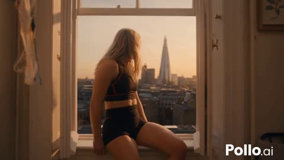</a>

Timed beats split a 30 second sequence into one continuous outside tracking shot. Explicit camera rules plus continuity locks for outfit, devices and environment keep the character consistent through each swing.

Seedance 2.5 · Text-to-video · Source: [@j_smeaton99 on X](https://x.com/j_smeaton99/status/2086059029995102532) · 128 likes on 2026-10-29

[`london`](tags.md#tag-london) [`grappling`](tags.md#tag-grappling) [`tracking-shot`](tags.md#tag-tracking-shot) [`timed-beats`](tags.md#tag-timed-beats)

<details><summary><b>Prompt</b></summary>

```text
30-sec cinematic London grappling sequence. Ultra-photorealistic live-action Hollywood cinematography, realistic physics, natural lighting, detailed London environments, cinematic depth of field, 35mm/50mm look, 4K.

A beautiful young adult White American woman, mid-20s, long blonde hair, athletic build, natural face. She is an ordinary woman using experimental wrist-mounted grappling devices, not a superhero. No mask, cape, emblem or superhero costume. She wears the same fitted black athletic crop top with subtle piping, black high-waisted athletic shorts, white sneakers and minimal jewelry throughout.

Camera: One continuous third-person tracking shot. Camera always remains outside her, never first-person, handheld or smartphone. Keep her clearly visible and maintain smooth physically motivated movement. No cuts or perspective changes.

0:00–0:05: Golden-hour London apartment overlooking the skyline. She sits safely on the balcony ledge, looks toward camera and says, “Okay… let’s see if this works.” Camera slowly moves toward her.

0:05–0:09: She steps over the railing and descends naturally. Camera follows backward in a wide full-body shot.

0:09–0:13: Her right wrist device activates with a subtle orange light. Cable shoots to a believable rooftop anchor, visibly attaches and becomes taut, converting her fall into a realistic swing.

0:13–0:18: Camera tracks beside her as she swings between buildings. River Thames and London skyline below, with buses, black cabs and traffic. She releases the cable and activates her left wrist.

0:18–0:22: Second cable attaches to a rooftop. She swings again as the camera smoothly arcs around her while keeping her full body visible.

0:22–0:26: She lands naturally on a rooftop, runs three steps, reaches the edge, pauses briefly, then leaps toward the next building.

0:26–0:30: She fires a final cable and makes a huge smooth swing above London. Camera pulls backward and upward, revealing Tower Bridge, London Eye, The Shard, Westminster, Thames and the city at sunset. She releases and briefly glides forward before becoming a small silhouette. Fade to black.

Maintain exact character, outfit, devices and environment continuity. Realistic gravity, momentum, cable tension, wind, hair and clothing physics. No teleportation, impossible movement, distorted hands, duplicated limbs, warped buildings, disappearing cables, changing clothes, excessive VFX or background morphing. Keep it subtle.
```

</details>

<a id="seedance-lightning-swordsman-plaza-battle"></a>
### Lightning-charged swordsman fights soldiers in stormy plaza

<a href="https://x.com/Naiknelofar788/status/2089393496176427368">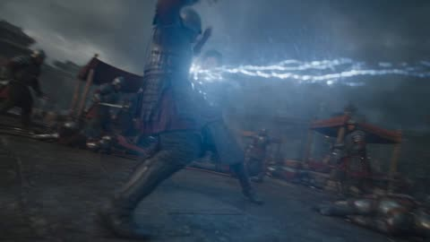</a>

A reference image locks the character's identity, and the prompt states the one-arm rule with a negative list to prevent drift. Five timed beats pace the fight, while a fixed 40 degree Dutch angle and whip-pans keep the camera kinetic.

Seedance 2.5 · Image-to-video · Source: [@Naiknelofar788 on X](https://x.com/Naiknelofar788/status/2089393496176427368) · 115 likes on 2026-10-29

[`lightning`](tags.md#tag-lightning) [`martial-arts`](tags.md#tag-martial-arts) [`timed-beats`](tags.md#tag-timed-beats) [`dutch-angle`](tags.md#tag-dutch-angle)

<details><summary><b>Prompt</b></summary>

```text
30 seconds | 16:9 | No music

Ultra-photorealistic live-action, AAA Hollywood action style with premium VFX. One continuous dynamic shot, permanent 40° Dutch angle, low tracking, fast pursuit, whip-pans and quick orbiting. Real human performance, not CGI.

IMAGE 1: Preserve exact identity, face, hair, clothing and proportions. Image1 has ONLY ONE ARM — RIGHT ARM ONLY. No left arm, hand, elbow, prosthetic or phantom limb. Sword is always controlled one-handed with the right hand.

SETTING: Massive medieval royal plaza, castle walls, stormy sky, damaged market structures and dozens of armored soldiers surrounding Image1.

00–06s: Soldiers attack. Image1 narrowly dodges a sword, parries one-handed, vaults over an attacker and kicks another into a shield wall, then bursts forward with a black afterimage and blue-white lightning trail.

06–12s: Image1 runs across fallen shields, bends a spear with his foot and cuts it with a lightning-charged slash. He rolls, rises and immediately fights three soldiers using fast parries, kicks and a reverse sword strike.

12–18s: A dense spear formation attacks. Image1 slides underneath, cuts several spear shafts and spins into a powerful heel kick. Lightning jumps between broken weapons as soldiers are thrown backward.

18–24s: Surrounded by enemies, Image1 throws the sword upward, then uses rapid Taijutsu—low sweep, shoulder strike, high kick and jumping knee. Brief black afterimages emphasize his physical burst speed. No teleportation.

24–30s: Image1 catches the falling sword perfectly with his right hand. Electricity surges across the blade. A powerful one-handed slash and spinning kick create a compressed-air shockwave, blasting soldiers outward through dust and debris. Camera pulls back as Image1 keeps advancing and another wave of soldiers enters at 30 seconds. No ending pose.

VFX: Restrained blue-white lightning, sparks, afterimages, shockwaves, dust and debris. Keep everything physically integrated with realistic lighting, shadows and reflections while Image1 remains fully authentic live-action.

AUDIO: Wind, armor, sword impacts, electrical crackling, debris and battle cries. No dialogue or music.

NEGATIVE: Left arm, two-handed grip, teleportation, clones, CGI human, digital double, cartoon look, gameplay camera, broken anatomy, face drift, costume drift, subtitles, logos, watermark.
```

</details>

<a id="wan-temple-kung-fu"></a>
### Kung fu duel in a temple courtyard at dusk

<a href="https://x.com/LudovicCreator/status/2091103231753457853"></a>

Bracketed sections (`[PROJECT TYPE]`, `[Global Setting]`, …) and a closing checklist of what the fight must show.

Wan 3.0 · Text-to-video · Source: [@LudovicCreator on X](https://x.com/LudovicCreator/status/2091103231753457853) · 114 likes on 2026-10-27

[`martial-arts`](tags.md#tag-martial-arts) [`action`](tags.md#tag-action) [`structured-prompt`](tags.md#tag-structured-prompt)

<details><summary><b>Prompt</b></summary>

```text
[PROJECT TYPE] Text-to-video. 30-second cinematic action sequence. Intense kung
fu battle.

[Global Setting] Traditional Chinese temple courtyard at dusk. Stone ground, red
lanterns, ancient pillars. Dramatic atmospheric lighting. Gritty realistic combat
cinematography.

[Character 1  Master Martial Artist] Age 35-40, lean muscular build, traditional
black kung fu gi, intense focused eyes, weathered face. Precise controlled
movements. Absolute master of combat.

[Character 2  Multiple Opponents] 3-4 trained fighters in red/dark gi attacking
simultaneously. Skilled but facing a master. Brutal choreography.

[Scene Description]

[Opening, 0–3s] Wide shot of temple courtyard. Master stands alone, perfectly
still, centered. Opponents circle him from all angles. Tension building. Rain
begins falling. The master's breathing is calm and controlled. Opponents tense,
ready. Silence before the storm.

[First Exchange, 3–9s] FIRST OPPONENT ATTACKS  fast combination of kicks and
punches. Master sidesteps with minimal movement, pure efficiency. Counter-strike
master's hand snaps out HARD, opponent staggers backward violently. Second
opponent presses in from different angle. Master blocks incoming kick with
explosive impact (sparks from boot contact on stone). Sweeping kick from master
opponent flies backward, crashes into pillar. HARD impacts, no mercy. Fast-cut
action, realistic combat sounds.

[Escalation, 9–18s] Multiple opponents attack SIMULTANEOUSLY now  coordinated
assault. Master becomes ABSOLUTE WARRIOR. Rapid-fire strikes and blocks. Every
movement is purpose-driven and brutal. One opponent launches spinning kick  master
catches the leg mid-spin and THROWS them across the courtyard (hard slam on
ground). Another attacks  master's palm strike connects with chest , opponent
drops gasping. Third opponent attempts combo master weaves through each strike
with minimal energy expenditure, then delivers devastating elbow strike to the
face. Blood. Gritty realistic impacts. Master is untouched, breathing controlled.
Opponents are outmatched completely.

[SLOW-MOTION PEAK, 18–24s] Final standing opponent makes last desperate attempt
launching powerful overhead strike. Time slows to 40% speed. Master's hand rises
in perfect defensive position. Slow-motion shows the IMPACT  the sound echoes,
slow and resonant. Master's muscles tense absorbing the strike. Master's face
shows absolute concentration. Then master's OTHER hand moves in slow-motion
palm strike aimed at opponent's chest in devastating counter. Slow-motion shows
the movement trajectory, the focus, the power building. Impact happens in slow
opponent's body recoils violently. Return to normal speed.

[Final Moment, 24–30s] Last opponent flies backward, crashes hard against stone
wall, crumples to ground. All opponents are down. Master stands in center of
courtyard, completely untouched, breathing steady. Rain falling on his face. His
expression is calm but intense. He takes one slow controlled breath. Stone ground
is marked with impact points. Red lanterns flicker in wind. Master's presence is
absolute and undeniable. Final frame: master looking directly forward, absolute
confidence and skill.

[Audio] Rain falling. Tense atmospheric buildup. Master's controlled breathing.
Opponent footsteps and positioning. HARD impact sounds (realistic, meaty, brutal
— not cartoonish). Bone-on-bone cracks. Heavy breathing from opponents. Master's
breathing calm throughout. During slow-motion: all sounds deepen and stretch
(impact becomes resonant). Final moment: just rain and master's steady breathing.

[Visual Style]
— Cinematic realistic martial arts
— Dynamic camera angles (tracking, close-ups, wide shots)
— Slow-motion on key impacts
— Rain and atmospheric lighting
— Blood and gritty realism
— Precise choreography showing skill
— Temple setting cinematic framing
— Master dominates completely

[Tone] Serious, brutal, masterful. This is a display of absolute martial skill.
Respect for the combat but no mercy. Dark and gritty. The master is unstoppable.

[Consistency]
— One master throughout (untouched, calm)
— Multiple opponents (becoming increasingly desperate)
— Temple courtyard location
— Rain constant
— Action escalates then peaks
— Master's superiority clear
— Realistic brutal combat
```

</details>

<a id="wan-crab-pier-chase-comedy"></a>
### Fisherman chases giant crab across a wooden pier

<a href="https://x.com/Strength04_X/status/2097936515087376606"></a>

Timed blocks of about five seconds give each shot one clear action, so the sequence reads as a continuous story. Handheld camera, 35mm lens and documentary realism wording set the shake, shallow focus and natural look.

Wan 3.0 · Text-to-video · Source: [@Strength04_X on X](https://x.com/Strength04_X/status/2097936515087376606) · 112 likes on 2026-10-29

[`chase`](tags.md#tag-chase) [`pier`](tags.md#tag-pier) [`comedy`](tags.md#tag-comedy) [`handheld-camera`](tags.md#tag-handheld-camera)

<details><summary><b>Prompt</b></summary>

```text
0–5s: Wide shot of a sunny seaside fishing pier. A fisherman pulls up his fishing net and discovers a huge crab tangled inside. The crab suddenly escapes and starts running across the wooden pier.
5–10s: The fisherman drops the net and runs after it, trying to catch the crab before it reaches the edge of the pier.
10–15s: Handheld chase shot follows the crab moving sideways at surprising speed, weaving between fishing buckets, ropes, coolers, and tourists.
15–20s: The fisherman tries to block its path with a fishing net, but the crab quickly changes direction and races underneath a wooden bench.
20–25s: The fisherman crawls under the bench after it, gets tangled in his own fishing rope, falls backward, then quickly gets back up as the crab continues toward the water.
25–30s: The fisherman finally corners the crab near the pier edge. He reaches down carefully, but the crab suddenly grabs his fishing hat and runs away wearing it.
Style: ultra-realistic, cinematic action-comedy, natural seaside daylight, realistic ocean and fishing pier, lifelike crab movement, realistic human reactions, dynamic handheld chase camera, subtle camera shake, shallow depth of field, 35mm lens look, natural colors, documentary realism.
```

</details>

<a id="h3-morning-selfie-vlog-goddess-transformation-monster-fight"></a>
### Selfie vlog girl becomes goddess fighting monster

<a href="https://x.com/joshesye/status/2084852295607484730"></a>

A second by second script covers selfie opening, monster arrival, transformation, fight and return to the ordinary girl. Numbered reference images lock the face, armor and street, while explicit must show lines and a two second final hold stop the transformation and ending from being skipped.

MiniMax H3 · Reference-to-video · Source: [@joshesye on X](https://x.com/joshesye/status/2084852295607484730) · 110 likes on 2026-10-28 · found via [SkyNotSilent/awesome-MiniMax-H3-cases](https://github.com/SkyNotSilent/awesome-MiniMax-H3-cases)

[`reference-images`](tags.md#tag-reference-images) [`action-vlog`](tags.md#tag-action-vlog) [`transformation`](tags.md#tag-transformation) [`chinese-dialogue`](tags.md#tag-chinese-dialogue) [`cinematic-realism`](tags.md#tag-cinematic-realism)

<details><summary><b>Prompt</b></summary>

```text
生成一段 15 秒、写实电影质感的动作 Vlog 视频。主角是一位 24 岁左右的中国女孩

图片1 ，黑色自然长发，清晰可辨的东方面容，五官真实自然，穿着浅色针织上衣和深色半裙。地点是现代中国一线城市清晨街道

图片3 ，小区门口外有包子铺、便利店、公交站牌、共享单车、梧桐树、人行道、中文店招和来往行人。视频开头像手机自拍 Vlog，手持镜头轻微晃动，真实生活感。

0–2 秒：现实女孩图片1 从中国城市小区门口走出来，举着手机自拍，微笑看向镜头。背景是清晨街道、包子铺、便利店、公交站牌和中文店招。镜头是手机前置自拍视角，轻微手持晃动，环境声有早高峰人声、车辆声、早餐店蒸汽声。

2–4 秒：她身后街口突然传来沉重撞击声，一只高大的黑色怪兽从公交站旁冲出，撞翻共享单车，路人惊慌逃散。女孩猛地回头，笑容消失，眼神变冷。镜头快速转向她身后，怪兽清晰出现在画面中央，身形巨大，皮肤粗糙，低吼，脚步震动地面。

4–7 秒：女孩站定，镜头切到中近景，重点拍她完整变身
图片4 。她抬手挡在身前，金色和青色神力从手腕、肩膀、发梢涌出，普通针织上衣被光纹覆盖，逐层变化成中国神话女神战甲
图片2 。战甲有青铜金属纹理、云纹、羽状肩甲和发光腰带，长发被气流扬起，额间浮现金色神印。必须看清从现实女孩变成神话女神的过程，不要一闪而过。她低声说一句中文：“别再往前了。”

7–9 秒：怪兽扑向她。镜头切到低角度广角，女神向前冲刺，脚下地面裂出金色光纹。她侧身躲开怪兽爪击，右手凝聚青金色长刃，反手斩中怪兽手臂，火花和黑色鳞片飞溅。动作要清楚，人物和怪兽都在画面中央，不要只拍光效。

9–11 秒：连续近身打斗。镜头跟随女神绕到怪兽侧面，她跃起踢中怪兽胸口，怪兽后退撞到公交站牌。女神落地后双手结印，身后短暂浮现中国神话女神虚影，云纹神环展开。怪兽再次扑来，她用神力护盾正面挡住冲撞，冲击波吹动路边树叶和中文店招。

11–13 秒：女神抓住怪兽破绽，向前一步，掌心爆发青金色能量，将怪兽击退到街道中央。怪兽倒地低吼，烟尘散开，路人远远停下脚步。镜头轻微晃动，像手机真实拍到这一幕。女神站在街道中央，战甲发光，背后是现代中国城市街景。

13–15 秒：重点保留 2 秒现实女孩状态。女神身上的青金色神光慢慢收回，战甲一层层消散，重新变回最开始那个现实中国女孩图片1 ，浅色针织上衣和深色半裙恢复原样，额间神印消失，长发自然落下。她站在街边，轻轻喘气，看了一眼倒地的怪兽，又转头看向手机镜头，露出一点尴尬又淡定的表情，像什么都没发生一样，小声说一句中文：“上班要迟到了。” 最后画面停留在现实女孩的脸和普通穿搭上，至少保留 2 秒。

全程保持同一个中国女孩的脸，不要变成欧美面孔，不要变成二次元，不要卡通风。最后必须从神话女神明确变回现实女孩，并且现实女孩状态保留完整 2 秒。

打斗部分集中在 7–13 秒，必须有闪避、斩击、踢击、格挡、反击和击退怪兽，不要只用发光和烟雾代替打斗。

全程无字幕、无背景音乐，仅保留城市环境声、怪兽低吼、能量音效、打斗撞击声和人物中文对白。

画面保持写实电影质感，中国城市环境真实，有中文招牌和中国街景细节。
```

</details>

<a id="seedance-redhead-chamber-fight"></a>
### Redhead heroine battles armored troops in glowing chamber

<a href="https://x.com/Artedeingenio/status/2084205220146434326">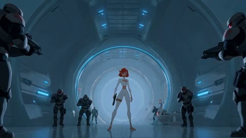</a>

The prompt is split into timed beats, each with one clear action and one named camera move, so the model does not blur the whole sequence into one shot. The explicit sound design list and the no dialogue line set the score and impacts.

Seedance 2.5 · Reference-to-video · Source: [@Artedeingenio on X](https://x.com/Artedeingenio/status/2084205220146434326) · 102 likes on 2026-10-29

[`action`](tags.md#tag-action) [`sci-fi`](tags.md#tag-sci-fi) [`animation`](tags.md#tag-animation) [`timed-beats`](tags.md#tag-timed-beats)

<details><summary><b>Prompt</b></summary>

```text
15-second cinematic futuristic action sequence, breathtaking high-budget sci-fi animated feature, ultra-dynamic editing, fearless red-haired superhuman woman in a sleek white tactical suit battling heavily armored security forces inside a colossal futuristic research facility, gravity-defying martial arts, impossible acrobatic movement, premium cinematic animation, seamless kinetic camera movement, aggressive speed ramps, rapid match cuts, whip pans, rotating camera moves, dramatic perspective shifts, cinematic lens distortion, volumetric blue lighting, sparks, shattered glass, flying debris, metallic reflections, emotionally explosive, no dialogue.

0–3s

Inside a vast circular research chamber, emergency lights begin flashing.

The red-haired woman stands perfectly still at the center of the room.

Armored security troops slowly surround her from every direction.

Extreme close-ups.

Focused eyes.

Bare feet shifting slightly.

Fingers relaxing before the attack.

The camera rapidly alternates between dramatic low angles and intimate facial close-ups.

Complete silence.

3–6s

Without warning, she explodes into motion.

She sprints directly toward the nearest squad before launching into an impossible aerial flip.

She rebounds from the curved walls, vaults over the soldiers and lands behind them in a single fluid movement.

The camera races beside her using aggressive whip pans, rotating tracking shots and impossible overhead dives.

Everything suddenly accelerates.

6–9s

A breathtaking combat montage.

She disarms one opponent mid-air, slides beneath another, rebounds from a wall and launches into a spinning kick that sends multiple armored soldiers crashing across the chamber.

Glass shatters.

Metal sparks erupt.

Weapons skid across the polished floor.

The camera never stops moving: seamless orbit shots, handheld pursuit, crash zooms, dramatic perspective shifts and rapid match cuts amplify every impact.

9–12s

The remaining soldiers unleash a coordinated assault.

She sprints vertically along the curved wall, flips over a hail of incoming fire, lands on a suspended platform and dives back into the center of the chamber.

Slow motion blends into explosive speed ramps.

The circular architecture transforms into a dizzying visual spectacle as the camera spins around her without interruption.

12–15s

Everything suddenly slows.

The last armored opponent falls.

Silence returns.

She stands alone beneath the enormous glowing ring suspended above the chamber.

Her hair moves gently in the circulating air.

The camera rapidly cranes upward through the center of the colossal futuristic hall, revealing the immense scale of the facility before fading to black.

Hard cut to black.

Sound design: powerful hybrid orchestral score, electronic pulses, deep brass, taiko drums, synthetic bass impacts, metallic footsteps, glass breaking, cinematic whooshes, echoing impacts, rushing air, rising choir, brief silence before the final aerial reveal, overwhelming orchestral finale.
```

</details>

<a id="seedance-giant-dragon-lake-chase"></a>
### Giant stomps through lake as dragon dodges

<a href="https://x.com/hedo_ist/status/2083219828471382503">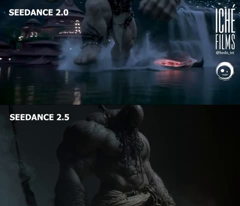</a>

The action is written as ordered beats, each with a cause and effect: the step sends water flying, then the dragon dodges the stomp. A closing style line sets the pacing and realism.

Seedance 2.5 · Text-to-video · Source: [@hedo_ist on X](https://x.com/hedo_ist/status/2083219828471382503) · 101 likes on 2026-10-29

[`giant`](tags.md#tag-giant) [`dragon`](tags.md#tag-dragon) [`water-splash`](tags.md#tag-water-splash) [`beat-sequence`](tags.md#tag-beat-sequence)

<details><summary><b>Prompt</b></summary>

```text
A colossal giant appears, striding through a lake; the ground shakes with every step, sending massive amounts of water splashing.

A flying dragon appears, performing aerial acrobatics; the giant tries to catch it with his arms, but the dragon manages to dodge the giant's attempts to stomp on it.

A fast-paced action scene with realistic cinematography.
```

</details>

<a id="wan-game-world-teleport-ugc-chase"></a>
### Woman teleported into open world game city

<a href="https://x.com/Inshrah_ali_/status/2100078872440324298">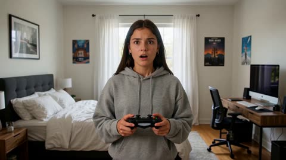</a>

A timed beat sheet with one line of dialogue per beat, plus a repeated character lock, keeps the same live actor consistent across cuts. Stating that she must stay a real human and not a CGI avatar anchors the realism inside the game world.

Wan 3.0 · Text-to-video · Source: [@Inshrah_ali_ on X](https://x.com/Inshrah_ali_/status/2100078872440324298) · 95 likes on 2026-10-29

[`ugc`](tags.md#tag-ugc) [`open-world`](tags.md#tag-open-world) [`chase`](tags.md#tag-chase) [`character-consistency`](tags.md#tag-character-consistency)

<details><summary><b>Prompt</b></summary>

```text
Create a 15-second ultra-realistic cinematic UGC-style video where a young female creator suddenly finds herself physically inside a fictional open-world video game. She is a real, live-action human character interacting naturally with the game's world, not a gamer watching a screen.

CHARACTER CONSISTENCY:
The exact same young female creator throughout the entire video. Clear realistic face, natural skin texture, expressive eyes, stylish Gen-Z streetwear, same hairstyle and outfit in every shot. She must look like a real person seamlessly placed inside the game world.

0–3 SEC — ENTERING THE GAME

Start with the creator standing in a realistic bedroom holding a game controller. The screen suddenly glitches with a dramatic digital distortion. In a seamless transition, the environment around her transforms and she is teleported directly into a huge fictional open-world city.

She looks around in shock and says:
“Wait… I’m actually inside the game?!”

3–7 SEC — OPEN-WORLD CHAOS

She is now physically walking through the game's city streets as a live character. Massive skyscrapers, pedestrians, sports cars, traffic lights, shops and cinematic city details surround her.

She looks at her hands, then touches a nearby car and reacts with genuine disbelief.

A police siren suddenly starts in the distance.

7–11 SEC — THE CHASE

She jumps into a fictional sports car and starts driving through the city.

Camera switches between third-person cinematic game-camera shots and close-up live-action shots of her face inside the vehicle.

Police cars begin chasing her. She laughs nervously and says:

“Oh no… I think I’m wanted!”

11–15 SEC — ESCAPE

She dramatically turns into a narrow alley, narrowly avoids a pursuing police vehicle, and escapes into an underground parking garage.

She stops the car, looks directly into the camera and says:

“Okay… how do I get OUT?!”

End with a dramatic cinematic pull-back revealing the enormous fictional game city around her.

VISUAL STYLE

Ultra-realistic live-action human seamlessly integrated into a photorealistic open-world game environment, cinematic game graphics, realistic physics, natural facial expressions, detailed city, dynamic camera movement, realistic vehicles, dramatic lighting, shallow depth of field, high-end VFX, premium gaming trailer + authentic UGC reaction style.

IMPORTANT: The woman must remain a realistic live human character inside the game world. Do not make her look like a cartoon, CGI avatar, animated character, or video-game model.

Create an original fictional open-world crime-action game aesthetic. Do not use GTA logos, characters, locations, UI, music, copyrighted assets, or recognizable game elements.

No text overlays, subtitles, watermarks, logos, or futuristic objects.
```

</details>

<a id="h3-hoodie-girl-rainy-alley-brawl"></a>
### Hoodie girl fights seven thugs in rainy alley

<a href="https://x.com/itxabdullaa/status/2101269716568564094">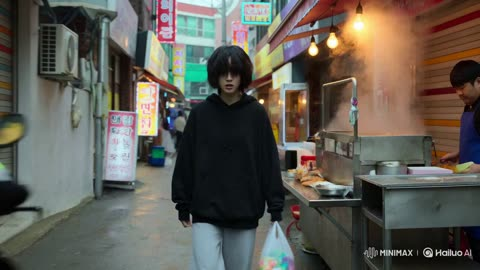</a>

Timed beats with exact Korean dialogue lines keep the story readable, and a negative list (no glow, no shockwaves, no poses) keeps the fights grounded. Handheld documentary camera language with autofocus hunting and impact shake sells the realism.

MiniMax H3 · Text-to-video · Source: [@itxabdullaa on X](https://x.com/itxabdullaa/status/2101269716568564094) · 93 likes on 2026-10-29

[`martial-arts`](tags.md#tag-martial-arts) [`korean-dialogue`](tags.md#tag-korean-dialogue) [`handheld`](tags.md#tag-handheld) [`one-take`](tags.md#tag-one-take)

<details><summary><b>Prompt</b></summary>

```text
15s | 16:9 | One Continuous Take | Korean Dialogue Only | No BGM/Subtitles

Ultra-photorealistic live-action supernatural martial-arts thriller. So-Yeon (same actress throughout): 160cm, messy black hair covering eyes, black hoodie, gray sweatpants, Converse. Real human actors, real locations, practical VFX only.

Location: Rain-soaked Korean alley behind a night market. Food cart, scooters, crates, puddles, shutters, signs, cardboard boxes.

Combat Style: Unarmed only. Sanda + Muay Thai clinch + Silat. Fast, messy, close-quarters fighting. Multiple attackers, realistic collisions, no poses or theatrical choreography.

Fault-Line Physics: Strength remains physical and grounded. Heavy impacts create realistic cracks from exact contact points: impact → vibration → cracks → dust/water movement → debris settling. No glow, energy effects, shockwaves, teleportation, or magic visuals.

0–3s — Blocked Alley

So-Yeon walks carrying a small plastic bag. Seven thugs block the alley. A delivery rider tries to pass. The leader shoves the scooter aside:

"꺼져."

So-Yeon steps forward:

"그 사람 건드리지 마."

The leader grabs her shoulder.

3–7s — First Collision

She counters instantly: wrist control → knee → elbow → throw. He crashes into stacked crates. Her sneaker lands in a puddle; thin cracks spread through the pavement. Everyone freezes.

A thug yells:

"다 같이 가!"

All six rush her.

7–11s — Market Chaos

She ducks a punch that hits a metal shutter, redirects attackers into each other, throws one into a food cart, and sweeps another. The delivery rider pulls the elderly shop owner out of danger. Brief 0.2s micro slow-motion on a heavy impact as cracks spread through wet pavement before returning to real time.

11–15s — Human Moment

The last two attackers collide into a concrete wall, creating a deep crack. Silence.

The rider asks:

"누나... 괜찮아요?"

So-Yeon looks at her trembling hands. The elderly shop owner returns her dropped plastic bag:

"이거."

She accepts it with a small embarrassed bow. The damaged cart slowly rolls in the background.

CUT TO BLACK.

Camera: Reactive handheld documentary style, tight dialogue close-ups, sudden reframing during action, natural autofocus hunting, realistic motion blur, impact shake, authentic human reactions. No superhero poses, no exaggerated expressions, no CGI doubles. Focus equally on civilians, environment, and grounded physical combat.
```

</details>

<a id="kling-rainy-alley-armored-vehicle-chase"></a>
### Bearded hero sprints from exploding armored vehicle in rain

<a href="https://x.com/iamrealsnow/status/2104788524310688210"></a>

The prompt splits seven seconds into timed beats, each with its own camera move: backward tracking, a slide and roll, a whip pan, then a push in. A closing list of motion and lighting terms and explicit negatives such as no slow motion and no static shots keeps the pacing aggressive.

Kling 3.0 · Text-to-video · Source: [@iamrealsnow on X](https://x.com/iamrealsnow/status/2104788524310688210) · 89 likes on 2026-10-28

[`action`](tags.md#tag-action) [`rain`](tags.md#tag-rain) [`night`](tags.md#tag-night) [`handheld`](tags.md#tag-handheld) [`timed-shots`](tags.md#tag-timed-shots)

<details><summary><b>Prompt</b></summary>

```text
A rugged bearded action hero sprints through a rain-soaked industrial alley at night as a massive armored vehicle explodes behind him. 0–2 sec: handheld low-angle tracking shot racing backward in front of him, rain and sparks flying through the lens, intense facial expression, coat whipping violently in the wind. 2–4 sec: he suddenly slides beneath a burst of gunfire, rolls across the wet concrete, grabs a metal pipe and uses it to knock an attacking enemy off balance. 4–6 sec: explosive close-quarters fight — one brutal punch, spinning elbow, rapid camera whip-pan, shattered glass and sparks filling the frame. 6–7 sec: he rises into a powerful hero stance as the burning vehicle erupts behind him, camera rapidly pushes toward his face, rain dripping from his beard.

Fast choreography, continuous physical momentum, realistic body mechanics, dynamic handheld camera, aggressive camera movement, dramatic lighting, volumetric smoke, flying debris, realistic rain, cinematic motion blur, sharp facial detail, natural cloth physics, high contrast, premium action-film cinematography. No slow motion, no static shots, no unnecessary cuts, no text, no logos.
```

</details>

<a id="h3-obsidian-ronin-valkyrie-liquid-mirror-duel"></a>
### Armored Ronin and Valkyrie Duel on Liquid Obsidian Mirror

<a href="https://x.com/itxsarmadd/status/2106698801604186579"></a>

A fixed 3 second timeline splits the 15 second fight into five beats, each with one clear action, and the on screen smoke text is written out as exact strings. A constraint line bans idle poses, hard cuts and teleportation, while a single physical rule (the mirror acts as liquid glass) ties ripples, cracks and reflections together.

MiniMax H3 · Text-to-video · Source: [@itxsarmadd on X](https://x.com/itxsarmadd/status/2106698801604186579) · 88 likes on 2026-10-28 · found via [SkyNotSilent/awesome-MiniMax-H3-cases](https://github.com/SkyNotSilent/awesome-MiniMax-H3-cases)

[`dark-fantasy`](tags.md#tag-dark-fantasy) [`sword-fight`](tags.md#tag-sword-fight) [`timeline-prompt`](tags.md#tag-timeline-prompt) [`kinetic-typography`](tags.md#tag-kinetic-typography) [`black-and-white`](tags.md#tag-black-and-white)

<details><summary><b>Prompt</b></summary>

```text
MINIMAX H3 — 15-SECOND CINEMATIC FIGHT
“BLACK MIRROR: FINAL REFLECTION”
16:9 widescreen, premium dark-fantasy fashion-action.

Obsidian Ronin vs Inkshade Valkyrie inside a gigantic floating liquid-black obsidian mirror surrounded by an endless white void. Preserve exact established character designs, faces, hair, armor, weapons, proportions and silhouettes. No redesigns.

Constant movement. No idle poses, hard cuts, teleportation, freeze frames, blood or gore.

The mirror behaves like liquid glass: every sword strike creates ripples, cracks and independent reflections that briefly attack before snapping back.

0–3s: Mirror forms from liquid black glass. Ronin emerges with a katana strike as Valkyrie attacks from the opposite reflection. Blades collide, creating a huge circular ripple.

3–6s: Ronin's heavy cut meets Valkyrie's agile twin-blade counter. Reflections attack from opposite directions. Black cracks race across the mirror. Smoke briefly forms “REAL OR REFLECTION?”

6–9s: Mirror tilts vertical. Both fighters sprint across its surface, exchanging rapid sword strikes. The glass bends around them like liquid.

9–12s: Mirror explodes into floating black fragments. Fighters leap between reflections, destroying them. Fragments align into a giant blade shape. Smoke forms “BREAK THE IMAGE”, then shatters.

12–15s: Final charge. Ronin's massive diagonal katana strike collides with Valkyrie's spinning twin-blade cross attack. The entire mirror shatters into thousands of black particles. Silence. Final smoke typography: “ONLY ONE REMAINS.”

Elegant black-and-white luxury aesthetic, glossy reflections, silver highlights, charcoal smoke, cinematic motion blur, precise camera orbiting, low mirror tracking, rotating blade shots and dramatic final push.

15s | 16:9 | continuous action | premium cinematic dark fantasy | exact character consistency
```

</details>

<a id="h3-desert-buggy-drone-chase"></a>
### Desert buggy escapes drones past industrial outpost

<a href="https://x.com/beginnersblog1/status/2083039412506743096">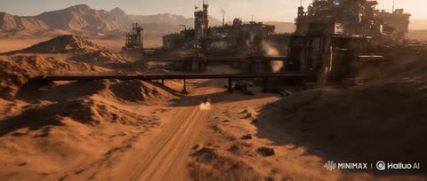</a>

Each of the five reference images gets one job (identity, vehicle, action, location, cockpit), and the prompt assigns it by number. Timed beats end each shot on the physical state the next shot starts from, which keeps the chase continuous.

MiniMax H3 · Reference-to-video · Source: [@beginnersblog1 on X](https://x.com/beginnersblog1/status/2083039412506743096) · 84 likes on 2026-10-29

[`multi-reference`](tags.md#tag-multi-reference) [`storyboard`](tags.md#tag-storyboard) [`action-chase`](tags.md#tag-action-chase) [`timed-beats`](tags.md#tag-timed-beats)

<details><summary><b>Prompt</b></summary>

```text
@Hailuo_AI

                                                                                                                 Create a 15-second, 16:9 photoreal cinematic action sequence with native stereo audio. Treat the five images as coordinated multimodal references for identity, vehicle design, environment, performance, action, cinematography, and sound.

Use Image 1 as the strict facial-identity reference for the female racer. Preserve her exact face, dark tied-back hair, amber goggles, dusty skin, black tactical suit, shoulder armor, gloves, and focused expression.

Use Image 2 as the strict reference for her full costume, body proportions, armored black dune buggy, tire scale, exposed suspension, cyan headlights, roll cage, desert lighting, and industrial-outpost background.

Use Image 3 as the action reference for the pursuing drones, vehicle speed, dust trails, fire, debris, chase intensity, and camera proximity.

Use Image 4 as the location reference for Outpost 07, including its rusted towers, pipelines, bridges, rocky terrain, distant mountains, warm sunset atmosphere, and industrial scale.

Use Image 5 as the cockpit and performance reference. Preserve the same steering wheel, open roll cage, goggles, gloves, facial identity, driving posture, and vehicle interior.

Sequence
[0–2.5 seconds]

Open on Image 4 with an extreme-wide aerial establishing shot of Outpost 07 at sunset. The industrial complex fills the right side of frame while an empty desert route curves through the rocky foreground.

The camera dives rapidly toward the road as a small black dune buggy bursts from beneath an elevated pipeline, throwing a long dust plume behind it.

Keep the vehicle moving consistently from left to right toward the outpost. No direction reversal.

Audio begins with dry desert wind, distant industrial machinery, a low cinematic pulse, and the buggy engine approaching rapidly.

[2.5–5 seconds]

Cut at peak engine sound to Image 5.

Tight frontal cockpit shot mounted just ahead of the driver. The vehicle shakes naturally over rough ground. Her hands hold the steering wheel firmly while she makes small, physically accurate corrections.

Her amber goggles remain on top of her head. Loose strands of hair and fabric straps react to wind and vibration. Her eyes briefly check the left mirror, then return immediately to the road.

A red warning light reflects across her face as a targeting alarm begins.

Do not make her turn the steering wheel excessively. Her body, wheel movement, and vehicle direction must remain mechanically connected.

[5–8 seconds]

Cut to a low front three-quarter tracking shot based on Image 3.

Three pursuit drones descend behind the buggy in a triangular formation. Their rotors, stabilizers, and body movement respond realistically to speed and turbulence.

The lead drone fires into the sand beside the buggy. The impact creates a narrow eruption of dirt, sparks, and fragmented rock rather than an oversized fireball.

The racer steers sharply around the impact. The buggy’s front wheels turn first, the suspension compresses, the body leans, and the rear tires slide outward before regaining traction.

The camera tracks beside the vehicle without spinning or overtaking it.

[8–11 seconds]
Continue the same drift into a rear three-quarter shot.

The buggy races toward a narrowing passage between a rock wall and the outer structures of Outpost 07. The racer pulls a mechanical handbrake lever for one brief moment, rotating the vehicle through the opening.

One drone follows too closely and clips a rusted overhead pipe. Its wing breaks, sending the drone tumbling into the sand behind her.

Show the collision in the background while keeping the buggy dominant and moving forward. No slow motion.

Audio: tire scrape, suspension impact, metal tearing, drone rotors failing, engine rev rising.

[11–13 seconds]

Cut to a wheel-level macro shot.

The right rear tire bites into loose sand. Stones fire backward while the suspension rebounds. The camera rises naturally along the buggy’s side and reveals the two remaining drones closing in.

The racer presses a guarded switch beside the steering wheel.

A compact rear-mounted electromagnetic pulse discharges as a restrained blue-white distortion wave, briefly disrupting the drones’ lights and stabilizers.

No magical energy, lightning storm, or giant explosion.

[13–15 seconds]
Cut to a low frontal hero shot as the buggy clears the outpost gate at full speed.

The two disabled drones fall into the dust behind it while the vehicle launches from a shallow ridge. Keep the jump low, heavy, and physically believable.

During the brief airborne moment, cut to Image 1 for a tight close-up of the racer. Preserve her exact identity as warm firelight and cool dashboard light cross her face. Her expression remains controlled and determined.

The buggy lands hard beyond the gate. The suspension compresses, the engine roars, and the vehicle continues directly into the desert.

End with a sharp cut to black on the landing impact.

Visual Direction
Premium live-action science-fiction action trailer with realistic CGI integration, warm orange sunset light, restrained steel-blue technology accents, dusty atmosphere, hard surface detail, cinematic contrast, subtle film grain, realistic motion blur, and 24 FPS movement.

Use wide shots to establish scale, cockpit close-ups for tension, low tracking shots for speed, and mechanical macro shots for physical detail.

Keep the editing fast but readable. Every shot must begin from the physical state established by the previous shot.

Audio Direction
Native stereo sound with:
Aggressive combustion engine
Tire friction over sand and rock
Suspension rattles and chassis vibration
Drone rotors and targeting alarms
Sand impacts, metal collisions, and falling debris
Low percussion and rising electronic tension
One heavy bass impact on the final landing

Keep music underneath the vehicle and environmental sounds. No dialogue or voice-over.

Restrictions
No subtitles, titles, logos, watermarks, additional racers, pedestrians, creatures, motorcycles, futuristic city skyline, nighttime transition, costume changes, facial changes, vehicle redesign, additional wheels, floating vehicle parts, distorted hands, incorrect steering, reversed wheel rotation, teleportation, random explosions, oversized fireballs, weightless motion, impossible jumps, camera spins, circular camera moves, rapid zooms, fluid morphs, soft dissolves, or changes in travel direction.  #MiniMaxH3
```

</details>

<a id="seedance-last-road-motorcycle-chase"></a>
### Rider escapes creatures on ruined highway

<a href="https://x.com/Changfuncafe/status/2083584902017253559">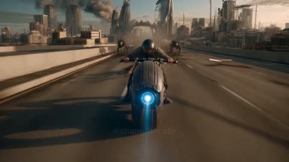</a>

A timed shot list with a camera move and speed change per shot, plus a sound cue list, lets one generation carry the chase, the crash and a slow-motion headshot. The @ image tags bind the rider, road, creatures and bike to reference images so they stay consistent across shots.

Seedance 2.5 · Reference-to-video · Source: [@Changfuncafe on X](https://x.com/Changfuncafe/status/2083584902017253559) · 78 likes on 2026-10-29

[`post-apocalyptic`](tags.md#tag-post-apocalyptic) [`motorcycle`](tags.md#tag-motorcycle) [`multi-shot`](tags.md#tag-multi-shot) [`reference-images`](tags.md#tag-reference-images)

<details><summary><b>Prompt</b></summary>

```text
Hi everyone! Here's the prompt I used. I started with my draft idea and asked
@claudeai
 to turn it into a more detailed prompt. Then I used seedance2.5 to generate the film.
Feel free to adapt the prompt to fit your own film or creative style
---------------
Use @ image1  as Rob [ main character],  @ image2 as the highway, @ image3 as the creatures. @ image4 as his motorcycle

Story / Location.
Helmeted Rob rides fast down the ruined highway as five creatures surge in beside and behind him, leaping to smash him one by one. He weaves, dodges, and drops them with his pistol one at a time — until his bike crashes hard. Injured, he drags himself up and pulls off his helmet just as the last creature charges; he screams and fires one bullet into its head.

Cinematic [camera, sounds, sfx] — auto-cut between shots only, each shot one continuous take, mixed speed and camera movement, 3 shots, 30s total.
Shot 1 (0–10s): the chase — low tracking alongside the bike lifts unbroken into a drone rise as the five creatures pour in and leap; wheels spinning forward, motion-blurred. Slow-mo on the leaps, real-time between.
Shot 2 (10–22s): the fight, one continuous take — coverage swings unbroken between Rob and the creatures as he draws and fires one by one, dropping them from behind and the flanks; slow-motion on the gunshots and a creature falling away, real-time on the riding. The same shot whip-pans with the wipeout as the motorcycle goes down hard and Rob is thrown, carrying through into full slow-motion on the impact and tumble, no cut.
Shot 3 (22–30s): the aftermath — low angle cranes up with Rob as he rises and pulls off his helmet; the last creature charges, he screams and fires a slow-mo headshot. Ease into a push-in on him breathing hard, end.

Lights & Theme: AAA cinematic realistic movie, 8K anamorphic, desaturated post-apocalyptic grade, hard overhead sun, dust glare, visceral action. No subtitles. Audio: No music, or a low tension drone. Roaring engine and wind; creature snarls and impacts; sharp pistol cracks; metal-tearing crash and skid; Rob's scream; final gunshot, then silence.
```

</details>

<a id="wan-wuxia-karst-river-glide-timeline"></a>
### Red robed wuxia heroine skims karst river

<a href="https://x.com/liluocheng13/status/2099025919335874938">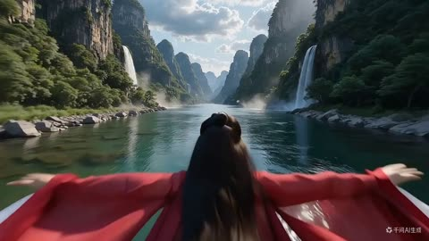</a>

The prompt divides the 10 seconds into timed camera beats, from a high dive to a low hero shot, an orbit and a final spin, and adds a music fade cue. Timed shots give the model a sequence to follow instead of one vague action.

Wan 3.0 · Text-to-video · Source: [@liluocheng13 on X](https://x.com/liluocheng13/status/2099025919335874938) · 77 likes on 2026-10-29

[`wuxia`](tags.md#tag-wuxia) [`karst-canyon`](tags.md#tag-karst-canyon) [`camera-timeline`](tags.md#tag-camera-timeline) [`slow-motion`](tags.md#tag-slow-motion)

<details><summary><b>Prompt</b></summary>

```text
Friends, I can’t stop laughing today. 😂

I took an old text-to-video prompt—generated without any reference image—and used it to test Seedance 2.5 + 2.0, Kling 3.0, and Wan 3.0.

I originally wrote this 10-second video prompt to test Happyhorse 1.0 on the very day it launched. I never expected that every version I generated today would turn out worse than the one made with Happyhorse 1.0. 😂

The prompt is attached below: Wuxia Cinematic Epic Prompt:
[Core Style] Epic cinematic wuxia film (Wuxia Cinematic Epic), Oriental Xianxia Fantasy Aesthetic, 8K ultra-high resolution, ultra-photorealistic details.
[Setting & Environment] A majestic karst canyon landscape, surrounded by mountains, with cascading waterfalls faintly visible through distant mist. A crystal-clear river surface mirrors the sky like a mirror. Volumetric lighting: dreamlike sunlight piercing through heavy clouds, casting dappled, shifting light and shadow onto the river's surface. Pink petals drift through the air.
[Character Description] A beautiful Wuxia heroine, dressed in a flowing red-and-white traditional robe, with an exquisite silk sash tied at her waist. Her long black hair dances wildly in the wind. Her gaze is resolute, her body light and graceful as a swallow.
[Key Action & Effects] The heroine is performing supreme lightness skill (Qinggong/water-gliding), skimming across the river's surface at extremely high speed. Her toes lightly tap the water's surface, and each step precisely stirs up slow-motion, gentle water splashes. The splashes scatter like pearls in the sunlight, forming an extended trail behind her as she moves. Dynamic motion blur perfectly conveys the sense of high-speed movement.
[Camera & Audiovisual Control – Total Duration: 10 Seconds]
•0–2s (High Angle Dive & Glide): The camera dives from a high angle above the canyon (drone-style dive), rapidly pushing in to track the heroine's silhouette as she speeds across the water from a distance. This showcases the grandeur of the canyon and the character's speed.
•2–4s (Low Angle Hero Shot): Cut to a shoulder-cam medium shot, with the camera positioned close to the water's surface for a low-angle lookup shot. Focus stays tightly on the heroine's feet and face. Close-up of the moment the splash bursts, revealing the flowing texture of her robe and her resolute expression.
•4–7s (Orbit & Pan): Multi-camera bullet-time orbit combined with horizontal parallax panning. The camera orbits 180 degrees around the heroine, capturing her profile and front view as she moves at high speed. Petals and water splashes swirl around her in slow motion, with shallow depth of field separating the background from the subject.
•8–10s (Pull-back, Spin & Freeze-frame): High frame rate/ultra slow-motion capture. The camera rapidly pulls back and zooms out. The heroine performs one final beautiful 360-degree aerial spin as a finishing move. At the moment the spin completes and her body is fully extended, the protagonist turns her head and smiles. The frame freezes on this smiling moment, with the protagonist remaining in absolute sharp focus.
[Sound Design Note]: Epic orchestral music combined with an ethereal flute melody. Starting from the 3rd second, the music begins a linear, smooth fade-out, reaching complete silence by the 10th second.
```

</details>

<a id="h3-holographic-fan-ciao-typography"></a>
### Woman with holographic CIAO H3 fan

<a href="https://x.com/Cia0_exe/status/2090280005632938130"></a>

A single reference image is locked through explicit character and object blocks for hair, coat, and fan text, then a timed beat sheet drives the motion. Typography and holographic shard layers are specified as separate systems so the lettering stays stable through the action.

MiniMax H3 · Reference-to-video · Source: [@Cia0_exe on X](https://x.com/Cia0_exe/status/2090280005632938130) · 73 likes on 2026-10-29

[`minimax-h3`](tags.md#tag-minimax-h3) [`typography`](tags.md#tag-typography) [`holographic`](tags.md#tag-holographic) [`seamless-loop`](tags.md#tag-seamless-loop)

<details><summary><b>Prompt</b></summary>

```text
[MODE] Omni Reference | 15s | 16:9 | 2000p | 24fps | SEAMLESS LOOP

[CHARACTER LOCK —
@image1
]
严格锁定角色，完全按照参考图呈现，禁止任何重新设计。身份：年轻女性，黑色长直发炸起呈放射状飞舞，齐刘海，冰蓝色眼睛，苍白皮肤。服饰：深蓝色毛绒大衣（navy fur coat），金色纽扣与链条装饰，露单肩穿法；内搭米白色高领紧身衣；黑色短裤；多层金色项链（粗链条choker）、金色垂坠耳环、金色宽手镯。手持物：巨型巴洛克雕花折扇，扇骨乌木黑，扇面做旧米白纸色，印有金色衬线字体"CIAO CIAO CIAO"与字母数字"H3"，扇缘装饰复杂金色卷草纹与尖刺状金饰。禁止修改：发型长度与炸起幅度、刘海形状、眼色、大衣轮廓、毛绒质感、金饰样式、折扇比例与雕花细节、扇面文字内容。

[OBJECT LOCK — 折扇 + 全息纸张核心]
折扇作为贯穿全片的中心道具，是角色肢体的延伸，非独立物件。扇面材质：厚重做旧纸张基底，表面覆盖全息虹彩膜（iridescent holographic film），烫金文字在全息层下产生色散分离。扇骨：黑色雕花金属质感，末端尖锐，边缘带全息青蓝#6FE3F5微光描边。运动逻辑：折扇炸裂成数百片扇面纸片与全息碎片，每一片纸片上印有"CIAO"局部、"H3"局部、金色卷草纹、或条形码纹理；最终重组时文字必须完整对齐为"CIAO CIAO CIAO H3"。

[PALETTE — 全片锁定，零漂移]
背景：平滑垂直渐变，顶部明亮青蓝#2AA6B4过渡至深petrol蓝#0F4A55，纯图形平面，无环境、无地平线、无道具。大衣：深蓝毛绒#1A2B4A，全息洋红边缘光#FF9ED8。内搭：米白#F2EDE4。头发：纯黑#0A0A0A→蓝白高光#A8C8E8，发梢带全息紫残影。纸张/扇面：做旧米白#E8DCC4基底+全息overlay，烫金文字#FFD27A，扇骨黑#0F0A05。金属与金饰：亮银白#F2EDE4、黄金#FFD27A、霓虹青#6FE3F5。全息强调色（仅折射光/边缘光）：洋红#FF9ED8、电青#6FE3F5、紫外紫#B967FF、镭射粉#FF6B9D、极光绿#39FF14。核心色板始终主导，全息仅作特效层。

[STYLE]
2.5D动画，明亮电影感。高调照明，大量bloom，清晰高光，明亮不阴郁。皮肤：次表面散射，耳尖与指尖透暖光。大衣：厚重毛绒质感，深褶皱，每根绒毛受光清晰，绒毛尖端带全息微光。头发：成束发丝炸起放射状，碎发捕捉轮廓光，发束间穿插全息细丝。纸张：真实厚度，纤维毛边，全息膜覆盖时产生棱镜色散，透光时呈现纤维纹理与彩虹光晕。金饰：实金属厚度，边缘反光，内部雕花阴影，表面覆盖iridescent chrome膜。

[TYPOGRAPHY ART — 全息字体系统，核心视觉层]
字体体系四层：①主标题体：超粗窄体无衬线（condensed sans），字间距极大（tracking+200），全大写，硬边几何感。②笔刷手写体：粗头马克笔/喷漆质感（brush script），笔锋带飞溅墨点与喷溅颗粒，边缘不规则。③衬线烫金体：匹配扇面"CIAO"字样，高对比衬线，字间距拉开，优雅古典。④全息铬字体：iridescent chrome材质，表面反射环境，移动时产生彩虹色散与液态金属流动感。
排版规则：拉丁文STACKED最多两行，被画面边缘裁切以显规模；竖排文字位于画面左右三分之一，可穿插条形码装饰；所有文字带三层效果：硬边偏移阴影（黑色#0F0A05，偏移8px）+全息描边（1px，色散边缘）+轻微chromatic aberration（红#FF0040与蓝#0040FF边缘错位2px）；文字可被扇面开合切割、被全息碎片遮挡、在冲击波下glitch扭曲；X乘号为粗体黑色brush stroke，交叉处带喷溅效果，用于连接文字块；条形码细线垂直排列，作为装饰元素散布于文字间隙，部分条码数字以极小字号隐藏其中。
Glitch Chromatic Aberration系统：随机帧出现文字撕裂——水平错位扫描（scan line tear），错位幅度3-8px；RGB分离——文字边缘分离为红/绿/蓝三色通道，分离距离随冲击波强度变化；像素抖动——关键帧前后2帧内，文字出现1px级像素级抖动；数据损坏效果——部分字母出现"断裂"，如"A"的中间横线消失一帧再恢复；扫描线——横向细线以0.5透明度掠过文字表面。
时间轴与内容：0.8s "C"单字母巨大无衬线，全息chrome填充，占满帧高右侧裁切，扇骨纹理叠加；左下"A FILM BY"衬线体+垂直条形码。2.2s "PAPER SPLITS"/"GOLD REMAINS"堆叠两行，无衬线，字间距极大，洋红#FF9ED8→青#6FE3F5渐变填充，硬阴影，单帧glitch撕裂。3.8s笔刷手写体"ciao × H3"斜穿画面，金色#FFD27A，X符号为粗黑brush stroke带喷溅；下"DIRECTOR / PRODUCTIONS"无衬线。5.0s "ONE IMAGE"/"FIFTEEN SECONDS"白转全息青，堆叠两行，左侧条形码，边缘chromatic aberration。7.2s "CIAO"沿扇面弧度排列，全息虹彩扫过，扇骨切割文字产生色散分离，每字母拖出不同颜色全息残影。8.8s右侧竖排"SEDUCTION"满高无衬线，字间距紧凑，霓虹洋红勾边；横置笔刷"MODERN"于其上，形成cross排版。10.6s "NO CUT"全息chrome，字间距拉开，全画面glitch：水平撕裂+RGB分离+像素抖动，冲击波过后瞬间恢复。12.0s笔刷手写体"STREET IS OUR RUNWAY"左下角倾斜15度，笔锋带金色喷溅；下"COMING SOON"无衬线。13.2s标题锁屏：主行"cia0 H3"巨大居中，iridescent chrome全息填充，虹彩如液态金属在字表流动；其下"X RUNWAY"无衬线，字间距极宽，淡金发光；四角散布#CIAOXH3/COMINGSOON/条形码/极小globe线框图标——必须在15.0s前完全消散。开场与结尾帧无浮动文字，仅扇面本体文字。

[HOLOGRAPHIC FLOATING PAPER SYSTEM — 全息飘纸系统，奢华视觉]
每一片飘浮的纸屑与碎片都是独立的全息棱镜：基底为做旧米白纸纤维，厚度0.3mm，边缘可见分层纤维毛边；表面覆盖iridescent彩虹膜，静止时呈淡金#FFD27A，移动时根据角度折射出洋红/电青/紫外紫/镭射粉/极光绿的流动光谱；边缘如切割水晶，折射出锐利彩虹光斑，在角色面部、大衣毛绒、扇骨表面投下移动的焦散光纹caustics；内部印制"CIAO"或"H3"局部、卷草纹、条形码、蓝天积云、金色农田、太阳眩光、角色面部局部，印制内容在全息层下产生深度感；表面有细微烫金裂纹，裂纹中漏出霓虹光；反重力飘升旋转，全息膜产生"色散扫过"效果——一面掠过洋红，下一帧掠过青蓝，再下一帧掠过紫罗兰。画面同时存在至少30-50片可见纸屑：近景几片占据画面10%面积，可看清纤维与全息纹理；中景纸片形成金色与全息交织的雾层；远景纸片为光点。Never blank。

[CHARACTER ACTION — 角色动作编排，逐镜分解]
0.0-1.6s HOOK / 开场极限特写：姿态为右臂前伸，折扇半开斜指镜头，扇面与镜头呈15度夹角；左肩后拉，重心压在后腿（右腿），左腿脚尖点地预备发力。面部：嘴唇微张，冰蓝瞳孔收缩，视线穿透扇面直刺镜头；刘海被扇面卷起的气流微微掀起。动态：手腕内旋带动扇面轻微震颤，扇骨末端全息描边明灭；金色链条随前臂肌肉绷紧而晃动；大衣左摆因反作用力向后扬起，露出内搭米白色高领与金色choker；纸屑从扇缘轻轻脱落，带全息尾迹。呼吸节奏：吸气蓄力。
1.6-3.2s 子弹时间环绕 / 冻结炸裂：姿态为炸裂瞬间身体后仰15度，腰部反弓，左臂向侧上方甩出以平衡冲力；折扇从半开状态向外爆成放射状纸片与全息碎片；右腿蹬直，左腿屈膝悬空——被爆炸反冲推离地面的瞬间。面部：眼睑半垂，表情从紧绷转为超然的平静。动态：冻结帧中，发丝呈放射状向四周炸开（非下垂），每根发束末端带有蓝色高光；大衣毛绒因静电炸起；金手镯滑至前臂中段，链条耳环呈水平飘起；碎片中可见"CIAO"与"H3"字样旋转，每字拖出全息色散尾迹；碎片呈完美球状分布，每片角度不同导致全息色各异，形成彩虹球体。呼吸暂停。
3.2-4.8s 顶视俯冲 / 环形锁阵：姿态为落地瞬间右膝跪地，左膝外展，大腿与小腿呈90度；右手五指张开再猛然握拳——对应扇片竖立锁成环形；左手撑地，指尖抓地，指节发白；脊柱扭转，右肩高于左肩。面部：下颌收紧，嘴角微微下压，眼神锁定正上方（镜头方向）。动态：握拳时前臂肱桡肌凸起，金色手镯撞击腕骨发出微震；大衣后摆因跪地而铺展在地，毛绒褶皱呈放射状压平；锁环形成瞬间，她肩膀下沉卸力，左膝抬起半寸再砸回地面；环上纸片竖立如扇骨，每片边缘全息光连成一圈霓虹光环。呼气。
4.8-6.6s 纸隙穿越 / 一镜突刺：姿态为从跪地直接弹射起身，无过渡帧；右脚蹬地发力，左脚跨步前冲，步幅极大；右肩前送，右臂直刺——折扇（此时收拢为单张纸片形态）如扇骨尖端前捅；左手后摆保持平衡，指尖绷直。面部：突刺瞬间右眼微眯，左眼大睁，不对称的凌厉表情；刘海被前冲气流压向一侧，露出完整眉骨。动态：突刺轨迹为直线，但手腕在最后6帧急速抖动——扇面纸片在指尖旋转360度后重新握稳；大衣因前冲惯性完全甩向身后，内搭米白色高领被风吹出横向褶皱；金色项链被甩至锁骨上方；落地时前脚掌先触地，脚踝缓冲下沉两帧，膝盖内扣卸力；发丝滞后于身体0.3秒，在身后拖出黑色弧线；突刺路径上纸片被气流卷成螺旋，全息色散形成隧道效果。
6.6-8.4s 高潮爆发 / 扇面裂变残像：姿态为低马步，双膝外展120度，重心压至大腿平行地面；右臂横持折扇（已重组为半开状态）护于胸前，扇缘朝外；左手呈爪状虚按在扇面后方；脊柱前倾，胸口几乎贴到大腿。面部：侧脸朝向镜头，下颌线绷紧，嘴唇闭合，鼻翼微张；冰蓝眼睛斜睨，虹膜边缘泛金光。动态：纸影残像从她背后纸屑中"剥离"时，本体右肩先向后预拉（anticipation）两帧，再猛然前推；折扇开合一次——"啪"的帧为全开展平，下一帧收拢至30度；毛绒大衣因马步下沉而堆积在腰际，又被肩推动作重新甩起；金饰链条在胸前画出8字形轨迹；残像动作与本体延迟3帧，每道拖不同全息色（金/洋红/青/紫），形成回声效应。
8.4-10.4s 作画爆发蒙太奇 / 帧帧切换：帧1线稿——跃起至最高点，双腿后剪，身体反弓如拉满的弓，双臂向两侧死展，折扇完全打开呈180度平举，身上叠加"YOUTH CULTURE REBORN"线稿字。帧2剪影——落地前一帧，身体蜷缩成球，右膝顶向胸口，折扇收拢贴于小臂外侧呈防御格挡姿态，背景竖排"SEDUCTION"剪影。帧3涂抹——横向滑步，双脚离地，身体倾斜45度，右臂甩动折扇横斩，扇缘拖出金色残影，叠加"POWER.DESIRE.DESTINY."笔刷字。帧4负片——硬直受击帧，双肩后震，胸口前挺，头颅后仰，折扇几乎脱手，仅食指与中指勾住扇骨，面部痛苦但克制，全画面glitch chromatic aberration最大化。帧5完整渲染——反击帧，从后仰瞬间弹回，腰部发力带动上半身回旋，折扇由下至上斜挑，左脚为轴，右脚离地旋转180度，大衣如深蓝色花朵绽放，"cia0 × H3"全息字环绕。
10.4-12.4s 升级 / 反弹双倍：姿态为极端荷兰角，身体向镜头左侧倾倒，仅靠右脚支撑，左脚悬空后勾；右臂高举过头，折扇竖直打开，扇面正对镜头——承接incoming攻击；左臂横于腹部，手掌按在毛绒大衣上，手指陷入绒毛。面部：仰头，下颌完全暴露，眼睛看向扇面上方（攻击来源方向）；嘴角有一丝几乎不可见的上扬。动态：攻击被"吸入"扇面时，她右肩先下沉吸收冲力（4帧），膝盖弯曲至极限，大衣下摆扫过地面扬起金色尘埃；反弹瞬间，右脚跟蹬地，膝盖从弯曲弹直，力量从脚底→小腿→腰→肩→扇面传递，扇面从竖直转为水平横拍；金色链条因剧烈震动而从衣领弹起，在空中划出抛物线后落回胸口；发丝因反弹冲击而向上炸起再缓慢飘落；冲击波扭曲背景与全部文字，产生全画面glitch：水平撕裂+RGB分离+扫描线+像素抖动，持续6帧后恢复。
12.4-15.0s 逆转 / 时间倒流重组：姿态从战斗姿态逐渐"倒放"松弛，高举的右臂缓缓下降，手肘弯曲将折扇收回腰侧；紧绷的左肩下沉，头部从仰姿恢复水平；右腿从伸直状态重新弯曲，身体重心后移，最终回到开场时的后腿承重姿态。面部：表情从淡漠逐渐"倒回"到开场时的凝视；瞳孔放大（倒放的收缩），眼睑从半垂恢复全开；嘴唇从闭合回到微张。动态：纸片沿手臂螺旋收回时，她的手指依次张开（小指先，拇指最后），让纸片从指缝间流过，最后五指同时收拢握住扇骨；液态金墨在扇面流动时，她的手腕做微小画圆动作引导纹路归位；大衣毛绒从战斗中的炸起状态缓慢平复，绒毛逐层落下，内层先落，外层后落，形成波浪式沉降；发丝从放射状缓慢收束，发尾最后归位；呼吸从急促逐渐平缓，最后与开场帧的吸气完全同步；金饰链条最后归位，耳环垂坠角度与开场帧一致，误差小于1度；扇面"CIA0 H3"最后归位，全息膜重新覆盖，开场第一帧与结尾帧的虹彩流动角度完全一致。

[MOTION PRINCIPLES]
重量传递：所有力量从脚底发起，经膝盖→胯→腰→肩→手臂→扇面，禁止凭空发力。惯性滞后：大衣毛绒滞后身体0.4秒，发丝滞后0.3秒，金饰链条滞后0.2秒，纸屑碎片滞后0.1秒，形成多层跟随。对抗平衡：每个动作都有反作用力——扇面前刺时肩膀后拉，跃起时双臂下压，落地时躯干微弹。呼吸绑定：吸气时胸腔扩张、肩膀微抬、大衣领口张开；呼气时腹部内收、肩膀下沉、毛绒堆叠；战斗高潮屏息，重组时恢复。面部微动：非战斗时刻每3-5秒一次眨眼；战斗时刻睁眼不眨；受击时眉毛下压、鼻翼扩张；反击时眉毛上扬、瞳孔收缩。手部细节：握扇时拇指与食指呈O型控制方向，中指无名指小指辅助稳定；扇面旋转时手指逐根松开再逐根扣回；禁止手掌僵硬或手指张开无目的。

[EFFECTS]
时间残影拖尾：每道残影不同全息色（金/洋红/青/紫/镭射粉）。液态金墨流动：重组时金墨与全息虹彩同时晕染。扇面裂变：画面分裂为镜像对称的六重扇面结构，每重带不同全息色调。冲击波折射：扭曲背景与全部typography，产生glitch撕裂与chromatic aberration。单帧负片反转：重击瞬间，画面反色+全息色散最大化。纸张裂纹转场：扇面纤维撕裂，裂缝中漏出霓虹光，裂纹边缘带全息勾边。反重力纸屑：金色与全息纸片向上飘升，旋转时产生色散光谱扫过。棱镜色散：每片边缘折射彩虹光斑，投移动焦散于面部与大衣。全息glitch：随机帧出现文字与纸片的撕裂、红蓝边缘错位、扫描线、像素抖动、数据损坏断裂。

[CAMERA + LIGHT]
变形宽银幕镜头——椭圆散景、蓝色拉丝眩光、桶形畸变。焦段：85mm特写，35mm中景，24mm运动。180度快门。关键节拍浅景深，蒙太奇段深景深。焦点转移：扇面至眼睛（2.4s与14.2s）。硬光主光：画面右上方高位逆光——下颌、肩膀、扇缘金色勾边。全息补光：扇面与碎片作为彩色光源，投射洋红/青/紫环境光。阴影通透，不压死。10.4s时最亮，15.0s回到开场状态。

[SIGNATURE]
扇面底部烫金压印"CIA0"（大写字母，字间距拉开），其上方为字母数字"H3"，整体构成"CIA0 H3"。开场第一帧存在，结尾最后一帧存在，14.4s重组完成时最后显现。属于扇面本身，非后期叠加。

[SHARDS]
每片纸屑反射/印制不同内容：蓝天积云、阳光照射的金色农田、低角度太阳带镜头眩光、角色面部局部、纯白云朵、"CIAO"字样局部、"H3"局部、条形码纹理、金色卷草纹。部分纸屑印制"尚未发生的下一帧画面"。禁止空白无内容纸屑。

[AUDIO]
环境：开阔空气、明亮风声、纸张薄颤、霓虹电流底噪。0.0-1.6s上升金属纸张共鸣+全息电流嗡鸣，炸裂帧清脆爆破。1.6-3.2s冻结真空，风铃低吟弧线平移，恢复呼啦声。3.2-4.8s锁环硬纸张脆响，俯冲呼呼声，环形爆开空气声。4.8-6.6s气压骤降，纤维闷响，穿出尖锐释放。6.6-8.4s裂变断续回声，次低音swell，每残像一声风铃。8.4-10.4s顿促撞击锁帧切，纸张撕裂扇骨尖啸，负片硬切门限。10.4-12.4s多普勒滚音，光谱上升，双倍反弹明亮撞击。12.4-15.0s倒放风铃、纸张重组、金墨灌注、归于开场共鸣。音乐：3.2s纸张钟琴+电子pluck，6.6s弦乐+合成器rise，10.4s合唱swell，12.4s倒放回第一音符。无对白。

[CONSTRAINTS]
画面内最多两个角色。强调色仅折射光与全息层。特效累积至逆转。所有文字带渐变+全息+阴影。首尾帧相同，无浮动字。标记"CIA0 H3"拼写完全一致。无商标水印字幕。无实体环境背景。画面永不变暗。全片禁止出现刀、剑、刃、blade、sword、镜、mirror、反射、reflect、万花筒词汇。折扇与全息typography为唯一中心视觉。
```

</details>

<a id="h3-arctic-base-fps-gameplay"></a>
### First person Arctic military base shooter gameplay

<a href="https://x.com/LudovicCreator/status/2084338573210157293"></a>

The prompt splits into Camera, Lighting and Camera movement blocks and describes player behavior such as scanning, taking cover, firing short bursts and advancing. Specific details like recoil, weapon bobbing and frozen breath make a still game frame read as live gameplay.

MiniMax H3 · Image-to-video · Source: [@LudovicCreator on X](https://x.com/LudovicCreator/status/2084338573210157293) · 69 likes on 2026-10-28 · found via [SkyNotSilent/awesome-MiniMax-H3-cases](https://github.com/SkyNotSilent/awesome-MiniMax-H3-cases)

[`fps`](tags.md#tag-fps) [`game-footage`](tags.md#tag-game-footage) [`arctic`](tags.md#tag-arctic) [`first-person`](tags.md#tag-first-person) [`photorealistic`](tags.md#tag-photorealistic)

<details><summary><b>Prompt</b></summary>

```text
Camera: First-person, eye level, handheld gameplay. Simulate a player operating a modern military FPS while holding a frost-covered assault rifle and cautiously advancing through a remote Arctic military installation. Move forward across an icy service road between snowbanks, radar stations and frozen cargo containers, periodically scanning rooftops, watchtowers and mountain ridgelines. Sweep the reticle naturally across possible threats, briefly stop behind cover to fire several controlled bursts toward a distant enemy near the radar dome, then continue advancing deeper into the frozen base like authentic player-controlled gameplay.

Lighting: Cold Arctic daylight with soft overcast skies and pale winter sunlight reflecting across ice and snow. Blend crisp blue ambient light with warm floodlights from the base, vehicle headlights, subtle smoke drifting from generators, blowing snow, frozen breath, and atmospheric ice particles. Maintain ultra-photorealistic AAA rendering with highly detailed weapon materials, realistic snow deformation, wet ice reflections, volumetric fog, and cinematic environmental depth.

Camera movement: Natural player-controlled movement with subtle handheld sway while walking across uneven frozen terrain. Perform small tactical checks left and right, briefly aim down the central lane, add realistic recoil and muzzle flash while firing short bursts, then smoothly recover and continue pushing forward. Include slight weapon bobbing, responsive aim corrections, natural acceleration and deceleration, and authentic FPS movement throughout, preserving the immersive feel of high-end modern military gameplay.
2/2
```

</details>

<a id="h3-parking-garage-fault-line-martial-arts"></a>
### Parking garage fight with cracking concrete

<a href="https://x.com/chatgptpaglu/status/2104518897424548018"></a>

A fixed header, a character lock and a ban on glow or magic effects keep the supernatural strength grounded in physical cracks. Four timed beats carry the Korean dialogue and a 0.2 second slow motion accent, and a realism lock plus handheld camera notes keep it documentary.

MiniMax H3 · Text-to-video · Source: [@chatgptpaglu on X](https://x.com/chatgptpaglu/status/2104518897424548018) · 69 likes on 2026-10-28 · found via [SkyNotSilent/awesome-MiniMax-H3-cases](https://github.com/SkyNotSilent/awesome-MiniMax-H3-cases)

[`martial-arts`](tags.md#tag-martial-arts) [`photorealistic`](tags.md#tag-photorealistic) [`dialogue`](tags.md#tag-dialogue) [`one-take`](tags.md#tag-one-take) [`action`](tags.md#tag-action)

<details><summary><b>Prompt</b></summary>

```text
15 sec | 16:9 | One continuous generation | Korean dialogue | No BGM | No subtitles

STYLE:
Ultra-photorealistic live-action AAA supernatural martial arts. Real actors, real environment, grounded physical VFX.

CHARACTER LOCK:
SO-YEON, 160cm, messy black hair, black hoodie, sweatpants, Converse. Natural skin texture, sweat, pores, micro-expressions. Same actress throughout. One human only.

LOCATION:
Nighttime underground parking garage. Wet concrete, fluorescent lights, concrete pillars, scooters, shopping carts, puddles, exposed pipes.

SOUND:
Korean dialogue, footsteps, breathing, impacts, metal rattling, fluorescent hum. No music.

COMBAT:
Unarmed Sanda + Muay Thai clinch + Silat. Continuous flow: evade → redirect → knee → elbow → sweep → pivot → throw. Six attackers engage simultaneously. Two bystanders react naturally.

FAULT-LINE PHYSICS:
Heavy foot plants and slams create realistic cracks from the exact impact point. Visible vibration, dust, debris movement. No glow, aura, particles, energy waves, speed trails, or magic.

00:00–03:00 — CORNERED
Six men surround So-Yeon beside a scooter. One grabs her hoodie. A delivery worker warns, "도망가요!" Terrified, So-Yeon whispers, "그만해..." The leader swings. She instinctively ducks.

03:00–07:00 — FIRST IMPACT
She catches his wrist, pivots, and knees his stomach. Her sneaker plants hard. A thin crack shoots across the wet concrete. The leader crashes into a shopping cart and knocks into two others. Everyone freezes. A thug shouts, "뭐야, 저년!" The remaining men rush her.

07:00–11:00 — CHAOS
She slips a punch and elbows one attacker into a pillar. Redirects another into a puddle. Sweeps a third to the ground. 0.2-second micro slow motion: cracks spread, water ripples, dust falls. Immediate speed return. Bystanders pull each other behind a parked car.

11:00–15:00 — THE LAST MAN
The final attacker grabs her from behind. She becomes completely still. Her foot plants hard. Concrete cracks sharply. She redirects and throws him onto a parking line. Dense fractures spread. The delivery worker cautiously asks, "괜찮아요?" She nods, still frightened, and walks away across the cracked concrete. Fluorescent lights flicker from the vibration.

CAMERA:
Close handheld pursuit, reactive movement, occasional wider shots during group combat. Low angles for impacts and fractures, natural focus hunting, slight operator mistakes. No impossible moves or heroic posing.

REALISM LOCK:
Attackers hesitate, collide, and react naturally. Bystanders panic and move. So-Yeon looks confused by her strength. Every piece of damage has a visible physical cause. No supernatural visual effects.
```

</details>

<a id="seedance-dunhuang-wasteland-city-chase"></a>
### Girl chased through a vertical desert city

<a href="https://x.com/VeraVCreates/status/2087005484146635022">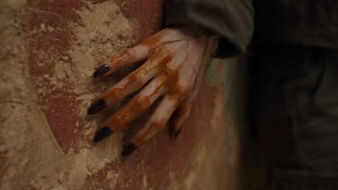</a>

A timed shot list with a reference image locking the character, plus a named setting for the worldbuilding. Each location change is hidden by a foreground occlusion such as fabric, a crowd or dust, so the camera keeps one traceable route through the city.

Seedance 2.5 · Reference-to-video · Source: [@VeraVCreates on X](https://x.com/VeraVCreates/status/2087005484146635022) · 67 likes on 2026-10-29

[`chase`](tags.md#tag-chase) [`martial-arts`](tags.md#tag-martial-arts) [`wasteland`](tags.md#tag-wasteland) [`single-take`](tags.md#tag-single-take)

<details><summary><b>Prompt</b></summary>

```text
Reference binding: strictly lock the girl's face, age, black tied-back hairstyle, worn dark-gray work jacket, light inner shirt, body proportions, and photorealistic texture to Image 1. She remains the same character in the same outfit throughout. Use a Dunhuang wasteland civilization for the worldbuilding: its architectural language, sandstorm atmosphere, low-tech transport, rusted machinery, earth-tone palette, and sunset light. Do not replicate the reference image's exact composition or setting. A 30-second single take with no edits or jump cuts.

The girl is fleeing pursuers, traveling from a cliffside mural cave through a vertical wasteland city before finally soaring up to the highest city wall. The camera flies tightly around her like a high-speed FPV drone, continuously shifting between close pursuit, dives, ground-skimming passes, circling, barrel rolls, and dramatic upward pulls. Every location transition is naturally motivated by foreground occlusion from doorways, fabric, people, animals, smoke, dust, and architecture.

00:00-00:04 | Mural Cave
Begin in close-up on the girl's paint-stained fingers. The camera races along a damaged mural toward her face. She looks back alertly, immediately steps onto a stone table, crouches, and leaps through a narrow window opening. The camera follows her through the window as hanging canvas sweeps across the lens, creating the first foreground wipe.
00:04-00:08 | Cliff Dwellings
As the camera bursts from the cave, it suddenly opens into a vast wide shot: an entire city clings to an enormous wind-eroded cliff face, with layered cave homes, earthen towers, suspended walkways, wind sails, and rusted power pylons stretching into the distance. The girl lands on a narrow wooden beam and sprints forward. She wall-runs into a light sideways leap, her body crossing the deep gap between two cliffside dwellings. The camera first dives close to her feet, then rises rapidly from the ravine to her side.
00:08-00:12 | Camel Caravan Market
The girl drops from above into a crowded open-air market. The camera follows her downward trajectory, rolling half a turn, skimming low through camel legs, cart wheels, and beneath market stalls, then tilting back up to find her again. She vaults a cargo cart one-handed, side-flips over stacked pottery jars, lands and lowers her center of gravity to slide beneath a horizontal timber, then spins through the motion to sweep aside a bamboo rack blocking her path. Camels, residents, fluttering awnings, and rolling vessels continuously cross the foreground.

00:12-00:16 | Long Dyeing Alley
A full sheet of ochre-red dyed fabric covers the lens. The camera passes through the cloth and enters a narrow dye workshop alley. The girl alternates between both walls for continuous wall-kicks, rapidly gaining height. She grabs an overhead rope, swings over steaming dye vats, rotates in the air, and lands on a moving cargo cart. The camera snakes between hanging fabrics in FPV motion, briefly barrel-rolling as cloth strips, steam, and water droplets race past the lens.
00:16-00:20 | Mechanical Water Channel
The cargo cart rushes into a semi-underground mechanical water channel. Using its momentum, the girl jumps forward, tucks her knees and flips in the air, kicking off the edge of a rotating waterwheel. She then uses hand plants, side flips, and low slides to avoid pipes sweeping across her route. The camera enters the center of the waterwheel from beside her shoulder, then races downward with the current, skimming just above the water beneath a stone arch. Water splashes onto the edge of the lens without obscuring the subject.
00:20-00:24 | Wind Tower Shaft
The girl runs up an angled pipe, takes three consecutive wall steps, and bursts into a giant wind tower. The camera suddenly rises vertically from the water channel, spiraling around her inside the narrow shaft. She grabs the skeleton of a swinging wind sail and is lifted off the ground by the powerful wind. In midair, she performs a clearly controlled spin and hand switch, then swings toward the tower-top exit. Gears, ropes, and flying grains of sand streak rapidly through the foreground.

00:24-00:27 | Broken Sky Bridge
The camera and the girl burst from the tower top together, revealing the full scale of the city again. The sky bridge ahead is collapsing. She runs across falling planks and jumps just before the final board drops away. Two masked pursuers emerge behind her, but remain distant and never take focus from the girl. She performs a long qinggong leap above the abyss, her coat tails pulled straight by the wind. The camera flies backward beneath her, arcs to the front, then continues flipping upward.
00:27-00:30 | Sunset City Wall
As the girl approaches the opposite city wall, she steps on a long banner whipping in the wind and uses it to gain height again. In midair, she performs a clean, powerful spinning kick that knocks open the wooden mechanism above the sealed city gate. She lands on the highest point of the wall, touching down on one knee before quickly rising. The camera surges over her shoulder, pulls violently backward, and rises into the sky, finally revealing the entire Dunhuang wasteland city, distant salt-alkali desert, moving camel caravans, and monumental cliffside ruins lit by the sunset.
Camera movement:
The entire shot follows one continuous, traceable spatial route. The camera has the impact and velocity of high-speed FPV flight but always remains centered on the girl. Include at least one ground-skimming pass, one dive followed by a rapid climb, one narrow-space serpentine flight, one spiral ascent, and one large aerial pullback. Use environmental motion blur in high-speed moments while keeping her face and body movements clear. The camera never teleports; every change in speed and direction is motivated by her actions or the architecture along the route.

Action performance:
The girl is light, agile, and convincingly trained in martial arts. Qinggong is expressed through powerful footwork, brief suspension, and the ability to cross extraordinary distances, never through floating or weightless flight. Her actions include wall-running, vaulting, side flips, sliding, sweeping strikes, rope swings, aerial rotations, and flying kicks. Every movement connects naturally, with clear center of gravity, landing points, inertia, and cloth response. She is always actively reading the route, breathing hard, focused, and never looking into the camera.
Environment and foreground transitions:
Damaged murals, canvas, cliff dwellings, wooden beams, camel legs, cart wheels, pottery jars, dyed fabric, steam, waterwheels, stone arches, gears, wind-sail skeletons, long banners, and windblown sand enter the extreme foreground in sequence. Foreground elements may briefly obscure the frame, but the girl must quickly reappear. The city spaces connect logically and cannot feel like unrelated locations stitched together.
Visual style:
Photorealistic Eastern wasteland fantasy, blending Dunhuang earth-and-rock architecture with salvaged industrial machinery on the grand scale of a vertical city. Main colors: weathered sandy yellow, ochre, gray-brown, and rust, with the girl's dark-gray costume contrasting against golden sunset light. Strong side and backlight pierce through dusty haze; fine sand floats in the air. Realistic materials, restrained film grain, high-contrast cinematic photography. The mood is tense, expansive, and rugged.
```

</details>

<a id="h3-helicopter-bridge-collapse-rescue"></a>
### Helicopter hangs over collapsing bridge in storm

<a href="https://x.com/Just_Anika_Here/status/2110701233292050798">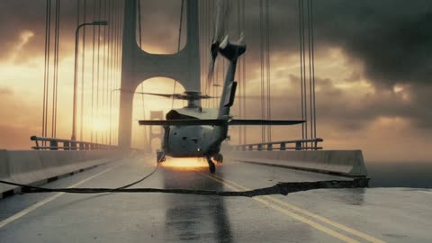</a>

A timed beat sheet gives each 3 second block a clear action and cause and effect chain, and a reference image locks the heroine's face and outfit across cuts. Wide establishing shots, medium tracking for the rescue and one close shot for the winch keep screen direction readable.

MiniMax H3 · Reference-to-video · Source: [@Just_Anika_Here on X](https://x.com/Just_Anika_Here/status/2110701233292050798) · 61 likes on 2026-10-29

[`helicopter`](tags.md#tag-helicopter) [`bridge-collapse`](tags.md#tag-bridge-collapse) [`rescue`](tags.md#tag-rescue) [`storm`](tags.md#tag-storm)

<details><summary><b>Prompt</b></summary>

```text
Create a photorealistic, premium Hollywood action blockbuster scene, 15 seconds, vertical 16:9. Every frame must look like a high-budget theatrical action film with physically believable stunts, spectacular practical destruction, precise choreography, realistic lighting, and crystal-clear action readability.  CHARACTER AND CONTINUITY: Use the provided reference image ONLY to preserve the main woman's exact identity, face, hairstyle, skin tone, and proportions. She wears a fitted black tactical jacket, dark cargo pants, and black boots. Her outfit and appearance remain consistent throughout. No dialogue or unnecessary facial acting.  LOCATION: A gigantic suspension bridge above a deep coastal gorge during a violent storm at sunset. A massive military transport helicopter is stranded on the bridge, its rotor spinning dangerously slowly. Abandoned vehicles block the road. The bridge cables groan under tension. The ocean and cliffs are visible far below.  0–3 SECONDS — IMMEDIATE DANGER: Open on a wide, crystal-clear view of the helicopter skidding sideways across the rain-soaked bridge as its landing gear throws sparks against the asphalt. The tail strikes a concrete barrier. The helicopter stops inches from the broken edge, tilted dangerously over the gorge. The woman runs into frame and grabs a thick hanging cargo cable before the aircraft slides farther.  3–6 SECONDS — CLEAN, POWERFUL ACTION: The helicopter shifts again, pulling the cable tight. The woman wraps it securely around a heavy steel bridge support, braces her boots against the road, and pulls a trapped pilot away from the open helicopter door. A powerful gust blows debris past them. She gets the pilot behind a concrete divider just as the helicopter's rear landing gear tears free.  6–9 SECONDS — MASSIVE BLOCKBUSTER SET PIECE: A large section of asphalt collapses beneath the helicopter. The aircraft drops several feet and hangs over the gorge, restrained by the tensioned cable. The woman grabs the pilot's harness and drags him across the road while the bridge deck cracks behind them. Huge concrete slabs fall into the mist below. Show the cause and effect clearly, with realistic weight, momentum, cable tension, and debris.  9–12 SECONDS — THE HERO MOMENT: The cable begins slipping around the steel support. The woman spots a heavy emergency winch mounted beside a maintenance truck. She sprints to it, locks the cable into the winch, and slams the mechanical brake down with both hands. The cable snaps tight. The helicopter swings away from the broken edge and stabilizes above the gorge. The woman remains grounded, gripping the winch as the entire bridge shudders.  12–15 SECONDS — SPECTACULAR PAYOFF: The helicopter's main rotor finally catches full power. Instead of taking off, the pilot lowers a rescue line directly toward the woman and the rescued pilot. She clips the pilot into the harness first and sends him upward. As the helicopter lifts him to safety, the enormous bridge section behind her breaks loose and plunges into the gorge in a thunderous wall of concrete and spray. She turns, sees the destruction coming, and makes one final sprint toward the helicopter's dangling rescue ladder. She jumps, catches it with both hands, and is pulled clear as the bridge collapses beneath her boots. CUT TO BLACK at the exact moment she clears the edge.  CAMERA AND QUALITY: Premium large-format Hollywood cinematography, realistic human anatomy, sharp facial identity, detailed wet clothing, natural rain, physically accurate helicopter movement, realistic cable tension, high-detail concrete fracture, volumetric storm mist, dramatic but natural lighting, and carefully controlled motion blur.  Use a wide establishing shot for geography, medium tracking shots for the rescue, and one close shot for the winch action. Every cut must preserve screen direction and spatial continuity. Keep the woman, cable, helicopter, and bridge edge clearly distinguishable. No chaotic camera shake that hides the action.  AUDIO: Deep helicopter rotor thumps, cable groaning under tension, metal scraping asphalt, concrete cracking, wind buffeting the microphone, debris crashing into the gorge, the winch locking with a heavy metallic clunk, and a powerful orchestral-percussion score that peaks during the final jump. Sound effects must match the visible actions precisely.  STRICT NEGATIVE INSTRUCTIONS: No teleporting, no unexplained cuts, no impossible superhero strength, no random explosions, no slow motion, no weightless debris, no rubbery cables, no changing helicopter design, no duplicated people, no extra fingers, no warped faces, no inconsistent clothing, no blurry action, no excessive camera shake, no artificial CGI appearance, no subtitles, and no logos.  The final shot must clearly show the woman successfully catching the rescue ladder while the bridge collapses beneath her. The ending must feel earned, spectacular, dangerous, and emotionally satisfying.
```

</details>

<a id="wan-street-racing-neon-timed-beats"></a>
### Purple supercar racing through neon-lit wet streets

<a href="https://x.com/Rosey_watson/status/2092952141677646264">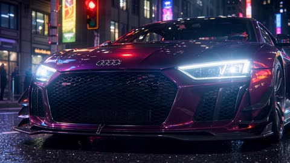</a>

Splitting the prompt into timed beats, each with its own action and camera move, gives the model a clear shot order to follow. Audio cues sit in a separate line so the sound design does not compete with the visual description.

Wan 3.0 · Text-to-video · Source: [@Rosey_watson on X](https://x.com/Rosey_watson/status/2092952141677646264) · 61 likes on 2026-10-29

[`street-racing`](tags.md#tag-street-racing) [`timed-beats`](tags.md#tag-timed-beats) [`night-city`](tags.md#tag-night-city) [`camera-moves`](tags.md#tag-camera-moves)

<details><summary><b>Prompt</b></summary>

```text
Create a 15-second ultra-cinematic street racing sequence with the adrenaline and intensity of a modern arcade racing game.

0–3 sec — Launch:
Midnight in a neon-lit city. A modified supercar sits at a red light, engine vibrating aggressively. Close-up of glowing headlights, spinning rims, driver gripping the steering wheel. The light turns green — instant launch with tire smoke and dramatic camera shake.

3–7 sec — High-Speed Chase:
Low-angle tracking shot beside the car as it blasts through wet streets at extreme speed. Neon signs reflect across the glossy bodywork. Rapid gear shifts, glowing dashboard, realistic motion blur, sparks from a near-miss with a barrier. Camera swings from rear chase view to a dynamic side shot.

7–11 sec — Impossible Corner:
The car approaches a sharp city corner at full speed, slams the brakes, then performs a perfectly controlled drift. Tires scream, smoke fills the street, headlights cut through the haze. Camera rotates around the vehicle in a fast 360° cinematic move.

11–15 sec — Final Sprint:
The car exits the drift and rockets toward a massive illuminated finish line. A second rival car appears beside it. Both accelerate side-by-side through a tunnel of neon lights. Final shot: extreme low-angle rear view as the winning car disappears into the night.

Visual style: photorealistic AAA racing-game graphics, cinematic night lighting, wet asphalt reflections, detailed car materials, realistic tire physics, volumetric fog, dynamic motion blur, lens flares, aggressive camera movement, high-speed perspective, dramatic depth of field, premium VFX, seamless transitions, intense racing atmosphere.

Audio: roaring engine, turbo spool, gear shifts, tire screech, bass-heavy cinematic soundtrack, Doppler effects and a powerful final acceleration hit.

Format: 9:16 vertical, 15 seconds, ultra-detailed, realistic physics, consistent car design throughout, no text, no logos, no watermarks.
```

</details>

<a id="kling-lone-knight-fortress-battle-sequence"></a>
### Lone knight holds fortress gate against armored attackers

<a href="https://x.com/AiwithBloodline/status/2112796958045896801">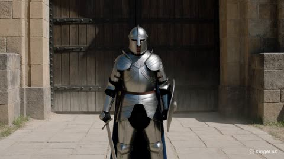</a>

An uploaded reference image fixes the armor, cloak and sword across every beat, and the prompt splits the action into timed segments with a spatial continuity instruction so the multi-opponent fight stays readable. A separate audio line lists only sound design, which keeps music out of the mix.

Kling 4.0 · Reference-to-video · Source: [@AiwithBloodline on X](https://x.com/AiwithBloodline/status/2112796958045896801) · 53 likes on 2026-10-29

[`medieval`](tags.md#tag-medieval) [`battle`](tags.md#tag-battle) [`reference-image`](tags.md#tag-reference-image) [`multi-shot`](tags.md#tag-multi-shot) [`historical`](tags.md#tag-historical)

<details><summary><b>Prompt</b></summary>

```text
Create a photorealistic medieval battle sequence featuring a lone male knight defending the entrance to an ancient stone fortress. The scene must resemble a premium Hollywood historical film, with realistic armor, physically accurate movement, natural lighting, and consistent character identity.
Character reference: Use the uploaded knight image as the strict visual reference. Maintain the same helmet, silver plate armor, dark-blue cloak, sword, shield, and body proportions throughout the video.
0–5 seconds: The knight stands alone in front of a massive fortress gate. Wind moves his dark-blue cloak as dust drifts across the stone courtyard. The camera slowly pushes toward him.
5–10 seconds: A line of armored soldiers emerges through the distant dust. The knight raises his shield and positions his sword defensively. Sunlight glints naturally off the edges of his armor.
10–15 seconds: The first opponent charges. The knight blocks the incoming sword strike with his shield, pivots, and pushes the opponent backward. His armor moves naturally with his body.
15–20 seconds: Two more opponents approach from opposite directions. The knight turns to face them, maintaining a defensive stance. The camera tracks around the combatants while preserving spatial continuity.
20–25 seconds: The knight deflects another strike and forces the opponents to retreat. Dust rises from their boots as they move across the courtyard.
25–30 seconds: The knight lowers his shield slightly and turns toward the fortress gate as it begins to open behind him. Warm sunlight spills through the opening, illuminating his armor and revealing reinforcements arriving inside the fortress.
Audio: No music. Metal armor clanking, swords colliding, boots striking stone, wind, distant battle ambience, and natural breathing.
Negative prompt: Cartoon armor, inconsistent weapons, changing character appearance, extra limbs, floating swords, graphic gore, dismemberment, exaggerated fighting, unrealistic physics, background music, text, watermark.
```

</details>

<a id="h3-hover-bike-race-mountain-pass-anime"></a>
### Two-Rider Hover-Bike Race Down Mountain Pass

<a href="https://x.com/yourPlugAI/status/2086528067019698388"></a>

An entity lock fixes exactly two racers and two bikes, with a livery description for each to keep them consistent. Timed camera and action blocks cover the whole 15 seconds and run from a supplied first frame.

MiniMax H3 · Image-to-video · Source: [@yourPlugAI on X](https://x.com/yourPlugAI/status/2086528067019698388) · 50 likes on 2026-10-28 · found via [SkyNotSilent/awesome-MiniMax-H3-cases](https://github.com/SkyNotSilent/awesome-MiniMax-H3-cases)

[`anime`](tags.md#tag-anime) [`racing`](tags.md#tag-racing) [`sci-fi`](tags.md#tag-sci-fi) [`action`](tags.md#tag-action) [`entity-lock`](tags.md#tag-entity-lock)

<details><summary><b>Prompt</b></summary>

```text
Cinematic Anime Video Scene

Generate a 15-second horizontal 16:9 original high-speed hover-bike racing anime video from the provided first frame.

CRITICAL ENTITY LOCK:
There must be exactly 2 racers and 2 bikes in the entire video: RENJI on VALKYRIE-01 (cyan/black drift bike) and ELENA on AERO-X (crimson/white draft bike).
Do not add extra racers, drone support vehicles, spectators, or traffic.
Maintain total visual consistency for both bikes, helmet visors, suit patterns, repulsor spark colors, and bike liveries throughout the sequence.

Entity identity:
VALKYRIE-01: Matte-black and cyan angular hover-bike, exposed repulsor pads, lateral drift brakes, blue plasma exhaust trails, ridden by Renji (cyan trim suit).
AERO-X: Pearl-white and neon-crimson aerodynamic hover-bike, enclosed canopy, crimson energy draft aura, white-hot central booster, ridden by Elena (crimson/gold visor suit).

Video style:
High-budget modern sports anime, sakuga-level velocity animation, crisp line art, vibrant neon lighting contrast, high-speed camera tracking, hyper-realistic friction and energy particle effects. Set on a wet downhill mountain pass at dawn.

Camera and pacing:
Continuous forward velocity, zero slow-motion interruptions:
0.0s - 3.0s: High-speed rear-tracking shot diving into the first downhill hairpin curve; instant drift initiation.
3.0s - 7.5s: Tight side-parallel tracking shot as bikes navigate rock debris and trade positions through S-curves.
7.5s - 11.5s: Close camera lock on the draft-slingshot maneuver; high-energy particle displacement as booster ignition occurs.
11.5s - 15.0s: Low-angle front-facing camera lock on the final sprint to the finish line bridge, ending on a hyper-speed photo-finish freeze.

Action timing:
0.0s - 1.5s:
Sequence begins at speed. VALKYRIE-01 leads downhill; AERO-X locks onto its rear bumper. Anti-gravity repulsors spray road water and blue sparks into the frame.

1.5s - 4.0s:
First sharp hairpin. VALKYRIE-01 deploys lateral drift airbrakes with a burst of blue thruster fire, sliding sideways at 300 km/h. AERO-X stays glued inside its slipstream aura.

4.0s - 7.0s:
Mountain debris hazard. VALKYRIE-01 hops over a boulder using a repulsor burst. AERO-X ducks under it, scraping the neon magenta guardrail in a cloud of friction sparks.

7.0s - 10.0s:
S-Curve exchange. Bikes lean side-by-side; their repulsor fields collide, creating a bright electrical shockwave. ELENA pulls the overdrive lever; AERO-X's rear fins extend.

10.0s - 13.0s:
Slingshot maneuver. AERO-X bursts out of VALKYRIE-01's draft, igniting its central white plasma booster. Both bikes roar down the final straightaway side-by-side.

13.0s - 15.0s:
Final sprint toward the finish light gate. Water sprays violently behind them. Both nose cones cross the finish line simultaneously in a flash of light. Final freeze frame.

Motion quality:
Fluid 2D animation, extreme speed-line integration, stable bike geometry, flawless vehicle reflection rendering, zero limb or body clipping, high-frame-rate kinetic realism.

Environment:
Wet mountain pass asphalt, sheer cliff walls, neon cyan and magenta guardrail lights, early dawn sky with pink/purple clouds, water spray, floating spark particles.

Final output:
15 seconds, horizontal 16:9, original high-budget sports racing anime, exactly 2 racers, relentless kinetic pacing, dynamic cinematography, no subtitles, no watermarks, no logos.
```

</details>

<a id="h3-matte-black-car-rain-police-chase"></a>
### Matte black performance car escapes rain-soaked night chase

<a href="https://x.com/Goodmanprotocol/status/2103181604793598138">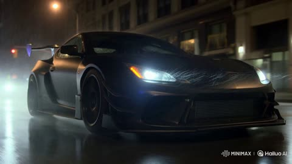</a>

A timed shot list (0 to 4 seconds, 4 to 8 seconds and so on) fixes the order of camera setups, and each segment names a physical cue such as tyre spray, weight transfer and dashboard glow. Keeping the visual realism spec and the audio spec in separate blocks lets the sound of engines, rain and Doppler sirens land without bleeding into the image.

MiniMax H3 · Text-to-video · Source: [@Goodmanprotocol on X](https://x.com/Goodmanprotocol/status/2103181604793598138) · 50 likes on 2026-10-29

[`car-chase`](tags.md#tag-car-chase) [`night`](tags.md#tag-night) [`rain`](tags.md#tag-rain) [`timed-shot-list`](tags.md#tag-timed-shot-list)

<details><summary><b>Prompt</b></summary>

```text
15-SECOND ULTRA-REALISTIC NEW YORK POLICE CHASE

Create a photorealistic Hollywood action sequence set in Manhattan at night. A modified matte-black performance car races through rain-soaked New York streets while three realistic police cruisers pursue at high speed, emergency lights reflecting across wet asphalt and skyscraper windows.

0–4s: Low cinematic tracking shot beside the black car as it accelerates aggressively through traffic. Tires spray water, suspension reacts naturally, headlights cut through rain and city haze.

4–8s: Interior cockpit shot showing the driver making rapid steering corrections. Dashboard lights glow naturally while the engine revs and gear changes create subtle cabin vibration.

8–12s: Dynamic street-level shot as the car takes a sharp wet intersection turn, followed closely by police cruisers. Realistic weight transfer, tire grip, water spray, motion blur, and camera vibration emphasize speed.

12–15s: Aerial-to-low transition reveals the chase racing between illuminated Manhattan buildings before the black car disappears into traffic.

ULTRA-REALISM: physically accurate vehicle physics, realistic tire deformation, suspension movement, wet-road reflections, natural rain, authentic emergency lighting, realistic traffic, detailed vehicles, atmospheric haze, cinematic depth of field, anamorphic lens characteristics, HDR, subtle film grain, natural motion blur, 8K-level photorealism.

AUDIO: roaring engines, tire noise, gear shifts, rain, city ambience, horns, and realistic Doppler-shifting police sirens.

No CGI appearance, warped vehicles, impossible physics, distorted buildings, excessive camera shake, oversaturated neon, text, or watermark.
```

</details>

<a id="h3-lightning-fan-dancer-dark-hall"></a>
### Lightning fan dancer in a dark hall

<a href="https://x.com/Cia0_exe/status/2091392123497279974">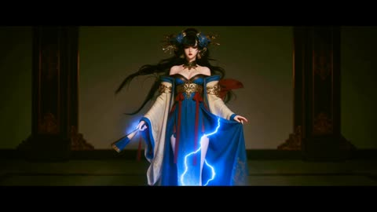</a>

A full eight-shot storyboard gives each shot a two second timing, a lens and a camera move, and ends on the same pose it starts from so the clip loops seamlessly. The lightning is pinned to a 1.2 metre sphere around the body and each shot has its own sound layer, which keeps the effects on the character.

MiniMax H3 · Reference-to-video · Source: [@Cia0_exe on X](https://x.com/Cia0_exe/status/2091392123497279974) · 45 likes on 2026-10-29

[`storyboard`](tags.md#tag-storyboard) [`seamless-loop`](tags.md#tag-seamless-loop) [`lightning-effect`](tags.md#tag-lightning-effect) [`fan-dance`](tags.md#tag-fan-dance)

<details><summary><b>Prompt</b></summary>

```text
[影片总纲] 电影级角色技能展示动画，总时长严格16秒无缝循环loop，画幅比2.39比1变形宽银幕电影规格，无背景音乐，仅角色动作音效与技能音效，8K电影级写实渲染，光线追踪全局光照，体积雾散射，皮肤次表面散射，Kodak 5219胶片颗粒12%，Halation光晕6%，镜头呼吸效应，变形宽银幕镜头椭圆散景与水平拉丝眩光，色彩空间Rec.709带电影级青橙LUT，对比度S型曲线暗部提升12%高光压缩8%，阴影偏青高光偏金，黑位纯净不浮灰。全程聚焦角色主技能「雷华扇舞」，以折扇为核心武器，动作优雅凌厉不重复，每2秒一次平滑镜头转场，禁止任何旋转场景，禁止远景大全景，摄影机最远不得超过角色全身full body，loop终点无缝衔接起点形成永恒循环。

[色彩圣经] 阶段一蓄力起势0至4秒，暗室幽蓝主调(#0A1628)，角色衣白描金(F5F5DC/DAA520)，折扇靛蓝(1E3A5F)，闪电冰蓝(00BFFF)，暗部纯黑(0A0A0A)。阶段二技能释放4至10秒，闪电核心炽白(FFFFFF)，电弧冰蓝渐变紫(#00BFFF至#8A2BE2)，扇面展开虹彩反光，衣袂飘飞金边，Typography金光(#FFD700)。阶段三收势循环10至16秒，余电幽蓝微光(1E3A5F)，扇骨金属冷银(C0C0C0)，暗部青黑(0F1B2E)，终幕Typography金属银灰(C0C0C0)。

[角色档案]
@image1
 技能主体：成年女性，身材丰腴曲线优美，2.5D动画电影级写实风格，乌黑长发盘髻配古金雕饰与靛蓝羽饰，额前几缕碎发随能量风飘动。面容清冷高贵，狭长凤眼微阖时带悲悯，睁开时雷光闪烁，红唇如朱，肤色白皙带冷调。身着改良中式华服，外层月白广袖纱衣绣暗金云纹，内层靛蓝束腰长裙配赤红丝带，肩臂裸露处覆古金臂钏与闪电纹路。双手十指纤长，指甲涂暗金。手持巨型折扇，扇面靛蓝近黑，绘银色雷纹图腾，扇骨古金雕龙，展开时扇面如半月，合拢时如短杖。周身环绕冰蓝闪电aura，主体冰蓝(00BFFF)，内核炽白(FFFFFF)，分支如蛛网细丝蔓延，呈旋转能量场 strictly 环绕身体周围1.2米球形范围，脉冲式爆发间隔0.25秒，伴随冰蓝光尘爆散与细微雷鸣。闪电与折扇交互：扇面展开时闪电从扇骨向扇面放射如蛛网，扇面挥动时闪电拖曳成光带残影，扇面合拢时闪电收束于扇骨顶端如能量核心。

[分镜脚本 — 雷华扇舞·八镜循环·16秒无缝loop]

镜1，0至2秒，中景全身起势蓄力。机位轨道车微推，40毫米，T2.8，高度齐腰，平视微仰8度。画面
@image1
立于暗室中央，双足微分，右手持合拢折扇垂于身侧，左手轻提裙角，身姿如古典舞起势。冰蓝闪电从地面沿腿部缓缓向上攀爬，在腰部分叉，于背部汇聚后沿右臂流向折扇，扇骨顶端开始聚集米粒大小炽白能量点，能量点以0.5秒间隔明灭如呼吸。角色微阖凤眼，面容宁静，碎发被静电微微扬起。摄影机以每秒0.2米速度微推，呼吸感手持正负2毫米，焦点在面部与扇骨间缓慢转移。色彩暗室幽蓝，衣白描金，闪电冰蓝微光，能量点炽白。排版无。音效衣料摩擦沙沙声，闪电攀爬低频嗡鸣35赫兹，能量点明灭细微电流滋滋声，角色轻缓呼吸如耳语。

镜2，2至4秒，近景扇面初展。机位斯坦尼康低角度上升，50毫米，T2.0，仰角15度起升至平视。画面
@image1
右手腕轻转，折扇如流水般展开三分之一，扇面靛蓝雷纹图腾在闪电照耀下显现，图腾线条由暗转明发出冰蓝光芒。闪电从扇骨向展开的扇面放射呈扇形蛛网，电弧在扇面表面游走如活物，部分电弧跃出扇面在空中形成细小闪电枝杈，枝杈长度不超过扇面宽度一半。角色凤眼微睁，瞳孔中倒映扇面雷纹，眼神从宁静转锐利。左手同时抬起呈兰花指，指尖带细微电光。摄影机低角度上升速度先慢后快再缓，模拟呼吸起伏，焦点锁定扇面图腾与眼神交替。色彩扇面靛蓝，雷纹银白，电弧冰蓝，瞳孔倒映微光。排版扇面展开瞬间，画面右侧浮现半透明日文汉字「開」(00BFFF)，字体行书体，字色冰蓝带炽白描边2像素，透明度0至80%淡入0.3秒后消散，无背景块，文字边缘带细微电弧跳动。音效扇骨展开清脆咔哒声，扇面展开布料摩擦声，闪电放射噼啪声，眼神锐利瞬间低频雷鸣40赫兹。

镜3，4至6秒，中景扇舞横斩。机位轨道车急速横移，35毫米，T2.8，高度齐胸，平视。画面
@image1
右臂横挥，折扇完全展开如半月横斩，扇面切割空气产生一道水平冰蓝闪电光刃，光刃宽如扇面，长三米，呈月牙形向前飞射，光刃边缘带锯齿状电弧分支，飞行速度每秒四米，所经之处空气扭曲产生热浪波纹。角色身姿随挥扇转动90度，月白纱衣广袖如翅膀展开，暗金云纹在电光中反光，赤红丝带飘飞如火焰，乌黑长发与靛蓝羽饰在焦平面产生动态模糊。摄影机以每秒1.5米速度横向跟随光刃轨迹，背景产生强烈方向性动态模糊，焦点在扇面与光刃间快速切换。色彩光刃冰蓝核心炽白，电弧紫蓝，纱衣白中带金边，丝带赤红。排版光刃飞射瞬间，画面中央偏左浮现半透明日文汉字「斬」(8A2BE2)，字体草书体，字色紫蓝带冰蓝描边2像素，透明度0至90%淡入0.2秒，随光刃飞行方向产生动态模糊拖影，0.5秒后消散。音效扇面破空尖啸2千赫兹，光刃飞行低频呼啸，电弧噼啪如连发鞭炮，衣袂飘飞猎猎声，角色低喝「散れ」。

镜4，6至8秒，近景扇花连击。机位手持肩扛微晃，50毫米，T1.8，极浅景深，高度齐肩，微俯5度。画面
@image1
折扇在手中如蝴蝶翻飞，连续三次开合：第一次扇面向上挑击，闪电从扇面向上喷射呈喷泉状，高度两米，水滴状电光向上飞散后如烟花般缓缓下落；第二次扇面向下劈斩，闪电呈垂直光柱砸向地面，地面石板被击中处呈蛛网龟裂，裂缝中渗出冰蓝电光；第三次扇面水平回旋，闪电呈环形冲击波以角色为中心向外扩散，冲击波呈冰蓝光环，光环厚度十厘米，扩散速度每秒三米，所经之处地面尘埃被吹起呈放射状。角色面部表情专注而优雅，凤眼半阖，红唇微抿，每次开合伴随一次眨眼，节奏如古典舞曲。摄影机手持呼吸感正负4毫米，焦点在扇面与面部间以0.6秒为周期切换，制造亲密紧张感。色彩闪电喷泉冰蓝，光柱炽白，光环紫蓝，面部肤色冷白，红唇朱色。排版三次开合分别浮现日文汉字：第一次「雷」(00BFFF)行书体居画面上方，第二次「鳴」(FFFFFF)草书体居画面下方，第三次「華」(8A2BE2)隶书体居画面中央，三字依次浮现各0.3秒，字色对应闪电色，带2像素描边与细微电弧跳动，透明度0至85%，无背景块。音效三次开合连续咔哒声，喷泉电弧滋滋声，光柱砸地低频轰鸣50赫兹，光环扩散空气爆裂声，角色三连轻喝「雷」「鳴」「華」。

镜5，8至10秒，全景跃起扇旋。机位摇臂微升，28毫米广角，T4.0，低角度仰拍30度。画面
@image1
足尖点地跃起一米，空中身姿如天鹅展翅，双臂展开，折扇在右手高速旋转如风车，扇面旋转产生圆形冰蓝能量盘，能量盘直径两米，厚度五厘米，表面布满旋转雷纹图腾，图腾如活物逆向转动。能量盘向斜上方飞射，击中暗室顶部，顶部石板被击中处呈圆形焦黑，碎石与尘埃呈慢动作向下洒落，尘埃颗粒在电光中闪烁如星尘。角色在空中停留0.8秒后缓缓下落，纱衣与长发在失重状态下向上飘飞，赤红丝带呈波浪状。摄影机摇臂上升速度每秒0.6米后缓停，广角畸变使角色更显修长，背景暗室穹顶在畸变中呈穹窿状压迫感。色彩能量盘冰蓝核心紫边，顶部焦黑(1C1C1C)，尘埃星尘银白，纱衣逆光半透明。排版能量盘飞射瞬间，画面顶部浮现半透明日文汉字「天」(00BFFF)，字体篆体，字色冰蓝带紫边描边2像素，透明度0至80%，随能量盘旋转产生径向模糊，0.4秒后消散。音效扇面旋转高频嗡鸣，能量盘飞行低频啸叫，顶部撞击轰鸣，碎石洒落清脆咔啦声，角色跃起衣料风声，下落时丝带飘动声。

镜6，10至12秒，中景收扇蓄力。机位轨道车环绕，40毫米，T2.0，高度齐腰，环绕速度每秒30度。画面
@image1
落地后单膝微屈，右手持扇如剑指向地面，折扇半开合状态，扇面与地面呈45度。冰蓝闪电从扇骨顶端向地面持续喷射，在地面上形成直径一米的旋转电光漩涡，漩涡中心炽白，边缘冰蓝，转速每秒两圈，漩涡中浮现古老雷纹图腾虚影。角色抬头凤眼完全睁开，瞳孔呈竖线状如猫，瞳孔核心冰蓝光芒大盛，面容从优雅转肃杀，下颌线紧绷，颈部青筋微显。左手呈掌按于胸前，掌心带聚集的电光球，光球直径五厘米，表面闪电如千蛇游走。摄影机环绕中焦点在瞳孔与电光漩涡间缓慢转移，背景暗室墙壁在环绕中产生动态模糊。色彩漩涡冰蓝至炽白渐变，瞳孔竖线冰蓝，掌心光球炽白，面部冷白带红晕。排版瞳孔睁大瞬间，画面中央浮现半透明日文汉字「覚」(FFD700)，字体明朝体，字色古金带冰蓝微光描边1像素，透明度0至100%随瞳孔光芒同步增强，0.5秒后渐隐。音效收扇金属摩擦声，闪电喷射持续低频轰鸣45赫兹，漩涡旋转风啸声，瞳孔光芒增强高频电流声，角色深吸气声。

镜7，12至14秒，近景终极扇闪。机位手持急速前冲，50毫米，T1.8，极浅景深，高度齐胸。画面
@image1
猛然抬头，右手折扇如闪电般完全展开向前直刺，扇骨顶端聚集的炽白能量瞬间爆发，形成一道锥形闪电光束向前喷射，光束长四米，根部直径三十厘米，顶端尖锐如矛，光束表面覆盖密集蛛网电弧，电弧向四周散射长度不超过五十厘米。光束所经之处暗室空气被电离呈淡蓝色等离子体，等离子体如烟雾般向两侧翻卷。角色面部表情极致凌厉，凤眼圆睁，红唇微张露齿，额前碎发被冲击波向后吹飞呈放射状，古金臂钏在电光中发出刺目反光。摄影机以每秒2米速度向前急推，制造强烈代入感与眩晕，焦点始终锁定扇骨顶端能量核心，背景完全虚化呈冰蓝色散景光斑。色彩光束核心炽白不可直视，表面冰蓝，等离子体淡蓝，散景光斑紫蓝。排版光束爆发瞬间，画面满屏浮现大量半透明日文汉字如「雷」「閃」「華」「鳴」「天」「覚」「開」「斬」等随机排列，字体混合行书草书隶书，字色冰蓝紫蓝古金随机，各字透明度20至60%，尺寸大小不一，如古老咒文环绕角色周身，持续0.8秒后如被能量波击碎般向四周飞散，飞散时带动态模糊与电弧拖尾。音效能量爆发瞬间1秒绝对静音制造张力顶点，随后雷鸣震耳如天罚，电弧散射高频噼啪，等离子体电离滋滋声，角色终极喝声「雷華閃」。

镜8，14至16秒，终幕循环衔接Typography Art。机位绝对静止，50毫米，T8.0全清晰，无任何运动。画面
@image1
收扇立于暗室中央，姿态与镜1起势完全相同，形成无缝loop闭环。折扇合拢垂于身侧，周身冰蓝闪电aura从狂暴状态缓缓收束至温和脉动，如呼吸般一张一缩。暗室地面布满前七镜留下的战斗痕迹：蛛网龟裂、焦黑圆坑、环形电痕、碎石尘埃，所有痕迹在终幕中发出微弱冰蓝余光，余光明灭节奏与角色呼吸同步。角色面容恢复宁静，凤眼微阖，碎发轻垂，唯有瞳孔深处仍残留一丝雷光。画面从全彩渐变为高对比度，仅保留冰蓝与古金两色，其余去饱和呈灰调。屏幕中央浮现主标题「Cia0 X H3」，采用超高对比无衬线黑体Heavy如思源黑体Heavy，字号占画面高度七分之一，位置绝对居中偏上3%，字色金属银灰渐变(C0C0C0至#808080)从左上方至右下方，带2像素冰蓝(00BFFF)硬边偏移阴影向右下45度，轻微色差效果红与蓝横向错位1.5像素，字间距拉宽至正常160%，字重极粗。文字后方横向刷过一道冰蓝闪电裂痕如刀刃伤痕，裂痕边缘带炽白微光粒子消散，粒子呈星尘状向上飘散。主标题下方8%画面高度处，副标题「雷華扇舞」以细体明朝体浮现，字色暗古金(B8860B)，透明度0至90%淡入0.5秒，字间距正常，无阴影。整个文字层带极轻微闪电纹理质感与0.5%噪点。背景保持高对比灰调暗室。摄影机绝对静止无任何运动。音效最后一声沉重古钟轰鸣C2音持续1.5秒，余音中混入闪电aura温和脉动的低频嗡鸣，最终归于绝对寂静。日语音声最后低语渐行渐远至完全消失，「また、始めるわ」。

[摄影机宪法] 画幅比严格2.39比1变形宽银幕。所有镜头主体始终为角色，最远不得超过全身full body，禁止远景大全景破坏亲密感与技能聚焦。每镜时长严格2秒，转场使用光学溶解叠化或无缝运动匹配衔接，叠化时长0.3秒，禁止跳切。镜头运动：镜1轨道微推，镜2斯坦尼康上升，镜3轨道横移，镜4手持肩扛，镜5摇臂微升，镜6轨道环绕，镜7手持急推，镜8绝对静止。每2秒一次平滑转场，运动轨迹如古典舞曲般流畅。景深特写T1.8极浅，中景T2.0至T2.8，全景T4.0。运动模糊快门角度180度，自然动态模糊，技能高速动作产生方向性拖影。镜头呼吸效应在焦点转移时轻微可见。任何情况下摄影机不得后退至角色全身以下比例小于画面高度的70%。Loop终点镜8必须与镜1起势姿态完全一致，光影、aura强度、角色位置误差不超过5%，确保无缝循环。

[闪电aura圣经] 冰蓝闪电为主体色(00BFFF)，炽白为内核与高光(FFFFFF)，技能释放段加入紫蓝边缘(8A2BE2)。闪电形态主电弧如手指粗细，表面不光滑带有机扭曲，分支如蛛网细丝蔓延，整体呈旋转aura能量场 strictly 环绕角色身体周围1.2米球形范围，绝不扩散至环境远景。运动非匀速，呈脉冲式爆发，间隔0.25秒一次强闪，伴随细微冰蓝光尘爆散。闪电与折扇交互：扇面展开时从扇骨向扇面放射呈扇形蛛网，扇面挥动时拖曳成光带残影，扇面合拢时收束于扇骨顶端如能量核心。环境反应仅限角色脚边半米石板静电微颤，雾气被电离成细微漩涡仅限角色周围0.8米，地面留下临时性焦黑电痕。闪电音效低频轰鸣30至50赫兹打底，中频噼啪2千赫兹，高频电离滋滋8千赫兹。

[Typography设计宪法] 全片文字分两类：(1)技能释放时随机浮现日文汉字，字体混合行书草书隶书篆体明朝体，字色冰蓝紫蓝古金随机，带1至2像素描边与细微电弧跳动，透明度20至90%，尺寸大小不一，如古老咒文环绕角色，浮现0.2至0.5秒后消散或飞散，无背景块，不遮挡角色主体；(2)终幕主标题「Cia0 X H3」+副标题「雷華扇舞」，主标题无衬线黑体Heavy占画面高度七分之一居中偏上3%，金属银灰渐变带冰蓝硬边阴影与色差效果，字间距160%；副标题明朝体细体暗古金，位于主标题下方8%高度处，淡入0.5秒。禁止其他任何文字、水印、UI元素出现。

[声音设计宪法] 绝对禁止背景音乐。仅使用角色动作音效与技能音效，分层混音：Layer1环境底噪暗室微声负45分贝，Layer2角色动作衣料步伐呼吸负20分贝，Layer3技能特效闪电扇面负12分贝，Layer4人声配音负8分贝。空间感使用卷积混响模拟密闭暗室，预延迟30毫秒，衰减时间2.5秒。动态范围最小负60分贝，最大负3分贝，保留电影级动态。特殊处理：技能爆发瞬间使用1秒绝对静音制造张力顶点；扇面开合使用清脆金属与布料声；闪电使用分层雷鸣与电流声；终幕古钟使用C2音持续1.5秒渐弱。

[日语音声设计] 声线成年女性清冷优雅带威严，25岁前后，标准语带古典疏离感。处理：起势蓄力段使用近距离耳语混响，技能释放段加入空间混响与轻微失真，终幕段加入低通滤波渐弱至消失。台词共五句，每句不超过5音节，情绪递进：宁静→锐利→专注→肃杀→回归宁静。台词顺序：镜2轻缓呼吸→镜3低喝「散れ」→镜4三连轻喝「雷」「鳴」「華」→镜7终极喝声「雷華閃」→镜8低语「また、始めるわ」。

[渲染技术规格] 8K分辨率(7680x4320)，光线追踪全局光照，路径追踪采样2048spp，体积雾散射，皮肤次表面散射(SSS)半径3毫米，Kodak 5219胶片颗粒12%，Halation光晕6%，镜头呼吸效应焦点转移时可见，变形宽银幕椭圆散景(水平拉伸1.33倍)，水平拉丝眩光强高光处可见，色彩空间Rec.709，电影级青橙LUT，对比度S型曲线暗部提升12%高光压缩8%，阴影偏青(2F4F4F)高光偏金(D4A843)，黑位纯净(000000)不浮灰，技能高速动作运动模糊快门180度，闪电使用单独发光渲染层带体积光属性，Typography使用单独合成层带轻微发光与噪点。

[技能动作设计宪法] 折扇为核心武器，所有动作必须优雅且凌厉，禁止单调重复。扇面开合节奏如古典舞曲：展开时如孔雀开屏带电弧放射，合拢时如利剑归鞘带能量收束。扇面挥动轨迹必须呈优美弧线，禁止直线僵硬挥砍。角色身姿配合扇动：横斩时转腰送肩，挑击时踮足仰身，劈斩时沉腰坠肘，回旋时旋身展臂。每次扇面与空气摩擦必须产生可见气流波纹与电弧拖影。闪电特效必须与扇面动作严格同步：扇面展开瞬间闪电从扇骨向扇面呈扇形放射，扇面挥动瞬间闪电拖曳成光带残影 lingering 0.3秒，扇面合拢瞬间闪电收束于扇骨顶端如能量核心明灭。角色面部表情随技能节奏变化：蓄力时宁静微阖，释放时锐利圆睁，收势时肃杀凝视，终幕时回归悲悯。眼神必须始终带一丝不可侵犯的威严。

[环境破坏累积系统] 技能释放过程中暗室环境持续受损且不可恢复：镜1地面石板出现细微电痕→镜2扇面放射电弧击中地面产生焦黑斑点→镜3光刃横斩在地面留下三米长月牙形焦痕→镜4光柱砸地产生蛛网龟裂与环形坑洞→镜5能量盘击中顶部产生圆形焦黑与碎石→镜6旋转漩涡在地面雕刻出螺旋电痕→镜7终极光束贯穿空气产生等离子体灼烧痕迹。所有破坏痕迹在后续镜头中持续可见，终幕镜8中所有痕迹发出微弱余光与角色呼吸同步明灭。

[Typography动态效果宪法] 技能释放时浮现的日文汉字必须带动态效果：浮现时使用0.1秒快速淡入带轻微缩放从80%至100%，停留期间带细微电弧在文字边缘跳动，消散时使用0.2秒向随机方向飞散带动态模糊拖影与粒子消散效果。镜7满屏咒文汉字必须使用3D空间排列，部分文字位于焦前部分位于焦后，制造景深层次感，能量波击碎时文字向镜头方向与远离镜头方向双向飞散，飞散速度各不相同制造视差。所有Typography必须与闪电aura色彩严格同步：冰蓝闪电时使用冰蓝字色，紫蓝能量时使用紫蓝字色，炽白爆发时使用古金字色。
```

</details>

<a id="h3-ocean-abyss-fall-overhead"></a>
### Man falls through coral reef toward shipwreck

<a href="https://x.com/I_Muhammadali44/status/2085234595784773704"></a>

A fixed overhead camera and a character sheet as the only identity reference keep the fall vertical and the face consistent. Listing each underwater level in order gives the fall a clear sequence of locations.

MiniMax H3 · Reference-to-video · Source: [@I_Muhammadali44 on X](https://x.com/I_Muhammadali44/status/2085234595784773704) · 44 likes on 2026-10-29 · found via [SkyNotSilent/awesome-MiniMax-H3-cases](https://github.com/SkyNotSilent/awesome-MiniMax-H3-cases)

[`underwater`](tags.md#tag-underwater) [`character-reference`](tags.md#tag-character-reference) [`overhead-camera`](tags.md#tag-overhead-camera) [`anamorphic`](tags.md#tag-anamorphic)

<details><summary><b>Prompt</b></summary>

```text
"Use the uploaded character sheet the ONLY identity reference. Preserve the exact face, hairstyle, body proportions, skin tone, and appearance throughout the video.

The camera remains directly above him looking straight downward during the entire sequence. He falls vertically beneath the camera through an impossible underwater abyss without changing direction.
He stays on his back facing the lens, both arms reaching upward while bubbles, hair, clothing, and loose fabric stream upward through the water.

He continuously falls through:
vibrant coral reef, abandoned pirate ship, underwater research station, giant kelp forest
submerged ancient city, whale migration corridor, volcanic hydrothermal vent field, endless dark ocean trench.

Every level is entered by crashing through ceilings, glass domes, ship decks, coral arches, ruined temples, and collapsing structures. Schools of fish, jellyfish, manta rays, bubbles, seaweed, bioluminescent creatures, and debris flow upward past the camera naturally.

His expressions progress from surprise and panic to determination, breath-holding, fear, exhaustion, and final acceptance while continuously reaching upward for anything that might stop his fall.

24mm anamorphic lens, underwater cinematic lighting, volumetric light rays, realistic water distortion, gentle bloom, film grain, radial motion blur, handheld floating movement.

Audio: Epic orchestral score mixed with deep underwater ambience, whale calls, distant metallic creaks, volcanic rumbles, rushing currents, and a powerful cinematic finale."
```

</details>

<a id="wan-desert-racer-volcano-canyon-jump"></a>
### Desert racer outruns erupting volcanoes and canyon collapse

<a href="https://x.com/AllaAisling/status/2093393927306928140">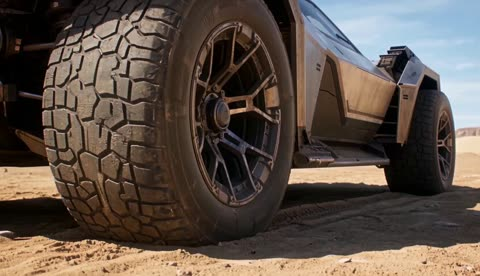</a>

The prompt reads as an ordered sequence of beats with explicit camera changes between cockpit and aerial views, which gives the model a clear timeline to follow. Opening on the spinning wheels establishes the vehicle before the action escalates into the eruption and the canyon jump.

Wan 3.0 · Text-to-video · Source: [@AllaAisling on X](https://x.com/AllaAisling/status/2093393927306928140) · 44 likes on 2026-10-29

[`racing`](tags.md#tag-racing) [`volcano`](tags.md#tag-volcano) [`aerial-shot`](tags.md#tag-aerial-shot) [`wan-3`](tags.md#tag-wan-3)

<details><summary><b>Prompt</b></summary>

```text
My first try with Wan 3.0 in
@openart_ai


Prompt: A futuristic desert racing vehicle prepares for the most dangerous race ever attempted. The camera begins close to the spinning wheels as engines roar to life. The vehicle launches across a vast desert at extreme speed. Massive dust trails follow behind. Ahead, a chain of dormant volcanoes suddenly awakens. Explosions send ash and rocks into the sky. The racer speeds between collapsing rock formations. Lava begins flowing across the track. The camera alternates between cockpit views and sweeping aerial shots. One volcano erupts directly ahead, throwing giant boulders through the air. The racer dodges debris at the last moment. The ground starts splitting open. A huge canyon forms across the course. The vehicle accelerates toward the edge. The camera slows slightly as it launches across the gap. The racer lands successfully while the terrain behind collapses into lava. The final shot reveals the vehicle racing toward the horizon as multiple volcanoes erupt across the landscape.
Ultra-realistic cinematic racing sequence, extreme speed, realistic vehicle dynamics, volcanic destruction, dramatic scale, detailed environments, smooth camera work, IMAX quality, epic atmosphere, no text, no watermark.
```

</details>

<a id="h3-armor-hero-ruined-city-sprint"></a>
### Runner sprints through smoke-filled ruined city

<a href="https://x.com/FutureVibesAi/status/2084230779622638032">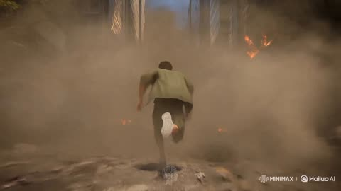</a>

Each reference image gets a fixed role, Image 1 for the character and Image 2 for the armor. The action is written as one unbroken shot, with each beat (sprint, punch, flying kick, thruster lift-off) described in order and explicit bans on cuts, slow motion and freezes.

MiniMax H3 · Reference-to-video · Source: [@FutureVibesAi on X](https://x.com/FutureVibesAi/status/2084230779622638032) · 43 likes on 2026-10-29

[`reference-images`](tags.md#tag-reference-images) [`continuous-shot`](tags.md#tag-continuous-shot) [`armor-transformation`](tags.md#tag-armor-transformation) [`chase`](tags.md#tag-chase)

<details><summary><b>Prompt</b></summary>

```text
Style: Ultra-realistic live action, IMAX cinematic, photorealistic, Hollywood blockbuster, 4K HDR, 60fps, continuous action shot, no slow motion, no pause, no freeze frame, no music.

Use Image 1 as WEKA (same face, hairstyle, body proportions, green oversized shirt, cargo pants, sneakers).
Use Image 2 as the transformation armor design (blue metallic armor with gold accents). The armor appears only as modular pieces that attach to WEKA during combat.

Scene:
A ruined modern city filled with collapsed buildings, broken highways, smoke, dust, scattered burning vehicles, flying debris, dramatic daylight filtering through thick smoke. Several giant beast-like monsters charge through the streets.

The camera immediately follows WEKA sprinting at extreme speed through the destroyed city in one continuous IMAX tracking shot. Dust and debris explode beneath every step.

While still running, glowing blue mechanical armor rapidly deploys onto his right arm. Individual armor plates fly in at high speed and lock perfectly into place with powerful metallic impacts. Without slowing down, WEKA delivers one devastating armored punch into the chest of the nearest monster. The impact creates a massive shockwave, cracked pavement, flying debris, and the monster is violently launched backward, crashing through broken concrete.

Without stopping, WEKA continues sprinting forward. While airborne during a long leap, blue mechanical armor instantly assembles around both legs. Every plate snaps into place seamlessly in midair. The completed armored legs unleash an explosive flying kick that strikes another charging monster with tremendous force, sending it spinning across the ruined street and smashing through wreckage.

Immediately after the kick, additional armor modules rapidly fly toward WEKA from every direction. Helmet, chest, shoulders, back, waist, arms, and legs all attach in perfect synchronization while he remains in motion. Bright blue energy pulses through every armor seam as the transformation completes.

The instant the full armor locks into place, powerful blue energy thrusters ignite from the back and legs. WEKA accelerates upward into the sky above the destroyed city, flying at high speed toward the remaining monsters as dust, sparks, and debris swirl below.

Camera:
Single uninterrupted continuous shot, dynamic IMAX chase camera with smooth orbit transitions, low-angle tracking, close combat follow shots, realistic handheld vibration during impacts, cinematic motion blur, volumetric smoke, detailed destruction, dramatic lighting, no cuts, no pauses, no dialogue, no subtitles, no watermark.
```

</details>

<a id="h3-woman-burning-cargo-corridor-fight"></a>
### Woman fights through burning cargo ship corridor

<a href="https://x.com/Sogni_Protocol/status/2097952332315050154">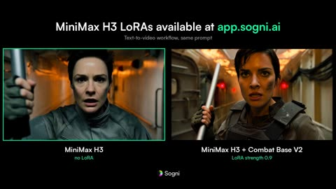</a>

The prompt lists the action as ordered beats inside one continuous handheld tracking shot, so the model has a clear sequence to follow. A spoken line gates the door opening, which ties the ending to the dialogue and keeps the timing readable.

MiniMax H3 · Text-to-video · Source: [@Sogni_Protocol on X](https://x.com/Sogni_Protocol/status/2097952332315050154) · 40 likes on 2026-10-29

[`fight-choreography`](tags.md#tag-fight-choreography) [`handheld`](tags.md#tag-handheld) [`tracking-shot`](tags.md#tag-tracking-shot) [`lora`](tags.md#tag-lora)

<details><summary><b>Prompt</b></summary>

```text
Live-action, cinematic, 16:9, 85mm, shallow depth of field, realistic grounded fight choreography. A woman in her late twenties, short dark hair, grey tactical jacket, steel baton, runs down a burning cargo-ship corridor in one continuous handheld tracking shot. First guard swings a rifle butt, she takes it on the shoulder, breaks his forearm with the baton and shoves him into the wall. Second guard with a knife, she deflects the wrist and drives his head into her knee. Third guard raises a pistol in front of a sealed bulkhead door; she throws the baton into his shin, slaps the gun away, slams him into the door frame and pins him with her forearm across his throat. Tight two-shot, she says "Open it." Only then does he hit the keypad; the door grinds open and white light floods the frame.
```

</details>

<a id="wan-land-speed-car-mach-1-desert"></a>
### Futuristic land speed car chasing Mach 1 at dawn

<a href="https://x.com/AllaAisling/status/2093509473277006226">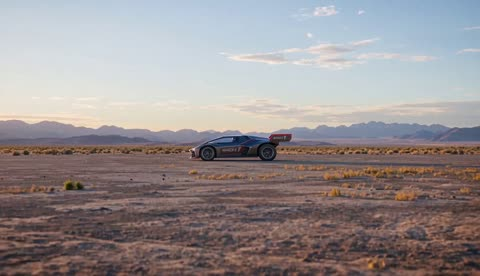</a>

Numeric speed markers (200 mph, 400 mph, 700 mph) set the escalation beat by beat, and the prompt alternates wide aerial shots with wheel-level close-ups to sell scale. Events are listed in strict order so the model keeps one continuous shot sequence.

Wan 3.0 · Text-to-video · Source: [@AllaAisling on X](https://x.com/AllaAisling/status/2093509473277006226) · 40 likes on 2026-10-29

[`land-speed`](tags.md#tag-land-speed) [`vehicle`](tags.md#tag-vehicle) [`sonic-boom`](tags.md#tag-sonic-boom) [`desert`](tags.md#tag-desert)

<details><summary><b>Prompt</b></summary>

```text
A futuristic experimental racing vehicle attempts to become the first ground vehicle to maintain Mach 1 across open terrain. Dawn. Engines ignite. The camera follows close behind as the vehicle accelerates across a vast desert. 200 mph. 400 mph. 600 mph. The landscape becomes a blur. Shockwaves begin forming around the body. Warning messages appear throughout the cockpit. The vehicle starts lifting slightly from the ground. Control surfaces struggle to stabilize it. The camera alternates between wide aerial shots and terrifyingly close wheel-level views. 700 mph. 750 mph. Small components begin tearing away from the chassis. The driver refuses to slow down. Mountains ahead approach far too quickly. The speed reaches the critical threshold. A massive sonic boom erupts across the desert. The vehicle becomes unstable. It drifts sideways at incredible speed. The driver fights for control. For several seconds disaster seems inevitable. Then the vehicle stabilizes and continues accelerating. Final shot: the machine races beyond the horizon while the sonic shockwave rolls across the desert behind it. Ultra-realistic cinematic speed record attempt, realistic aerodynamics, overwhelming speed sensation, shockwaves, intense tension, detailed cockpit, IMAX quality, dramatic scale.

Made with Wan 3.0 in
@openart_ai
```

</details>

<a id="kling-jaguar-chase-waterfall-pool"></a>
### Backpacker chased by jaguar into waterfall pool

<a href="https://x.com/PixVerse/status/2115760864238469589">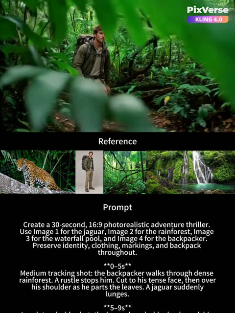</a>

The prompt is a time coded shot plan with a named shot type for every beat, which gives the model a 30 second edit to follow. Four labelled reference images are each assigned a role, and identity, clothing and backpack are locked by name so the character stays consistent across cuts.

Kling 4.0 · Reference-to-video · Source: [@PixVerse on X](https://x.com/PixVerse/status/2115760864238469589) · 38 likes on 2026-10-29

[`multi-shot`](tags.md#tag-multi-shot) [`reference-images`](tags.md#tag-reference-images) [`chase`](tags.md#tag-chase) [`jaguar`](tags.md#tag-jaguar)

<details><summary><b>Prompt</b></summary>

```text
Create a 30-second, 16:9 photorealistic adventure thriller. Use Image 1 for the jaguar, Image 2 for the rainforest, Image 3 for the waterfall pool, and Image 4 for the backpacker. Preserve identity, clothing, markings, and backpack throughout.

**0–5s**
Medium tracking shot: the backpacker walks through dense rainforest. A rustle stops him. Cut to his tense face, then over his shoulder as he parts the leaves. A jaguar suddenly lunges.

**5–9s**
Low lateral wide shot: the jaguar knocks him backward, his backpack striking the muddy ground. Leaves scatter. He shields his head, rolls aside, and scrambles upright while the jaguar turns. Realistic impact, no blood.

**9–15s**
Ground-level tracking captures pounding boots and flying mud. Cut wider: he races screen-right, the jaguar close behind. He stumbles over a root, braces against a trunk, and keeps running, backpack bouncing against secured straps.

**15–19s**
Close-up: gasping, he spots an opening. Cut aerial-wide to reveal the trail ending at a rocky bank beside the waterfall pool. The jaguar follows him toward a ledge one meter above the water.

**19–22s**
Lateral wide shot: trapped, he glances back and jumps. Show takeoff through feet-first entry continuously. His backpack remains attached. Water erupts; the jaguar brakes at the edge.

**22–26s**
Water-level medium shot: he surfaces and swims away with strenuous strokes, the backpack dragging through the water. He looks back at the jaguar watching from shore.

**26–30s**
His wet shoulders fill the foreground. Beyond him, the jaguar pauses, turns, and disappears into the forest. He keeps paddling as the waterfall roars.

Natural filtered light, cinematic contrast, varied framing, readable handheld movement, hard cuts, normal speed. Maintain chase direction and geography. Preserve mud after falling and wet clothing after immersion. No dialogue or text. Emphasize foliage, impacts, running, gasping, and rushing water.
```

</details>

<a id="h3-chun-li-cammy-rain-kick-clash"></a>
### Chun Li and Cammy trade kicks in rain

<a href="https://x.com/ou_zhen599/status/2096262846963396954">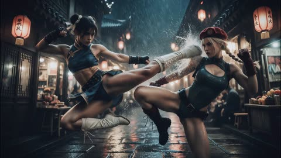</a>

A reference frame locks the opening composition, and the prompt says the airborne kick is already in progress so the motion continues without a reset. Timed shots plus explicit bans on freezes, hovering and exaggerated flight keep the fight grounded in physics.

MiniMax H3 · Image-to-video · Source: [@ou_zhen599 on X](https://x.com/ou_zhen599/status/2096262846963396954) · 36 likes on 2026-10-29

[`street-fighter`](tags.md#tag-street-fighter) [`chun-li`](tags.md#tag-chun-li) [`cammy`](tags.md#tag-cammy) [`rain`](tags.md#tag-rain)

<details><summary><b>Prompt</b></summary>

```text
For the target video, at 0.00 seconds into the target video, <Picture 1> (from [Shot 1]) is fully referenced.

integrated_multimodal_description: [Shot 1] Photoreal live-action rainy alley confrontation between adult Chun-Li and Cammy. Preserve the exact opening composition, identities, hairstyles, costumes, proportions, wet East Asian alley, lanterns, puddles, rainfall, and light positions from <Picture 1>. Continue the airborne kick collision already in progress with no freeze, reset, or new wind-up. Contact shakes rain from skin and fabric; puddle splashes happen only on landing. Follow collision, recoil, and landing. Chun-Li (S1) lands stable, bends her knees, restores torso alignment, exhales sharply, and watches Cammy’s shoulder line. Cammy (S2) lands lower, slides briefly, regains support, and stays pitched forward. [Shot 2] At 00:01.400, the camera cuts to a matched advancing three-quarter view after landing. Cammy wipes rain and a trace of blood from her lip once, looks up, and drives in low. Chun-Li reads shoulder and hip initiation, makes a short evasive adjustment, intercepts with one compact kick, retracts, and adds one short pressing kick that shifts Cammy half a step off line. Show planted support, contact, recoil, and recovery. [Shot 3] At 00:03.800, the camera cuts to a lateral close two-shot on Cammy’s recovery. Cammy presses back into close range without resetting. Chun-Li redirects the entry and takes the centerline. Their faces draw near during the brief check. Chun-Li meets Cammy’s eyes. Cammy glances down and aside for one instant, catches breath, tightens her jaw, and attacks again. Chun-Li’s movements grow shorter and more precise while Cammy’s shoulders tighten and breathing fragments. [Shot 4] At 00:06.500, the camera cuts along Cammy’s renewed forward commitment. She gives half a step, lunges again too early, and places weight too far forward. Chun-Li intercepts the entry, sets her support foot, rotates through her hips, and lands one decisive kick to Cammy’s torso. The camera makes one short controlled whip with the turn, then settles before impact. Cammy recoils diagonally, skids through a puddle, loses support, braces with a forearm, and falls onto hip and side in shallow water. No hovering, no exaggerated flight. Chun-Li retracts, plants, and does not pursue. [Shot 5] At 00:09.800, the camera cuts on Cammy’s hand planting on the wet ground. Cammy raises her upper body with a small shoulder load tremor and keeps a defiant lifted chin. Chun-Li approaches with one or two measured steps, then lowers in a controlled squat until both women’s eyes are level. Cammy checks Chun-Li’s hands, then looks into her eyes. Chun-Li does not touch her. Before 00:12.000, settle into a lateral close two-shot with both eyes and Chun-Li’s mouth readable. [Shot 6] At 00:12.000, the camera cuts seamlessly on the completed squat into the settled close two-shot and holds this angle to the end. Chun-Li (S1), in a mature calm female voice, says: <d>[English] You would rather hate me than tell the truth.</d> Deliver the line evenly, with slight extra weight on “hate me” and a firm landing on “truth,” finishing by about 00:14.500. Cammy (S2) keeps eye contact, takes one audible inward breath as if to answer, parts her lips slightly, but says nothing. Chun-Li adds nothing. Rain continues along eyelashes, cheeks, and jaws; both breathing and tiny balance adjustments remain visible until 15.00 seconds. End on unresolved proximity with no freeze, fade, or reconciliation. Treat all six shots as one continuous confrontation, not separate rounds. No action-showcase fighting, no round reset, no routine reverse coverage, no arbitrary cuts, no showy orbiting, no uncontrolled shake, no blank expressions, no glassy eyes, no exaggerated lip sync, no weightless kicks, no unsupported aerial combos, no extra dialogue, no subtitles, no watermarks, no identity drift, no malformed bodies or hands.

overall_soundscape: Two distinct female vocal identities only: Chun-Li mature and steady, Cammy younger and tighter, expressed only through breath and impact exhalations. Heavy rain, splashing steps, wet fabric friction, short solid body impacts, close breathing, and distant alley ambience remain continuous. Lower the environment slightly before the line while keeping rain audible, then retain Cammy’s unanswered inhale and nearby rainfall after it.

non_diegetic_music: N/A
```

</details>

<a id="h3-swordswoman-kinetic-typography-title"></a>
### Anime swordswoman in kinetic typography title sequence

<a href="https://x.com/opener_ai/status/2085159317578330229"></a>

A numbered shot list with timed beats, paired with an identity reference image, keeps the character consistent while 3D title words move through the action. Telling the model to ignore the reference sheet's layout and labels keeps those artifacts out of the video.

MiniMax H3 · Reference-to-video · Source: [@opener_ai on X](https://x.com/opener_ai/status/2085159317578330229) · 36 likes on 2026-10-29 · found via [SkyNotSilent/awesome-MiniMax-H3-cases](https://github.com/SkyNotSilent/awesome-MiniMax-H3-cases)

[`anime`](tags.md#tag-anime) [`martial-arts`](tags.md#tag-martial-arts) [`kinetic-typography`](tags.md#tag-kinetic-typography) [`identity-reference`](tags.md#tag-identity-reference)

<details><summary><b>Prompt</b></summary>

```text
[1] FORMAT
15-second 16:9 stylized anime action title sequence — martial-arts choreography fused with 3D kinetic typography. Painterly 2D anime illustration look with cel-shaded volumes and subtle paper grain, matching the source artwork's rendering.

[2] ASSETS
Use Image 1 as a strict identity reference for the female duelist KAELAN — read only the character artwork itself for her face, hair, wardrobe, weapon, and color palette. Ignore the sheet's layout, panels, printed labels, handwriting, silhouette thumbnails, and background parchment; none of them may appear in the video.

[3] IDENTITY
Preserve exactly: deep brown skin with warm highlights; luminous crimson-red eyes with a sharp black liner shape; jet-black hair pulled into a tight scalp-wrapped part that splits into two very long thick braids falling past the hips, moving like weighted whips; large white crescent hoop earrings on both ears; black high-neck sleeveless crop top exposing a toned midriff; a sheer white long-sleeved kimono robe worn open, translucent and lightly billowing; cream wide-leg hakama trousers with a single black diamond patch on the left thigh; black wrapped fingerless gloves with lattice cord across the back of the hand; white cloth-wrapped platform sandals; a well-worn katana with a dark blue-grey blade and a black diamond-wrapped hilt. Her expression stays calm and unblinking, never comic.

[4] BEATS
Shot 1 — [0–3 seconds] Kaelan stands centered in a void of warm off-white light, katana point-down, braids settling. She exhales; a slow iai draw begins. → Hard cut.
Shot 2 — [3–6 seconds] Mid-draw. The blade clears the saya and a clean arc of light follows the edge. The 3D extruded word "HAILUO" flies in from screen left along the blade's arc, its letter faces catching the same light, passing BEHIND her shoulder and IN FRONT of her trailing braid before exiting right. → Whip-pan cut.
Shot 3 — [6–9 seconds] Full-body kata combination: descending cut, pivot, rising horizontal sweep. Her sheer robe and both braids trail one frame behind her body. The word "MINIMAX" rotates up from the floor plane in thick extruded 3D, standing taller than her, and she cuts through the gap between its letters — the letterforms hold solid, do not shatter. → Hard cut.
Shot 4 — [9–12.5 seconds] Low-angle crouch landing, sword arm extended back, dust ring pushing outward. "H3" slams in from depth as a massive chromed 3D glyph directly behind her, scaling down to lock, with her silhouette reading cleanly against it. → Flash cut on the impact frame.
Shot 5 — [12.5–15 seconds] She rises into the neutral standing pose, katana returning to point-down. The full lockup "HAILUO MiniMax H3" assembles from the three pieces on a single horizontal baseline at lower third, settles, and holds perfectly still through the final frame.

[5] CAMERA
Anamorphic-feel 35mm for wides, 50mm for the mid shots.
```

</details>

<a id="h3-hotdog-dash-skateboard-selection"></a>
### Skateboard selection screen with HotDog Dash selected

<a href="https://x.com/0xbisc/status/2084626773015417323"></a>

The prompt divides the 15 second clip into timed beats and fixes the state of every UI element in each beat, so the selection, slide and confirm transitions stay readable. Two image references lock the character and the menu layout, and the sound design is also written per beat.

MiniMax H3 · Reference-to-video · Source: [@0xbisc on X](https://x.com/0xbisc/status/2084626773015417323) · 35 likes on 2026-10-29 · found via [SkyNotSilent/awesome-MiniMax-H3-cases](https://github.com/SkyNotSilent/awesome-MiniMax-H3-cases)

[`game-ui`](tags.md#tag-game-ui) [`skateboard`](tags.md#tag-skateboard) [`reference-images`](tags.md#tag-reference-images) [`timed-beats`](tags.md#tag-timed-beats)

<details><summary><b>Prompt</b></summary>

```text
Use Image 1 as the main character role. Use Image 2 as the layout of the game selection interface.
[0–2 seconds] Display the complete skateboard selection interface from the front. NOVA is in the selected and active state, the four ports at the bottom emit green light. HOTDOG and SHARK are in the unselected state, completely stationary.
[2–4 seconds] The player presses the right selection key. SHARK ROCKET RIDER slides from the right preview slot into the middle selected module, NOVA JET GLIDER simultaneously slides from the middle into the left preview slot, HOTDOG DASH moves to the right preview slot. As soon as NOVA leaves the middle selected module, the green light immediately turns off and stops. After SHARK enters the middle, orange flames appear at the tail. The skateboard name, attribute bars, and SELECTED label update synchronously.
[4–6.5 seconds] The player switches the selection again. HOTDOG DASH moves horizontally from the side preview slot to the middle selected module, SHARK ROCKET RIDER simultaneously slides into the other side slot, NOVA moves to the remaining side slot. As soon as SHARK loses the selected state, the orange flame immediately turns off. After HOTDOG becomes the selected item, facing the camera, it barks twice accurately, then turns around in place once.
[6.5–8 seconds] The bottom CONFIRM button is clicked by the player. The button compresses downwards and bounces back, the right arrow extends forward. HOTDOG DASH becomes the final confirmed selection. The two unselected skateboards on the left and right continue to stay in the fixed preview slots, completely stationary.
[8–10 seconds] The middle fixed selected module expands towards the depth of the screen. The light-colored display area inside the central card naturally transforms into the World Plaza. The complete world has been fully loaded, with no texture popping, placeholder models, or unfinished buildings. At the same time, the UI displays as the in-game HUD.
[10–12 seconds] The camera enters the third-person game perspective, with HOTDOG DASH located under the protagonist’s feet. During normal gliding and preparation actions, both feet of the protagonist are standing on HOTDOG DASH. The game HUD appears at this time: mini-map in the top right corner, speed and health status in the bottom left corner, action and combo slots in the bottom right corner, mission route markers and interactive prompts appear ahead.
[12–15 seconds] The protagonist enters the world riding the running HOTDOG DASH, passing pedestrians, stairs, slopes, railings, and multiple explorable routes. HOTDOG jumps before a low slope, completes a rotation action in the air, and upon landing, the protagonist’s feet are still standing on HOTDOG DASH, the combo count and TRICK prompt briefly increase in the HUD. Subsequently, lean to bypass street obstacles, then perform a small directional jump, and then continue sliding forward.
Sound Design: Use pure instrumental music mixed with electronic arcade sounds, no vocals. UI switching corresponds to crisp key press sounds, card slot sliding sounds, sticker slapping sounds, and attribute bar update sounds. When SHARK is selected, ignition and propulsion sounds appear, and stop immediately when losing selection. When HOTDOG is selected, two barks are played accurately, and light footsteps are added when spinning around. After entering the world, add city ambient sounds, wind sounds, running footsteps, shoe friction sounds when pedaling to accelerate, and jump and landing feedback sounds.
```

</details>

<a id="wan-father-chases-train-station"></a>
### Father sprints through station after son boards train

<a href="https://x.com/AiwithBloodline/status/2098989311278678061">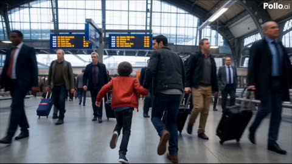</a>

A fixed character block and a timed beat sheet keep the boy's red jacket and the father's dark jacket consistent across cuts. Each segment names its camera move and sound cue, and the quoted lines come with a lip sync instruction, giving the model a clear shot by shot plan.

Wan 3.0 · Text-to-video · Source: [@AiwithBloodline on X](https://x.com/AiwithBloodline/status/2098989311278678061) · 34 likes on 2026-10-29

[`chase`](tags.md#tag-chase) [`train-station`](tags.md#tag-train-station) [`father-son`](tags.md#tag-father-son) [`multi-shot`](tags.md#tag-multi-shot)

<details><summary><b>Prompt</b></summary>

```text
30-second feature-film-quality 3D animation, ultra-realistic cinematic style, premium live-action commercial aesthetic, realistic human characters, physically accurate environments, intense action, emotional storytelling, natural facial expressions, realistic skin and hair, physically based rendering, cinematic lighting, HDR, realistic reflections, dramatic depth of field, dynamic camera movement, realistic motion blur, 4K UHD, 60fps.
MAIN CHARACTER
Energetic 10-year-old boy, messy curly dark brown hair, expressive brown eyes, red jacket, black jeans, white sneakers, realistic child proportions, consistent appearance throughout the entire video.
SECONDARY CHARACTER
His father, early 30s, short dark hair, casual dark jacket, jeans, realistic appearance, expressive face.
ENVIRONMENT
Large modern railway station during rush hour.
Crowded platforms, arriving train, electronic signs, commuters, luggage, realistic station architecture, natural afternoon lighting.
Everything must look completely real, like a high-budget live-action movie.
STORY — EXACTLY 30 SECONDS
0–4 SECONDS:
The boy and his father hurry through a crowded railway station.
The father holds the boy’s hand.
Father:
“Come on! We’re going to miss it!”
Boy:
“I’m coming!”
A train arrives.
The doors open.
4–8 SECONDS:
The crowd suddenly moves forward.
The boy’s hand slips out of his father’s.
The boy accidentally gets pushed inside the train.
The father remains outside.
Father:
“WAIT!”
The train doors begin closing.
Boy:
“DAD!”
The doors close.
The train begins moving.
8–13 SECONDS:
The boy runs through the train looking for his father.
He looks through the window.
His father runs alongside the moving train on the platform.
Father:
“STAY RIGHT THERE!”
Boy:
“DAD, I’M HERE!”
The train accelerates.
13–18 SECONDS:
The father immediately turns and sprints toward the station exit.
He grabs his phone.
Father:
“Platform three! Stop the next train!”
Cut rapidly between the father running through the station and the boy looking anxiously through the train window.
Boy:
“Where are you going?”
Father:
“Just stay calm!”
18–23 SECONDS:
The train begins slowing toward the next platform.
The boy spots his father running down the platform ahead.
Boy:
“DAD!”
The father reaches the exact carriage door.
The train stops.
The doors open.
The boy jumps out.
His father catches him immediately.
23–27 SECONDS:
The father kneels and hugs him tightly.
Father:
“Are you okay?”
Boy:
“Yeah…”
Beat.
Boy:
“But you run really fast.”
The father laughs in relief.
Father:
“Apparently.”
27–30 SECONDS:
They walk away together holding hands.
The camera slowly pulls backward as the train departs behind them.
The boy looks up at his father.
Boy:
“Next time, don’t let go.”
Father smiles.
Father:
“Deal.”
CUT TO BLACK.
CAMERA
Fast handheld tracking shots during the separation.
Close-up of hands separating.
Extreme close-up of closing train doors.
Dynamic tracking shot alongside the moving train.
Rapid cuts between father and son.
Low-angle running shots.
Close-up emotional reunion.
Slow cinematic pull-back for the ending.
VOICE
Natural American English.
Realistic child voice.
Natural adult male voice.
Fast, emotional dialogue.
Authentic breathing and reactions.
Perfect lip synchronization.
No theatrical or robotic delivery.
SOUND
Busy station ambience.
Train brakes.
Train doors closing.
Footsteps.
Crowd movement.
Train acceleration.
Phone call.
Dramatic orchestral score building throughout the chase.
Music drops during the reunion.
Warm emotional music during the final dialogue.
NEGATIVE PROMPT
fantasy, supernatural, superhero abilities, impossible physics, train collision, derailment, person falling onto tracks, injury, death, dangerous stunts, boy on railway tracks, exaggerated action, cartoon appearance, plastic skin, robotic expressions, bad anatomy, extra fingers.
```

</details>

<a id="h3-jungle-river-ambush-explorer"></a>
### Explorer wades jungle river under unseen attack

<a href="https://x.com/ou_zhen599/status/2100517439398437322">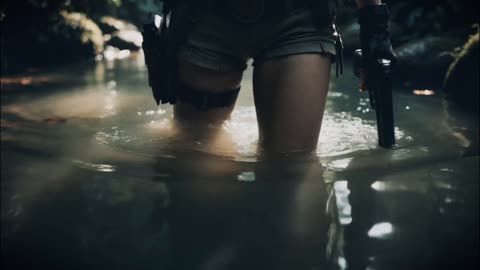</a>

A timed shot-by-shot script with a named emotional stage for each beat keeps the performance consistent across cuts. The unseen attacker is implied through splashes, a sliced leaf and ripples, and the sound is limited to diegetic environment and weapon cues.

MiniMax H3 · Image-to-video · Source: [@ou_zhen599 on X](https://x.com/ou_zhen599/status/2100517439398437322) · 31 likes on 2026-10-29

[`jungle`](tags.md#tag-jungle) [`action-thriller`](tags.md#tag-action-thriller) [`camera-tracking`](tags.md#tag-camera-tracking) [`diegetic-sound`](tags.md#tag-diegetic-sound)

<details><summary><b>Prompt</b></summary>

```text
For the target video, at 0.00 seconds into the target video, <Picture 1> (from [Shot 1]) is fully referenced.

integrated_multimodal_description: [Shot 1] A 15-second, 16:9, cinematic realistic adventure-thriller image-to-video sequence set entirely inside the same tropical jungle shallow-river corridor and adjacent canopy depth shown in <Picture 1>. Preserve the exact same Lara-like adult female explorer throughout: same face, wet high ponytail with loose strands stuck to the face and neck, dark cropped tank top, shorts, tactical belt, and body proportions. She carries a long gun in the first half, loses it only after the second hit, and ends standing with only one pistol. She remains in continuous motion throughout; all emotion is attached to stepping, searching, aiming, side-slipping, retreating, falling into water, pushing up, and standing. The emotional arc is calm control -> slight alertness -> instinctive reaction to sudden attack -> pressure from missing information -> pain suppression after the second hit -> wounded defiance. Lighting is warm natural backlight through the canopy with cool green jungle bounce and river reflection. No beauty fill, no extra people, no visible enemy, no monsters, no subtitles, no watermark, no plastic water, no exaggerated blood, no floating cloth, no face drift, and no hand errors. [Shot 2] At 00:00-00:03, begin with the first action-based sensual close-up from an extremely low camera almost touching the water, tracking forward with her. Start on the wet lower abdomen, collarbone, shoulder strap, upper chest contour, and the subtle rise and fall of controlled breathing, then smoothly tilt up to her face without stopping. She advances very slowly through the shallow river with the long gun in hand, each step producing real water resistance, ankle flow, small ripples, and glittering reflections. Her first emotional stage is controlled calm: lips slightly parted but keeping the breath quiet, gaze sharp and fixed forward, pupils steady, brows only lightly drawn inward, nostrils barely moving, and jaw controlled. Wet strands stick to forehead and neck, with delayed movement in the tips. Warm backlight through leaves breaks into intermittent highlights on shoulders, neck, collarbone, upper chest, and wet skin, while mist and fine particles catch the light behind her. She says quietly, <d>[English] Easy... keep moving.</d> [Shot 3] At 00:03-00:06, shift into a shoulder-side medium-close follow without stopping her movement. She continues searching while moving: first looking forward, then quickly left, then right, then up into the canopy. The camera makes a slight half-arc around her shoulder and side face while keeping her slightly right of frame. Her second emotional stage is fine alertness: eye movement speed increases, pupils tighten, the brow center gathers more than before, the right upper eyelid lowers slightly, the jawline begins to lock, and breathing becomes shallower and shorter. She says in a low warning tone, <d>[English] Show yourself.</d> Broken sunlight flickers across her face and rifle, leaves above rub lightly, and humid air carries fine mist. [Shot 4] At 00:06-00:10, the first attack comes without a visible attacker. Hard cut to a medium shot from her left-front. Something fast and unseen slices across her near side; the water ahead-left explodes open as if cut by a high-speed projectile, with a clear origin point, spray arc, heavy droplets, falloff, and after-ripples. A broad leaf nearby is sharply split with a visible torn edge, and branches behind her sway with delayed motion to create false directional information. She instinctively side-slips half a step back to the right, shoulders snapping tight, and whips the long gun up, but she still cannot locate the source. She never stands still to fire. While retreating through the water, she fires probing short bursts: two quick shots down the forward channel, then a pivoted sweep toward the left brush, then one short burst up into the canopy. Every backward step carries weight against water resistance and kicks up heavy splashes; muzzle flashes are brief; shell casings eject and fall under gravity; mist is disturbed by the shots; there is no visible hit, no body, no falling enemy. Her third and fourth emotional stages combine here: the gaze is no longer just searching but strained by incomplete information; brow tension deepens, pupils tighten further, nostrils flare clearly, lips shift from slightly open to short urgent inhalations, and the jaw muscles pulse under the turns and shots. Hair lags behind side-slips and turns, clothing clings and pulls under abrupt stops and backward steps. [Shot 5] At 00:10-00:12, compress into a medium-close shot with a small forward push that gives her one brief moment to recalculate. She stops firing, lowers her body, and prepares to move again. In the instant she drops her weight, the second attack lands more precisely into her shoulder or upper arm. The cloth tears open, a tiny short-lived blood mist bursts and is immediately swallowed by the damp air, her upper torso twists violently, and the long gun flies from her hands with real inertia, slamming into a shallow-water rock gap behind-left, partially sliding into the stones with a heavy splash and spreading ripples. Her whole body loses balance and crashes back-left into the water. Her fifth emotional stage is sudden pain breaking through control but still restrained: her eyes open wider for half a beat, brow bones lift then drive back down, pupils contract, nostrils flare wide, the mouth loses control for an instant and then bites down again instead of becoming a scream. She lets out one short pain-broken sound, <d>[English] Ah—!</d> Keep the action heavy, real, and continuous, with no exaggerated slow motion. [Shot 6] At 00:12-00:15, stay at water level and move with her through the entire recovery from impact to standing. This is the second and most important sensual close-up, fully tied to survival action. She falls half into the water, instantly clamps her left hand over the wound, fingers tightening hard, while the right hand searches through murky shallow water and retrieves her pistol. She first pushes her torso up sideways, then rises to one knee, then grits through the final stand with clear weight transfer, delay, and effort; she does not spring up. When fully upright she has only one pistol. Her left shoulder hangs slightly lower, and her right hand holds the pistol low, pointed into the jungle depth ahead. Her sixth emotional stage is wounded defiance: the eye corners are faintly reddened by pain, the brow center is compressed not just in alertness but in sheer refusal to fall, the upper lids sit slightly heavier but the gaze is even more nailed forward, nostrils tremble, breathing becomes pain-shaken, lips pale and tighten, teeth lock, the mouth corners pull in faintly, and the jaw and neck tendons stand out. She says in a low hoarse line squeezed through pain, <d>[English] I’m still here.</d> Wet hair sticks to face and neck, then falls with delayed motion as she rises. Backlight catches the hair edges, collarbone line, shoulder contour, the hand pressing the wound, and the metal edge of the pistol. Blood is diluted by the river into thin red streaks across skin and cloth. Small droplets roll down jaw, collarbone, and shoulder. End on her wounded but standing, holding only the pistol, staring into the unseen jungle threat without cutting to black.

overall_soundscape: Use only diegetic environmental and weapon sound. Maintain shallow water flow, insects, distant leaf friction, humid forest air, and the soft acoustic space of the river corridor throughout. Emphasize close controlled breathing, boots and calves pushing through shallow water, delicate surface ripples, cloth friction, and her low line <d>[English] Easy... keep moving.</d> Then bring forward shifting gaze and body orientation through subtle gear movement, shallow water disturbance, leaf rub above, fine mist, and her low warning line <d>[English] Show yourself.</d> Feature the first unseen attack as a sharp fast water-splitting impact, sliced leaf tear, delayed branch shake, backward steps through water, short rifle bursts, damp forest gunshot reverb, shell casings landing, scattered spray, and fast breathing. Isolate the second hit with cloth tear, tiny blood burst, body impact into water, rifle thrown loose, rifle striking shallow rocks and water with a heavier layer than body splash, then expanding ripples and the broken pain sound <d>[English] Ah—!</d> Finish with water slosh around her recovery, the hand pressing the wound, the pistol found in shallow water, painful breath, cloth drag, droplets falling, and her low hoarse line <d>[English] I’m still here.</d> After the line, let the environment feel almost dead-quiet except for water, insects, leaf friction, and her pain-muted breathing, preserving the pressure of an unseen attacker.

non_diegetic_music: No non-diegetic music.
```

</details>

<a id="h3-sword-immortals-moonlit-city-duel"></a>
### Sword immortals duel a demon above moonlit city

<a href="https://x.com/Stellakjbk/status/2086021869040263455"></a>

The prompt opens with duration and aspect ratio, then anchors the setting to a reference image so the city, moon and lighting stay fixed. It lays out the fight as ordered beats with explicit camera moves such as low angle, orbit and slow motion, and closes with a list of native stereo sound cues.

MiniMax H3 · Reference-to-video · Source: [@Stellakjbk on X](https://x.com/Stellakjbk/status/2086021869040263455) · 31 likes on 2026-10-29 · found via [SkyNotSilent/awesome-MiniMax-H3-cases](https://github.com/SkyNotSilent/awesome-MiniMax-H3-cases)

[`xianxia`](tags.md#tag-xianxia) [`sword-fight`](tags.md#tag-sword-fight) [`reference-image`](tags.md#tag-reference-image) [`game-cg`](tags.md#tag-game-cg)

<details><summary><b>Prompt</b></summary>

```text
5秒，4:3，顶级东方仙侠3A游戏CG，电影级高端宣传片，严格参考图1的月下仙城场景与美术气质：巨大明月、云海天宫、环形仙城、悬浮仙山、瀑布、白玉仙桥、金顶楼阁、冷蓝月光。整体画面必须唯美、恢弘、神圣、危险、酷炫，像大厂正式游戏开场CG，不像普通AI视频。

双主角设定：男剑仙，黑色长发，白蓝战袍，冰蓝雷光长剑，英俊冷峻，强大沉稳；女剑仙，黑色长发，白青仙裙，月白灵剑与月华法术，清冷绝美，高贵飘逸。反派为黑金重甲魔修，手持黑色巨剑，周身暗红黑色魔气，压迫感极强。人物脸和服装全程稳定统一，保持高级游戏角色建模质感。

开场镜头从巨大明月前高速穿越云海与浮空仙山，俯冲进入宏伟仙城，来到白玉高台，男女主背对镜头立于高台边缘，衣袍长发飞扬，英雄感极强。远处天空突然裂开暗红色空间裂缝，魔修高速坠落，轰然落地，引发碎石、冲击波和魔气爆发。

男剑仙瞬间拔剑冲出，与魔修在仙桥中央高速对撞，剑刃碰撞爆发蓝红双色能量冲击、空间波纹、火星与剑气。近战动作凌厉、清晰、有重量感，包含高速斩击、格挡、反击、短暂慢动作碰撞特写，镜头低机位跟拍与高速环绕，极具电影感。

随后女剑仙御剑升空，展开巨大蓝白仙阵，发动“万剑齐发”，数百柄发光飞剑如流星暴雨般射向魔修，夜空被剑光点亮。魔修爆发黑红魔气，凝聚巨大的魔龙反击，空中连续爆炸。男剑仙御剑穿梭爆炸火光与云海，一剑斩裂魔龙，空战场面华丽震撼。

最后魔修释放百米高的黑红魔神法相，遮蔽天空。男女主并肩悬空，男剑仙开启覆盖半个天空的金蓝剑阵，女剑仙召唤巨大的白蓝月华莲华法相，二人联手凝聚数百米长的金蓝神剑，与魔神巨剑正面碰撞。碰撞瞬间进入超级慢动作，蓝色雷电、金色符文、白色月华、红色魔焰与空间裂痕同时凝固，随后爆发毁天灭地的大爆炸，形成巨大的环形云洞与能量冲击波。

结尾爆炸光芒散去，巨大明月重现，男女主并肩立于悬空巨剑之上俯瞰整座仙城，周围灵剑环绕，远处天宫亮起金蓝光柱，镜头缓慢拉远，形成极强的高级游戏主视觉结尾，并预留后期添加Logo空间。

镜头要求：超广角航拍、俯冲推进、低机位英雄视角、高速跟拍、环绕镜头、御剑追踪、短暂升格慢动作、终极碰撞震动、史诗级拉远收尾。镜头必须流畅稳定，不乱晃，不跳轴。

视觉要求：特效炫丽但高级干净，不能廉价光污染。强调冰蓝雷电剑气、金色仙纹、月华粒子、飞剑阵、空间裂缝、黑红魔焰、魔龙、巨大法相、神剑、冲击波、体积云、瀑布水雾、发光碎片。人物主体始终清晰，画面精致通透，PBR材质，真实布料与长发动效，电影级光影与空间层次。

音效：原生立体声。包含高空风声、远处钟鸣、低沉鼓点、剑刃碰撞、破风声、雷电炸裂、万剑掠空、魔龙低吼、终极爆炸低频冲击。无对白，无字幕，无水印，无乱码。
```

</details>

<a id="h3-spirit-fox-bridge-escape"></a>
### Girl escapes collapsing bridge with spirit fox

<a href="https://x.com/HBCoop_/status/2083553619413209379"></a>

Timed beats split the 15 second clip into setup, chase and landing, each with a clear physical cause. The reference image locks the character design, and an explicit ban on teleporting or costume changes keeps the route continuous.

MiniMax H3 · Reference-to-video · Source: [@HBCoop_ on X](https://x.com/HBCoop_/status/2083553619413209379) · 28 likes on 2026-10-29 · found via [SkyNotSilent/awesome-MiniMax-H3-cases](https://github.com/SkyNotSilent/awesome-MiniMax-H3-cases)

[`fantasy`](tags.md#tag-fantasy) [`spirit-fox`](tags.md#tag-spirit-fox) [`camera-tracking`](tags.md#tag-camera-tracking) [`character-reference`](tags.md#tag-character-reference)

<details><summary><b>Prompt</b></summary>

```text
Use the reference @ image for the exact character design, clothing, proportions, blue hair, pointed ears and glowing cyan spirit fox. Preserve the cinematic stylized 3D look, saturated teal jungle palette, soft volumetric light and detailed natural textures. No dialogue; environmental sound only.

0–4 seconds: Begin close to the reference composition on the ancient stone bridge. The girl kneels beside the small glowing spirit fox as ripples begin moving backward across the stream below. She notices the unnatural movement and looks over her shoulder. A massive moss-covered stone serpent suddenly erupts from beneath the bridge, lifting one side of the platform. The stone tilts physically under her weight. She loses balance, catches herself with one hand and quickly pulls the spirit fox against her chest as cracks spread beneath her knees.

4–10 seconds: The bridge collapses progressively behind her. She rises naturally from the crouch and sprints barefoot across the tilting stone slabs, carrying the fox securely with one arm. Each footfall dislodges moss and small fragments; broken slabs fall with believable weight and strike the water below, producing delayed splashes. The camera tracks closely beside her at waist height. The serpent sweeps its heavy stone tail across her path. She drops into a fast knee slide beneath it; her torn cloak and blue hair trail behind with clear inertia. Still moving forward, she catches a hanging vine with her free hand. Her momentum pulls the vine taut and swings her outward across the widening gap while the camera arcs alongside her.

10–15 seconds: At the highest point of the swing, the vine begins tearing from the temple ceiling. She releases before it snaps, travels forward in a natural gravity-driven arc and lands hard on the opposite platform. She absorbs the impact through her feet and one hand, then rolls once across her shoulder while protecting the fox against her chest. The camera drops and rolls partially with her, then stabilizes behind her as she rises into a defensive crouch. The spirit fox leaps from her arms and lands in front of her, its cyan light intensifying as the serpent crashes into the broken bridge behind them, sending water, dust and stone fragments through the backlight.

Maintain one continuous route and clear cause-and-effect motion. No teleporting, floating, sudden directional changes, extra characters, costume changes or transformation of the girl. Keep the fox small throughout; only its light becomes brighter in the final moment.
```

</details>

<a id="h3-forge-city-chain-warrior-music-video"></a>
### Swordswoman with iron chain strikes in forge city

<a href="https://x.com/GlitterPixely/status/2086599324125872626"></a>

Two reference images lock the character and the forge city, while the original music track is reused unchanged so every cut, title state and effect lands on a fixed audio transient. An empty establishing opening shows the on-screen name before the character appears.

MiniMax H3 · Reference-to-video · Source: [@GlitterPixely on X](https://x.com/GlitterPixely/status/2086599324125872626) · 27 likes on 2026-10-29 · found via [SkyNotSilent/awesome-MiniMax-H3-cases](https://github.com/SkyNotSilent/awesome-MiniMax-H3-cases)

[`reference-images`](tags.md#tag-reference-images) [`audio-reuse`](tags.md#tag-audio-reuse) [`music-video`](tags.md#tag-music-video) [`anime-action`](tags.md#tag-anime-action) [`beat-sync`](tags.md#tag-beat-sync)

<details><summary><b>Prompt</b></summary>

```text
subject_definitions:
<Subject 1> is ENRA VAEL, the woman from < 📷Image1 >: the same sharp face, dark wispy bangs, long braid threaded through copper rings, spiked hair ornaments, severe expression, layered red robes, tattered soot-black panels, high metal collar, dark shoulder armor, red lamellar plates, ropes, beads, and weathered fittings. Her left arm alone remains blackened and lava-cracked and holds the fire-wreathed bladed weapon; her normal right hand holds the heavy chain and attached bronze vessel-like weight. The burning double metal ring remains a separate floating halo behind her.

<Subject 2> is the colossal forge city from < 📷Image2 >: one black-basalt shelf beside a lower-center lava river, a cylindrical furnace tower left, layered bridges overhead, a lavafall and furnace opening right, distant towers in gray smoke, hanging chains, heat haze, and embers.

< 📷Audio1 > is the 15.00-second stereo music track used continuously and as the exact editorial-timing source.
summary:
[reference generation + audio reuse] Nine beat-matched angles present <Subject 1> inside <Subject 2> as a high-impact character music video. The empty opening shot reveals the exact name "ENRA VAEL" before the character appears; a furnace-light scan, ring-aperture transition, solarized accent, six-segment fire sigil, escalating heat rings, and posterized charge build toward the 00:14.120 iron-sun detonation.

retention_analysis:

<Subject 1> (appears in [Shot 2], [Shot 3], [Shot 4], [Shot 5], [Shot 6], [Shot 7], [Shot 8], [Shot 9]): fully_preserved - face, proportions, braid, hair ornaments, asymmetrical arms, wardrobe, armor, handed props, weighted chain, floating double ring, and expression remain consistent beneath every effect.
<Subject 2> (appears in [Shot 1], [Shot 2], [Shot 3], [Shot 4], [Shot 5], [Shot 6], [Shot 7], [Shot 8], [Shot 9]): fully_preserved - connected geography, landmarks, materials, smoke, lava, and orange-charcoal lighting persist while viewpoint and temporary transition treatments change.
< 📷Audio1 >: partially_copy - the full musical layer is copied in its original order and timing; only restrained diegetic chain, cloth, fire, title-weld, and impact sounds are mixed beneath it.

detailed_description:

AAA anime action-RPG music video; effects alter only environment and end by 00:13.770.
[Shot 1] Empty extreme-wide of <Subject 2>; no character, halo, or weapon. At 00:00.120 an ember seam opens. At 00:00.240, the complete exact uppercase "ENRA VAEL" appears simultaneously, centered, black iron with a thin white-hot rim, maximum 42% frame width. It holds through 00:01.120, collapses, and is gone by 00:01.350. No text crosses the next cut. <Audio 1> starts at 00:00.000.

[Shot 2] At 00:01.430, a left-front full-body angle pedestals up as she drags the chain weight. From 00:01.880 to 00:02.650, a furnace-light scan travels boots-to-face, revealing robe, armor, chain, and ornaments with afterglow.
[Shot 3] At 00:02.840, a near-static right-front three-quarter hero card keeps her face, halo, and weapon unobstructed. No text is visible.

[Shot 4] At 00:04.470, a close-up frames her face inside the unattached ring. Molten arm pulses at 00:04.940; right hand closes on chain at 00:05.410. The ring turns front-on at 00:05.870 and expands; its black center fills frame from 00:06.170 to 00:06.300 without covering her face.
[Shot 5] At 00:06.340, the ring aperture opens on the drop to a ground-level full-body angle. She yanks the weighted chain; ring spins independently, weapon traces a molten circle, and furnaces flash. One black-red solarized frame hits, then normal color returns.
[Shot 6] At 00:08.240, overhead, she pivots as fire engraves a six-segment solar sigil. Segments lock at 00:08.710, 00:09.180, and 00:09.650; it flashes at 00:09.800, then lifts as ribbons into the ring by 00:10.090.
[Shot 7] At 00:10.090, a weapon-side view tracks blade, cracked arm, and face. Pulses send one, two, then three heat rings through the background at 00:10.580, 00:11.040, and 00:11.480; her geometry stays stable.

[Shot 8] At 00:11.950, a low medium-wide pushes in fast. She pulls chain taut, raises weapon at 00:12.440, turns it down at 00:12.900, and compresses an iron sun at 00:13.360. That accent briefly posterizes her charcoal-red with a white rim, then restores detail.

[Shot 9] At 00:13.770, prior effects gone, a frontal ultra-wide catches her downward strike. At 00:14.120, weapon meets basalt and chain snaps taut: the iron sun erupts behind her into corona, lava shockwave, fire plume, furnace flares, and bowed smoke. A second shell hits at 00:14.560; a final flare at 00:14.910 frames her intact silhouette. Camera pulls back and shakes only on primary impact. End centered, weapon planted, chain weighted. Render exact "ENRA VAEL" once during the empty opening only; no reversed letters, extra glyphs, subtitles, logos, extra characters, costume changes, duplicate limbs, extra weapons, or fire across her face.
overall_soundscape:

Lava roar, furnace resonance, wind, metal fittings, cloth, and chain clinks sit beneath the music. Add a restrained metal-weld sizzle at 00:00.240, a chain snap and ring whoosh at 00:06.340, then a metal strike, concussive blast, pressure rush, and ember hiss at 00:14.120 without overpowering < 📷Audio1 >.
non_diegetic_music:
Directly reuse the 00:00.000-00:15.000 musical layer of < 📷Audio1 > unchanged. Preserve its sparse opening, 00:06.340 drop, approximately 128-BPM pulse, 00:13.770 ignition, 00:14.120 detonation, 00:14.560 secondary burst, 00:14.910 flare, and hard ending; every cut, title state, and VFX change lands on the stated transient, with no replacement score.
```

</details>

<a id="h3-warrior-witch-chamber-ghost-battle"></a>
### Warrior enters witch chamber full of corpses

<a href="https://x.com/HeyZoyaKhan/status/2085575259533783077"></a>

The prompt is split into beats (entry, ghost reveal, close combat, climax, aftermath), which gives the model a clear shot order. A camera that follows from behind and a closing style block set the lighting and realism.

MiniMax H3 · Text-to-video · Source: [@HeyZoyaKhan on X](https://x.com/HeyZoyaKhan/status/2085575259533783077) · 22 likes on 2026-10-29 · found via [SkyNotSilent/awesome-MiniMax-H3-cases](https://github.com/SkyNotSilent/awesome-MiniMax-H3-cases)

[`dark-fantasy`](tags.md#tag-dark-fantasy) [`sword-fight`](tags.md#tag-sword-fight) [`tracking-shot`](tags.md#tag-tracking-shot) [`creature`](tags.md#tag-creature)

<details><summary><b>Prompt</b></summary>

```text
A young heroic warrior wearing beautifully crafted silver armor, a dark blue cape, and carrying an ancient enchanted longsword slowly enters an abandoned underground witch chamber. The room is filled with broken ritual circles, ancient books, shattered altars, skulls, scattered candles, and dozens of lifeless witch bodies lying across the cold stone floor. The atmosphere is eerily silent.

The camera slowly follows behind him as he carefully scans every corner, gripping his sword tightly and remaining fully alert.

Suddenly, the ancient stone walls begin to tremble.

A horrifying ghost emerges from the darkness. It has a grotesque deformed face, glowing crimson eyes, an unnaturally long body, and dozens of skeletal arms extending in every direction. Instead of wielding weapons, the ghost attacks using its razor-sharp claws and multiple arms, striking from impossible angles with incredible speed.

An intense close-quarters battle begins.

The warrior skillfully dodges the ghost's relentless claw attacks, parries with his enchanted sword, and cuts through several skeletal arms as they lunge toward him. The ghost continuously regenerates new arms, making the fight increasingly desperate.

The battle reaches its climax as the ghost charges forward with all of its arms at once. The warrior times the attack perfectly, leaps into the air, and delivers a single breathtaking spinning sword strike that cleanly severs the ghost's head.

The head falls to the stone floor as the ghost's body freezes in place, cracks with glowing purple energy, and disintegrates into countless glowing magical particles that fade into the air. The chamber becomes completely silent once again.

Style

Ultra-cinematic dark fantasy, realistic sword choreography, terrifying creature animation, expressive facial reactions, dramatic lighting, highly detailed gothic environment, dynamic camera movement, AAA fantasy film quality, Unreal Engine realism, IMAX composition, ultra-detailed textures

#MiniMaxH3
```

</details>

<a id="h3-first-person-magnetic-orb-quarry"></a>
### Hands hold a magnetic orb as armored guards charge

<a href="https://x.com/KrevixAi/status/2085759071047565341"></a>

Locking the camera to first-person with the face never visible keeps the hands and forearms as the only character anchor. Stating that the orb already exists before it is crushed gives the model a clear starting state for the magnetic pulse.

MiniMax H3 · Text-to-video · Source: [@KrevixAi on X](https://x.com/KrevixAi/status/2085759071047565341) · 19 likes on 2026-10-29 · found via [SkyNotSilent/awesome-MiniMax-H3-cases](https://github.com/SkyNotSilent/awesome-MiniMax-H3-cases)

[`first-person`](tags.md#tag-first-person) [`dark-fantasy`](tags.md#tag-dark-fantasy) [`magic-orb`](tags.md#tag-magic-orb) [`combat`](tags.md#tag-combat)

<details><summary><b>Prompt</b></summary>

```text
Strict first-person POV, male hero, face never visible. Visible only the hero’s hands, fingers, and forearms when needed for casting, dodging balance, and the final magnetic strike. Broad male hands, pronounced knuckles, short nails, pale or cool-toned skin, dark gray or black sleeves, thin geometric magic lines glowing cold white with a faint blue tint across the skin and wrists. The hands move with force, precision, and short controlled gestures, never soft or decorative. One continuous shot, no cuts, vertical cinematic dark fantasy, realistic body-driven camera motion, professional action cinematography with physical momentum and readable combat beats.

In a vast abandoned stone quarry under a gray overcast sky, high rock walls, two dark mine tunnel arches in the background, old metal rails cutting through wet red-brown mud, overturned mine carts, scattered stones, chains, broken timber, iron scrap, discarded armor, and bodies of fallen guards. The space feels cold, damp, heavy, and dusty, with a steel-gray, dirty brown, graphite, and cold white palette. A squad of dark armored quarry guards charges first across the rails and muddy ground, helmets closed, carrying short spears, shields, and hammers. Behind them, emerging from the shadow of the mine arch, comes the boss: a giant one-eyed heavy warrior, 4 to 5 meters tall, rough gray-pink skin, one large round eye in the center of the face, partial metal armor and leather straps across the chest, a massive shoulder plate on one side, thick legs, immense weight, and a huge heavy battle axe carried with brutal momentum.

The hero briefly raises one hand holding a smooth semi-transparent magnetic orb, tennis-ball sized, silver-white with a pale blue core, a dense metallic vortex inside, thin rings of light rotating around it. The orb already exists when first shown and does not appear from nowhere. As the smaller guards rush in, the hero crushes the orb. A cold magnetic pulse flashes through both forearms and into the ground. Weapons rip out of the charging soldiers’ hands, shields twist sideways, bolts, chains, rail spikes, loose armor plates, and metal fragments shudder and begin lifting from the quarry floor. Some smaller enemies are violently disarmed and thrown off balance immediately.

The boss accelerates forward through the chaos and swings the giant axe in a heavy horizontal attack. The hero performs a fast professional sidestep and body lean at the last instant; the blade tears across the foreground with dangerous proximity, kicking mud and dust past the camera. The boss recovers with heavy inertia, plants a foot, and launches a second brutal overhead strike. The hero ducks and slips under it in a sharp Hollywood-style evasive motion, the axe crashing into the ground and rails with a shower of dirt, sparks, and metal shock. The camera reacts like a real head-and-torso dodge: fast lateral movement, recoil, breath, then immediate refocus on the boss.

Now the magnetic field fully takes hold. The hero spreads both hands outward. Metal rises from every direction in a controlled field, not chaotic: torn rails, chains, bolts, iron rings, armor plates, mine cart fragments, shield metal. The pieces lift, align, and begin orbiting the giant in three clear rotating bands: a lower ring around the knees, a middle ring around the waist and abdomen, and a top ring around the chest and shoulders. The boss tries to wrench the axe free and charge again, but the orbit tightens around him. Tight center framing, with strong tracking drift and a low-angle hold to emphasize mass and danger.

The hero then sharply pulls both hands inward. All three magnetic rings slam tighter at once. Chains snap taut, rails bend into crushing arcs, armor plates collide and lock, metal fragments hammer into the boss’s torso and arms. The giant loses balance, staggers, and is forced down, the axe slipping and dropping into the mud. The metal cocoon constricts harder with brutal industrial weight and magnetic pressure, locking his body in place. Dust rises in waves, small rocks skitter, chains strain, and the one eye flares with panic and rage.

The hero thrusts both hands forward for the finisher. A narrow concentrated magnetic impulse forms between the palms, not fire, but a dense electromagnetic strike with a bright white core and pale blue edges. Brief micro push-in to the center of the boss’s chest. The pulse hits. Every piece of metal bound around the giant clamps inward simultaneously with one final crushing lock. The boss drops fully to his knees, torso compressed under chained rails and armored fragments, while a deep metallic shock ripples through the quarry and a wave of dust spreads across the ground.

End on the giant kneeling and trapped in a brutal iron cocoon, chains stretched tight, rails embedded across the torso, the fallen axe half-buried in mud, drifting dust, and a few small metal fragments still hovering and spinning before they finally drop.

Lighting: cold gray cloud light, faint wet reflections on stone, mud, and rails, cold silver-white illumination from the orb and the hero’s magic lines, sharp cold highlights on airborne metal during orbit, and a final white-blue flash from the magnetic impulse. Cinematic dark fantasy, anamorphic look, subtle film grain, shallow depth of field on hands and nearby metal, strong physical inertia, realistic heavy enemy movement, rails resisting as they tear from the ground, chains tightening with believable tension, mud displacement, rolling debris, and controlled magnetic motion that feels like a field, not random telekinesis. Sound design: low wind in the quarry, distant metal groans, armor rattle from the charging guards, tight compression sound as the orb is crushed, deep low-frequency magnetic hum, metal shrieking free from the ground, heavy boss footsteps, axe whooshes with real mass, impact crashes into mud and rails, chain strain, rail collisions, a sharp electromagnetic finisher, then a massive iron-lock resonance and fading dust-heavy rumble.

No third-person view, no visible hero face, no constant hands in frame, no random floating metal chaos, no weak enemy scale, no weightless boss, no fire magic look, no glowing fantasy laser beam, no cartoon physics, no soft combat, no low-detail quarry, no tiny axe, no silly enemy behavior, no zombie movement.

#AIVideoComparison #seedance2 #MiniMax #MiniMaxH3 #Hailuo
```

</details>

**1** · [2](video-action-2.md) · [3](video-action-3.md)
