# Action, chases and sports

[Back to the list](../../README.md) · All 130 entries · **1** · [2](video-action-2.md)

<a id="seedance-seoul-subway-revenge"></a>
### Seoul subway revenge comedy

<a href="https://x.com/AIwithSynthia/status/2108760866422415701"></a>

Sets the camera language in the first line (handheld, fluorescent, real time), then plays the gag in clear beats and spells out what must stay visible at the end.

Seedance 2.5 · Text-to-video · Source: [@AIwithSynthia on X](https://x.com/AIwithSynthia/status/2108760866422415701) · 10,056 likes on 2026-10-27

[`action`](tags.md#tag-action) [`comedy`](tags.md#tag-comedy) [`handheld`](tags.md#tag-handheld) [`subtitles`](tags.md#tag-subtitles)

<details><summary><b>Prompt</b></summary>

```text
Create a live-action cinematic revenge-comedy video set in a Seoul subway station. Use realistic handheld camera movement, cold fluorescent lighting, teal-green accents, and real-time action.

A Korean woman in her 20s with a black bob, sunglasses on her head, a fitted crop top, high-waisted blue jeans, black boots, and a brown shoulder bag descends the subway stairs holding a takeaway coffee. A Korean man with messy dark hair and blonde tips, wearing a dark-green bomber jacket, suddenly hits her from behind and laughs as she stumbles against the handrail. Furious, she chases him onto the platform as he boards a train and mocks her through the closing glass doors.

She punches the glass, creating a dramatic crack and opening. As she confronts him, her coffee cup slips from her hand, falls to the platform, and spills visibly across the floor. She grabs his jacket, forcefully throws him through the air, and sends him crashing into a large metal rubbish bin. The bin rattles and wobbles as he lands inside, looking terrified and humiliated.

She leans toward him and says, "Don't mess around." She then calmly walks away while he remains stuck in the bin.

Maintain identical faces, hairstyles, outfits, and location throughout. Include realistic physics, expressive reactions, cinematic close-ups, subway ambience, and clear white subtitles. Keep the action non-gory, the coffee spill visible, and the final dustbin landing unmistakable.
```

</details>

<a id="kling-basketball-backflip-dunk-court"></a>
### Basketball player backflip dunk on outdoor court

<a href="https://x.com/higgsfield_ai/status/2019083976682684558"></a>

The prompt splits one action into four numbered shots (dribble, jump, mid-air flip, dunk), each with its own shot size and angle. Low angles and a slow-motion close-up on the flip give Kling's physics a clear beat to simulate.

Kling 3.0 · Text-to-video · Source: [@higgsfield_ai on X](https://x.com/higgsfield_ai/status/2019083976682684558) · 2,533 likes on 2026-10-27

[`multi-shot`](tags.md#tag-multi-shot) [`sports`](tags.md#tag-sports) [`basketball`](tags.md#tag-basketball) [`low-angle`](tags.md#tag-low-angle) [`physics`](tags.md#tag-physics)

<details><summary><b>Prompt</b></summary>

```text
Shot 1: A side profile, medium shot of a muscular African American man in athletic wear, intensely dribbling a basketball on an outdoor concrete court towards a hoop against a high white wall under a bright blue sky.
Shot 2: A dynamic, low-angle wide shot showing the man jumping remarkably high into the air, performing a backflip while holding the basketball, with the white wall and sky in the background.
Shot 3: A close-up, slow-motion shot of the man mid-air and upside down during his flip, showing his focused expression and the basketball held firmly in his hands against the sky.
Shot 4: A dramatic, low-angle shot focusing on the basketball hoop as the man, still upside down from his acrobatic jump, powerfully dunks the ball into the net.
```

</details>

<a id="kling-night-courtyard-katana-six-shots"></a>
### Woman slices wooden dummy in night courtyard

<a href="https://x.com/higgsfield_ai/status/2019104313302569185"></a>

Six numbered shots, each with its own framing, move a single scene from a macro mouth detail through wide action to a closing portrait. Naming the camera angle and the physical effect per shot, such as flying wood splinters and dust, gives the model clear impact beats.

Kling 3.0 · Text-to-video · Source: [@higgsfield_ai on X](https://x.com/higgsfield_ai/status/2019104313302569185) · 2,473 likes on 2026-10-27

[`multi-shot`](tags.md#tag-multi-shot) [`action`](tags.md#tag-action) [`katana`](tags.md#tag-katana) [`macro`](tags.md#tag-macro) [`night`](tags.md#tag-night)

<details><summary><b>Prompt</b></summary>

```text
Shot 1: An extreme close-up of a young woman's mouth, her teeth clenched on a wooden toothpick, creating a tense and gritty atmosphere.
Shot 2: A medium shot of the woman in a traditional Japanese-style courtyard at night, illuminated by soft lanterns. She is dressed in a white tank top and dark trousers, holding a katana in a defensive stance with a determined look on her face.
Shot 3: A dynamic, low-angle action shot of the woman jumping high into the air, raising her katana to strike a wooden training dummy that resembles a samurai in armor.
Shot 4: A close-up, high-speed impact shot showing the woman’s katana slicing through the wooden dummy, sending wood splinters and dust flying into the air.
Shot 5: A fast-paced tracking shot of the woman landing gracefully and immediately striking another wooden structure, demonstrating her speed and precision.
Shot 6: A final medium close-up of the woman’s face as she finishes her move. She is slightly breathless, her hair disheveled, with a sharp, focused gaze directed off-camera.
```

</details>

<a id="seedance-anime-rooftop-brawl-kinetic-fight"></a>
### Two Anime Fighters Brawl on Rooftop

<a href="https://x.com/aimikoda/status/2111824828009193814"></a>

Character reference blocks lock each fighter's outfit, then a style and energy header sets cel shading, impact frames and constant camera motion. A four shot list gives each shot its own camera path and a chain of strikes with no pauses, and an Avoid line bans slow motion and freeze frames.

Seedance 2.5 · Reference-to-video · Source: [@aimikoda on X](https://x.com/aimikoda/status/2111824828009193814) · 1,962 likes on 2026-10-27

[`anime`](tags.md#tag-anime) [`fight-scene`](tags.md#tag-fight-scene) [`multi-shot`](tags.md#tag-multi-shot) [`camera-movement`](tags.md#tag-camera-movement) [`character-reference`](tags.md#tag-character-reference)

<details><summary><b>Prompt</b></summary>

```text
References:
@[char1 ref]: Mina. Long black hair, green striped crop top, baggy orange cargo pants with black graffiti, white sneakers, black fingerless boxing gloves on both hands, chain bracelet.
@[char2 ref]: Rue. Long pink hair, black crop top, black cargo shorts with chains and tags, bare knuckles with silver rings, skin visible on both hands, chunky lime sneakers, dog tag necklace.

Visual style: High-sakuga flat-color 2D anime, bold linework, hard cel shading, flat blue and teal backgrounds that flash hot pink or orange on impact, speed smears, impact frames, deep foreshortening.

Energy: Within every shot the camera keeps moving: it spirals around crossing limbs, dives under kicks, skims the floor, and whips between faces, often following a fist or a sole within inches of the lens. Every movement flows straight into the next strike, block, or counter. Every landed hit plays as sakuga impact: a two-frame impact frame, then the struck body whips away in a long smear, elastic recoil, immediate re-entry into her own attack. Heads snap, torsos fold, feet leave the ground, bodies skid across concrete. Each impact throws a color flash, dust, flying hair and cloth, and radiating speed lines.

Avoid: No subtitles. No slow motion, no idle posing, no pauses between actions, no freeze frames, no held two-shots.

Mina and Rue trade one relentless brawl on an empty concrete rooftop with a chain-link fence at the back and a steel vent box at center right. Mina starts screen left, Rue screen right. Whenever they close, one body is nearer the camera and the other clearly behind it with air between. No dialogue; hits, shoe scuffs, chain rattle, wind. Shot list: 4 shots, about 30 seconds, every shot packed edge to edge with exchanges.

Scene 1: 连续时间，天台。
Shot 1: 大全景起，地面高度，低角度；镜头从水泥地面猛然升起，穿过两名已经腾空扑向对方的格斗者之间，然后贴着Mina的拳套甩进中景，并绕着两人交错的手臂急速环绕。Mina的右勾拳与Rue抬起的膝盖在半空撞上，冲击帧，两人同时被震成拖影向后飞开，滑步落地的瞬间已经再次扑上；Mina左直拳，Rue下潜躲过并打出上勾拳，Mina用前臂接住，前臂被顶上自己的下巴，头向后一甩成拖影，她借着仰头的势头打出一记一二连击，第二拳砸开Rue的防守，冲击帧，Rue的头横向甩出，粉发拉成一道弧，她踉跄一步就从踉跄里踢出正蹬，踢中Mina的拳套，把Mina推得双脚在地上滑出一道痕。快速细节切：Rue眯起的眼睛，Mina收紧的拳套，狗牌甩动，然后镜头钻到Rue旋踢的下方。Rue的脚跟掠过Mina低下的头顶，Mina从内侧起身的身体勾拳把Rue整个人折弯在拳套上，冲击帧，Rue的双脚离地，她顺着折弯的势头甩出肘击，Mina双拳套挡住，拳套却被顶进自己的脸，她向后踉跄两步，Rue追上来一记戴戒指的直拳擦着镜头砸过，Mina侧滑，把一记短右拳埋进Rue的肋部，冲击帧，Rue半边身体塌陷成拖影，双脚在地面打滑，她就从打滑里顶出一膝，砸在拳套上，把Mina的胳膊震到自己胸口。

Shot 2: 跟拍起，位于Rue身后腰部高度；镜头随她冲向铁丝网，沿着网向上扫，在她蹬离时翻转，然后落到地面高度，贴着天台地面疾驰穿过两人相撞的缝隙。Rue推开Mina的胸口转身冲向铁丝网，在网上蹬两步，蹬离，后空翻越过从下方冲进来的Mina，落下的膝盖砸中Mina的肩膀，冲击帧，Mina被砸成一个拖影般的前滚翻，从翻滚里起身时顺势扫向Rue落地的那条腿，Rue跳过扫踢，撑手后空翻，落地时Mina的直拳已经到了，Rue格挡，格挡把她自己的手臂震开，Mina的第二拳穿过空档擦中她的太阳穴，冲击帧，Rue半转过身，粉发横扫镜头。快速细节切：荧光绿鞋底填满镜头，橙色工装布料猛甩，铁丝网剧烈震颤，然后镜头贴地。两人再次相撞：Mina低身滑过Rue的飞跃拳，两人在另一侧旋转成背对背，同一瞬间各踢出一记后蹬，鞋底对撞，冲击帧，两人都被踢得向前扑倒撑地，撑起后同时转身甩出旋转背拳，拳套撞上指节，粉色闪光，两人的头各自甩向一侧成拖影，Rue先回过身勾住Mina的腿，Mina跳脱的同时抡出过顶拳，擦过Rue的太阳穴，把她打得转了半圈，Rue转完这半圈的势头直接变成一记反手肘，砸在Mina的肩上，Mina的肩膀被压得一沉。

Shot 3: 高角度俯冲起；镜头向通风箱俯冲，压低绕到箱侧，然后在两张脸之间左右急甩，每一拳都跟着拳头从一张脸甩到另一张脸。Mina，戴黑拳套，跃上通风箱，膝盖朝下砸落；Rue，赤手戴戒指，侧步闪开，一记侧踢踹进箱体，箱体轰然凹陷；Mina从压扁的边缘跃起打出飞身直拳，Rue后仰躲过，扫掉Mina的支撑手臂，Mina侧手翻落地的同时勾拳打中Rue的下颌，冲击帧，Rue的头甩过去，整个人被带得转了半圈，脚步踉跄，又从踉跄里反扑一记直拳，震得Mina的下巴一晃。快速细节切：弯折的金属，断裂的电缆冒着火花，拳套在箱顶打滑，然后镜头切进两张脸之间。隔着废墟的近身对轰：刺拳，格挡，直拳，侧闪，没有一拳停在半路；Rue的膝盖顶进Mina垂下的拳套，把她推退一步；Mina的头槌砸在Rue的眉骨上，冲击帧，Rue的头向后甩成拖影，她的身体先于意识反击，戴戒指的勾拳打在Mina的拳套上；Mina的反击肘撞上Rue的脸颊，冲击帧，粉发炸开，Rue踉跄两步，膝盖一软又撑住，从撑住的那一下里直拳回敬，打得Mina的头偏过去，Mina的头偏到一半就已经转回来，两人同时下蹲。

Shot 4: 高角度大全景起，倾斜成荷兰角；镜头在两人跃起时螺旋下降，在最高点从两人之间穿过，再翻到两人侧面，并在两人上升时继续旋转。两人同时向上爆发，拳头在前，Mina的黑拳套与Rue戴戒指的拳头冲向画面中央同一点，头发向后飞扬成拖影，速度线向中心汇聚，拳头进入触及范围的瞬间背景炸成全屏亮粉色；拳头仍在逼近，头发仍在甩动，镜头仍在旋转，画面在此切断。
```

</details>

<a id="seedance-desert-warrior-reaper-fight"></a>
### Masked warrior fights scythe reaper in desert dust

<a href="https://x.com/techhalla/status/2090568539325317401"></a>

Two image references lock the reaper and the warrior character sheet, then a timed shot list from 0 to 30 seconds names a camera move and a clear action beat for each segment. A shared style block of anamorphic lens, haze and particle physics keeps the look consistent across the cuts.

Seedance 2.5 · Reference-to-video · Source: [@techhalla on X](https://x.com/techhalla/status/2090568539325317401) · 882 likes on 2026-10-27

[`action`](tags.md#tag-action) [`fight-scene`](tags.md#tag-fight-scene) [`multi-shot`](tags.md#tag-multi-shot) [`character-consistency`](tags.md#tag-character-consistency) [`desert`](tags.md#tag-desert)

<details><summary><b>Prompt</b></summary>

```text
I've used 2 image refs as the only reference for this one (both made on MJ), along with this prompt:

Hyper-kinetic desert combat spectacle, extreme high-intensity CGI action, thick volumetric cinematic haze and golden-hour dust storms, aggressive anamorphic 35mm lens with heavy motion blur, relentless handheld tracking and whip pans, deep shadows, heat distortion, ultra-realistic particle systems.

Use the first provided image as exact reference for the ethereal dark reaper silhouette, flowing tattered robes, skull-scythe and arid desert environment. Use the second multi-view character sheet as exact appearance lock for the muscular tribal warrior (mask, red cape, yellow tattered bone-adorned skirt, dreadlocks, scarred body, barefoot).

0-4s: [Extreme Wide Crash-In] Instant violent collision. Warrior explodes forward through dense dust cloud, red cape whipping. Reaper swings massive scythe in wide horizontal arc. Impact detonates shockwave of sand and embers. No pause.

4-8s: [Dynamic Low Tracking] Rapid exchange. Warrior ducks under scythe, delivers spinning elbow to reaper’s ribs, then upward knee. Reaper phases partially, reforms mid-strike, counters with spectral claw rake across warrior’s chest. Fabric and ash particles explode outward.

8-13s: [Orbiting Medium + Dutch Angle] Acrobatic mid-air clash. Warrior vaults off scythe shaft, red cape fully extended, lands dual-fist hammer blow to reaper’s hood. Reaper retaliates with vertical scythe slam that cracks the ground; warrior rolls, rises into spinning back-kick that shreds more robe into black ribbons.

13-18s: [Handheld Close Combat Frenzy] Brutal ground scramble. Warrior grapples the scythe pole, headbutts the mask, then rips free and unleashes three distinct strikes: upward palm, horizontal elbow, downward axe-kick. Reaper absorbs then unleashes tendril-whip of shadow that lashes warrior’s back, drawing blood and dust.

18-23s: [Slow-Motion Impact Montage] Escalating power. Warrior catches scythe mid-swing, twists, drives knee into reaper’s midsection twice, then spinning heel kick that sends the figure airborne. Reaper crashes down in explosion of ash and sand, robes half-dissolved. Warrior advances without mercy.

23-28s: [Wide to Tight Push-In] Finishing sequence. Warrior seizes the collapsing reaper by the remaining hood, delivers a savage rising uppercut followed by a final two-handed overhead smash. Reaper’s entire form shatters into swirling black ash and ember particles that scatter across the desert floor. Warrior stands over the dissipating cloud, breathing hard.

28-30s: [Hard Cut Reverse Extreme Close-Up] Blurred warrior fills foreground, chest heaving, sweat and dust streaking his mask, mouth open in ragged breath. Sharp deep background: the dark figure slowly reconstitutes from residual ash, scythe reforming in hand, rising and stalking forward with predatory stillness.

Photorealistic, ultra-detailed fabric physics and particle simulation, perfect motion blur, volumetric haze at maximum density, coherent anatomy and proportions, stable character consistency, cinematic color grade, movie-level VFX polish.

Hope you like it! 🫡
```

</details>

<a id="seedance-painted-flame-karate-kata-void"></a>
### Painted Flame Karate Kata in Blue Void

<a href="https://x.com/aimikoda/status/2110119492076404869"></a>

Two labeled references split identity from body, costume and effects, and a sixteen shot timeline gives each cut a time range, camera move and technique. Sound cues are tied to the cuts and an avoid list keeps the painted look free of glossy CG fire.

Seedance 2.5 · Reference-to-video · Source: [@aimikoda on X](https://x.com/aimikoda/status/2110119492076404869) · 802 likes on 2026-10-27

[`martial-arts`](tags.md#tag-martial-arts) [`painterly`](tags.md#tag-painterly) [`multi-shot`](tags.md#tag-multi-shot) [`vertical`](tags.md#tag-vertical) [`sound-design`](tags.md#tag-sound-design)

<details><summary><b>Prompt</b></summary>

```text
References:
@[ref1]: The martial artist's face. Identity, dark tousled hair, eyes, and the look of the painted flame around her open hand.
@[ref2]: Her body, costume, setting, and effects. Pale pink short-sleeve top, red wrist wraps and red sash, dark loose trousers, her low kneeling stance, the misty blue void with its dark floor, the looping pink ribbon arcs, and the spark burst.

Visual style: Painterly digital illustration in motion: thick, loose brushstrokes and palette-knife texture, deep blue-teal shadows and haze, figures built from broad painted planes. Every effect is painted, not rendered: flame-like ribbons of orange, hot pink, and violet with white-hot cores, exactly as in @[ref1] and @[ref2].

Avoid: No subtitles. No background music. No clean 3D particle fire, glossy CG effects, or lens-flare glare. No weapons or opponents.

A solo karate kata in a misty blue void, where painted flame grows with every strike and ends in an explosive palm strike into the floor. Vertical 9:16 frame, real-time speed except one brief speed ramp at the final impact. She performs toward screen right, faces screen left after her turn, and faces the lens for the finale; the camera stays on the same side of her line. The flame starts in her right hand; after the first punch it ignites on whichever limb strikes, and each technique leaves its own shape. Warm colors stay on the effects; the setting stays blue-teal. Crackling flame, sharp whooshes, foot stamps, cloth snaps, breath, one kiai, and heavy impact thuds land on the cuts.

Scene 1: Continuous, the misty blue void, its dark floor dusted pale blue.
Shot 1 (0-2s): [Extreme close-up on her eyes, slow push in] Stillness. A single ember drifts across her face as she breathes in. Cut on a sharp inhale.
Shot 2 (2-4s): [Close-up on her right hand, low angle, quick push toward the lens] Her open right hand thrusts at the lens in teisho-uchi, fingers spread as in @[ref1]. Painted flame ignites in the palm and curls up her forearm. Cut as the flame flares.

Scene 2: Continuous, the first form.
Shot 3 (4-6s): [Low wide, fast lateral track] She steps into zenkutsu-dachi and drives a right oi-zuki toward screen right; the flame stretches behind her fist in one long straight ribbon. Cut as the punch locks out.
Shot 4 (6-7s): [Tight side view at waist height] A left gyaku-zuki snaps out past the retracting right fist, and the flame catches on her left fist too. Cut as it locks out.
Shot 5 (7-9s): [Medium, camera whipping around to face her] Her right mae-geri kicks straight at the lens, flame fanning off the foot in a short burst. Cut as the kick retracts.
Shot 6 (9-10s): [Ground level, close on her feet] The kicking foot stamps down, throwing a ring of pale blue dust and orange sparks. Cut as she pivots.
Shot 7 (10-13s): [Orbiting camera with a whip pan] She turns 180 degrees through a right, then left shuto-uke, and her burning hands wrap her in looping pink ribbon arcs as in @[ref2]. She now faces screen left. Cut as the arcs close.

Scene 3: Continuous, the pause and the escalation.
Shot 8 (13-15s): [Low frontal medium, locked] She sinks into kiba-dachi, both fists drawn to her hips. The flames shrink into tight glowing cores in her fists and the dust settles; only her breath is heard. Cut on a sharp exhale.
Shot 9 (15-16s): [Snap zoom into her face] Her kiai rings out, flame reflected in her eyes, hair whipping. Cut at the peak of the shout.
Shot 10 (16-18s): [Low wide] She explodes into ushiro-mawashi-geri, the burning heel drawing one full ring of fire around her. Cut as the ring closes.
Shot 11 (18-19s): [Close tracking on her right fist] An uraken-uchi snaps through the frame toward screen left, its trail cracking like a whip. Cut on the snap.
Shot 12 (19-20s): [Medium from behind her shoulder] Her right empi-uchi drives toward screen left, a short burst flaring off the elbow. Cut as the elbow locks.
Shot 13 (20-22s): [Low angle, camera rising] She crouches and launches into nidan-geri, a spiral of flame climbing around her through both kicks. Cut at the apex.

Scene 4: Continuous, the finale.
Shot 14 (22-24s): [High angle, camera diving down with her] She descends from the apex, turning to face the lens, and drops onto one knee, right palm driving toward the floor. Cut just before contact.
Shot 15 (24-25s): [Ground-level close-up] Her right teisho-uchi hits the floor: a white-hot core flashes and erupts into orange sparks, pink paint flecks, and lifted blue dust, as in @[ref2], with a brief speed ramp at contact. Cut at the peak of the burst.
Shot 16 (25-30s): [Low frontal wide, slow push in to medium] She holds the low kneeling stance from @[ref2] as the burst's ribbons settle into drifting embers and fade. She raises her eyes to the lens and holds.
```

</details>

<a id="veo-golf-ball-tracking-storm-cliff"></a>
### Golfer on stormy cliff, camera tracks ball

<a href="https://x.com/Dheepanratnam/status/2032810971140420073"></a>

The prompt runs as a beat by beat sequence: swing, camera locks onto the ball, approach, then an extreme close up at the cup. It states the tracking behavior outright, with the ball sharp and centered while the background streaks, and adds sound cues like the crack of the club and howling wind.

Veo 3.1 · Text-to-video · Source: [@Dheepanratnam on X](https://x.com/Dheepanratnam/status/2032810971140420073) · 666 likes on 2026-10-27

[`sports`](tags.md#tag-sports) [`tracking-shot`](tags.md#tag-tracking-shot) [`storm`](tags.md#tag-storm) [`physics`](tags.md#tag-physics) [`ball-pov`](tags.md#tag-ball-pov)

<details><summary><b>Prompt</b></summary>

```text
video 1 - veo3.1
video 2 - Sora 2

"A dramatic sports sequence begins on a lush, windswept coastal cliff during a violent rainstorm. A golfer in bright yellow rain gear stands on the tee box, gripping a driver. His stance is planted firmly, eyes locked on a distant green across a churning ocean cove.

As he swings, the clubhead connects with a resounding crack, launching the dimpled white ball into the stormy sky. The camera immediately accelerates and locks onto the golf ball mid-flight.

The camera tracks directly behind the spinning sphere, maintaining perfect alignment as it cuts through the driving rain. The ocean waves and dark clouds become a streaking motion blur while the ball remains sharp and centered.

The howling wind roars as the projectile travels straight and true. The manicured green grows rapidly larger. In the final seconds, the camera closes in tightly as the ball strikes the turf. End on an extreme close-up of the ball ripping through the wet grass, throwing up a spray of dirt before dropping perfectly into the cup."
```

</details>

<a id="kling-paper-bag-locked-tracking"></a>
### Low angle tracking shot locked on paper bag

<a href="https://x.com/higgsfield_ai/status/2019304424297177558"></a>

The prompt names one anchor object and states that the camera is rigidly locked to it, so the subject stays centered while the background streams past. Concrete motion and texture cues such as pumping arm, whitening knuckles and vibrating paper tie the subject's movement to the shot.

Kling 3.0 · Text-to-video · Source: [@higgsfield_ai on X](https://x.com/higgsfield_ai/status/2019304424297177558) · 554 likes on 2026-10-27

[`tracking-shot`](tags.md#tag-tracking-shot) [`locked-camera`](tags.md#tag-locked-camera) [`low-angle`](tags.md#tag-low-angle) [`wide-angle`](tags.md#tag-wide-angle) [`action`](tags.md#tag-action)

<details><summary><b>Prompt</b></summary>

```text
Low-angle wide-angle tracking shot focused on a crumpled brown paper bag held tightly in a man’s hand. The camera is rigidly locked to the bag with precise tracking — the bag stays centered and stable while the world rushes past. The man is running away from someone, sprinting forward; his arm pumps hard, aggressive vertical and lateral motion transferred directly to the bag. Strong grip, whitening knuckles, paper creasing and vibrating from speed.
```

</details>

<a id="seedance-anime-rooftop-four-shot-brawl"></a>
### Four-shot anime rooftop fight between two women

<a href="https://www.reddit.com/r/Seedance_AI/comments/1x97lk3/seedance_25_anime_fight_prompt_a_fourshot_rooftop"></a>

Fixes each fighter's outfit and hand accessories in a character reference block, then splits 30 seconds into four timed shots. Each shot gives one camera move and a chain of strike, recoil and counter, and the audio line names impacts, scuffs, chains and wind.

Seedance 2.5 · Text-to-video · Source: [u/Fresh-Resolution182 on Reddit](https://www.reddit.com/r/Seedance_AI/comments/1x97lk3/seedance_25_anime_fight_prompt_a_fourshot_rooftop) · 530 likes on 2026-10-28

[`anime`](tags.md#tag-anime) [`fight-scene`](tags.md#tag-fight-scene) [`multi-shot`](tags.md#tag-multi-shot) [`camera-movement`](tags.md#tag-camera-movement) [`cel-shading`](tags.md#tag-cel-shading)

<details><summary><b>Prompt</b></summary>

```text
Create a 30-second, four-shot 2D anime fight between two adult women. Bold outlines, flat colors, hard cel shading, deep foreshortening, speed smears, and brief two-frame impact drawings. Blue-teal backgrounds flash pink or orange on contact.

Character references

Mina: long black hair, green striped crop top, orange graffiti cargo pants, white sneakers, black fingerless boxing gloves, chain bracelet.

Rue: long pink hair, black crop top, black cargo shorts with chains, bare hands with silver rings, lime sneakers, dog tags.

Keep their identities, outfits, and hand accessories distinct throughout.

Location: empty concrete rooftop, rear chain-link fence, steel vent at center-right. Mina begins left, Rue right. Maintain readable spacing, depth, and movement.

0–8s — Opening exchange
Rise from floor level between their opening attacks, then orbit around crossing arms. Mina throws a hook; Rue blocks and counters. A straight punch breaks the guard, followed by a push kick that sends Mina sliding into her next approach.

8–16s — Fence rebound
Track Rue toward the fence. She rebounds over Mina, who rolls through the landing attack and answers with a sweep. Drop the camera low as both recover, turn, and exchange kicks.

16–24s — Vent-box clash
Dive toward the vent as Mina attacks from above. Rue evades and dents the metal with a kick. Continue around the damaged vent through a compact sequence of strikes, blocks, and counters.

24–30s — Final collision
Both launch upward. Spiral downward, pass between them, and rotate to a side view as their fists converge. The background flashes hot pink. Cut just before contact, with both fighters and camera still moving.

Use continuous camera movement within each shot. Every impact has direction, recoil, and recovery. No slow motion, extended holds, idle poses, dialogue, subtitles, or gore. Audio: impacts, shoe scuffs, rattling chains, and rooftop wind.
```

</details>

<a id="seedance-kitchen-fight"></a>
### Woman fights three men in a restaurant kitchen

<a href="https://x.com/Alina_with_Ai/status/2113816556140675163"></a>

Ten seconds of fight choreography with the grade and camera fixed up front and a sound list at the end, no music.

Seedance 2.5 · Text-to-video · Source: [@Alina_with_Ai on X](https://x.com/Alina_with_Ai/status/2113816556140675163) · 514 likes on 2026-10-27

[`action`](tags.md#tag-action) [`martial-arts`](tags.md#tag-martial-arts) [`sfx`](tags.md#tag-sfx)

<details><summary><b>Prompt</b></summary>

```text
Cinematic live-action martial arts fight, 10 seconds, wide 16:9, handheld camera with fast whip-pans and slight shake, gritty high-contrast grade with warm brown tile floor and cool steel tones, motion blur on strikes, realistic physics.

Setting: a busy professional restaurant kitchen. Brown quarry-tile floor with black rubber mats, stainless steel prep tables, a rolling rack of fresh vegetables (carrots, greens, red tomatoes), copper pots hanging from a ceiling rail that swing with every impact, gas range and hood, steel refrigerators, wooden produce crates stacked against a white-tiled back wall. In the far background, chefs in white uniforms keep working.

Characters: a young woman with dark hair tied back, grey button-up work shirt with sleeves pushed up and black pants and black boots. She fights 3 men in grey shirts and black aprons (one bearded, one heavyset, one Asian man with short hair), all trying to attack her, one wielding a kitchen knife.

0-1s: She dodges a swinging punch from the bearded man, then blocks the heavyset man's arm with a crossed-arm block, copper pots swaying above.
1-2s: She drops into a low lunge and kicks, sending the man flipping backward over the stainless prep table, legs in the air.
2-3s: She spins toward the next man by the cutting board with vegetables, camera whip-pans with motion blur.
3-4s: She throws a high side kick that knocks a knife aside as a man raises it overhead, third man stepping in behind.
4-5s: Camera cuts wider: she lands a spinning back kick, a man crashes to the floor, wooden crates and papers on the wall behind.
5-6s: She leaps high in the air in a flying kick pose against the white wall, whole body visible.
6-7s: She lands in a ready stance, focused and breathing hard, two men lying defeated on the floor behind the crates, spilled apples on the ground, a knife visible in the background.
7-8s: A man in a grey shirt charges, she counters with a sharp fist strike.
8-10s: Tight shot over her shoulder, a man with a knife lunges at her from the right, copper pots overhead, she steps in to meet him.

Sound: impact thuds, fabric whooshes, shoes squeaking on tile, clattering pots and crates, kitchen ambience, no music.
```

</details>

<a id="kling-hotel-corridor-neon-fight"></a>
### Hotel corridor fight under red neon lights

<a href="https://x.com/higgsfield_ai/status/2019272810838061122"></a>

The prompt sets the location and lighting first, then lists the action beats in order: stance, entrance from the right, block, grab, knee strike, push to the wall. A closing camera line asks for a steady tracking move that follows the action.

Kling 3.0 · Text-to-video · Source: [@higgsfield_ai on X](https://x.com/higgsfield_ai/status/2019272810838061122) · 445 likes on 2026-10-27

[`action`](tags.md#tag-action) [`fight-scene`](tags.md#tag-fight-scene) [`neon`](tags.md#tag-neon) [`tracking-shot`](tags.md#tag-tracking-shot) [`multi-character`](tags.md#tag-multi-character)

<details><summary><b>Prompt</b></summary>

```text
A gritty, cinematic fight scene in a modern, dimly lit hotel corridor with grey concrete walls and dark wooden doors. The scene is illuminated by glowing red vertical neon lights.

A man in a white dress shirt and black trousers is in a defensive stance over a person lying on the floor. Suddenly, an attacker enters from the right, swinging a wooden baseball bat. The man in the white shirt quickly blocks the strike, grabs the attacker, and delivers a powerful knee strike to the midsection before pushing him back against the wall. The camera follows the movement with a steady, high-tension tracking motion.
```

</details>

<a id="kling4-tactical-shooter-gameplay"></a>
### Fake gameplay of a 5v5 tactical shooter

<a href="https://x.com/higgsfield_ai/status/2110905436371370009"></a>

Written as a screen recording: HUD, crosshair, PC game lighting and gunfire sound design. The model gets asked for a game, not a film.

Kling 4.0 · Text-to-video · Source: [@higgsfield_ai on X](https://x.com/higgsfield_ai/status/2110905436371370009) · 260 likes on 2026-10-28

[`gameplay`](tags.md#tag-gameplay) [`pov`](tags.md#tag-pov) [`hud`](tags.md#tag-hud) [`action`](tags.md#tag-action) [`sound-design`](tags.md#tag-sound-design)

<details><summary><b>Prompt</b></summary>

```text
15-second horizontal 16:9 1080p first-person gameplay recording of a competitive 5v5 tactical shooter in team elimination mode, captured straight from a PC screen. Modern next-gen competitive shooter graphics: bright, clean, readable daylight, crisp PBR materials, high frame rate, sharp image. Pure first-person view: the player's hands in purple tactical gloves hold an original assault rifle with a flashy custom skin of hot-pink and teal graffiti patterns, positioned in the lower right of the frame. Clean screen with the HUD turned off: the only on-screen element is a small green crosshair in the center. There is no minimap, no kill feed, no health, ammo or money counters, no timer and no banners. Snappy competitive movement with quick peeks, crouching, strafing and precise flicks. The whole video is one continuous round with no cinematic cuts.

Setting: a sunny Asian harbor market district at midday, an original competitive map. There are narrow alleys between stacked, faded red, blue and yellow shipping containers, sun-bleached concrete, stalls with colorful canvas tarps and hanging paper lanterns, food carts, wooden crates and fish barrels, metal stairs and catwalks, corrugated metal walls, an open harbor basin of deep blue-green water with moored wooden fishing boats and floating pontoons, cranes on the docks in the background, and colorful painted shop signs made of abstract shapes, not letters. Bright high sun, clear blue sky with a few clouds, hard crisp shadows, seagulls in the distance and sunlight glittering on the water.

[00:00–00:02] The player strafes out from behind a shipping container, flicks onto an enemy soldier at the alley entrance and drops him with a short burst. The enemy ragdolls onto the concrete.
[00:02–00:04] He sprints along the containers, wide-swings around a stack of crates and drops an enemy hiding behind them with a quick two-shot tap.
[00:04–00:06] He jiggle-peeks the corner of a market stall and lands a clean headshot on an enemy on the catwalk.
[00:06–00:08] He hops down from the pier onto a floating wooden pontoon at the edge of the harbor basin and casually reloads with a fast magazine swap while moving along the planks.
[00:08–00:10] He advances along the pontoons between moored wooden fishing boats and taps an enemy standing on a boat deck. The body ragdolls off the deck and drops into the water with a splash.
[00:10–00:11] He throws a smoke grenade ahead onto the dock. It bounces across the wooden planks, then pops, and thick grey smoke spreads over the pier in the sunlight.
[00:11–00:13] Two enemies push out of the smoke along the dock. He sprays and taps them down; bullet impacts kick up wood splinters from the planks and small splashes in the water. Both enemies ragdoll onto the dock.
[00:13–00:15] The round is won. Standing alone on the pontoon in the middle of the harbor, he glances down at the sunlit water lapping against the boards, then looks back up and inspects his rifle with a stylish flip animation.

Style: authentic competitive esports gameplay footage that looks like a real ranked match caught on stream, with confident, clean play. Readable action, stable first-person camera with natural view bob and recoil, sharp, high detail, bright saturated daylight colors. No real-world text, no words, no brand logos, no watermark, no IP characters or maps.

Audio: competitive shooter sound design, with punchy rifle bursts with echo off the containers, shell casings clinking on concrete and wood, footsteps on concrete and hollow wooden planks, bullet impacts on wood and metal with small water splashes, a smoke grenade hiss, a crisp magazine reload, seagulls, lapping water against the boats, distant harbor horns and a short round-win sting at the end. No dialogue.
```

</details>

<a id="h3-drunken-master-motion-poster"></a>
### Drunken master movie poster turned motion poster

<a href="https://x.com/MonetizationDon/status/2087183007874453795"></a>

The prompt starts by locking the uploaded poster artwork, typography and layout, and ends with explicit bans on redesign, new text and distorted lettering. Motion is split into ambient layers, subtle character action, a title reveal and a camera push then pull back to the final frame.

MiniMax H3 · Image-to-video · Source: [@MonetizationDon on X](https://x.com/MonetizationDon/status/2087183007874453795) · 225 likes on 2026-10-28 · found via [SkyNotSilent/awesome-MiniMax-H3-cases](https://github.com/SkyNotSilent/awesome-MiniMax-H3-cases)

[`motion-poster`](tags.md#tag-motion-poster) [`martial-arts`](tags.md#tag-martial-arts) [`typography`](tags.md#tag-typography) [`poster-animation`](tags.md#tag-poster-animation) [`cinematic`](tags.md#tag-cinematic)

<details><summary><b>Prompt</b></summary>

```text
Animate the uploaded CHUNG LEE movie poster as a 10-second cinematic martial-arts motion poster while preserving the original artwork, characters, typography, composition and layout.

Bring the static poster to life with rich cinematic colors — crimson red, golden yellow, fiery orange, electric blue, emerald green and magenta. Animate the lanterns, drifting smoke, flying dust, sparks, debris and the surrounding crowd.

Give CHUNG LEE subtle drunken-master movement: shifting shoulders, flowing hair, a confident expression and a casual lift of the gourd with liquid splashing in slow motion.

Then make “CHUNG LEE” the ultimate visual flex — dramatic brush-stroke reveals, golden particles, energy trails and a powerful 3D pop-out effect that makes the title feel like it is breaking out of the poster.

Add glowing red energy around the Chinese characters, dynamic martial-arts impacts, moving background fighters, cinematic camera movement and bursts of colorful light.

Finish with a dramatic push toward the CHUNG LEE title, then pull back to reveal the complete poster before locking into the final frame.

No redesign. No new text. No distorted typography. Preserve the original poster — just make it move.

Animation made with Minimax H3
```

</details>

<a id="h3-warrior-woman-trex-jungle-temple-battle"></a>
### Warrior Woman Fights T-Rex in Jungle Ruins

<a href="https://x.com/Lianaalane/status/2085625652829708458"></a>

A 14 second timeline splits the fight into timed beats, each with its own shot type: wide establishing, hero close-up, low-angle reveal, handheld dodge, slow-motion swing and a 360 degree jump. A shared style block (ARRI Alexa 35, anamorphic lens, volumetric light) and an explicit non-gory note keep the look consistent and the action safe.

MiniMax H3 · Text-to-video · Source: [@Lianaalane on X](https://x.com/Lianaalane/status/2085625652829708458) · 206 likes on 2026-10-28 · found via [SkyNotSilent/awesome-MiniMax-H3-cases](https://github.com/SkyNotSilent/awesome-MiniMax-H3-cases)

[`action`](tags.md#tag-action) [`fantasy`](tags.md#tag-fantasy) [`dinosaur`](tags.md#tag-dinosaur) [`multi-shot`](tags.md#tag-multi-shot) [`cinematic`](tags.md#tag-cinematic)

<details><summary><b>Prompt</b></summary>

```text
Create a 14-second ultra-realistic Hollywood-style action fantasy film scene featuring a brave young female warrior battling a massive realistic Tyrannosaurus Rex inside an ancient jungle filled with ruined temples, giant trees, mist, mud, rain, smoke, and dramatic sunlight.

Visual Style: Premium Hollywood blockbuster, photorealistic, cinematic, epic scale, realistic human anatomy, realistic dinosaur skin and movement, dramatic lighting, detailed environment, natural physics, intense facial expressions, high-end VFX, ARRI Alexa 35 look, anamorphic lens, shallow depth of field, HDR, subtle film grain, 4K cinematic quality, dynamic camera movement, realistic motion blur.

0–2 seconds — Establishing Shot:
Wide cinematic shot of an ancient jungle temple in the middle of a mysterious rainforest. The female warrior stands alone in the ruins, holding a large sword in one hand. Her clothes are rugged fantasy-warrior clothing, slightly wet from the rain. Mist moves through the trees while birds fly in the distant sky. Slow camera push-in toward her.

2–3 seconds — Hero Close-Up:
Cut to a dramatic close-up of the girl's face. Her hair is slightly wet and moving in the wind. She looks determined and fearless. Small scratches and dirt are visible on her face. She slowly raises her sword and prepares for battle.

3–4 seconds — Dinosaur Reveal:
Suddenly, a massive realistic T-Rex emerges from behind the jungle trees and roars aggressively. Its enormous jaws open, sharp teeth visible, water and mud splashing around its feet. Low-angle camera makes the dinosaur look huge and terrifying.

4–6 seconds — First Attack:
The dinosaur charges toward the girl at full speed. She runs toward the side and performs a fast dodge at the last second. The dinosaur crashes through trees and debris behind her. Use handheld camera movement, fast tracking, realistic impact and flying dust.

6–8 seconds — Sword Counterattack:
The girl quickly turns around and attacks with her sword. Show a dramatic slow-motion moment as she swings the sword toward the dinosaur. The dinosaur moves its head aggressively while roaring. Strong cinematic camera movement follows the sword.

8–10 seconds — Epic Jump:
The dinosaur attacks again. The girl jumps onto a large fallen tree and then leaps into the air above the dinosaur. Her hair and clothing move naturally in slow motion. Camera rotates around her as she raises the sword for the final strike.

10–12 seconds — Final Strike:
She lands a powerful cinematic sword strike against the dinosaur's armored hide. Create a dramatic impact with dust, rainwater, debris and strong camera shake. Keep the action non-gory and suitable for a blockbuster fantasy film.

12–13.5 seconds — Dinosaur Falls Back:
The dinosaur loses balance and falls backward into the muddy ground with a huge impact. Water, dust and leaves fly into the air. The girl lands safely and stands ready, breathing heavily.

13.5–14 seconds — Hero Ending:
Slow cinematic push-in toward the girl. She lowers the sword slightly and looks directly toward the camera with a powerful, fearless expression. Behind her, the defeated dinosaur lies in the misty jungle. Golden sunlight breaks through the clouds, creating an epic silhouette and emotional Hollywood-style ending.
Camera & Cinematography:
Wide establishing shots, low-angle dinosaur shots, close-up facial shots, handheld action camera, tracking shots, 360-degree movement during the jump, dramatic slow motion during key action moments, shallow depth of field for close-ups, realistic motion blur, cinematic composition.
Lighting & Atmosphere:
Dark stormy jungle atmosphere mixed with warm golden sunlight, volumetric light rays, wet surfaces, realistic rain, mist, smoke, flying leaves, dust and water particles.
```

</details>

<a id="h3-warehouse-final-fight-rain-debris"></a>
### Last stand fight in rainy abandoned warehouse

<a href="https://x.com/aiwithaly/status/2085585698699243802"></a>

One scene, one outnumbered fighter, and a clear arc from dodging and countering to a final standoff. Camera moves (handheld, low-angle tracking, slow motion) and a stack of lens and film references (ARRI Alexa 35, anamorphic, grain) set the look. The closing negatives keep text and logos out.

MiniMax H3 · Text-to-video · Source: [@aiwithaly on X](https://x.com/aiwithaly/status/2085585698699243802) · 202 likes on 2026-10-28 · found via [SkyNotSilent/awesome-MiniMax-H3-cases](https://github.com/SkyNotSilent/awesome-MiniMax-H3-cases)

[`action`](tags.md#tag-action) [`martial-arts`](tags.md#tag-martial-arts) [`warehouse`](tags.md#tag-warehouse) [`cinematic`](tags.md#tag-cinematic) [`slow-motion`](tags.md#tag-slow-motion)

<details><summary><b>Prompt</b></summary>

```text
A cinematic 15-second ultra-realistic Hollywood action sequence featuring a skilled fighter facing his final battle inside an abandoned industrial warehouse. Surrounded by three aggressive opponents, he uses precise martial arts movements to dodge attacks, counter strikes, and overcome every challenge with determination. Dust fills the air as sunlight breaks through shattered windows, creating a dramatic battlefield atmosphere. The scene builds toward a tense final confrontation as the fighter stands alone among smoke, rainwater, and debris. Dynamic handheld camera work, low-angle tracking shots, slow-motion action moments, realistic choreography, intense facial expressions, physically accurate movement, dramatic lighting, ARRI Alexa 35 aesthetic, anamorphic lens look, HDR, subtle film grain, premium Hollywood action style, 4K cinematic quality, no text, no logos.
```

</details>

<a id="wan-photo-editor-chase-comedy"></a>
### A street chase where photo-editing tools are real objects

<a href="https://x.com/johnAGI168/status/2106723741602546165"></a>

Cursors, selection boxes and transform handles exist on the street with shadows and occlusion. Long ban list keeps it from turning cartoony.

Wan 3.0 · Text-to-video · Source: [@johnAGI168 on X](https://x.com/johnAGI168/status/2106723741602546165) · 189 likes on 2026-10-27

[`comedy`](tags.md#tag-comedy) [`vfx`](tags.md#tag-vfx) [`chase`](tags.md#tag-chase) [`multi-shot`](tags.md#tag-multi-shot)

<details><summary><b>Prompt</b></summary>

```text
Duration：30秒

Aspect ratio：16:9横屏

Overall style：电影实拍质感的都市白天喜剧。真人演员，真实街道，手持跟拍的能量感。图像编辑软件的工具和界面元素以实物形态出现在真实街道上，包括光标、虚线选框、变换框、白色方形把手和灰白透明格子，它们有透视、有遮挡，地面上有淡淡的投影。所有编辑都瞬间完成，干净利落，滑稽无害。动作物理动量连续，严禁静止发呆，严禁塑料CG感。

SUBJECT / 角色与道具绑定：

图片1 命名为【Iaro】，容貌、发型、服装、配饰全部以参考图为准，全片保持一致；

（@只在此处声明一次，正文严禁再出现@）

道具【光标】：巨型电脑光标，带细黑描边的白色哑光实物，常态高约1.2米，悬浮在离地1到1.8米之间，地面上有淡灰色投影。光标有三种形态，切换时"啪"地瞬间变形：

- 箭头形态：经典左上指向的白色箭头；

- 油漆桶形态：白色倾斜的小桶图标，桶口朝下；

- 橡皮擦形态：白色长方体橡皮块，长约1米。

每次"点击"时，光标整体向前点约10厘米，伴随清脆的咔哒声。性格固执又狡猾。

路人与动物：

【遛狗姑娘】年轻女性，浅蓝色卫衣，手牵红色狗绳；

【小白】白色小型卷毛狗，常态肩高约25厘米，被放大后肩高约1.5米，性格欢快，见到会动的东西就想追。

ENVIRONMENT / 空间轴线：

现代城市商业街，晴朗白天。自然阳光从画面右上方45度照下，色温约5600K，阴影清晰柔和。人行道上有木质长椅、路边停着一辆白色厢式货车，有一面红砖墙，街角有一条两侧是砖墙、尽头被墙堵死的窄巷。追逐方向全片统一：Iaro始终从画面右侧往左侧逃，光标始终从画面右侧追来。所有招牌、车身、墙面上都没有任何文字、数字或Logo。

AUDIO / 声音位置，严格按时间（全片无台词，无人声）：

① 0.0s起：城市环境声（远处车流、鸟鸣、路人脚步），原创轻快放克配乐（贝斯加军鼓，无人声），低电平进入；

② 1.2s–2.4s：四声连续的"啵、啵、啵、啵"，冰淇淋球被复制出来；

③ 4.0s"咔哒"；5.6s第二声"咔哒"，长椅被复制，"咚"一声落地；6.2s四个冰淇淋球摔在地上，"啪嗒"；

④ 9.4s"咔哒"，接一声弹性拉伸的"啵——"；10.2s巨犬欢快地低沉吠叫"汪！"；

⑤ 13.2s油漆倾泻的"哗——"；16.2s橡皮摩擦的"擦擦擦"；

⑥ 19.0s光标放大，低频上扬"呜——"；20.0s巨犬吠叫，接着"嗷呜"一口，然后是撕咬玩具的"吱吱"声；

⑦ 23.5s甩水声"噗噜噜"；

⑧ 25.5s配乐戛然而止，只剩环境声；25.8s"咔哒"；26.0s爆炸头弹开，"嘭"的一声；26.8s拍头时头发的弹簧声"啵嘤"；

⑨ 28.0s–30.0s安静，光标晃动时两声俏皮的电子音"嘀嘀"，巨犬尾巴拍地"啪、啪、啪"。

--------------------------------------------------------------------------------

SHOT 1（0.0s–3.5s）｜【冰淇淋复制】

Subject：Iaro，光标

Action：Iaro坐在木质长椅中间，右手握一支单球香草冰淇淋甜筒，正伸舌头要舔。0.6s，箭头光标从画面右侧滑入，停在冰淇淋上方30厘米处。1.0s，一个小号虚线选框框住冰淇淋球。1.2s起，"咔哒"四连击，每0.3秒在顶上复制出一个完全一样的冰淇淋球，摞成5个球、约40厘米高的冰淇淋塔，微微摇晃。2.6s，Iaro眼睛睁大，嘴张开，抬头看光标，咧嘴笑，对光标点了点头。

Environment：长椅背后是人行道和店铺，有零星路人走过。

Camera：35mm，平视中景，Iaro在画面左三分之一处，光标在右三分之一处。1.2s起镜头轻微上摇，跟住长高的冰淇淋塔。

Style：冰淇淋表面有真实的奶油质感和阳光高光，球与球接触处轻微压扁。

Performance：从准备舔，到发愣，再到惊喜，要一气呵成。

Constraints：禁止冰淇淋球悬空分离，每个球必须压在下一个上面。禁止光标碰到Iaro。

SHOT 2（3.5s–7.5s）｜【目标换成Iaro】

Subject：Iaro，光标

Action：3.5s，光标慢慢把箭头转向Iaro。4.0s"咔哒"，一个黑白虚线矩形选框"啪"地合拢，把坐着的Iaro连同身下的长椅一起框住，虚线沿边缘流动。4.3s，Iaro的笑容收住，眼睛往下瞟虚线，再瞟回光标。4.8s，Iaro保持右手举着冰淇淋塔不动，屁股贴着椅面向画面左侧一点点平移，左脚先落地，身体侧滑出选框。选框留在原地。5.6s第二声"咔哒"：选框里的长椅被复制，一张一模一样的长椅"咚"地出现在原长椅右边，紧挨着。5.8s，落地震动让冰淇淋塔剧烈摇晃。6.2s，上面4个球依次滑落，"啪嗒"砸在人行道上，只剩最底下1个。6.6s，Iaro低头看剩下的1个球，再抬头看光标，嘴角下拉。7.0s，Iaro转身向画面左侧起跑，右脚蹬地，身体前倾。

Environment：两张长椅紧挨着并排，掉落的冰淇淋在地上摊开。

Camera：35mm，平视中景，与SHOT 1同轴线。7.0s镜头向左甩，跟住起跑。

Style：选框虚线约3厘米粗，在人身上和长椅上投下极淡的虚线影子。

Performance：侧滑时动作慢而小心，像怕吵醒什么，和后面的爆发起跑形成反差。

Constraints：长椅复制必须在5.6s瞬间完成，不得渐变。Iaro的外观不得发生任何变化。

SHOT 3（7.5s–12.0s）｜【小白变巨犬】

Subject：Iaro，光标，遛狗姑娘，小白

Action：Iaro在人行道上全速向画面左侧冲刺，双臂大幅摆动，光标在Iaro右后方2米处追赶。8.4s，前方遛狗姑娘牵着小白迎面走来。8.8s，Iaro右脚起跳，双膝收起，从小白头顶跃过，左脚先落地，继续跑。9.0s，光标的选框套向Iaro，Iaro已经跳过去，选框落在小白身上。9.4s"咔哒"：小白身上出现带8个白色方形把手的变换框，四角的把手同时向外拉，小白在0.5秒内被等比放大到肩高1.5米，像一匹小马。狗绳仍握在遛狗姑娘手里，姑娘的手臂被一下拉到头顶。10.2s，巨犬欢快地"汪"一声，尾巴猛摇，脑袋跟着光标转来转去，眼睛死死盯着光标，前爪在地上跃跃欲试。11.0s，Iaro边跑边回头，看到巨犬，瞪大眼睛，又回头看第二眼。

Environment：路人纷纷后退给巨犬让出空间，巨犬的卷毛逐根清晰，在阳光下发亮。

Camera：24mm，横移跟拍，机位在Iaro右侧3米处，与Iaro同速向左平移，腰部高度，轻微手持颠簸。

Style：放大后的狗毛质感真实，脚掌接地有重量感。

Performance：巨犬全程开心，不凶，像看见一个大号玩具球。

Constraints：禁止狗变形或变丑，只能等比放大。禁止遛狗姑娘摔倒。禁止Iaro碰到小白。

SHOT 4（12.0s–15.0s）｜【油漆桶：货车染紫】

Subject：Iaro，光标

Action：12.0s，Iaro冲到一辆停在路边的白色厢式货车旁，后背和双手掌心紧贴车身侧面，憋住呼吸，屏息躲藏。12.6s，光标"啪"地变成油漆桶形态，悬停在货车车尾上方。13.0s"咔哒"，桶口点在车尾，鲜艳的亮紫色从点击处向车头方向扩散，像水波一样漫过白色车身，0.6秒内覆盖整辆车。13.3s，Iaro瞥见紫色从右侧涌来，在紫色到达后背前0.2秒，双手一推车身，向画面左侧弹开半米。13.8s，整辆货车变成纯亮紫色，Iaro站在旁边，低头看自己的双手，确认没被染色，长出一口气，继续跑。

Environment：紫色只停在车身漆面上，车窗、轮胎、车灯都保持原样。

Camera：35mm，平视中景，侧面拍货车和Iaro，货车占画面右三分之二，Iaro在画面左侧边缘。

Style：紫色漆面在阳光下有真实的车漆反光。

Performance：贴车躲藏时双眼圆睁，嘴唇紧抿。

Constraints：Iaro身上不得沾到任何紫色。禁止油漆液体溅出车身之外，变色只发生在车身表面。

SHOT 5（15.0s–18.0s）｜【橡皮擦：墙上擦出透明格子】

Subject：Iaro，光标

Action：Iaro沿红砖墙向画面左侧奔跑。15.5s，光标"啪"地变成橡皮擦形态，从Iaro右后方追上来，在头部高度从右向左横扫过来。15.9s，Iaro双膝一弯，上身前折，向下滑铲，橡皮擦从Iaro头顶上方擦过，扫在砖墙上。16.2s，"擦擦擦"三下来回摩擦，砖墙被擦掉一块约1米见方的区域。缺口里不是墙洞，而是一块平整的灰白相间的棋盘格透明背景图案，边缘干净。16.8s，Iaro从滑铲中站起，停下回头，把脸凑近那块棋盘格，用右手食指轻戳一下，指尖碰到的是一个平面，Iaro的眉毛挑起。17.4s，橡皮擦又扫过来，Iaro转身拔腿就跑。

Environment：棋盘格每格约5厘米，灰白两色，平铺在墙面上，周围砖块完好。

Camera：35mm，跟拍转为静止中景。16.8s镜头轻推，Iaro的侧脸和棋盘格同时在画面里。

Style：棋盘格像墙面的一部分，同样被阳光照亮，有砖墙一致的透视。

Performance：戳棋盘格时的好奇和怀疑，是这段的笑点。

Constraints：禁止橡皮擦碰到Iaro。棋盘格禁止发光，禁止出现文字或数字。

SHOT 6（18.0s–22.5s）｜【死胡同：巨犬救场】

Subject：Iaro，光标，小白

Action：18.0s，Iaro拐进窄巷，跑到尽头，被墙堵住，转身背贴墙面，双手摊在墙上。18.5s，光标变回箭头形态，飘到巷口，周身出现变换框，从1.2米膨胀到3米高，堵住整个巷口。19.4s，光标拖出一个虚线矩形选框，框住整条巷子和Iaro。Iaro闭上眼，脸扭向一边。20.0s，巨犬从光标身后的巷口跃起，前爪腾空，一口咬住光标的尾端，叼在嘴里，落地后左右猛甩脑袋，像甩玩具一样。光标的变换框和选框同时闪两下消失，光标在狗嘴里缩回1.2米，被甩得左右乱晃。21.0s，巨犬叼着光标趴下，前爪按住，开心地啃咬，尾巴拍地。21.5s，Iaro睁开一只眼，再睁开另一只，背贴着墙慢慢滑坐到地上，喘着气笑出来。

Environment：窄巷两侧是红砖墙，地面有一些积水，巨犬落地时溅起水花。

Camera：18.0s–19.4s，24mm低机位，从Iaro身后、贴近墙角处拍出去，光标在巷口逆光。20.0s切35mm侧面中景，拍巨犬跃起叼住光标的完整动作弧线。

Style：光标在狗嘴里被咬出真实的压痕，有弹性。

Performance：巨犬全程是玩耍，不是攻击。

Constraints：禁止狗撕碎光标。禁止Iaro在本镜头被选中编辑。禁止出现文字。

SHOT 7（22.5s–25.5s）｜【以为结束了】

Subject：Iaro，光标，小白

Action：22.5s，Iaro站起来，拍了拍裤子，走到巨犬面前，伸手挠它的下巴，脸上是得意的笑。23.0s，巨犬张嘴吐舌头哈气，光标从嘴里滑出，湿漉漉、皱巴巴地掉在地上。23.5s，光标晃晃悠悠浮起，飘到Iaro后脑后方1米处，像狗一样抖身，"噗噜噜"甩出一圈水珠，皱褶瞬间恢复平整。Iaro背对着光标，正在摸狗，毫无察觉。

Environment：甩出的水珠在阳光下闪亮，落在地上。

Camera：35mm，平视中景，Iaro和巨犬在画面左侧，光标在画面右侧Iaro的身后升起，镜头静止。

Style：浅景深，Iaro和光标都清晰。

Performance：Iaro完全放松，甚至有点得意，和下一镜形成反差。

Constraints：Iaro不得回头。光标抖水时不得碰到Iaro。

SHOT 8（25.5s–28.0s）｜【红色爆炸头】

Subject：Iaro，光标

Action：25.8s"咔哒"，一个虚线矩形选框"啪"地合拢，只框住Iaro的头部。26.0s，无论Iaro原本是什么发型，都在0.4秒内"嘭"地膨胀成一个巨大的鲜红色爆炸头：直径约60厘米，正圆形，由紧密的小卷组成，整颗都是同一种正红色，比Iaro的肩膀还宽。26.4s，选框消失。26.6s，Iaro整个人僵住，手还停在狗下巴上。Iaro的右手慢慢抬起来，拍了一下头顶，爆炸头像弹簧一样上下弹了两下。

Environment：爆炸头的边缘在阳光下透出红色的光晕。

Camera：35mm，从Iaro侧后方的中景开始，26.0s起缓慢推近，让爆炸头的体积和形状一目了然。

Style：发卷逐根清晰，有真实的蓬松度和弹性，绝不能是一块头套或一颗毛球。

Performance：从僵住到拍头，脸上没有表情，只有手在动。

Constraints：发型变化只能发生在26.0s–26.4s之间。只有发型改变，Iaro的脸、服装、配饰必须与参考图完全一致。爆炸头禁止出现红色以外的颜色。

SHOT 9（28.0s–30.0s）｜【"真的假的？"】

Subject：Iaro，光标，小白

Action：28.0s，Iaro慢慢转身，用0.8秒转过来面向光标，爆炸头随转身轻微颤动。28.8s，Iaro停住，面无表情地瞪着光标，眉毛压低，嘴角下拉，长长地从鼻子呼出一口气。29.0s，光标在画面右侧左右轻快地摇摆两下，一副无辜的样子。29.3s，画面左下角，巨犬的眼睛盯住了这颗又圆又弹的红色爆炸头，脑袋一歪，尾巴越摇越快，前爪压低身体，摆出扑球前的预备姿势。29.6s，Iaro的眼珠慢慢斜向巨犬。30.0s定格。

Environment：巷子里的阳光打在爆炸头上，背景微虚。

Camera：50mm近景，Iaro在画面中央，胸部以上加爆炸头完整入画，光标在右侧边缘，巨犬的脑袋从左下角入画。镜头静止。

Style：喜剧节奏靠最后的停顿和眼神来出效果。

Performance："真的假的？"只靠表情：先是无语，再是警惕，绝不开口。

Constraints：禁止Iaro说话或张口。巨犬禁止真的扑上去，停在预备姿势。禁止出现字幕或文字。

--------------------------------------------------------------------------------

NEGATIVE / 全片负面约束：

禁止任何文字、字母、数字、Logo、水印、字幕，禁止软件界面的文字菜单和工具栏。禁止对白和人声。禁止开场静止发呆。禁止Iaro的脸、服装、配饰偏离参考图或在镜头间漂移（只有SHOT 8的发型变化例外）。禁止假发套感的头发、塑料皮肤、浮肿卧蚕、CG蜡像脸。禁止变形带有恐怖、血腥或伤害感，巨犬禁止凶狠。禁止光标穿过人体，光标漂浮时必须有投影。禁止追逐方向反转。禁止物体悬空。禁止画面卡通化，所有编辑元素都必须像实物一样嵌在真实光线里。
```

</details>

<a id="wan-shadow-puppet-battle"></a>
### Shadow-puppet theatre battle with a pair of scissors

<a href="https://x.com/FellMentKE/status/2092617578338504970"></a>

Starts with a style block (CG, lighting, rendering terms), then the fight, then two plain bans: no music, no subtitles.

Wan 3.0 · Text-to-video · Source: [@FellMentKE on X](https://x.com/FellMentKE/status/2092617578338504970) · 184 likes on 2026-10-27

[`action`](tags.md#tag-action) [`martial-arts`](tags.md#tag-martial-arts) [`cg`](tags.md#tag-cg)

<details><summary><b>Prompt</b></summary>

```text
Style
Hyper-realistic CG cinematography with detailed facial features, realistic skin and hair, cinematic lighting, soft shadows, physically accurate reflections, SSS, global illumination, RTX ray tracing, 4K HDR quality, and realistic cloth and rigid-body physics.

Scene

An ancient theater stage illuminated by flickering candlelight, surrounded by translucent shadow-puppet screens and hundreds of faceless wooden assassins.

The female hero, based on Image 2, wears a dark-red opera costume with copper bells and oversized flowing sleeves. She remains elegant, cold, and completely composed throughout the battle.

Shot 1 — 0–3s

Low-angle FPV fly-through

The camera moves beneath the theater stage as hundreds of wooden puppet assassins close in.

The heroine calmly draws a tiny pair of black iron scissors from her sleeve, holding them delicately between her fingertips.

Shot 2 — 3–5s

Extreme close-up

She gently blows cold air onto the scissors, creating visible white mist.

The tiny scissors rapidly expand into enormous black iron shears.

She says:

“The performance is over. Time to take the final bow.”

Shot 3 — 5–9s

Rapid 180-degree orbit

She launches into an elegant, theatrical combat sequence inspired by shadow puppetry.

Each movement of the giant shears releases razor-sharp black energy blades that slice through the wooden assassins like paper puppets.

Shot 4 — 9–13s

Fast tracking shot

She moves between the wooden pillars, using the environment to propel herself forward.

The giant shears crack the floor and pillars while wood splinters and debris fill the air.

Her flowing sleeves, hair, and copper bells react naturally to every movement.

Shot 5 — 13–15s

Low-angle wide shot · Dutch-angle dolly-in

She lands and rests the giant shears on her shoulder.

Behind her, the motionless assassins stand covered in precise cuts.

With a small flick of her wrist, the entire theater cracks apart and collapses.

Smoke, fire, and black ash fill the background as the image freezes on her cold, confident expression and fades to black.

Audio

Diegetic and action sounds only: wooden boards, copper bells, cold wind, breath, metallic transformation, weapon impacts, energy whooshes, splintering wood, and collapsing debris.

No background music. No subtitles.
```

</details>

<a id="wan-web-swing-heroine-taxi-crash"></a>
### Masked heroine web swing ends in taxi crash

<a href="https://x.com/ariaxawan/status/2112176287750259004"></a>

Five two second shots with hard cuts, each with its own camera move, and a fixed canyon layout and screen direction keep the action coherent. Exact audio timestamps, a 140 BPM score and an end exactly at impact make the final frame land.

Wan 3.0 · Text-to-video · Source: [@ariaxawan on X](https://x.com/ariaxawan/status/2112176287750259004) · 183 likes on 2026-10-28

[`action`](tags.md#tag-action) [`cinematic`](tags.md#tag-cinematic) [`multi-shot`](tags.md#tag-multi-shot) [`anamorphic`](tags.md#tag-anamorphic) [`audio-timing`](tags.md#tag-audio-timing)

<details><summary><b>Prompt</b></summary>

```text
10-second cinematic action sequence, composed for an ultra-wide 2.39:1 anamorphic cinema frame throughout, crop nothing from a different shape. No title card, intro, establishing shot, fade-in, text, subtitles, dialogue, or speech. Open mid-swing and end exactly at impact, with no aftermath or resolution. Five consecutive 2-second sections, hard cuts on motion, no gaps or overlaps. Original adult woman, athletic slim build, fair skin, black high ponytail, fitted matte charcoal bodysuit with electric-teal side and shoulder panels, dark half-mask over nose and above with mouth and chin visible, fingerless black gloves, compact silver-and-teal wrist launchers, grey grip boots. Not an existing character, no emblem, no red or blue costume. A taut, pale white-silver silk web-line connects wrist launcher to anchor, supports her weight. Yellow sedan taxi, black blank roof sign. Dense downtown street canyon between two glass-and-concrete towers, orange dusk reflections, rooftop gantries, tanks and antennae, traffic far below. Keep the same canyon and spatial geography in all shots. Fixed low golden sun from screen-left, soft sky fill, white-gold rim from far facade, warm street lamps, gold highlights, teal-blue shadows, natural skin, mild grain, spherical lens, subtle vignette, sun flare only. Handheld shake throughout, rising at impact, maintain focus and coherent screen direction left-to-right. Shot 1 (0–2s): side-tracking medium-wide view, she is already airborne with line taut, swings smoothly downward through the lowest point, legs tucked, body nearly horizontal, ponytail streaming. Shot 2 (2–4s): low street-level wide-angle looking up, she rises past camera, releases at the apex, performs one fast forward rotation and fires a second line toward the far tower's billboard gantry. Shot 3 (4–6s): close follow from behind, line catches and pulls tight, she swings into the glass facade, boots scrape along it with tiny reflected sparks, then pushes off and turns to face the street. Shot 4 (6–8s): controlled orbit around her, she swings down the tower, line frays against a ledge and snaps, she releases into a head-first dive. Shot 5 (8–10s): compressed side-tracking descent, she fires a final line toward a streetlamp, swings low across the junction as the yellow taxi crosses her path, she twists, but her left shoulder and hip strike the taxi roof edge exactly at 10.0s. Show the roof denting and side window spider-cracking, ponytail whipping forward, car lurching sideways, everyone remains uninjured, no blood or gore. End on the instant of impact, all still moving. Physics-led pendulum motion, believable momentum and anatomy, no impossible body bends. Audio: sharp web-launch thwips at 0.0s, 3.4s, 8.6s, taut-line hum, rising wind rush, cloth flutter, glass scrape, line snap, distant traffic and horns, taxi horn, tire screech, sharp metal-and-glass impact. Fast orchestral score with driving drums and pulsing synth bass at 140 BPM, already playing at 0.0s, open-air sound with short glass-canyon echo. Hard cut audio at 10.0s. No voice.
```

</details>

<a id="h3-warrior-woman-giant-monster-ruined-city-battle"></a>
### Warrior woman duels giant monster in ruined city

<a href="https://x.com/RuzainaMeer/status/2085240792067784843"></a>

The prompt runs as one beat sequence: standoff, charge, dodge, leap, strike, victory. Cinematic camera cues (slow motion, close-up of her face) and a closing style line for lighting and realism fit it into a single 15 second clip.

MiniMax H3 · Text-to-video · Source: [@RuzainaMeer on X](https://x.com/RuzainaMeer/status/2085240792067784843) · 179 likes on 2026-10-28 · found via [SkyNotSilent/awesome-MiniMax-H3-cases](https://github.com/SkyNotSilent/awesome-MiniMax-H3-cases)

[`action`](tags.md#tag-action) [`monster`](tags.md#tag-monster) [`cinematic`](tags.md#tag-cinematic) [`sci-fi`](tags.md#tag-sci-fi) [`slow-motion`](tags.md#tag-slow-motion)

<details><summary><b>Prompt</b></summary>

```text
A powerful warrior woman stands alone in a destroyed futuristic city at night, facing a massive towering monster covered in dark armor and glowing cracks. The monster roars and charges toward her, shaking the ground with every step. She dodges its attacks with incredible speed, leaps through the air, and strikes with a glowing energy weapon. Intense hand-to-hand combat, flying debris, explosions, dramatic slow motion shots, cinematic camera movements, close-up of her determined face. The battle reaches its peak as she unleashes her final powerful attack, defeating the giant monster and standing victorious as the city burns behind her. Epic Hollywood action movie style, ultra-realistic, dramatic lighting, dynamic camera angles, high detail, cinematic quality.
```

</details>

<a id="wan-temple-kung-fu"></a>
### Kung fu duel in a temple courtyard at dusk

<a href="https://x.com/LudovicCreator/status/2091103231753457853"></a>

Bracketed sections (`[PROJECT TYPE]`, `[Global Setting]`, …) and a closing checklist of what the fight must show.

Wan 3.0 · Text-to-video · Source: [@LudovicCreator on X](https://x.com/LudovicCreator/status/2091103231753457853) · 114 likes on 2026-10-27

[`martial-arts`](tags.md#tag-martial-arts) [`action`](tags.md#tag-action) [`structured-prompt`](tags.md#tag-structured-prompt)

<details><summary><b>Prompt</b></summary>

```text
[PROJECT TYPE] Text-to-video. 30-second cinematic action sequence. Intense kung
fu battle.

[Global Setting] Traditional Chinese temple courtyard at dusk. Stone ground, red
lanterns, ancient pillars. Dramatic atmospheric lighting. Gritty realistic combat
cinematography.

[Character 1  Master Martial Artist] Age 35-40, lean muscular build, traditional
black kung fu gi, intense focused eyes, weathered face. Precise controlled
movements. Absolute master of combat.

[Character 2  Multiple Opponents] 3-4 trained fighters in red/dark gi attacking
simultaneously. Skilled but facing a master. Brutal choreography.

[Scene Description]

[Opening, 0–3s] Wide shot of temple courtyard. Master stands alone, perfectly
still, centered. Opponents circle him from all angles. Tension building. Rain
begins falling. The master's breathing is calm and controlled. Opponents tense,
ready. Silence before the storm.

[First Exchange, 3–9s] FIRST OPPONENT ATTACKS  fast combination of kicks and
punches. Master sidesteps with minimal movement, pure efficiency. Counter-strike
master's hand snaps out HARD, opponent staggers backward violently. Second
opponent presses in from different angle. Master blocks incoming kick with
explosive impact (sparks from boot contact on stone). Sweeping kick from master
opponent flies backward, crashes into pillar. HARD impacts, no mercy. Fast-cut
action, realistic combat sounds.

[Escalation, 9–18s] Multiple opponents attack SIMULTANEOUSLY now  coordinated
assault. Master becomes ABSOLUTE WARRIOR. Rapid-fire strikes and blocks. Every
movement is purpose-driven and brutal. One opponent launches spinning kick  master
catches the leg mid-spin and THROWS them across the courtyard (hard slam on
ground). Another attacks  master's palm strike connects with chest , opponent
drops gasping. Third opponent attempts combo master weaves through each strike
with minimal energy expenditure, then delivers devastating elbow strike to the
face. Blood. Gritty realistic impacts. Master is untouched, breathing controlled.
Opponents are outmatched completely.

[SLOW-MOTION PEAK, 18–24s] Final standing opponent makes last desperate attempt
launching powerful overhead strike. Time slows to 40% speed. Master's hand rises
in perfect defensive position. Slow-motion shows the IMPACT  the sound echoes,
slow and resonant. Master's muscles tense absorbing the strike. Master's face
shows absolute concentration. Then master's OTHER hand moves in slow-motion
palm strike aimed at opponent's chest in devastating counter. Slow-motion shows
the movement trajectory, the focus, the power building. Impact happens in slow
opponent's body recoils violently. Return to normal speed.

[Final Moment, 24–30s] Last opponent flies backward, crashes hard against stone
wall, crumples to ground. All opponents are down. Master stands in center of
courtyard, completely untouched, breathing steady. Rain falling on his face. His
expression is calm but intense. He takes one slow controlled breath. Stone ground
is marked with impact points. Red lanterns flicker in wind. Master's presence is
absolute and undeniable. Final frame: master looking directly forward, absolute
confidence and skill.

[Audio] Rain falling. Tense atmospheric buildup. Master's controlled breathing.
Opponent footsteps and positioning. HARD impact sounds (realistic, meaty, brutal
— not cartoonish). Bone-on-bone cracks. Heavy breathing from opponents. Master's
breathing calm throughout. During slow-motion: all sounds deepen and stretch
(impact becomes resonant). Final moment: just rain and master's steady breathing.

[Visual Style]
— Cinematic realistic martial arts
— Dynamic camera angles (tracking, close-ups, wide shots)
— Slow-motion on key impacts
— Rain and atmospheric lighting
— Blood and gritty realism
— Precise choreography showing skill
— Temple setting cinematic framing
— Master dominates completely

[Tone] Serious, brutal, masterful. This is a display of absolute martial skill.
Respect for the combat but no mercy. Dark and gritty. The master is unstoppable.

[Consistency]
— One master throughout (untouched, calm)
— Multiple opponents (becoming increasingly desperate)
— Temple courtyard location
— Rain constant
— Action escalates then peaks
— Master's superiority clear
— Realistic brutal combat
```

</details>

<a id="h3-morning-selfie-vlog-goddess-transformation-monster-fight"></a>
### Selfie vlog girl becomes goddess fighting monster

<a href="https://x.com/joshesye/status/2084852295607484730"></a>

A second by second script covers selfie opening, monster arrival, transformation, fight and return to the ordinary girl. Numbered reference images lock the face, armor and street, while explicit must show lines and a two second final hold stop the transformation and ending from being skipped.

MiniMax H3 · Reference-to-video · Source: [@joshesye on X](https://x.com/joshesye/status/2084852295607484730) · 110 likes on 2026-10-28 · found via [SkyNotSilent/awesome-MiniMax-H3-cases](https://github.com/SkyNotSilent/awesome-MiniMax-H3-cases)

[`reference-images`](tags.md#tag-reference-images) [`action-vlog`](tags.md#tag-action-vlog) [`transformation`](tags.md#tag-transformation) [`chinese-dialogue`](tags.md#tag-chinese-dialogue) [`cinematic-realism`](tags.md#tag-cinematic-realism)

<details><summary><b>Prompt</b></summary>

```text
生成一段 15 秒、写实电影质感的动作 Vlog 视频。主角是一位 24 岁左右的中国女孩

图片1 ，黑色自然长发，清晰可辨的东方面容，五官真实自然，穿着浅色针织上衣和深色半裙。地点是现代中国一线城市清晨街道

图片3 ，小区门口外有包子铺、便利店、公交站牌、共享单车、梧桐树、人行道、中文店招和来往行人。视频开头像手机自拍 Vlog，手持镜头轻微晃动，真实生活感。

0–2 秒：现实女孩图片1 从中国城市小区门口走出来，举着手机自拍，微笑看向镜头。背景是清晨街道、包子铺、便利店、公交站牌和中文店招。镜头是手机前置自拍视角，轻微手持晃动，环境声有早高峰人声、车辆声、早餐店蒸汽声。

2–4 秒：她身后街口突然传来沉重撞击声，一只高大的黑色怪兽从公交站旁冲出，撞翻共享单车，路人惊慌逃散。女孩猛地回头，笑容消失，眼神变冷。镜头快速转向她身后，怪兽清晰出现在画面中央，身形巨大，皮肤粗糙，低吼，脚步震动地面。

4–7 秒：女孩站定，镜头切到中近景，重点拍她完整变身
图片4 。她抬手挡在身前，金色和青色神力从手腕、肩膀、发梢涌出，普通针织上衣被光纹覆盖，逐层变化成中国神话女神战甲
图片2 。战甲有青铜金属纹理、云纹、羽状肩甲和发光腰带，长发被气流扬起，额间浮现金色神印。必须看清从现实女孩变成神话女神的过程，不要一闪而过。她低声说一句中文：“别再往前了。”

7–9 秒：怪兽扑向她。镜头切到低角度广角，女神向前冲刺，脚下地面裂出金色光纹。她侧身躲开怪兽爪击，右手凝聚青金色长刃，反手斩中怪兽手臂，火花和黑色鳞片飞溅。动作要清楚，人物和怪兽都在画面中央，不要只拍光效。

9–11 秒：连续近身打斗。镜头跟随女神绕到怪兽侧面，她跃起踢中怪兽胸口，怪兽后退撞到公交站牌。女神落地后双手结印，身后短暂浮现中国神话女神虚影，云纹神环展开。怪兽再次扑来，她用神力护盾正面挡住冲撞，冲击波吹动路边树叶和中文店招。

11–13 秒：女神抓住怪兽破绽，向前一步，掌心爆发青金色能量，将怪兽击退到街道中央。怪兽倒地低吼，烟尘散开，路人远远停下脚步。镜头轻微晃动，像手机真实拍到这一幕。女神站在街道中央，战甲发光，背后是现代中国城市街景。

13–15 秒：重点保留 2 秒现实女孩状态。女神身上的青金色神光慢慢收回，战甲一层层消散，重新变回最开始那个现实中国女孩图片1 ，浅色针织上衣和深色半裙恢复原样，额间神印消失，长发自然落下。她站在街边，轻轻喘气，看了一眼倒地的怪兽，又转头看向手机镜头，露出一点尴尬又淡定的表情，像什么都没发生一样，小声说一句中文：“上班要迟到了。” 最后画面停留在现实女孩的脸和普通穿搭上，至少保留 2 秒。

全程保持同一个中国女孩的脸，不要变成欧美面孔，不要变成二次元，不要卡通风。最后必须从神话女神明确变回现实女孩，并且现实女孩状态保留完整 2 秒。

打斗部分集中在 7–13 秒，必须有闪避、斩击、踢击、格挡、反击和击退怪兽，不要只用发光和烟雾代替打斗。

全程无字幕、无背景音乐，仅保留城市环境声、怪兽低吼、能量音效、打斗撞击声和人物中文对白。

画面保持写实电影质感，中国城市环境真实，有中文招牌和中国街景细节。
```

</details>

<a id="kling-rainy-alley-armored-vehicle-chase"></a>
### Bearded hero sprints from exploding armored vehicle in rain

<a href="https://x.com/iamrealsnow/status/2104788524310688210"></a>

The prompt splits seven seconds into timed beats, each with its own camera move: backward tracking, a slide and roll, a whip pan, then a push in. A closing list of motion and lighting terms and explicit negatives such as no slow motion and no static shots keeps the pacing aggressive.

Kling 3.0 · Text-to-video · Source: [@iamrealsnow on X](https://x.com/iamrealsnow/status/2104788524310688210) · 89 likes on 2026-10-28

[`action`](tags.md#tag-action) [`rain`](tags.md#tag-rain) [`night`](tags.md#tag-night) [`handheld`](tags.md#tag-handheld) [`timed-shots`](tags.md#tag-timed-shots)

<details><summary><b>Prompt</b></summary>

```text
A rugged bearded action hero sprints through a rain-soaked industrial alley at night as a massive armored vehicle explodes behind him. 0–2 sec: handheld low-angle tracking shot racing backward in front of him, rain and sparks flying through the lens, intense facial expression, coat whipping violently in the wind. 2–4 sec: he suddenly slides beneath a burst of gunfire, rolls across the wet concrete, grabs a metal pipe and uses it to knock an attacking enemy off balance. 4–6 sec: explosive close-quarters fight — one brutal punch, spinning elbow, rapid camera whip-pan, shattered glass and sparks filling the frame. 6–7 sec: he rises into a powerful hero stance as the burning vehicle erupts behind him, camera rapidly pushes toward his face, rain dripping from his beard.

Fast choreography, continuous physical momentum, realistic body mechanics, dynamic handheld camera, aggressive camera movement, dramatic lighting, volumetric smoke, flying debris, realistic rain, cinematic motion blur, sharp facial detail, natural cloth physics, high contrast, premium action-film cinematography. No slow motion, no static shots, no unnecessary cuts, no text, no logos.
```

</details>

<a id="h3-obsidian-ronin-valkyrie-liquid-mirror-duel"></a>
### Armored Ronin and Valkyrie Duel on Liquid Obsidian Mirror

<a href="https://x.com/itxsarmadd/status/2106698801604186579"></a>

A fixed 3 second timeline splits the 15 second fight into five beats, each with one clear action, and the on screen smoke text is written out as exact strings. A constraint line bans idle poses, hard cuts and teleportation, while a single physical rule (the mirror acts as liquid glass) ties ripples, cracks and reflections together.

MiniMax H3 · Text-to-video · Source: [@itxsarmadd on X](https://x.com/itxsarmadd/status/2106698801604186579) · 88 likes on 2026-10-28 · found via [SkyNotSilent/awesome-MiniMax-H3-cases](https://github.com/SkyNotSilent/awesome-MiniMax-H3-cases)

[`dark-fantasy`](tags.md#tag-dark-fantasy) [`sword-fight`](tags.md#tag-sword-fight) [`timeline-prompt`](tags.md#tag-timeline-prompt) [`kinetic-typography`](tags.md#tag-kinetic-typography) [`black-and-white`](tags.md#tag-black-and-white)

<details><summary><b>Prompt</b></summary>

```text
MINIMAX H3 — 15-SECOND CINEMATIC FIGHT
“BLACK MIRROR: FINAL REFLECTION”
16:9 widescreen, premium dark-fantasy fashion-action.

Obsidian Ronin vs Inkshade Valkyrie inside a gigantic floating liquid-black obsidian mirror surrounded by an endless white void. Preserve exact established character designs, faces, hair, armor, weapons, proportions and silhouettes. No redesigns.

Constant movement. No idle poses, hard cuts, teleportation, freeze frames, blood or gore.

The mirror behaves like liquid glass: every sword strike creates ripples, cracks and independent reflections that briefly attack before snapping back.

0–3s: Mirror forms from liquid black glass. Ronin emerges with a katana strike as Valkyrie attacks from the opposite reflection. Blades collide, creating a huge circular ripple.

3–6s: Ronin's heavy cut meets Valkyrie's agile twin-blade counter. Reflections attack from opposite directions. Black cracks race across the mirror. Smoke briefly forms “REAL OR REFLECTION?”

6–9s: Mirror tilts vertical. Both fighters sprint across its surface, exchanging rapid sword strikes. The glass bends around them like liquid.

9–12s: Mirror explodes into floating black fragments. Fighters leap between reflections, destroying them. Fragments align into a giant blade shape. Smoke forms “BREAK THE IMAGE”, then shatters.

12–15s: Final charge. Ronin's massive diagonal katana strike collides with Valkyrie's spinning twin-blade cross attack. The entire mirror shatters into thousands of black particles. Silence. Final smoke typography: “ONLY ONE REMAINS.”

Elegant black-and-white luxury aesthetic, glossy reflections, silver highlights, charcoal smoke, cinematic motion blur, precise camera orbiting, low mirror tracking, rotating blade shots and dramatic final push.

15s | 16:9 | continuous action | premium cinematic dark fantasy | exact character consistency
```

</details>

<a id="h3-arctic-base-fps-gameplay"></a>
### First person Arctic military base shooter gameplay

<a href="https://x.com/LudovicCreator/status/2084338573210157293"></a>

The prompt splits into Camera, Lighting and Camera movement blocks and describes player behavior such as scanning, taking cover, firing short bursts and advancing. Specific details like recoil, weapon bobbing and frozen breath make a still game frame read as live gameplay.

MiniMax H3 · Image-to-video · Source: [@LudovicCreator on X](https://x.com/LudovicCreator/status/2084338573210157293) · 69 likes on 2026-10-28 · found via [SkyNotSilent/awesome-MiniMax-H3-cases](https://github.com/SkyNotSilent/awesome-MiniMax-H3-cases)

[`fps`](tags.md#tag-fps) [`game-footage`](tags.md#tag-game-footage) [`arctic`](tags.md#tag-arctic) [`first-person`](tags.md#tag-first-person) [`photorealistic`](tags.md#tag-photorealistic)

<details><summary><b>Prompt</b></summary>

```text
Camera: First-person, eye level, handheld gameplay. Simulate a player operating a modern military FPS while holding a frost-covered assault rifle and cautiously advancing through a remote Arctic military installation. Move forward across an icy service road between snowbanks, radar stations and frozen cargo containers, periodically scanning rooftops, watchtowers and mountain ridgelines. Sweep the reticle naturally across possible threats, briefly stop behind cover to fire several controlled bursts toward a distant enemy near the radar dome, then continue advancing deeper into the frozen base like authentic player-controlled gameplay.

Lighting: Cold Arctic daylight with soft overcast skies and pale winter sunlight reflecting across ice and snow. Blend crisp blue ambient light with warm floodlights from the base, vehicle headlights, subtle smoke drifting from generators, blowing snow, frozen breath, and atmospheric ice particles. Maintain ultra-photorealistic AAA rendering with highly detailed weapon materials, realistic snow deformation, wet ice reflections, volumetric fog, and cinematic environmental depth.

Camera movement: Natural player-controlled movement with subtle handheld sway while walking across uneven frozen terrain. Perform small tactical checks left and right, briefly aim down the central lane, add realistic recoil and muzzle flash while firing short bursts, then smoothly recover and continue pushing forward. Include slight weapon bobbing, responsive aim corrections, natural acceleration and deceleration, and authentic FPS movement throughout, preserving the immersive feel of high-end modern military gameplay.
2/2
```

</details>

<a id="h3-parking-garage-fault-line-martial-arts"></a>
### Parking garage fight with cracking concrete

<a href="https://x.com/chatgptpaglu/status/2104518897424548018"></a>

A fixed header, a character lock and a ban on glow or magic effects keep the supernatural strength grounded in physical cracks. Four timed beats carry the Korean dialogue and a 0.2 second slow motion accent, and a realism lock plus handheld camera notes keep it documentary.

MiniMax H3 · Text-to-video · Source: [@chatgptpaglu on X](https://x.com/chatgptpaglu/status/2104518897424548018) · 69 likes on 2026-10-28 · found via [SkyNotSilent/awesome-MiniMax-H3-cases](https://github.com/SkyNotSilent/awesome-MiniMax-H3-cases)

[`martial-arts`](tags.md#tag-martial-arts) [`photorealistic`](tags.md#tag-photorealistic) [`dialogue`](tags.md#tag-dialogue) [`one-take`](tags.md#tag-one-take) [`action`](tags.md#tag-action)

<details><summary><b>Prompt</b></summary>

```text
15 sec | 16:9 | One continuous generation | Korean dialogue | No BGM | No subtitles

STYLE:
Ultra-photorealistic live-action AAA supernatural martial arts. Real actors, real environment, grounded physical VFX.

CHARACTER LOCK:
SO-YEON, 160cm, messy black hair, black hoodie, sweatpants, Converse. Natural skin texture, sweat, pores, micro-expressions. Same actress throughout. One human only.

LOCATION:
Nighttime underground parking garage. Wet concrete, fluorescent lights, concrete pillars, scooters, shopping carts, puddles, exposed pipes.

SOUND:
Korean dialogue, footsteps, breathing, impacts, metal rattling, fluorescent hum. No music.

COMBAT:
Unarmed Sanda + Muay Thai clinch + Silat. Continuous flow: evade → redirect → knee → elbow → sweep → pivot → throw. Six attackers engage simultaneously. Two bystanders react naturally.

FAULT-LINE PHYSICS:
Heavy foot plants and slams create realistic cracks from the exact impact point. Visible vibration, dust, debris movement. No glow, aura, particles, energy waves, speed trails, or magic.

00:00–03:00 — CORNERED
Six men surround So-Yeon beside a scooter. One grabs her hoodie. A delivery worker warns, "도망가요!" Terrified, So-Yeon whispers, "그만해..." The leader swings. She instinctively ducks.

03:00–07:00 — FIRST IMPACT
She catches his wrist, pivots, and knees his stomach. Her sneaker plants hard. A thin crack shoots across the wet concrete. The leader crashes into a shopping cart and knocks into two others. Everyone freezes. A thug shouts, "뭐야, 저년!" The remaining men rush her.

07:00–11:00 — CHAOS
She slips a punch and elbows one attacker into a pillar. Redirects another into a puddle. Sweeps a third to the ground. 0.2-second micro slow motion: cracks spread, water ripples, dust falls. Immediate speed return. Bystanders pull each other behind a parked car.

11:00–15:00 — THE LAST MAN
The final attacker grabs her from behind. She becomes completely still. Her foot plants hard. Concrete cracks sharply. She redirects and throws him onto a parking line. Dense fractures spread. The delivery worker cautiously asks, "괜찮아요?" She nods, still frightened, and walks away across the cracked concrete. Fluorescent lights flicker from the vibration.

CAMERA:
Close handheld pursuit, reactive movement, occasional wider shots during group combat. Low angles for impacts and fractures, natural focus hunting, slight operator mistakes. No impossible moves or heroic posing.

REALISM LOCK:
Attackers hesitate, collide, and react naturally. Bystanders panic and move. So-Yeon looks confused by her strength. Every piece of damage has a visible physical cause. No supernatural visual effects.
```

</details>

<a id="h3-hover-bike-race-mountain-pass-anime"></a>
### Two-Rider Hover-Bike Race Down Mountain Pass

<a href="https://x.com/yourPlugAI/status/2086528067019698388"></a>

An entity lock fixes exactly two racers and two bikes, with a livery description for each to keep them consistent. Timed camera and action blocks cover the whole 15 seconds and run from a supplied first frame.

MiniMax H3 · Image-to-video · Source: [@yourPlugAI on X](https://x.com/yourPlugAI/status/2086528067019698388) · 50 likes on 2026-10-28 · found via [SkyNotSilent/awesome-MiniMax-H3-cases](https://github.com/SkyNotSilent/awesome-MiniMax-H3-cases)

[`anime`](tags.md#tag-anime) [`racing`](tags.md#tag-racing) [`sci-fi`](tags.md#tag-sci-fi) [`action`](tags.md#tag-action) [`entity-lock`](tags.md#tag-entity-lock)

<details><summary><b>Prompt</b></summary>

```text
Cinematic Anime Video Scene

Generate a 15-second horizontal 16:9 original high-speed hover-bike racing anime video from the provided first frame.

CRITICAL ENTITY LOCK:
There must be exactly 2 racers and 2 bikes in the entire video: RENJI on VALKYRIE-01 (cyan/black drift bike) and ELENA on AERO-X (crimson/white draft bike).
Do not add extra racers, drone support vehicles, spectators, or traffic.
Maintain total visual consistency for both bikes, helmet visors, suit patterns, repulsor spark colors, and bike liveries throughout the sequence.

Entity identity:
VALKYRIE-01: Matte-black and cyan angular hover-bike, exposed repulsor pads, lateral drift brakes, blue plasma exhaust trails, ridden by Renji (cyan trim suit).
AERO-X: Pearl-white and neon-crimson aerodynamic hover-bike, enclosed canopy, crimson energy draft aura, white-hot central booster, ridden by Elena (crimson/gold visor suit).

Video style:
High-budget modern sports anime, sakuga-level velocity animation, crisp line art, vibrant neon lighting contrast, high-speed camera tracking, hyper-realistic friction and energy particle effects. Set on a wet downhill mountain pass at dawn.

Camera and pacing:
Continuous forward velocity, zero slow-motion interruptions:
0.0s - 3.0s: High-speed rear-tracking shot diving into the first downhill hairpin curve; instant drift initiation.
3.0s - 7.5s: Tight side-parallel tracking shot as bikes navigate rock debris and trade positions through S-curves.
7.5s - 11.5s: Close camera lock on the draft-slingshot maneuver; high-energy particle displacement as booster ignition occurs.
11.5s - 15.0s: Low-angle front-facing camera lock on the final sprint to the finish line bridge, ending on a hyper-speed photo-finish freeze.

Action timing:
0.0s - 1.5s:
Sequence begins at speed. VALKYRIE-01 leads downhill; AERO-X locks onto its rear bumper. Anti-gravity repulsors spray road water and blue sparks into the frame.

1.5s - 4.0s:
First sharp hairpin. VALKYRIE-01 deploys lateral drift airbrakes with a burst of blue thruster fire, sliding sideways at 300 km/h. AERO-X stays glued inside its slipstream aura.

4.0s - 7.0s:
Mountain debris hazard. VALKYRIE-01 hops over a boulder using a repulsor burst. AERO-X ducks under it, scraping the neon magenta guardrail in a cloud of friction sparks.

7.0s - 10.0s:
S-Curve exchange. Bikes lean side-by-side; their repulsor fields collide, creating a bright electrical shockwave. ELENA pulls the overdrive lever; AERO-X's rear fins extend.

10.0s - 13.0s:
Slingshot maneuver. AERO-X bursts out of VALKYRIE-01's draft, igniting its central white plasma booster. Both bikes roar down the final straightaway side-by-side.

13.0s - 15.0s:
Final sprint toward the finish light gate. Water sprays violently behind them. Both nose cones cross the finish line simultaneously in a flash of light. Final freeze frame.

Motion quality:
Fluid 2D animation, extreme speed-line integration, stable bike geometry, flawless vehicle reflection rendering, zero limb or body clipping, high-frame-rate kinetic realism.

Environment:
Wet mountain pass asphalt, sheer cliff walls, neon cyan and magenta guardrail lights, early dawn sky with pink/purple clouds, water spray, floating spark particles.

Final output:
15 seconds, horizontal 16:9, original high-budget sports racing anime, exactly 2 racers, relentless kinetic pacing, dynamic cinematography, no subtitles, no watermarks, no logos.
```

</details>

<a id="h3-ocean-abyss-fall-overhead"></a>
### Man falls through coral reef toward shipwreck

<a href="https://x.com/I_Muhammadali44/status/2085234595784773704">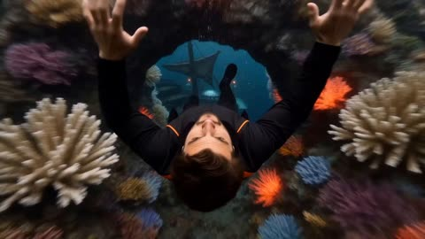</a>

A fixed overhead camera and a character sheet as the only identity reference keep the fall vertical and the face consistent. Listing each underwater level in order gives the fall a clear sequence of locations.

MiniMax H3 · Reference-to-video · Source: [@I_Muhammadali44 on X](https://x.com/I_Muhammadali44/status/2085234595784773704) · 44 likes on 2026-10-29 · found via [SkyNotSilent/awesome-MiniMax-H3-cases](https://github.com/SkyNotSilent/awesome-MiniMax-H3-cases)

[`underwater`](tags.md#tag-underwater) [`character-reference`](tags.md#tag-character-reference) [`overhead-camera`](tags.md#tag-overhead-camera) [`anamorphic`](tags.md#tag-anamorphic)

<details><summary><b>Prompt</b></summary>

```text
"Use the uploaded character sheet the ONLY identity reference. Preserve the exact face, hairstyle, body proportions, skin tone, and appearance throughout the video.

The camera remains directly above him looking straight downward during the entire sequence. He falls vertically beneath the camera through an impossible underwater abyss without changing direction.
He stays on his back facing the lens, both arms reaching upward while bubbles, hair, clothing, and loose fabric stream upward through the water.

He continuously falls through:
vibrant coral reef, abandoned pirate ship, underwater research station, giant kelp forest
submerged ancient city, whale migration corridor, volcanic hydrothermal vent field, endless dark ocean trench.

Every level is entered by crashing through ceilings, glass domes, ship decks, coral arches, ruined temples, and collapsing structures. Schools of fish, jellyfish, manta rays, bubbles, seaweed, bioluminescent creatures, and debris flow upward past the camera naturally.

His expressions progress from surprise and panic to determination, breath-holding, fear, exhaustion, and final acceptance while continuously reaching upward for anything that might stop his fall.

24mm anamorphic lens, underwater cinematic lighting, volumetric light rays, realistic water distortion, gentle bloom, film grain, radial motion blur, handheld floating movement.

Audio: Epic orchestral score mixed with deep underwater ambience, whale calls, distant metallic creaks, volcanic rumbles, rushing currents, and a powerful cinematic finale."
```

</details>

<a id="h3-swordswoman-kinetic-typography-title"></a>
### Anime swordswoman in kinetic typography title sequence

<a href="https://x.com/opener_ai/status/2085159317578330229">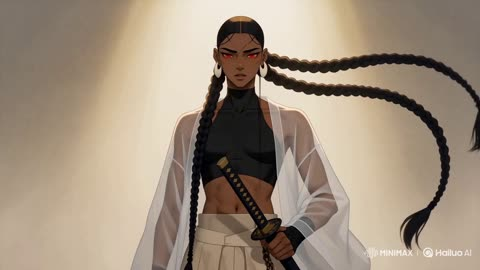</a>

A numbered shot list with timed beats, paired with an identity reference image, keeps the character consistent while 3D title words move through the action. Telling the model to ignore the reference sheet's layout and labels keeps those artifacts out of the video.

MiniMax H3 · Reference-to-video · Source: [@opener_ai on X](https://x.com/opener_ai/status/2085159317578330229) · 36 likes on 2026-10-29 · found via [SkyNotSilent/awesome-MiniMax-H3-cases](https://github.com/SkyNotSilent/awesome-MiniMax-H3-cases)

[`anime`](tags.md#tag-anime) [`martial-arts`](tags.md#tag-martial-arts) [`kinetic-typography`](tags.md#tag-kinetic-typography) [`identity-reference`](tags.md#tag-identity-reference)

<details><summary><b>Prompt</b></summary>

```text
[1] FORMAT
15-second 16:9 stylized anime action title sequence — martial-arts choreography fused with 3D kinetic typography. Painterly 2D anime illustration look with cel-shaded volumes and subtle paper grain, matching the source artwork's rendering.

[2] ASSETS
Use Image 1 as a strict identity reference for the female duelist KAELAN — read only the character artwork itself for her face, hair, wardrobe, weapon, and color palette. Ignore the sheet's layout, panels, printed labels, handwriting, silhouette thumbnails, and background parchment; none of them may appear in the video.

[3] IDENTITY
Preserve exactly: deep brown skin with warm highlights; luminous crimson-red eyes with a sharp black liner shape; jet-black hair pulled into a tight scalp-wrapped part that splits into two very long thick braids falling past the hips, moving like weighted whips; large white crescent hoop earrings on both ears; black high-neck sleeveless crop top exposing a toned midriff; a sheer white long-sleeved kimono robe worn open, translucent and lightly billowing; cream wide-leg hakama trousers with a single black diamond patch on the left thigh; black wrapped fingerless gloves with lattice cord across the back of the hand; white cloth-wrapped platform sandals; a well-worn katana with a dark blue-grey blade and a black diamond-wrapped hilt. Her expression stays calm and unblinking, never comic.

[4] BEATS
Shot 1 — [0–3 seconds] Kaelan stands centered in a void of warm off-white light, katana point-down, braids settling. She exhales; a slow iai draw begins. → Hard cut.
Shot 2 — [3–6 seconds] Mid-draw. The blade clears the saya and a clean arc of light follows the edge. The 3D extruded word "HAILUO" flies in from screen left along the blade's arc, its letter faces catching the same light, passing BEHIND her shoulder and IN FRONT of her trailing braid before exiting right. → Whip-pan cut.
Shot 3 — [6–9 seconds] Full-body kata combination: descending cut, pivot, rising horizontal sweep. Her sheer robe and both braids trail one frame behind her body. The word "MINIMAX" rotates up from the floor plane in thick extruded 3D, standing taller than her, and she cuts through the gap between its letters — the letterforms hold solid, do not shatter. → Hard cut.
Shot 4 — [9–12.5 seconds] Low-angle crouch landing, sword arm extended back, dust ring pushing outward. "H3" slams in from depth as a massive chromed 3D glyph directly behind her, scaling down to lock, with her silhouette reading cleanly against it. → Flash cut on the impact frame.
Shot 5 — [12.5–15 seconds] She rises into the neutral standing pose, katana returning to point-down. The full lockup "HAILUO MiniMax H3" assembles from the three pieces on a single horizontal baseline at lower third, settles, and holds perfectly still through the final frame.

[5] CAMERA
Anamorphic-feel 35mm for wides, 50mm for the mid shots.
```

</details>

<a id="h3-hotdog-dash-skateboard-selection"></a>
### Skateboard selection screen with HotDog Dash selected

<a href="https://x.com/0xbisc/status/2084626773015417323"></a>

The prompt divides the 15 second clip into timed beats and fixes the state of every UI element in each beat, so the selection, slide and confirm transitions stay readable. Two image references lock the character and the menu layout, and the sound design is also written per beat.

MiniMax H3 · Reference-to-video · Source: [@0xbisc on X](https://x.com/0xbisc/status/2084626773015417323) · 35 likes on 2026-10-29 · found via [SkyNotSilent/awesome-MiniMax-H3-cases](https://github.com/SkyNotSilent/awesome-MiniMax-H3-cases)

[`game-ui`](tags.md#tag-game-ui) [`skateboard`](tags.md#tag-skateboard) [`reference-images`](tags.md#tag-reference-images) [`timed-beats`](tags.md#tag-timed-beats)

<details><summary><b>Prompt</b></summary>

```text
Use Image 1 as the main character role. Use Image 2 as the layout of the game selection interface.
[0–2 seconds] Display the complete skateboard selection interface from the front. NOVA is in the selected and active state, the four ports at the bottom emit green light. HOTDOG and SHARK are in the unselected state, completely stationary.
[2–4 seconds] The player presses the right selection key. SHARK ROCKET RIDER slides from the right preview slot into the middle selected module, NOVA JET GLIDER simultaneously slides from the middle into the left preview slot, HOTDOG DASH moves to the right preview slot. As soon as NOVA leaves the middle selected module, the green light immediately turns off and stops. After SHARK enters the middle, orange flames appear at the tail. The skateboard name, attribute bars, and SELECTED label update synchronously.
[4–6.5 seconds] The player switches the selection again. HOTDOG DASH moves horizontally from the side preview slot to the middle selected module, SHARK ROCKET RIDER simultaneously slides into the other side slot, NOVA moves to the remaining side slot. As soon as SHARK loses the selected state, the orange flame immediately turns off. After HOTDOG becomes the selected item, facing the camera, it barks twice accurately, then turns around in place once.
[6.5–8 seconds] The bottom CONFIRM button is clicked by the player. The button compresses downwards and bounces back, the right arrow extends forward. HOTDOG DASH becomes the final confirmed selection. The two unselected skateboards on the left and right continue to stay in the fixed preview slots, completely stationary.
[8–10 seconds] The middle fixed selected module expands towards the depth of the screen. The light-colored display area inside the central card naturally transforms into the World Plaza. The complete world has been fully loaded, with no texture popping, placeholder models, or unfinished buildings. At the same time, the UI displays as the in-game HUD.
[10–12 seconds] The camera enters the third-person game perspective, with HOTDOG DASH located under the protagonist’s feet. During normal gliding and preparation actions, both feet of the protagonist are standing on HOTDOG DASH. The game HUD appears at this time: mini-map in the top right corner, speed and health status in the bottom left corner, action and combo slots in the bottom right corner, mission route markers and interactive prompts appear ahead.
[12–15 seconds] The protagonist enters the world riding the running HOTDOG DASH, passing pedestrians, stairs, slopes, railings, and multiple explorable routes. HOTDOG jumps before a low slope, completes a rotation action in the air, and upon landing, the protagonist’s feet are still standing on HOTDOG DASH, the combo count and TRICK prompt briefly increase in the HUD. Subsequently, lean to bypass street obstacles, then perform a small directional jump, and then continue sliding forward.
Sound Design: Use pure instrumental music mixed with electronic arcade sounds, no vocals. UI switching corresponds to crisp key press sounds, card slot sliding sounds, sticker slapping sounds, and attribute bar update sounds. When SHARK is selected, ignition and propulsion sounds appear, and stop immediately when losing selection. When HOTDOG is selected, two barks are played accurately, and light footsteps are added when spinning around. After entering the world, add city ambient sounds, wind sounds, running footsteps, shoe friction sounds when pedaling to accelerate, and jump and landing feedback sounds.
```

</details>

<a id="h3-sword-immortals-moonlit-city-duel"></a>
### Sword immortals duel a demon above moonlit city

<a href="https://x.com/Stellakjbk/status/2086021869040263455">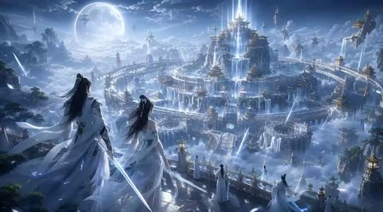</a>

The prompt opens with duration and aspect ratio, then anchors the setting to a reference image so the city, moon and lighting stay fixed. It lays out the fight as ordered beats with explicit camera moves such as low angle, orbit and slow motion, and closes with a list of native stereo sound cues.

MiniMax H3 · Reference-to-video · Source: [@Stellakjbk on X](https://x.com/Stellakjbk/status/2086021869040263455) · 31 likes on 2026-10-29 · found via [SkyNotSilent/awesome-MiniMax-H3-cases](https://github.com/SkyNotSilent/awesome-MiniMax-H3-cases)

[`xianxia`](tags.md#tag-xianxia) [`sword-fight`](tags.md#tag-sword-fight) [`reference-image`](tags.md#tag-reference-image) [`game-cg`](tags.md#tag-game-cg)

<details><summary><b>Prompt</b></summary>

```text
5秒，4:3，顶级东方仙侠3A游戏CG，电影级高端宣传片，严格参考图1的月下仙城场景与美术气质：巨大明月、云海天宫、环形仙城、悬浮仙山、瀑布、白玉仙桥、金顶楼阁、冷蓝月光。整体画面必须唯美、恢弘、神圣、危险、酷炫，像大厂正式游戏开场CG，不像普通AI视频。

双主角设定：男剑仙，黑色长发，白蓝战袍，冰蓝雷光长剑，英俊冷峻，强大沉稳；女剑仙，黑色长发，白青仙裙，月白灵剑与月华法术，清冷绝美，高贵飘逸。反派为黑金重甲魔修，手持黑色巨剑，周身暗红黑色魔气，压迫感极强。人物脸和服装全程稳定统一，保持高级游戏角色建模质感。

开场镜头从巨大明月前高速穿越云海与浮空仙山，俯冲进入宏伟仙城，来到白玉高台，男女主背对镜头立于高台边缘，衣袍长发飞扬，英雄感极强。远处天空突然裂开暗红色空间裂缝，魔修高速坠落，轰然落地，引发碎石、冲击波和魔气爆发。

男剑仙瞬间拔剑冲出，与魔修在仙桥中央高速对撞，剑刃碰撞爆发蓝红双色能量冲击、空间波纹、火星与剑气。近战动作凌厉、清晰、有重量感，包含高速斩击、格挡、反击、短暂慢动作碰撞特写，镜头低机位跟拍与高速环绕，极具电影感。

随后女剑仙御剑升空，展开巨大蓝白仙阵，发动“万剑齐发”，数百柄发光飞剑如流星暴雨般射向魔修，夜空被剑光点亮。魔修爆发黑红魔气，凝聚巨大的魔龙反击，空中连续爆炸。男剑仙御剑穿梭爆炸火光与云海，一剑斩裂魔龙，空战场面华丽震撼。

最后魔修释放百米高的黑红魔神法相，遮蔽天空。男女主并肩悬空，男剑仙开启覆盖半个天空的金蓝剑阵，女剑仙召唤巨大的白蓝月华莲华法相，二人联手凝聚数百米长的金蓝神剑，与魔神巨剑正面碰撞。碰撞瞬间进入超级慢动作，蓝色雷电、金色符文、白色月华、红色魔焰与空间裂痕同时凝固，随后爆发毁天灭地的大爆炸，形成巨大的环形云洞与能量冲击波。

结尾爆炸光芒散去，巨大明月重现，男女主并肩立于悬空巨剑之上俯瞰整座仙城，周围灵剑环绕，远处天宫亮起金蓝光柱，镜头缓慢拉远，形成极强的高级游戏主视觉结尾，并预留后期添加Logo空间。

镜头要求：超广角航拍、俯冲推进、低机位英雄视角、高速跟拍、环绕镜头、御剑追踪、短暂升格慢动作、终极碰撞震动、史诗级拉远收尾。镜头必须流畅稳定，不乱晃，不跳轴。

视觉要求：特效炫丽但高级干净，不能廉价光污染。强调冰蓝雷电剑气、金色仙纹、月华粒子、飞剑阵、空间裂缝、黑红魔焰、魔龙、巨大法相、神剑、冲击波、体积云、瀑布水雾、发光碎片。人物主体始终清晰，画面精致通透，PBR材质，真实布料与长发动效，电影级光影与空间层次。

音效：原生立体声。包含高空风声、远处钟鸣、低沉鼓点、剑刃碰撞、破风声、雷电炸裂、万剑掠空、魔龙低吼、终极爆炸低频冲击。无对白，无字幕，无水印，无乱码。
```

</details>

<a id="h3-spirit-fox-bridge-escape"></a>
### Girl escapes collapsing bridge with spirit fox

<a href="https://x.com/HBCoop_/status/2083553619413209379">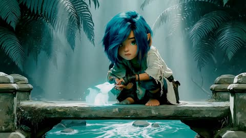</a>

Timed beats split the 15 second clip into setup, chase and landing, each with a clear physical cause. The reference image locks the character design, and an explicit ban on teleporting or costume changes keeps the route continuous.

MiniMax H3 · Reference-to-video · Source: [@HBCoop_ on X](https://x.com/HBCoop_/status/2083553619413209379) · 28 likes on 2026-10-29 · found via [SkyNotSilent/awesome-MiniMax-H3-cases](https://github.com/SkyNotSilent/awesome-MiniMax-H3-cases)

[`fantasy`](tags.md#tag-fantasy) [`spirit-fox`](tags.md#tag-spirit-fox) [`camera-tracking`](tags.md#tag-camera-tracking) [`character-reference`](tags.md#tag-character-reference)

<details><summary><b>Prompt</b></summary>

```text
Use the reference @ image for the exact character design, clothing, proportions, blue hair, pointed ears and glowing cyan spirit fox. Preserve the cinematic stylized 3D look, saturated teal jungle palette, soft volumetric light and detailed natural textures. No dialogue; environmental sound only.

0–4 seconds: Begin close to the reference composition on the ancient stone bridge. The girl kneels beside the small glowing spirit fox as ripples begin moving backward across the stream below. She notices the unnatural movement and looks over her shoulder. A massive moss-covered stone serpent suddenly erupts from beneath the bridge, lifting one side of the platform. The stone tilts physically under her weight. She loses balance, catches herself with one hand and quickly pulls the spirit fox against her chest as cracks spread beneath her knees.

4–10 seconds: The bridge collapses progressively behind her. She rises naturally from the crouch and sprints barefoot across the tilting stone slabs, carrying the fox securely with one arm. Each footfall dislodges moss and small fragments; broken slabs fall with believable weight and strike the water below, producing delayed splashes. The camera tracks closely beside her at waist height. The serpent sweeps its heavy stone tail across her path. She drops into a fast knee slide beneath it; her torn cloak and blue hair trail behind with clear inertia. Still moving forward, she catches a hanging vine with her free hand. Her momentum pulls the vine taut and swings her outward across the widening gap while the camera arcs alongside her.

10–15 seconds: At the highest point of the swing, the vine begins tearing from the temple ceiling. She releases before it snaps, travels forward in a natural gravity-driven arc and lands hard on the opposite platform. She absorbs the impact through her feet and one hand, then rolls once across her shoulder while protecting the fox against her chest. The camera drops and rolls partially with her, then stabilizes behind her as she rises into a defensive crouch. The spirit fox leaps from her arms and lands in front of her, its cyan light intensifying as the serpent crashes into the broken bridge behind them, sending water, dust and stone fragments through the backlight.

Maintain one continuous route and clear cause-and-effect motion. No teleporting, floating, sudden directional changes, extra characters, costume changes or transformation of the girl. Keep the fox small throughout; only its light becomes brighter in the final moment.
```

</details>

<a id="h3-forge-city-chain-warrior-music-video"></a>
### Swordswoman with iron chain strikes in forge city

<a href="https://x.com/GlitterPixely/status/2086599324125872626">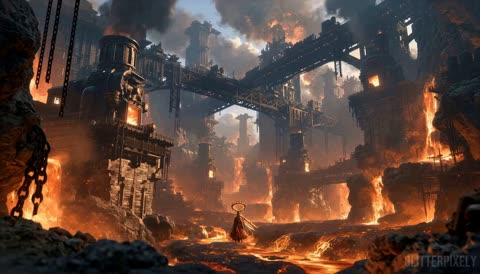</a>

Two reference images lock the character and the forge city, while the original music track is reused unchanged so every cut, title state and effect lands on a fixed audio transient. An empty establishing opening shows the on-screen name before the character appears.

MiniMax H3 · Reference-to-video · Source: [@GlitterPixely on X](https://x.com/GlitterPixely/status/2086599324125872626) · 27 likes on 2026-10-29 · found via [SkyNotSilent/awesome-MiniMax-H3-cases](https://github.com/SkyNotSilent/awesome-MiniMax-H3-cases)

[`reference-images`](tags.md#tag-reference-images) [`audio-reuse`](tags.md#tag-audio-reuse) [`music-video`](tags.md#tag-music-video) [`anime-action`](tags.md#tag-anime-action) [`beat-sync`](tags.md#tag-beat-sync)

<details><summary><b>Prompt</b></summary>

```text
subject_definitions:
<Subject 1> is ENRA VAEL, the woman from < 📷Image1 >: the same sharp face, dark wispy bangs, long braid threaded through copper rings, spiked hair ornaments, severe expression, layered red robes, tattered soot-black panels, high metal collar, dark shoulder armor, red lamellar plates, ropes, beads, and weathered fittings. Her left arm alone remains blackened and lava-cracked and holds the fire-wreathed bladed weapon; her normal right hand holds the heavy chain and attached bronze vessel-like weight. The burning double metal ring remains a separate floating halo behind her.

<Subject 2> is the colossal forge city from < 📷Image2 >: one black-basalt shelf beside a lower-center lava river, a cylindrical furnace tower left, layered bridges overhead, a lavafall and furnace opening right, distant towers in gray smoke, hanging chains, heat haze, and embers.

< 📷Audio1 > is the 15.00-second stereo music track used continuously and as the exact editorial-timing source.
summary:
[reference generation + audio reuse] Nine beat-matched angles present <Subject 1> inside <Subject 2> as a high-impact character music video. The empty opening shot reveals the exact name "ENRA VAEL" before the character appears; a furnace-light scan, ring-aperture transition, solarized accent, six-segment fire sigil, escalating heat rings, and posterized charge build toward the 00:14.120 iron-sun detonation.

retention_analysis:

<Subject 1> (appears in [Shot 2], [Shot 3], [Shot 4], [Shot 5], [Shot 6], [Shot 7], [Shot 8], [Shot 9]): fully_preserved - face, proportions, braid, hair ornaments, asymmetrical arms, wardrobe, armor, handed props, weighted chain, floating double ring, and expression remain consistent beneath every effect.
<Subject 2> (appears in [Shot 1], [Shot 2], [Shot 3], [Shot 4], [Shot 5], [Shot 6], [Shot 7], [Shot 8], [Shot 9]): fully_preserved - connected geography, landmarks, materials, smoke, lava, and orange-charcoal lighting persist while viewpoint and temporary transition treatments change.
< 📷Audio1 >: partially_copy - the full musical layer is copied in its original order and timing; only restrained diegetic chain, cloth, fire, title-weld, and impact sounds are mixed beneath it.

detailed_description:

AAA anime action-RPG music video; effects alter only environment and end by 00:13.770.
[Shot 1] Empty extreme-wide of <Subject 2>; no character, halo, or weapon. At 00:00.120 an ember seam opens. At 00:00.240, the complete exact uppercase "ENRA VAEL" appears simultaneously, centered, black iron with a thin white-hot rim, maximum 42% frame width. It holds through 00:01.120, collapses, and is gone by 00:01.350. No text crosses the next cut. <Audio 1> starts at 00:00.000.

[Shot 2] At 00:01.430, a left-front full-body angle pedestals up as she drags the chain weight. From 00:01.880 to 00:02.650, a furnace-light scan travels boots-to-face, revealing robe, armor, chain, and ornaments with afterglow.
[Shot 3] At 00:02.840, a near-static right-front three-quarter hero card keeps her face, halo, and weapon unobstructed. No text is visible.

[Shot 4] At 00:04.470, a close-up frames her face inside the unattached ring. Molten arm pulses at 00:04.940; right hand closes on chain at 00:05.410. The ring turns front-on at 00:05.870 and expands; its black center fills frame from 00:06.170 to 00:06.300 without covering her face.
[Shot 5] At 00:06.340, the ring aperture opens on the drop to a ground-level full-body angle. She yanks the weighted chain; ring spins independently, weapon traces a molten circle, and furnaces flash. One black-red solarized frame hits, then normal color returns.
[Shot 6] At 00:08.240, overhead, she pivots as fire engraves a six-segment solar sigil. Segments lock at 00:08.710, 00:09.180, and 00:09.650; it flashes at 00:09.800, then lifts as ribbons into the ring by 00:10.090.
[Shot 7] At 00:10.090, a weapon-side view tracks blade, cracked arm, and face. Pulses send one, two, then three heat rings through the background at 00:10.580, 00:11.040, and 00:11.480; her geometry stays stable.

[Shot 8] At 00:11.950, a low medium-wide pushes in fast. She pulls chain taut, raises weapon at 00:12.440, turns it down at 00:12.900, and compresses an iron sun at 00:13.360. That accent briefly posterizes her charcoal-red with a white rim, then restores detail.

[Shot 9] At 00:13.770, prior effects gone, a frontal ultra-wide catches her downward strike. At 00:14.120, weapon meets basalt and chain snaps taut: the iron sun erupts behind her into corona, lava shockwave, fire plume, furnace flares, and bowed smoke. A second shell hits at 00:14.560; a final flare at 00:14.910 frames her intact silhouette. Camera pulls back and shakes only on primary impact. End centered, weapon planted, chain weighted. Render exact "ENRA VAEL" once during the empty opening only; no reversed letters, extra glyphs, subtitles, logos, extra characters, costume changes, duplicate limbs, extra weapons, or fire across her face.
overall_soundscape:

Lava roar, furnace resonance, wind, metal fittings, cloth, and chain clinks sit beneath the music. Add a restrained metal-weld sizzle at 00:00.240, a chain snap and ring whoosh at 00:06.340, then a metal strike, concussive blast, pressure rush, and ember hiss at 00:14.120 without overpowering < 📷Audio1 >.
non_diegetic_music:
Directly reuse the 00:00.000-00:15.000 musical layer of < 📷Audio1 > unchanged. Preserve its sparse opening, 00:06.340 drop, approximately 128-BPM pulse, 00:13.770 ignition, 00:14.120 detonation, 00:14.560 secondary burst, 00:14.910 flare, and hard ending; every cut, title state, and VFX change lands on the stated transient, with no replacement score.
```

</details>

<a id="h3-warrior-witch-chamber-ghost-battle"></a>
### Warrior enters witch chamber full of corpses

<a href="https://x.com/HeyZoyaKhan/status/2085575259533783077">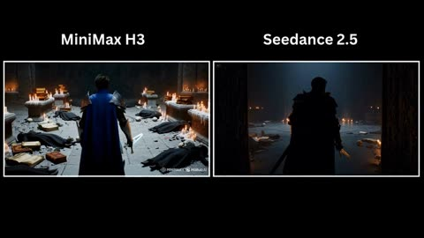</a>

The prompt is split into beats (entry, ghost reveal, close combat, climax, aftermath), which gives the model a clear shot order. A camera that follows from behind and a closing style block set the lighting and realism.

MiniMax H3 · Text-to-video · Source: [@HeyZoyaKhan on X](https://x.com/HeyZoyaKhan/status/2085575259533783077) · 22 likes on 2026-10-29 · found via [SkyNotSilent/awesome-MiniMax-H3-cases](https://github.com/SkyNotSilent/awesome-MiniMax-H3-cases)

[`dark-fantasy`](tags.md#tag-dark-fantasy) [`sword-fight`](tags.md#tag-sword-fight) [`tracking-shot`](tags.md#tag-tracking-shot) [`creature`](tags.md#tag-creature)

<details><summary><b>Prompt</b></summary>

```text
A young heroic warrior wearing beautifully crafted silver armor, a dark blue cape, and carrying an ancient enchanted longsword slowly enters an abandoned underground witch chamber. The room is filled with broken ritual circles, ancient books, shattered altars, skulls, scattered candles, and dozens of lifeless witch bodies lying across the cold stone floor. The atmosphere is eerily silent.

The camera slowly follows behind him as he carefully scans every corner, gripping his sword tightly and remaining fully alert.

Suddenly, the ancient stone walls begin to tremble.

A horrifying ghost emerges from the darkness. It has a grotesque deformed face, glowing crimson eyes, an unnaturally long body, and dozens of skeletal arms extending in every direction. Instead of wielding weapons, the ghost attacks using its razor-sharp claws and multiple arms, striking from impossible angles with incredible speed.

An intense close-quarters battle begins.

The warrior skillfully dodges the ghost's relentless claw attacks, parries with his enchanted sword, and cuts through several skeletal arms as they lunge toward him. The ghost continuously regenerates new arms, making the fight increasingly desperate.

The battle reaches its climax as the ghost charges forward with all of its arms at once. The warrior times the attack perfectly, leaps into the air, and delivers a single breathtaking spinning sword strike that cleanly severs the ghost's head.

The head falls to the stone floor as the ghost's body freezes in place, cracks with glowing purple energy, and disintegrates into countless glowing magical particles that fade into the air. The chamber becomes completely silent once again.

Style

Ultra-cinematic dark fantasy, realistic sword choreography, terrifying creature animation, expressive facial reactions, dramatic lighting, highly detailed gothic environment, dynamic camera movement, AAA fantasy film quality, Unreal Engine realism, IMAX composition, ultra-detailed textures

#MiniMaxH3
```

</details>

<a id="h3-first-person-magnetic-orb-quarry"></a>
### Hands hold a magnetic orb as armored guards charge

<a href="https://x.com/KrevixAi/status/2085759071047565341">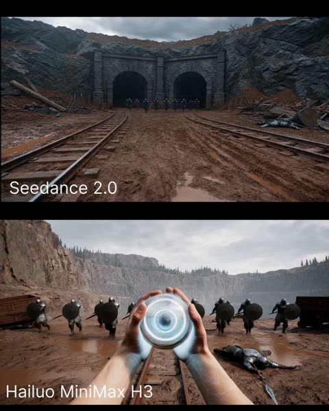</a>

Locking the camera to first-person with the face never visible keeps the hands and forearms as the only character anchor. Stating that the orb already exists before it is crushed gives the model a clear starting state for the magnetic pulse.

MiniMax H3 · Text-to-video · Source: [@KrevixAi on X](https://x.com/KrevixAi/status/2085759071047565341) · 19 likes on 2026-10-29 · found via [SkyNotSilent/awesome-MiniMax-H3-cases](https://github.com/SkyNotSilent/awesome-MiniMax-H3-cases)

[`first-person`](tags.md#tag-first-person) [`dark-fantasy`](tags.md#tag-dark-fantasy) [`magic-orb`](tags.md#tag-magic-orb) [`combat`](tags.md#tag-combat)

<details><summary><b>Prompt</b></summary>

```text
Strict first-person POV, male hero, face never visible. Visible only the hero’s hands, fingers, and forearms when needed for casting, dodging balance, and the final magnetic strike. Broad male hands, pronounced knuckles, short nails, pale or cool-toned skin, dark gray or black sleeves, thin geometric magic lines glowing cold white with a faint blue tint across the skin and wrists. The hands move with force, precision, and short controlled gestures, never soft or decorative. One continuous shot, no cuts, vertical cinematic dark fantasy, realistic body-driven camera motion, professional action cinematography with physical momentum and readable combat beats.

In a vast abandoned stone quarry under a gray overcast sky, high rock walls, two dark mine tunnel arches in the background, old metal rails cutting through wet red-brown mud, overturned mine carts, scattered stones, chains, broken timber, iron scrap, discarded armor, and bodies of fallen guards. The space feels cold, damp, heavy, and dusty, with a steel-gray, dirty brown, graphite, and cold white palette. A squad of dark armored quarry guards charges first across the rails and muddy ground, helmets closed, carrying short spears, shields, and hammers. Behind them, emerging from the shadow of the mine arch, comes the boss: a giant one-eyed heavy warrior, 4 to 5 meters tall, rough gray-pink skin, one large round eye in the center of the face, partial metal armor and leather straps across the chest, a massive shoulder plate on one side, thick legs, immense weight, and a huge heavy battle axe carried with brutal momentum.

The hero briefly raises one hand holding a smooth semi-transparent magnetic orb, tennis-ball sized, silver-white with a pale blue core, a dense metallic vortex inside, thin rings of light rotating around it. The orb already exists when first shown and does not appear from nowhere. As the smaller guards rush in, the hero crushes the orb. A cold magnetic pulse flashes through both forearms and into the ground. Weapons rip out of the charging soldiers’ hands, shields twist sideways, bolts, chains, rail spikes, loose armor plates, and metal fragments shudder and begin lifting from the quarry floor. Some smaller enemies are violently disarmed and thrown off balance immediately.

The boss accelerates forward through the chaos and swings the giant axe in a heavy horizontal attack. The hero performs a fast professional sidestep and body lean at the last instant; the blade tears across the foreground with dangerous proximity, kicking mud and dust past the camera. The boss recovers with heavy inertia, plants a foot, and launches a second brutal overhead strike. The hero ducks and slips under it in a sharp Hollywood-style evasive motion, the axe crashing into the ground and rails with a shower of dirt, sparks, and metal shock. The camera reacts like a real head-and-torso dodge: fast lateral movement, recoil, breath, then immediate refocus on the boss.

Now the magnetic field fully takes hold. The hero spreads both hands outward. Metal rises from every direction in a controlled field, not chaotic: torn rails, chains, bolts, iron rings, armor plates, mine cart fragments, shield metal. The pieces lift, align, and begin orbiting the giant in three clear rotating bands: a lower ring around the knees, a middle ring around the waist and abdomen, and a top ring around the chest and shoulders. The boss tries to wrench the axe free and charge again, but the orbit tightens around him. Tight center framing, with strong tracking drift and a low-angle hold to emphasize mass and danger.

The hero then sharply pulls both hands inward. All three magnetic rings slam tighter at once. Chains snap taut, rails bend into crushing arcs, armor plates collide and lock, metal fragments hammer into the boss’s torso and arms. The giant loses balance, staggers, and is forced down, the axe slipping and dropping into the mud. The metal cocoon constricts harder with brutal industrial weight and magnetic pressure, locking his body in place. Dust rises in waves, small rocks skitter, chains strain, and the one eye flares with panic and rage.

The hero thrusts both hands forward for the finisher. A narrow concentrated magnetic impulse forms between the palms, not fire, but a dense electromagnetic strike with a bright white core and pale blue edges. Brief micro push-in to the center of the boss’s chest. The pulse hits. Every piece of metal bound around the giant clamps inward simultaneously with one final crushing lock. The boss drops fully to his knees, torso compressed under chained rails and armored fragments, while a deep metallic shock ripples through the quarry and a wave of dust spreads across the ground.

End on the giant kneeling and trapped in a brutal iron cocoon, chains stretched tight, rails embedded across the torso, the fallen axe half-buried in mud, drifting dust, and a few small metal fragments still hovering and spinning before they finally drop.

Lighting: cold gray cloud light, faint wet reflections on stone, mud, and rails, cold silver-white illumination from the orb and the hero’s magic lines, sharp cold highlights on airborne metal during orbit, and a final white-blue flash from the magnetic impulse. Cinematic dark fantasy, anamorphic look, subtle film grain, shallow depth of field on hands and nearby metal, strong physical inertia, realistic heavy enemy movement, rails resisting as they tear from the ground, chains tightening with believable tension, mud displacement, rolling debris, and controlled magnetic motion that feels like a field, not random telekinesis. Sound design: low wind in the quarry, distant metal groans, armor rattle from the charging guards, tight compression sound as the orb is crushed, deep low-frequency magnetic hum, metal shrieking free from the ground, heavy boss footsteps, axe whooshes with real mass, impact crashes into mud and rails, chain strain, rail collisions, a sharp electromagnetic finisher, then a massive iron-lock resonance and fading dust-heavy rumble.

No third-person view, no visible hero face, no constant hands in frame, no random floating metal chaos, no weak enemy scale, no weightless boss, no fire magic look, no glowing fantasy laser beam, no cartoon physics, no soft combat, no low-detail quarry, no tiny axe, no silly enemy behavior, no zombie movement.

#AIVideoComparison #seedance2 #MiniMax #MiniMaxH3 #Hailuo
```

</details>

<a id="h3-rifle-woman-rusted-ship-deck"></a>
### Armed woman sits on rusted cargo deck

<a href="https://x.com/ou_zhen599/status/2098800452586598897">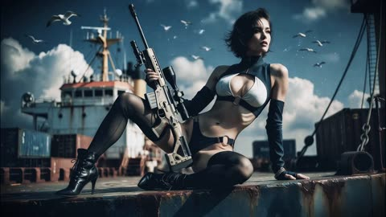</a>

Timestamped shot beats chain one continuous action line from sitting to rising, advancing, aiming and lowering the gun, while the opening lines lock the character, location and lighting. Each beat carries its own camera move and sound cue, which keeps the 15 second clip coherent and gives the soundscape its own timeline.

MiniMax H3 · Image-to-video · Source: [@ou_zhen599 on X](https://x.com/ou_zhen599/status/2098800452586598897) · 18 likes on 2026-10-29 · found via [SkyNotSilent/awesome-MiniMax-H3-cases](https://github.com/SkyNotSilent/awesome-MiniMax-H3-cases)

[`timestamped-shots`](tags.md#tag-timestamped-shots) [`character-lock`](tags.md#tag-character-lock) [`sound-design`](tags.md#tag-sound-design) [`post-war`](tags.md#tag-post-war)

<details><summary><b>Prompt</b></summary>

```text
For the target video, at 0.00 seconds into the target video, <Picture 1> (from [Shot 1]) is fully referenced.

integrated_multimodal_description: [Shot 1] A 15-second, 16:9, cinematic photorealistic image-to-video extension based on <Picture 1>. Preserve the exact same adult female character throughout: same facial structure, short hairstyle, outfit construction, body proportions, mature age impression, weapon, cargo-ship deck environment, and period texture. The whole sequence stays inside one connected ship space only: the weathered cargo deck, the container-side passage, and the visible wheelhouse zone. No harbor wide shot, no new location, no unrelated crowd. The tone is dangerous post-war allure with realism, restraint, sea wind, rust, salt mist, gulls, cold daylight, and small warm practical lights. She never poses; she stays in motion through one chain: angled sitting, rising, lifting the gun, advancing, edging along cover, stopping, aiming, confirming, lowering the gun, and looking back. Sensuality comes only from control, shoulder-neck line, breathing shifts, eye pressure, mouth tension, and her fingers on the weapon. At 00:00.000-00:02.500, she sits at an angle against the rusted ship edge. One leg extends naturally, one hand holds the rim, the other rests loosely on the gun. The camera starts low on the high-heeled ankle boots and leg line, glides past the hand on the rim, then rises to her side face and lip line. She looks only toward the sea. Her upper lids are slightly lowered, gaze stable but alive, blink rate low, breathing shallow, lips slightly parted, mouth corners neutral. Wind lifts the short front strands and hair near the ear. [Shot 2] At 00:02.500, she rises with one hand pushing off the deck while the other lifts the gun, the stock brushing the outer thigh. The camera stays close and rises with her, bringing out collarbone, shoulder line, side neck, jawline, and outer eye corner. The rise is controlled, as if fatigue remains but discipline is stronger. Her expression shifts: eyelids lift slightly, eyes move from distance to lock, the brow center gathers for a moment, lips close, the mouth line firms, and the jaw tightens lightly. A small swallow moves in the throat. In a very low soft voice, almost inside the breath, she says: <d>[English] Easy...</d> [Shot 3] At 00:04.800, a harsh cold reflection flashes from the distant container-side passage and a muted metallic hit follows. She turns immediately and advances with the gun. She does not run; she moves in a pressured fast walk with stable center of gravity, precise steps, and the gun carried low beside the thigh. The camera follows from side-rear as rusted deck textures, cables, and container edges drift behind her. Her face sharpens here: eyes lock forward, eye movement range decreases, focus intensifies, the outer eyes tighten, the brow center presses slightly, breathing shortens and quiets, lips stay closed, and the jawline hardens. [Shot 4] At 00:07.800, she skims along the container edge, stops hard, turns back through the shoulder, and raises the gun. First show the readable medium-close action, then tighten quickly into the most intimate close-up of the short. She leans into the sight line. The camera catches lashes, eye tail, side nose line, mouth corner, and the near-metal intimacy of her breath against the weapon. Her eyes do not widen; they narrow slightly, upper lid pressing down in concentration. The lower lid gathers a little, lips remain closed, one mouth corner holds a tiny natural tension, and the nostrils widen once then settle. The weapon raise is fast, sight alignment steady, and the trigger finger rests along the outside edge rather than firing. [Shot 5] At 00:10.300, as she turns past the obstruction, the gun is aimed not at an enemy but at two surviving crew members welding the deck. Welding sparks scatter, electric flicker pulses, a warm wheelhouse light turns on, and a strip of white cloth near the railing flutters in the wind. Let her subjective line of sight reveal the reversal first, then give a very short half-profile reaction. Her eyes stay guarded for half a beat, then clearly release: tension around the eyes falls slightly, upper lids lift back a little, the brow center opens, lips unseal as if a silent breath leaves, and the jawline softens from combat hardness. This is not cheerful relief, only post-threat decompression. [Shot 6] At 00:12.800, she slowly lowers the gun and lets her fingers loosen and slide along the gun body. The camera comes from behind her shoulder in a half-orbit to her side front, with warm light grazing her face. She looks back toward the sea and gives a very restrained slight smile, no teeth, only one side of the mouth lifting a little. For the first time her eyes hold softness and belonging. She says quietly: <d>[English] We’re home.</d> The line must not sound sweet or slogan-like; “We’re” is light, “home” lands lower and firmer. Her brow center is relaxed now, some fatigue remains at the eye corners, there is the slightest moisture without tears, blinking slows a little, and the mouth corner lifts then controls itself again. End mature, steady, tender, and still carrying the after-heat of war.

overall_soundscape: The soundscape is led by environment throughout: sea wind, gulls, light ship-metal creaks, heels on deck, distant electric crackle, welding sparks, low mechanical hum, and a final low ship horn. Emphasize wind, metal resonance, gulls, and her shallow breathing in the opening; hand on deck, cloth movement, gun lift, swallow, and the soft breath-close line <d>[English] Easy...</d> during the rise. Then bring in the muted metal hit, close footfalls on steel, weapon handling, cloth friction, and reduced breath as she advances. Tighten the sound field around breath and metal near the weapon during aiming, then reveal the welding reality through spark hiss, low electrical buzz, warm light switching on, white cloth in the wind, and deck machinery hum. Her final line <d>[English] We’re home.</d> should be low, close, tired, and steady, followed by wind, gulls, machinery, and the distant low horn.

non_diegetic_music: Use only a very light tension bed. Keep it minimal, cool, and modern, never epic or sentimental. Support the first half with low suspended texture, tighten slightly when the reflection and metal sound trigger her advance, thin it during the aiming close-up so breath and steel dominate, then ease the tension on the welding reveal without becoming warm or triumphant. Let the final line carry only a faint brief emotional release.
```

</details>

<a id="h3-rider-night-city-motorcycle-chase"></a>
### Rider on motorcycle speeding through night city traffic

<a href="https://x.com/HBCoop_/status/2083282581450375367">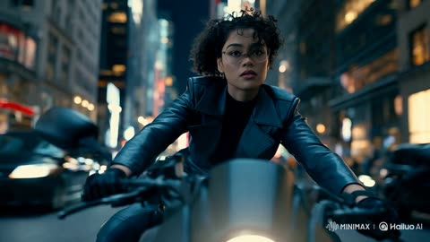</a>

A reference opening frame and named identity details lock the rider, while a timed beat sheet with a music sync instruction sets each camera change. Rules for one direction of travel and an explicit negative list keep the chase readable.

MiniMax H3 · Image-to-video · Source: [@HBCoop_ on X](https://x.com/HBCoop_/status/2083282581450375367) · 16 likes on 2026-10-29 · found via [SkyNotSilent/awesome-MiniMax-H3-cases](https://github.com/SkyNotSilent/awesome-MiniMax-H3-cases)

[`motorcycle`](tags.md#tag-motorcycle) [`night-city`](tags.md#tag-night-city) [`audio-sync`](tags.md#tag-audio-sync) [`camera-tracking`](tags.md#tag-camera-tracking)

<details><summary><b>Prompt</b></summary>

```text
Use @ image1 as the opening frame and exact visual reference. Preserve the rider’s face, short curly hair, round glasses, black leather jacket, gloves, motorcycle, and realistic nighttime city environment throughout.

Use @ audio1 as the soundtrack. Synchronize the motorcycle’s acceleration, camera movement, passing lights, and edits precisely to the music’s rhythm and rising intensity. No dialogue or additional music.

0–3s: Begin in the frontal composition of @ image1. A stabilized tracking camera moves backward directly ahead of the motorcycle as the rider speeds through traffic. Her expression is alert and focused; wind moves her curls and jacket naturally.

3–6s: On a strong musical beat, shift smoothly into a low front three-quarter tracking angle beside the front wheel. The motorcycle leans gently around a moving car without changing direction abruptly. Streetlights streak across the wet pavement.

6–10s: Transition into a fast side-tracking shot. The rider accelerates through a narrow opening between two lanes while maintaining believable balance, speed, and forward momentum. Background traffic and illuminated buildings create controlled motion blur.

10–13s: The camera arcs from her side toward the rear as she clears the traffic. Red emergency lights begin flashing across the surrounding buildings and reflect naturally in her glasses and leather jacket.

13–15s: A fire truck crosses the intersection behind her as she races into an open stretch of road. Finish with the camera pulling wider and rising slightly, revealing the motorcycle speeding deeper into the city on the final musical accent.

Cinematic live-action realism, physically accurate motorcycle movement, energetic but readable action, natural motion blur, shallow depth of field, cool blue-black city palette with warm streetlights and red emergency-light accents. Maintain one continuous direction of travel. No collisions, teleporting, sudden direction reversals, distorted hands, changing wardrobe, altered motorcycle design, facial drift, extra limbs, text, logos, or slow motion.
```

</details>

<a id="kling-baseball-bat-logo"></a>
### Logo on a baseball bat stays sharp through the swing

<a href="https://static-54.klingai-cdn-aws.com/kling-blog/presigned_url/50fdd9a7-e3d7-4d62-8715-edaa9b3003bc_文字_棒球.mp4"></a>

One sentence that ties the camera to a word on a moving object. A quick test for text stability.

Kling 3.0 · Image-to-video · Source: [Kling VIDEO 3.0 user guide](https://app.klingai.com/global/quickstart/klingai-video-3-model-user-guide)

[`text-render`](tags.md#tag-text-render) [`sports`](tags.md#tag-sports)

<details><summary><b>Prompt</b></summary>

```text
The camera remains fixed on the word "KLING" emblazoned on the baseball bat as the player swings and hits the ball.
```

</details>

Inputs: [1](https://static-3.klingai-cdn-aws.com/kling-blog/file_by_url/a8527e3967d0a358562fddac74c2c9e13c98135619da9af77ea326fe756fb0ff.png)

<a id="kling-snowmobile-six-shots"></a>
### Snowmobile run in six shots

<a href="https://static-14.klingai-cdn-aws.com/kling-blog/presigned_url/fbf5a59b-e1c0-45ee-9ec8-13726d3d3887_kling_20260202_作品_镜头_1_2s_后远_4947_0.mp4"></a>

Six shots, each defined only by angle and camera move. The landscape is described once, in the last shot.

Kling 3.0 · Image-to-video · Source: [Kling VIDEO 3.0 user guide](https://app.klingai.com/global/quickstart/klingai-video-3-model-user-guide)

[`multi-shot`](tags.md#tag-multi-shot) [`camera-move`](tags.md#tag-camera-move) [`action`](tags.md#tag-action)

<details><summary><b>Prompt</b></summary>

```text
Shot 1, Low-angle rear wide shot, tracking behind the rider as they move forward. Shot 2, Low-angle side close-up, a detailed shot of the motorcycle wheel. Shot 3, First-person POV from the rider, with the handlebars and instrument panel visible ahead. Shot 4, Frontal medium shot, tracking backward in front of the motorcycle, the rider’s helmet facing the camera. Shot 5, Side-on eye-level tracking shot with slight lateral movement. Shot 6, High-angle wide shot with a gentle downward tilt. The camera rises as the snowmobile rides deeper into the snowfield, leaving winding tracks carved into the pristine white snow, with snow-covered forests scattered on both sides.
```

</details>

Inputs: [1](https://static-29.klingai-cdn-aws.com/kling-blog/file_by_url/ef7ccbdcafe3af9d5fbbe492976b10793b302cc4ecab0778734b129dc7db9570.png)

<a id="kling4-fight-choreography-from-reference-video"></a>
### Borrow a fight's choreography, swap in your own fighters

<a href="https://static-17.klingai-cdn-aws.com/kling-blog/presigned_url/ed604ee7-c243-4375-9dc7-38c5964d81e2_1-2.mp4"></a>

Two sentences. Each asset gets one job: the video gives timing and moves, the two images give the characters.

Kling 4.0 · Reference-to-video · Source: [Kling 4.0 user guide](https://kling.ai/quickstart/kling-4-model-user-guide)

[`fight-scene`](tags.md#tag-fight-scene) [`motion-reference`](tags.md#tag-motion-reference) [`multi-reference`](tags.md#tag-multi-reference) [`character-reference`](tags.md#tag-character-reference)

<details><summary><b>Prompt</b></summary>

```text
Use @Video 1 as the reference for the fight choreography and attack timing. Use @Image 1 and @Image 2 as the references for the character designs.
```

</details>

Inputs: [1](https://static--45.klingai-cdn-aws.com/kling-blog/file_by_url/9603ebbdfda76122fdbef0275af4dbad96108fcbb7e46bad56e621feba73c892.png) · [2](https://static-10.klingai-cdn-aws.com/kling-blog/file_by_url/ef4f3b49db4eab2d135518404005e67da24472f824e27b2ddf1c86c2699d9217.png) · [3](https://static--34.klingai-cdn-aws.com/kling-blog/presigned_url/bd79f738-8bdf-4cf8-b02a-be0fad27c733_1-2-1.mp4)

<a id="kling4-office-chair-cliff-jump"></a>
### Recreate a cliff jump stunt, but on an office chair

<a href="https://static--89.klingai-cdn-aws.com/kling-blog/presigned_url/6277f31b-5c85-4c24-9974-d5254c0fa23c_1-1.mp4"></a>

First frame from an image, camera and cuts from a video. Every moment the bike appears is listed so the chair replaces it everywhere.

Kling 4.0 · Reference-to-video · Source: [Kling 4.0 user guide](https://kling.ai/quickstart/kling-4-model-user-guide)

[`motion-reference`](tags.md#tag-motion-reference) [`pov`](tags.md#tag-pov) [`comedy`](tags.md#tag-comedy) [`object-swap`](tags.md#tag-object-swap) [`action`](tags.md#tag-action)

<details><summary><b>Prompt</b></summary>

```text
@Image1 is the first frame.  @Video1 is the reference for camera, motion, timing and cuts. Recreate @Video1 shot-for-shot and cut-for-cut, but starting from @Image1: the rider is SITTING in a black office swivel chair instead of standing on a bike. Same chest-mounted GoPro fisheye POV, same ramp, canyon, river, orange parachute with white ring, airboat and cheering crew; same three jump-cuts and audio as video. Wherever the video shows the bike — under the rider on the ramp, shoved away at the cliff, tumbling below in free-fall, and the tiny silhouette during the parachute opening — show the office chair (mesh backrest, padded seat, chrome column, five-spoke base, casters). Before the launch, the rider stays seated exactly as in @Image1: thighs and knees at the bottom of frame, sneakers on the star base, hands on the armrests. No bicycle, handlebar, tyres or pedals anywhere.
```

</details>

Inputs: [1](https://static--11.klingai-cdn-aws.com/kling-blog/file_by_url/a587a7581557e29314065a81c742d18edb842696f595a220c4bd757d9c7a8c83.png) · [2](https://static-96.klingai-cdn-aws.com/kling-blog/presigned_url/bdac1b40-c32d-4f3a-b565-40d258f1d78b_1-1-1.mp4)

<a id="kling4-skater-stair-jump-tracking"></a>
### Skater clears a stair set in one low tracking shot

<a href="https://x.com/minchoi/status/2111471588256207357"></a>

Text only, 30 seconds in six-second beats. A test of big motion and landing physics with the face and outfit held steady.

Kling 4.0 · Text-to-video · Source: [@minchoi on X](https://x.com/minchoi/status/2111471588256207357)

[`sports`](tags.md#tag-sports) [`tracking-shot`](tags.md#tag-tracking-shot) [`long-take`](tags.md#tag-long-take) [`physics`](tags.md#tag-physics) [`timed-beats`](tags.md#tag-timed-beats)

<details><summary><b>Prompt</b></summary>

```text
30-second continuous low tracking shot of a skateboarder in a concrete park at golden hour. Large dynamic motion, realistic weight and physics.[Skater]: young man, early 20s, faded red T-shirt, black shorts, short hair. Consistent face and outfit.0–6s: He rides toward camera, pushes once, centers his weight. Camera tracks low beside the board.6–12s: He approaches a set of stairs. Knees bend, weight shifts back. Board rises on the tail.12–18s: He clears the stairs. Wheels leave the ground. Cloth and hair react to the motion. He lands with knees absorbing impact.18–24s: He rolls out, slight speed check, then carves hard left. Camera stays locked low and follows.24–30s: Final wide as he rides away into the warm light, board still under him.Natural late-afternoon sun, long shadows, realistic dust and board sound. No slow motion unless specified. Preserve exact clothing and face.
```

</details>

<a id="kling4-ski-film-seven-shots"></a>
### Seven-shot ski edit from one character sheet

<a href="https://x.com/minchoi/status/2111471581461426236"></a>

One run down a mountain face cut like a ski film, with the outfit locked by a character reference and a dense sound list from edge scrape to ravens.

Kling 4.0 · Reference-to-video · Source: [@minchoi on X](https://x.com/minchoi/status/2111471581461426236)

[`sports`](tags.md#tag-sports) [`multi-shot`](tags.md#tag-multi-shot) [`character-reference`](tags.md#tag-character-reference) [`sound-design`](tags.md#tag-sound-design) [`golden-hour`](tags.md#tag-golden-hour)

<details><summary><b>Prompt</b></summary>

```text
A 30-second, seven-shot ski film edit of Kai <Character reference> skiing one steep, untracked mountain face at golden hour, cut together from several real cameras: a drone, a helmet-mounted action camera, an action camera on a pole, a camera planted in the snow, a chase skier and a long lens across the valley. Photoreal action-sports look, real speed, hard cuts on the action, no slow motion. Kai: athletic man in his 20s, red insulated ski jacket, black ski pants, black gloves, white helmet, mirrored orange goggles, black poles, twin-tip skis. Same outfit and gear in every shot, exactly as in the character sheet. Same mountain face, same powder, and the low sun always on his left as he skis down, throwing long blue shadows across the snow. Shot 1 (0-4s), drone: high aerial view of a sunlit ridge and the whole golden face below it. Kai, small in frame, drops in off the ridge and carves his first big turn, a plume of powder behind him. The drone pushes forward and tilts down to follow. Hard cut. Shot 2 (4-8s), helmet cam: first-person view from an action camera on his helmet, ultra-wide with curved edges. His ski tips and pole baskets at the bottom of the frame, snow rushing underneath, the horizon tilting hard left and right with each carve, powder spraying across the lens. Hard cut. Shot 3 (8-12s), pole cam: an action camera on a short pole held out in his left hand, ultra-wide, pointing back at him. His goggles and helmet fill one side of the frame, his body leaning into a turn, the mountain and sky swinging behind him, snow flecks stuck to the lens. He lets out a wordless shout into the wind. Hard cut. Shot 4 (12-17s), planted cam: a camera set low in the snow just below a wind-lip, pointing up at the sky. Kai launches off the lip and flies straight over the lens, skis crossing the low sun, snow raining down onto the camera, then he lands out of frame behind it. Hard cut. Shot 5 (17-21s), chase skier: a camera on a handheld stabiliser, skiing a few metres behind him at the same speed. He drops into a tuck and straight-lines the fall line, spray from his tails hitting the lens, the slope streaking past. Hard cut. Shot 6 (21-25s), long lens: a telephoto shot from across the valley, slightly shaky, compressing the slope. Kai lays a huge carve and throws a wall of powder backlit gold by the sun. Hard cut. Shot 7 (25-30s), low static camera at the bottom of the run: he skis straight at the lens and skids a hard hockey stop right in front of it, a sheet of snow blasting the camera. As it clears, he pushes his goggles up onto his helmet, breathing hard and laughing. Look: every action-camera shot ultra-wide and crisp with curved edges, small lens flares and snow on the lens; the drone and long-lens shots clean and natural. Warm low sun, long blue shadows, glittering ice crystals in the spray, natural colour, real motion blur. Sound, in stereo, loud and up front like real action-camera audio, never quiet: constant wind roaring and buffeting the camera mics, gusting harder as he picks up speed; the crunch of snow under his skis as he drops in; friends whooping and yelling "Go!" from the ridge at the start; the hiss, scrape and chatter of his edges biting the snow on every carve; poles planting with a crisp crunch; powder spraying off his tails with a soft roar; his hard breathing, and a grunt on the landing; a loud whoosh and the clack of skis as he flies over the planted camera, then the thud of the landing; distant ravens calling across the valley; the ripping sheet of snow blasting the lens on the hockey stop, then his panting laugh and his friends cheering from up the slope. A driving instrumental track with punchy drums sits low underneath, cut on the beat, never covering the natural sound. No subtitles.
```

</details>

<a id="kling4-spy-chase-tearaway-suit-to-banquet"></a>
### Spy car chase, tear-away suit, straight into a banquet

<a href="https://static--59.klingai-cdn-aws.com/kling-blog/presigned_url/f671c2ce-6245-44f4-851a-ed927d4949da_1-1-1.mp4"></a>

Fifteen seconds timed to the second, with a costume note most prompts skip: the tactical outfit has tear-away seams over a tuxedo, so the quick change happens on camera.

Kling 4.0 · Reference-to-video · Source: [Kling 4.0 user guide](https://kling.ai/quickstart/kling-4-model-user-guide)

[`action`](tags.md#tag-action) [`chase`](tags.md#tag-chase) [`handheld`](tags.md#tag-handheld) [`outfit-change`](tags.md#tag-outfit-change) [`timed-shots`](tags.md#tag-timed-shots) [`reference-images`](tags.md#tag-reference-images)

<details><summary><b>Prompt</b></summary>

```text
【Overall Style】
15 seconds, realistic live-action cinematic quality. A coastal city street at dusk connects to a staged banquet scene.
Natural handheld cinematography with noticeable vertical movement from footsteps, subtle irregular shake, and framing corrections. Whip pans follow vehicle and character movements, producing brief motion blur before settling back on the target. Movement is intense during the car chase and running sequences, then gradually slows during the banquet sequence.
Characters have slight perspiration, loose strands of hair, and natural clothing wrinkles. Road surfaces, clothing, and equipment show realistic signs of use. Natural colors create visual contrast between the red sports car, flames, and the warm tones of the banquet.
【Characters and Vehicles】
Male Actor:
Around 30 years old, with short dark hair, light stubble, and a lean, athletic build.
While driving and rolling on the ground, he wears a complete spy-action outfit:
A fitted dark charcoal-gray tactical top with a closed neckline;
Matching tactical trousers;
Black leather ankle boots.
The outer costume has tear-away seams designed for quick changes on set. The top opens along the center front and both sides, while the trousers open along the outer seams of both legs.
A white shirt, black bow tie, and dark navy dress trousers are already worn underneath the outer costume.
When the outer costume remains intact, he clearly appears in the dark tactical outfit.
Two additional crew members help him put on the suit jacket later.
The hems of the navy dress trousers cover the shafts of the black ankle boots.
The actor's face, hairstyle, and physique must remain consistent throughout.
Sports Car:
An original red concept sports car with a low, rounded wedge-shaped body, a short front end, a curved cockpit, and wide rear wheel arches.
The front features a continuous horizontal white light bar. The rear has three small circular taillights on each side.
The center of the hood is uninterrupted, smooth red paint. The dark gray wheels have plain metal center caps.
The center of the steering wheel has a solid black leather surface.
The driver's side window is open. The car's overall shape and lighting design must remain consistent across all shots.
Motorcycle Camera Operator:
Wearing dark workwear and a protective helmet, he stands alone on both stunt footpegs of a dark blue sport motorcycle, with his hips higher than the seat. He holds a camera on his shoulder with both hands, leaving the handlebars unoccupied.
He controls the motorcycle using his legs and center of gravity, compensating for bumps with his upper body. The camera is aimed at the sports car's driver.
During the reveal, his full standing posture, both feet, the motorcycle, and the camera must all be clearly visible.
Director:
In his forties, with some gray hair and naturally textured facial features.
He wears a worn-in, short dark brown jacket over a beige crew-neck T-shirt, paired with dark straight-leg trousers.
He holds a digital stopwatch, actively turning his body and gaze to follow the filming action.
A script supervisor, camera assistants, and lighting crew stand nearby. People and equipment in the foreground, beside him, and in the distance create layered depth.
Wardrobe Crew:
Six crew members in ordinary on-set workwear.
The first four, two on the left and two on the right, pull open and remove the outer tactical costume.
The remaining two unfold and help him put on the dark navy suit jacket.
Each person performs a clearly defined action. After removing a garment, the corresponding crew member holds it in their hands.
Female Companion:
Wearing a champagne-gold evening gown and holding her own champagne flute. She stands a few steps inside the banquet entrance.
Waiter:
Standing to one side of the entrance, holding a tray of champagne flutes for the male actor to pick one up as he passes.
【Shots and Actions】
00:00–00:03 | Five Rapid Cuts During the Car Chase
Tire close-up: The rear tire grips the road as the red sports car accelerates.
Foot close-up: The actor's black leather boot presses down on the accelerator.
Eye close-up: The actor quickly assesses the traffic ahead, his face vibrating with the movement of the car.
Hand close-up: Both hands turn the steering wheel decisively.
Slightly wider side shot: The sports car squeezes past an adjacent vehicle, rapidly closing the gap before pulling away again.
The first four shots are brief and punchy. Let the final shot run slightly longer to clearly establish the car weaving through traffic.
00:03–00:09 | Pull Out of the Car, Reveal the Camera Operator, Whip Pan to the Director
Film the driver from near the passenger seat.
The camera moves through the open driver's side window, fully exits the car, and continues pulling outward.
Establish a wide exterior side view:
The red sports car and dark blue motorcycle travel side by side. The camera operator is fully visible from head to toe, standing alone with the camera on his shoulder, aimed directly at the driver.
The sports car steers around a vehicle ahead. The motorcycle leans into the turn in sync, then returns to parallel alignment.
The camera naturally bobs with the speed and road bumps.
As the vehicles pass the director's working area, the camera whips toward the roadside.
A camera assistant's shoulder briefly sweeps through the foreground before the camera settles into an oblique medium close-up of the director.
The director leans forward, his gaze tracking the sports car.
A script supervisor takes notes beside him, while lighting crew and equipment in the distance create a deep, layered production-set background.
He gestures forward and shouts:
“Stay with it! Keep going!”
The entire line must be delivered while the director is on screen.
00:09–00:12 | Sports Car Explosion
Cut to a wider tracking shot alongside the sports car.
A missile with a visible flaming trail enters from the rear left and clearly strikes the rear of the car.
A flash erupts at the point of impact, followed immediately by an explosion at the rear of the vehicle. Flames, black smoke, and debris expand outward.
The car body is thrown upward while continuing its momentum toward the right.
The handheld camera jolts briefly from the impact.
00:12–00:14 | The Actor Rolls into Frame from the Left
Cut to the ground near the adjacent film set.
Wearing the complete dark tactical outfit, the actor rolls close to the ground into frame from the left, moving toward the center.
Burning flames and rising smoke remain visible in the rear left.
Orange light sweeps across his left shoulder, the side of his face, and the ground.
He finishes in a heroic kneeling pose, with one knee on the ground and one hand braced against the ground. His entire body remains visible, and his clothes are covered in dust.
The camera briefly dips with his landing, then readjusts to find the actor.
00:14–00:15 | Facial Close-Up Leading into the Run
Cut to the actor's face.
He exhales, with sweat and dust visible on his face and flickering firelight on his left side.
He raises his eyes and locks his gaze on something ahead. His shoulders lift, and his body begins to launch into a run.
The handheld camera makes small natural movements and quickly rises with him as he gets up, transitioning into the running sequence.
```

</details>

Inputs: [1](https://static-50.klingai-cdn-aws.com/kling-blog/file_by_url/718638a1415f12a8a259928d829f6b96678acf35f7ed493643ddd9acd835b832.png)

<a id="kling4-street-escape-side-tracking"></a>
### Twenty-second side-tracking escape down a busy street

<a href="https://static-60.klingai-cdn-aws.com/kling-blog/presigned_url/a9525d30-1b22-4f61-a7ca-7478eb835d24_1-3.mp4"></a>

One continuous lateral long take. Foreground taxis and pedestrians sweep across the lens, and around 12s a passing crowd hides her completely so she can vanish.

Kling 4.0 · First & last frame · Source: [Kling 4.0 user guide](https://kling.ai/quickstart/kling-4-model-user-guide)

[`long-take`](tags.md#tag-long-take) [`tracking-shot`](tags.md#tag-tracking-shot) [`chase`](tags.md#tag-chase) [`keyframes`](tags.md#tag-keyframes) [`film-look`](tags.md#tag-film-look)

<details><summary><b>Prompt</b></summary>

```text
Generate a 20-second, horizontal 16:9 realistic cinematic street escape video. The entire video must be one continuous lateral side-tracking long take, filmed in a single shot with no cuts, no angle changes, and no scene changes. The scene takes place on a busy Manhattan-style street. Use a cool-toned, low-saturation film look, shallow depth of field, and realistic handheld shoulder-rig or gimbal camera movement. The street features outdoor restaurant seating, yellow taxis, parked vehicles, newspaper stands, fire hydrants, construction scaffolding, storefront windows, white steam rising from subway ventilation grates, pedestrians, and dense crowds in the distance. Foreground objects continuously sweep rapidly across the frame, creating natural occlusions and a convincing sense of street depth. The camera remains parallel to the street, moving laterally to the left while following a young woman running. She carries a large, overstuffed travel bag that is visibly heavy. As she runs, the bag swings with a delayed motion and thuds heavily against the side of her leg, causing her body to tilt slightly off balance. She looks tense and exhausted, breathing rapidly and occasionally glancing back over her shoulder, but no pursuers should appear anywhere in the frame.
0–5s: Establishing shot of a calm street. The camera initially frames an outdoor restaurant seating area. A passerby is lifting a cup of coffee, with round metal tables, wicker chairs, awnings, and pedestrians nearby. Realistic street ambience dominates the audio: traffic, voices, footsteps, and distant horns. The camera moves slowly to the left, keeping the scene calm. A blurred figure of the female protagonist gradually appears at the far right edge of the frame, rushing in at high speed.
5–12s: The woman rushes into frame, and the camera catches up with her. She bursts in from the right, and the camera rapidly accelerates laterally to the left as if her movement is pulling it along, catching up with her. The focus shifts from the street scenery to her face, with slight overshooting and refocusing allowed during the transition. She runs at full speed, mouth open as she gasps for air, brows tightly furrowed, jaw clenched. She looks back over her shoulder twice, with the second glance more pronounced, revealing fear and exhaustion. She carries the heavy, oversized travel bag, which swings with a delay in response to each arm movement and thuds heavily against her leg, throwing her body slightly off balance. She brushes past outdoor seating and runs over subway ventilation grates, stirring up white steam. Pedestrians and street objects in the foreground sweep rapidly across the frame.
12–15s: Occlusion and losing sight of her. A yellow taxi or a group of pedestrians quickly passes between the camera and the woman, completely obscuring the frame for approximately half a second to one second. When the obstruction clears, the woman is no longer at the center of the frame. The camera continues moving laterally but noticeably slows down and briefly loses focus, as if the camera operator is searching for her. The camera sweeps past a lamppost, pedestrians from behind, a newspaper stand, parked vehicles, and reflections in storefront windows.
15–21s: Finding the woman again. The camera continues searching along the sidewalk. Focus briefly shifts back and forth between foreground pedestrians, storefront reflections, and street objects before reacquiring the woman's back and profile farther away. She is still running to the left, but she is more exhausted than before. The camera accelerates again to catch up with her, pulling focus from the foreground pedestrians back to her body and face. Her pace begins to slow, her breathing becomes heavier, her strides shorten, and the travel bag feels increasingly burdensome. She briefly switches the bag to her other hand, then immediately switches it back, gripping the handle tightly as the weight pulls her body increasingly off balance.
21–30s: Running into the crowd and gradually disappearing. The camera reacquires a full-body side view of the woman. She runs past construction scaffolding, while green safety netting and metal poles sweep rapidly across the foreground one by one. Her running reflection briefly appears in storefront glass. Sweat is visible on her face, and her expression shifts from panic to exhausted determination. Finally, she rushes into the dense crowd at the entrance to a pedestrian street, using her shoulder to push past people blocking her way. Her figure is repeatedly obscured by foreground pedestrians, leaving only intermittent glimpses of her profile, jacket, and heavy travel bag. The camera continues moving slowly to the left, struggling to keep her in frame but gradually falling behind. The final shot remains on the flowing crowd, with only her back and a corner of the travel bag visible before they disappear between people.
Audio: No dialogue, no voice-over, and no background music. The soundscape should consist primarily of realistic street ambience: traffic, voices, footsteps, and distant horns. When the camera catches up with the woman, her rapid breathing, footsteps, and the sound of the travel bag thudding against her leg should dominate the center of the soundscape. During occlusion, the whoosh of a passing taxi or the footsteps of the crowd should overpower everything else. When the camera loses sight of her, her breathing should become more distant. After she is found again, her breathing should grow louder and closer. Toward the end, the footsteps and voices of the crowd should gradually swallow her sounds.
Visual style: Realistic cinematic street-chase atmosphere, cool-toned, low-saturation film color grading, detailed shadows, soft highlights, and fine film grain. Shallow depth of field, with foreground and background naturally blurring during movement. Focus should exhibit slight overshooting, refocusing, and brief moments of defocus, resembling manual focus adjustments by a real camera operator. Camera movement should have the authentic feel of a handheld shoulder rig or gimbal, with subtle vertical bobbing, lateral sway, and the inertia of acceleration and deceleration, but no violent shaking.
Negative Constraints: No cuts, no jump cuts, no white flashes, no dissolves, no slow motion, no speed changes, no subtitles, no watermarks, no UI, and no background music. No pursuers, no three men in suits, and no additional clearly identifiable antagonist characters. No mechanical, rail-mounted camera movement. No sliding character motion; the running must convey realistic footfalls and physical weight. Do not make the travel bag appear weightless. Do not make the woman run gracefully or calmly. No body intersections or clipping, no merging of people in the crowd, and no sudden changes of street, character, clothing, or camera angle.
```

</details>

Inputs: [1](https://static-73.klingai-cdn-aws.com/kling-blog/file_by_url/8cacca42bc6f30b6b7005d79689b1514c8aa39570c940406880e1cf7299d3f3f.png) · [2](https://static-18.klingai-cdn-aws.com/kling-blog/file_by_url/981929584e94d954726e341a62ff98315c2bee8aea21d711002dc3f5c4509d72.png)

<a id="omni-skateboard-motion-fx"></a>
### Add cartoon motion lines to live skateboarding

<a href="https://storage.googleapis.com/gdm-deepmind-com-prod-public/media/FfbFqJ8qhY_ZWZyz/gemini-omni__prompt-guide__skateboard.webm"></a>

`keeping everything the same` locks the footage, so the edit only layers effects on top.

Gemini Omni Flash · Video edit · Source: [Gemini Omni prompt guide](https://deepmind.google/models/gemini-omni/prompt-guide/)

[`vfx`](tags.md#tag-vfx) [`mixed-media`](tags.md#tag-mixed-media)

<details><summary><b>Prompt</b></summary>

```text
Edit this keeping everything the same. Add animated motion effects coming out of the skateboard.
```

</details>

<a id="seedance-anime-girl-longboarding-coastal-road"></a>
### Anime girl longboarding down coastal mountain road

<a href="https://x.com/TaliaAariz/status/2111049256140230768"></a>

Pins the outfit, hair and wrist guards in concrete detail so the character stays consistent across cuts, then lists a run of camera setups (follow shot, low tracking, wide aerial, side close-up) so the clip reads as one edited chase. Stating vertical 9:16 up front sets the framing for the whole shot list.

Seedance 2.5 · Text-to-video · Source: [@TaliaAariz on X](https://x.com/TaliaAariz/status/2111049256140230768)

[`anime`](tags.md#tag-anime) [`skateboarding`](tags.md#tag-skateboarding) [`camera-tracking`](tags.md#tag-camera-tracking) [`vertical-video`](tags.md#tag-vertical-video)

<details><summary><b>Prompt</b></summary>

```text
A cinematic 3D anime-style scene of a young woman skateboarding down a winding mountain road overlooking a breathtaking turquoise ocean, surrounded by lush green hills, coastal villages, and towering white clouds in a brilliant blue sky. She wears a white cropped T-shirt, ripped blue jeans, blue sneakers, and protective wrist guards, with her long black ponytail flowing dramatically in the wind. She crouches low on her skateboard, confidently carving through sharp road bends as the camera follows her from behind, then transitions into dynamic side-tracking close-ups highlighting her focused expression, fast-moving wheels, and realistic body movements. The camera alternates between low-angle tracking shots, wide aerial-style views of the spectacular coastline, and smooth cinematic chase shots, creating a thrilling sense of speed and freedom. Sunlight glistens across the ocean, natural lens flares illuminate the scene, and motion blur emphasizes the skateboard's speed while maintaining crisp character details. Ultra-detailed 3D animation, vibrant colors, realistic shadows, fluid motion, cinematic lighting, high-quality rendering, immersive depth, smooth camera transitions, vertical 9:16 composition, 4K quality.
```

</details>

<a id="seedance-anime-ink-martial-arts-sequence"></a>
### Woman performs ink martial arts across grey ruins

<a href="https://x.com/Goodmanprotocol/status/2107164974078722307">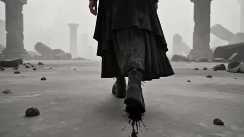</a>

The 30 seconds are split into timed beats, each with one camera move and one effect, and the same character description and monochrome palette repeat in every beat so the look holds across cuts. Limiting the accents to restrained dark gold keeps the ink effects reading as one style.

Seedance 2.5 · Text-to-video · Source: [@Goodmanprotocol on X](https://x.com/Goodmanprotocol/status/2107164974078722307)

[`ink-painting`](tags.md#tag-ink-painting) [`martial-arts`](tags.md#tag-martial-arts) [`fpv-camera`](tags.md#tag-fpv-camera) [`multi-shot`](tags.md#tag-multi-shot)

<details><summary><b>Prompt</b></summary>

```text
30-second ultra-realistic cinematic anime action sequence. One consistent female protagonist: messy black-gray short hair, gray/off-white technical jacket, dark layered long skirt, chunky platform shoes, slender slightly androgynous build, calm and emotionless. Vast empty gray-white stone landscape, pale mist, broken pillars and debris.

0–5s — INK STEP
Ultra-low rear tracking shot. She calmly walks forward. As her foot touches the ground, black ink spreads across the stone with thin dark-gold cracks. She suddenly accelerates, transforming into a fast flying black-and-white brushstroke as the camera races behind her.

5–10s — WATER MIRROR
She stops instantly. Her hair and clothes continue moving from inertia. She raises one hand and thin transparent water layers appear around her like floating glass. She closes her fingers; the layers collapse inward and crush a distant stone pillar into fragments.

10–15s — INK PALM
She makes one small forward palm movement. Black ink and dark-gold energy compress into a tiny core, then explode into a huge pressure wave of ink, mist, water and debris. The camera flies backward through the impact.

15–20s — INK LOTUS
She rises into the air. Black ink and water droplets orbit around her as a giant Chinese ink lotus forms around her body. The petals open with powerful spatial shockwaves, lifting stones and dust into the air.

20–25s — FIVE ELEMENTS
She suddenly disappears. Extreme FPV pursuit through the landscape: water becomes flowing ink streams, wood becomes white brushstrokes, fire becomes golden ink, metal becomes geometric dark-gold fractures, and earth becomes floating stone fragments. Everything remains in one elegant Chinese ink-painting style.

25–30s — FINAL IMPACT
She dives toward the ground and stops just above it. Everything freezes. She calmly points downward. A massive black, white and dark-gold circular shockwave erupts, transforming the entire landscape into a living Chinese ink painting. The energy reverses and disappears. She lands and simply continues walking forward, leaving one thin black ink trail behind her.

STYLE: ultra-realistic cinematic anime, realistic human proportions, physically believable movement, aggressive FPV camera, dynamic motion blur, Chinese ink brushwork integrated into reality, monochrome gray-white palette with black ink and restrained dark-gold accents, dramatic lighting, 4K, no weapons, no text, no subtitles, no logos, no watermark.
```

</details>

<a id="seedance-apocalyptic-warrior-sphynx-cat-transformation"></a>
### Warrior and Sphynx cat fall onto ruined rooftop

<a href="https://x.com/AvelyrahnAI/status/2104086835081416893">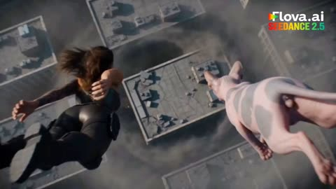</a>

The prompt is split into timed beats (fall, landing, armour snap, transformation, charge) so the model follows one action at a time. Concrete cues such as orange energy lines, a hairless Sphynx cat and a tornado backdrop lock in the look.

Seedance 2.5 · Text-to-video · Source: [@AvelyrahnAI on X](https://x.com/AvelyrahnAI/status/2104086835081416893)

[`apocalyptic`](tags.md#tag-apocalyptic) [`armor-transformation`](tags.md#tag-armor-transformation) [`sphynx-cat`](tags.md#tag-sphynx-cat) [`action-scene`](tags.md#tag-action-scene)

<details><summary><b>Prompt</b></summary>

```text
Cinematic 4K shot, a fierce female warrior with long hair and tactical leather gear falling from the sky alongside a hairless Sphynx cat onto a cracked, ruined concrete rooftop in an apocalyptic city with a massive tornado spinning in the background. The warrior lands on one knee, summons glowing golden energy in her palm, and strikes the ground. Intricate sci-fi nano-armor plates instantly snap and wrap around her arms and body, glowing with bright orange energy lines. The small Sphynx cat suddenly transforms into a massive, terrifying horned cybernetic beast. The armored female warrior and the monstrous beast charge forward together, unleashing power against the chaos.
```

</details>

<a id="seedance-bankai-ice-freeze-god-speed"></a>
### Swordswoman faces colossal robed figure in industrial yard

<a href="https://x.com/itxsarmadd/status/2104896303625105834">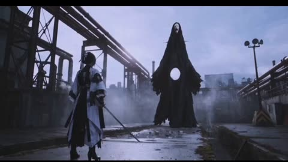</a>

A continuity lock and a bankai lock fix the character, the location and the giant's scale across both scenes, and limit the effects to physical ice behaviour with no beams or magic. Each scene is written as an ordered beat list that ends on a stated final frame, which gives the model a clear handoff between the two clips.

Seedance 2.5 · Text-to-video · Source: [@itxsarmadd on X](https://x.com/itxsarmadd/status/2104896303625105834) · found via [LearnPrompt/awesome-seedance](https://github.com/LearnPrompt/awesome-seedance)

[`ice-effects`](tags.md#tag-ice-effects) [`samurai`](tags.md#tag-samurai) [`continuity-lock`](tags.md#tag-continuity-lock) [`giant-creature`](tags.md#tag-giant-creature)

<details><summary><b>Prompt</b></summary>

```text
Duration: 20s (2×10s)
Format: 16:9 | 24fps
Style: Ultra-photorealistic live-action Japanese supernatural action, premium Hollywood cinematography, grounded realism, physically believable ice effects, cinematic blue-hour atmosphere.

CONTINUITY LOCK

- Fusia = exact same identity throughout.
- Fully manifested Bankai from Scene 1 onward.
- Same abandoned hydroelectric maintenance station.
- Same Fusia–Boncoz spatial axis.
- Direct continuity between both scenes.
- Boncoz remains colossal (3–4× human height).

BANKAI LOCK

- Hakka no Togame = environmental temperature collapse.
- No beams, projectiles, energy waves, teleportation, or magical auras.
- Ice spreads physically through water, concrete, metal, moss, and machinery.
- Real crystalline material behavior only.

SCENE 1 — ENVIRONMENTAL FREEZE

Fusia faces Boncoz across the abandoned maintenance yard and calmly declares, "Bankai... Hakka no Togame." Temperature rapidly collapses. Water crystallizes, puddles freeze, pipes and machinery gather frost, and ice spreads naturally through connected surfaces. A ground-level freezing front races across the yard toward Boncoz. The colossal creature struggles as thick crystalline ice climbs over his feet, legs, torso, shoulders, and arms. Final frame: Boncoz remains standing, fully encased in ice except for his exposed head, while Fusia stands composed in fully manifested Bankai.

SCENE 2 — GOD SPEED FINISHING SLASH

Continue directly from Scene 1. Fusia locks eyes on Boncoz, tightens her grip on the crystalline katana, and drops into a launch stance. God Speed activates through one explosive acceleration burst, carrying her instantly across the battlefield. Upon reaching Boncoz, time shifts into cinematic slow motion as she delivers a full-body finishing slash through the frozen giant. Massive fractures erupt through the existing ice shell and spread across his colossal body. Fusia finishes in a low stance as cracks multiply. The fracture network reaches Boncoz's exposed head, freezing it completely. A final catastrophic fracture tears through the entire frozen structure and Boncoz explodes into countless crystalline ice shards while Fusia remains motionless amid the falling debris.

AUDIO

No music. Cold wind, dripping water, ice crystallization, cracking frost, Boncoz's struggle, God Speed acceleration, impact shockwave, ice fracture, and shattering debris.

NEGATIVE

anime, cartoon, game graphics, glossy CGI, plastic skin, AI faces, energy beams, magical projectiles, teleportation, shrinking scale, repeated freezing, frozen poses, daylight, dead frames, unnecessary pauses.
```

</details>

<a id="seedance-batman-batmobile-anime-sequence"></a>
### Hooded hacker eats pizza over rainy city

<a href="https://x.com/Kashberg_0/status/2087734863311081770">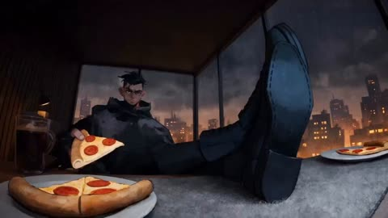</a>

A JSON timeline with a frame stamp every 48 frames at 24 fps gives each beat its own moment, so the model moves in order from the hacker's room to the Batmobile chase. Short single-subject beats with one action each keep the sequence readable.

Seedance 2.5 · Text-to-video · Source: [@Kashberg_0 on X](https://x.com/Kashberg_0/status/2087734863311081770)

[`anime`](tags.md#tag-anime) [`batman`](tags.md#tag-batman) [`batmobile`](tags.md#tag-batmobile) [`timeline`](tags.md#tag-timeline)

<details><summary><b>Prompt</b></summary>

```text
{
  "video_generation_payload": {
    "resolution": "4K",
    "fps": 24,
    "base_style": "Cinematic anime, masterpiece",
    "sequence": [
      {
        "frame": 0,
        "prompt": "Hacker in black hoodie eating pizza at desk in dark room."
      },
      {
        "frame": 48,
        "prompt": "Boots on desk, monitor displaying red anime face."
      },
      {
        "frame": 96,
        "prompt": "Hands typing on keyboard, surveillance monitors behind."
      },
      {
        "frame": 144,
        "prompt": "Yellow roses on desk, armored suit in illuminated closet."
      },
      {
        "frame": 192,
        "prompt": "Close-up tactical black armor, armored fist clenching."
      },
      {
        "frame": 240,
        "prompt": "Batman cowl with glowing white eyes."
      },
      {
        "frame": 288,
        "prompt": "Batman approaches jet-powered Batmobile in wet bunker."
      },
      {
        "frame": 336,
        "prompt": "Cockpit interior, hands on throttle, boot on gas pedal."
      },
      {
        "frame": 384,
        "prompt": "Batmobile jet engines ignite, launching from tunnel."
      },
      {
        "frame": 432,
        "prompt": "Batmobile drifting through rain-slicked neon city."
      },
      {
        "frame": 480,
        "prompt": "Batman diving straight down a towering skyscraper."
      },
      {
        "frame": 528,
        "prompt": "Batman leaping across rainy city rooftops."
      },
      {
        "frame": 576,
        "prompt": "Batman standing on gargoyle overlooking glowing city."
      }
    ]
  }
}
```

</details>

<a id="seedance-bearded-warrior-frozen-temple-boss"></a>
### Bearded warrior kneels in frozen temple

<a href="https://x.com/Xaroon_x/status/2098778827283394729">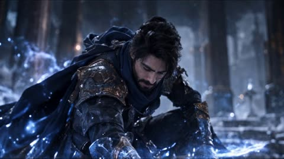</a>

Each reference image gets one job: image 1 locks the main character's face and costume, image 2 locks the second character, and image 3 supplies only camera angles, framing and choreography. Repeating the identity lock as a list of NO rules keeps the face and armour from drifting across shots.

Seedance 2.5 · Reference-to-video · Source: [@Xaroon_x on X](https://x.com/Xaroon_x/status/2098778827283394729) · found via [LearnPrompt/awesome-seedance](https://github.com/LearnPrompt/awesome-seedance)

[`dark-fantasy`](tags.md#tag-dark-fantasy) [`soulslike`](tags.md#tag-soulslike) [`reference-images`](tags.md#tag-reference-images) [`boss-fight`](tags.md#tag-boss-fight)

<details><summary><b>Prompt</b></summary>

```text
AAA PRE-RENDERED GAME CINEMATIC | DARK FANTASY WUXIA | SOULSLIKE BOSS FIGHT | ULTRA-PHOTOREALISTIC CGI | SEEDANCE OPTIMIZED

REFERENCE PRIORITY — STRICT:

REFERENCE IMAGE 1 = MAIN CHARACTER: MALE TIDE REAVER

Use Reference Image 1 as the absolute and permanent identity reference for the main character, Male Tide Reaver.

Preserve his exact same face throughout the entire video with NO FACE CHANGE.

Maintain:

exact facial identity,

exact facial structure,

same eyes,

same eyebrows,

same nose,

same beard,

same hairstyle,

same hair length and shape,

same masculine features,

same skin tone,

same body proportions.

His identity must remain perfectly consistent in every shot, camera angle, action pose, slow-motion shot and close-up.

NO identity drift.

NO face replacement.

NO face morphing.

NO gender change.

NO hairstyle change.

REFERENCE IMAGE 2 = GATOTKACA CYBER-RONIN ASSASSIN

Use Reference Image 2 as the absolute and permanent identity reference for Gatotkaca Cyber-Ronin Assassin.

Preserve his exact same:

armor,

helmet,

flaming horns,

mask,

facial structure,

body proportions,

silhouette,

accessories,

materials,

colors,

robes,

weapon design,

giant ancient sword.

No armor change.

No weapon change.

No horn change.

No identity drift.

REFERENCE IMAGE 3 = CINEMATIC STORYBOARD REFERENCE

Use Reference Image 3 exclusively as the storyboard, cinematic composition, shot design, camera angle, framing, pacing, action staging and visual sequence reference.

Follow the cinematic structure and shot progression of Reference Image 3.

IMPORTANT:

Reference Image 3 controls ONLY:

camera angles,

cinematic composition,

shot framing,

character positioning,

action choreography,

movement direction,

scene progression,

pacing,

slow-motion moments,

environmental destruction continuity.

Do NOT copy the character identities from Reference Image 3.

The characters must always remain:

Reference Image 1 = Male Tide Reaver.

Reference Image 2 = Gatotkaca Cyber-Ronin Assassin.

CHARACTER COSTUME RULE — STRICT:

Male Tide Reaver must wear the exact same armor, clothing, outfit layers, cloak, accessories, materials, colors and overall silhouette shown in Reference Image 1.

Gatotkaca must wear the exact same armor, clothing, robes, helmet, horns, accessories, materials, colors and overall silhouette shown in Reference Image 2.

DO NOT change their clothing to match different characters from the storyboard.

Instead:

Keep Reference Image 1 and Reference Image 2 character identities and costumes exactly the same while recreating the cinematic poses, camera shots and action choreography from Reference Image 3.

STYLE:

AAA dark fantasy cinematic realism.

Sekiro × Ghost of Tsushima × Black Myth Wukong × Final Fantasy XVI CGI cinematic.

Ultra-photorealistic pre-rendered game cinematic.

No anime.

No cel shading.

No gameplay.

No HUD.

No UI.

No subtitles.

No text.

No logos.

ENVIRONMENT:

A colossal ancient Japanese mountain temple interior during winter.

The entire battle takes place indoors.

Massive wooden pillars.

Ancient stone flooring.

Weathered beams.

Large ceremonial lanterns.

Colossal guardian statues.

Tattered banners.

Open temple architecture revealing a raging snowstorm outside.

Cold moonlight pours through openings.

Snow continuously drifts into the temple.

Floor contains snow accumulation, ice patches, water puddles, cracked stone and battle debris.

Every footprint remains visible.
```

</details>

<a id="seedance-black-sedan-golden-hour-highway-chase"></a>
### Black sedan chase on golden hour highway

<a href="https://x.com/Xaroon_x/status/2107838928992489968">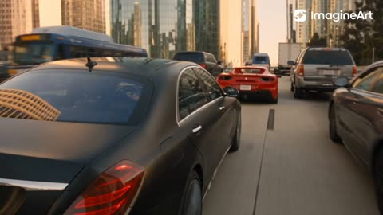</a>

A timed shot list gives each beat its own lens, camera move and slow-motion cue, so the model cuts through the sequence in order. An @image1 reference locks the hero's face and clothing across every shot, and the shared style block keeps the look consistent.

Seedance 2.5 · Reference-to-video · Source: [@Xaroon_x on X](https://x.com/Xaroon_x/status/2107838928992489968)

[`car-chase`](tags.md#tag-car-chase) [`shot-list`](tags.md#tag-shot-list) [`reference-image`](tags.md#tag-reference-image) [`slow-motion`](tags.md#tag-slow-motion)

<details><summary><b>Prompt</b></summary>

```text
30 seconds | 16:9 | image1 = Main Character

STYLE:** Hollywood blockbuster action. Photorealistic live-action, anamorphic ARRI ALEXA LF look, real stunt photography, natural motion blur, light film grain. Golden-hour sun from camera-left throughout. Slow motion only at the two crashes.

**CHARACTERS:** Hero = exact character from @image1 (same face, hair, build, clothing in every shot). His car: black modern Mercedes sports sedan. Chasers: red sports coupe and matte-grey SUV. Black rifle on the passenger seat.

**LOCATION:** Packed city road with buses, trucks and overpasses, opening onto a long highway at golden hour.

**00:00–00:03** Low rear-quarter chase shot, 28mm, fast tracking. The Mercedes weaves at high speed through dense traffic, overtaking cars, buses and trucks. The red coupe and grey SUV are both clearly visible behind it, also overtaking through traffic. Hero faintly visible through the rear windshield.

**00:03–00:05** Close-up, 85mm, handheld push-in. @image1 hero grips the wheel, jaw tense, eyes flick to the mirror.

**00:05–00:08** Low front-quarter tracking, 28mm. The Mercedes slips through a gap between a bus and a box truck by inches, then whip pan.

**00:08–00:11** Side-profile tracking, 35mm. The Mercedes launches off a raised ramp, goes airborne and lands in a shower of sparks, cones scattering.

**00:11–00:14** SLOW MOTION, low rear three-quarter, 35mm, slow orbit. The hero swerves clear and the red coupe clips a truck, spins and rolls once. The whole crash stays fully in frame, clear and sharp, with glass and debris glittering in the sun. Rack focus from the Mercedes to the wreck.

**00:14–00:16** Extreme close-up, 100mm macro. His eyes in the mirror, the grey SUV small in the reflection. Smash cut.

**00:16–00:18** Wide crane-style rise, 24mm. The Mercedes bursts onto an open highway, the SUV closing in.

**00:18–00:20** Interior insert, 35mm. He steers with his left hand and grabs the rifle from the passenger seat with his right.

**00:20–00:23** Over-the-shoulder, 50mm Steadicam. He leans out of the window and aims at the SUV's front tire, with a single muzzle flash.

**00:23–00:26** SLOW MOTION, low side angle, 35mm. The tire bursts and the SUV flips and rolls across the highway in sparks and dust, fully visible. Mercedes sharp in the foreground.

**00:26–00:28** Close-up, 85mm, slow push-in. @image1 hero gives a slow, confident victory smile and a small nod.
```

</details>

<a id="seedance-blonde-mock-martial-arts-police-room"></a>
### Blonde woman mock fights officers in training room

<a href="https://x.com/sipteaandcoffee/status/2107512973292138801">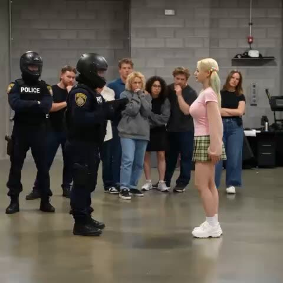</a>

A fixed wide shot and a set 17-second length keep the comedy readable, while the crowd and officers' reactions give each beat a payoff. Asking for physically believable motion keeps the slapstick from turning into floaty choreography.

Seedance 2.5 · Text-to-video · Source: [@sipteaandcoffee on X](https://x.com/sipteaandcoffee/status/2107512973292138801) · found via [LearnPrompt/awesome-seedance](https://github.com/LearnPrompt/awesome-seedance)

[`comedy`](tags.md#tag-comedy) [`martial-arts`](tags.md#tag-martial-arts) [`police`](tags.md#tag-police) [`static-camera`](tags.md#tag-static-camera)

<details><summary><b>Prompt</b></summary>

```text
Create a realistic 17-second funny action video inside a police training room. A young blonde woman in a pink fitted top, green plaid mini skirt, and white sneakers confidently faces several police officers in black tactical uniforms while a group of young people watches in the background. She suddenly performs exaggerated martial-arts moves, playful punches, dodges, spins, and dramatic defensive gestures as the officers react and attempt to restrain her. Keep the action fast, comedic, energetic, and physically believable. Static wide camera, realistic indoor lighting, natural crowd reactions, consistent characters, smooth motion, photorealistic live-action style.
```

</details>

<a id="seedance-blonde-student-hallway-energy-fight"></a>
### Blonde student surrounded by classmates in school hallway

<a href="https://x.com/AiwithElisia/status/2092119695201837059"></a>

The prompt splits the 30 second run into beats (grounded opening, energy build-up, action sequence, quiet close) and gives each its own camera language, with handheld framing for realism and slow motion reserved for the strongest strikes. Repeated constraints against text, logos and malformed anatomy keep the photoreal look stable.

Seedance 2.5 · Text-to-video · Source: [@AiwithElisia on X](https://x.com/AiwithElisia/status/2092119695201837059) · found via [LearnPrompt/awesome-seedance](https://github.com/LearnPrompt/awesome-seedance)

[`cinematic`](tags.md#tag-cinematic) [`handheld-camera`](tags.md#tag-handheld-camera) [`superhero-action`](tags.md#tag-superhero-action) [`slow-motion`](tags.md#tag-slow-motion)

<details><summary><b>Prompt</b></summary>

```text
Create a cinematic, photorealistic 30-second live-action video set inside a modern American high school hallway lined with beige lockers. A beautiful young blonde female student with tied-back blonde hair, wearing a loose white long-sleeve top, black mini skirt, black backpack and casual shoes, walks through the crowded hallway while several students around her watch and interact with her.

Start with a natural medium shot of the girl walking between other students. Use realistic handheld camera movement, shallow depth of field, soft cinematic lighting, natural skin texture, realistic facial expressions and authentic high-school atmosphere.

As she continues walking, tension suddenly builds. A female student in a dark varsity-style jacket approaches her. The blonde girl raises her hand and mysterious pink-red energy begins glowing around her hands. Small luminous particles and sparks appear in the air. The energy gradually becomes stronger, creating a supernatural aura around her body.

Transition smoothly into an intense superhero-style action sequence in the same school corridor. The blonde girl suddenly moves with extraordinary speed and power, dodging an attacking male student and striking him with glowing pink-red energy. Show dynamic martial-arts-inspired movements, fast footwork, powerful kicks and punches, with energy trails following her movements.

Use cinematic slow motion for the strongest attacks, followed by fast-paced cuts. Show students reacting and moving away in fear as the fight continues down the hallway. The glowing pink-red energy should illuminate the lockers, floor and characters realistically, with subtle volumetric light, sparks, smoke and motion blur.

Include a dramatic moment where the girl performs a powerful spinning kick while surrounded by bright pink-red energy, sending the opponent backward. Keep the choreography physically believable and visually grounded, avoiding cartoonish effects.

Near the end, the hallway becomes quiet. The glowing energy disappears and the girl calmly continues walking toward the camera as if nothing happened. End with a close-up/medium close-up of her face with a confident, serious expression.

Visual style: photorealistic Hollywood superhero movie, cinematic color grading, realistic teenage/high-school environment, detailed faces, natural skin, realistic clothing and hair physics, realistic lighting, subtle film grain, shallow depth of field, professional cinematography, dynamic camera movement, high-detail VFX, realistic particle effects, 4K cinematic quality.

Camera: handheld tracking shots, medium shots, close-ups, low-angle action shots, smooth whip-pans, controlled motion blur, occasional slow motion during attacks.

Aspect ratio: 16:9.
Duration: approximately 30 seconds.
No text, no subtitles, no logos, no watermark, no distorted faces, no extra fingers, no unnatural anatomy.
```

</details>

<a id="seedance-blue-hair-katana-duel-glass-hall"></a>
### Blue haired swordswoman duel in glass hall

<a href="https://x.com/AvelyrahnAI/status/2093540453261946900"></a>

The prompt sets one location and a tracking shot, then names each fighter's look and weapons so the choreography stays readable. Stacked effect cues (bullet time, splinters, smoke, volumetric light) push the motion across a long continuous action take.

Seedance 2.5 · Text-to-video · Source: [@AvelyrahnAI on X](https://x.com/AvelyrahnAI/status/2093540453261946900) · found via [LearnPrompt/awesome-seedance](https://github.com/LearnPrompt/awesome-seedance)

[`action`](tags.md#tag-action) [`anime-inspired`](tags.md#tag-anime-inspired) [`tracking-shot`](tags.md#tag-tracking-shot) [`bullet-time`](tags.md#tag-bullet-time) [`long-take`](tags.md#tag-long-take)

<details><summary><b>Prompt</b></summary>

```text
Cinematic action sequence, dynamic tracking shot in a modern glass-and-concrete architectural hall. A stylish anime-inspired girl with vibrant light-blue bob hair and cute blue/white hair clips wields a handgun and a katana, engaging in intense hand-to-hand combat against a nimble blonde rival armed with dual daggers. High-speed bullet-time perspective, dramatic close-ups, flying wood splinters, dynamic smoke effects, volumetric lighting, photorealistic skin texture, dramatic cinematic framing, 8k resolution, highly detailed martial arts choreography.
```

</details>

<a id="seedance-cafeteria-emerald-power-fight"></a>
### Girl summons green energy in school cafeteria

<a href="https://x.com/Strength04_X/status/2096147092188311749">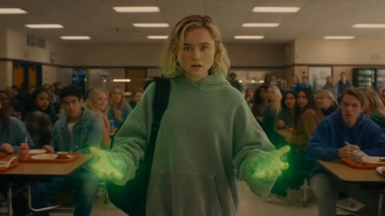</a>

The prompt reads as a shot list, with a handheld walk, a beat-by-beat power-up and a fight where each beat gets its own camera move. Fixed wardrobe and setting details keep the character consistent across cuts.

Seedance 2.5 · Text-to-video · Source: [@Strength04_X on X](https://x.com/Strength04_X/status/2096147092188311749) · found via [LearnPrompt/awesome-seedance](https://github.com/LearnPrompt/awesome-seedance)

[`superhero`](tags.md#tag-superhero) [`school-cafeteria`](tags.md#tag-school-cafeteria) [`energy-powers`](tags.md#tag-energy-powers) [`handheld-camera`](tags.md#tag-handheld-camera)

<details><summary><b>Prompt</b></summary>

```text
Create a cinematic, photorealistic 30-second live-action video set inside a modern American high school cafeteria during lunch. A beautiful young female student with shoulder-length blonde hair, wearing a loose gray hoodie, dark jeans, white sneakers and a black backpack, walks between crowded tables while students eat, talk and interact around her.

Start with a natural medium shot of the girl walking through the busy cafeteria. Use realistic handheld camera movement, shallow depth of field, warm cinematic lighting, natural skin texture, realistic facial expressions and authentic high-school atmosphere.

As she reaches the center of the cafeteria, a male student suddenly knocks a tray from her hands. She looks down for a moment before slowly raising her palms. A mysterious emerald-green energy begins glowing around her fingers. Tiny particles and sparks rise from the floor as a supernatural aura develops around her body.

Transition smoothly into an intense superhero-style action sequence. The male student charges toward her, but she quickly sidesteps and moves behind him with extraordinary speed. She performs a series of precise martial-arts-inspired strikes, powerful kicks and rapid defensive movements while green energy follows her hands and feet.

Use cinematic slow motion during the strongest impact, followed by rapid handheld cuts. Students quickly leave their tables and move toward the cafeteria walls. Chairs slide across the floor while trays and cups fall naturally. Emerald light reflects realistically across tables, windows and characters, with subtle volumetric lighting, dust, sparks and motion blur.

Include a dramatic moment where the girl performs a powerful flying kick surrounded by bright emerald energy, sending the opponent backward into an empty row of tables.

Near the end, silence returns to the cafeteria. The glowing energy fades away and she calmly picks up her backpack and walks toward the doors. End with a medium close-up of her face with a calm, confident expression.

Visual style: photorealistic Hollywood superhero movie, cinematic color grading, realistic teenage/high-school environment, detailed faces, natural skin, realistic clothing and hair physics, realistic lighting, subtle film grain, shallow depth of field, professional cinematography, dynamic camera movement, high-detail VFX, realistic particle effects, 4K cinematic quality.

Camera: handheld tracking shots, medium shots, close-ups, low-angle action shots, smooth whip-pans, controlled motion blur, occasional slow motion during attacks.

Aspect ratio: 16:9.
Duration: approximately 30 seconds.
No text, no subtitles, no logos, no watermark, no distorted faces, no extra fingers, no unnatural anatomy.
```

</details>

<a id="seedance-circus-elephant-trampoline-flip"></a>
### Acrobat launched by elephant onto horse

<a href="https://x.com/sipteaandcoffee/status/2107060987157524524">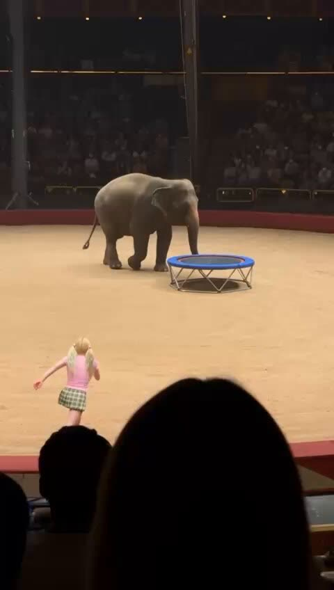</a>

The prompt is written as one audience phone recording with handheld shake and a timed beat sheet for each stage, so the stunt reads as a single continuous shot. The explicit no cuts rule and physical cues such as tucked knees and a soft landing keep the momentum and body weight believable.

Seedance 2.5 · Text-to-video · Source: [@sipteaandcoffee on X](https://x.com/sipteaandcoffee/status/2107060987157524524) · found via [LearnPrompt/awesome-seedance](https://github.com/LearnPrompt/awesome-seedance)

[`circus`](tags.md#tag-circus) [`elephant`](tags.md#tag-elephant) [`stunt`](tags.md#tag-stunt) [`handheld`](tags.md#tag-handheld)

<details><summary><b>Prompt</b></summary>

```text
Create a 15-second ultra-realistic vertical 9:16 circus performance video, filmed casually by an audience member from the seating area of a large traditional indoor circus arena.

The video should feel like a **real viral phone recording of an unbelievable live stunt**, not a polished commercial or cinematic production.

### SETTING

Inside a huge traditional circus tent with a circular **light-tan sand performance ring**, dark audience seating packed with spectators, red barriers around the arena, tall structural poles, and a dark striped circus canopy overhead.

Warm practical circus lights illuminate the center of the ring while the audience remains comparatively dark.

The bottom foreground occasionally contains **dark silhouettes of spectators’ heads and raised phones**, making it obvious that the footage is being recorded from the audience.

In the center of the arena is a **small circular trampoline with a bright blue padded rim and silver metal legs**.

### CHARACTERS

**Female Acrobat:**  
A young blonde female circus performer with an athletic build. She wears a fitted **light-pink short-sleeve top, short green plaid performance skirt, white socks and white athletic shoes**. Her blonde hair moves naturally during the flips.

**Elephant:**  
A large realistic adult gray elephant with natural wrinkled skin, heavy body movement, large ears and a long expressive trunk.

**Horse:**  
A realistic dark-brown circus horse with a black mane and tail, walking calmly around the ring.

### 0:00–0:03 — ELEPHANT LAUNCH

Begin from the audience viewpoint.

The elephant stands beside the small blue trampoline.

The blonde acrobat runs toward the elephant and trampoline.

The elephant lowers and then powerfully raises its trunk, **launching the acrobat upward into the air**.

She immediately begins rotating backward.

The action must look spectacular but physically coherent, with believable momentum and body weight.

### 0:03–0:07 — MASSIVE AERIAL FLIPS

The camera operator quickly tilts the phone upward to follow her.

The woman flies extraordinarily high above the circus ring while performing **multiple tight backward somersaults**.

Her knees tuck toward her chest, arms control her rotation, skirt and hair react naturally to the movement, and her body maintains realistic anatomy.

The elephant remains visible far below beside the trampoline, emphasizing the incredible height.

Allow slight handheld camera shake as the person filming struggles to keep her centered.

### 0:07–0:10 — HORSE ENTERS

While she continues flipping through the air, a **dark-brown horse calmly enters beneath her** and walks across the circus ring.

The acrobat gradually opens her body from the tucked rotation and prepares for landing.

The camera pans and tilts downward with her trajectory.

### 0:10–0:12 — PERFECT LANDING

She completes the final rotation and lands **upright with both feet directly on the horse’s back** while the horse continues moving forward.

The landing is surprisingly smooth.

Her knees bend naturally to absorb the impact before she straightens her body and regains perfect balance.

No cuts during the stunt.

### 0:12–0:15 — TRIUMPHANT FINISH

Standing confidently on the moving horse, she raises **both arms wide in a victorious circus pose**.

The horse continues calmly walking around the arena.

The elephant can still be seen moving in the background.

Audience members react enthusiastically, with silhouettes and phones appearing along the bottom of the frame.

Near the final moment, the performer gives a small respectful bow while remaining balanced on the horse.

### CAMERA STYLE

Single continuous audience phone recording.

Vertical **9:16 framing**.

Camera position stays within the spectator seating rather than entering the circus ring.
```

</details>

<a id="seedance-coastal-crime-game-livestream-facecam"></a>
### Coastal crime game livestream with streamer facecam

<a href="https://x.com/QAiStudio/status/2099363620325048805"></a>

A fixed HUD with a facecam locked to a reference image, English chat and a timed beat list give each seconds range one action and one HUD change. A strict rules list caps characters, weapons and endings so the long take stays consistent across the 30 second opening and 15 second continuation.

Seedance 2.5 · Reference-to-video · Source: [@QAiStudio on X](https://x.com/QAiStudio/status/2099363620325048805) · found via [LearnPrompt/awesome-seedance](https://github.com/LearnPrompt/awesome-seedance)

[`gameplay`](tags.md#tag-gameplay) [`livestream`](tags.md#tag-livestream) [`hud`](tags.md#tag-hud) [`long-take`](tags.md#tag-long-take) [`photorealistic`](tags.md#tag-photorealistic)

<details><summary><b>Prompt</b></summary>

```text
Photorealistic fictional open-world coastal crime-action gameplay livestream, 16:9, one continuous 45-second take split into a 30-second opening plus a seamless 15-second continuation. Fixed full-screen game HUD throughout: bottom-right square pink-blue neon facecam of HANEUL only, matching the supplied reference image exactly; fixed HUD, English-only scrolling live chat on the left, Korean streamer speech only with no subtitles, third-person chase camera, no cuts, no transitions, no scene changes, no duplicate characters.

0–8s: Player drives a dark muscle car through a neon coastal city at dusk toward a GPS destination; HANEUL is calm and focused in facecam, with engine, city ambience, faint radio, and keyboard/mouse sounds.

8–15s: At a warehouse, exactly two dark-red-jacket gang enemies emerge from cover, draw pistols, and ambush the player. The player dives behind a car, is visibly grazed, health drops, and wanted level rises to two stars. HANEUL reacts in shocked Korean.

15–24s: Intense reckless firefight. Player uses one compact SMG; enemies use pistols only. A flanking enemy shatters a nearby car window, bullets dent the car and pop a tire, ammo falls from 38/120 toward 24/120, wanted level reaches three stars, and distant police cruisers appear only in the background.

24–30s: Player fires five deliberate SMG shots with visible sequential hit reactions; both enemies fall only after being hit. Ammo drops exactly from 24/120 to 14/120. HANEUL remains wide-eyed and tense; police sirens close in.

30–38s: With both enemies down, the player limps into the damaged muscle car with a shredded tire. Two police cruisers pursue in the background as the car lurches forward on its rim. Health remains critically low and flashing red; wanted level stays at three stars.

38–45s: Player scrapes through a narrow alley, knocks off both mirrors, and reaches a side street where traffic briefly blocks the police. The wanted level remains flashing at three stars, police lights remain visible in the rearview, and the ending stays unresolved.

Strict rules: HANEUL appears only in the bottom-right fixed facecam; exactly one player and two gang enemies; no extra armed characters; no full-screen facecam; no subtitles; English-only HUD/chat text; no weapon swaps; no gore; no victory, clean escape, black screen, or end card.
#flovacpp #flovaai
```

</details>

<a id="seedance-concert-outbreak-short-film"></a>
### Concert crowd facing stage under magenta stage light

<a href="https://x.com/auqibhabib/status/2108459477649543194">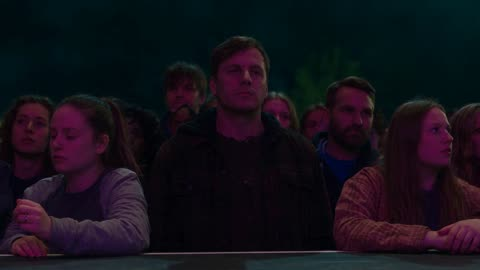</a>

Each second is a timestamped beat with its own action, and a CHARACTER LOCK line keeps the guitarist identical across shots. Camera, grading and sound rules are stated once in a global block so the model gets pacing and audio cues without repeating them per shot.

Seedance 2.5 · Text-to-video · Source: [@auqibhabib on X](https://x.com/auqibhabib/status/2108459477649543194) · found via [LearnPrompt/awesome-seedance](https://github.com/LearnPrompt/awesome-seedance)

[`horror`](tags.md#tag-horror) [`multi-shot`](tags.md#tag-multi-shot) [`concert`](tags.md#tag-concert) [`sound-design`](tags.md#tag-sound-design)

<details><summary><b>Prompt</b></summary>

```text
Cinematic horror-action short film set at an outdoor music concert at night, opens with an instant hook, grounded realistic style, maximum dynamic camera work. Setting: a concert stage with lights and speakers, a large crowd of attendees facing the stage, a live band performing. CHARACTER LOCK: the main character is a guitarist on stage, mid-20s, leather jacket, consistent in every shot. Muted concert-lighting color grading with colorful stage lights cutting through darkness, natural diegetic sound throughout, tension score entering immediately.
>
> **[0-1s]** Hard cut: a man in the crowd suddenly collapses, convulsing hard near the front barrier.
>
> **[1-2s]** Nearby fans back away in confusion as his skin pales and veins darken rapidly.
>
> **[2-3s]** He rises fast, lunging at the person beside him, pulling her down into the crowd.
>
> **[3-4s]** Screaming erupts near the stage, the crowd pushing back in a wave of panic.
>
> **[4-5s]** She convulses hard, rising seconds later alongside him, both turning toward the crowd.
>
> **[5-6s]** The guitarist on stage stops playing, staring down in alarm as the chaos spreads below.
>
> **[6-7s]** More people fall and rise infected, the front section of the crowd dissolving into chaos.
>
> **[7-8s]** Security guards rush in, trying to hold a line, but the infected break through fast.
>
> **[8-9s]** One infected climbs onto the stage, lunging toward the drummer.
>
> **[9-10s]** The guitarist grabs a stage prop knife used in their performance, gripping it tightly.
>
> **[10-11s]** He steps in, driving the infected back with a firm strike, giving the drummer room to escape.
>
> **[11-12s]** A second infected climbs up from the side, lunging toward the guitarist.
>
> **[12-13s]** He pivots fast, deflecting its grab and countering with a sharp strike.
>
> **[13-14s]** It staggers back off the stage edge, falling into the crowd below.
>
> **[14-15s]** SLOW MOTION insert: a third infected lunges at him from the opposite side.
>
> **[15-16s]** He spins, striking it down with a decisive motion, clearing the stage.
>
> **[16-17s]** Wide shot: security finally regains ground, pushing the remaining infected back from the stage area.
>
> **[17-18s]** The guitarist helps the rest of the band off the stage through a side exit.
>
> **[18-19s]** Fans stream out through the venue's main gates, security guiding them to safety.
>
> **[19-21s]** Wide shot: the stage now empty except for scattered equipment, lights still flashing colorfully overhead.
>
> **[21-23s]** The guitarist checks on his bandmates backstage, all accounted for and safe.
>
> **[23-25s]** He sets the prop knife down, hands trembling slightly, catching his breath.
>
> **[25-27s]** Security personnel secure the venue perimeter, confirming the area is clear.
>
> **[27-29s]** The band stands together backstage, exchanging exhausted but relieved glances.
>
> **[29-30s]** Final shot: the guitarist looks out at the now-empty stage through a gap in the curtain, stage lights still glowing. Cut to black.
>
> Natural diegetic sound throughout — convulsing, screaming, music cutting out, crowd noise, heavy breathing — layered with a tense instrumental score building through the chaos and easing into relief at the end. No text overlay, no watermark. Maximum dynamic camera variety — close-ups, wide shots, tracking shots, slow motion reserved for the final stage encounter. Realistic shake only during physical impacts, colorful concert stage lighting against darkness. @SocialSight
```

</details>

<a id="seedance-convenience-store-number-four"></a>
### Woman outsmarts three men outside a convenience store

<a href="https://x.com/aiwithaly/status/2106981702677451248"></a>

The prompt scripts the 30 seconds as ordered beats, with each line of dialogue and each move in its own sentence. Physics terms like momentum, inertia and leverage, plus a long negative list and an ambience and impact only sound brief, keep the choreography grounded.

Seedance 2.5 · Text-to-video · Source: [@aiwithaly on X](https://x.com/aiwithaly/status/2106981702677451248) · found via [LearnPrompt/awesome-seedance](https://github.com/LearnPrompt/awesome-seedance)

[`action-thriller`](tags.md#tag-action-thriller) [`dialogue`](tags.md#tag-dialogue) [`choreography`](tags.md#tag-choreography) [`night`](tags.md#tag-night) [`korean`](tags.md#tag-korean)

<details><summary><b>Prompt</b></summary>

```text
Create an exactly 30-second, 16:9, 24fps hyper-realistic Korean live-action action thriller with dry dark comedy. Nighttime outside a modern Korean convenience store, wet pavement reflecting storefront lights.

PYONA exits carrying a small paper bag. Three intimidating adult men surround her. The leader says, “You have three choices: give us your phone, apologize, or fight.”

PYONA calmly studies the gap between them and says, “I'll take number four.” She walks through the opening and adds, “You leave.” The leader's smile disappears.

He grabs her forearm. She looks at his hand and says, “That was the wrong answer.” When he pulls her, she steps toward him, rotates with his force and redirects his momentum into the convenience-store door.

A second man charges with a punch. PYONA sidesteps and redirects him into the first man. A third attacks from behind; she steps aside and redirects him into stacked plastic crates, which collapse from the collision.

The three men freeze. The leader asks, “Who are you?” PYONA calmly replies, “I already told you.” She picks up her bag, walks past them, then looks back and says, “Number four.”

Cut to black.

Use grounded physical choreography: realistic weight, momentum, inertia, friction, leverage, balance and collision reactions. PYONA wins through timing and redirection, never superhuman strength.

Controlled cinematic camera with consistent screen direction and clear full-body framing during physical actions. Natural nighttime ambience and realistic impact sounds only. No music or narration.

Negative prompt: supernatural strength, flying bodies, wire-fu, invisible force, impossible throws, premature falls, teleportation, duplicate characters, appearance drift, costume changes, location changes, excessive camera shake, exaggerated slow motion, cartoon physics, blood, gore, weapons, broken bones, head impacts, logos, watermark.
```

</details>

<a id="seedance-crimson-flashpoint-armored-hero-rain-fight"></a>
### Armored hero fights masked men in neon rain

<a href="https://x.com/Xaroon_x/status/2110248837432439129"></a>

The prompt splits 48 seconds into twelve timed 4 second shots, each with one camera move and one action beat. Fixed blocks for location, hero, enemies, audio, continuity and negatives keep identity and armor stable, and the hero is locked to a reference image.

Seedance 2.5 · Reference-to-video · Source: [@Xaroon_x on X](https://x.com/Xaroon_x/status/2110248837432439129) · found via [LearnPrompt/awesome-seedance](https://github.com/LearnPrompt/awesome-seedance)

[`superhero`](tags.md#tag-superhero) [`action`](tags.md#tag-action) [`multi-shot`](tags.md#tag-multi-shot) [`rain`](tags.md#tag-rain) [`cinematic`](tags.md#tag-cinematic)

<details><summary><b>Prompt</b></summary>

```text
CRIMSON FLASHPOINT — 48 seconds, 16:9, 12 shots × 4 seconds. Photorealistic Hollywood superhero action film, ARRI ALEXA 65, anamorphic look, subtle film grain.

LOCATION: Rain-soaked neon downtown intersection at night, glass skyscrapers, abstract cyan/magenta/amber signs, reflective wet asphalt, steam grates, parked cars, dark alley on the right. Heavy rain throughout; crimson is the dominant accent.

HERO (@image1): Preserve identical face, hair, beard, skin tone, age, and build in every shot. Original outfit before transformation; afterward, matte-black articulated armor with glowing crimson seams across ribs, arms, legs, and spine, segmented chest plate with a faint red core, fingerless armored gloves. No helmet or cape; face fully visible.

ENEMIES: Exactly three masked men in black tactical jackets, cargo pants, grey gloves, and matte-black full-face masks. Man 1 is tall and lean with a steel baton; Man 2 is broad with a crowbar; Man 3 has a medium build and baton. No dialogue.

SHOT 01 (00–04): Extreme-wide low-angle skyline under storm clouds. A bright crimson streak cuts diagonally through the sky, illuminating rain and glass towers.

SHOT 02 (04–08): Fast overhead tracking follows the falling streak toward street level. A faint human silhouette appears inside the light as crimson reflections sweep across the road.

SHOT 03 (08–12): Hero lands in a one-knee, one-fist crouch in his original outfit. Water explodes outward; red energy threads crawl across his arms and torso.

SHOT 04 (12–16): Smooth 360° orbit as crimson energy assembles the black armor panel by panel. The chest plate locks into place and red seams ignite.

SHOT 05 (16–20): 85mm close-up. Rain beads on his face and armor; a red spark flickers in his eyes as he looks forward with controlled determination.

SHOT 06 (20–24): Low side-tracking shot. Fully armored hero sprints down the wet street at superhuman speed, spraying water and leaving a thin crimson trail.

SHOT 07 (24–28): Over-the-shoulder shot. Three masked men emerge from the right-side alley, spreading out with weapons ready. Hero skids to a defensive stop.

SHOT 08 (28–32): Hero dashes forward as a crimson blur and strikes Man 1, launching him backward. Rain and water burst outward in slow motion.

SHOT 09 (32–36): Man 2 swings his crowbar. Hero ducks, spins, and lands one strike, sending him sliding through a puddle toward a parked car.

SHOT 10 (36–40): Man 3 lunges with his baton. Hero dodges inches away and delivers a powerful palm strike, blasting him backward through an explosive ring of water. Bright crimson flash at impact.

SHOT 11 (40–44): Wide low-angle pull-back. Hero stands calmly between all three fallen attackers as rain pours over his armor and crimson seams gradually dim.

SHOT 12 (44–48): Extreme close-up of the hero lifting his head with quiet confidence. A tiny red spark crosses his eyes before the image cuts to black.

AUDIO: Original cinematic orchestral-synth score, heavy rain, electrical crackle, realistic impacts, water splashes, accelerating percussion, and a powerful musical peak at Shot 10. No dialogue.

CONTINUITY: Maintain exact hero identity, armor design, enemy count, location layout, lighting, and screen direction across all shots. Realistic physics, consistent rain, natural motion blur, controlled speed ramps, clean cuts, and stable camera movement.

NEGATIVE: Cartoon, artificial CGI appearance, plastic skin, face changes, inconsistent armor, extra characters, duplicate bodies, extra fingers, deformed hands, cape, helmet, yellow accents, lightning-bolt emblem, blood, gore, impossible physics, random camera movement, jitter, flicker, readable text, logos, or watermark.
```

</details>

<a id="seedance-cyberpunk-infiltration-sequence"></a>
### Hooded operative overlooks rain-soaked neon metropolis

<a href="https://x.com/AIwithWania/status/2104539047213576643">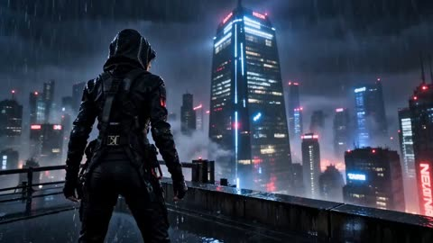</a>

The 28 second sequence is split into timecoded beats, each with one clear action and one camera move, so the model gets a shot list instead of a vague scene. A continuity line plus separate STYLE, CAMERA and QUALITY blocks repeat the look and the no subtitles or watermark rule across every segment.

Seedance 2.5 · Text-to-video · Source: [@AIwithWania on X](https://x.com/AIwithWania/status/2104539047213576643) · found via [LearnPrompt/awesome-seedance](https://github.com/LearnPrompt/awesome-seedance)

[`cyberpunk`](tags.md#tag-cyberpunk) [`neon`](tags.md#tag-neon) [`rain`](tags.md#tag-rain) [`multi-shot`](tags.md#tag-multi-shot)

<details><summary><b>Prompt</b></summary>

```text
-

Create  ultra-cinematic cyberpunk tactical infiltration sequence, shot like a high-budget futuristic action film. Photorealistic humans, realistic anatomy and movement, detailed tactical gear, neon cyan/crimson lighting, volumetric rain, wet reflections, atmospheric fog, realistic physics, anamorphic cinematography, shallow depth of field, dynamic camera movement, seamless transitions. Maintain identical characters, costumes and environment throughout.

00:00–00:03 — A vast futuristic metropolis at night, heavy rain and neon skyscrapers disappearing into mist. A female operative in a sleek wet black tactical suit and hood surveys the city. Extreme close-up of her eyes reflecting neon lights. Her male teammate checks a rugged holographic tactical tablet.

00:03–00:07 — The team attaches to a futuristic drone-deployed rappelling cable and descends a massive glass skyscraper. Dynamic aerial and low-angle tracking shots, rain streaking across reflective glass. They land silently on a balcony.

00:07–00:11 — The squad moves through an exterior glass corridor protected by horizontal red laser grids. One operative hacks a futuristic glass door using a compact electronic device. Blue electrical pulses travel through the lock; security shuts down. They enter silently.

00:11–00:16 — A massive research chamber reveals a glowing blue-white spherical energy core suspended inside a red laser lattice. The female lead scans it with her holographic tablet. Technical data and energy readings appear. Slow cinematic orbit around the core and team.

00:16–00:20 — A futuristic elevator descends into the secure facility. Red emergency lighting pulses. Doors open to reveal the three-person squad in black tactical gear. Low-angle hero shot as they step out in synchronized formation.

00:20–00:24 — The female operative extracts the brilliant blue energy core from its holographic containment field. Blue light illuminates her face and armor. She locks it inside a sophisticated metallic energy case with a mechanical click.

00:24–00:28 — Alarms erupt. Red lights flash as the squad sprints through a glass corridor and leaps from the skyscraper. Mechanical bat-like glider wings deploy from their tactical suits with realistic articulated movement. They transition from freefall into controlled flight above the neon metropolis. Camera pulls far back as the squad disappears into the storm carrying the glowing energy core.

STYLE: Photorealistic cyberpunk noir, Hollywood sci-fi action, practical-looking tactical equipment, realistic rain and water physics, wet metallic surfaces, volumetric fog, cinematic lens flares, subtle film grain, HDR, dramatic contrast, physically accurate shadows, realistic faces, hands and fabric.

CAMERA: Anamorphic lenses, wide establishing shots, extreme close-ups, low-angle hero shots, aerial tracking, handheld pursuit, smooth crane movements, dramatic push-ins, natural motion blur.

QUALITY: Ultra-detailed 4K, coherent character continuity, seamless transitions, realistic physics and anatomy. No glitches, subtitles, logos, text or watermark.

Created with Seedance 2.5.
```

</details>

<a id="seedance-cyberpunk-mecha-vs-alien-monster-battle"></a>
### Mecha fights alien monster in cyberpunk ruins

<a href="https://x.com/laviniavelle/status/2109504064186982604"></a>

The prompt opens with the setting and time of day, then introduces each combatant with distinct colors and glowing details. Verbs set the action beats in order: landing, emerging from smoke, dodging, slashing. It closes with a quality and camera line asking for fast-paced camera movement.

Seedance 2.5 · Text-to-video · Source: [@laviniavelle on X](https://x.com/laviniavelle/status/2109504064186982604) · found via [LearnPrompt/awesome-seedance](https://github.com/LearnPrompt/awesome-seedance)

[`cyberpunk`](tags.md#tag-cyberpunk) [`mecha`](tags.md#tag-mecha) [`monster`](tags.md#tag-monster) [`action`](tags.md#tag-action) [`sci-fi`](tags.md#tag-sci-fi)

<details><summary><b>Prompt</b></summary>

```text
Cinematic action sequence in a futuristic, dystopian cyberpunk city at sunset, with towering skyscrapers, glowing neon signs, and a ruined street covered in rubble and abandoned cars. A powerful, heavily armored blue and silver mecha robot with glowing blue energy blades on its arms lands heavily on the cracked asphalt, creating a cloud of dust. A massive, ferocious alien monster with red glowing eyes and spiked armor emerges from the smoke, roaring. The mecha engages in a dynamic, high-speed battle with the creature, dodging attacks, slashing with its energy swords, and sparking with electric energy. Epic movie quality, detailed textures, dramatic lighting, and fast-paced camera movement.
```

</details>

<a id="seedance-cyborg-leaps-from-movie-screen"></a>
### Woman watches cyborg in ruins on cinema screen

<a href="https://x.com/AvelyrahnAI/status/2105158267437548020">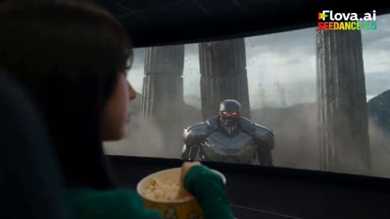</a>

Three clear beats (a theater shot, the villain leaping off the screen, then a shatter cut into a ruin) give the model an ordered sequence to follow. Specific camera direction, named effects and a concrete look for the woman keep the subject and style steady across the cut.

Seedance 2.5 · Text-to-video · Source: [@AvelyrahnAI on X](https://x.com/AvelyrahnAI/status/2105158267437548020)

[`scene-transition`](tags.md#tag-scene-transition) [`cyborg`](tags.md#tag-cyborg) [`dynamic-camera`](tags.md#tag-dynamic-camera) [`theater`](tags.md#tag-theater)

<details><summary><b>Prompt</b></summary>

```text
Cinematic 4K action sequence in a dark movie theater. A young Asian woman with long black hair and a green long-sleeve top is eating popcorn, watching a sci-fi blockbuster on screen. Suddenly, a robotic cyborg villain with glowing red eyes leaps out of the movie screen into the theater. The environment instantly shatters and transitions into an epic ancient ruin courtyard with stone columns under a stormy sky. Dynamic camera movement tracking intense hand-to-hand combat between the woman wielding swirling green magical energy and the metallic cyborg casting purple spell circles. High-budget Hollywood blockbuster aesthetics, dramatic lighting, particle effects, slow-motion impacts, and hyper-realistic textures.
```

</details>

<a id="seedance-dark-fantasy-colossus-bell-tower"></a>
### Ruined gothic monastery on cliff with rope bridge

<a href="https://x.com/Xaroon_x/status/2111403509333602431">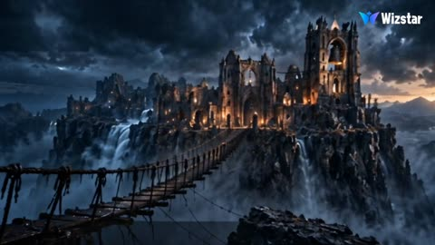</a>

A timestamped shot list gives the model a clear beat-by-beat structure, and the @image1 hero lock with explicit preserve rules keeps the character consistent across cuts. Named audio cues such as the bronze gong at 00:22 tie the sound to a specific action.

Seedance 2.5 · Reference-to-video · Source: [@Xaroon_x on X](https://x.com/Xaroon_x/status/2111403509333602431)

[`dark-fantasy`](tags.md#tag-dark-fantasy) [`monster`](tags.md#tag-monster) [`timeline`](tags.md#tag-timeline) [`reference-lock`](tags.md#tag-reference-lock)

<details><summary><b>Prompt</b></summary>

```text
THE BELL OF ASHFALL

ENGINE DIRECTIVE: Create an exactly 30-second, 16:9 photorealistic live-action dark-fantasy film, targeting 60fps where supported. Hollywood-level VFX, realistic textures, storm lighting, volumetric rain, natural motion blur, and cinematic camera movement.

HERO LOCK: @image1 is the only hero. Preserve his exact face, hairstyle, facial hair, skin tone, age, body, outfit, accessories, and weapon in every shot. No identity drift, clones, or costume changes. Keep his face recognizable.

ANTAGONIST: A 15-meter horned Cinder Colossus with black basalt skin, glowing ember-orange cracks, amber eyes, and a damaged left shoulder.

LOCATION: Ruined gothic Ashfall Monastery above a bottomless gorge, with a collapsing rope bridge, flooded courtyard, broken statues, and a timber bell tower containing a massive bronze bell.

TIMELINE:

00:00–00:05 | STORM BRIDGE
Aerial 24mm shot reveals the storm-lashed monastery. Ground-level tracking follows the hero sprinting across a swaying rope bridge. Planks snap behind him as lightning illuminates the gorge.

00:05–00:10 | THE COLOSSUS
The bridge collapses. The hero leaps, catches a hanging rope, and climbs to the cliff. The Colossus rises from the abyss, roars, and slams its enormous hand beside him.

00:10–00:15 | COURTYARD CHASE
The hero races through shin-deep water as the giant destroys statues and arches. He slides beneath a crushing fist, and a stone column shatters. He reaches the bell tower.

00:15–00:20 | THE BELL TOWER
The hero climbs unstable timber scaffolding. The Colossus punches through the tower wall, cracking beams. The hero cuts the bell's restraining rope, sending the massive bronze bell swinging outward.

00:20–00:25 | THE STRIKE
The hero jumps onto a beam as the bell swings through the breach and slams into the Colossus's chest at 00:22. Slow-motion impact, expanding shockwave, airborne rain, and glowing cracks spreading across its body.

00:25–00:30 | DAWN OF ASH
At 00:26, the Colossus explodes into stone fragments and ash, falling into the gorge. Storm clouds part as golden dawn illuminates the victorious hero. End with a cinematic close-up, drifting ash, and the humming bell.

AUDIO: Dark orchestral strings, distant choir, pounding war drums, thunder, rain, creaking wood, crushing stone, and monstrous roars. At 00:22, a powerful bronze gong triggers near-silence and a lingering resonance. Finish with hopeful choir, warm strings, and fading wind.

CONTINUITY: Grounded, readable action; progressive destruction; consistent screen direction; no extra characters, text, or logos.
```

</details>

<a id="seedance-elderly-cyclist-clears-road-game-hud"></a>
### Elderly man on bicycle clears a road in game

<a href="https://x.com/RizwanAly07/status/2099432042509606931">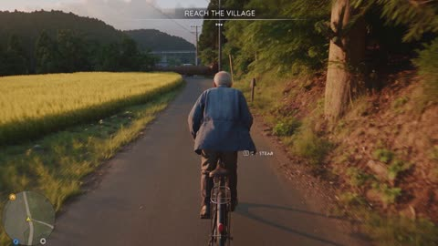</a>

Locks the character, bicycle, tree and barrier as fixed objects, then times each controller prompt and HUD message to a 3 second beat so every action reads as player input. The explicit camera rig and the ban on cinematic framing keep it reading as live gameplay rather than a movie shot.

Seedance 2.5 · Text-to-video · Source: [@RizwanAly07 on X](https://x.com/RizwanAly07/status/2099432042509606931)

[`open-world`](tags.md#tag-open-world) [`game-hud`](tags.md#tag-game-hud) [`gameplay`](tags.md#tag-gameplay) [`bicycle`](tags.md#tag-bicycle)

<details><summary><b>Prompt</b></summary>

```text
Create a 30-second vertical 9:16 video that looks like authentic gameplay from a modern ultra-realistic AAA open-world game — NOT a cinematic movie.

CHARACTER LOCK: One realistic 70-year-old Japanese man with grey hair, aged face, slightly bent posture, faded blue railway/work jacket, dark trousers and black shoes. Keep identical face, body, clothing and age throughout.

ENVIRONMENT: Beautiful rural Japanese mountain village with a narrow asphalt road, traditional houses, rice fields, dense greenery, utility poles, mountains and a distant railway. Late-afternoon natural lighting. One continuous environment.

CAMERA/HUD: Third-person gameplay camera behind the character, consistent distance, responsive to player movement. Original realistic game HUD with minimap, health/stamina and contextual controller prompts. No GTA branding/UI.

0–3s: Man rides a bicycle toward a yellow waypoint. HUD: “REACH THE VILLAGE” + L3 STEER.

3–6s: Fallen tree blocks the road. Player brakes. L2 BRAKE. Objective changes: “CLEAR THE ROAD”.

6–9s: △ DISMOUNT. He gets off and looks toward the obstacle. R3 LOOK.

9–12s: L3 MOVE + R2 SPRINT. He approaches the fallen tree with believable elderly movement.

12–15s: □ INTERACT → ← → PUSH. He physically pushes the heavy tree aside. Realistic friction and weight; no disappearing objects.

15–18s: A metal road barrier is revealed. □ INTERACT. Message: “PATH STILL BLOCKED”.

18–21s: Player opens the barrier. It swings naturally and a waiting vehicle becomes visible.

21–24s: R3 LOOK. He returns to the bicycle. △ MOUNT.

24–27s: R2 PEDAL. He cycles through the cleared road. Waypoint turns green. Objective: “ROAD CLEARED”.

27–30s: Continue riding toward the village. HUD notification: “MISSION COMPLETE — ROAD CLEARED”. End during active gameplay, no cinematic ending.

GAMEPLAY FEEL: Every action must feel player-controlled. Fast pacing with an interactive moment every 2–3 seconds. Prompts appear only when usable. Realistic bicycle physics, braking, wheel rotation, elderly movement, tree weight, barrier movement, shadows and ground contact.

STRICT CONSISTENCY: One man, one bicycle, one tree, one barrier. No duplicates, morphing, teleportation, object popping, floating/sliding, face deformation, outfit changes, environment changes, lighting/weather changes or camera teleportation.

Ultra-realistic game-engine rendering, 24fps, high detail, realistic NPC/environment behavior, no anime, no cartoon, no fantasy, no movie cinematography.
```

</details>

<a id="seedance-fire-fist-purple-dress"></a>
### Woman launches flaming fist toward camera

<a href="https://x.com/Zyrellix/status/2108498562199753052">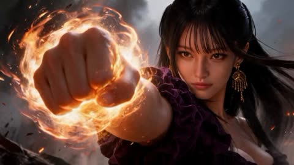</a>

The prompt lays out the shots in order, a low tracking shot, then close shots, then a wide shot, so the model can follow a clear sequence. Specific costume and hair details, plus a warm key light against a cool gray sky with volumetric smoke and anamorphic flares, lock in the cinematic look.

Seedance 2.5 · Text-to-video · Source: [@Zyrellix on X](https://x.com/Zyrellix/status/2108498562199753052) · found via [LearnPrompt/awesome-seedance](https://github.com/LearnPrompt/awesome-seedance)

[`fire`](tags.md#tag-fire) [`fantasy`](tags.md#tag-fantasy) [`fight`](tags.md#tag-fight) [`anamorphic`](tags.md#tag-anamorphic)

<details><summary><b>Prompt</b></summary>

```text
Cinematic fantasy fight, East Asian woman, long black hair with blunt bangs, gold chandelier earrings, deep-purple off-shoulder ruffled velvet dress. She thrusts a clenched fist straight at the camera, the fist wrapped in a roaring orange fireball with sparks and heat distortion. Fast low tracking shot as a streak of flame tears across scorched ground past broken wooden tank traps and barbed wire under a smoke-filled sky. She spins into a combat stance, both fists glowing, a ring of fire whipping around her as her hair lashes sideways. She launches into the air above a burning soldier, then floats at the center of radial beams of fire exploding outward like a sunburst. A massive firestorm wall rises behind her as she hovers, fists lit. Close-ups of her intense, calm face against swirling flames, then a wide shot of her standing alone in a ruined field of debris, small fires, and drifting ash, one hand still burning. Volumetric smoke, ember particles, warm orange key light against a cool gray sky, shallow depth of field on close-ups, anamorphic flares, 24fps, photoreal, high detail.
```

</details>

<a id="seedance-frost-fist-rain-alley-fight"></a>
### Woman's frost-covered fist strikes in rainy alley

<a href="https://x.com/AvelyrahnAI/status/2104427974955053532">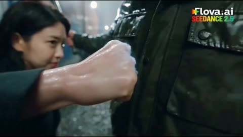</a>

The prompt is built as comma-separated clauses for location, character, combat effects, lighting and style, which keeps one clear scene for the model to hold. Setting fire explosions against frost punches gives the fight a strong contrast that reads on screen.

Seedance 2.5 · Text-to-video · Source: [@AvelyrahnAI on X](https://x.com/AvelyrahnAI/status/2104427974955053532) · found via [LearnPrompt/awesome-seedance](https://github.com/LearnPrompt/awesome-seedance)

[`night-rain`](tags.md#tag-night-rain) [`frost-fire`](tags.md#tag-frost-fire) [`fight-choreography`](tags.md#tag-fight-choreography)

<details><summary><b>Prompt</b></summary>

```text
Epic action movie sequence, dark rainy night in a narrow alleyway lined with stacked cargo containers, a fierce female fighter in a sleek black suit battling waves of aggressive opponents, high-impact combat with fiery explosions and freezing frost punches, cinematic lighting, dramatic smoke, fast-paced choreography, hyper-realistic, 4k

#Flovaai #Flovacpp
```

</details>

<a id="seedance-game-hud-hospital-mission"></a>
### Surgeon runs through hospital with game HUD

<a href="https://x.com/saniaspeaks_/status/2100429151719075851">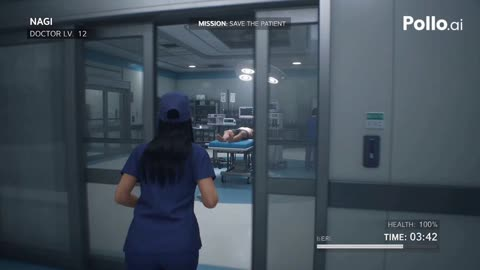</a>

The whole mission is written as timed beats, each with its own HUD text, and a single hard cut at 27 seconds, which gives the clip the structure of a game capture. Restating the outfit and hair (blue scrubs, cap, long straight black hair) next to the character reference keeps the same person across every beat.

Seedance 2.5 · Reference-to-video · Source: [@saniaspeaks_ on X](https://x.com/saniaspeaks_/status/2100429151719075851) · found via [LearnPrompt/awesome-seedance](https://github.com/LearnPrompt/awesome-seedance)

[`game-hud`](tags.md#tag-game-hud) [`hospital`](tags.md#tag-hospital) [`third person`](tags.md#tag-thirdperson) [`character-reference`](tags.md#tag-character-reference)

<details><summary><b>Prompt</b></summary>

```text
Create a 30-second ultra-realistic AAA third-person medical action game mission set inside a modern Japanese hospital, with the feel of premium GTA-style gameplay.
NAGI: Use the exact same NAGI identity and face from @ Image1 throughout. Young Japanese female surgeon with long straight black hair, blunt bangs, blue surgical scrubs, cap, mask, gloves, and hospital shoes. Perfect character consistency.

GAMEPLAY: One continuous playable third-person over-the-shoulder take from 0–27 seconds. Natural running, turning, grabbing equipment, opening doors, interacting with machines, and performing procedures. No montage or random cuts. One hard cut only at 27 seconds.

HUD throughout:
TOP LEFT: NAGI / DOCTOR LV. 12
TOP CENTER: MISSION: SAVE THE PATIENT
BOTTOM RIGHT: HEALTH: 100% / TIME: 03:42

0–4s — CHECK VITALS
NAGI rushes into the emergency room, checks the unconscious patient's unstable monitor, and connects the monitoring equipment.
HUD: OBJECTIVE 1/5 — CHECK PATIENT VITALS → OBJECTIVE COMPLETE

4–8s — STABILIZE
She connects an IV and adjusts the patient's oxygen support. The monitor becomes slightly more stable.
HUD: OBJECTIVE 2/5 — STABILIZE PATIENT → OBJECTIVE COMPLETE

8–12s — COLLECT TOOLS
NAGI runs to the preparation area, opens a medical cabinet, grabs a sterile surgical tray, receives another instrument from a nurse, and rushes back.
HUD: OBJECTIVE 3/5 — COLLECT SURGICAL TOOLS → OBJECTIVE COMPLETE

12–17s — SURGERY
She enters the operating room, positions herself beside the patient, surgical lights activate, and she performs the critical procedure with controlled, non-graphic movements.
HUD: OBJECTIVE 4/5 — COMPLETE CRITICAL PROCEDURE

17–22s — COMPLICATION
The monitor suddenly alarms and vital signs drop. NAGI immediately checks the monitor, adjusts support equipment, signals the team, and continues the procedure.
HUD: WARNING — PATIENT UNSTABLE → STABILIZE PATIENT

22–27s — SAVE PATIENT
NAGI completes the final step. The monitor becomes steady, the alarm stops, and the team relaxes.
HUD: OBJECTIVE 5/5 COMPLETE → PATIENT STABLE → SURGERY SUCCESSFUL → MISSION COMPLETE

27–30s — FINAL SHOT
One hard cut to a locked frontal gameplay-style shot outside the operating room. NAGI walks out exhausted but relieved and removes her mask while a nurse follows. Through the glass, the team monitors the patient.

Final HUD: MISSION COMPLETE / PATIENT SAVED / RANK: S

VISUAL STYLE: Photorealistic AAA game-engine graphics, realistic Japanese hospital, detailed medical equipment, natural character physics, realistic lighting, reflections, shadows, cloth and glove movement, subtle camera shake. No anime, cartoon, fantasy, superhero effects, or gore.

AUDIO: Hospital ambience, footsteps, monitor beeps, equipment sounds, emergency alarm, Japanese nurse/NAGI dialogue, and tense AAA game music building toward the mission completion.
```

</details>

<a id="seedance-garage-walk-night-action"></a>
### Woman walks through night underground parking garage

<a href="https://x.com/AiwithElisia/status/2089580979560337437">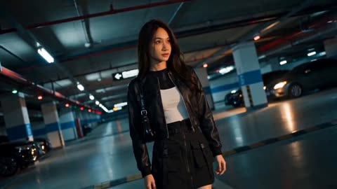</a>

The prompt opens with a clear wardrobe list and a location with lighting cues, then gives each camera move its own clause so the model can sequence them. It states outright that face, hair and outfit must stay consistent, and a closing negative list blocks common artifacts.

Seedance 2.5 · Text-to-video · Source: [@AiwithElisia on X](https://x.com/AiwithElisia/status/2089580979560337437) · found via [LearnPrompt/awesome-seedance](https://github.com/LearnPrompt/awesome-seedance)

[`martial-arts`](tags.md#tag-martial-arts) [`night`](tags.md#tag-night) [`parking-garage`](tags.md#tag-parking-garage) [`cinematic`](tags.md#tag-cinematic)

<details><summary><b>Prompt</b></summary>

```text
Create a cinematic, ultra-realistic action movie scene inside a large underground parking garage at night. A beautiful young woman with long dark brown hair, wearing a black leather jacket, fitted white crop top, black mini skirt, black tights and black ankle boots, walks confidently through the parking area. Several aggressive male attackers suddenly approach her from different directions.

She immediately fights them with fast, powerful martial-arts movements. Show realistic hand-to-hand combat, punches, blocks, dodges, kicks and throws. Include a close-up of her punching a male attacker in the face, his head reacting naturally to the impact, followed by dynamic wide shots of her fighting multiple attackers simultaneously.

Use parked black and silver cars, concrete pillars, underground parking signs, wet reflective floor and cinematic practical lighting in the background. Add dramatic blue and warm orange lighting, realistic shadows, subtle atmospheric haze and reflections on the cars.

Camera style: cinematic Hollywood action film, dynamic handheld camera, smooth tracking shots, low-angle shots, wide establishing shots, medium shots and dramatic close-ups. Add realistic motion blur during fast movements, natural hair movement, realistic clothing physics and convincing fight choreography.

The woman should remain visually consistent throughout the entire video, with the same face, hairstyle, outfit and body proportions. The attackers should also remain realistic and consistent.

Ultra-realistic human skin, detailed facial expressions, physically accurate movement, realistic anatomy, high-detail environment, cinematic depth of field, professional color grading, dramatic atmosphere, 4K, photorealistic, 24fps, anamorphic cinematic look.

No text, no subtitles, no watermark, no distorted faces, no extra fingers, no duplicated people, no unnatural body movements.
```

</details>

<a id="seedance-giant-snake-fantasy-western-chase"></a>
### Giant snake rushes past camera in ruined town

<a href="https://x.com/itxsarmadd/status/2100432617912893711">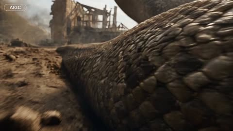</a>

A reusable character block is repeated verbatim in the prompt so faces, costumes and scale stay locked across shots. A timed shot list with low angles, tracking and gimbal moves sets the pacing, while quoted dialogue and sound cues define the audio.

Seedance 2.5 · Text-to-video · Source: [@itxsarmadd on X](https://x.com/itxsarmadd/status/2100432617912893711) · found via [LearnPrompt/awesome-seedance](https://github.com/LearnPrompt/awesome-seedance)

[`giant-snake`](tags.md#tag-giant-snake) [`low-angle`](tags.md#tag-low-angle) [`character-lock`](tags.md#tag-character-lock) [`timed-shots`](tags.md#tag-timed-shots) [`dialogue-audio`](tags.md#tag-dialogue-audio)

<details><summary><b>Prompt</b></summary>

```text
PAET 1- Create a 30-second ultra-photorealistic cinematic live-action fantasy-western sequence.

DO NOT USE AN UPLOADED REFERENCE VIDEO.

==================================================
CHARACTERS — IDENTICAL THROUGHOUT
==================================================

GIANT SNAKE:
Enormous prehistoric snake, massive muscular body and broad head, rough brown/tan/dark-olive scales, pale beige face, amber eyes with vertical pupils, realistic teeth, wet gums/saliva. Worn dark-brown/black cowboy hat.

GREEN REPTILIAN GUNSLINGER:
Small green frog/reptile humanoid, textured green skin, large bulging eyes, brown cowboy hat, rugged brown western clothing, dark-metal revolver.

DRAGON RIDER:
Rugged brown/tan clothing and protective headgear.

DRAGON:
Large dark-scaled dragon, horns/spikes, muscular body, reddish-brown/orange leathery wings. Additional dragons may appear.

Keep all characters, costumes, colors, faces, proportions and textures consistent.

==================================================
ENVIRONMENT
==================================================

Gritty western/medieval fantasy town: aged stone, dark timber, towers, rooftops, dust, smoke and debris. Bright cloudy daylight, cinematic sunlight, volumetric haze, realistic shadows and depth of field.

==================================================
SHOT SEQUENCE
==================================================

0–3s: Low-angle close-up of giant snake body rushing past camera.

3–6s: Green reptilian gunslinger on snake's back; huge snake head enters frame.

6–9s: Snake approaches the character. Tense close composition.

9–12s: Snake coils through town, pushing dust and debris.

12–15s: Snake moves through dark wooden/stone interior.

15–18s: Camera tilts toward old buildings and a swinging glass lantern.

18–22s: Bright hazy exterior with strong sunlight, dust and smoke.

22–26s: Extreme close-up of snake beneath cowboy hat; amber eye and slightly open mouth visible.

26–28s: Snake lunges toward camera; revolver becomes prominent.

28–30s: Extreme close-up of snake face with revolver in foreground.

END with snake face close to camera and revolver visible. No fade, title or black screen.

==================================================
CAMERA / AUDIO
==================================================

Energetic cinematic pacing. Low angles, tracking shots, close-ups, controlled handheld/gimbal movement, realistic optics, depth of field and motion blur.

English dialogue:
“What the hell is that?”
“Stay on him.”
“Keep moving!”
“Don’t let it see us.”
“Get ready.”

Add realistic snake movement, growls, breathing, wind, dust, wood creaks and weapon sounds. Add synchronized English subtitles.

==================================================
QUALITY
==================================================

Maximum Seedance 2.5 quality. Ultra-photorealistic live action, realistic materials, lighting and physics.

NO cartoon, anime, game graphics, plastic CGI, morphing, flickering, character changes, costume/hat changes, eye-color changes, scale changes, duplicates, extra limbs, distorted faces or unnatural physics.
```

</details>

<a id="seedance-golden-hour-lot-fight-sequence"></a>
### Golden hour parking lot fight between two women

<a href="https://x.com/Elvorya/status/2101147922251579718"></a>

The prompt chains shots with arrows, giving each a camera angle and one action beat, from over the shoulder opener to flying kick, fall and selfie style closer. A long visual style list plus a negative prompt keeps the look photoreal and the character consistent.

Seedance 2.5 · Text-to-video · Source: [@Elvorya on X](https://x.com/Elvorya/status/2101147922251579718) · found via [LearnPrompt/awesome-seedance](https://github.com/LearnPrompt/awesome-seedance)

[`action`](tags.md#tag-action) [`fight-scene`](tags.md#tag-fight-scene) [`golden-hour`](tags.md#tag-golden-hour) [`photorealistic`](tags.md#tag-photorealistic) [`multi-shot`](tags.md#tag-multi-shot)

<details><summary><b>Prompt</b></summary>

```text
Create a 15-second photorealistic cinematic action sequence featuring a stylish blonde woman in a black blazer, white fitted top, and black pants, fighting another blonde woman in an industrial urban parking/loading area during golden-hour sunset.

Begin with a dynamic over-the-shoulder shot of the main woman standing in an empty concrete industrial lot as another woman approaches rapidly in the background → cut into an extreme close-up side angle as the opponent throws a powerful punch toward her face, with the camera moving alongside the action and her blonde hair flowing dramatically in the wind → transition into a wide low-angle shot showing the main woman reacting and engaging in hand-to-hand combat → she performs a fast evasive movement and powerful spinning kick while the opponent attacks → cut to a low-angle tracking shot as both women exchange rapid punches and defensive movements beside a large industrial roller door and stacked cardboard boxes → show the main woman delivering a dramatic flying kick, captured with cinematic motion blur → transition into a wider shot as the opponent falls hard onto the concrete ground → the main woman slowly walks toward the camera while the fallen opponent remains in the background → final shot becomes an intimate handheld close-up/selfie-style shot of the main woman looking directly toward the camera, touching her hair/forehead with one hand and giving a calm, confident expression.

Visual style: photorealistic Hollywood action cinematography, realistic human anatomy, believable martial-arts choreography, natural facial expressions, realistic skin texture, detailed blonde hair movement, black-and-white fitted clothing, industrial warehouse exterior, concrete pavement, warm golden-hour sunlight, long shadows, dramatic backlighting, subtle lens flare, shallow depth of field, cinematic motion blur, dynamic handheld camera, low-angle action shots, smooth rapid transitions, realistic physics, energetic pacing, high-detail 4K cinematic look, cohesive character appearance throughout.

Negative prompt: animation, cartoon, anime, CGI appearance, unrealistic physics, distorted faces, extra fingers, malformed hands, duplicated people, warped limbs, floating objects, excessive motion blur, unnatural poses, gore, blood, subtitles, text, logos, watermark.
```

</details>

<a id="seedance-golden-knight-cathedral-demon-battle"></a>
### Golden knight defends wounded woman from cathedral demon

<a href="https://x.com/itsSaira_1/status/2111672000200724504"></a>

A 31 second timeline split into timed shots, each naming shot size, camera move and action, so the cut order stays fixed. A closing style block and a long negative list lock the architecture, armor and shield emblem across shots.

Seedance 2.5 · Text-to-video · Source: [@itsSaira_1 on X](https://x.com/itsSaira_1/status/2111672000200724504) · found via [LearnPrompt/awesome-seedance](https://github.com/LearnPrompt/awesome-seedance)

[`dark-fantasy`](tags.md#tag-dark-fantasy) [`timed-shots`](tags.md#tag-timed-shots) [`cinematic`](tags.md#tag-cinematic) [`action`](tags.md#tag-action) [`negative-prompt`](tags.md#tag-negative-prompt)

<details><summary><b>Prompt</b></summary>

```text
0–3s | Opening shot: Low-angle wide close-up of a wounded woman lying on a cracked stone floor inside a ruined Gothic cathedral. Dark horned monsters and twisting tentacles loom in the background. Slow cinematic camera movement.

3–5s | Rising movement: The woman pushes herself up from the floor, raising one arm as a bright white magical blade of light forms in her hand. Medium shot, smooth upward camera movement.

5–7s | Magical activation: She kneels and grips the vertical white energy blade touching the floor. A brilliant golden circular rune spreads beneath her, illuminating the stone floor. Low wide shot.

7–10s | Cathedral reveal: Camera tilts sharply upward, revealing towering broken Gothic arches, a shattered roof, moonlit clouds and dark creatures silhouetted above. Transition to the golden-armored warrior emerging through red smoke.

10–12s | Helmet close-up: Tight frontal close-up of a fully enclosed dark metal knight helmet, narrow black eye slit, engraved steel plates. Slow camera push-in.

12–15s | Golden knight reveal: Cut to a heroic low-angle shot of a knight wearing ornate gold-and-silver armor, carrying a large shield with a glowing golden sun emblem and a heavy war hammer. He stands inside the ruined cathedral.

15–18s | First magical attack: The knight raises his shield and releases an intense white-gold energy blast. Bright light fills the frame. Camera tracks the blast, with sparks and magical particles.

18–20s | Energy impact: The white magical blast expands into a brilliant screen-filling flash. Strong bloom, fast cinematic transition, brief motion blur.

20–23s | Demon confrontation: Wide side view of the golden knight standing firm while a huge reddish-black horned demon lunges toward him. Long claws and dark tendrils extend toward the knight. The wounded woman remains visible in the background.

23–25s | Demon attack: The demon sweeps its claws forward. A bright golden energy projectile travels across the cathedral between the creature and the knight. Dynamic lateral camera movement.

25–27s | Magical shield: The knight raises his shield as a large circular white magical barrier with intricate glowing runes forms in front of him. The demon attacks the barrier, creating rippling light and sparks.

27–31s | Final wide shot: Camera pulls back to show the entire ruined cathedral. The golden knight stands in the centre of a glowing golden rune circle, shield raised and hammer in hand. The demon recoils on the left, while the wounded woman remains on the floor behind him beside the vertical white energy blade. Smoke, floating embers, blue moonlight and golden illumination. Hold the final composition.

VISUAL STYLE: Photorealistic dark fantasy film, 16:9 widescreen, cinematic lighting, realistic armor and stone textures, cold blue shadows, warm golden highlights, volumetric smoke, dramatic contrast, consistent architecture, smooth camera movements, exact shot order and timing.

NEGATIVE PROMPT: Different shot order, altered camera angles, random cuts, changed framing, different cathedral, different character positions, inconsistent armor, changing shield emblem, extra characters, duplicated limbs, deformed anatomy, cartoon, anime, low quality, excessive blur, shaky camera, camera flip, 180-degree rotation, unnatural movement, floating weapons, text, subtitles, watermark, logos.

#AI #AIart #VisualArt
```

</details>

<a id="seedance-gym-static-martial-arts-vs-five-bullies"></a>
### Schoolgirl unleashes static martial arts on five bullies

<a href="https://x.com/doctorwasif/status/2091388398153994395"></a>

A 30 second single take is split into timed beats of three to five seconds, each with exact dialogue, a short slow motion impact and a snap back to real time. A strict rule block limits the effect to white blue static born from contact, and the camera is told to lag behind her acceleration.

Seedance 2.5 · Text-to-video · Source: [@doctorwasif on X](https://x.com/doctorwasif/status/2091388398153994395) · found via [LearnPrompt/awesome-seedance](https://github.com/LearnPrompt/awesome-seedance)

[`martial-arts`](tags.md#tag-martial-arts) [`photorealistic`](tags.md#tag-photorealistic) [`one-take`](tags.md#tag-one-take) [`handheld`](tags.md#tag-handheld) [`korean-dialogue`](tags.md#tag-korean-dialogue)

<details><summary><b>Prompt</b></summary>

```text
30s | 16:9 | one continuous generation | ultra-photorealistic live-action AAA martial-arts VFX

SO-YEON is the exact same real human throughout, 160cm small frame, messy black hair, black hoodie/sweats/Converse, natural pores/eyes/hair/biomechanics. Never CGI/digital double. Empty Korean high-school gym, late afternoon, sunbeams/dust, bleachers, scoreboard, basketballs, badminton rackets. 5 unarmed delinquent male classmates in dark untidy uniforms. Korean dialogue, no BGM/subtitles; only diegetic ambience, voices, impacts, static hiss.

00–03: So-Yeon cowers by bleachers, surrounded. Leader smacks her head: “어쭈? 이 년 봐라? 많이 컸다?” She glares coldly through bangs, then fear returns: “아…! 미안…”

03–06: He swings again.

06–09: 0.3s micro-slow-mo: awakened body autonomously slips fist → Silat parry → pivot → body punch. THUMP + sharp white-blue static flash. Hair rises, dust scatters. Snap back to real-time; leader crashes/slides away.

09–12: She stares at trembling hand, tiny static crawling between fingers, terrified/disbelieving. “저 년이?!” Four rush simultaneously.

12–17: Extreme physical dash: PARRY → wrist redirect → elbow → low sweep; side-kick second attacker. 0.2s impact slow-mo with branching static flash, hair/uniform fibers rising, papers/shuttlecocks scattering. Snap back; never stops.

17–22: Two attack together. Diagonal dash → duck hook → redirect momentum → high roundhouse. Static arc-flash at impact; hair stands up, shuttlecocks fly, scoreboard flickers.

22–27: Final attacker from behind. Maximum real-body acceleration; camera lags/overshoots, violent whip-pan reacquires. Evade → parry → redirect → jab → body punch → low kick → spinning Taekwondo back kick. 0.25s slow-mo: dense branching static at heel impact, uniform puffs, dust/paper pulled inward then blasted outward.

27–30: Violent physical discharge: KRA-KRACKLE! Static-white ring races across floor; dust/paper explode outward, fluorescent lights flicker, basketball rolls off cart. Enemy slides far away. Flash hits lens: flare/interference/dust, then rapid stabilization. So-Yeon lands, sees fading sparks on her hands, half fear/half wonder, exhales, straightens and walks calmly through dust, hair falling over eyes. Never looks back. CUT.

COMBAT: Awakened So-Yeon fights completely unarmed, calm/precise/extremely fast, fluid Taekwondo × Karate × Pencak Silat: punch → kick → evade → parry → redirect → dash → counter → sweep → palm/elbow → angle change. No reset poses; momentum continuously flows. Bullies attack simultaneously, never take turns.

STATIC BLOOM RULE: White-blue friction discharge ONLY. Real-time → physical dash burst → 0.15–0.35s impact slow-mo → snap back. Sparks crawl along skin/hair/hoodie; hair/threads lift; filaments jump between fingers/joints; dust follows slipstream. No teleportation, aura, projectile, beam, plasma, fireball, petals, or magic. Every discharge must originate from visible physical contact and extreme velocity. Impact → charge build → branching arc → dust/paper scatter. Static never causes the initial impact.

CAMERA: close, kinetic handheld pursuit, tracking, low angles, OTS/facial inserts, rapid focus shifts, whip-pans; follows but cannot perfectly anticipate acceleration. Shake only from real impacts/discharges. Action readability > chaos.
```

</details>

<a id="seedance-helicopter-news-dirt-bike-pursuit"></a>
### Helicopter news footage of a dirt bike chase

<a href="https://x.com/CharaspowerAI/status/2111517673276240251"></a>

A single helicopter viewpoint is locked with deliberate flaws like shaky zooms, compression artifacts, heat haze and late pans, so the footage reads as raw news. Six timed beats escalate the action, and rotor thump, radio chatter and a final reporter line carry the sound.

Seedance 2.5 · Text-to-video · Source: [@CharaspowerAI on X](https://x.com/CharaspowerAI/status/2111517673276240251) · found via [LearnPrompt/awesome-seedance](https://github.com/LearnPrompt/awesome-seedance)

[`aerial`](tags.md#tag-aerial) [`news-footage`](tags.md#tag-news-footage) [`motocross`](tags.md#tag-motocross) [`handheld-realism`](tags.md#tag-handheld-realism) [`timed-beats`](tags.md#tag-timed-beats)

<details><summary><b>Prompt</b></summary>

```text
Ultra-realistic viral helicopter pursuit footage, raw local-news style, filmed entirely from one helicopter in bright Los Angeles daylight. Long-lens aerial camera, unstable vibration, abrupt zooms, compression artifacts, heat haze, autofocus breathing, imperfect framing, rotor thump, distant radio chatter, harsh California sun, no cinematic polish, believable amateur-news realism.

Main subject: one motocross rider on a dirt bike, full helmet and motocross gear, highly skilled, aggressive but controlled riding. Keep the same rider and same bike throughout.

Los Angeles daytime: palm-lined boulevard, parking lots, freeway ramps, concrete flood channel, industrial blocks, overpasses, service roads and distant skyline.

0-5s: Immediate viral hook The helicopter camera is already searching frantically when the rider suddenly blasts into frame between moving cars. Operator snaps into a shaky zoom. The rider jumps a curb, cuts across a parking lot and nearly disappears behind palm trees.

5-10s: Chaotic tracking He rejoins a boulevard, threads through traffic, then veers up a sloped driveway and launches over a low divider. Camera over-zooms, loses him for half a second, then catches him landing cleanly.

10-15s: Escalation The rider enters a concrete flood channel. Huge aerial reveal. He accelerates along the channel floor while the helicopter banks hard overhead. Dust trails behind the bike. Quick zoom on spinning rear wheel and suspension.

15-20s: Viral stunt beat He rides up the angled concrete wall, holds a dramatic high line for a moment, then drops back down smoothly. Camera shakes violently trying to follow. Rotor vibration and radio chatter intensify.

20-25s: Big surprise The rider exits through a service ramp, crosses beneath an overpass, then unexpectedly appears on a parallel industrial road. The operator pans late and barely recovers him. He hits a natural rise and gets long airtime in full daylight.

25-30s: Iconic ending He lands, accelerates toward another overpass and vanishes into shadow underneath. The helicopter overshoots, circles, zooms wildly across multiple roads, but he is gone. Reporter voice, stunned: “We just lost him.” Hold on shaky wide aerial of Los Angeles. Hard cut.

One continuous helicopter perspective, strong amateur-news authenticity, same rider throughout, realistic motocross physics, believable Los Angeles geography, harsh daylight, imperfect tracking, viral unpredictability, readable stunts, no crash, no gore, no readable text, no logos.

#DreaminaCPP  @dreamina_ai
```

</details>

<a id="seedance-infected-highway-bus-takedown"></a>
### Infected passengers attacked on Japanese highway bus

<a href="https://x.com/auqibhabib/status/2102265619416768799">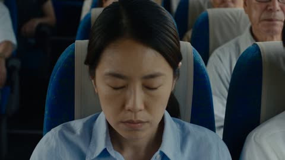</a>

Each second is labeled with a timestamp and a camera instruction such as hard cut, close-up or slow motion, which gives the model a clear shot list. The setting, costumes and sound design are repeated in the header and footer, which keeps the bus, uniforms and score consistent across the whole clip.

Seedance 2.5 · Text-to-video · Source: [@auqibhabib on X](https://x.com/auqibhabib/status/2102265619416768799) · found via [LearnPrompt/awesome-seedance](https://github.com/LearnPrompt/awesome-seedance)

[`horror`](tags.md#tag-horror) [`action`](tags.md#tag-action) [`timed-shots`](tags.md#tag-timed-shots) [`sound-design`](tags.md#tag-sound-design)

<details><summary><b>Prompt</b></summary>

```text
Cinematic horror-action short film set aboard a Japanese highway bus during the day, opens with an immediate strong hook, maximum dynamic camera work, grounded practical-effects style. Bus interior filled with passengers in every seat, a conductor in a gray uniform with a money pouch at his waist, a driver focused on the road ahead. Muted authentic color grading, natural diegetic sound throughout, tension score entering immediately.
>
> **[0-1s]** Hard cut: a woman mid-row suddenly jolts violently in her seat, gasping sharply.
>
> **[1-2s]** Close-up: her veins turn a deep red, spreading rapidly up her neck and across her face.
>
> **[2-3s]** Her eyes snap open, now fully red — she lunges instantly, biting into her seatmate's shoulder.
>
> **[3-4s]** He cries out, nearby passengers recoiling in shock, seats creaking as people scramble back.
>
> **[4-5s]** The bitten man convulses hard, veins spreading fast across his own neck and arms.
>
> **[5-6s]** He rises seconds later, eyes red, joining her, both turning toward the passengers around them.
>
> **[6-7s]** Panic spreads through the bus, passengers screaming, climbing over seats to get away.
>
> **[7-8s]** The conductor spots the chaos from the front, shouting urgently in Japanese: "バスを止めて!" ("Stop the bus!")
>
> **[8-9s]** The driver slams the brakes hard, the bus lurching to a stop on the highway shoulder.
>
> **[9-10s]** The conductor grabs a metal tire iron from beneath his seat, moving fast down the aisle.
>
> **[10-11s]** The driver grabs a heavy steel wheel wrench, following close behind him.
>
> **[11-12s]** They reach the folding door, wrenching it open, ushering panicked passengers out fast.
>
> **[12-13s]** Passengers pour out onto the highway shoulder, some stumbling, others sprinting clear.
>
> **[13-14s]** The two infected push through the fleeing crowd, lunging toward the nearest passenger outside.
>
> **[14-15s]** The conductor swings the tire iron hard, striking the first infected across the shoulder, sending it stumbling.
>
> **[15-16s]** The driver swings the wrench into the second infected, knocking it back against the bus.
>
> **[16-17s]** SLOW MOTION insert: the first infected lunges again, conductor sidestepping and striking it down with a solid blow.
>
> **[17-18s]** It collapses onto the gravel shoulder, motionless.
>
> **[18-19s]** The second infected recovers, charging the driver; he braces and swings the wrench in a wide arc.
>
> **[19-20s]** The impact connects hard, sending it sprawling against the guardrail.
>
> **[20-21s]** It tries to rise again; the conductor rushes over, delivering one final strike alongside the driver.
>
> **[21-22s]** It goes still, both men breathing hard, weapons still raised.
>
> **[22-24s]** Wide shot: passengers huddled together on the highway shoulder, shaken but safe, cars slowing on the opposite lane.
>
> **[24-26s]** The conductor lowers the tire iron, scanning the group to confirm everyone's accounted for.
>
> **[26-28s]** The driver checks the two motionless infected on the ground, cautious but confirming they're down.
>
> **[28-30s]** Final shot: the conductor and driver exchange an exhausted nod, passengers slowly regrouping behind them under the open sky. Cut to black.

Natural diegetic sound throughout — gasping, screaming, bus brakes screeching, metal impacts, heavy breathing, distant highway traffic — layered with a tense instrumental score building through the chaos and easing into relief at the end. No text overlay, no watermark. Maximum dynamic camera variety — close-ups, wide shots, tracking shots, slow motion reserved only for the final takedown blows. Realistic shake only during physical impacts, natural daylight highway color grading. 

Made with seedance 2.5 on @SocialSight
```

</details>

<a id="seedance-iron-elbows-yaowarat-alley-fight"></a>
### Muay Thai fighter clears rainy Bangkok alley ambush

<a href="https://x.com/yourPlugAI/status/2112760259886407861">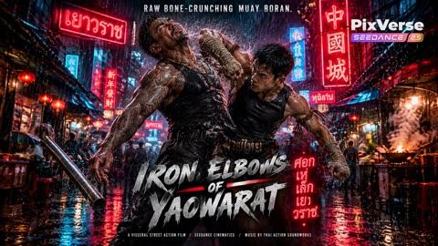</a>

Each beat carries a visual, action and sound line, so pacing and audio cues are set in the same block. Fixed character sheets and a named setting keep the fighters consistent through the whole fight.

Seedance 2.5 · Reference-to-video · Source: [@yourPlugAI on X](https://x.com/yourPlugAI/status/2112760259886407861) · found via [LearnPrompt/awesome-seedance](https://github.com/LearnPrompt/awesome-seedance)

[`muay-thai`](tags.md#tag-muay-thai) [`martial-arts`](tags.md#tag-martial-arts) [`timeline-prompt`](tags.md#tag-timeline-prompt) [`sound-design`](tags.md#tag-sound-design)

<details><summary><b>Prompt</b></summary>

```text
Iron Elbows Of Yaowarat (ศอกเหล็กแห่งเยาวราช.) 🇹🇭⚡
@PixVerse 

Cornered in a cramped, neon-lit alleyway in Bangkok Chinatown, underdog fighter Kham relies on traditional Muay Boran and lethal street Muay Thai to defend himself against three armed syndicate enforcers.

Through bone-shattering elbow strikes, mid-air double-knee pipe blocks, and a legendary Hanuman flying knee strike, Kham clears the alley in a non-stop 30-second martial arts gauntlet. 

✨Generated by Seedance 2.5 on PixVerse AI 

✨Grab the exact character sheets and FULL video prompt from the Pixverse Canvas link attached below

#PixVerseCPP #PixVerseAI #Seedance25 

Phase 1: 00:00 to 00:15 (Seedance 2.5)

[ENGINE DIRECTIVE]
Generate a continuous 15-second hyper-realistic live-action martial arts sequence using Seedance 2.5 at 60fps ultra-realism in 16:9 widescreen format. Maintain 100% strict visual consistency with provided asset sheets: "Kham" (Thai fighter in kard chuek hand wraps, prajied armbands, dark Muay Thai shorts) and "Syndicate Enforcers" (Somchai with steel pipe, Twins with short machetes). Setting strictly follows "Rain-Soaked Yaowarat Alleyway Night Market". Style: Visceral Ong-Bak Muay Boran action cinema, rapid 2-to-3 second beats, bone-crunching elbow leverage, wet neon reflections, high-velocity water splash physics.

[AUDIO DIRECTIVE]
• MUSIC: Driving fast-paced Thai percussion blended with heavy industrial synth bass and aggressive action risers.
• SOUND DESIGN: Heavy tropical rain, machete wind swooshes, elbow-to-bone impact thuds, shattering wooden food carts, and steel pipe clangs.

[TIMELINE BREAKDOWN]

00:00 - 00:03 | NEON STANCE & MACHETE AMBUSH
• VISUAL: Low-angle tracking shot panning up from neon-lit puddles to Kham's low Muay Boran stance.
• ACTION: Heavy rain pours off Kham's cloth hand-wraps under a flickering red noodle sign. Somchai and the Twin Strikers step out from the shadows with steel pipe and machetes drawn.
• SOUND: Heavy downpour, flickering neon buzz, steel pipe drag ON asphalt, fast drum pulse.

00:03 - 00:06 | WRIST PARRY & COLLARBONE DOWNWARD ELBOW
• VISUAL: Close-quarters dynamic camera tracking Kham's forearm parry.
• ACTION: First Twin rushes with a diagonal machete slash. Kham steps inside the guard, parries the wrist with his cloth-wrapped forearm, and delivers a brutal horizontal downward elbow directly to the collarbone.
• SOUND: Machete WHOOSH, forearm parry CLACK, bone-crunching elbow THUD.

00:06 - 00:09 | PLUM CLINCH & UPWARD RIB KNEE
• VISUAL: Low-angle impact camera tracking the water displacement.
• ACTION: Second Twin lunges with a thrust. Kham duck-drifts under the blade, grabs the attacker's neck in a tight plum clinch, and drives a crushing upward knee strike to the ribs, sending neon-lit water blasting off their clothes.
• SOUND: Water slide hiss, clinch leather friction, heavy knee impact CRUNCH, water spray explosion.

00:09 - 00:12 | FOOD CART VAULT & DOUBLE-KNEE PIPE BLOCK
• VISUAL: 0.8-second time-dilation tracking shot orbiting Kham's aerial vault.
• ACTION: Somchai swings his heavy steel pipe. In hyper-slow motion, Kham vaults off an overturned wooden food cart, executing a mid-air double-knee block that catches the pipe between his shins.
• SOUND: Time-dilation sub-bass DROP, heavy pipe WHOOSH, shin-on-pipe CLANG, wood splintering.

00:12 - 00:15 | SPINNING BACK-ELBOW & CRATE SKID
• VISUAL: Wide impact tracking camera capturing Somchai staggring into the background.
• ACTION: Landing on wet asphalt, Kham uses his momentum to deliver a spinning back-elbow to Somchai's jaw, sending sparks and rainwater flying as the giant staggers back into plastic crates, setting up Phase 2.
• SOUND: High-speed spin WHOOSH, jaw impact BOOM, plastic crates crashing, surging music riser.
```

</details>

<a id="seedance-japanese-school-horror-sequence"></a>
### Teacher writes on blackboard in quiet classroom

<a href="https://x.com/SadiaMalik182/status/2102278921161208273">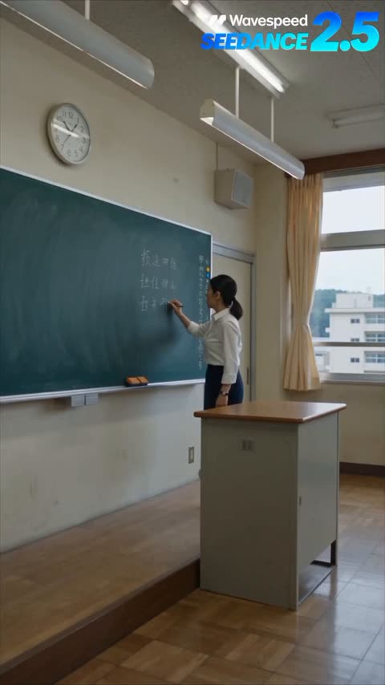</a>

The prompt walks through the story beat by beat in the order the camera sees it, then closes with one style block that fixes the look, handheld camera and diegetic-only sound. Explicit bans on gore, anime, subtitles and music keep a horror sequence grounded and clean.

Seedance 2.5 · Text-to-video · Source: [@SadiaMalik182 on X](https://x.com/SadiaMalik182/status/2102278921161208273) · found via [LearnPrompt/awesome-seedance](https://github.com/LearnPrompt/awesome-seedance)

[`horror`](tags.md#tag-horror) [`japanese-school`](tags.md#tag-japanese-school) [`handheld camera`](tags.md#tag-handheldcamera) [`diegetic-sound`](tags.md#tag-diegetic-sound)

<details><summary><b>Prompt</b></summary>

```text
Create an ultra-realistic Japanese high-school horror-action sequence following a female teacher during an ordinary afternoon class. The classroom is calm when the lights suddenly flicker and every student's phone receives the same emergency alert at exactly the same moment. The teacher looks outside and notices the school courtyard completely empty.

A loud crash comes from the science laboratory next door. The teacher tells everyone to stay inside and carefully opens the classroom door. The hallway appears empty, but a trail of spilled chemical liquid leads toward the staircase. Suddenly, a student who had been quietly sitting at the back of the classroom collapses and begins behaving strangely, revealing that something has already happened inside the school.

The emergency alarm starts ringing. Several infected students suddenly rush from the staircase toward the classroom. The teacher quickly pushes the desks against the doorway while students work together to block the entrance with chairs and cabinets. One student notices an emergency exit sign and leads the group toward a second corridor.

They move through the dark school hallway while hearing footsteps approaching from behind. The teacher turns off the hallway lights, and everyone hides silently inside an empty classroom as the infected pass by outside.

They finally reach the rooftop and push the door open, expecting to find help. Instead, they see dozens of infected figures standing motionless across the school courtyard below.

The teacher slowly closes the rooftop door and turns toward her students.

Then a quiet voice whispers from behind them:

“Sensei... someone is already here.”

She slowly turns around.

Cut to black.

Photorealistic live-action Japanese horror-thriller, realistic Japanese high-school environment, authentic student uniforms, natural facial expressions, practical-effects horror, realistic physics, handheld cinematic camera, dynamic tracking shots, dramatic close-ups, realistic lighting, emergency lights, atmospheric dust, natural character movement, authentic reactions, escalating tension, diegetic sound only, no music, no narration, suspense-focused horror, no excessive gore, no graphic injuries, no animation, no anime, no cartoon, no artificial CGI look, no distorted anatomy, no subtitles, no random text, no watermark

#WaveSpeedAI #AIVideo #Horror #AIStory
```

</details>

<a id="seedance-katen-kyokotsu-bankai-thread-web"></a>
### Forest sword duel turns into Bankai thread web

<a href="https://x.com/itxabdullaa/status/2102609881677107243"></a>

Two reference images lock each character's look, and a timed beat sheet makes every action trigger the next so the ten second escalation stays readable. Rules against glowing auras and for believable water, cloth and petals keep the result grounded in live-action footage.

Seedance 2.5 · Reference-to-video · Source: [@itxabdullaa on X](https://x.com/itxabdullaa/status/2102609881677107243) · found via [LearnPrompt/awesome-seedance](https://github.com/LearnPrompt/awesome-seedance)

[`sword-fight`](tags.md#tag-sword-fight) [`fantasy-action`](tags.md#tag-fantasy-action) [`live-action`](tags.md#tag-live-action) [`timed-beats`](tags.md#tag-timed-beats)

<details><summary><b>Prompt</b></summary>

```text
SCENE — KATEN KYŌKOTSU: KARAMATSU SHINJŪ
DURATION: exactly 10 seconds
FORMAT: 16:9
STYLE: ultra-photorealistic live-action cinematic fantasy action, grounded CGI, desaturated palette, high-contrast lighting, realistic anatomy and physics, dark supernatural atmosphere, cinematic Japanese tragedy, practical environmental interaction, no digital-art appearance.
PACE: extremely fast continuous escalation, zero pause, zero dead frame.

REFERENCES
IMAGE 1 — PAKSHUN
Preserve facial identity, hairstyle, costume, proportions, and appearance exactly.

IMAGE 2 — OPPONENT
Preserve facial identity, hairstyle, costume, proportions, and appearance exactly.

ACTION

0.0–2.0 SECONDS — BANKAI
Tight rear three-quarter shot. Opponent charges. Pakshun lowers his sword and says: 「卍解……花天狂骨枯松心中。」
A violent pressure wave tears across the ground. Dust, leaves, debris, and hundreds of dark petals rise. The environment rapidly desaturates into black, grey, and pale tones. Camera performs a fast 360° orbit as Opponent closes in.

2.0–4.0 SECONDS — SHARED WOUND
Opponent attacks. Pakshun pivots and cuts across his torso. An identical wound instantly appears on Pakshun. A thin crimson thread connects both wounds as Opponent retreats. The ground cracks beneath it and black water erupts upward.

4.0–6.5 SECONDS — THE DROWNED STAGE
A massive wave floods the battlefield. Camera dives underwater seamlessly. Both characters struggle violently against the current, with realistic movement of soaked clothing, hair, debris, and petals. Pakshun plants his feet and pulls one hand back. The entire current suddenly freezes in turbulent suspension.

6.5–8.5 SECONDS — WHITE THREADS
Pakshun rises through the suspended water. Countless thin white threads spread behind him into a huge web. Opponent tries to escape, but threads catch his wrist, arms, torso, and legs, tightening and dragging him toward the center. Pakshun advances. Camera rapidly pulls back to reveal the full structure.

8.5–10.0 SECONDS — HAKKA NO TOGAME
Pakshun grips one primary thread and pulls once. Every thread becomes violently taut. Water erupts outward and dark petals explode across the frame. Pakshun makes a minimal sword-draw motion. One sharp white cutting line tears across the composition.

SMASH CUT TO BLACK. One sharp sword-slash sound. END.

VISUAL RULES

- Both characters remain active throughout.
- No teleportation, transformations, NPC behavior, or static posing.
- No glowing anime aura or excessive energy beams.
- All water, debris, fabric, hair, petals, and threads obey believable physics.
- Grounded CGI integrated into live-action photography.
- Every action directly causes the next event.
- Continuous movement, zero pauses, zero dead frames.
- No unnecessary movement or ending hero pose. #ImagineArt
```

</details>

<a id="seedance-kitsune-warehouse-brawl"></a>
### Fox-eared schoolgirl fights mercenaries in warehouse

<a href="https://x.com/laviniavelle/status/2094609588142379101">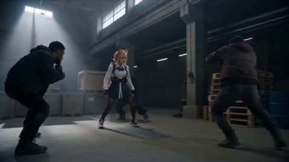</a>

The prompt fixes the character design first (hair, ears, tails, uniform) and then gives the setting, action beats and camera language. Naming low angles, cuts and motion blur plus an Unreal Engine 5 render target steers the look toward a photoreal CGI action scene.

Seedance 2.5 · Text-to-video · Source: [@laviniavelle on X](https://x.com/laviniavelle/status/2094609588142379101) · found via [LearnPrompt/awesome-seedance](https://github.com/LearnPrompt/awesome-seedance)

[`kitsune`](tags.md#tag-kitsune) [`martial-arts`](tags.md#tag-martial-arts) [`warehouse`](tags.md#tag-warehouse) [`live-action-anime`](tags.md#tag-live-action-anime)

<details><summary><b>Prompt</b></summary>

```text
Live-action anime-style hybrid fox girl Kitsune Gumiho warrior with long blonde pigtails realistic fox ears, claws, and nine large, bushy, light orange and white fluffy tails She is wearing a modern Japanese school uniform with a white short sleeved collared shirt, dark green pleated skirt, red tie tactical shoulder straps, fingerless gloves, and high top sneakers Dynamic fast-paced martial arts fight sequence inside a gritty, dimly lit industrial warehouse filled with concrete pillars, wooden pallets, and volumetric skylight beams. She dodges strikes and spin kicks against heavily armored mercenary thugs and a giant muscular brute boss, using her tails for balance and sweeping attacks Cinematic camera angles dynamic action cuts low-angle shots, motion blur during combat, realistic textures, photorealistic CGI action scene Unreal Engine 5 render 8k resolution.
```

</details>

<a id="seedance-korean-classroom-gunfight-red-scarf"></a>
### Korean Classroom Gunfight With Red Scarf Heroine

<a href="https://x.com/Noor_ul_ain43/status/2104793144743108833"></a>

The 60 second script is split into six timed scenes, each with its own shot list covering close-ups, low angles, whip pans and slow motion. A fixed outfit description, a single location and a cool blue green grade keep the character and look consistent across the cuts.

Seedance 2.5 · Text-to-video · Source: [@Noor_ul_ain43 on X](https://x.com/Noor_ul_ain43/status/2104793144743108833) · found via [LearnPrompt/awesome-seedance](https://github.com/LearnPrompt/awesome-seedance)

[`action`](tags.md#tag-action) [`gunfight`](tags.md#tag-gunfight) [`martial-arts`](tags.md#tag-martial-arts) [`cinematic`](tags.md#tag-cinematic) [`multi-shot`](tags.md#tag-multi-shot)

<details><summary><b>Prompt</b></summary>

```text
Create a 60-second ultra-realistic cinematic Korean action-thriller scene featuring a young woman with straight black hair, a sharp, confident expression, and a distinctive outfit: a black oversized jacket, light-colored top, black pants, and a bright red scarf. She is inside a dimly lit classroom, facing an armed opponent. The scene combines intense gunfight choreography, acrobatic martial arts, dramatic close-ups, and stylish action-film cinematography.

SCENE 1 — THE INTRODUCTION (0–6 seconds)

Open with a medium close-up of the young woman standing motionless in a dark classroom. She looks directly ahead with a calm, intimidating expression. Her black hair frames her face, and her red scarf contrasts with her dark clothing.

Cut to an extreme close-up of her face as she slightly tilts her head and purses her lips, maintaining a cool, fearless attitude. Insert a brief close-up of a handgun resting on a nearby desk to establish the danger.

SCENE 2 — THE ATTACK BEGINS (6–12 seconds)

Cut to a wider classroom shot. An armed opponent suddenly approaches. The woman immediately lowers her body, shifts her weight, and prepares to evade.

Use a fast tracking shot as she moves forward, followed by a sudden camera cut to her opponent. The choreography should feel fast, fluid, and physically convincing, with realistic body mechanics and clear spatial continuity.

SCENE 3 — ACROBATIC FIGHT (12–22 seconds)

The woman launches into an explosive sequence of martial arts movements. She ducks beneath an attack, pivots, performs a high spinning kick, and uses rapid changes of direction to avoid her opponent.

Capture the action with a combination of low-angle shots, wide shots, and close tracking movements. Her jacket and red scarf move naturally with her momentum.

Show brief flashes of gunfire and bright muzzle flashes illuminating the dark classroom. The camera alternates between the woman's controlled movements and the opponent's reactions.

SCENE 4 — THE GUNFIGHT (22–36 seconds)

Escalate the confrontation with rapid exchanges of gunfire. The woman takes cover, changes position, and uses the classroom desks as obstacles.

Include dramatic low-angle shots of her moving across the room, quick close-ups of her focused eyes, and brief shots of the muzzle flashes lighting the windows and furniture.

At one point, use a dramatic ground-level perspective as she stands over the camera's viewpoint, holding her weapon with a determined expression.

Cut to a close-up of her hands holding a firearm, then return to a wider shot showing her movement through the classroom.

SCENE 5 — THE FINAL EXCHANGE (36–48 seconds)

The action becomes more intense. The woman moves sideways while maintaining awareness of her opponent. Show a fast sequence of evasive movements, sharp turns, and acrobatic kicks.

Use dynamic handheld cinematography, short whip pans, and occasional slow motion at the most dramatic moments. Include realistic motion blur without losing the clarity of the choreography.

The opponent attempts to regain control, but she continues moving confidently through the classroom.

SCENE 6 — THE CINEMATIC FINISH (48–60 seconds)

Slow the pacing briefly. Show the woman standing with a confident, almost playful expression. Her hair is slightly disheveled, and her red scarf hangs loosely around her neck.

Cut to a wide shot of the classroom as the confrontation resumes. The woman and her opponent exchange a final sequence of rapid movements, with one last dramatic dodge and counterattack.

End with a close-up of her face as she looks toward the camera with a subtle, confident expression. Finish with a final cinematic action shot and a sharp cut to black.

CINEMATOGRAPHY AND VISUAL STYLE

- Photorealistic Korean action-film cinematography.
- Cool blue-green color grading, dark shadows, and muted classroom colors.

IMPORTANT CONSISTENCY INSTRUCTIONS
```

</details>

<a id="seedance-korean-explorer-ruins-gameplay"></a>
### Explorer walks through ivy-covered ruin archway

<a href="https://x.com/SimplyAnnisa/status/2101180666205577408">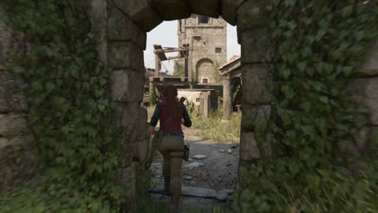</a>

A locked character block (face, outfit, props) is repeated as a consistency anchor, and the sequence is written as numbered beats with exact HUD text in quotes so each gameplay step reads clearly. The closing negative list bans camera sweeps, slow motion and lens flare so the footage looks like a real player capture.

Seedance 2.5 · Text-to-video · Source: [@SimplyAnnisa on X](https://x.com/SimplyAnnisa/status/2101180666205577408) · found via [LearnPrompt/awesome-seedance](https://github.com/LearnPrompt/awesome-seedance)

[`gameplay`](tags.md#tag-gameplay) [`ue5`](tags.md#tag-ue5) [`character-consistency`](tags.md#tag-character-consistency) [`boss-fight`](tags.md#tag-boss-fight) [`hud`](tags.md#tag-hud)

<details><summary><b>Prompt</b></summary>

```text
Create a 30-second photorealistic AAA third-person action-adventure gameplay video, 16:9, resembling real playable Unreal Engine 5 footage, not a cinematic trailer.

PROTAGONIST — STRICT CONSISTENCY:
Young Korean female explorer, mid-20s, natural oval Korean face, dark almond eyes, long dark hair in a low ponytail, athletic realistic build. Same face and body throughout. She wears a burgundy-red sleeveless utility jacket, charcoal long-sleeve shirt, olive cargo pants, rugged boots, climbing gloves, tactical backpack, rope/carbiners, silver magnetic bracelet on right wrist, and curved blade at right hip. Realistic dirt, cloth, hair, and physics.

CAMERA & STYLE:
Normal third-person player-controlled camera behind/slightly above her. Natural movement, realistic animation, shadows, materials, physics, lighting, and environmental interaction. No cinematic camera sweeps, slow motion, excessive DOF, lens flare, title cards, logos, subtitles, or watermark.

GAMEPLAY SEQUENCE

1. Abandoned Settlement
She enters a ruined island settlement with overgrown stone buildings, broken walkways, boats, cliffs, and a distant watchtower. HUD: “Investigate the Abandoned Settlement.”

2. Traversal
She climbs platforms and ledges, runs across a beam, jumps a gap, and reaches the watchtower route. Show stamina usage. HUD: “Reach the Abandoned Watchtower.”

3. Hidden Mechanism
She discovers a cracked stone wall, activates an ancient mechanism, and opens a hidden underground entrance. Interaction prompt: “Investigate.”

4. Ancient Lift Puzzle
In a huge underground chamber, she uses her magnetic bracelet to move metal counterweights onto the correct tracks. Ancient conduits activate and the stone lift starts moving. HUD: “Restore the Ancient Lift.”

5. Boss Fight
The lift reaches a temple chamber where a massive stone-and-bronze guardian awakens. She draws her curved blade and fights. HUD: “Defeat the Ruin Sentinel.” Enemy health bar and lock-on indicator appear.

6. Weak Point Mechanic
Guardian attacks → she dodges → uses the magnetic bracelet to pull off damaged armor → glowing weak point exposed → she strikes it with her blade → boss health decreases. Clearly show DODGE → MAGNET → WEAK POINT → ATTACK gameplay.

7. Flood Escape
Ancient pipes rupture and water floods the chamber. HUD: “Escape the Flooded Chamber.” She runs, jumps broken floors, avoids falling debris, climbs a wall, and reaches the surface.

8. New Mission
She reaches a rocky overlook above the ruined island. A mysterious ancient sky temple is visible beyond the mountains. HUD: “Mission Complete: Reach the Surface.” Then: “Investigate the Sky Temple.” She walks toward the new objective, clearly transitioning into the next playable mission.

FINAL REQUIREMENTS:
Same woman, outfit, face, hairstyle, equipment, environment, and visual quality throughout. Prioritize playable gameplay readability over cinematic beauty. Photorealistic UE5 quality, realistic physics and animation, functional minimal HUD, no gore, no dialogue captions, no logos, no watermark.
```

</details>

<a id="seedance-korean-subway-door-glass-punch-comedy"></a>
### Korean subway woman smashes train door glass

<a href="https://x.com/AIwithkhan/status/2097168171367338428"></a>

Uploaded images are named as exact references to lock faces, hair and outfits, then a short sequence of story beats runs from the missed train to the crowd laughing. A DV look, ambient subway audio with no music, and a long negative list covering identity drift, regenerating glass and gore keep the physics and the characters stable.

Seedance 2.5 · Reference-to-video · Source: [@AIwithkhan on X](https://x.com/AIwithkhan/status/2097168171367338428) · found via [LearnPrompt/awesome-seedance](https://github.com/LearnPrompt/awesome-seedance)

[`subway`](tags.md#tag-subway) [`action-comedy`](tags.md#tag-action-comedy) [`korean`](tags.md#tag-korean) [`dv-look`](tags.md#tag-dv-look) [`character-consistency`](tags.md#tag-character-consistency)

<details><summary><b>Prompt</b></summary>

```text
Create a 30-second, 1080p ultra-realistic Korean subway action-comedy scene using the uploaded images as exact visual references; keep characters, faces, hair, outfits and environment consistent.
Young Korean woman, early 20s, long straight black hair, green cropped long-sleeve top, loose blue jeans, silver jewelry; confident and expressive.
Young Korean man, short black hair, gray button-up shirt, dark trousers and white sneakers; playful, then shocked and embarrassed.
She rushes down the subway stairs toward a waiting train, but the doors close just as she reaches them.
The man inside sees her through the glass and laughs at her; she stares at him angrily and says, “Are you seriously laughing?”
He laughs again, so she suddenly punches the glass beside the door, cracking and breaking the safety glass realistically with no injury or gore.
She reaches through the broken opening, grabs his shirt and pulls him safely out onto the platform; he lands awkwardly on the floor in shock.
She calmly climbs through the same broken opening into the train, straightens her clothes and walks inside as stunned passengers watch.
The man remains sitting outside, looking confused and humiliated while passengers stare at him through the windows.
One passenger starts laughing, then everyone bursts into laughter while the man looks around helplessly.
She looks at him through the window, gives a tiny satisfied smile, then casually turns away.
Ultra-realistic Korean subway lighting, gritty DV-inspired look, natural motion blur, realistic physics, handheld imperfections, authentic reactions and ambient subway audio; no music.
No gore, blood, serious injuries, identity drift, outfit changes, duplicated people, teleportation, regenerating glass, distorted hands, CGI look, subtitles, captions, text, logos or watermark.
```

</details>

<a id="seedance-korean-subway-glass-punch-revenge-comedy"></a>
### Korean Subway Door Glass Punch Revenge

<a href="https://x.com/AIwithSynthia/status/2098988104418050349"></a>

Uploaded images lock the faces and outfits, and the action is written as a clean sequence of beats from the closing doors to the final smile. A DV handheld look, ambient audio with no music, and a long negative list guard against identity drift and gore.

Seedance 2.5 · Reference-to-video · Source: [@AIwithSynthia on X](https://x.com/AIwithSynthia/status/2098988104418050349) · found via [LearnPrompt/awesome-seedance](https://github.com/LearnPrompt/awesome-seedance)

[`subway`](tags.md#tag-subway) [`action-comedy`](tags.md#tag-action-comedy) [`dv-handheld`](tags.md#tag-dv-handheld) [`korean`](tags.md#tag-korean) [`reference-images`](tags.md#tag-reference-images)

<details><summary><b>Prompt</b></summary>

```text
Create a 30-second, 1080p ultra-realistic Korean subway action-comedy scene using the uploaded images as exact visual references; keep characters, faces, hair, outfits and environment consistent.
Young Korean woman, early 20s, long straight black hair, fitted pastel-blue cropped top, loose pajama-style pants, simple silver jewelry; confident, expressive and slightly mischievous.
Young Korean man, short black hair, gray button-up shirt, dark trousers and white sneakers; playful at first, then shocked and embarrassed.
She rushes down the subway stairs toward a waiting train, but the doors close just as she reaches them.
The man inside sees her through the glass and laughs at her; she stares at him angrily and says, “Are you seriously laughing?”
He laughs again, so she suddenly punches the glass beside the door, cracking and breaking the safety glass realistically with no injury or gore.
She reaches through the broken opening, grabs his shirt and pulls him safely out onto the platform; he lands awkwardly on the floor in shock.
She calmly climbs through the same broken opening into the train, straightens her pastel top and pajama pants, and walks inside as stunned passengers watch.
The man remains sitting outside, looking confused and humiliated while passengers stare at him through the windows.
One passenger starts laughing, then everyone bursts into laughter while the man looks around helplessly.
She looks at him through the window, gives a tiny satisfied smile, then casually turns away.
Ultra-realistic Korean subway lighting, gritty DV-inspired look, natural motion blur, realistic physics, handheld imperfections, authentic reactions and ambient subway audio; no music.
No gore, blood, serious injuries, identity drift, outfit changes, duplicated people, teleportation, regenerating glass, distorted hands, CGI look, subtitles, captions, text, logos or watermark.
```

</details>

<a id="seedance-kuala-lumpur-earthquake-survival-run-storyboard"></a>
### Kuala Lumpur Earthquake Survival Run Storyboard

<a href="https://x.com/Xaroon_x/status/2097267405399396457"></a>

Two reference images lock the character identity and the storyboard layout. Twelve timecoded panels chain one continuous run, and a core rule against teleportation keeps every movement connected. A camera list that bans drones and impossible rotations keeps the pursuit grounded.

Seedance 2.5 · Reference-to-video · Source: [@Xaroon_x on X](https://x.com/Xaroon_x/status/2097267405399396457) · found via [LearnPrompt/awesome-seedance](https://github.com/LearnPrompt/awesome-seedance)

[`storyboard`](tags.md#tag-storyboard) [`disaster-action`](tags.md#tag-disaster-action) [`continuous-shot`](tags.md#tag-continuous-shot) [`character-reference`](tags.md#tag-character-reference) [`handheld-tracking`](tags.md#tag-handheld-tracking)

<details><summary><b>Prompt</b></summary>

```text
TITLE: THE SURVIVAL RUN

Create a single-page, premium Hollywood disaster-action storyboard in 16:9 widescreen format with 12 cinematic panels covering one continuous 30-second survival sequence.

REFERENCE IMAGE 1 (Image1):
Use as the EXACT main character reference. Maintain the same facial identity, hairstyle, beard, body proportions, black shirt, black pants and overall appearance consistently in every panel. No character, face, hairstyle or clothing changes. Dust and debris may gradually appear as the disaster progresses.

REFERENCE IMAGE 2 (Image2):
Use as the EXACT storyboard design and layout reference. Match its premium cinematic panel arrangement, numbering, timecodes, black caption strips, typography hierarchy, borders and professional Hollywood storyboard presentation.

STYLE:
Photorealistic live-action Hollywood disaster film, ARRI Alexa 35, anamorphic cinematic lens, realistic Kuala Lumpur, Malaysia, practical stunt realism, believable destruction physics, handheld tracking, cinematic lighting, motion blur, dust, shattered glass, sparks and realistic debris.

CORE RULE:
ONE CONTINUOUS SURVIVAL SHOT. Every movement must logically connect. No teleportation or unexplained location changes. The same man constantly runs, stumbles, recovers, jumps, slides and changes direction while the collapsing city becomes the antagonist.

STORYBOARD PANELS:

1. 00:00–00:03 — EARTHQUAKE
Low-angle behind his feet as he runs through Kuala Lumpur. The ground shakes, buildings tremble, glass explodes and concrete crashes behind him. He looks back and accelerates.

2. 00:03–00:06 — COLLAPSE
Front tracking shot. A building façade collapses behind him. He changes direction and jumps over a metal barrier as debris destroys his original path.

3. 00:06–00:09 — CAR IMPACT
At an intersection, vehicles slide toward him. He dives at the last second, a car passes overhead, he rolls, recovers and keeps running.

4. 00:09–00:12 — ROAD CRACK
A huge fissure tears across the road. He runs onto a damaged car as a springboard and leaps across collapsing pavement.

5. 00:12–00:15 — FALLING GLASS
Side tracking shot. High-rise windows explode above him. Glass rains down as he shields his face and ducks beneath a falling sign.

6. 00:15–00:18 — COLLAPSE
A building collapses ahead. He spots a narrow gap, drops low and slides beneath falling debris, then emerges dusty and runs.

7. 00:18–00:21 — VEHICLE CHAOS
A bus crashes into cars. A spinning vehicle approaches. He jumps onto its hood, springs over the roof and lands on the opposite sidewalk.

8. 00:21–00:24 — ELEVATED ROAD FAILURE
An elevated road collapses ahead. He performs a desperate full-body gap jump, lands hard, rolls, recovers and runs.

9. 00:24–00:27 — DEBRIS CHASE
Heavy dust reduces visibility. Falling streetlights and concrete force sudden direction changes. He stumbles against a wall and pushes forward.

10. 00:27–00:30 — FINAL COLLAPSE
Camera faces him as he runs toward it. Massive buildings collapse behind him. He jumps a concrete barrier as a gigantic slab crashes down.

11. FINAL SHOT — STILL RUNNING
He emerges through a huge dust cloud, exhausted and covered in debris but clearly recognizable as Reference Image 1, still running toward camera.

12. CUT TO BLACK
Black screen with:
“THE SURVIVAL RUN”
“SOME DISASTERS YOU CAN’T OUTRUN”

CAMERA:
Low tracking, front pursuit, side tracking, shoulder-mounted chase, whip-pans and ground-level movement. Camera always follows his momentum. No drones, floating cameras or impossible rotations.
```

</details>

<a id="seedance-mahjong-parlor-martial-arts-brawl"></a>
### Underground mahjong parlor martial arts brawl

<a href="https://x.com/ElsaSofia__AI/status/2114538463605498112"></a>

Twelve timed shots with second ranges give the 20 second action a clear beat structure, from the first grab to the final push in. A fixed setting, hero and thug description block keeps the look consistent, and a closing audio line ends in near silence on the last close-up.

Seedance 2.5 · Text-to-video · Source: [@ElsaSofia__AI on X](https://x.com/ElsaSofia__AI/status/2114538463605498112) · found via [LearnPrompt/awesome-seedance](https://github.com/LearnPrompt/awesome-seedance)

[`martial-arts`](tags.md#tag-martial-arts) [`action`](tags.md#tag-action) [`crime-thriller`](tags.md#tag-crime-thriller) [`multi-shot`](tags.md#tag-multi-shot) [`handheld`](tags.md#tag-handheld)

<details><summary><b>Prompt</b></summary>

```text
A gritty, cinematic, photorealistic 20-second urban martial-arts action scene in 16:9, in the style of a 1990s Hong Kong / Korean crime-thriller. Handheld camera with sharp whip pans, rapid cuts, shaky close-ups, motion blur and flying debris. Color grade: cold blue-grey haze, desaturated teal and brown tones, deep shadows, a faint film grain, thick cigarette smoke drifting through the air, flat fluorescent tube lighting and a few warm amber lamps.

SETTING: A run-down underground mahjong parlor in an old building: stained concrete floor littered with broken glass and mahjong tiles, scuffed wood-paneled walls with framed pictures, green-felt mahjong tables with white tiles, green glass soju bottles, wooden chairs, a brown leather sofa, an old CRT television on a wooden stand glowing white static, ceiling fluorescent tubes, smoke and dust in the air.

HERO: A young woman with brown shoulder-length wavy hair in a loose, messy ponytail with bangs, wearing a black turtleneck, a worn black leather jacket and black trousers. Fierce, calm, cold expression. She fights with precise, powerful strikes, kicks and throws, using chairs and bottles.

THUGS: A gang of men in black leather jackets and dark clothes. The first is a heavyset, bearded man with short black hair, a big grin and a metal dog-tag chain around his neck.

Shot 1 (0–2s): Medium close-up. The big bearded thug grins and reaches out his hand toward her face to touch her chin. She stands with her back partly to the camera, head turned toward him. His face goes from a leer to alarm as she hits back.
Shot 2 (2–3s): The thug is flung backward with his arms flailing above his head, falling toward a mahjong table in the background.
Shot 3 (3–4s): He crashes into the green felt mahjong table, a bottle and white mahjong tiles exploding into the air around him.
Shot 4 (4–5s): Close-up: the woman turns to the camera, face cold and focused, hair strands in front of her face. Behind her another thug grins and swings a wooden chair at her.
Shot 5 (5–6.5s): She ducks under the chair, which smashes against a wall in a burst of splinters. Fast whip pan to a thug thrown against the wall, then a low shot of his legs kicking and another man sliding across the floor.
Shot 6 (6.5–8s): Wide shot: an old CRT TV in the background, a thug runs in and she sweeps him down; he slams across the edge of a mahjong table with tiles scattering. A thug crawls on the floor.
Shot 7 (8–9s): A grinning thug lunges at her with a green bottle. She dodges, grabs his arm and smashes the bottle, glass spraying; close-up of her fist and the bottle breaking in a spray of liquid.
Shot 8 (9–11s): Rapid close-quarters fight: she punches a thug in the face, spins, and he is knocked backward; a thug lounges on a brown leather sofa, stunned, as another body passes the lens; she turns and kicks.
Shot 9 (11–15s): Chaotic brawl in the smoke: multiple thugs rushing in, handheld shaky camera, her ponytail whipping, punches and elbows landing, a man yelling in rage, then a low-angle shot of black trouser legs mid-kick. One thug grabs her by the shoulders; she throws him over her hip.
Shot 10 (15–16s): Low shot across the floor: a defeated thug lies on the glass-strewn floor, tiles and green bottles around him, her black trouser legs step past the camera.
Shot 11 (16–18s): Wide static shot: the woman stands in the center of the wrecked parlor, legs apart, chest heaving, rubbing her arm, her head lowered, bodies of the thugs sprawled on the floor and chairs, broken chairs, bottles, the old TV flickering white.
Shot 12 (18–20.5s): She slowly raises her head and walks toward the camera; the camera pushes in slowly from a medium shot to a tight close-up of her face, wet hair strands across her forehead, breathing hard, staring straight into the lens with a cold, defiant look.

Audio: heavy thuds, bone-crunching punches, glass shattering, wood splintering, mahjong tiles scattering, men yelling and groaning, a low tense drone with a pounding drum beat that cuts to near silence on the final close-up with only her heavy breathing and the hiss of the TV static.
```

</details>

<a id="seedance-misty-mountain-parkour-fight"></a>
### Mossy terrace stairs and bamboo poles in mist

<a href="https://x.com/Chaemate_/status/2113558308514922850">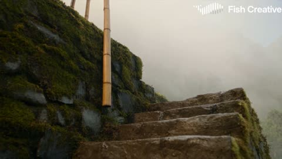</a>

Anchors the protagonist to an @image reference and gives each of six timed shots its own camera move and field of view, with hard cuts that keep direction matched. Every hit names the enemy's reaction, which keeps a long chain of opponents readable on screen.

Seedance 2.5 · Reference-to-video · Source: [@Chaemate_ on X](https://x.com/Chaemate_/status/2113558308514922850)

[`parkour`](tags.md#tag-parkour) [`martial-arts`](tags.md#tag-martial-arts) [`multi-shot`](tags.md#tag-multi-shot) [`reference-lock`](tags.md#tag-reference-lock)

<details><summary><b>Prompt</b></summary>

```text
16:9 widescreen, cinematic live-action, 15 seconds, high-momentum parkour fight in a continuous-feeling sequence. Hard cuts only between shots, no dissolves, morphs or transitions; motion and direction match across every cut. No dialogue; only natural footsteps, fabric, splashes and impact sounds.

PROTAGONIST: @image 1 (facial identity, hair, rose-pink streaks, long side braid, plum shirt and cream cargo trousers locked to the reference throughout). Her movement is sharp, decisive and fluid. She dominates the entire fight and takes down ten masked attackers in a rapid chain.

OPPONENTS: Ten masked "Ashen Guard" fighters in charcoal hooded rain coats and slate face wraps, armed with bamboo staffs and short batons. They close in from above, from the sides and from behind. Every one is hit cleanly and reacts visibly: knocked back, off-balance, or thrown into a wall, rack or railing before leaving frame. The next attacker steps in immediately.

SETTING: An abandoned terraced tea plantation on a steep misty mountainside just after rain. Mossy stone terrace walls, narrow wet stone staircases, a shallow water-filled irrigation channel running down the slope, a collapsed wooden footbridge with a gap, rusted tea-drying racks, leaning bamboo scaffolding and a thin waterfall at the cliff edge. Low golden sun cuts in from the side through light haze. Palette: moss green, wet slate grey, warm amber, deep plum. Kicked-up water spray, mud flecks, torn tea leaves and mist react to every impact. Realistic natural lighting only.

SHOT 1 (0-2.5s) Low-angle, ground level, FOV 35 degrees. She bursts up from the bottom of the stone terrace, launches off a step and drives a flying front kick into attacker 1's chest, throwing him back into a stone wall. She lands and slides sideways under attacker 2's staff swing, then snaps a rising elbow to his chin; he drops flat into the wet tea bushes.

SHOT 2 (2.5-5s) Tracking from the side, FOV 40 degrees. She plants her foot on the mossy terrace wall, runs three steps up it and delivers a diagonal kick to attacker 3, who loses balance and tumbles down the staircase. Without pause she uses a leaning bamboo pole to spring into the air and drives a knee into attacker 4, who collapses onto the stones.

SHOT 3 (5-7.5s) Camera glides close to the ground and sweeps upward, FOV 30 degrees. She sprints downhill in a low crouch under hanging bamboo and ropes, spins into a sweeping kick that sends attacker 5 crashing into a rusted tea rack. Hand-plant roll, then a flying kick into attacker 6, who skids backward into the edge of the terrace wall.

SHOT 4 (7.5-10s) Camera orbits her, FOV 32 degrees. She slides on her knees through the shallow irrigation channel, throwing up a wide sheet of water, and pops up at the collapsed footbridge. She vaults the gap and twists mid-air to ram her shoulder into attacker 7, sending him to the terrace below. She lands, catches a bamboo pole thrown by attacker 8, plants it and pole-vaults, driving both feet into attackers 8 and 9, who fly in opposite directions.

SHOT 5 (10-12.5s) Camera pushes forward as if chasing, then pulls back fast, FOV 38 degrees. She runs along the leaning bamboo scaffolding, then back-flips over attacker 10's sneak attack from behind. Mid-air she twists and lands a back kick between his shoulder blades, sending him rolling forward down the slope.

SHOT 6 (12.5-15s) Camera drops to a low wide angle, FOV 30 degrees, then locks front-on at eye level. She lands and slides through a puddle in a low crouch, water spraying around her, then rises into a sharp ready stance. Her braid and the hem of her shirt are still swinging from the speed. The sequence ends sharply on this strong, still pose, final frame in crisp focus.

CAMERA: Momentum-driven tracking that follows her center of gravity (jumps, wall-runs, pole vault, kicks) rather than sitting static. Reactive impact cinematography: a sharp small shake on every hit, the camera briefly following a thrown opponent, then snapping back to her. Natural motion blur on fast moves.

PACING: Speed builds through the explosive moments. Her actions are clear and decisive; enemy reactions are fast and heavy. No slow motion, no pauses, no posed moments, no wasted movement.

VISUAL QUALITY: Ultra-high definition, cinema grade, realistic skin, fabric and water physics, live-action photographic look.

POSITIVE LOCKS: Pink streaks stay a soft rose tone, braid stays on her right shoulder, plum shirt and cream cargo trousers unchanged, boots and gloves unchanged, exactly ten attackers in charcoal coats and slate face wraps.

CONSTRAINTS: At least ten enemies, all hit. No empty kicks; every strike connects. No repeated moves. No fantasy light effects, no neon colors, no neon glow, no cartoon or CGI-style look, no distorted limbs, no clipping or objects passing through each other, no stuttering motion, no extra people, no text or watermarks.
```

</details>

<a id="seedance-neon-breach-cyberpunk-rooftop-chase"></a>
### Rooftop chase through a neon megacity skyline

<a href="https://x.com/Xaroon_x/status/2112430298973503726">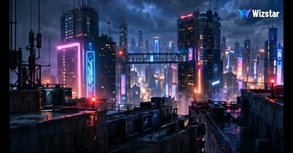</a>

The 30 second action is split into five timed beats, each with its own camera move, and @image1 is locked as the only hero so his face and outfit stay fixed. The audio cue for the music cut at 00:27 and the spatial continuity line keep the sound and the skybridge layout consistent across the whole sequence.

Seedance 2.5 · Reference-to-video · Source: [@Xaroon_x on X](https://x.com/Xaroon_x/status/2112430298973503726)

[`cyberpunk`](tags.md#tag-cyberpunk) [`action`](tags.md#tag-action) [`parkour`](tags.md#tag-parkour) [`drones`](tags.md#tag-drones) [`reference-lock`](tags.md#tag-reference-lock)

<details><summary><b>Prompt</b></summary>

```text
NEON BREACH

[ENGINE DIRECTIVE]
Genre: Cyberpunk action thriller. Duration: exactly 30 seconds. Aspect ratio: 16:9. Target: 60fps where supported. Style: photorealistic Hollywood cinema, heavy rain, neon reflections, volumetric lighting, realistic motion blur and skin texture.

HERO LOCK: @image1 is the only hero. Preserve his exact face, hairstyle, facial hair, skin tone, age, body proportions, outfit and accessories in every shot. No clones, costume changes, new weapons or invented powers.

LOCATION: Halcyon Stack, a rain-soaked futuristic megacity with two 40-story towers connected by a glass skybridge, rooftop machinery, steel gantries and abstract neon signs. Maintain spatial continuity.

ENEMIES: Three red-scanner hunter drones using ramming and taser darts, plus a 3-meter armored enforcer with matte-black plating, hydraulic limbs and a dim blue visor.

CAMERA: Motivated low tracking, lateral pursuit, tactical high angles, over-the-shoulder shots, controlled slow-motion orbit and vertical descending tracking. Natural motion blur. Hero generally travels left to right.

[AUDIO]
Original pulsing synth bass, industrial percussion, rising tense strings, heavy rain, distant sirens, drone rotors, hydraulic servos, glass shattering, steel groans and cable snaps. Music cuts at 00:27, leaving rain and a soft sustained synth pad.

[TIMELINE]

00:00–00:05 | THE HUNT
Wide aerial view of neon towers in heavy rain. Camera drops behind @image1 sprinting across a rooftop. Three drones rise and lock on at 00:03. He vaults a ventilation unit.

00:05–00:10 | DRONE ALLEY
He slides beneath a diving drone, sending it crashing into a wall. He leaps, grabs a second drone and swings it into the third. Both crash through a billboard frame in sparks. He keeps running.

00:10–00:15 | THE ENFORCER
A massive armored enforcer smashes through a rooftop door. The hero pivots and races onto a transparent glass skybridge, with the city far below. The machine charges after him.

00:15–00:20 | GLASS FLOOR
The hero ducks a hydraulic punch, shattering the glass floor. Cracks spread beneath the enforcer. In a controlled slow-motion 180-degree orbit, the hero leaps across a 6-meter gap and grabs a swaying steel gantry.

00:20–00:25 | CABLE DROP
The enforcer lands heavily on the gantry. The hero grabs a maintenance cable and swings down the tower. Bolts shear, metal bends and the gantry collapses. He kicks off the glass facade and lands on a lower rooftop.

00:25–00:30 | FINAL IMAGE
The enforcer falls through neon-lit rain and impacts the street at 00:27. Silence follows. The hero rises at the rooftop edge and looks back at the shattered skybridge. Camera slowly pulls away, revealing the immense glowing city.

END: Quiet, powerful cinematic composition. No text or logos.
```

</details>

<a id="seedance-neon-street-martial-arts-fight"></a>
### Woman sweeps and kicks man in neon street fight

<a href="https://x.com/codewithhajra/status/2110290053670814031">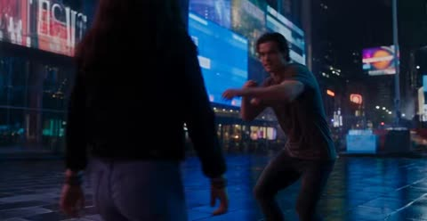</a>

Timed beats (0 to 2 seconds, 2 to 5 seconds and so on) split the choreography into ordered steps the model can follow move by move. A detailed look for each character plus a closing spec line for framing, length and consistency keeps both faces and outfits stable across cuts.

Seedance 2.5 · Text-to-video · Source: [@codewithhajra on X](https://x.com/codewithhajra/status/2110290053670814031) · found via [LearnPrompt/awesome-seedance](https://github.com/LearnPrompt/awesome-seedance)

[`fight-scene`](tags.md#tag-fight-scene) [`martial-arts`](tags.md#tag-martial-arts) [`neon-street`](tags.md#tag-neon-street) [`timed-beats`](tags.md#tag-timed-beats)

<details><summary><b>Prompt</b></summary>

```text
Create an ultra-realistic, live-action cinematic fight scene featuring two 20-year-old adults. The girl is exceptionally pretty, with long, glossy dark-brown hair, beautiful expressive eyes, delicate facial features, a charming smile, and a confident, fearless attitude. She wears a stylish black fitted jacket, a cute top, blue jeans, and black boots. The boy is a handsome 20-year-old man with an athletic build, messy dark hair, and a cocky expression.

0–2 seconds: On a neon-lit city street at night, the boy arrogantly blocks her path and suddenly tries to grab her arm. She pulls away instantly, giving him a deadly serious look.

2–5 seconds: He throws a punch. She smoothly dodges, grabs his arm, spins around, and delivers a powerful kick to his stomach, making him stumble backward in shock.

5–8 seconds: Furious, he charges at her again. She ducks his attack, sweeps his legs, and delivers a perfectly timed spinning kick that sends him crashing onto the pavement.

8–10 seconds: She casually fixes her beautiful hair, looks down at him with a cheeky smirk, and says, “Big mistake, buddy.” She turns and walks away confidently while he lies stunned on the ground.

Visual style: Photorealistic live-action, beautiful natural facial details, realistic skin texture, expressive eyes, detailed hair movement, professional martial arts choreography, fast dynamic camera tracking, dramatic cinematic lighting, realistic physics, authentic impact sounds, consistent character appearances, no gore, no supernatural effects, no cartoon visuals. Vertical 9:16 format, exactly 10 seconds.
```

</details>

<a id="seedance-night-rain-loading-door-escape"></a>
### Woman runs down dark industrial corridor

<a href="https://x.com/nawalsehar/status/2100082784018821414">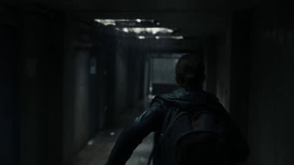</a>

The prompt spells out physical cause and effect (friction, backpack inertia, center of mass) and gives a fixed shot list of handheld, floor level, door close-up and static wide, so the model has a clear beat sheet. Limiting sound to diegetic sources keeps the audio grounded in the scene.

Seedance 2.5 · Text-to-video · Source: [@nawalsehar on X](https://x.com/nawalsehar/status/2100082784018821414) · found via [LearnPrompt/awesome-seedance](https://github.com/LearnPrompt/awesome-seedance)

[`action-thriller`](tags.md#tag-action-thriller) [`handheld`](tags.md#tag-handheld) [`night-rain`](tags.md#tag-night-rain) [`diegetic-sound`](tags.md#tag-diegetic-sound)

<details><summary><b>Prompt</b></summary>

```text
Create a 30-second ultra-photorealistic live-action action-thriller at night during heavy rain. A young woman trapped inside an old industrial building discovers a partially open mechanical loading door and times her escape as two pursuers close in. She slides beneath the heavy door, struggles with realistic friction and backpack movement, rolls onto the rain-soaked pavement, and escapes into a dark service lane.

Show realistic human biomechanics, inertia, momentum, gravity, friction, center-of-mass shifts, realistic loading-door mechanics, backpack physics, rain and water dynamics, wet-surface traction, vehicle spray, and physically accurate material interactions. Use handheld chase cinematography, low floor-level shots during the escape, close-ups of the mechanical door, exterior tracking shots, and a final static wide shot. Camera movement should have natural operator inertia and subtle handheld shake.

Use only diegetic sound: heavy rain, breathing, footsteps, metal mechanisms, water splashes, distant traffic, echoes, and thunder. Natural nighttime lighting with realistic wet reflections, shadows, depth of field, and motion blur. End with the woman hidden behind a concrete wall as the pursuers run past, followed by an empty rain-soaked street and a cut to black.

No CGI, animation, superhero abilities, impossible parkour, teleportation, weightless objects, exaggerated slow motion, unrealistic physics, distorted anatomy, duplicate characters, text, logos, or watermark.
```

</details>

<a id="seedance-nova-pulse-zenith-ren"></a>
### Ren slashes two mechanical gargoyles above red moon

<a href="https://x.com/yourPlugAI/status/2113564718187037043">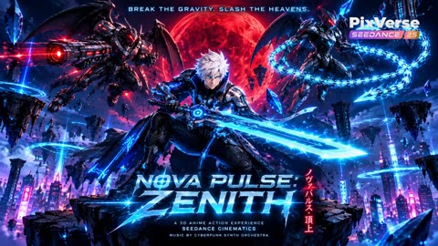</a>

Reference asset sheets lock the hero and beast designs while a timed beat list gives each segment its own VISUAL, ACTION and SOUND lines, so pacing, camera moves and audio cues are controlled shot by shot. Naming the Arcane and Guilty Gear Strive cell-shaded look sets the render style.

Seedance 2.5 · Reference-to-video · Source: [@yourPlugAI on X](https://x.com/yourPlugAI/status/2113564718187037043) · found via [LearnPrompt/awesome-seedance](https://github.com/LearnPrompt/awesome-seedance)

[`anime`](tags.md#tag-anime) [`cyberpunk`](tags.md#tag-cyberpunk) [`timeline-prompt`](tags.md#tag-timeline-prompt) [`cell-shading`](tags.md#tag-cell-shading)

<details><summary><b>Prompt</b></summary>

```text
Nova Pulse: Zenith (ノヴァ・パルス：頂上) ⚡🔴
@PixVerse 

High above a neon-glowing cyberpunk city under a massive crimson moon, 3D anime hero Ren unleashes high-speed Cyber-Kenjutsu against two mechanical Cyber-Gargoyles. Non-stop 30-second 3D anime gauntlet. 

✨Generated with Seedance 2.5 on PixVerse AI featuring Arcane and Guilty Gear Strive-level 3D cell-shaded animation. 

#PixVerseCPP #PixVerseAI #Seedance25

✨Seedance 2.5 - 30s Master Video Prompt (character sheets attached below)

[ENGINE DIRECTIVE]
Generate a continuous 30-second hyper-kinetic 3D anime action sequence at 60fps in 16:9 widescreen format. Style: High-end Arcane and Guilty Gear Strive 3D cell-shaded anime animation, glossy textures, intense particle effects, high-frame-rate impact pauses. Maintain 100% strict visual consistency with provided asset sheets: "Ren" (White-haired anime hero in neon blue circuit coat with plasma greatsword) and "Cyber-Gargoyles" (Mechanical beast-warriors). Setting strictly follows "Shattered Anti-Gravity Floating Courtyard". Rapid 2-to-3 second action beats, zero-gravity combat physics, directional camera whip-pans.

[AUDIO DIRECTIVE]
• MUSIC: Fast-paced cyberpunk metal synth hybrid with heavy guitar riffs, intense electronic risers, and booming sub-bass impacts.
• SOUND DESIGN: Humming plasma blade hum, laser cannon blasts, whipping energy chain sizzles, shattering stone impacts, and anti-gravity wind roars.

[TIMELINE BREAKDOWN]

00:00 - 00:03 | ZERO-G STANCE & CRIMSON MOON LOCK
• VISUAL: Low-angle tracking camera panning up from floating stone debris to Ren's ready Kenjutsu stance.
• ACTION: Ren stands on a hovering stone tile against the giant crimson moon, his Greatsword humming with cyan energy as two Cyber-Gargoyles hover menacingly above him.
• SOUND: Plasma blade hum, atmospheric anti-gravity drone, mechanical growls, explosive synth intro.

00:03 - 00:06 | AIR-STEPPING & PLASMA BLAST DEFLECTION
• VISUAL: High-speed upward tracking camera following Ren's aerial movement.
• ACTION: Cannon-beast fires three high-velocity energy projectiles. Ren air-steps upward through zero-g, deflecting all three shots with his Greatsword into floating rubble, causing explosive cyan particle bursts.
• SOUND: Cannon FIRING blasts, metallic blade energy deflect CLANGS, explosive rubble SHATTER.

00:06 - 00:09 | PLASMA-CHAIN TRAP & 360-DEGREE SPIN
• VISUAL: Dynamic orbital tracking camera capturing the mid-air spin.
• ACTION: Whip-beast snaps dual plasma-chain whips from above. Ren executes a 360-degree mid-air spin, wrapping the energy chains tightly around his Greatsword blade to halt the momentum cold.
• SOUND: Whip crack SIZZLE, metallic chain binding CLACK, energy tension hum.

00:09 - 00:12 | BOOT PARTICLE BURST & DIAGONAL ARMOR SLICE
• VISUAL: 0.8-second time-dilation close-up on Ren's boots before launching into a fast tracking slash.
• ACTION: In hyper-slow motion, Ren channels a blue particle burst into his boots, launching off the trapped chain to deliver a flying diagonal slash that severs the whip-beast's shoulder armor.
• SOUND: Time-dilation sub-bass DROP, particle boot BURST, high-voltage plasma slash WHOOSH, armor severing CRUNCH.

00:12 - 00:15 | CIRCULAR GRAVITY WAVE & DEBRIS FREEZE
• VISUAL: Wide impact tracking camera capturing the expanding energy ripple.
• ACTION: Ren lands on a hovering pillar and plants his sword, unleashing a circular cyan gravity wave that freezes surrounding floating debris in place.
• SOUND: Sword floor plant THUD, massive gravity shockwave BOOM, crystalline debris freeze chime. 

00:15 - 00:18 | OVERDRIVE IGNITION & BEAM CHARGE
VISUAL: Close-up camera zooming into Ren's face as his coat circuits ignite.
ACTION: Seamless transition: Cannon-beast charges its main red beam weapon. Ren closes his eyes for a split second as glowing neon blue circuit lines pulse wildly across his dark coat.
SOUND: High-voltage beam charge WHINE, coat circuit power-up HUM, fast drum roll.

00:18 - 00:21 | OVERDRIVE DASH & STAR-SHAPED ENERGY GRID
VISUAL: High-speed multi-angle speed-ramped camera tracking rapid teleportations.
ACTION: Ren executes an Overdrive Dash, blurring through six rapid directional teleport-slashes that slice through both opponents, leaving a glowing cyan star-shaped energy grid in mid-air.
SOUND: Rapid teleport WHOOSH-WHOOSH-WHOOSH, high-frequency energy grid SLICE chimes.

00:21 - 00:24 | 3D ANIME IMPACT PAUSE & BLADE SHEATH
VISUAL: Time-dilation 3D anime impact pause as camera slowly orbits behind Ren.
ACTION: Time freezes into a dramatic anime impact pause: Ren stands behind both enemies calmly sheathing his plasma blade, as glowing cyan slash-lines expand dangerously across the beasts' armor.
SOUND: Sub-bass time-freeze DROP, metallic sword sheath CLICK, crackling energy tension.

00:24 - 00:27 | MASSIVE SHOCKWAVE EXPLOSION & DEACTIVATION
VISUAL: Wide dramatic tracking camera capturing the explosive collapse.
ACTION: A massive cyan energy shockwave erupts, blasting both Cyber-Gargoyles backward onto a lower floating platform, completely disarmed and deactivated with smoking armor.
SOUND: Explosive energy shockwave BOOM, heavy armor platform crash THUD, power-down whine.

00:27 - 00:30 | BLADE FLICK & VICTORIOUS SKYLINE ORBIT
VISUAL: Hero center-framed 360-degree orbital camera settling on Ren against the cyberpunk city.
ACTION: Ren flicks his Greatsword downward, clearing the remaining plasma trail, as the floating debris gently settles and the camera orbits his victorious stance above the glowing neon metropolis below. CUT TO BLACK at 00:30.
SOUND: Sword energy flick WHOOSH, settling debris rustle, quiet wind chime, total silence.
```

</details>

<a id="seedance-nun-demon-cathedral-sword-fight"></a>
### Kneeling nun with bloodied sword surrounded by demons

<a href="https://x.com/itsSaira_1/status/2108765927194198397">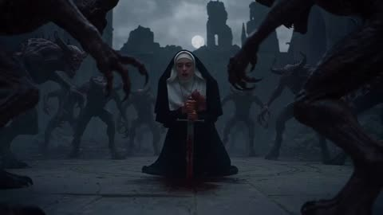</a>

The prompt is written as a timed beat sheet, moving from a kneeling start through a transformation, a fight and a closing wide shot, so each stage has a clear visual action. Fixed scene anchors such as the full moon, the rune circle and the cathedral ruins keep the setting consistent across the cuts.

Seedance 2.5 · Text-to-video · Source: [@itsSaira_1 on X](https://x.com/itsSaira_1/status/2108765927194198397)

[`transformation`](tags.md#tag-transformation) [`fight-sequence`](tags.md#tag-fight-sequence) [`gothic-fantasy`](tags.md#tag-gothic-fantasy)

<details><summary><b>Prompt</b></summary>

```text
A cinematic 30-second sequence starting in a dark, ruined gothic cathedral at night with a full moon. A woman dressed as a nun is kneeling inside a glowing magical rune circle on a stone floor, holding a bloodied sword, surrounded by hordes of terrifying demonic creatures. She pulls the sword to her chest, bursting with fiery light from her ribcage, and transforms into a powerful entity with large white glowing angelic wings and a halo, her clothes changing into an ornate dark blue gown with golden embroidery. She wields glowing magical swords, fighting off and defeating the demons with fiery energy and brilliant flashes of light in an epic action sequence. Finally, she plants her glowing sword into the ground, creating a protective circle with giant glowing crosses, standing victorious as the cathedral clears.

Negative Prompt:
blurry, low quality, distorted, deformed, bad anatomy, extra limbs, poorly drawn face, poorly drawn hands, watermark, signature, ugly, low resolution, choppy animation
```

</details>

**1** · [2](video-action-2.md)
