# Animals and pets

[Back to the list](../../README.md) · All 26 entries

<a id="kling-eagle-pov-steppe-flight"></a>
### Golden eagle POV flight over mountain valleys

<a href="https://x.com/higgsfield_ai/status/2019090635408744851"></a>

The camera is locked to the eagle's head, with wing and feather edges kept in frame as a stable anchor. Ground parallax cues (rivers, valleys, peaks) and the constraints on jitter, motion blur and cuts keep the flight physically coherent in one continuous shot.

Kling 3.0 · Text-to-video · Source: [@higgsfield_ai on X](https://x.com/higgsfield_ai/status/2019090635408744851) · 2,454 likes on 2026-10-27

[`pov`](tags.md#tag-pov) [`aerial`](tags.md#tag-aerial) [`wildlife`](tags.md#tag-wildlife) [`tracking-shot`](tags.md#tag-tracking-shot) [`landscape`](tags.md#tag-landscape)

<details><summary><b>Prompt</b></summary>

```text
POV flight from a golden eagle soaring over vast mountainous steppe landscapes. Camera locked to the eagle’s head with clean, precise tracking — stable forward motion, no jitter. The eagle actively flaps its wings, powerful wingbeats transitioning into smooth gliding. Wings and feathers visible at the frame edges, moving naturally in rhythm. Strong ground parallax below: winding rivers, open valleys, rocky peaks. Bright late-afternoon light, crisp air, subtle lens flare. Ultra-wide cinematic perspective, natural motion blur from speed only, realistic flight physics, continuous shot, no cuts.
```

</details>

<a id="seedance-zombie-calico-cat-reunion"></a>
### Crying ginger cat aims handgun at zombie calico

<a href="https://x.com/ElsaSofia__AI/status/2108740749420646730">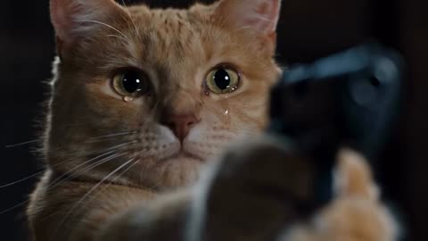</a>

A timestamped shot list assigns each beat a framing, an action and an emotional turn, so the tension in the dark cabin resolves cleanly into the golden hour meadow. The opening lays out both characters, both settings and the lighting contrast between the two halves, which keeps the cats and the locations consistent across cuts.

Seedance 2.5 · Text-to-video · Source: [@ElsaSofia__AI on X](https://x.com/ElsaSofia__AI/status/2108740749420646730) · 2,000 likes on 2026-10-27

[`short-film`](tags.md#tag-short-film) [`cats`](tags.md#tag-cats) [`emotional`](tags.md#tag-emotional) [`timestamped-shots`](tags.md#tag-timestamped-shots) [`cinematic`](tags.md#tag-cinematic)

<details><summary><b>Prompt</b></summary>

```text
Cinematic emotional short film, live-action look, 16:9, 24 seconds, 24 fps. Characters: a ginger tabby cat that stands upright on its hind legs like a human, and a calico cat (black, white and orange). At the start the calico is zombie-like: cloudy pale eyes, torn fur hanging in shreds, sharp fangs. Opening setting: a dark rustic wooden cabin kitchen at night, pots on wooden shelves, a window with cold blue night light, wooden plank floor. Final setting: a green meadow at golden-hour sunset with white dandelion fluff floating in the air.

0:00-0:01.5 Extreme close-up of the ginger tabby with tears in his eyes, holding a black handgun with both paws, aimed toward the camera (gun out of focus in the foreground).

0:02-0:02.5 Over-the-shoulder wide shot from behind the ginger cat: he aims the handgun at the zombie calico slowly walking toward him across the wooden floor.

0:03-0:03.5 Front shot: the ginger cat stands upright, aiming with both paws, dark wooden wall and blue window behind him.

0:04-0:04.5 Close-up of the zombie calico, glassy pale eyes, then snarling with fangs.

0:05-0:06.5 Extreme close-up of the ginger cat's face, tears rolling down.

0:06.5-0:08 He stands aiming, then slowly lowers the gun.

0:08.5-0:09 The gun drops from his paw and he opens both arms wide for a hug.

0:09.5-0:10 Quick cuts: the zombie calico's face, then the ginger cat with eyes closed and a tear falling.

0:10.5 The calico leaps into his arms, wrapping her white paws around him; her fur is now healthy and normal.

0:11-0:13 Cut to the sunset meadow: the two cats roll and cuddle in the grass, white fluff floating around, warm golden light.

0:13-0:18 Close-up of the calico's affectionate face while the ginger cat's paw gently touches her face and head; the ginger cat lies on his back in the grass, eyes closed, peaceful.

0:18-0:20.5 The ginger cat's paw rests on her face; he looks up, content and relaxed.

0:21-0:22 Wide silhouette shot: the two cats sit snuggled together against the glowing sunset, tall grass and wildflowers in the foreground.

0:22.5-0:24 Close-up with sun flare: the ginger cat tenderly rubs his head against the calico's head. End.

Style: dramatic zombie-movie tension turning into a heartwarming ending, shallow depth of field, realistic fur detail, warm golden-hour light in the second half, dark low-key lighting in the first half.
```

</details>

<a id="omni-photo-bird-jumps-onto-hand"></a>
### Bird leaps from laptop photo onto hand

<a href="https://x.com/alexanderchen/status/2060322611586834518"></a>

The prompt first locks the screen content to match the source video, then describes one continuous action in order: head turn, leaving the photo, landing on the hand. A real filmed setup gives the effect a physical anchor.

Gemini Omni Flash · Video edit · Source: [@alexanderchen on X](https://x.com/alexanderchen/status/2060322611586834518) · 1,385 likes on 2026-10-27

[`photo-to-life`](tags.md#tag-photo-to-life) [`animal`](tags.md#tag-animal) [`screen-breakout`](tags.md#tag-screen-breakout) [`live-action`](tags.md#tag-live-action)

<details><summary><b>Prompt</b></summary>

```text
Start with the computer screen content exactly the same as in the video. Make the bird come to life, turning head, leaving the photo and jumping onto the person's hand.
```

</details>

<a id="wan-camera-angle-swap"></a>
### Re-shoot your clip from new camera angles, same action

<a href="https://x.com/Framer_X/status/2101324357108658433"></a>

Upload one continuous shot as the action reference and Wan re-films it from new angles. Regenerate if a shot drifts.

Wan 3.0 · Video edit · Source: [@Framer_X on X](https://x.com/Framer_X/status/2101324357108658433) · 1,170 likes on 2026-10-27

[`camera-angle`](tags.md#tag-camera-angle) [`video-reference`](tags.md#tag-video-reference) [`workflow`](tags.md#tag-workflow)

<details><summary><b>Prompt</b></summary>

```text
STEP 1: Upload your video (must be continuous one shot) to any platform that supports WAN 3.0

STEP 2: Use the prompt below (adjust it to your video):

"Use the original video @ TAG ORIGINAL VIDEO as the exact action reference

0–1s: Camera stays exactly as in the original video as the wolf walks toward the scooter.

1–3s: Hard cut to a tight front close-up as the wolf continues walking toward and reaches the scooter.

3–5s: Hard cut to a high angle above as the wolf as he gets onto the scooter and starts riding.

5–7s: Hard cut to a full shot as the wolf rides the scooter down the street.

7–9s: Hard cut to a side tracking shot as he keeps riding down the street.

9-10s: Hard cut to an over the shoulder shot as he rides forward and notices the banana peel in his path.

10–12s: hard cut to a birds eye view shot as the fallen wolf is rolling over the asphalt.

12-13s : hard cut to an insert shot of his fist as wolf slams it into the asphalt.

Only the camera angle and framing change. Make sure every action, movement, timing and performance exactly identical to the original video @ TAG ORIGINAL VIDEO. The action continues seamlessly across every cut."

NOTE: If some scenes didn't work (action was different than original video) simply regenerate the video, that usually fixes the problem.
```

</details>

<a id="wan-panda-pond-canvas-toy-scene"></a>
### Panda pond scene with bamboo and cherry trees

<a href="https://x.com/EianLu/status/2115624666161418709">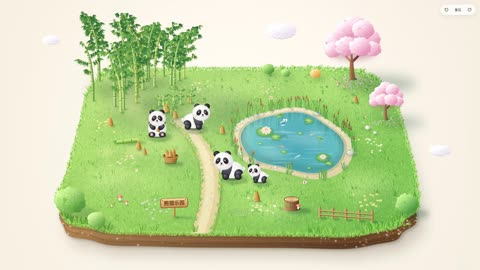</a>

A single-file Canvas prompt with fill-in slots for the animal, actions, objects and sign text, plus fixed rules for the platform cross-section, lighting and tilt shift. Rules such as drooping eye patches, no fur on limbs and a bouncy circle-to-spawn interaction keep the character cute and the scene playable.

Wan 3.0 · Text-to-video · Source: [@EianLu on X](https://x.com/EianLu/status/2115624666161418709) · 288 likes on 2026-10-29

[`canvas-2d`](tags.md#tag-canvas-2d) [`html`](tags.md#tag-html) [`panda`](tags.md#tag-panda) [`interactive-toy`](tags.md#tag-interactive-toy)

<details><summary><b>Prompt</b></summary>

```text
Create a soothing interactive mini-toy using a single HTML file + Canvas 2D (no image assets needed).

[User fills in]

- Main character animal: ____ (e.g., baby panda / corgi puppy / little lamb / duckling)

- Main character appearance details: ____ (e.g., black-and-white coloring, black eye patches; if left blank, default to the cutest features of that animal)

- Main character's actions: walking + ____ (e.g., sitting and munching bamboo shoots / wagging tail / swimming; can list 2–3)

- Scene theme: ____ (e.g., bamboo grove meadow / beach shore / snowy pine forest)

- Objects in the scene: ____ (e.g., bamboo grove, bamboo shoots, pond, cherry blossom tree, wooden sign; suggest 8–12 items)

- Text on the wooden sign: ____ (can leave blank)

[Visuals]

On a cream-colored paper background floats a miniature terrain platform, viewed from a 3/4 overhead angle with lots of white space around. The platform is a rounded square, exposing about 50px of cross-section thickness; the cross-section material should match the scene (soil layers / sand layers / ice layers, with layering and details). Fill the ground texture according to the scene theme, place the scene objects on it, and add pebbles, little flowers, and grass as accents to make the image full but not cluttered.

Style should be cute, soothing, full, and three-dimensional:

- Build all objects from radially gradient spheres lit from the upper left, with soft shadows and contact shadows; trees, bushes, clouds made of lots of small bumpy shapes with light and dark variations

- Ground uses tens of thousands of short brush strokes plus color block mottling—don't flat-fill

- Tall things (trees, bamboo, pillars) must be drawn complete, with tops and tips, not cut off by the frame; balance the visual weight on left and right sides

- Finally add tilt-shift blur, slight boost in contrast and saturation, warm-to-cool soft light gradient

- Default to bright colors; only dark scenes like nightscapes should be dim

[Main Character]

Chubby, roly-poly baby build: big head, round body, short limbs, big eyes with highlights, blushing cheeks, gentle expression. Eye-area patterns or patches should droop outward and downward—don't make them upturned, or it'll look fierce. Fur edges only with short, soft strokes—no fur on limbs or feet. Every action should be instantly recognizable at a glance (e.g., body level when walking, legs alternating), and it should blink.

[Interactions]

- Draw a circle on the ground with the mouse; a main character pops out in the circle (easeOutBack bounce + star particles)—bigger circle means bigger character; if drawn in water or dense bushes where it can't stand, prompt "Try drawing a circle on some open ground instead." Max 30 characters.

- Characters wander idly near their own circle, randomly doing various actions; they won't enter water or pass through obstacles, and they'll step aside for each other; smaller ones will follow bigger ones.

- Drag characters (they lift off the ground when grabbed). If dropped in an unstandable spot, auto-move to the nearest open ground—don't bounce back to original spot. Select and hit Delete to remove.

- Drag blank space outside the platform or right-click drag to rotate the view: left-right for rotation, up-down for pitch. Top-right has ±45° and reset buttons; keyboard ← → also rotates.

- Add a few moving little things in the scene, like flying or floating ones, water ripples—whatever matches the scene theme.

[Technical Requirements]

- Ground uses u,v ∈ [0,1] coordinates with a perspective camera (yaw + pitch); platform auto-scales on view change to always fit fully in the frame.

- Two layers: Ground layer repaints once per view change; vertical objects pre-rendered as small images at fixed view (auto-crop transparent edges), then positioned by camera, scaled by distance, and sorted with main character by screen y from back to front—so characters can walk behind objects. Dense tree groves broken into individual tree small images.

- Obstacles judged by circular footprints on the ground; character positions also in u,v coordinates, independent of view.

- Don't use ctx.filter blur every frame (way too slow). Dynamic shadows via radial gradients instead; during rotation, use draft quality without blur, switch to full quality and fade in after release. Blur radius doesn't auto-scale—manually multiply by render scale.

- Keep 60fps with about 10 characters on screen at once; adapt to window scaling and mobile screens.

[Process]

1. Start with just the static scene—output 2–3 sample images for my approval: one full panorama, one close-up of main character in various poses.

2. After I approve, build the interactive version; test it yourself in the browser once done—check circle-drawing, dragging, deleting, and rotating, confirm no errors.
```

</details>

<a id="h3-woman-dog-green-window-breeze-short-film"></a>
### Woman and dog at windy green window

<a href="https://x.com/hey_am_cherry/status/2113115486393409560">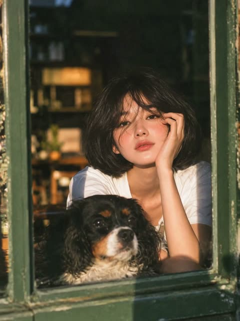</a>

It starts from the reference image and names the identity anchors to keep (bob haircut, white tee, tricolor dog, green window frame, film grain). A timed beat sheet in 3 second blocks pairs each action with a sound cue so the wind, paw and piano build stay in sync.

MiniMax H3 · Image-to-video · Source: [@hey_am_cherry on X](https://x.com/hey_am_cherry/status/2113115486393409560) · 217 likes on 2026-10-29

[`dog`](tags.md#tag-dog) [`window-light`](tags.md#tag-window-light) [`wind-hair`](tags.md#tag-wind-hair) [`film-grain`](tags.md#tag-film-grain)

<details><summary><b>Prompt</b></summary>

```text
Create a 15-second hyper-realistic emotional short film using the provided image as the exact starting frame. Preserve the woman's identity, short black bob haircut, white T-shirt, tricolor dog, old green window frame, and warm vintage film aesthetic.

FORMAT:
15 seconds, vertical 3:4, photorealistic, continuous natural handheld footage. Realistic wind physics, detailed hair movement, expressive but believable animal behavior, warm cinematic lighting, subtle 35mm film grain.

STORY AND ACTION:

0–3 SECONDS — THE WIND ARRIVES
Begin exactly from the reference image. The woman rests her cheek against her hand while the dog lies in the foreground. A sudden gentle breeze enters through the partly open window. Her loose bangs lift and sweep across her eyes, several strands fluttering naturally around her cheeks. She blinks, gives a tiny amused expression, and tries to move the hair away from her face. The curtain in the background sways gently.

Sound: Soft outdoor wind, distant birds, subtle cafe ambience, and a delicate piano melody beginning quietly.

3–6 SECONDS — THE UNEXPECTED REACTION
The dog suddenly raises its head and notices her windblown hair. It tilts its head, watches her struggle with the loose strands, then carefully lifts one paw and places it on the window ledge near her arm. The woman notices and looks at the dog with genuine surprise. A stronger breeze lifts her hair again, and she lets out a short, natural laugh.

Sound: Gentle wind through the window, soft paw movement, a faint natural laugh. Piano builds with warm strings.

6–10 SECONDS — THE CONNECTION
The dog moves closer and gently nudges her forearm with its nose, trying to get her attention. She lowers her hand from her cheek and strokes its head. Just then, another gust sweeps her bangs across her face. She leans forward, playfully brushing her hair aside, and the dog stretches up to nuzzle her cheek. Capture the tiny details: moving hair strands, the dog's shifting ears, her changing expression, and realistic fur reacting to the breeze.

Sound: Natural dog breathing, rustling hair, soft fabric movement, piano and strings building emotionally.

10–13 SECONDS — THE WOW MOMENT
As the woman leans closer, the dog gently places its front paws on the window ledge and reaches toward her. She instinctively wraps both arms around its head and shoulders in a spontaneous affectionate embrace. Her hair blows across both of them as warm late-afternoon sunlight briefly catches the moving strands. She closes her eyes for a moment, smiling genuinely against the dog's head. Keep the interaction physically natural and anatomically correct.

13–15 SECONDS — THE ENDING WORTH WATCHING
The woman slowly lifts her face from the dog's fur. The dog looks directly into her eyes, then gives her cheek one quick, natural lick. She freezes in surprised delight for a split second, then breaks into a real, uncontrollable little smile and hugs the dog closer. A final gust lifts her bangs away from her face, revealing her full smile. The camera makes a subtle push-in and holds on their joyful expressions as the music reaches its warmest note. End on the dog's happy, relaxed face beside hers.

AUDIO DESIGN:
Create an original emotional piano-and-strings soundtrack synchronized with the action.

VISUAL QUALITY AND MOTION:
Natural wind with individual hair strands moving independently; believable hair physics; detailed fur; realistic eye movements and blinking; natural facial expressions; correct hand and paw anatomy; consistent character identity; physically plausible contact between the woman and dog. Preserve the original green window framing and warm, slightly grainy film look. The woman's face remains the visual focus.
```

</details>

<a id="h3-car-backseat-raccoon-monkey-chip-burst"></a>
### Raccoon and monkey chip burst in car

<a href="https://x.com/laviniavelle/status/2108851182244606445">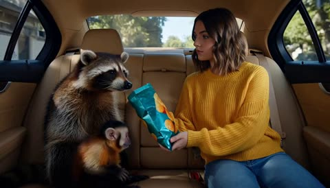</a>

The prompt fixes the setting, subject positions and wardrobe first, then runs a beginning, middle and end beat sequence so the chip burst lands as a clear comic payoff. Soft natural lighting and photorealistic cues keep the animals believable.

MiniMax H3 · Text-to-video · Source: [@laviniavelle on X](https://x.com/laviniavelle/status/2108851182244606445) · 188 likes on 2026-10-28 · found via [SkyNotSilent/awesome-MiniMax-H3-cases](https://github.com/SkyNotSilent/awesome-MiniMax-H3-cases)

[`animals`](tags.md#tag-animals) [`comedy`](tags.md#tag-comedy) [`car-interior`](tags.md#tag-car-interior) [`photorealistic`](tags.md#tag-photorealistic) [`three-beat`](tags.md#tag-three-beat)

<details><summary><b>Prompt</b></summary>

```text
A cinematic video inside the back seat of a moving car with beige leather interior On the right a young woman with medium-length brown hair, wearing a yellow knitted sweater and blue jeans is holding a blue bag of potato chips Sitting on the left is a fluffy raccoon and a small capuchin monkey is resting close to the raccoon The woman offers a chip to the animals but as the raccoon reaches into the bag chips accidentally burst into the air and scatter all over the backseat including one landing on the raccoon's head The woman reacts with surprise and then bursts into laughter while the monkey looks around curious and playful Photorealistic soft natural lighting, vibrant colors.
```

</details>

<a id="h3-oggy-cockroaches-desktop-chaos"></a>
### Oggy swats desktop icons while cockroaches scatter

<a href="https://x.com/SimplyAnnisa/status/2102261324860293180">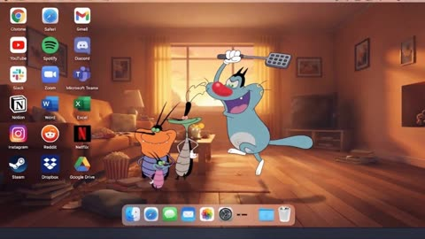</a>

Pins the provided desktop screenshot as the exact first frame and fixes a static camera so the layout stays put. Timed beats with a strict order for each icon restore keep the motion readable and the icon count fixed.

MiniMax H3 · Image-to-video · Source: [@SimplyAnnisa on X](https://x.com/SimplyAnnisa/status/2102261324860293180) · 180 likes on 2026-10-29 · found via [SkyNotSilent/awesome-MiniMax-H3-cases](https://github.com/SkyNotSilent/awesome-MiniMax-H3-cases)

[`cartoon`](tags.md#tag-cartoon) [`desktop-reference`](tags.md#tag-desktop-reference) [`slapstick`](tags.md#tag-slapstick) [`static-camera`](tags.md#tag-static-camera)

<details><summary><b>Prompt</b></summary>

```text
Create a 12-second horizontal 16:9 video at 1280×720 using the provided cartoon macOS desktop image as the EXACT first frame and visual reference.

EXACTLY 4 characters only: ONE large friendly Big Blue Dog with a fly swatter + THREE clearly different mischievous cockroaches. No other characters. All remain 2D cartoon style.

Static front-facing camera, one continuous shot, no cuts, zoom, pan, or camera movement.

0–2.5s: Big Blue Dog playfully chases the three cockroaches across the living-room floor toward the RIGHT side. Harmless slapstick comedy.

2.5–4s: Dog swings the fly swatter. ONLY these three desktop icons are physically dislodged: Gmail, Discord, Microsoft Teams. They gently rotate, fall, and land separately on the open desktop above the Dock. NO OTHER ICON moves.

4–5s: Dog notices the fallen icons, looking surprised. Cockroaches look mischievous.

5–10s: Dog physically restores the icons ONE AT A TIME in this exact order:
Gmail → exact original position → click.
Discord → exact original position → click.
Microsoft Teams → exact original position → click.

No teleporting, snapping, automatic restoration, or simultaneous movement.

10–12s: Cockroaches run toward the RIGHT. Dog follows briefly, then stops and looks at the viewer innocently while the three cockroaches look back mischievously.

DESKTOP MUST REMAIN IDENTICAL: all 18 original applications, labels, logos, menu bar, Dock, wallpaper, sofa, window, books, furniture, popcorn, floor, and background stay unchanged. ONLY Gmail, Discord, and Microsoft Teams may move. No duplicates, missing icons, altered logos, or extra characters.

AUDIO: playful cartoon piano/pizzicato, footsteps, swatter whoosh, icon movement/landing sounds, and three distinct soft computer clicks. No dialogue, subtitles, captions, text overlays, or watermark.

Premium smooth 2D cartoon animation, clean outlines, consistent proportions, squash-and-stretch, natural shadows, warm cinematic lighting.

FINAL FRAME: Gmail, Discord, and Microsoft Teams are EXACTLY back in their original positions; all other 15 icons remain stationary; exactly four characters visible on the RIGHT side.
```

</details>

<a id="h3-monkey-snatches-drink-japan-rest-stop"></a>
### Monkey snatches drink from woman at Japanese rest stop

<a href="https://x.com/hey_am_cherry/status/2110591304795410797">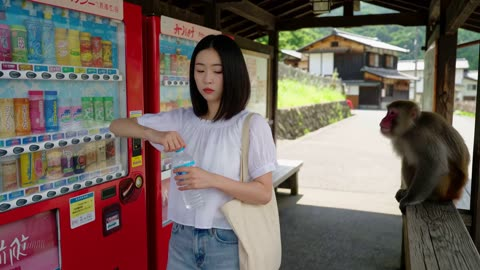</a>

Handheld iPhone framing and restrained reaction beats keep the footage feeling like a real travel clip, so the monkey carries the humor. A reference image locks the woman's identity, while the timed sections pin each prop (bottle, cap, tote, snack) across the 15 second sequence.

MiniMax H3 · Reference-to-video · Source: [@hey_am_cherry on X](https://x.com/hey_am_cherry/status/2110591304795410797) · 103 likes on 2026-10-29

[`monkey`](tags.md#tag-monkey) [`handheld`](tags.md#tag-handheld) [`japan`](tags.md#tag-japan) [`humor`](tags.md#tag-humor)

<details><summary><b>Prompt</b></summary>

```text
Create ultra-realistic 15-second vertical iPhone footage during a sunny summer afternoon at a quiet Japanese mountain village rest stop. Use the provided reference image ONLY for the main woman's identity. Keep her facial features, hairstyle, skin tone, outfit, and overall appearance consistent throughout.

The footage should look like a friend casually recording a real travel moment. Natural handheld smartphone movement, imperfect framing, realistic autofocus, authentic daylight, and spontaneous reactions. The scene must feel unscripted and believable, not cinematic.

0–3 seconds:
The woman stands beside a Japanese vending machine, opening a cold plastic drink. A Japanese macaque monkey sits on a wooden railing nearby, watching her. She notices the monkey briefly, then looks back at her drink.

3–6 seconds:
Without warning, the monkey quickly jumps down, snatches the bottle from her hand, and darts onto the nearby railing. The woman instinctively reaches for the bottle, then freezes with a genuinely surprised expression. The camera quickly turns to follow the monkey.

6–9 seconds:
The monkey sits on the railing and investigates the bottle with both hands, trying to open it. The woman takes two cautious steps closer, watching with a confused, disbelieving look. She remains composed, with only a slight natural smile.

9–12 seconds:
The monkey drops the bottle cap onto the ground. The woman bends slightly to look at it, then glances back at the monkey. Suddenly, a second macaque approaches from behind and reaches into her open tote bag, pulling out a wrapped snack.

12–15 seconds:
The woman immediately turns at the sound of her bag rustling and discovers the second monkey escaping with her snack. She quickly pulls her bag toward herself, looks from the monkey to her now-empty hand, and gives the camera a silent, incredulous look. The person filming quickly pans toward the escaping monkey as it climbs onto the railing with the snack. End abruptly during the action.

CHARACTER REACTIONS:
The woman must behave like a normal person experiencing an unexpected situation. Use subtle surprise, brief pauses, raised eyebrows, and natural body movements. No hysterical laughter, no continuous smiling, no exaggerated shock, no repeated pointing, and no laughing without a clear reason. Her reactions should be restrained and realistic. The unexpected monkey behavior provides the humor.

AUDIO:
Natural outdoor ambience, distant birds, vending machine hum, monkey chatter, bottle rattling, footsteps, and the sound of the snack wrapper. The woman may make one brief surprised gasp but must not laugh continuously. No background music, no narration, and no scripted dialogue.

VISUAL CONSISTENCY:
Both monkeys must remain anatomically realistic. Keep the same bottle, cap, tote bag, and snack consistent throughout. Every action must happen in a clear sequence with believable contact and movement. Keep the woman's face recognizable and visible during key reactions.

AVOID:
Hysterical laughter, forced smiles, cartoon behavior, exaggerated acting, cinematic camera movements, slow motion, dramatic visual effects, duplicated monkeys, extra limbs, morphing objects, teleportation, distorted hands, changing character identity, and artificial-looking skin.
```

</details>

<a id="h3-cat-shelters-abandoned-puppy-rainy-night"></a>
### Cat shelters abandoned puppy in rainy cardboard box

<a href="https://x.com/ZarnishNael/status/2112189056817787267">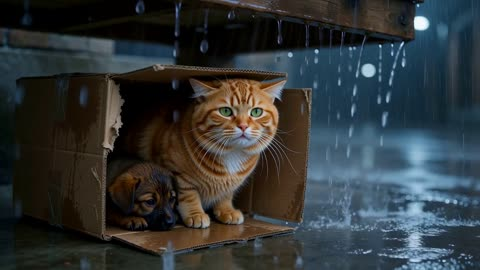</a>

The prompt is a short story told as a chronological arc: meeting, storm, next morning, scavenging, sunset. A named animal protagonist gives the model a consistent subject. Each beat states an emotional shift, so the 15s clip can carry a full narrative.

MiniMax H3 · Text-to-video · Source: [@ZarnishNael on X](https://x.com/ZarnishNael/status/2112189056817787267) · 101 likes on 2026-10-28 · found via [SkyNotSilent/awesome-MiniMax-H3-cases](https://github.com/SkyNotSilent/awesome-MiniMax-H3-cases)

[`animals`](tags.md#tag-animals) [`storytelling`](tags.md#tag-storytelling) [`emotional`](tags.md#tag-emotional) [`rain`](tags.md#tag-rain) [`narrative-arc`](tags.md#tag-narrative-arc)

<details><summary><b>Prompt</b></summary>

```text
Popo, a cat, finds a puppy abandoned in a cardboard box under the eaves. At first, Popo acts cold and indifferent, but when heavy rain begins, the cat bravely shields the puppy from the storm and spends the night keeping it warm beneath its belly.

By the next morning, a bond has formed between them. They begin facing the harsh life of stray animals together—Popo suppressing its own hunger to give the puppy its prey, even sneaking into a supermarket in search of food. Eventually, with the kindness and help of people around them, the two manage to get something to eat. As they cuddle together beneath the setting sun, they develop a deep and genuine bond that transcends species.
```

</details>

<a id="h3-impasto-bear-autumn-lake"></a>
### Impasto autumn bear eating berries by lake

<a href="https://x.com/churvikv/status/2107479794371666073">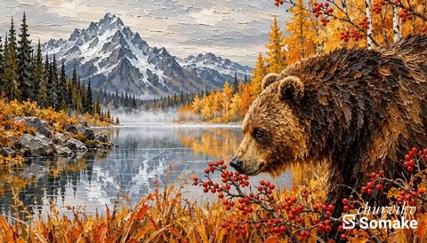</a>

Opens with the rendering style and paint texture, then builds the scene from the foreground berries to the background mountains so the layout is clear. It pairs one concrete action (the head moves as it chews) with ambient wind on grass and leaves, so the still painting feels alive without any camera move.

MiniMax H3 · Text-to-video · Source: [@churvikv on X](https://x.com/churvikv/status/2107479794371666073) · 96 likes on 2026-10-29

[`oil-painting`](tags.md#tag-oil-painting) [`impasto`](tags.md#tag-impasto) [`wildlife`](tags.md#tag-wildlife) [`autumn`](tags.md#tag-autumn) [`bear`](tags.md#tag-bear)

<details><summary><b>Prompt</b></summary>

```text
Oil painting style, thick impasto texture. A large brown bear standing by a lake in an autumn forest. The bear is gently eating red berries from a bush in the foreground. The bear's head moves slightly as it chews the berries. Background features snow-capped mountains, yellow autumn trees, and a calm lake with gentle water ripples. Subtle wind blowing the grass and leaves. Cinematic lighting, highly detailed, 4k.
```

</details>

<a id="kling-park-bench-dog-ball-edit"></a>
### Dog brings ball to the wrong friend in park

<a href="https://x.com/shikoba_86/status/2111760132535099777">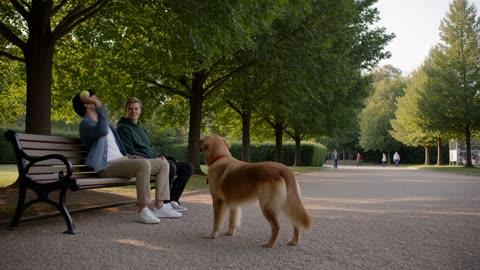</a>

Locks character, photography, light and camera in separate blocks so the edit keeps the same friends and dog across shots. Numbered shots with audio cues tie each change to the timing of the base clip.

Kling 4.0 · Video edit · Source: [@shikoba_86 on X](https://x.com/shikoba_86/status/2111760132535099777) · 51 likes on 2026-10-29

[`video-editing`](tags.md#tag-video-editing) [`character-lock`](tags.md#tag-character-lock) [`dog`](tags.md#tag-dog) [`park`](tags.md#tag-park) [`dialogue`](tags.md#tag-dialogue)

<details><summary><b>Prompt</b></summary>

```text
A city park on a sunny late-summer afternoon: a wooden bench beside a gravel path, tall green trees, a few people walking in the background.
CHARACTER LOCK: Friend A: man in his late 20s, short curly black hair, light stubble, white t-shirt, faded blue denim jacket, beige chinos, white sneakers. Friend B: man in his late 20s, short straight blond hair, clean-shaven, dark green hoodie, black jeans, grey sneakers. Dog: medium-sized golden retriever with a red collar. Same faces, clothes and dog in every frame.
PHOTOGRAPHY LOCK: 35mm and 50mm lenses, shallow depth of field, warm afternoon sunlight through the leaves, soft dappled shadows on the gravel, natural skin texture. Consistent color and exposure throughout.
LIGHT AND COLOR: lit only by the sun filtering through the trees. Warm highlights, soft green shadows. Muted, natural colors, no commercial color grade.
CAMERA LOCK: handheld, calm, slightly off-center compositions. No drone shots, no orbits, no crash zooms.
SHOT 1 — Wide shot. The two friends sit on the bench. Friend A throws a yellow tennis ball down the gravel path and the dog runs after it. Audio: the dog's paws on gravel, birds, distant voices.
SHOT 2 — Medium shot on the path. The dog catches the ball and runs back toward the bench with the ball in its mouth. Audio: paws on gravel, panting.
SHOT 3 — Medium shot on the bench. The dog drops the ball at Friend B's feet instead of Friend A's. Friend B picks it up and laughs. Audio: laughter.
SHOT 4 — Close-up on Friend A, half smiling, shaking his head.
FRIEND A (amused, mock-offended): "He always brings it back to you. Never to me."
Friend B pats the dog on the head. Audio: dog panting, birds.
AVOID: no music, no subtitles or on-screen text, the ball stays yellow, the dog keeps its red collar, no warped hands, no CGI or AI-generated look.
```

</details>

<a id="h3-french-bulldog-backyard-agility-course"></a>
### French bulldog runs backyard agility course

<a href="https://x.com/cocktailpeanut/status/2085448660612182507">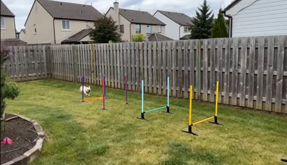</a>

Framing the shot as casual handheld footage by the owner in an ordinary backyard gives a natural amateur look. A clear sequence of obstacles (poles, hurdles, tunnel, bell) gives the model precise beats to follow in order.

MiniMax H3 · Text-to-video · Source: [@cocktailpeanut on X](https://x.com/cocktailpeanut/status/2085448660612182507) · 50 likes on 2026-10-28 · found via [SkyNotSilent/awesome-MiniMax-H3-cases](https://github.com/SkyNotSilent/awesome-MiniMax-H3-cases)

[`pets`](tags.md#tag-pets) [`handheld`](tags.md#tag-handheld) [`ugc`](tags.md#tag-ugc) [`sequence`](tags.md#tag-sequence) [`backyard`](tags.md#tag-backyard)

<details><summary><b>Prompt</b></summary>

```text
A casual handheld smartphone video filmed by the dog's owner in an ordinary suburban backyard. A cute, stocky French bulldog excitedly runs through a small homemade agility course, awkwardly weaving between plastic poles, hopping over two low hurdles, scrambling through a short fabric tunnel, and finally bumping a little bell with its nose.
```

</details>

<a id="kling4-edit-corgi-to-voxel-corgi"></a>
### Edit a clip: the corgi in the snow becomes a blocky voxel corgi

<a href="https://static-9.klingai-cdn-aws.com/kling-blog/presigned_url/e195bd1a-13ae-4d52-a67b-00b14f3972b6_1-5.mp4">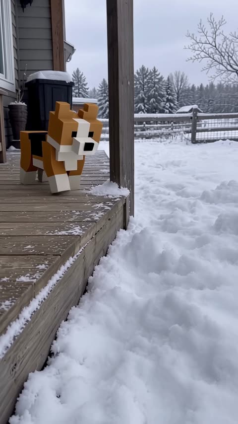</a>

Describes the new look part by part, from cube torso to 16x16 textures, and keeps the original coat pattern so it still reads as the same dog.

Kling 4.0 · Video edit · Source: [Kling 4.0 user guide](https://kling.ai/quickstart/kling-4-model-user-guide)

[`video-edit`](tags.md#tag-video-edit) [`voxel`](tags.md#tag-voxel) [`animals`](tags.md#tag-animals) [`restyle`](tags.md#tag-restyle)

<details><summary><b>Prompt</b></summary>

```text
Edit @Video 1 by replacing the tricolor Corgi puppy hopping in the snow with a 3D blocky pixel-art Corgi. The entire body must be constructed from cubes: a rectangular torso, a cubic head, two upright square triangular ears, four short cuboid legs, and a small block-shaped tail. All edges must have sharp, hard right angles, with no rounded curves.
The surface uses low-resolution 16×16 pixel textures, preserving the original Corgi's tricolor distribution: a tan body, a black saddle-shaped patch across the back, a white facial blaze, a white collar, a white chest, and white paws. The eyes are two black square pixels, the nose is a single black cube, and the tongue is a small pink pixel block. Lit surfaces are bright and side surfaces are dark, with flat-shaded, block-based lighting. There must be no fur texture or soft tonal transitions.
Keep the Corgi exactly the same size as the original, without scaling it up or down. The blocky Corgi must follow the original Corgi's position, actions, and movement trajectory frame by frame: standing beside the porch, jumping into deep snow and disappearing, leaving a hole in the snow, peeking out with its blocky head, repeatedly leaping forward into the snow, and finally sitting in the snow pit. During jumps, its body and legs should move as rigid blocks, like a creature animation in a video game, without bending.
The depth to which it sinks into the snow, the snow kicked up by its paws, the snow settling on its body, and its shadow cast onto the snow must all follow the blocky body accurately. Whenever it reappears after being covered by snow, it must remain the exact same blocky Corgi with consistent textures.
Important: Only the Corgi should be transformed into a blocky style. The wooden porch, snowy ground, wooden fence, trees, and gray-white sky must remain completely realistic, as in the original live-action footage. Do not apply any blocky or pixelated effects to the environment. Only one animal should appear in the footage, and no realistic, fur-covered Corgi may appear in any frame.
Keep the audio exactly identical to the original video. Do not add any new sounds. Preserve the handheld camera perspective and all camera movements. Everything else must remain unchanged.
```

</details>

Inputs: [1](https://static-81.klingai-cdn-aws.com/kling-blog/presigned_url/458f58fa-6934-4de1-a967-73e50bfbde62_1-5-1.mp4)

<a id="kling4-edit-pig-in-the-box-new-line"></a>
### Edit a clip: put a sleeping pig in the box and change the last line

<a href="https://static--86.klingai-cdn-aws.com/kling-blog/presigned_url/d0d3136c-1bf1-4940-b24e-4d056c5e9af6_1-1.mp4">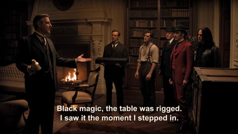</a>

One edit adds an element and rewrites dialogue at the same time. The prompt opens with Edit @Video1, which Kling says is required for edits.

Kling 4.0 · Video edit · Source: [Kling 4.0 user guide](https://kling.ai/quickstart/kling-4-model-user-guide)

[`video-edit`](tags.md#tag-video-edit) [`add-object`](tags.md#tag-add-object) [`dialogue`](tags.md#tag-dialogue) [`comedy`](tags.md#tag-comedy)

<details><summary><b>Prompt</b></summary>

```text
Edit @Video1. When the box is opened again at the end of the video, @Element1 is lying inside, asleep. Replace the final line, “Ah, it's all old stuff,” with “Why is there a pig here?”
```

</details>

Inputs: [1](https://static-69.klingai-cdn-aws.com/kling-blog/file_by_url/05e5537073a5b777a556a6ca1d7674084e5062c074bc7a7a2b9ee5c1b291d55c.png) · [2](https://static-96.klingai-cdn-aws.com/kling-blog/file_by_url/d75de72f10aa9c6378f0837551a337fb0e60ebe0f3b7532d0eacb10f8496eebc.png) · [3](https://static-88.klingai-cdn-aws.com/kling-blog/file_by_url/5a5caf66b2695099249e7bd573ca117d2ceec8168c1d044818f66bb97c3f8ef8.png) · [4](https://static--78.klingai-cdn-aws.com/kling-blog/presigned_url/84cd82e3-8d57-4e41-bb95-b2cf8e035a9e_1-1-1.mp4)

<a id="seedance-3d-animal-meadow-intro-children"></a>
### Cute 3D animals introduced one by one in meadow

<a href="https://x.com/Zarnab_with_Ai/status/2107293811714191628">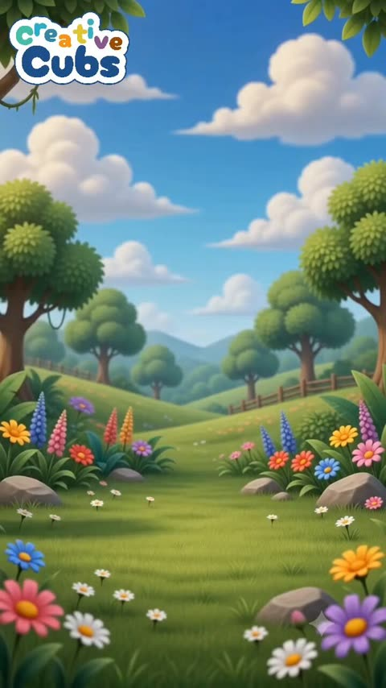</a>

A numbered sequence with one repeated beat per animal (enter, look at camera, small movement, hold) gives the model a clear structure across eight subjects. The meadow is described once and the prompt asks for it to stay constant, so the setting holds between cuts while the on screen label and confetti mark each arrival.

Seedance 2.5 · Text-to-video · Source: [@Zarnab_with_Ai on X](https://x.com/Zarnab_with_Ai/status/2107293811714191628)

[`education`](tags.md#tag-education) [`children`](tags.md#tag-children) [`animals`](tags.md#tag-animals) [`3d-animation`](tags.md#tag-3d-animation)

<details><summary><b>Prompt</b></summary>

```text
Create a 50-second vertical 9:16 educational children's animal video in a bright, colorful, high-quality 3D cartoon animation style.

SCENE & BACKGROUND:
A beautiful cheerful meadow in a magical children's storybook world. Lush green grass, colorful wildflowers in the foreground, rounded green trees, a few pink and orange trees, distant rolling hills and mountains, bright blue sky with fluffy white clouds. Warm sunny daylight, soft shadows, vibrant colors, clean polished 3D rendering.

STYLE:
Cute premium 3D animated children's content, friendly and adorable animal designs, large expressive eyes, soft rounded shapes, colorful cinematic lighting, playful educational atmosphere, high detail but simple enough for young children.

CAMERA:
Vertical composition, mostly static front-facing camera at children's eye level. Medium/full-body framing of each animal. Smooth subtle camera movement only. Keep the environment consistent throughout the video.

SEQUENCE:
Start with an empty beautiful meadow for a moment.

Then introduce animals one by one, each appearing clearly in the center of the frame:

1. TIGER — a cute orange tiger with black stripes, big expressive eyes and a friendly smile.
Display the word "TIGER" above the animal in large colorful playful children's typography.

2. ELEPHANT — a cute friendly gray elephant with large ears, short trunk and adorable expressive eyes.
Display "ELEPHANT" above it.

3. RHINOCEROS — a cute gray baby rhinoceros with a small horn, big eyes and friendly expression.
Display "RHINOCEROS" above it.

4. HIPPOPOTAMUS — a cute chubby purple-gray hippopotamus with a big smile and playful expression.
Display "HIPPOPOTAMUS" above it.

5. LEOPARD — an adorable golden-yellow leopard covered with dark spots, big expressive eyes and a friendly smile.
Display "LEOPARD" above it.

6. WOLF — a cute fluffy gray-and-white wolf with large expressive eyes and a friendly appearance.
Display "WOLF" above it.

7. GIRAFFE — a cute tall giraffe with a warm orange-yellow coat and brown patches, smiling gently.
Display "GIRAFFE" above it.

8. CROCODILE — a cute green crocodile with a rounded friendly body, big eyes and a playful smile.
Display "CROCODILE" above it.

For every animal:
The animal should enter or appear naturally, look toward the camera, make a small cute movement such as blinking, smiling, waving, walking a few steps or moving its head, then remain clearly visible for children to recognize.

TEXT:
Use large bold rounded children's lettering above each animal.
Letters should be colorful, playful, highly readable and visually exciting.
Add small colorful celebratory shapes such as stars or confetti when an animal appears.

TRANSITIONS:
Smooth playful transitions between animals while keeping the same meadow environment.
No scary movements, no aggressive behavior, no dark scenes.

FINAL SHOT:
Return to the empty colorful meadow for a short moment.

Overall feeling: cheerful, wholesome, education
```

</details>

<a id="seedance-cat-day-in-the-life-selfie-vlog"></a>
### Orange cat films its whole day selfie vlog

<a href="https://x.com/ZaraIrahh/status/2091385137133219971">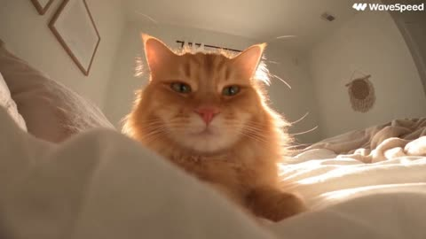</a>

The prompt splits 60 seconds into six ten second beats, each with its own action and sound cues. A hard no speech rule plus a list of allowed natural sounds keeps the audio to meows and room ambience, and the paw held phone framing sets the selfie look.

Seedance 2.5 · Text-to-video · Source: [@ZaraIrahh on X](https://x.com/ZaraIrahh/status/2091385137133219971) · found via [LearnPrompt/awesome-seedance](https://github.com/LearnPrompt/awesome-seedance)

[`cat`](tags.md#tag-cat) [`vlog`](tags.md#tag-vlog) [`selfie`](tags.md#tag-selfie) [`day-in-the-life`](tags.md#tag-day-in-the-life) [`natural-sound`](tags.md#tag-natural-sound)

<details><summary><b>Prompt</b></summary>

```text
Create a 60-second realistic day-in-the-life cat vlog, following the same cute cat from waking up in the morning until falling asleep at night.

Critical Requirement

NO HUMAN SPEECH AND NO DIALOGUE.

The cat must not speak any words at any point. Do not use narration, voice-over, human voices, subtitles, captions, or text.

The story must be communicated entirely through the cat’s actions, facial expressions, body language, meows, purrs, chirps, yawns, and natural environmental sounds.

Overall Visual Style

One continuous handheld front-facing smartphone selfie-vlog perspective. The cat holds the phone itself with its paw and films its own day.

- Realistic modern smartphone footage
- Natural handheld shake
- Slight framing imperfections
- Occasional autofocus hunting
- Natural front-camera lens distortion
- Realistic unfiltered smartphone colors
- Soft natural morning, afternoon, and evening lighting
- Same cat, face, fur pattern, eyes, and body throughout
- Cute but believable cat behavior
- Natural expressions and movements
- No cinematic camera movements
- No third-person camera
- No tripod or external camera
- No beauty filter or cinematic color grading
- No logos, watermarks, subtitles, captions, or on-screen text
- No background music

0–10 sec — Wake Up

The cat wakes up in a cozy bed.

It picks up the phone with its paw and starts filming itself selfie-style.

It looks sleepy, yawns, stretches, rubs its face with its paws, and looks into the camera with sleepy eyes.

It gives a tiny “meow”, then climbs out of bed.

10–20 sec — Breakfast

The cat walks into the kitchen while filming itself.

It sees its food bowl and immediately becomes excited.

It prepares or receives its breakfast, eagerly eats, then drinks water.

It looks happily into the camera and gives a couple of excited little meows.

Include realistic food-bowl sounds, chewing, drinking, and kitchen ambience.

20–30 sec — Playtime

The cat grabs its favorite toy.

It runs around the house, chases the toy, jumps onto the couch, bats at it with its paws, and playfully rolls around.

The phone shakes naturally during the energetic movement.

The cat stops for a moment, looks directly into the camera, gives a playful chirp/meow, then immediately runs off again.

30–40 sec — Exploring

The cat explores the house.

It looks through a window, watches birds outside, investigates a strange sound, walks into another room, and sniffs interesting objects.

It notices something outside and becomes curious.

The cat makes a soft “mrrp” sound and continues exploring.

Keep the behavior authentically feline rather than human-like.

40–50 sec — Afternoon Adventure

The cat safely goes outside into a garden or quiet courtyard.

It walks around while filming itself, sniffs flowers and plants, watches birds, investigates leaves, and explores its surroundings.

The cat pauses, looks excitedly at something off-camera, then gives a small curious meow.

Use natural outdoor sounds such as birds, wind, leaves, distant traffic, and footsteps.

50–60 sec — Evening & Bedtime

The cat returns home as the light becomes warm and soft.

It has its evening meal, drinks some water, then climbs onto the couch or back into its bed.

It grooms itself, yawns, becomes sleepy, and curls into a comfortable position.

It looks into the phone one last time, gives a tiny sleepy meow, slowly closes its eyes, and lowers the phone naturally.

End with quiet nighttime home ambience.

Final Audio Requirements

Absolutely no dialogue. No words. No narration. No human voice. No talking cat.

Use only natural diegetic sounds:

- Cat meows
- Purring
- Chirping
- Yawning
- Footsteps
- Food and water sounds
- Toy sounds
- Household ambience
- Birds and outdoor sounds
- Wind and leaves
- Natural nighttime ambience

The finished video should feel like a realistic, cozy smartphone vlog from a cat’s perspective, showing what the cat naturally does throughout an entire day without saying a single word.
```

</details>

<a id="seedance-deep-sea-animal-orchestra"></a>
### Sea animal orchestra performing in the deep ocean

<a href="https://x.com/thisismariaa25/status/2087112692809060493">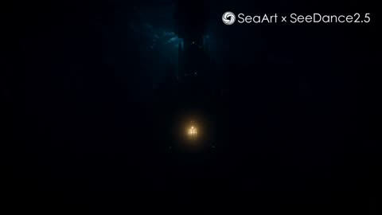</a>

Opens with a clear contrast, an orchestra at 3,000 feet underwater, then assigns one instrument to each animal in short parallel clauses. The stated depth sets the dark, light starved mood and the opera line invites generated sound.

Seedance 2.5 · Text-to-video · Source: [@thisismariaa25 on X](https://x.com/thisismariaa25/status/2087112692809060493) · found via [LearnPrompt/awesome-seedance](https://github.com/LearnPrompt/awesome-seedance)

[`underwater`](tags.md#tag-underwater) [`surreal`](tags.md#tag-surreal) [`animals`](tags.md#tag-animals) [`music`](tags.md#tag-music) [`cinematic`](tags.md#tag-cinematic)

<details><summary><b>Prompt</b></summary>

```text
An orchestra, but 3,000 feet underwater. Octopuses on piano, squid on strings, dolphins singing opera.
```

</details>

<a id="seedance-duckling-forest-river-friends"></a>
### Duckling journey down a forest river with animal friends

<a href="https://x.com/Zyrellix/status/2108047742425600244">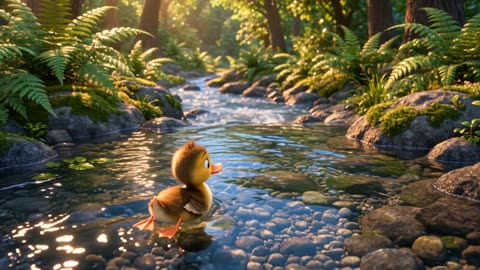</a>

The prompt walks through the story as ordered beats, and each beat ends in a clear handoff (the otter catches it, the buck carries it, the fox takes it), which keeps a multi-character sequence readable. The style, lighting and score are set once at the end so every beat shares one look.

Seedance 2.5 · Text-to-video · Source: [@Zyrellix on X](https://x.com/Zyrellix/status/2108047742425600244) · found via [LearnPrompt/awesome-seedance](https://github.com/LearnPrompt/awesome-seedance)

[`3d-animation`](tags.md#tag-3d-animation) [`animals`](tags.md#tag-animals) [`multi-shot`](tags.md#tag-multi-shot) [`golden-hour`](tags.md#tag-golden-hour)

<details><summary><b>Prompt</b></summary>

```text
A sunny forest stream, Pixar-style 3D animation. A small yellow duckling with a brown tuft, big eyes, and orange feet paddles alone through clear water over pebbles, ferns and mossy rocks around it, golden light through the trees.
The current picks up. The duckling looks worried as white water rushes past, then an otter bursts up on its back, catches the duckling, and floats downstream with it perched on its belly, both smiling.
They reach the bank. A young buck with antlers leans in; the duckling hops onto its antlers, then rides its back as it trots through a sunlit clearing. A red fox with a white-tipped tail runs alongside, and the duckling transfers onto the fox’s head. A gray rabbit joins them on a pebble path and hugs the duckling.
The duckling stands alone at a calm pond, then jumps in with a splash, wings out, laughing. On the bank sit the otter, fox, and rabbit, watching. More identical ducklings appear in the water until a whole flock floats together. The three friends smile down at them. Sunset rays flare through the trees, lily pads on the water, warm golden-hour light, soft depth of field, cheerful score.
```

</details>

<a id="seedance-five-animals-tiger-dance"></a>
### Five cats and a tiger dance in unison

<a href="https://x.com/RizwanAly07/status/2113513297190511082">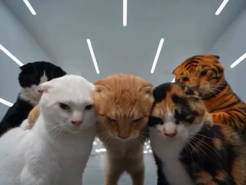</a>

The prompt splits the 30 seconds into timed beats with one camera move per segment, giving the model a clear order of moves. A separate STRICT RULES block fixes the animal count, fur colours and the no-morphing constraint across the whole clip.

Seedance 2.5 · Text-to-video · Source: [@RizwanAly07 on X](https://x.com/RizwanAly07/status/2113513297190511082) · found via [LearnPrompt/awesome-seedance](https://github.com/LearnPrompt/awesome-seedance)

[`cats`](tags.md#tag-cats) [`tiger`](tags.md#tag-tiger) [`viral-dance`](tags.md#tag-viral-dance) [`led-room`](tags.md#tag-led-room)

<details><summary><b>Prompt</b></summary>

```text
DURATION: 30 seconds
FORMAT: 4:3
STYLE: Ultra-realistic animals, funny viral dance, cinematic lighting, smooth motion, 4K, 24fps.

Create a 30-second ultra-realistic viral dance video featuring five adorable animals: a fluffy orange cat, a white cat, a black-and-white cat, a calico cat, and an orange Bengal tiger. All animals have realistic fur, natural feline faces, and upright dancing poses. They perform together inside a futuristic minimalist white room with a glossy gray floor and bright geometric LED strips covering the walls and ceiling.

0–4 seconds: All five animals stand close together facing the camera. They look curiously into the lens, move their heads to the beat, and begin preparing for the dance. The camera slowly pulls backward to reveal the futuristic room.

4–8 seconds: The animals turn around together, briefly showing their backs. The fluffy orange cat turns back toward the camera, raises one front paw, and begins a playful dance gesture.

8–12 seconds: The white cat and calico cat sway their bodies from side to side. The orange cat waves its front paws rhythmically while the tiger begins moving in sync with the group.

12–16 seconds: All five animals perform coordinated side steps, swinging their front paws and shifting their bodies rhythmically. The camera smoothly tracks their movements.

16–20 seconds: The tiger steps forward for a funny solo dance, raising its front paws and moving its shoulders. The other cats dance behind it, maintaining their natural animal appearance.

20–24 seconds: The fluffy orange cat takes the spotlight, performing playful paw movements and a short body turn. The tiger and other cats continue dancing in the background.

24–27 seconds: All five animals turn and perform synchronized arm-like paw gestures, side steps, and playful body sways. Their movements become faster and more energetic.

27–30 seconds: The camera moves closer as all five animals gather together in a final synchronized dance pose, facing the camera. They finish with playful expressions and a slight head tilt.

VISUAL QUALITY: Photorealistic fur detail, realistic feline anatomy, consistent animal identities, smooth coordinated movements, stable environment, cinematic wide-angle camera, reflective floor, bright futuristic LED lighting.

STRICT RULES: Keep exactly five animals throughout the video. Do not change their fur colors or identities. No humans, no clothing, no extra animals, no deformed paws, no duplicated bodies, no morphing, no sudden teleportation, no cartoon or CGI appearance, no text, no logos, and no watermark. All movements must flow naturally from one dance sequence to the next.
```

</details>

<a id="seedance-happy-cat-donut-animation"></a>
### Hand drawn cat eats donut, gets a fresh one

<a href="https://x.com/MissDelulu9/status/2092465805611212978">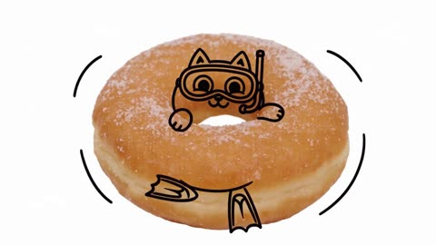</a>

Timed beats with explicit bite stages and a locked camera on a plain white background keep a photoreal donut and a flat black line art cat in one frame. Requiring each missing piece to leave through a visible bite stops the donut from dissolving.

Seedance 2.5 · Text-to-video · Source: [@MissDelulu9 on X](https://x.com/MissDelulu9/status/2092465805611212978)

[`cat`](tags.md#tag-cat) [`donut`](tags.md#tag-donut) [`hand-drawn`](tags.md#tag-hand-drawn) [`mixed-media`](tags.md#tag-mixed-media)

<details><summary><b>Prompt</b></summary>

```text
Create a 15-second 16:9 video on a pure white background with a locked front camera and centered framing. No camera movement, cuts, transitions, text, captions, or extra elements.

Feature a photorealistic golden powdered-sugar donut with a simple black 2D hand-drawn chubby cat wearing a snorkel, mask and flippers. Keep the donut realistic and the cat/waves as minimal black line-art. Never make the cat 3D.

0–2s: The donut stays still while the happy cat floats inside it, gently paddling and kicking. Small black wave lines animate around the donut.

2–3s: The cat paddles faster, notices the donut, looks hungry, licks its lips and gives a mischievous smile.

3–6.5s: The cat bites the donut repeatedly. Show clear progressive eating: whole donut → big bite → half donut → tiny piece. Add small crumbs and funny chewing expressions. Every missing section must disappear through a visible bite—never dissolve or vanish.

6.5–7.5s: The cat eats the last piece. The donut is completely gone. It looks around, realizing it ate everything.

7.5–8.5s: The cat becomes adorably sad, with lowered ears, drooping paws and a pout, staring at the empty space.

8.5–10s: A fresh complete powdered-sugar donut drops from above and lands perfectly around the cat. The cat instantly becomes excited and the wave lines return.

10–11.5s: The cat hugs the new donut with closed eyes and a huge happy smile.

11.5–13s: It happily wiggles its paws and flippers, floating in the donut.

13–14s: The cat looks at the camera and gives a cute little wink.

14–15s: A tiny bubble pops from the snorkel. The cat kicks its flippers twice and smiles brightly as it floats happily inside the untouched donut.

Keep the same visual continuity from beginning to end: realistic donut + black hand-drawn cat, snorkel, flippers and waves only.
```

</details>

<a id="seedance-husky-bunnies-snow-sunset-friendship"></a>
### Husky Meets Two Bunnies in Sunset Snow

<a href="https://x.com/RizwanAly07/status/2110654938472952253">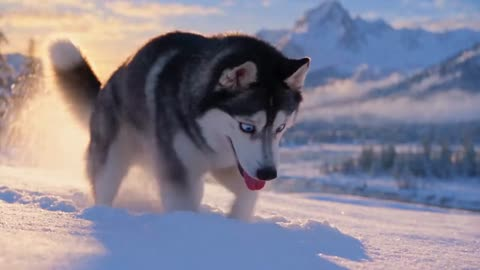</a>

Five labeled scenes give a clear beat by beat arc from approach to reveal, and each one names a single camera move such as a low follow, a push in and a slow pull back. A closing block lists fur detail, golden hour light, ambient audio and a negative list against cartoon looks and duplicated animals to keep the animals consistent.

Seedance 2.5 · Text-to-video · Source: [@RizwanAly07 on X](https://x.com/RizwanAly07/status/2110654938472952253) · found via [LearnPrompt/awesome-seedance](https://github.com/LearnPrompt/awesome-seedance)

[`animals`](tags.md#tag-animals) [`snow`](tags.md#tag-snow) [`golden-hour`](tags.md#tag-golden-hour) [`multi-scene`](tags.md#tag-multi-scene) [`photorealistic`](tags.md#tag-photorealistic)

<details><summary><b>Prompt</b></summary>

```text
Create an ultra-realistic cinematic video of a beautiful black-and-white Siberian Husky with striking blue eyes exploring a snowy mountain landscape at sunset. The environment features pristine white snow, snow-covered pine trees, enormous snow-covered rocks, distant blue mountains, and warm golden sunlight illuminating the snow. Every animal must look completely realistic, with detailed fur, natural movements, and believable interactions.

SCENE 1 — THE HUSKY APPROACHES 
A beautiful black-and-white Siberian Husky walks slowly through deep, powdery snow. Its paws sink naturally into the snow, sending tiny snow particles into the air. The camera follows the dog from a low angle as it lowers its head and sniffs the ground curiously. Warm sunset light illuminates its fur.

SCENE 2 — SOMETHING MOVES 
The Husky suddenly notices movement near a large snow-covered rock. It stops, raises its head, and turns its blue eyes toward the rock. Its ears stand upright, and its nose twitches as it investigates. The camera smoothly moves closer to capture its curious expression.

SCENE 3 — THE SURPRISE 
A tiny, fluffy brown bunny cautiously peeks out from behind the rock. A second, smaller white bunny appears just behind it. Both rabbits have realistic fur, twitching noses, upright ears, and tiny paws. The Husky watches them with curiosity while maintaining a natural, relaxed posture.

SCENE 4 — THE ADORABLE MOMENT 
The brown bunny hops forward through the fresh snow, followed by the tiny white bunny. The Husky gently lowers its head toward them, sniffing the snow nearby. The rabbits pause and look toward the dog. Their contrasting sizes create a beautiful cinematic composition.

SCENE 5 — THE HEARTWARMING ENDING 
Both bunnies hop closer to the Husky. The dog remains calm and gently tilts its head, watching their movements with curious blue eyes. The camera slowly pulls back to reveal the three animals together in the glowing snowy landscape, surrounded by majestic mountains and warm sunset light.

🎥 Camera & Quality Instructions

Photorealistic animal fur, eyes, whiskers, paws, and facial expressions.

Natural animal anatomy and believable movement.

Smooth cinematic tracking shots with realistic depth of field.

Golden-hour lighting with cool blue shadows across the snow.

Realistic snow particles, pawprints, and subtle wind.

Natural ambient audio: soft winter wind, paws crunching in snow, and gentle rabbit movements.

No dialogue, text, subtitles, logos, or watermarks.

No cartoon appearance, artificial CGI look, distorted anatomy, duplicated animals, or sudden scene transitions.

Maintain consistent animal appearances throughout the entire video.
```

</details>

<a id="seedance-japanese-rural-chicken-chase"></a>
### Chicken escapes during a rural Japanese afternoon walk

<a href="https://x.com/nawalsehar/status/2104438109949628826">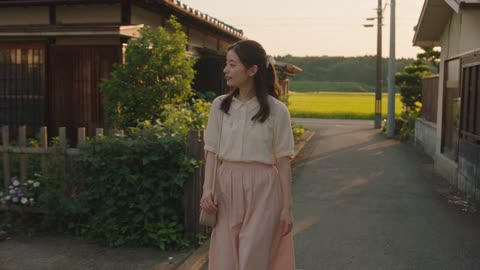</a>

Handheld consumer-camera realism is spelled out with imperfect framing, autofocus hunting and natural motion blur, plus concrete chicken behavior and a natural-audio-only list that keeps the clip grounded. The negative prompt blocks CGI, plastic skin and commercial look so the footage reads as a home video.

Seedance 2.5 · Text-to-video · Source: [@nawalsehar on X](https://x.com/nawalsehar/status/2104438109949628826) · found via [LearnPrompt/awesome-seedance](https://github.com/LearnPrompt/awesome-seedance)

[`handheld`](tags.md#tag-handheld) [`slice-of-life`](tags.md#tag-slice-of-life) [`natural-audio`](tags.md#tag-natural-audio) [`japan`](tags.md#tag-japan)

<details><summary><b>Prompt</b></summary>

```text
Create a 30-second ultra-photorealistic Japanese rural slice-of-life home video following a young Japanese woman on a peaceful afternoon walk. A chicken suddenly escapes through a wooden gate, turning her quiet stroll into an unexpected chase with a local farmer.

Use authentic handheld consumer-camera footage with imperfect framing, subtle shake, autofocus hunting, natural motion blur, warm afternoon light and realistic village details.

Show believable chicken behavior—quick steps, head bobbing, sudden direction changes and natural wing movement. The girl and farmer react spontaneously with realistic balance, momentum, friction and human biomechanics as they work together to safely catch it.

After finally catching the chicken, they laugh, exchange a few words, and she continues her walk while the farmer returns it to the garden.

Natural audio only: chicken clucks, footsteps, laughter, wing flaps, wind, birds, gate creaks, distant bicycle bells and casual dialogue. No music or narration.

Negative prompt: No anime, CGI, plastic skin, robotic movement, impossible physics, floating objects, teleportation, distorted hands, extra fingers, duplicated people or chickens, chicken morphing, changing faces or outfits, exaggerated camera movement, commercial look, subtitles, logos or watermark.
```

</details>

<a id="seedance-macaque-copies-hiker-head-tilt"></a>
### Macaque copies hiker's head tilt on forest platform

<a href="https://x.com/SyntheSarah/status/2092181568534282494">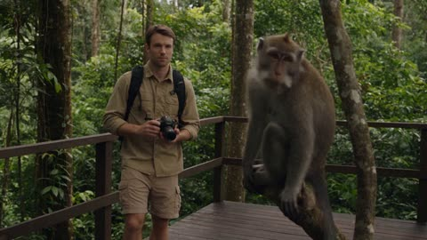</a>

Timed beats (0 to 4 seconds, 4 to 8 seconds and so on) give the mirrored head tilt a clear setup and payoff. Explicit bans on talking, human clothing and CGI keep the monkey grounded as a real wild animal.

Seedance 2.5 · Text-to-video · Source: [@SyntheSarah on X](https://x.com/SyntheSarah/status/2092181568534282494) · found via [LearnPrompt/awesome-seedance](https://github.com/LearnPrompt/awesome-seedance)

[`wildlife`](tags.md#tag-wildlife) [`comedy`](tags.md#tag-comedy) [`timed-beats`](tags.md#tag-timed-beats) [`photorealistic`](tags.md#tag-photorealistic)

<details><summary><b>Prompt</b></summary>

```text
Create a completely original 15-second photorealistic comedy video set in a peaceful tropical forest. A young adult male hiker stands on a wooden observation platform, safely observing a realistic macaque monkey sitting on a nearby tree branch. 0–4 seconds: The hiker quietly notices the monkey and raises his camera to take a photograph. The monkey looks directly toward the camera with natural curiosity. 4–8 seconds: The hiker slowly lowers the camera. The monkey tilts its head to one side. The hiker tilts his own head slightly in the opposite direction. The monkey pauses, then tilts its head again in the same direction as the hiker. 8–12 seconds: The hiker changes his head position once more. The monkey watches carefully and repeats the movement. The hiker begins smiling, amused by the coincidence. 12–15 seconds: The monkey suddenly loses interest, turns around casually, and starts grooming itself. The hiker looks at the camera with a confused, amused expression, as if thinking, “Okay… never mind.” VISUAL STYLE 100% original visual presentation, photorealistic live-action appearance, natural wildlife photography, realistic macaque anatomy and fur, authentic tropical vegetation, soft natural daylight, realistic shadows, subtle camera movement, realistic depth of field, natural colors, detailed environmental textures. ANIMAL BEHAVIOR The monkey must behave like a genuine wild animal. No talking, no human clothing, no human-like walking, no exaggerated expressions, no physical contact with the person. The humor comes from the natural coincidence of the monkey copying the hiker's head movement. AUDIO Natural forest ambience, birds, insects and gentle leaves moving in the breeze. Very subtle original playful background music. No recognizable music or audio from existing media. RESTRICTIONS Do not reference or recreate any existing movie, television show, advertisement, viral video, fictional character, celebrity, copyrighted character, recognizable filmmaker's style, branded product, or existing media scene. No logos, no text, no subtitles, no watermark. No cartoon, no animation, no CGI appearance, no fantasy elements, no violence, no dangerous interaction. Create an entirely original, harmless, photorealistic wildlife comedy scene.
```

</details>

<a id="seedance-pink-rabbit-lipstick-sofa-3d-animation"></a>
### Two fluffy rabbits play with lipstick on sofa

<a href="https://x.com/Zarnab_with_Ai/status/2099683790717325390">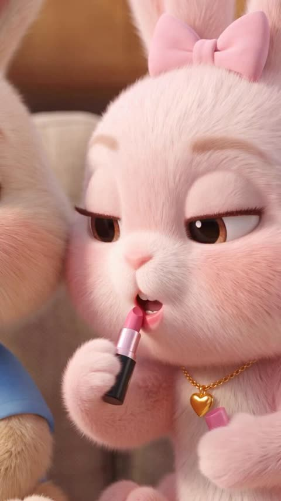</a>

Each rabbit is fixed by outfit and color so the two characters stay distinct, then a short action chain runs from lipstick to tumbling to hiding under a blanket. A closing list of lighting, lens and style cues such as shallow depth of field and a Pixar style finish sets the look.

Seedance 2.5 · Text-to-video · Source: [@Zarnab_with_Ai on X](https://x.com/Zarnab_with_Ai/status/2099683790717325390) · found via [LearnPrompt/awesome-seedance](https://github.com/LearnPrompt/awesome-seedance)

[`3d-animation`](tags.md#tag-3d-animation) [`animals`](tags.md#tag-animals) [`cute`](tags.md#tag-cute) [`comedy`](tags.md#tag-comedy) [`pixar-style`](tags.md#tag-pixar-style)

<details><summary><b>Prompt</b></summary>

```text
Create a cute, heartwarming, ultra-realistic 3D animated video featuring two adorable fluffy rabbits sitting together on a cozy beige sofa in a warm modern living room. One rabbit wears a blue shirt and a small golden bunny necklace, while the other is soft pink with a large pink bow and a heart-shaped necklace.

The pink rabbit applies lipstick while making funny, confident expressions. She then playfully interacts with the other rabbit, who has pink lipstick kiss marks all over its face and ears. They cuddle, laugh, and playfully tumble together on the sofa. At one point, they hide under a soft beige blanket decorated with pink lipstick kiss marks, then pop back out laughing and hugging each other.

Warm golden lighting, cozy home interior, soft cushions, wooden furniture, plants and framed artwork in the background, expressive faces, detailed fluffy fur, cinematic camera movement, shallow depth of field, adorable comedic atmosphere, polished Pixar-style 3D animation, highly detailed, smooth natural motion, 4K quality.
```

</details>

<a id="seedance-singing-cat-night-convertible"></a>
### Singing cat driving night convertible with passengers

<a href="https://x.com/MahiraEhan/status/2109875307675017668">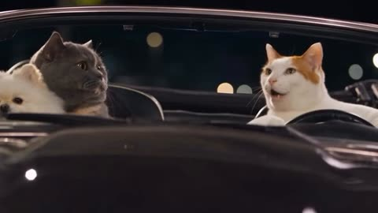</a>

The prompt names each animal with its coat and breed, fixes the seating layout, and asks for natural lip-sync on the singing driver. Bokeh city lights, light reflecting off the hood and a shallow depth of field give the night drive a cinematic look, and a line about character consistency across cuts keeps the animals stable.

Seedance 2.5 · Text-to-video · Source: [@MahiraEhan on X](https://x.com/MahiraEhan/status/2109875307675017668) · found via [LearnPrompt/awesome-seedance](https://github.com/LearnPrompt/awesome-seedance)

[`animals`](tags.md#tag-animals) [`cat`](tags.md#tag-cat) [`night-drive`](tags.md#tag-night-drive) [`lip-sync`](tags.md#tag-lip-sync) [`cinematic`](tags.md#tag-cinematic)

<details><summary><b>Prompt</b></summary>

```text
A high-definition 4K cinematic video of a white and orange tabby cat sitting in the driver's seat of a classic convertible car at night, looking expressively toward the passenger side while "singing" with natural lip-sync movement. In the passenger seat, a fluffy blue-gray British Shorthair cat and a tiny white Pomeranian dog sit close together, watching with wide, emotional eyes. The background features soft, blurred bokeh city lights of a downtown street. Moody, cinematic lighting reflecting off the polished black car hood. Shot with a shallow depth of field, playful yet dramatic tone, seamless character consistency across cuts.
```

</details>
