# Anime and animation

[Back to the list](../../README.md) · All 76 entries

<a id="seedance-katsudon-anime-cooking"></a>
### Katsudon cooked in fast-cut anime style

<a href="https://x.com/Goodmanprotocol/status/2098845134326808734"></a>

Opens with an explicit ban on imitating any existing anime, then walks through the recipe step by step so every cut has a job.

Seedance 2.5 · Text-to-video · Source: [@Goodmanprotocol on X](https://x.com/Goodmanprotocol/status/2098845134326808734) · 4,935 likes on 2026-10-27

[`anime`](tags.md#tag-anime) [`food`](tags.md#tag-food) [`fast-cut`](tags.md#tag-fast-cut)

<details><summary><b>Prompt</b></summary>

```text
Create a 30-second fast-paced cinematic Japanese anime cooking video showing the preparation of authentic katsudon, entirely from the text description below.

IMPORTANT: Do not display, recreate, trace, reference, or imitate any storyboard, sketch, reference image, panel, annotation, or source material. Generate only original anime-style animation.

STYLE

High-quality Japanese anime film style, cinematic summer lighting, ultra-detailed food textures, realistic cooking physics, visible steam and moisture, shallow depth of field, macro close-ups, smooth camera movement, warm Japanese kitchen atmosphere. Fast rhythmic editing with natural match cuts based on movement, shape, texture, and composition.

TIMELINE

0–2.5s — Prepare Pork
Close-up of hands pounding a thick pork loin with a wooden mallet on a cutting board. The meat gradually flattens and its fibers loosen. Sprinkle salt and pepper evenly. Crisp rhythmic impacts.

2.5–5s — Bread the Pork
Quick match cuts: press the pork into flour, dip into beaten egg, then firmly coat with coarse panko breadcrumbs. Show realistic egg dripping and breadcrumbs adhering to the surface.

5–7.5s — Fry
Lower the breaded pork into hot golden oil. Intense bubbling surrounds the cutlet as the crust turns golden brown and crispy. Warm cinematic lighting and detailed oil movement.

7.5–9.5s — Slice
Place the fried tonkatsu on a wooden board. A sharp knife cuts it into even strips. The crispy crust cracks naturally, revealing juicy white pork with gentle steam escaping.

9.5–12s — Simmer Dashi & Onion
Thinly sliced onions gently simmer in amber dashi inside a shallow pan. Small bubbles rise while the onions become translucent. Chopsticks gently move them through the broth.

12–14s — Add Tonkatsu
Place the sliced tonkatsu carefully over the simmering onions using chopsticks. The broth begins soaking into the crispy edges while steam rises.

14–16.5s — Pour Egg
Slowly pour beaten golden egg over the tonkatsu and onions. The egg spreads naturally through the gaps and begins setting around the hot edges.

16.5–19s — Set the Egg
Close-up of the egg gently coagulating over low heat. Edges become soft and golden while the center remains glossy, slightly runny, and trembling. No stirring.

19–21s — Prepare Rice
A white ceramic donburi bowl receives a generous mound of steaming Japanese short-grain rice. The rice looks fluffy and slightly glossy.

21–24s — Assemble
Carefully slide the egg-and-tonkatsu mixture from the pan onto the rice. The egg settles naturally in a soft wave while dashi lightly absorbs into the rice.

24–26s — Final Close-Up
The finished katsudon rests on the counter. Glossy egg slowly settles over the tonkatsu and rice, gently trembling. Slow cinematic push-in.

26–30s — Hero Reveal
Present the finished katsudon in a traditional blue-and-white ceramic bowl on a wooden surface. Golden egg covers crispy tonkatsu over glossy rice, topped with fresh mitsuba. Steam rises as the camera slowly arcs around the bowl for a beautiful anime-food-film ending.

AUDIO

Bright 1980s-inspired Japanese city-pop instrumental, 110–120 BPM, with subtle koto and light chime percussion. Synchronize realistic ASMR cooking sounds: mallet impacts, knife slicing, frying sizzle, bubbling dashi, chopsticks, egg pouring, steam, and a soft ceramic clink.

End with one delicate wind-chime tone during the final reveal.

NEGATIVE

No storyboard, reference image, sketch, panels, borders, numbers, arrows, annotations, subtitles, captions, UI, logos, or text overlays. No unrelated ingredients or dishes. Katsudon only. Keep the food, hands, utensils, lighting, and environment visually consistent throughout.
```

</details>

<a id="h3-rem-desktop-icons-maid-mishap"></a>
### Rem scoops fallen desktop icons back into place

<a href="https://x.com/Mayz1169/status/2100932191316557922"></a>

A reference image locked as the exact first frame, plus a second-by-second beat sheet, keeps the desktop layout and character fixed while the icons react to her skirt. Naming the only objects allowed to interact and banning camera moves and cuts stops the scene from drifting.

MiniMax H3 · Image-to-video · Source: [@Mayz1169 on X](https://x.com/Mayz1169/status/2100932191316557922) · 1,806 likes on 2026-10-29

[`anime`](tags.md#tag-anime) [`desktop-animation`](tags.md#tag-desktop-animation) [`timed-beats`](tags.md#tag-timed-beats) [`sound-design`](tags.md#tag-sound-design)

<details><summary><b>Prompt</b></summary>

```text
Use the reference image as the exact first frame. 16:9, locked-off camera, one continuous take. Preserve Rem’s face, short blue hair, black-and-white maid outfit, and original anime art style consistently throughout. Keep the desktop layout and Japanese menu bar unchanged.

0–2s: Rem stands on the right, happily swaying gently from side to side while lifting the edges of her skirt slightly with both hands. As she turns, the hem accidentally catches the blue-purple desktop background. The background reacts like a soft fabric curtain, sending a horizontal ripple across the screen. The two folders and one screenshot icon on the left wobble, slide downward, fall to the bottom edge of the screen, and make a small playful bounce on impact.

2–3s: Rem immediately freezes. Her eyes widen and she quickly covers her mouth with both hands, staring in surprise at the fallen icons.

3–6s: She hurriedly leans toward the left and reaches out with both hands. She scoops up all three icons together and quickly pushes them back toward their original positions on the left. The icons behave like thin, lightweight magnetic tiles, snapping back onto the desktop surface. Two of them end up slightly crooked. Rem has no time to straighten them and quickly pulls her hands back.

6–8s: Rem returns to her original position on the right, folds her hands neatly in front of her, and tries to put on an innocent, nothing-happened smile. Her eyes secretly glance toward the two crooked icons on the left. The tips of her hair, hair ribbon, and skirt hem move gently in a light breeze. The desktop background settles completely, while the two icons remain slightly tilted for a subtle comedic ending.

The background music begins with a light, cute Japanese-style piano melody. When the icons fall, add a short descending slide sound and light impact sounds, then shift into a playful pizzicato rhythm.

Keep all movement fluid and expressions lively. Only the three desktop icons on the left may physically interact with Rem or the background. The top menu bar and bottom Dock must remain completely fixed. Preserve the original icon designs, filenames, and text exactly. No new characters. No camera movement, zoom, cuts, or transitions.
```

</details>

<a id="seedance-anime-frame-break-letterbox-pop-out"></a>
### Anime character reaching past black letterbox bars

<a href="https://x.com/aimikoda/status/2106044483863191748"></a>

The prompt states a back to front compositing order (background, black bars, character) so the foreground character overlaps the bars while the bars stay fixed. A stationary wide angle camera, an opening lunge toward the lens and a closing instruction not to crop the character inside the window make the overlap repeat. Bar size still varies between generations.

Seedance 2.5 · Reference-to-video · Source: [@aimikoda on X](https://x.com/aimikoda/status/2106044483863191748) · 1,675 likes on 2026-10-27

[`frame-break`](tags.md#tag-frame-break) [`letterbox`](tags.md#tag-letterbox) [`anime`](tags.md#tag-anime) [`pop-out`](tags.md#tag-pop-out) [`character-reference`](tags.md#tag-character-reference)

<details><summary><b>Prompt</b></summary>

```text
Use @[char ref]as the exact character and style reference. Preserve her white hair, red eyes, oversized black cropped top, long cream skirt with orange lining, bare feet and single slender sword. Keep the same angular painterly anime rendering.

MAIN VISUAL GOAL: an unmistakable OUT-OF-FRAME, POP-OUT effect. The character repeatedly projects beyond the central picture window, with her sword, hands, hair and especially her wide skirt visibly moving OVER the black letterbox bars toward the viewer.

COMPOSITING ORDER, BACK TO FRONT:
1. Background and scene.
2. Two broad black letterbox bars at the top and bottom.
3. The foreground character, including her sword, hair and flowing skirt.

The background is confined to the central picture window. The foreground character is NOT confined to that window. Her silhouette continues uninterrupted across its boundaries and onto the black bars. Cream fabric, orange lining, white hair and the silver blade remain fully visible when overlapping black.

Keep both bars equal in thickness and fixed in screen position throughout. The character covers them temporarily without moving or changing them. Keep sections of black visible beside each overlap so the frame-break illusion remains clear.

The camera stays stationary with a fixed wide-angle lens. The character moves rapidly through depth, creating extreme foreshortening and dramatic scale changes through physical approaches and retreats.

OPENING:
Start immediately with a powerful forward lunge. Her sword hand projects toward the lens and overlaps the lower black bar. At the same time, the nearest cream skirt folds spill across that bar. Establish the frame-break effect clearly in the very first movement.

CHOREOGRAPHY:
She pulls back into the central window, then snaps into a fast turning advance. Her skirt fans outward in a huge cream sweep, crossing the bottom boundary and spreading over the black surface. The orange lining flips into view along the moving hem. Her waist and torso remain inside the central window while the nearest fabric extends outside it.

Reverse the rotation sharply into an upward sword flourish. The blade crosses onto the upper black bar, followed by flying strands of white hair. She immediately drives forward again, bringing her hand and blade extremely close to the viewer.

Chain rapid fencing lunges, spinning evasions, low sweeping turns and short twisting leaps. Repeatedly move from the depth of the central scene into extreme foreground space. Alternate sword-and-hair overlaps across the upper bar with large skirt-and-hand overlaps across the lower bar.

Give the skirt substantial momentum: it follows her hips, overtakes her during abrupt stops and lashes around her during reversals. Show broad cream folds sweeping across black, not merely touching the border. Keep the fabric naturally attached to her waist.

Include a close spinning pass where the skirt occupies a large portion of the lower black bar while her sword cuts diagonally across the upper bar. Her face remains readable between them.

FINISH:
A final explosive lunge brings the sword toward the lens as the skirt billows across the lower bar. Resolve into a confident fencing pose with the blade and cream hem still visibly extending beyond the central picture window.

Prioritize visible foreground overlap throughout. Do not crop the entire character inside the letterbox window. Do not replace the effect with simple zooming or a character moving behind black bars.

Fast, forceful motion with crisp silhouettes and brief directional smears. No slow motion, camera movement, duplicated weapons, cloth morphing, text or background music.

---

Prompt for the second one:

Use @[char ref]as the exact reference for the character and visual style. Preserve her blonde hair, small crown, orange puff-sleeved dress, cream skirt panels, slender sword and elongated proportions. Maintain the same flat painterly anime aesthetic, rough ink contours, dry-brush textures, graphic silhouettes and restricted orange, cream, yellow and charcoal palette.

Create an explosive, high-speed sword performance built around a strong FRAME-BREAK EFFECT. Solid black horizontal bars occupy the top and bottom 15% of the output throughout the entire shot. These bars remain perfectly fixed to the screen while the camera moves inside the central image window.

CRITICAL COMPOSITING RULE: the environment stays behind the black bars. Selected foreground parts of the character render IN FRONT OF the bars, visibly covering their black surface with her original colors. Her sword, hands, crown, hair and flaring skirt repeatedly cross the inner edges and overlap the bars. Do not crop these foreground elements at the inner frame boundary. The bars remain intact beneath them. This must read as the character physically bursting out of the framed image toward the viewer.

Start immediately in motion. She launches straight toward the lens and thrusts her sword past it, the sharply foreshortened blade growing enormous in the foreground and extending across the lower black bar. The camera recoils and banks sideways as her hand and orange sleeve sweep through the same foreground space.

She snaps into a full-body corkscrew turn, pulling the sword around her waist before whipping it upward. The blade crosses the upper black bar, followed by her crown and flying blonde hair. Her cream-and-orange skirt fans outward in a huge rotating arc, spilling over the lower bar while her torso remains inside the central window.

Chain rapid thrusts, reverse-grip transitions, overhead cuts and tight spinning combinations without pauses. Alternate deep retreats into the scene with sudden lunges directly toward the viewer. Every return creates a new frame-breaking overlap: a sword tip punching toward the lens, a hand reaching beyond the lower border, an orange sleeve flashing across the upper border, a cream skirt panel sweeping across the bottom.

Use aggressive wide-angle perspective and dramatic changes in depth. The camera darts backward ahead of her charge, arcs close around her sword arm, drops below an airborne turn and whips back toward her face. Keep the camera reactive and fluid in one continuous shot. No top-down angles. Keep the black bars screen-locked during every camera roll, orbit and recoil.

Make each near-lens pass feel dangerously close, with strong parallax, brief directional smears and crisp readable silhouettes at the peak of each movement. Her face stays consistent and expressive: fierce concentration with a confident, playful edge. Hair, sleeves and layered skirt react sharply to acceleration.

Finish with one final forward burst. She drives the sword diagonally past the lens, its blade spanning the lower black bar while her crown overlaps the upper bar. Resolve directly into a striking extended fencing pose, close to the viewer, with fabric still whipping around her.

Full-speed action throughout. No slow motion, frozen midair poses or gentle floating. No extra weapons, duplicated limbs, costume changes or transformation into 3D. Sword whooshes, sharp fabric snaps and forceful air rushes only. No background music, dialogue or text.

---

Prompt for this one:

Use @[char ref]as the exact character and style reference. Preserve her black hair and braids, oversized blue hooded jacket with cream graphics and orange trim, white cropped top, layered cream-and-orange pants, orange ribbons and white sneakers with black stripes and orange panels. Preserve her single sword with its black wrapped handle, gold guard and red tassel. Keep the same angular painterly anime rendering and blue background.

MAIN VISUAL GOAL:
An unmistakable OUT-OF-FRAME, POP-OUT effect. The character repeatedly projects beyond the central picture window, with her sword, hands, sneakers, hair and loose clothing visibly moving OVER the black letterbox bars toward the viewer.

COMPOSITING ORDER, BACK TO FRONT:
1. Background and scene.
2. Two broad black letterbox bars at the top and bottom.
3. The foreground character, including her sword, hands, sneakers and clothing.

The background is confined to the central picture window. The foreground character is NOT confined to that window. Her silhouette continues uninterrupted across its boundaries and onto the black bars. Blue sleeves, cream fabric, orange panels, sneakers and the silver blade remain fully visible when overlapping black.

STATIC BARS, MOVING CHARACTER:
Both bars are completely static screen graphics. Keep their equal thickness, full width and exact screen position unchanged throughout. Their inner boundaries remain perfectly straight and horizontal.

The character simply renders in front of them. Her movement temporarily hides portions of their black surface. The underlying bars never move or deform. Visible edge segments on either side of an overlap remain aligned on the same horizontal line. When she withdraws a limb, reveal the original unchanged black bar beneath it.

Keep black visible beside the overlapping body parts. No bending, sliding, shaking, stretching, opening or impact reactions in the bars.

The camera stays stationary with a fixed wide-angle lens. One continuous shot. She stays close and large in the composition, using short forward approaches, lateral pivots and compact recoveries. Never retreat deep into the background.

OPENING:
Already close to the viewer, she reaches toward the lens with her EMPTY hand while retaining the sword in her other hand.

Her fingertips visibly overlap the upper black bar. She makes one brisk diagonal lens-wiping gesture with her open palm, passing across the center and over the lower black bar. The hand and sleeve appear in front of both bars during the gesture. The bars remain unchanged beneath them.

The instant her palm clears the lens, she snaps into fast action without a pause.

CHOREOGRAPHY:
A diagonal sword slash passes close to the lens and visibly extends over the upper black bar. Reverse immediately into a tight turning cut. Her blue sleeve and loose cream-and-orange fabric sweep across the lower black surface.

She chambers a knee and fires a sharp FRONT KICK toward the viewer. The sneaker sole becomes large in the foreground and clearly overlaps the lower black bar, with black still visible beside it. Her shin connects continuously back to her body inside the central window. Retract immediately.

Plant the foot and pivot into a fast sword flourish crossing the upper bar. Continue into a compact SPINNING HEEL KICK. The sneaker sweeps close past the lens, its heel and sole projecting over the lower bar while her jacket and trouser fabric trail behind.

Keep alternating clear close-range overlaps: sword above the upper bar, sneaker over the lower bar, empty hand across a border, blue sleeve and cream fabric sweeping across black. Use fast connected combinations with crisp readable extensions and immediate recoveries.

Her clothing follows her body with strong momentum. Preserve the garment construction, patterned orange sections and cream folds. Fabric stays attached naturally and visibly covers the black surface without affecting its straight boundaries.

FINISH:
A final close-range sword extension crosses the upper black bar as her loose clothing flares over the lower bar. Resolve sharply into a confident martial-arts pose, retaining visible foreground overlap and quick natural follow-through.

The frame-break effect must come from the character visibly covering black areas outside the central picture window. Do not keep her entirely behind the bars. Do not simulate the effect by moving the bars or enlarging the window.

Fast real-time movement throughout, including the opening wipe. No slow motion, speed ramps, long windups or floating pauses. No camera movement, duplicated limbs or weapons, clothing morphing, text or background music. Sword whooshes, kick air bursts and fabric snaps only.
```

</details>

<a id="h3-grid-storyboard-anime-park-run"></a>
### Anime boy glancing back while running in park

<a href="https://x.com/8co28/status/2099171324568760589"></a>

A 3x3 panel image is fed as the reference, and the prompt asks for cuts running from the first panel to the last, so the storyboard plays back almost as drawn. Forbidding multiple panels on screen and BGM keeps each shot full frame and the audio clean.

MiniMax H3 · Reference-to-video · Source: [@8co28 on X](https://x.com/8co28/status/2099171324568760589) · 1,599 likes on 2026-10-28

[`storyboard`](tags.md#tag-storyboard) [`anime`](tags.md#tag-anime) [`2d-animation`](tags.md#tag-2d-animation) [`grid-reference`](tags.md#tag-grid-reference) [`multi-shot`](tags.md#tag-multi-shot)

<details><summary><b>Prompt</b></summary>

```text
When you take this 3x3 image and turn it into an AI video with r2v, it will roughly become the footage as-is with the following settings:

Minimax H3 Max r2v 480p 15 seconds Prompt adjustment: Quality Reference strength: Standard
"A 2D animation where the cut switches from the top-left panel to the bottom-right panel,
No multiple panels allowed, No BGM"
```

</details>

<a id="h3-character-intro-boots-to-hero-reveal"></a>
### Anime Character Intro from Boots to Hero Pose

<a href="https://x.com/aimikoda/status/2086412223061135392"></a>

A character reference image locks identity while four timed beats (0 to 4s, 4 to 8s, 8 to 12s, 12 to 15s) move from a detail close up to a back view, a face portrait and a full body hero shot. One minimal signature action and smooth camera moves keep the reveal controlled.

MiniMax H3 · Reference-to-video · Source: [@aimikoda on X](https://x.com/aimikoda/status/2086412223061135392) · 1,501 likes on 2026-10-28 · found via [SkyNotSilent/awesome-MiniMax-H3-cases](https://github.com/SkyNotSilent/awesome-MiniMax-H3-cases)

[`character-intro`](tags.md#tag-character-intro) [`reveal`](tags.md#tag-reveal) [`camera-progression`](tags.md#tag-camera-progression) [`anime`](tags.md#tag-anime) [`reference-lock`](tags.md#tag-reference-lock)

<details><summary><b>Prompt</b></summary>

```text
Use @[char ref] as the sole character reference. Preserve the exact identity, face, body proportions, hairstyle, outfit, colors, materials and overall silhouette of the character throughout the entire video. Do not redesign, simplify or replace any defining visual features.

Create a cinematic character introduction focused on presence, silhouette, attitude and controlled motion.

0–4s
Begin with a close shot of a defining lower-body or detail element such as boots, shoes, feet, hands, clothing hem or an important accessory. The character enters frame or settles into position. The camera slowly tracks upward while hair, clothing and secondary elements move naturally in the wind or environment.

4–8s
Reveal more of the body with a medium or medium-wide shot from the back, side or three-quarter angle. The character stands in a calm, composed way inside the environment. The camera makes a smooth orbit, arc or lateral move to gradually reveal the character’s face and silhouette.

8–12s
Move into a tight cinematic portrait or upper-body shot. The character performs one subtle signature action that fits their personality, such as lifting the chin, turning the head, adjusting clothing, brushing hair aside, opening a hand, looking toward camera, or shifting posture. Keep the motion minimal and intentional. The expression should match the character’s vibe.

12–15s
End with a strong full-body hero shot that clearly presents the entire design and silhouette. Use a low-angle, eye-level or slightly dramatic framing depending on the character’s personality. The character settles into a natural final pose and holds it confidently for a clean final reveal.

VISUAL DIRECTION
Premium cinematic presentation. Match the visual medium and rendering style of @[char ref]. Emphasize clean silhouette, elegant staging, subtle secondary motion, believable hair and cloth movement, strong composition, atmospheric depth and polished lighting. The scene should feel like a high-end anime, game or film character introduction.

CAMERA
Use a clear progression from detail reveal to partial reveal to face reveal to full-body hero reveal. Camera movement should be smooth, controlled and intentional. Avoid chaotic motion.

ENVIRONMENT
Place the character in a fitting environment that supports their identity and mood. The background should enhance the character without distracting from them.
```

</details>

<a id="seedance-toddler-copies-shaving"></a>
### Toddler copies dad's shaving with soap foam

<a href="https://x.com/Zarnab_with_Ai/status/2106560621932384657"></a>

Vertical 3D family comedy. One clear setup, one gag, one laugh.

Seedance 2.5 · Text-to-video · Source: [@Zarnab_with_Ai on X](https://x.com/Zarnab_with_Ai/status/2106560621932384657) · 1,379 likes on 2026-10-27

[`3d-animation`](tags.md#tag-3d-animation) [`family`](tags.md#tag-family) [`comedy`](tags.md#tag-comedy) [`vertical`](tags.md#tag-vertical)

<details><summary><b>Prompt</b></summary>

```text
Create a heartwarming and funny ultra-realistic 3D animated cinematic video in vertical 9:16 format.

Scene: A cute little toddler boy is sitting on the bathroom floor in front of a dark blue liquid soap dispenser. His father is standing behind him in front of a large bathroom mirror, shaving his own face with a razor.

The toddler curiously watches his father and decides to imitate him. He presses the soap dispenser and playfully covers his eyebrows, cheeks, upper lip, and chin with thick white shaving foam, creating a funny oversized Santa-style beard and eyebrows.

The father notices what the child has done and looks surprised and amused. The toddler proudly stands up, grabs a wooden floor broom, and walks toward the bathroom doorway as if he is going to help clean.

The mother appears at the doorway holding folded white towels. She looks at the toddler, realizes what happened, and starts laughing. The father also looks at his little son and bursts into laughter.

End with the toddler standing proudly between his laughing parents, still covered in shaving foam, smiling innocently at the camera.

Style: high-quality 3D animated family comedy, adorable toddler expressions, realistic body movement, detailed facial animation, warm bathroom lighting, cinematic depth of field, soft shadows, realistic textures, natural camera movement, expressive reactions, wholesome family humor.

Keep the characters consistent throughout the entire video. Preserve the toddler's hairstyle, clothing, facial features, and proportions. Smooth motion, believable hand movements, natural eye direction, cinematic composition, highly detailed animation, no text, no subtitles, no watermark.
```

</details>

<a id="h3-flat-vector-curry-delivery-explainer"></a>
### Flat Vector Curry Delivery Explainer Animation

<a href="https://x.com/ponzponz15/status/2087108170271560115"></a>

The key visual is locked as the exact first frame, and five timed shots each name their background color, motion type and on screen text. Exact Japanese strings, a ban on extra text or UI, and a fixed end hold at 12 seconds keep the typography clean.

MiniMax H3 · Image-to-video · Source: [@ponzponz15 on X](https://x.com/ponzponz15/status/2087108170271560115) · 766 likes on 2026-10-27

[`motion-graphics`](tags.md#tag-motion-graphics) [`explainer`](tags.md#tag-explainer) [`flat-vector`](tags.md#tag-flat-vector) [`kinetic-typography`](tags.md#tag-kinetic-typography) [`japanese-text`](tags.md#tag-japanese-text)

<details><summary><b>Prompt</b></summary>

```text
For the target video, at 0.00 seconds into the target video, <Picture 1> (from [Shot 1]) is fully referenced.
integrated_multimodal_description: [Shot 1] Classic Japanese 2D flat-vector explainer animation. Begin from the attached key visual as the exact first frame, preserving the same woman, white shirt with teal accent, teal smartphone, yellow curry container, warm-white background, thick charcoal outlines, circular illustrations, flat colors, and wide 16:9 composition. Do not display the attached key visual as a thumbnail, screenshot, media preview, or interface element. Hold the wide composition briefly. The curry steam gently rises, the notification bell pops once, and the woman presents the curry container with a happy expression. In the empty left area, large Japanese typography builds in two stages: "休みの夜、" then "カレーが食べたい。". Highlight "カレー" in curry ochre.
[Shot 2] At 00:02.200, the scene cuts to a bright teal flat-color field. A simple circular vignette of the same woman relaxing at home appears with a crescent moon, an evening clock without numbers, and an empty kitchen counter. The headline appears word by word: "でも、買いに行くのは面倒。". The final word is emphasized with a small coral-red block. Use simple 2D slide, pop, and mask-reveal motion only.
[Shot 3] At 00:04.500, the teal field wipes into a sunny yellow solution card. A large teal smartphone slides into the center while three illustrated curry choices pop out as clean circular cards: rich curry, vegetable curry, and spicy curry. A dotted route grows from the phone toward a small delivery scooter carrying a curry bag. The service name "カレヨル" appears clearly in deep charcoal, followed by the short phrase "選ぶだけ。".
[Shot 4] At 00:06.800, the composition changes to a clean white infographic strip. Three large circular steps assemble from left to right: "選ぶ", "届く", "食べる". The same woman appears in the final circle at home, opening the yellow curry container as visible steam rises. The delivery scooter moves along the dotted route and stops beside her. Keep every illustration flat, simple, and consistent with the key visual.
[Shot 5] At 00:09.200, the camera returns to a wide warm-white end card with generous negative space. A large two-line headline assembles smoothly: "どうしても、休みの夜は" followed by "カレーが食べたい。". At 00:10.500, the curry bowl and service name appear beneath it with the final message "そんな時は、カレヨル。". A small curry icon makes one cheerful pop and a gentle steam curl rises. Hold the complete wide end card cleanly until exactly 12.000 seconds. Do not add extra text, random pseudo-letters, logos, browser UI, or additional characters.
```

</details>

<a id="h3-anime-football-player-stats-ui-animation"></a>
### Anime football player stats screen animating in

<a href="https://x.com/aimikoda/status/2086122377633575169"></a>

A GPT Image 2 generated stats screen is the sole reference, and the prompt tells the model to animate it without redesigning it. A second by second timeline covers the scanner reveal, counting score, bar fills and final hold, with a locked camera and an audio line for boot hum and confirmation tones.

MiniMax H3 · Reference-to-video · Source: [@aimikoda on X](https://x.com/aimikoda/status/2086122377633575169) · 707 likes on 2026-10-28 · found via [SkyNotSilent/awesome-MiniMax-H3-cases](https://github.com/SkyNotSilent/awesome-MiniMax-H3-cases)

[`ui-animation`](tags.md#tag-ui-animation) [`game-ui`](tags.md#tag-game-ui) [`anime`](tags.md#tag-anime) [`sports`](tags.md#tag-sports) [`reference-image`](tags.md#tag-reference-image)

<details><summary><b>Prompt</b></summary>

```text
@[ref img] is the sole visual authority for Kaze, the football, the complete player-stats interface, typography, numbers, icons, colors, lighting, layout, and vertical composition. Animate this exact screen without redesigning it. Preserve all existing labels and final stat values.
[Goal]
Create a polished 15-second anime sports-game player stats screen opening. Use one continuous, locked, straight-on full-screen composition with no camera movement, cuts, cropping, or perspective distortion.

[Sequence]
0–2.2 seconds: Begin from near-black teal. A faint horizontal scanner passes downward, revealing Kaze’s silhouette and the outer edges of the interface. Fine particles and dim mint circuitry flicker awake.
2.2–5.5 seconds: The header, KAZE nameplate, role badge, level panel, and overall panel resolve through clean line-draw animations. Kaze emerges fully from shadow, takes a controlled breath, subtly shifts her shoulders and raised arm into the referenced pose, then fixes an intense gaze toward the viewer. Her hair, ribbons, and loose clothing react naturally to a growing current of wind. The football begins a slow, stable rotation beside her hand.

5.5–10.8 seconds: The large overall score counts rapidly upward and lands precisely on 92. The level settles on 46. Each attribute bar fills smoothly from left to right in sequence—Speed 93, Power 91, Control 88, Stamina 90, Agility 94, Technique 89—each landing with a restrained mint pulse. The radar chart draws outward from its center and locks into the exact final polygon. Skill cards activate from top to bottom; their icons flare briefly while the ACTIVE and ULTIMATE states illuminate.
10.8–13.3 seconds: The player ID strip and bottom navigation fade and slide into their exact final positions. The wind energy around Kaze accelerates clockwise, wrapping around the rotating ball and sweeping behind her body with layered luminous trails. Kaze tightens her hand, leans slightly into the current, and gives one natural blink; preserve her identity, anatomy, costume, and right-side placement.

13.3–15 seconds: The energy arc reaches a bright controlled crest, then settles into a living idle pulse. Hold the fully assembled screen matching @[ref img] exactly. Kaze continues subtle breathing; hair and ribbons drift, the football rotates slowly, particles shimmer, and all stats remain stable and readable.

Use crisp premium game-UI motion, clean 2D anime character animation, subtle depth between Kaze and the interface, and stable legible typography. Keep every panel, icon, label, number, and geometric boundary fixed once revealed. Do not introduce new text, extra characters, additional objects, logos, captions, or UI elements.

Audio: low electronic boot hum, delicate scanning ticks, short confirmation tones as values lock, rising airy wind around the ball, soft cloth movement, and one refined completion chime. No dialogue and no music.
```

</details>

<a id="wan-anime-monster-fight"></a>
### Hand-drawn anime fight against a giant monster

<a href="https://x.com/aimikoda/status/2103790524637528348"></a>

Two tagged references (hero, monster) and an instruction to keep their hand-drawn line work. Wan has its own anime look.

Wan 3.0 · Reference-to-video · Source: [@aimikoda on X](https://x.com/aimikoda/status/2103790524637528348) · 502 likes on 2026-10-27

[`anime`](tags.md#tag-anime) [`action`](tags.md#tag-action) [`reference-images`](tags.md#tag-reference-images)

<details><summary><b>Prompt</b></summary>

```text
Use @[character ref] for the hero's exact identity and appearance; @[monster ref] for the monster's anatomy, scale, pale body, black projections and luminous horns. Preserve their angular hand-drawn contours, sparse sketch lines, matte cel-shadows, muted lavender and ash gray, blue-black shadows, peach rim light and fine grain. City and effects share this 2D anime style. References bind appearance, not framing or poses.

Five epic shots: the monster destroys the city as it charges toward the rooftop hero. ONE sudden, thick white line bursts from his index fingertip and instantly punches through it, leaving one enormous hole.

The hero stays at one skyscraper's avenue-facing edge, level with the monster's upper torso. The monster approaches directly IN FRONT OF him along the avenue. All cameras stay on one side of their shared axis: hero and tower screen-left, monster screen-right advancing left. The hero faces right. In his profile close-ups, the monster remains ahead, offscreen right, never behind his head or shoulders. No axis-crossing angles or orbits.

Shot 1. Low lateral wide tracking beside the monster charging right-to-left. Its shoulder tears through a building; the facade folds into the street as its next footfall buckles the roadway, hurling rubble forward. Debris whips past the lens through lavender dust. Widen and tilt upward to reveal the target tower ahead on screen-left, the tiny hero at its edge facing the approaching monster on screen-right. Keep the gap between them readable.

Shot 2. Right-side profile of the hero facing screen-right toward the offscreen monster. Face and right hand share the frame against sky and rooftop. Wind pulls his hair and coat; he stays relaxed. With a knowing smile, he extends his right arm toward the target: index straight, thumb raised, other fingers curled. Cut as the finger aligns with the target; no charging glow, gathering energy or held aiming pause.

Shot 3. Steady rear three-quarter view outside the hero's right shoulder, on the established side. Keep a clear gap between his fingertip screen-left and the monster's upper torso screen-right. It reaches for the rooftop directly ahead. Immediately on the cut, ONE thick, straight, brilliant-white line snaps from the index fingertip through the upper torso, below the neck between the shoulders. Its entire length appears instantly, connecting finger, target and the space beyond. Release and penetration happen together: no projectile travel, growing beam or drilling. One tiny finger recoil coincides with a building-sized circular section being punched through the body. The white line switches off immediately, leaving an enormous EMPTY opening, its broken dark rim framing the skyline. The torso jolts and tips sideways at once, the reaching arm knocked off course. Read the hole during the uninterrupted fall. No charging, stunned pause, slow motion or hit-stop. No sphere, pressure ring or full-screen whiteout obscures the contact. One abrupt discharge, never a sustained beam or repeated pulse.

Shot 4. Cut as that sideways tilt begins, keeping the same viewing direction and matching the ALREADY OPEN hole on the first frame. The monster's arm drops short of the roof; its weight carries it diagonally sideways into the blocks beside the avenue before reaching the tower, still in front of the hero. Track downward with the chest exposed: no edge-on turn or face-down roll. The SAME hole stays fixed below the neck between the shoulders, with the same physical diameter, broken rim and missing volume. Its outline foreshortens naturally as the torso tilts; background buildings slide visibly through the opening. Keep dust below the chest and clear of the aperture. Follow the fall through contact with the ruins and briefly show the fallen torso with its hole still open. The rim does not regrow, the opening does not fill, and the torso never returns to its intact state.

Shot 5. Return to the hero's right-side profile, facing screen-right, face and right hand together against sky and rooftop. The fallen monster remains OFFSCREEN ahead to the right. He bends his right elbow and brings the SAME extended index fingertip just in front of his lips. Only after it arrives, he gently purses his lips and visibly blows across it. A fine white wisp bends away in his breath. He lowers the hand slightly with a satisfied smile. Collapse thunder rolls in from ahead and a gust lifts his coat. Hold his effortless composure.

One instantaneous fingertip discharge, one impact, one permanent through-hole carried through the uninterrupted fall and landing. The hero keeps the same hand and facing. Sound: masonry and heavy footfalls, one dry electrical crack and a deep impact report together at the instant of contact, then the intimate breath against distant collapse. No dialogue or subtitles.
```

</details>

<a id="h3-pixel-pop-gamer-girl-character-sheet"></a>
### Anime gamer girl character sheet with turnarounds

<a href="https://x.com/Mayz1169/status/2094782705577996727">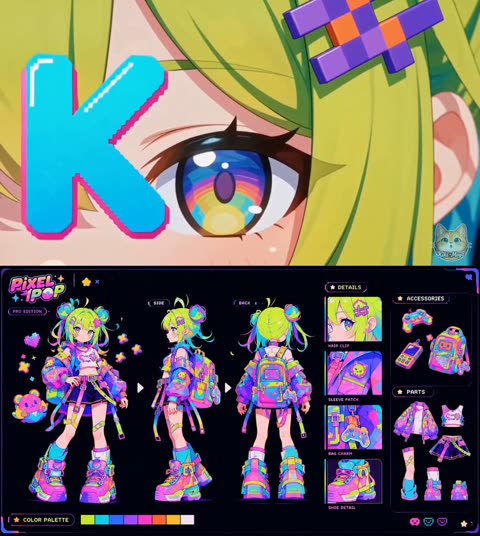</a>

The prompt lists every panel by name and position on the sheet, then repeats a keep-identical clause so the hair, outfit and backpack stay the same in front, side and back views. A closing negative list blocks realism, weapons and extra characters.

MiniMax H3 · Text-to-video · Source: [@Mayz1169 on X](https://x.com/Mayz1169/status/2094782705577996727) · 468 likes on 2026-10-29

[`character-sheet`](tags.md#tag-character-sheet) [`anime`](tags.md#tag-anime) [`y2k`](tags.md#tag-y2k) [`turnaround`](tags.md#tag-turnaround)

<details><summary><b>Prompt</b></summary>

```text
1️⃣character sheet:

Create a polished 16:9 anime character design sheet for an original colorful gamer girl named “PIXEL POP”, presented as a premium Japanese game character production sheet. Dark near-black navy background, thin electric-purple UI borders, tiny pixel icons, stars, hearts and retro-game symbols. The presentation feels like a futuristic Y2K arcade character-select screen mixed with professional anime concept art.

CHARACTER: A cheerful young gamer girl with fair skin, a petite energetic build, large multicolored anime eyes and a playful confident expression. She has extremely vivid neon lime-yellow hair with cyan, turquoise, pink and purple accent sections. Her hair is styled into two large compact space buns with colorful spiral sections, short messy bangs and several long loose strands curling outward. Preserve the exact hairstyle, face, proportions, outfit and colors across every view.

HAIR DETAILS: Bright acid-lime is the dominant hair color. Each bun contains visible cyan, turquoise, hot-pink and violet sections arranged like colorful candy swirls. Several thin cyan and pink strands extend from the buns. A chunky purple pixel-shaped hair clip decorates one side of her bangs.

OUTFIT: Oversized cropped gamer jacket with a chaotic but controlled neon palette of electric purple, cyan, hot pink, blue and small lime accents. The jacket has extremely oversized balloon sleeves, dropped shoulders, chunky cuffs, graphic pixel patterns, abstract spray-like color blocks and cute game-inspired patches. One sleeve carries a small pixel-creature patch.

Under the jacket she wears a short white cropped sleeveless top with a cute pixel mascot graphic across the chest and small pink-purple trim around the neckline.

BOTTOM: Dark navy high-waisted pleated mini shorts/skirt hybrid with bright purple edging. A wide purple belt wraps around the waist with a chunky neon-lime rectangular buckle. Several long decorative straps hang asymmetrically from the belt in purple, lime and cyan, using oversized plastic buckles and pixel-inspired hardware. One thigh has a small colorful adhesive bandage detail.

BACKPACK: Large boxy retro-gaming backpack in neon pink, cyan, purple, lime and orange. The front has a small screen displaying a simple cute pixel face. Multiple pockets, oversized buckles, colored straps and tiny game-controller charms decorate the bag. Preserve the backpack design and screen position in every view.

LEGS & SHOES: Asymmetrical bright socks in cyan and purple with chunky folded cuffs. Massive Y2K platform sneakers with exaggerated rounded proportions and layered panels in hot pink, violet, cyan, lime and orange. Thick sculpted soles, oversized laces, large buckles and small game-button motifs. The shoes are intentionally oversized and form a major part of her silhouette.

MAIN HERO ILLUSTRATION: Large three-quarter full-body illustration on the left. She stands casually with one hand resting on her hip and the other relaxed beside her, slightly leaning into the pose with playful gamer confidence. Surround her with only a few floating pixel hearts, stars and tiny blocky game icons. Include a small cute digital mascot creature beside her feet, designed in the same neon palette.

TURNAROUND: Center section contains clean FRONT, SIDE and BACK full-body views. FRONT clearly displays the crop top, oversized jacket, pleated bottom, hanging straps and huge sneakers. SIDE clearly shows the space-bun silhouette, jacket volume, backpack depth and platform shoe construction. BACK prominently displays the colorful boxy gaming backpack, jacket graphics, hair buns and rear shoe design. Maintain exact color placement and accessory positions throughout.

DETAILS PANEL: Right-center contains four rectangular close-up studies. HAIR CLIP shows the purple pixel-shaped clip against acid-lime hair. SLEEVE PATCH shows the colorful pixel mascot patch and jacket fabric graphics. BAG CHARM shows a miniature game-controller charm hanging from the backpack. SHOE DETAIL shows the layered neon sneaker construction, oversized laces, buckles and thick platform sole.

ACCESSORIES: Upper-right panel displays isolated personal items: a colorful retro game controller, compact handheld game device, chunky retro mobile/game communicator and the complete gaming backpack. Each object follows the same cyan, hot-pink, purple, lime and orange design language.

PARTS PANEL: Lower-right contains isolated costume components including the oversized gamer jacket, cropped mascot top, dark pleated shorts/skirt with belt and hanging straps, asymmetrical socks and multiple orthographic sneaker studies.

COLOR PALETTE: Bottom-left displays rectangular neon swatches: acid lime, electric cyan, saturated blue, vivid violet, hot pink, bright orange, golden yellow and soft off-white. The surrounding background remains extremely dark so the fluorescent colors appear luminous.

GRAPHIC DESIGN: Large graffiti-like “PIXEL POP” title in the upper-left with small subtitle “PRO EDITION”. Use playful bubble typography with cyan, pink and purple outlines. Add tiny pixel stars, hearts, game icons, arrows and minimal arcade UI graphics around the sheet. Keep these decorations restrained enough that the character remains clearly readable.

VISUAL STYLE: premium Japanese anime game concept art, Y2K arcade fashion, colorful Harajuku gamer aesthetic, retro-futuristic pop design, crisp anime linework, polished cel shading, extremely saturated fluorescent palette, subtle glow against dark background, glossy plastic accessories, detailed fabric and sneaker construction, cute pixel graphics, playful proportions, strong readable silhouette, professional character bible, production-ready model sheet, ultra detailed, masterpiece quality.

Avoid photorealism, realistic human rendering, muted colors, pastel-only palette, cyberpunk city backgrounds, heavy metallic armor, weapons, combat equipment, gothic fashion, long realistic hair, animal ears, revealing clothing, different costumes between views, inconsistent backpack, random text covering the character, excessive floating graphics, extra characters, extra limbs, malformed hands, watermark.
```

</details>

<a id="h3-girl-bicycle-summer-shop-dialogue"></a>
### Girl rides red bicycle past summer shop

<a href="https://x.com/eternityspring/status/2084606243516334180">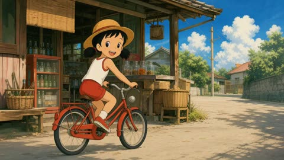</a>

The 10 second clip is split into timed beats of about 2.5 seconds, each with its own shot type and action, which gives the model a clear shot sequence. The character and clothing are described in full and repeated as a lock, and the prompt bans readable text while keeping the off camera adult out of the frame.

MiniMax H3 · Text-to-video · Source: [@eternityspring on X](https://x.com/eternityspring/status/2084606243516334180) · 387 likes on 2026-10-29

[`hand-drawn`](tags.md#tag-hand-drawn) [`storyboard`](tags.md#tag-storyboard) [`dialogue`](tags.md#tag-dialogue) [`bicycle`](tags.md#tag-bicycle)

<details><summary><b>Prompt</b></summary>

```text
RTX 4080 MiniMax H3 Cartoon Animation Prompt:

Generate a 10-second, 16:9 landscape, nostalgic Japanese hand-drawn animation style video.

The protagonist is a clever and cute elementary school girl wearing a straw hat, with black twin pigtails, dressed in a plain white tank top with red trim, red shorts, white socks, and red canvas shoes. The character's appearance and clothing remain consistent throughout.

The background is a small neighborhood shop on a summer afternoon, featuring a wooden door, old glass soda bottles, bamboo baskets, and a quiet alleyway. The overall style is unified with the character, and no readable text, subtitles, watermarks, or logos should appear in the frame.

Smooth and natural storyboard:
0 to 2.5 seconds, medium shot, the girl rides a small bicycle lightly circling out from the shop entrance, as if playing around;
2.5 to 5 seconds, side tracking shot, the girl slowly rides past the front of the shop, sunlight falling on her straw hat and shoulders, creating a relaxed and fun atmosphere;
5 to 7 seconds, cut to a two-thirds side front angle, the girl turns her head to look at the off-screen adult interviewing her while riding, showing a mischievous yet thoughtfully serious expression;
7 to 10 seconds, slightly closer shot, the girl slows down, speaking to the off-screen adult in a straight-faced yet cleverly sly tone:
"As long as you can endure hardship, there will be endless hardship to endure."
After saying this, she gives a slightly smug little smile to herself and continues riding gently forward.

Retain natural Chinese childlike voice for the dialogue, add subtle bicycle wheel sounds, summer ambient noises, and the quiet alleyway atmosphere at the shop entrance.
The interviewing adult remains off-screen only and does not appear in the frame.
Do not add other major characters, do not deform the bicycle, do not change the character's clothing.
```

</details>

<a id="h3-anime-girl-retro-player-reveal-trailer"></a>
### Anime girl in orange headphones, amber eye glance

<a href="https://x.com/Just_sharon7/status/2094085208027103678">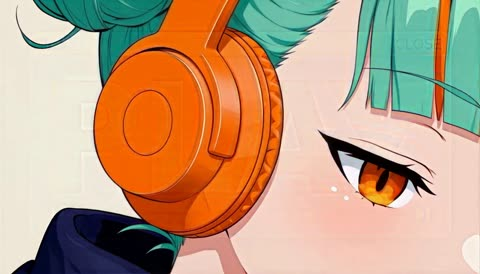</a>

A detailed character sheet plus a rule to preserve face, hair and outfit in every frame keeps the design locked across cuts. A timed shot list with retro media-player UI elements such as window chrome and equalizer bars sets the pacing and the graphic identity.

MiniMax H3 · Reference-to-video · Source: [@Just_sharon7 on X](https://x.com/Just_sharon7/status/2094085208027103678) · 293 likes on 2026-10-29

[`anime`](tags.md#tag-anime) [`character-consistency`](tags.md#tag-character-consistency) [`motion-graphics`](tags.md#tag-motion-graphics) [`retro-ui`](tags.md#tag-retro-ui)

<details><summary><b>Prompt</b></summary>

```text
Create an explosive, motion-graphics-driven character reveal trailer in 16:9, exactly 13 distinct cuts, 24fps, total 15.00s.

CHARACTER (lock this design; never redesign):
Anime streetwear girl from the reference still. Twin high buns of vivid mint-teal hair with long flowing tails and warm orange/gold streaks. Messy side-swept bangs. Large orange over-ear headphones with mint accents and a small logo plate. Sharp amber-orange eyes, one eye winking. Playful open-mouth grin. Oversized color-block windbreaker: navy body, vivid orange sleeves, white ribbed cuffs, silver zippers, circular teal tech buttons, a teal utility pocket on the sleeve. Orange cropped turtleneck under the open jacket. Light-wash ripped denim shorts, thick orange belt with a silver buckle. Navy thigh-high socks with orange ribbed cuffs and an orange X stitch on the left shin. Chunky white sneakers with orange details. Preserve exact face, proportions, hairstyle, outfit, materials, accessories and colors in every frame.

This film is 80% bold graphic design in motion and 20% character action. Graphic language is **retro OS chrome + music-player UI**, not ice/frost/barcode-lock. Use slamming window frames, title bars, close/minimize widgets, equalizer bars, waveforms, progress ticks, folder tiles, cursor arrows, CRT scanlines, pixel shatter, vinyl-ring stamps, music-note particles, media-player transport icons. Palette: mint teal, vivid orange, navy, cream-white, silver. Style: premium AAA motion-graphics title sequence × streetwear campaign film × Windows-era media player. Every graphic element moves fast and snaps hard on the beat.

CUT 01 | 0.00–1.00s — Pure graphics: a mint title-bar slams onto a cream field, an orange CLOSE widget punches the corner, two navy window borders wipe in. Tiny equalizer ticks and a progress strip flicker. The letters **P** then **LAY** punch in one after another with heavy impact shake.

CUT 02 | 1.00–2.00s — The **A** becomes a headphone cup: extreme close-up of her amber eye inside the orange earcup, glancing up; RGB split flash, then the cup shatters into flat mint/orange tiles.

CUT 03 | 2.00–3.10s — Navy frame with enormous cream **PLAY**. She sprints in from frame left and power-slides across the baseline of the type, speed lines and orange streaks trailing, shards of the letters kicked up like sparks. Whip-pan out.

CUT 04 | 3.10–4.00s — A giant retro media-player waveform explodes across the frame as a thick mint-and-orange audio spectrum bends into a tunnel. She bursts through the center of the waveform at full speed, briefly breaking into three stroboscopic motion trails behind her. Each trail leaves behind chunky navy equalizer blocks that rise and collapse to the beat. The camera rapidly pushes through the waveform tunnel with her, while huge vertical text **TRACK 01** scrolls continuously in the background. The waveform suddenly compresses into a single horizontal line and snaps shut behind her on the final beat.

CUT 05 | 4.00–5.10s — She leaps through a giant rotating ring of typography reading **MAX VOLUME**. Camera tracks her mid-air spin in slow motion as the letters scatter, then snap-zoom on her wink.

CUT 06 | 5.10–6.00s — Hard cut: cream editorial card, huge navy **DROP** with an orange slash. She vaults over the word itself, palm planted on the D, legs whipping across frame; the word compresses like a spring under her hand and rebounds.

CUT 07 | 6.00–7.00s — Mint field with a navy diagonal window-bar. She back-flips along the bar in three stroboscopic ghost frames, each ghost tinted mint, orange, or navy. Giant outlined text **LOOP** rotates 180 degrees in sync with her rotation.

CUT 08 | 7.00–8.00s — Kinetic type barrage: the words **LOUD / WILD / TEAL / HEAT** slam in one per beat with shutter flashes and camera shake, while she slides on her knees across the foreground, jacket flaring, music-note particles bursting from her sneakers.

CUT 09 | 8.00–9.00s — Navy frame, giant cream wireframe window-grid tilting in 3D. She runs up the grid like a wall, kicks off, and hangs in the air as everything freezes. An orange circular stamp locks around her pose like a media-player target, with transport icons and EQ ticks.

CUT 10 | 9.00–10.10s — Freeze releases into a burst: she dives toward camera through layered flat-color window panes that shatter one by one like glass shutters, each pane revealing a bigger letter of **P-L-A-Y**. Foreground wipe with her sneaker.

CUT 11 | 10.10–11.10s — Rapid-fire poster montage: four full-screen graphic posters of her in different action poses (mid-flip, sliding, landing, headphones-up wink) snap past with hard cuts. Each has a different bold layout, oversized numbers **01–04**, equalizer strips and slashes.

CUT 12 | 11.10–13.00s — Hero moment on a clean cream cyclorama: she lands a final backflip dead center in slow motion, straightens with one hand on her headphones, and a shockwave of concentric mint rings, wind streaks and shattered typography blasts outward from her landing. Brief iconic freeze on her wink, overexpose to white.

CUT 13 | 13.00–15.00s — Final identity card: enormous navy **PLAY** dominates a pale cream field with translucent mint rings, technical arcs, scanlines, and a rough orange circular emblem containing a ghosted headphone / waveform motif. She stands relaxed overlapping the letters, wind rippling her jacket. One last orange pulse sweeps through the typography and a window-chrome flash punctuates the end.

Editing: extremely aggressive rhythm — hard cuts on every beat, graphic matches, whip pans, snap zooms, stroboscopic freezes, foreground wipes, RGB splits, shutter flashes, impact shakes and speed ramps. Every cut must feel compositionally different. Typography is always fully readable before the character overlaps it. No weapons, no combat, no fire. All energy comes from motion design, wind, glass, UI chrome and her parkour-style athleticism.

BGM: hard-hitting electronic / drum-heavy future bass with aggressive drops, risers, sub hits and glitch fills locked to every cut. Sneaker impacts, whooshes, glass shatters, window-slam hits and typography slams are rhythmic sound-design elements. Peak at CUT 12 and end with a cold electronic logo stinger.

Premium AAA quality, anime-inspired cinematic rendering, stylish and explosive, strong graphic-design identity, consistent character design, exactly 13 cuts.
```

</details>

<a id="wan-anime-staff-ritual-portal-spaceship"></a>
### Anime Mage Summons Spaceship Through Cloud Portal

<a href="https://x.com/aimikoda/status/2099278002534101053"></a>

A plain idea written as one flowing sequence of events works better here than an expanded prompt. The character is locked with an Image 1 reference, and the energy is described as fluid and undulating to rule out a thin laser line.

Wan 3.0 · Reference-to-video · Source: [@aimikoda on X](https://x.com/aimikoda/status/2099278002534101053) · 273 likes on 2026-10-28

[`anime`](tags.md#tag-anime) [`fantasy`](tags.md#tag-fantasy) [`magic-effects`](tags.md#tag-magic-effects) [`character-reference`](tags.md#tag-character-reference) [`sci-fi`](tags.md#tag-sci-fi)

<details><summary><b>Prompt</b></summary>

```text
Testing Wan 3.0 Anime

I hadn't had much luck with Wan 3.0 anime before but seeing the incredible work below made me want to give it another shot.

I usually use a skill to turn my ideas into prompts but that approach hadn't worked too well for me with this model. This time, I just used the idea itself as the prompt. I'm happy with the result and might experiment with it some more.

*Used a character reference.

Prompt was: Start with the character from Image 1 performing a ritual-like dance on top of a tower. She raises her staff and sends a wave of energy into the clouds, not as a thin laser line but as something more fluid and undulating. In the clouds, a magic circle appears and expands. The surrounding clouds are pulled toward it and begin swirling around it. A portal opens at the center, and a giant spaceship emerges from it and descends to Earth.
```

</details>

<a id="h3-gothic-doll-turquoise-eyes-closeup"></a>
### Anime closeup of turquoise eyes under navy bangs

<a href="https://x.com/Mayz1169/status/2091464848848846983">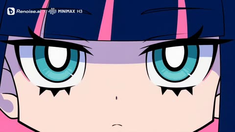</a>

A character sheet is passed as the identity reference, and a style lock forbids realistic rendering and 3D, so the flat cel look holds. Each beat is written with a timecode, and manga panel wipes, ribbon transitions and hair curtain sweeps carry the cuts.

MiniMax H3 · Reference-to-video · Source: [@Mayz1169 on X](https://x.com/Mayz1169/status/2091464848848846983) · 263 likes on 2026-10-29

[`anime`](tags.md#tag-anime) [`style-lock`](tags.md#tag-style-lock) [`timecode-shots`](tags.md#tag-timecode-shots) [`manga-transitions`](tags.md#tag-manga-transitions)

<details><summary><b>Prompt</b></summary>

```text
Create a 15-second horizontal 16:9 stylish 2D anime fashion animation featuring the exact same girl character from the provided reference image.

CHARACTER & STYLE LOCK:Use the provided character sheet as the absolute identity and art-style reference.

Maintain the exact original visual style:clean thick black outlines, simple 2D cartoon anime design, flat cel colors, minimal shading, cute gothic aesthetic, simplified facial features, oversized expressive eyes, graphic shapes and smooth hand-drawn animation.

Do NOT transform the character into realistic anime, 3D, semi-realistic illustration, or highly detailed rendering.

Character design must remain consistent:A small gothic girl with extremely long dark navy-blue straight hair covering most of her body, blunt bangs with small pink highlights, a large blue bow on top of her head, pale skin, turquoise eyes with sharp black lashes, tiny expressionless mouth, small pointed decorative details near the eyes, black gothic dress with white collar details, blue ribbon accents, pink inner hair sections, striped blue-and-black stockings, black rounded shoes, and a small purple cat-like plush companion held in her arms.

Her personality:quiet, mysterious, cute, slightly emotionless, elegant and doll-like.She feels like a character from a dark fantasy fashion animation.

0–1.5s — Begin with an extreme close-up of her turquoise eyes beneath her dark bangs. She slowly looks toward the camera with a calm mysterious expression. A soft blue glow reflects in her eyes. Large simple typography “MIDNIGHT DOLL” appears behind her while dark navy, pastel pink and purple graphic shapes float around the frame.

1.5–3.0s — Camera pulls back from her face into a full-body character reveal. Her enormous navy hair moves like a flowing curtain around her silhouette. She gently hugs her small purple cat companion while the camera slowly rotates around her like a collectible character showcase.

3.0–4.5s — She slightly tilts her head and raises one hand. Her blue ribbon creates a smooth animated wipe transition across the screen. The ribbon expands into a series of comic panels showing close-ups of her eye, bow, striped stockings and plush companion.

A vertical title “SILENT HEART” appears in clean white lettering over a black graphic panel.

4.5–6.5s — Create a fashion animation montage:front portrait → side profile → back view showing the giant hair silhouette → close-up of hands holding the plush → shoes stepping forward.

Use simple manga-style frames with alternating backgrounds:deep navy, soft pink, lavender and pale cyan.

Add subtle gothic symbols:small stars, moons, hearts, ribbons, floating dots and hand-drawn decorative marks.

6.5–7.5s — Her long hair sweeps across the entire screen like a dark blue curtain transition. Pink highlights inside the hair create flowing graphic streaks that reveal the next scene.

7.5–9.5s — Show a dramatic full-body hero pose. She stands in a dark fantasy fashion space made only from abstract shapes, not a realistic environment. Her giant hair spreads outward like a shadow silhouette while small purple and blue particles float around her.

The camera slowly pushes closer as she looks directly at the viewer with a calm doll-like expression.

9.5–11.0s — She reaches one hand toward the camera using exaggerated cute anime perspective. Her small hand fills the foreground while her face remains visible behind it. The movement creates a soft pastel blue and pink ink transition.

11.0–12.5s — Rapid detail shots:turquoise eye blink → blue bow moving slightly → pink hair highlight → purple plush companion → striped stockings → black shoes.

Each shot appears like a collectible character card animation.

12.5–13.8s — Full upper-body portrait against a clean graphic background made of navy, pink and cyan geometric shapes.

Her long hair forms a large elegant silhouette behind her.

Text “MIDNIGHT DOLL” appears around her like a fashion magazine cover title.

13.8–15.0s — Final sequence:eye close-up → ribbon movement → plush companion → confident front portrait.

Freeze on her quiet direct gaze toward the camera.

The final frame should look like a premium gothic anime character poster.

VISUAL DIRECTION:2D hand-drawn anime animation, dark kawaii fashion aesthetic, gothic lolita influence, thick clean outlines, flat colors, limited animation style, cute but mysterious atmosphere, soft graphic shadows, simple shapes, elegant character posing.

Use:

manga panel transitions

hand-drawn motion lines

ribbon wipes

hair silhouette transitions

simple sparkle effects

paper texture

subtle comic effects

Avoid:realistic lighting,3D rendering,photorealism,complex environments,cyberpunk style,neon overload,heavy particle effects,realistic hair strands,character redesign,outfit changes,facial changes,different hairstyle,extra accessories,identity drift,smooth cinematic dissolves,unreadable text.
```

</details>

<a id="h3-spaghetti-western-anime-silhouette-title-sequence"></a>
### Spaghetti western anime silhouette title sequence

<a href="https://x.com/doctorwasif/status/2085599659326935100"></a>

Reference image and audio track set the timing, with hard cuts only and freeze frames on full beats. A flat black silhouette on a restricted desert palette, plus stencil title typography and heavy 35mm print wear, keeps the look consistent.

MiniMax H3 · Reference-to-video · Source: [@doctorwasif on X](https://x.com/doctorwasif/status/2085599659326935100) · 250 likes on 2026-10-28 · found via [SkyNotSilent/awesome-MiniMax-H3-cases](https://github.com/SkyNotSilent/awesome-MiniMax-H3-cases)

[`anime`](tags.md#tag-anime) [`title-sequence`](tags.md#tag-title-sequence) [`silhouette`](tags.md#tag-silhouette) [`spaghetti-western`](tags.md#tag-spaghetti-western) [`film-grain`](tags.md#tag-film-grain)

<details><summary><b>Prompt</b></summary>

```text
Use the attached character reference (Image1) and audio track as the timing guide. Create a spaghetti-western pulp anime title sequence where every cut lands precisely on the beat.
Style the character as a flat black silhouette against solid desert-inspired colors (burnt orange, ochre, rust, adobe tan), using bold pop-art compositions, vintage bounty-poster framing, split panels, extreme close-ups, and wide horizon shots. Alternate fast action bursts with full-beat freeze frames (draw, stride, turn, match strike, etc.), using hard cuts only.
Add worn woodblock/stencil title typography that slams into frame on the beat. Finish with the character frozen in silhouette on a burnt-orange background as the title stamps in on the final hit.
Apply heavy 35mm film grain, scratches, dust, gate weave, cigarette burns, and sun-faded print wear throughout for an authentic 1960s spaghetti-western look.
```

</details>

<a id="h3-lumi-lemonade-kinetic-typography-title-sequence"></a>
### Anime lemonade girl kinetic typography title sequence

<a href="https://x.com/Just_sharon7/status/2095516988743225637"></a>

A character lock line at the top keeps her design fixed, then a graphic design first ratio of 80 percent type and 20 percent action sets the tone. Thirteen timed cuts each pair one giant word with one action, and the prompt adds beat synced sound design and a rule that type is readable before she overlaps it.

MiniMax H3 · Text-to-video · Source: [@Just_sharon7 on X](https://x.com/Just_sharon7/status/2095516988743225637) · 244 likes on 2026-10-28 · found via [SkyNotSilent/awesome-MiniMax-H3-cases](https://github.com/SkyNotSilent/awesome-MiniMax-H3-cases)

[`kinetic-typography`](tags.md#tag-kinetic-typography) [`motion-graphics`](tags.md#tag-motion-graphics) [`anime`](tags.md#tag-anime) [`multi-cut`](tags.md#tag-multi-cut) [`halftone`](tags.md#tag-halftone)

<details><summary><b>Prompt</b></summary>

```text
LUMI is an elegant, cheerful anime girl with long, vivid lemon-yellow hair with blunt bangs, honey-amber almond eyes with dramatic lashes, soft pink blush, a small mint-green hairpin, dangling lemon-slice earrings, a yellow ruffled off-shoulder top layered over a white halter crop top, and holds a tall glass of sparkling lemonade with ice and lemon slices. Preserve her exact face, proportions, hairstyle, outfit, materials, accessories and colors throughout; never redesign her.

This film is 80% bold graphic design in motion and 20% character action: giant kinetic typography, hard-edged citrus shapes, flat color fields, sunburst rays, halftone dots, juice-splash graphics, speed lines and shutter flashes. Palette: lemon yellow, citrus gold, cream white, soft blush pink, mint accent. Style: premium AAA motion-graphics title sequence x citrus lifestyle campaign film. Every graphic element moves fast and snaps hard on the beat.

CUT 01 | 0.00–1.00s – Pure graphics: a giant lemon-yellow wordmark "LUMI" slams onto a cream field with a sunburst-ray flash; halftone dots pulse and tiny citrus-slice UI ticks flicker along the frame edges.

CUT 02 | 1.00–2.10s – Cream-white field, huge black outline letters "FRESH" drop in and bounce; she twirls into frame holding her lemonade glass aloft, ruffles fluttering, sparkle particles trailing behind her.

CUT 03 | 2.10–3.10s – Close shot: she lifts the glass and takes a slow sip, eyes glinting; a fizz of golden bubbles erupts around her as kinetic type "ZEST" spins and locks into place behind her shoulder.

CUT 04 | 3.10–4.10s – Flat citrus-yellow field: she spins her glass and lemonade splashes upward in a stylized graphic arc that freezes mid-air as the wordmark "SPLASH" bursts through the liquid shape.

CUT 05 | 4.10–5.10s – Hard cut to cream field: giant outlined type "POUR" tilts diagonally; she pours a stream of golden lemonade into her glass, the falling stream morphing into the letterforms as it lands.

CUT 06 | 5.10–6.10s – Sunburst radial wipe: she flicks a lemon slice off the rim of her glass toward camera; it spins in slow motion catching the light, while the word "CITRUS" scatters into halftone dot particles.

CUT 07 | 6.10–7.10s – Slow hair-flip, her hair rippling like liquid gold; speed lines and sparkle bursts trail from it as the giant type "GOLDEN" ripples across the frame in sync with the movement.

CUT 08 | 7.10–8.10s – Kinetic type barrage: SWEET / COOL / BRIGHT / SUNNY slam in one per beat with shutter flashes and camera shake, while she raises her glass in a toast toward camera, ice clinking in slow motion.

CUT 09 | 8.10–9.10s – Cream cyclorama: she tilts her head back with a light laugh, hair catching the wind; a cluster of citrus-slice graphics and sparkle motes swirl around her in a slow orbiting halo.

CUT 10 | 9.10–10.10s – Layered flat-color glass panes (lemon yellow, cream, blush) shatter one by one, each revealing a bigger letter of "LUMI" underneath, as she steps forward through the breaking panes.

CUT 11 | 10.10–11.10s – Giant halftone sunburst rays pulse outward from behind her in rhythm with a bass drop, lemon-slice confetti raining down as she smiles and lightly lifts her glass higher.

CUT 12 | 11.10–13.00s – Hero moment on a clean cream cyclorama: she stands center frame, glass raised, warm confident smile, as a shockwave of concentric golden rings, citrus confetti and wind-rippled ruffles blasts outward from her; brief iconic freeze, overexpose to white.

CUT 13 | 13.00–15.00s – Final identity card: an enormous black "LUMI" wordmark dominates a pale cream field with translucent lemon-yellow rings, sunburst arcs, halftone dots and a circular emblem containing a lemon-slice motif; she stands relaxed beside the letters, glass in hand, hair rippling in the breeze; one last golden light pulse sweeps through the typography and a soft chime accent punctuates the end.

Editing: aggressive, stylish rhythm — hard cuts on every beat, graphic matches, snap zooms, speed ramps, shutter flashes and impact pulses; every cut must feel compositionally different; typography is always fully readable before the character overlaps it.

No weapons, no combat, no fire; all energy comes from motion design, light, liquid, glass and citrus.

BGM: bright, uptempo pop/electro-swing with fizzy drops and glitch fills locked to every cut; glass clinks, fizz pops, fabric flutter and sparkle chimes as rhythmic sound-design elements. Peak at CUT 12 and end with a warm chime logo stinger.

Premium AAA quality, anime-inspired cinematic rendering, stylish and vibrant, strong graphic-design identity, consistent character design, exactly 13 cuts
```

</details>

<a id="h3-cyber-ice-rebel-neon-splash-fashion"></a>
### Cyber ice rebel with silver hair and neon splashes

<a href="https://x.com/Mayz1169/status/2090701318625333455">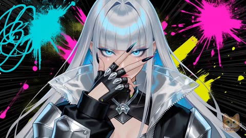</a>

The prompt lays out three named fashion identities on a timed beat sheet, each with its own hair colour, palette and attitude, while locking the same facial identity across cuts. Manga halftone, registration offsets and chromatic glitches are written in as the graphic layer, which keeps the anime look editorial rather than photoreal.

MiniMax H3 · Text-to-video · Source: [@Mayz1169 on X](https://x.com/Mayz1169/status/2090701318625333455) · 228 likes on 2026-10-29

[`anime`](tags.md#tag-anime) [`fashion`](tags.md#tag-fashion) [`neon`](tags.md#tag-neon) [`cel-shading`](tags.md#tag-cel-shading) [`music-video`](tags.md#tag-music-video)

<details><summary><b>Prompt</b></summary>

```text
Create a high-impact anime fashion film featuring a rebellious neon-pop heroine who transforms through three completely different fashion identities.  The heroine must maintain the same core facial identity throughout the entire film: consistent face shape, eye design, facial proportions, and anime style. However, every transformation must feel like a completely new fashion persona with different hairstyle, hair color, outfit silhouette, accessories, makeup, and attitude.  The transformations should never look like simple recoloring. Each identity must feel like a different anime fashion character connected by the same spirit.  Visual style: Premium cel-shaded anime fashion illustration, razor-clean line art, luminous oversized eyes, graphic shadow shapes, exaggerated editorial poses, extreme perspective distortion, kinetic camera punches, manga panel fragmentation, halftone printing textures, registration offsets, chromatic glitches, sticker-like graphic accents, physical wet ink transitions, futuristic fashion magazine aesthetic.  Color direction: Use an ultra-saturated neon palette throughout: electric cyan, fluorescent pink, acid yellow, radioactive lime, scarlet red, deep cobalt, ultraviolet purple, metallic silver, and holographic gold.  Every frame should feel like a luxury anime fashion campaign exploding into motion.  0–1.5s — Identity One: Cyber Ice Rebel  Start with a bold centered close-up.  The heroine tilts her chin toward the camera while one futuristic glove cuts diagonally across her face, revealing glowing icy-blue eyes between her fingers.  Her first fashion identity:  Extremely long silver-white hair flowing dramatically behind her, icy blue highlights reflecting neon light, sharp futuristic bangs, pale luminous eyes, metallic black-and-silver cyber armor jacket, transparent tech layers, chrome accessories, fingerless mechanical gloves, and sharp geometric nails.  Her expression is cold, fearless, and rebellious.  Oversized condensed white typography: “CHROMA FEVER”  slams into frame.  Behind her: electric cyan scribbles, fluorescent pink ink explosions, acid yellow graphic shards, manga speed lines, and distorted comic textures collide violently.  1.5–3.0s — Hyper editorial camera attack  Whip rapidly into an extreme close-up of her reflective eye.  Inside the iris: abstract neon symbols, manga patterns, and futuristic graphic shapes spin.  The camera crash-pulls backward into a powerful half-body fashion pose.  Use aggressive camera rotation, sharp zooms, and magazine-style framing.  3.0–4.5s — First transformation: Identity Two reveal  The heroine swings her arm directly across the camera.  Her glove fills the entire screen.  The frame breaks apart into: torn manga panels, halftone textures, ink splashes, comic borders, layered paper fragments, and explosive graphic elements.  Do not morph the character.  Instead create a hard editorial transition: black ink explosion → manga page flip → new silhouette reveal.  New title: “VOLT MODE”  drops vertically in narrow white typography over a deep black graphic strip.  4.5–6.5s — Identity Two: Neon Pop Superstar  A completely different fashion persona appears.  She now has:  A short fiery orange bob haircut with a vivid hot-pink gradient at the tips, playful sharp bangs, glowing colorful eye makeup, oversized fluorescent streetwear jacket, exaggerated shoulder shapes, neon accessories, candy-colored futuristic jewelry, and bold statement nails.  Her personality changes: from cold cyber rebel into a chaotic neon performance icon.  She feels energetic, unpredictable, and fearless.  Rapid editorial sequence:  symmetrical face crop → three-quarter profile → hair spinning across her eyes → crossed wrists → fingers creating geometric shapes around her face.  Background colors rapidly switch between: electric aqua, fluorescent rose, acid lemon, ultraviolet purple.  Add: offset print textures, comic marks, micro chromatic glitches, sticker graphics, and manga impact symbols.  6.5–7.5s — Violent graphic transition  A diagonal scarlet ink slash tears through the entire frame.  The image becomes abstract painted chaos.  The screen is covered by: wet paint textures, ink droplets, layered brush strokes, and fragmented comic imagery.  Then the image snaps into the final identity.  7.5–9.5s — Identity Three: Neon Royal Warrior  Reveal her third fashion identity.  She now has:  Long emerald-green flowing hair with ultraviolet purple streaks, dramatic waves, glowing golden eye accents, oversized angular golden earrings, futuristic couture makeup, a structured acid-lime jacket with an exaggerated raised collar, sculptural shoulders, and luxury battle-fashion details.  Her attitude: powerful, elegant, dominant, royal.  Begin with a silhouette profile.  She slowly rotates toward camera.  Behind her: radial manga lines, oversized graphic symbols, neon geometric patterns, and explosive fashion-editorial shapes burst outward.  9.5–11.0s — Extreme anime action fashion shot  She launches one hand toward the viewer with extreme anime foreshortening.  The camera aggressively pushes toward her palm.  Her fingertips release a saturated cobalt-blue brush explosion.  The blue paint texture expands rapidly and completely repaints the entire frame.  11.0–12.5s — Beauty impact montage  Ultra-fast beauty details:  golden glowing eye → metallic lips → gold earrings swinging → emerald and purple hair moving like painted ribbons → neon makeup reflections.  Every cut matches the electronic beat.  Hair movement creates colorful motion trails across the screen.  12.5–13.8s — Final fashion magazine composition  Pull back into a commanding upper-body stance.  The heroine stands surrounded by asymmetric blocks of:  scarlet red, cobalt blue, neon yellow, electric pink, and acid green.  “CHROMA FEVER”  appears oversized behind and partially in front of her.  Wet ink droplets, rough screen-print textures, manga symbols, and graphic stickers scatter around the composition.  She creates a sharp one-handed frame around one eye.  13.8–15.0s — Final impact sequence  Three synchronized impact cuts:  glowing iris → powerful profile → hand silhouette.  Each cut becomes closer, faster, and more intense.  Final freeze frame:  The heroine looks directly into the camera with unstoppable confidence.  Huge:  “VOLT MODE”  typography expands behind her until it nearly fills the entire screen.  Music and editing:  Fast Japanese electro-pop vocals over a hard electronic club beat.  Synchronize: camera punches, pose changes, typography impacts, fashion reveals, and graphic transitions  with every major beat.  Add: sharp whooshes, camera shutter snaps, bass impacts, digital glitches, and wet paint swipe sounds.  Avoid:  photorealism, realistic environments, dialogue, slow camera movement, soft fades, dreamy transitions, character drift, same hairstyle across transformations, same color palette for every identity, simple recoloring
```

</details>

<a id="h3-anime-opening-three-swordswomen"></a>
### Three swordswomen in a crimson anime title sequence

<a href="https://x.com/aimikoda/status/2083611951003734471"></a>

Each character gets her own reference image so faces, hair and outfits stay locked, and one audio track sets the timing of every cut. A timed shot list with a rule against repeating a character in the same frame keeps the ensemble shot clean and readable.

MiniMax H3 · Reference-to-video · Source: [@aimikoda on X](https://x.com/aimikoda/status/2083611951003734471) · 224 likes on 2026-10-29 · found via [SkyNotSilent/awesome-MiniMax-H3-cases](https://github.com/SkyNotSilent/awesome-MiniMax-H3-cases)

[`anime`](tags.md#tag-anime) [`opening-title`](tags.md#tag-opening-title) [`multi-reference`](tags.md#tag-multi-reference) [`audio-sync`](tags.md#tag-audio-sync) [`swordswomen`](tags.md#tag-swordswomen)

<details><summary><b>Prompt</b></summary>

```text
Create a fast-paced 15-second, 16:9 anime opening-title sequence for an original series titled “MINIMAX.” Use Image1, Image2, Image3 as the overall visual, ensemble and color-style references. Use Image4 for the pink-haired swordswoman, Image5 for the red-haired swordswoman and Image6 for the black-haired swordswoman. Preserve each character’s face, hairstyle, outfit, proportions, colors and weapon design.

Use the supplied audio Audio1 as the exact timing reference. Synchronize every cut, character action, camera movement, graphic transition and title reveal to its beats, accents, fills, rises and final hit. Do not create a separate soundtrack. Add only subtle sword swishes, cloth movement and transition impacts under the reference audio.

VISUAL STYLE

A real high-energy anime opening combined with premium motion graphics. Use black, crimson, wine red, dusty pink, pale ivory and cool gray-blue. Combine angular split screens, diagonal masks, torn-paper shapes, manga-style framing, ink textures, petals, crimson moon forms, torii silhouettes, temple rooftops and sharp graphic lines.

Keep the sequence kinetic and animated, not a slideshow. Characters must run, turn, pivot, slide, draw their swords, change stance and react to momentum. Hair and clothing must remain in motion. Use tracking shots, whip pans, rapid push-ins, low angles and short camera orbits.

Never show multiple copies of the same character in one shot. A shot may feature one character alone or all three together naturally. No clone effects, repeated character fragments or layered duplicates.

SEQUENCE FLOW

[0.0–1.5s]
Open instantly on the first beat. A crimson line cuts through black as petals and white fragments burst outward. Pink, red and black graphic panels snap into place while a crimson moon quickly assembles in the background.

[1.5–4.3s]
Feature the pink-haired swordswoman alone. She runs into frame, plants one foot, turns and draws her katana in one continuous agile motion. Track beside her, then push toward her face. Cut between her eye, hand, blade and full-body movement on the audio accents. Use pink petals, red lines and diagonal panel cuts.

[4.3–7.2s]
Switch to the red-haired swordswoman on a strong musical hit. Use a low-angle tracking shot as she moves forward, pivots and performs one powerful controlled sword motion. Her long hair and garments sweep with momentum. Place a large crimson sun disc behind her while black-red panels strike into frame on the heavier beats.

[7.2–10.2s]
Feature the black-haired swordswoman alone. Begin with a moving close-up of her crescent earring and eyes, then orbit around her as she turns, changes stance and redirects her blade. Keep her hair and sleeves flowing. Use dark negative space, moon-shaped masks and precise cuts synchronized to smaller rhythmic details.

[10.2–12.7s]
At the main musical peak, reveal all three characters together in one shared scene. They enter through real movement and form a strong triangular composition. Use a fast camera push or short orbit as the crimson moon, torii silhouette, petals and graphic debris align behind them. Show each character only once.

[12.7–15.0s]
During the final phrase, alternate between very short moving close-ups of the three characters, one character per shot. Show an eye turn, hand gripping a sword, flowing hair or a blade catching light. On the final major hit, reveal the title “MINIMAX” through sharp diagonal masks, sword-line wipes and fractured graphic panels.

End on a clean ensemble composition with all three characters together. Keep subtle motion in their hair, clothing, petals and light reflections.

TRANSITIONS
Use beat-synchronized slash cuts, angular panel snaps, moon-mask wipes, petal streaks, torn-paper shutters, ink-impact cuts, foreground wipes and oversized title masks. No soft dissolves, slow fades, liquid morphing or random transitions.

TYPOGRAPHY
Use only the title “MINIMAX.” Keep it sharp, elegant, premium and fully readable. No credits, extra text, random symbols or broken lettering.

FINAL RESULT
A fast, polished and rhythmically precise anime opening with expressive character motion, strong graphic editing, strict visual consistency and no duplicated characters within the same shot.
```

</details>

<a id="seedance-cannon-hammer-girl-vs-giant-snake"></a>
### Girl with cannon hammer faces giant snake

<a href="https://x.com/whorange__/status/2091061100574060981">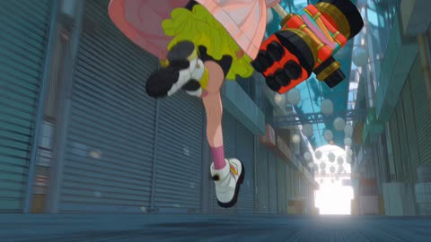</a>

Three reference images lock the girl, the snake and the arcade so the look holds across shots. A timed storyboard of hard cuts, camera moves and sound cues, plus a held beat on the shocked-to-gleeful expression, gives the action its rhythm.

Seedance 2.5 · Reference-to-video · Source: [@whorange__ on X](https://x.com/whorange__/status/2091061100574060981) · 219 likes on 2026-10-29

[`anime`](tags.md#tag-anime) [`cel-shading`](tags.md#tag-cel-shading) [`reference-images`](tags.md#tag-reference-images) [`storyboard`](tags.md#tag-storyboard)

<details><summary><b>Prompt</b></summary>

```text
风格：现代2D日式动作动画，平涂赛璐璐角色配纤细干净的线条与极简的渐变阴影，合成于高度精细的手绘背景之上，背景保留可见的铅笔线稿质感与柔和的水彩晕染。明亮的粉彩霓虹配色——薄荷绿、天空青、珊瑚粉、柠檬黄与长春花紫——笼罩在明亮到过曝的日光下，将巷子尽头彻底照成一片纯白。凌厉的冲击定格帧，放射状速度线，手绘的火焰与火花特效，动作段落以24帧每秒逐帧作画。禁止3D渲染，禁止照片写实，禁止西方卡通语汇。

主体：@girl（与输入图2完全一致100%）——一名身材娇小的年轻女子，齐刘海金发，一双巨大的圆眼配粉黄同心圆虹膜，鼻梁上贴着粉色鼻贴，露出小虎牙，身穿宽大的浅粉色连帽外套，缀满圆形金扣，内搭黄色荷叶边衬裙与黑色骑行短裤，一只粉袜一只黄袜，脚踩厚底白色马丁靴。六颗红黄薄荷条纹的巨型糖果球环绕漂浮在她的头部与肩膀周围。她扛着一门巨大的多管加农锤，红金配色，黑色炮口成簇排列。她的表情能在惊恐与狂喜之间瞬间翻转。
@snake
（与输入图3完全一致100%）——一条体型巨大的蛇，鳞片层叠交错，呈薄荷绿、海蓝与长春花紫，腹部为淡奶油色，钝圆的吻部，一双巨大的金色眼睛配竖直黑色瞳孔，颌下垂着长长的淡色须状触须。
@alley
（与输入图1完全一致100%）——一条狭窄的日式有顶商店街，卷帘门紧闭的店铺，珊瑚色与绿色的褪色布篷，堆叠的蓝色塑料筐与纸箱，头顶横拉着数十盏淡色圆形纸灯笼；巷子尽头被强光冲成一片纯白。

场景：有顶商店街，以贴地视角沿着长巷望去，灯笼在头顶轻轻摇曳。

动作：
镜头1（0:00–0:03）——低角度近景对准少女的厚底靴，她漫不经心地走过商店街，加农锤拖在身后，前方是巷子尽头的白光。硬切。
镜头2（0:03–0:07）——反打宽幅：巨蛇填满了她身后的整条街道，头颅低垂在店铺之间，触须垂落，灯笼擦过它的鳞片。硬切。
镜头3（0:07–0:10）——她面部的极特写：双眼骤然睁大，张口发出真切的惊恐。停留一拍——随即她的表情裂开，绽出一个露着虎牙的狂喜大笑。硬切。
镜头4（0:10–0:14）——巨蛇的巨口张到不可思议的幅度，顺着长巷直扑向她，蛇口占满整个画面。硬切。
镜头5（0:14–0:19）——她侧身扑倒，抡起加农锤开火；一团巨大的橙色火球在蛇吻上炸开，筐子与纸箱四散飞溅。硬切。
镜头6（0:19–0:23）——巨蛇金色眼睛的极特写，竖直瞳孔猛地收缩。硬切。
镜头7（0:23–0:27）——宽幅侧视：巨蛇盘绕的身躯横扫整条街道，狠狠撞上她；她被掀飞出画面上方，糖果球四散飞出。硬切。
镜头8（0:27–0:30）——自地面向上的仰角：她高高翻滚着，映在挂满灯笼的顶棚与白色天空前，化作剪影，加农锤在她身旁旋转。定格保持。切黑场。

摄影：行走用低角度跟拍；揭示巨蛇用固定机位反打宽幅；两处特写均用强力推进；扑咬与火球用剧烈手持晃动；眼睛用缓慢静止定格；她被击飞用向上摇镜跟随。惊恐转狂喜的瞬间必须停满一整拍——那一拍就是包袱。

音效：开场是安静的商店街环境音与脚步声，身后逐渐响起低沉的摩擦滑行声，灯笼纸张沙沙作响。随后是巨大的蛇嘶，沉重的炮击轰鸣伴随深沉低频，木箱与塑料筐碎裂，火花噼啪，少女发出愉悦的高声大笑。富有节奏感的打击乐动作配乐自第一个镜头起便强势切入。无对白，无字幕。

限制条件：16:9画幅。少女必须与输入图2完全一致100%，巨蛇必须与输入图3完全一致100%，商店街必须与输入图1完全一致100%——不得出现形象漂移；务必保持粉色金扣外套、漂浮的条纹糖果球、厚底靴，以及巨蛇的薄荷绿-蓝-紫鳞片、金色竖瞳与垂落的触须，还有商店街的灯笼、卷帘门与货筐。每一帧都必须是平涂赛璐璐角色叠加于手绘背景之上；禁止3D渲染，禁止照片写实。仅限风格化的动作表现——无血液，无血腥，双方均不得出现可见伤口。画面中任何位置都不得出现文字、字母、标识、店铺招牌或字幕。

Prompt 2:
风格：现代2D日式动作动画，平涂赛璐璐角色配纤细干净的线条与极简的渐变阴影，合成于高度精细的手绘背景之上，背景保留可见的铅笔线稿质感与柔和的水彩晕染。明亮的粉彩霓虹配色——薄荷绿、天空青、珊瑚粉、柠檬黄与长春花紫——笼罩在明亮到过曝的日光下，将巷子尽头彻底照成一片纯白。凌厉的冲击定格帧，放射状速度线，手绘的火焰与火花特效，动作段落以24帧每秒逐帧作画。禁止3D渲染，禁止照片写实，禁止西方卡通语汇。

参考：
@scene1
 是上一段已生成的视频片段——请将其作为风格、配色、线条、角色设计、体量比例与光线的连续性参考。本段直接承接该片段的最后一帧，即少女腾空翻滚于挂满灯笼的顶棚之下、加农锤在身旁旋转之时。必须与
@scene1
 完全一致；不得重新调整风格，不得改变角色比例或巨蛇的体量。

主体：@girl（与
@scene1
 及输入图2完全一致100%）——那名娇小的金发女子，粉黄同心圆眼眸，小虎牙，宽大的粉色金扣外套，黄色荷叶边裙，一粉一黄的不对称长袜，白色厚底靴，环绕漂浮的条纹糖果球，以及那门巨大的红金多管加农锤。
@snake
（与
@scene1
 及输入图3完全一致100%）——那条薄荷绿-蓝-紫鳞片的巨蛇，金色竖瞳，垂落的淡色触须。
@alley
（与
@scene1
 及输入图1完全一致100%）——同一条有顶商店街，卷帘门店铺、货筐与悬挂的纸灯笼。

场景：延续同一条商店街，巨蛇盘绕的身躯此刻已填满整条长巷。

动作：
镜头1（0:00–0:04）——她重重落地成蹲姿，向后滑出一段距离，随即将一个新弹鼓拍进加农锤的膛口。近景对准装填动作。硬切。
镜头2（0:04–0:09）——侧向跟拍：她全速冲刺，沿着巨蛇拱起的躯干侧面奔跑，靴底喷溅出火花，加农锤拖在身后。硬切。
镜头3（0:09–0:13）——她自蛇身一跃扑向蛇头；放射状速度线填满整个画面，她的剪影向上飞窜。硬切。
镜头4（0:13–0:17）——她零距离朝蛇吻开火；一团巨大的橙色爆焰在它脸上炸开，蛇头猛地被打得侧甩。硬切。
镜头5（0:17–0:21）——低角度奔跑镜头：她沿着巨蛇宽阔的鳞背朝蛇头狂奔，靴子重重砸在鳞片上。硬切。
镜头6（0:21–0:24）——她单只眼睛的极特写，粉黄虹膜环骤然收缩——随即硬切至加农锤黑色炮口簇点火的极特写。硬切。
镜头7（0:24–0:27）——最后一击贯穿巨蛇的躯体，它整个碎裂成千万片漂浮的粉彩水晶碎片——薄荷绿、紫色与奶油色——如玻璃般向上飘散。硬切。
镜头8（0:27–0:30）——终幕宽幅：商店街重归寂静，巨蛇空荡的长长盘躯静静横陈于地，灯笼轻轻摇曳。娇小的少女立于正中，加农锤搁在肩上，被巷尾那片过曝的白光勾出逆光轮廓。定格保持。切黑场。

摄影：落地用强力震动；沿蛇身奔跑用快速横向跟随；起跳用放射状速度线构图；两次开火均用剧烈晃动；鳞背奔跑用贴近靴后的低角度跟拍；两个极特写之间用硬性急切；终幕用缓慢后拉宽幅。终幕镜头须停留两拍再切。

音效：打击乐动作配乐全程高强度推进，金属弹鼓装填的咔哒声，靴子重踏鳞片，火花嘶鸣，两记巨大的炮击轰鸣伴随深沉次低频，一声悠长的蛇嘶戛然而止，随后是躯体碎裂时清脆的水晶鸣响。终幕宽幅处一切归于寂静——只余灯笼纸张的轻微沙沙声与远处的风声。无对白，无字幕。

限制条件：16:9画幅。必须与
@scene1
 及三张输入图完全一致100%——相同的角色设计、相同的巨蛇鳞片纹样、相同的商店街、相同的配色，两段之间不得出现形象漂移或风格跳变。每一帧都必须是平涂赛璐璐角色叠加于手绘背景之上；禁止3D渲染，禁止照片写实。仅限风格化的动作表现——无血液，无血腥，无内脏；巨蛇以干净的水晶碎片形式消散，绝不表现伤口。画面中任何位置都不得出现文字、字母、标识、店铺招牌或字幕。
```

</details>

<a id="h3-lunar-eclipse-swordswoman-silhouette"></a>
### Silhouetted swordswoman under a giant purple moon

<a href="https://x.com/Mayz1169/status/2086427292755247409">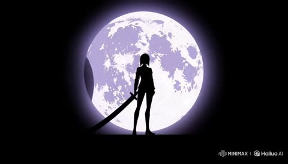</a>

A timestamped storyboard with a fixed palette and an explicit restriction list keeps the output in flat 2D motion graphics instead of drifting into 3D. Each beat names one action and one framing, so the model does not stack a fight or extra camera moves that would break the poster look.

MiniMax H3 · Text-to-video · Source: [@Mayz1169 on X](https://x.com/Mayz1169/status/2086427292755247409) · 202 likes on 2026-10-29

[`lunar-eclipse`](tags.md#tag-lunar-eclipse) [`silhouette`](tags.md#tag-silhouette) [`game-trailer`](tags.md#tag-game-trailer) [`2d-anime`](tags.md#tag-2d-anime) [`storyboard`](tags.md#tag-storyboard)

<details><summary><b>Prompt</b></summary>

```text
Game promotional PV, 15s. Pure 2D Japanese cel animation combined with abstract Editorial MG composition.

[Art Style]
Mysterious lunar eclipse style. High-contrast palette of deep purple, black, indigo, and silver-white, with limited glowing purple accents. Minimal hard-edge cel shading, large solid-color silhouettes, 1–2 shadow layers.
Flat background with only architectural outlines, spires, wires, antennas, and geometric blocks. Integrate lunar phases, eclipses, orbits, star charts, astrology UI, compass, radial lines, scanlines, halftone, and geometric slices.

The entire video feels like a dynamic game poster constantly being broken apart and reconstructed. No realistic 3D space.

[Characters]
Female protagonist: black shoulder-length hair, black uniform, long boots, holding a massive katana, cold and restrained.

Villain: gray long hair, black wide-brim hat, black long coat, elegant and dangerous.
[Storyboard]
0–3s
Black background. A giant purple lunar eclipse appears. The female protagonist’s silhouette stands at the center. Her step causes the moon phase to fracture into geometric rings and star chart markings. Architectural outlines assemble from darkness.

3–6s
Fast camera pan. The heroine moves forward with her sword. Background switches through different lunar phases. Buildings, orbits, and star charts are sliced and reconstructed. Silver-white orbital lines cross the character as the frame flips and compresses.

6–10s
High-speed MG montage. Eyes, katana silhouette, lunar phases, star trails, compass, raven silhouettes, and solar eclipse rapidly overlap. Each beat triggers inversion, geometric bursts, orbital rotation, and purple flashes. No continuous combat, only key poses.
10–13s
Pure black space. The villain sits at the center of a giant lunar ring and slowly raises his head. The moon behind him becomes a complete solar eclipse. Purple halos expand. The heroine’s silhouette appears inside the moon. No direct battle.
13–15s
The solar eclipse shatters. Orbits, star charts, lunar phases, and architecture collapse inward and rebuild into an original game logo.

[Restrictions]
Keep a flat 2D MG style. No realistic lighting, no 3D cities, no realistic perspective, no cyberpunk streets, no continuous fighting. All elements must be graphic silhouettes. Every frame should look like a premium game poster.
```

</details>

<a id="seedance-sugar-pop-candy-defender-sheet"></a>
### Anime candy hero character sheet with turnarounds

<a href="https://x.com/Mayz1169/status/2084943718042448060">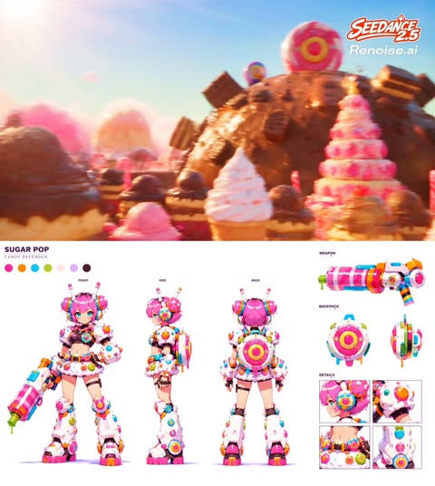</a>

The prompt lays out the sheet section by section (hero, turnarounds, equipment panels, palette), which keeps proportions and details consistent across views. Naming the 16:9 frame, the white background and a specific style reference gives a clean production-sheet look.

Seedance 2.5 · Text-to-video · Source: [@Mayz1169 on X](https://x.com/Mayz1169/status/2084943718042448060) · 156 likes on 2026-10-29

[`character-sheet`](tags.md#tag-character-sheet) [`anime`](tags.md#tag-anime) [`game-art`](tags.md#tag-game-art) [`turnaround`](tags.md#tag-turnaround)

<details><summary><b>Prompt</b></summary>

```text
1️⃣character sheet:

Ultra-detailed 16:9 sci-fi anime character design sheet, official hero shooter game character bible, clean premium editorial layout, minimalist white background.

Character name "SUGAR POP", title "Candy Defender", subtitle "A hyper-energetic defender armed with oversized dessert-powered weaponry."

Left section features a full-body hero illustration of a petite anime girl with short bubblegum-pink hair in candy-bun twin tails, bright cyan eyes, oversized colorful candy headphones with antennae, wearing futuristic white powered armor covered in glossy candy buttons, sprinkles, frosting textures, donut-like armor joints, cropped black inner suit, chunky mechanical boots, oversized gauntlets and playful candy-themed mechanical details. She holds a gigantic candy cannon resembling a frosted dessert blaster with striped barrel, dripping neon syrup, colorful plastic components and toy-like sci-fi engineering.

Center section includes professional turnaround views (Front, Side, Back), perfectly consistent anatomy, hairstyle, armor proportions and equipment, neutral pose for production reference.

Right section contains large equipment breakdown panels including the oversized candy cannon, circular candy-powered backpack energy core (front and side), close-up head profile, shoulder armor detail, torso armor detail and leg armor detail.

Top left includes a vibrant color palette featuring bubblegum pink, orange, cyan, lime green, cream, lavender and chocolate brown.

Style: official stylized hero shooter concept art, Overwatch 2, VALORANT skin design, Zenless Zone Zero, NIKKE, colorful sci-fi anime, premium AAA game artbook, glossy hard-surface mechanical design, candycore aesthetic, toy-inspired industrial design, highly detailed production-ready character sheet, masterpiece, best quality, ultra detailed, 8K, clean composition, no watermark, no logo, no deformed anatomy, no extra limbs.
```

</details>

<a id="kling-retro-anime-witches-beetle-ride"></a>
### Red Beetle drives three witches through rainy night

<a href="https://x.com/ShamiWeb3/status/2115663136086962217">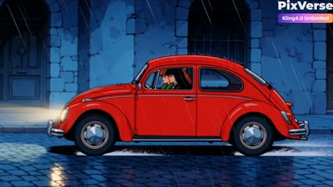</a>

Eleven numbered shots each pair a visual beat with an audio cue, and three reference images lock each witch's look across cuts. The style line names cel shading, ink outlines and film grain so the whole clip stays in one retro anime look.

Kling 4.0 · Reference-to-video · Source: [@ShamiWeb3 on X](https://x.com/ShamiWeb3/status/2115663136086962217) · 150 likes on 2026-10-29

[`retro-anime`](tags.md#tag-retro-anime) [`multi-shot`](tags.md#tag-multi-shot) [`reference-images`](tags.md#tag-reference-images) [`audio-cues`](tags.md#tag-audio-cues)

<details><summary><b>Prompt</b></summary>

```text
A 30-second, 16:9 animated short in retro 80s/90s hand-drawn cel anime style, with bold black ink outlines, flat cel shading, soft gradient skies and subtle film grain. The palette is twilight blues and purples against warm amber window glow, with red and orange accents. The setting is a rain-slick old-town street at night with glowing street lamps. The mood is dark-comic and mischievous. Camera moves are smooth and cinematic, and the cuts are fast.
CHARACTERS (keep consistent in every shot, using the reference images)

Blonde witch (Image 3): platinum-blonde hair with bangs, blue eyes, round tinted glasses, a cream and gold satin dress. Her voice is cool, breathy and sarcastic.
Redhead witch (Image 1): wavy copper hair, freckles, green eyes, a green fur-trimmed coat. Her voice is low and scheming, with a wicked laugh.
Black-haired witch, the driver (Image 2): long black hair with blunt bangs, violet eyes, red lips, a silver choker, a black lace outfit. Her voice is husky and playful.

AUDIO
Music is a jazzy, mischievous retro score with upright bass, muted trumpet and vibraphone. It turns into a tense chase with drums and strings, then a soaring magical orchestral theme in the flight, and settles into a warm acoustic guitar and music box melody at the cabin. Ambience includes light rain, tires on wet cobblestone, crackling torches, wind and crickets. Dialogue is short and natural, with no narrator.

SHOT 1: The ride. Wide side view of a red vintage Beetle gliding down a wet night street. Cut inside to the three witches: the blonde adjusts her glasses, the redhead sits in the middle, the driver grips the wheel.
Audio: jazz groove fades in, rain and tire hiss. The blonde sighs, “Such a dull evening.”

SHOT 2: The spell. Through the windshield, a couple kisses under a lamppost. Close-up of the redhead’s envious glare as she flicks her fingers and pink magic sparkles swirl.
Audio: the music drops to a low string drone, then a harp glissando. She mutters, “Hmph... how sweet.”

SHOT 3: The pig prank. The woman’s head turns into a pig’s head and she screams while the man recoils. Cut back to the car, where all three witches burst into laughter.
Audio: a cartoon “pop,” a squeal, then a comic trombone slide and their wicked cackling. The man gasps, “What?!”

SHOT 4: The old lady. The Beetle stops at a crosswalk as an old woman with a basket crosses. Close-up of her smiling and tipping her scarf, then the driver leans out the window and sticks her tongue out.
Audio: a warm clarinet phrase and a cheeky slide whistle. The old woman says, “Bless you, girls!”

SHOT 5: The queue. Wide shot of the car parked outside a glowing grocery shop with a long line of people. The three witches strut past the crowd, heads high, and stand shoulder to shoulder in a low-angle shot.
Audio: a swaggering bassline with heel clicks and the crowd murmuring. The redhead says smoothly, “Excuse us.”

SHOT 6: The closed shop. Through the shop window, shelves of grocery bags glow warm while the crowd stares. Close-up of the door sign reading “CLOSED.” The witches then stand smiling with arms full of overflowing grocery bags.
Audio: a timpani hit as the sign swings, then a smug, triumphant jingle. The blonde purrs, “Fresh. Perfect.”

SHOT 7: The mob. An angry mob with torches and pitchforks charges down the street. The witches glance sideways, then run, the redhead wrapped in a glowing green magic aura.
Audio: the music cuts to a fast chase with war drums and stomping boots. The mob shouts, “Get them!” The redhead calls out, “Hold on to your bags!”

SHOT 8: Lift-off. The witches leap onto straw brooms in a burst of green sparks and rise above the shouting crowd.
Audio: a bright “whoomph,” a powerful whoosh, and the orchestra swelling into the flight theme.

SHOT 9: The flight. Aerial wide shot of the three witches flying over the glowing town toward purple mountains at dusk, ending on tiny silhouettes against the sky.
Audio: full orchestra with harp and choir pads, wind rushing, and the witches laughing with joy.

SHOT 10: The cabin. They land by a stone cabin and picnic table at golden sunset. The driver pours tea from a white teapot and the blonde sips with her eyes closed. Close-up of all three clinking their teacups together, and their eyes flash golden through their glasses.
Audio: the acoustic guitar theme enters with crickets, a pouring sound and a porcelain clink. They say together, “Cheers.”

SHOT 11: Final shot. Wide shot of the lone cabin on a hilltop as dusk turns into a starry night, then fade to black.
Audio: the music box melody slows and ends on a single chime as the sound fades out with the picture.

NEGATIVE PROMPT
Photorealism, 3D render, extra fingers, distorted faces, inconsistent hair or outfit colors, any non-English text or speech, watermark, blur, low quality, harsh audio, lip-sync errors, narrator voice-over.
```

</details>

<a id="h3-kids-counting-morphing-numbers-educational"></a>
### Kids Counting Video With Morphing Numbers

<a href="https://x.com/Strength04_X/status/2084552480554446929"></a>

Every number follows one fixed learning pattern, and each shape morphs into the next, so the sequence flows. Timestamped beats pair narrator lines with a highlight color per number, and a recap closes the clip.

MiniMax H3 · Text-to-video · Source: [@Strength04_X on X](https://x.com/Strength04_X/status/2084552480554446929) · 148 likes on 2026-10-28 · found via [SkyNotSilent/awesome-MiniMax-H3-cases](https://github.com/SkyNotSilent/awesome-MiniMax-H3-cases)

[`educational`](tags.md#tag-educational) [`kids`](tags.md#tag-kids) [`3d-animation`](tags.md#tag-3d-animation) [`morph-transition`](tags.md#tag-morph-transition) [`timestamped`](tags.md#tag-timestamped)

<details><summary><b>Prompt</b></summary>

```text
Create a 15-second animated educational video that teaches young children the numbers 1, 2, 3, and 4.
Learning pattern for every number:
NUMBER → COUNT SOUND → OBJECTS → PLAYFUL ACTION → NUMBER NAME
Target audience: children ages 3 to 6.
Visual style: Adorable rounded 3D characters, soft pastel colors, gentle expressions, premium minimalist tech aesthetic clean white space, soft studio lighting, smooth gradients, rounded geometry, crisp typography, polished transitions. Clean off-white background with a different soft color glow behind each number.
0:00–0:01 Intro: Star mascot bounces in, numbers float around it, text "Let's count!", tap creates ripple revealing "1".
0:01–0:04 | 1 is for One Sun: Large "1" shown, narrator: "One. Just one. One Sun." The 1 transforms into a smiling sun with soft rays. One gentle pulse of light. Word "ONE SUN" appears, highlight "1" in yellow.
0:04–0:07 | 2 is for Two Birds: The sun's rays curve into a "2." Narrator: "Two. Two Birds." The 2 splits gently into two round bluebirds that flutter and land side by side. Word "TWO BIRDS," highlight "2" in blue.
0:07–0:10 | 3 is for Three Flowers: The birds' wings curl into a "3." Narrator: "Three. Three Flowers." The 3 blooms into three pink flowers swaying gently. Word "THREE FLOWERS," highlight "3" in pink.
0:10–0:13 | 4 is for Four Fish: The flower stems bend into a "4." Narrator: "Four. Four Fish." The 4 splits into four little green fish swimming in a soft circle. Water ripple effect. Word "FOUR FISH," highlight "4" in green.
0:13–0:15 Recap: Sun, birds, flowers, fish appear as four tiles with "1 2 3 4" above. Mascot points to each; Narrator: "1, 2, 3, 4. Great counting!" Sparkle + chime.
Requirements: Keep each number visible before morphing, smooth shape transitions, no clutter, no scary faces, gentle squash-and-stretch, synced sound effects, calm and polished finish.

Prompt idea - @umesh_ai #MiniMaxH3
```

</details>

<a id="h3-storyboard-grid-nine-shot-film"></a>
### Two boys with a bicycle overlooking a night city

<a href="https://x.com/magnific/status/2090508187875356957">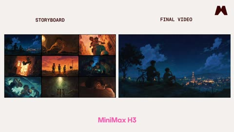</a>

The storyboard image is passed as a reference that sets shot order and approximate composition, while the prompt forbids copying its grid, panel borders or split-screen layout. Stating the shot count, the cut style and the length of each shot keeps the output a single continuous film rather than a collage.

MiniMax H3 · Reference-to-video · Source: [@magnific on X](https://x.com/magnific/status/2090508187875356957) · 143 likes on 2026-10-29

[`storyboard`](tags.md#tag-storyboard) [`multi-shot`](tags.md#tag-multi-shot) [`anime`](tags.md#tag-anime) [`trailer`](tags.md#tag-trailer)

<details><summary><b>Prompt</b></summary>

```text
@Image
 1 is a nine-panel storyboard grid. Read it left to right, top to bottom. It defines shot order and approximate composition only. Do not reproduce the grid itself: no panel borders, no black gutters, no split screen, no collage, no letterboxing. The output is one continuous single-frame film.

Nine shots, hard cut between each, roughly 1.5 seconds per shot, no dissolves and no fades.
```

</details>

<a id="h3-anime-tomato-egg-noodle-storyboard"></a>
### Anime cook making tomato egg noodles at dusk

<a href="https://x.com/eternityspring/status/2091187818639114535">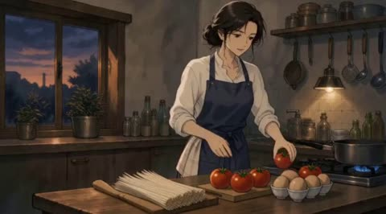</a>

The prompt asks for a 16:9 storyboard of twelve panels in one pass, keeping the same character in every frame with fixed anime styling, evening kitchen light and close-ups of hands and eyes. Its gentle muttering and restrained body language give the storyboard a dialogue rhythm that carries into the video step.

MiniMax H3 · Image-to-video · Source: [@eternityspring on X](https://x.com/eternityspring/status/2091187818639114535) · 137 likes on 2026-10-29

[`storyboard`](tags.md#tag-storyboard) [`anime`](tags.md#tag-anime) [`multi-shot`](tags.md#tag-multi-shot) [`character-consistency`](tags.md#tag-character-consistency)

<details><summary><b>Prompt</b></summary>

```text
Step 2: Create Storyboard Images
Feed the character role images from Step 1 into GPT, then use the following prompt:
Please create a 16:9 12-panel animated script about the process of making tomato and egg noodles. In the animation, the character should always be present in the frame. Use a simple Japanese animation style to create a cinematic animated effect. The overall atmosphere should feel warm, understated, and slightly melancholic, with scenes simulating the lighting ambiance of an evening family kitchen, where ordinary moments are depicted as beautiful and richly layered, the character's expressions are delicate and subtle, with clever use of negative space, the frame composition biased toward the center and lower part, along with close-up shots of details like hands and eyes. Avoid overly exaggerated animated expressions or commercialized shots. While making the tomato and egg noodles, the character should mutter to themselves in a gentle manner, with natural and moderate body language.
```

</details>

<a id="h3-anime-girl-kinetic-typography-intro"></a>
### Anime girl kinetic intro with 3D typography

<a href="https://x.com/IqrasaifiAI/status/2100030154668159256"></a>

Numbered shots each name one camera move and one subject action, so the model keeps a clear sequence across cuts. Typography is tied to physical events like drops, collisions and fractures, which gives the kinetic text motion without extra prompting.

MiniMax H3 · Image-to-video · Source: [@IqrasaifiAI on X](https://x.com/IqrasaifiAI/status/2100030154668159256) · 131 likes on 2026-10-29

[`anime`](tags.md#tag-anime) [`kinetic-typography`](tags.md#tag-kinetic-typography) [`camera-moves`](tags.md#tag-camera-moves) [`shot-list`](tags.md#tag-shot-list)

<details><summary><b>Prompt</b></summary>

```text
High-speed, hyper-kinetic anime sequence with extreme camera acrobatics and reactive 3D typography.
Shot 1 (Low-Angle Shoe Tracking): Ground-level fisheye lens tracks backward at breakneck speed right beneath the heavy, lug-soled platform boots of a rebellious anime girl with wild black-and-neon-red layered hair. Massive concrete-textured 3D letters spelling 'RIOT' slam violently downward out of thin air, crashing onto the seamless red studio floor with camera-shake impact dust just inches behind her heels.
Shot 2 (Dynamic Lens Tilt & Word Spin): Instant whip-pan upward with a 45-degree Dutch angle tilt against an acid-lime backdrop. The camera barrels forward, diving under her outstretched arm as she throws a playful side-eye wink. The giant 3D word 'VOID' sweeps in from off-screen in a rapid rotational pivot, skimming past the lens with intense motion blur and chromatic aberration.
Shot 3 (Step-Through & Text Smash): Cut to a stark white void; the camera pulls back fast on a low Dutch tilt as she stomps forward directly toward the lens. The oversized sole of her boot eclipses the frame for a split-second transition. She drops into a low crouch atop a bright-red pedestal; floating jagged 3D letters spelling 'BREAK' violently fracture into floating debris behind her.
Shot 4 (Kinetic Combat & Ink-Brush Kanji): Smash zoom into a fractured-glass screen transition. The anime girl draws a glowing crimson-edged katana, spinning through a 360-degree rotational tracking shot. Massive black-and-blood-red brush-ink Kanji characters surge and rip across the frame, warping in three dimensions to follow the sword's curved slash path. High-contrast cel shading, aggressive speed lines, sharp snap zooms, 4k resolution, 60fps."
Camera & Motion Directives for Generation
Camera Physics: Ground-skimming fisheye, rapid snap-zooms directly into character eyes or boot soles, fast rotational 360-degree rolls, and abrupt whip-pans.
Typography Dynamics: Kinetic typography that physically drops, collides with the floor, spins into the camera axis, and explodes into fragments upon impact.
Visual Transitions: Boot-sole screen wipes, fractured glass impacts, and wide-swiping calligraphy ink ribbons that guide the cut to the next shot.

in
@higgsfield
```

</details>

<a id="h3-fashion-mv-sofa-stand-kinetic-typography-template"></a>
### Fifteen second anime fashion MV with kinetic typography

<a href="https://x.com/studio_oneroom/status/2097255890391077338"></a>

A fixed 20 shot timecode table gives every cut a duration and a camera move, and one continuous action (stand up, walk past, look back) is covered from many angles. Editable slots for text, BPM and colours sit at the top, and the text is layered in three depth planes that move at different speeds.

MiniMax H3 · Reference-to-video · Source: [@studio_oneroom on X](https://x.com/studio_oneroom/status/2097255890391077338) · 110 likes on 2026-10-28 · found via [SkyNotSilent/awesome-MiniMax-H3-cases](https://github.com/SkyNotSilent/awesome-MiniMax-H3-cases)

[`fashion-mv`](tags.md#tag-fashion-mv) [`kinetic-typography`](tags.md#tag-kinetic-typography) [`template`](tags.md#tag-template) [`anime`](tags.md#tag-anime) [`multi-shot`](tags.md#tag-multi-shot)

<details><summary><b>Prompt</b></summary>

```text
# 【ここだけ変更】
参照画像を添付し、以下の「」内とBPMの数値だけを書き換える。
本文も含めて全文をコピーして使用する。このテンプレートは15秒・20カット固定。

## 表示文字
文字列A = 「GPT-6」
文字列B = 「Astra」
文字列C = 「MiniMax H3」
文字列D = 「AI STUDIO」
文字列E = 「ONEROOM」

## 音楽
BPM = 160
音楽ジャンル = 「ファッション・エレクトロ」
音楽の質感 = 「強いビート、硬質な打音、細かいリズム、跳ねる低音」

## 画面とグラフィック
書体 = 「太いサンセリフ」
暗色 = 「黒」
明色 = 「白」
アクセント色 = 「淡い金色」

## 舞台
部屋の雰囲気 = 「夜の落ち着いた部屋」
照明 = 「青い窓明かりと暖かなランプ光」

# 【設定ここまで／以下は変更不要】

15秒、設定した画面比率のハイテンポなファッションMV。
冒頭の設定を全編に適用する。設定名や説明文は画面に表示しない。

# 主人公と参照画像
添付した参照画像の人物を主人公にする。
顔立ち、外見の特徴、髪型、髪色、体格、衣装、靴、既存のアクセサリーを反映し、全カットで同一人物として維持する。
アニメやイラストなら線・塗り・質感を、写真なら写真的な見た目と質感を維持する。
固定の性別、髪色、衣装、靴、画風を別途当てはめない。

キャラクターシート内の複数の姿は同一人物の資料として扱う。
登場人物は主人公1人。参照画像の背景、枠線、並列配置は使わない。
画像で確認できない部分は、見えている外見や服装に合う簡潔な形で補完し、全カットで固定する。
髪や衣服などの揺れは、参照画像に存在する可動部分だけで表現する。動きを付けるために髪やアクセサリーを追加しない。

# 人物の動き
主人公の動作は、ソファから立ち上がる、ソファの脇を抜けてレンズの横を通り過ぎる、足を止めて肩越しに一度振り返る、という一連の流れ。
一つの動作を複数のカメラ位置からつなぎ、短いカットごとに別の振り付けを始めない。

立ち上がるときは少し前へ重心を移し、肘掛けに添えた手を支えにして、上体を滑らかに起こす。
移動するときは肩の力を抜き、腕を身体の近くで自然に振る。視線は進む先へ向け、頭の高さを安定させる。髪や衣服の可動部分が動きに少し遅れて揺れる。
振り返るときは先に視線、次に顔、最後に肩がわずかに動く。片足に重心を残し、首と肩の角度で表情を見せる。

手で文字を押す、引く、払う動作や、ビートごとに踏み替えるステップは入れない。
人物の動作は自然な速さでつなぐ。鋭い速度感は、カメラの急加速、前景文字の通過、画角の切り替えで作る。
文字は主人公の立ち上がり、進行方向、身体の向き、視線の変化に反応する。

# 速度と演出
最初のフレームから立ち上がりの途中。カットは主に0.375〜1.125秒。
人物の動作の始点と着地、カメラの移動、文字の反応、カットの切り替えへ、音のアクセントを合わせる。動作の途中を一拍ずつ区切らない。
BPMを変更しても動画は15秒とし、各タイムコードを維持する。音楽の細かなリズムや短い打音でカット位置へアクセントを置き、すべてのカットを拍頭へ強制的に合わせない。
スローモーションや長い導入を入れない。
ムードは設定した照明、顔の陰影、参照画像に合う質感で表す。
文字の叩き込み、短い複製、3分割、字間の伸縮をアクセントにする。3分割では中央だけに人物、左右には文字と図形を配置する。

# 舞台
設定した部屋の雰囲気と照明を反映した、同じ一つの室内。
肘掛けのあるソファと、その背後の壁に窓を配置する。人物の移動とカメラの回り込みができる空間を確保する。
光源と内装の位置は固定し、カメラは室内を大きく移動する。
主人公の移動経路は、ソファの座面前からその脇を抜け、カメラの横まで。全編を同じ室内でつなぐ。

# 文字とグラフィック
表示するのは、設定した文字列A・B・C・D・Eの内容だけ。
各文字列の綴り、大文字小文字、空白、記号を入力どおりに保つ。文字列Aなどの内部呼称、設定項目名、Shot番号、タイムコードは画面へ描かない。
文字数や言語に合わせて大きさと字間を調整し、読む区間では各文字列を1行で画面内に収める。長い文字列は文字サイズを調整する。文字数を勝手に増減させない。

設定した書体による、厚みのない鮮明な2D文字。入力した言語を表示できる同系統の書体で統一する。
グラフィックには暗色・明色・アクセント色の設定を使う。この配色を人物の髪や服へ適用しない。
背景に巨大な文字列Cの輪郭文字、中景に文字を伴わないバー・ドット・円弧、前景に主文字。
背景は横へ、中景は縦へ、主文字は人物の動きに反応して動き、3層の速度差を作る。
背景と前景の同じ綴りは、意図した別層の使用。
人物の手前と背後に文字を置き、カメラ移動で強い視差を作る。腕や身体による遮蔽を自然に保つ。

グラフィックの地色は冒頭で暗色、文字は明色。
00:01.500で地色を明色、00:05.250で暗色、00:11.625で明色へ切り替える。文字色はその都度、地色と反対の設定色へ切り替える。
反転はグラフィック層に適用し、室内の照明と人物の色は固定する。

主文字を左右へ複製するのはShot 7だけ。左右に1つずつ配置した後、区間の終わりで画面外へ抜ける。
Shot 8では人物・全グラフィック・室内の動きを止め、カメラだけを動かす。
終幕の00:14.625以降はカメラを含む全体を止める。それ以外ではカメラとグラフィックの運動をつなぐ。
読む区間では全文を画面内に収め、顔と重ねない。設定した画面比率に合わせて構図、文字の大きさ、余白を調整する。3分割でも人物は中央列に1人だけ配置する。

# シーン
時刻は動画全体の絶対タイムコード。各区間を指定どおり配置し、後半を短縮しない。

[Shot 1] 00:00.000–00:00.750
ソファから立ち上がり途中の主人公へ高速ドリーイン。
上体が起き上がる勢いに合わせて文字列Cが前景へ叩き込まれる。
最後の0.375秒は全文を読ませる。主人公の手は肘掛けを支えている。

[Shot 2] 00:00.750–00:01.125
顔へスナップズーム。立ち上がりながら、主人公の視線が進む方向へ移る。
視線の変化に合わせ、前景文字が横へ抜ける。

[Shot 3] 00:01.125–00:01.500
足元の接写。立ち上がった体重が足裏へ乗る。靴の種類や素足の状態は参照画像の設定を保つ。
自然な荷重の瞬間にアクセント色の短い線が床面を走り、短い打音が重なる。

[Shot 4] 00:01.500–00:02.250
全身ローアングル。
立ち上がり終えた主人公が、一方の肩を引いてソファの脇へ向きを変える。
その方向転換に引かれ、背後の文字列Aが大きく横切る。カメラも低い位置から横へ加速する。

[Shot 5] 00:02.250–00:03.000
斜め正面からのミディアム。主人公の指先が肘掛けから自然に離れる。
身体が進み始めるタイミングで文字列Aが人物の横へ集まり、文字列全体の横幅が一瞬圧縮されて戻る。
カメラは正面へ急接近する。

[Shot 6] 00:03.000–00:03.750
方向転換から最初の一歩へつながる動作。
主人公は足の向きに合わせて上体を回し、髪や衣服の可動部分が少し遅れてついてくる。
カメラは逆方向へ高速オービット。文字列Aは身体の回転に引かれて円弧を描く。

[Shot 7] 00:03.750–00:04.500
主人公が一歩でソファの脇へ出る。
その移動に合わせて2本のバーが画面を3分割する。
中央に移動中の主人公、左右に文字列Aを1つずつ配置し、文字は逆方向へ流れて画面外へ抜ける。
人物の手は自然に下ろしたまま。

[Shot 8] 00:04.500–00:04.875
0.375秒だけのバレットタイム。
歩き出した一歩の途中で、身体、髪、衣装、背景文字、中景の装飾、室内を完全停止する。
カメラだけが約90度、素早く回り込む。
空間内の各要素は動かず、カメラ移動だけで重なりと距離感が変わる。

[Shot 9] 00:04.875–00:05.250
即座に時間再開。主人公は止まっていた一歩をそのまま着地まで続ける。
前へ進む勢いに合わせて文字列Aがレンズ直前を横切り、画面外へ抜ける。
カメラもその通過方向へ鋭く振る。

[Shot 10] 00:05.250–00:06.375
ワイド。続く移動を正面から捉え、カメラは高速で後退する。
主人公は進む先を見て、腕を自然に振りながら近づく。
その前進に合わせて文字列Bの字形を作る要素が左右から集まり、一行に整う。アクセント色の平面円が中央から広がる。
文字が整う瞬間も、主人公の移動は途切れない。

[Shot 11] 00:06.375–00:07.125
カメラが主人公の腰の横を高速通過する。
主人公は進む方向を保ち、レンズの横へ近づく。
文字列Bが背後から手前へ追従し、身体に隠れてから横へ現れる。

[Shot 12] 00:07.125–00:07.875
移動中の肩から顔へ、カメラが短く上がる。
主人公の目線は進む先に向いたまま。頭や肩の輪郭を光がかすめ、髪や衣服の動きが見える。
人物の移動に合わせ、背後の文字列D・文字列Eが上下2行で上がる。
最後の0.375秒は顔を避けた位置で、両方の全文を読ませる。

[Shot 13] 00:07.875–00:08.625
主人公がレンズのすぐ横を通り過ぎる。
肩とその輪郭が前景を大きく横切り、その流れに文字列Bが追従して急接近する。
カメラは同時に後退し、人物と文字の距離差を広げる。

[Shot 14] 00:08.625–00:09.375
短い文字主体のカット。文字列Cを線分から組み上げる。
直前の人物の通過方向を引き継ぎ、中景のバーが高速で横断する。
背景の輪郭文字は別速度で流れ続ける。

[Shot 15] 00:09.375–00:10.125
全身へハードカット。
主人公が最後の一歩を置き、片足へ自然に体重を預けて移動を終える。
その接地に合わせて平面の円弧が外へ広がる。
カメラは床近くから一気に上がり、顔まで捉える。

[Shot 16] 00:10.125–00:10.875
主人公が肩越しに一度だけ振り返る。
先に視線、次に顔が動き、肩がわずかに続く。足の位置は保つ。
カメラは逆方向へ回り込み、文字列Bが肩の背後へ隠れて反対側へ抜ける。

[Shot 17] 00:10.875–00:11.625
俯瞰。直前の振り返りをそのまま続ける。
カメラが斜め下へダイブして顔へ近づき、顔の向きの変化に合わせて文字列Cが画面下から上へ走る。
主人公の腕は身体の脇に自然に下ろされている。

[Shot 18] 00:11.625–00:12.750
各0.375秒の3カット。すべて同じ振り返りの続き。
1：肩と、その周囲の髪や衣服に残る動きを近距離で捉える。
2：片足へ重心を預けた全身を斜め横から捉える。
3：レンズへ向いた顔へ切り替える。
角度とスケールを毎回変え、姿勢と視線をつなぐ。

[Shot 19] 00:12.750–00:13.875
目線の高さの斜め正面。主人公がレンズへ視線を合わせる。
片足に重心を残し、肩の線をわずかに斜めにする。腕は自然に下ろす。
視線が定まるタイミングで、上段に文字列D、下段に文字列Eが左右から集まる。
各1行で正しい間隔へ整列し、顔を避けた位置へ収まる。

[Shot 20] 00:13.875–00:15.000
文字列D・文字列Eの2行を全文表示し続ける。
主人公は前カットの姿勢と表情を保ち、カメラが短く寄る。背景の輪郭文字と中景の装飾は動き続ける。
00:14.625でカメラ、人物、全グラフィックを止める。
最後の0.375秒、主人公の顔と二つの文字列が明瞭な構図を保持して終わる。

# 音
BPMの設定値、4拍子、設定した音楽ジャンルと音楽の質感を使う。
楽器と音色はジャンルに合わせて選び、冒頭からリズムを鳴らす。
動作の始点と着地、カメラの加速、カット、文字の着弾へ音のアクセントを合わせる。
Shot 8の0.375秒だけ低域を薄くし、そのジャンルに合う高域のリズムと残響を残す。Shot 9で低音を即復帰する。
BPMを変えた場合もカット時刻を優先し、細かなリズムや短い打音で指定位置にアクセントを置く。

どちらの場合も歌・セリフ・ナレーションは入れない。
終盤も映像を減速させず、最後の停止に短い打音を合わせて締める。
```

</details>

<a id="wan-cyber-samurai-spider-android-rooftop-duel"></a>
### Cyber samurai duels spider arm android on rooftop

<a href="https://x.com/yourPlugAI/status/2092589909450060170">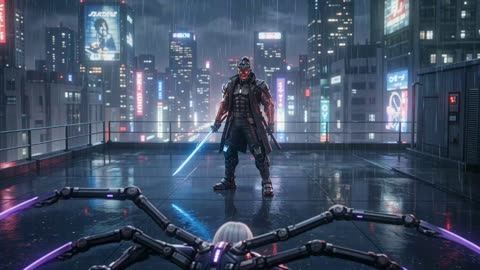</a>

Splitting the fight into four timed beats gives the model a clear action order from a single first frame. Naming the design lock, rain physics and neon lighting keeps the characters and setting stable through the spark effects.

Wan 3.0 · Image-to-video · Source: [@yourPlugAI on X](https://x.com/yourPlugAI/status/2092589909450060170) · 102 likes on 2026-10-29

[`anime-action`](tags.md#tag-anime-action) [`mecha`](tags.md#tag-mecha) [`rain`](tags.md#tag-rain) [`neon-city`](tags.md#tag-neon-city)

<details><summary><b>Prompt</b></summary>

```text
Generate a 15-second 16:9 horizontal hyper-aggressive cybernetic action anime video from the provided first frame.

Characters: Ryujin (cyber-Oni samurai, plasma katana, red overdrive state) and Valkyrie-X (spider-blade combat android). Maintain 100% costume and mecha design consistency.

Style & Quality: High-budget sci-fi anime combat, fast-paced mecha-blade choreography, high-voltage spark effects, rain physics, dramatic execution framing.

Time-Coded Action:

0.0s – 4.0s: Valkyrie-X attacks with a 4-blade flurry; Ryujin parries with his plasma katana but takes shoulder damage.

4.0s – 8.0s: Ryujin activates Overdrive Mode (red lightning from mask), snaps Valkyrie-X’s spider arm, and slashes off her secondary blades in a plasma explosion.

8.0s – 12.0s: Ryujin thrusts his superheated blade straight through her central power core, short-circuiting her entire chassis.

12.0s – 15.0s: Ryujin kicks her dead body off his blade onto the rain-soaked rooftop, posing under glowing Tokyo neon lights.
```

</details>

<a id="h3-anime-idol-japanese-greeting-stage"></a>
### Anime idol greets fans in Japanese on stage

<a href="https://x.com/riddi0908/status/2084233895202197998"></a>

A style header, scene overview, timed three shot storyboard, camera and audio blocks give the model a clear structure. The spoken Japanese line is written in kana with romaji, a static close up is kept for lip sync, and SFX are timed to the beats, with a negative line to keep the look pure 2D.

MiniMax H3 · Text-to-video · Source: [@riddi0908 on X](https://x.com/riddi0908/status/2084233895202197998) · 94 likes on 2026-10-28 · found via [SkyNotSilent/awesome-MiniMax-H3-cases](https://github.com/SkyNotSilent/awesome-MiniMax-H3-cases)

[`anime`](tags.md#tag-anime) [`idol`](tags.md#tag-idol) [`lip-sync`](tags.md#tag-lip-sync) [`storyboard`](tags.md#tag-storyboard) [`japanese-audio`](tags.md#tag-japanese-audio)

<details><summary><b>Prompt</b></summary>

```text
プロンプト置いときます✋

Japanese anime style, high-end TV anime production quality, soft pastel lighting, clean line art, subtle cel shading, bright and cheerful idol stage atmosphere, glowing lens flare, gentle bokeh in background, smooth vibrant 60fps animation feel.

Scene overview: An adorable anime idol girl stands center stage, looking directly at the camera with a brilliant smile. She holds a colorful microphone, energetic and joyful, giving a cute greeting to her fans. A short, charming 5-second anime idol greeting scene.

Storyboard:
[0s-1.5s] Shot 1: Medium close-up: The idol girl steps forward with a big smile, bringing the microphone to her mouth, blinking playfully as stage lights twinkle behind her.
[1.5s-3.5s] Shot 2: Close-up on her face: She speaks clearly into the microphone with precise lip-sync: "みんな、こんにちは！今日も一緒に楽しもうね！" (Minna, konnichiwa! Kyou mo issho ni tanoshimou ne!). She winks on "tanoshimou ne!".
[3.5s-5s] Shot 3: Slightly pulled-back medium shot: She strikes a cute victory-pose/heart-pose with her free hand, tilting her head with a beaming smile as sparkle particles drift around her.

Camera: Smooth pan-in at the start, staying centered and static during the lip-sync for maximum clarity, subtle handheld bounce on the final pose at 3.5s.

Audio: Crisp female anime idol voice clearly pronouncing "みんな、こんにちは！今日も一緒に楽しもうね！" in Japanese. Underneath, an upbeat synth-pop idol BGM playing, accompanied by a soft microphone "pop" sound at 0.5s and a sparkling magic SFX hit at 3.5s during the pose.

No real-life live action rendering, no realistic skin texture, no 3D CG look, no English subtitles or on-screen text clutter, keep the pure 2D anime aesthetic.
```

</details>

<a id="wan-everyday-worldbuilding-vignette"></a>
### Sleeping cat-eared girl in quiet bedroom

<a href="https://x.com/aimikoda/status/2104946617937727524"></a>

A character reference is expanded into 19 short observational cuts. The prompt infers the character's role and world from their design, and fixes the camera to shoulder-mounted handheld at 28 to 40mm with clean diegetic sound only. Reduce the number of cuts for shorter clips or other models.

Wan 3.0 · Reference-to-video · Source: [@aimikoda on X](https://x.com/aimikoda/status/2104946617937727524) · 88 likes on 2026-10-28

[`worldbuilding`](tags.md#tag-worldbuilding) [`anime`](tags.md#tag-anime) [`multi-shot`](tags.md#tag-multi-shot) [`handheld`](tags.md#tag-handheld) [`character-consistency`](tags.md#tag-character-consistency)

<details><summary><b>Prompt</b></summary>

```text
Create an everyday worldbuilding vignette built from 19 short cuts following the character from @[character reference] through ordinary moments in their world. Preserve the character’s identity, visual style and overall design. Keep everything consistent.

Infer the character’s role, status, daily routine, environment, social context and relationship to the world from their design. Use the character as a guide through the setting, revealing how this world functions through ordinary lived experience rather than exposition or major plot events.

Do not build one large dramatic plot. Each cut should feel like a small observational moment that adds another layer of understanding to the setting. The character does not need to be the center of attention at all times. The surrounding world should feel active, inhabited and specific.

Preserve the character’s moral alignment, temperament and social presence. A villain should still feel unsettling or feared within ordinary life. A heroic or gentle character should reveal that nature just as subtly. Do not force wholesomeness, redemption or spectacle.

Use objective third-person observational cinematography with restrained shoulder-mounted handheld movement and natural 28–40mm lens language. No POV, no camera acknowledgment, no vlog framing, no surveillance style, no gimbal movement, cranes or drones. Keep the camera detached and readable with subtle micro-jitter, shoulder drift, soft focus breathing, delayed reframing and brief reactive pans.

Keep the piece grounded, lived-in and atmospheric. Favor environmental storytelling, social texture, routine behavior and cultural detail over exposition.

Use only clean diegetic location sound. No dialogue, narration, BGM, subtitles or title cards.
```

</details>

<a id="h3-retro-anime-girl-halftone-opening"></a>
### Retro anime city girl montage with halftone

<a href="https://x.com/PixVerse/status/2092945419978547387">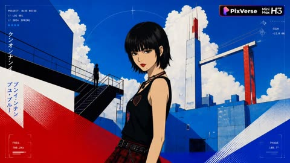</a>

Two reference images lock the character's face and the graphic style, while the prompt separately sets the edit rhythm, the three colour palette and the print texture. Naming halftone, misregistration and flat colour blocks keeps the frame reading as TV anime rather than 3D rendering.

MiniMax H3 · Reference-to-video · Source: [@PixVerse on X](https://x.com/PixVerse/status/2092945419978547387) · 73 likes on 2026-10-29

[`anime`](tags.md#tag-anime) [`retro`](tags.md#tag-retro) [`halftone`](tags.md#tag-halftone) [`character-consistency`](tags.md#tag-character-consistency)

<details><summary><b>Prompt</b></summary>

```text
subject_definitions:

Character-feature reference:

<image 1>：Character appearance reference
<image2>: Environmental visual-style reference.

Generate a 15-second, 16:9 landscape Japanese anime opening sequence. Use the visual language of a modern Japanese anime opening with a retro printed urban atmosphere. Combine 2D hand-drawn animation, cel shading, dynamic key animation, and graphic-design aesthetics. Preserve a tactile paper-grain surface, halftone dots, and retro manga print-registration misalignment caused by layered color printing.

This should not be a character showcase PV. It should be a strongly rhythmic character montage. Center the sequence around one cool, retro urban girl, maintaining the exact same face throughout the entire video: jet-black bobbed hair with straight bangs and sharply layered ends, cool dark almond-shaped eyes, matte red lips, a signature beauty mark beneath the lower lip, a black tank top with heart-shaped patches, layered beaded necklaces, and a padlock pendant. Keep her facial structure and overall presence consistent in every shot.

Use a three-color visual system dominated by black, lake blue, and scarlet red, with milk-white accents. Build her personality through large areas of solid color, abstract urban silhouettes, geometric color blocks, shadows, manga-style compositions, and graphic visual symbols.

Use the rapid editing language commonly found in Japanese anime openings, including extreme close-ups of the eyes, red lips, padlock pendant, fingertips, and hair ends; tilted compositions; low-angle perspectives; sudden push-ins; frame slicing; and dynamic visual recombination. The editing rhythm may be freely arranged by the model according to the electronic beat.

Add halftone patterns, ink lines, drifting heart-shaped stickers, halos and light spots, film grain, color-registration offsets, floating flat graphic text, and geometric symbols as part of the visual language.

Emphasize a cool, distant, retro-urban loneliness with a mysterious, alluring quality, combined with a touch of City-pop nostalgia and a sense of fate. The result should feel like the official opening sequence of a Japanese television anime, not a game promotional CG trailer.

Avoid complex fantasy environments, realistic locations, battle demonstrations, 3D rendering, and any drift in the character’s facial features.
```

</details>

<a id="h3-greenhouse-lyric-typography-anime-mv"></a>
### Anime greenhouse music video with lyric typography

<a href="https://x.com/haruuraeadss/status/2083875116900024386"></a>

Each reference image and the audio track is given a fixed role, with an explicit priority order for the character reference. Title and staff line reveals are scripted step by step and tied to the audio phrasing, with masked edit transitions between scenes.

MiniMax H3 · Reference-to-video · Source: [@haruuraeadss on X](https://x.com/haruuraeadss/status/2083875116900024386) · 71 likes on 2026-10-28 · found via [SkyNotSilent/awesome-MiniMax-H3-cases](https://github.com/SkyNotSilent/awesome-MiniMax-H3-cases)

[`anime`](tags.md#tag-anime) [`music-video`](tags.md#tag-music-video) [`lyric-typography`](tags.md#tag-lyric-typography) [`multi-reference`](tags.md#tag-multi-reference) [`audio-sync`](tags.md#tag-audio-sync)

<details><summary><b>Prompt</b></summary>

```text
使用画像はリプ欄にあります
                                                                      
高品質アニメ映像。

【作品ジャンル・世界観】
夢幻的ファンタジーの植物温室と音楽標本世界。劇場版クラスの高密度な2D手描きアニメ、繊細なキーアニメーション、上質なコンポジット、透明感のあるライティング。ガラス温室、花、露、譜線、音符、細い植物線画が一つの視覚言語として連動する。前半は白、淡いシアン、空色、少量の金色による朝の記憶。終盤は同じ植物世界が深い青緑とブルーベルの余韻へ変わる。背景が変わっても、細い白文字と水平譜線が画面の建築構造として連続する。
表情変化は、目、次に眉、次にまぶた、次に口元、最後に視線の順で最小限に行う。大きな演技、会話、歌唱口形は入れず、静かな呼吸と瞳の変化だけで感情を見せる。

【参照役割と優先順位】
Image1は顔と同一性の最優先参照であり、同時に衣装・装飾・体型・全身デザインの唯一参照。Image1の背景、背景内小物、元の縦構図は参照しない。参照内容が食い違う場合の優先順位は、顔、瞳、髪、体型、衣装、装飾、全身シルエットは常にImage1が最優先。Image2、Image3、Image4から人物特徴を取得しない。

Image2は冒頭の明るく霞んだガラス温室、乳白色の逆光、淡い水色と象牙色、既存タイトル「Lumen low」、五線譜、音符、細いイタリック注釈の画面設計参照。
Image3は中盤の明るく広い温室、青い花の密度、より鮮明な奥行き、既存タイトル「Lumen slow」、横断する五線譜、点、円、細い幾何学線の画面設計参照。
Image4は終盤の深い青緑のブルーベル、柔らかなボケ、露の反射、既存タイトル「BLUEBELL AFTERGLOW」、白と淡いシアンの譜線、点、注釈の画面設計参照。
Audio1は全編の音楽参照。画面の切替、タイトルの出現と消去、譜線の伸長、カメラの開始と停止、瞬き、光量変化を、Audio1のフレーズ開始、音量の立ち上がり、余韻へ同期する。Audio1以外の音楽、声を追加しない。効果音なし。
人物は全編でImage1の一人だけ。追加人物、別人、双子、複製、残像人物、透明な人物の重複を出さない。

【キャラクター固定・同一人物】
全編でImage1と同じ少女を完全な同一人物として固定する。繊細で丸みのある同じ顔、同じ顎と頬、淡い血色、同じ年齢感。透明な青緑色の大きな瞳、虹彩内の金色の微粒子、白い星状ハイライト、長い上まつ毛を維持する。真珠色の長い髪、柔らかな前髪、側頭部から後方へ続く編み込み、後方へまとめた髪型を固定する。右側の金色リボンと青い雫型の髪飾りは消さない。
衣装はImage1と同じ白いハイネックの長袖ドレス。襟、胸当て、袖口、裾の淡い水色の花刺繍、白い小ボタン、柔らかな幅広袖、金色の細い腰リボンと結び目、淡い水色の裾フリルまで一致させる。細身で上品な体格、白・水色・金色の固有配色を変えない。武器なし、装備品なし、小物なし。両手は常に自然な五本指で、顔や文字を隠さない。
変化を許すのは呼吸、瞬き、表情、姿勢、自然な髪、リボン、袖、裾の小さな揺れだけ。別人化、平均的なAI顔、幼児化、瞳色変更、髪型変更、衣装交換、刺繍省略、髪飾り消失、手指変形、余分な指、人物複製を禁止する。この同一人物固定は、次項の画風固定とは別の独立条件であり、互いに代用しない。
【画風固定：2D手描き】
Image1の極細で淡い青灰色の線、黒すぎない輪郭線、細かな髪束を維持する。影は透明感のある二段から三段。肌と布は柔らかな水彩階調、髪は真珠色の細いハイライト、瞳、露、ガラスは小さく鋭い反射。人物だけを過度に平坦化せず、温室、ガラス骨組み、青い花、葉、露、布、刺繍まで同じ密度の2D手描き背景として描く。

前半の肌は暖かな象牙色を保ち、青い環境光で灰色や病的な青肌にしない。終盤へ向けて環境の色温度が連続的に低くなり、深い青緑へ移行するが、Image1の白いドレス、金色リボン、顔、瞳は背景から明瞭に分離する。

太い黒輪郭、簡略化されたテレビアニメ調、単層の平坦なセル塗り、低密度背景、滑らかなCG・3D化、写実・半写実化、プラスチック肌、過剰な美肌ぼかし、くすんだ色、汎用的なAIアニメ顔、作風混合を禁止する。
【タイトル・譜線・注釈の固定】
Image2、Image3、Image4に存在するタイトルを、参照画像由来の不変な2Dグラフィック面として維持する。文字を新しく再描画したり別の字形へ変形したりせず、参照内の正しい字形をクリップマスク、透明度、単語レイヤー単位の短い移動だけで見せる。綴り、細い書体、文字間、大小関係を変えない。画面に残す主文字は「Lumen low」「Lumen slow」「BLUEBELL AFTERGLOW」の三種類だけ。偽の単語、擬似文字、無意味な追加文章を生成しない。

主文字は白から淡い象牙色、細いサンセリフ、広い字間。補助要素は細い高コントラストのイタリック、四本から五本の水平譜線、音符、点、円、短い矢印、極細の植物輪郭線。譜線は約一ピクセル、低めの不透明度。主文字は背景から読める明度を保つ。すべて画面固定座標に置き、カメラの遠近やパースへ吸着させない。

出現は必ず、譜線が左から右へ伸びる、点と音符が現れる、主文字が単語単位の短い左向きクリップマスクとフェードで組み上がる、補助注釈が最後に薄く現れる、の順。全文同時表示や一文字ずつの派手なタイプ入力にはしない。消去は補助注釈、主文字、譜線の順。文字の跳ね、回転、震え、液体化、融解を入れない。

字幕箱、黒帯、太い縁取り、強いグロー、大きな影、カラオケ式の色塗り、RGB分離、激しいグリッチを禁止する。タイトルと譜線は瞳、鼻、口、両手を横断しない。人物の顔と重なる場合は、文字を変形せず、レイアウト全体を顔の周囲へ分割して窓枠のように配置する。
【冒頭の明るい温室】
Image2と同じ霞んだガラス温室の正面ワイドから始める。開始画面では人物を出さず、Image2の背景、乳白色の光、青い花、ガラス骨組みを安定して見せる。カメラは目の高さでほぼ固定し、温室中央のガラス枠を消失軸に、ごくゆっくり前進する。目的は「Lumen low」の全体と柔らかな温室の奥行きを一度に読ませること。

五線譜が左から右へ伸び、点と音符が順に現れ、「Lumen low」が参照内の配置で組み上がる。タイトル完成後も文字は画面へ固定する。続けて右三分の一に、細い白線で囲まれた縦長のガラス窓マスクが静かに開く。窓の内側だけにImage1の胸上を一人で現し、印刷された静止画ではなく、呼吸、髪先、金色リボンの微動を持つ生きた2Dアニメとして見せる。Image1は口を閉じたまま一度だけ自然に瞬きし、わずかに正面へ目を合わせる。

【譜線によるImage2からImage3への遷移】
一本の長い譜線が画面左端から右端へ進み、その通過領域だけを硬い水平マスクとしてImage2からImage3へ置き換える。これはカメラ移動ではなく編集遷移。途中で二つの背景を半透明に混ぜず、マスクの前方はImage2、後方はImage3として境界を明瞭に保つ。Image1も一人のまま受け渡し、二重像や別ポーズを同時に出さない。

「Lumen low」の字形を変形させない。「low」は一本の譜線に覆われて見えなくなり、その同じ領域からImage3に存在する正しい「slow」を明かす。「Lumen」は短時間だけ同じ画面位置に残り、その後Image3の参照配置へ穏やかに整列する。文字を溶かして別単語へ変形させない。
【中盤の鮮明な温室】
Image3の明るく広い温室へ完全に切り替える。カメラは目の高さ、少し左寄りの正面ワイド。温室中央通路を奥行き軸にし、Image1を右三分の一の腰上で読める大きさに配置する。中央の「Lumen slow」、横断譜線、青い花、ガラス器、白い机の余白関係をImage3に合わせる。目的は、Image1の顔と衣装を読み取れる大きさにしながら、タイトルを画面構造として維持すること。

カメラはImage1へ短く一定速度で前進し、わずかな前景花の視差を出す。Image1は先に定めた目から視線までの順序で、ごく小さく表情を変える。口を開かず、最後に青緑色の瞳を正面へ向ける。タイトル、譜線、顔の三つが同時に読める位置でカメラを止める。

【譜線と花弁によるImage3からImage4への遷移】
最初に小さなイタリック注釈と点が薄く消え、続いて「Lumen slow」が短くぼけて消える。文字より遅れて五線譜が画面端まで長く伸びる。温室の白い光が淡い青から深い青緑へ変わり、前景の一枚のブルーベル花弁がレンズへ近づいて画面を覆う。花弁の輪郭と長い水平譜線を一体の編集マスクにし、覆われた領域からImage4の世界を明かす。ランダムなクロスフェードや渦回転は入れない。

【深いブルーベルの終盤】
Image4の深い青緑の花園へ完全に切り替える。最初は高い位置からの斜め俯瞰で、露を帯びたブルーベルと柔らかな前後ボケを画面いっぱいに置く。背景は柔らかく、タイトルだけは鮮明。目的は花の密度と大きなタイトル余白を同時に見せること。

白と淡いシアンの長い譜線を先に伸ばし、Image4の正しい「BLUEBELL」を左から中央、「AFTERGLOW」を中央から右へ、単語レイヤー単位のクリップマスクで組み上げる。最後の単語は字形を再生成せず、参照内の文字レイヤーを左から順に露出して完成させる。完成後のタイトルは以後の背景切替でも同じ位置に固定する。
タイトルを動かさず、花の間に横たわるImage1を斜め構図で明かす。少女の身体は左下から右上へ伸び、顔は右上。白いドレス、淡い水色の刺繍、金色リボンを深い青い花から明瞭に分離する。カメラは左上からの緩い俯瞰で一定速度に前進し、身体の対角線を青緑色の瞳へ導く。目的は全身の斜線、顔、タイトル余白を一つの構図で読ませること。花は風でわずかに揺れるが、少女の身体を覆わない。

続けて花背景だけを暗く柔らかくぼかし、白い長方形の窓パネルを開く。その内側にImage1の顔の極端な正面近景を一人だけ見せる。カメラは目の高さ、鼻筋と両目中央を通る厳密な正面軸。目的はImage1の青緑色の瞳、虹彩の金色粒子、微細な呼吸を明瞭な顔報酬として見せること。窓枠、譜線、「BLUEBELL AFTERGLOW」は目、鼻、口を横切らず、顔の周囲を建築的に囲う。Image1は一度ゆっくり瞬きし、わずかに息を吸い、瞳を開いて正面を見る。

同じ顔、タイトル、中央軸を保ったまま、カメラが滑らかに後退する。窓パネルの外側が黒から深いブルーベルの花園へ変わり、Image1が花に囲まれて座る腰上構図を明かす。両手は自然に膝の上で重なり、指は正しい本数で静止する。白いドレスと顔は明瞭、花園は露と柔らかなボケを保ち、「BLUEBELL AFTERGLOW」は画面固定で完全に読める。
最後に一本の細い水平線だけが終点まで伸びる。Image1は正面を見て瞳を開いたまま完全に静止し、髪先、金色リボン、袖、周囲の花弁の最後の小さな揺れが順に収まる。水平線が終点へ到達し、すべての動きが止まり、顔、両手、タイトル、ブルーベルが同時に読める瞬間に切る。

【全体制御】
カメラは一定で滑らかにし、不要な手持ち揺れ、急加速、急停止、ランダムズーム、無意味な回転、派手なオービットを入れない。タイトル変化を物理カメラ運動として扱わない。参照間で人物の顔、衣装、花の種類、色、タイトルの綴りを混ぜない。人物を長時間文字や花で隠さず、各区間の顔報酬を明瞭に保つ。
```

</details>

<a id="h3-anime-hero-ruined-city-battle-mv"></a>
### Anime hero battles through ruined city at dusk

<a href="https://x.com/whorange__/status/2090671364281884983">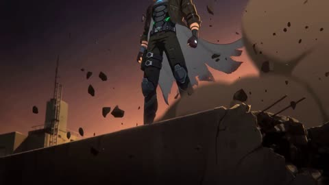</a>

Each shot is timed to a beat with hard cuts only, and the lyric typography sits inside the scene so it never covers the eyes or mouth. Naming the cel-shaded look, speed lines and burning horizon keeps the style consistent across all six shots.

MiniMax H3 · Text-to-video · Source: [@whorange__ on X](https://x.com/whorange__/status/2090671364281884983) · 63 likes on 2026-10-29

[`anime`](tags.md#tag-anime) [`music-video`](tags.md#tag-music-video) [`action`](tags.md#tag-action) [`lyric-typography`](tags.md#tag-lyric-typography) [`hard-cuts`](tags.md#tag-hard-cuts)

<details><summary><b>Prompt</b></summary>

```text
Create a 15-second 16:9 anime action battle music video with original lyrics.

Style: sharp cel-shaded anime, neon energy aura, speed lines, glowing particles, cinematic contrast, dramatic impact frames, hard cuts only, no fades, intense motion, heroic and triumphant mood.

Scene: a lone anime hero in a ruined futuristic city at dusk. The hero stands on a rooftop, then sprints across shattered buildings, faces an enemy silhouette in a smoke-filled street, clashes mid-air, powers up, unleashes a final energy attack, and ends in a victorious silhouette against a burning horizon.

Typography: bold glitch-neon lyric text, smash-in on beats, floating in 3D space, integrated into the scene, never covering the eyes or mouth, synced to snare hits, bass hits, and vocal accents. Original lyrics: Run through the fire / Break through the night / Hearts like thunder / We ignite / No more fear / No turning back / Every spark becomes attack.

Shot structure:
Shot 1 (0.0s–2.5s): rooftop hero reveal, wind, smoke, glowing aura begins.
Shot 2 (2.5s–5.0s): hero dashes across broken rooftops, energy trails, fast tracking motion.
Shot 3 (5.0s–7.5s): enemy reveal, aerial clash, impact flash, debris burst.
Shot 4 (7.5s–10.0s): close-up power-up, intense resolve, energy spiral around the body.
Shot 5 (10.0s–12.5s): final attack, explosive light slash, sky tears open.
Shot 6 (12.5s–15.0s): aftermath, glowing crater, hero silhouette, burning skyline, final heroic pose.

Editing rules: hard cuts only, beat-synced transitions, no soft dissolves, no static subtitle bar, dynamic lyric typography as part of the scene, strong motion continuity, cinematic anime energy throughout.
```

</details>

<a id="wan-fallen-sun-swordswoman-eclipse-battle"></a>
### Swordswoman battles giant knight above floating city

<a href="https://x.com/Artedeingenio/status/2092563535901372877">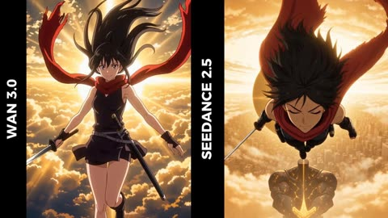</a>

A fixed character block (hair, crimson scarf, sword, outfit) is repeated, and each 5 second beat names one physical action, camera move and sound cue, so the clip keeps a continuous escalating structure. Anime style is set with sakuga, pencil frame and impact frame terms rather than generic quality words.

Wan 3.0 · Text-to-video · Source: [@Artedeingenio on X](https://x.com/Artedeingenio/status/2092563535901372877) · 61 likes on 2026-10-29

[`anime`](tags.md#tag-anime) [`swordswoman`](tags.md#tag-swordswoman) [`sky-battle`](tags.md#tag-sky-battle) [`multi-beat`](tags.md#tag-multi-beat)

<details><summary><b>Prompt</b></summary>

```text
30-SECOND EPIC ANIME ACTION SEQUENCE - "THE FALLEN SUN"

Original high-energy anime battle sequence.

A lone swordswoman faces a colossal celestial warrior above a city being destroyed by an impossible solar eclipse.

The entire 30 seconds must feel like ONE continuous escalating battle.

No reference images.

CHARACTER CONTINUITY - CRITICAL:

MAIN HERO:

Young female warrior.
Long wild black hair.
Sharp determined eyes.
Black sleeveless combat outfit.
Long torn crimson scarf.
Black armored boots.
One elegant slightly curved silver katana.

Keep exactly the same face, hairstyle, costume, body proportions, scarf and sword throughout.

Her CRIMSON SCARF is the main visual identifier.

ENEMY:

A gigantic humanoid celestial knight approximately 40 meters tall.

Black cracked armor.
Glowing golden fractures across the body.
Featureless black helmet.
Enormous burning golden sword.

Keep its design consistent throughout.

VISUAL STYLE:

Premium hand-drawn 2D anime.
Explosive sakuga animation.
Detailed painted backgrounds.
Sharp expressive linework.
Extreme perspective.
Dynamic smears.
Hand-drawn debris.
Stylized impact frames.
Intense speed lines.
Beautiful cinematic lighting.

Visual inspiration from ambitious theatrical anime action sequences.

No photorealism.
No 3D appearance.
No dialogue.
No subtitles.
No text.
No logos.

0–5 SECONDS - THE FALL

BLACK SCREEN.

A heartbeat.

Suddenly-

the heroine FALLS THROUGH THE CLOUDS at enormous speed.

Extreme close-up on her face.

Hair and crimson scarf violently whipping upward.

Camera rotates around her.

Below her:

AN ENTIRE CITY IS FLOATING UPSIDE DOWN IN THE SKY.

Buildings, bridges and enormous pieces of earth drift around a black solar eclipse.

Then-

something gigantic emerges through the clouds behind her.

The CELESTIAL KNIGHT.

It swings its enormous burning sword.

She twists in midair.

The blade misses her by centimeters.

The shockwave CUTS THE CLOUDS IN HALF.

She draws her katana.

CLANG.

One tiny sword blocks the colossal blade.

WHITE IMPACT FRAME.

5–10 SECONDS - SKY BATTLE

The impact launches her backward across the sky.

She crashes through the wall of a floating skyscraper-

but NEVER stops moving.

Camera follows her THROUGH the building.

Desks, glass, papers and concrete explode around her.

She plants one foot against an interior wall-

SPRINTS horizontally across it-

then launches herself through another window.

The celestial knight attacks again.

She lands ON ITS SWORD.

Extreme low-angle shot.

She RUNS ALONG THE GIANT BLADE toward the enemy.

Golden fire explodes beneath every footstep.

The giant rotates the weapon.

She jumps.

Three enormous chunks of floating city pass beneath her.

She uses them like stepping stones.

STEP.

STEP.

STEP.

Then launches directly toward the giant's face.

10–15 SECONDS - COUNTERATTACK

Extreme close-up.

Her eye.

Golden light reflected inside it.

She swings.

The katana leaves a razor-thin RED ARC across the frame.

The giant blocks with its armored forearm.

BOOM.

A circular shockwave expands for kilometers.

Every cloud around them instantly disappears.

Complete blue sky.

For half a second—

TOTAL SILENCE.

Then the armor cracks.

Golden energy erupts outward.

The explosion throws her downward.

She falls toward the inverted city.

Camera dives after her.

She rotates-

lands FEET-FIRST against the vertical side of a skyscraper-

and begins RUNNING DOWN THE BUILDING.

The celestial knight falls after her.

Both accelerate toward the city.

15–20 SECONDS - THE CITY CHASE

Insane high-speed vertical chase.

Camera races beside the heroine.

She runs down the skyscraper while gravity appears completely broken.

The giant destroys buildings behind her with every strike.

One enormous blade swing approaches.

She jumps sideways.

The sword slices through THREE SKYSCRAPERS.

Buildings begin collapsing upward toward the eclipse.

She leaps across the falling debris.

Wall run.

Slide.

Jump.

Sword deflection.

MID-AIR SPIN.

Every movement connects naturally into the next.

Suddenly the giant punches toward her.

She runs DIRECTLY TOWARD THE FIST.

At the final instant-

she plants one foot on its knuckle.

Everything enters EXTREME SLOW MOTION.

Her body compresses.

Her eyes lock onto the eclipse.

Then-

she pushes off.

20–25 SECONDS - BREAKING THE SKY

She launches upward like a missile.

SONIC BOOM.

The crimson scarf becomes an enormous red streak through the sky.

Camera follows directly behind her.

The celestial knight turns upward.

It raises its burning sword with both hands.

The eclipse begins feeding energy into the blade.

The sword becomes impossibly bright.

The heroine raises her tiny katana.

Two attacks charge simultaneously.

One enormous GOLDEN.

One razor-thin RED.

They attack.

COLLISION.

For one instant-

the entire animation becomes a rough black-and-white pencil drawing.

Then-

RED IMPACT FRAME.

GOLD IMPACT FRAME.

BLACK.

WHITE.

The shockwave bends the horizon.

The inverted city begins rotating around them.

Clouds form a gigantic circular vortex.

She screams silently with effort.

Her katana begins pushing through the enormous golden blade.

A crack appears.

Then another.

Then hundreds.

The giant sword SHATTERS.

25–30 SECONDS - THE SUN CUT

She flies directly through the explosion.

Burning fragments pass inches from camera.

The giant remains motionless.

She passes beside its head.

One elegant sword movement.

Nothing happens.

She continues upward.

Toward the eclipse.

Everything becomes silent.

She slowly sheathes the katana.

CLICK.

A thin RED LINE appears across the celestial knight.

The line continues

through the clouds

through the floating city

and finally

ACROSS THE BLACK ECLIPSE ITSELF.

One second of complete stillness.

Then

THE ECLIPSE SPLITS OPEN.

Brilliant sunlight explodes across the entire world.

The celestial knight fractures into thousands of glowing golden fragments.

The floating city slowly begins returning to normal gravity.

The heroine falls peacefully through the golden sky.

Her crimson scarf floats above her.

Camera dives toward her.

She opens her eyes.

Tiny confident smile.

Suddenly

one gigantic surviving piece of the enemy's armor falls toward her from behind.

Her eyes widen.

CUT TO BLACK.

End.

ACTION LANGUAGE - CRITICAL:

Extremely ambitious sakuga-style anime choreography.

The heroine should NEVER feel weightless or randomly animated.

Every movement must have:

anticipation,
acceleration,
impact,
momentum,
follow-through.

Use environmental geometry as part of the choreography.

She should:

run across walls,
use falling debris as platforms,
land on giant weapons,
redirect momentum,
fight while falling,
fight while gravity changes,
use enemy attacks to reposition herself.

The battle should constantly move through space.

Avoid characters simply floating and exchanging attacks.

Avoid repetitive sword clashes.

Every 5-second section must introduce a new physical idea.

SCALE CONTRAST - IMPORTANT:

Constantly emphasize the absurd difference in scale.

Tiny human warrior
versus
40-meter celestial knight.

Show this through:

extreme wide shots,
tiny heroine silhouettes,
gigantic hands entering frame,
sword blades larger than buildings,
close-ups immediately followed by kilometer-wide shots.

The heroine wins through SPEED and PRECISION rather than strength.

ANIME IMPACT LANGUAGE:

Use aggressively:

extreme foreshortening,
perspective distortion,
speed lines,
animation smears,
single-frame color flashes,
black-and-white impact frames,
rough pencil frames,
camera shake only during massive impacts,
whip pans,
snap zooms,
360-degree rotations,
rapid dolly shots,
POV shots,
extreme close-ups,
massive aerial pullbacks,
brief complete freezes before impacts.

Alternate:

FAST → FAST → SILENCE → IMPACT.

Do not make every second equally chaotic.

Contrast makes the major attacks feel enormous.

CAMERA:

The camera behaves like another participant in the battle.

Dive beside falling characters.

Pass through destroyed buildings.

Orbit around sword clashes.

Race inches above surfaces.

Follow weapons through the air.

Transition naturally from extreme close-ups into enormous wide shots.

Whenever possible, connect shots through movement rather than conventional cuts.

The viewer should constantly understand:

where the heroine is,
where the enemy is,
what direction they are moving,
and what they are trying to do.

AUDIO:

No dialogue.
No voice-over.

Aggressive cinematic anime score.

Taiko drums.
Fast orchestral percussion.
Distorted electronic bass.
Massive brass.
Urgent strings.
Distant female choir.

Sword impacts:
sharp metallic cracks.

Giant attacks:
deep sub-bass shockwaves.

Destroyed buildings:
concrete rupture and rushing debris.

High-speed movement:
violent air displacement.

20–25 seconds:
music reaches maximum intensity.

Immediately before the final sword movement—

COMPLETE SILENCE.

Katana sheath:

CLICK.

One heartbeat.

The eclipse splits.

Enormous orchestral and choral explosion.

Final unexpected falling armor—

WHOOSH.

CUT TO BLACK.

End.
```

</details>

<a id="h3-anime-swordfighter-elevator-cut-the-line-mv"></a>
### Anime swordfighter in elevator with CUT THE LINE text

<a href="https://x.com/Artedeingenio/status/2099492332944900560">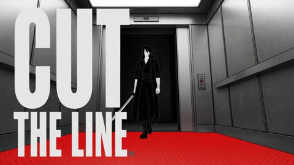</a>

The palette is locked to ink black, warning red and paper white, with torn paper collage, halftone and photocopy grain adding a printed texture. A shot by shot timeline with fixed on-screen phrases, plus a locked protagonist, sword and costume, keeps the character and text consistent through hard rhythmic cuts.

MiniMax H3 · Text-to-video · Source: [@Artedeingenio on X](https://x.com/Artedeingenio/status/2099492332944900560) · 56 likes on 2026-10-29

[`anime`](tags.md#tag-anime) [`music-video`](tags.md#tag-music-video) [`kinetic-typography`](tags.md#tag-kinetic-typography) [`paper-collage`](tags.md#tag-paper-collage)

<details><summary><b>Prompt</b></summary>

```text
Create one complete 15-second, 16:9 high-energy anime music video with synchronized original music, vocals, combat sounds, visuals, and kinetic typography.

STYLE: pure 2D cel animation fused with tactile torn-paper collage. Use only ink black, warning red, and dirty paper white. Strong line art, flat shadows, halftone printing, photocopy grain, fibrous torn edges, dry ink, and brief print misregistration. Hard rhythmic cuts only—no fades or soft transitions.

CHARACTER: one consistent androgynous anime swordfighter with angular hair, narrow eyes, wrapped forearms, heavy boots, a long asymmetrical coat, and one chipped half-length broken sword. Keep the same face, body, costume, sword, and voice throughout. Enemies appear only as abstract ink-and-paper shadows.

MUSIC: original K-pop hip-hop × cyber-grunge micro-song, 128 BPM, minor key. Dry kick, metallic half-time snare, rapid controlled hi-hats, distorted metal pluck, photocopier percussion, descending 808, and sword impacts. Close neutral rap vocal expands into a melodic chant Hook. End with a sword ring, bass strike, short vocal tail, and clean stop.

LYRICS:

“Cracked steel, black seal, I carve through the night”

“Red tear, no fear, every scar turns bright”

“Hear the fault line sing”

“Break again — I rise”

“Last edge — still alive”

“Cut the line”

“Still standing”

TIMELINE:

Shot 1, 0.0–1.5s: Inside a freight elevator, the fighter walks from layered darkness, broken sword held low. A boot lands on a red paper seam as the camera pushes in. Readable paper-white text: “CUT THE LINE.” The sword tears through the letters and opens the next shot.

Shot 2, 1.5–3.2s: Low lateral tracking through concrete pillars. The fighter plants one foot, pivots from the shoulder, and sweeps the broken blade through an abstract red paper shadow. Readable black text across red posters: “NO CROWN.” The letters split with the sword arc.

Shot 3, 3.2–5.1s: The fighter runs diagonally, absorbs momentum against a wall with the forearm and shoulder, then rebounds in the opposite direction. Coat opens from the force. Text: “CUT THE LINE.” Wall contact tears the phrase; landing snaps it back together.

Shot 4, 5.1–6.7s: Extreme close-up and first still point. The fighter freezes; only pupils, breathing, and one coat edge move. The broken sword fills the foreground. On black, readable white text: “BREAK AGAIN.” A red duplicate shifts behind it during the rising Pre-hook, followed by a half-beat black frame.

Shot 5, 6.7–8.6s: Overhead view of an iron stair platform. The fighter drops from a safe low ledge, absorbs the landing through knees and hips, then rises into a diagonal guard. Red paper cracks radiate from the boot. “BREAK AGAIN” divides into three panels that fold back into one frame.

Shot 6, 8.6–10.7s: The fighter grips a railing, rotates ninety degrees, releases, and advances. The long coat sweeps across the foreground while the broken sword cuts a red paper silhouette. Readable wall text: “LAST EDGE.” The coat hides and then reveals the intact phrase.

Shot 7, 10.7–12.6s: Static rooftop shot and second still point. The fighter stands beneath a steel sign frame, blade angled down. Only breath, hair, coat hem, and wrist move. Large red text on black: “STILL STANDING.” Three torn panels briefly show the same eye, sword hand, and full silhouette without cloning the character.

Shot 8, 12.6–15.0s: The fighter surges forward and swings the broken blade upward. The sword splits the entire frame into two paper halves and cleaves a towering ink shadow, exposing dirty-white sky. The fighter completes a pivot and freezes facing camera. Huge readable text: “STILL STANDING.” Red and white print layers align on the final bass strike, then hard cut to black.

TYPOGRAPHY: ultra-bold condensed English capitals behaving like physical paper and wall print. Use only “CUT THE LINE,” “NO CROWN,” “BREAK AGAIN,” “LAST EDGE,” and “STILL STANDING.” Show each phrase clearly before tearing or shifting it. No subtitles, random letters, logos, brands, watermarks, or gibberish.

LOCKS: exactly one protagonist, one broken sword, one costume, and one voice. Preserve anatomy, hands, grip, mouth shapes, cloth physics, and spatial continuity. No repaired sword, extra people, extra weapons, glossy 3D, live action, pastel colors, excessive camera shake, or hand touching the lens. Finish decisively on the final beat and hard cut to black.
```

</details>

<a id="h3-field-guide-wren-plate-draws-itself"></a>
### Antique Bird Plate Draws Itself, Wren Wakes

<a href="https://x.com/Dheepanratnam/status/2086312209919963371"></a>

A reference image locks the final page, and a timed sequence builds it from pencil to ink to watercolour to type. Separate motion layers keep the paper still while only the bird breathes, backed by a detailed audio cue list.

MiniMax H3 · Reference-to-video · Source: [@Dheepanratnam on X](https://x.com/Dheepanratnam/status/2086312209919963371) · 53 likes on 2026-10-28 · found via [SkyNotSilent/awesome-MiniMax-H3-cases](https://github.com/SkyNotSilent/awesome-MiniMax-H3-cases)

[`time-lapse`](tags.md#tag-time-lapse) [`vintage-illustration`](tags.md#tag-vintage-illustration) [`locked-camera`](tags.md#tag-locked-camera) [`sound-design`](tags.md#tag-sound-design) [`reference-image`](tags.md#tag-reference-image)

<details><summary><b>Prompt</b></summary>

```text
@ Image1 is the sole visual authority for the folio spread, the wren, the hazel twig, the egg study, the foot sketch, the handwriting, the printed type, the paper, the foxing, the lighting, the palette, the layout and the horizontal composition. 

Animate this exact page without redesigning it. Preserve every existing mark, letter and colour in its final state.  

[Goal] Create a 15-second sequence in which this plate makes itself, and then the bird inside it comes quietly alive. One continuous, locked, straight-on overhead composition. No camera movement, no cuts, no cropping, no perspective change, no page turning.  

[Sequence]  0-2.4 seconds: Begin on blank aged ivory paper — the empty spread, correct in paper texture, chain lines, foxing and lighting, but carrying no image, no writing and no type. A faint graphite underdrawing appears across the right page in light searching strokes, finding the wren's posture and the line of the twig. 
A few construction marks overshoot and are left uncorrected.  

2.4-6 seconds: Engraved ink linework draws itself over the pencil, following the exact contours of the finished plate — outline first, then hatching building the shadow under the wing, the barring of the tail, the texture of the twig. The rectangular plate mark presses into the paper around the image with a soft physical impression, lifting the paper very slightly at its edge.  

6-10.5 seconds: Watercolour floods in. Washes enter the printed outlines and settle into them, warm russet across the back, buff along the eyebrow stripe, muted olive on the twig, each wash landing exactly within the shapes of the finished plate and overrunning the line in the same few places the reference does. 

The colour blooms wet and then visibly dries, darkening slightly at the edges. On the left page, the sepia handwriting writes itself line by line from the top, in a period cursive hand that is elegant, cramped and only partly legible. The small egg study fills with colour and the pencil foot sketch appears faintly beside it.  
10.5-13 seconds: The printed type impresses into the right page — TROGLODYTES TROGLODYTES, then The Common Wren beneath it, then PLATE XVII in the top right corner. Foxing spots deepen. The last details resolve: the highlight in the bird's eye, the fine barring on the flank. The page settles. Everything on the spread is now exactly as in @[ref img].  13-15 seconds: The page stays completely still and completely flat 

— it is paper and it behaves like paper. But the printed bird begins to breathe. Its flank rises and falls very slightly. It blinks once. It turns its head a few degrees and holds, alert, looking past the viewer at something outside the page. The cocked tail gives one small twitch. It does not fly, it does not leave the plate, it does not become three-dimensional, and it does not look at the viewer. Settle into a living idle: the bird breathing, one more slow blink, the paper still.  Render as photoreal archival photography of a real object under warm north-window light. Keep the printed page flat and matte with no glow, no emission, no glint and no digital sheen. 

Keep the two motion layers distinct: the page is a made thing being made, the bird is alive. Keep all type, handwriting, marks and geometry fixed once they appear.  Do not introduce any new text, letters, numerals, marks, birds, objects, hands, tools, logos, captions, borders, watermarks or page numbers. Do not turn or lift the page. Do not move, rotate or scale the camera. Do not zoom. Do not add glow, neon, coloured light, lens flare, bokeh or shallow-focus racking. 

Do not make the bird photoreal or three-dimensional — it must remain a hand-coloured engraving that happens to be alive. Do not have it fly, hop, open its beak wide, or leave the plate.  

Audio: fine graphite scratching on rough paper; the dry precise scrape of a steel nib; the deep soft compression of a plate press; a sable brush loaded with water moving across paper; paper fibres settling; the quiet room tone of a study with a slow long-case clock ticking somewhere behind. 
At 13 seconds, one Eurasian wren song — sudden, intricate and far louder than anything that small should produce — then the room tone returns and the clock keeps going. No music, no dialogue, no narration, no electronic tones.
```

</details>

<a id="h3-elf-mage-glowing-forest-dialogue"></a>
### Elf mage and companion stand in glowing forest

<a href="https://x.com/I_Muhammadali44/status/2093002302135402979">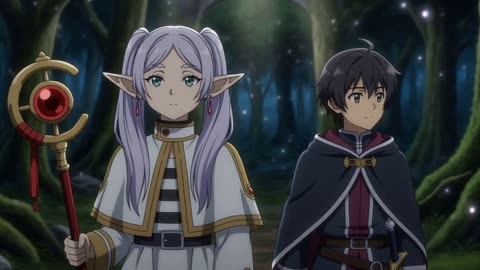</a>

A character sheet is passed as the exact reference and the prompt lists the traits that must stay fixed, which holds the design steady across the clip. Timed beats such as a stop at 8 seconds, plus a single continuous shot instruction and a push-in finish, give the scene a clear arc.

MiniMax H3 · Reference-to-video · Source: [@I_Muhammadali44 on X](https://x.com/I_Muhammadali44/status/2093002302135402979) · 46 likes on 2026-10-29

[`anime`](tags.md#tag-anime) [`fantasy`](tags.md#tag-fantasy) [`dialogue`](tags.md#tag-dialogue) [`reference-image`](tags.md#tag-reference-image) [`character-consistency`](tags.md#tag-character-consistency)

<details><summary><b>Prompt</b></summary>

```text
“Use the uploaded character sheet as the exact character reference. Keep the elf mage’s face, lavender twin-tail hair, green eyes, pointed ears, white-and-gold robe, boots, staff, proportions, and anime style completely consistent.

Create a 15-second anime fantasy scene in one continuous unbroken shot. The elf mage walks through a glowing ancient forest while holding her red-and-gold staff. The camera smoothly tracks backward in front of her. A second young male mage walks beside her.

Dialogue with natural lip-sync:

Male Mage: “Are you sure this is the right path?”

Elf Mage: “No… but the magic is calling me.”

At 8 seconds, the elf suddenly stops. Her staff begins glowing intensely, and magical particles swirl around both characters. The male mage looks shocked while she calmly looks toward a mysterious glowing structure deeper in the forest.

Elf Mage: “We’re close.”

End with the camera slowly pushing toward her determined face as the magical light becomes brighter. Natural facial expressions, subtle body movement, flowing hair and clothing, cinematic anime lighting, detailed magical particles, atmospheric fantasy environment. One continuous shot, no cuts, no scene transitions.”

Would you watch a full episode in this style?
```

</details>

<a id="h3-purple-anime-poster-assembles-layers"></a>
### Purple anime poster assembles layer by layer

<a href="https://x.com/LudovicCreator/status/2084519725405483220"></a>

The prompt builds the scene in a fixed order, border first, then labels, then the world layers, then the hero, and pairs each reveal with a named sound cue. A preservation clause (exact layout, same text, no redesign) keeps the source poster intact while the motion is added.

MiniMax H3 · Image-to-video · Source: [@LudovicCreator on X](https://x.com/LudovicCreator/status/2084519725405483220) · 45 likes on 2026-10-29 · found via [SkyNotSilent/awesome-MiniMax-H3-cases](https://github.com/SkyNotSilent/awesome-MiniMax-H3-cases)

[`poster-animation`](tags.md#tag-poster-animation) [`chibi-anime`](tags.md#tag-chibi-anime) [`sound-design`](tags.md#tag-sound-design) [`parallax`](tags.md#tag-parallax)

<details><summary><b>Prompt</b></summary>

```text
Animate the source artwork as a **10-second energetic chibi anime poster assembly**, preserving the deep indigo-purple background, neon pink, cyan and yellow palette, glossy anime illustration, characters, typography, decorative border and exact original layout. Begin on the empty purple background, then draw the outer border and corner markers with quick glowing strokes; introduce the small labels, Japanese text, numbering and interface graphics through playful pop-ins, slides and type-on animation, each paired with light arcade clicks, bubbly typing sounds and soft digital chimes.

Build the central world in layers: floating islands rise into position, clouds expand outward, the moon fades in, towers and airships drift into place, and sparkles scatter across the scene. Assemble the chibi robot and flying cat with quick bouncy entrances, then launch the main hero from deep inside the poster toward the camera with strong 3D parallax, allowing his shoe, hand and hair to briefly extend beyond the inner frame before settling into the original composition.

Reveal the Japanese title with a bold elastic impact, followed by the English labels, release date, IMAX line and footer icons appearing sequentially. Add subtle looping life after assembly: blinking eyes, gently moving hair and clothing, small robot antenna motion, the cat’s tail bouncing, airships floating, clouds drifting and stars twinkling. Finish with a soft camera push-in, one bright starburst behind the title and a clean hold on the completed poster, keeping every element sharp and readable. No redesign, no distorted faces, no changing text, no full scene transformation, no aggressive camera rotation.
2/2
```

</details>

<a id="wan-anime-girl-sunset-cliff-coast"></a>
### Anime girl on sunset cliff above the ocean

<a href="https://x.com/MrDasCreates/status/2102339127123550354">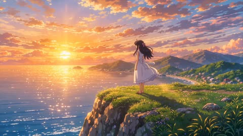</a>

The prompt is written as a shot list in camera order: establishing wide, push-in, orbit, chase, then pull-back, so each move has one job. The closing style block and the plain list of artifacts to avoid keep the character design consistent through the moves.

Wan 3.0 · Text-to-video · Source: [@MrDasCreates on X](https://x.com/MrDasCreates/status/2102339127123550354) · 43 likes on 2026-10-29

[`anime`](tags.md#tag-anime) [`sunset`](tags.md#tag-sunset) [`seaside`](tags.md#tag-seaside) [`camera-moves`](tags.md#tag-camera-moves)

<details><summary><b>Prompt</b></summary>

```text
Create a stunning cinematic anime sequence set in a magical Japanese-inspired coastal town at sunset.

A young anime girl with long flowing dark hair, expressive eyes, and a beautiful white dress stands on a quiet seaside cliff overlooking the ocean. Her hair and dress move naturally in the warm evening breeze.

The video begins with a wide establishing shot of the glowing coastline, colorful clouds, distant mountains, and sparkling ocean. The camera slowly pushes toward the girl as she looks toward the horizon.

She gently closes her eyes, then opens them and smiles softly. Small glowing particles begin floating around her, carried by the wind. The camera smoothly circles around her while her hair and dress flow dynamically.

She starts running along the cliffside path toward the sunset. The camera follows her from behind, then smoothly moves beside her, capturing her joyful expression and flowing hair.

As she reaches the edge of the coastal path, she stops and looks toward the enormous glowing sunset. Hundreds of tiny luminous particles rise into the sky around her. The camera slowly pulls backward and upward, revealing the beautiful ocean, coastline, mountains, and glowing sky.

High-quality cinematic Japanese anime aesthetic, detailed hand-drawn anime characters, expressive eyes, beautiful facial animation, fluid character movement, dynamic hair physics, flowing clothing, detailed backgrounds, atmospheric perspective, dramatic sunset lighting, vibrant colors, soft cinematic glow, subtle depth of field, smooth camera movement, consistent character design throughout, polished feature-film anime quality.

No cuts, no flickering, no character morphing, no distorted anatomy, no extra limbs, no deformed hands, no inconsistent face, no text, no subtitles, no watermark.
```

</details>

<a id="h3-anime-host-neon-stage-intro"></a>
### Pink haired anime host on neon stage

<a href="https://x.com/SSSS_CRYPTOMAN/status/2093821064631771446"></a>

Putting the character, the on screen headline and the spoken Japanese line in one prompt gives the model a single clear scene to animate. Asking for exaggerated gestures sets the energy of the performance.

MiniMax H3 · Text-to-video · Source: [@SSSS_CRYPTOMAN on X](https://x.com/SSSS_CRYPTOMAN/status/2093821064631771446) · 40 likes on 2026-10-29 · found via [SkyNotSilent/awesome-MiniMax-H3-cases](https://github.com/SkyNotSilent/awesome-MiniMax-H3-cases)

[`anime`](tags.md#tag-anime) [`japanese-dialogue`](tags.md#tag-japanese-dialogue) [`motion-graphics`](tags.md#tag-motion-graphics) [`neon`](tags.md#tag-neon)

<details><summary><b>Prompt</b></summary>

```text
日本の可愛い美少女アニメキャラクターがMiniMax H3 Maxの紹介をするショート映像。「MiniMax H3 Maxが無料で使える！」という文字をインパクトのあるモーショングラフィックで表現。女の子は大げさなモーションで、日本語で短い台詞を喋る
```

</details>

<a id="h3-anime-pair-scare-popcorn-blush"></a>
### Anime pair jumps at scare, then blushes

<a href="https://x.com/MayorKingAI/status/2107531471103938945"></a>

The prompt fixes the shot count, timestamps and hard cuts up front, and states that subtitles are burned in as on-screen text only and never spoken. It defines the exaggerated gag faces as a temporary state that returns to the normal face, and repeats the same hair, wardrobe and single TV light in every shot so the characters stay consistent across cuts.

MiniMax H3 · Text-to-video · Source: [@MayorKingAI on X](https://x.com/MayorKingAI/status/2107531471103938945) · 40 likes on 2026-10-29 · found via [SkyNotSilent/awesome-MiniMax-H3-cases](https://github.com/SkyNotSilent/awesome-MiniMax-H3-cases)

[`anime`](tags.md#tag-anime) [`multi-shot`](tags.md#tag-multi-shot) [`sound-design`](tags.md#tag-sound-design) [`subtitles`](tags.md#tag-subtitles)

<details><summary><b>Prompt</b></summary>

```text
2D anime | romantic comedy | cel-shaded, clean line art, dark blue night palette.
Multishot, 6 shots. Cuts only at the specified points.

CHARACTERS
HANA: wavy shoulder-length dark red hair, oversized gray cardigan with one button missing, a bandage on her index finger. 160 cm.
YUTO: neat black hair with a small bed-head tuft at the back, navy hoodie with a pilled sleeve, glasses pushed up on his forehead. 178 cm.

LOCATION
Dark living room at night. They share one sofa under a single fleece blanket. A TV off-frame in front of them is the only light source, flickering blue on their faces. A bowl of popcorn between them.

SUBTITLES
Spoken dialogue is in Japanese. English subtitles are burned into the image as on-screen text only — they are never spoken aloud. Style: white sans-serif, thin black outline, one single line, bottom center of frame, 8% from the bottom edge. Each subtitle appears with its line and disappears at the cut. Subtitle text is shown inside 【】 brackets below; the brackets themselves are not displayed.

Shot 1 (0–2.5s) — Medium front shot of both, FOV 47, static.
Hana sits upright, arms crossed, smug smile, chin raised. Yuto beside her grips a cushion with both hands, already tense.
Hana (spoken, Japanese): 「全然怖くないし。」
On-screen subtitle: 【I'm not scared at all.】
HARD CUT

Shot 2 (2.5–5s) — Close-up on Yuto, FOV 29, slow push-in ending on his eyes.
His pupils shrink to tiny dots, a vertical column of blue shade lines drops over his upper face, sweat drop on his temple. He swallows, the cushion squeezed flat. No subtitle in this shot.
HARD CUT

Shot 3 (5–8s) — Medium front shot, FOV 47, static.
A violent white flash from the TV and a loud sting. Both jump. Clear gag faces: mouths huge and wavy, eyes white, hair standing in spikes. The popcorn bowl flips and popcorn bursts upward like confetti. Two small white ghost-shaped souls slip out of their open mouths.
Hana and Yuto (spoken, Japanese): 「ぎゃああああっ！」
On-screen subtitle: 【AAAAAAH!】
HARD CUT

Shot 4 (8–10.5s) — Wide shot, FOV 63, static.
They are clutching each other tightly, trembling, their outlines drawn with shaky wobbling lines. Popcorn rains down on them. The souls drift back into their mouths. No subtitle in this shot.
HARD CUT

Shot 5 (10.5–13s) — Two-shot close-up, profile, FOV 29, static.
Silence. They slowly realize how close they are, faces a hand apart. Both blush deep red at the same time. A tiny comic sparkle pops between them. They let go and shuffle apart in short jerky movements. No subtitle in this shot.
HARD CUT

Shot 6 (13–15s) — Close-up on Hana, three-quarter front, FOV 29, static.
Normal detailed anime face: cheeks red, eyes sliding sideways, lips pouting. One popcorn kernel stuck in her hair.
Hana (spoken, Japanese): 「…今のはノーカン。」
On-screen subtitle: 【...That one doesn't count.】
She pulls the blanket up over her nose. End on her eyes peeking above the blanket.

LIGHTING
Only light source is the off-frame TV: flickering cool blue 8500K, with a single white flash in shot 3. Deep shadows in the room.

Sound: No score. Production audio only — faint TV dialogue murmur, a sharp horror sting, popcorn scattering, fabric rustle, double scream, then near silence and a soft blanket rustle. All voices in Japanese only.

Characters keep the same face, hair and wardrobe in every shot. Gag faces are clear, exaggerated super-deformed expressions, then return to the normal detailed anime face. Clean consistent line art, consistent lighting between shots. Subtitles stay in the same position, size and style in every shot, spelled exactly as written. The room contains only the sofa, the blanket and the popcorn bowl.
```

</details>

<a id="h3-glowing-cord-reel-samurai-duo"></a>
### Glowing cord binds one samurai, reel snaps back

<a href="https://x.com/tokyo_Valentine/status/2102267666694341084"></a>

Subject definitions bind each reference picture to a named role, and a voice timbre reference supplies vocal identity without copying words. Timestamped shots with explicit hand, scale and sound cues keep the cord, reel and equal height consistent across cuts.

MiniMax H3 · Reference-to-video · Source: [@tokyo_Valentine on X](https://x.com/tokyo_Valentine/status/2102267666694341084) · 33 likes on 2026-10-29 · found via [SkyNotSilent/awesome-MiniMax-H3-cases](https://github.com/SkyNotSilent/awesome-MiniMax-H3-cases)

[`anime`](tags.md#tag-anime) [`multi-shot`](tags.md#tag-multi-shot) [`audio-reference`](tags.md#tag-audio-reference) [`character-consistency`](tags.md#tag-character-consistency)

<details><summary><b>Prompt</b></summary>

```text
subject_definitions:
<Subject 1> is A from <Picture 1>, the boastful caster.
<Subject 2> is B from <Picture 2>, who calmly releases the binding.
Preserve both identities, faces, hair, costumes, accessories and art styles. Scale their complete designs to equal standing height, maintaining each character's internal proportions.
<Audio 1> is the voice-timbre reference for <Subject 1> (S1). Reference its vocal identity and pitch range, not its recorded words.
summary:
[reference generation + audio reference] A 15-second Japanese 2D anime comedy. A binds B with a glowing cord connected to a retractable reel in A's hand. B presses its button. The cord rewinds, and its end tab lightly taps A's finger. End on A's silent, stunned face. Use the selected aspect ratio.
retention_analysis:
<Subject 1> (Shots 1-4): fully_preserved - retain identity and design at the established equal-height scale, with new actions.
<Subject 2> (Shots 1-3): fully_preserved - retain identity and design at the same standing height as A.
<Audio 1>: reference - voice timbre for A's opening line only.
Reference images provide character identity and style only, not poses, backgrounds or relative size.
detailed_description:
Hand-drawn 2D anime, clean lines, cel shading, fluid animation. Exactly two characters in a level stone courtyard in warm daylight.
A and B have equal standing height, measured from soles to skull tops, excluding ornaments. Neither grows or shrinks between shots. Establish both full bodies at the same distance from a level camera, feet on the same ground line and skull tops aligned. Preserve this scale during movement and close-ups. B must not appear taller or larger overall.

One palm-sized black-and-yellow retractable measuring reel has one large top button, one outlet and a golden cord ending in a small rounded tab. A holds it in her LEFT hand for the entire video. B touches only the button with her RIGHT index finger. The reel is never transferred or duplicated. No readable markings.
[Shot 1] A full-body two-shot shows <Subject 1> screen-left and <Subject 2> screen-right, facing each other about one meter apart. Both stand upright at equal depth, visibly the same height. A holds the reel at waist level in her left hand and gestures with her right. The glowing cord winds three separate turns around B's lower torso. B's arms, hands, neck and legs remain free. Show the strand connecting the loops to A's reel.

From 0.3 to 2.8 seconds, <Subject 1> (S1) proudly declares using the voice timbre of <Audio 1>, [Japanese] このいとからは、にげられない! Synchronize A's lips, then close them. A magical whoosh accompanies the binding. By four seconds, the glow fades enough to reveal the physical cord. A smiles smugly. B follows the cord with her eyes toward the reel.
[Shot 2] At 00:04.500, cut to a level medium two-shot showing both faces, B's right hand and A's left hand holding the reel. Keep their equal body scale. B takes one small sideways step toward A, not toward the filming camera. The connecting strand slackens. A keeps holding the reel with its button facing up. At about six seconds, B presses the button once with her right index finger. A dry click sounds. B withdraws her hand immediately. A's left index finger rests beside the outlet. Music stops at the click.
[Shot 3] At 00:06.500, cut to a steady medium shot including B's torso and A's reel. The spring pulls the cord into the outlet with a mechanical whirr. Show all three turns unwinding around B's costume in sequence. The strand stays continuous; it does not dissolve, break or pass through her body. B stands still with hands clear. The reel stays in A's left hand.
After the last loop clears B, the remaining length retracts. Keep A's reel and the returning tab visible. At about ten seconds, the rounded tab lightly clips A's left index finger beside the outlet with one plastic tick, then rests against the reel. The cord is fully retracted. A flinches silently. No wound, violent whipping or collision between characters.
[Shot 4] At 00:11.500, cut to a medium close-up of <Subject 1>'s face and hands. Her left palm still holds the reel; her right hand gently holds the tapped left index finger. Her smile vanishes. Eyes widen, pupils become small, eyebrows rise. Her lips part once and remain still. She looks toward B with her familiar stunned, uncomprehending expression. No blush, crying or exaggerated pain. Slowly push in, keeping the held finger near the frame's bottom. Hold the final full second. End directly on A.

overall_soundscape:
Faint courtyard wind, one magical whoosh, one footstep, one button click, a rewind whirr and one plastic tick. A speaks only the sentence in Shot 1. B is completely silent. After three seconds, no speech, gasps, grunts, screams, laughter or vocal breaths. If B's voice reference is attached, leave it unused. No narration or additional voices.
non_diegetic_music:
Solemn low strings and restrained percussion during the opening. Stop at the button click. Keep the rewind and tap clearly audible, then only faint ambience. No choir, comedy sting or canned laughter.

No text, subtitles, logos, watermarks, HUD, photorealism, 3D look, chibi, extra people, extra limbs, fused hands, costume changes or changing character scale.
```

</details>

<a id="h3-cat-eared-chef-fried-rice-serve"></a>
### Cat eared chef cooks fried rice and serves

<a href="https://x.com/IsekaiBardGuild/status/2096577196915900712"></a>

Each shot is timestamped, and the reference image locks the character's appearance and outfit across cuts. The plate transfer is written as a required uninterrupted action so the model cannot skip it.

MiniMax H3 · Reference-to-video · Source: [@IsekaiBardGuild on X](https://x.com/IsekaiBardGuild/status/2096577196915900712) · 26 likes on 2026-10-29 · found via [SkyNotSilent/awesome-MiniMax-H3-cases](https://github.com/SkyNotSilent/awesome-MiniMax-H3-cases)

[`cooking`](tags.md#tag-cooking) [`character-consistency`](tags.md#tag-character-consistency) [`multi-shot`](tags.md#tag-multi-shot) [`sound-design`](tags.md#tag-sound-design)

<details><summary><b>Prompt</b></summary>

```text
For the target video, at 0.00 seconds into the target video, <Picture 1> (from [Shot 1]) is fully referenced.

integrated_multimodal_description: [Shot 1] High-quality Japanese anime style, 2D illustration with cel-shading. (S1) is a character showen in the <Picture 1>. The camera cuts to a medium shot of the same character (S1), maintaining (S1)'s  exact appearance and outfit from <Picture 1>, now standing in a vibrant Chinese restaurant kitchen. (S1) is positioned before a large wok on a powerful burner, surrounded by rising steam, hanging menu boards with illegible characters, and warm red and gold lighting. S1 begins to cook fried rice with focused, energetic movements. [Shot 2] At 00:04.500, the camera cuts to a series of rapid, cinematic close-ups. First, a tight shot of S1's determined eyes, then a shot of (S1)'s  hands skillfully tossing the wok. The camera pushes in with small amplitude at fast speed as (S1) exerts force to flip the rice, causing a few grains to dance in the air. A sudden burst of orange flame from the burner illuminates (S1)'s  face. Tiny beads of sweat form on (S1)'s  cheeks; (S1) briefly wipes (S1)'s  brow with (S1)'s  forearm without stopping (S1)'s  rhythmic stirring. [Shot 3] From 00:10.500 to 00:13.000, show the complete transfer of fried rice FROM THE WOK INTO AN EMPTY CERAMIC PLATE in one uninterrupted close medium shot. Both the wok and the empty plate must be clearly visible together. S1 holds the wok above the plate, visibly tilts its rim down toward the plate, and uses the spatula to slide and scrape the cooked fried rice out of the wok. Show the rice physically falling from the rim of the wok and accumulating into a mound on the plate. The plate starts empty and becomes filled on camera. Do not cut away, skip this action, or show an already-filled plate in its place. Only AFTER the rice has been transferred completely, from 00:13.000 to 00:15.000, S1 sets the wok down, lifts the filled plate, moves to the counter, and extends it toward a customer. The camera pans right with small amplitude at slow speed to follow the serving action. S1's expression shifts from intense concentration to a sincere, tired but happy smile, (S1)'s  chest heaving slightly from the effort. The customer's hand enters the frame to accept the plate. S1 gives a small, proud nod of satisfaction, (S1)'s  eyes shimmering with relief and accomplishment under the warm glow of the kitchen lights.

overall_soundscape: The environment is filled with the rhythmic, metallic clanking of a spatula against a wok. Constant sizzling of rice and oil blends with the sudden, low-frequency "whoosh" of the burner's flames. The soft hiss of rising steam and the final, clean "clink" of a ceramic plate being placed on a wooden counter complete the atmosphere.

non_diegetic_music: An upbeat, heartwarming orchestral track with a fast tempo, featuring playful pizzicato strings and a bright flute melody that swells emotionally toward the end to emphasize a sense of accomplishment.
```

</details>

<a id="h3-gothic-library-mirror-door-reveal"></a>
### Girl in gothic library sees reflected door open

<a href="https://x.com/haruuraeadss/status/2084910486362247434"></a>

Face and costume reference images with a fixed priority order keep the character identical across every shot. A hard cut to a split frame and a camera that moves from extreme close-up to corridor wide shot make the reflected door anomaly easy to read.

MiniMax H3 · Reference-to-video · Source: [@haruuraeadss on X](https://x.com/haruuraeadss/status/2084910486362247434) · 24 likes on 2026-10-29 · found via [SkyNotSilent/awesome-MiniMax-H3-cases](https://github.com/SkyNotSilent/awesome-MiniMax-H3-cases)

[`title-sequence`](tags.md#tag-title-sequence) [`reference-images`](tags.md#tag-reference-images) [`character-consistency`](tags.md#tag-character-consistency) [`toon-render`](tags.md#tag-toon-render)

<details><summary><b>Prompt</b></summary>

```text
高品質アニメ映像。

作品ジャンルは、プレミアム3Dトゥーン／セルルックで描くダークファンタジー探索ゲームの魔法ミステリー・タイトルシークエンス。黒いネガティブスペース、非対称分割、細い銀青フレーム、硬い幾何学マスクで構成する。恐怖や悲劇ではなく、冷静で上品な緊張感。主人公は全編で一人だけ。顔演技は、目、眉、まぶた、口元、視線の順に小さく変化させる。

参照役割を厳密に分離する。Image1は顔参照であり、顔とキャラクター同一性の最優先参照。Image2は衣装参照であり、衣装・装飾・全身デザイン・体格・刀と装備の参照。優先順位は、顔立ち、目、虹彩色、眉、口元、髪型、髪色、前髪、顔まわりの色はImage1、衣装構造、身体シルエット、装飾、装備はImage2。参照内容が食い違う場合もこの優先順位を守る。Image2内の文字、レイアウト、背景、ポーズ見本、表情一覧、小さな顔バリエーションは参照しない。

キャラクター固定：全カットで同一人物。小さく繊細な卵形の顔、柔らかな顎線、淡い肌、透明感のある大きなサファイアブルーの瞳、奥行きのある多層虹彩、左右それぞれの小さな複数キャッチライト、細い上まつ毛、自然な下まつ毛を維持する。白銀にごく淡い青紫を含む長い髪、柔らかな薄い前髪、顔沿いの細い横髪、腰まで流れる豊かなウェーブを維持する。頭の左側には、青い薔薇と黒青の蝶翅、青い雫飾りが一体になった髪飾り一組だけを固定し、飛び去らせず、実在の蝶へ変えず、複製しない。

Image2の黒紺を基調にした高密度ゴシック衣装を維持する。繊細な黒レースのハイネックと透け袖、青い胸元宝石、銀の細鎖、青いサテンリボン、非対称の多層スカート、黒いブーツ、細身で小柄な約7.5頭身のシルエットを固定する。全カットで顔、目、髪、衣装、体格、装飾、固有配色を変えない。変化してよいのは、表情、視線、呼吸、歩行姿勢、髪・レース・リボンの自然な遅れだけ。特徴混合、顔の平均化、衣装交換、別人化、分身、クローン、余計な人物を生じさせない。

能動装備として主人公が所有する刀は全編で刀一本だけ。開始時から左腰の鞘へ完全に納まり、黒紺の鞘、鍔、柄、銀の鎖飾り、青い房を一続きの同じ構造で保つ。開始時、右手は柄のすぐ横で開いている。途中で黒い手袋の右手が柄だけへ静かに触れ、鍔が手と鞘側を明確に分離したまま指を締める。刀身は一度も抜かず、最終画でも刀一本のまま完全に納刀され、右手は柄に静止する。二刀流、刀の複製、柄・鍔・鞘の分離、刃を握る手を出さない。

レンダリング固定：全編で3Dトゥーン／セルルックの一系統だけ。細く制御された濃紺とチャコールの色線、二段から三段の明快なトゥーン影と透明な中間グラデーション、白銀・深紺・ロイヤルブルー・銀を主役にした澄んだ高彩度パレットを維持する。瞳と髪には多層ハイライト、金属と青い結晶には局所的で鋭い反射を置く。肌は柔らかなマット、髪は絹、レースは繊細な半透明、サテンは抑えた光沢、革は低光沢、銀金属は硬質、結晶は多面反射、濡れた石床は深い鏡面として描き分ける。顔、髪飾り、衣装、刀、建築まで高密度。キーライトと影色はキャラクター固有色を優先し、青い環境光は補助に限定し、背景は主役より抑えた低彩度の青黒にする。太い輪郭、平坦な単層セル影、汎用3D美少女顔、滑らかなプラスチックCG、低密度背景、半写実、写実、くすんだ人物色、画風混合にしない。

舞台は月光の差す青黒いゴシック書庫回廊。奥に閉じた一枚の高いアーチ扉、床に磨かれた黒い石、側面に青いステンドグラス光、石のリブと書架の細部が続く。建築は石、木、ガラスだけで成立させ、キャラクター固有の薔薇、宝石、鎖、蝶飾りを柱や壁へ複製しない。唯一の異常は、現実の扉が閉じたままなのに、床の鏡面反射の中だけ同じ扉が青い奥行きへ開いていること。カメラは狭い顔極近景から回廊の広い中景へスケールを変え、胸上近景へ戻る。各移動の目的は、扉と反射の食い違い、右手と刀の状態、回廊の奥行き、表情の理解、タイトル余白を順に読ませること。終端空間は同じ回廊の閉じた扉前で、別の場所へ移らない。

黒から一度だけ硬く切り替える。大きな主パネルでは、カメラは少女の左斜め前、目線の高さ、顔の極近景。両目、鼻筋、口元、輪郭、髪飾りを一続きに見せ、顔へ枠線を重ねない。画面右下の細い副パネルでは、正面の閉じたアーチ扉と、その真下で既に開いている床反射を同時に見せ、異常を一目で比較できる。少女の瞳が静かに下へ動き、反射の異常を捉える。反射内のアーチ輪郭が硬い円弧マスクへ拡大し、次の画へ切り替える。

高い斜め上から濡れた黒石床へ寄り、上側に現実の閉じた扉、下側に開いた反射扉を同じ奥行き軸で保つ。反射の青い縁から一本の細い光線が床を走り、胸元の青い宝石の輪郭へ連続する。その円弧を境に細いタイルが非対称に組み替わり、宝石の近景、右手と柄の近景、鞘の青い象嵌を順に見せる。各タイルの縁は顔を横切らない。右手が柄へ触れた瞬間だけ黒革の小さな擦れ、銀鎖の短い硬質な触れ音、レースの微かな衣擦れを同期させる。刀は完全に鞘の中へ残す。

鞘の長い直線を硬いラインスライスとして、回廊の中景へ切り替える。カメラは少女の後方左、胸の高さから斜め前へ追従し、少女を中景以上に保ちながら、書架と石柱の背景消失軸を奥の閉じた扉へ集める。少女が閉じた扉へ一歩ずつ進むたび、濡れた石床へ乾いた靴音が一回ずつ響き、開いた反射扉だけが視線の先を滑る。足元につながった一つの長い影が床を横切り、その影の端を硬いワイプとして次へ渡す。影を別人や分身にしない。

影ワイプの後、扉の縦辺を硬いマスクにして、少女の右斜め前、目線よりわずかに低い胸上近景へ戻る。カメラは短く静かに寄り、表情を、目が異常を認識する、眉がごくわずかに締まる、まぶたが静かに細くなる、口元が冷静な決意へ整う、視線が現実の閉じた扉へ上がる、の順で読ませる。無表情の人形顔、恐怖、パニックにせず、瞳の層と小さなキャッチライトを保つ。右手は柄を握るが抜刀せず、青い鞘の縁が一度だけ画面を横切る硬いラインマスクになる。

重要な禁止：顔を分断する太い格子、顔中央の光点や光線、巨大な蝶の接写、実在昆虫のマクロ、軟らかいディゾルブ、流体モーフ、ホラー、流血、重複タイトル、誤字、擬似文字、字幕、透かし。

音楽は既存曲を模倣しない完全オリジナル。低いドローンと張り詰めた細いハイハットから始め、低いキック、断片的なウォーキングベース、短いバリトンサックスと切ったブラスへ冷静に展開する。終盤は緊張和音とドラム一打だけに絞り、その低い残響をタイトル保持へ残す。反射扉が開いて見える瞬間には透明な結晶エネルギーの短い共鳴、歩行には濡れた石床へ接するブーツの乾いた靴音、右手を柄に置く瞬間には黒革の軋み、銀鎖が一度だけ小さく鳴る音、布擦れをそれぞれ同期する。現実の木扉は動かないので開閉音を出さない。台詞、ナレーション、歌唱なし。

最終画は静かな余韻とモチーフ回帰。カメラは正面より少し左、目線の高さの胸上構図。少女を画面左へ置き、反対側の余白をタイトル専用にする。右手は柄に静止し、刀一本は左腰で完全に納刀、現実の扉は閉じたまま、床反射の扉だけが開いた青い奥行きで停止する。少女は閉じた扉の方向へ視線を固定し、呼吸と毛先とレースだけがごく小さく動く。右側へ正確に「MOONLIT BLUE BUTTERFLY」を一度だけ表示し、その下へ「COMING SOON」を一度だけ表示する。完成したタイトルプレートを固定して保持し、新しい人物、蝶、小物、文字を入れない。緊張和音とドラム一打の低い残響が完全に消える正確なフレームで黒へハードカットする。
```

</details>

<a id="h3-manga-man-city-street-camera"></a>
### Manga man with phone on city street

<a href="https://x.com/ThannosSnaps/status/2101645036001657226"></a>

The one-line instruction works because the source manga image already fixes the character, art style and setting, so the model only has to choose motion and camera moves. The reference image anchors the look while the model handles the shot design.

MiniMax H3 · Image-to-video · Source: [@ThannosSnaps on X](https://x.com/ThannosSnaps/status/2101645036001657226) · 23 likes on 2026-10-29 · found via [SkyNotSilent/awesome-MiniMax-H3-cases](https://github.com/SkyNotSilent/awesome-MiniMax-H3-cases)

[`manga`](tags.md#tag-manga) [`minimal-prompt`](tags.md#tag-minimal-prompt) [`camera-moves`](tags.md#tag-camera-moves) [`city`](tags.md#tag-city)

<details><summary><b>Prompt</b></summary>

```text
Bring it to life in a hooking manner with the camera angles.
```

</details>

<a id="h3-man-eagle-head-park-bench"></a>
### Hand drawn man startled by tiny flag eagle

<a href="https://x.com/1littlecoder/status/2102106915635601452"></a>

The reference portrait is locked as the first frame through the #Image1 token, and a locked medium shot keeps the framing still so the expression and motion carry the comedy. The hand drawn motion cue sets the style, and the beat by beat action from surprise to screaming and running gives the 5 second clip a clear arc.

MiniMax H3 · Image-to-video · Source: [@1littlecoder on X](https://x.com/1littlecoder/status/2102106915635601452) · 21 likes on 2026-10-29 · found via [SkyNotSilent/awesome-MiniMax-H3-cases](https://github.com/SkyNotSilent/awesome-MiniMax-H3-cases)

[`hand-drawn`](tags.md#tag-hand-drawn) [`reference-image`](tags.md#tag-reference-image) [`locked-shot`](tags.md#tag-locked-shot) [`comedy`](tags.md#tag-comedy)

<details><summary><b>Prompt</b></summary>

```text
A man #Image1  sits on a park bench. His neck stretches upward in surprise as a tiny eagle with USA Flag on its body lands on his head. Medium locked shot, expressive hand-drawn motion. He starts screaming and running!
```

</details>

<a id="h3-rpg-grimoire-customization-intro"></a>
### Anime heroine customizes grimoire in RPG menu

<a href="https://x.com/haruuraeadss/status/2083768289612947872"></a>

The prompt opens with a reference-image rule that keeps identity traits such as face, hair, outfit and weapon while excluding the reference background and framing, then locks the single grimoire to prevent duplicates. Each beat lists UI elements in the order they appear, so the menu flow stays readable and sequenced.

MiniMax H3 · Reference-to-video · Source: [@haruuraeadss on X](https://x.com/haruuraeadss/status/2083768289612947872) · 21 likes on 2026-10-29 · found via [SkyNotSilent/awesome-MiniMax-H3-cases](https://github.com/SkyNotSilent/awesome-MiniMax-H3-cases)

[`rpg`](tags.md#tag-rpg) [`game-ui`](tags.md#tag-game-ui) [`anime`](tags.md#tag-anime) [`reference-image`](tags.md#tag-reference-image)

<details><summary><b>Prompt</b></summary>

```text
高品質アニメ映像。

星花魔法都市を舞台にした高級ファンタジーRPGのキャラクター導入シーン。装備設定から街への出発までを、一切途切れないゲーム内カメラで描く。表情が変わる場面は、最初に目、次に眉、続けてまぶた、口元、最後に視線の順で変化する。

【キャラクター参照】

画像1のキャラクターを全編の唯一の主人公として参照し、同一人物として維持する。

画像1は人物設計専用の参照画像とし、顔、目の形、虹彩色、瞳の特徴、髪型、髪色、前髪、衣装、装飾、武器装飾、小物、体格、シルエット、年齢感、雰囲気、キャラクターカラーのみを参照する。

画像1そのものの背景、部屋、家具、ポーズ、画角、フレーミング、文字、レイアウトは再現しない。

表情、視線、口元、姿勢、呼吸、自然な髪と衣装の揺れのみ変化してよい。

特徴の混合、顔の平均化、衣装交換、別人化、クローン化、余分な主人公の追加は禁止。

【キャラクター固定】

主人公は全編で一人のみ。

顔、髪型、衣装、装飾、小物、武器、体格、シルエット、キャラクターカラーを維持する。

武器は全編で一冊だけ存在する魔導書とし、画像1に合わせた材質・色・装飾・デザインを維持する。

開始時は左腰へ装備され、カスタマイズ時のみ左手上へ浮遊し、終了後は左腰へ戻る。

画像1に存在するアクセサリーや装飾品も維持し、不要な複製や消失は発生しない。

【画風】

劇場版品質。

高密度3Dトゥーンセルルック。

二〜三段セルシェーディング。

透明感のあるライティング。

髪、瞳、布、革、金属、宝石、紙を高密度に描き分ける。

色彩は画像1のキャラクターカラーを最優先とし、背景は人物より一段落ち着いた色調で統一する。

画風混在、リアル調、プラスチックCG、低密度背景は禁止。

【ゲームUI】

高級ファンタジーRPG風UI。

半透明クリスタルパネル。

細い金装飾。

魔法陣と星座モチーフ。

文字は読み取れる品質で安定表示。

UIは顔を覆わず画面の空き領域へ配置する。

操作に合わせて光と効果音が同期する。

【シーン】

高い俯瞰から開始。

主人公は魔法陣中央へ座り、カメラを見る。

右側へ

START NEW GAME

CONTINUE

ARCANE SETTINGS

EXIT

左上へプロフィールを表示。

CONTINUEのみ選択状態。

カーソルが一度移動して決定する。

カメラは右手へ降下。

RIGHT-HAND CATALYSTパネルが表示される。

掌の上へ六枚花弁の魔法術式が形成される。

手の形は変化せず、術式のみ再構成される。

花弁、宝石核、二重金環が完成して停止する。

続いてカメラは左手へ回り込む。

GRIMOIRE CUSTOMIZATIONを表示。

COVER

CLASP

CORE

PAGES

四項目を表示。

主人公が左手を開くと左腰から魔導書が浮遊する。

閉じた一冊の状態から、表紙、金具、中心核、ページが順番に分解される。

全パーツはルーンで接続されたまま維持される。

カーソルが四項目を巡るたび各パーツが更新され、最後に一冊へ戻る。

革、紙、金属、宝石の質感を高密度に描写する。

カメラは正面へ戻る。

CONFIRM CONFIGを表示。

主人公が一度押す。

全UIが魔導書へ吸収される。

魔導書は左腰へ戻る。

主人公は自然に座り直す。

掌の術式がゆっくり回転して完成する。

表情は目→眉→まぶた→口元→視線の順で自然に変化する。

その後カメラを少し引く。

画面下へLOADINGバー。

0%から100%まで進行する。

紫色の開始空間から石畳、建物、屋台、灯り、街路が順番に実体化する。

線画→素材→完成世界の三段階で生成される。

舞台は雨上がりの星花魔法都市。

濡れた石畳。

魔法露店。

魔法灯。

ルーン看板。

ローブ姿の群衆。

飛行する箒便。

浮遊馬車。

石造と木造建築。

遠景には巨大な魔法学院。

背景人物は全員別人であり、主人公は複製しない。

最後に三人称追従カメラになる。

主人公は中景サイズを維持する。

右上へ円形ミニマップ。

左下へ

VITALITY

MANA

SPELL SLOT

街の奥へ

RETURN TO ASTRA ACADEMY

任務マーカーを表示。

主人公は左腰へ魔導書を装備したまま街へ歩き出す。

最後は左足が石畳へ着地し、右足が次の一歩へ移る瞬間で終了する。

都市は完全に実体化し続け、群衆、箒便、浮遊馬車は動き続ける。

HUDと任務マーカーは安定表示する。

【音】

BGMなし。

音楽なし。

環境音のみ。

雨上がりの街の空気。

石畳の足音。

衣装の布擦れ。

遠い市場の声。

箒の風切り。

浮遊馬車の魔力音。

主人公は自然な呼吸のみ。

台詞、ナレーション、長い発声は禁止。

【禁止事項】

画像1の背景や構図の再現、特徴の混合、顔の平均化、衣装交換、武器変更、別人化、クローン化、余分な主人公、余分な武器、余分な装飾、手指崩れ、顔へUIが重なる構図、読めないUI文字、急激な背景転換、白飛び、画風変化は禁止。
```

</details>

<a id="h3-anime-girl-waters-fern-porch"></a>
### Anime girl waters a fern on porch

<a href="https://x.com/PhotogenicWeekE/status/2093133440359317751"></a>

The prompt lays out the drawing as ordered stages, from rough pose to lineart to flat color to shading, so the video has a clear build-up. Tying the finished frame to a reference picture locks the final look, and the soft stylus scratch with desk ambience sets a quiet studio mood.

MiniMax H3 · Image-to-video · Source: [@PhotogenicWeekE on X](https://x.com/PhotogenicWeekE/status/2093133440359317751) · 20 likes on 2026-10-29 · found via [SkyNotSilent/awesome-MiniMax-H3-cases](https://github.com/SkyNotSilent/awesome-MiniMax-H3-cases)

[`timelapse`](tags.md#tag-timelapse) [`line-art`](tags.md#tag-line-art) [`digital-painting`](tags.md#tag-digital-painting) [`anime`](tags.md#tag-anime)

<details><summary><b>Prompt</b></summary>

```text
How the reference pictures align with the target video — Picture 1 (from Shot 1) aligns with the 0.00-second mark of the target video.

integrated_multimodal_description: [Shot 1] 2D anime digital illustration, a high-quality digital drawing recorded as a timelapse, with the artist's hand holding a stylus pen visibly drawing on the canvas. The video starts from a white digital canvas and draws the basic forms and shapes first, starting from the general (big) outline sketch of the pose, then adding line after line to add new details on the face, hair, and clothes until a complete lineart sketch for the character is done. Then the coloring phase begins: flat base colors are filled evenly within the lineart, soft shading and highlights are layered on the face, hair, and clothes, and final finishing touches are added until the completed artwork matches <Picture 1> exactly.

overall_soundscape: The soft scratch of the stylus on the tablet screen, light desk ambience.

non_diegetic_music: N/A
```

</details>

<a id="h3-anime-opening-haru-silhouette"></a>
### Black silhouette hero amid falling leaves

<a href="https://x.com/keneth_ai/status/2087039444146933942"></a>

A locked character block and a reference sheet fix the face and outfit, while a timestamped shot list sets the pacing, color flash and cut rhythm for each beat. The negative prompt rules out 3D and live action drift so the cel look holds.

MiniMax H3 · Reference-to-video · Source: [@keneth_ai on X](https://x.com/keneth_ai/status/2087039444146933942) · 17 likes on 2026-10-29 · found via [SkyNotSilent/awesome-MiniMax-H3-cases](https://github.com/SkyNotSilent/awesome-MiniMax-H3-cases)

[`anime-opening`](tags.md#tag-anime-opening) [`character-lock`](tags.md#tag-character-lock) [`beat-sync`](tags.md#tag-beat-sync) [`multi-shot`](tags.md#tag-multi-shot)

<details><summary><b>Prompt</b></summary>

```text
[CHARACTER LOCK — use attached reference sheet]
Haru: teen boy, short messy dark-brown hair with warm amber rim-light on the
edges, tired amber eyes, single silver earring on left ear, thin dark cord
choker, oversized grey-blue windbreaker open over a longline blue hoodie, black
joggers with dangling straps, scuffed black high-top sneakers. Face, hair
silhouette, and outfit identical in every shot.

[FORMAT]
Anime television opening, 2D cel-shaded, crisp linework, 16:9, high contrast,
film grain. Total runtime 15 seconds, 12 shots, beat-synced hard cuts.

[SHOT LIST — 15s]
00.0–01.2  Black. Hard white flash. Haru's silhouette snaps in, back to camera,
           jacket billowing. Background floods CYAN.
01.2–02.4  Whip-pan to profile close-up. Downcast eyes flick up, sharp.
           Flash. Background MAGENTA.
02.4–03.2  Low-angle wide: he sprints along a rooftop ledge, coat trailing,
           paper and leaves scattering. ORANGE-RED, speed lines.
03.2–03.9  Freeze-frame mid-leap between rooftops. Pure black silhouette
           against strobing YELLOW-to-LIME.
03.9–04.7  Top-down spin: lands, one hand on concrete, dust ring bursts out.
           Snap to DEEP PURPLE.
04.7–05.3  Extreme close-up: silver earring swings, catches a lens flare.
           White flash frame.
05.3–06.2  Split-screen triptych — three duotone copies of his face
           (blue / red / green) rotating, one per beat.
06.2–07.4  Back view, walking into wind, hood snapping, hair whipping.
           Background ELECTRIC BLUE with horizontal scan lines.
07.4–08.2  Hands-in-pockets front shot, camera orbits fast around him.
           Colors cycle GREEN → PINK → WHITE across the orbit.
08.2–09.4  Seated on the ledge, knees up, head down, city lights blooming
           behind. Muted TEAL. Brief calm — no flash on this cut.
09.4–10.6  He stands, turns to camera, hair lifting, single amber rim-light
           igniting along his edge. Background goes pure WHITE.
10.6–15.0  Pull-back wide: Haru walks away toward the sunset skyline, hands in
           pockets, clothes drifting. Color settles into the warm painted
           palette of the reference sheet. Camera dollies out, holds on
           centered title-card space.

[MOTION]
Simple punchy character animation on twos. Hair and fabric always drifting.
Camera: whip pans, snap zooms, one fast orbit, one final dolly-out.

[COLOR & FX]
Full-frame color swaps on every cut, synced to an implied beat. White
flash-frames between shots 1–9. Chromatic aberration on impacts, halftone dot
bursts, quick duotone inversions, floating leaf and paper debris throughout.
Warm amber rim-light preserved on the character in every shot.

[NEGATIVE]
photorealistic, 3D render, live action, extra characters, text or logos,
changing outfit, changing hair color, distorted face, extra fingers, watermark
```

</details>

<a id="kling4-clay-cloud-teacher-counting"></a>
### Felt and clay forest class: a cloud teacher counts to four

<a href="https://static-77.klingai-cdn-aws.com/kling-blog/presigned_url/c025c539-645d-4cb3-8950-a1582dbba7ec_1-1.mov"></a>

A kids' counting lesson in five hard cuts. The image only sets the material and palette, and the prompt says not to copy its characters or numbers.

Kling 4.0 · Reference-to-video · Source: [Kling 4.0 user guide](https://kling.ai/quickstart/kling-4-model-user-guide)

[`kids-education`](tags.md#tag-kids-education) [`claymation`](tags.md#tag-claymation) [`felt`](tags.md#tag-felt) [`multi-shot`](tags.md#tag-multi-shot) [`structured-prompt`](tags.md#tag-structured-prompt) [`voiceover`](tags.md#tag-voiceover)

<details><summary><b>Prompt</b></summary>

```text
SCENE CONTEXT: EXACTLY 3 UNIQUE CHARACTERS ACROSS THE VIDEO — NO DUPLICATES.EXT. Enchanted counting forest classroom, warm morning. One soft cream cloud teacher teaches the numbers 1, 2, 3 and 4 in four separate shots. Two tiny yellow chick pupils appear only in the number-two shot.3 characters across the video, 5 hard-cut shots, 15s, real time. @Image1: visual-world reference only — handmade clay-and-felt materials, rounded toy-like forms, pastel forest trunks, mossy ground, rainbow colours, warm diffused backlight and shallow storybook depth. Never inherit its existing characters, numerals or composition.
LOCATION MAP: All five shots occur on the same circular moss stage inside one enchanted forest classroom.One broad warm-brown tree trunk anchors frame-left; a second tree trunk anchors frame-right. A curved pastel rainbow root crosses the background. The central teaching pedestal remains in the same position in every shot. Camera always stays on the front side of the teaching axis, between 3.0 and 3.3 m from the pedestal. The sun always comes from upper frame-right. Background geometry, material scale and colour palette remain identical after every cut.
FIRST FRAME AND SPATIAL BLOCKING: Shot 1: the cloud teacher floats centre-left, facing a large red felt numeral 1 on the central pedestal. One red apple is concealed inside the moss below it. Shot 2: The cloud teacher floats centre-left, facing a large amber felt numeral 2. Two yellow chicks begin concealed behind the pedestal. Shot 3: the cloud teacher floats centre-left, facing a large green felt numeral 3. Three blue felt stars begin nested inside the moss. Shot 4: the cloud teacher floats centre-left, facing a large blue felt numeral 4. Four purple clay blocks begin below the pedestal. Shot 5: the cloud teacher floats alone at centre, facing the viewer beneath the rainbow root. Every shot begins mid-gesture with the teacher already pointing toward the active numeral. No empty establishing beat.
FORMAT MODE: Horizontal 16:9, total 15s, real time, 5 shots connected by clean hard cuts.Shot 1 — 0.00–4.00s: number 1 and one apple.Shot 2 — 4.00–7.08s: number 2 and two chicks.Shot 3 — 7.08–10.21s: number 3 and three stars.Shot 4 — 10.21–13.08s: number 4 and four blocks.Shot 5 — 13.08–15.00s: spoken recap and celebration. Each number receives its own separate shot. Numerals 1, 2, 3 and 4 never share the same teaching frame.No fades, dissolves or split screens.
OPTICS: 35mm equivalent, 54° horizontal FOV, locked across all five shots. Identical natural perspective, camera height, background scale and depth-of-field character after every cut. Focal plane remains on the cloud teacher, active numeral and active quantity. Foreground flowers softly obscure the lower corners. Distant trees dissolve into the same creamy storybook blur.
CAMERA: Every shot is operated handheld at approximately 105 cm height from the front side of the teaching axis. World register: gentle SETTLE. Shot 1: slow 10 cm push toward numeral 1. Shot 2: slow 10 cm push toward numeral 2. Shot 3: slow 10 cm push toward numeral 3.Shot 4: slow 10 cm push toward numeral 4. Shot 5: slow 8 cm push toward the celebrating teacher.Visible handheld character throughout: breath sway, micro-roll, late tiny corrections and gentle but obvious handmade shake. Numerals and subtitles remain readable. Camera height, axis and movement speed match across all cuts.Not a gimbal, slider, tripod lock-off, drone or digitally stabilised camera.
ACTION TIMING 0.00–0.78s: Shot 1 begins. The cloud teacher already points toward the red numeral 1. 0.78–1.98s: numeral 1 rises and completes one soft bounce. 1.98–4.00s: one red apple rises from the moss and settles beneath numeral 1. 4.00–4.86s: hard cut to Shot 2. The amber numeral 2 rises and completes one soft bounce. 4.86–7.08s: one yellow chick hops out from the left, then a second chick joins from the right; they touch shoulders and settle together. 7.08–8.04s: hard cut to Shot 3. The green numeral 3 rises and completes one soft bounce. 8.04–10.21s: two blue felt stars rise together, followed by one additional star; the three stars settle into a clear triangular arrangement. 10.21–11.06s: hard cut to Shot 4. The blue numeral 4 rises and completes one soft bounce. 11.06–13.08s: three purple blocks assemble first; one additional block clicks into the fourth position. 13.08–14.40s: hard cut to Shot 5. Four tiny coloured fireflies pulse sequentially red, amber, green and blue while the teacher points from left to right. 14.40–15.00s: the teacher opens both arms; a small clay sun unfolds above the rainbow and releases a brief sparkle burst.
PHYSICS: The cloud teacher has the buoyancy of a lightweight stuffed felt puppet, with soft vertical drift and delayed arm movement. Each numeral has padded felt weight: it compresses, rebounds once and settles. The apple lands with soft clay weight. The chicks’ feet squash slightly into the moss. Stars descend with gentle air resistance. Blocks connect with firm edge-to-edge contact. Every quantity remains stable and readable until its shot ends. Hard cuts reset the teaching pedestal cleanly while preserving the same forest, teacher identity, material scale and lighting.
LIGHTING: One identical motivated source in every shot: warm morning sunlight filtering through the trees from upper frame-right.The teacher’s lower-left side remains slightly darker in all five shots. Soft rim light separates the felt fibres from the forest. Protect the cream cloud, pastel numerals and rainbow highlights from clipping. The direction, colour temperature, haze density and exposure remain unchanged across every cut.
AUDIO VOICEOVER: The cloud teacher speaks in English with the same warm, clear, medium-high preschool-teacher voice in every shot. Pronunciation is slow, encouraging and rhythmically precise.0.78s: “One.”1.98s: “One means just one.”4.16s: “Two.”4.86s: “Two means one and one together.”7.26s: “Three.”8.04s: “Three means two and one more.”10.32s: “Four.”11.06s: “Four means three and one more.”13.32s: “One, two, three, four.”14.40s: “Great job!”
MUSIC: one continuous original children’s instrumental across all cuts, using soft marimba, toy piano, light ukulele, felt-drum taps and gentle handclaps. The same melody, tempo and instrumentation continue seamlessly through every shot. It rises slightly with each new number and ends with a short celebratory flourish.SFX: one soft felt pop for each numeral bounce; one clay plop for the apple; two tiny moss footsteps for the chicks; three sparkle chimes for the stars; four wooden clicks for the blocks; four soft firefly pings during the recap; one bright celebration chime at the end.
AMBIENCE: continuous close grass rustle, mid-distance leaves and faint woodland birds. The ambience never resets at the cuts.MIX: narration remains clear and centred. Music ducks beneath every spoken line. Sound effects synchronise exactly with the quantities. Music and ambience remain continuous across every hard cut.
SUBTITLES: Burned-in English subtitles, bottom-centre inside the title-safe area, positioned 10% above the lower edge.One or two lines maximum. Rounded cream felt subtitle panel with dark chocolate-brown bold lettering, high contrast and stable placement. Subtitles appear and disappear exactly with the matching narration:0.78–1.38s: “ONE.”1.98–3.84s: “ONE MEANS JUST ONE.”4.16–4.66s: “TWO.”4.86–6.82s: “TWO MEANS ONE AND ONE TOGETHER.”7.26–7.78s: “THREE.”8.04–10.16s: “THREE MEANS TWO AND ONE MORE.”10.32–10.80s: “FOUR.”11.06–13.08s: “FOUR MEANS THREE AND ONE MORE.”13.32–14.24s: “ONE, TWO, THREE, FOUR.”14.40–15.00s: “GREAT JOB!”
CHARACTER ACTING: Cloud teacher: identical body proportions, cream felt texture, tiny arms, dot eyes, rosy cheeks and a small smiling mouth in every shot. Uses slow preschool-teaching gestures. The gaze always lands on the active numeral or quantity. The expression gradually changes from patient concentration in Shot 1 to a broad celebratory smile in Shot 5.Shot 1: points with one hand and watches the single apple settle.Shot 2: brings both hands together as the two chicks join.Shot 3: traces a small triangle after the third star appears.Shot 4: raises four soft fingertips after the final block connects.Shot 5: points across four firefly pulses, then opens both arms toward the viewer.Two chick pupils: appear only in Shot 2. The first chick leaves a visible space beside itself; the second fills that space. Both look up at the teacher and blink once after joining.
STYLE: One perfectly consistent handmade clay-and-felt stop-motion storybook world across every shot.Rounded silhouettes, tactile fingerprints, plush fibres, softly imperfect surfaces, oversized friendly trees, moss carpet, tiny flowers and pastel rainbow details.Identical teacher model, forest geometry, prop scale, material softness, lens character and lighting direction after every cut.Soft vintage optical character, old-photograph texture, subtle film grain, slight halation and natural motion blur.Colour 60:30:10 = moss green and warm wood / cream and pastel numeral colours / coral-red and sunny-yellow accents. Vintage photo softness, no sharpening.
QUALITY: The cloud teacher, active numeral, active quantity and subtitles remain readable in every shot. Numeral shapes are conventional, upright and unambiguous. Subtitle spelling, punctuation and timing match the specified script exactly. Subtitle size, typeface, panel shape and screen position remain identical across all cuts. Soft old-photo resolution, never digitally sharpened.Natural motion blur without ghosting, duplicated limbs, malformed numerals, incorrect quantities or plastic CGI surfaces.
POSITIVE CONSTRAINTS: Numbers 1, 2, 3 and 4 each receive one separate teaching shot. Only one large numeral appears in each teaching shot. Shot 1 contains exactly one apple. Shot 2 contains exactly two yellow chicks. Shot 3 contains exactly three blue stars. Shot 4 contains exactly four purple blocks. Shot 5 contains only the cloud teacher, four sequential firefly pulses and the final clay sun. The same cloud teacher identity, forest style, light direction, optics, colour palette, music and subtitle design continue across every cut. Speech count: exactly 10 lines. Every subtitle matches its spoken line word for word. A shared 1–4 teaching frame, split screen, incorrect quantity, extra character, style change, lighting change, malformed subtitle or mismatched narration = failed shot.
```

</details>

Inputs: [1](https://static-29.klingai-cdn-aws.com/kling-blog/file_by_url/5c612de9b2a3a866c24704652186c8a37d57cfc480e6748e24137cf2aa8215ca.webp)

<a id="kling4-clay-dog-moon-cheese-storyboard"></a>
### Clay astronaut dog chases a bus-sized cheese mouse, from a storyboard

<a href="https://static-24.klingai-cdn-aws.com/kling-blog/presigned_url/1b9b38b5-2381-4f54-a5e2-c6510075ea1f_1-5.mp4"></a>

Feeds a pencil storyboard and a character sheet, and tells the model to film what the panels describe, not the panels themselves. One continuous master shot.

Kling 4.0 · Reference-to-video · Source: [Kling 4.0 user guide](https://kling.ai/quickstart/kling-4-model-user-guide)

[`stop-motion`](tags.md#tag-stop-motion) [`claymation`](tags.md#tag-claymation) [`storyboard`](tags.md#tag-storyboard) [`character-sheet`](tags.md#tag-character-sheet) [`long-take`](tags.md#tag-long-take) [`comedy`](tags.md#tag-comedy)

<details><summary><b>Prompt</b></summary>

```text
Strictly follow the attached storyboard (Image 1) as the basis, adhering to the director-approved shot order, composition, camera movement paths, screen movement directions, and emotional progression. Present the final stop-motion animation frames described by the storyboard panels; do not film or recreate the storyboard itself. The footage must not contain pencil-sketch textures, storyboard grids, titles, Chinese labels, or director's notes.
The attached character design sheet (Image 2) is the sole authoritative reference for BISCUIT (C1): a small, round, plump clay terrier with tousled brown fur, one floppy ear and one upright ear, a large black clay nose, wide-open, expectant eyes, and a short tail. He wears a tiny white clay spacesuit with orange collars and cuffs; his round glass helmet is open at the front, allowing his nose to stick out. He carries a small backpack with a curved antenna, wears oversized moon boots, and holds a clay fork larger than himself. The same dog, spacesuit, and fork must remain visually consistent in every frame. C2 is a friendly clay cheese mouse as large as a bus.
Duration: 15 seconds, aspect ratio 16:9. The entire sequence must be one continuous master shot with no visible cuts. A single virtual camera first bobs alongside him as he jumps, then dives into the hole with him, tilts upward from the bottom of the tunnel, follows him as he bursts out of the hole, and finally rises to an extreme long shot. All changes in shot scale must be achieved through this continuous camera movement.
Visual style: Handcrafted clay stop-motion animation in the style of Aardman Animations. Preserve clearly visible fingerprints, clay textures, and slightly uneven surfaces, with the characteristic stepped motion of 12 fps stop-motion animation. Use lighting that resembles a real miniature set and macro-photography-style shallow depth of field. The cheese moon wobbles like jelly. The sky is made of black felt, decorated with tin-foil stars and a clay Earth. The overall atmosphere is warm, cozy, and whimsical.
Visual concept: Hunger and courage. A little dog, an enormous fork, a wobbling cheese moon, and a new friend.
Environment: A yellow cheese moon riddled with holes, underground cheese tunnels, a small crooked clay rocket, and Earth in the sky.
Audio: No music for the first 12 seconds. During the final three seconds, a cheerful tuba and ukulele duet plays. Sound effects include squeaky clay footsteps, springy “boing-whoing” sounds during slow, low-gravity jumps, deep jelly-like rumbles as the moon shakes, a rubbery “pop” as the hole opens, a rushing whoosh during tumbling, loud chewing from the giant mouse and a startled squeal, frantic paw-scratching sounds, a satisfying bite as Biscuit finally gets his cheese, contented chewing, and the sound of his tail thumping against the ground.
Emotional progression: L1 Curiosity → L3 Surprise → L4 Panic → L5 Chase at its peak → L5 Ecstatic bliss at the first bite of cheese → L1 Warmth and contentment.
Storyboard beats (continuous throughout, no cuts):
0–2 seconds (P01): The camera stays close to the cheese surface at a low angle. Biscuit steps out of the crooked little rocket and plants one paw on the cheese. He sniffs it, and his eyes grow wider with anticipation. He carries the fork over his shoulder, and Earth is visible in the sky.
2–4.5 seconds (P02): The camera bobs alongside him with each jump. He makes slow, exaggerated low-gravity leaps across the cheese landscape, his ears bouncing and flapping upward. He plunges his fork into a large wedge of cheese, and the entire surface immediately wobbles like jelly as a gigantic hole opens beneath his feet.
4.5–7 seconds (P03): The camera dives into the hole alongside him. Still gripping his fork, Biscuit tumbles slowly through a hole-riddled cheese tunnel, passing a gigantic clay cheese mouse as large as a bus that is busy nibbling on the tunnel wall. Biscuit's appearance startles the mouse.
7–9.5 seconds (P04): The camera reaches the bottom of the tunnel and tilts upward. The giant mouse turns around, its whiskers trembling, and chases Biscuit up the tunnel. Panicking, Biscuit ricochets between the tunnel walls, with curly ribbons of cheese trailing behind his fork.
9.5–12 seconds (P05): The camera follows them as they burst out of the hole. Biscuit launches upward in a slow, high arc, and the giant mouse's head emerges from the opening immediately behind him. Suspended upside down in midair, Biscuit scoops up a huge curl of cheese with his fork and puts it into his mouth, instantly experiencing overwhelming bliss.
12–15 seconds (P06): The camera rises and pulls back into an extreme long shot. Biscuit and the giant mouse sit side by side on the edge of the hole, happily sharing cheese. The rocket rests behind them, Earth slowly rises in the distance, and tin-foil stars dot the sky. Biscuit exhales contentedly, fogging up his helmet glass, while his tail wags happily. The tuba and ukulele duet begins. Hold on this final composition.
```

</details>

Inputs: [1](https://static-6.klingai-cdn-aws.com/kling-blog/file_by_url/982c5566ed9dc356c626105c4777b31163f3de2537b0a12de2e7583d49b39918.png) · [2](https://static--57.klingai-cdn-aws.com/kling-blog/file_by_url/961d42867186eca64dd753536ed8a3646dc475680b377e629066fef22b5c7b94.png)

<a id="kling4-edit-felt-style-transfer"></a>
### Edit a clip: turn the whole video into felt

<a href="https://static--4.klingai-cdn-aws.com/kling-blog/presigned_url/04e6bce0-f983-482a-b9e1-10f816d9321b_1-1.mp4"></a>

Style transfer from one image. Most of the prompt lists what must not change: shots, moves, timing, identities.

Kling 4.0 · Video edit · Source: [Kling 4.0 user guide](https://kling.ai/quickstart/kling-4-model-user-guide)

[`video-edit`](tags.md#tag-video-edit) [`felt`](tags.md#tag-felt) [`style-transfer`](tags.md#tag-style-transfer)

<details><summary><b>Prompt</b></summary>

```text
Edit @Video 1 by transforming the entire video into the felt style shown in @Image 1. Preserve the original video's composition, camera shots, camera movements, character actions, timing, and sequence exactly. Change only the visual style to match the felt aesthetic of @Image 1. All characters, objects, and environments should have consistent felt textures and a handcrafted felt appearance. Do not alter the original scene content, character identities, or movements. Everything else must remain unchanged.
```

</details>

Inputs: [1](https://static-12.klingai-cdn-aws.com/kling-blog/file_by_url/df26de15d0723c4dc3063da47dea63cdffa4310fbfe00165f12034dca85e358d.png) · [2](https://static-53.klingai-cdn-aws.com/kling-blog/presigned_url/243e4698-e9f5-4192-bdf5-c3aa01bbd121_1-1-1.mov)

<a id="omni-quantum-explainer"></a>
### Quantum computing explained in risograph flat style

<a href="https://storage.googleapis.com/gdm-deepmind-com-prod-public/media/FfbFqJ8qhY_ZWZyz/gemini-omni__prompt-guide__quantum.webm"></a>

Asks for an explanation and leaves the content to the model's world knowledge. The prompt only pins down the visual style.

Gemini Omni Flash · Text-to-video · Source: [Gemini Omni prompt guide](https://deepmind.google/models/gemini-omni/prompt-guide/)

[`explainer`](tags.md#tag-explainer) [`motion-graphics`](tags.md#tag-motion-graphics) [`style-lock`](tags.md#tag-style-lock)

<details><summary><b>Prompt</b></summary>

```text
Explain the difference between regular computing and quantum computing. Visualize this sentence using a contemporary flat-media style that blends minimalist vector shapes with rich organic textures. The aesthetic is defined by a high-contrast, "electric" color palette of neon pinks, cyans, and limes set against a deep navy background. A hallmark of this style is the use of stipple shading and grainy gradients, which adds a tactile, risograph-like quality to the otherwise simple geometric forms. By combining sharp edges with these softened, speckled transitions, the illustration achieves a playful, editorial feel.
```

</details>

<a id="seedance-3d-family-backpack-eight-scenes"></a>
### Worried girl holding pink backpack in cozy living room

<a href="https://x.com/Zarnab_with_Ai/status/2105120880926019827"></a>

Eight numbered scenes each name the shot and the emotion, and one cast description is repeated with a consistency instruction to hold faces and outfits across cuts. Camera direction such as close shots and gentle movement carries the acting for the emotional beats.

Seedance 2.5 · Text-to-video · Source: [@Zarnab_with_Ai on X](https://x.com/Zarnab_with_Ai/status/2105120880926019827) · found via [LearnPrompt/awesome-seedance](https://github.com/LearnPrompt/awesome-seedance)

[`3d-animation`](tags.md#tag-3d-animation) [`family`](tags.md#tag-family) [`multi-scene`](tags.md#tag-multi-scene) [`character-consistency`](tags.md#tag-character-consistency)

<details><summary><b>Prompt</b></summary>

```text
Create a heartwarming cinematic 3D animated family scene in a high-quality Pixar-style aesthetic, with expressive characters, soft realistic lighting, detailed facial expressions, and smooth natural animation.

Scene 1: A cute little girl with big expressive eyes, short dark brown hair tied into small pigtails, wearing adorable cream-colored pajamas, stands beside a small pink children's backpack in a cozy modern living room. She looks worried and emotional.

Scene 2: A young father with short dark brown hair, wearing blue checkered pajamas, is sitting and then getting down to the little girl's level. He looks at her with a caring and slightly concerned expression. The little girl stays close to him while holding her pink backpack.

Scene 3: The father sits on the floor beside his daughter. They look at each other emotionally. Use gentle camera movement and close-up shots to emphasize their facial expressions and their loving father-daughter relationship.

Scene 4: Cut to an extreme close-up of the father's face. His expression becomes emotional and exaggerated in a cute animated style. His eyes appear watery and tired, with colorful makeup-like details around his eyes and cheeks, creating a humorous emotional moment.

Scene 5: The father sits on the floor looking exhausted and emotional while the little girl stands beside him, looking up at him innocently.

Scene 6: A young mother enters the room. She has dark brown hair, warm facial features, and wears soft pink pajamas. She looks surprised and concerned after seeing the situation.

Scene 7: Close-up of the little girl's face. Her huge expressive eyes brighten and she gives a sweet innocent smile.

Scene 8: Close-up of the mother as her expression suddenly changes into a big joyful laugh. She closes her eyes and laughs warmly, creating a funny and heartwarming ending.

Style: high-end cinematic 3D animation, adorable family characters, exaggerated expressive faces, realistic skin and hair details, soft warm indoor lighting, cozy modern home interior, smooth character animation, natural body movements, emotional storytelling, shallow depth of field, cinematic camera angles, detailed textures, vibrant but soft colors, professional animated movie quality, 4K, polished rendering.

Keep the characters' identities, clothing, hairstyle, proportions, and facial features consistent throughout the entire video. Focus strongly on facial expressions, emotional reactions, family chemistry, and comedic timing.
```

</details>

<a id="seedance-anime-boy-river-slide-ocean-dive"></a>
### Boy and pet slide river into ocean dive

<a href="https://x.com/mrdejie/status/2089612021130235910"></a>

A timed shot list with a fixed style block up front keeps one anime look across every cut. Each shot names its camera move (wide push in, river POV, underwater POV, upward tilt) so the transitions stay readable.

Seedance 2.5 · Text-to-video · Source: [@mrdejie on X](https://x.com/mrdejie/status/2089612021130235910)

[`anime`](tags.md#tag-anime) [`pov-camera`](tags.md#tag-pov-camera) [`underwater`](tags.md#tag-underwater) [`no-dialogue`](tags.md#tag-no-dialogue)

<details><summary><b>Prompt</b></summary>

```text
Create a highly dynamic 30-second 2D anime scene in a bright, cheerful modern anime illustration style. Style requirements: bold clean black outlines, flat colors with very minimal shading, soft rounded character designs, bright vibrant colors, simple but highly expressive poses, clean modern anime look.
Dynamic camera movements throughout. Smooth transitions between shots. No dialogue. Bright and joyful atmosphere.
0–7s (Shot 1 – Wide to Close):Wide angle shot of a bright sunny river valley with lush green surroundings. A soft-rounded anime boy happily lifts his pet (same size as him) into his arms. He runs and jumps into the river with his pet. They both slide down the flowing river with big joyful expressions. Camera starts wide showing the full environment, then smoothly pushes in to focus on their happy faces as they slide.
7–12s (Shot 2 – River POV):Camera switches to first-person point of view as if from their eyes. Fast, dynamic movement through the river. Water splashing, bright sunlight reflecting, the river rushing forward. Exciting and energetic camera motion.
12–16s (Shot 3 – Mid-air):They reach the end of the river and are launched mid-air into the open ocean, still looking extremely happy. Camera quickly focuses on an extreme close-up of the boy’s eyes only.
16–24s (Shot 4 – Underwater POV):Camera switches to first-person point of view (the boy’s eyes act as the camera). Bright, colorful underwater scene is revealed. A friendly dolphin, an octopus, a seahorse, and a stingray swim around him playfully in the clear ocean water. The camera looks around at each creature with wonder and joy.
24–30s (Shot 5 – Surface & Sky):The boy and his pet surface from the water. The pet is happily piggybacking on the boy’s back. Half of their bodies are still submerged. They laugh with pure joy. Cute underwater creatures also surface around them, looking just as happy. Camera slowly tilts upward and moves toward the bright blue sky, ending on a wide, cheerful sky shot.
Style notes:Clean bold black line art, flat bright colors, soft rounded designs, minimal shading, highly expressive happy faces, dynamic and fluid camera movement throughout. Keep the energy fun, light, and full of joy.
```

</details>

<a id="seedance-anime-burger-cooking-journey"></a>
### Anime kitchen cooks a cheese-filled burger

<a href="https://x.com/ayzalnooor24521/status/2096892990371565650"></a>

The prompt lists each cooking step as a short ordered beat with one action per shot, which keeps the anime look consistent across the sequence. Concrete props such as the cast-iron pan, gas stove and sesame buns give the model fixed visual anchors, and the plated finish with iced cola closes the clip.

Seedance 2.5 · Text-to-video · Source: [@ayzalnooor24521 on X](https://x.com/ayzalnooor24521/status/2096892990371565650)

[`anime`](tags.md#tag-anime) [`cooking`](tags.md#tag-cooking) [`food`](tags.md#tag-food) [`kitchen`](tags.md#tag-kitchen)

<details><summary><b>Prompt</b></summary>

```text
Created, anime style video of this kind, about 15 seconds long.  
A warm cozy kitchen scene begins with a hand slicing a fresh onion on a wooden cutting board next to diced bacon pieces, then shifts to mixing raw ground meat with sliced onions and a cracked egg inside a clear glass bowl. Next a thick triangular slice of yellow Swiss cheese is carefully placed in the center of a large raw meat patty and the meat is folded and sealed tightly around the cheese to form a stuffed burger. The sealed meat is placed into a hot black cast-iron pan with sizzling oil on a gas stove, searing until the surface turns golden brown with bubbling juices. A wooden spoon then pours thick glossy dark brown sauce over the cooked patty. Finally the juicy sauced patty is stacked between sesame seed buns with melting yellow cheese, tomato and onion slices, a hand gently presses the top bun, and the finished oversized cheese-stuffed burger is shown plated on a white dish beside a tall glass of iced cola on a sunlit wooden table in a bright kitchen.
```

</details>

<a id="seedance-anime-grilled-skewers-pomegranate-drink"></a>
### Anime chef slicing raw meat into cubes

<a href="https://x.com/aiwithlumi/status/2095496077764100446"></a>

The full recipe is written as one ordered sequence from slicing and seasoning to grilling and plating, so the model moves through each step in turn. Naming the anime style up front and listing every ingredient keeps the knife, board and colours consistent from shot to shot.

Seedance 2.5 · Text-to-video · Source: [@aiwithlumi on X](https://x.com/aiwithlumi/status/2095496077764100446) · found via [LearnPrompt/awesome-seedance](https://github.com/LearnPrompt/awesome-seedance)

[`anime`](tags.md#tag-anime) [`food`](tags.md#tag-food) [`cooking`](tags.md#tag-cooking) [`step-by-step`](tags.md#tag-step-by-step)

<details><summary><b>Prompt</b></summary>

```text
Create a short anime-style food video showing the step-by-step preparation of grilled meat skewers and a fresh pomegranate drink: a chef slices raw red meat into uniform cubes, seasons them with spices, then opens a ripe pomegranate and squeezes its juice and seeds into a bowl. Pour the juice into a tall glass with ice and sparkling mixer, then garnish with mint. Grill the seasoned meat cubes on skewers with peppers and onions, plate the juicy kebabs with fresh parsley, and present them beautifully beside the chilled pomegranate drink.
```

</details>

<a id="seedance-anime-morning-commute-japan-town"></a>
### Anime schoolgirl morning commute through Japanese town

<a href="https://x.com/AynahhX/status/2104425655387742474"></a>

The prompt is a numbered sequence of shots with one clear beat each (wide street, bedroom, kitchen close-up, bus, meeting the cyclist, classroom), which gives the model a timed story to follow. Repeating a fixed character look and lighting terms keeps the girl and the golden-hour mood consistent across cuts.

Seedance 2.5 · Text-to-video · Source: [@AynahhX on X](https://x.com/AynahhX/status/2104425655387742474)

[`anime`](tags.md#tag-anime) [`slice-of-life`](tags.md#tag-slice-of-life) [`japan`](tags.md#tag-japan) [`school`](tags.md#tag-school)

<details><summary><b>Prompt</b></summary>

```text
Create a 10-second cinematic anime-style sequence set in a peaceful Japanese town on a bright summer morning. Start with a wide shot of a quiet residential street with Japanese houses, greenery, utility poles and soft blue skies → show a schoolgirl waking up in a sunlit bedroom, stretching beside the window → close-up of breakfast cooking in a warm kitchen with gentle steam → she grabs her school bag and runs outside to catch the school bus → show her walking along a sunny street before meeting a schoolboy riding a bicycle → they travel together toward school, with natural wind moving their hair and clothes → end with the girl entering a bright classroom and sitting beside the window as sunlight fills the room. Beautiful anime visuals, detailed backgrounds, expressive characters, soft golden lighting, smooth camera movement, natural animation, subtle motion blur, nostalgic coming-of-age atmosphere, consistent character appearance, no text, subtitles or watermark.
```

</details>

<a id="seedance-anime-swordsman-torii-gate-duel"></a>
### Swordsman and shadow demon clash at torii gate sunset

<a href="https://x.com/AIwithWania/status/2103355707487600728"></a>

Timestamped beats (0 to 2 seconds, 2 to 4 seconds and so on) give the clip a clear shot order, and the closing visual lock line fixes palette, linework and character design across the whole sequence.

Seedance 2.5 · Text-to-video · Source: [@AIwithWania on X](https://x.com/AIwithWania/status/2103355707487600728)

[`anime`](tags.md#tag-anime) [`sword-fight`](tags.md#tag-sword-fight) [`sunset`](tags.md#tag-sunset) [`demon`](tags.md#tag-demon)

<details><summary><b>Prompt</b></summary>

```text
Create a cinematic anime battle sequence, 16:9, with premium hand-drawn cel animation and ultra-fluid sakuga-style movement.

At a ruined ancient Japanese torii gate during a blazing crimson sunset, a white-haired swordsman in a torn white haori stands facing a towering shadow-black demonic warrior with glowing red eyes and smoky tendrils.

0–2s: Wide dramatic shot. Both warriors face each other beneath the giant torii gate, dust and debris floating through the air, huge orange sun directly behind them.

2–4s: Fast cinematic push-in to the white-haired swordsman’s face. His eyes glow intense red as he tightly grips his black katana. Wind moves his hair and clothing.

4–7s: He suddenly launches forward at extreme speed and clashes swords with the demon. Explosive white-blue lightning, sparks, shockwaves and a brilliant curved energy slash tear across the frame. Dynamic anime camera movement and strong motion lines.

7–8s: The swordsman completes one clean finishing slash. The demon breaks apart into swirling black smoke, glowing red embers and particles.

8–10s: Final wide rear shot: the swordsman stands completely still with his katana lowered, facing the enormous setting sun beneath the torii gate while the remaining dark particles disappear into the sky.

Visual lock: dramatic red-orange sunset palette, deep black shadows, sharp anime linework, cinematic contrast, fluid 2D animation, consistent character design throughout, realistic cloth and hair motion, powerful impact frames, no extra characters, no character duplication, no text, no subtitles, no watermark.
```

</details>

<a id="seedance-baby-banana-peel-family-comedy"></a>
### Mother sips tea as baby sulks in high chair

<a href="https://x.com/Zarnab_with_Ai/status/2110558398492348605"></a>

Each character gets a fixed outfit and role (blue teddy romper, white sweater, dark suit) so the model keeps them consistent across beats. The prompt ends on a clear final reaction, then lists style, aspect ratio and sound cues in one closing block so the render settles on one look.

Seedance 2.5 · Text-to-video · Source: [@Zarnab_with_Ai on X](https://x.com/Zarnab_with_Ai/status/2110558398492348605) · found via [LearnPrompt/awesome-seedance](https://github.com/LearnPrompt/awesome-seedance)

[`family-comedy`](tags.md#tag-family-comedy) [`pixar-style`](tags.md#tag-pixar-style) [`character-consistency`](tags.md#tag-character-consistency) [`vertical-video`](tags.md#tag-vertical-video)

<details><summary><b>Prompt</b></summary>

```text
Create an ultra-realistic, cinematic 3D animated family comedy featuring an adorable chubby baby wearing a blue teddy-bear romper, a beautiful mother in a white sweater, a father in a dark business suit, and a playful golden-brown dog. Inside a cozy modern home, the baby creates a funny mess in the kitchen, plays with toys, and giggles mischievously. The curious dog follows the baby around while the mother reacts with surprise and amusement. Suddenly, the distracted father enters while looking at his phone, accidentally slips on a banana peel, and falls harmlessly onto a soft mat. The baby bursts into laughter as the father makes an exaggerated shocked expression. End with the baby smiling innocently while the father looks confused. Maintain consistent character faces, clothing, and proportions, with expressive facial animations, realistic textures, smooth movements, cinematic lighting, and perfectly timed comedic sound effects. Pixar-style 3D animation, vertical 9:16, 1080p, family-friendly, high-quality rendering.
```

</details>

<a id="seedance-boy-fox-golden-meadow-3d-fantasy"></a>
### Boy Befriends Fox in Golden Mountain Meadow

<a href="https://x.com/Elvorya/status/2114235357961306286"></a>

A numbered-free arrow chain lays out seven shots in order, from close-up through pull-back to a wide closing shot, so the 30 second story has a clear arc. Closing style lines for lighting, fur and haze plus a consistency clause for character and fox appearance, and a no text or watermark clause, keep the look stable across shots.

Seedance 2.5 · Text-to-video · Source: [@Elvorya on X](https://x.com/Elvorya/status/2114235357961306286) · found via [LearnPrompt/awesome-seedance](https://github.com/LearnPrompt/awesome-seedance)

[`3d-animation`](tags.md#tag-3d-animation) [`fantasy`](tags.md#tag-fantasy) [`multi-shot`](tags.md#tag-multi-shot) [`golden-hour`](tags.md#tag-golden-hour) [`creature`](tags.md#tag-creature)

<details><summary><b>Prompt</b></summary>

```text
Create a 30-second cinematic, ultra-detailed 3D animated fantasy adventure set in a beautiful mountain meadow during golden hour. Show a close-up of a young boy with dark hair and a tiny fox-like creature nestled beside his face → camera pulls back to reveal the boy standing in a vast field of golden grass surrounded by majestic blue mountains → show the boy noticing a small fox in the distance as warm sunlight illuminates the meadow → transition to a close-up of the boy crouching down and gently reaching toward the fox with curiosity and kindness → show the boy kneeling in the tall grass, carefully approaching the little fox as it looks at him with bright, expressive eyes → the fox comes closer, creating a heartwarming moment of connection → show the boy gently interacting with the fox in the golden grass → end with a wide cinematic shot of the boy standing on a winding mountain path while the little fox walks nearby, surrounded by endless golden meadows and breathtaking mountain scenery. Warm golden-hour lighting, soft atmospheric mountain haze, detailed grass movement, expressive animated characters, realistic fur textures, natural body movements, beautiful environmental depth, smooth cinematic camera transitions, rich colors, emotional storytelling, high-quality 3D animation, polished feature-film aesthetic, magical yet natural atmosphere. Maintain consistent character designs, clothing, and fox appearance throughout the entire sequence. No text, subtitles, logos or watermark.
```

</details>

<a id="seedance-cell-anime-virtual-world-dive"></a>
### Glasses girl dissolves from grey town into colourful world

<a href="https://x.com/Kohaku_NFT/status/2086771803662549245"></a>

Opens on a tight eye close up with the glasses rim lighting up, then turns the town into light shards rather than collapse, with each second of the transition timed. Sound and music are cued to exact timestamps, and a style lock bans photoreal and 3DCG output so the cel look holds.

Seedance 2.5 · Reference-to-video · Source: [@Kohaku_NFT on X](https://x.com/Kohaku_NFT/status/2086771803662549245)

[`anime`](tags.md#tag-anime) [`cel-animation`](tags.md#tag-cel-animation) [`virtual-world`](tags.md#tag-virtual-world) [`sound-design`](tags.md#tag-sound-design)

<details><summary><b>Prompt</b></summary>

```text
ミオは前半グラス装着差分→後半は仮想形態（髪先が桜色に発光・グラスなし）、ヨルは発光形態を使用。

登場キャラクターは添付の設定資料と完全に同一の姿・配色で描く。 

10秒のジブリ/サマーウォーズ風・手描き2Dセルアニメ劇場映画のワンシーン。

柔らかい輪郭線、淡い水彩の背景美術、セル調の2段陰影、豊かな体積光。

前シーンでグラスの縁が点灯した続きから始まる。
 
【最重要】

0秒からグラスの淡青光で始め、2秒以内に青灰色の現実が光のガラス片へほどけて、極彩色の仮想世界への落下を開始する。

この画変わりが本作最大の見せ場。 

0.0〜1.0秒: 少女の目元の超クローズアップ。
少女ミオ、14歳。黒髪の短いボブ、眉の上で切り揃えた前髪、右こめかみに星形の銀のヘアピン。大きな琥珀色の瞳、頬に薄いそばかす。

白い半袖セーラーワンピース、襟に群青のライン、胸元に群青のリボン、膝丈スカート、赤いスニーカー。

スマートグラスのレンズに光の輪が走り、瞳に極彩色が映り込む。 

1.0〜2.0秒: 世界が水面のように波打ち、青灰色の商店街が無数の光のガラス片へ静かにほどけていく。

破壊ではなく変換として描く。ミオの体がふわりと空へ吸い上げられる。 

2.0〜4.0秒: 純白の無限空間をミオが落下する。周囲を極彩色の光の川が螺旋状に流れる。前方に光の尾が現れて先導する。仮想世界のヨルは輪郭が琥珀色の光の粒で縁取られ、尾が流星のような光の帯を引き、鈴が琥珀色に灯る。 

4.0〜6.0秒: 落下が飛行に変わる。眼下に仮想世界の全景: 白い浮遊島の群れ、極彩色の光の川、無数のカラフルなアバターの群れ。カメラはミオの背後から超高速で追う。仮想世界のミオは同じ姿のまま髪の先が淡い桜色に発光し、スマートグラスは消えている。 

6.0〜8.0秒: ヨルと並んで光の川を突き抜ける。両側を極彩色の光の帯が高速で通過し、ミオの髪とスカートが風にはためく。 

8.0〜10.0秒: 中央にそびえる巨大な白い塔へ向かって急上昇し、頂上を越えた瞬間、仮想世界全体が眼下に開ける超広角。ミオが声を上げて笑う。開放感で終わる。 

音響: 0秒の起動音、1秒でガラス片の澄んだ音、落下中は風と光の粒の音を立体的に。音楽はハープの上昇グリッサンドから2秒でストリングスが急上昇、6秒でフルオーケストラ、9秒で開放的な和音を鳴らす。 現実世界の破壊・崩落表現にしない（光へほどける変換として描く）。文字・字幕なし。

実写・photorealistic・3DCG禁止。
```

</details>

<a id="seedance-dragon-girl-red-shield-hall"></a>
### Dragon girl advances toward a figure behind red shield

<a href="https://x.com/haruuraeadss/status/2085654478829810018"></a>

Three reference images with explicit priority rules (face, costume and weapon, tail) keep the character consistent across the clip. The prompt bans static holds and requires visible footwork and real floor travel, so the speed comes from body movement rather than camera moves.

Seedance 2.5 · Reference-to-video · Source: [@haruuraeadss on X](https://x.com/haruuraeadss/status/2085654478829810018)

[`anime`](tags.md#tag-anime) [`3d-toon`](tags.md#tag-3d-toon) [`character-reference`](tags.md#tag-character-reference) [`action`](tags.md#tag-action)

<details><summary><b>Prompt</b></summary>

```text
高品質アニメ映像。近未来ゴシック幻想。映画的な劇場アニメ戦闘映像。高密度3Dトゥーン／セルルックのみ。劇場版クラスのキーアニメーション、上質なコンポジット、透明感のある照明、高密度背景美術、重心と接地が読める連続動作を維持する。【アニメーション方向】爆発的で鋭いアクション。キレのあるタイミング。予備動作は最小限。即時加速。大きく明確な全身運動。強い接触反動。接触後の慣性を明瞭に残す。待機、長い構え、長いタメ、スローモーション、静止した見せカットを作らない。速さをカメラ移動だけで表現せず、人物自身の脚運びと床上の実移動を必ず見せる。【参照の役割と優先順位】<<<Image1>>> は顔と人物同一性の最優先参照。顔立ち、年齢感、目、虹彩、まつ毛、頬、細い顎、前髪、角、顔周辺の描画テイストを参照する。<<<Image2>>> は衣装・全身デザイン・武器参照。<<<Image1>>> と同じ人物の衣装、装飾、体型、全身シルエット、靴、一本だけの長槍、固有配色を参照する。<<<Image3>>> は尻尾参照。<<<Image1>>> ・<<<Image2>>> と同じ人物の、腰後方への接続位置、黒曜石紫の鱗、根元から細い先端へ自然に絞られる一本だけの尻尾、尾先の紫光を参照する。参照間に差異がある場合の優先順位は、顔・目・虹彩・顎・年齢感・前髪・角は<<<Image1>>> 、衣装・装飾・体型・全身シルエット・長槍は<<<Image2>>> 、尻尾の接続位置・鱗・太さ・細い先端は<<<Image3>>> 。参照画像内の背景、文字、枠、複数パネル、説明図、UIは映像へコピーしない。
```

</details>

<a id="seedance-forest-fishing-anime-adventure"></a>
### Boy catches a fish beside a forest river

<a href="https://x.com/Lianaalane/status/2087781003754602664"></a>

The prompt is split into three beats, each restating the setting, and it fixes the same boy, outfit and art style up front so the character holds across cuts. It ends on a wide shot that names every character, giving the model one clear final frame to aim for.

Seedance 2.5 · Text-to-video · Source: [@Lianaalane on X](https://x.com/Lianaalane/status/2087781003754602664)

[`anime`](tags.md#tag-anime) [`fishing`](tags.md#tag-fishing) [`forest`](tags.md#tag-forest) [`animals`](tags.md#tag-animals) [`campfire`](tags.md#tag-campfire)

<details><summary><b>Prompt</b></summary>

```text
Create a 14-second cinematic anime/cartoon video in a lush green forest beside a wide, crystal-clear river filled with many colorful fish swimming naturally underwater. Keep the same boy, outfit, face, and cartoon style throughout.

A cute boy fishes from the riverbank and catches a big fish. Show the beautiful forest and wide river with many colorful fish swimming underwater. The boy happily pulls the fish out of the water and looks excited.
At another spot beside the same river, the boy makes a small campfire and roasts the big fish on a wooden stick. The fish slowly becomes golden and delicious while smoke rises gently. The river and green forest remain visible in the background.
The boy sits beside the campfire with a cute chubby panda, bear, fox, rabbit, and squirrel. They all sit together and happily share the cooked fish. The animals smile, laugh, and talk to each other in English while enjoying the meal. End with a wide cinematic shot showing the boy, all his animal friends, the campfire, beautiful river, and lush forest.
Style: Cute high-quality anime/cartoon, expressive characters, vibrant colors, cinematic lighting, smooth animation, detailed forest and river, warm friendship atmosphere, consistent characters throughout. No cows, no logos, no watermark, no text.
```

</details>

<a id="seedance-ghibli-moroccan-tajine-cooking"></a>
### Anime style tajine cooking over coals in mountains

<a href="https://x.com/aiwithlumi/status/2095089534916874708"></a>

The prompt walks through the cooking steps in order and ends on one clear reveal, so the model has a beginning, middle and end to follow. Naming the style, along with gentle animation and warm natural colors, sets the look for the whole clip.

Seedance 2.5 · Text-to-video · Source: [@aiwithlumi on X](https://x.com/aiwithlumi/status/2095089534916874708)

[`anime`](tags.md#tag-anime) [`ghibli-style`](tags.md#tag-ghibli-style) [`cooking`](tags.md#tag-cooking) [`morocco`](tags.md#tag-morocco)

<details><summary><b>Prompt</b></summary>

```text
Create a whimsical Studio Ghibli-inspired animated scene showing a traditional Moroccan lamb tajine being prepared outdoors in a breathtaking mountainous landscape. Begin with wild mountain goats on rocky cliffs, then show the cook preparing fresh lamb, picking dark olives, salting preserved lemons, and slicing herbs and meat. Pour olive oil into a rustic clay tajine, layer in lamb, olives, lemons, and herbs, seal it with the conical lid, and place it over glowing coals in a stone fire pit. End with the lid lifting to reveal a steaming, golden lamb tajine as olive oil and herbs glisten in the warm sunlight, with cinematic detail, cozy natural colors, gentle animation, and a magical handcrafted atmosphere.
```

</details>

<a id="seedance-grumpy-toddler-doctor-comedy"></a>
### Grumpy toddler doctor examines patient in 3D comedy

<a href="https://x.com/Zarnab_with_Ai/status/2113820262743646446"></a>

The prompt splits the 30 second story into five numbered scenes, each with a clear beat from examination to reaction shots, a direct look at the camera and a syringe punchline. A fixed character description and an explicit consistency line for face, outfit and proportions keep the toddler stable across cuts, and the style and format blocks set the 3D look and the 9:16 frame.

Seedance 2.5 · Text-to-video · Source: [@Zarnab_with_Ai on X](https://x.com/Zarnab_with_Ai/status/2113820262743646446) · found via [LearnPrompt/awesome-seedance](https://github.com/LearnPrompt/awesome-seedance)

[`3d-animation`](tags.md#tag-3d-animation) [`comedy`](tags.md#tag-comedy) [`multi-scene`](tags.md#tag-multi-scene) [`character-consistency`](tags.md#tag-character-consistency) [`vertical`](tags.md#tag-vertical)

<details><summary><b>Prompt</b></summary>

```text
Create a high-quality cinematic 3D animated comedy scene featuring an adorable toddler girl dressed as a tiny doctor. She has big expressive brown eyes, soft fair skin, short light-brown hair, and a serious, grumpy facial expression. She wears a miniature white doctor's coat, a white nurse cap with a red medical cross, and a pink stethoscope with a heart-shaped chest piece.

Scene 1: A young adult man wearing a red T-shirt lies on a medical examination bed while the tiny doctor carefully examines his chest with her stethoscope. The baby doctor looks extremely serious and unimpressed, as if she is a highly experienced physician.

Scene 2: Show close-up shots of the toddler doctor frowning, narrowing her eyes, and examining the patient with exaggerated expressions. The patient looks nervous and confused, creating a funny contrast between his adult appearance and the tiny doctor's bossy attitude.

Scene 3: The baby doctor suddenly looks directly at the camera with huge expressive eyes, then returns to her stern expression. Show her confidently holding medical equipment and acting like she is in charge of the entire hospital.

Scene 4: A young woman enters the room wearing a casual white top and blue jeans. She watches the examination with surprise and amusement. The baby doctor continues her serious medical duties while the patient reacts comically.

Scene 5: End with the tiny doctor standing confidently beside the patient, holding a medical syringe or medical instrument, with a determined expression. The patient looks worried, creating a humorous final moment.

Visual Style: Ultra-detailed 3D animated family-movie aesthetic, Pixar-inspired character design, realistic skin shading, soft baby facial features, expressive eyes, cinematic warm indoor lighting, detailed hospital room, smooth character animation, realistic fabric textures, shallow depth of field, close-up reaction shots, gentle camera movements, humorous storytelling, polished 3D rendering, 4K quality.

Camera and Motion: Use smooth cinematic tracking shots, medium shots, facial close-ups, and reaction shots. Keep the toddler doctor's face, hairstyle, outfit, and body proportions consistent throughout every scene. Natural body movement, accurate hand gestures, expressive facial animation, and seamless scene transitions.

Format: Vertical 9:16, 24 FPS, approximately 30 seconds, high-quality cinematic 3D animation, family-friendly comedy, no subtitles, no text overlays, no logos.
```

</details>

<a id="seedance-ink-wash-swordsman-seal-montage"></a>
### Ink wash swordsman with seal stamp

<a href="https://x.com/EZheng66099/status/2090180685902369163"></a>

Each reference image gets its own cut, and explicit preserve rules plus a DO NOT list keep faces and outfits from merging. Timed hard cuts, a separate ink color field per cut, and taiko hit sound effects give the montage its rhythm.

Seedance 2.5 · Reference-to-video · Source: [@EZheng66099 on X](https://x.com/EZheng66099/status/2090180685902369163)

[`reference-images`](tags.md#tag-reference-images) [`multi-cut`](tags.md#tag-multi-cut) [`ink-wash`](tags.md#tag-ink-wash) [`montage`](tags.md#tag-montage)

<details><summary><b>Prompt</b></summary>

```text
Create a fast-paced 5-second 2D Chinese anime (guoman) character introduction montage using the three supplied reference images.
IMPORTANT: @Image1, @Image2, @Image3 are three completely different characters. Preserve each character's exact face, hairstyle, skin tone, outfit, body type, and accessories from their corresponding reference image. Never merge, morph, blend, or exchange their identities. Show only one character at a time.
Background device: each character gets a distinct ink-wash color field (indigo / vermilion / pine green) with flying brush-stroke particles, and a name-seal stamping into the corner.
CUT 01 | 0.0-1.6s - @Image1 snaps in from a whip-pan blur, hero pose, face 40% of frame height, indigo ink field, seal stamps top-right.
CUT 02 | 1.6-3.2s - Hard cut. @Image2 slides in on diagonal speed-lines, vermilion field, seal stamps on the left.
CUT 03 | 3.2-5.0s - Hard cut. @Image3 lands from above with an impact frame and screen shake, pine-green field; all three seals align along the bottom; hold the end frame.
Camera: fast push-ins only. No wide full-body distant shots; faces stay 35-50% of frame height.
Audio: three taiko-style percussion hits + ink-splash SFX on each cut.
DO NOT: identity morph, two characters in one frame, redesigned outfits, western comic style, any readable text other than the seals.
```

</details>

<a id="seedance-italian-restaurant-spaghetti-comedy"></a>
### Animated Italian restaurant spaghetti ketchup comedy

<a href="https://x.com/Elvorya/status/2106974836887318797"></a>

A single arrow-chained shot list moves from wide establishing shot to close-ups, cutaways and a wide payoff within 15 seconds. The style block repeats consistency constraints such as same characters, no flicker and no identity drift.

Seedance 2.5 · Text-to-video · Source: [@Elvorya on X](https://x.com/Elvorya/status/2106974836887318797) · found via [LearnPrompt/awesome-seedance](https://github.com/LearnPrompt/awesome-seedance)

[`3d-animation`](tags.md#tag-3d-animation) [`restaurant`](tags.md#tag-restaurant) [`comedy`](tags.md#tag-comedy) [`multi-shot`](tags.md#tag-multi-shot) [`character-consistency`](tags.md#tag-character-consistency)

<details><summary><b>Prompt</b></summary>

```text
Create a 15-second high-quality cinematic 3D animated restaurant sequence with expressive stylized characters, warm lighting, detailed environments, smooth character animation, natural comedic reactions, and consistent character appearance throughout.

Begin with a wide establishing shot inside a cozy Italian restaurant filled with wooden tables, red-and-white checkered tablecloths, framed food artwork, warm pendant lights, brick arches, and customers enjoying their meals → reveal a young man with messy brown hair sitting at a table with a young brunette woman, both waiting for their food while the busy restaurant continues around them → transition into a close-up as the young man gives an enthusiastic thumbs-up while a red ketchup bottle is squeezed dramatically over a plate of spaghetti, creating a playful food moment → cut to the chef in his white chef uniform and tall chef hat standing in the kitchen, reacting with a concerned and confused expression while holding a wooden spoon → transition to a medium shot of a waiter carrying plates through the restaurant as several customers suddenly look toward the commotion with surprised expressions → cut back to the young couple at their table as the chef approaches them holding a ketchup bottle, gesturing animatedly and trying to explain something → show the chef and the young man exchanging confused but humorous expressions while the woman watches curiously → transition into a dramatic close-up of the chef carefully presenting a beautifully plated spaghetti dish topped with tomato sauce, grated parmesan, and fresh basil → cut to an extreme close-up of a fork lifting a large portion of spaghetti, long noodles stretching upward with rich tomato sauce and steam rising from the freshly prepared food → transition back to the table as the young man and woman happily react while the chef proudly stands behind the dish → final shot becomes a warm cinematic wide shot of the restaurant, with the chef smiling proudly between the young couple as they enjoy their spaghetti, surrounding customers laughing and smiling, warm golden restaurant lighting creating a cozy happy ending.

Style: polished cinematic 3D animation, expressive facial animation, charming family-friendly comedy, detailed character models, realistic food textures, warm Italian restaurant atmosphere, soft depth of field, smooth camera movement, cinematic composition, natural motion, high-quality animated-film rendering, consistent characters and environment throughout, no flickering, no character deformation, no identity drift, no text, no watermark.
```

</details>

<a id="seedance-maple-tree-keepsake-korean-romance"></a>
### Elderly Korean woman opens a keepsake box in autumn

<a href="https://x.com/JuliaClarky/status/2112763209836835000"></a>

A fixed character sheet for the older and younger versions is written first to hold consistency, then timed scenes with their own camera, animation and lighting lines. A photograph push in serves as the transition into the flashback, and a negative list steers the look away from anime and plastic 3D.

Seedance 2.5 · Text-to-video · Source: [@JuliaClarky on X](https://x.com/JuliaClarky/status/2112763209836835000) · found via [LearnPrompt/awesome-seedance](https://github.com/LearnPrompt/awesome-seedance)

[`3d-animation`](tags.md#tag-3d-animation) [`korean-romance`](tags.md#tag-korean-romance) [`autumn`](tags.md#tag-autumn) [`flashback`](tags.md#tag-flashback) [`multi-scene`](tags.md#tag-multi-scene)

<details><summary><b>Prompt</b></summary>

```text
Duration: 20 seconds | Cinematic 3D Animation | Korean Romance | Autumn Nostalgia | 16:9
ANIMATION STYLE AND VISUAL DIRECTION
Create a stunning, high-quality cinematic 3D animated short film set in South Korea. Use sophisticated character animation, beautifully detailed environments, realistic fabric textures, expressive faces, delicate lighting, and fluid natural movements.
The visual style should combine the charm of a beautifully animated romantic film with the emotional depth and cinematic composition of a nostalgic Korean love story.
Characters should have elegant, attractive facial features, expressive eyes, beautifully animated hair, and subtly stylized proportions while maintaining believable anatomy. Skin, knitted fabric, wood, falling leaves, and lighting should have rich, detailed textures.

Use warm autumn colors, golden sunlight, burgundy-red accents, soft atmospheric depth, delicate depth of field, and subtle film grain.

Important: This is a fully animated 3D film, not live-action. Avoid flat 2D animation, exaggerated cartoon proportions, childish character designs, anime styling, or plastic-looking 3D characters.

CHARACTER DESIGN AND CONTINUITY

THE ELDERLY WOMAN — PRESENT DAY

A graceful, exceptionally beautiful 72-year-old Korean woman with delicate facial features, expressive dark eyes, elegant silver-black hair tied loosely at the back, and naturally detailed age lines.

Her face should communicate kindness, wisdom, warmth, and a lifetime of beautiful memories. Her wrinkles should be delicately rendered rather than exaggerated. Give her a gentle smile and expressive eyes that can communicate happiness and nostalgia without dialogue.

She wears a vintage cream knitted cardigan over a muted-brown dress.

Her home is an old, cozy Korean wooden house featuring traditional wooden windows, faded curtains, aged furniture, a small wooden cabinet, an old analogue clock, and warm afternoon sunlight streaming inside.

On a wooden table sits an old keepsake box containing a faded photograph and a carefully preserved deep-red knitted scarf.

THE YOUNG WOMAN — 1998 FLASHBACK

The exact same character at 23 years old.

She is exceptionally beautiful, with delicate Korean facial features, large expressive dark eyes, smooth skin, long glossy black hair with soft bangs, and a naturally charming smile.

Her character design should feel elegant, romantic, and timeless, with subtle stylization, detailed hair strands, expressive facial animation, and graceful movements.

She wears a vintage cream wool coat, an ivory blouse, a dark pleated skirt, and a beautiful deep-red knitted scarf given to her by her first love.

The scarf must have detailed wool fibers, visible knitted patterns, soft folds, and natural movement.

THE BOYFRIEND — 1998 FLASHBACK

An exceptionally handsome 25-year-old Korean man with expressive dark eyes, a naturally defined jawline, thick black hair styled in a classic late-1990s Korean fashion, and a warm, sincere smile.

He wears a charcoal wool overcoat, a cream knitted sweater, dark trousers, and vintage leather shoes.

His animated expressions should be subtle and believable. His smile should feel shy, affectionate, and genuine.

Both characters must remain visually consistent throughout the flashback, with matching facial features, hairstyles, clothing, and proportions.

SCENE 1 — THE KEEPSAKE

TIME: 0–5 SECONDS

Inside a cozy old Korean wooden house, golden autumn sunlight streams through faded curtains.

Outside the window, red, amber, and golden maple leaves drift gently through the air.

The elderly woman sits beside a wooden table and slowly opens an old wooden keepsake box.

Inside is a faded photograph of her younger self standing beside a handsome young Korean man beneath a maple tree.

A deep-red knitted scarf rests carefully beneath the photograph.

She gently lifts the scarf with both hands. Her fingers softly move across its knitted texture.

A small, affectionate smile appears on her face. Her eyes glisten with a subtle tear as she remembers her first love.

Her expression is peaceful, happy, and filled with gratitude.

CAMERA: Slow cinematic push-in, beginning with a medium shot of the woman before moving into detailed close-ups of her hands, the red scarf, and the faded photograph.

ANIMATION DETAILS: Subtle hand movements, natural blinking, gentle breathing, delicate facial expressions, and softly moving curtains.

LIGHTING: Warm amber sunlight, soft shadows, beautiful highlights on the knitted wool, and realistic light bouncing off the wooden furniture.

SCENE 2 — A HAPPY MEMORY

TIME: 5–10 SECONDS

The camera slowly moves toward the old photograph.

The photograph fills the screen, and its image gradually transforms into a living, animated memory.

Suddenly, we are transported to autumn 1998.

A beautiful young Korean woman stands beneath a magnificent maple tree in a peaceful university garden. Golden leaves float around her as a gentle breeze moves her long black hair.

She wears her cream wool coat and the deep-red knitted scarf.

Her exceptionally handsome boyfriend approaches, carrying a small paper bag from an old-fashioned Korean bakery.

He smiles shyly and gently adjusts the scarf around her neck.

She looks up at him and laughs softly.

He brushes a loose strand of hair away from her face. They exchange a warm, affectionate smile.

Their expressions should communicate the excitement and tenderness of young love.

VISUAL EFFECT: A dreamy, softly glowing atmosphere with delicate floating leaves, gentle sunlight filtering through the maple canopy, subtle depth of field, and beautifully rendered autumn colors.

The memory should feel warm, happy, and precious, as though the elderly woman is reliving her favorite moment.

CAMERA: Gentle tracking movement, intimate close-ups, and graceful transitions between their expressions.

SCENE 3 — THEIR LITTLE WORLD

TIME: 10–15 SECONDS

The young couple walks along an old stone pathway covered in colorful fallen maple leaves.

The young man playfully steps on a dry leaf, making it crackle.

The woman laughs and lightly taps his arm.

He reaches for her hand. Their fingers gently interlock.

She looks at him with a playful smile before resting her head briefly against his shoulder.

They stop beneath the magnificent maple tree.

He gently adjusts the deep-red scarf around her neck and looks into her eyes.

BOYFRIEND — NATURAL KOREAN DIALOGUE:

"너한테 잘 어울려."

ENGLISH SUBTITLE:

"It looks beautiful on you."

The woman smiles shyly, lowers her eyes, and then looks back at him.

GIRL — NATURAL KOREAN DIALOGUE:

"정말?"

ENGLISH SUBTITLE:

"Really?"

He nods and smiles warmly.

She laughs softly.

A few maple leaves float between them as they continue looking at each other.

ANIMATION DETAILS: Fluid body movement, natural eye contact, subtle smiles, gentle hair movement, realistic scarf physics, and leaves responding naturally to the breeze.

The scene should feel intimate, playful, innocent, and genuinely happy.

SCENE 4 — THE MEMORY SHE KEPT

TIME: 15–20 SECONDS

A close-up of the young woman's joyful smile.

The image softly dissolves back into the present day.

The elderly woman sits beside the window in her wooden home, holding the same deep-red scarf against her chest.

She smiles tenderly at the photograph.

Her eyes glisten with nostalgic tears, but she does not look heartbroken. Instead, she looks peaceful and grateful to have experienced such beautiful love.

She carefully places the scarf beside the photograph and gently smooths its folded edge.

Outside the window, a golden maple leaf floats past.

She looks toward the autumn trees and whispers in Korean:

"행복했어… 정말."

ENGLISH SUBTITLE:

"I was happy… truly."

FINAL SHOT

A beautifully composed close-up of the faded photograph beside the preserved red scarf.

Warm sunlight falls across the wooden table. Tiny dust particles drift through the light.

The camera slowly pulls backward, revealing the peaceful room as golden leaves move beyond the window.

Fade to black.

FINAL TEXT:

"Some memories never grow old."

The text appears elegantly in the center of the screen, accompanied by a final gentle piano note.

CINEMATIC ANIMATION AND LIGHTING

High-end cinematic 3D animation with beautifully detailed character models, expressive facial animation, natural movement, realistic cloth simulation, detailed knitted fabric, individual hair strands, atmospheric lighting, and richly textured environments.

Use a warm autumn palette of amber, muted gold, burgundy, cream, and soft brown.

The present-day scenes should feel intimate, peaceful, and softly illuminated.

The flashback should feel brighter, warmer, and slightly dreamy, with delicate glowing sunlight and floating maple leaves.

Use smooth camera movement, cinematic composition, subtle depth of field, soft volumetric lighting, and gentle transitions.

Maintain consistent character identities and preserve the exact same deep-red scarf throughout the entire film.

AUDIO AND SUBTITLES

Soft nostalgic piano blended with gentle acoustic guitar.

Include delicate autumn ambience, rustling leaves, quiet footsteps, and subtle knitted-fabric sounds.

The Korean dialogue must sound natural, softly spoken, and emotionally authentic.

Display accurate English subtitles synchronized with the Korean dialogue. Use small, elegant white text with a subtle dark outline at the bottom of the frame.

No English voice-over.

NEGATIVE PROMPT

Flat 2D animation, childish cartoon style, exaggerated anime eyes, chibi characters, overly exaggerated facial expressions, plastic-looking skin, uncanny faces, distorted anatomy, inconsistent character designs, changing hairstyles, changing clothing, changing scarf color, unrealistic scarf physics, poorly animated hands, extra fingers, stiff movements, unnatural walking, excessive crying, horror atmosphere, dark depressing lighting, oversaturated colors, excessive blur, modern objects in the 1998 flashback, incorrect Korean subtitles, random text, logos, and watermarks.

FINAL OUTPUT

20-second cinematic 3D animated short film, 16:9 aspect ratio, 24 fps, high-quality rendering, beautiful original Korean character designs, detailed environments, smooth character animation, realistic cloth simulation, warm autumn lighting, seamless flashback transitions, expressive storytelling, and a deeply nostalgic yet happy romantic atmosphere.
```

</details>

<a id="seedance-sun-wukong-painted-scroll-war"></a>
### Sun Wukong in golden armor on painted scroll

<a href="https://x.com/Dheepanratnam/status/2101176822838775843"></a>

Setting the medium first, as an animated silk scroll, gives the whole clip one consistent look. The story then runs as a short sequence of actions (stealing peaches, breaking the gate, returning with an army), so each beat has a clear visual to cut to.

Seedance 2.5 · Text-to-video · Source: [@Dheepanratnam on X](https://x.com/Dheepanratnam/status/2101176822838775843)

[`sun-wukong`](tags.md#tag-sun-wukong) [`ink-brush`](tags.md#tag-ink-brush) [`mythology`](tags.md#tag-mythology) [`silk-scroll`](tags.md#tag-silk-scroll)

<details><summary><b>Prompt</b></summary>

```text
Classic ink-brush Sun Wukong casually declaring war on heaven just for the aesthetic. painted like an animated silk scroll he stole the peaches, wrecked heaven's gate, and fell home with a hundred thousand soldiers behind him
```

</details>

<a id="seedance-tiny-frog-michelin-chef-short"></a>
### Tiny frog chef serves woodland animals at moonlit pond

<a href="https://x.com/Caden_Flux/status/2091396961329131999"></a>

The 30 second story is split into labeled time blocks, each with one clear beat from preparation to payoff. A locked character description repeated with a consistency line, plus a closing style list and a no text rule, keeps the frog and the animation quality stable.

Seedance 2.5 · Text-to-video · Source: [@Caden_Flux on X](https://x.com/Caden_Flux/status/2091396961329131999) · found via [LearnPrompt/awesome-seedance](https://github.com/LearnPrompt/awesome-seedance)

[`3d-animation`](tags.md#tag-3d-animation) [`character`](tags.md#tag-character) [`short-film`](tags.md#tag-short-film) [`cute-animals`](tags.md#tag-cute-animals) [`cooking`](tags.md#tag-cooking)

<details><summary><b>Prompt</b></summary>

```text
The Tiny Frog Michelin Chef — 30-Second Animated Short

Create a 30-second premium cinematic 3D animated short film about a tiny frog who takes cooking extremely seriously.

The animation should feel like a high-end theatrical 3D animated feature film: charming, whimsical, expressive, funny, visually rich, and cinematic.

MAIN CHARACTER

A tiny adorable emerald-green frog with smooth slightly textured skin, huge expressive golden-brown eyes, a tiny rounded mouth, soft rounded cheeks, and little webbed feet.

He wears an oversized pristine white chef jacket, a tiny black neckerchief, and a miniature white chef hat that is slightly too large for him.

Despite being tiny and adorable, he behaves like an extremely serious professional chef.

His personality is dramatic, perfectionist, ambitious, passionate, and hilariously serious about food.

Keep the exact same frog appearance, outfit, proportions, face, colors, and animation style throughout the entire video.

0–5 SEC — THE RESTAURANT

Open on a beautiful moonlit pond transformed into a tiny luxury restaurant.

Fireflies glow like miniature chandeliers.

Lily pads become elegant dining tables.

Tiny candles illuminate the water.

The frog chef stands inside his miniature outdoor kitchen.

He adjusts his chef hat with complete seriousness.

He looks directly at the dish he is about to prepare.

Dramatic cinematic push-in toward his determined face.

5–10 SEC — THE PREPARATION

Rapid cinematic cooking montage.

The tiny frog dramatically chops miniature vegetables.

He slices mushrooms with incredible precision.

He tosses herbs into a tiny copper pan.

Butter melts.

Steam rises.

He tastes the sauce with a tiny spoon.

His eyes narrow.

He adds exactly one more tiny pinch of seasoning.

He tastes it again.

His expression finally shows approval.

Use exaggerated but believable animated physical comedy.

10–17 SEC — THE MASTERPIECE

The frog chef begins assembling his signature dish.

He carefully places tiny colorful vegetables onto a miniature white porcelain plate.

He uses tweezers to position a single delicate herb.

He steps back.

Something looks wrong.

His eyes widen.

He rushes back to the plate.

He moves one tiny vegetable approximately one millimeter.

He steps back again.

Perfect.

His face lights up with pride.

17–22 SEC — THE BIG PRESENTATION

The frog dramatically carries the tiny plate across a lily-pad dining area.

Several adorable woodland animals sit at tiny tables watching him.

A rabbit.

A hedgehog.

A duckling.

A small turtle.

They all stare at the dish with exaggerated anticipation.

The frog carefully places the plate in the center.

Everyone leans forward.

22–27 SEC — THE TASTE

The animals take one bite.

Silence.

Their eyes suddenly become enormous.

The rabbit gasps.

The hedgehog's ears shoot upward.

The duckling freezes in amazement.

The turtle slowly raises both tiny flippers.

Then everyone starts happily celebrating.

The frog chef stands completely still, trying desperately to maintain his serious professional expression.

A tiny smile slowly appears.

27–30 SEC — THE PAYOFF

Suddenly, the frog's miniature restaurant becomes completely chaotic.

The animals cheer.

Fireflies swirl around the restaurant like sparkling lights.

The frog chef jumps onto a tiny wooden crate and proudly raises his cooking spoon like a trophy.

Camera pulls back to reveal the entire magical pond restaurant glowing under the moonlight.

Final shot:

The tiny frog chef stands proudly beneath his oversized chef hat.

Adorable. Dramatic. Completely ridiculous.

VISUAL & ANIMATION STYLE

Premium cinematic 3D animated feature-film quality.

Extremely expressive character animation.

Cute stylized proportions.

Detailed frog skin.

Soft natural reflections in the eyes.

Realistic miniature food textures.

Tiny believable kitchen props.

Beautiful moonlit pond environment.

Warm candlelight contrasting with cool nighttime atmosphere.

Detailed lily pads, flowers, fireflies, water reflections, and vegetation.

Playful cartoon physics.

Subtle squash-and-stretch.

Excellent comedic timing.

Smooth cinematic camera movements.

Dynamic food close-ups.

Macro photography feeling for the tiny world.

Shallow depth of field.

Soft volumetric lighting.

Natural motion blur.

Polished theatrical rendering.

The entire sequence should feel like one continuous animated movie scene, with consistent character design, environment, lighting, proportions, and animation quality.

16:9 LANDSCAPE — 4K — premium cinematic 3D animation.

No text, no subtitles, no logos, no watermark.
```

</details>

<a id="seedance-toddler-alphabet-doors-3d-kids-learning"></a>
### Toddler opens alphabet doors in 3D kids video

<a href="https://x.com/Zarnab_with_Ai/status/2104764823091490851"></a>

A fixed character and room description up front keeps the toddler consistent, then each letter gets its own scene built on one repeated pattern: colored door, big letter, door opens, reveal, on screen label. Separate blocks for animation and camera pin down hand to handle contact and gentle push ins across the many cuts.

Seedance 2.5 · Text-to-video · Source: [@Zarnab_with_Ai on X](https://x.com/Zarnab_with_Ai/status/2104764823091490851) · found via [LearnPrompt/awesome-seedance](https://github.com/LearnPrompt/awesome-seedance)

[`3d-animation`](tags.md#tag-3d-animation) [`kids-education`](tags.md#tag-kids-education) [`alphabet`](tags.md#tag-alphabet) [`multi-scene`](tags.md#tag-multi-scene) [`vertical-9-16`](tags.md#tag-vertical-9-16)

<details><summary><b>Prompt</b></summary>

```text
Create a high-quality vertical 9:16 3D animated educational kids video in a bright, colorful, cute nursery-rhyme style.

Main character:
A cute adorable toddler boy, around 2 years old, with chubby cheeks, big expressive eyes, short light-brown hair, wearing a bright blue T-shirt with a playful “LOL Kids” style graphic and matching diaper/shorts. Keep the child’s appearance consistent throughout the entire video.

Environment:
A clean, bright indoor children's learning room with a glossy white floor, colorful geometric shapes scattered around the background, playful decorations, and a series of colorful doors. Use vibrant red, blue, yellow and green doors. Soft studio lighting, cheerful atmosphere, polished 3D cartoon animation, smooth reflections, high-quality Pixar-like children's animation aesthetic.

VIDEO SEQUENCE:

Scene 1 — A for Apple:
The toddler stands in front of a bright red door with a large bold yellow letter “A” on it. He reaches toward the door handle and opens the door with excitement. Behind the door is a colorful apple-themed environment with red apples. Show the text “A - APPLE” at the top. The child looks surprised and happy.

Scene 2 — B for Banana:
Cut to a bright blue door with a large yellow “B”. The toddler walks toward it, reaches for the handle and opens the door. Reveal a playful collection of bright yellow bananas behind the door. Display “B - BANANA” at the top.

Scene 3 — C for Cat:
Show a yellow/orange door with a large red “C”. The toddler opens the door and a cute friendly cat appears behind it. The child reacts with excitement and curiosity. Display “C - CAT”.

Scene 4 — D for Dog:
Show a red door with a large yellow “D”. The toddler opens it and reveal a cute friendly brown-and-white puppy standing behind the door. The puppy happily looks toward the child. Display “D - DOG”.

Scene 5 — E for Elephant:
Show a blue door with a large yellow “E”. The toddler opens the door and a cute baby elephant appears. The elephant playfully raises its trunk while the child reacts happily. Display “E - ELEPHANT”.

Scene 6 — F for Fish:
Transition to a bright underwater-themed aquarium area. Show colorful orange fish swimming inside a large glass aquarium. The toddler stands beside it and looks excitedly at the fish. Display “F - FISH”.

Scene 7 — G for Grapes:
Show a green door with a large yellow “G”. The toddler opens the door and discovers a huge bunch of shiny purple grapes behind it. He points toward the grapes with excitement. Display “G - GRAPES”.

Scene 8 — I for Ice:
Show a red door with a large yellow “I”. The toddler stands beside the closed door, reaches for the handle and opens it. Reveal a playful icy environment. Display “I - ICE”.

Scene 9 — J for Jelly:
Show a blue door with a large yellow “J”. The toddler opens the door and reveal colorful jelly/jelly dessert behind it. The child points toward it happily. Display “J - JELLY”.

Scene 10 — K for Kite:
Show a red door with a large yellow “K”. The toddler opens the door and reveal a colorful kite-themed scene. Display “K - KITE”.

Scene 11 — L for Lion:
Show a green door with a large yellow “L”. The toddler opens the door and a cute friendly cartoon lion appears behind it. The lion looks gentle and playful, not scary. The toddler reacts with excitement. Display “L - LION”.

Final scene:
Show a cute fluffy hamster waving goodbye to the camera in a bright pastel background. Add cheerful text:
“Bye-Bye 👋”
and a colorful kids-learning logo at the bottom.

Animation and camera:
Smooth toddler walking and reaching movements, natural hand interaction with every door handle, realistic door opening motion, expressive facial reactions, playful character animation, gentle camera movements, medium full-body framing, occasional slow push-ins, clean transitions between alphabet scenes, consistent character proportions, bright cinematic lighting, glossy 3D rendering, vibrant colors, soft shadows, highly detailed children'
```

</details>

<a id="seedance-toddler-fruit-hunt-nursery-rhyme"></a>
### Toddler and Rabbit Find Three Fruits

<a href="https://x.com/abs_uiux/status/2105238474387234897"></a>

A fixed character description opens the prompt, then four timed beats of three seconds each give one action and one on screen word per shot. The closing list of negatives guards against morphing and flicker.

Seedance 2.5 · Text-to-video · Source: [@abs_uiux on X](https://x.com/abs_uiux/status/2105238474387234897) · found via [LearnPrompt/awesome-seedance](https://github.com/LearnPrompt/awesome-seedance)

[`3d-animation`](tags.md#tag-3d-animation) [`kids-education`](tags.md#tag-kids-education) [`vertical`](tags.md#tag-vertical) [`timed-shots`](tags.md#tag-timed-shots) [`on-screen-text`](tags.md#tag-on-screen-text)

<details><summary><b>Prompt</b></summary>

```text
Create a high-quality 15-second vertical 9:16 3D animated educational kids video in a bright, colorful, cute nursery-rhyme style.

Main character:
A cute 2-year-old toddler boy with chubby cheeks, big expressive brown eyes, short light-brown hair, a bright blue T-shirt, yellow shorts, and colorful sneakers. Keep his appearance perfectly consistent throughout the entire video.

Story concept:
The toddler discovers a glowing magical map and follows it on a very short learning adventure to help a cute rabbit find three missing fruits.

0–3 sec — The Discovery

The toddler is playing in a colorful room when a glowing rainbow map suddenly appears.

The map shows three missing fruits:

🍎 Apple
🍌 Banana
🍊 Orange

A cute rabbit appears looking worried.

The toddler points toward the map and excitedly begins the adventure.

3–6 sec — Find the Apple

Fast magical transition into a colorful fruit garden.

A shiny red apple falls gently from a tree.

The toddler catches it and smiles.

Display large clear text:

“APPLE 🍎”

6–9 sec — Find the Banana

The toddler runs a few steps and notices a bright yellow banana.

He picks it up happily.

Display:

“BANANA 🍌”

9–12 sec — Find the Orange

A bright orange rolls across the grass toward the toddler.

He stops it with both hands and laughs.

Display:

“ORANGE 🍊”

12–15 sec — Happy Ending

The toddler places all three fruits into the rabbit’s basket.

The rabbit jumps happily.

A colorful rainbow appears behind them.

The toddler and rabbit wave toward the camera.

Display:

“Great Job! 🌈”

Animation:
Fast but smooth storytelling, natural toddler movements, expressive reactions, accurate hand-object interaction, playful running, picking up fruit, smiling, pointing, and waving.

Camera:
Vertical 9:16, quick child-height tracking shots, gentle push-ins, clear close-ups of each fruit, smooth magical transitions, no confusing cuts.

Visual style:
Premium polished 3D children’s animation, vibrant colors, soft cinematic lighting, glossy surfaces, cute rounded shapes, cheerful preschool atmosphere, clean backgrounds, expressive character animation.

Important:
Keep the entire video within 15 seconds.
Use only one main action per shot.
Keep text large and readable.
Do not overcrowd scenes.
No character morphing, extra fingers, duplicated objects, inconsistent clothing, flickering, warped fruit, or sudden background changes.
```

</details>

<a id="seedance-toddler-fruit-names-classroom"></a>
### Toddler learns fruit names in 3D classroom

<a href="https://x.com/Zarnab_with_Ai/status/2108381024417993043"></a>

The prompt splits 20 seconds into eight numbered scenes, each pairing one fruit with one baby reaction and one on-screen word. A closing style block locks character, outfit, camera angle, voiceover and music across all scenes.

Seedance 2.5 · Text-to-video · Source: [@Zarnab_with_Ai on X](https://x.com/Zarnab_with_Ai/status/2108381024417993043) · found via [LearnPrompt/awesome-seedance](https://github.com/LearnPrompt/awesome-seedance)

[`3d-animation`](tags.md#tag-3d-animation) [`kids-education`](tags.md#tag-kids-education) [`multi-scene`](tags.md#tag-multi-scene) [`voiceover`](tags.md#tag-voiceover) [`vertical`](tags.md#tag-vertical)

<details><summary><b>Prompt</b></summary>

```text
Create a 20-second ultra-realistic, adorable 3D animated educational video for toddlers. A cute baby girl with big sparkling brown eyes, rosy cheeks, soft brown hair, and a white colorful kids' T-shirt sits at a small table in a beautiful preschool classroom. The classroom features pastel-colored walls, rainbow decorations, clouds, stars, colorful toys, pencils, and soft natural sunlight coming through the window.

Scene 1 – Banana 🍌: A hand gently presents a fresh yellow banana to the baby. She looks at it with curiosity and smiles happily. Display the word “BANANA” in large, colorful, playful 3D letters at the top of the screen, with a banana emoji.

Scene 2 – Apple 🍎: The hand presents a shiny red apple. The baby opens her mouth in excitement and reaches toward the fruit. Display “APPLE” in bright, multicolored 3D letters.

Scene 3 – Orange 🍊: A fresh orange is presented. The baby makes a cute surprised expression with her lips forming an O. Display “ORANGE” in bold, colorful letters.

Scene 4 – Grapes 🍇: Show a bunch of fresh purple grapes on the table. The baby looks down at the grapes and laughs joyfully. Display “GRAPES” in large purple 3D letters.

Scene 5 – Watermelon 🍉: A hand presents a juicy red watermelon slice with black seeds and green rind. The baby smiles excitedly and points toward it. Display “WATERMELON” in bright, playful letters.

Scene 6 – Mango 🥭: Present a ripe golden-yellow mango. The baby opens her mouth with excitement and smiles at the fruit. Display “MANGO” in colorful 3D letters.

Scene 7 – Strawberry 🍓: Show a fresh, bright red strawberry with green leaves. The baby raises her finger happily and smiles. Display “STRAWBERRY” in large, attractive letters.

Scene 8 – Pineapple 🍍: Present a beautiful golden pineapple with green spiky leaves. The baby claps her hands with delight. Display “PINEAPPLE” in colorful 3D letters.

Final Scene: The baby looks directly at the camera, smiles warmly, and gives a cute thumbs-up gesture.

🎨 Visual Style & Animation

Ultra-cute, high-quality 3D animation with a Pixar-inspired aesthetic.

Soft, realistic lighting and vibrant pastel colors.

Adorable facial expressions, natural blinking, and smooth hand movements.

Keep the same baby character, outfit, classroom, and camera angle throughout.

Each fruit must be clearly visible and recognizable.

Display each fruit's English name in large, bold, colorful 3D letters at the top.

Gentle camera movements, smooth transitions, and cheerful children's background music.

Add a friendly female voice pronouncing each fruit's English name clearly.

Vertical 9:16 format, high resolution, suitable for YouTube Shorts and children's educational content.

No scary elements, no distorted faces, no extra fingers, and no character changes.
```

</details>

<a id="seedance-ukiyo-e-tokyo-city-scroll"></a>
### Woodblock picture scroll unfolds over Edo bridge

<a href="https://x.com/tanabe_fragm/status/2088446104287477944"></a>

Each time slice gets a single slow camera move and a named transition. A global block fixes the palette, paper texture and forbidden items, and per slice sound cues with no-text rules keep the title for the final beat only.

Seedance 2.5 · Text-to-video · Source: [@tanabe_fragm on X](https://x.com/tanabe_fragm/status/2088446104287477944)

[`ukiyo-e`](tags.md#tag-ukiyo-e) [`scroll`](tags.md#tag-scroll) [`woodblock`](tags.md#tag-woodblock) [`transition`](tags.md#tag-transition)

<details><summary><b>Prompt</b></summary>

```text
[SUMMARY] 15 seconds, 16:9, 24fps. A Japanese emakimono picture scroll unrolls from right to left, the ukiyo-e woodblock city painted on it comes alive, and the film lands on Mount Fuji with a title on the blank paper. Animated woodblock-print style. One single slow leftward drift carries the entire film. [GLOBAL SETUP] Look and texture: 2D animated Japanese ukiyo-e woodblock print. Flat hand-printed color, visible woodgrain, washi paper fibre showing through every surface, thin sumi-ink outlines, gold-leaf cloud bands, Rinpa-school decorative flatness. Keep the ink lines slightly uneven, the way a hand-cut block prints. Palette: washi ivory, indigo ai-iro, vermilion shu-iro, gold kin-iro, golden-yellow yamabuki-iro, pine-green matsu-midori, sumi black. No other colors. The scroll as an object: the ivory washi paper of the scroll, with its dark wooden roller, stays visible at the top and bottom of the frame from 0 to 2.5s and again from 11.5 to 15.0s. Between 2.5 and 11.5s the camera is inside the painting and the paper edges are out of frame. Camera language: exactly one camera move per time slice, always small amplitude at slow speed. The overall direction of travel is leftward for the whole film. Never combine two camera moves in one slice. No handheld shake. Transitions: use zoom-in transition at 2.5s, ink-wash transition at 5.0s, matching-shape transition at 7.5s, and zoom-out transition at 12.5s. No hard cuts anywhere. Nothing appears out of empty space. Keep the camera's breathing in harmony with the length of each slice and leave enough time for each transition to complete. Forbidden throughout: no subtitles, no background music, no photorealism, no 3D rendering, no CG lighting, no video-game look, no modern buildings, no trains, no cars, no power lines, no neon, no Japanese kanji or kana characters anywhere in the frame, no watermark, no logo, no on-screen text at all before 12.5s, no mosaic, no tiling, no puzzle-piece assembly, no rapid cutting. [TIMELINE] 0-2.5s — The scroll opens Scene: A closed emakimono scroll with a dark wooden roller sits at the right edge of an ivory frame. Action: The scroll unrolls leftward and reveals a painted Nihonbashi Bridge. The painted crowd on the bridge starts to move and walks across it. A painted boat slides out from under the bridge and its flat ink outlines ripple into moving water. Camera: slow leftward drift, small amplitude, following the unrolling paper. Sound: paper rustling, a wooden roller turning, then a low market crowd fading in. Not in this slice: no text, no music, no camera shake. 2.5-5.0s — Into the painting: the food street Transition: zoom-in transition. The camera pushes into the painted surface until the paper edges leave the frame and the painting fills the whole screen. Scene: An open-air Edo food street under fluttering vermilion nobori banners. Action: A chef presses a piece of nigiri sushi between his hands and sets it down on a bare wooden board. Steam lifts from a soba pot as a cook draws noodles out of the water. A customer pulls a noren curtain aside and steps in under it. Camera: slow push in, small amplitude, stopping on the sushi board. Sound: a knife tapping wood, oil sizzling, a pot bubbling, cloth brushing. Not in this slice: no text, no music, no modern kitchen equipment. 5.0-7.5s — The river Transition: ink-wash transition. Sumi ink bleeds across the frame like ink dropped in water, and the river scene emerges out of the bleed. Scene: The Sumida River, an arched wooden bridge, rows of low wooden townhouses on the far bank under gold cloud bands. Action: A boatman pushes his pole and the boat glides forward past the bridge. Cherry blossom petals blow across the water from the right. A woman in a patterned kimono standing on the bridge turns her head and looks toward the camera. Camera: slow leftward tracking shot, small amplitude, keeping pace with the boat. Sound: an oar dipping, wood creaking, water lapping, wind through cherry branches. Not in this slice: no text, no music, no motorboats. 7.5-9.5s — Night, lanterns, kabuki Transition: matching-shape transition. A round pink cherry petal drifting in the previous slice matches into a round red paper lantern in this one. Scene: A night street of two-story wooden machiya townhouses under a deep indigo sky. Action: Red paper lanterns light up one after another down both sides of the street. A kabuki theater curtain sways open at the far end and an actor in bold red kumadori face paint strikes a still mie pose. Camera: slow tilt up, small amplitude, from the lanterns to the sky above the rooftops. Sound: wooden kabuki clappers striking twice, geta sandals on plank streets, a low crowd. Not in this slice: no text, no music, no electric light. 9.5-12.5s — Fireworks and the whole city Continuous from the previous slice, the tilt up carries straight into this one. Scene: Golden fireworks open in the indigo sky above the river. Action: Two fireworks bloom and fall in gold and vermilion. The view widens into one grand bird's-eye folding-screen painting of the whole city of Edo across the full width of the frame: dense wooden rooftops, winding canals, arched bridges, boat traffic, a vermilion torii gate, a temple complex, and the tiered white keep of Edo Castle, with gold-leaf cloud bands drifting between the districts. At 11.5s the ivory washi paper edges of the scroll slide back in at the top and bottom, revealing the whole city to be one continuous painting on one scroll. Camera: slow pull out, large amplitude, one single continuous move. Sound: fireworks booming and crackling far away, the crowd noise widening and thinning into open air. Not in this slice: no text, no music, no shattering or reassembling of the image. 12.5-15.0s — Mount Fuji and the title Transition: zoom-out transition completing into the far end of the scroll. Scene: Snow-capped Mount Fuji stands alone on the right against a gold sky. Wide empty ivory washi paper fills the left half of the frame. Action: Cherry blossom petals drift down across the empty paper. The single large word "EDO" fades in on that empty paper in clean pale sumi-black geometric sans-serif capitals. One beat later the smaller line "NOW CALLED TOKYO" fades in directly beneath it. Both lines are English Latin capitals, spelled exactly as written here, centered on the empty paper, sharp and perfectly legible, with no Japanese characters, no extra words and no misspellings. The two lines are static once they appear and are not re-rendered. Camera: the drift comes to rest and holds perfectly still for the last 1.5 seconds. Sound: a single distant temple bell ringing once, then quiet wind. Not in this slice: no music, no additional text, no camera movement after the title appears. [CLOSING CONSTRAINTS] Throughout the whole film: keep the flat ukiyo-e woodblock look, the washi paper fibre, the seven-color palette and the uneven hand-cut ink lines identical from the first frame to the last. Keep every camera move small in amplitude and slow in speed, and keep the overall direction of travel leftward. Keep all transitions soft, with no hard cuts and nothing appearing out of empty space. Throughout the whole film: no subtitles, no background music, no photorealism, no 3D rendering, no modern objects of any kind, no Japanese kanji or kana characters, no watermark and no logo. On-screen text appears only after 12.5s, only the two English lines specified above.
```

</details>

<a id="veo-camper-and-bear"></a>
### Stop-motion camper and a bear with a comeback

<a href="https://storage.googleapis.com/gdm-deepmind-com-prod-public/media/media/veo__veo-3__camper.webm"></a>

The whole prompt is a format label plus two lines of dialogue. Veo fills in the scene.

Veo 3 · Text-to-video · Source: [Veo 3 prompt guide](https://deepmind.google/models/veo/prompt-guide/)

[`stop-motion`](tags.md#tag-stop-motion) [`dialogue`](tags.md#tag-dialogue) [`comedy`](tags.md#tag-comedy)

<details><summary><b>Prompt</b></summary>

```text
Camping (Stop Motion): Camper: "I'm one with nature now!" Bear: "Nature would prefer some personal space."
```

</details>
