# Ads and product videos

[Back to the list](../../README.md) · All 123 entries · **1** · [2](video-commercial-2.md)

<a id="kling-vintage-watch-macro"></a>
### Macro shot of a vintage wristwatch between fingers

<a href="https://x.com/higgsfield_ai/status/2019088049448362164"></a>

The prompt fixes the camera distance in inches and lists concrete surface details such as dust, micro scratches and patina, so the model holds texture. A single warm grazing key light, a shallow depth of field and one small motion, the second hand, keep the shot stable.

Kling 3.0 · Text-to-video · Source: [@higgsfield_ai on X](https://x.com/higgsfield_ai/status/2019088049448362164) · 2,534 likes on 2026-10-27

[`macro`](tags.md#tag-macro) [`product-shot`](tags.md#tag-product-shot) [`shallow-depth-of-field`](tags.md#tag-shallow-depth-of-field) [`moody-lighting`](tags.md#tag-moody-lighting) [`cinematic`](tags.md#tag-cinematic)

<details><summary><b>Prompt</b></summary>

```text
Ultra-realistic cinematic macro shot of a vintage wristwatch held between two fingers, extreme close-up framing focused on the watch face and crystal, with the camera positioned inches away to reveal fine dust particles, micro scratches on the glass, worn metal edges, engraved numerals, and subtle patina on the hands. Shallow depth of field isolates the dial while the background dissolves into soft, dark bokeh. The lighting is moody and directional, a single warm key light grazing the surface to create delicate reflections along the curved crystal and metallic rim, emphasizing texture and age. The second hand moves subtly, creating a sense of quiet tension and time passing. Skin texture of the fingers is visible at the edges of the frame, slightly out of focus, adding scale and realism. High contrast, cinematic color grading, soft film grain, precise focus breathing, and a tactile, intimate macro perspective that feels handcrafted and timeless.
```

</details>

<a id="kling-turntable-needle-macro-pushin"></a>
### Turntable Push-In to Stylus Needle Macro

<a href="https://x.com/higgsfield_ai/status/2019101323317375400"></a>

Starts from a given frame and runs one continuous take. A rigid bolt-mounted push-in locks onto the needle tip, and the prompt lists macro details, dominant sound design and explicit camera rules.

Kling 3.0 · Image-to-video · Source: [@higgsfield_ai on X](https://x.com/higgsfield_ai/status/2019101323317375400) · 2,357 likes on 2026-10-27

[`macro`](tags.md#tag-macro) [`single-take`](tags.md#tag-single-take) [`sound-design`](tags.md#tag-sound-design) [`push-in`](tags.md#tag-push-in) [`analog`](tags.md#tag-analog)

<details><summary><b>Prompt</b></summary>

```text
Use the provided image as the exact starting frame.
Cinematic video, single continuous shot, duration 5–7 seconds.
Single take. No cuts. No transitions.
CAMERA & ACTION (CONTINUOUS MOTION)
The camera starts static, framing a turntable in warm analog studio light.
A human hand lowers the tonearm onto a spinning vinyl record.
The record begins rotating smoothly. Immediately after contact, the camera accelerates forward in one continuous movement, a fast, rigid robot-bolt push-in directly toward the stylus needle. No easing. No cinematic zoom. Pure mechanical forward motion. As the camera reaches extreme macro distance, it locks onto the needle tip, as if physically bolted to it, without any cut. From this moment on, the camera moves together with the needle, perfectly synchronized.

MACRO DETAIL (SAME SHOT)
Extreme macro view shows:
Stylus tip vibrating microscopically
Vinyl grooves flowing beneath
Dust particles, micro scratches, groove texture
Subtle vertical and lateral needle movement, physically accurate
The camera remains rigidly attached, only tiny micro-vibrations from groove friction.

SOUND DESIGN (DOMINANT, CONTINUOUS)
Sound is uninterrupted and dominant:
Needle drop click
Loud, authentic vinyl crackle and hiss
Stylus-on-groove friction
Low mechanical hum of the turntable
No music clarity at first — raw analog texture only.
No score. No digital effects.

VISUAL STYLE
Extreme macro cinematography
Ultra-shallow depth of field
Warm analog color grading
Natural reflections on vinyl
Subtle film grain

CAMERA RULES
One continuous take
No cuts, no edits, no montage
No handheld shake
No floating camera
Robo-cam, bolt-mounted feel only

END FRAME
Camera stays locked to the needle,
vinyl spinning endlessly beneath it,
hypnotic, mechanical, intimate.
```

</details>

<a id="seedance-woman-in-storm-crowd"></a>
### A woman stands still while the crowd moves in sync

<a href="https://x.com/AIwithkhan/status/2099707375943066094"></a>

Uploaded images lock the woman, the crowd and the framing. The text only directs motion and lists what must not appear.

Seedance 2.5 · Reference-to-video · Source: [@AIwithkhan on X](https://x.com/AIwithkhan/status/2099707375943066094) · 2,128 likes on 2026-10-27

[`fashion`](tags.md#tag-fashion) [`crowd`](tags.md#tag-crowd) [`reference-images`](tags.md#tag-reference-images)

<details><summary><b>Prompt</b></summary>

```text
Create a ultra-realistic cinematic fashion video using the uploaded images as exact visual references for the woman, crowd, wardrobe, framing, and atmosphere.
A young woman with the same short dark bob wears a fitted black turtleneck, black trousers, and black shoes, standing confidently at the center of a large crowd.
Start with her walking slowly toward the middle of the crowd, calm and expressionless, with a lit cigarette naturally held between her lips.
She reaches the center, stops, and faces directly into the camera.
She takes one slow drag from the cigarette, then removes it from her mouth.
She slowly exhales a visible stream of smoke toward the camera, with the smoke naturally drifting across her face.
She lowers her hand and becomes completely still, staring directly into the lens.
The entire crowd behind her remains frozen for a brief moment.
Suddenly, everyone behind her begins moving in perfect synchronization — sharp head turns, shoulder jerks, folding forward and snapping upright.
The movement should feel rhythmic, strange, powerful, and physically realistic.
The woman does not move at all while the entire crowd moves behind her.
Slowly push the camera closer to her, keeping her sharply focused while the crowd has subtle depth-of-field blur.
Dark, cold, mysterious lighting with deep shadows, realistic skin, hair, clothing, cigarette ember, and physically accurate smoke.
Photorealistic live-action quality, cinematic composition, natural human movement; no animation, CGI look, duplicated woman, distorted bodies, excessive smoke, text, subtitles, or logos.
```

</details>

<a id="wan-fashion-face-closeup-flash-orbit"></a>
### Ultra close fashion portrait with candid flashes

<a href="https://x.com/leaf_sanren/status/2105645639703183753"></a>

The prompt splits the 15 seconds into five timed beats, each with its own camera move, gaze and flash cue. It also lists real skin flaws and bans plastic skin, which keeps the face photographic.

Wan 3.0 · Text-to-video · Source: [@leaf_sanren on X](https://x.com/leaf_sanren/status/2105645639703183753) · 1,439 likes on 2026-10-27

[`portrait`](tags.md#tag-portrait) [`fashion`](tags.md#tag-fashion) [`close-up`](tags.md#tag-close-up) [`skin-texture`](tags.md#tag-skin-texture) [`vertical`](tags.md#tag-vertical)

<details><summary><b>Prompt</b></summary>

```text
Generate this video: Create a 15-second, 9:16 vertical screen, ultra-high-definition 4K, 30fps, cinematic realistic portrait quality fashion portrait short film.

The main subject of the frame is a young Asian woman around 20-25 years old, with a high-end face—cool with a touch of youthful greenness, delicate features but not overly perfect, smooth facial contours, natural nose bridge, full lips, eyes with depth, overall vibe like a car model or a close-up candid shot by a photographer at a fashion event.
No influencer vibe, no exaggerated plastic surgery face, no plastic skin, no excessive skin smoothing, no overly heavy fake lashes, no exaggerated highlights, no anime feel.
The character's skin must be realistic: clearly visible pores, subtle skin texture, light foundation caking, faint acne marks, very shallow pockmarks, under-eye fine lines, natural contours on nose wings and cheeks, lip lines, a few stray hairs and hair edge wisps. Makeup is refined but imperfect high-end subtle look: base slightly adherent but not flawless, clean eye makeup, naturally realistic lashes, lips with a subtle sheen.
Hair is black or dark brown straight long hair, with natural stray strands and a slight messy feel, not too deliberate.

Scene and Atmosphere

Scene is a high-end fashion event venue / auto show activity area / luxury brand launch event close-up portrait atmosphere, but the background must be blurred, not highlighting specific brands or text. Background can include soft exhibition hall lighting, minimal out-of-focus neon reflections, blurred crowds, blurred car body highlight reflections or metallic texture backgrounds, overall atmosphere high-end, restrained, fashionable.
No subtitles, no stickers, no watermarks, no readable text, no exaggerated effects, no illogical flashy lights.

Lighting Requirements

Lighting must conform to real-world logic, like a real photographer shooting close-up at the event site.
Main light is soft but directional facial key light, coming from slightly off to the front upper side, creating natural facial light and shadow layers.
Fill light is very subtle, retaining some shadows to enhance facial dimensionality.
Environment can include soft cool-toned rim light or auto show site reflection light to make the face more three-dimensional.
Throughout, allow 2 to 3 brief flash occurrences; flashes must feel like natural on-site photography flashes, quickly lighting up only in certain moments, causing temporary enhancement of facial highlights, more obvious pupil catchlights, brighter skin reflections, but no constant strobing, no illogical flashing.
When flashes occur, it should feel like a photographer's candid shot: lights up once and done, realistic light ratios, face not overexposed, skin details still visible.

Camera and Movement (Top-Tier Cinematography)

Overall, use ultra-close portrait movement, with the lens always orbiting the face to highlight eyes, nose bridge, lips, cheeks, hair strands, and skin texture.
Cinematography language is high-end, fluid, restrained, with a fashion ad and backstage photography candid feel.
No heavy shaky cam, no disorienting motion, no exaggerated AI camera moves, no sudden pull-backs.
Movement must feel natural, like a high-end photographer using a handheld gimbal or slight handheld shooting:

0-3 seconds

Lens starts with an ultra-close side-front face push-in, focus on eyes and nose bridge area, subject slightly lifts gaze to lens, natural breathing feel, lips subtly relaxed.
Lens does an extremely subtle slow push-in, with very light lateral sliding, showcasing cheeks, under-eye texture, and hair strands.
This segment should make viewers feel the face's high-end realism right from the first glance.

3-6 seconds

Lens slides along the face from eyes to nose tip, then to near the lips, in an extremely steady micro-arc orbit, close-up observation of features.
Subject's gaze subtly shifts, no exaggerated acting—just gently looks toward lens edge, then slowly back to lens.
First flash can occur here, briefly lighting up to enhance skin texture and lip highlights.

6-9 seconds

Lens slowly turns from front-left to front-right, still maintaining face-push distance, emphasizing cheek skin texture, nose wing details, lower eyelid fine lines, lashes, and pupil reflections.
Subject lightly brushes a bit of hair, or a stray strand naturally falls to the side of the face.
Lens has a subtle breathing-like float for real photography feel, not rigid.

9-12 seconds

Lens subtly shifts down to highlight lips, jawline, and cheeks, then slowly back to eyes.
Subject's expression stays cool, restrained, with a touch of high-end aloofness, like a car model caught close-up by a photographer, occasionally a gentle blink, corners of mouth with extremely subtle relaxation.
Second flash occurs here, natural and instantaneous like on-site candid, returning to normal light after.
Post-flash, catchlights in eyes more prominent, giving the frame more fashion editorial vibe.

12-15 seconds

Lens does one of the most beautiful ultra-close light arc closes, subtly orbiting the face and lightly pushing in, finally settling on an ideal composition of eyes + nose bridge + half lips.
Subject gently lifts gaze to straight-on lens in the last second, eyes clean, calm, captivating.
Ending can have a third very subtle flash or environmental highlight sweep, but must feel natural, not overdone.
Finally holds on a high-end face-push frame perfect for a thumbnail cover.

Frame Style

Overall style is:
Real cinematic fashion portrait, close-up commercial photography, auto show model face-close candid, high-end magazine feel, natural skin texture, non-studio fake-face sense.
Include real lens bokeh, natural depth of field, fine skin quality, subtle on-site feel, restrained high-end vibe.
Not influencer selfie, not live stream, not Korean-style skin smoothing, not low-quality AI face.

Key Emphases

Face must be real, not fake

Skin can't be overly perfect, retain subtle imperfections

Features stable, no distortion

Eyes can't wander, lips can't move randomly

Hair strands must be real, with stray hairs

Flashes must follow real candid logic

Lighting must be real, no random strobing

Camera must be high-end, smooth, cinematic, fashion photography feel

Whole piece centers on "high-end face close-up showcase," no plot, no big movements

Negative Restrictions (Suggest Adding Together)

Negative prompts:
Cartoonish feel, CG feel, plastic skin, excessive smoothing, over-beautification, feature distortion, eye misalignment, skin wax figure feel, overexposure, illogical flash strobing, face shake, low clarity, low-quality hair strands, exaggerated filters, influencer face, overly heavy fake lashes, heavy makeup, shaky lens, limb distortion, cluttered background, readable text, subtitles, stickers, watermarks,
```

</details>

<a id="seedance-outfit-change-one-take"></a>
### Outfit changes in one take, with Chinese dialogue

<a href="https://x.com/cnyzgkc/status/2099029556434985065"></a>

Image 1 locks only the face and hair, and the clothing is described per change. It also tells the lead to close her mouth when the off-screen man speaks.

Seedance 2.5 · Reference-to-video · Source: [@cnyzgkc on X](https://x.com/cnyzgkc/status/2099029556434985065) · 676 likes on 2026-10-27

[`outfit-change`](tags.md#tag-outfit-change) [`long-take`](tags.md#tag-long-take) [`chinese-dialogue`](tags.md#tag-chinese-dialogue) [`reference-images`](tags.md#tag-reference-images)

<details><summary><b>Prompt</b></summary>

```text
Duration 29 seconds, aspect ratio 16:9 landscape, language Chinese.
Character reference: Reference only image 1 to lock facial features, hairstyle, skin tone, and character identity; clothing strictly changes as described below. Character requirements: Adult female lead. Same character throughout, no face swaps, no changes to body proportions; increase weight to prioritize rigidly locking facial features, hairstyle, skin tone, and identity.

Overall style: Hyper-realistic AI dynamic desktop interactive video, simulating a full-screen computer desktop screen recording. Retain a simple taskbar at the bottom, a few desktop icons in the upper left corner; the main screen features a dynamic wallpaper that interacts in real time. Black leather sofa, cool-toned soft lighting, dark background. Fixed camera position, continuous single shot throughout, no cuts, no pans or zooms. Female lead primarily positioned on the right side of the frame, leaving the left side for the voice subtitle interface.

Subtitle interface (retain, overriding "prohibited text" constraints): Subtitles must appear in the middle left of the frame, not at the bottom. Slim modern sans-serif Chinese font, medium size, no background box, subtle soft glow and shadow. Female lead speaking: Light purple text, with a speaker icon on the left. Male voice speaking: White text, with a microphone icon on the left. A thin white audio waveform always runs below the subtitles, jumping in real time with the sound. All subtitles input word by word following pronunciation, about 0.08–0.12 seconds per word, like manual typing on a keyboard; after the current sentence finishes, pause for about 0.4 seconds, then fade out entirely. No sudden full-sentence appearances, no displaying upcoming text in advance.

Clothing design (three outfits unified, changing only the neckline: low round neck/shallow V-neck, slightly revealing cleavage, otherwise fully covered):
Initial outfit: Black-and-white horizontal stripe fitted short three-quarter sleeve top (low round neck/shallow V-neck, slightly revealing cleavage, otherwise fully covered), black low-waist drawstring casual long pants, silver thin necklace.
First schoolgirl style: Top with low round neck/shallow V-neck, slightly revealing cleavage, otherwise fully covered, blue-and-black plaid pleated short skirt, white knee-high socks, white cross-strap garter, overall fresh and playful.
Second schoolgirl style: Black fitted suit jacket, white shirt (shirt low round neck/shallow V-neck, slightly revealing cleavage, otherwise fully covered), burgundy plaid tie, burgundy-and-black plaid pleated short skirt, light nude sheer stockings, black loafers, refined and mature.

SINGLE CONTINUOUS SHOT (00:00-00:29)

00:00-00:02.80
Female lead in initial outfit sits on the right side of the black leather sofa, holding a black throw pillow on her lap. She gently adjusts her hair with both hands, then looks at the camera, showing a warm, slightly playful smile.
Female lead speaks naturally: "So, spill it... what do you wanna see today?"
Subtitles display word by word: "So, spill it...
What do you wanna see today?"

00:03.00-00:03.80
Male lead never shows his face, only off-screen male voice, tone direct and eager: "Wanna see JK."
Female lead listens quietly, her smile deepens slightly, and she nods gently.
Subtitles display word by word: "Wanna see JK"

00:04.70-00:06.00
Female lead replies cheerfully: "Alright, give me a sec."
She sets the pillow aside, right hand bracing the sofa as she prepares to stand.
Subtitles display word by word: "Alright, give me a sec."

00:06.00-00:08.80
Female lead stands quickly. Due to the fixed camera and close distance, her waist and legs sweep upward across the frame, her face exiting via the top edge; she then steps out to the right side. The motion includes a light "whoosh" sound, but no teleporting, no direct morphing.

00:08.80-00:11.50
Outfit change completed entirely off-screen. Sofa lingers empty for about one second. Accompanied by a playful reveal sound effect, female lead in first blue schoolgirl outfit re-enters from the right. She stands close to the camera, frame mainly showing waist, plaid skirt hem, and knee-high socks, head naturally above the top edge.
Female lead says in a playful tone showcasing the new outfit: "Ta-da... hubby... whaddya think?"
Subtitles display word by word: "Ta-da...
Hubby... whaddya think?"

00:11.70-00:12.50
Male off-screen voice pauses briefly, then answers approvingly: "Mm... not bad."
Female lead holds her stance, subtly swaying her waist left and right to let the plaid skirt hem sway naturally.
Subtitles display word by word: "Mm... not bad"

00:12.90-00:14.40
Female lead suddenly recalls another outfit and says lightly: "Wait, there's one more."
She immediately turns and exits to the right, skirt hem swaying with the motion.
Subtitles display word by word: "Wait, there's one more"

00:14.40-00:17.40
Outfit change completed entirely off-screen. Sofa lingers empty for about one second. Then a short, smooth "whoosh" of changing echoes, female lead in second burgundy schoolgirl outfit enters from the right. Fixed lens first captures black suit hem, burgundy plaid skirt, stockings, and loafers; clothing must be realistically complete, no melting or altering during the walk.

00:17.40-00:19.00
Female lead stops on the right side of the frame, slightly adjusting her stance to let the suit hem and skirt pleats fall naturally, then asks: "What about this one?"
Subtitles display word by word: "What about this one?"

00:19.50-00:20.50
Male off-screen voice immediately praises: "This one's good too."
Female lead chuckles softly upon hearing it, body beginning to lower as she prepares to sit.
Subtitles display word by word: "This one's good too"

00:20.50-00:24.80
Accompanied by faint fabric rustling, female lead sits back on the sofa swiftly and naturally. She repositions the black throw pillow on her lap, smooths hair on both sides and her tie, then leans slightly against the sofa. The lens recaptures her full face. She keeps looking at the camera, expression confident, intimate, with a hint of teasing.

00:25.00-00:28.20
Female lead hugs the pillow, first flashing a smug little smile, then says to the camera: "Chances used up. Which one does hubby wanna keep?"
"Chances used up" in a tone like announcing game rules; "Which one does hubby wanna keep?" slowed slightly, with rising inflection at the end, carrying an intimate questioning vibe.
Subtitles display word by word: "Chances used up.
Which one does hubby wanna keep?"

00:28.20-00:29.00
Subtitles linger fully. Female lead maintains eye contact, tilts her head gently, lips holding the playful smile. Waveform gradually calms, frame fades out naturally.

Audio: Female lead's realistic on-site human voice, precise lip sync; male lead as off-screen Chinese male voice, no face shown. Retain subtle electronic ambient music (auto-lowers during dialogue, increase weight), outfit "whoosh" sounds, reveal chimes, fabric rustles; all dialogue clear and discernible.

Performance constraints: Female lead not exaggeratedly cutesy. Smiles, nods, hair adjustments, outfit displays all natural and restrained; opening warm, first change playful, second change more confident, ending with light teasing. When male voice speaks, female lead must close her mouth and listen naturally.
```

</details>

<a id="omni-coconut-water-storyboard-commercial"></a>
### Coconut water bottle commercial from an eight panel storyboard

<a href="https://x.com/Strength04_X/status/2094760813794111843"></a>

A structured storyboard sheet fixes the format, header cards, eight numbered scenes and per panel fields for duration, camera, action and product detail. The camera line lists high speed liquid, extreme macro and low angle shots, and the audio is specified as water plus ASMR. The image from the sheet's first panel then drives the video model.

Gemini Omni Flash · Image-to-video · Source: [@Strength04_X on X](https://x.com/Strength04_X/status/2094760813794111843) · 663 likes on 2026-10-28

[`product-commercial`](tags.md#tag-product-commercial) [`storyboard`](tags.md#tag-storyboard) [`beverage`](tags.md#tag-beverage) [`macro`](tags.md#tag-macro) [`asmr`](tags.md#tag-asmr)

<details><summary><b>Prompt</b></summary>

```text
Nano Banana 2 × Gemini Omni flash 1.1

Prompt - TITLE: Premium Coconut Water Product Commercial Storyboard

FORMAT:
• Single-page premium storyboard
• 3:4 Portrait ratio
• Premium natural beverage campaign
• 8 cinematic product-focused scenes
• Product remains the central hero
• High-end advertising agency presentation

HEADER:
• Clean modern typography
• Information cards:
  - Duration: 20 Seconds
  - Style: Fresh Natural Beverage Commercial
  - Product: Coconut Water
  - Audio: Tropical Water + Refreshing ASMR
• Why This Style Works section
• White, coconut green and natural beige aesthetic
• Minimal tropical decorative accents

STORYBOARD:
1. Chilled coconut water bottle standing on wet natural stone, covered in condensation
2. Bottle cap opening with a crisp close-up of the seal
3. Coconut water pouring into a transparent glass
4. Clear liquid swirling inside the glass with tiny bubbles
5. Fresh coconut pieces dropping beside the bottle in slow motion
6. Ice cubes falling into the drink and creating a controlled splash
7. Extreme macro of condensation droplets running down the bottle
8. Final hero bottle and glass surrounded by fresh coconut pieces and a frozen water splash

EVERY PANEL:
• Scene number
• Duration badge
• Camera direction
• Visual
• Action
• Product detail

CAMERA:
High-speed liquid photography, extreme macro, condensation close-up, slow-motion ice drop, transparent liquid swirl, low-angle product shot, cinematic hero framing.

STYLE:
Ultra-realistic beverage advertising, crystal-clear liquid, realistic condensation, detailed coconut texture, dynamic water splash, natural premium lighting, clean packaging, luxury commercial photography, 8K.
```

</details>

<a id="omni-commercial-storyboard-board-kitchen-pan"></a>
### Kitchen frying pan from a commercial storyboard

<a href="https://x.com/Strength04_X/status/2078516405251801458"></a>

A structured prompt written as labeled sections (format, header, panel layout, photography style, footer) makes GPT Image 2 produce an eight frame storyboard board. That board then serves as the visual reference that Gemini Omni Flash animates into a product shot.

Gemini Omni Flash · Image-to-video · Source: [@Strength04_X on X](https://x.com/Strength04_X/status/2078516405251801458) · 589 likes on 2026-10-27

[`storyboard`](tags.md#tag-storyboard) [`product-shot`](tags.md#tag-product-shot) [`commercial`](tags.md#tag-commercial) [`kitchen`](tags.md#tag-kitchen) [`gpt-image-workflow`](tags.md#tag-gpt-image-workflow)

<details><summary><b>Prompt</b></summary>

```text
TITLE: Premium Commercial Storyboard Presentation

FORMAT:
• Single-page premium storyboard
• 3:4 Portrait ratio
• Luxury advertising agency presentation board
• Client-ready storyboard layout
• 8 storyboard frames
• Editorial Swiss grid system
• High-end presentation quality
• Print-ready infographic

HEADER:
• Large elegant serif title
• Premium minimalist information bar
• Information cards:
  - Duration
  - Style
  - Audience
  - Audio Suggestion
• Rounded "Why This Style Works" section
• Gold decorative doodles, stars, sparkles, hearts
• Soft cream luxury background
• Thin beige border
• Clean editorial spacing

STORYBOARD LAYOUT:
• 8 equal storyboard panels
• 2 rows × 4 columns
• Rounded white cards
• Soft realistic shadows
• Perfect alignment
• Equal margins
• Professional grid layout
• Large cinematic image in upper section
• Information block below image

EVERY STORYBOARD PANEL INCLUDES:
• Scene number inside white outlined circle
• Duration badge in top-right corner
• Large commercial-quality photograph
• Sections:
  - Visual
  - Action
  - Dialogue
• Bold section titles
• Perfect typography hierarchy
• Consistent spacing
• Premium card design

PHOTOGRAPHY STYLE:
• Ultra realistic commercial photography
• Cinematic product shots
• Natural daylight
• Soft warm lighting
• Luxury advertising look
• Shallow depth of field
• Smooth background bokeh
• High-end product styling
• Professional color grading
• DSLR quality
• Premium lifestyle photography

GRAPHIC STYLE:
• Apple keynote presentation aesthetic
• Behance showcase quality
• Modern editorial magazine design
• Premium infographic
• Clean UI composition
• Luxury branding
• Elegant typography
• Minimalist design language
• Print-quality layout

FOOTER:
• Total Duration
• Format
• Visual Style
• Minimal line icons
• Premium editorial finish

QUALITY:
Ultra detailed, 8K, razor sharp, perfectly aligned, symmetrical composition, luxury commercial presentation, agency-quality storyboard, realistic textures, flawless typography, premium client presentation.
```

</details>

<a id="veo-strawberry-jar-assembly"></a>
### Strawberry skincare jar assembling on red background

<a href="https://x.com/ChillaiKalan__/status/2029019321364824452"></a>

The prompt starts from an empty set and numbers each object's entrance, so the assembly order is explicit. A locked camera, a ban on bouncing and an end frame matching the reference image keep the motion clean and controlled.

Veo 3.1 · Reference-to-video · Source: [@ChillaiKalan__ on X](https://x.com/ChillaiKalan__/status/2029019321364824452) · 582 likes on 2026-10-28

[`product-commercial`](tags.md#tag-product-commercial) [`assembly`](tags.md#tag-assembly) [`skincare`](tags.md#tag-skincare) [`locked-camera`](tags.md#tag-locked-camera) [`sound-design`](tags.md#tag-sound-design)

<details><summary><b>Prompt</b></summary>

```text
Use the uploaded image as the exact visual reference for jar design, label, strawberries, raspberries, flowers, leaves, condensation droplets, red gradient background, and reflective surface.

Camera:
Locked front-facing camera.
No zoom.
No rotation.
No angle change.
Studio composition remains centered.

Style:
Premium beauty commercial.
Smooth assembling sequence.
Ultra realistic.
Slow motion but not dramatic.

Scene – Start (Empty Setup):
Start with an empty red gradient background and glossy reflective surface.
No jar.
No fruits.
No flowers.
No water droplets.

Assembling Sequence:

1. The glass jar base smoothly slides into frame from below and settles perfectly centered.
2. The lid gently lowers from above and aligns perfectly on the jar.
3. Condensation droplets subtly appear on the glass surface as if forming naturally.
4. Raspberries roll in softly from left and right, stopping naturally around the base.
5. Strawberry halves slide into position at the front.
6. Whole strawberries gently drop from above into the open jar top and settle naturally.
7. Small white flowers softly fall into place between the strawberries.
8. Green leaves slide in behind the jar to frame it.
9. Final micro water droplets appear on fruits for freshness effect.

All movements smooth and controlled.
No bouncing.
No exaggerated motion.
No dramatic lighting changes.

Lighting:
Keep original studio lighting.
Deep red background glow remains consistent.
Soft reflections on the glossy surface.

Sound (if supported):
Soft subtle assembling sound design.
Gentle fruit placement sounds.
Light glass contact sound.
No music or very subtle premium ambient tone.

End Frame:
Fully assembled composition exactly matching the reference image.
Everything perfectly arranged.
Hold for 1–2 seconds.
Ultra clean luxury skincare commercial finish.
```

</details>

<a id="h3-pink-poster-character-walks-railway-text-path"></a>
### Character walks through pink poster with railway text path

<a href="https://x.com/taya_mama_AI/status/2096612096003965254"></a>

A single reference poster supplies the text, and the prompt tells the model to treat each word as a physical object the walking character taps, ducks under or steps around. A railway style line links the text in reading order, a side tracking camera keeps the scroll continuous, and a foreground blur wipe hands off to the logo ending.

MiniMax H3 · Reference-to-video · Source: [@taya_mama_AI on X](https://x.com/taya_mama_AI/status/2096612096003965254) · 417 likes on 2026-10-28 · found via [SkyNotSilent/awesome-MiniMax-H3-cases](https://github.com/SkyNotSilent/awesome-MiniMax-H3-cases)

[`typography`](tags.md#tag-typography) [`commercial`](tags.md#tag-commercial) [`tracking-shot`](tags.md#tag-tracking-shot) [`text-interaction`](tags.md#tag-text-interaction) [`transition`](tags.md#tag-transition)

<details><summary><b>Prompt</b></summary>

```text
Commercial film.

Maintain the initial background color throughout the sequence.

The camera smoothly tracks the character with a continuous horizontal scrolling movement, moving alongside them as they walk.

Text and connecting lines progressively appear across the screen, forming a continuous visual pathway.

As the character walks, they recognize the text and graphic elements appearing around them as physical objects that actually exist within the same space. They naturally interact with these elements as they move forward: occasionally tapping nearby text with a fingertip, looking up at words above them, glancing sideways at graphics, slightly stepping aside to avoid an element, ducking underneath one, or briefly stopping to observe something.

A continuous line, resembling a railway track or visual route, connects one text element to the next. The text from the reference image appears sequentially along this connected path, following the original order.

The text and graphic elements must not feel like flat background decorations. They should feel physically present in the same three-dimensional space as the character, with convincing spatial relationships and interaction.

Do not repeat or duplicate any text.

Keep the overall pacing fast, rhythmic, and fluid. The horizontal scrolling movement should remain continuous and uninterrupted throughout the sequence.

Faithfully reproduce all text from the reference image without garbled characters, corrupted typography, misspellings, or altered wording.

For the final transition, a large foreground object or graphic element passes very close in front of the camera, completely covering the entire frame and creating a natural foreground-blur wipe transition.

As the foreground object clears the frame, seamlessly reveal the final logo screen.

Camera movement should be smooth, dynamic, and cinematic.

Prioritize the interaction between the character and the text / graphic elements above everything else.

BGM: Up-tempo, rhythmic music with a strong beat.
```

</details>

<a id="omni-sparkling-lemon-drink-storyboard-commercial"></a>
### Sparkling lemon drink bottle on ice, macro commercial

<a href="https://x.com/Strength04_X/status/2097237465887338994"></a>

An eight scene storyboard sheet is generated first with Nano Banana 2, then animated by Omni Flash. Each panel pairs a camera direction with a product detail, and the camera line asks for 120fps liquid photography, macro condensation and a 360° product move.

Gemini Omni Flash · Image-to-video · Source: [@Strength04_X on X](https://x.com/Strength04_X/status/2097237465887338994) · 361 likes on 2026-10-28

[`product-commercial`](tags.md#tag-product-commercial) [`beverage`](tags.md#tag-beverage) [`storyboard`](tags.md#tag-storyboard) [`macro`](tags.md#tag-macro) [`slow-motion`](tags.md#tag-slow-motion)

<details><summary><b>Prompt</b></summary>

```text
Premium Sparkling Lemon Drink Product Commercial Storyboard

FORMAT:
• Single-page premium storyboard
• 3:4 Portrait ratio
• Luxury beverage campaign
• 8 cinematic product-focused scenes
• Product remains the visual hero
• High-end commercial presentation

HEADER:
• Bold contemporary typography
• Information cards:
  - Duration: 20 Seconds
  - Style: High-Speed Cinematic Beverage Commercial
  - Product: Sparkling Lemon Drink
  - Audio: Fizz + Ice Crack + Liquid ASMR
• Why This Style Works section
• Crystal white, lemon yellow and silver aesthetic
• Minimal citrus-inspired graphic accents

STORYBOARD:
1. Ice-cold bottle standing alone with heavy condensation
2. Extreme macro of water droplets sliding down the bottle
3. Bottle cap opening with a dramatic burst of carbonation
4. Sparkling drink exploding upward in a controlled liquid splash
5. Lemon slices spinning through the sparkling liquid
6. Ice cubes falling into a crystal glass in ultra slow motion
7. Extreme macro showing thousands of carbonation bubbles rising through the drink
8. Final hero packshot with bottle, glass, lemon slices and frozen splash surrounding the product

EVERY PANEL:
• Scene number
• Duration badge
• Camera direction
• Visual
• Action
• Product detail

CAMERA:
120fps high-speed liquid photography, extreme macro, frozen splash, rotating lemon slices, dramatic backlight, condensation close-up, smooth 360° product movement.

STYLE:
Ultra-realistic premium beverage commercial, crystal-clear liquid, explosive carbonation, physically accurate water droplets
```

</details>

<a id="omni-peanut-butter-commercial-storyboard"></a>
### Peanut Butter Jar Commercial With Macro Shots

<a href="https://x.com/Strength04_X/status/2095104027667177825"></a>

The prompt breaks a 20 second spot into eight numbered scenes, each with a duration, camera direction, action and product detail. A separate camera line (extreme macro, slow motion spread, overhead, push in) and a style line on viscosity and warm light keep the food texture realistic.

Gemini Omni Flash · Text-to-video · Source: [@Strength04_X on X](https://x.com/Strength04_X/status/2095104027667177825) · 315 likes on 2026-10-28

[`product-commercial`](tags.md#tag-product-commercial) [`food`](tags.md#tag-food) [`storyboard`](tags.md#tag-storyboard) [`macro`](tags.md#tag-macro) [`asmr`](tags.md#tag-asmr)

<details><summary><b>Prompt</b></summary>

```text
Premium Peanut Butter Product Commercial Storyboard

FORMAT:
• Single-page premium storyboard
• 3:4 Portrait ratio
• Gourmet breakfast product campaign
• 8 cinematic product-focused scenes
• Product remains the main hero
• Luxury advertising presentation

HEADER:
• Elegant serif typography
• Information cards:
  - Duration: 20 Seconds
  - Style: Gourmet Food Commercial
  - Product: Creamy Peanut Butter
  - Audio: Spoon Scrape + Soft ASMR
• Why This Style Works section
• Warm beige, caramel and brown aesthetic
• Minimal peanut-inspired decorative elements

STORYBOARD:
1. Peanut butter jar positioned on a premium stone surface with whole peanuts around it
2. Jar lid being removed, revealing perfectly smooth peanut butter
3. Spoon entering the jar in an extreme macro shot
4. Thick peanut butter slowly lifting from the spoon in a long creamy ribbon
5. Peanut butter spreading smoothly across warm toasted bread
6. Roasted peanuts falling around the jar in slow motion
7. Extreme macro showing creamy texture with tiny peanut particles
8. Final hero jar beside toast and scattered roasted peanuts

EVERY PANEL:
• Scene number
• Duration badge
• Camera direction
• Visual
• Action
• Product detail

CAMERA:
Extreme macro, slow-motion spread, overhead composition, creamy texture close-up, controlled ingredient drop, smooth product push-in.

STYLE:
Ultra-realistic food photography, rich creamy texture, realistic viscosity, roasted peanut details, warm natural lighting, premium glass packaging, sophisticated breakfast advertising, 8K.
```

</details>

<a id="h3-sprite-golf-hole-in-one-spot"></a>
### Golfer sips Sprite before a hole in one

<a href="https://x.com/sophiaparkerr_/status/2106337250346664007">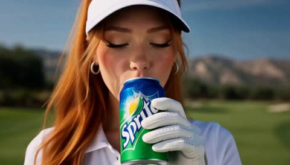</a>

A timed beat sheet with per second ranges, explicit cuts, whip pans and speed ramps lets the model pace a 15 second spot. Onomatopoeia like PSHHHT and CRACK is written into the action so the sound lines up with the edits.

MiniMax H3 · Text-to-video · Source: [@sophiaparkerr_ on X](https://x.com/sophiaparkerr_/status/2106337250346664007) · 303 likes on 2026-10-29 · found via [SkyNotSilent/awesome-MiniMax-H3-cases](https://github.com/SkyNotSilent/awesome-MiniMax-H3-cases)

[`sports-ad`](tags.md#tag-sports-ad) [`multi-shot`](tags.md#tag-multi-shot) [`speed-ramp`](tags.md#tag-speed-ramp) [`product-shot`](tags.md#tag-product-shot)

<details><summary><b>Prompt</b></summary>

```text
0–2s — THE SIP
Fast close-up of the ginger-haired golfer on a sunny golf course. She grabs the Sprite can, cracks it open — PSHHHT! — condensation and tiny droplets flying in slow motion. She takes a refreshing sip and gives a confident little smirk.
2–4s — GAME ON
Hard cut. She tosses the Sprite can slightly upward, catches it, grabs her golf club, and steps into position. Quick whip-pan around her as sunlight flashes across the frame.

4–7s — THE SWING
Rapid montage: close-up of her gripping the club → golf ball on the tee → her eyes locking onto the ball → skirt and ponytail moving as she swings. She hits the ball with a powerful, perfectly timed CRACK!
7–10s — FOLLOW THE BALL
Ultra-fast camera follows the golf ball flying across the bright green course. Speed ramp as it passes trees and sunlight, then lands perfectly near the hole.

10–12s — HOLE IN ONE
She watches it drop into the hole. Quick reaction shot: she smiles, spins the club casually, and walks toward the camera like she absolutely knew that was happening.
12–15s — HERO SHOT
She grabs the cold Sprite can again and takes another sip. Camera pushes in as she lowers the can, smiling confidently. Condensation sparkles in the sunlight. End on a clean product close-up of the Sprite can beside the golf ball.

On-screen text:
“REFRESH. RELOAD. PLAY.”
SPRITE — THIRSTY FOR MORE.
Fast cuts, energetic commercial pacing, whip transitions, speed ramps, crisp summer lighting, realistic golf physics, dynamic camera movement, refreshing splash effects, premium sports-ad aesthetic.
```

</details>

<a id="h3-four-city-outfit-change-depth-reference"></a>
### Four city outfit change with depth reference

<a href="https://x.com/HoodyLiu/status/2101904919540429295"></a>

Numbered pictures each lock one outfit, city map and UI, while a separate face crop is named the top priority identity reference. A black and white depth video supplies body motion and timing, and timed shots with exact reveal seconds keep every spin ending on a front view.

MiniMax H3 · Reference-to-video · Source: [@HoodyLiu on X](https://x.com/HoodyLiu/status/2101904919540429295) · 295 likes on 2026-10-28 · found via [SkyNotSilent/awesome-MiniMax-H3-cases](https://github.com/SkyNotSilent/awesome-MiniMax-H3-cases)

[`outfit-change`](tags.md#tag-outfit-change) [`depth-reference`](tags.md#tag-depth-reference) [`character-consistency`](tags.md#tag-character-consistency) [`vertical`](tags.md#tag-vertical) [`travel`](tags.md#tag-travel)

<details><summary><b>Prompt</b></summary>

```text
<Picture 1> defines Rei's opening outfit only: a fitted black satin mini dress with thin spaghetti straps, a lace-trimmed V-neckline, a small front bow with trailing ribbons, off-the-shoulder lace ruffle sleeves, a ruched bodice, a ruffled lace hem, bare legs and black pointed-toe stiletto pumps. Preserve the dress's silhouette, materials and front/back construction as shown. Use this outfit for the white-studio opening only; do not reproduce the character-sheet layout.

<Picture 2> defines her Paris outfit, front-facing presentation pose, drink, sunglasses, city map and UI. <Picture 3> defines her Rome outfit, front/three-quarter presentation pose, props, city map and UI. <Picture 4> defines her Cairo outfit, presentation pose, shopping bags, city map and UI. <Picture 5> defines her Sydney outfit, front-facing finishing pose, city map and UI.

<Picture 6> is an unmodified slightly turned standard face crop from the original Rei character card. It is the highest-priority facial identity reference for ALL outfits: preserve its eye shape and spacing, eyelids, nose, lips and natural proportions without beautification. Pictures 2–5 supply new city outfits and environments, never a substitute face. This is the same adult woman in different clothes throughout the entire video.

<Video 1> is a black-and-white relative-depth reference for body movement, camera pullback and chronological timing only. Depth brightness represents distance, not skin color or face detail. Render natural full color using the pictures. A featureless face in the depth map must not become the back of Rei's head. Use the scene pictures to resolve which way her face and chest point after each turn.

Generate ONE continuous 12-second vertical video. The timed Shot labels below are successive phases of this one output, not instructions to insert camera cuts. Keep the reference timeline at its original speed. Do not compress the opening to make room for the cities. Only Rei rotates during transformation; the camera must not orbit her. A back view is a brief passing orientation during a spin, never a held destination pose. Each completed transformation reveals her face and the FRONT of the new outfit, as in its corresponding picture. Change clothing, handheld props, city map and city-name UI together; do not change only the background while leaving the previous outfit.

Shot 1 [0.00–2.50 seconds]: White studio and opening black sailor uniform from <Picture 1>. Rei looks at the phone held in front of her chest. Follow the opening camera pullback in <Video 1>. Her torso remains generally facing the camera; allow the original small phone and head gestures. This interval contains no full-body spin, no location pin yet, no city background and no wardrobe change.

Shot 2 [2.50–3.15 seconds]: The red location pin appears above Rei. This event ONLY adds the pin. She continues looking at her phone in the white studio, still wearing the opening black sailor uniform. The pin does not trigger a spin or a scene change. Do not begin the transformation here.

Shot 3 [3.15–4.05 seconds]: Follow the small preparatory side pivot in <Video 1>, then return toward the camera-facing starting orientation while holding the phone. This is the preparatory movement, not the rapid transformation spin. Retain the opening black sailor uniform, white background and red pin throughout this interval. No Paris map or summer outfit before 4.05 seconds.

Shot 4 [4.05–6.00 seconds]: At 4.05 seconds begin the rapid transformation rotation following <Video 1>. Pass continuously through the side and back orientations without pausing. Around 4.25 seconds, during this rotation, change together into the Paris outfit, drink, sunglasses, map and navigation UI from <Picture 2>. By 4.50 seconds complete the rotation and reveal Rei FACING THE CAMERA, with her face and the front of her navy-and-ivory striped top visible. From 4.50 to 6.00 seconds remain in this front/three-quarter FRONT presentation, with the drink and sunglasses gesture from <Picture 2>. The cream full-length trousers, striped top and red neck scarf replace the opening black sailor uniform completely. No back-facing hold, no phone, no opening black sailor uniform during the Paris presentation. The top search bar and bottom location card both read 巴黎.

Shot 5 [6.00–8.00 seconds]: Begin the next reference turn at 6.00 seconds. Around 6.25 seconds change outfit, props, city and UI to Rome from <Picture 3>. Complete the turn by 6.55 seconds into a front/three-quarter FRONT view showing Rei's face, sage-green midi dress with brown belt. Until 8.00 seconds use the Rome pose with the paper guide and warm Trajan column and Roman Forum map. Both city labels read 罗马. Back-facing frames occur only while the turn is in progress; no stopped back view after the turn.

Shot 6 [8.00–10.00 seconds]: Begin the next reference turn at 8.00 seconds. Around 8.25 seconds change together to the ivory linen shirt, beige full-length trousers, ochre scarf, shopping bags, Cairo map and UI from <Picture 4>. By 8.55 seconds reveal her face and the front of the ivory linen shirt. Hold the front/three-quarter presentation with natural small movements until 10.00 seconds. Both city labels read 开罗. Keep the Cairo outfit and map together; do not introduce previous clothes or Sydney early.

Shot 7 [10.00–12.00 seconds]: Begin the final reference turn at 10.00 seconds. Around 10.25 seconds replace the Cairo clothes and shopping bags, city and labels with the Sydney sky-blue overshirt, white T-shirt, navy knee-length shorts and white sneakers, Sydney Tower map and UI from <Picture 5>. By 10.55 seconds face the camera with the white T-shirt beneath the sky-blue overshirt visible, hands raised and one leg bent backward as in <Picture 5>. Keep this front-facing Sydney presentation with subtle natural movement through 12.00 seconds. Both city labels read 悉尼. No additional spin, destination or wardrobe change after this final reveal.

Keep Rei's facial identity, natural body proportions, hair and bangs throughout. Clothing changes must not alter her face, age, body shape, hair color or hair length. Do not reproduce character-sheet panels, extra people, face closeups or depth-map gray colors. Do not reproduce the blank faces in Picture 1's full-body clothing views; Rei must have her normal face whenever her face is visible.

Keep the city UI style consistent; update both location labels at each city change. No generated speech or music.

The angle in Picture 6 describes identity only, NOT a fixed head pose. Face direction, expression, head tilt, hand gestures and full body movement follow Video 1, with each completed city presentation matching its corresponding scene picture.

In Paris the sunglasses are opaque black and fully cover both eyes and eye sockets. Keep the sunglasses on throughout the Paris presentation. At the Rome transformation, switch to the accessories shown in Picture 3.
```

</details>

<a id="veo-potato-farm-to-chip-commercial"></a>
### Potato morphs into a snapping chip at sunrise

<a href="https://x.com/Fujimoto_hina/status/2094644333882540334"></a>

A JSON storyboard splits ten seconds into four timecoded scenes, each with its own shot type, action and lighting. Seamless morph transitions carry the potato from soil to sliced vortex to chip, ending on a macro slow motion snap, and a negative prompt keeps text and logos out.

Veo 3.1 · Text-to-video · Source: [@Fujimoto_hina on X](https://x.com/Fujimoto_hina/status/2094644333882540334) · 282 likes on 2026-10-28

[`food-commercial`](tags.md#tag-food-commercial) [`macro`](tags.md#tag-macro) [`morph-transition`](tags.md#tag-morph-transition) [`json-prompt`](tags.md#tag-json-prompt) [`storyboard`](tags.md#tag-storyboard)

<details><summary><b>Prompt</b></summary>

```text
{
  "commercial_specifications": {
    "title": "Farm to Table: Potato Chip Transformation",
    "duration_seconds": 10,
    "aspect_ratio": "16:9",
    "resolution": "4K",
    "style": "Cinematic photorealistic premium food commercial",
    "lighting": "Cinematic golden hour sunrise, warm highlights",
    "depth_of_field": "Shallow depth of field with high-speed macro focus",
    "audio_visual_notes": "No text, no logos, hyper-realistic physics"
  },
  "storyboard_timeline": [
    {
      "timecode": "00:00 - 00:02",
      "scene": "The Origin",
      "shot_type": "Close-up pushing in rapidly",
      "action": "A single raw, fresh potato rests in rich, dark soil at sunrise, lightly coated with fine earth particles. Sunlight filters dynamically through overhead foliage.",
      "lighting_atmosphere": "Warm morning glow, soft sun flare"
    },
    {
      "timecode": "00:02 - 00:05",
      "scene": "The Dynamic Transformation",
      "shot_type": "Dynamic tracking / High-speed aerial follow",
      "action": "The potato bursts upward from the earth and spins mid-air. In a seamless morph, it sheds its skin and cleanly slices into translucent raw potato rounds swirling in a tight spiral vortex.",
      "physics_effects": "Particle burst of soil, aerodynamic slice trajectory"
    },
    {
      "timecode": "00:05 - 00:08",
      "scene": "The Crisp & Flight",
      "shot_type": "Continuous smooth orbital tracking",
      "action": "The swirling slices flash-cook into a single perfect, undulating golden-brown potato chip with crisp ruffled edges. The camera tracks alongside the chip as it glides toward a rustic styled wooden dining table.",
      "visual_details": "Glistening oil sheen, fine salt crystals catching the light"
    },
    {
      "timecode": "00:08 - 00:10",
      "scene": "The Hero Landing & Snap",
      "shot_type": "Ultra-macro high-speed slow motion",
      "action": "The golden chip lands gently beside an artisanal bowl overflowing with freshly prepared chips. In extreme close-up, the hero chip snaps cleanly in half, releasing delicate airy crumb particles in slow motion.",
      "texture_focus": "Micro-blisters on chip surface, crisp fracture, golden translucence"
    }
  ],
  "prompt_parameters": {
    "camera": "Dynamic push-in to orbital tracking to high-speed macro slow motion",
    "render_qualities": [
      "Photorealistic textures",
      "Cinematic sunrise lighting",
      "Shallow depth of field",
      "Realistic physics",
      "Seamless morph transitions",
      "Warm golden highlights",
      "Ultra-detailed 4K"
    ],
    "negative_prompt": "text, watermark, logo, blurry, low resolution, cartoon, plastic texture, unrealistic movement, jerky cuts"
  }
}
```

</details>

<a id="h3-woman-white-dress-mirror-perfume-ad"></a>
### Woman in white dress getting ready at mirror

<a href="https://x.com/CaliraVal/status/2105895582275657852">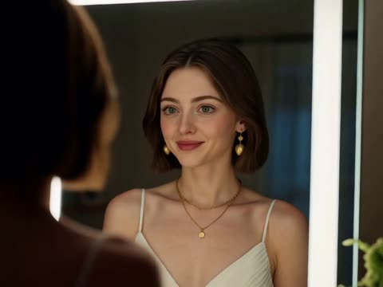</a>

The prompt numbers seven scenes in order and gives each one its own action plus a camera or lighting cue, so the model can carry one character through a full ad. The character is described once in detail (bob haircut, white dress, gold jewelry), and the closing visual style block sets the grade, depth of field and skin texture for every shot.

MiniMax H3 · Text-to-video · Source: [@CaliraVal on X](https://x.com/CaliraVal/status/2105895582275657852) · 237 likes on 2026-10-29

[`perfume-commercial`](tags.md#tag-perfume-commercial) [`multi-scene`](tags.md#tag-multi-scene) [`character-consistency`](tags.md#tag-character-consistency) [`luxury-fashion`](tags.md#tag-luxury-fashion)

<details><summary><b>Prompt</b></summary>

```text
Create an ultra-realistic, cinematic luxury perfume commercial with a romantic evening atmosphere.

Scene 1: A beautiful young woman with a short brunette bob haircut, elegant features, and natural makeup stands in front of a mirror, wearing a sophisticated white evening dress and delicate gold jewelry. She smiles softly while getting ready for a special evening.

Scene 2: Close-up of her smartphone resting on a bedside table as she receives a message. Warm ambient lighting creates a cozy, intimate mood.

Scene 3: She opens her wardrobe and chooses an elegant white dress. Capture natural movements, realistic fabric physics, and cinematic framing.

Scene 4: A macro close-up of her hand holding a luxurious transparent glass perfume bottle with pink fragrance. She gently sprays the perfume on her wrist. Highlight the fine mist, glass reflections, and premium product details.

Scene 5: She turns away from the mirror, her short hair moving naturally as she prepares to leave. Use a smooth cinematic camera movement.

Scene 6: A beautiful European city street at night, with warm restaurant lights, passing cars, and soft reflections on the pavement. The woman walks gracefully toward a stylish restaurant.

Scene 7: A romantic close-up of the woman and a handsome young man meeting outside at night. They exchange warm smiles and look into each other's eyes, creating a subtle romantic moment.

Visual style: Premium luxury perfume advertisement, cinematic storytelling, warm golden lighting, realistic skin texture, shallow depth of field, elegant camera movements, soft bokeh, natural human expressions, sophisticated color grading, photorealistic details, 4K quality.

Maintain consistent character identities, realistic movements, seamless transitions, and a refined romantic atmosphere. No text, no subtitles, no logos, no watermark.
```

</details>

<a id="kling-ten-pose-fashion-editorial-reflective-studio"></a>
### Ten pose fashion editorial in a reflective studio

<a href="https://x.com/ZaraIrahh/status/2097615157421867206"></a>

A numbered list fixes exactly ten poses, each paired with its own silhouette and camera angle, so the cut stays countable. Transitions are named (whip pans, snap zooms, flashes, lens occlusions), and the sound brief sets a 140 BPM beat with shutter clicks to drive the rhythm.

Kling 3.0 · Reference-to-video · Source: [@ZaraIrahh on X](https://x.com/ZaraIrahh/status/2097615157421867206) · 235 likes on 2026-10-28

[`fashion`](tags.md#tag-fashion) [`editorial`](tags.md#tag-editorial) [`kinetic-editing`](tags.md#tag-kinetic-editing) [`character-reference`](tags.md#tag-character-reference) [`studio`](tags.md#tag-studio)

<details><summary><b>Prompt</b></summary>

```text
Create a 15-second high-fashion editorial film starring the adult character in <<<image_1>>> . Preserve their exact appearance, outfit, accessories and visual style. Render the entire film in the reference’s aesthetic.

Use a minimal studio with a reflective floor, bold directional lighting and rhythmic photographic flashes.

Show exactly 10 distinct fashion poses, each with a different silhouette and camera angle:

1. A confident standing pose, filmed from floor level with dramatic wide-angle perspective.
2. One hand beside the face, captured in an extreme side-profile close-up.
3. An asymmetric seated pose, seen directly overhead as the camera rotates.
4. One leg extended toward the lens, the foot or reference footwear dominating the foreground through foreshortening.
5. A quick, fluid leg cross, captured from a low diagonal angle.
6. Fingertips catching the edge of an existing sleeve or collar, framed in a tight detail shot.
7. A rear three-quarter turn with a deliberate glance back into the camera.
8. A forward lean toward the lens, ending with the palm briefly covering it.
9. An elongated upward stretch, revealed in a sharply tilted wide shot with strong side lighting.
10. A commanding full-body hero pose, looking down into the lens as the camera rapidly pulls back.

Keep the performance fast and rhythmically tight. Flow naturally between poses, holding each for only a fraction of a second while keeping its silhouette clearly readable. No repeated poses or additional pose changes.

Connect angles through whip pans, movement-matched cuts, snap zooms, flashes and lens occlusions. Orbit against the character’s turn, sweep from their floor reflection toward their face and plunge from overhead to floor level. Alternate intimate details with dramatic wide compositions. Accelerate between poses and brake sharply on each hold.

Keep the sensual gestures quick, confident and fully clothed. Hair and fabric react naturally. No slow motion, lingering shots or gradual camera drift. Build momentum toward the tenth pose, then stop sharply for a crisp final hold.

Stable identity and anatomy throughout. No outfit changes, added accessories or text. Sound: a driving 140 BPM fashion beat, rhythmic shutter clicks and subtle fabric movement.
```

</details>

<a id="h3-burger-exploded-stack-macro-commercial"></a>
### Exploded burger stack macro food commercial

<a href="https://x.com/aimikoda/status/2094279178602283013"></a>

Opens on an extreme macro of the bun, then pulls back into an exploded vertical stack with each ingredient named in order. Camera moves, speed ramps, kinetic typography and light direction are all stated, and swapping the food adapts it.

MiniMax H3 · Text-to-video · Source: [@aimikoda on X](https://x.com/aimikoda/status/2094279178602283013) · 234 likes on 2026-10-28 · found via [SkyNotSilent/awesome-MiniMax-H3-cases](https://github.com/SkyNotSilent/awesome-MiniMax-H3-cases)

[`food`](tags.md#tag-food) [`commercial`](tags.md#tag-commercial) [`macro`](tags.md#tag-macro) [`kinetic-typography`](tags.md#tag-kinetic-typography) [`portrait`](tags.md#tag-portrait)

<details><summary><b>Prompt</b></summary>

```text
Create a high-end cinematic burger commercial in portrait format, designed like a premium restaurant campaign.  Open on an extreme macro shot of a golden toasted bun, revealing tiny bake-specks, soft flour dusting and rich surface texture under warm directional light. The camera glides smoothly across the bun, then pulls back as the burger ingredients separate into a perfectly aligned exploded stack above a matte wooden tabletop.  The full burger floats on a single vertical axis: toasted top bun, crisp ruffled lettuce, glossy tomato slices, translucent purple-red onion rings, melted cheddar, a thick char-grilled beef patty and toasted bottom bun. Each layer moves with elegant controlled motion, subtle rotation and realistic weight.  Use premium food-commercial camera movement throughout: macro tracking shots, smooth dolly pushes, slow orbital moves, shallow-focus passes between ingredients and precise rack focuses. Add occasional speed ramps into slow-motion beauty moments. Let tiny crumbs, droplets and subtle steam move through the light for additional depth.  Integrate bold hand-lettered white typography directly into the composition. Words appear between the floating burger layers, following the camera movement with kinetic typography. Letters can slide behind ingredients, reveal through depth, stretch slightly during transitions and lock cleanly into place. Add minimal white doodle strokes and graphic accent lines that animate around key ingredients.  Lighting is luxurious and appetizing: soft directional key from upper-left, controlled fill, warm highlights, deep dimensional shadows and glossy specular detail on tomato, cheese and meat. Background is a refined warm brown gradient with subtle cinematic falloff.  Build toward a final satisfying moment where all ingredients rapidly assemble into one perfect burger. The camera performs a fast controlled push-in, then settles into a polished hero shot. Steam rises gently from the patty, cheese settles over the edges and the typography resolves beside the burger.  Final frame: centered premium burger hero shot, clean composition, elegant white campaign typography and subtle animated graphic accents.  Visual style: luxury food advertising, modern restaurant campaign, cinematic macro photography, rich warm tones, high contrast, shallow depth of field, highly detailed food textures, sophisticated motion design, premium typography, smooth dynamic camera choreography, polished commercial finish.
```

</details>

<a id="h3-golden-hour-hair-mist-beach-commercial"></a>
### Woman with windblown hair on a golden hour beach

<a href="https://x.com/AvelyrahnAI/status/2114955141707133421"></a>

The prompt works as a shot list: it sets the 9:16 frame and golden hour light, then moves in order through the portrait, the product hero, the mist, a hair toss and a final product display. Naming the lens behaviour, such as shallow depth of field and smooth stabilization, keeps the commercial look consistent across cuts.

MiniMax H3 · Text-to-video · Source: [@AvelyrahnAI on X](https://x.com/AvelyrahnAI/status/2114955141707133421) · 231 likes on 2026-10-29

[`beauty-commercial`](tags.md#tag-beauty-commercial) [`product-shot`](tags.md#tag-product-shot) [`golden-hour`](tags.md#tag-golden-hour) [`vertical-video`](tags.md#tag-vertical-video)

<details><summary><b>Prompt</b></summary>

```text
Cinematic 9:16 vertical luxury beauty commercial video on a sun-drenched tropical beach during golden hour. Ultra-detailed photorealistic visuals, gorgeous young woman with long, lustrous, wind-swept glossy brown hair, soft natural makeup, wearing a chic blue outfit. The sequence flows seamlessly from a close-up portrait smile, to a crisp product hero shot of an orange and blue spray bottle labeled "HAIR ENERGY SCENTSATIONS" held in a clean hand, to a dynamic side-profile shot of a refreshing hair mist spray creating a fine atomized mist catching the warm sunset light, followed by an elegant hair toss and slow-motion turn. Concludes with a pristine product display of the spray bottle resting on wet coastal rocks, surrounded by splashing crystal-clear sea foam and delicate white frangipani flowers. High-end commercial production value, shallow depth of field, vibrant warm color grading, ultra-sharp textures, smooth professional camera stabilization
```

</details>

<a id="h3-iced-tea-hero-shot-storyboard"></a>
### Woman raises iced tea bottle under sunny sky

<a href="https://x.com/socialwithaayan/status/2083860644911300928"></a>

A numbered scene list that gives each beat its shot type, camera move and sound effect lets the model follow a clear order. Repeating the same actress, product and DSLR 85mm lens in every scene holds identity and look across cuts.

MiniMax H3 · Text-to-video · Source: [@socialwithaayan on X](https://x.com/socialwithaayan/status/2083860644911300928) · 231 likes on 2026-10-29

[`storyboard`](tags.md#tag-storyboard) [`product-ad`](tags.md#tag-product-ad) [`sound-effects`](tags.md#tag-sound-effects) [`beverage`](tags.md#tag-beverage)

<details><summary><b>Prompt</b></summary>

```text
Ultra cinematic 3x3 commercial storyboard for a refreshing Chinese iced tea drink advertisement, inspired by energetic Japanese beverage commercials, bright summer daylight, hyper realistic photography, vibrant blue sky, strong sunlight glow, refreshing water splash effects, dynamic action motion, fast cut scenes, cinematic camera angles, premium ad quality, realistic skin texture, DSLR 85mm lens look, commercial-grade lighting, emotional expressions, energetic youthful vibe, ultra detailed drink bottle focus, condensation droplets on bottle, cold refreshing atmosphere.

Scene 1. Low angle hero shot of young Asian woman holding iced tea bottle toward camera under bright blue sky, hair blowing in wind, sun flare, dramatic perspective, cinematic opening shot. SFX: wind rush, upbeat summer music starts.

Scene 2. Extreme close-up of bottle with ice cubes and liquid splash exploding around it in slow motion, detailed droplets frozen mid-air. SFX: explosive splash, bass hit.

Scene 3. Girl smiling and spinning while holding drink, camera orbit motion, sky background, energetic carefree vibe. SFX: whoosh transition, cheerful music rise.

Scene 4. Macro bottle cap twist open, carbonation fizz bursting out, ultra satisfying detail shot. SFX: crisp bottle crack, fizz sound.

Scene 5. Side profile drinking scene, liquid glow reflections, sunlight on face, refreshing emotional expression, cinematic close-up. SFX: gulp sound, soft sparkle effect.

Scene 6. Ice cubes crashing into tea splash with floating tea leaves, ultra dynamic product beauty shot. SFX: ice crack, liquid burst.

Scene 7. Fast action jumping scene with friends laughing together outdoors, handheld camera energy, motion blur, youth commercial aesthetic. SFX: laughter, energetic beat drop.

Scene 8. Premium centered product showcase with rotating bottle, floating ice particles, typography graphics around product, commercial key visual. SFX: impact boom, rising synth.

Scene 9. Final hero frame, girl smiling directly at camera while holding drink close to lens, glowing sunlight behind, cinematic ending frame with bold Chinese typography and logo. SFX: satisfying logo sound, upbeat ending music.

Style references: Japanese summer beverage commercials, Coca-Cola Japan ads, Pocari Sweat cinematic energy, fast-paced Asian commercial editing, ultra realistic, highly saturated colors, premium advertising photography, cinematic storyboard layout, realistic water physics, motion blur transitions, energetic youth lifestyle aesthetic.

Visual quality: 8k ultra detailed, commercial photography, HDR lighting, realistic reflections, natural skin texture, cinematic composition, dynamic framing, high contrast sunlight, premium beverage ad style, authentic summer atmosphere, cinematic storyboard grid layout with numbered scenes.
```

</details>

<a id="h3-luxury-perfume-amber-smoke-commercial"></a>
### Luxury perfume commercial with amber golden smoke

<a href="https://x.com/Lianaalane/status/2086730655161823597"></a>

Four numbered shot lines each carry their own camera move and lighting, bookended by matching push-ins on the bottle. A separate consistency block locks the woman, outfit and bottle across shots and lists negatives such as extra people, distorted hands and logos.

MiniMax H3 · Text-to-video · Source: [@Lianaalane on X](https://x.com/Lianaalane/status/2086730655161823597) · 228 likes on 2026-10-28 · found via [SkyNotSilent/awesome-MiniMax-H3-cases](https://github.com/SkyNotSilent/awesome-MiniMax-H3-cases)

[`perfume`](tags.md#tag-perfume) [`commercial`](tags.md#tag-commercial) [`multi-shot`](tags.md#tag-multi-shot) [`luxury`](tags.md#tag-luxury) [`product-ad`](tags.md#tag-product-ad)

<details><summary><b>Prompt</b></summary>

```text
A Luxury perfume bottle on glossy black surface, warm amber lighting, golden smoke, dark elegant background, soft reflections, cinematic close-up, slow push-in, photorealistic 4K.
Confident woman in a burnt-orange satin dress, long dark hair, luxurious dark interior with golden lights, subtle smoke, cinematic medium shot, photorealistic 4K.
Close-up of the same woman spraying perfume on her neck. Visible fragrance mist, warm golden light, natural hair movement, shallow depth of field, cinematic beauty ad.
Same woman walking confidently toward camera in the luxury interior. Smooth tracking shot, reflective floor, warm golden lighting, subtle smoke, elegant cinematic look.
Same perfume bottle centered on glossy black surface with amber crystals and golden smoke. Dramatic spotlight, dark luxury background, slow push-in, photorealistic 4K.

Consistency:
Keep the same woman, face, hair, skin tone, outfit, and perfume bottle across all scenes. Warm amber lighting, realistic skin and movement. No extra people, distorted hands, duplicate objects, text, or logos.

Style: Luxury fragrance commercial, cinematic, photorealistic, 4K.
```

</details>

<a id="omni-rolex-datejust-watch-parts-assembly"></a>
### Tiny watch parts scattered on a dusk workbench

<a href="https://x.com/MrDasCreates/status/2094772953003311105"></a>

Timed beats for each second range, a single unbroken shot, and explicit lens and camera moves keep the scene coherent from the bench to the floating watch. The constraints block sets dialogue, voiceover and on-screen text to none, which keeps the output free of captions.

Gemini Omni Flash · Text-to-video · Source: [@MrDasCreates on X](https://x.com/MrDasCreates/status/2094772953003311105) · 228 likes on 2026-10-29

[`product-reveal`](tags.md#tag-product-reveal) [`watchmaking`](tags.md#tag-watchmaking) [`macro`](tags.md#tag-macro) [`luxury`](tags.md#tag-luxury)

<details><summary><b>Prompt</b></summary>

```text
{
  "model": "gemini-omni-1.1-flash",
  "duration": "10s",
  "aspect_ratio": "16:9",
  "shot": {
    "structure": "single continuous unbroken shot, no scene cuts",
    "composition": "starts wide on a dimly lit Swiss watchmaker's atelier workbench, follows individual precision components rising and interlocking, ends on a centered floating Rolex Datejust close-up",
    "lens": "50mm for the workshop environment, then 85mm for the product reveal",
    "frame_rate": "24fps cinematic",
    "camera_movement": "slow push-in across the bench following the rising parts, then a gentle orbital arc as they lock into the watch, hold steady on the hovering timepiece"
  },
  "timeline": {
    "0-3s": "Warm-lit luxury watchmaking atelier at dusk. Polished walnut workbench scattered with tiny gears, screws, hands, and a gold case. Soft tungsten lamps, leather tools, faint dust motes in the air.",
    "3-7s": "Dozens of microscopic brass and steel components lift from the bench and rotate in precise, clockwork orbits. They snap together mid-air with tiny metallic clicks into the exact silhouette of a Rolex Datejust. Subtle gold reflections and micro-spark highlights on polished surfaces.",
    "7-10s": "The assembled form pulses once and materializes into a real Rolex Datejust with fluted bezel and jubilee bracelet, hovering weightlessly. The second hand begins ticking. Warm rim light and faint workshop haze."
  },
  "subject": {
    "description": "dozens of precision watch components rising and interlocking in elegant mechanical orbits to form a luxury timepiece silhouette",
    "props": "final Rolex Datejust formed from swirling parts, then transitioning into real branded watch while hovering mid-air"
  },
  "scene": {
    "location": "traditional Swiss watchmaker's atelier with wooden workbench",
    "time_of_day": "early evening dusk, warm tungsten glow, lingering workshop atmosphere",
    "environment": "quiet precision workshop, scattered tools, leather mats, gold shavings"
  },
  "visual_details": {
    "action": "parts lift, rotate in organized mechanical paths, lock into watch outline, pulse, then morph into finished Rolex Datejust suspended in space",
    "special_effects": "micro-particle metal animation, slow-motion gold reflections, mid-air material morph, subtle levitation shimmer and dust trails"
  },
  "cinematography": {
    "lighting": "warm directional tungsten light, gleaming metal highlights, soft gold rim light on the floating watch",
    "color_palette": "rich walnut browns, polished golds, steel silvers, warm ambers",
    "tone": "precise, heritage luxury, quiet mastery"
  },
  "audio": {
    "music": "subtle orchestral strings with delicate piano and faint ticking motifs",
    "ambient": "distant workshop hush, occasional tool clink, evening stillness",
    "sound_effects": "tiny metallic snaps as parts lock, precision click when the form completes, faint mechanical hum under levitation",
    "mix": "intimate, refined, workshop-forward with a clean musical center"
  },
  "constraints": {
    "dialogue": "none",
    "voiceover": "none",
    "on_screen_text": "none",
    "captions": "none",
    "subtitles": false
  }
}
```

</details>

<a id="h3-audionic-airbud-850-city-walk-ad"></a>
### Silver earbuds ad: city walk to product hero shot

<a href="https://x.com/ayzalnooor24521/status/2087042771257540945"></a>

The prompt is written as a timed shot sequence: a product close up first, then a walking segment with bokeh and a pop song cue, then one clean hero frame. Naming what to leave out (phone screen, discount text, end card) keeps the ending from drifting into a generic ad template.

MiniMax H3 · Text-to-video · Source: [@ayzalnooor24521 on X](https://x.com/ayzalnooor24521/status/2087042771257540945) · 223 likes on 2026-10-29 · found via [SkyNotSilent/awesome-MiniMax-H3-cases](https://github.com/SkyNotSilent/awesome-MiniMax-H3-cases)

[`product-ad`](tags.md#tag-product-ad) [`earbuds`](tags.md#tag-earbuds) [`city-walk`](tags.md#tag-city-walk) [`bokeh`](tags.md#tag-bokeh) [`cinematic`](tags.md#tag-cinematic)

<details><summary><b>Prompt</b></summary>

```text
Create a premium 15-second cinematic ad for Audionic Trance Airbud 850. Start with a close-up of the silver earbuds and case, then show a stylish Korean girl wearing them and walking through a luxurious Korean shopping street while enjoying a modern Korean K-pop song. Use beautiful city lights, soft bokeh, elegant fashion, natural expressions and smooth cinematic camera movement. End with one clean hero shot of the silver earbuds and case only. No phone screen, Bluetooth connection, discount text, logo end card or extra ending scene.
```

</details>

<a id="omni-pov-telekinetic-outfit-change"></a>
### POV gloved hands swap a woman's outfit

<a href="https://x.com/KrevixAi/status/2099562556507492661"></a>

A storyboard image is the reference, and the prompt splits ten seconds into timed beats named Focus, Pull, Orbit and Assemble, each with one action. Fixed identity wording and a long negative list keep the fabric physics believable and the woman consistent.

Gemini Omni Flash · Reference-to-video · Source: [@KrevixAi on X](https://x.com/KrevixAi/status/2099562556507492661) · 211 likes on 2026-10-28

[`fashion`](tags.md#tag-fashion) [`pov`](tags.md#tag-pov) [`commercial`](tags.md#tag-commercial) [`outfit-change`](tags.md#tag-outfit-change) [`storyboard`](tags.md#tag-storyboard)

<details><summary><b>Prompt</b></summary>

```text
Create a 10-second photorealistic luxury fashion commercial, 16:9, based on the reference storyboard. Pure black infinite studio, STRICT first-person POV, centered full-body framing. The same adult woman remains visually identical throughout: 25–30, tall, slim, long dark-chestnut wavy hair, refined face, natural makeup.
Two masculine hands in matte-black gloves remotely control the clothing without touching it. No visible telekinetic effects — movement is shown only through realistic fabric tension, weight and inertia.
0.0–1.0s — FOCUS. Woman wears an outdated oversized beige top, loose grey trousers and worn grey sneakers. POV hands extend toward her. The clothes stretch outward under invisible force.
1.0–2.0s — FORCE PULL. Hands sharply separate. Beige top, trousers and sneakers detach as complete garments and fly sideways. Nothing tears or dissolves. She remains covered by a minimal opaque black fashion base: fitted black crop top, high-waisted fitted black shorts and simple black pumps.
2.0–2.8s — STOP. Hands open sharply. The old garments suddenly stop and briefly remain suspended around her with realistic residual movement.
2.8–3.5s — DISPATCH. Hands sweep outward, throwing all old garments completely out of frame.
3.5–4.7s — PULL. Hands pull inward. Premium clothing rapidly flies from the darkness toward her: burgundy satin top, high-waisted black wide-leg trousers, structured black blazer, pointed black heels, slim black belt, gold earrings and small black handbag.
4.7–6.0s — ORBIT. The new garments dynamically circle the woman. POV hands precisely control their trajectories. Realistic fabric folds, weight, momentum and aerodynamic movement.
6.0–7.2s — ASSEMBLE. Hands sharply converge. All garments simultaneously move into their correct positions: trousers, burgundy top, blazer, heels, belt and accessories physically assemble into one finished luxury look. No morphing or dissolving.
7.2–8.5s — HERO. Hands leave frame. Clean full-body hero shot. Woman confidently poses in the completed black-and-burgundy luxury outfit.
8.5–10.0s — TOGETHER. One gloved POV hand reaches toward her. She takes it and confidently walks directly toward the camera while holding hands, moving from full-body to close-up until she fills the frame.
Photorealistic premium fashion campaign, dramatic studio lighting, deep blacks, realistic skin and fabric, cinematic contrast, fast elegant choreography, strong POV depth. No identity changes, nudity, transparent clothing, extra people, text, particles, beams, glow, smoke, magic, teleportation or unrealistic cloth physics.
```

</details>

<a id="h3-pepsi-desert-convertible-commercial"></a>
### Boots walk past vintage convertible at desert station

<a href="https://x.com/CaliraVal/status/2091012158280917271">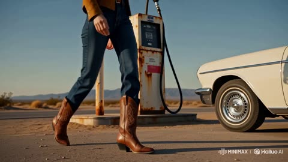</a>

Splits the spot into ordered shot beats, each with its own camera angle, then closes with a style block of lens, lighting and grain terms. Naming the logo and the chilled bottle keeps the product readable in the hero shot.

MiniMax H3 · Text-to-video · Source: [@CaliraVal on X](https://x.com/CaliraVal/status/2091012158280917271) · 199 likes on 2026-10-29

[`commercial`](tags.md#tag-commercial) [`golden-hour`](tags.md#tag-golden-hour) [`desert`](tags.md#tag-desert) [`product-shot`](tags.md#tag-product-shot)

<details><summary><b>Prompt</b></summary>

```text
Create a 15-second cinematic Pepsi commercial-style video set on an empty desert highway during golden hour. A stylish young woman in a western-inspired outfit and cowboy boots walks toward a classic white vintage convertible parked beside a remote gas station. Show dramatic low-angle shots of her boots, the car’s chrome wheels, and her confident walk.

Cut to an extreme close-up of her face, wind blowing through her hair, with warm sunlight and a confident expression. Show a chilled Pepsi glass bottle glowing in the sunset light, covered in realistic condensation, with the Pepsi logo clearly visible.

Then show the woman sitting in the convertible while holding the Pepsi bottle as her scarf flows dramatically in the wind. Finish with a wide cinematic aerial shot of the vintage car speeding down the long empty desert road toward the setting sun, leaving a subtle trail of dust.

Style: photorealistic, premium Pepsi commercial, cinematic storytelling, warm golden-hour lighting, anamorphic lens, shallow depth of field, realistic skin and fabric, smooth camera movements, dramatic close-ups, rich contrast, subtle film grain, 4K, high-end advertising aesthetic, 9:16 vertical.
```

</details>

<a id="omni-rose-perfume-storyboard-commercial"></a>
### Rose perfume bottle luxury commercial with petals

<a href="https://x.com/Strength04_X/status/2097919290980921451"></a>

A 10 panel storyboard sheet made in an image model sets the look, and the video model animates it. A frame consistency block locks the bottle, background and petals, and a header card gives duration, style and layered audio cues.

Gemini Omni Flash · Image-to-video · Source: [@Strength04_X on X](https://x.com/Strength04_X/status/2097919290980921451) · 195 likes on 2026-10-28

[`product-commercial`](tags.md#tag-product-commercial) [`storyboard`](tags.md#tag-storyboard) [`perfume`](tags.md#tag-perfume) [`macro`](tags.md#tag-macro) [`luxury`](tags.md#tag-luxury)

<details><summary><b>Prompt</b></summary>

```text
Luxury Rose Perfume Cinematic Product Commercial Storyboard

FORMAT:
• Single-page premium storyboard
• 3:4 portrait storyboard sheet
• 10 cinematic product-focused panels
• Clean editorial grid with thin borders
• Connected sequence from one continuous commercial
• Luxury beauty campaign aesthetic

HEADER:
• Bold elegant typography
• Compact information cards
• Duration: 20 Seconds
• Style: Soft Luxury Fragrance Commercial
• Product: Premium Perfume Bottle
• Audio: Glass Tap + Soft Spray + Liquid ASMR + Gentle Whoosh
• White, blush pink and champagne aesthetic
• Minimal floral graphic accents

STORYBOARD:
1. Perfume bottle standing alone on a glossy white studio surface
2. Macro shot revealing crystal glass, cap and delicate reflections
3. Soft pink light sweeps smoothly across the bottle
4. Perfume cap lifts elegantly with a subtle sparkle
5. Fragrance liquid gently swirls inside the bottle
6. Fine perfume mist sprays into the soft white-pink atmosphere
7. Floating rose petals slowly move around the bottle
8. Bottle performs a smooth elegant 360° rotation
9. Rose petals settle around the base of the bottle
10. Final hero shot with perfume bottle, soft pink glow and delicate petals

FRAME CONSISTENCY:
• Same perfume bottle in every scene
• Identical bottle shape, cap, label and proportions
• Same white glossy studio environment
• Soft white-pink gradient background throughout
• Consistent champagne highlights and reflections
• Same rose petals from Scene 7 onward
• Product remains centered and visually dominant
• Every frame naturally continues from the previous scene

CAMERA:
Luxury macro photography, smooth 360° product rotation, controlled push-ins, shallow depth of field, soft reflections, slow-motion mist and elegant cinematic movement.

VISUAL STYLE:
Ultra-realistic premium beauty advertising, crystal glass, realistic perfume liquid, soft pink atmosphere, delicate
```

</details>

<a id="h3-hair-serum-ugc-bedroom-ad"></a>
### Smiling woman shows hair serum bottle in bedroom

<a href="https://x.com/SyntheSarah/status/2084567967652843620"></a>

Four timed scenes with inline dialogue and a UGC style block keep the phone-selfie look consistent across cuts. Attaching the product photo as a reference holds the bottle label and dropper shape steady.

MiniMax H3 · Reference-to-video · Source: [@SyntheSarah on X](https://x.com/SyntheSarah/status/2084567967652843620) · 177 likes on 2026-10-29

[`ugc`](tags.md#tag-ugc) [`product-ad`](tags.md#tag-product-ad) [`beauty`](tags.md#tag-beauty) [`hair-care`](tags.md#tag-hair-care)

<details><summary><b>Prompt</b></summary>

```text
Create a 15-second authentic UGC-style hair growth serum ad using the provided product image as the exact product reference.

SCENE 1 — 0–3s
A young woman films herself in a bright bedroom using a smartphone front camera. Natural lighting, handheld movement, casual appearance. She looks at the camera and says:
“I’ve been trying this hair growth serum lately…”

SCENE 2 — 3–7s
Cut to a close handheld shot of the woman holding the serum bottle. She removes the dropper, applies a few drops directly to her scalp, and gently massages it in. Keep the movement natural and slightly imperfect like real UGC content.

SCENE 3 — 7–11s
Mirror selfie shot. She runs her fingers through her hair, showing healthy-looking, fuller hair while casually talking to the camera:
“And honestly, I love how easy it is to add to my routine.”

SCENE 4 — 11–15s
Close-up product shot on her bathroom counter. She picks up the bottle and smiles toward the camera. End with natural on-screen text:
“Simple hair care. Every day.”

Style: authentic TikTok/Reels UGC, smartphone camera, realistic skin texture, natural expressions, subtle handheld motion, imperfect framing, casual home environment, soft daylight, realistic audio, no cinematic commercial look, no excessive beauty filters. Preserve the exact product packaging, label, bottle shape, and branding from the reference image.
```

</details>

<a id="h3-glam-beauty-gold-pearl-earrings-closeup"></a>
### Glam beauty close-up with gold pearl earrings

<a href="https://x.com/TaliaAariz/status/2113991384512299099"></a>

The prompt opens with a full appearance list covering skin, eyes, makeup and blazer, then gives a beat-by-beat movement sequence plus a camera and lighting spec. Restating the same appearance details keeps the face consistent through the head turns.

MiniMax H3 · Text-to-video · Source: [@TaliaAariz on X](https://x.com/TaliaAariz/status/2113991384512299099) · 171 likes on 2026-10-29

[`beauty`](tags.md#tag-beauty) [`makeup`](tags.md#tag-makeup) [`fashion`](tags.md#tag-fashion) [`portrait`](tags.md#tag-portrait)

<details><summary><b>Prompt</b></summary>

```text
Vertical 9:16 beauty close-up video, 13 seconds. A young woman with olive skin, green eyes, thick brushed-up brows and a sleek dark hair bun poses against a soft light-gray studio backdrop. Glam makeup: warm peach-bronze smoky eyeshadow, defined lashes, bold pink-coral blush swept high on the cheekbones, glossy rose-pink lips, and a luminous glowing complexion. She wears ornate gold statement earrings with baroque pearl drops and a cream-white tailored blazer.
Movement: the shot opens on a tight face close-up, then she slowly turns her head left and right, showing off the earrings, blush and lips. She gently touches her jaw and earring, flutters her eyes, and ends in a side profile. Smooth, slow, confident glamour poses.
Camera: static handheld-style close-up at eye level, shallow depth of field, subtle push-in. Lighting: soft, bright beauty-dish light with gentle highlights on the cheeks and lips, clean studio look. Style: high-end makeup tutorial or fashion editorial, glossy and polished, sharp skin texture, 4K, 30 fps.
```

</details>

<a id="h3-black-luxury-sedan-city-ad-kiss"></a>
### Black luxury sedan city ad ending with a kiss

<a href="https://x.com/Zyrellix/status/2108784100530081964">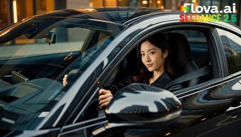</a>

Four timed shots, each with a named camera move (side tracking, low angle wheel close up, rear tracking, interior close up), give the model clear cut points. The darkening exit scene and lens and light terms like shallow depth of field and reflections set the premium commercial look.

MiniMax H3 · Text-to-video · Source: [@Zyrellix on X](https://x.com/Zyrellix/status/2108784100530081964) · 169 likes on 2026-10-29

[`luxury-car`](tags.md#tag-luxury-car) [`dusk-city`](tags.md#tag-dusk-city) [`multi-shot`](tags.md#tag-multi-shot) [`product-ad`](tags.md#tag-product-ad)

<details><summary><b>Prompt</b></summary>

```text
Create a 15-second cinematic photorealistic luxury car commercial, set in a modern city at dusk. Premium automotive advertisement, realistic lighting, natural motion, detailed reflections, shallow depth of field, smooth cinematic camera movement, 4K quality, 24fps.

SHOT 1 — 0–4s:
Medium close-up from outside the driver's side window of a sleek black luxury sports sedan driving through the city. A young Asian woman with long dark hair is driving, wearing a black leather jacket and seatbelt. She looks naturally toward the road, then briefly smiles toward the camera. Capture realistic reflections of city lights across the glossy black body and windows. Camera tracks smoothly alongside the moving car.

SHOT 2 — 4–7s:
Extreme low-angle close-up of the rear wheel and rear quarter panel. The black performance tire spins rapidly as the car accelerates. Subtle tire smoke and road dust appear behind the wheel. Detailed tire texture, realistic suspension movement, glossy reflections, dramatic automotive lighting. Fast dynamic tracking camera.

SHOT 3 — 7–11s:
Wide rear tracking shot of the black luxury sedan speeding through a modern city tunnel/highway surrounded by tall glass buildings. The car moves confidently through the center lane. Camera follows smoothly from behind at road level. Strong sense of speed with realistic background motion blur, reflections and cinematic depth.

SHOT 4 — 11–15s:
Cut back inside the car. Close-up of the female driver from the passenger side. She keeps one hand on the steering wheel, looks toward the camera with a playful confident smile, then gently raises her hand toward her lips as if blowing a kiss. City lights streak softly through the windows behind her. Natural facial expressions, realistic skin texture, subtle hair movement, premium cinematic lighting.

END:
The car continues driving away through the city as the scene gradually becomes darker, leaving a stylish cinematic ending.

Visual style: ultra-photorealistic, premium luxury automotive commercial, realistic physics, natural human movement, accurate car proportions, realistic wheel rotation, cinematic depth of field, detailed reflections, high-end color grading, smooth transitions, no cartoon look, no distorted hands, no facial artifacts, no warped car body.
Camera movement should feel dynamic and confident, matching a real professional automotive commercial rather than slow motion.
```

</details>

<a id="h3-ugc-skincare-serum-bathroom"></a>
### Young woman showing serum bottle in bathroom

<a href="https://x.com/ZaraIrahh/status/2083011066800242986">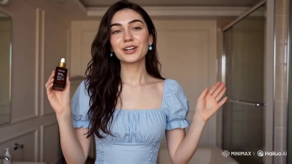</a>

The prompt frames the shot as a handheld smartphone UGC clip with one speaker facing the camera, a simple layout the model handles well. Naming soft morning light, a casual room, and skin that is not overly retouched keeps the face natural instead of glossy.

MiniMax H3 · Text-to-video · Source: [@ZaraIrahh on X](https://x.com/ZaraIrahh/status/2083011066800242986) · 158 likes on 2026-10-29

[`ugc`](tags.md#tag-ugc) [`skincare`](tags.md#tag-skincare) [`beauty`](tags.md#tag-beauty) [`talking-head`](tags.md#tag-talking-head)

<details><summary><b>Prompt</b></summary>

```text
UGC-style skincare video featuring a realistic young woman speaking directly to the camera in front of a bathroom mirror while holding a premium facial serum bottle. She smiles naturally, talks about her skincare routine, and demonstrates applying the serum to her face. Authentic, conversational presentation with genuine facial expressions and hand gestures, natural morning light, casual home bathroom setting, clean skincare aesthetic, healthy glowing skin, minimal makeup, smartphone-shot look, candid lifestyle beauty content, soft depth of field, luxury beauty brand feel, vertical 9:16, social media ad quality, highly realistic natural skin texture, not overly retouched.
```

</details>

<a id="h3-running-shoe-golden-hour-commercial"></a>
### Hands tying white running shoes at golden hour

<a href="https://x.com/Zyrellix/status/2102611185472614491">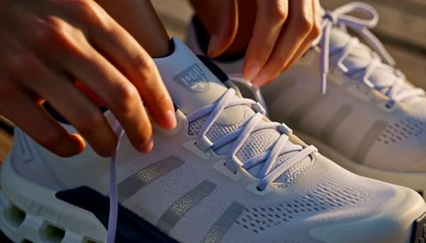</a>

The prompt is split into five timed shots, each with its own action, camera move and light, which keeps a 15 second clip readable. Naming concrete product features such as the Cloudtec pods and navy heel collar gives the model details to hold the shoe consistent across cuts.

MiniMax H3 · Text-to-video · Source: [@Zyrellix on X](https://x.com/Zyrellix/status/2102611185472614491) · 157 likes on 2026-10-29

[`product-commercial`](tags.md#tag-product-commercial) [`running-shoes`](tags.md#tag-running-shoes) [`golden-light`](tags.md#tag-golden-light) [`multi-shot`](tags.md#tag-multi-shot)

<details><summary><b>Prompt</b></summary>

```text
Cinematic 15-second luxury running-shoe commercial, golden-hour photorealism, 24fps, shallow depth of field, warm sunset color grade.
Shot 1 (0–3s): Extreme close-up of a woman’s hands tying white On Cloud running shoes with visible Cloudtec pods on the midsole. Soft golden sunlight, wooden boardwalk texture, navy heel collar, mesh upper. Slow, tactile motion. Whispered VO: “This is how it feels.”
Shot 2 (3–7s): Medium-wide tracking shot of an athletic woman with dark ponytail, black tank and navy tights, running left-to-right on a wooden waterfront promenade. Background: steel arch bridge and Manhattan-style skyline at sunset, river reflecting orange and pink light. Fluid, powerful stride, slight motion blur on hair and shoes.
Shot 3 (7–10s): Front-on tracking shot as she runs toward camera through a long, repeating concrete arched underpass. Strong side lighting creates rhythmic stripes of light and shadow across the floor. Determined expression, ponytail swinging.
Shot 4 (10–13s): Tight facial close-up, golden rim light on cheekbones and hair, focused green-brown eyes, slight sheen of sweat, black tank straps visible. Subtle camera push-in.
Shot 5 (13–15s): Hero product shot — the same white On Cloud shoe floating and slowly rotating in mid-air against a blurred sunset city skyline. Cloudtec pods catch the light. Clean, premium, almost weightless.
```

</details>

<a id="kling-gala-steps-couture-flash-sequence"></a>
### Couture gown arrival on gala steps among photographers

<a href="https://x.com/Diplomeme/status/2090136981112250653"></a>

The prompt splits a 15 second timeline into eight timed shots, each with its own camera move: tracking, macro, whip pan, high angle wide. It also fixes one grade (deep shadows, cold teals) and ends on a hard cut to black with fading flashes.

Kling 3.0 · Text-to-video · Source: [@Diplomeme on X](https://x.com/Diplomeme/status/2090136981112250653) · 152 likes on 2026-10-28

[`fashion`](tags.md#tag-fashion) [`multi-shot`](tags.md#tag-multi-shot) [`timed-shots`](tags.md#tag-timed-shots) [`cinematic`](tags.md#tag-cinematic) [`paparazzi`](tags.md#tag-paparazzi)

<details><summary><b>Prompt</b></summary>

```text
Met gala inspired 15 seconds scene.

Try it with prompt : High-octane, hyper-realistic fashion sequence in the style of Christopher Nolan, shot on actual 70mm IMAX cameras at the Met Gala. Fast-paced multi-shot editing with quick, cinematic cuts timed at exactly one shot every 2 seconds across a complete 15-second timeline. A striking young woman in an haute couture gown arrives at the Met Gala surrounded by photographers and camera flashes. High-contrast Nolan-esque color grading with deep shadows, cold teals, and bright highlights. Blinding bursts of paparazzi flashes pierce the night, reflecting across the gown and marble steps. Rapid sequence of intense cuts:
•Shot 1 (0-2s): Eye-level tracking shot of the woman ascending the Met Gala steps as photographers surround her.
•Shot 2 (2-4s): Tight, detailed close-up of her face, makeup, jewelry, and camera flashes reflecting in her eyes.
•Shot 3 (4-6s): Low-angle handheld camera whip-panning upward from the flowing couture gown to her silhouette against the illuminated museum facade.
•Shot 4 (6-8s): Ground-level macro shot of intricate fabric, embroidery, gemstones, and couture details moving naturally.
•Shot 5 (8-10s): Fast tracking shot behind the woman as she turns dramatically toward photographers, her gown sweeping through the air.
•Shot 6 (10-12s): High-angle wide shot of the Met Gala staircase, crowd, photographers, celebrities, and the woman commanding center frame.
•Shot 7 (12-14s): Shaky handheld tracking shot following her final dramatic pose as camera flashes erupt around her.
•Shot 8 (14-15s): Hard cut to black with a lingering burst of camera flashes fading into darkness.
Raw documentary-style camera textures, organic lens flares, lifelike physics, authentic fashion motion blur, realistic skin texture, natural crowd movement, and a glamorous sense of celebrity spectacle. Ultra-detailed, 4k resolution.
```

</details>

<a id="h3-oreo-twist-cream-macro-commercial"></a>
### Oreo cookie twist with cream and crumbs

<a href="https://x.com/itxabdullaa/status/2097647954354160120">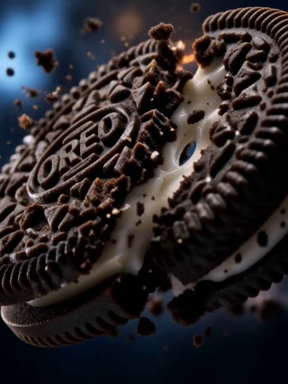</a>

The prompt splits 15 seconds into named beats such as ALMOST TWIST, REWIND and TENSION, so the model gets a shot-by-shot script in one clip. Each beat pairs a camera move with a material cue like stretching cream or suspended crumbs, which keeps the macro look concrete.

MiniMax H3 · Text-to-video · Source: [@itxabdullaa on X](https://x.com/itxabdullaa/status/2097647954354160120) · 145 likes on 2026-10-29 · found via [SkyNotSilent/awesome-MiniMax-H3-cases](https://github.com/SkyNotSilent/awesome-MiniMax-H3-cases)

[`food-commercial`](tags.md#tag-food-commercial) [`macro`](tags.md#tag-macro) [`slow motion`](tags.md#tag-slowmotion) [`brand-ad`](tags.md#tag-brand-ad)

<details><summary><b>Prompt</b></summary>

```text
A premium 15-second 3:4 vertical commercial for OREO blending cinematic blockbuster action with extreme macro food photography. Hyper-realistic 8K, 120fps slow-motion, anamorphic lens flares, dynamic camera movements.

ALMOST TWIST: Extreme macro shot of an OREO cookie twisting at the climax of separation, the dark chocolate cookie surface micro-cracking, creamy vanilla filling stretching between both halves, tiny cookie particles suspended in mid-air.

REWIND: Time reverses instantly with a kinetic motion-blur rewind effect; crumbs fly back, cream reconnects, cracks seal, time resets.

COOKIE: Macro tracking shot diving across the razor-sharp ridges and embossed OREO pattern, pristine baked texture, rich cocoa tones, microscopic crumbs vibrating along the edges.

CREAM: A silky wave of brilliant white vanilla cream spreads dramatically between the two chocolate cookie halves in extreme slow-motion, smooth realistic food physics, glossy creamy texture contrasting against the dark cookie.

EMBOSSING:Camera sweeps vertically as the iconic OREO embossed logo and decorative pattern emerge in perfect detail across the chocolate cookie surface, dramatic highlights revealing every texture.

HERO:Low-angle cinematic hero shot of an iconic OREO package opening smoothly, revealing pristine OREO cookies glowing under dramatic studio lighting, rich blue packaging illuminated by cinematic rim light.

TENSION: Macro split-screen tension; hands holding the OREO cookie from both sides, extreme close-up on the cream stretching under rising twisting force, low-frequency sound rumble building anticipation.

 TWIST & PAYOFF: Iconic clean twist in ultra slow-motion, the cookie halves separating perfectly with a satisfying creamy stretch and crisp sound payoff, ending on a pristine hero product shot with bold text "TWIST, LICK, DUNK." Cinematic lighting, volumetric fog, photorealistic, 8K resolution, premium commercial aesthetic, 3:4 aspect ratio.
```

</details>

<a id="kling4-perfume-bottle-loop-ramp"></a>
### A perfume bottle drives a loop ramp and blasts off

<a href="https://x.com/AIWithRay/status/2114672427964010805"></a>

A product spot played as a stunt show, timed in two-second beats, with an unlabeled bottle so no brand gets in the way.

Kling 4.0 · Text-to-video · Source: [@AIWithRay on X](https://x.com/AIWithRay/status/2114672427964010805) · 142 likes on 2026-10-28

[`product-commercial`](tags.md#tag-product-commercial) [`surreal`](tags.md#tag-surreal) [`timed-beats`](tags.md#tag-timed-beats) [`vfx`](tags.md#tag-vfx) [`luxury`](tags.md#tag-luxury)

<details><summary><b>Prompt</b></summary>

```text
Cinematic, photoreal night scene on a black stage inside a giant hangar. A towering concrete loop ramp/road with glowing red edge lights and a white center stripe dominates the background. In front of it stands a premium transparent glass perfume bottle, unlabeled, no logo, filled with pale golden fragrance, featuring elegant beveled edges, a polished metallic cap, realistic glass refraction, crisp reflections, and subtle condensation droplets. The bottle engages four small rocket nozzles under its base; soft white exhaust with bright orange cores appears. The bottle glides forward, then blasts up the glowing ramp, hugging the curve, leaving faint light trails and red neon reflections across its glass surface. At the apex it shoots off the ramp and transitions to a sleek electric-thruster flight, like a futuristic luxury flying car, then ends in a close hero shot of the perfume bottle hovering and roaring upward vertically with four bright jets, volumetric spotlights and fog below, sparks and vapor interaction, dramatic rim light, golden highlights, crisp reflections, shallow depth of field, 4K, high-end luxury perfume and car commercial look. No text, no brand, no label. Duration 9–10 seconds. Aspect ratio 9:16. Negative cues: no logos, no text, no labels, no hands, no spillage, no deformation, no duplicate bottles, no cartoon look, no melting glass, no detached cap, no liquid leakage, no extreme motion-blur smears. Beat sheet (timing guide) 0–2s: Low-angle push-in on the massive loop ramp; perfume bottle centered, engines arming beneath the base with subtle heat shimmer and glowing orange cores. 2–6s: Dynamic follow-cam as the bottle rockets up the ramp; speed ramping, neon edge lights streaking, dramatic red reflections sliding across the glass. 6–8s: Bottle leaves the ramp, switches to electric thrusters; quick cinematic orbit as it hovers midair, revealing the golden fragrance and metallic cap. 8–10s: Tight hero shot of the perfume bottle ascending vertically with four bright jets, swirling fog, volumetric spotlights, realistic vapor, and luxurious golden reflections. End with the bottle sharply focused and centered against the dark hangar.
```

</details>

<a id="omni-louis-vuitton-neverfull-atelier-morph"></a>
### Monogram canvas and brass parts on atelier workbench

<a href="https://x.com/MrDasCreates/status/2095861297288188282"></a>

A timed beat sheet gives each phase its own action, and a single continuous shot rule with a lens change at the product reveal keeps the assembly from cutting away. Each material collision has a matching sound cue, so the audio locks in with the visual snap-together.

Gemini Omni Flash · Text-to-video · Source: [@MrDasCreates on X](https://x.com/MrDasCreates/status/2095861297288188282) · 139 likes on 2026-10-29

[`product-reveal`](tags.md#tag-product-reveal) [`luxury-fashion`](tags.md#tag-luxury-fashion) [`morph-transition`](tags.md#tag-morph-transition) [`single-shot`](tags.md#tag-single-shot)

<details><summary><b>Prompt</b></summary>

```text
{
  "model": "gemini-omni-1.1-flash",
  "duration": "10s",
  "aspect_ratio": "16:9",
  "shot": {
    "structure": "single continuous unbroken shot, no scene cuts",
    "composition": "starts wide on a refined Parisian leather atelier workbench, follows individual canvas panels, leather straps, and gold hardware rising and interlocking, ends on a centered floating Louis Vuitton Neverfull close-up",
    "lens": "50mm for the workshop environment, then 85mm for the product reveal",
    "frame_rate": "24fps cinematic",
    "camera_movement": "slow push-in across the bench following the rising materials, then a gentle orbital arc as they lock into the bag, hold steady on the hovering tote"
  },
  "timeline": {
    "0-3s": "Warm-lit luxury leather workshop at dusk. Polished oak workbench scattered with monogram canvas sheets, vachetta leather straps, gold-tone hardware, and brass locks. Soft tungsten lamps, leather tools, faint dust motes in the air.",
    "3-7s": "Dozens of precision canvas panels, leather pieces, stitching threads, and gold hardware lift from the bench and rotate in elegant, structured orbits. They snap together mid-air with soft leather and metallic clicks into the exact silhouette of a Louis Vuitton Neverfull. Subtle gold reflections and micro-spark highlights on polished surfaces.",
    "7-10s": "The assembled form pulses once and materializes into a real Louis Vuitton Neverfull with monogram canvas, natural vachetta handles, and gold hardware, hovering weightlessly. The bag settles with a gentle leather creak. Warm rim light and faint workshop haze."
  },
  "subject": {
    "description": "dozens of luxury bag components rising and interlocking in elegant structured orbits to form a classic tote silhouette",
    "props": "final Louis Vuitton Neverfull formed from swirling canvas and leather parts, then transitioning into the real branded bag while hovering mid-air"
  },
  "scene": {
    "location": "traditional Parisian leather atelier with wooden workbench",
    "time_of_day": "early evening dusk, warm tungsten glow, lingering workshop atmosphere",
    "environment": "quiet precision workshop, scattered tools, leather mats, gold hardware, canvas offcuts"
  },
  "visual_details": {
    "action": "parts lift, rotate in organized mechanical paths, lock into bag outline, pulse, then morph into finished Louis Vuitton Neverfull suspended in space",
    "special_effects": "micro-fiber canvas animation, slow-motion gold reflections, mid-air material morph, subtle levitation shimmer and dust trails"
  },
  "cinematography": {
    "lighting": "warm directional tungsten light, gleaming gold hardware highlights, soft amber rim light on the floating bag",
    "color_palette": "rich walnut browns, monogram golds, natural vachetta tans, warm ambers",
    "tone": "precise, heritage luxury, quiet mastery"
  },
  "audio": {
    "music": "subtle orchestral strings with delicate piano and faint leather-texture motifs",
    "ambient": "distant workshop hush, occasional tool clink, evening stillness",
    "sound_effects": "soft canvas rustle and leather snaps as parts lock, precision click when the form completes, faint mechanical hum under levitation",
    "mix": "intimate, refined, workshop-forward with a clean musical center"
  },
  "constraints": {
    "dialogue": "none",
    "voiceover": "none",
    "on_screen_text": "none",
    "captions": "none",
    "subtitles": false
  }
}
```

</details>

<a id="h3-kinetic-kanji-motion-graphics-street-dancer-cm"></a>
### Kinetic kanji motion graphics ad with street dancer

<a href="https://x.com/tanabe_fragm/status/2090306302966919515"></a>

A global style paragraph locks a four color palette and a fixed character design. Thirteen timestamped shots then each give a graphic action, a character action and a camera move with amplitude and speed, closing on a static identity card.

MiniMax H3 · Text-to-video · Source: [@tanabe_fragm on X](https://x.com/tanabe_fragm/status/2090306302966919515) · 132 likes on 2026-10-28 · found via [SkyNotSilent/awesome-MiniMax-H3-cases](https://github.com/SkyNotSilent/awesome-MiniMax-H3-cases)

[`motion-graphics`](tags.md#tag-motion-graphics) [`typography`](tags.md#tag-typography) [`anime`](tags.md#tag-anime) [`commercial`](tags.md#tag-commercial) [`multi-shot`](tags.md#tag-multi-shot)

<details><summary><b>Prompt</b></summary>

```text
----------------------
integrated_multimodal_description:
2D-animated, a bold graphic-design motion-graphics commercial in 16:9 with exactly 13
distinct cuts at 24fps. This film is 85% kinetic graphic design and 15% character action:
giant kinetic Japanese typography, hard-edged flat shapes, split screens, halftone, speed
lines, torn-paper reveals and shutter flashes. Palette, strictly four colors: fluorescent
orange, deep black, off-white, silver grey. The recurring character is a young anime street
dancer with a black chin-length bob and blunt bangs, sharp confident eyes, an oversized
off-white track jacket with fluorescent-orange sleeve stripes, black cargo shorts, and
chunky white sneakers with fluorescent-orange lines. Preserve her exact face, proportions,
hairstyle, outfit, materials and colors throughout; never redesign her. Every graphic
element moves fast and snaps hard on the beat.

[Shot 1] On a deep black field, a massive off-white circle slams into frame left of center,
then two fluorescent-orange bars wipe across the upper and lower thirds, then the Japanese
kanji "烈" builds itself stroke by stroke in off-white at the center until it is complete.
The camera shakes slightly with small amplitude at fast speed on each impact.

[Shot 2] At 00:01.000, the camera cuts to an off-white field where four black squares
rotate into the center one at a time. The largest square opens as a porthole revealing an
extreme close-up of the dancer's ice-sharp eye glancing up, then a red-and-cyan split flash
tears across the edges and the squares shatter into flat shards. The camera pushes in with
small amplitude at fast speed.

[Shot 3] At 00:02.000, the camera cuts to an off-white field filled by an enormous black
kanji "烈". The dancer sprints in from frame left, power-slides along the baseline of the
typography, and fluorescent-orange ink splatter trails behind her as speed lines streak
past. The camera trucks left with large amplitude at fast speed. The kanji stays fully
readable before she crosses in front of it.

[Shot 4] At 00:03.100, the camera cuts to a vertical triptych of fluorescent-orange, deep
black and off-white panels. Her flat silhouette appears in each panel in stroboscopic
freeze, one after another — takeoff, mid-air tuck, landing — while giant vertical silver
text "全速" scrolls upward behind the panels. Static shot.

[Shot 5] At 00:04.000, the camera cuts to a black field where a giant tilted ring of
fluorescent-orange Japanese characters reading "止マルナ" rotates. The dancer leaps through
the center of the ring, spins once in mid-air, and the characters break off and scatter
outward as flat shards. The camera arcs with large amplitude at fast speed, then snap-zooms
onto her confident face.

[Shot 6] At 00:05.100, the camera cuts to a clean off-white editorial card holding a huge
black kanji "跳" with one orange diagonal slash. She vaults over the word itself, plants her
palm on its left radical, the character compresses like a spring under her hand, then
rebounds as her legs whip across the frame. Static shot.

[Shot 7] At 00:06.000, the camera cuts to a full fluorescent-orange field crossed by one
thick black diagonal stripe. She back-flips along the stripe in three stroboscopic ghost
frames tinted black, off-white and silver grey, while a large outlined kanji "回" rotates
180 degrees in sync with her rotation. The camera rolls clockwise with small amplitude at
fast speed.

[Shot 8] At 00:07.000, the camera cuts to an off-white field with a hard black band. Four
bold black kanji slam in one at a time at different scales and angles — "速", then "鋭",
then "静", then "烈" — each landing with a white shutter flash and an orange impact mark,
while she slides on her knees across the foreground, jacket flaring. The camera shakes
slightly with small amplitude at fast speed.

[Shot 9] At 00:08.000, the camera cuts to a black frame where a white wireframe grid tilts
away in 3D. She runs up the grid like a wall, kicks off it, and hangs frozen in mid-air as
a fluorescent-orange circle stamps around her pose like a target lock with silver UI
brackets and tick marks. The camera tilts up with small amplitude at slow speed.

[Shot 10] At 00:09.000, the freeze releases and the camera cuts to layered flat-color panes
stacked toward the lens. She dives straight at the camera, the panes tear open one at a
time like thick paper, and each tear reveals a larger portion of the black kanji "烈"
behind, before her sneaker wipes across the foreground. The camera pulls out with large
amplitude at fast speed.

[Shot 11] At 00:10.100, the camera cuts to a rapid-fire montage of four full-screen graphic
posters of her in different action poses — mid-flip, sliding, landing, hands in pockets —
snapping past with hard cuts, each with an oversized silver number 01 to 04, a black
barcode strip and thick diagonal slashes. Static shot.

[Shot 12] At 00:11.100, the camera cuts to a clean off-white cyclorama for the hero moment.
She lands a final backflip dead center in slow motion, straightens with both hands in her
pockets, and a shockwave of concentric fluorescent-orange rings blasts outward from her feet
carrying shattered fragments of the kanji "烈" with it, then the frame overexposes toward
white. The camera pushes in with small amplitude at slow speed.

[Shot 13] At 00:13.000, the camera cuts to the final identity card on a pale off-white
field. An enormous black kanji "烈" dominates the frame with translucent orange rings and
thin technical arcs behind it, the silver-grey word "RETSU" sits directly beneath the kanji,
and she stands relaxed at the lower center overlapping the bottom of the strokes with her
jacket rippling. One thin orange pulse sweeps horizontally through the typography and holds
cleanly until exactly 15.000 seconds. Static shot.

Editing: extremely aggressive rhythm — hard cuts on every beat, graphic matches, whip pans,
snap zooms, stroboscopic freezes, foreground wipes, split flashes and impact shakes. Every
cut must feel compositionally different. All Japanese typography is always fully readable
before the character overlaps it. No weapons, no combat, no fire, no explosions; all energy
comes from motion design, ink, torn paper, wind and her street-dance athleticism. No
photorealism, no 3D rendering, no gradients, no browser interface, no player controls, no
subtitles, no captions, and no text other than the Japanese characters named above.
Exactly 13 cuts.

overall_soundscape:
Sneaker impacts, knee slides and landings hit hard against a clean room tone. Ink splatters
burst, thick paper tears open, and flat panels shatter like glass. Sharp whooshes carry the
color wipes and typography slams, with small shutter clicks on each flash. No dialogue.

non_diegetic_music:
An original 15-second drum-heavy breakbeat with a deep sub bass, hard snare hits, risers and
glitch fills locked to every cut. Begin with a single impact, build tightly through the
middle, peak at the landing at 00:11.100, and end with a cold electronic logo sting that
resolves at 15.000 seconds.
```

</details>

<a id="h3-skate-streetball-coke-nyc-ugc"></a>
### Skater opens iced Coke, then courtside pass

<a href="https://x.com/yourPlugAI/status/2114648191878471720">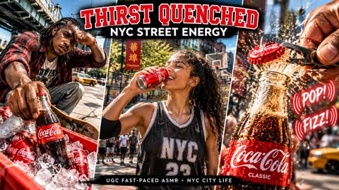</a>

Timed beats of 0 to 5, 5 to 10 and 10 to 15 seconds each give visual, action and sound lines, which keeps the sequence in order. Named reference sheets for characters and product hold consistency, and the sound list (cap SNAP, FIZZ rush, ice crunch) drives the ASMR feel.

MiniMax H3 · Reference-to-video · Source: [@yourPlugAI on X](https://x.com/yourPlugAI/status/2114648191878471720) · 130 likes on 2026-10-29

[`skateboarding`](tags.md#tag-skateboarding) [`streetball`](tags.md#tag-streetball) [`asmr`](tags.md#tag-asmr) [`product-ad`](tags.md#tag-product-ad)

<details><summary><b>Prompt</b></summary>

```text
Skate, streetball, and an ice-cold Coke. Pure NYC energy in 30 seconds.

@Hailuo_AI


✨Generated with GPT Image 2.5 + Minimax H3 on Minimax Design—combining handheld street documentary edits with heavy tactile ASMR.

✨FULL prompt breakdown and character sheets attached below👇🏾

#MinimaxH3 #MinimaxDesign

Phase 1: 00:00 to 00:15 (The Build-Up & Court-Side Pass)

[ENGINE DIRECTIVE]
Generate a continuous 15-second high-speed NYC Coca-Cola thirst-quencher UGC sequence at 60fps in 16:9 widescreen format using MinimaxH3. Style: Hand-held, fast-paced street documentary, 8K resolution, authentic cinematic handheld camera movement with rapid micro-pans, zooms, and seamless tracking cuts. Maintain 100% strict visual consistency with provided reference sheets: "Marcus, Maya, and NYC Street Crowd", "Coca-Cola Classic", and "NYC Streets & Chinatown Courts". Capture realistic sweat, intense outdoor daylight, massive crowd movements, rapid shutter speed, high action, zero visual artifacts, and heavy fluid dynamics.

[AUDIO DIRECTIVE]
- MUSIC: High-tempo, rhythmic hip-hop breakbeat with heavy street drums and ambient NYC chatter.
- SOUND DESIGN: Skateboards grinding, heavy panting, ice crunching, metallic cap-popper SNAP, pressurized carbonation FIZZ-RUSH, crowd cheers, basketball bouncing, and shoe squeaks.

[TIMELINE BREAKDOWN]

00:00 - 00:05 | THE SKATE GRIND & COLD REACH
- VISUAL: Hand-held low-angle tracking shot following Marcus as he lands a skate trick on a busy NYC plaza, then skids to a halt, panting and wiping sweat from his forehead. Camera whip-pans to a red cooler on a bench.
- ACTION: Marcus skates, stops, and reaches into a heavily ice-filled red cooler, grabbing a condensation-covered Coca-Cola glass bottle.
- SOUND: Skate wheels grinding on concrete, heavy panting, urban chatter, ice crunching, and hand rustling through deep ice.

00:05 - 00:10 | THE CAP POP & FLYING DROPLETS
- VISUAL: Whip-pan into an extreme macro close-up of Marcus’s hand gripping the glass bottle.
- ACTION: He uses a handheld bottle opener to pop the cap. High-speed (60fps) capture of pressurized mist, fizz, and water droplets spraying outward in the sunlight.
- SOUND: Sharp, loud metallic cap-popper SNAP, aggressive bubbling FIZZ-RUSH, background street chatter.

00:10 - 00:15 | COURT-SIDE PASS & TENSION HOLD
- VISUAL: Fast whip-cut tracking camera movement through a chain-link fence onto a Chinatown basketball court.
- ACTION: Marcus passes an ice-cold Coca-Cola can to Maya, who catches it seamlessly in motion and presses the frosty can against her sweating temple, setting up Phase 2.
- SOUND: Crowd cheers, basketball bounce, shoe squeaks on concrete, can sliding through air, and Maya’s quick gasp of relief.
```

</details>

<a id="h3-nova-x1-lens-luxury-commercial"></a>
### NOVA X1 lens on glossy pedestal with blue light

<a href="https://x.com/AmControo/status/2085366255540637965">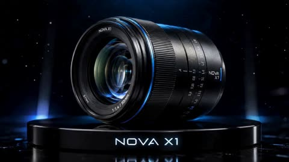</a>

Uploading the product photo as the reference and asking for it to be used exactly as provided locks the design. A five-scene list where each beat pairs one camera move with one line of on screen text gives the model a clear shot by shot structure.

MiniMax H3 · Image-to-video · Source: [@AmControo on X](https://x.com/AmControo/status/2085366255540637965) · 129 likes on 2026-10-29

[`product-commercial`](tags.md#tag-product-commercial) [`reference-image`](tags.md#tag-reference-image) [`macro`](tags.md#tag-macro) [`luxury`](tags.md#tag-luxury)

<details><summary><b>Prompt</b></summary>

```text
Use the uploaded reference image exactly as provided.

Create a 15-second ultra-realistic luxury technology commercial.

Maintain perfect consistency for the lens body, engraved details, focus ring, aperture blades, reflections, glass elements, lighting, shadows, and metallic textures throughout the entire video.

Style: premium technology advertisement, ultra-realistic product photography, cinematic lighting, realistic reflections, dramatic shadows, macro photography, luxury commercial style, photorealistic rendering.

The on-screen text should appear in a clean, modern, minimalist font.

────────────────────────

SCENE 1

The NOVA X1 lens rests on a glossy black pedestal.

Blue light slowly travels across the metal body and the front glass element.

The camera performs a slow orbital movement around the lens.

Tiny dust particles float through the air.

On-screen text:

NOVA X1

CRAFTED FOR CREATORS

────────────────────────

SCENE 2

The camera moves closer.

The focus ring rotates slowly.

The aperture blades gradually open and close.

Reflections move naturally across the glass surface.

On-screen text:

PRECISION ENGINEERED

────────────────────────

SCENE 3

The lens rises into the air.

Internal glass elements, metallic rings, screws, sensors, and aperture blades separate naturally into an exploded-view animation.

Blue energy pulses move through the structure.

The camera circles around the floating components.

On-screen text:

UNMATCHED CLARITY

────────────────────────

SCENE 4

All components slowly return to their original positions.

The aperture blades rotate smoothly and lock into place.

Blue light radiates outward from the centre of the lens.

The camera performs a close-up orbital movement around the front element.

On-screen text:

BUILT FOR THE EXTRAORDINARY

────────────────────────

SCENE 5

The lens settles gently onto the pedestal.

Studio lights illuminate the metal body and the glass surface.

The camera slowly zooms toward the front element.

End with an ultra-realistic hero shot.

On-screen text:

NOVA X1

SEE BEYOND
```

</details>

<a id="veo-alphonso-mango-gelato-churn"></a>
### Alphonso Mango Gelato From Slice to Scoop

<a href="https://x.com/Fujimoto_hina/status/2102063087251853337"></a>

The prompt chains four macro stages (slice, zero-gravity vortex, churning cylinder, final scoop) into one continuous 10 second move. Separate fields for style, camera, lighting and a negative prompt keep the look consistent from stage to stage.

Veo 3.1 · Text-to-video · Source: [@Fujimoto_hina on X](https://x.com/Fujimoto_hina/status/2102063087251853337) · 129 likes on 2026-10-28

[`food`](tags.md#tag-food) [`macro`](tags.md#tag-macro) [`commercial`](tags.md#tag-commercial) [`slow-motion`](tags.md#tag-slow-motion) [`json-prompt`](tags.md#tag-json-prompt)

<details><summary><b>Prompt</b></summary>

```text
{
  "title": "Golden Churn: The Artisanal Alphonso",
  "duration": "10 seconds",
  "format": "16:9, 4K",
  "style": "Cinematic photorealistic artisanal culinary commercial",
  "prompt": "Create a seamless 10-second cinematic journey tracing the creation of decadent churned Alphonso mango gelato. Begin with a sun-ripened, honey-glazed mango sliced on chilled dark slate, releasing golden nectar droplets and delicate fibrous fruit mist into the air. Transition into a dynamic zero-gravity vortex where velvety sweet cream, crushed cardamom pods, and rich saffron-gold mango pulp collide and swirl together in mid-air ribbons. Move directly into the churning cylinder where sub-zero brass paddles whip the mixture, rapidly crystallizing into dense, glossy, ribboned ice cream with frost vapors swirling outward. Finish with an ultra-macro 1000fps ice cream scoop gliding through the dense mass, rolling up a perfect textured sphere with visible ripe mango chunks, delicate frost crystals, glistening condensation, and a single cascading thread of thick mango reduction.",
  "visual_style": "Extreme macro, ultra-shallow depth of field, authentic churning physics, realistic thermodynamic frost and vapor, deep saffron-gold and rich ivory palette with dark slate contrast",
  "camera": "Continuous kinetic macro push-in, seamless fluid-vortex tumble, rotational cylinder tracking, and ultra-high-speed slow-motion curl reveal",
  "lighting": "Warm golden-hour rim lighting transitioning into cool cryogenic frosty blues, balanced by crisp studio highlights on glossy fruit surfaces",
  "negative_prompt": "text, watermark, logo, subtitles, cartoon, artificial neon yellow, icy melting mush, plastic texture, dry powder, low resolution, flat lighting, jump cuts, jerky camera movement, grainy footage"
}
```

</details>

<a id="omni-invisible-fitting-room-mannequin"></a>
### Mannequin dressed by invisible hands in four outfits

<a href="https://x.com/KrevixAi/status/2101361197400387598"></a>

A locked frontal camera and a timed breakdown by second give each outfit its own beat. Explicit bans on magic, glow and morphing keep the cloth physics real. The ending, where a jacket covers the lens and cuts to black, closes the loop.

Gemini Omni Flash · Image-to-video · Source: [@KrevixAi on X](https://x.com/KrevixAi/status/2101361197400387598) · 127 likes on 2026-10-28

[`fashion`](tags.md#tag-fashion) [`mannequin`](tags.md#tag-mannequin) [`cloth-physics`](tags.md#tag-cloth-physics) [`storyboard`](tags.md#tag-storyboard) [`vertical`](tags.md#tag-vertical)

<details><summary><b>Prompt</b></summary>

```text
Create a 10-second ultra-photorealistic premium fashion video “INVISIBLE FITTING ROOM”, 9:16. One locked frontal camera, black seamless studio. Same tall muscular matte-white faceless male mannequin centered full-body, initially wearing only fitted black shorts. Female hands in long matte-black gloves remotely dress him without touching. No magic, glow, portals, particles or morphing; realistic cloth physics, gravity and inertia. 0–2s: espresso oversized shirt + caramel wide trousers + brown loafers fly in and physically dress him; mannequin strikes an editorial pose, then one sharp hand swipe pulls the outfit off and it falls to the floor. 2–4s: cognac leather jacket + cream knit + dark-chocolate trousers + boots fly in; mannequin takes a strong pose, then both hands pull the outfit away and garments fall beside the first look. 4–6s: cream turtleneck + coffee trousers + long mocha coat assemble onto him; coat rotates naturally around his body, he poses, then a wide swipe removes everything onto the growing clothing pile. 6–8.5s: final luxury outfit assembles layer by layer: ivory silk shirt, espresso tailored trousers, burnt-orange waistcoat, long dark-chocolate jacket, cognac shoes, tie and gold brooch. Precise hand gestures remotely tailor waist, shoulders, lapels and cuffs with realistic fabric tension. 8.5–9.2s: mannequin holds a powerful final fashion pose surrounded by discarded clothes. 9.2–10s: female hand reaches forward; mannequin physically takes her hand and walks confidently toward the fixed camera until his jacket naturally covers the lens → black. Premium coffee palette, burnt-orange accent, cinematic rim lighting, realistic silk, leather, cashmere and wool, seamless continuity.
```

</details>

<a id="h3-black-adjustable-dumbbells-luxury-gym-ad"></a>
### Black adjustable dumbbells in a luxury gym

<a href="https://x.com/laviniavelle/status/2114952308094374334">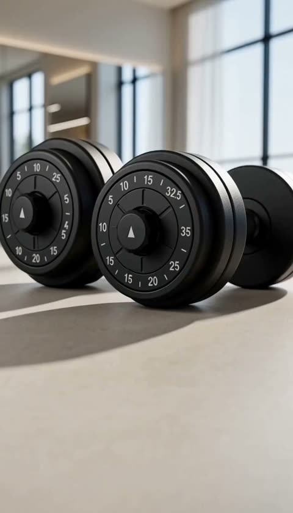</a>

Timed shots run from a low close-up on the dials to a macro pass over the selector and a pullback to a wide hero frame, so camera moves do the editing. A list of product details to preserve plus studio lighting terms keeps the design fixed while the look stays premium.

MiniMax H3 · Text-to-video · Source: [@laviniavelle on X](https://x.com/laviniavelle/status/2114952308094374334) · 126 likes on 2026-10-29

[`fitness`](tags.md#tag-fitness) [`product-ad`](tags.md#tag-product-ad) [`macro`](tags.md#tag-macro) [`multi-shot`](tags.md#tag-multi-shot)

<details><summary><b>Prompt</b></summary>

```text
Create an ultra-realistic, premium fitness product advertisement featuring black adjustable dumbbells in a modern luxury gym. Preserve the original dumbbell design, weight markings, circular adjustment dials, black textured handles, and proportions. Use elegant natural sunlight, cinematic shadows, shallow depth of field, and high-end product photography.

Scene 1 (0–3s): Show black adjustable dumbbells resting on a smooth gym floor near large floor to ceiling windows Start with a low angle close up and slowly push the camera toward the weight adjustment dials, highlighting the precise markings and premium finish.

Scene 2 (3–6s): Transition into an extreme macro shot of the dumbbell's circular weight selector and textured black handle. Capture the fine surface details, subtle reflections, and realistic material textures with smooth cinematic camera movement.

Scene 3 (6–8s): Slowly pull the camera back to reveal the complete pair of adjustable dumbbells. Warm sunlight streams through the windows, creating long, elegant shadows across the floor.

Scene 4 (8–10s): Finish with a wide, polished hero shot of the dumbbells centered in the luxurious minimalist gym. Use a smooth camera pullback, balanced composition, premium lighting, and a sophisticated fitness-commercial aesthetic.

Visual Style: Photorealistic, 4K quality, vertical  aspect ratio, smooth camera movements, realistic shadows, natural lighting, crisp product details, premium commercial cinematography, professional color grading.
```

</details>

<a id="h3-streetwear-character-graphic-trailer"></a>
### Teal checker slam and pink wipes open the trailer

<a href="https://x.com/sipteaandcoffee/status/2094068060059799762">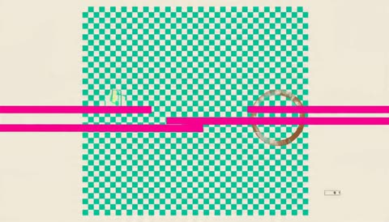</a>

A reference still with a CHARACTER LOCK block fixes the design, and the palette plus 13 timed cuts keep the character consistent across shots. The film is mostly graphic motion, with each cut given its own composition so the typography stays readable before the character enters the frame.

MiniMax H3 · Reference-to-video · Source: [@sipteaandcoffee on X](https://x.com/sipteaandcoffee/status/2094068060059799762) · 126 likes on 2026-10-29

[`motion-graphics`](tags.md#tag-motion-graphics) [`streetwear`](tags.md#tag-streetwear) [`character-lock`](tags.md#tag-character-lock) [`typography`](tags.md#tag-typography) [`trailer`](tags.md#tag-trailer)

<details><summary><b>Prompt</b></summary>

```text
CHARACTER LOCK (do not redesign): Use the exact figure from the reference still. Cool, composed cartoon streetwear character with vivid blue skin, short black hair with messy bangs, orange knit beanie, oversized cream hoodie with a pink inner hood and large pink polka dots on the sleeves, small orange square chest mark, black crossbody sling bag with a white logo, holding a paper coffee cup marked CAF, teal-and-cream checkerboard baggy pants with a small black BIG tag on the lower left leg, light-blue socks, chunky orange-black-white sneakers with pink laces. Preserve exact face, proportions, hairstyle, outfit, materials, accessories, and colors in every frame. Never change gender, silhouette, palette, or branding.
This film is 80% bold graphic design in motion and 20% character action: giant kinetic typography, hard-edged shapes, split-screens, flat color fields, checker tiles, coffee-ring stamps, city-grid overlays, UI ticks, halftone, speed lines, and shutter flashes. Palette: cream, hot pink, teal, orange, cobalt-blue skin, black, white. Style: premium AAA motion-graphics title sequence × streetwear campaign film × NYC block energy. Every graphic element moves fast and snaps hard on the beat.
CUT 01 | 0.00–1.00s — Pure graphics: a massive teal checker square slams onto a cream field, two hot-pink bars wipe across, tiny UI ticks and a coffee-ring stamp flicker; the letters B and I and G punch in one after another with heavy impact shake.
CUT 02 | 1.00–2.00s — The G becomes a circular stamp: extreme close-up of the character’s eye inside it, glancing sideways; RGB split flash, then the stamp shatters into flat pink and teal shards.
CUT 03 | 2.00–3.10s — Black frame with an enormous cream BIG; the character walks in from frame left holding the CAF cup, then power-slides across the baseline of the typography, speed lines and pink-dot trails kicking letter shards like sparks. Whip-pan out.
CUT 04 | 3.10–4.00s — Split-screen triptych of flat cream / teal / hot-pink panels; in each panel the silhouette performs a different freeze: stride, cup-raise, look-back. Huge vertical text BLOCK MODE scrolls behind the panels.
CUT 05 | 4.00–5.10s — The character steps through a giant rotating ring of typography reading CITY WALK NO CLOCK; camera tracks a mid-stride turn in slow motion as the letters scatter, then snap-zoom on the composed face.
CUT 06 | 5.10–6.00s — Hard cut: cream editorial card, huge black SIP with an orange slash; the character vaults the word, cup planted on the S, legs whipping across frame; the word compresses like a spring under the cup and rebounds.
CUT 07 | 6.00–7.00s — Hot-pink field with a teal diagonal checker stripe; the character spin-turns along the stripe in three stroboscopic ghost frames, each ghost tinted cream / teal / orange; giant outlined text SPIN rotates 180 degrees in sync.
CUT 08 | 7.00–8.00s — Kinetic type barrage: the words FRESH / LOUD / SOFT / BIG slam in one per beat with shutter flashes and camera shake, while the character slides on sneakers across the foreground, hoodie flaring, pink-dot particles bursting from the laces.
CUT 09 | 8.00–9.00s — Black frame, giant white wireframe city grid tilting in 3D; the character walks up the grid like a crosswalk, kicks off, and hangs mid-step as everything freezes; an orange circle stamps around the frozen pose like a target lock with UI brackets and data ticks.
CUT 10 | 9.00–10.10s — Freeze releases into a burst: the character leans toward camera through layered flat-color panes that shatter one by one like glass shutters, each pane revealing a bigger letter of B-I-G; foreground wipe with the orange sneaker and CAF cup.
CUT 11 | 10.10–11.10s — Rapid-fire poster montage: four full-screen graphic posters of the character in different street poses (mid-stride, cup up, look-back, hands-in-pocket) snap past with hard cuts, each with a different bold layout, oversized numbers 01–04, barcodes, slashes, and checker bands.
CUT 12 | 11.10–13.00s — Hero moment on a clean cream cyclorama: the character lands a final easy stride dead center in slow motion, straightens with the cup at the hip, and a shockwave of concentric teal-and-pink rings, wind streaks, and shattered typography blasts outward; brief iconic freeze with a faint confident smile, overexpose to white.
CUT 13 | 13.00–15.00s — Final identity card: enormous black BIG dominates a pale cream field with translucent pink rings, technical arcs, halftone, and a rough black circular emblem containing a ghosted coffee-ring / barcode motif; the character stands relaxed overlapping the letters, wind rippling the hoodie; one last teal pulse sweeps through the typography and a checker-flash punctuates the end.
Editing: extremely aggressive rhythm — hard cuts on every beat, graphic matches, whip pans, snap zooms, stroboscopic freezes, foreground wipes, RGB splits, shutter flashes, impact shakes, and speed ramps; every cut must feel compositionally different; typography is always fully readable before the character overlaps it. No weapons, no combat, no fire; all energy comes from motion design, wind, frost-free city air, glass, coffee steam, and easy athletic street walking. BGM: hard-hitting electronic / drum-heavy future bass with aggressive drops, risers, sub hits, and glitch fills locked to every cut; sneaker impacts, whooshes, glass shatters, cup clinks, and typography slams are rhythmic sound-design elements. Peak at CUT 12 and end with a cold electronic logo stinger. Premium AAA quality, anime-inspired cinematic rendering composited over / matching the NYC street still energy, stylish and explosive, strong graphic-design identity, consistent character design, exactly 13 cuts.
```

</details>

<a id="h3-korean-girl-pattern-collage-fashion-mv"></a>
### Korean fashion girl points at camera over checker graphics

<a href="https://x.com/ImaStudio_ai/status/2104407114206904789"></a>

A character lock paragraph lists face, hair and proportions to keep one identity across eight looks. Flat 2D pattern layers sit behind the realistic subject while the title stays clear of the face.

MiniMax H3 · Reference-to-video · Source: [@ImaStudio_ai on X](https://x.com/ImaStudio_ai/status/2104407114206904789) · 123 likes on 2026-10-29

[`fashion`](tags.md#tag-fashion) [`pattern-collage`](tags.md#tag-pattern-collage) [`character-lock`](tags.md#tag-character-lock) [`magazine-typography`](tags.md#tag-magazine-typography)

<details><summary><b>Prompt</b></summary>

```text
Create a 15-second, 16:9, 24fps high-quality fashion MV based on the attached single character reference image.
Character lock: Keep 1 young Korean-style woman only throughout the entire video. Strictly preserve her face, facial proportions, skin tone, age, long dark-brown hair, bangs, body proportions, limb proportions, identity, and overall Korean beauty vibe. She must always remain the same person. No face drift, no westernized features, no masculine look, no second person, no crowd.
Style: Pattern Collage Pop × Korean Fashion Editorial × Fashion MV. The feeling is a stylish Korean fashion girl entering a magazine world made of classic patterns, geometric graphics, collage layouts, and bold typography. Keep the girl realistic, but make the background and design elements flat, sharp, clean 2D graphic design. Avoid rough handmade collage; make it polished, chic, trendy, glossy, and editorial.
Visual system: Use patterns and shapes such as stripes, polka dots, checkerboard, plaid, grids, zigzags, borders, concentric circles, triangles, circles, squares, geometric lines, graphic frames, cutout color blocks, paper-edge collage shapes, overlapping color fields, whitespace, and offset layouts. Use them as backgrounds, framing devices, cross-screen bands, layered blocks behind the subject, and magazine-style title areas.
Color: Extract 2 main colors from the girl’s vibe, plus white or black as support. Keep the palette clean and unified. Preferred tones: cream white, light blue, icy blue, silver gray, soft pink, muted lavender.
Fashion: Extend the styling from the reference into sweet-cool Korean / light Y2K / chic Asian fashion. Possible items: light denim, fitted tops, cute-cool mini skirts, small bags, necklaces, earrings, platform ankle boots, Korean accessories. Slight outfit variation is allowed, but she must still feel like one continuous character.
Motion & camera: This is a fashion MV, not a slideshow. Each segment must have a clear pose-to-pose action: half-step forward, look back, lower gaze then look up, fix hair, touch bag strap, hand near face, seated side look, crouch with soft smile, reach toward camera, light turn, final hero pose. Expressions: soft, sweet-cool, confident, polished. Use fast but smooth lateral movement, light push-in/pull-out, alternating close/medium/full shots, detail inserts, and editorial split compositions.
Typography: Add large, readable fashion typography without covering the face. Use a main NAME title, plus supporting English keywords and occasional Korean text. Words can include: SEOUL POP, CUTE SIGNAL, SOFT CHIC, KOREAN GIRL, FASHION CUT, LOVELY MOOD, TRENDY LOOK. Vary placement, size, direction, and color while keeping a unified magazine design system.
Timeline: 8 stylish looks across 15s, ending in a strong final hero shot where previous graphics and keywords reassemble into a polished Korean magazine-cover composition. Hold the final frame for 0.5s.
Avoid: multiple people, identity drift, static poster feel, stiff motion, overly realistic backgrounds, unreadable text, text over face, childish tone, cheap filters, logos, watermarks, subtitles, exaggerated dance, or goofy expressions.
```

</details>

<a id="h3-desert-runway-fashion"></a>
### Sand dusted runway through dunes at golden hour

<a href="https://x.com/noorwithwifi/status/2082897758084907132">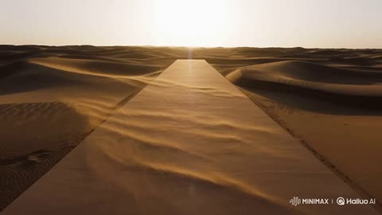</a>

Lists the camera moves in one line and names visible physics cues such as cloth motion, wind and sun flare. It closes with a continuity line and a fade to black, so the ad ends cleanly.

MiniMax H3 · Text-to-video · Source: [@noorwithwifi on X](https://x.com/noorwithwifi/status/2082897758084907132) · 120 likes on 2026-10-29

[`fashion`](tags.md#tag-fashion) [`luxury-ad`](tags.md#tag-luxury-ad) [`golden-hour`](tags.md#tag-golden-hour) [`camera-moves`](tags.md#tag-camera-moves)

<details><summary><b>Prompt</b></summary>

```text
12s cinematic luxury fashion ad, 4K, 24fps, ultra-photorealistic. A high-fashion model in a flowing iridescent metallic gown walks along a minimalist desert runway at golden hour. Cinematic aerial, tracking, orbit, close-up, and hero shots with realistic cloth physics, flowing fabric, shimmering reflections, soft wind, golden sun flare, HDR lighting, Vogue-style editorial, seamless continuity, consistent face/outfit, no flicker, no warping, no extra limbs, fade to black.
```

</details>

<a id="h3-full-speed-three-panel-anime-lookbook"></a>
### Anime heroine in three poses beside FULL SPEED type

<a href="https://x.com/ImaStudio_ai/status/2090634362631168129">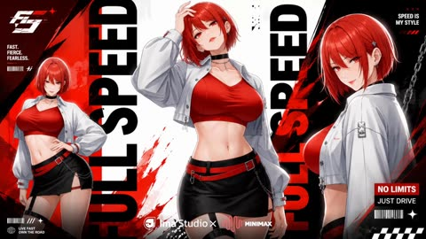</a>

The prompt locks the character with an explicit list of hair, eyes, outfit and palette, then gives each beat a timestamp and a fixed shot layout so identity holds across fast cuts. Beat 04 asks for three vertical panels with the same character in three poses, and this output follows that layout closely.

MiniMax H3 · Text-to-video · Source: [@ImaStudio_ai on X](https://x.com/ImaStudio_ai/status/2090634362631168129) · 120 likes on 2026-10-29

[`anime`](tags.md#tag-anime) [`character-lock`](tags.md#tag-character-lock) [`motion-graphics`](tags.md#tag-motion-graphics) [`fashion`](tags.md#tag-fashion)

<details><summary><b>Prompt</b></summary>

```text
Create a **15s, 16:9, 24fps anime character reveal trailer** with **13 fast visual beats**.
Style: **Japanese anime opening × premium AAA motion graphics × fashion campaign**.
The video should feel **explosive, sexy, stylish, bold and high-impact**, with **80% motion graphics and 20% character action**.

## CHARACTER LOCK — HIGHEST PRIORITY
AO is a **young adult East Asian anime woman** with a sexy, confident Japanese anime aesthetic.

She has:
* small refined face
* sharp expressive crimson eyes
* glossy lips
* confident, teasing gaze
* slim feminine curvy figure
* long elegant legs
* stylish, cool, alluring presence
Keep her identical throughout:
* chin-length vivid red bob with messy bangs
* crimson-red eyes
* black choker
* fitted red cropped top
* short white cropped jacket, worn open
* black mini skirt or fitted shorts
* red belt detail
* black thigh strap
* white-and-red platform sneakers
* subtle silver accessories
Preserve the same face, body proportions, hairstyle, outfit, materials and colors in every shot.
**Never redesign AO. Never change her face or outfit. If a shot becomes too complex, simplify the action first.**
## VISUAL STYLE
Palette: **vivid red, crimson, white, black, silver**.
Use:
giant kinetic typography, red circles, diagonal slashes, manga speed lines, split screens, halftone dots, barcode strips, UI ticks, freeze frames, RGB flashes, impact shakes, poster layouts and graphic wipes.
Every beat should feel:
**fast, sharp, sexy, explosive, graphic and iconic**.
Keep typography bold and readable.
Editing:
hard cuts, aggressive snap zooms, whip pans, speed ramps, freeze frames, impact shakes and foreground wipes.
## 13 VISUAL BEATS
**01 | 0.0–1.0s**
White field. Massive red circle slams into frame. Black bars slash across. UI ticks flicker. Giant **A**, then **O**, hit with heavy impact shake.
**02 | 1.0–2.0s**
The O becomes a circular frame showing an extreme close-up of AO’s crimson eye and glossy lips. She gives a teasing side glance. RGB flash. Circle bursts into red-and-white fragments.
**03 | 2.0–3.1s**
Black background, huge white **AO**. AO enters fast, turns sharply and power-slides beneath the typography. Red speed streaks trail behind her. Whip-pan out.
**04 | 3.1–4.0s**
Three red/white/black vertical panels. AO appears in three poses: hip turn, hair touch, over-shoulder stare. Huge vertical **FULL SPEED** moves behind her.
**05 | 4.0–5.1s**
AO jumps through a rotating typography ring reading **NO BRAKES / ALL EYES ON ME**. One clean mid-air spin. Snap zoom into her confident face.
**06 | 5.1–6.0s**
White editorial frame. Huge black **HOT** with a red slash. AO crosses the frame with a runway-like step, one hand at her waist. Typography compresses and rebounds.
**07 | 6.0–7.0s**
Bright red field with black diagonal stripe. AO performs one smooth fast turn. Three ghosted freeze positions trace the movement. Giant outlined **TURN** rotates behind her.
**08 | 7.0–8.0s**
Words hit one per beat:
**HOT / FAST / WILD / RED**
AO changes pose with each word: direct stare, hair toss, hip shift, confident forward lean.
**09 | 8.0–9.0s**
Black frame with manga perspective lines and a graphic grid. AO steps forward and freezes in a strong hero pose. Red circular target graphics lock around her.
**10 | 9.0–10.1s**
AO moves toward camera through three red-and-white graphic panels. Each panel shatters as she passes. Large **A O** fragments appear behind her. Finish with a hair or leg foreground wipe.
**11 | 10.1–11.1s**
Rapid poster montage: four frames of the same AO — close-up stare, walking, side pose, hands at waist. Add **01–04**, barcodes, halftone dots and sharp Japanese poster graphics.
**12 | 11.1–13.0s**
Hero moment on a clean white background. AO lands in a powerful fashion pose: one leg forward, one hand at her waist, chin lifted, direct eye contact. Huge red shockwave rings explode behind her. Typography fragments and speed lines burst outward. Hold an iconic confident freeze.
**13 | 13.0–15.0s**
Final identity card. Huge black **AO** on a bright white field. AO stands relaxed and alluring in front of the letters. Red circles, halftone, technical arcs and sharp speed accents surround her. Final red pulse flashes through the frame and ends on a hard stinger.
## ANIME STYLE
Premium modern Japanese anime rendering:

* clean cel shading
* sharp linework
* polished highlights
* cinematic close-ups
* dynamic perspective
* fashion-editorial full-body framing
* smooth hair and fabric motion
AO must look like a **stylish adult anime heroine**, not chibi and not childish.
## AUDIO

Hard-hitting **electro / future bass / anime-opening style music**.
Use:
heavy drums, bass hits, risers, glitch fills, synth stabs, typography slams, whooshes and shutter impacts.

Build continuously.
Peak at Beat 12.
End with a sharp electronic stinger.
## PRIORITIES
1. AO identity consistency
2. sexy adult anime character design
3. red-black-white outfit consistency
4. maximum visual impact
5. readable typography
6. premium anime rendering
7. fast beat-synced editing

Avoid:
childlike proportions, chibi style, blue clothing, face changes, outfit changes, extra characters, unreadable typography, weak motion, dull compositions or generic schoolgirl styling.
Final result: **explosive, sexy, red-hot, premium, graphic-driven and visually unforgettable.**

Try MiniMax H3 on Ima Studio 👉
https://
bit.ly/43v08Oh
```

</details>

<a id="kling-kia-seltos-forest-road-commercial"></a>
### Kia Seltos driving through a sunlit forest road

<a href="https://x.com/Diplomeme/status/2110947179057811727">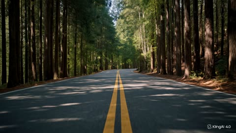</a>

Each shot gets a timestamp and a camera move, so the 30 second timeline reads as a rhythm of cuts rather than one long take. Reference images are paired with a constraint to keep the exact vehicle geometry, grille, and paint in every shot.

Kling 4.0 · Reference-to-video · Source: [@Diplomeme on X](https://x.com/Diplomeme/status/2110947179057811727) · 120 likes on 2026-10-29

[`automotive`](tags.md#tag-automotive) [`multi-shot`](tags.md#tag-multi-shot) [`reference-images`](tags.md#tag-reference-images) [`forest-road`](tags.md#tag-forest-road)

<details><summary><b>Prompt</b></summary>

```text
If this is the level of AI creations, then it's over for commercial and big production houses.

Generated with Kling 4.0
 (30 seconds) 1080P on
@Kling_ai


#Kling4 #KlingECP

Try it with prompt : High-octane, hyper-realistic automotive commercial for the Kia Seltos, shot with the visual intensity of a Christopher Nolan-style cinematic production using actual 70mm IMAX cameras. Fast-paced multi-shot editing with quick, cinematic cuts timed at exactly one shot every 2 seconds across a complete 30-second timeline. The champagne-gold Kia Seltos, matching the exact vehicle design in the provided reference images, charges through a dense forest road surrounded by towering trees and dappled sunlight. High-contrast Nolan-esque color grading with deep shadows, cold teals, warm champagne-gold reflections, and bright highlights. Sunlight pierces through the forest canopy, reflecting across the sculpted bodywork, signature vertical LED daytime running lights, black front grille, muscular wheel arches, and distinctive rear light bar. Rapid sequence of intense cuts:•Shot 1 (0-2s): Ground-level cinematic establishing shot of an empty winding forest road, towering trees casting deep shadows as sunlight breaks through the canopy. The distant engine note of the approaching Kia Seltos builds tension.•Shot 2 (2-4s): Low eye-level tracking shot of the champagne-gold Kia Seltos emerging between the trees, accelerating along the forest road and revealing its bold front grille, distinctive vertical LED lighting signature, and commanding SUV stance.•Shot 3 (4-6s): Tight, detailed close-up of the front fascia, Kia emblem, illuminated LED daytime running lights, glossy black grille elements, and champagne-gold paint reflecting the passing forest.•Shot 4 (6-8s): Dramatic low-angle tracking shot moving alongside the front wheel as the alloy spokes spin rapidly, tires maintain realistic contact with the asphalt, and the SUV’s sculpted bodywork catches streaks of sunlight.•Shot 5 (8-10s): Fast lateral tracking shot revealing the complete side profile, muscular wheel arches, black lower-body cladding, door contours, windows, roofline, and metallic champagne-gold finish as the Kia Seltos sweeps through the forest.•Shot 6 (10-12s): Low-angle handheld-style camera whip-pan from the road surface to the SUV’s front three-quarter profile as it exits a sweeping bend, with realistic suspension movement, controlled body roll, and natural background motion blur.•Shot 7 (12-14s): Extreme close-up of sunlight traveling across the sculpted hood, Kia emblem, sharp body creases, and vertical LED lights, emphasizing precise automotive design and premium paint reflections.•Shot 8 (14-16s): Rear three-quarter tracking shot following the Kia Seltos through the forest, showcasing the distinctive rear light bar, angular vertical taillights, rear spoiler, sculpted tailgate, and authentic model badging.•Shot 9 (16-18s): Dynamic wheel-height tracking shot as the SUV drives across alternating patches of sunlight and shadow, capturing realistic tire rotation, subtle road texture, reflections along the lower doors, and the movement of the suspension over natural road undulations.•Shot 10 (18-20s): High-angle wide shot of the Kia Seltos commanding a sweeping forest road, surrounded by towering trees and atmospheric shafts of sunlight, with the winding asphalt leading the eye toward the moving SUV.•Shot 11 (20-22s): Fast front-facing tracking shot of the Kia Seltos approaching the camera along a straight section of forest road, its LED lights illuminated and grille dominating the frame as the camera smoothly retreats ahead of the vehicle.•Shot 12 (22-24s): Rapid cinematic transition into a close rear tracking angle as the SUV accelerates away through the trees, the rear lighting signature glowing against the darker forest and the road markings sweeping beneath the frame.•Shot 13 (24-26s): Dramatic low-angle front three-quarter hero shot as the Kia Seltos exits the forest bend and enters a naturally illuminated clearing, revealing its full stance, champagne-gold bodywork, alloy wheels, and signature front lighting.•Shot 14 (26-28s): Controlled cinematic orbit around the stationary Kia Seltos at a scenic forest-road pull-off, transitioning from the front three-quarter view toward the side and rear profile while the surrounding trees and golden sunlight create a premium automotive campaign atmosphere.•Shot 15 (28-30s): Hard cut to black with a final sweep of light revealing the KIA emblem followed by the SELTOS model name and the campaign tagline: “OWN EVERY TURN.” End with a powerful, clean, premium automotive advertising finish.Raw automotive documentary-style camera textures, organic lens flares, lifelike vehicle physics, authentic wheel rotation and tire contact, realistic suspension movement, natural road reflections, physically accurate metallic paint reflections, cinematic motion blur, subtle engine vibration, and an immersive forest-road atmosphere. Preserve the exact Kia Seltos identity, champagne-gold exterior color, front grille design, LED lighting signatures, alloy wheels, body proportions, side profile, and rear design from the provided reference images throughout every shot. Maintain consistent vehicle geometry, wheel design, lighting signatures, paint color, and branding across all 15 shots. No vehicle redesign, no morphing, no inconsistent body panels, no incorrect logos, no artificial CGI appearance, no impossible driving maneuvers, no exaggerated visual effects, and no abrupt changes in road geography. Ultra-detailed, 4K resolution, premium global automotive advertising quality.
```

</details>

<a id="wan-ugc-earbuds-reference-identity-ad"></a>
### Bearded man promotes earbuds in golden hour apartment

<a href="https://x.com/Xaroon_x/status/2093988944392175714"></a>

A reference image locks the character's identity, and a timed beat sheet with the shot and dialogue for each segment sets the order of the ad. Repeating the same wardrobe and setting in every beat keeps the look consistent across cuts.

Wan 3.0 · Reference-to-video · Source: [@Xaroon_x on X](https://x.com/Xaroon_x/status/2093988944392175714) · 120 likes on 2026-10-29

[`ugc`](tags.md#tag-ugc) [`product-ad`](tags.md#tag-product-ad) [`reference-image`](tags.md#tag-reference-image) [`golden-hour`](tags.md#tag-golden-hour) [`lip-sync`](tags.md#tag-lip-sync)

<details><summary><b>Prompt</b></summary>

```text
Create a 20-second ultra-realistic cinematic UGC advertisement, vertical 9:16, featuring the EXACT SAME male character from Reference Image 1. Strictly preserve his facial identity, face structure, skin tone, hairstyle, hairline, eyes, nose, lips, jawline, beard/stubble and overall appearance. No identity drift, face morphing, aging or redesign.

PRODUCT: premium modern wireless earbuds with sleek minimalist matte-black charging case, subtle metallic details, realistic luxury-tech appearance, no recognizable brand/logo.

WARDROBE: fitted black premium T-shirt, minimalist dark overshirt/jacket, black watch, subtle accessories, sophisticated urban look.

SETTING: modern luxury apartment/stylish urban workspace during golden hour, warm window light, realistic shadows, tasteful furniture and subtle city ambience. Premium lifestyle + authentic UGC + cinematic commercial aesthetic.

0–4s: Close-up of male looking slightly tired after a busy day. He picks up the earbud case from a table, camera quickly pushes toward product. He looks at camera confidently: “These changed my daily routine.”

4–8s: Cinematic macro reveal as he opens the case, removes an earbud and puts it in. Smooth product movement and shallow depth of field. Dialogue: “The sound is seriously impressive.”

8–13s: Male walks through apartment and works at desk wearing earbuds. Show natural tap interaction, earbud close-up, working shots and product case. Dialogue: “Music, calls, work… everything feels better.”

13–17s: Male stands by window in golden-hour light, looks directly into camera and holds case toward lens. Dialogue: “Honestly, I keep them with me everywhere.”

17–20s: Hero product shot: earbuds and case sharply focused in foreground, male softly blurred behind. Slow cinematic movement and premium reflections. On-screen text: “Sound. Style. Freedom.” then “Upgrade Your Everyday.”

AUDIO: original modern premium lifestyle beat with smooth electronic bass, atmospheric synth and subtle percussion; minimal at start, gradually builds, slight impact on final reveal. No copyrighted music. Dialogue remains crisp.

Natural American English male UGC voice, confident, relaxed, authentic, conversational, accurate lip-sync.

Photorealistic 4K/8K, realistic skin, eyes, blinking, hands, fabric, reflections, shadows, depth of field and motion blur. No distorted hands, extra fingers, text glitches, random logos, watermarks or cartoon look. Maintain exact identity and clothing consistency throughout.
```

</details>

<a id="h3-matcha-kit-ugc-kitchen"></a>
### Woman shares matcha starter kit in sunlit kitchen

<a href="https://x.com/SimplyAnnisa/status/2084241879097303513"></a>

A reference image pins the same character across every shot, and the prompt pairs handheld smartphone framing with over-the-shoulder and macro close-ups so the clip reads as creator content. A closing format block (vertical 9:16, 4K HDR, no text or logos) sets the finish.

MiniMax H3 · Reference-to-video · Source: [@SimplyAnnisa on X](https://x.com/SimplyAnnisa/status/2084241879097303513) · 116 likes on 2026-10-29

[`ugc`](tags.md#tag-ugc) [`product-ad`](tags.md#tag-product-ad) [`matcha`](tags.md#tag-matcha) [`reference-image`](tags.md#tag-reference-image)

<details><summary><b>Prompt</b></summary>

```text
Use the uploaded reference image as the exact character reference. Preserve her facial identity, hairstyle, eye color, skin tone, body proportions, and facial consistency throughout every shot.
Create a 15-second ultra-realistic UGC-style lifestyle advertisement featuring a realistic young woman sharing her favorite premium Matcha Starter Kit in a bright, minimalist Japanese-inspired kitchen with warm morning sunlight, natural wood textures, soft neutral décor, ceramic tableware, and a calm luxury aesthetic.
She smiles naturally while holding an elegant matcha tin and says this has become her favorite way to start every morning. She opens the premium matcha container, carefully scoops vibrant green matcha powder into a handcrafted ceramic bowl, pours warm water, and whisks it smoothly using a traditional bamboo whisk until a rich, creamy foam forms. She lifts the bowl, takes a small sip, closes her eyes with a genuine smile, and enjoys the peaceful morning moment.
Capture authentic handheld smartphone shots, over-the-shoulder angles, cinematic macro close-ups of the vivid green matcha powder, the bamboo whisk creating silky foam, the handcrafted ceramic bowl, rising steam, natural hand movements, and warm sunlight reflecting across the table. Finish with her holding the completed bowl beside her face, smiling warmly into the camera.
Authentic creator-style content, natural facial expressions, healthy glowing skin, cozy morning atmosphere, luxury lifestyle aesthetic, subtle depth of field, premium color grading, smartphone-shot realism, vertical 9:16, 4K HDR, no text, subtitles, logos, or watermarks.
```

</details>

<a id="h3-female-tennis-player-blue-court-commercial"></a>
### Female tennis player hits on blue court

<a href="https://x.com/DaniaSafvi/status/2095008773245211050">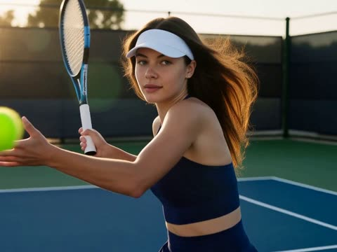</a>

The prompt walks the camera through a fixed shot order (overhead serve, low angle tracking, close ups, golden hour silhouette) and lists the sound cues separately, so the clip reads as one edited commercial. Film look terms such as 35mm, grain and lens flare set the grade, and the negative list targets common hand and racket artifacts.

MiniMax H3 · Text-to-video · Source: [@DaniaSafvi on X](https://x.com/DaniaSafvi/status/2095008773245211050) · 115 likes on 2026-10-29

[`tennis`](tags.md#tag-tennis) [`sports-commercial`](tags.md#tag-sports-commercial) [`golden-hour`](tags.md#tag-golden-hour)

<details><summary><b>Prompt</b></summary>

```text
Create a fast-paced, high-energy cinematic sports commercial featuring a professional female tennis player competing on a blue hard court.

Scene & Camera:

- Begin with an overhead bird’s-eye shot of her powerful serve.
- Transition into low-angle tracking shots capturing her fast footwork and movement across the court.
- Use intense close-ups of her focused face, hands, racket, and ball impact.
- End with a dramatic golden-hour silhouette as she strikes the ball.

Visual Style:
Photorealistic, premium sports-commercial aesthetic, bright natural sunlight, subtle lens flares, crisp focus, realistic motion blur, dynamic camera movement, cinematic composition, 8K detail, 35mm film look, subtle film grain.

Performance:
Natural athletic movement, realistic tennis technique, accurate racket and ball physics, powerful swings, quick footwork, confident expressions, and believable body mechanics.

Audio:
Realistic tennis-court ambience, racket impacts, ball bounces, quick footsteps, and subtle cinematic sports sound design. No dialogue.

Negative Prompt:
Distorted hands, extra fingers, unnatural anatomy, incorrect tennis technique, floating racket, unrealistic ball movement, duplicated objects, face distortion, flickering, jitter, slow motion unless intentional, CGI appearance, low detail, watermark, text, or logos.
```

</details>

<a id="h3-orange-slice-juice-asmr"></a>
### Orange sliced in macro with juice spray

<a href="https://x.com/yourPlugAI/status/2086830161719111800">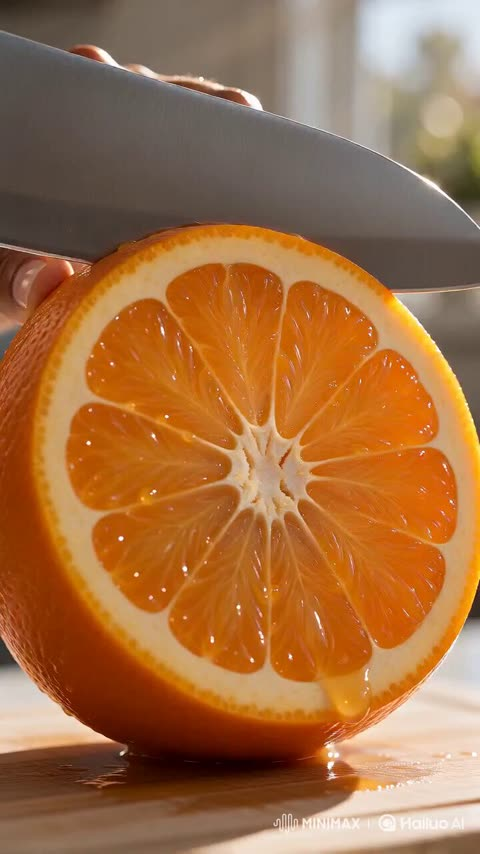</a>

Each beat is timed and split into visual, action and sound lines, so the model gets a clear shot order. Named sound cues like a glass CLINK and a liquid POUR drive the ASMR rhythm, and the start frame locks the orange and blade for a consistent macro opening.

MiniMax H3 · Image-to-video · Source: [@yourPlugAI on X](https://x.com/yourPlugAI/status/2086830161719111800) · 114 likes on 2026-10-29

[`beverage-ad`](tags.md#tag-beverage-ad) [`macro`](tags.md#tag-macro) [`asmr`](tags.md#tag-asmr) [`sound-design`](tags.md#tag-sound-design)

<details><summary><b>Prompt</b></summary>

```text
Project: Pure Sensation (15-Second Beverage Campaign)
Format: Text-to-Video with Image Anchor (Start Frame)

[00:00 - 00:03] THE SENSORY HOOK (Macro Slice)
• Visual & Camera: Starts on the image anchor. Extremely tight macro close-up of a sharp blade slicing through a ripe, juicy orange directly toward the camera lens.
• Action / Movement: Droplets of fresh orange juice spray toward the lens in extreme slow motion, reflecting bright sunlight.
• Audio / Sound Design: A sharp, satisfying crisp slicing sound effect followed by a wet splash. No music yet.
• On-Camera / Voice: None. Entire focus is on tactile texture and visual warmth.

[00:03 - 00:08] RHYTHMIC ASMR POUR
• Visual & Camera: Close-up macro shots syncing in rhythmic flow—ice hitting the glass, orange juice pouring smoothly, and fine bubbles rising.
• Action / Movement: A glass fills with vibrant orange juice as clear ice cubes float upward. Light bubbles gently rise to the surface as liquid coats the inner glass wall.
• Audio / Sound Design: Rhythmic, isolated ASMR sounds: a resonant glass "CLINK", a smooth liquid "POUR", and a delicate, crisp "FIZZ" rising in volume.
• On-Camera / Voice: None. Pure focus on clean acoustic detail.

[00:08 - 00:12] THE SUNLIGHT TRANSCENDENCE
• Visual & Camera: Eye-level medium shot of the 24-year-old Black woman taking a slow, refreshing sip from the glass, bathed in golden sunlight.
• Action / Movement: She takes a sip, closes her eyes momentarily, and exhales softly with a calm, genuine expression. As she places the glass down, bright sunlight refracts through the juice, projecting glowing amber patterns onto the white table surface.
• Audio / Sound Design: A soft, uplifting acoustic ambient pad swells quietly beneath the natural ASMR sounds.
• Dialogue (Real-time on-camera): "That's pure nature."

[00:12 - 00:15] THE HERO SIGN-OFF
• Visual & Camera: Static hero shot of the glass bottle resting beside fresh orange slices on the bright white table.
• Action / Movement: Light softly glimmers off condensation droplets running down the glass bottle. The composition is balanced, clean, and still.
• Audio / Sound Design: Soft acoustic note fades out gently alongside a final subtle bubble-pop sound.
• On-Screen Text / Call to Action: "Nothing Hidden. Just Nature."
```

</details>

<a id="h3-imagine-word-to-world-loop"></a>
### Typed word morphs into a geometric world

<a href="https://x.com/aziz4ai/status/2088748628571558159"></a>

The prompt fixes the exact seven-letter word and one central circle, so each stage morphs through a shared circle, arch or silhouette with a visible geometric cause. Its explicit ban on dissolves and chaotic camera moves keeps the motion clean and closes the loop on the opening frame.

MiniMax H3 · Text-to-video · Source: [@aziz4ai on X](https://x.com/aziz4ai/status/2088748628571558159) · 112 likes on 2026-10-29

[`typography`](tags.md#tag-typography) [`motion-graphics`](tags.md#tag-motion-graphics) [`match-cut`](tags.md#tag-match-cut) [`seamless-loop`](tags.md#tag-seamless-loop)

<details><summary><b>Prompt</b></summary>

```text
Create a 15-second vertical 9:16 premium motion-graphics film titled “FROM A WORD TO A WORLD.” Build it through seamless geometric morphing, invisible shape-based match cuts and continuous forward momentum. End on the exact opening frame for a perfect infinite loop.

REFERENCE MAP:

@Image
 1 — TYPOGRAPHY LOCK: Defines the exact lowercase word “imagine,” spelled with exactly seven letters: i-m-a-g-i-n-e, its bold geometric type, centered position, black background and typing cursor. Never add, remove, duplicate or rearrange letters.


@Image
 2 — DOT-TO-SUN: Defines how the dot above the first “i” expands into the sun through concentric circles and cobalt motion trails.


@Image
 3 — OPTICAL MORPH: Defines sun → optical rings → camera lens → aperture blades → stylized iris. Preserve one circular center and rotational direction.


@Image
 4 — WORLD SYSTEM: Defines iris → circular tunnel → curved bridges → typographic architecture → surreal graphic city.


@Image
 5 — STYLE: Defines premium broadcast motion design, Swiss editorial geometry, pure-black negative space, luminous white forms, electric cobalt accents, restrained amber light, crisp vector hierarchy and subtle 2.5D depth.

REFERENCE LOCK:
The images are design and transformation sheets, not video frames. Never show sheets, grids, stacked stages or several reference objects at once. Extract each element individually and animate every stage full-screen. The result must feel like world-class motion graphics, not photoreal CGI, concept art, cyberpunk or a technology poster.

VISUAL AND MOTION LOCK:
Maintain the black, white, cobalt and amber palette. Keep every circular object on the same central axis. Use refined elastic easing, controlled acceleration, rotational continuity, motion echoes and hidden match cuts based on shared circles, curves and silhouettes. Every morph must have a visible geometric cause. No dissolves, teleportation, broken morphs, frame skipping or chaotic camera moves.

TIMELINE:

0.00–1.40 — TYPE HOOK
Pure black. A thin cobalt cursor blinks once at center. Rapidly type the exact lowercase word “imagine,” one correct letter per keystroke: i-m-a-g-i-n-e. Bold luminous-white geometric typography. Each keystroke sends a subtle cobalt pulse through the letters. Hold briefly.

1.40–3.10 — DOT TO SUN
Push rapidly toward the dot above the first “i.” It detaches while the remaining letters stretch into horizontal speed lines and leave frame. The centered dot expands through concentric graphic rings and morphs into a restrained amber sun disc.

3.10–5.20 — SUN TO LENS
The corona reorganizes into rotating optical rings. Circular match cut into a camera-lens front element. Cobalt reflections sweep across the glass as rings assemble into aperture blades. The aperture closes, then snaps open.

5.20–6.70 — LENS TO IRIS
Without changing size or center, aperture blades soften into a stylized cobalt iris. Metallic edges become clean radial lines and the central lens becomes a black pupil. Never show a face or photoreal eye.

6.70–10.70 — IRIS TO WORLD
Accelerate through the pupil. Iris lines extend into a graphic tunnel. Rapid hidden match cuts: tunnel rings become arches, arches stretch into bridges, bridges rise into bold typographic architecture. Reveal a surreal city made from luminous-white geometry, cobalt routes and one amber sun. Fly smoothly through it as circular windows become tunnels and curved roads become letter-like strokes.

10.70–13.30 — WORLD TO WORD
Rise above the city. Buildings flatten into letter stems, bridges bend into curves and roads align into a baseline. The world compresses into the exact lowercase word “imagine.” The amber sun shrinks into the dot above the first “i.” Keep all seven letters perfectly readable.
```

</details>

<a id="veo-strawberry-gelato-churn-macro"></a>
### Strawberry Gelato Churn in Macro Close-Up

<a href="https://x.com/Fujimoto_hina/status/2101697533705920970">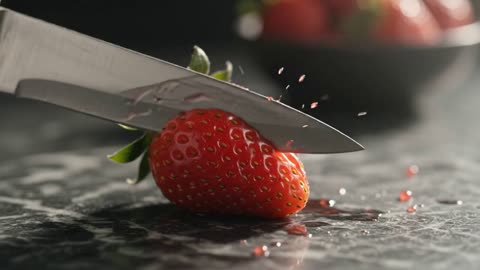</a>

A four-beat sequence runs from sliced fruit to a zero-gravity vortex, the churning cylinder and a final scoop, so the camera move for each beat is clear. Separate fields for camera, lighting, visual style and a negative prompt keep the macro look consistent.

Veo 3.1 · Text-to-video · Source: [@Fujimoto_hina on X](https://x.com/Fujimoto_hina/status/2101697533705920970) · 108 likes on 2026-10-28

[`food`](tags.md#tag-food) [`macro`](tags.md#tag-macro) [`commercial`](tags.md#tag-commercial) [`slow-motion`](tags.md#tag-slow-motion) [`json-prompt`](tags.md#tag-json-prompt)

<details><summary><b>Prompt</b></summary>

```text
{
  "title": "Crimson Cream: The Artisanal Churn",
  "duration": "10 seconds",
  "format": "16:9, 4K",
  "style": "Cinematic photorealistic artisanal culinary commercial",
  "prompt": "Create a seamless 10-second cinematic journey tracing the creation of decadent churned strawberry gelato. Begin with ripe, dew-kissed organic strawberries sliced on chilled dark marble, sending microscopic ruby juice droplets and seeds bursting into the air. Transition into a dynamic zero-gravity vortex where velvety sweet cream, pure vanilla bean specks, and thick strawberry coulis collide and swirl together in mid-air ribbons. Move directly into the churning cylinder where sub-zero brass paddles whip the mixture, rapidly crystallizing into dense, glossy, ribboned ice cream with frost vapors swirling outward. Finish with an ultra-macro 1000fps ice cream scoop gliding through the dense mass, rolling up a perfect textured sphere with visible strawberry chunks, delicate frost crystals, glistening condensation, and a single cascading drop of vibrant strawberry reduction.",
  "visual_style": "Extreme macro, ultra-shallow depth of field, authentic churning physics, realistic thermodynamic frost and vapor, rich cream and ruby-pink berry palette with deep contrasting marble accents",
  "camera": "Continuous kinetic macro push-in, seamless fluid-vortex tumble, rotational cylinder tracking, and ultra-high-speed slow-motion curl reveal",
  "lighting": "Crisp morning natural rim lighting transitioning into cool cryogenic frosty blues, balanced by warm culinary studio highlights on glossy fruit surfaces",
  "negative_prompt": "text, watermark, logo, subtitles, cartoon, artificial neon pink, icy melting mush, plastic texture, dry powder, low resolution, flat lighting, jump cuts, jerky camera movement, grainy footage"
}
```

</details>

<a id="h3-scent-diffuser-butterfly-mist"></a>
### Diffuser mist turns into glowing butterflies

<a href="https://x.com/yourPlugAI/status/2083043306422837477"></a>

Splits the 15 second clip into four timed segments, each with camera, action, sound and voiceover, so the model follows a shot-by-shot timeline. Opening on a still frame locks the presenter, bottle and diffuser before the mist effect is added.

MiniMax H3 · Image-to-video · Source: [@yourPlugAI on X](https://x.com/yourPlugAI/status/2083043306422837477) · 107 likes on 2026-10-29

[`home-fragrance`](tags.md#tag-home-fragrance) [`product-ad`](tags.md#tag-product-ad) [`voiceover`](tags.md#tag-voiceover) [`butterflies`](tags.md#tag-butterflies)

<details><summary><b>Prompt</b></summary>

```text
Video Prompt (15 Seconds, MiniMax H3 Timeline Sequence)

0 to 4 seconds: The Sensory Add & Ignition Hook

Visual & Camera: Starts on the image frame. The camera quickly moves into a macro close-up focused on the top of the matte ceramic diffuser and the hand holding the amber bottle.

Action/Movement: Her gloved fingers gently squeeze the gold dropper cap. A single, rich, golden-colored essential oil droplet falls slowly from the dropper and disappears into the diffuser's water reservoir.

Audio/Sound Cues: A faint, pleasant ambient bell chime sound as the droplet hits. A slow, meditative deep bass synth track fades in.

Voiceover (Off-camera female voice, spoken at a slow, steady, and moderate pace with clear articulation): "My apartment used to smell like a generic living space... but I found a way to completely rewrite the mood."

4 to 9 seconds: The Magical Mist Transformation (The Key Visual Hook)

Visual & Camera: A clean cut to an eye-level medium close-up of the diffuser, highlighting the nozzle.

Action/Movement: The lighting transitions. The amber ring base blinks once and then glows with a vibrant gold light. A crisp, illuminated stream of mist begins rising vertically from the nozzle. The camera quickly tracks up, following the mist. Within the mist stream, a dense cloud of small, vibrant, multi-colored butterflies (glowing blues, warm golds, deep purples) begins swirling, blossoming, and flowing upward with a mesmerizing, fluid motion.

Audio/Sound Cues: A gentle mechanical hum layers over the synth track. A soft, magical, twinkling 'whoosh' sound effect as the butterflies appear.

Voiceover (Off-camera female voice, spoken slowly and deliberately): "Now, I don't just 'scent' my home. I 'scent-scape' it, turning a simple ritual into an experience."

9 to 12 seconds: The Aesthetic Drift

Visual & Camera: Quick transition to a slow-motion, low-angle shot, looking up through the cloud of butterflies as they drift lazily toward the ceiling light.

Action/Movement: The butterflies continue their colorful, slow ascent. They interact gently with the warm, ambient apartment lighting, casting colorful, dancing light reflections onto the surrounding surfaces and walls. The visual flow is purely aesthetic and calming.

Audio/Sound Cues: Meditative synth music deepens. The twinkles soften into a gentle hum.

Voiceover (Off-camera female voice, spoken slowly with a calm, impressive cadence): "Cold-air diffusion keeps the scent pure, powerful, and utterly captivating, enveloping you in comfort."

12 to 15 seconds: The Peaceful Sign-Off

Visual & Camera: The camera pulls back smoothly into a wider, cinematic medium shot. The host is leaning casually back against her curated bookshelf.

Action/Movement: Her mouth remains closed. She looks directly into the lens with a calm, serene expression, holding the now glowing-amber essential oil vial gently near her cheek. She gives a very subtle, slow nod of appreciation. The video ends on a steady, hyper-focused shot of her relaxed expression and the product branding.

Audio/Sound Cues: Music track hits a clean, comforting final piano chord and fades out softly.

Voiceover (Off-camera female voice, spoken slowly, clearly, and steadily up to the final second): "Stop settling for ordinary. Elevate your everyday space today."
```

</details>

<a id="h3-morning-skincare-serum-commercial"></a>
### Morning skincare ritual ending on serum hero shot

<a href="https://x.com/Maercihh/status/2083407991114805571"></a>

An uploaded storyboard guides eight timed shots, and each shot ends with a transition line that hands the camera move to the next one, which produces seamless match cuts. A closing style block locks the lenses, lighting and consistency rules so the woman, room and product stay the same.

MiniMax H3 · Reference-to-video · Source: [@Maercihh on X](https://x.com/Maercihh/status/2083407991114805571) · 97 likes on 2026-10-28 · found via [SkyNotSilent/awesome-MiniMax-H3-cases](https://github.com/SkyNotSilent/awesome-MiniMax-H3-cases)

[`commercial`](tags.md#tag-commercial) [`skincare`](tags.md#tag-skincare) [`storyboard`](tags.md#tag-storyboard) [`match-cut`](tags.md#tag-match-cut) [`macro`](tags.md#tag-macro)

<details><summary><b>Prompt</b></summary>

```text
Use the uploaded storyboard as the camera guide. Follow all 8 frames in order with smooth cinematic continuity. The same woman, outfit, hairstyle, makeup, room and product must remain perfectly consistent throughout the entire 15-second commercial. Every shot must begin where the previous shot ends with seamless match cuts and natural camera movement.

Shot 1 (0-1.8s)
A slow push in as morning sunlight enters through the window. The woman looks outside and gently turns toward the mirror. The camera continues moving without stopping.

Transition:
The camera keeps pushing forward until her face fills the frame.

Shot 2 (1.8-3.6s)
Without cutting, the shot becomes a close-up of her face in the mirror. She notices dull skin and lightly touches her cheek. The camera slowly circles around her as she reaches toward the vanity.

Transition:
Follow her hand naturally to the serum bottle.

Shot 3 (3.6-5.4s)
Macro shot as she picks up the serum bottle. The bottle rotates slightly in her hand while natural sunlight reflects across the glass. The camera smoothly follows the bottle upward.

Transition:
Continue tracking into an extreme macro of the dropper.

Shot 4 (5.4-7.2s)
Extreme macro of the dropper lifting from the bottle. A single drop forms and falls in slow motion. The camera follows the drop as it lands on her fingertips.

Transition:
The camera continues following her fingertips toward her face.

Shot 5 (7.2-9.0s)
Close-up as she gently applies the serum across her cheeks using smooth circular motions. Skin catches soft natural highlights. Hair moves slightly in the breeze.

Transition:
The camera slowly rotates around her face while maintaining eye level.

Shot 6 (9.0-11.1s)
The lighting naturally becomes warmer as her skin appears healthier and more radiant. The transformation happens gradually, not instantly. She smiles softly while looking into the mirror.

Transition:
She turns away from the mirror and walks toward the window as the camera follows.

Shot 7 (11.1-13.2s)
Medium shot as she confidently walks into warm sunlight. She smiles naturally at the camera while the background softly blurs. The camera slowly arcs around her.

Transition:
She lowers the product toward the camera until it fills the frame.

Shot 8 (13.2-15.0s)
Hero product shot. The serum bottle stands on a clean surface with warm natural daylight. Soft reflections move across the glass. Premium end card with elegant typography and subtle camera push in. End on the product with "Shop Now."

Overall style:
Ultra photorealistic luxury skincare commercial, Apple-style cinematography, ARRI Alexa 65, 50mm and 85mm lenses, soft natural daylight, realistic skin texture, premium color grading, physically accurate lighting, smooth cinematic camera movement, seamless match cuts, invisible transitions, no jump cuts, no frame skipping, no character changes, no outfit changes, no background changes, premium beauty ad quality.

#MiniMaxH3 @Hailuo_AI
```

</details>

<a id="h3-luxury-apartment-three-looks-fashion-film"></a>
### Woman tries three outfits in luxury apartment

<a href="https://x.com/itxsarmadd/status/2101244508767666438"></a>

Each time range holds one beat with its own dialogue line and a named transition, so the cuts read as planned edits. Repeating an identity lock line across the prompt keeps the face, hair and body consistent across all three looks.

MiniMax H3 · Reference-to-video · Source: [@itxsarmadd on X](https://x.com/itxsarmadd/status/2101244508767666438) · 94 likes on 2026-10-29

[`fashion`](tags.md#tag-fashion) [`dialogue`](tags.md#tag-dialogue) [`transitions`](tags.md#tag-transitions) [`character-consistency`](tags.md#tag-character-consistency)

<details><summary><b>Prompt</b></summary>

```text
15s | 16:9 | 4K HDR | 24fps | Photorealistic Fashion Film

Use the uploaded girl as the exact character throughout. Maintain identical face, skin tone, hair, body proportions, and identity in every shot.

0–3s: Luxury apartment overlooking a glowing city skyline. She opens a vintage suitcase, looks at camera and says: "Three outfits… and absolutely no time to decide!"

3–6s: She places sunglasses over the lens. Seamless transition to Look 1: emerald satin blouse, cream trousers, heels. By the window. "Okay… this one means business."

6–9s: Finger snap transition to a rooftop party. Look 2: metallic mini dress, ankle boots, statement earrings. Wind in hair. "Now THIS is a little dangerous."

9–12s: She walks past the lens, creating a body-wipe transition to Look 3: midnight-blue evening gown, elegant rooftop dinner setting. "Or should I go full glam?"

12–15s: Wide rooftop shot. Holding sunglasses, shoulder bag, and clutch. Smiles and points at camera: "You decide. One, two, or three?"

Style: Ultra-realistic luxury fashion commercial, cinematic lighting, realistic fabrics, natural expressions, shallow depth of field, smooth camera movement, premium editorial quality.

Negative: No face changes, identity drift, duplicate character, extra people, distorted hands, bad anatomy, flicker, jump cuts, subtitles, logos, watermarks, or text overlays.
```

</details>

<a id="h3-saas-analytics-dashboard-cursor-export-demo"></a>
### SaaS analytics dashboard with cursor clicks and export popup

<a href="https://x.com/yourPlugAI/status/2095848832294601039"></a>

Timed beats each give the visual, the action and the sound, and the start frame locks the layout so the interface stays consistent across segments. Exact button labels and colour states are spelled out so the model can reproduce on-screen text and hover or click changes.

MiniMax H3 · Image-to-video · Source: [@yourPlugAI on X](https://x.com/yourPlugAI/status/2095848832294601039) · 91 likes on 2026-10-29

[`ui-design`](tags.md#tag-ui-design) [`dashboard`](tags.md#tag-dashboard) [`product-demo`](tags.md#tag-product-demo) [`micro-interaction`](tags.md#tag-micro-interaction)

<details><summary><b>Prompt</b></summary>

```text
Flat, direct front-facing view of the modern SaaS web dashboard interface based on the start frame.

UI LAYOUT & ASSETS: Left sidebar features navigation icons with an active cyan glow on "Analytics". Top header displays "NEXUS AI // ANALYTICS DASHBOARD" in crisp white typography. Central area shows real-time line charts, data cards, and a main video preview box. Overall sleek dark-mode glassmorphism aesthetic.

00:00-00:03:
- Visual: The camera holds flat on the web dashboard. A sharp white digital mouse cursor enters from the top-left and glides smoothly across the screen toward a primary button labeled "GENERATE REPORT".
- Action: The cursor hovers over the button. The button smoothly transitions from dark gray to a vibrant neon cyan hover state with a soft glowing border.
- Sound FX: Soft digital cursor swoosh, subtle glass hover click, and ambient low-fi tech hum.

00:03-00:06:
- Visual: The cursor clicks the "GENERATE REPORT" button. The page smoothly scrolls down, revealing secondary data visualization modules and performance bar charts below the fold.
- Action: The line graphs dynamically draw themselves from left to right, with glowing cyan dots lighting up at data peaks.
- Sound FX: Crisp mechanical mouse click, ultra-smooth page scroll swoosh, and rising digital beep cues.

00:06-00:09:
- Visual: The cursor glides over to a data card displaying "TOTAL ENGAGEMENT: 84.2%" and clicks the top-right options icon.
- Action: A clean glassmorphism pop-up window titled "EXPORT DATA" smoothly scales up and fades in over the center of the dashboard.
- Sound FX: Soft window pop-up chime, gentle air-suction UI effect, and continuous ambient synth pad music.

00:09-00:12:
- Visual: Inside the pop-up window, the cursor hovers over a dropdown menu labeled "Format: PDF" and selects "Format: CSV".
- Action: The dropdown menu expands with fluid micro-interactions, the option highlights in neon violet, and the selection updates immediately.
- Sound FX: Snappy dropdown click, digital tick sound, and light interface feedback tone.

00:12-00:15:
- Visual: The cursor clicks "DOWNLOAD NOW". The pop-up closes with a swift fade-out, and a green success notification toast reads "Report Downloaded!" in the top-right corner.
- Action: The metric charts pulse once in bright green, and the dashboard resets into its active real-time monitoring state.
- Sound FX: Satisfying task-complete chime, quick UI slide-out sound, and a smooth resolving synth chord.
```

</details>

<a id="h3-luxury-watch-commercial"></a>
### Luxury watch reveal inside a presentation box

<a href="https://x.com/I_amShiti/status/2083051609953903017">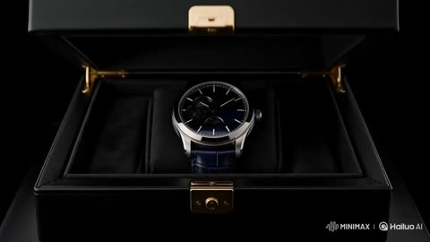</a>

Omni Reference locks the watch design across every shot while the storyboard line sets shot order and pacing. Listing the case, dial, strap and light sources in the prompt keeps the product consistent from the box reveal to the hero shot.

MiniMax H3 · Reference-to-video · Source: [@I_amShiti on X](https://x.com/I_amShiti/status/2083051609953903017) · 89 likes on 2026-10-29

[`luxury`](tags.md#tag-luxury) [`product`](tags.md#tag-product) [`omni-reference`](tags.md#tag-omni-reference) [`minimax-h3`](tags.md#tag-minimax-h3)

<details><summary><b>Prompt</b></summary>

```text
Use storyboard as the complete creative direction, shot list, composition, pacing, and cinematic sequence.

Use LuxuryWatch as the exact product reference. Preserve the watch's design, dial, case, leather strap, proportions, materials, and fine details consistently throughout every scene.

Create a world-class luxury watch commercial.

Follow the storyboard exactly while transforming each frame into a seamless cinematic sequence.

Begin with a dramatic reveal of the luxury watch inside its presentation box. Slowly unveil the timepiece as warm golden light reflects across the polished platinum case and sapphire crystal. Transition into breathtaking macro shots showcasing the intricate dial, sweeping second hand, open-heart mechanical movement, and handcrafted finishing.

Introduce an impeccably dressed gentleman preparing for an exclusive black-tie gala. He carefully lifts the watch, fastens it to his wrist, and confidently adjusts his tailored suit. Every movement should feel refined, natural, and premium.

Finish with a powerful hero product reveal on a glossy black marble pedestal surrounded by floating metallic particles, subtle golden dust, and dramatic rim lighting. End with an unforgettable luxury advertising composition worthy of an international Swiss watch campaign.

Style:
Luxury Swiss watch commercial.
Ultra-photorealistic.
Award-winning commercial cinematography.
IMAX-quality visuals.
Luxury editorial aesthetic.
Hyper-realistic metal reflections.
Flawless sapphire crystal.
Precision mechanical details.
Shallow depth of field.
Elegant macro cinematography.
Physically accurate lighting.
Rich contrast.
Premium black, silver, and champagne gold color palette.
Commercial-grade production quality.
8K masterpiece.
```

</details>

<a id="h3-black-couture-red-satin-courtyard-fashion-film"></a>
### Red satin reveals couture model in courtyard

<a href="https://x.com/DaniaSafvi/status/2109884479619682650"></a>

A timecoded five beat structure moves from a red satin close-up to a spotlit walk, a whip-pan, a courtyard transition, an orbit and a symmetrical hero shot. Separate Style and Audio lines, an end title and a consistency clause (face, outfit, no flicker) keep the 15 second vertical clip coherent.

MiniMax H3 · Text-to-video · Source: [@DaniaSafvi on X](https://x.com/DaniaSafvi/status/2109884479619682650) · 87 likes on 2026-10-28 · found via [SkyNotSilent/awesome-MiniMax-H3-cases](https://github.com/SkyNotSilent/awesome-MiniMax-H3-cases)

[`fashion`](tags.md#tag-fashion) [`luxury`](tags.md#tag-luxury) [`timecoded-shots`](tags.md#tag-timecoded-shots) [`whip-pan`](tags.md#tag-whip-pan) [`vertical-9x16`](tags.md#tag-vertical-9x16)

<details><summary><b>Prompt</b></summary>

```text
Create a 15-second cinematic luxury fashion video in 9:16 vertical format. A tall American female model with long dark hair wears a dramatic black couture gown with silver details and a flowing train.

0–3 sec: Close-up of red satin fabric moving through darkness before revealing the model under dramatic spotlights.

3–6 sec: The model walks confidently toward the camera. A stylish whip-pan captures her turning as the gown flows naturally.

6–10 sec: Seamless transition to a modern architectural courtyard with towering stone walls and golden sunlight. The model walks gracefully as the wind moves her hair and gown.

10–13 sec: The camera circles around her as she strikes a powerful high-fashion pose.

13–15 sec: Symmetrical hero shot with dramatic golden rim lighting, fading into black.

Style: Ultra-realistic luxury fashion campaign, cinematic lighting, natural fabric physics, elegant camera movements, deep shadows, black and gold color palette, 4K quality.

Audio: Deep cinematic bass, subtle percussion, and soft fabric sounds. No dialogue or subtitles.

Text at the end: “BEYOND THE ORDINARY”

Maintain consistent facial features, hairstyle, outfit, and body proportions throughout. No distortion, flickering, watermarks, or random text.
```

</details>

<a id="h3-alexa-fan-halloween-outfit-changes"></a>
### Ceiling fan rotation reveals five Halloween costumes

<a href="https://x.com/MonetizationDon/status/2108957560707457178">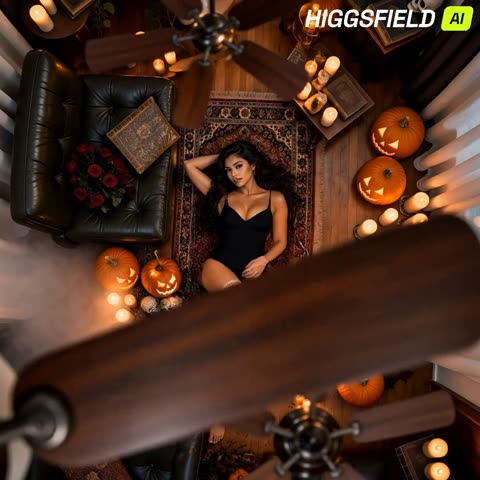</a>

A fixed overhead camera and one slow fan rotation per outfit act as the scene cut, so each costume change is hidden behind the blades. Pinning the face and body to a master character reference, while holding the pose and room constant, keeps the subject consistent across all five reveals.

MiniMax H3 · Reference-to-video · Source: [@MonetizationDon on X](https://x.com/MonetizationDon/status/2108957560707457178) · 86 likes on 2026-10-29 · found via [SkyNotSilent/awesome-MiniMax-H3-cases](https://github.com/SkyNotSilent/awesome-MiniMax-H3-cases)

[`halloween`](tags.md#tag-halloween) [`fashion`](tags.md#tag-fashion) [`fan-transition`](tags.md#tag-fan-transition) [`overhead-camera`](tags.md#tag-overhead-camera)

<details><summary><b>Prompt</b></summary>

```text
Create a photorealistic cinematic Halloween fashion transformation video featuring Alexa Grey, using the supplied Alexa Grey Master Character Lock as the exact identity reference.

Alexa is lying in the exact same relaxed pose on a vintage Persian rug in a dark, elegant Halloween-decorated living room.

CAMERA:
Fixed directly overhead.
Perfect top-down composition.
No camera movement.
No cuts.
No zoom.
No change in angle.
Alexa remains in exactly the same position throughout the entire video.

A large wooden ceiling fan is positioned directly between the camera and Alexa.

THE TRANSITION CONCEPT IS EXTREMELY IMPORTANT:

The ceiling fan rotates VERY SLOWLY.

ONE COMPLETE SLOW ROTATION OF THE CEILING FAN = ONE OUTFIT CHANGE.

As the fan completes one slow rotation, its blades naturally sweep across the camera's view and temporarily obscure Alexa.

When that ONE complete rotation finishes and the fan returns to its original position, Alexa is revealed wearing ONE completely different Halloween costume.

Then the fan makes another single slow rotation, revealing the next outfit.

Do NOT make multiple outfit changes during one rotation.

Do NOT make the fan spin rapidly.

Do NOT use cuts, dissolves, flashes or digital transition effects.

The fan itself must create the transformation.

OUTFIT SEQUENCE:

START:
Alexa wears a simple elegant black outfit.

ROTATION 1:
One slow complete fan rotation.
When the rotation finishes, reveal:

GOTHIC WITCH
Elegant black Victorian witch dress, dramatic pointed witch hat, dark lace, gothic accessories and mysterious Halloween styling.

ROTATION 2:
One slow complete fan rotation.
Reveal:

VAMPIRE QUEEN
Elegant black-and-deep-red Victorian gown, dramatic cape, gothic jewelry and sophisticated vampire styling.

ROTATION 3:
One slow complete fan rotation.
Reveal:

DEMON QUEEN
Elegant black-and-crimson gothic costume, subtle horns, dramatic dark textures and supernatural styling.

ROTATION 4:
One slow complete fan rotation.
Reveal:

FALLEN DARK ANGEL
Elegant black gothic gown with enormous black feathered wings and dramatic dark angel styling.

ROTATION 5:
One slow complete fan rotation.
Reveal:

GHOST BRIDE
Distressed vintage wedding gown, long torn veil, dark roses and haunting gothic styling.

Every time the fan completes ONE slow rotation, Alexa must be fully revealed in the new outfit.

The transition should feel almost magical and seamless, as if the rotating ceiling fan is changing her costume.

Keep Alexa's exact face, hair, skin tone and body proportions unchanged.

ENVIRONMENT:
Dark luxury Halloween interior.
Vintage Persian rug.
Wooden floor.
Pumpkins.
Flickering candles.
Old books.
Skulls.
Dark flowers.
Subtle atmospheric fog.
Warm orange candlelight.
Deep cinematic shadows.
Elegant gothic atmosphere.

The environment remains exactly the same during every transformation.

FINAL SHOT:
After the fifth outfit is revealed, Alexa remains lying on the rug and slowly looks directly toward the camera while the ceiling fan continues its slow rotation.

Photorealistic.
Cinematic Halloween fashion film.
Luxury horror aesthetic.
Realistic skin and hair.
Detailed costumes.
Realistic fabric and feather textures.
4K.
16:9.

NO TEXT.
NO SUBTITLES.
NO WATERMARK.
NO EXTRA PEOPLE.
NO CAMERA MOVEMENT.
NO CUTS.
NO FAST FAN MOTION.
NO RANDOM OUTFIT CHANGES.

KEY RULE:
ONE SLOW COMPLETE FAN ROTATION → ONE NEW HALLOWEEN OUTFIT.
```

</details>

<a id="veo-cocoa-pod-to-chocolate-bar"></a>
### Cocoa pod transforming into a snapped chocolate bar

<a href="https://x.com/Fujimoto_hina/status/2094803500488372359"></a>

A JSON storyboard splits ten seconds into five two second beats, each with its own shot type, action and physics cues, so the pod to bean to molten chocolate to bar transformation stays continuous. Global specs for lighting, depth of field and a negative prompt keep the macro look consistent.

Veo 3.1 · Text-to-video · Source: [@Fujimoto_hina on X](https://x.com/Fujimoto_hina/status/2094803500488372359) · 81 likes on 2026-10-28

[`food`](tags.md#tag-food) [`macro`](tags.md#tag-macro) [`commercial`](tags.md#tag-commercial) [`json-prompt`](tags.md#tag-json-prompt) [`storyboard`](tags.md#tag-storyboard)

<details><summary><b>Prompt</b></summary>

```text
{
  "commercial_specifications": {
    "title": "From Cocoa Pod to Chocolate: Nature's Transformation",
    "duration_seconds": 10,
    "aspect_ratio": "16:9",
    "resolution": "4K",
    "style": "Cinematic photorealistic luxury food commercial",
    "lighting": "Tropical golden-hour sunlight with rich cinematic contrast",
    "depth_of_field": "Ultra-shallow depth of field with high-speed macro photography",
    "audio_visual_notes": "No text, no logos, seamless transitions, hyper-realistic physics"
  },

  "storyboard_timeline": [
    {
      "timecode": "00:00 - 00:02",
      "scene": "The Cocoa Pod",
      "shot_type": "Slow cinematic macro push-in",
      "action": "A ripe crimson-orange cocoa pod hangs from a tropical cocoa tree covered in tiny droplets after rainfall. A single droplet slides down the textured surface and falls in slow motion.",
      "lighting_atmosphere": "Warm sunset rays piercing through dense green leaves, mist and sparkling water particles"
    },

    {
      "timecode": "00:02 - 00:04",
      "scene": "The Break",
      "shot_type": "Rapid orbital macro shot",
      "action": "The cocoa pod suddenly cracks open with a powerful but elegant split. White cocoa pulp and glossy cocoa beans burst outward and float weightlessly around the camera.",
      "physics_effects": "Realistic fruit fibers, suspended droplets, slow-motion particle explosion"
    },

    {
      "timecode": "00:04 - 00:06",
      "scene": "The Transformation",
      "shot_type": "高速 rotating macro tracking shot",
      "action": "The floating cocoa beans rapidly darken and transform through a seamless visual time-lapse into perfectly roasted chocolate-brown beans. They swirl into a vortex and dissolve into thick, glossy molten chocolate.",
      "visual_details": "Steam wisps, shimmering chocolate reflections, realistic viscosity and flowing liquid physics"
    },

    {
      "timecode": "00:06 - 00:08",
      "scene": "The Pour",
      "shot_type": "Smooth continuous overhead-to-side tracking",
      "action": "The molten chocolate pours in a perfect ribbon onto a polished marble surface, spreading naturally into a flawless glossy chocolate disc.",
      "physics_effects": "Realistic liquid flow, surface tension, reflections and tiny chocolate ripples"
    },

    {
      "timecode": "00:08 - 00:10",
      "scene": "The Snap",
      "shot_type": "Ultra-macro 1000fps slow motion",
      "action": "The chocolate instantly hardens into an elegant chocolate bar. A hand gently lifts it and snaps it in half. The fracture reveals delicate layers and releases tiny chocolate crumbs into the air.",
      "texture_focus": "Glossy tempered surface, sharp snap, realistic porous interior, microscopic chocolate fragments"
    }
  ],

  "prompt_parameters": {
    "camera": "Macro push-in to orbital tracking, aerial transition, continuous motion, ultra-high-speed slow motion",
    "render_qualities": [
      "Photorealistic cocoa textures",
      "Luxury food advertising aesthetic",
      "Cinematic tropical lighting",
      "Realistic liquid chocolate physics",
      "Seamless transformations",
      "Natural motion blur",
      "Extreme macro detail",
      "Premium 4K commercial quality"
    ],
    "negative_prompt": "text, watermark, logo, packaging, cartoon, CGI appearance, plastic texture, unrealistic liquid, blurry details, distorted hands, jerky movement, abrupt cuts, artificial lighting, duplicated objects"
  }
}
```

</details>

<a id="veo-miniature-workers-giant-banana-gelato"></a>
### Tiny workers peel a giant banana for gelato

<a href="https://x.com/Fujimoto_hina/status/2107732918932328800">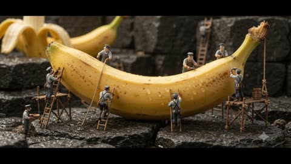</a>

A JSON structure splits the clip into labeled stages (setup, banana preparation, scene transition), so each beat gets its own concrete action. A macro low angle and a physical diorama look keep the tiny workers believable against the oversized fruit.

Veo 3.1 · Text-to-video · Source: [@Fujimoto_hina on X](https://x.com/Fujimoto_hina/status/2107732918932328800) · 77 likes on 2026-10-28

[`miniature`](tags.md#tag-miniature) [`macro`](tags.md#tag-macro) [`food`](tags.md#tag-food) [`diorama`](tags.md#tag-diorama) [`json-prompt`](tags.md#tag-json-prompt)

<details><summary><b>Prompt</b></summary>

```text
{
  "title": "Golden Titan: The Miniature Banana Silk Gelato",
  "duration": "10 seconds",
  "format": "16:9, 4K",
  "style": "Cinematic photorealistic artisanal food commercial with hyper-realistic miniature diorama craftsmanship",

  "prompt": "Create a seamless 10-second cinematic macro journey showing the creation of an impossibly luxurious banana silk gelato inside a gigantic handcrafted miniature culinary world. The entire environment must look like a physically photographed ultra-realistic diorama, with tiny human food artisans working around monumental banana fruit, machinery, tools, and ingredients. Begin with an extreme macro low-angle shot of a gigantic perfectly ripe golden banana resting across dark wet basalt rock. The banana is enormous compared with the miniature workers, its curved peel covered in realistic fine pores, subtle brown freckles, tiny condensation beads, natural ridges, and soft golden highlights. Tiny culinary artisans, only a few centimeters tall, climb wooden ladders and rope scaffolds surrounding the banana. They wear charcoal-gray chef aprons, leather gloves, miniature boots, safety goggles, and realistic utility harnesses.",

  "banana_preparation": "Several miniature workers carefully secure the banana using braided ropes, wooden braces, and tiny steel anchors. Others operate a monumental precision peeling mechanism. The thick golden peel slowly separates and curls backward in dramatic slow motion, revealing an enormous creamy ivory-golden banana interior. Individual fibrous strands stretch naturally between the peel and fruit. Tiny droplets of banana moisture sparkle under the warm light. Workers use miniature brass hooks and curved stainless-steel tools to guide the peel away while others collect freshly exposed banana flesh into tiny copper containers. The banana should look ripe, fresh, dense, creamy, and naturally sweet—not rotten or excessively brown.",

  "scene_transition": "As the giant banana peel curls away, the camera smoothly travels through the exposed banana surface and transitions into a spectacular miniature ingredient-processing chamber hidden inside the culinary world. Fresh banana flesh is pressed through enormous polished brass rollers and transparent glass tubes. Thick golden banana puree flows through the system like a luxurious river while miniature workers operate hand wheels, valves, pumps, and pressure gauges.
```

</details>

<a id="wan-lens-one-camera-commercial"></a>
### Fictional LENS ONE camera on dark studio surface

<a href="https://x.com/AIwithSynthia/status/2102976373606510839">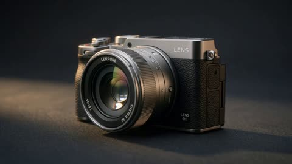</a>

The prompt splits the 30 second spot into timed beats, each with its own shot and camera move, so the model gets a clear shot order. Repeating the same character and camera design lines in every beat keeps the person and product consistent across shots.

Wan 3.0 · Text-to-video · Source: [@AIwithSynthia on X](https://x.com/AIwithSynthia/status/2102976373606510839) · 67 likes on 2026-10-29

[`product-ad`](tags.md#tag-product-ad) [`camera`](tags.md#tag-camera) [`macro`](tags.md#tag-macro) [`golden-hour`](tags.md#tag-golden-hour)

<details><summary><b>Prompt</b></summary>

```text
Create a 30-second, ultra-realistic cinematic product commercial for a fictional premium mirrorless digital camera called LENS ONE. Make it feel like a high-end global camera campaign with cinematic storytelling, beautiful photography, premium product cinematography and emotional everyday moments.
Feature a stylish young woman in her early 20s with long dark hair, natural makeup and a sophisticated outfit: cream fitted blazer, white top, high-waisted tailored trousers, minimal gold jewelry and elegant sneakers. Keep her face, hairstyle, body proportions and outfit consistent throughout.
0–4s: Open with a dramatic macro close-up of the LENS ONE resting on a premium dark surface. Slowly glide around the camera, revealing the textured grip, metallic body, lens barrel, control dial, shutter button and detailed lens glass. Show the aperture opening, then the woman naturally picking up the camera.
4–10s: She walks through a beautiful city street during golden-hour light and notices a child chasing soap bubbles. She raises the camera, looks through the viewfinder and presses the shutter. The exact moment briefly freezes into a beautiful cinematic photograph. Show the captured image clearly on the camera's rear display.
10–17s: She continues walking and photographs an elderly couple holding hands, a street musician and a dog running through sunlight. Include cinematic close-ups of her eye against the viewfinder, her finger pressing the shutter, the focus ring turning and the camera lens locking focus.
17–23s: Create a fast premium montage of the camera capturing different moments: a cyclist passing through golden light, rain droplets falling, friends laughing at a café and sunlight reflecting on wet pavement. Between shots, show detailed macro product shots of the lens, controls, shutter mechanism and rear display.
23–27s: She sits at an outdoor café and reviews the photographs on the camera screen. The images appear as a beautiful visual story of her day. She pauses on one photograph, smiles and looks back toward the street.
27–30s: She places the camera carefully on the table. The background becomes beautifully blurred as the camera becomes the sole focus. Slowly push toward the product, showing the lens glass catching warm sunset light and revealing the premium body details. End on a clean hero shot of the entire camera against the glowing city skyline.
Voiceover:
“Some moments happen once. Make them unforgettable.”
Ultra-realistic luxury camera advertising, cinematic bokeh, realistic metal and rubber textures, detailed lens reflections, natural skin and fabric textures, smooth camera movement, subtle film grain, realistic motion blur and authentic shutter sounds.
Keep the camera design, lens, buttons, dials, proportions and materials identical in every shot. No camera morphing, changing lens design, distorted hands, extra fingers, identity drift, duplicated people, unrealistic reflections, floating camera, excessive VFX, CGI appearance, subtitles, captions, random text, logos or watermark.
```

</details>

<a id="wan-red-satin-slip-dress-fashion-film"></a>
### Red satin slip dress in a luxury fashion film

<a href="https://x.com/johnAGI168/status/2091876549985288529">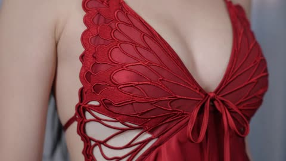</a>

The @Fig1 and @Fig2 reference images lock the model face and the dress details, and each beat gets a timestamp, a named camera move and a sound cue. A dark, low saturation room leaves the red dress as the only strong color in the frame.

Wan 3.0 · Reference-to-video · Source: [@johnAGI168 on X](https://x.com/johnAGI168/status/2091876549985288529) · 64 likes on 2026-10-29

[`fashion`](tags.md#tag-fashion) [`luxury`](tags.md#tag-luxury) [`multi-shot`](tags.md#tag-multi-shot) [`reference-images`](tags.md#tag-reference-images)

<details><summary><b>Prompt</b></summary>

```text
[Style] Luxury Fashion Film / High-End Commercial, photorealistic texture, ARRI Alexa shooting feel, shallow depth of field, 8K ultra-HD, DaVinci advanced color grading, dark low-saturation background to accentuate pure true red, no plastic feel, no AI sheen
[Aspect Ratio] 16:9 landscape
[Duration] 20 seconds
[Scene] Penthouse hotel suite, floor-to-ceiling windows overlooking a twilight city skyline, white sheer curtains billowing in a through-breeze, interior with beige wood-paneled walls and black marble countertops, the only high-saturation color in the entire frame is that red dress
[Character] Female model
@Fig1
 (maintain consistent facial features, hairstyle, skin texture, temperament calm and restrained, no smiling or at most the faintest hint of a smile)
[Outfit] She wears the red silk satin slip dress from @Fig2 (wing-shaped 3D weave at the chest, hand-braided rope cutouts at the waist sides, irregular handkerchief hem), keeping the style, color, and craftsmanship details completely consistent

[00:00-00:04] Shot 1: Fabric Tease (Macro / Slider)
Macro lateral slide: Red silk satin slowly glides across a dark background, light flowing along the fabric's folds, revealing the yarn weave and satin sheen highlights.
The shot slowly pushes toward the wing-shaped 3D weave at the chest, with the braided rope structure clearly visible.
Sound: Subtle rustle of fabric friction, low-frequency string note enters.

[00:04-00:09] Shot 2: Figure Enters Frame (Backlit Tracking)
Medium-long side backlit shot: She walks past the sheer curtains in the red dress, twilight side backlight piercing through the curtains, casting a long shadow on the floor.
The hem lifts and falls with her steps, the irregular handkerchief hem's pointed edges tracing arcs in the air, the through-breeze making the curtains and hem flutter together.
Low-angle horizontal tracking shot, figure always positioned in the right third of the frame.

[00:09-00:14] Shot 3: Craft Close-Up (Detail Insert)
Close-up: Her fingers lightly pinch the end of the satin bow tie at the chest, the ribbon dangling.
Cut to close-up: The hand-braided rope cutouts at the waist side form a row of fine dense shadows in the light.
Cut to close-up: The hem edge whips through the air in slow motion (slow-mo), the satin flipping from deep burgundy to bright true red.

[00:14-00:18] Shot 4: Glance Back Medium Shot (Medium Shot / Push-in)
Medium shot: She stands with her back to the camera by the window, her shoulder and back lines forming a clean composition with the red ribbon straps, slowly turning her head to look at the camera.
Facial pores and skin texture rendered realistically, gaze calm and direct into the lens, chin slightly raised, long hair subtly swaying in the breeze.
Very slow push-in (slow push-in), focus locked on her eyes throughout.

[00:18-00:20] Shot 5: Freeze Frame Close (Freeze / Title Card)
Full shot freeze: She stands before the floor-to-ceiling window, the red dress the only bright color in the frame, background city skyline blurred into bokeh light points.
The frame gradually fades to black, white thin sans-serif English subtitles fade in at the center: "IN RED."
Sound: Strings resolve on a sustained note, with 0.5 seconds of silence at the tail.
```

</details>

<a id="h3-riviera-quilted-bag-commercial"></a>
### Grey quilted bag and two chain straps by pool

<a href="https://x.com/Dustfinger2077/status/2086086171117969702">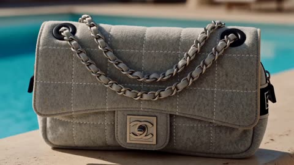</a>

Each time window in the timeline gives one job to one shot, and the product reference is named as the sole source so the bag keeps its build. A closing list of banned changes such as merged straps, leather texture and a crossbody carry locks the details the model usually drifts on.

MiniMax H3 · Reference-to-video · Source: [@Dustfinger2077 on X](https://x.com/Dustfinger2077/status/2086086171117969702) · 63 likes on 2026-10-29 · found via [SkyNotSilent/awesome-MiniMax-H3-cases](https://github.com/SkyNotSilent/awesome-MiniMax-H3-cases)

[`minimax-h3`](tags.md#tag-minimax-h3) [`product-fidelity`](tags.md#tag-product-fidelity) [`fashion-commercial`](tags.md#tag-fashion-commercial) [`multi-shot`](tags.md#tag-multi-shot)

<details><summary><b>Prompt</b></summary>

```text
Create a 15 second, 16:9 luxury fashion commercial using @Image1@Image2 as exact visual references. @Image1 is the sole product reference. Preserve the bag’s exact proportions, pale grey white woven textile, irregular rectangular stitching, soft structure, curved flap, silver clasp, four black eyelets, side construction, zipper details, and hardware. Do not reinterpret it as leather. The bag has two separate short straps made from silver chain woven with matching textile. Preserve their exact construction, attachment points, resting positions, and maximum lengths. The front strap connects only the two front eyelets. The rear strap connects only the two rear eyelets. They must never cross, merge, disappear, duplicate, lengthen, or be rerouted. @Image2 is the exact character reference. Preserve the woman’s face, green eyes, straight blonde bob, natural proportions, and understated makeup. Dress her consistently in a sophisticated beige silk summer mini dress with a square neckline, narrow shoulder straps, fitted waist, and softly moving skirt. Add ivory slingback heels and small pearl earrings. The bag is the visual anchor throughout. It must always be the largest, brightest, sharpest, or most prominently framed element. The woman, hotel, landscape, and car are supporting elements only.
0 to 1.75 seconds: Tight product shot of the bag alone on a sunlit limestone console beside a softly shimmering Riviera pool. Directional sunlight reveals the textile weave, stitching, two straps, four eyelets, side details, and clasp. 1.75 to 3.25 seconds: Keep the bag large and tack sharp in the foreground while the woman approaches through the bright hotel suite in soft focus. She has not touched it yet. 3.25 to 5 seconds: Extreme close up of her fingers lifting both straps together. Keep the front and rear straps visibly separate, correctly routed, and uncrossed. Show realistic chain tension, textile threaded through the links, and accurate hands. 5 to 7 seconds: She places both short straps together over one shoulder and wears the bag as a side shoulder bag. It hangs close beneath her arm, high against the side of her upper waist. It must never reach her hip or thigh. Both straps remain visibly separate, uncrossed, and at their true maximum length. 7 to 9 seconds: Close tracking shot through a sunlit hotel colonnade, composed mainly around the bag moving naturally against the beige silk dress. The straps respond realistically to her steps, shoulder movement, tension, and gravity. 9 to 11 seconds: The bag stands upright and tack sharp on a pale stone terrace table. Its two straps settle naturally and remain identifiable. The woman sits behind it in soft focus, looking toward the sea. 11 to 13 seconds: She carries the bag on one shoulder toward a cream vintage convertible. In a tight product focused montage, she opens the driver door, removes both straps from her shoulder, and carefully places the bag upright on the front passenger seat cushion. The bag’s entire base must rest directly on the horizontal cushion where a passenger sits. It is not on the backrest, headrest, seat edge, center console, or top of the seat. The passenger backrest rises behind it. Both straps settle naturally beside and partly behind the bag without disappearing. She enters the driver seat. Keep the car cropped and secondary. 13 to 15 seconds: The car moves along the Riviera coast. Keep the bag upright, large, and tack sharp on the passenger seat cushion while the woman holds steering wheel and drives in the soft background. The sea and road pass through the windows in gentle motion blur. Moving sunlight reveals the woven textile, stitching, eyelets, two distinct straps, and hardware. End with one controlled flash across the silver clasp.
Use bright, fashion forward European luxury cinematography inspired by a restored 1990s campaign film. Directional Mediterranean sunlight, dimensional shadows, layered reflections, warm 35 mm grain, gentle haliation, creamy highlights, subtle film weave, natural motion blur, and tactile textile detail. Use elegant editorial cuts, realistic movement, accurate hands, and consistent spatial logic. Add a sophisticated original fashion score with crisp percussion, warm bass, airy electronic textures, subtle chain sounds, clasp click, silk movement, footsteps, coastal ambience, car door movement, and quiet engine sound. No dialogue. No product redesign, leather texture, colour change, altered stitching, missing or merged straps, crossed straps, extra straps, extended straps, changed eyelet routing, crossbody carry, low hip placement, warped chains, changed hardware, duplicated bag, distorted hands, outfit changes, blue dress, car hero shot, wide vehicle profile, empty road shot, incorrect seat placement, text, or subtitles.
```

</details>

<a id="h3-low-angle-fashion-alley-tracking"></a>
### Low angle fashion tracking shot in sunlit alley

<a href="https://x.com/Kiber_Alla/status/2083583963512062019"></a>

The prompt opens with camera and lens cues (ARRI Alexa 35, spherical lens, natural daylight), then fixes a single continuous backward tracking move at low angle. Wardrobe, fabric physics, wind and a list of dance gestures give the model concrete motion to render, while strong sun and deep shadow set the contrast.

MiniMax H3 · Text-to-video · Source: [@Kiber_Alla on X](https://x.com/Kiber_Alla/status/2083583963512062019) · 61 likes on 2026-10-28 · found via [SkyNotSilent/awesome-MiniMax-H3-cases](https://github.com/SkyNotSilent/awesome-MiniMax-H3-cases)

[`fashion`](tags.md#tag-fashion) [`low-angle`](tags.md#tag-low-angle) [`tracking-shot`](tags.md#tag-tracking-shot) [`alley`](tags.md#tag-alley) [`photorealistic`](tags.md#tag-photorealistic)

<details><summary><b>Prompt</b></summary>

```text
Ultra realistic cinematic video, shot on ARRI Alexa 35 with spherical lens, natural daylight, photorealistic, looks like real footage filmed on location, high-end fashion film aesthetic, extreme detail, realistic skin texture, real fabric physics, subtle film grain. Continuous low angle tracking shot, camera smoothly moving backward as a beautiful young woman with long dark wind-blown hair walks and performs down a narrow sun-drenched urban alley between old textured stone buildings under deep blue sky. She wears a flowing milky white asymmetrical off-shoulder top and high-waist wide-leg technical cotton culottes with a thin rope belt. The wide pants and fabric move naturally and dramatically with the wind and her body. She sings with genuine joy, smiling and softly laughing, maintaining strong eye contact with the camera, while performing free, light dance elements — fluid arm gestures, body swaying, and elegant full turns around herself as she continues walking forward. Her movement is energetic yet effortless, full of lightness and positive energy. Cinematic natural lighting with strong sunlight and deep shadows, realistic motion blur, high dynamic range, masterpiece, best quality, no artificial look.
```

</details>

<a id="h3-montreal-red-knit-bridge-walk"></a>
### Woman in red knit top walks under Montreal bridge

<a href="https://x.com/PrometheanAIX/status/2091512921482227817">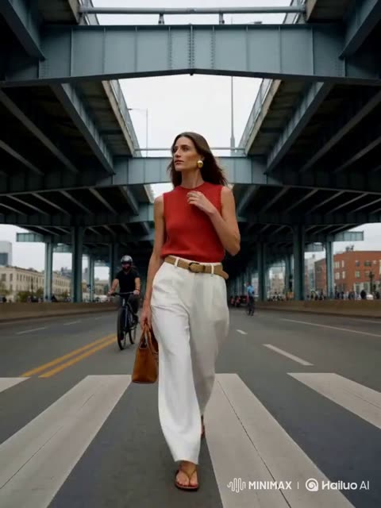</a>

Locks identity with an explicit character reference and a fixed wardrobe list, then sets an eight scene timing map borrowed from a reference video so the cuts keep rhythm. Each scene pairs a camera move with a motivated pedestrian pass or foreground occlusion, which keeps the tracking shots busy without staging the model.

MiniMax H3 · Reference-to-video · Source: [@PrometheanAIX on X](https://x.com/PrometheanAIX/status/2091512921482227817) · 60 likes on 2026-10-29

[`fashion`](tags.md#tag-fashion) [`montreal`](tags.md#tag-montreal) [`tracking-shot`](tags.md#tag-tracking-shot) [`character-reference`](tags.md#tag-character-reference)

<details><summary><b>Prompt</b></summary>

```text
A model walking toward a camera on a blank runway shows you the clothes. A woman moving through a city shows you the life those clothes belong to.

I created this video using Hailuo MiniMax H3.

Hailuo is great at keeping a character visually consistent while pushing them through fast-moving scenes, changing locations and different camera angles.

It really shines when you want the camera to feel active, with tracking shots, changing perspectives and movement.

Creative direction:
Keep the character moving through changing environments so each new location gives the clothing a different attitude, context and sense of momentum.

Treat every location as another chapter of the same fashion story, using forward movement and environmental changes to keep the viewer discovering something new

Art direction:
Elevated city fashion, strong architectural lines, street-level tracking shots, passing pedestrians, transit movement and wider environmental frames balanced against clean full-body looks.

Modern metropolitan styling, natural city light, cinematic tracking, full-body compositions, active backgrounds and architectural scale that makes the fashion feel aspirational without feeling staged.

Video prompt:
Hailuo MiniMax H3, 15-second cinematic urban fashion video, vertical 9:16. Use the attached woman as the exact character reference. Preserve her face, hair, body proportions, facial structure, and identity throughout. Keep her wardrobe consistent: tomato-red sleeveless knit top, loose white tailored trousers, woven belt, sculptural gold earrings, and flat leather sandals. Contemporary summer streetwear with a confident, polished Montreal attitude.

Recreate the exact visual rhythm and shot grammar of the Chicago Streetwear 1 reference video. The video should feel like a fast, stylish day-in-the-city portrait with active urban life, not a posed fashion advertisement. Use grounded walking, natural gestures, confident posture, realistic pedestrian movement, motivated camera motion, and quick cinematic cuts. No dialogue, no narration, no text, no logos, no morphing, no plastic skin, no exaggerated choreography.

Use eight scenes with the same relative timing as the Chicago reference, expanded to 15 seconds: approximately 3.2 seconds, 1.7 seconds, 1.9 seconds, 1.6 seconds, 1.6 seconds, 1.6 seconds, 1.4 seconds, and 2 seconds.

Scene 1, 0:00–0:03.2:
Begin beneath the Bonaventure Expressway in Griffintown, using the massive industrial beams and repeating overhead structure as strong leading lines. Front-facing gimbal tracking moves backward as she walks toward the camera with relaxed confidence. She lightly adjusts the edge of her red knit top or touches the woven belt as she walks. Keep her movement natural and purposeful, with pedestrians and cyclists moving through the background.

Scene 2, 0:03.2–0:04.9:
Hard cut to a colorful mural-lined lane near Saint-Laurent Boulevard in the Plateau. Use a side and slightly rear tracking angle as she walks forward along the brick wall. She briefly touches her collar and glances toward the mural, then continues without stopping. The camera moves with her smoothly while the background slides past.

Scene 3, 0:04.9–0:06.8:
Three-quarter front tracking shot as she crosses Saint-Catherine Street near Place des Arts. Downtown towers, traffic, traffic lights, and pedestrians create depth behind her. She steps confidently through the crosswalk, looks toward something off to the side, and keeps moving. Show her from the waist up and full body in alternating moments. She should look intelligent, stylish, radiant, and completely comfortable in the city.

Scene 4, 0:06.8–0:08.4:
Outside a fashionable boutique in Mile End, she pauses with two stylish local friends. They exchange a quick natural laugh and a few expressive hand gestures, with no audible dialogue. She reacts warmly and intelligently, listening for a moment before smiling and moving on. This should feel like a genuine social encounter, not a staged pose.

Scene 5, 0:08.4–0:10:
At the Jean-Drapeau Montreal Metro platform, she stands near the platform edge as a train rushes past, creating a strong burst of motion and wind through her hair and clothing. She remains composed, then turns and begins walking along the platform as the train disappears. Use a dynamic lateral camera move with realistic motion blur.

Scene 6, 0:10–0:11.6:
Cut to Rue Saint-Paul in Old Montreal. Side-tracking shot as she passes reflective glass storefronts and historic stone buildings. Pedestrians cross close to the lens in the foreground, briefly obscuring her and revealing her again. She maintains a confident, effortless stride and never stops for the camera.

Scene 7, 0:11.6–0:13:
Rear-follow shot along the Old Port waterfront. The camera follows her from behind as she walks beside the river with cyclists, railings, historic architecture, and the Montreal skyline in the distance. She looks slightly toward the water and adjusts her pace naturally. Do not make this a static scenic shot. Keep the camera moving with her.

Scene 8, 0:13–0:15:
Finish with the same type of front-facing hero movement as the Chicago reference, but beneath the dramatic steel structure of the Jacques-Cartier Bridge. The camera tracks backward as she walks directly toward it, framed by powerful architectural lines. Her posture is relaxed, self-assured, and magnetic. She gives a subtle almost-smile while remaining in motion. End mid-stride with the city moving around her, not with a skyline, sunset, turn-away, or stationary fashion pose.

Overall treatment: energetic urban streetwear film, cinematic realism, crisp architectural composition, realistic Montreal street life, confident feminine movement, natural facial expressions, clean editorial color, subtle film grain, smooth gimbal tracking, lateral movement, rear-follow shots, foreground occlusion, and fast motivated cuts. Preserve her identity and outfit in every scene.

Paid promotion for Hailuo.
```

</details>

<a id="h3-milan-fashion-week-street-style-film"></a>
### Woman leaves Milan hotel in street-style film

<a href="https://x.com/PrometheanAIX/status/2089355155829325876">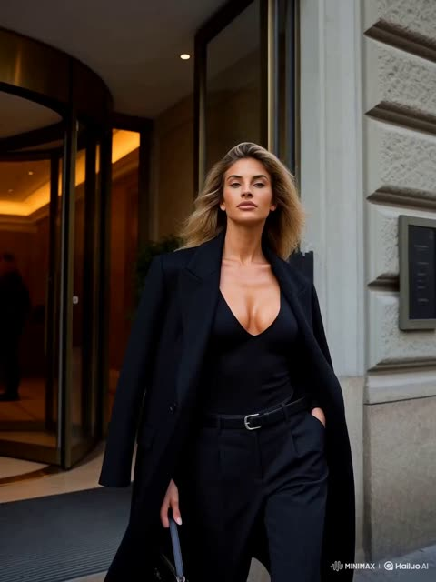</a>

The reference image locks her identity across a run of very short cuts with a longer hero shot at the end, and the prompt names each camera move (gimbal, lateral tracking, rear follow, push-in) so the edit rhythm stays deliberate. Explicit no morphing and no wardrobe change clauses keep her face and outfit stable from cut to cut.

MiniMax H3 · Image-to-video · Source: [@PrometheanAIX on X](https://x.com/PrometheanAIX/status/2089355155829325876) · 55 likes on 2026-10-29

[`fashion`](tags.md#tag-fashion) [`milan`](tags.md#tag-milan) [`street-style`](tags.md#tag-street-style) [`identity-reference`](tags.md#tag-identity-reference) [`hailuo`](tags.md#tag-hailuo)

<details><summary><b>Prompt</b></summary>

```text
Create a hyper-realistic cinematic fashion-lifestyle video, approximately 15 seconds total, using the reference image as the identity reference for the same woman throughout.

She is a striking young woman with sun-kissed skin, voluminous blonde hair, and a confident, elevated editorial presence.

Dress her in a polished contemporary Milan Fashion Week street-style look: a strong, fashion-forward outfit with a clean silhouette, such as tailored trousers, a fitted top, a structured oversized coat, refined boots or heels, and a sleek designer-style bag. Keep the styling sophisticated, modern, and expensive-looking. No wardrobe changes.

No morphing. Keep her face, hair, body, and overall identity consistent in every shot.

Make it fast, stylish, highly realistic storytelling with mostly 0.8 to 1.8 second scenes, plus one slightly longer 2 to 3 second hero moment at the end. Camera work should feel premium and dynamic, with smooth gimbal movement, lateral tracking, rear-follow, subtle orbiting, and elegant push-ins.

The tone is elevated, fashion-insider, and candid, like she is moving through Milan Fashion Week between moments rather than posing for a campaign.

She should feel self-possessed, magnetic, and naturally cool. No stiff posing, no plastic skin, no uncanny behavior, no scene instability, and no sudden changes in lighting, location logic, or outfit.

Sequence: Open with her leaving a beautiful Milan hotel or fashion apartment building and stepping onto the street with purpose, the camera moving with her as if catching her in motion.

Cut to her crossing a stylish Milan street while photographers and fashion people move in the background.

For the third scene, cut to a very intimate close-up of her face, neck, and the top of her shoulders only. She looks directly into the camera with calm intensity, creating an immediate personal and emotional connection with the viewer. Keep this moment extremely beautiful, confident, and natural, with subtle movement in her hair and a shallow depth of field.

Then cut to her walking past a cluster of photographers or guests outside a fashion venue, not stopping to pose, just moving through the energy.

Cut to a quick espresso moment at a standing café bar or outside a polished café, where she glances sideways and then back into motion.

Cut to a candid social beat where she greets two stylish friends outside a venue or on a narrow Milan street, with a quick cheek kiss, smile, or touch on the arm, making it feel like she belongs in this world.

End with a dramatic hero shot, slightly longer than the other scenes, showing her from the waist up. She stands or slowly walks in a striking Milan setting, such as outside a fashion venue, beneath elegant architecture, or in a softly glowing evening street scene. The camera performs a subtle, graceful move while she looks directly into the lens again, creating a second intimate emotional connection with the viewer.

She should look powerful, beautiful, and unforgettable.Make Milan feel specific through elegant streets, fashion-week crowds, refined architecture, luxury vehicles, soft European daylight or golden-hour light, and the understated chaos of the fashion world.

The result should feel like an insider Milan Fashion Week street-style film, not a runway video, not a tourist video, and not a posed ad. It should feel spontaneous, cinematic, fashion-forward, and emotionally engaging.

Paid partnership with Hailuo.
```

</details>

<a id="h3-cairn-munro-silent-electric-overlander-typography"></a>
### Silent Electric Overland Vehicle in Highlands Rain

<a href="https://x.com/Dheepanratnam/status/2084201268977844521"></a>

Two reference sheets lock the vehicle design and the typeface, while a cut by cut timecode list with one-line type overlays sets the rhythm. An explicit audio law allows only rain, wind and water and bans engine sound, so the silent vehicle carries the idea.

MiniMax H3 · Reference-to-video · Source: [@Dheepanratnam on X](https://x.com/Dheepanratnam/status/2084201268977844521) · 50 likes on 2026-10-28 · found via [SkyNotSilent/awesome-MiniMax-H3-cases](https://github.com/SkyNotSilent/awesome-MiniMax-H3-cases)

[`automotive`](tags.md#tag-automotive) [`typography`](tags.md#tag-typography) [`cinematic`](tags.md#tag-cinematic) [`sound-design`](tags.md#tag-sound-design) [`multi-shot`](tags.md#tag-multi-shot)

<details><summary><b>Prompt</b></summary>

```text
CAIRN MUNRO — "ARRIVE UNHEARD" — 14 CUTS · 15s · 2K · 24fps  REFERENCES: the attached PRODUCT SHEET@Image1 is the exact vehicle — match its proportion, stance, glasshouse angle, cladding, rack and light signature exactly, invent nothing. The attached TYPE SHEET@Image2 is the exact typeface, weight, tracking and scale for every overlay. Match it.  AUDIO LAW — HIGHEST PRIORITY. NO MUSIC ANYWHERE. Do not generate score, soundtrack, background music, beat, drums, percussion, bassline, synth pad, drone, melody, chord, ambient bed, riser, braam, trailer hit, stinger, swell, or any tonal instrument. Where music would normally be scored, render SILENCE. NO VOICE — no narration, dialogue, vocals, breath. ONLY PERMITTED AUDIO, all of it environmental: rain striking wet granite; rain drumming on metal and glass; wind over ridge grass; a burn running hard over rock; gravel shifting; distant thunder; and true silence. All of it recorded-real, close, dry, no reverb wash. Nothing sustains musically.  SILENCE LAW — the engine of the film. The landscape is loud. The vehicle adds nothing to it. No engine, no exhaust, no motor whine, no transmission, no tyre roar, no wind noise off the body, no door, no suspension. Rain striking its panels is permitted — that is the world touching the car, not the car making sound. Whenever the vehicle fills frame and nothing is striking it, the mix drops to near-silence. If an engine or tyre sound would normally be added to a moving vehicle, render silence instead. An engine sound anywhere in this film is a failure.  EDIT METRONOME — SILENT: cuts locked to 96 BPM, 1 beat = 0.625s, 24 beats. A timing grid for cutting ONLY. Do not generate audio to this tempo.  BRAND: CAIRN. PRODUCT: CAIRN MUNRO, a fully electric expedition overlander. It is silent because it is electric — the claim is literal.  SUBJECT: per the sheet — boxy full-size SUV, upright glasshouse, flat vertical sides, squared arches, short overhangs, high clearance. Matte peat green-black body, charcoal composite cladding and sliders, raw anodised aluminium rack and skid plate, bone-white roof, signal-orange recovery hooks, full-width thin white LED signature front and rear, no grille, all-terrain tyres on flat-faced aluminium wheels. No badging.  WORLD: the Scottish Highlands in heavy weather. Wet granite, peat, ridge grass and heather. Low cloud moving fast across the tops. Constant rain. A single unmade stone track. No road markings, no buildings, no fences.  PALETTE: peat #1B2320, granite #4A4E4B, mist #D9DDDB, aluminium #8E9490, heather #6B5470. Signal orange #E24E1B on the recovery hooks only, never more than a few pixels. Cold northern light, overcast, no sun, no warmth anywhere. Desaturated but never graded grey — these are true wet colours.  MIST LAW: mist is real volume. It moves, thins, and parts to reveal. It never becomes a soft filter — everything outside the mist stays razor sharp. It never glows, never catches a god ray, never becomes smoke.  TYPE LAW: every overlay uses the TYPE SHEET face, CAIRN EXTENDED — wide uppercase, medium weight, wide tracking, pure white, with the hairline contour rule beneath each line. Two positions only: body lines lower-left on the safe-area grid, the lockup dead centre. Type is revealed by a hard-edged horizontal wipe travelling left to right. It never fades, scales, rotates, skews, glows or casts a shadow. It cuts on with the cut and holds absolutely still until the next cut takes it. Always pure white.  TEXT ACCURACY: every overlay word is spelled exactly as written and appears exactly once. No extra letters, no duplicated lines, no garbled glyphs, no invented words. No text of any kind on the vehicle.  CAMERA: motion-control smooth and heavy, no handheld, no drift. Long-lens tracking and slow cranes. Clean digital, no grain. Directional blur in transit; everything arrives sharp and holds still.  RHYTHM: cuts 01–02 hold two beats. Cuts 03–10 are one beat apart, the spec run. Cuts 11–12 hold two beats. Cuts 13 and 14 hold four beats each.  01 · 0.000 · Wide. A granite ridge under fast-moving low cloud, rain falling hard across frame. No vehicle. SOUND: rain on stone and wind, loud.  02 · 1.250 · Macro. Rain hammering a wet granite face, water sheeting down the fractures. TYPE: EVERYTHING HERE  03 · 2.500 · A burn crashing white over black rock. TYPE: MAKES A SOUND  04 · 3.125 · Wind flattening ridge grass and heather in one long gust.  05 · 3.750 · The vehicle enters, low and wide, emerging from mist on the stone track. The mix drops away to rain only. TYPE: ONE THING DOESN'T  06 · 4.375 · Macro. A tyre rolling through standing water, the water throwing up hard. SOUND: water only, no tyre noise. TYPE: 800 VOLT  07 · 5.000 · Macro. Rain drumming on the bone-white roof panel. TYPE: 710 KM  08 · 5.625 · Macro. Water running off the anodised aluminium rack. TYPE: 900 NM  09 · 6.250 · Low long-lens track alongside the flat body side, mist parting off the panel. TYPE: 1050MM WADING  10 · 6.875 · Macro. The thin white LED signature cutting through mist. TYPE: 3.5T TOWING  11 · 7.500 · High wide. The vehicle small on a vast stone plateau, cloud dragging over it. SOUND: wind, distant thunder.  12 · 8.750 · Front three-quarter, wading a burn, water pushing up over the sills and breaking white. SOUND: water only.  13 · 10.000 · THE SHOT. A single mature red deer stag stands side-on on the ridge above the track, wet coat, broad antlers, head turned to camera. The vehicle passes below him in the same frame. The stag does not flinch, does not run, does not move at all. Hold on him. SOUND: rain and wind only — no vehicle sound whatsoever.  14 · 12.500 · The vehicle static on the ridge in moving mist, dead frontal. TYPE: CAIRN, dead centre. Two beats later MUNRO wipes on beneath it, then ARRIVE UNHEARD. beneath that. Hold, cut to black. SOUND: rain and wind, then hard silence on the cut. No end cue, no final hit.  NEGATIVE: no music, score, beat, instruments, narration, voice, engine noise, tyre noise. No people, hands, faces, drivers, passengers. No other vehicles, no roads, no road markings, no signage, no buildings, no fences, no power lines. No text other than the specified overlays — no captions, subtitles, watermarks, UI, timecode. No badging or lettering on the vehicle. No sun, no warm light, no golden hour, no lens flare, no god rays, no smoke, no snow. No glitch, scanlines, film burn, light leaks. The stag never runs. No colour outside the palette. No invented body parts.
```

</details>

<a id="h3-leather-jacket-ad-timed-scenes"></a>
### Woman in black leather jacket urban ad

<a href="https://x.com/juliaevee/status/2114578188139434224"></a>

Timed scene beats (0 to 2 seconds, 2 to 4 seconds and so on) let the model pace a ten-second commercial in one pass. Naming the exact garment details such as the asymmetric zipper, silver buttons and stitching keeps the jacket consistent in the close-ups.

MiniMax H3 · Text-to-video · Source: [@juliaevee on X](https://x.com/juliaevee/status/2114578188139434224) · 48 likes on 2026-10-29

[`fashion-ad`](tags.md#tag-fashion-ad) [`multi-shot`](tags.md#tag-multi-shot) [`timed-scenes`](tags.md#tag-timed-scenes) [`voiceover`](tags.md#tag-voiceover)

<details><summary><b>Prompt</b></summary>

```text
Cinematic Leather Jacket Ad | 10 Seconds | 16:9

Scene 1 (0–2s): A beautiful 25-year-old woman confidently enters a stylish urban setting wearing the exact black leather biker jacket. Cinematic tracking shot, dramatic lighting.

Scene 2 (2–4s): Close-up of the jacket’s leather texture, asymmetrical zipper, silver buttons, and detailed stitching. Smooth cinematic camera movement.

Scene 3 (4–7s): Medium and side-angle shots as she adjusts the collar, zips the jacket, and walks confidently. Premium fashion-commercial look.

Scene 4 (7–10s): Slow-motion hero shot as she turns toward the camera with a confident smile. Dramatic final pose, premium lighting, and subtle cinematic music.

Voiceover: “Bold style. Timeless attitude. Make every moment iconic.”

Negative Prompt: No changes to the original jacket design, color, zippers, buttons, or fit. No glitches, distorted anatomy, unrealistic motion, watermark, or cartoon/2D/3D animation. Photorealistic live-action only.
```

</details>

<a id="h3-night-lotus-perfume-ugc-ad"></a>
### Perfume bottle with glowing blue lotus flowers

<a href="https://x.com/juliaevee/status/2115165215738499420"></a>

The reference image locks the bottle's shape so it stays consistent through the shot. Timed beats (smile, spray, sniff, reaction, closeup finish) give the 10 seconds a clear order, and the closing negatives guard against warped bottles and extra fingers.

MiniMax H3 · Reference-to-video · Source: [@juliaevee on X](https://x.com/juliaevee/status/2115165215738499420) · 40 likes on 2026-10-29

[`perfume`](tags.md#tag-perfume) [`ugc-ad`](tags.md#tag-ugc-ad) [`product-reference`](tags.md#tag-product-reference) [`lotus`](tags.md#tag-lotus)

<details><summary><b>Prompt</b></summary>

```text
Create a 10-second premium UGC perfume advertisement, 16:9 aspect ratio, ultra-realistic cinematic quality. A beautiful 25-year-old woman with glowing skin and elegant long dark hair sits in a luxurious, softly blue-lit setting. She holds the exact Night Lotus perfume bottle from the reference image, showcasing its transparent faceted glass, silver cap, and elegant lotus label. She smiles naturally at the camera, sprays the perfume on her wrist, gently smells it, and reacts with a confident, delighted expression. Close-up shots highlight the bottle, glowing blue lotus flowers, and shimmering reflections. Smooth handheld camera movements, realistic skin texture, soft cinematic lighting, premium luxury aesthetic, natural UGC presentation. End with her holding the perfume close to the camera. No distorted bottle, no extra fingers, no product redesign, no unwanted text. Perfect 10-second commercial.
```

</details>

<a id="h3-rome-paper-map-route-reel"></a>
### Paper map route opens Rome travel reel

<a href="https://x.com/FutureVibesAi/status/2096549119234085017">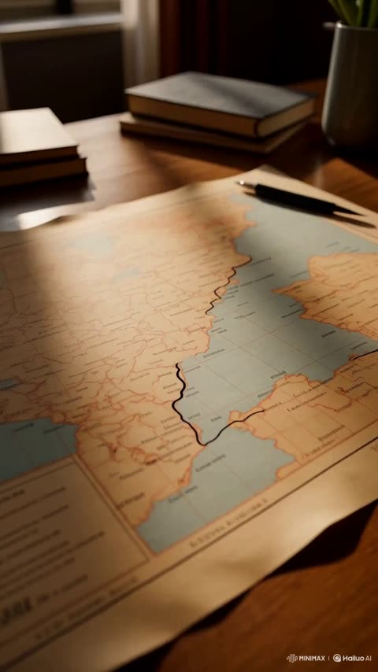</a>

Timestamped beats (0 to 2.5s, 2.5 to 7s) split the reel into shots, and a separate STYLE block fixes palette, film texture and lens behaviour across every cut. Opening on a physical object, a paper map with a drawn route line, gives the model a concrete starting frame to transition from into aerial footage.

MiniMax H3 · Text-to-video · Source: [@FutureVibesAi on X](https://x.com/FutureVibesAi/status/2096549119234085017) · 38 likes on 2026-10-29 · found via [SkyNotSilent/awesome-MiniMax-H3-cases](https://github.com/SkyNotSilent/awesome-MiniMax-H3-cases)

[`travel`](tags.md#tag-travel) [`editorial`](tags.md#tag-editorial) [`timed-shots`](tags.md#tag-timed-shots) [`paper-transition`](tags.md#tag-paper-transition)

<details><summary><b>Prompt</b></summary>

```text
Create a 15-second, 4K, 16:9 ultra-fast luxury cinematic reel of ROME, ITALY. Blend ancient Roman grandeur, modern Italian street culture, premium fashion-editorial filmmaking and experimental motion graphics.

The entire reel should feel like pages of an expensive Italian travel magazine suddenly coming alive.

0–2.5s — HISTORY COMES ALIVE

Start extremely close on an old cream-colored paper map of Rome lying on a table.

A thin hand-drawn black route line rapidly travels across the map.

Camera follows the line at high speed.

The map suddenly transforms into a REAL aerial view of Rome using a seamless paper-to-reality transition.

Camera dives toward the Colosseum.

Massive elegant typography appears INSIDE the architecture using realistic depth masking:

“ROMA”

Behind it, enormous translucent Roman numerals:

“MMXXVI”

Tiny editorial text animates around the frame:

“41.9028° N / 12.4964° E”
“ROMA / ITALIA”
“LA CITTÀ ETERNA”

VFX: architectural blueprint lines briefly reconstruct the Colosseum's missing sections, showing it complete for half a second before dissolving back into the present-day ruins.

2.5–7s — ITALIAN LIFE

Beat accelerates.

Camera races beside a classic Vespa through a narrow Roman street.

WHIP PAN →

Espresso pouring into a tiny ceramic cup in extreme macro.

MATCH CUT →

Trevi Fountain water splashes directly toward camera and becomes the transition.

FLASH →

Italian fashion model walks confidently past historic architecture.

FAST PUSH-IN →

Fresh pasta twists around a fork.

SNAP ZOOM →

Pantheon ceiling.

Camera suddenly shoots upward through the opening.

Elegant floating typography locks onto objects:

“ESPRESSO”
“STORIA”
“MODA”
“ROMA”

Thin arrows, handwritten Italian annotations, postage stamps and tiny coordinates appear like an animated luxury travel journal.

7–12s — ROMAN CHAOS

Music DROPS.

Editing becomes extremely aggressive.

COLOSSEUM → VESPA → PASTA → STATUE → ESPRESSO → TREVI → FASHION → STREET → PANTHEON.

Each clip lasts only 0.2–0.35 seconds.

Then FREEZE FRAME.

A Roman statue becomes isolated from the background like a magazine cutout.

Huge typography slides BEHIND the statue:

“2000 YEARS.”

Another frame violently stacks over it:

“STILL ALIVE.”

The screen tears horizontally like ripped magazine paper.

Three moving vertical panels appear simultaneously:

ANCIENT ROME | STREET LIFE | ITALIAN STYLE

Panels slam together on the beat.

Typography rapidly flashes:

“STORIA.”
“PASSIONE.”
“BELLEZZA.”
“ROMA.”

VFX: analog film burns, photographic flash frames, paper textures, subtle dust, handwritten marks, frame numbers, red editorial circles and fast speed ramps.

12–15s — THE ETERNAL CITY

Suddenly everything becomes quiet.

Golden-hour aerial rises slowly above the Colosseum.

Modern Rome stretches endlessly into the background.

For one second, a subtle transparent reconstruction of ancient Rome overlays the modern city — ancient temples and structures briefly appearing where they once stood.

Then the reconstruction disappears.

Huge elegant serif typography emerges behind the Colosseum:

“ROME WASN’T BUILT
IN A DAY.”

Tiny handwritten text underneath:

“Some cities are visited.
Rome is remembered.”

Camera continues rising.

A flock of birds crosses frame.

Sunlight catches the lens.

Hard cut to cream paper.

Small final stamp:

“ROMA / ITALIA”

STYLE:
Premium Italian fashion editorial meets historical documentary and modern travel commercial. Cream, terracotta, deep red, warm gold and rich Mediterranean shadows. 35mm film texture, subtle halation, realistic motion blur, natural lens flares, tactile paper graphics and sophisticated typography.

CAMERA:
Drone dives, FPV sweeps, whip pans, snap zooms, macro photography, orbit shots, low-angle tracking and aggressive speed ramps. No static shots.

VFX:
Depth-masked typography, Roman architectural reconstruction
```

</details>

<a id="h3-runner-grey-street-cyan-shoe-glow"></a>
### Lone runner in grey street with cyan glow

<a href="https://x.com/sebatheepan/status/2084311486277599712">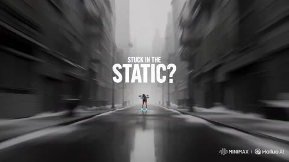</a>

A timed timeline with a text cue for each beat gives the model a shot by shot structure for this 15 second ad. The style line pairs monochrome with neon contrast, and the negative prompt blocks photorealism so the grey opening stays graphic.

MiniMax H3 · Text-to-video · Source: [@sebatheepan on X](https://x.com/sebatheepan/status/2084311486277599712) · 34 likes on 2026-10-29 · found via [SkyNotSilent/awesome-MiniMax-H3-cases](https://github.com/SkyNotSilent/awesome-MiniMax-H3-cases)

[`motivational`](tags.md#tag-motivational) [`vertical-ad`](tags.md#tag-vertical-ad) [`sprint`](tags.md#tag-sprint) [`neon-contrast`](tags.md#tag-neon-contrast)

<details><summary><b>Prompt</b></summary>

```text
️

{   "title": "Outrun the Static",   "duration": "15 seconds",   "aspect_ratio": "9:16",   "style": "high-quality stylised 3D animation blended with graphic-novel visuals, vibrant neon and daylight contrast, expressive motion blur, bold geometric lighting, fluid animation, dynamic social-media advertising, polished but not photorealistic",   "prompt": "Create an explosive, fast-paced 15-second vertical animated advertisement about shattering mental noise and building instant momentum. Open immediately inside a monochrome, static-filled city street. A slouched, hesitant urban runner stands frozen as grey glitching words reading SOMEDAY, TOO TIRED, and NOT TODAY orbit them like heavy fog. Rapid visual storytelling with zero delay: the runner stomps their foot on the pavement, pulling their laces tight as vibrant electric-cyan energy flares from their shoes. They raise their gaze with sharp focus and burst into an all-out sprint. As they stride through the grey street, each powerful footstrike shatters a floating word into glowing neon shards and transforms the dreary alley into a vibrant, high-contrast world of motion light-trails. The camera dynamically tracks alongside them in rapid close-ups and side angles. On their final leap through a giant wall of static, the fog completely shatters into brilliant golden light, revealing the transformed runner reaching a sunlit city summit. Finish with the runner standing empowered in peak condition as bold text snaps onto screen: BREAK THE STATIC. RUN YOUR DAY. Maintain relentless energy, satisfying impact beats, fluid motion, crisp transitions, and a motivational narrative that makes the viewer want to move immediately.",   "timeline": [     {       "time": "0.0-3.0 seconds",       "visual": "Immediate hook: monochrome grey street filled with glitch static. The runner stands frozen in heavy posture as floating grey words (SOMEDAY, TOO TIRED, NOT TODAY) orbit around them. Fast camera push-in.",       "text": "STUCK IN THE STATIC?"     },     {       "time": "3.0-6.5 seconds",       "visual": "Rapid close-ups of laces snapping tight and shoe sole hitting the ground. Cyan energy sparks out. The runner's posture transforms instantly from sluggish to razor-sharp focus.",       "text": ""     },     {       "time": "6.5-11.5 seconds",       "visual": "High-speed sprinting sequence with dynamic side tracking camera. Every footstrike explodes with impact fx, shattering the floating negative words into neon sparks and painting the gray environment in bright colors.",       "text": ""     },     {       "time": "11.5-15.0 seconds",       "visual": "The runner leaps through the final static wall into warm, golden sunlight over an elevated city skyline. Fast pullback as they land confidently under bright skies.",       "text": "BREAK THE STATIC\nRUN YOUR DAY"     }   ],   "voiceover": {     "enabled": true,     "delivery": "direct, energetic, crisp, and motivating, like a high-performance coach speaking directly to the viewer",     "script": "Stuck in the static? The hardest part is standing still. Lock in. Outrun yesterday."   },   "audio": {     "music": "fast-paced modern electronic-hiphop training beat with driving bass drop at second 3.0",     "sound_design": "glitch hum, sharp lace snap, heavy footfall impacts, glass shatter FX for words, wind rush, crisp final bass thump",     "mix": "Punchy and clear voiceover balanced over a driving beat; footsteps and word shatters synced precisely to the musical beat."   },   "camera": {     "movement": "rapid whip push-in, low-angle boot macro shots, dynamic parallel tracking run, and high-speed final camera pullback",     "editing": "high temporal frequency, new camera angle every 0.6 to 1.0 seconds, motion-matched cuts"   },   "negative_prompt": [     "photorealistic characters",     "slow opening",     "dramatic movie trailer tone",     "long pauses",     "cluttered camera motion",     "anatomy glitches",     "unreadable text"   ] }
```

</details>

<a id="h3-exploded-diffuser-callout-showcase"></a>
### Exploded view diffuser with callout overlay

<a href="https://x.com/LudovicCreator/status/2085425839236096175">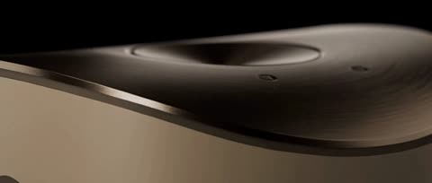</a>

Timestamped beats divide the 15 second clip into camera moves, and the overlay text is given word for word with its exact second and pointer target. The closing negative list (no hands, no logos, no duplicated parts) keeps the product geometry stable through the exploded reveal.

MiniMax H3 · Text-to-video · Source: [@LudovicCreator on X](https://x.com/LudovicCreator/status/2085425839236096175) · 31 likes on 2026-10-29 · found via [SkyNotSilent/awesome-MiniMax-H3-cases](https://github.com/SkyNotSilent/awesome-MiniMax-H3-cases)

[`product-showcase`](tags.md#tag-product-showcase) [`exploded-view`](tags.md#tag-exploded-view) [`callout-overlay`](tags.md#tag-callout-overlay) [`macro-shot`](tags.md#tag-macro-shot)

<details><summary><b>Prompt</b></summary>

```text
Create a 15-second luxury cinematic product showcase for a premium compact fragrance diffuser with a sculpted ceramic body and brushed-metal top. The product has no visible branding, labels, logos or printed text.

0–4s: Begin with an extreme macro tracking shot gliding across the fine matte ceramic texture, seamless curved body, precision-machined metal rim and recessed control surface. A narrow band of warm light travels across the materials against a deep black studio background, revealing delicate surface detail and controlled highlights.

4–8s: Pull back into a three-quarter hero view. The diffuser rotates slowly above a glossy dark-stone pedestal. A subtle ambient light ring gradually illuminates beneath the metal top. A fine stream of mist rises naturally and disperses softly into the air. Maintain stable geometry, consistent proportions and elegant symmetry.

8–12s: Transition into an exploded-view reveal. The ceramic shell, fragrance reservoir, ultrasonic plate, airflow chamber and brushed-metal top separate smoothly in perfect vertical alignment. Delicate illuminated mist particles flow upward through the internal airflow channel while the camera performs a restrained side orbit.

At 9.2s, display a clean, partially transparent callout beside the ultrasonic plate. Connect it to the component with a fine pointer line. Use a thin champagne-gold border and minimal glass-like transparency. The callout title reads: “Silent Ultrasonic Diffusion”. Beneath it, in smaller text, display: “A refined mist without heat”. Keep the overlay sharp, readable, modern and premium without obscuring the internal construction.

12–15s: Every component reconnects seamlessly. The diffuser settles into a centered front-facing hero composition as warm rim lighting defines its silhouette. The callout fades away before the final lockup. Complete a gentle dolly-in while a controlled plume of mist rises from the top and the ambient light ring softly pulses once.

Premium wellness-commercial finish, photorealistic ceramic and metal, realistic mist simulation, controlled reflections, soft shadows, shallow depth of field, crisp surface detail, stable product shape, no liquid spills, no people, no hands, no logos, no writing on the product, no distortion, no duplicated components and no illegible overlay text.
2/2
```

</details>

<a id="h3-engineered-sneaker-landing-page"></a>
### Sneaker landing page with speed light streaks

<a href="https://x.com/ImaStudio_ai/status/2085211946815758841">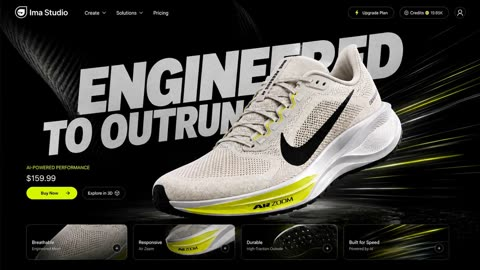</a>

Naming the product as Image 1 anchors the hero shot, and listing concrete UI modules (feature cards, gallery, spec area, CTA zones) with interaction words like scale up, color inversion and card expansion makes the clip read as a real website rather than abstract motion.

MiniMax H3 · Image-to-video · Source: [@ImaStudio_ai on X](https://x.com/ImaStudio_ai/status/2085211946815758841) · 30 likes on 2026-10-29 · found via [SkyNotSilent/awesome-MiniMax-H3-cases](https://github.com/SkyNotSilent/awesome-MiniMax-H3-cases)

[`ecommerce-ui`](tags.md#tag-ecommerce-ui) [`landing-page`](tags.md#tag-landing-page) [`product-launch`](tags.md#tag-product-launch) [`motion-graphics`](tags.md#tag-motion-graphics)

<details><summary><b>Prompt</b></summary>

```text
Create a 16:9 premium ecommerce landing page UI/UX demo built around the product in Image 1. Use a luxurious, futuristic sports-performance aesthetic with oversized bold italic sans-serif typography, dark glossy backgrounds, carbon fiber and performance-mesh textures, metallic highlights, and speed-driven light streaks. Show a smooth high-speed page scroll, premium product sections, sleek feature cards, gallery modules, tech-spec areas, and strong CTA zones. Include high-impact hover interactions like scale-up, color inversion, glow effects, card expansion, and animated typography. Make the motion cinematic, expensive, and ultra-polished, like a world-class product launch website demo.

💰 Generation cost: under $3
🖼 Input: one product image
🧩 Output: a polished website concept video

Try MiniMax H3 → https://bit.ly/4fES5pl

#MiniMaxH3 #EcommerceDesign #UIDesign #ProductMarketing #ImaStudio
```

</details>

<a id="h3-matte-earbud-case-exploded-view-hero-ad"></a>
### Matte earbud case on dark stone, brushed aluminum

<a href="https://x.com/Artedeingenio/status/2097262898368114973">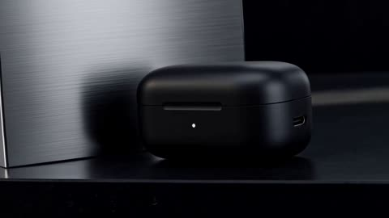</a>

A timed shot list with a camera move for each beat gives the model a clear structure to follow. Sound is tied to each visible action, and the slogan is locked to exact quoted text in the final shot so it stays readable.

MiniMax H3 · Text-to-video · Source: [@Artedeingenio on X](https://x.com/Artedeingenio/status/2097262898368114973) · 30 likes on 2026-10-29

[`product-ad`](tags.md#tag-product-ad) [`macro`](tags.md#tag-macro) [`exploded-view`](tags.md#tag-exploded-view) [`sound-design`](tags.md#tag-sound-design) [`typography`](tags.md#tag-typography)

<details><summary><b>Prompt</b></summary>

```text
Create one coherent 15-second 16:9 product-hero commercial. The earbuds and charging case are the absolute protagonists. Sophisticated industrial-design advertising, premium consumer-electronics macro photography, dark architectural minimalism, dark stone and brushed aluminum, soft narrow morning beam, realistic matte and metallic materials, controlled reflections, precise exploded-view animation, restrained transparent technical visualization, elegant motion design. Camera grammar: slow axial macro push-in, precise mechanical reveal, smooth travel through aligned layers, brief reconstruction acceleration, then calm deceleration into a stable final key visual. Primary motion mechanism is structural unfolding; use rounded-earbud shape matching for the sound-wave transition. No generic horizontal light sweep, scanline reveal, lens-flare wipe, or light-band writing. Product highlights are surface-only and never reveal or write typography.

Sound is H3-native only, with no separate BGM and no narration: restrained low-frequency pulse, precise magnetic clicks, quiet hinge, crisp component ticks, subtle air movement during the wave visualization, and a clean resolving tonal lock. Sync sound to visible actions; do not duplicate tracks.

Typography Lock: exact user-confirmed English text “SMALLER. CLEARER. EVERYWHERE.” Render only this phrase, exactly, in H3. Compact uppercase geometric sans, medium-bold, restrained tracking, clean white-to-soft-silver material on a transparent architectural plane. It appears only in the final shot in protected upper-left/upper-center negative space beside, never over, the product. Structural plane reveal brings in the complete phrase after the earbuds settle; hold it fully readable and stable through the final pull-back. No extra words, translation, scrambling, omission, subtitle box, or random text.

0.0–2.2s: Closed case on dark stone beside brushed aluminum. Macro three-quarter close-up, case large and unmistakable. Slow axial push-in with gentle controlled rotation. Morning beam reveals matte graphite shell, subtle indicator light, and USB-C edge. End centered with hinge axis aligned. Quiet pulse and restrained mechanism sound. No typography.

2.2–4.2s: Same case and light. Tight macro on hinge and open interior. Lid opens with precise mechanical movement; both earbuds rise slightly from magnetic slots and stop in a controlled hover. Camera tilts upward and advances through the hinge axis. Magnetic interior catches a soft reflection. Hinge click and two magnetic release clicks. The opening gap becomes the portal to the exploded view. No typography.

4.2–7.6s: Dark architectural void using the same stone/aluminum language. Medium macro with enough depth to read every layer. Camera travels smoothly forward and slightly upward through the aligned product axis. Separate into floating, perfectly aligned layers: outer shell, miniature drivers, battery cells, microphones, circuit boards, magnets, and acoustic chambers. Keep realistic scale and material continuity. Add sparse transparent dimensional lines and abstract non-readable engineering marks. Brief hold at maximum separation. Layered precise ticks and restrained electromagnetic hum. No typography.

7.6–9.2s: Hold the aligned component field, then accelerate smoothly through the centerline. Components rapidly converge and reconstruct both earbuds in mid-air; magnets seat precisely, with no missing or extra parts. Reflections resolve into continuous matte-and-metal surfaces. Accelerating clicks resolve into two clean seating sounds. The rounded earbud silhouette match-cuts to portability. No typography.

9.2–11.2s: On dark stone, the compact case slides beside a smartphone, keys, and slim wallet as neutral scale references. Track laterally, then pivot and push toward one earbud as it lifts from the case toward camera. Case remains dominant and readable. Smartphone has only a subtle generic charging indicator, no readable UI. Soft slide, magnetic lift click, close-pass air movement. No typography.

11.2–13.0s: Foreground earbud remains the anchor while the desk environment fades into abstract architectural planes. Controlled micro push-in, then hold. A soft restrained sound-wave visualization expands outward in layered translucent arcs, suggesting immersive audio and active noise isolation without text or performance claims; waves never obscure the earbud. Airy expansion and tonal resonance contract into the oval contour of the open case. No typography.

13.0–15.0s: Both earbuds settle beside the open matte graphite case on the original dark stone; smartphone nearby with a subtle generic charging indicator and no readable UI. Premium three-quarter packshot, product cluster dominant, clean negative space upper-left/upper-center. Slow cinematic pull-back with slight rise, then lock. Morning beam and controlled reflections return; magnetic interior and USB-C port remain naturally visible. Two soft settling clicks and tonal lock. As the product settles, a transparent architectural plane structurally unfolds in the negative space and reveals exactly “SMALLER. CLEARER. EVERYWHERE.” in stable native H3 typography; fully readable before the pull-back ends and held through the final frame.

Final requirements: exactly 15 seconds, 16:9, one coherent concept advertisement, strict product consistency, aligned exploded layers, no altered proportions or materials, no extra readable text, no invented logo or claim, no scanline/light-sweep typography, exact slogan stable and legible, product absolute protagonist, native sound only, final two seconds a calm complete hero lock-up.
```

</details>

<a id="h3-ferrari-jacket-villa-driveway-commercial"></a>
### Woman in Ferrari jacket by villa driveway

<a href="https://x.com/Zyrellix/status/2115113375516524850">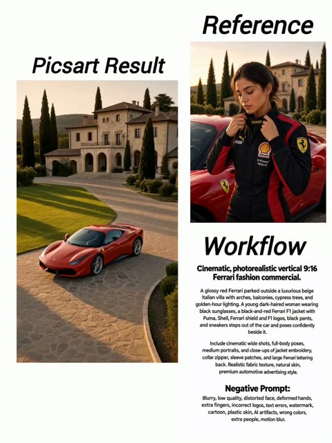</a>

Each scene block names the shot type, lighting and fixed jacket and villa details, so the same wardrobe and location carry across cuts. The negative prompt rules out wrong car colour, extra people and logo errors.

MiniMax H3 · Text-to-video · Source: [@Zyrellix on X](https://x.com/Zyrellix/status/2115113375516524850) · 27 likes on 2026-10-29

[`ferrari`](tags.md#tag-ferrari) [`fashion`](tags.md#tag-fashion) [`golden-hour`](tags.md#tag-golden-hour) [`multi-shot`](tags.md#tag-multi-shot)

<details><summary><b>Prompt</b></summary>

```text
SCENE 1  Wide Establishing Shot
Cinematic wide shot of a glossy red Ferrari sports car parked on a stone-paved driveway in front of a luxurious beige Italian villa with arched porticos and balconies, tall dark cypress trees, manicured green lawn, soft golden hour lighting, photorealistic, high detail, vertical 9:16

SCENE 2  Getting Out of the Car
Cinematic shot of a beautiful young woman with dark hair wearing black sunglasses and a black-red Ferrari F1 team jacket with Puma, Shell, Ferrari SF shield, red “Ferrari” bars and F-1 sleeve patch, black pants and sneakers, stepping out of the red Ferrari with the door open, holding the door, luxurious villa and cypress trees in background, soft golden hour light, photorealistic, vertical 9:16

SCENE 3  Jacket Close-up
Extreme close-up cinematic shot of the black and red Ferrari racing jacket, showing detailed embroidery of the yellow Ferrari prancing horse SF shield, red horizontal bar with “Ferrari” text, Puma and Shell logos, realistic fabric texture, soft natural lighting, photorealistic

SCENE 4 Collar Adjustment
Close-up cinematic shot of a young woman adjusting the zipper of her black and red Ferrari jacket, red “Ferrari” embroidery visible on the collar, detailed logos on the chest, soft golden hour lighting, photorealistic skin and fabric texture, vertical 9:16

SCENE 5 Sleeve Detail
Close-up of the jacket sleeve showing the red “F-1” patch and Ferrari shield logo, black fabric with white piping, cinematic lighting, high detail, photorealistic

SCENE 6  Back View
Cinematic back view of the young woman wearing the Ferrari jacket, large red “Ferrari” text across the back with white borders, Puma logo above, standing near the red Ferrari, villa and cypress trees in background, golden hour light, photorealistic, vertical 9:16

SCENE 7  Full Body Pose
Full body cinematic shot of the young woman in the Ferrari team jacket and sunglasses standing confidently next to the red Ferrari on the stone driveway, luxurious Italian villa with arches and tall cypress trees behind, soft golden hour lighting, photorealistic, same composition as original video, vertical 9:16

SCENE 8  Medium Hero Shot
Medium cinematic portrait of the young woman in black sunglasses and Ferrari jacket standing in front of the red Ferrari, luxurious villa and cypress trees softly blurred in the background, golden hour lighting, high detail, film-like look, photorealistic, vertical 9:16

NEGATIVE PROMPT
blurry, low quality, distorted face, deformed hands, extra fingers, extra limbs, bad anatomy, ugly, watermark, text error, cartoon, anime, painting, sketch, oversaturated, overexposed, underexposed, night time, rainy, snow, modern building, city, crowd, multiple people, wrong car color, yellow car, blue car, male, man, beard, wrong jacket colors, missing logos, wrong logos, plastic skin, ai artifacts, low resolution, grainy, motion blur, out of focus
```

</details>

<a id="h3-vintage-car-desert-highway-dusk-2"></a>
### Vintage muscle car kicks up desert dust

<a href="https://x.com/opener_ai/status/2085241788340797558">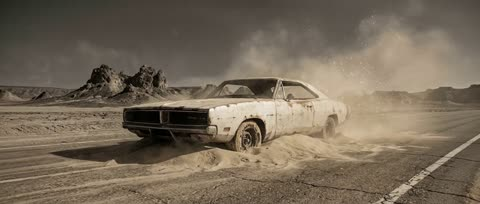</a>

The prompt anchors the first frame to one still image and lists what must stay fixed, then times each beat to a second mark with its own camera move and text reveal. Text is quoted word for word and locked against warping, and the negative prompt blocks logos, extra cars and cheap VFX clutter.

MiniMax H3 · Image-to-video · Source: [@opener_ai on X](https://x.com/opener_ai/status/2085241788340797558) · 26 likes on 2026-10-29 · found via [SkyNotSilent/awesome-MiniMax-H3-cases](https://github.com/SkyNotSilent/awesome-MiniMax-H3-cases)

[`muscle-car`](tags.md#tag-muscle-car) [`desert`](tags.md#tag-desert) [`motion-graphics`](tags.md#tag-motion-graphics) [`typography`](tags.md#tag-typography)

<details><summary><b>Prompt</b></summary>

```text
[1] FORMAT
10-second 16:9 cinematic motion-graphics promo built from a single desert muscle-car image. Premium, fast, dimensional, elegant, and tactile.

[2] ASSETS
Use Image 1 as the exact first-frame source and core visual reference for the vintage white muscle car, dusty desert road, rock formations, muted sand palette, and gritty film texture.

[3] IDENTITY
Preserve:
- the old white Dodge Charger–style muscle car as the hero subject
- weathered paint, rust marks, dust buildup, and worn wheels
- low front three-quarter angle and dominant car scale
- barren desert highway with cracked asphalt and rocky outcrops
- beige, sepia, and charcoal color family
- airborne dust and dry wind atmosphere
- gritty, premium editorial mood rather than cheerful commercial energy
- realistic hard sunlight and soft dust diffusion
- grounded reflections and believable shadow direction

[4] BEATS
[0–2 seconds] Start from the original composition. Create subtle stillness for half a second, then introduce layered parallax: foreground dust, midground car, and background rocks separate in depth. Camera begins a slow push-in with a slight rightward arc. Fine sand drifts across frame.
[2–4 seconds] Speed ramps in. Add dimensional motion-graphic accents: thin metallic lines, soft grid fragments, and subtle contour-tracing highlights briefly wrap around the car body, emphasizing shape and speed. Main title appears: "BORN FROM DUST".
[4–6 seconds] Camera performs a faster sweep past the front quarter panel toward the side, with strong depth, dust streaks, and passing light sweeps. Secondary text appears: "SPEED HAS A SHAPE". Keep the car stable and heroic while the environment feels fast.
[6–8 seconds] Push the most dynamic moment: dust bursts, perspective stretch, and elegant 3D typography planes moving in space around the car without blocking it. Add one short accent line: "RAW / FAST / ICONIC".
[8–10 seconds] Motion resolves into a premium final frame. Camera eases back into a clean hero composition. Final end card text appears and holds: "CHASE THE HORIZON". Keep the last 1.5 seconds readable and polished.

[5] CAMERA
Cinematic virtual camera from a single still image. Use layered 2.5D depth separation, push-ins, slight orbit motion, and one speed-ramped sweep for dimensionality. Start as a low wide hero shot, move into a medium close pass on the car, then settle into a clean final hero frame. Motion should feel expensive and controlled, not chaotic.

[6] LIGHT
Harsh desert sunlight with dusty diffusion. Palette: sand beige, sun-faded ivory, smoky gray, and soft metallic charcoal. Add tasteful specular sweeps on the car edges and grille. Film texture should feel editorial and refined, with fine grain and suspended dust particles for depth.

[7] EDIT
Use seamless motion-graphics transitions only, no hard scene changes. Typography and graphic elements should feel integrated with the car and dust flow. Text behavior:
- "BORN FROM DUST" enters with a fast horizontal build and slight depth extrusion
- it remains readable for around 1 second
- it exits by dissolving into dust particles
- do not warp, misspell, mirror, or replace the text
- "SPEED HAS A SHAPE" enters on a perspective plane aligned to the car motion
- "RAW / FAST / ICONIC" appears as small premium kinetic type
- final text "CHASE THE HORIZON" enters cleanly, stays stable, and fades softly at the end

[8] AUDIO
Audio: dry desert wind, fine sand skimming across metal, distant low engine rumble, and one sharp whoosh accent at 4 seconds during the speed ramp.
BGM: 10-second cue, 65% cinematic tension and 35% luxury fashion energy. Deep pulse, restrained synth bass, tight percussion, airy reverse textures, and metallic hits. Build gradually from 0–4 seconds, intensify from 4–8 seconds, then resolve into a confident sustained ending. Freeze the final 2 seconds on a clean, premium sonic tail. Do not imitate an existing melody.

[9] NEGATIVE
No subtitles, on-screen text beyond the specified titles, watermarks, platform logos, or stickers.
Do not introduce Chinese text, garbled characters, or misspellings.
No slideshow feeling — use natural dimensional camera motion and seamless transitions.
No cartoon styling, no cheap VFX clutter, no excessive lens distortion, no unrealistic car deformation, and no extra vehicles or people.
```

</details>

<a id="h3-dew-covered-dragon-fruit-farm-to-table"></a>
### Dew covered dragon fruit ripening in golden light

<a href="https://x.com/Zyrellix/status/2115436669205885329"></a>

The prompt lays out a farm-to-table shot list in running order, from aerial orchard views to harvesting, slicing and a served table, then ends on a closing product shot. Naming golden hour light, shallow depth of field and smooth camera moves sets a commercial food look and keeps the fruit as the hero.

MiniMax H3 · Text-to-video · Source: [@Zyrellix on X](https://x.com/Zyrellix/status/2115436669205885329) · 25 likes on 2026-10-29

[`dragon-fruit`](tags.md#tag-dragon-fruit) [`golden-hour`](tags.md#tag-golden-hour) [`food-cinematography`](tags.md#tag-food-cinematography) [`vertical-video`](tags.md#tag-vertical-video)

<details><summary><b>Prompt</b></summary>

```text
Cinematic vertical 9:16 video of dragon fruit from farm to table golden hour lighting ultra realistic 8K quality Show aerial views of dragon fruit farms dew covered ripe pink fruits farmers harvesting with pruning shears a knife slicing open vibrant magenta flesh with tiny black seeds a beautiful young East Asian woman enjoying the fruit outdoors fresh fruits in wooden crates, and an elegant table with sliced dragon fruit and pink juice End with two halved dragon fruits on a wooden board in the orchard Smooth camera movements shallow depth of field vibrant colors soft natural light, high end commercial food cinematography.
```

</details>

<a id="h3-vintage-car-desert-highway-dusk"></a>
### Vintage car on desert highway at dusk

<a href="https://x.com/influencer_seo/status/2084355335222108362">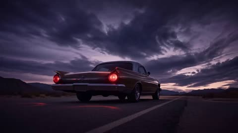</a>

Four reference images are each given one job (mood and location, talent, bag, closing brand mark), so the model knows which input controls which element. A simple three beat blocking sequence in plain verbs keeps the 15 second clip readable while the clothing and bag stay part of the performance.

MiniMax H3 · Reference-to-video · Source: [@influencer_seo on X](https://x.com/influencer_seo/status/2084355335222108362) · 22 likes on 2026-10-29 · found via [SkyNotSilent/awesome-MiniMax-H3-cases](https://github.com/SkyNotSilent/awesome-MiniMax-H3-cases)

[`reference-images`](tags.md#tag-reference-images) [`fashion`](tags.md#tag-fashion) [`desert`](tags.md#tag-desert) [`vintage-car`](tags.md#tag-vintage-car)

<details><summary><b>Prompt</b></summary>

```text
Minimax 3 Prompt: Create a premium 16:9 landscape fashion film. Use Image 1 for the overall mood, location, and film texture; Image 2 for the talent; Image 3 for the bag; and Image 4 for the closing brand mark. This is a fashion campaign for the clothing and bag. The tone is elevated, cool, and restrained, but the edit should still feel lively and fashion-forward—not like a conventional narrative film or an e-commerce ad.

Keep the story simple: beside a vintage car on a desert highway, a woman walks to the rear of the car, opens the trunk, takes out a black bag, shares a quiet beat with the man standing nearby, then leaves carrying the bag. Integrate the clothing and bag naturally into the performance so they feel like part of the characters’ identity.

I added the final video in and the reference images for you to learn from!
```

</details>

<a id="wan-echo-groove-wordmark-ident"></a>
### Silver ECHO wordmark built from concentric grooves

<a href="https://x.com/HBCoop_/status/2114024432666873954">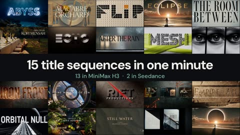</a>

A timed five-beat shot list plus a constraint line that bans other text and glitching keeps the four letters stable. Describing the O as a speaker diaphragm and the letters as solid machined objects keeps the motion physical.

Wan 3.0 · Text-to-video · Source: [@HBCoop_ on X](https://x.com/HBCoop_/status/2114024432666873954) · 21 likes on 2026-10-29

[`title-sequence`](tags.md#tag-title-sequence) [`typography`](tags.md#tag-typography) [`macro`](tags.md#tag-macro) [`sound-design`](tags.md#tag-sound-design)

<details><summary><b>Prompt</b></summary>

```text
A sophisticated 15-second motion identity for an experimental audio company named ECHO. The custom wordmark is built from concentric grooves and controlled acoustic vibration. Black, warm silver, signal orange, microscopic texture, high-speed macro photography, tactile sound-design aesthetic.
Shot progression
00:00–00:03: Extreme macro view of a matte-black surface. A single orange pulse strikes the center, sending four perfectly circular pressure rings outward. Dust particles jump briefly from the vibration.
00:03–00:06: As the rings expand, portions lock into place and form the letters ECHO. Each character appears cut from the same system of concentric grooves, like a fusion of a vinyl record and precision-machined metal.
00:06–00:09: A low-frequency beat pushes through the wordmark. The letters flex once as solid physical objects without melting. The O becomes a speaker diaphragm that moves forward, creating a visible pressure wave through suspended silver particles.
00:09–00:12: The camera follows the pressure wave sideways. It compresses into a thin orange line, then wraps around a brushed-aluminum audio device. The engraved ECHO wordmark resolves sharply on its control dial.
00:12–00:15: Match cut to a black background. The orange line travels beneath the centered silver wordmark and stops. One final pulse passes through the O, then complete stillness.
Audio: Deep sub-bass pulse, granular vibration, precise mechanical clicks, clean decay into silence.
Constraints: The only readable text is ECHO. Keep all four letters stable and correctly spelled. No generic equalizer bars, neon nightclub imagery, liquid metal, glass logo, UI overlays, blueprints, random text, excessive glitching, or warped letterforms.

Swap in your own word and drop your results below 👇
```

</details>

<a id="h3-triathlon-silhouette-kinetic-type"></a>
### Black silhouette swimmer in cyan kinetic typography

<a href="https://x.com/Naonekozamurai/status/2094340753195725179"></a>

Each sport gets a fixed time slot and its own colour field, and the same black silhouette is held across all three so the character stays consistent. Explicit rules limit the only text to SWIM, BIKE and RUN and ban extra bikes and duplicated wheels, which are the usual failure points.

MiniMax H3 · Text-to-video · Source: [@Naonekozamurai on X](https://x.com/Naonekozamurai/status/2094340753195725179) · 20 likes on 2026-10-29 · found via [SkyNotSilent/awesome-MiniMax-H3-cases](https://github.com/SkyNotSilent/awesome-MiniMax-H3-cases)

[`triathlon`](tags.md#tag-triathlon) [`silhouette`](tags.md#tag-silhouette) [`motion-graphics`](tags.md#tag-motion-graphics) [`split-screen`](tags.md#tag-split-screen)

<details><summary><b>Prompt</b></summary>

```text
MiniMax H3を使用して、15秒・2Kのスタイリッシュなモーショングラフィック＆キネティック・タイポグラフィーによるトライアスロン動画を制作する。

映像は、水泳4秒、自転車4秒、ラン4秒の順に展開し、最後の3秒は画面を斜めに3分割して、3つの競技を同時に見せる。スローモーションは使用せず、15秒間を通してスピード感と力強いテンポを維持する。

主人公は、全身が黒一色で描かれた一人の人間のシルエット。顔、髪、肌、競技ウェアなどの細部は描かず、プロのトライアスロン選手を思わせる、引き締まったしなやかな体型として表現する。

水泳、自転車、ランのすべてで、同じ体格、身長、身体の比率を持つ同一人物の黒いシルエットを維持する。背景には競技ごとに異なる明るく鮮やかな色を使用し、黒い人物との強いコントラストを保つ。

【0.0～4.0秒：SWIM】

映像は、鮮やかなシアンとブルーで構成された、抽象的でスタイリッシュな水面から始まる。カメラは水面すれすれの斜め前方から主人公を捉え、黒いシルエットが水を切りながら高速で泳いでくる。

主人公は正確で力強いフリースタイルを行う。左右の腕を交互に大きく前へ伸ばし、水中を後方へ押し出しながら、脚は自然で連続的なフラッターキックを行う。腕の入水、キャッチ、プル、リカバリーを滑らかにつなげ、途中で一度だけ横を向いて自然に呼吸する。

単に水面の上で腕を回しているようには見せず、身体の大部分を水中に維持し、前方へ進む推進力、水の抵抗、浮力、飛沫に物理的な説得力を持たせる。

腕が水面へ入るたびに円形の波紋が広がり、水を後方へ押すとシアンの太いラインと細かな光の粒子が進行方向と反対側へ流れる。キックに合わせて、水中に細いグリッドや波状のシェイプが現れる。

カメラを水面すれすれの追従ショットから、斜め上の俯瞰ショットへ切り替える。俯瞰ショットでは、主人公の全身、水面を切り裂く軌道、左右へ広がる波紋を明確に見せる。

背景には「SWIM」という単語を正確なスペルの大文字で登場させる。「SWIM」は水中から浮かび上がるように現れ、音楽のビートに合わせて拡大、縮小、前後方向への移動、軽い3D回転を行う。

3D回転した「SWIM」は必ず再び正面を向き、単語全体が明確に読める瞬間を作る。文字は主人公の背後や水中へ配置し、泳ぎを妨げないようにする。

4.0秒の強いビートで、主人公の腕が作った大きな円形波紋を画面いっぱいに拡大する。その円形波紋を、次のシーンの自転車の前輪へグラフィック・マッチさせ、シャープに切り替える。

【4.0～8.0秒：BIKE】

拡大した水面の円形波紋が、黒い競技用ロードバイクの前輪へ瞬時に切り替わる。背景の色は、ブルーとシアンから、鮮やかなマゼンタ、コーラル、オレンジへ大胆に変化する。

主人公は黒一色の競技用ロードバイクに乗り、抽象的で近未来的なロードコースを高速で走行する。上半身を低く保った空気抵抗の少ない姿勢でハンドルを握り、両脚でペダルを滑らかに高速回転させる。

ロードバイクは、細いフレーム、ドロップハンドル、サドル、クランク、ペダル、チェーン、同じ大きさの2つの車輪を持つ、正しい競技用自転車の形状として描く。

カメラは真横から高速で並走し、主人公の全身と自転車全体を捉える。続いて、地面すれすれから前輪とペダリングを大きく見せるローアングル、斜め上からコースの曲線を見せる俯瞰ショットへ、音楽のビートに合わせて大胆に切り替える。

車輪が回転すると、マゼンタとオレンジの円形ラインが短い軌跡として残る。ペダルを踏み込むたびに背景のシェイプが後方へ加速し、コースを曲がると長方形、三角形、太いライン、グリッドが同じ方向へ大きく傾く。

背景には「BIKE」という単語を正確なスペルの大文字で登場させる。「BIKE」は道路面から立ち上がるように現れ、車輪の回転と連動して3D回転、拡大、縮小、奥行き方向への移動を行う。

3D回転した「BIKE」は必ず再び正面を向き、単語全体が明確に読める瞬間を作る。文字は主人公や自転車と接触する物体ではなく、背景のグラフィック要素として使用する。

8.0秒の強いビートで、主人公がペダルを力強く踏み下ろす。ペダルを踏み込む足元のアップから、ランで足が地面へ接触する瞬間へ、動きの方向とリズムを維持したマッチカットで切り替える。

【8.0～12.0秒：RUN】

背景は、鮮やかなイエロー、ライムグリーン、バイオレットを組み合わせた、抽象的でスタイリッシュなランニングコースへ切り替わる。

主人公はトライアスロン終盤のランを思わせる、力強く持続的なペースで走る。単なる短距離スプリントではなく、上半身を安定させ、肘を自然に曲げ、腕を前後へ効率的に振りながら、高いピッチで前方へ進む。

接地した足の真上へ身体の重心が自然に移動し、反対側の膝が前方へ上がる。足の接地、蹴り出し、空中局面、次の接地を滑らかにつなげ、左右の脚を正しく交互に動かす。

カメラは真横から主人公と同じ速度で追従し、全身のランニングフォームを見せる。続いて、斜め前方から迫ってくる主人公を捉えるショット、足元すれすれのローアングル、斜め上からコースを見下ろす俯瞰ショットへ切り替える。

足が地面へ接触するたびに円形の波紋が広がり、蹴り出すと鋭いラインが後方へ走る。腕の振りや走行リズムに合わせて、長方形、円、三角形、グリッドが画面の上下左右からスライドインし、次のビートでスライドアウトする。

背景には「RUN」という単語を正確なスペルの大文字で登場させる。「RUN」は主人公の後方から急速に追いつくように画面奥から移動し、ビートに合わせて拡大、縮小、3D回転、軽い伸縮、色の切り替えを行う。

3D回転した「RUN」は必ず再び正面を向き、単語全体が明確に読める瞬間を作る。文字で主人公の身体や足元を覆い隠さない。

12.0秒の強いビートで主人公が力強く地面を踏み込む。接地点から3本の太い斜めラインが広がり、そのラインによって画面全体を3つのパネルへ分割する。

【12.0～15.0秒：3競技同時表示】

画面を、少し傾いたシャープな境界線によって、左、中央、右の3つの縦長パネルへ分割する。

左側のパネルでは、シアンとブルーの水中を、同じ黒い主人公がフリースタイルで泳ぎ続ける。背景には「SWIM」を表示する。

中央のパネルでは、マゼンタ、コーラル、オレンジのロードコースを、同じ黒い主人公がロードバイクで高速走行する。背景には「BIKE」を表示する。

右側のパネルでは、イエロー、ライムグリーン、バイオレットのコースを、同じ黒い主人公が力強く走り続ける。背景には「RUN」を表示する。

3つのパネルは静止画にせず、水泳のストローク、自転車のペダリング、ランの足運びを同時に継続させる。それぞれの動きを同じ音楽のビートへ同期させ、3競技が一体となったトライアスロンのリズムを作る。

分割画面では、それぞれのパネルに主人公を1人だけ表示する。同じ競技の人物を同じパネル内で複製しない。各パネルの人物、用具、背景が、隣のパネルへはみ出したり、混ざったりしないようにする。

終盤に向けて、各パネルの波紋、車輪の円形ライン、ランの接地エフェクトを徐々に高密度にする。最後の強いビートで3つの動きが同時にアクセントを作り、パネルの境界線と背景のシェイプが整列する。

最後の約0.6秒は、「SWIM」「BIKE」「RUN」の3語と、3競技を行う主人公の姿が明確に確認できる安定した3分割画面として保持し、クールに終了する。大げさな決めポーズや喜ぶ動作は入れない。

【モーショングラフィックと音楽】

水泳では、水の飛沫、波紋、波状のラインを、音楽の細かいビートへ同期させる。自転車では、ペダリング、車輪の回転、コースの通過を、ベースと連続するパーカッションへ同期させる。ランでは、左右の足の接地を、キックとスネアへ正確に同期させる。

水泳から自転車、自転車からランへ進むにつれて、音楽、カメラ、シェイプ、タイポグラフィーの動きを徐々に高密度にし、最後の3分割画面で3つのリズムを統合する。

背景のシェイプは人物や競技用具を完全に隠さず、それぞれの動作が常に明確に見えるようにする。制御されたモーションブラーを使用するが、人物の手足や自転車の車輪が複数に見えるほど強くしない。

【文字と一貫性】

映像内に登場する文字は「SWIM」「BIKE」「RUN」の3種類だけに限定する。すべて正確なスペルの大文字で表示し、文字の欠落、重複、誤字、別の文字への変化を起こさない。それ以外の文字、数字、企業名、ロゴ、ウォーターマーク、字幕は表示しない。

通常の競技シーンでは、主人公を一人だけにする。最後の3分割画面に限り、同じ主人公を各パネルへ一人ずつ表示する。

水泳シーンでは、自転車やランニングコースを登場させない。自転車シーンでは、水中表現や余分な自転車を登場させない。ランシーンでは、自転車やフープなどの競技用具を登場させない。

競技用ロードバイクは必ず1台だけにする。車輪を2つに限定し、フレーム、ハンドル、サドル、クランク、チェーン、ペダルの形状と位置を維持する。車輪の複製、変形、消失、瞬間移動を発生させない。

自転車走行中は両手を正しくハンドルへ置き、両足をペダルへ固定する。ペダルと脚を正しく連動させ、足がペダルから外れたり、フレームや車輪を貫通したりしない。

主人公の形状、体格、頭、胴体、手足の本数を15秒間一貫させる。手足の変形、身体の分裂、不自然な残像、競技間での性別や体格の変化を発生させない。

大胆でありながら統一感のある配色、シャープなグラフィック、強い遠近感、正確なビートシンクを組み合わせ、とにかくカッコよく、スタイリッシュで、スピード感とファッション性の高い映像に仕上げる。SNSで拡散されそうな、センスが良く、中毒性があり、何度も見返したくなる高品質なトライアスロン動画にする。
```

</details>

<a id="h3-ramen-focus-pull"></a>
### Ramen in front, family dinner behind, one focus pull

<a href="https://huggingface.co/MiniMaxAI/MiniMax-H3/resolve/main/assets/i2va_2k.mp4"></a>

The first line pins the input photo to frame 0, then the prompt describes the whole eight seconds as one locked-off shot whose only move is the focus shifting from the bowl to the family.

MiniMax H3 · Image-to-video · Source: [MiniMax H3 model card](https://huggingface.co/MiniMaxAI/MiniMax-H3)

[`focus-pull`](tags.md#tag-focus-pull) [`static-camera`](tags.md#tag-static-camera) [`structured-prompt`](tags.md#tag-structured-prompt) [`food`](tags.md#tag-food) [`sfx`](tags.md#tag-sfx)

<details><summary><b>Prompt</b></summary>

```text
For the target video, at 0.00 seconds into the target video, <Picture 1> (from [Shot 1]) is fully referenced.

integrated_multimodal_description: [Shot 1] This is a live-action, cinematic shot with a shallow depth of field. The camera holds a perfectly static shot throughout the entire eight-second duration, capturing a cozy family gathering in a traditional Japanese dining room. The scene opens with a large, intricately patterned blue and white ceramic bowl of ramen in the immediate foreground, rendered in crisp, sharp focus. The bowl sits on a smooth, polished long wooden table. Inside the bowl, a rich, oily golden-brown broth surrounds yellow wavy noodles, topped with two thick, round slices of chashu pork featuring visible fat marbling and a distinct spiral meat pattern. A generous mound of freshly chopped, bright green scallions rests in the center, and a crisp, dark green rectangular sheet of nori seaweed is tucked into the right edge. To the left of the bowl, a pair of light brown wooden chopsticks rests horizontally on a small, dark rectangular chopstick rest, near a small cylindrical ceramic teacup with blue painted patterns. On the right side of the table, a spherical paper lantern with a ribbed bamboo frame sits on a black wooden base. In the background, a large family of seven is gathered around the table, initially appearing as a soft, blurred presence. Behind them, traditional Japanese sliding shoji screens with wooden lattice frames are open, revealing a bright outdoor scene with lush green trees. Early in the clip, the thick, white steam rising from the hot ramen broth immediately intensifies, billowing upwards in thick, swirling clouds that dance continuously above the bowl. As the clip progresses into the middle seconds, the camera maintains its static position while the focus begins a deliberate, smooth shift deeper into the room. The foreground ramen bowl, its vibrant ingredients, and the rising steam gradually soften into a hazy, out-of-focus blur. Simultaneously, the family members in the background come into sharp, detailed clarity. The heavy steam continues to rise from the foreground, creating a dynamic, translucent veil between the camera and the family. With the focus now firmly locked on the background, the vibrant family dinner comes alive. The man in the dark navy blue long-sleeved shirt on the left leans forward, his mouth moving animatedly in a silent exchange. The young girl in the crisp white short-sleeved t-shirt beside him smiles brightly, looking toward the center of the table. The woman on the far left, wearing a soft light blue long-sleeved blouse, turns her head slightly, smiling gently. Across the table, the woman in the light grey button-down shirt smiles broadly, her eyes crinkling, as she rests her hands near her plate. The woman in the dark grey top further back uses her wooden chopsticks to pick up a small piece of food from a central ceramic dish filled with bright red pickled vegetables. The woman in the center back in the light grey sweater smiles gently, her hands clasped softly in front of her, observing the interaction. Throughout the remainder of the clip, the family continues their lively physical interaction, their mouths moving in continuous, silent cadences of conversation, while the thick, white steam from the blurred ramen bowl in the foreground never stops rising, adding a comforting atmosphere to the warm gathering.

overall_soundscape: The soundscape begins with a quiet room tone mixed with the faint, airy rustle of the thick steam billowing from the hot ramen bowl in the foreground, accompanied by the subtle, continuous hissing and bubbling of the rich broth. As the visual focus shifts deeper into the room, the physical sounds of the bustling family dinner become dominant in the foreground. The clear, sharp clinking of ceramic bowls and wooden chopsticks touching plates is clearly heard as the family members reach for food. This is followed by the faint, muffled thud of a cup being set down on the smooth wooden table, and the subtle, rhythmic rustle of cotton and wool clothing as the family members lean forward and gesture, perfectly capturing the lively, physical atmosphere of the shared meal.

non_diegetic_music: A gentle, heartwarming acoustic guitar melody plays softly in the background, accompanied by the subtle, resonant notes of a traditional Japanese koto. The music maintains a slow, comforting tempo that enhances the cozy, nostalgic, and joyful atmosphere of the family gathering.
```

</details>

<a id="kling-perfume-paris-ad"></a>
### Perfume ad by a Paris window

<a href="https://static--72.klingai-cdn-aws.com/kling-blog/presigned_url/27107c4f-403c-412d-94b7-20a8835c8ffa_kling_20260202_作品_巴黎公寓窗边场景下__5018_0.mp4"></a>

Product shot that keeps the bottle's printed name legible. Voiceover, accent and BGM are all specified in the prompt.

Kling 3.0 · Image-to-video · Source: [Kling VIDEO 3.0 user guide](https://app.klingai.com/global/quickstart/klingai-video-3-model-user-guide)

[`product-ad`](tags.md#tag-product-ad) [`text-render`](tags.md#tag-text-render) [`voiceover`](tags.md#tag-voiceover)

<details><summary><b>Prompt</b></summary>

```text
By the window of a Parisian apartment, with soft French piano BGM in the background, the gilded afternoon sunlight filters through the shutters onto the perfume bottle, casting dappled light and shadow. The camera pans slowly in from the scattered rose petals, shifting focus to the faceted cut of the Kling perfume bottle. Voiceover (lazy French female voice, British accent, slow pace): Bathe in the golden hour. The camera orbits the perfume bottle in slow motion, capturing the play of light and shadow on the golden lettering and bottle body. Voiceover: Kling, a whisper of Parisian elegance. The camera pulls back and freezes on the complete scene—the Kling perfume bottle standing on a velvet pedestal, with Parisian buildings faintly visible outside the window. Voiceover: Wrap yourself in luxury with every breath.
```

</details>

Inputs: [1](https://static--74.klingai-cdn-aws.com/kling-blog/file_by_url/3de2fbc80df150e68fc05823f829a0fd88e2145ed4b4dbfb2f6a6a4fd5dbea87.png)

<a id="kling4-car-ad-from-reference-video"></a>
### Remake a car spot with your car and your backdrop

<a href="https://static--94.klingai-cdn-aws.com/kling-blog/presigned_url/2a2039c8-2a39-48cb-83b6-a3a4f95b4446_1-3.mp4"></a>

Keeps the camera moves and cut rhythm of a reference clip and replaces the car and the scenery from two images.

Kling 4.0 · Reference-to-video · Source: [Kling 4.0 user guide](https://kling.ai/quickstart/kling-4-model-user-guide)

[`product-commercial`](tags.md#tag-product-commercial) [`camera-reference`](tags.md#tag-camera-reference) [`multi-reference`](tags.md#tag-multi-reference) [`object-swap`](tags.md#tag-object-swap)

<details><summary><b>Prompt</b></summary>

```text
Use @Video 1 as the reference for camera movements and shot pacing. Replace the Element with the car from @Image 1 and the background with @Image 2.
```

</details>

Inputs: [1](https://static--54.klingai-cdn-aws.com/kling-blog/file_by_url/5a2591442bc22e9f30c9c01a908746abf2ee781a2f2791f024f9ff727b240966.png) · [2](https://static-58.klingai-cdn-aws.com/kling-blog/file_by_url/515ab05993934539ab58c7ab75862b3282d18fd063246deb918114a6dda943af.png) · [3](https://static--68.klingai-cdn-aws.com/kling-blog/presigned_url/d948f107-f702-4591-842f-c502eaf4e446_1-3-1.mp4)

<a id="seedance-90s-pixel-word-game-ad"></a>
### Pixel 90s word game ad with CRT boot

<a href="https://x.com/bmx_ai13/status/2101593507232387096">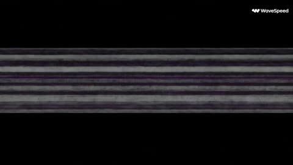</a>

The prompt is split into timed beats (hook, gameplay, payoff, replay hook), and each beat names its sound effect and on-screen UI text. The closing list of banned looks (no photorealism, no 3D, no anime) keeps the output in low-resolution pixel territory.

Seedance 2.5 · Text-to-video · Source: [@bmx_ai13 on X](https://x.com/bmx_ai13/status/2101593507232387096)

[`pixel-art`](tags.md#tag-pixel-art) [`retro-game`](tags.md#tag-retro-game) [`word-game`](tags.md#tag-word-game) [`sound-effects`](tags.md#tag-sound-effects)

<details><summary><b>Prompt</b></summary>

```text
30 Second Pixel 90s Retro Word Game Concept

0–3 sec — Hook
Black CRT screen. Static flicker. Suddenly neon pink/purple pixel graphics boot up.
Big chunky pixel text:

“CAN YOU GUESS THE 90s?”

A 5-letter puzzle appears.

First guess: MUSIC
Tiles rapidly flip — ⬛ 🟨 🟩 ⬛ 🟩

Retro arcade beep-beep-boom sound.
3–8 sec — Fast Gameplay
Player quickly types another word using a chunky pixel keyboard.

Each letter tile flips with satisfying arcade sounds.

Correct letters explode into bright green pixels.
Wrong letters shake and glitch.

Top UI:

STREAK ×7
 LEVEL 12
 XP +50

Background feels like a 1990s arcade bedroom: CRT glow, cassette tapes, floppy disks, checkerboard patterns and neon geometric shapes.

8–13 sec — 90s Word Challenge
Screen glitches into:

“90s WORD PILE”
Words flash quickly:
VHS
 DISCO
 RADIO
 PIXEL
 ARCADE

Then a new mystery word appears:

_ _ _ _ _
Countdown:

10… 9… 8…

Player starts typing fast.

13–18 sec — Almost Fail
Guess:
GAMES
Only two letters turn green.
Timer:
3… 2…

Screen begins flashing red.

The player changes one letter at the last second.

GAME?

Final letter drops in.

18–22 sec — BIG PAYOFF
All five tiles flip GREEN one after another.

P — I — X — E — L
Huge pixel explosion.

CRT screen shakes.

Retro confetti fills the screen.

Text:

PERFECT!

STREAK ×8

+250 XP

22–27 sec — Progression Hook
Rapid gameplay montage:

Unlock a new neon theme.

Badge pops:
“90s KID”

Career map advances:

LEVEL 12 → LEVEL 13

Another theme unlocks:

MALL NIGHT

Everything changes to cyan, magenta and purple neon.

27–30 sec — Replay Hook
A brand-new puzzle instantly appears.

_ _ _ _ _

Small text:

“ONE MORE WORD?”
Cursor starts blinking.

Then:
PRESS START
Cut to CRT static.
Visual direction

Make it true retro pixel-game footage, not realistic 3D and not Pixar. Use low-resolution pixel graphics, chunky 8/16-bit-inspired typography, neon cyan/magenta/purple/green palettes, CRT scanlines, VHS-style glitches, checkerboard patterns, arcade UI, pixel particles, tile-flip animations and old-school sound effects.

The video should feel like a lost 1990s arcade word game rebuilt for modern mobile gameplay—fast, satisfying and addictive.

No photorealism, no 3D adventure character, no cinematic environments, no anime, no modern glossy UI, no realistic Unreal Engine visuals.

Best opening hook:
 “CAN YOU GUESS THE 90s?”
```

</details>

<a id="seedance-alpine-golden-hour-fashion-ski-walk"></a>
### Fashion Model Walking Snowy Alpine Slope at Golden Hour

<a href="https://x.com/noorlewisx/status/2096826123330138410">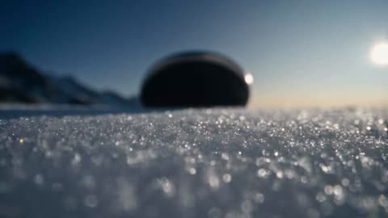</a>

Opens with a low angle and sparkling snow in extreme foreground, which gives shallow depth of field and bokeh before the subject comes into focus. Detailed wardrobe and prop specifics (coat, boots, skis over the shoulder) plus rim lighting and film grain keep the editorial look consistent.

Seedance 2.5 · Text-to-video · Source: [@noorlewisx on X](https://x.com/noorlewisx/status/2096826123330138410) · found via [LearnPrompt/awesome-seedance](https://github.com/LearnPrompt/awesome-seedance)

[`fashion`](tags.md#tag-fashion) [`cinematic`](tags.md#tag-cinematic) [`snow`](tags.md#tag-snow) [`golden-hour`](tags.md#tag-golden-hour) [`low-angle`](tags.md#tag-low-angle)

<details><summary><b>Prompt</b></summary>

```text
Cinematic fashion film still, low-angle shot of a beautiful young woman with wavy dirty-blonde hair and brown eyes walking toward camera on a sunlit snowy alpine mountain slope at golden hour. She wears an oversized cream faux-fur coat over a white ribbed crop top and matching white shorts, white fuzzy ski boots and white gloves. She carries a pair of sleek white skis with black bindings slung over one shoulder. Sparkling crystalline snow in extreme foreground with shallow depth of field and bokeh, snow-capped peaks and clear blue-to-dusk sky in background, dramatic rim lighting, high-fashion editorial photography, 35mm film grain, ultra-realistic, photorealistic, 8k
```

</details>

<a id="seedance-anime-girl-pastel-hair-salon"></a>
### Anime girl gets pastel rainbow hair dye in salon

<a href="https://x.com/AIwithJessica/status/2093127123687108856">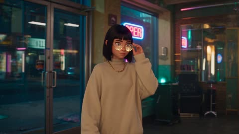</a>

Timestamped beats with one salon action each, plus an explicit ban on fast cuts and speed ramps, keep the process readable across 30 seconds. Repeating fixed character descriptions for the stylist and customer, with a rule to keep both the same throughout, holds identity between shots.

Seedance 2.5 · Text-to-video · Source: [@AIwithJessica on X](https://x.com/AIwithJessica/status/2093127123687108856)

[`retro-anime`](tags.md#tag-retro-anime) [`3d-cel`](tags.md#tag-3d-cel) [`hair-salon`](tags.md#tag-hair-salon) [`neon`](tags.md#tag-neon)

<details><summary><b>Prompt</b></summary>

```text
Create a 30-second modern retro-anime style 3D-cel hybrid commercial in 16:9.

A cozy neon-lit retro salon with warm cinematic lighting, soft VHS grain, and gentle synthwave color glow. Keep the same stylist and the same customer throughout the entire video.

The customer is always the main focus.

Customer:
Slim, smart, fashionable young girl with straight shoulder-length dark hair, sharp stylish bangs, small nose piercing and two ear piercings, sparkly round glasses, oversized beige turtleneck, gold chain necklace, confident yet slightly nervous expression.

Stylist:
Beautiful young woman with long wavy silver-lavender hair tied in a loose ponytail, elegant almond-shaped violet eyes, retro apron over a fitted black top, small gold hoop earrings. She is warm, graceful and quietly confident.

Story (cut scenes):

[0:00–0:04] The customer walks in confidently, adjusting her glasses, and sits in the salon chair.
Customer: "I want something bold today."

[0:04–0:07] She shows her phone with a vibrant pastel-color hair reference. The stylist smiles.
Stylist: "Oh, this suits you."

[0:07–0:11] Slow shot: stylist carefully sections her hair, combing it smooth.

[0:11–0:15] Stylist gently paints soft pastel-rainbow color into her hair, brush strokes slow and precise.

[0:15–0:19] Hair is slowly rinsed under water, color flowing softly.

[0:19–0:22] Hair is blow-dried with gentle, flowing motion.

[0:22–0:25] Final light styling — soft waves shaped, one small clip added.

Show only one salon action at a time. Each action lasts long enough to clearly see the process. No fast cuts. No time-lapse. No jump cuts.

[0:25–0:30] Wide cinematic reveal — she looks into the mirror, eyes widening, then breaks into a bright happy smile, touching her colorful hair.
Customer: "I love it!"
Stylist: (smiles) "Told you."

Premium modern retro-anime animation, expressive close-up facial animation, realistic soft hair physics, gentle hand animation, cinematic slow camera movement, shallow depth of field, warm neon-retro lighting, consistent character design, no glitches, no subtitles, no watermark.
```

</details>

<a id="seedance-apis-glow-cosmetic-tube-golden-swirl"></a>
### Golden swirl wraps white APIS GLOW tube

<a href="https://x.com/laviniavelle/status/2095713859000729956"></a>

Splits the commercial into an ordered shot list (pump macro, cheek application, model holding the tube, closing hero shot) so each cut has one job. Naming the exact label text and the closing liquid swirl keeps the product name readable in the final frame.

Seedance 2.5 · Text-to-video · Source: [@laviniavelle on X](https://x.com/laviniavelle/status/2095713859000729956)

[`cosmetics`](tags.md#tag-cosmetics) [`product-ad`](tags.md#tag-product-ad) [`macro`](tags.md#tag-macro) [`liquid-swirl`](tags.md#tag-liquid-swirl)

<details><summary><b>Prompt</b></summary>

```text
High-end cosmetic product commercial, 8K resolution, cinematic lighting, studio setup with neutral beige tones. A blonde model wearing a strapless white top extends a white tube with gold accents labeled "APIS GLOW" directly toward the camera. Extreme close-up shot of a thumb pressing down on the pump dispenser, squeezing out a drop of smooth white cream. Macro shot of the white cream being smoothly applied and gently spread onto a woman's glowing cheek, highlighting realistic skin texture and moisture. Cut to the model holding the tube next to her face, smiling gracefully. Conclude with a dynamic product shot of the white and gold cosmetic tube standing centered against a warm, radiant background, wrapped in a shimmering, golden liquid swirl with flying droplets Professional commercial cinematography, soft focus depth of field, sleek aesthetic.
```

</details>

<a id="seedance-aqua-lagoon-daydream-lift"></a>
### Woman opens Aqua Lagoon can in sunlit kitchen

<a href="https://x.com/ShamiWeb3/status/2096388928416919829">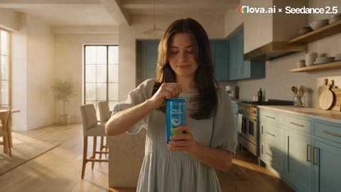</a>

A timed shot list splits the spec into cuts, with a camera rule for each world: handheld in the kitchen and a silk smooth flight cam in the dream. Matched freeze frames at the cut points link both parts into one continuous shot, and the audio beats are written out cut by cut.

Seedance 2.5 · Reference-to-video · Source: [@ShamiWeb3 on X](https://x.com/ShamiWeb3/status/2096388928416919829) · found via [LearnPrompt/awesome-seedance](https://github.com/LearnPrompt/awesome-seedance)

[`commercial`](tags.md#tag-commercial) [`match-cut`](tags.md#tag-match-cut) [`shot-list`](tags.md#tag-shot-list) [`handheld`](tags.md#tag-handheld)

<details><summary><b>Prompt</b></summary>

```text
PART 1 (0–30s)
— 16:9, 4K, seedance 2.5 render quality
— 6 cuts, handheld reality / weightless dreamworld, one graphic match cut

CAMERA BEHAVIOR CONTRACT: in the REAL WORLD the camera is HANDHELD — organic micro-shake, human weight, drift and correction. CRITICAL: during the ascent (CUT 3) the handheld camera is PLANTED ON THE GROUND — the operator does not fly, does not crane, does not dolly; they stand on the kitchen floor and TILT UP, tracking her from below as she rises away, hands trembling slightly with the effort of craning back. In the DREAMWORLD the handheld dies: weightless, silk-smooth flight cam.

DREAMWORLD RULE — PHOTOREAL SURREAL: top-tier CGI rendered with physical realism — true atmospheric haze, aerial perspective, realistic cloud volumes, physically correct liquid. The surrealism is in WHAT exists: an endless glowing turquoise sky over a luminous sparkling-water ocean; slow-motion FRUIT MOUNTAINS — mountain-scale formations of giant glossy limes, cherries and pineapple wedges fused with erupting cyan-liquid peaks; balloon-sized carbonation bubbles rising with real refraction.

Character: woman from @Image 1 — same facial features, same long dark layered waves, unchanged — wearing a flowing pale-turquoise linen sundress, barefoot, morning stillness turning to wonder. The Aqua Lagoon can stays in her hand through the entire sequence.

[0–3s] CUT 1 — THE SIP. Handheld medium, kitchen morning light: she pops the tab — crack and hiss → raises the can → tilts back → one gulp. Her eyes widen mid-swallow.

[3–6s] CUT 2 — THE BUBBLES. Handheld tight on the can at her lips: a stream of glowing, oversized carbonation bubbles escapes the can's mouth → they multiply → swirl around her arms and shoulders → and as they gather beneath her, her bare feet peel off the kitchen floor. Contact, lift, weightlessness — in that order. She gasps a laugh.

[6–15s] CUT 3 — THE ASCENT (one continuous ground-locked shot, into the match). Camera PLANTED on the kitchen floor, low wide angle, tilting up to follow her: she rises through the room wrapped in the bubble stream, hair floating, cream walls and soft aqua cabinets sliding down past frame edges → above her the ceiling BREAKS OPEN — plaster and beams parting outward in slow motion, dust drifting weightless, morning light flooding down → she passes through → keeps rising into open blue sky → grows smaller against the sky, bubbles trailing beneath her. Frame trembles slightly with the strain of the tilt. FREEZE THE GEOMETRY of the final frame: her small silhouette centered high in frame against open sky, still rising, arms slightly out, bubble trail below.

[15–19s] CUT 4 — THE OTHER SKY (MATCH CUT). GRAPHIC MATCH: first frame mirrors the previous final frame exactly — same silhouette, same position, same scale, same bubble trail — but the sky is now the luminous TURQUOISE of the dreamworld and the handheld shake is gone: weightless smooth cam. Hold the matched composition 0.5s → she decelerates at the apex, levels out, takes in the view: vast turquoise sky, glowing sparkling-water ocean far below, fruit mountains on the horizon. The bubble stream disperses around her like released balloons.

[19–27s] CUT 5 — AROUND THE MOUNTAINS. She flies happily, banking in a wide arc AROUND the fruit mountains — skimming past a mountain-scale lime ridge, weaving along a pineapple-slice cliff face with cyan liquid cascading off it in slow motion, cherries tumbling past like giant red planets. Camera ORBITS her as she flies, closing in gradually — wide orbit → tightening — turquoise dress vivid against the deeper turquoise sky.

[27–30s] CUT 6 — THE STILLNESS. Orbit tightens fully onto her face, filling frame: cyan light from the fruit playing across her cheekbones, hair drifting weightless, eyes slowly closing, a soft blissful smile forming. FREEZE THE GEOMETRY of this final frame at exactly 30s: extreme close-up, centered, eyes closed, soft smile, hair suspended mid-drift, deep turquoise dreamworld light on her skin.

AUDIO: [MUSIC] light, airy tropical-pop score begins under Cut 1 — soft marimba and glassy synth pads, building gently through the ascent into a wide, uplifting swell through the flight sequence, still playing softly at the freeze. [SFX] tab crack and hiss, one gulp; rising bubble fizz growing into a deep glassy hum; long cinematic RISER under the ascent — layered whooshes, sub-bass pressure swelling; plaster cracking and beams parting (soft, dreamlike); on the match cut (15s) a single deep SUB DROP followed by a wide airy BLOOM, kitchen acoustics opening into vast open-sky reverb; distant fruit-mountain rumbles, glassy bubble hums, wind of banking flight. [AMBIENT] kitchen quiet + fridge hum in real world; vast open-sky airiness with layered distant cascades in dreamworld.

PART 2 (30–60s)

COMMERCIAL FILM — "AQUA LAGOON DAYDREAM — THE LIFT" — PART 2 OF 2
— 16:9, 4K, seedance 2.5 render quality
— 5 cuts, weightless dreamworld / handheld reality, one graphic match cut
— OPENING FRAME MUST EXACTLY MATCH THE FINAL FROZEN FRAME OF PART 1: extreme close-up on her face, centered in frame, eyes closed, soft blissful smile, hair suspended mid-drift, deep turquoise dreamworld light washing her skin, weightless smooth cam, no handheld shake. Hold this exact matched frame for 0.5s before continuing motion.

CAMERA BEHAVIOR CONTRACT: in the DREAMWORLD the camera is weightless, silk-smooth flight cam — no shake. In the REAL WORLD (from CUT 9 onward) the camera is HANDHELD — organic micro-shake, human weight, drift and correction. On the return match cut (CUT 9) the handheld shake snaps back on frame one.

DREAMWORLD RULE — PHOTOREAL SURREAL: top-tier CGI rendered with physical realism — true atmospheric haze, aerial perspective, realistic cloud volumes, physically correct liquid. Glowing turquoise sky over a luminous sparkling-water ocean; mountain-scale lime, cherry and pineapple formations with cyan-liquid peaks; floating ice-crystal islands catching prismatic light; balloon-sized carbonation bubbles with real refraction.

Character: woman from @Image 1 — same facial features, same long dark layered waves, unchanged — wearing the flowing pale-turquoise linen sundress, barefoot. The Aqua Lagoon can stays in her hand through the entire sequence.

[30–34s] CUT 7 — THE DIVE. Continuing from the matched close-up, her eyes open, still smiling — she banks downward, arcing toward the glowing ocean surface far below — skimming low, fingertips trailing through luminous sparkling water, a spray of oversized bubbles kicking up behind her in slow motion, droplets catching the light like glass. She laughs, weightless, alive.

[34–38s] CUT 8 — THE ICE ISLANDS. She rises again, gliding past floating ice-crystal islands, sunlight refracting through them in prismatic shards; she reaches out and lets a small burst of bubbles scatter from her palm like fireworks. Wide, dreamy, unhurried. The camera slowly tightens back toward her face as the sequence winds down, ending on a tight close-up, eyes closed once more, peaceful. FREEZE THE GEOMETRY of this frame: tight face close-up, centered, eyes closed, soft smile, hair drifting.

[38–42s] CUT 9 — HOME (MATCH CUT). GRAPHIC MATCH: same tight face close-up, same scale, same centered framing — but the handheld shake returns on frame one and warm kitchen light replaces the dream sun: her eyes OPEN in the kitchen. She stands exactly where she lifted off, feet planted, hair settling as if a wind just died. The camera eases back a step to a medium: the ceiling is intact — untouched, whole. She looks up at it once, then breaks into a slow, delighted smile.

[42–50s] CUT 10 — THE POUR. Handheld, kitchen light: she walks to the counter, pours the Aqua Lagoon over ice into a clear glass — a slow-motion cascade, bubbles catching morning light, a lime wedge dropping in with a soft splash. She lifts the glass, takes a small sip, smiles to herself.

[50–60s] CUT 11 — THE LOGO. Still handheld, gently breathing: she turns, looks into the lens, smiling, and RAISES the can toward camera — holding it out at chest-to-shoulder height, FRONT FACE of the label squared to the lens (exactly as in @Image 2), the white "AQUA LAGOON" wordmark and swirl logo centered, sharp and legible at frame center, one long horizontal cyan flare streaking off the aluminum rim, the deep-blue label glowing against the warm cream kitchen. Camera eases in a breath closer and settles. Final frame: her smile behind the can, logo to camera, lime and cherry garnish visible on the counter beside her.

AUDIO: [MUSIC] uplifting swell from Part 1 continues softly under the dive and ice islands, dropping out completely on the return match cut (38s) for total silence, then re-entering warm and soft under the pour and logo shots, resolving on a clean, bright final chord as she raises the can. [SFX] slow-motion water splashes on the dive, glassy bubble hums, wind of flight; on the match cut (38s) all dreamworld sound CUTS DEAD in one frame to sudden dry kitchen silence + fridge hum, bare feet settling, her soft delighted exhale; ice clinking and liquid pouring on Cut 10; under the final logo shot, music plus one soft airy shimmer as the flare crosses the lens. [AMBIENT] vast open-sky airiness with distant cascades in dreamworld; kitchen quiet + fridge hum in real world.
```

</details>

<a id="seedance-artisan-bakery-donut-commercial"></a>
### Pastry chef cracks egg into flour bowl

<a href="https://x.com/AIwithAliya/status/2090780603872624826"></a>

A timed storyboard in five-second ranges, with a shared lighting and colour grade block, and an @material reference that anchors the storyboard and the closing box shot. Sound is limited to implied kitchen ambience and a restrained score, which keeps the commercial tone consistent.

Seedance 2.5 · Reference-to-video · Source: [@AIwithAliya on X](https://x.com/AIwithAliya/status/2090780603872624826)

[`commercial`](tags.md#tag-commercial) [`food`](tags.md#tag-food) [`timed-storyboard`](tags.md#tag-timed-storyboard) [`product-reveal`](tags.md#tag-product-reveal)

<details><summary><b>Prompt</b></summary>

```text
follow the storyboard @material:149015 A 30-second cinematic spec commercial / film-style advertisement for a premium artisan bakery brand. High-end food-commercial aesthetic, luxurious and sensory, shot like a short film.

Soft, warm, high-key kitchen lighting with gentle highlights on stainless steel and glossy glaze. Shallow depth of field, slow elegant camera moves, occasional slow-motion, rich color grading (soft pinks, golden dough, deep raspberry red). Ultra-clean, appetizing, almost tactile.

0–6s  
Medium shot of a striking young female pastry chef in a pale-pink chef’s jacket, matching pink toque, and pink gloves. She stands in a sleek, modern commercial kitchen. She looks down with quiet concentration and cracks a fresh egg into a stainless-steel bowl of flour. Subtle steam and flour dust in the air.

6–11s  
Tight close-up of the vivid yolk and white pouring into the flour well. Cut to the KitchenAid mixer head descending and beginning to knead. Macro of pale, elastic dough stretching, folding, and becoming silky and glossy.

11–16s  
Overhead shot of twelve perfectly formed raw ring donuts on a parchment-lined tray. Gloved hands lift the tray with precision. The camera follows as they are carried toward the fryer.

16–22s  
Donuts lowered into bubbling golden oil. Slow-motion close-up of four donuts frying, edges turning amber. A single donut is lifted on a metal skewer, oil dripping in slow motion. The full basket rises, steam rising, donuts now perfectly golden.

22–26s  
A warm donut is dipped halfway into a bowl of thick, vibrant raspberry-red glaze. Extreme close-up of the glossy glaze slowly cascading down the sides. Fine white sugar crystals rain onto the wet glaze, catching the light.

26–30s  
Product reveal. Gloved hands place the last donut into an open kraft bakery box. The camera slowly pulls back and tilts up as the lid is closed, revealing the brand name **MAISON ROSE** in elegant, minimal serif lettering on the lid, with a small rose emblem. The box sits perfectly centered, six glazed donuts visible through a brief moment before the lid settles. Soft light catches the logo. Hold on the branded box as the hero product shot.

Elegant, silent except for implied kitchen sounds and a refined, understated score. Premium, filmic, commercial-grade finish.
```

</details>

<a id="seedance-automated-fries-factory-potato-conveyor"></a>
### Workers tip potatoes onto a factory conveyor

<a href="https://x.com/aiwithaly/status/2091031033986634183"></a>

The prompt walks through the process in strict stage order from intake to packing, so the clip follows a clear production sequence. Named sounds such as conveyor motors and fryer bubbling, plus a list of negatives for distortion, floating objects and watermarks, keep the factory look realistic and clean.

Seedance 2.5 · Text-to-video · Source: [@aiwithaly on X](https://x.com/aiwithaly/status/2091031033986634183)

[`food-factory`](tags.md#tag-food-factory) [`industrial`](tags.md#tag-industrial) [`documentary`](tags.md#tag-documentary) [`conveyor`](tags.md#tag-conveyor)

<details><summary><b>Prompt</b></summary>

```text
A modern automated French fries factory processes fresh potatoes from start to finish. Potatoes arrive on stainless-steel conveyors, pass through industrial washing and peeling machines, then enter precision cutting equipment that produces evenly sized fries. The fresh-cut fries move through blanching, hot-oil frying, draining, and cooling systems before reaching automated weighing and packaging machines. Portions are measured, sealed into food-grade bags, checked by quality-control scanners, and transferred into cartons by robotic arms. Ultra-photorealistic industrial food production documentary, realistic potato and fry physics, physically accurate machinery, continuous conveyor movement, authentic water flow, realistic frying bubbles, natural steam, accurate robotic movements, hygienic factory environment, bright industrial LED lighting, realistic stainless-steel reflections, trained workers wearing proper protective equipment, smooth documentary cinematography, authentic factory sounds including conveyor motors, flowing water, cutting machines, fryer bubbling, cooling fans, and packaging mechanisms, no narration, no music, seamless visual continuity, no CGI appearance, no floating objects, no distorted food, no machine clipping, no excessive steam, no flickering lights, no text overlays, logos, or watermarks.
```

</details>

<a id="seedance-bare-faced-makeover-swipe"></a>
### Bare faced woman swipes into glamorous makeover

<a href="https://x.com/MissDelulu9/status/2108101531426083045">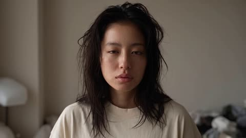</a>

A timed beat sheet with hard cuts, white flashes and snap zooms locks the pacing for each second. The palm swipe covers the lens as the hidden cut, so the transformation reads as one gesture instead of a morph.

Seedance 2.5 · Text-to-video · Source: [@MissDelulu9 on X](https://x.com/MissDelulu9/status/2108101531426083045) · found via [LearnPrompt/awesome-seedance](https://github.com/LearnPrompt/awesome-seedance)

[`makeup`](tags.md#tag-makeup) [`transformation`](tags.md#tag-transformation) [`beauty`](tags.md#tag-beauty) [`hard-cut`](tags.md#tag-hard-cut)

<details><summary><b>Prompt</b></summary>

```text
Creare 10-second ultra-realistic Douyin-style makeup transformation of the same attractive young adult woman, cinematic 16:9, luxury beauty-commercial aesthetic.

0–2.5s: Bare face, messy hair, oversized T-shirt, sleepy expression in a casual room. Slow push-in. She suddenly becomes confident and makes a FAST sideways palm swipe across the lens. Camera whip-pans with her hand; palm covers frame.

2.5s: HARD CUT + WHITE FLASH + WHOOSH + SHAKE. Instant hidden transformation, no morphing. SNAP ZOOM OUT → IN.

2.5–4s: Black studio. Full glamorous Douyin makeup, styled voluminous hair, elegant fashion outfit. Strong wind blows her hair. Fast head turn + intense eye contact.

4–10s: Rapid editorial sequence: FLASH → HARD CUT → NEW POSE → CAMERA MOVE. Hair sweep, 3/4 turn, hand near jaw, low-angle pose, final hero shot. Multiple flashes and snap zooms, ending with a huge white photography flash + brief freeze.
```

</details>

<a id="seedance-bleu-de-chanel-perfume-review"></a>
### Woman reviews Bleu de Chanel bottle in living room

<a href="https://x.com/CaliraVal/status/2097904148360630318">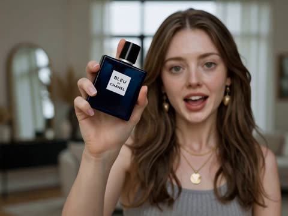</a>

The prompt runs the clip as ordered beats (show the bottle, spray wrist and neck, smell, speak) and gives the full script word for word so lip sync has a fixed line. Naming the exact product and repeating that the bottle must stay consistent anchors the brand, while camera, lighting and realism terms set the premium look.

Seedance 2.5 · Text-to-video · Source: [@CaliraVal on X](https://x.com/CaliraVal/status/2097904148360630318)

[`fragrance`](tags.md#tag-fragrance) [`product-review`](tags.md#tag-product-review) [`lip-sync`](tags.md#tag-lip-sync) [`influencer`](tags.md#tag-influencer)

<details><summary><b>Prompt</b></summary>

```text
Create a realistic luxury perfume review video featuring a stylish young woman in an elegant modern setting.

She holds the Bleu de Chanel perfume bottle toward the camera, showing the bottle clearly. She then sprays a small amount on her wrist and neck, gently smells the fragrance, smiles naturally, and gives a genuine personal reaction.

She looks directly into the camera and speaks naturally in a warm, confident female English voice with perfect lip-sync:

“I’ve been trying Bleu de Chanel, and honestly, I really love it. It smells fresh, clean, sophisticated, and very elegant. It’s perfect for everyday wear, but it also feels special enough for an evening out. Definitely a fragrance I’d recommend.”

Use natural facial expressions, realistic hand gestures, accurate lip movement, and authentic influencer-style delivery. Keep her voice clear, smooth, friendly, and conversational—not robotic or overly commercial.

Use soft flattering lighting, realistic skin texture, shallow depth of field, cinematic camera movement, natural perfume spray mist, realistic reflections, and a premium lifestyle background. Keep the perfume bottle consistent and recognizable throughout.

Photorealistic, luxury fragrance commercial, authentic product review, realistic physics, smooth motion, 4K, vertical . No distorted hands, no warped bottle, no changing face, no flickering, no incorrect text.
```

</details>

<a id="seedance-blonde-model-pink-ball-gown-palace"></a>
### Blonde model poses in pink gown under chandelier

<a href="https://x.com/Zoyavelle/status/2108783755460853994">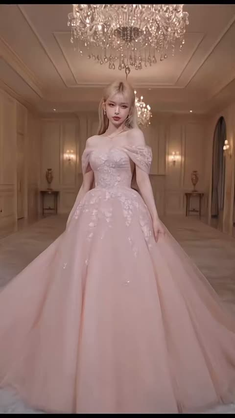</a>

The prompt names each gown colour in order and fixes the palace setting and chandelier lighting, so every transition has a stable scene to land in. The skirt is held and turned with a fabric-flow instruction, which keeps the motion grounded.

Seedance 2.5 · Text-to-video · Source: [@Zoyavelle on X](https://x.com/Zoyavelle/status/2108783755460853994) · found via [LearnPrompt/awesome-seedance](https://github.com/LearnPrompt/awesome-seedance)

[`fashion`](tags.md#tag-fashion) [`ball-gown`](tags.md#tag-ball-gown) [`palace`](tags.md#tag-palace) [`runway`](tags.md#tag-runway)

<details><summary><b>Prompt</b></summary>

```text
A stunning blonde fashion model gracefully walks and poses in a luxurious palace ballroom, wearing an enormous elegant princess ball gown. She gently holds both sides of her voluminous skirt and slowly turns, allowing the delicate embroidered fabric to flow naturally. The camera smoothly moves forward and captures her full body and the intricate details of the dress. Transition seamlessly between different luxurious gowns in pastel pink, icy blue, lavender, champagne gold, and black, with each dress appearing in a grand palace interior with elegant chandeliers and cinematic lighting. Realistic walking motion, natural fabric movement, graceful posing, smooth cinematic transitions, high-end couture fashion runway aesthetic, photorealistic details, stable camera, vertical 9:16 video.
```

</details>

<a id="seedance-china-train-travel-multishot"></a>
### Traveler watches the landscape from a train window

<a href="https://x.com/Diplomeme/status/2099726668164444397">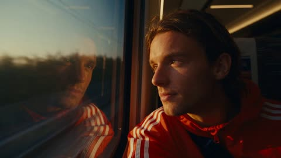</a>

A timed beat sheet pairs each segment with its lens, camera motion and light source, and a locked character block is restated for continuity across cuts. Naming real environmental sounds and natural light sources keeps the grade grounded rather than stylized.

Seedance 2.5 · Text-to-video · Source: [@Diplomeme on X](https://x.com/Diplomeme/status/2099726668164444397) · found via [LearnPrompt/awesome-seedance](https://github.com/LearnPrompt/awesome-seedance)

[`travel`](tags.md#tag-travel) [`multishot`](tags.md#tag-multishot) [`fashion`](tags.md#tag-fashion) [`music-video`](tags.md#tag-music-video) [`china`](tags.md#tag-china)

<details><summary><b>Prompt</b></summary>

```text
30 seconds | 16:9 | premium travel music video / fashion travel film | 2024–2026 commercial grade | MULTISHOT

CORE CONCEPT
A young traveler experiences China through an energetic but natural sequence of movement, culture, fashion, food, architecture and landscapes. The film feels like a premium Chinese tourism campaign combined with an elite fashion travel film. The traveler is always physically present in the environment. Every location feels photographed rather than generated. Music drives the edit, but the footage retains the imperfections and spontaneity of real travel photography.

CHARACTER
ONE TRAVELER — young adult international traveler wearing a contemporary Adidas travel outfit: premium red Adidas jacket, neutral trousers, sneakers, compact crossbody bag. Natural hair, realistic skin texture, minimal accessories. Same face, clothing, hairstyle, proportions and accessories throughout the entire film. Do not invent additional Adidas branding.

SETTING
Modern and historic China: high-speed railway, Shanghai streets, traditional water-town lanes, Chengdu food streets, ancient architecture, dramatic mountain valleys, elevated viewpoints and vibrant nighttime streets. Real pedestrians, vendors, commuters, vehicles and local activity. Locations feel naturally connected through the journey.

STORY — MUSIC-DRIVEN MULTISHOT VISUALS

00:00–02.5 — CLOSE-UP HOOK
85mm close-up of the traveler beside a high-speed train window. Warm sunlight catches the face while reflections of the moving Chinese landscape slide across the glass. Traveler looks outside, then turns toward camera as the first beat begins.

02.5–05 — MOVEMENT
24mm wide shot from the platform as the traveler walks alongside the departing high-speed train. Wind moves the red jacket naturally. The train accelerates through frame. Cut precisely with the music.

05–07.5 — CITY ARRIVAL
35mm handheld follow shot as the traveler exits a busy station into a dense Chinese city street. Real pedestrians cross naturally. Electric scooters, taxis and buses move through the background. Camera operator follows slightly behind rather than perfectly framing the subject.

07.5–10 — STREET LIFE
50mm observational shot. Traveler moves through a crowded neighborhood while a food vendor prepares steaming street food nearby. Traveler briefly stops, watches the preparation and smiles naturally. Steam passes across the foreground.

10–12.5 — CULTURAL TRANSITION
24mm shot following the traveler through a traditional Chinese water-town street. Stone paths, wooden buildings, bridges and hanging signs surround them. People move naturally through the scene. Traveler crosses a small bridge as sunlight breaks through the buildings.

12.5–15 — FOOD / HUMAN MOMENT
50mm close-up. A local vendor hands the traveler a freshly prepared dish. Traveler takes a bite and reacts naturally. Shallow depth of field, warm skin tones, authentic background activity and subtle handheld movement.

15–17.5 — MOUNTAIN REVEAL
24mm deep-focus landscape. Traveler walks up a long stone staircase through dense greenery. Camera follows from behind. As the traveler reaches the top, a vast mountain valley emerges through cool atmospheric mist.

17.5–20 — FASHION MOMENT
50mm side-tracking shot in golden sunlight. Traveler walks along the mountain viewpoint. Red Adidas jacket contrasts strongly against deep green vegetation. Golden rim light catches the hair and shoulders. Natural wind moves fabric.

20–22.5 — LANDSCAPE / SCALE
24mm wide. Traveler becomes small against enormous mountains disappearing into mist. Clouds move slowly through the valley. No artificial drone aesthetic; perspective feels like a real elevated camera position.

22.5–25 — NIGHT TRANSITION
50mm handheld street shot at blue hour. Traveler enters a lively nighttime food district. Warm lanterns, cool ambient light, scooters and pedestrians create layered depth. The music increases in intensity.

25–27.5 — CITY ENERGY
35mm tracking shot as traveler walks beside a modern riverside district. Reflections ripple across the water. Modern towers illuminate behind them while boats move naturally through the frame.

27.5–30 — FINAL REVEAL
24mm wide composition from behind the traveler. They stop briefly at the riverside and look across the illuminated skyline. Camera slowly moves backward rather than flying upward. Traveler then continues walking as the music reaches its final beat.

CAMERA
35mm and 50mm for portraits and human moments, 24mm for landscapes, architecture and stairs, occasional 85mm compression on faces. Shallow DOF on close-ups, deep focus on mountain wides. Handheld and physically motivated tracking movement. Natural camera micro-movement, imperfect framing, subtle autofocus adjustment, realistic exposure adaptation and occasional foreground obstruction. No impossible camera movement, no floating drone aesthetic.

VISUAL / COLOR SETTING
Premium travel music video / fashion travel film, 2024–2026 commercial grade. Look: photoreal cinema, slight filmic grain, mild halation on highlights, teal-cyan skies, punchy crimson reds, deep forest greens, warm skin, crushed-but-not-crushed blacks.

COLOR GRADE
Cinematic teal-and-warm, greens slightly cyan, red Adidas pops hard against foliage, golden rim on faces in sun, cool mist in mountain valleys. Maintain realistic skin tones and natural environmental color. No excessive saturation or artificial HDR.

MOTION
180-degree cinematic shutter, natural motion blur on hair and fabric, 24fps. No soap-opera 60fps look. Movement should retain the subtle imperfections of real location photography.

LIGHTING
Natural daylight, soft overcast city light, warm direct sunlight, golden-hour rim light, cool mountain mist, practical lanterns and nighttime city illumination. Lighting must originate naturally from the environment.

AUDIO
Premium contemporary travel soundtrack with subtle modern Chinese-inspired textures. Music drives the transitions and rhythm. Keep authentic location sound underneath: train ambience, station announcements, footsteps, scooters, traffic, vendors, cooking sounds, crowd chatter, wind, birds, distant city noise and riverside ambience. Environmental sound should occasionally become prominent during intimate moments.

REALISM
No CGI look, no plastic skin, no beauty-filter smoothing, no extra fingers, no warped architecture, no artificial crowd synchronization, no impossible reflections, no floating objects, no exaggerated depth of field. Realistic skin pores, hair strands, fabric texture, water reflections, atmospheric perspective and human movement.

BRAND CONTROL
The only Adidas branding visible is the existing Adidas trefoil already present on the traveler’s garments. Do not invent additional logos, advertisements, storefront branding or branded products. Do not add watermarks or random UI.

EDITING
Music-synchronized commercial editing without excessive effects. Cuts are motivated by movement, reflections, steam, architectural shapes, walking direction and changes in light. Use clean match cuts and occasional speed changes only when physically believable. Avoid generic AI transitions, artificial zooms, excessive whip transitions and over-edited montage pacing.

CONTINUITY
The traveler remains identical throughout all shots. Preserve face, hairstyle, red Adidas jacket, trousers, sneakers, bag and accessories. Maintain realistic weather and lighting progression from daylight → golden hour → blue hour → night. Each location should feel like part of one continuous journey through China.

FINAL QUALITY TARGET
The final film should look like genuine footage captured by an elite travel filmmaker for a major Chinese tourism/fashion campaign—not a collection of AI-generated beauty shots. The realism comes first; the commercial polish comes from cinematography, color, music, editing and art direction.
```

</details>

<a id="seedance-chinese-spicy-sour-fish-cooking"></a>
### Chef cuts a whole fish on wooden board

<a href="https://x.com/Naiknelofar788/status/2105297994736394705"></a>

Timed beats such as 0 to 4s and 4 to 8s act as a shot by shot script, and each beat names concrete motion, sound and ingredients. The opening block fixes lighting, camera style and a ban on text, which keeps the look consistent across cuts.

Seedance 2.5 · Text-to-video · Source: [@Naiknelofar788 on X](https://x.com/Naiknelofar788/status/2105297994736394705)

[`chinese-cuisine`](tags.md#tag-chinese-cuisine) [`food-commercial`](tags.md#tag-food-commercial) [`timed-shots`](tags.md#tag-timed-shots) [`macro`](tags.md#tag-macro)

<details><summary><b>Prompt</b></summary>

```text
Create a 30-second ultra-realistic cinematic cooking video of a skilled Chinese chef preparing spicy-and-sour fish in a professional kitchen. The chef wears a clean white chef uniform. Fast, precise cooking movements, realistic food textures, authentic fire, steam and oil physics, natural human motion, cinematic food photography. No text, logos, subtitles, or watermarks.

[0–4s] — FISH PREPARATION
The chef firmly holds a fresh whole fish on a wooden cutting board. With fast, controlled knife movements, the chef removes the head and smoothly follows the spine, separating the fish into clean fillets. Realistic knife sounds and subtle moisture details.

[4–8s] — THIN SLICING
The fillet is placed flat on the board. The chef rapidly slices it into extremely thin, delicate pieces with precise wrist movements. The translucent slices fall naturally one after another, revealing detailed fish texture and moisture.

[8–11s] — SEASONING
The fish slices are transferred into a bowl and coated with spices and a light marinade. The chef quickly tosses and mixes them until every piece is evenly coated with a smooth, glossy layer.

[11–15s] — WOK AND AROMATICS
A heavy iron wok heats over a strong blue-orange flame. Oil begins to shimmer. Pickled mustard greens, pickled chilies, garlic, and spices are thrown into the wok. They immediately sizzle as the chef rapidly tosses the ingredients, filling the scene with realistic steam and aromatic heat.

[15–20s] — COOKING THE FISH
Rich stock is poured into the wok and reaches a vigorous boil. The chef carefully adds the delicate fish slices and controls the wok with quick, precise movements, keeping the fish intact. A light starch slurry is added while the wok is rotated in smooth arcs, creating a silky, glossy sauce that coats every slice.

[20–24s] — PLATING
The cooked fish is carefully transferred into a deep serving dish. White fish slices settle among golden pickled vegetables and red chilies. The glossy sauce flows naturally around the fish while steam rises from the hot dish.

[24–27s] — HOT OIL FINISH
Fresh minced garlic and dried red chilies are arranged on top. The chef pours scorching hot oil over them. A powerful, realistic sizzling reaction erupts, sending fragrant steam upward as the toppings bloom in the hot oil.

[27–30s] — FINAL HERO SHOT
The camera slowly pushes toward the finished dish. Tender white fish, golden pickled vegetables, bright red chilies, glossy sauce, fresh garlic, and swirling steam fill the frame. End on an irresistible macro close-up of the bubbling, freshly cooked spicy-and-sour fish.

Ultra-realistic food cinematography, photorealistic chef, authentic Chinese cooking technique, realistic knife handling, detailed fish texture, natural steam and fire, physically accurate oil movement, cinematic depth of field, subtle handheld camera movement, warm professional kitchen lighting, macro food details, high dynamic range, 4K, premium food commercial quality.
```

</details>

**1** · [2](video-commercial-2.md)
