# Dialogue and talking heads

[Back to the list](../../README.md) · All 55 entries

<a id="seedance-cafe-table-multi-angle-reshoot"></a>
### Cafe table talk reshot from thirteen new angles

<a href="https://x.com/Scenario_gg/status/2102365054389899695"></a>

The prompt locks performance, audio, lighting and tempo of the source video, then varies only camera position and lens through a timed shot list. Measured speech windows, an eyeline rule and an empty sky rule keep lip sync and background clean in every new angle.

Seedance 2.5 · Video edit · Source: [@Scenario_gg on X](https://x.com/Scenario_gg/status/2102365054389899695) · 3,287 likes on 2026-10-27

[`video-to-video`](tags.md#tag-video-to-video) [`multi-angle`](tags.md#tag-multi-angle) [`camera-plan`](tags.md#tag-camera-plan) [`lip-sync`](tags.md#tag-lip-sync) [`timed-shot-list`](tags.md#tag-timed-shot-list)

<details><summary><b>Prompt</b></summary>

```text
Prompt (seedance 2.5 video to video):

ONE FINISHED TAKE, RE-PHOTOGRAPHED


@video1
 is one finished take: a single locked-off wide, 19.53 s, with its original audio, a young man at an outdoor cafe table talking to one camera. Do not restage, re-perform, re-time or reinterpret it. Re-photograph the identical event from thirteen new camera positions, as if thirteen extra cameras had been rolling around him in the same moment. Every output frame shows the same body at the same instant of
@video1
 at the same speed. Output runs the full 19.53 s. Keep the audio of
@video1
 unchanged and in sync.

DO NOT CHANGE
Performance, body, hands and what they hold, head angle, eyeline, lip movement, blink timing, movement speed, action start and end times, lighting, exposure, white balance, colour grade, wardrobe, props, set. The only variable is camera position and lens.

SPEECH WINDOWS (measured from the audio of
@video1
)
SPEAKING: 0.00-1.65, 2.05-4.80, 5.95-6.90, 9.65-11.75, 12.20-12.85, 13.35-13.80, 16.70-16.90, 17.60-18.90.
SILENT, mouth closed and still or chewing: 1.65-2.05, 4.80-5.95, 6.90-9.65 (drinking), 11.75-12.20, 12.85-13.35, 13.80-16.70 (chewing), 16.90-17.60, 18.90-19.55.
Whenever his mouth is visible in a SPEAKING window it moves in lip-sync with the audio of
@video1
. He talks while looking down: from 2.05 to 4.80 his head is down at the laptop and he is speaking. Head down is not silent. Never add speech to a silent window, never mute a speaking one.

EYELINE RULE
He performed to ONE camera, the A-camera: the original locked-off wide, directly in front of him at seated eye level. His eyeline stays on that spot in every shot, apart from the glances down at keyboard, mug and pastry already in
@video1
. He never looks for or turns toward a new camera. From above he reads cap and brow; from the sides, three-quarter or profile; from behind, the back of his head. Single exception: the on-axis shot at 00:01-00:02 sits where the A-camera was, so there alone he looks into the lens.

TEMPO RULE
Real time, 1:1 with
@video1
. No speed ramps, added slow motion, freeze frames or time remaps. Exactly one slowed passage exists, already baked into the source: the pastry at the top of its arc, 12.5-13.55. Reproduce it at the speed it already has, no slower, no longer.

TOSS TIMING
The pastry leaves his fingers at 12.43 and is caught at 13.60: airborne about one second only. Do not stretch, loop or hang the flight. Before 12.43 and after 13.60 it is in his hand.

EMPTY SKY
On every low or upward-tilting shot the sky is plain pale overcast and empty. No skyscrapers, glass towers, solar panels, cranes, birds, aircraft, sun disc, structured clouds, lens flare or signage. Above his head only cream wall, white pillars and flat pale sky.

CAMERA PLAN

[00:00-00:01] High-angle MCU from above and to his right, about 40 degrees down, chest up, slow push-in, 35mm feel, moderate depth of field, cap brim and open gesturing palms, marble edge in the lower foreground. Speaking, reading three-quarter, not to this lens.

[00:01-00:02] ON THE A-CAMERA AXIS. ECU of his face, dead front, seated eye level, 85mm feel, shallow focus, pillars soft cream behind. The one shot where he looks into the lens. Hands drop below frame onto the keyboard; mouth closes at 1.65.

[00:02-00:05] Macro along the MacBook keyboard to his typing fingers, lens centimetres above the keys, razor-thin focus, keycaps sharp, his face soft far behind, head down. Speaking 2.05-4.80: where his mouth shows in the blur it moves with the audio. Fingers lift at 5.0.

[00:05-00:06] Top-down bird's eye straight down over the table, 24mm feel, deep focus, locked off. Marble disc fills frame: open laptop, white mug, financier, his cap at the bottom edge. Right hand crosses to the mug handle.

[00:06-00:07] Lens resting on the marble at table height, 50mm feel. White mug large and sharp in the left foreground; his hand enters from the right, grips the handle, lifts the mug up out of frame. Torso soft behind. Speaking 5.95-6.90.

[00:07-00:09] First-person POV from his seat, ultra-wide 18mm feel, gentle handheld breathing. The mug rim rises into the bottom of frame and tips toward the lens; laptop screen and marble beyond in deep focus. No face; framing dips to the mug, never up. Silent.

[00:09-00:10] Extreme wide, slow dolly out, 24mm feel, deep focus. He is small at his table mid-terrace: cream wall, pillars, concentric-circle mural, taped boxes behind, slatted bench visible. He sets the mug on the marble 9.4-10.0; speech resumes 9.65.

[00:10-00:12] Low and to his left, lens just above the marble, 50mm feel, shallow focus, table edge and mug soft in the near foreground. Right hand reaches out at 10.5 and lifts the golden financier into sharp focus before his left profile. Talking to the A-camera: full profile here.

[00:12-00:14] Low beside him, 35mm feel, slight Dutch. Opens on the pastry in his fingers; at 12.43 it leaves his hand and the camera tilts UP, following it against plain pale overcast sky and the top of a white pillar through the baked-in slow apex 12.5-13.55, then tilts DOWN for the catch at 13.60 into cupped hands, head tipped back, mouth open, then head coming forward.

[00:14-00:15] Behind him, over his right shoulder, 50mm feel, moderate focus. Back of the black Yankees cap and long dark hair fill frame-left; laptop glow and marble past his shoulder. Head settles level, hands bring the pastry toward his mouth. No face. Silent.

[00:15-00:16] ECU on his mouth and jaw, 100mm macro feel, very shallow focus, soft open-sky light. The financier enters from below, he bites, crumbs, the jaw chews. Chewing, not speaking. Nothing above the nose in frame.

[00:16-00:18] Slow orbit from his left toward front, 35mm feel, moderate focus, mural and pillars parallaxing behind, table crossing the foreground. He chews, speaks 16.70-16.90 and from 17.60, open palms, a small shrug. As the orbit nears front his gaze lands near, not into, this moving lens.

[00:18-00:20] Top-down bird's eye straight down over the table, 24mm feel, deep focus, locked off. Hands come down beside the laptop and settle, cap centred, speech ends 18.90, then still. Hold to 19.53.

SET AND SUBJECT CONTINUITY (identical in every shot)
Young man, long dark hair, black short-sleeve button-up shirt with a small chest logo, black New York Yankees baseball cap, grey trousers. Light wood slatted bench, round white marble table, outdoor cafe terrace. On the table: open dark grey MacBook, white mug with a circular graphic, one small golden financier. Behind him: cream wall, white cylindrical pillars, large black-and-white concentric-circle mural, taped cardboard boxes. Soft overcast open-shade daylight, no hard shadows, constant direction and softness. Warm bright grade: cream walls, golden wood, neutral white marble, warm skin, deep neutral blacks. He is alone; no passers-by, no staff.

No on-screen text, captions, subtitles, watermarks or logos beyond the small chest logo and cap emblem already in
@video1
.
```

</details>

<a id="seedance-selfie-skincare-ugc"></a>
### Selfie-style skincare UGC ad

<a href="https://x.com/abxxai/status/2095179656802844727"></a>

Third step of a thread: a character sheet and a product shot go in as references, and the prompt insists `Not an ad` to get the self-filmed feel.

Seedance 2.5 · Reference-to-video · Source: [@abxxai on X](https://x.com/abxxai/status/2095179656802844727) · 1,017 likes on 2026-10-27

[`ugc`](tags.md#tag-ugc) [`product-ad`](tags.md#tag-product-ad) [`vertical`](tags.md#tag-vertical) [`reference-images`](tags.md#tag-reference-images)

<details><summary><b>Prompt</b></summary>

```text
A 15-second vertical (9:16) ultra-photorealistic close-up vlog clip, filmed on a phone held at arm's length. Not an ad. A girl talking to her own camera at the end of the day, the way people actually film themselves.
TALENT —
Young woman, early-to-mid 20s. Long light-brown hair with soft caramel balayage, middle part, loose undone waves, a few strands stuck to her cheek. Fair-to-light-tan skin with visible freckles across the nose and cheeks, thick natural brows, blue-green eyes, bare face, small blue resin hoop earrings, thin gold chain with a small pearl pendant. Face, freckles, hair and eye color must 100% match the reference. Oversized white linen button-down over a fitted white ribbed top, fully covered, collar slightly crooked, sleeves pushed up.
PRODUCT —
LANEIGE Water Sleeping Mask_EX, 70 ml. Frosted translucent light-blue glass jar, smooth matte cobalt-blue screw lid. Front label reads, in this exact order: "LANEIGE" in wide-spaced capitals, "WATER SLEEPING MASK_EX" below it, then "SLEEPING MICROBIOME" and "BRIGHTENING · HYDRATING · SOFTENING" in smaller pale-yellow type, then "70 ml" at the base. Inside, thick pale mint-blue gel with a wet glossy surface that holds a soft peak. Shape, color, gel texture and all label text must 100% match the reference, correctly spelled, legible whenever in focus.
LOCATION
A villa bedroom at golden hour. Only fragments read in frame because the camera is so tight: white stucco wall, a corner of rumpled white linen bedding, blurred bougainvillea and olive leaves through an open door behind her. The background stays soft and mostly out of focus the entire time.
LIGHTING
One condition, unchanged across all four beats. Low warm sun from frame-left through the open door, roughly 4800K, soft white-wall bounce filling the shadow side of her face. Warm rim on the left edge of her hair and jaw. Slight blown highlight where the sun clips her cheek. No ring light, no fill, no glam lighting.
FRAMING
Close-up throughout. Her face fills most of the frame in every beat, chin to just above the hairline, never wider than upper-chest. The jar enters frame close to her face, never held out toward the lens.
0:00–0:04
Visual: Tight front-camera close-up, slightly below eye level. She's mid-motion already, pushing hair off her face with the back of her wrist. She glances just off-lens, checking her own image, then back. The jar comes up beside her cheek, held low and casual, only the top half in frame, lid already off. A slow exhale through the nose.
Camera: Selfie camera, arm's length, natural handheld drift, one quick autofocus hunt between her face and the jar.
Dialogue: "Okay. Last thing, then bed."
0:04–0:07
Visual: She tips the jar slightly and drags two fingertips through the gel. Macro-tight: her fingertips, the wet mint-blue surface, a fine thread of gel stretching and snapping. The "LANEIGE" and "WATER SLEEPING MASK_EX" lines cross the frame in focus for a beat. Her face stays partly in frame at the edge, out of focus.
Camera: Same front camera pushed in close, shallow focus, rack from the label to the gel on her fingers.
Dialogue: "It's cold, by the way."
0:07–0:11
Visual: Back to her face, closer now. She taps the gel across one cheek, her forehead, her chin, then presses it in flat-palmed, working outward. The gel flashes milky over her skin, then settles clear with a faint sheen. She winces at the cold, blinks it off, keeps going. Freckles, pores and natural under-eye shadows stay visible right through the layer. She's talking while working, not pausing for the line.
Camera: Selfie camera, very close, small handheld corrections, a slow drift as she turns her cheek toward the light.
Dialogue: "Thin layer. You don't wash it off."
0:11–0:15
Visual: Closest framing of the clip. She presses two fingertips against her cheek and lets them lift, feeling the faint tack. Turns her head slowly through the low sun, checking the sheen along her cheekbone, eyes tracking her own reflection in the screen rather than the lens. A short nod. The corner of the blue jar sits soft-focus in the lower frame edge, label partly readable. She reaches to stop the recording and the frame tilts as her hand moves.
Camera: Selfie camera, slow handheld orbit from three-quarter profile to straight-on, ending on her face filling the frame, then a small tilt as she reaches.
Dialogue: "Morning me is gonna be so happy."
PERFORMANCE
End-of-day, low energy, unperformed. She talks the way someone talks while doing something else, lines half-thrown-away, not projected. Micro-behavior carries the beats: a slow blink, a genuine flinch at the cold, a half-smile that arrives late, eyes checking her own reflection instead of the lens, one natural swallow, visible breath, a small unconscious head tilt. No presenter voice, no bright delivery, no exaggerated reactions, no pointing at the product.
VOICE
Soft, slightly flat, close to the mic because the phone is at arm's length. Natural room tone around it. Unhurried, a little tired. Ordinary speaking volume with a touch of breath on the ends of words.
REALISM
Pore-level skin realism: visible pores across the nose and cheeks, fine forehead texture, natural freckling, faint under-eye shadows, a small blemish near the jaw, stray flyaway hairs catching the backlight, vellus hair on the cheek edge. Wet living eyes with catch-lights and natural asymmetric blinking. The gel reads as a real cosmetic layer refracting light on top of her skin, never replacing its texture.
PHYSICS
Gel holds a soft peak on her fingertip and slumps under pressure. Hair moves with real inertia and a few strands fall back across her face. Linen creases and drapes naturally. The jar has real weight and correct contact shadow against her hand. Camera weight shifts naturally with her arm.
CAMERA CHARACTER
Authentic modern smartphone selfie footage. Natural handheld tremor throughout, small framing corrections, quick autofocus hunts, mild wide-angle distortion at close range, natural rolling shutter, real motion blur, slight sensor noise in the shadow side. Never feels stabilized or operated by anyone else.
STYLE
Real personal vlog, iPhone-shot look, high-end photorealistic quality. Warm golden-hour daylight, real ambient evening atmosphere, no retouching, no skin smoothing, no product-hero framing, no before/after transformation, no commercial polish.
OUTPUT SETTINGS
9:16 vertical. 15 seconds. Real-time motion. High-detail photorealistic 8K intent. Natural smartphone motion blur and subtle sensor noise.
POSITIVE LOCKS
 keeps the same face, freckles, hair, earrings, necklace and white linen shirt over white ribbed top in every beat, fully covered throughout.
 stays the same frosted blue jar with matte cobalt lid, correct one-hand size, label text correctly spelled and legible whenever in focus, sharpest in the 0:04–0:07 beat.
Exactly two arms and two hands visible, anatomically correct with five fingers, one hand always holding the phone.
Same room, same wardrobe, same golden-hour lighting from first frame to last.
Close-up framing held throughout, her face dominant in every beat.
Spoken dialogue exactly as written, in order, at the stated timings, with accurate natural lip-sync.
Natural ambient audio only: faint breeze, distant birds, the small click of the lid, room tone. No music, no on-screen text, no captions, no subtitles, no logos other than the product's own packaging.
```

</details>

<a id="h3-joey-chandler-ai-couch-scene"></a>
### Joey and Chandler on Central Perk couch with coffee

<a href="https://x.com/TechieBySA/status/2084600512180113820"></a>

Dialogue is written as labelled lines with a stage direction between beats, so the model gets timing and pauses as well as the lines. The style line sets the era, a steady handheld camera and deadpan performances, and the closing hold instruction fixes the final beat on Chandler's face.

MiniMax H3 · Text-to-video · Source: [@TechieBySA on X](https://x.com/TechieBySA/status/2084600512180113820) · 755 likes on 2026-10-29 · found via [SkyNotSilent/awesome-MiniMax-H3-cases](https://github.com/SkyNotSilent/awesome-MiniMax-H3-cases)

[`sitcom`](tags.md#tag-sitcom) [`dialogue`](tags.md#tag-dialogue) [`handheld`](tags.md#tag-handheld) [`comedy`](tags.md#tag-comedy)

<details><summary><b>Prompt</b></summary>

```text
“Joey and Chandler sit side by side on the couch with coffee cups. Joey turns to Chandler with a completely sincere, concerned expression.

DIALOGUE:

JOEY: “Could AI replace us?”

Chandler slowly looks up from his coffee. Pauses. Looks Joey dead in the eye.

CHANDLER: “Joey, AI cannot replace you. Nothing can replace you.”

Joey nods slowly. Visibly relieved. Processing.

JOEY: “Because I’m too good?”

Chandler stares at him. Long beat. He looks down at his coffee, then back up.

CHANDLER: “…Sure. Let’s go with that.”

STYLE: Warm 90s sitcom aesthetic, steady handheld feel, natural performances, characters in casual clothing. Joey played completely straight — zero irony. Chandler delivers every line with exhausted deadpan sarcasm. Hold on Chandler’s face after the final line for a full beat before cut.”
```

</details>

<a id="h3-barista-latte-art-storyboard"></a>
### Anime barista makes latte art from storyboard

<a href="https://x.com/aimikoda/status/2090556776156742071"></a>

The prompt tells the model to treat the storyboard as sequential shot guidance and to follow each panel as a separate beat, with no scene text at all. A character sheet locks the look, and the Japanese narration is listed line by line so the dialogue lands on each beat.

MiniMax H3 · Reference-to-video · Source: [@aimikoda on X](https://x.com/aimikoda/status/2090556776156742071) · 643 likes on 2026-10-29

[`storyboard`](tags.md#tag-storyboard) [`latte-art`](tags.md#tag-latte-art) [`slice-of-life`](tags.md#tag-slice-of-life) [`character-reference`](tags.md#tag-character-reference)

<details><summary><b>Prompt</b></summary>

```text
Create a 16:9, 9-panel storyboard for a quiet slice-of-life anime video about making latte and latte art. The uploaded character should appear throughout the storyboard. Use a basic Japanese animation storyboard sketch style with loose pencil lines, simple shading and cinematic anime compositions. The overall tone should feel intimate, understated and slightly melancholic, with late-evening café lighting, mundane moments made beautiful, subtle expressions, negative space, off-center framing and close-ups of hands, eyes, steam and small gestures. Avoid flashy commercial shots or exaggerated anime reactions. The character should softly talk to themselves while making the latte, with restrained natural body language. The latte design should gradually form but remain unreadable until the very end.
Narration:
まずはエスプレッソを淹れます。
ミルクをなめらかにスチームして、ゆっくり注ぎます。
カップに近づけて、模様を描いていきます。
最後にひと仕上げ。ラテアートの完成です。
```

</details>

<a id="h3-office-michael-whiteboard-mockumentary"></a>
### Michael Scott presents at the Dunder Mifflin whiteboard

<a href="https://x.com/Arminn_Ai/status/2084387316286595436">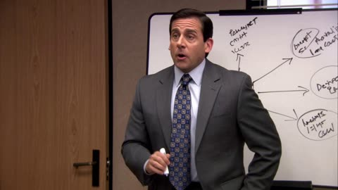</a>

The prompt sets the mockumentary look with a handheld camera and snap zooms, then splits the scene into timed beats with one dialogue line per beat so the cuts read like real editing. A closing STYLE line tells the model a documentary crew is present and characters occasionally glance at the lens.

MiniMax H3 · Text-to-video · Source: [@Arminn_Ai on X](https://x.com/Arminn_Ai/status/2084387316286595436) · 447 likes on 2026-10-29 · found via [SkyNotSilent/awesome-MiniMax-H3-cases](https://github.com/SkyNotSilent/awesome-MiniMax-H3-cases)

[`mockumentary`](tags.md#tag-mockumentary) [`sitcom`](tags.md#tag-sitcom) [`dialogue`](tags.md#tag-dialogue) [`handheld-camera`](tags.md#tag-handheld-camera)

<details><summary><b>Prompt</b></summary>

```text
The Office (US) mockumentary style. Dunder Mifflin conference room,
mid-afternoon, harsh fluorescent lighting, cheap office chairs,
whiteboard at the front. Handheld documentary camera, slightly
unsteady, with sudden reframes and quick zooms toward whoever is
reacting.

Michael Scott stands at the whiteboard, overly excited, marker in
hand, badly drawn diagram behind him. The staff sit around the table
looking exhausted. Stanley Hudson sits at the far end, glasses on,
head down over a folded crossword puzzle, completely disengaged.

DIALOGUE:

MICHAEL (loud, proud): "Okay everybody, listen up. Large language
models. L-L-Ms. This is the future of the paper industry."

Beat. Nobody reacts. Camera pushes in slowly on Stanley — he does not
look up, does not blink, keeps filling in his crossword.

MICHAEL: "Which is why corporate is giving a bonus to whoever—"

Instant snap zoom to Stanley. His head lifts. He takes off his
glasses. Dead serious.

STANLEY: "I'm listening."

MICHAEL (waving him off): "—anyway. Moving on. Next topic. Prompt
engineering."

Snap zoom back to Stanley. He immediately puts his glasses back on,
lowers his head, and returns to the crossword as if nothing happened.

Cut to Jim, who slowly turns his head and looks directly into the
camera lens with a flat, knowing expression. Hold for two seconds.

STYLE: single-camera sitcom shot like a documentary crew is present,
natural performances, no laugh track, muted office color palette,
slightly soft consumer-camera look, characters occasionally glancing
at the lens.
```

</details>

<a id="h3-office-break-room-mockumentary-argument"></a>
### Michael and Dwight argue in mockumentary break room

<a href="https://x.com/Arminn_Ai/status/2084619631742837115">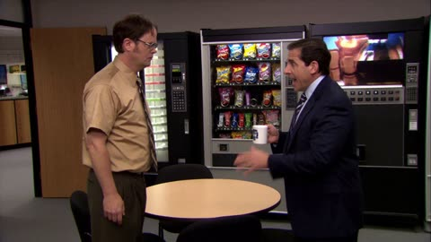</a>

A scene by scene shot list with handheld camera direction, a snap zoom to whoever reacts, and a final cut to a reaction shot, so the camera sets the timing. Each line carries its speaker and delivery cue, and the STYLE block rules out music and laugh track so the audio stays as natural room tone.

MiniMax H3 · Text-to-video · Source: [@Arminn_Ai on X](https://x.com/Arminn_Ai/status/2084619631742837115) · 295 likes on 2026-10-29 · found via [SkyNotSilent/awesome-MiniMax-H3-cases](https://github.com/SkyNotSilent/awesome-MiniMax-H3-cases)

[`sitcom`](tags.md#tag-sitcom) [`dialogue`](tags.md#tag-dialogue) [`handheld-camera`](tags.md#tag-handheld-camera) [`character-scene`](tags.md#tag-character-scene)

<details><summary><b>Prompt</b></summary>

```text
The Office (US) mockumentary style. Dunder Mifflin break room, mid-afternoon, flat fluorescent lighting, vending machine, cheap
round table, coffee pot. Handheld documentary camera, slightly
unsteady, deep focus, one continuous setup with a sudden snap zoom
toward whoever is reacting.
Michael Scott and Dwight Schrute stand on opposite sides of the small
table, mid-argument. Michael is animated and enthusiastic. Dwight is
rigid, intense, deadly serious.
DIALOGUE:
MICHAEL (excited): "AI is the future, Dwight."
DWIGHT (sharp): "It's a threat. I challenged it to an endurance test.
It refused."
MICHAEL: "It wrote my performance review in nine seconds."
DWIGHT: "I could've done it in seven."
Snap zoom to Michael. He puts down his mug.
MICHAEL (voice climbing, wounded, slapping the table): "It listens to
me! Which is more than anyone here does!"
Hard silence. Both men frozen.
Cut to Jim Halpert at his desk. He slowly turns his head and looks
directly into the camera lens. Hold for two seconds. End.
STYLE: single-camera sitcom shot as if a documentary crew is present,
natural performances, no laugh track, muted office color palette,
slightly soft consumer-camera look, dry deadpan comedic timing, no
music, ambient room tone only.
```

</details>

<a id="h3-luna-livestream-chat-reading-opening"></a>
### Virtual streamer opens a livestream reading chat

<a href="https://x.com/GlitterPixely/status/2084481873158328598"></a>

Each reference image and audio file gets one narrowly scoped job: identity, platform chrome, room, voice. The timed beats fix the silent lead-in, the gaze toward the chat rail and the exact chat lines that may be readable.

MiniMax H3 · Reference-to-video · Source: [@GlitterPixely on X](https://x.com/GlitterPixely/status/2084481873158328598) · 293 likes on 2026-10-28 · found via [SkyNotSilent/awesome-MiniMax-H3-cases](https://github.com/SkyNotSilent/awesome-MiniMax-H3-cases)

[`livestream`](tags.md#tag-livestream) [`reference-to-video`](tags.md#tag-reference-to-video) [`lip-sync`](tags.md#tag-lip-sync) [`ui-text`](tags.md#tag-ui-text) [`virtual-streamer`](tags.md#tag-virtual-streamer)

<details><summary><b>Prompt</b></summary>

```text
Use @Image4as the opening card only: circular Luna avatar, black background, cream “LUNALIVE”, rose “STREAM STARTING”, warm circles, tiny mint accent. Static, chime.

Use @Image1 for Luna’s identity only: same face, long center-parted black hair, blue-gray eyes, pink anime hoodie, white headphones around neck, delicate necklace, pale nails. Do not copy the drink, pose, or background from @Image1.

Use @Image2 only for Twitch-like platform chrome: dark top bar with “LUNALIVE”, red “LIVE” badge, “2.4K viewers”, right “STREAM CHAT” rail, bottom title area, rounded “FOLLOW” and pink “SUBSCRIBE” buttons. Do not copy Luna, pose, drink, or room from @Image2

Use @Image3 only for the cozy room behind Luna inside the video area: desk, monitor, white PC, plush shelves, curtain fairy lights, soft pink/purple light. No empty-room showcase shot.

Use @Audio1as Luna’s actual vocal performance and behavior reference. @Audio1has a silent lead-in: 0.0–2.4s must be treated as no speech. Preserve her voice identity, cadence, tone, breaths, pauses, emphasis, warmth, and streamer mannerisms. Do not replace the voice, do not generate a different influencer voice, and do not add extra spoken lines beyond @Audio1 Lip sync, mouth shapes, jaw movement, smiles, glances, nods, and small hand movements must follow the audio waveform after 2.4s.

Create a 15-second 16:9 Twitch-like stream opening. Important performance direction: Luna is reading chat, not delivering a camera monologue. Place Luna slightly left of center in the video area with the right “STREAM CHAT” rail clearly visible. Whenever she speaks, her eyes angle screen-right toward the chat rail as if she is reading the messages out loud. She returns to camera only for brief reactions. Add constant small movement: eye darts to chat, eyebrow lifts, tiny nods, head tilts, shoulders shifting, one subtle hand gesture near the desk. No stiff talking-head pose. One cursor only, no cursor trail, no duplicate panels, no duplicate buttons.

Render only large UI text cleanly. Chat feels alive with typing dots and soft short blurred lines, but only these chat lines are readable: “hi Luna”, “welcome back”, “so cozy”, “gugugaga?”, “RAID INCOMING!”. Do not invent usernames. Chat pops stay quieter than Luna’s voice.

[0–2 seconds] Open on @Image4 “LUNALIVE / STREAM STARTING”. Absolute no-speech zone: @Audio1is silent here, Luna is not shown, no mouth movement, no voice on the card. One soft chime only. No movement.

[2–7.4 seconds] Hard cut to Luna live at 2.0s, slightly left of center in the cozy room from @Image3 with @Image2 chrome active: “LUNALIVE”, red “LIVE”, “2.4K viewers”, right “STREAM CHAT” rail, bottom title “COZY NEON” and “Just Chatting”. She settles for a beat, eyes already moving toward the chat rail. At about 2.4s when speech begins in @Audio1, match lip sync exactly while she reads toward the chat rail, not into camera. Chat shows typing dots and soft blurred lines.

[7.4–7.9 seconds] First audio pause = chat beat. Typing dots, then readable messages pop in: “hi Luna”, “welcome back”. Luna’s eyes track the new messages on the right rail; small nod and smile follow the audio pause.

[7.9–12.5 seconds] Continue matching @Audio1Keep her gaze mostly on the chat rail while speaking, like she is reading and reacting. Add one more readable message: “so cozy”. During any softer phrase, she leans slightly forward as if reading; during brighter phrases, eyebrows lift and shoulders react. No frozen face.

[12.5–13.9 seconds] Bigger audio pause = bigger chat beat. “gugugaga?” appears, then “RAID INCOMING!”, and a clean “NEW FOLLOWER” banner slides in with a gentle pop. Luna reads the raid message from the chat rail, then reacts brighter as the audio resumes.

[13.9–14.8 seconds] Finish @Audio1 with accurate lip sync. If the audio winds down, Luna stops talking, gives a small wave toward chat, and settles into a warm listening pose. End on the stable live frame: Luna slightly left of center, eyes toward the right chat rail, red “LIVE”, “2.4K viewers”, no end card.

Audio mix: 0–2s card is silent except one soft chime. @Audio1voice begins only after the cut to Luna and remains primary. Tiny chat pops under the voice. Warm low room tone. No crowd noise, no music lyrics, no rain, no traffic.
```

</details>

<a id="wan-street-photographer-cold-face"></a>
### Cold face on video, sweet smile in the photos

<a href="https://x.com/johnAGI168/status/2093342672605913225"></a>

Chinese prompt with labelled blocks. The joke is the hard cut between a cold moving shot and a smiling still photo, and the rules forbid any fade between them.

Wan 3.0 · Reference-to-video · Source: [@johnAGI168 on X](https://x.com/johnAGI168/status/2093342672605913225) · 240 likes on 2026-10-27

[`chinese-dialogue`](tags.md#tag-chinese-dialogue) [`comedy`](tags.md#tag-comedy) [`vertical`](tags.md#tag-vertical) [`reference-images`](tags.md#tag-reference-images)

<details><summary><b>Prompt</b></summary>

```text
【时长】18秒
【画幅】9:16竖屏
【风格】真人街头摄影短视频，手机纪实影像与专业写真照片交替剪辑，傍晚黄金时刻，真实皮肤质感，长焦浅景深，时尚街拍氛围，轻喜剧反差
【语言】中文对白，无字幕
【人物数量】画面中始终只有女主一人；摄影师只出现画外男声，不能实体出镜

【人物角色卡】
  @ 命名“方圆”，街头偶遇摄影师的女生。人物脸部、身形、发型、妆容、服装及原有配饰完全继承参考图。增加一部手机和一只单肩托特包作为剧情道具。

【核心情绪反差】

动态视频状态：
方圆表现得冷淡、拽、有距离感。下巴微抬，嘴唇轻抿，眉毛略微压低，眼神像是在审视镜头。说话时不撒娇、不害羞、不甜笑，拒绝动作干脆从容。

写真照片状态：
只要硬切进入写真，方圆的表情瞬间改变。眉眼完全舒展开，眼睛弯起，脸颊抬高，露出明亮、自然、毫无防备的甜美笑容。笑容必须明显比动态视频更温柔、更亲近、更有感染力。

情绪切换不能渐变：

动态冷脸 → 快门声与硬切 → 写真甜笑；
写真甜笑 → 硬切回视频 → 笑容立即消失，恢复冷淡。

这条“冷脸视频与甜笑照片”的反差是全片最重要的喜剧效果。

[00:00-00:04.20] 镜头1｜第一次冷脸拒绝

方圆站在现代创意园区的林荫道路旁，肩背托特包，低头看手机。

手持摄影机从侧前方缓慢靠近，由中远景推进到胸部近景。

00:00-00:00.80
方圆低头操作手机，完全没有注意镜头。右手拿手机，另一只手轻点屏幕，嘴唇闭合，表情平静冷淡。

00:00.80-00:02.40
听见陌生人搭话，她的手指先停下来。

她没有立刻抬头，而是停顿半拍，先把眼睛从手机屏幕移向镜头，随后才缓慢抬起头。

下巴微微上扬，眉毛轻压，眼神带有明显的审视感，脸上没有笑容。

【画外年轻男声】
“哎，你好，我是一名街头摄影师，可以邀请你拍两张照片吗？”

男声礼貌、自然，带一点试探感。

00:02.40-00:03.90
方圆先冷冷看着镜头，停顿约0.2秒，再开口：

【方圆】
“不要拿镜头对着我。”

语气平静、直接、有距离感，不能带娇嗔语气。

说“不要”时，她才抬起空闲的左手。

说“拿镜头”时，左手五指逐渐打开，掌心朝向摄影机。

说“对着我”时，左掌从容地靠近镜头，遮挡大半画面。右手始终拿着手机。

她从手掌旁边继续冷冷盯着镜头，嘴角不笑，也不害羞躲闪。

00:03.90-00:04.20
方圆收回手掌，干脆转身离开。肩膀先转，头部随后转动，头发产生真实甩动惯性。

[00:04.20-00:07.80] 镜头2｜第一组甜笑写真

在方圆冷脸转身之后，伴随清脆快门声，画面突然硬切成专业写真。

照片中的她不再冷漠，而是立即露出非常甜美、明亮的笑容。

照片一｜00:04.20-00:05.10
半身逆光回眸写真。

方圆身体朝前，脸回转看向镜头，露出灿烂的露齿甜笑。脸颊明显抬起，眼睛弯成柔和月牙形，整个人突然变得亲近温柔。

人物、发丝和背景完全静止。

照片二｜00:05.10-00:06.00
林荫道路全身写真。

方圆保持交叉迈步的优雅走姿，低头露出自然甜笑，像是被摄影师逗笑。笑容柔软放松，没有任何冷漠感。

照片三｜00:06.00-00:06.85
黄金逆光中近景写真。

一只手放在头顶发间，另一条手臂扶住托特包。方圆直视镜头，露出明亮甜美的露齿笑，眼尾弯起，脸颊饱满上扬。

照片四｜00:06.85-00:07.80
面部与上胸特写写真。

方圆头部轻轻侧歪，双眼温柔看向镜头，露出整组照片中最甜、最有感染力的笑容。牙齿自然露出，眼睛弯起，背景形成金色散景。

四张照片全部是真正静止的写真成片，不眨眼、不呼吸、不飘发。相邻照片通过快门声和硬切切换，不使用大面积白闪。

[00:07.80-00:10.30] 镜头3｜切回视频，笑容立即消失

硬切回手机动态视频。

切回的第一帧，方圆脸上的甜美笑容必须完全消失，重新恢复冷淡、拽、不耐烦的状态。

00:07.80-00:08.50
摄影机从侧后方跟拍。

方圆背对镜头继续向前走，手机拿在胸腰之间，托特包随脚步轻微晃动。

【画外年轻男声】
“很快很快，就两张。”

听见摄影师继续央求，方圆没有马上停下。

她先用眼角向后看，再缓慢转动头部和肩膀。她的眼神冷淡，下巴微抬，嘴唇轻抿，像是觉得摄影师很烦。

00:08.50-00:10.00
方圆一边走一边看向镜头：

【方圆】
“我没有配合你的义务。”

语气平静、坚定、带明显边界感，不能微笑。

说“我没有”时，她直视镜头，眉毛轻轻压低。

说“配合你的”时，空闲手从胸前抬起，五指逐渐打开。

说“义务”时，掌心正对摄影机并向前靠近，形成明确的“停止拍摄”手势。

她嘴上拒绝得很冷，但肩膀已经自然打开，腰部形成漂亮侧转，头部角度和手掌位置都非常适合拍照。

00:10.00-00:10.30
她放下手掌，冷淡地转回前方继续走。整个过程中不能出现甜笑。

[00:10.30-00:13.50] 镜头4｜第二组甜笑写真

就在方圆冷着脸转身离开时，快门声响起，画面再次硬切成甜美写真。

照片五｜00:10.30-00:11.10
大腿以上中景写真。

方圆双手在腰前拿着手机，身体微侧，脸转向镜头，突然露出放松明亮的露齿甜笑。眼睛弯起，肩膀柔和，与上一秒的冷脸形成强烈反差。

照片六｜00:11.10-00:11.90
道路边全身写真。

方圆一只手叉腰，另一只手抓住托特包肩带，髋部自然侧移。虽然姿势利落时尚，但表情非常甜，嘴角明显上扬，露出自然牙齿，眼神温柔亲近。

照片七｜00:11.90-00:12.70
林荫道路全身回眸写真。

身体保持向前迈步，后脚脚跟抬起，头和上胸向后回转。方圆回头看镜头时露出灿烂笑容，脸颊抬起，像是在开心地回应摄影师。

照片八｜00:12.70-00:13.50
胸腰以上近景写真。

方圆双手拿着手机，头部轻轻侧歪，双眼直视镜头，露出温柔甜美的笑容。笑意同时出现在嘴角和眼睛里，不能只是机械地咧嘴。

四张写真全部完全冻结，不能出现眨眼、呼吸、头发移动或背景运动。

[00:13.50-00:15.20] 镜头5｜再次切回冷脸动态视频

硬切回动态视频的第一帧，甜笑再次立即消失。

摄影机位于方圆侧后方，以腰胸以上中近景跟拍。

【画外年轻男声】
“就两分钟，两分钟，真的，就两……”

男声带一点执着和央求感，最后一句没有说完。

方圆没有台词，不跟随画外声音张嘴。

00:13.50-00:14.00
她回头冷冷看摄影机一眼。嘴唇闭合，眉毛略压，下巴微抬，表情像在说：“你怎么还在拍？”

00:14.00-00:14.50
她把脸转回前方，背对镜头继续走。长发自然覆盖背部，托特包随脚步轻轻晃动。

00:14.50-00:15.20
她借着下一步突然向镜头方向回身。

肩膀先转，头部随后转回，大束头发因惯性向外甩开，形成真实流畅的发丝弧线。

她的脸仍然保持冷淡，不能在甩发过程中提前微笑。

[00:15.20-00:18.00] 镜头6｜冷着脸却已经摆好Pose

摄影机由侧后方绕到侧前方，并缓慢推进至胸部近景。

00:15.20-00:15.80
方圆完成回身，左手抬到后脑和头顶发根，手肘自然向外打开。

眼睛准确找到镜头，目光稳定直接；嘴唇轻抿，下巴微抬，依然是一副不愿意配合的冷淡表情。

00:15.80-00:16.40
左手沿头发外侧向下滑动，把甩到脸前的发束拨开。

头发依靠真实惯性继续向一侧飘动。与此同时，她的肩膀自然打开，身体逐渐转成三分之二侧身。

00:16.40-00:17.10
左手落到托特包上缘，把包轻轻抱稳在身体侧面。

她把重心放到一条腿上，腰部轻微侧移，一侧肩膀向后打开，已经形成完整的专业模特Pose。

她的脸仍然冷淡，不能出现与写真相同的甜笑。

00:17.10-00:18.00
摄影机缓慢推进至近景。

方圆保持侧身抱包姿势，下巴先微抬，再缓慢压低一点；双眼从略低的眉骨位置直视镜头，嘴唇维持冷淡的闭合状态。

最后0.4秒，她只让一侧嘴角出现极其轻微、几乎看不出来的得意弧度，像是在说：

“我没有答应拍照，只是刚好会摆Pose。”

结尾仍是动态视频，保留轻微呼吸与发丝余动，不能变成甜笑写真。

【声音设计】
使用节奏利落的时尚流行音乐。

动态视频段保留脚步声、手机握持声、衣料摩擦声、托特包摆动声和甩发声。

每次从冷脸动态视频切入甜笑写真时，必须加入清脆机械快门声，并与画面硬切和音乐重拍同步。

摄影师始终为镜头后的画外男声。只有方圆说两句拒绝台词时产生口型。

【主要约束】
动态视频中的方圆必须冷淡、拽、不甜笑；
写真照片中的方圆必须笑得明亮、自然、甜美；
冷脸和甜笑只能通过硬切瞬间切换，禁止缓慢渐变；
写真段必须完全静止，动态段保持真实连续运动；
禁止换脸、人物外观漂移、口型错位、额外人物、字幕、Logo和水印。
```

</details>

<a id="h3-forest-walk-three-segment-chained-dialogue"></a>
### Two women meet on a forest trail

<a href="https://x.com/EndFolding79421/status/2102448683245502844"></a>

Each 5 second segment repeats subject definitions, a retention analysis and timed beats, with dialogue pinned to exact timestamps. Later segments open with a continue the existing shot instruction that restates camera height, pace and lighting, so the cuts between clips stay seamless.

MiniMax H3 · Reference-to-video · Source: [@EndFolding79421 on X](https://x.com/EndFolding79421/status/2102448683245502844) · 149 likes on 2026-10-28 · found via [SkyNotSilent/awesome-MiniMax-H3-cases](https://github.com/SkyNotSilent/awesome-MiniMax-H3-cases)

[`chained-segments`](tags.md#tag-chained-segments) [`dialogue`](tags.md#tag-dialogue) [`forest`](tags.md#tag-forest) [`tracking-shot`](tags.md#tag-tracking-shot) [`character-consistency`](tags.md#tag-character-consistency)

<details><summary><b>Prompt</b></summary>

```text
==============================
SEGMENT 1 — SHOT (5 SECONDS)
==============================

subject_definitions:
<Subject 1> is Grace, whose face, hair, body and outfit come entirely from <Picture 1>.

summary:
[reference generation] Grace walks alone through a forest, looking for someone.

retention_analysis:
Grace: fully_preserved - identical face, hair, body and clothing.

detailed_description:
[Shot 1] Realistic cinematic live-action, 16:9. A continuous medium tracking shot facing Grace as she walks along a forest trail. Natural overcast daylight.

00:00-00:02:
Grace walks toward the camera at a relaxed pace, looking slightly irritated. The camera tracks backward, keeping her waist-up.

At 00:02.000:
[speaking, English, young woman, slight Southern accent, irritated]
"Where the hell is she?"

00:03-00:05:
Grace continues walking at the same pace, looking ahead. The camera maintains its position and distance. She is still walking at the end.

overall_soundscape:
Natural footsteps, forest ambience and dialogue.

non_diegetic_music:
N/A

==============================
SEGMENT 2 — CONTEXT (5 SECONDS)
==============================

subject_definitions:
<Subject 1> is Grace, whose appearance comes from <Picture 1>.
<Subject 2> is Linda, whose appearance and clothing come entirely from <Picture 2>.

summary:
[reference generation] Grace continues walking. Linda enters from offscreen and joins Grace. Both women walk together.

retention_analysis:
Grace: fully_preserved.
Linda: fully_preserved - identical appearance and clothing from <Picture 2>.

detailed_description:
[Shot 1] Continue the existing cinematic tracking shot, matching the previous camera position, movement and lighting.

00:00-00:03:
Grace continues walking at exactly the same pace. The camera tracks backward at the same height and distance. No changes to the existing scenery or lighting.

00:03-00:05:
Linda walks naturally into frame from the side and joins Grace, matching her walking speed.

At 00:03.500:
[Linda speaking, English, young woman, warm conversational voice, playful]
"Looking for me?"

Both women remain in frame, still walking together as the segment ends.

overall_soundscape:
Continuous footsteps, forest ambience and natural dialogue.

non_diegetic_music:
N/A

==============================
SEGMENT 3 — CONTEXT (5 SECONDS)
==============================

subject_definitions:
<Subject 1> is Grace, from <Picture 1>.
<Subject 2> is Linda, from <Picture 2>.

summary:
[reference generation] Grace and Linda continue walking together, exchanging a short conversation.

retention_analysis:
Grace and Linda: fully_preserved - consistent faces, hair, clothing and body proportions.

detailed_description:
[Shot 1] Continue the existing uninterrupted cinematic tracking shot. Both women remain visible, walking side by side.

00:00-00:02:
Both women continue walking at the same speed. Maintain their positions, camera distance, lighting and natural movement.

At 00:02.000:
[Grace speaking, English, same slight Southern accent, curious and irritated]
"Where have you been?"

At 00:03.500:
[Linda speaking, English, same warm conversational voice, amused]
"Long story."

00:04-00:05:
Grace gives Linda an annoyed sideways glance. Linda smiles slightly. Both continue walking naturally.

overall_soundscape:
Continuous footsteps, forest ambience and natural dialogue.

non_diegetic_music:
N/A
```

</details>

<a id="h3-office-graphics-card-handover-drama"></a>
### Young man hands boss a graphics card

<a href="https://x.com/eternityspring/status/2112741803871097333"></a>

The script is organised into bracketed scene blocks, each pairing a speaker role with one line of dialogue, so every beat maps to a single shot. Roles are described by job and personality instead of appearance, which leaves casting to the model.

MiniMax H3 · Text-to-video · Source: [@eternityspring on X](https://x.com/eternityspring/status/2112741803871097333) · 145 likes on 2026-10-29

[`drama`](tags.md#tag-drama) [`dialogue`](tags.md#tag-dialogue) [`multi-scene`](tags.md#tag-multi-scene) [`office`](tags.md#tag-office)

<details><summary><b>Prompt</b></summary>

```text
**The Art of Gift-Giving—This Card Isn't Easy to Get**

**Script:**
**Characters:** Leader (Technical Director, AI enthusiast), Little Wang (Honest guy, quotes prices for everything he gives), Little Li (Knows how to give gifts)
**Scene:** Before the holiday, Leader's office

**[Graphics Card]**
Little Wang: Leader, for the holiday, I'm giving you a 5090 graphics card—over 20,000 yuan.
Leader: That's too generous, but I don't really use this card much; the VRAM is too small.
Little Li: Leader, I have a friend who does ops in a server room. He knows you like running models and gave me a few decommissioned cards—something called H100. I don't get it; can you take a look and see if it's any good?
Leader (cradling the card, eyes lighting up): Oh man, this card isn't easy to get. I've got to run it tonight no matter what.

**[Membership]**
Little Wang: Leader, I topped up a one-year GPT membership for you—heard it's really handy.
Leader: Alright... but don't waste money on this stuff in the future; I've got several accounts already.
Little Li: Leader, I took a spin around San Francisco and had someone snag me an invite code for testing a new GPT model. I don't know if it's legit, but it seemed interesting—can you check it out for me?
Leader (glancing at his phone and grinning, waving him over eagerly): Oh, this is nice. Come on, sit down—I'll run a demo for you to see.

**[Computer]**
Little Wang: Leader, for the holiday, I brought you an AI laptop—top spec, over 30,000 yuan.
Leader: That's too generous, but I don't use one much on the daily.
Little Li: Leader, I passed by the computer market and saw these RAM sticks—they looked pretty cool and weren't pricey. Figured you'd use them for running local models.
Leader (picking up a RAM stick and holding it to the light): You picked a good one here. You really get AI.
```

</details>

<a id="h3-woman-red-polka-dot-dress-leaves-frame"></a>
### Woman in red polka dot dress leaves the frame

<a href="https://x.com/ou_zhen599/status/2106385077374722148">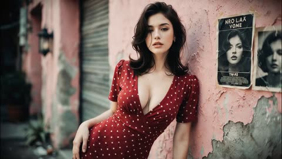</a>

The first frame is pinned to the reference pose, and the motion is split into timed beats with fixed waypoints so the camera stays on one side of the wall. Two timed spoken lines and a sound bed are written into the same beats, which keeps the dialogue locked to the action.

MiniMax H3 · Image-to-video · Source: [@ou_zhen599 on X](https://x.com/ou_zhen599/status/2106385077374722148) · 127 likes on 2026-10-29

[`street-fashion`](tags.md#tag-street-fashion) [`reference-image`](tags.md#tag-reference-image) [`dialogue`](tags.md#tag-dialogue) [`camera-tracking`](tags.md#tag-camera-tracking)

<details><summary><b>Prompt</b></summary>

```text
integrated_multimodal_description:
15 seconds, 16:9, live-action cinematic realism. Use <Picture 1> as the only reference for the woman, outfit, location, lighting, and first frame. The opening frame must precisely inherit her leaning pose against the pink weathered wall, with the gray shutter on her left, the old poster on her right, the street in front, and the wall lamp, plants, hair, gold earrings, red polka-dot dress, neckline, waist structure, and facial identity all preserved. Same place, same moment, one continuous performance. Soft retro street-fashion film color: dusty pink wall, stable deep wine-red dress, warm natural skin, restrained gray-green background, medium contrast, soft highlight roll-off, subtle fine grain, real skin texture with slight moisture sheen. Keep the original daylight direction, around 5200K white balance, soft shadows, and continuous exposure. No neon shift, sunset change, rain, extra people, mirrored geography, teleporting, or filter changes.

She activates immediately from the exact leaning pose. Her path is fixed: P0 at the wall -> short advance to P1 -> diagonal drift to P2 -> slow walk along the wall to P3 -> shutter tap and turn -> final move toward P4. She never leaves the same street side, and the camera never crosses the wall axis. The emotional line is playful control turning into mutual recognition: she tests whether the camera can keep up, confirms it, then rewards it with a final backward smile before leaving.

[00:00-00:03.0]
35mm ground-level tracking rises into a side-follow. Starting from the exact leaning pose in <Picture 1>, she releases her left palm from the wall, pushes shoulder and back away, and advances from P0 to P1 in two short landing steps, the second slightly quicker than the first. The camera retreats a short distance straight backward, keeping a medium framing from head to mid-thigh and bringing her from frame-right toward center. Step impact travels foot -> knee -> hip -> torso; dress waist folds redistribute as she straightens; hair leaves the shoulder a beat later. The pink wall stays clearly behind her. She catches the camera first, then lifts her chin slightly. A restrained hint of a smile appears. During the second landing she absorbs the motion with a small knee bend; the upper body stops first and the chest shows one brief natural rise-and-settle under dress support, while fabric edges and hair tips settle a fraction later. She lowers her chin slightly, checks whether the camera is still backing away, and from 2.7s to 3.4s says quietly: <d>[English] Keep up.</d> The stress lands on “up,” short and clear, lightly challenging.

[00:03.0-00:07.5]
Without resetting pose, she turns diagonally toward P2 and moves slowly along the wall toward screen-left into P3, settling into a three-quarter left-facing side walk. The camera tracks parallel from the street side, framing head, upper torso, right hand, and a slice of wall, with open space ahead on the left. Her right hand rises near shoulder height and lightly skims the wall. One focus idea only: briefly show the fingertip contact while her face stays readable, then over about half a second transfer focus to her eyes as she looks back toward the camera; after that, keep the face sharp. Eyes move first, then the head follows. She exhales slowly; breath gently lifts and lowers chest, shoulders, and neck while she keeps walking. The corner of her mouth lifts and restrains again, as if confirming that the camera really is following. When her fingertips cross a brittle paint edge, a tiny amount of dust flakes off and drops close to the wall; no large peeling or damage. Before 7.5s she reaches P3 and her right hand transitions from the pink wall onto the edge of the gray shutter.

[00:07.5-00:09.0]
At P3 she gives the shutter a light tap with her right hand, producing one short metallic tick, then releases immediately. The shutter never opens. She completes a real stop-and-support under the feet, then the hips, shoulders, and head rotate toward the camera in order. The camera performs one brief left whip of about 0.2-0.3 seconds following her turn, with directional motion blur, then settles instantly into a medium head-to-mid-thigh framing from the street side. No axis jump, no background replacement. As the frame stabilizes, her curls and skirt are still returning from the turn; earrings sway lightly then decay. The chest follows the torso turn with a short constrained lateral inertia under the dress and settles naturally, never bouncing independently.

[00:09.0-00:12.0]
From the settled medium shot at P3, the camera slowly pushes in toward a face-and-upper-body close shot while keeping the shoulder line and dress waist visible. It does not retreat anymore. She notices that the camera is finally coming toward her. She presses her lips together slightly, the smile starts in the outer corners of the eyes, then the mouth releases and she lets out one short natural laugh. Her shoulders drop subtly with the laugh; upper torso and chest move only with the connected exhale. Any remaining turn inertia is already gone. While laughing, she shifts another half-step along the wall toward screen-left, keeping eye contact instead of posing in place. From 10.6s to 11.6s she says softly: <d>[English] That's better.</d> “better” carries the smile, looser than the first line. After the line she takes a small inhale, the smile stays in her eyes, and her right hand begins to rise.

[00:12.0-00:15.0]
Her right palm briefly sweeps across the right edge of the lens area as a partial foreground wipe without touching the lens and without blacking out the frame. As the hand drops naturally with her turn, she continues from P3 toward P4 along the shutter and wall, leaving in two steps that start fast and then return to a natural pace. The camera pans left to send her out, always remaining on the street side. Around 14.0s, while still walking, she turns her head slightly back and gives the camera one last look with the real smile still present. The camera catches that glance and gradually settles; she keeps moving toward the left edge. End on her back-side profile and part of the old wall still visible, with a living-frame finish rather than a distant cut, freeze, blackout, or location change.

Physical continuity is strict: every inertia must have a source, path, and end state. Step impact moves from foot to knee to hip to torso; turning is driven by planted support under the feet; hair, earrings, skirt hem, and fabric react with slight delay and then decay. The dress retains seam definition, polka-dot pattern, and believable cloth weight. Fitted areas stay constrained by body and seams; only looser skirt edges move with walking, turning, and the light breeze. Chest motion stays synchronized to walking, breathing, and rotation, with stable anatomy and no rubbery deformation or repeated bounce. Contacts happen only at real touch points: feet on ground, hand on wall, hand on shutter. The wall remains intact. The shutter never swaps sides. The poster is ordinary background only and never animates. A light intermittent breeze flows along the wall from the left street opening toward the right, stirring a few loose hairs, soft skirt edges, plant leaves, and one tiny lifted paper corner on the poster, which flutters and settles back.

overall_soundscape:
Continuous low-intensity side-street ambience runs through the full 15 seconds: distant urban air, restrained alley noise, and a light intermittent breeze moving along the wall. At 0.0-3.0s, two distinct footfalls land with slightly different weight as fabric rubs softly and hair shifts. At the landing settle, keep a brief close-range body rustle. From 2.7-3.4s the woman says once, <d>[English] Keep up.</d> in a natural adult female mid-low register, clear conversational English with a faint dry texture, fully synchronized to accurate lip movement. At 3.0-7.5s, keep subtle fingertip friction against painted wall, a quiet exhale, faint cloth motion, and very small paint dust release with no exaggerated debris sound. At 7.5-9.0s, include one short light metallic tap on the shutter with a tiny fast-decaying resonance, plus turning fabric and earring movement. At 9.0-12.0s, her breathing and one short genuine laugh sit close to the camera; from 10.6-11.6s she says once, <d>[English] That's better.</d> more relaxed and smiling than the first line. At 12.0-15.0s, keep the passing hand as a soft foreground whoosh, two departing steps, continued low street tone, and the last glance landing in a quieter tail. Dialogue and real action sounds must always stay clear. No added crowd voices, no poster voice, no exaggerated impacts, no moans, no melodramatic whooshes.

non_diegetic_music:
Use a very light, clean rhythmic bed only. A restrained low bass pulse and sparse dry percussion accents support the first quick approach and the shutter tap as timing marks. Reduce percussion during the slow side-walk and keep the music thinned out under the laugh and the second line. The score should stay minimal, modern, and controlled, never sentimental, never wall-to-wall, and always below dialogue and physical Foley.
```

</details>

<a id="h3-lotr-sitcom-legolas-gimli-argument"></a>
### Legolas and Gimli bicker in a sitcom living room

<a href="https://x.com/aimikoda/status/2086782084723405173">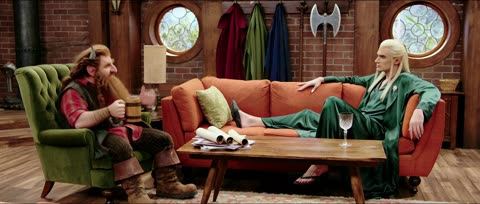</a>

The prompt sets the sitcom format first, then fixes each character's seat and prop so the model keeps two stable positions. Alternating shared wide shots with individual close-ups gives the video a sitcom cutting rhythm.

MiniMax H3 · Text-to-video · Source: [@aimikoda on X](https://x.com/aimikoda/status/2086782084723405173) · 116 likes on 2026-10-29 · found via [SkyNotSilent/awesome-MiniMax-H3-cases](https://github.com/SkyNotSilent/awesome-MiniMax-H3-cases)

[`sitcom`](tags.md#tag-sitcom) [`dialogue`](tags.md#tag-dialogue) [`multi-shot`](tags.md#tag-multi-shot) [`lord-of-the-rings`](tags.md#tag-lord-of-the-rings)

<details><summary><b>Prompt</b></summary>

```text
the lord of the rings as a sitcom, legolas and gimli arguing about how many orcs they hunted
```

</details>

<a id="omni-professor-chalkboard-trig-proof"></a>
### Professor writing trigonometric proof on chalkboard

<a href="https://www.reddit.com/r/google/comments/1ta6grg/gemini_omni_new_video_model"></a>

A single subject, a single action and a single setting keep the shot simple. Asking the professor to explain the current step cues synced speech, so the model has to match narration to the chalk writing.

Gemini Omni Flash · Text-to-video · Source: [u/cowardbeater1969 on Reddit](https://www.reddit.com/r/google/comments/1ta6grg/gemini_omni_new_video_model) · 115 likes on 2026-10-28

[`education`](tags.md#tag-education) [`chalkboard`](tags.md#tag-chalkboard) [`speech`](tags.md#tag-speech) [`classroom`](tags.md#tag-classroom) [`single-shot`](tags.md#tag-single-shot)

<details><summary><b>Prompt</b></summary>

```text
A professor writes out a mathematical proof for trigonometric identities on a traditional chalkboard, explaining the step he is currently on in the equation.
```

</details>

<a id="seedance-pixar-dinner-table-last-pizza-slice"></a>
### Pixar style dinner table standoff over last pizza slice

<a href="https://x.com/itsshara_ai/status/2090853973930692895">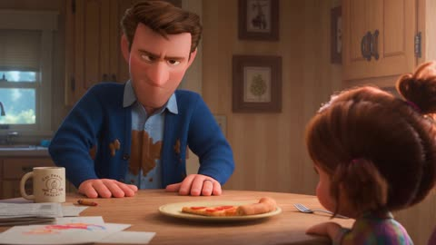</a>

The prompt is a timestamped beat sheet where each block lists the visual, the dialogue with its delivery tag, and the sound cue, which gives the model clear pacing across 30 seconds. The freeze-frame and record-scratch cues tell the model where the comedic timing lands.

Seedance 2.5 · Text-to-video · Source: [@itsshara_ai on X](https://x.com/itsshara_ai/status/2090853973930692895) · 112 likes on 2026-10-29

[`pixar-style`](tags.md#tag-pixar-style) [`comedy`](tags.md#tag-comedy) [`dialogue`](tags.md#tag-dialogue) [`sound-design`](tags.md#tag-sound-design)

<details><summary><b>Prompt</b></summary>

```text
30 sec Script Pixar-style Animated Comedy

[0:00–0:04]
VISUAL: DAD (30s, tired, cardigan, coffee stain on shirt) sits at a cluttered dinner table across from his 6-year-old daughter MIA. Between them: one single last piece of pizza on a plate.
DAD (mock serious): "Okay. We need to talk about this pizza."
SFX: fork tapping plate, kitchen clock ticking.

[0:04–0:08]
VISUAL: Mia narrows her eyes, slowly sliding her hand toward the plate.
MIA (deadly serious for a 6-year-old): "It's mine. I called it in the car."
DAD (leaning in): "That's not a real rule."
SFX: chair creak, dramatic sting.

[0:08–0:12]
VISUAL: Both their hands shoot toward the pizza at the same time — comedic freeze-frame, hands frozen mid-air an inch from the plate.
DAD (strained, still frozen): "...rock paper scissors?"
MIA (also frozen, gritted teeth): "Best of one."
SFX: record-scratch stop, comedic freeze whoosh.

[0:12–0:17]
VISUAL: Quick rock-paper-scissors round — Dad throws rock, Mia throws paper. She gasps, delighted. He stares at his fist in betrayal.
MIA (triumphant): "PAPER! I WIN!"
DAD (defeated mutter): "I always throw rock. Why do I always throw rock."
SFX: paper rustle sound effect (exaggerated), triumphant kid giggle.

[0:17–0:22]
VISUAL: Mia reaches for the pizza — but the family DOG leaps up onto the table from nowhere and swallows the whole slice in one gulp. Frozen silence. Both stare at the dog.
MIA (quiet horror): "...Buddy."
DOG: (satisfied chewing sound, tail wag)
SFX: comedic gulp, table thud, silence.

[0:22–0:26]
VISUAL: Dad and Mia slowly turn to look at each other, both equally betrayed.
DAD (flat): "Nobody wins."
MIA (still staring at the dog, deadpan): "Buddy wins."
SFX: dog's contented sigh, distant ticking clock resumes.

[0:26–0:30]
VISUAL: Dog hops off the table and trots away happily. Dad and Mia both slump back in their chairs, sharing a tired look, then start laughing.
DAD (through laughter): "Next time — best of three."
MIA (already grinning): "Deal."
SFX: warm shared laughter, chair scrape, cut to silence on final laugh.
```

</details>

<a id="kling-mexican-cantina-crime-scene"></a>
### Crime boss confronts courier in dim cantina

<a href="https://x.com/MayorKingAI/status/2111902123520930061">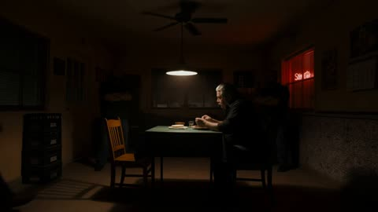</a>

A numbered shot list with a lens FOV and screen direction for each shot, plus an exact subtitle list, lets Kling hold one consistent scene across 11 cuts. Fixed headcount and seating rules, with every spoken line tied to a shot, keep the cast stable and the dialogue timing clear.

Kling 4.0 · Text-to-video · Source: [@MayorKingAI on X](https://x.com/MayorKingAI/status/2111902123520930061) · 111 likes on 2026-10-29

[`crime-drama`](tags.md#tag-crime-drama) [`lip-sync`](tags.md#tag-lip-sync) [`multi-shot`](tags.md#tag-multi-shot) [`spanish-dialogue`](tags.md#tag-spanish-dialogue)

<details><summary><b>Prompt</b></summary>

```text
SCENE CONTEXT
EXACTLY 4 HUMAN CHARACTERS — NO DUPLICATES, NO EXTRAS: the boss, the courier and two silent bodyguards, all Mexican. Interior, the back room of a closed cantina in Guadalajara, Mexico, late at night. A courier nicknamed Flaco reports to his boss that the merchandise is gone: a rival family, the Mendozas, ambushed his team on the highway to Tepic and took the whole load. The boss starts completely calm while he eats; the tension rises with every line; he explodes, then drops to a cold, lethal whisper. Crime drama, real time. Only the boss and the courier speak.

CHARACTERS
ERNESTO (the boss): heavyset Mexican man, slicked-back grey hair, thick grey moustache, a thin old scar cutting through his left eyebrow, heavy-lidded eyes. Black button-up shirt with subtle dark embroidery on the yoke, sleeves rolled to the forearm, a small sauce stain on the cuff, a thick gold chain at the neck. A worn gold signet ring on his right hand. 178 cm.
FLACO (the courier): very thin, wiry Mexican man, short black hair neatly cut, thin moustache, a small fresh bruise on his left cheekbone, a faded tattoo of a small cross on the back of his right hand. Clean, pressed white short-sleeved shirt, dark jeans, worn brown leather boots, a gold wristwatch with a freshly cracked face. He looks put-together, but his nerves betray him. 182 cm.
THE BODYGUARDS: two broad, silent men in plain dark short-sleeved shirts, one with a shaved head and a thick black beard, the other with a grey buzz cut and a crooked nose. They stand against the back wall in the half-dark, arms crossed, never speaking.

LOCATION MAP
A small square table with a worn green oilcloth sits at the center under a single hanging lamp, with a slow ceiling fan above it. Ernesto sits on the right side of the table (screen-right), facing left, with a plate of carne asada, a stack of warm corn tortillas in a cloth, a small clay bowl of salsa, a fork and a full shot glass of tequila. A box of dominoes rests at the edge of the table. An empty wooden chair waits on the left side of the table (screen-left). The two bodyguards stand against the back wall behind the table, one at the left third and one at the right third of the frame, partly in shadow. In the dark background: stacked beer crates without labels, a closed swinging kitchen door, a wall of painted talavera tiles, an old calendar, closed window blinds. The eyeline axis runs left–right across the table; the camera always stays on the same side of it.

FORMAT
One scene, 11 shots joined by clean hard cuts, classic shot–reverse-shot coverage. Cuts follow the dialogue and also land on the listener's reaction. The framing gets tighter and the silences longer as the tension rises, until the explosion in Shot 9. No fades, no dissolves, no split screens.

SHOTS
Shot 1 — Wide shot, locked-off, from the far corner of the room, 63° FOV. Ernesto eats in the pool of light while the ceiling fan turns slowly above him; the two bodyguards stand motionless against the back wall. Flaco walks in from screen-left and stops beside the empty chair, standing, hands at his sides. He does not sit. Ernesto keeps eating and ignores him.

Shot 2 — Medium close-up on Ernesto, 47° FOV, eye level, static. He tears a tortilla, keeps chewing, eyes on his plate. Without looking up, he points his fork at the empty chair. Relaxed, unhurried: "Siéntate, Flaco."

Shot 3 — Medium shot on Flaco, 47° FOV, static. Only now does Flaco pull out the chair and sit down slowly, on the front edge of the seat, back straight, hands resting stiffly on his knees.

Shot 4 — Medium close-up on Ernesto, 47° FOV, static. Still eating, still not looking at him. Casual, almost friendly, mouth half full: "¿Y? ¿Cómo salió lo de Tepic?"

Shot 5 — Reverse: medium close-up on Flaco over Ernesto's out-of-focus right shoulder, 47° FOV; one bodyguard is visible out of focus in the background. Flaco rubs his palms slowly along his thighs, swallows, his eyes flick from the plate to Ernesto's face. Fast and nervous, words tumbling out: "Los Mendoza nos cayeron en la carretera, patrón. Tres camionetas. Se llevaron la mercancía. Toda."

Shot 6 — Close-up on Ernesto, 29° FOV, static. His chewing slows… and stops. A long silence. For the first time he lifts his eyes to Flaco. No expression at all. Flat, quiet, slowly, as a statement: "Toda."

Shot 7 — Reverse close-up on Flaco, 29° FOV, handheld with an extremely subtle breath-like float. He cannot hold Ernesto's gaze; his eyes drop, then come back. His jaw tightens, his breathing becomes shallow, his fingers grip his knees. Voice cracking, pleading: "Nos agarraron por sorpresa. No pude hacer nada, patrón. Se lo juro."

Shot 8 — Extreme close-up insert on the table, 29° FOV, static. Ernesto sets his fork down beside the plate with a soft click. His hand rests flat on the oilcloth; his fingers slowly curl into a fist. Silence; only the creak of the ceiling fan.

Shot 9 — Medium shot on Ernesto, 47° FOV, handheld, the camera jolting once with the impact. He slams his open palm onto the table; the shot glass jumps and spills a little tequila, the dominoes box rattles. He leans over the table toward Flaco, veins visible on his neck, face red, shouting hard: "¡La quiero de vuelta! ¡Haz lo que tengas que hacer!" Behind him, both bodyguards uncross their arms and take one step forward.

Shot 10 — Close-up on Ernesto, 29° FOV, slow push-in ending on his eyes. Still leaning in, his breathing heavy, his face half in shadow under the lamp. His voice suddenly drops to a cold, quiet whisper, each word deliberate: "O no vuelves a ver salir el sol."

Shot 11 — Two-shot in profile across the table, 47° FOV, slow lateral drift of less than half a meter to the right, ending with both faces and the table between them in frame, the bodyguards out of focus behind. Ernesto slowly sits back, smooths his shirt, picks up the shot glass and drinks the tequila in one swallow. Flaco stays frozen in his chair, breathing hard, staring at him. Hold in silence.

CHARACTER ACTING
Naturalistic film acting with a steady, rising tension. Ernesto: total, unhurried calm in Shots 1–4 (he ignores Flaco, eats, never looks at him); the first eye contact in Shot 6 is the turning point; quiet tension in Shot 8; a sudden, real explosion of rage in Shot 9 (jaw clenched, eyes wide, neck tendons tight); then an instant return to icy control in Shot 10, which is the most frightening moment. Flaco: tension held inside the body — stiff posture, hands on his knees, rubbing his thighs, swallowing, quick eye movements, shallow breathing; he flinches back in his chair at the slam. His skin stays dry. The bodyguards stay expressionless and silent throughout. Faces show living micro-expressions and natural irregular blinks.

LIGHTING
One warm 3000K hanging lamp over the table is the key source: hard top light, fast falloff, deep shadows filling the room, eye sockets partly in shadow; the bodyguards are mostly in shadow, lit only on their shoulders and the edges of their faces. The slowly turning ceiling fan above the lamp casts soft rhythmic shadows across the table and faces; the lamp swings slightly after the slam in Shot 9. A faint red neon glow from the cantina sign outside leaks through the slats of the closed blinds in the background. Light color stays identical after every cut.

AUDIO
All dialogue in natural, clear Mexican Spanish with an authentic Mexican accent and intonation. Ernesto: deep voice, casual and slow at first, flat and quiet, then a loud raw shout in Shot 9, then a cold whisper in Shot 10. Flaco: tense tenor voice, fast and breathy, cracking when he pleads. The bodyguards never speak. Each speaker has a distinct voice. Only one person speaks at a time, no interruptions or overlapping, natural pauses between lines. Lip movements synchronized with the Spanish dialogue. Ambience: creaking ceiling fan, distant refrigerator hum, faint street traffic and a dog barking far away outside, fork against the plate, chewing, the chair scraping on the floor tiles in Shot 3, Flaco's breathing, a heavy palm slam on the table, the shot glass knocking on the wood. Ambience stays below the dialogue. No background music.

SUBTITLES
Burned-in English subtitles, bottom-center inside the title-safe area, positioned 8% above the bottom edge of the frame. White sans-serif text with a thin black outline, maximum two lines, stable position and size in every shot. Each subtitle appears and disappears exactly in sync with its spoken line:
Shot 2: "Sit down, Flaco."
Shot 4: "So? How did the Tepic job go?"
Shot 5: "The Mendozas hit us on the highway, boss. Three trucks. They took the merchandise. All of it."
Shot 6: "All of it."
Shot 7: "They caught us by surprise. I couldn't do anything, boss. I swear."
Shot 9: "I want it back! Do whatever you have to do!"
Shot 10: "Or you'll never see the sun rise again."
Subtitle spelling must match exactly. No other text on screen.

STYLE
Gritty Mexican crime drama. 35mm film texture with organic grain, light haze in the air, shallow depth of field, crushed blacks, soft halation around the lamp, no digital sharpening. Palette: 55% deep black and shadow, 30% warm amber and worn green, 15% red neon accent.

POSITIVE CONSTRAINTS
Exactly four people for the entire scene: Ernesto, Flaco and two bodyguards. Same faces, hair, clothing, bruise, gold chain, watch and signet ring in every shot. Ernesto always screen-right looking left; Flaco always screen-left looking right; the bodyguards always against the back wall. Flaco stands in Shots 1 and 2 and sits down only in Shot 3, after Ernesto tells him to; from Shot 3 onward he stays seated. Exactly 7 spoken lines: 5 by Ernesto, 2 by Flaco. Ernesto stays seated; the bodyguards take only one step forward in Shot 9. Hands and fingers anatomically correct. Faces stable. The scene ends in silence with Ernesto drinking his tequila and Flaco frozen.
```

</details>

<a id="h3-stand-up-comedy-club-multicam-special"></a>
### Stand-up comedian in a multi-camera club special

<a href="https://x.com/azed_ai/status/2087208466264076759"></a>

The prompt splits 15 seconds into five timed shots, each with a named camera move, a spoken line and an audience cue. Production rules such as never cutting during a punchline and laughter only after the line lands keep the timing believable.

MiniMax H3 · Text-to-video · Source: [@azed_ai on X](https://x.com/azed_ai/status/2087208466264076759) · 91 likes on 2026-10-28 · found via [SkyNotSilent/awesome-MiniMax-H3-cases](https://github.com/SkyNotSilent/awesome-MiniMax-H3-cases)

[`stand-up-comedy`](tags.md#tag-stand-up-comedy) [`multi-camera`](tags.md#tag-multi-camera) [`dialogue`](tags.md#tag-dialogue) [`audience-reaction`](tags.md#tag-audience-reaction) [`timed-shots`](tags.md#tag-timed-shots)

<details><summary><b>Prompt</b></summary>

```text
Style: Live stand-up comedy special, intimate comedy club, professional multi-camera production, warm stage lighting, packed audience around small tables, sharp HD broadcast look, natural facial expressions, authentic comedic timing, clean microphone audio, realistic audience reactions, subtle handheld audience camera, 15-second video, 5 cinematic cuts

0–3s: [Wide Establishing → Medium Push-In]
A comedian stands center stage holding a microphone as the audience settles. The comedian smiles and says:

Comedian: “I asked AI to organize my life yesterday”

Brief beat

3–6s: [Medium Close-Up]
The comedian maintains a completely serious expression

Comedian: “It looked at my schedule and said, ‘Actually... I’m just a language model.’”

Audience immediately laughs

6–9s: [Side Angle + Audience Reaction]
The comedian waits for the laughter, then slowly nods

Comedian: “Even artificial intelligence has boundaries”

Quick cut to the front row laughing and clapping

9–12s: [Tight Close-Up]
The comedian leans toward the microphone

Comedian: “My mom thinks AI is listening to everything we say”

Beat

Comedian: “Mom... nobody wants that podcast”

Audience erupts into louder laughter

12–15s: [Medium → Wide Ending]
The comedian waits for silence, then delivers the final line:

Comedian: “AI isn't replacing us. It saw our search history and declined the position”

Big audience laugh. The comedian smiles and lowers the microphone as the camera pulls out to reveal the applauding club

Production details: Keep the same comedian, outfit, microphone, stage and audience throughout. Prioritize precise comedic timing, short pauses before punchlines, believable facial expressions and natural audience reactions. Never cut during a punchline. Audience laughter starts only after the punchline lands. No canned laughter, no overlapping dialogue, coherent eyelines, realistic club acoustics, professional live comedy special editing
```

</details>

<a id="h3-reasoning-test-room-undo-last-three-actions"></a>
### Test room person undoes last three actions

<a href="https://x.com/cocktailpeanut/status/2085893756688167396"></a>

The prompt sets a fixed initial state of six objects, then a numbered sequence of six separated actions, so the spoken undo instruction has an unambiguous target. A single continuous wide shot with explicit bans on cuts, time jumps and extra dialogue keeps the clip readable as a behavioral experiment.

MiniMax H3 · Text-to-video · Source: [@cocktailpeanut on X](https://x.com/cocktailpeanut/status/2085893756688167396) · 81 likes on 2026-10-28 · found via [SkyNotSilent/awesome-MiniMax-H3-cases](https://github.com/SkyNotSilent/awesome-MiniMax-H3-cases)

[`reasoning-test`](tags.md#tag-reasoning-test) [`fixed-camera`](tags.md#tag-fixed-camera) [`single-shot`](tags.md#tag-single-shot) [`instruction-following`](tags.md#tag-instruction-following) [`spoken-dialogue`](tags.md#tag-spoken-dialogue)

<details><summary><b>Prompt</b></summary>

```text
A single continuous fixed wide shot in a plain, brightly lit test room, filmed like an unedited behavioral experiment. At the start, a red cube is on a table, a drawer is closed, a lamp is off, a chair sits precisely inside a taped floor outline, a hat hangs on a wall hook beside a bare mannequin, and a door is open. One person quickly performs six clearly separated actions in this exact order: places the red cube on a shelf, opens the drawer, turns on the lamp, moves the chair away from its taped outline, takes the hat from the hook and puts it on the mannequin, then closes the door. An off-screen instructor clearly says, "Undo only the last three actions." The person pauses briefly, understands the instruction, and carries it out exactly. No cuts, no time jumps, no extra actions, no additional dialogue, realistic synchronized room sounds.
```

</details>

<a id="kling-husband-confesses-kitchen-dialogue"></a>
### Husband confesses job loss at kitchen table

<a href="https://x.com/MayorKingAI/status/2111427300533432812">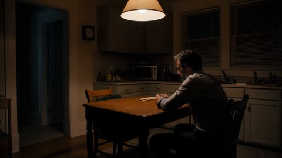</a>

The prompt lists each shot with its lens and framing, sets a separate emotional arc for each character, and fixes lighting and the number of dialogue turns, so the scene holds together across cuts. A detailed audio spec covering lip sync, pauses and room tone supports the dialogue delivery.

Kling 4.0 · Text-to-video · Source: [@MayorKingAI on X](https://x.com/MayorKingAI/status/2111427300533432812) · 79 likes on 2026-10-29

[`dialogue`](tags.md#tag-dialogue) [`lip-sync`](tags.md#tag-lip-sync) [`shot-coverage`](tags.md#tag-shot-coverage) [`emotion`](tags.md#tag-emotion)

<details><summary><b>Prompt</b></summary>

```text
SCENE CONTEXT
EXACTLY 2 HUMAN CHARACTERS — NO DUPLICATES, NO EXTRAS. Interior, a small lived-in apartment kitchen, late at night. A husband confesses to his wife that he was fired in June and has been pretending to go to work every day. She did not know; her disbelief turns to hurt, then to unconditional support. Intimate two-person drama, real time. The emotion lives equally in their faces, their words and their voices.

CHARACTERS
DANIEL: lean man, short dark hair greying at the temples, two days of stubble, deep shadows under the eyes, a small healed nick on his chin. Pale blue cotton office shirt, top button undone, sleeves rolled to the forearm, a loosened dark navy tie, a faint coffee stain on the left cuff. Plain gold wedding ring on his left hand. 180 cm.
LUCÍA: shoulder-length chestnut hair loosely tied, strands falling over her face, natural skin with faint freckles and slight redness around the nose, no makeup. Oversized oatmeal wool cardigan with a pulled thread at one cuff, over a grey cotton t-shirt. Plain gold wedding ring on her left hand. 165 cm.

LOCATION MAP
A small square kitchen table with a worn wooden top sits at the center. Daniel sits on the right side of the table (screen-right), facing left. The doorway to a dark hallway is screen-left. On the table: a half-full glass of water between Daniel's hands and a folded, unopened envelope. His laptop bag rests on the chair beside him. The window blind is fully closed. Behind Daniel: a kitchen counter and an old wall clock. The eyeline axis runs left–right across the table; the camera always stays on the same side of it.

FORMAT
One scene, 8 shots joined by clean hard cuts, classic shot–reverse-shot coverage. Cuts follow the dialogue and also land on the listener's reaction. No fades, no dissolves, no split screens.

SHOTS
Shot 1 — Wide shot, locked-off, from the corner behind the counter, 63° FOV. Daniel sits alone in the pool of lamplight, both hands around the glass, not drinking, staring at nothing. Lucía walks in through the dark doorway, relaxed and unaware, about to cross the kitchen.

Shot 2 — Medium close-up on Daniel, 47° FOV, eye level, very slow push-in ending on his face. He lifts his eyes to her; his jaw tightens, his nostrils flare with one deep breath, his lips part twice before any sound comes out. Low, slow and hesitant, with a heavy pause before the last three words: "Lucía… I need to tell you something. I got fired. In June."

Shot 3 — Reverse: medium shot of Lucía over Daniel's out-of-focus right shoulder, 47° FOV. She freezes mid-step. Her brow furrows, her mouth falls slightly open, a short incredulous breath escapes her. Quick and confused, almost a half-laugh of disbelief: "What? What do you mean, you got fired?" She walks to the table and grips the back of the chair opposite him, standing, looking down at him, knuckles whitening. Her voice rises with hurt, sharp but never shouting, stressing "hiding" and "nothing": "And you've been hiding it from me this whole time, like nothing happened?"

Shot 4 — Close-up on Daniel, 29° FOV, slightly high angle matching her standing eyeline, handheld with an extremely subtle breath-like float. He looks up at her, then his eyes drop to the glass; his thumb rubs its rim; his eyes turn glassy. Quiet, ashamed, his voice thinning, with a long pause in the middle and a crack on the last word: "I wasn't trying to hide it. Every morning I pretended I was going to work… and I spent the whole day looking for a job."

Shot 5 — Reverse close-up on Lucía, 29° FOV, slightly low angle. No words. Her grip on the chair loosens; her furrowed brow slowly relaxes; her lips press together and tremble; her eyes fill with water. The anger drains from her face and becomes pain. The clock ticks.

Shot 6 — Medium shot of Lucía, 47° FOV. She pulls out the chair and sits down opposite him, now at his eye level, leaning slightly toward him. Softer and wounded, her voice breaking on "trust": "Why didn't you tell me? Don't you trust me?"

Shot 7 — Close-up on Daniel, static, eye level. He opens his mouth to answer but no words come. His chin trembles, his eyes go red, a tear gathers on his lower lid, he swallows hard and gives one small shake of the head. Silence.

Shot 8 — Two-shot in profile across the table, 47° FOV, slow lateral drift of less than half a meter to the right, ending with both faces and the table between them in frame. Lucía reaches across and places her hand over his. A single tear runs down her cheek; she does not wipe it. Quiet, warm and absolutely firm, each word deliberate, stressing "always": "I'm always going to be there for you." Daniel turns his hand over and holds hers tightly, closes his eyes, and lets out a long, shaking exhale. Hold on the two of them in silence.

CHARACTER ACTING
Restrained, naturalistic film acting; every emotion is visible on the face in close-up. Daniel: guilt and shame — avoids her eyes, then forces himself to hold them; jaw clenched, breath short through the nose, hands restless on the glass; relief only arrives in the final exhale. Lucía: disbelief (frozen, brow furrowed, mouth open) → hurt (knuckles white on the chair, voice rising) → softening (grip loosens, eyes fill) → steady support (still, firm gaze, gentle half-smile through tears in the final shot). Faces show living micro-expressions: trembling chins, glistening eyes, swallowing, natural irregular blinks.

LIGHTING
One warm 3200K pendant lamp hanging low over the table is the key source: light from above-front, fast falloff, deep shadows in the corners of the room, catchlights visible in both characters' eyes. A faint cold 5600K spill from the hallway behind Lucía outlines her hair. Light direction and color stay identical after every cut.

AUDIO
All dialogue in natural, clear English with a neutral American accent. Daniel: low, tired baritone, slow, hesitant, with long pauses and an audible tremor when emotion rises. Lucía: warm mid-range voice that moves from confused and fast, to sharp and hurt, to soft and breaking, to quiet and firm. Each has a distinct voice. Only one person speaks at a time, no interruptions or overlapping, about one second of silence between lines. Breaths, swallows and small catches in the voice are audible. Lip movements synchronized with the English dialogue. Ambience: wall clock ticking, refrigerator hum, chair legs scraping on floor tiles, glass touching wood, cardigan rustle. Ambience stays below the dialogue. No background music. No subtitles.

STYLE
Intimate auteur drama. 35mm film texture with organic grain, shallow depth of field, soft halation around the lamp, no digital sharpening. Palette: 60% warm amber and wood brown, 30% deep shadow, 10% cold blue spill from the hallway.

POSITIVE CONSTRAINTS
Exactly two people for the entire scene. Same faces, hair, clothing and wedding rings in every shot. Daniel always screen-right looking left; Lucía always screen-left looking right. Exactly 4 dialogue turns: 2 by Daniel, 2 by Lucía. Lucía stands in Shots 3–5 and sits from Shot 6 onward. Hands and fingers anatomically correct when they hold hands. Faces stable. The scene ends in silence with their hands joined on the table; they stay seated.
```

</details>

<a id="h3-shanghai-cafe-marriage-conditions-dialogue"></a>
### Shanghai Café Couple Debate Marriage Conditions

<a href="https://x.com/tangpanqing/status/2103828594053325201"></a>

A one line scene setup (year, city, place, action) is followed by a shot by shot script. Each line is labeled close-up or tight close-up and carries its spoken dialogue, so the model cuts between speakers on every line. The closing instruction to add no subtitles keeps the native speech clean.

MiniMax H3 · Text-to-video · Source: [@tangpanqing on X](https://x.com/tangpanqing/status/2103828594053325201) · 73 likes on 2026-10-28 · found via [SkyNotSilent/awesome-MiniMax-H3-cases](https://github.com/SkyNotSilent/awesome-MiniMax-H3-cases)

[`dialogue`](tags.md#tag-dialogue) [`cafe`](tags.md#tag-cafe) [`multi-shot`](tags.md#tag-multi-shot) [`native-audio`](tags.md#tag-native-audio) [`chinese-prompt`](tags.md#tag-chinese-prompt)

<details><summary><b>Prompt</b></summary>

```text
2026年，上海。一个男人与一个女人在咖啡馆，喝咖啡，聊天。

近景，女人问: "有房吗？"
近景，男人说：”有“
近景，女人问: "有车吗？"
近景，男人说：”有"
特写，女人说: "基础条件可以，但我还有几个条件。"
特写，女人继续说: "婚后我们单住，你的父母不能过来住，你的工资全部上交，家务你全包"
特写，男人说：”那你呢？"
特写，女人问: "我只负责享受。"
特写，男人说：”那我还不如养条狗，要你干嘛？"

注意，不要加字幕。
```

</details>

<a id="h3-days-of-week-calendar-lesson"></a>
### Mascot bounces onto a blank calendar page

<a href="https://x.com/Strength04_X/status/2084874623825723522"></a>

Each day runs the same fixed beat order of name, narration, icon, action and repeat, which gives the model a reusable template. Timestamps pin every beat to a window, and a named colour per day plus a calendar-flip transition keeps the scenes consistent.

MiniMax H3 · Text-to-video · Source: [@Strength04_X on X](https://x.com/Strength04_X/status/2084874623825723522) · 71 likes on 2026-10-29 · found via [SkyNotSilent/awesome-MiniMax-H3-cases](https://github.com/SkyNotSilent/awesome-MiniMax-H3-cases)

[`kids-education`](tags.md#tag-kids-education) [`calendar`](tags.md#tag-calendar) [`narration`](tags.md#tag-narration) [`3d-icons`](tags.md#tag-3d-icons)

<details><summary><b>Prompt</b></summary>

```text
Create a 15-second animated educational video that introduces young children to the first four days of the week: Monday, Tuesday, Wednesday, Thursday.
Learning pattern: DAY NAME → SOUND → FUN ACTIVITY ICON → PLAYFUL ACTION → DAY NAME REPEAT
Target audience: children ages 3 to 6.
Visual style: Same premium-cute aesthetic — pastel tones, rounded 3D icons, soft lighting, off-white background, unique glow per day, clean bold typography, gentle calendar-page-flip style transitions.
0:00–0:01 Intro: Mascot bounces onto a soft floating calendar page, text "Let's learn the days!", tap flips to reveal Monday.

▪️0:01–0:04 | Monday — School Day: Calendar page shows "Monday" in big rounded text. Narrator: "Monday. Time for school!" A tiny backpack icon bounces onto the page and wiggles happily. Word "MONDAY" highlighted in soft blue.

▪️0:04–0:07 | Tuesday — Park Day: Page flips gently to Tuesday. Narrator: "Tuesday. Time to play!" A small swing icon appears and swings back and forth once. Word "TUESDAY" highlighted in soft orange.

▪️0:07–0:10 | Wednesday — Art Day: Page flips to Wednesday. Narrator: "Wednesday. Time to paint!" A tiny paintbrush icon appears and draws one curved rainbow line. Word "WEDNESDAY" highlighted in soft purple.

▪️0:10–0:13 | Thursday — Story Day: Page flips to Thursday. Narrator: "Thursday. Time for stories!" A small open book icon appears, pages gently flutter. Word "THURSDAY" highlighted in soft green.

▪️0:13–0:15 Recap: Backpack, swing, paintbrush, book appear in four tiles with day names above. Mascot points to each; Narrator: "Monday, Tuesday, Wednesday, Thursday. Great job!" Sparkle + chime.
```

</details>

<a id="h3-chun-li-seated-interview-smoky-arena"></a>
### Seated Chun-Li answers an interviewer about her father

<a href="https://x.com/ou_zhen599/status/2094322714739871760"></a>

Timestamped shots (00:07 and 00:11) start from a locked reference frame, so each cut has a fixed beat and the seated pose carries over. Dialogue lines are tagged with speaker role and language, and the soundscape stays sparse so the voice carries the emotion.

MiniMax H3 · Image-to-video · Source: [@ou_zhen599 on X](https://x.com/ou_zhen599/status/2094322714739871760) · 60 likes on 2026-10-29 · found via [SkyNotSilent/awesome-MiniMax-H3-cases](https://github.com/SkyNotSilent/awesome-MiniMax-H3-cases)

[`chun-li`](tags.md#tag-chun-li) [`street-fighter`](tags.md#tag-street-fighter) [`multi-shot`](tags.md#tag-multi-shot) [`dialogue`](tags.md#tag-dialogue) [`cinematic`](tags.md#tag-cinematic)

<details><summary><b>Prompt</b></summary>

```text
For the target video, at 0.00 seconds into the target video, <Picture 1> (from [Shot 1]) is fully referenced.

integrated_multimodal_description: [Shot 1] Live-action, cinematic realism, post-fight intimacy. Chun-Li fully matches <Picture 1>: same face, hair buns, white ribbons, battle-worn blue qipao-style outfit, wrist guards, white boots, seated pose, smoky arena environment, clothing damage, body proportions, and controlled intensity. The first frame must begin exactly from the seated posture in <Picture 1>, with no pose reset. IMAX 70mm film grain, Nolan-inspired cinematic realism, photorealistic natural palette with charcoal black, umber, dark ochre, ash gray, and pale amber interwoven. Low-angle medium close-up, very slow physical push-in, no cut during the first emotional phase. Chun-Li sits wide and grounded with both hands on her waist. The off-screen interviewer, a mature calm warm woman (S1), says in an off-screen voiceover: <d>[English] Do you still miss your father?</d> Chun-Li does not answer immediately. Her breath catches, one hand slowly drops from her waist to her thigh or the floor, one knee subtly draws inward, her chin dips, her gaze lowers, and her jaw tightens before she finally answers. Chun-Li (S2), low, quiet, controlled, says: <d>[English] Every day.</d> [Shot 2] At 00:07.000, the shot cuts softly to a tighter medium close-up. Chun-Li steadies herself with one hand on her thigh or forearm, leans forward slightly, and says: <d>[English] I still hear him when I fight.</d> [Shot 3] At 00:11.000, the shot cuts softly to a slightly wider medium close-up. Chun-Li slowly straightens, brings one hand higher again, resets her shoulders, firms her jaw, lifts her eyes with quiet resolve, and says: <d>[English] I carry him with me.</d> Only Chun-Li is visible. The interviewer never appears. No melodrama, no exaggerated crying, no glamour posing. End on regained stillness, not collapse.

overall_soundscape: Faint smoke movement, subtle room tone, soft distant arena hush, light fabric rustle, subtle boot shift, and quiet breath.

non_diegetic_music: Very restrained low strings and sparse piano at a slow tempo, mixed gently under the natural ambience.
```

</details>

<a id="kling-cafe-rain-dialogue-push-in"></a>
### Two men talk in a rainy cafe

<a href="https://x.com/HBCoop_/status/2112635806045421843">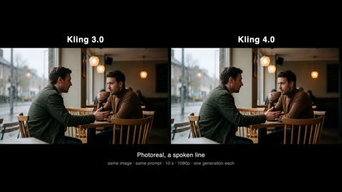</a>

The spoken line is quoted with its accent, then the camera is set as a slow push in with the sound named (rain, room tone). The action beats are listed in order so the speaker and the listener react on time.

Kling 4.0 · Image-to-video · Source: [@HBCoop_ on X](https://x.com/HBCoop_/status/2112635806045421843) · 60 likes on 2026-10-29

[`dialogue`](tags.md#tag-dialogue) [`photoreal`](tags.md#tag-photoreal) [`cafe`](tags.md#tag-cafe) [`rain`](tags.md#tag-rain)

<details><summary><b>Prompt</b></summary>

```text
1. Photoreal with a spoken line.

Both models spoke. Kling 3.0 added a word that was not in the prompt. Kling 4.0 kept the wording but slurred the middle of the line. Levels are matched in the cut so neither model sounds louder than the other.

Kling 3.0 first, then Kling 4.0, each with its own sound.

Prompt: The man on the left leans in and says, in a calm British accent, "You already know what I'm going to say." The other man lowers his cup and gives a small nod. Slow push-in on the two of them, rain running down the window, warm lamps steady. One continuous take, natural dialogue, cafe room tone.
```

</details>

<a id="h3-cleopatra-orders-pizza-delivery"></a>
### Cleopatra on throne meets pizza delivery guy

<a href="https://x.com/Strength04_X/status/2085193166437892346"></a>

Timestamped beats lock the timing of each reaction, and the spoken lines are quoted so lip sync has exact words to follow. Setting a regal pyramid interior against a modern delivery driver builds the joke before any dialogue lands.

MiniMax H3 · Text-to-video · Source: [@Strength04_X on X](https://x.com/Strength04_X/status/2085193166437892346) · 52 likes on 2026-10-29 · found via [SkyNotSilent/awesome-MiniMax-H3-cases](https://github.com/SkyNotSilent/awesome-MiniMax-H3-cases)

[`comedy`](tags.md#tag-comedy) [`dialogue`](tags.md#tag-dialogue) [`lip-sync`](tags.md#tag-lip-sync) [`historical`](tags.md#tag-historical)

<details><summary><b>Prompt</b></summary>

```text
0:00–0:04 — Medium shot inside a golden pyramid chamber. CLEOPATRA sits on her throne looking majestic. A modern pizza delivery guy in helmet and red jacket suddenly walks in holding a large pizza box.
0:04–0:07 — Cleopatra stands up, points at the box and starts singing in a dramatic royal voice: “Pizza man, pizza man… bring the cheese across the sand!” while doing slow Egyptian hand waves.
0:07–0:10 — The delivery guy tries hard to stay professional and say “That’ll be 12 dollars,” but his lips start trembling.
0:10–0:13 — He can’t hold it and bursts out laughing, almost dropping the pizza.
0:13–0:15 — Cleopatra freezes mid-hand-wave, looks at him, and completely cracks up too. Both are laughing while the pizza box tilts dangerously.
```

</details>

<a id="wan-deadpan-ai-video-tells-comedy"></a>
### Deadpan host in courtyard teaching AI video spotting

<a href="https://x.com/johnAGI168/status/2092593100346519620">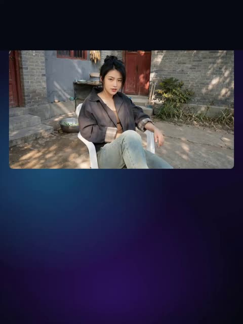</a>

Three reference images are bound to named characters with @图片1, @图片2 and @图片3, and a rule forbids any change to face, outfit or build. Timed shots with lip sync dialogue lines and explicit reaction delays keep the slapstick beats in the right order.

Wan 3.0 · Reference-to-video · Source: [@johnAGI168 on X](https://x.com/johnAGI168/status/2092593100346519620) · 49 likes on 2026-10-29

[`reference-images`](tags.md#tag-reference-images) [`chinese-dialogue`](tags.md#tag-chinese-dialogue) [`lip-sync`](tags.md#tag-lip-sync) [`deadpan-comedy`](tags.md#tag-deadpan-comedy) [`multi-character`](tags.md#tag-multi-character)

<details><summary><b>Prompt</b></summary>

```text
【风格】中国本土黑色冷幽默短剧（Chinese Deadpan Comedy），真实人物实拍（Photorealistic Live Action），生活化网络短片质感，轻微手持摄影，真实物理运动，4K高清
【时长】30秒，单次直出
【画幅】16:9横屏
【语言】全程中文现场对白，精准中文口型同步；无旁白、无字幕
【场景】中国北方县城老院子 → 中国小城复古甜品店 → 中国县城老式招待所走廊
【角色】@图片1 命名“墨宁”，负责对镜讲解；@图片2 命名“阿蓝”，甜品店同桌顾客；@图片3 命名“王姨”，阿蓝的陪同者

【参考图执行规则】
三名角色的脸部、身形、发型、妆容、服装和配饰全部严格继承各自参考图，不在视频中自行增加、删除或修改任何人物外观元素。
角色第一次出现时即完全匹配对应参考图，后续场景切换不得换脸、换装或改变体型。

【核心内容】
墨宁面对镜头讲解：判断一条视频是否由AI生成，不要只看清晰度，而要观察动物动作、物理效果、人物反应和空间关系。
她一边讲解，一边用越来越荒唐的现场行为进行“示范”，但始终认为出现问题的是AI视频，而不是她自己。

【人物表演逻辑】
墨宁始终把自己当成认真教学的专业人士。越是发生荒唐事件，她越冷静、越理直气壮。她不是故意逗观众笑，笑点来自她一本正经的错误判断。
阿蓝在事件发生前完全没有防备；必须等液体真正接触身体后，才出现缩颈、闭眼、抬手和躲闪反应。
王姨必须先确认阿蓝的情况，再转头看向墨宁；禁止提前瞪人或提前预知事件。

[00:00-00:05.30] 镜头1：不用看画质，先看细节（Static Medium Shot）
中国北方县城老院子，灰砖墙、红色木门、白色塑料椅、墙根杂草、晾晒的玉米和生活杂物。午后自然光从侧面照进院子，树叶影子轻微晃动。

固定正面中景：墨宁坐在白色塑料椅上，身体自然前倾，双手靠近膝盖，直视镜头。

[00:00-00:02.30]
墨宁像分享一个简单实用的小技巧，语速清楚、自然：

【对白口型指导】“怎么判断一条视频是不是AI做的？”

说完保持目光不动，停顿约0.2秒，确认观众注意力已经集中。

[00:02.30-00:05.30]
墨宁轻轻抬起一只手，像开始列举重点：

【对白口型指导】“不用盯着画质，先看动物。AI一碰猫猫狗狗，最容易露馅。”

“先看动物”略微加重；“最容易露馅”说得很笃定，像这是一条已经被反复验证的规律。

说到“猫猫狗狗”时，院子外传来逐渐靠近的狗喘气声。墨宁听见声音，但暂时不回头。

[00:05.30-00:10.20] 镜头2：动物动作最容易露馅（Handheld Reframing）
[00:05.30-00:06.50]
一只大型黑狗从画面左下方快速进入，直接把脑袋挤到墨宁两腿之间。

狗进入时身体具有真实前冲惯性，先是头部靠近，随后肩膀和身体跟上，禁止整只狗突然出现在画面里。

墨宁的双手被狗顶得自然抬起，身体向后回弹几厘米。摄影机因为狗突然进入而本能向下偏移，焦点短暂落在狗头上。

墨宁低头看着狗说：

【对白口型指导】“就拿这只来说。”

她的语气不是逗狗，而是像终于找到了现成的教学案例。

[00:06.50-00:07.70]
黑狗继续向前挤，身体横在墨宁腿前，尾巴扫过塑料椅腿。

墨宁用手把狗头轻轻往旁边推，随后抬眼看向镜头：

【对白口型指导】“看出来了吗？”

她问完后保持半秒停顿，给观众观察狗的时间。

[00:07.70-00:09.60]
黑狗从墨宁面前横向经过，又突然把鼻子凑近摄影机，导致画面前景明显虚焦。

墨宁的视线跟着狗移动，眉头逐渐收紧：

【对白口型指导】“动作一卡一卡的，眼神也不对。”

“动作一卡一卡的”说得像在进行技术分析。狗的动作本身必须连续自然，笑点来自墨宁强行把正常动作说成AI破绽。

[00:09.60-00:10.20]
狗鼻尖几乎贴住镜头，发出一声短促狗叫。

墨宁在后方看着它，干脆地下结论：

【对白口型指导】“一看就假。”

说完不笑。狗叫声结束的瞬间硬切下一场景。

[00:10.20-00:14.60] 镜头3：物理效果测试（Extreme Close-up → Medium Shot）
硬切到中国小城复古甜品店。木桌、玻璃食品柜、白瓷茶杯、暖水瓶、纸巾盒和中文价目牌构成生活化环境。背景顾客自然吃饭聊天。

墨宁、阿蓝和王姨坐在同一张桌旁。桌上摆着一大杯粉红色草莓酸奶饮品和另一杯浅色饮品。

[00:10.20-00:10.70]
墨宁突然向摄影机靠近，脸部进入极近景。

由于距离快速缩短，画面先轻微失焦，随后自动对焦准确落在墨宁的双眼和嘴唇上。

[00:10.70-00:13.70]
墨宁睁大眼睛，像准备讲第二个重点：

【对白口型指导】“第二，看物理效果。画面里的液体一多，最容易穿帮。”

“物理效果”四个字说得清楚、稍慢。

说到“液体一多”时，她的视线短暂移向桌上的粉红色饮品；说到“最容易穿帮”时，再把目光转回镜头。

阿蓝和王姨继续自然坐着，不得提前观察墨宁的手，也不得表现出警惕。

[00:13.70-00:14.60]
切换双人中景。

墨宁退回座位，顺手拿起阿蓝面前的粉红色饮品，双手将杯子举到阿蓝头顶。

她没有蓄力或夸张准备，直接把杯口翻转。

浓稠粉红液体在重力作用下形成连续流柱，先落到阿蓝头顶，再沿头部、脸侧、肩膀和衣料向下流淌，最后飞溅到木桌上。

杯内液面必须随着倾倒逐渐降低；液体具有真实重量、黏度和飞溅惯性，禁止凭空出现、悬浮、逆流或穿透容器。

【音效】玻璃杯轻响、浓稠液体落下声、液体拍击桌面的飞溅声。

[00:14.60-00:18.20] 镜头4：真实反应不能提前（Delayed Reaction）
[00:14.60-00:15.20]
液体第一次接触阿蓝后，保留约0.2秒的神经反应延迟。

随后阿蓝突然缩起脖子、闭紧双眼，肩膀快速抬高，双手本能地挡在头部附近。

她张嘴发出一声短促尖叫，身体带着真实惯性向侧后方躲闪，椅子被动作带动，在地面摩擦出声音。

禁止阿蓝在液体落下前闭眼、尖叫、抬手或闪躲。

[00:15.20-00:16.30]
阿蓝继续向旁边躲，手臂扫过桌面，带动桌面上的液体发生第二次小范围飞溅。

墨宁保持杯口向下，直到饮品基本流空才把杯子收回。杯子不能突然变空，手掌不能与杯子融合。

墨宁低头看一眼空杯，确认“实验完成”，整个过程没有道歉，也没有慌乱。

[00:16.30-00:17.50]
王姨先愣住半拍，随后立刻靠近阿蓝。

她一只手扶住阿蓝，另一只手帮她擦掉脸部附近的液体。她的注意力必须先集中在阿蓝身上，确认情况后才抬头。

[00:17.50-00:18.20]
近景：王姨缓慢转头看向墨宁，眉头压低，嘴唇紧闭。

阿蓝靠着王姨喘气，残留液体继续自然向下滴落。两人没有清晰对白，只保留尖叫尾音、急促呼吸和衣料摩擦声。

[00:18.20-00:21.30] 镜头5：人物反应也会露馅（Reverse Medium Close-up）
正反打切到墨宁。

她独自坐在桌子另一侧，面前的桌面被粉红液体和水果碎块弄得一片狼藉，空杯落在桌角。

[00:18.20-00:19.00]
墨宁看向阿蓝和王姨，轻轻抬起眉峰：

【对白口型指导】“再看人物反应。”

她的口吻依然是讲解知识点，没有任何内疚。

[00:19.00-00:21.30]
墨宁先观察阿蓝，再看一眼正盯着自己的王姨，最后重新看向镜头：

【对白口型指导】“刚才那一下，反应太整齐，明显演过了。”

“反应太整齐”说得像在分析表演问题；“演过了”短促收尾。

直到整句话说完，她一侧嘴角才出现非常轻微的讥讽笑意。禁止提前微笑或从头到尾保持笑容。

[00:21.30-00:25.20] 镜头6：空间关系最难处理（Backward Tracking Shot）
硬切到中国县城老式招待所走廊。

狭长走廊两侧分布多扇房门，墙面安装暖黄色吸顶灯。墙上只有一块清晰规范的绿色中文“安全出口”标识，禁止出现英文或乱码。

[00:21.30-00:22.40]
墨宁从走廊远端径直走向摄影机。

摄影机以相同速度向后移动，始终保持墨宁位于画面中央。她先不说话，走廊中只保留脚步声和轻微环境声。

[00:22.40-00:25.20]
墨宁继续行走，对镜头讲出最后一个判断方法：

【对白口型指导】“最后看门。空间关系一复杂，AI就特别容易出错。”

“最后看门”稍微停顿；“空间关系”清晰咬字；“特别容易出错”语气笃定。

经过“安全出口”标识时，标识必须固定在墙面，不能跟随人物移动、扭曲或变成其他文字。

[00:25.20-00:28.50] 镜头7：门认错了（Door Physics Punchline）
[00:25.20-00:25.80]
墨宁停在走廊左侧的一扇房门前，侧身面对房门。

手部特写：她准确握住这扇门的金属把手，将把手向下压。

手指数量正确，手掌与门把手保持明确接触，禁止粘连、穿透或错位。

[00:25.80-00:26.30]
切换中景。

墨宁握住的这扇门没有打开，旁边另一扇完全无人触碰的门反而同步打开一条缝。

两扇门保持独立完整，门板和门框不能融合。错误动作只发生一次，因果关系必须清楚：墨宁压下左侧门把手，右侧房门却打开。

[00:26.30-00:27.00]
墨宁先低头确认自己手里的门把手，再缓慢转头看向旁边自行打开的门。

她眉头轻轻收紧，停顿半秒后看向镜头：

【对白口型指导】“看吧，门都认错了。”

不是惊讶尖叫，而是“果然被我说中了”的平静语气。

[00:27.00-00:27.80]
旁边的门缓慢自行关闭。

墨宁明显翻一次白眼，松开手中的门把手：

【对白口型指导】“算了，走了。”

语气疲惫、干脆，最后一个字自然落下。

[00:27.80-00:28.50]
墨宁再次推动原来的房门，这一次房门正常打开。

她侧身进入房间。摄影机停留在走廊，不跟进房间。墨宁完全出画后，房门迅速关上，发出一声沉闷的“砰”。

[00:28.50-00:30.00] 镜头8：黑屏收尾（Hard Cut to Black）
关门声响起的瞬间硬切纯黑画面，黑屏保持到30秒结束。

黑屏中保留关门声余韵和房间内逐渐远去的两三步脚步声。最后0.5秒完全安静。

黑屏不出现字幕、标题、Logo或结束卡。

【完整对白汇总】
墨宁：“怎么判断一条视频是不是AI做的？”
墨宁：“不用盯着画质，先看动物。AI一碰猫猫狗狗，最容易露馅。”
墨宁：“就拿这只来说。”
墨宁：“看出来了吗？”
墨宁：“动作一卡一卡的，眼神也不对。”
墨宁：“一看就假。”
墨宁：“第二，看物理效果。画面里的液体一多，最容易穿帮。”
墨宁：“再看人物反应。”
墨宁：“刚才那一下，反应太整齐，明显演过了。”
墨宁：“最后看门。空间关系一复杂，AI就特别容易出错。”
墨宁：“看吧，门都认错了。”
墨宁：“算了，走了。”

【声音要求】
墨宁所有对白使用同一中文声线，语速自然、清晰，像面对手机镜头分享经验，不使用翻译腔、播音腔或机械朗读。
每句对白必须由墨宁本人开口，中文口型与声音准确同步。
院子保留风声、鸟叫、狗喘气和狗叫；甜品店保留顾客交谈、餐具声、液体飞溅和尖叫；招待所保留脚步、门轴和关门声。
不添加持续背景音乐，不使用罐头笑声。

【全局连续性】
三名人物始终严格继承各自参考图，不对外貌、发型、身形、妆容、服装和配饰进行任何二次设计。
墨宁在三个场景中保持同一外观和同一声线。
阿蓝与王姨只出现在甜品店；黑狗只出现在院子；角色离开画面后不得在同一镜头突然返回。
甜品店正反打保持人物座位和视线方向一致。
所有场景切换使用明确硬切，禁止人物或背景在画面中途融化变形。
```

</details>

<a id="h3-rainy-diner-engagement-ring-proposal"></a>
### Couple in rainy diner, engagement ring reveal

<a href="https://x.com/EndFolding79421/status/2100797634650734840">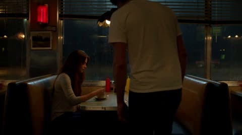</a>

Two character reference images lock identity, and a fixed seating layout is stated with the cuts so the pair stays on opposite sides of the table. Timed beats with named camera cuts and a continuity block that forbids duplicate characters keep a 10 second scene readable.

MiniMax H3 · Reference-to-video · Source: [@EndFolding79421 on X](https://x.com/EndFolding79421/status/2100797634650734840) · 46 likes on 2026-10-29

[`character-reference`](tags.md#tag-character-reference) [`shot-list`](tags.md#tag-shot-list) [`continuity`](tags.md#tag-continuity) [`dialogue`](tags.md#tag-dialogue)

<details><summary><b>Prompt</b></summary>

```text
Man reference <image 0>
Woman reference <image 1>
Use the two supplied character references to preserve the exact identity and appearance of the red-haired woman and dark-haired man. EXACTLY TWO PEOPLE are present in this scene: ONE woman and ONE man. NEVER duplicate either character.

Late at night inside an old, slightly worn roadside American diner during heavy rain. The woman is already sitting alone on ONE SIDE of a booth, beside a rain-covered window, holding a ceramic cup of coffee. The man arrives and sits DIRECTLY ACROSS THE TABLE FROM HER on the OPPOSITE bench. He NEVER sits beside her. Once seated, both characters remain on their respective opposite sides of the table for the entire scene. Maintain this exact spatial relationship through every camera cut.

The visual treatment is moody, imperfect, atmospheric live-action feature-film photography, not pristine digital video. Slightly underexposed faces, deep soft shadows, low-key practical lighting, warm dim tungsten diner lamps mixed with cold blue-gray rainy window light, subdued colors, restrained saturation, gentle highlight bloom and halation around practical lights, subtle organic 35mm-style grain, slight lens softness, natural skin texture, atmospheric haze, imperfect shadow detail, soft optical depth of field and natural motion blur. Rain streaks distort distant neon and headlights outside into soft colored bokeh. Avoid clean clinical lighting, beauty lighting, glossy commercial imagery, HDR, razor-sharp edges, perfect digital clarity, plastic skin and polished AI aesthetics. It should look photographed through a real cinema lens in a dark location, with texture and imperfection.

[00:00–00:02] Moody medium-wide shot from behind the man's shoulder as he approaches the booth. The woman is visible ALONE on the opposite side of the table, looking down sadly at her coffee. He slides into the empty bench directly across from her. CUT immediately once he is seated.

[00:02–00:04] Tight close-up of the woman from the man's seated perspective. His shoulder may appear ONLY as a soft out-of-focus foreground edge. Do not show another man anywhere in frame. She raises her eyes toward him, disappointed, and quietly says: “You're late.”

[00:04–00:06] Reverse tight close-up of the man from the woman's seated perspective. Her red hair may appear ONLY as a soft blurred foreground edge. He says quietly: “I'm sorry... but I had a good reason.”

[00:06–00:08] CUT to a close tabletop insert. His hand places a small OPEN engagement-ring box beside her coffee. A beautiful engagement ring is clearly visible inside. Warm practical light catches the ring naturally. Only his hand enters the shot.

[00:08–00:10] CUT directly to an extreme close-up of the woman's face. She freezes in disbelief. Her eyes widen and begin filling with tears; her lips part, then slowly form a stunned, emotional smile. Cold rainy-window bokeh glows softly behind her. She looks across the table toward him. End on her face.

CRITICAL CONTINUITY: Exactly ONE woman and ONE man. Never clone, duplicate or create another version of either character. The woman remains on her original side of the booth. The man sits ONLY on the opposite side. He NEVER sits beside her. An over-the-shoulder foreground shoulder is part of the SAME person whose viewpoint the camera represents and must NEVER become another visible character.

NO MUSIC. Only quiet rain, subdued diner ambience and dialogue.
```

</details>

<a id="h3-spiderman-superman-rooftop-banter"></a>
### Spiderman and Superman trade jokes on rooftop

<a href="https://x.com/ivanfioravanti/status/2095770682797760857">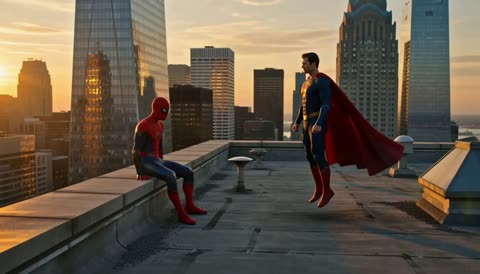</a>

Each speaker and his exact line are spelled out in one scene, so the model has clear turn-taking and a reversal ending to play out within a single rooftop shot.

MiniMax H3 · Text-to-video · Source: [@ivanfioravanti on X](https://x.com/ivanfioravanti/status/2095770682797760857) · 44 likes on 2026-10-29 · found via [SkyNotSilent/awesome-MiniMax-H3-cases](https://github.com/SkyNotSilent/awesome-MiniMax-H3-cases)

[`dialogue`](tags.md#tag-dialogue) [`superheroes`](tags.md#tag-superheroes) [`comedy`](tags.md#tag-comedy) [`rooftop`](tags.md#tag-rooftop)

<details><summary><b>Prompt</b></summary>

```text
Generate a scene of “Spiderman vs Superman” that says, “Hey", Spiderman says to Superman, ‘Hey, we keep waiting for GPT‑6 to come out,’ and Superman says, ‘Are you? I started using it one week ago.
```

</details>

<a id="h3-autumn-leaf-pile-pool-reveal"></a>
### Woman leaps into leaf pile revealing pool

<a href="https://x.com/amynys/status/2102443755240407287">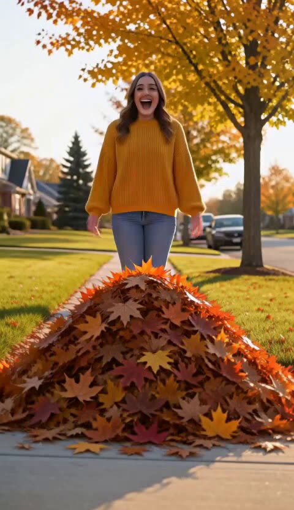</a>

Breaks the gag into ordered beats (line, step, leap, reveal) and pins the camera with a locked off wide shot, so the surprise pool reads clearly in one take. Spelling out the expression and the thumbs up gives the face and gesture concrete targets.

MiniMax H3 · Text-to-video · Source: [@amynys on X](https://x.com/amynys/status/2102443755240407287) · 42 likes on 2026-10-29

[`physical-comedy`](tags.md#tag-physical-comedy) [`autumn`](tags.md#tag-autumn) [`wide-shot`](tags.md#tag-wide-shot)

<details><summary><b>Prompt</b></summary>

```text
A cheerful young adult in a cozy mustard sweater stands on a leafy suburban sidewalk beside a perfect pile of orange and red autumn leaves. They beam at the camera and announce “Happy first day of fall!” with delighted confidence, then take one proud step and leap into the pile. The leaves burst outward to reveal a tiny blue inflatable kiddie pool underneath; the person pops up from the pool wearing oversized sunglasses, gives a big thumbs-up, and grins as a few leaves drift onto their head. Warm golden afternoon light, cheerful autumn colors, playful physical comedy, expressive face, clear readable action, one continuous locked-off wide shot, crisp comic timing, natural body motion, upbeat seasonal mood, 24fps film motion with clean detail.
```

</details>

<a id="h3-stuart-little-snowbell-friends"></a>
### Stuart Little looks up in living room

<a href="https://x.com/MrDasCreates/status/2084551020760433134">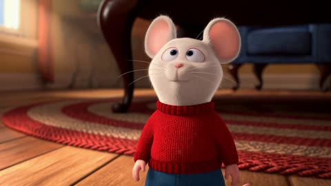</a>

The prompt names the character, setting, and camera move in one sentence, then quotes each line with its speaker and tone so the model can assign voices. The slow push-in and the native stereo dialogue tag set both framing and audio.

MiniMax H3 · Text-to-video · Source: [@MrDasCreates on X](https://x.com/MrDasCreates/status/2084551020760433134) · 40 likes on 2026-10-29

[`dialogue`](tags.md#tag-dialogue) [`3d-animation`](tags.md#tag-3d-animation) [`stereo-audio`](tags.md#tag-stereo-audio) [`character`](tags.md#tag-character)

<details><summary><b>Prompt</b></summary>

```text
The storytelling is what stands out.

Expressive performances, smooth animation, and movie-like visuals make this feel surprisingly authentic.

MiniMax H3 prompt: 15-second 3D animated scene from Stuart Little. Cute little mouse Stuart Little stands on the living room floor looking up at the big fluffy white cat Snowbell. Snowbell sits on the couch with a smug expression, tail twitching. Soft warm indoor lighting, detailed fur and fabric textures, classic Stuart Little movie animation style. Stuart says cheerfully “Hey Snowbell, want to be friends?” Snowbell replies in a sarcastic voice “Friends? You’re a mouse, I’m the real pet around here!” Camera slowly pushes in as Snowbell leans down closer to Stuart. Smooth animation, expressive faces, native stereo dialogue audio, 24fps, cinematic quality.
```

</details>

<a id="h3-japanese-dialogue-school-run-river"></a>
### Two students run to school by river

<a href="https://x.com/MireilleDartois/status/2085168181648445763">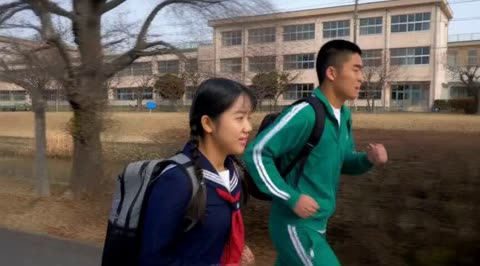</a>

A reference image pins both characters' faces and outfits, while the shot is fixed as a side tracking view with upper bodies framed and the running direction spelled out. Each line is labelled with its voice number and gender, which lets the model assign the Japanese dialogue to the right speaker.

MiniMax H3 · Reference-to-video · Source: [@MireilleDartois on X](https://x.com/MireilleDartois/status/2085168181648445763) · 27 likes on 2026-10-29 · found via [SkyNotSilent/awesome-MiniMax-H3-cases](https://github.com/SkyNotSilent/awesome-MiniMax-H3-cases)

[`japanese-dialogue`](tags.md#tag-japanese-dialogue) [`reference-image`](tags.md#tag-reference-image) [`school-run`](tags.md#tag-school-run) [`side-tracking`](tags.md#tag-side-tracking)

<details><summary><b>Prompt</b></summary>

```text
A scene showing a male student wearing a green tracksuit and a female student in a sailor uniform running together on the school path along s small river.
A shot of the two people viewed from directly the side. They are running from the right side of the frame toward the left. The frame captures their upper bodies.
Several classmates on the way, walking to school.
Refer to <Picture 1> for the characters.
Voice 1(male):またワイら遅刻ちゃうか
Voice 2(female):あと30秒！あたしらの勝ちやな！
```

</details>

<a id="wan-crying-woman-dim-room-dialogue"></a>
### Crying woman in dim room, tears streaming

<a href="https://x.com/PixelAigc/status/2092106222128574802">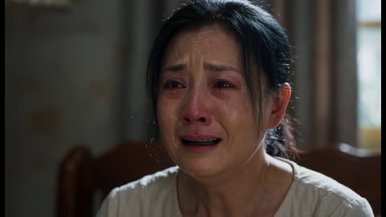</a>

A fixed chest-up closeup with the speech and sobbing spelled out for the full five seconds keeps the lip sync and tears on beat. The explicit bans on music, beauty filters and fade-outs keep the clip raw and realistic.

Wan 3.0 · Text-to-video · Source: [@PixelAigc on X](https://x.com/PixelAigc/status/2092106222128574802) · 22 likes on 2026-10-29

[`emotion`](tags.md#tag-emotion) [`lip sync`](tags.md#tag-lipsync) [`closeup`](tags.md#tag-closeup) [`realistic`](tags.md#tag-realistic)

<details><summary><b>Prompt</b></summary>

```text
Generate a 5-second realistic plot short film, 16:9, 24fps, slight film grain, dimly lit indoor room, soft side backlight, atmosphere of repression and sadness.
Character: Middle-aged Chinese woman, long black hair, plain everyday top, close-up from chest up, fixed camera position, lens almost stationary. Continuous speaking throughout, ceaselessly sobbing and crying, tears continuously streaming down her cheeks, eyes red and swollen, nose tip flushed red, lips constantly opening and closing, accompanied by choking sobs, subtle shoulder tremors, authentic facial muscle twitching, grievance and pain, lip sync strictly matched to Chinese voice, full 5 seconds filled with dialogue, no blanks.

[Timeline 0.0-5.0 seconds]
0-5 seconds: Continuous sobbing and crying throughout, nonstop speaking, teardrops continuously sliding down, breathing intermittent with choking sobs
Woman continues to say in a tearful, choking voice: "What on earth did I do wrong, why treat me like this......"

Sound design: Native Chinese human voice, with crying and choking sobs, including gasping sobs, no background music, only extremely faint indoor ambient noise.
Strictly prohibited: Subtitles, watermarks, logos, exaggerated roars, stage performance feel, beauty filters/skin smoothing, facial drift deformation, lip sync misalignment, black screen fade-out. End the 5 seconds with a direct abrupt cut to black.
```

</details>

<a id="h3-banquet-brawl-freezes-game-master"></a>
### Banquet brawl freezes as game master speaks

<a href="https://x.com/varts_works/status/2107369186121101788">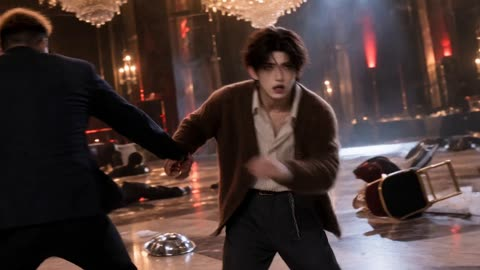</a>

The prompt builds the 15 second clip as timed beats, each tied to one dialogue line and a named lens (32mm wide, 85mm portrait, 75mm tight), so the camera moves from the frozen crowd to KAI. Each speaker gets a fixed voice block with timbre, pace and pitch kept for the whole clip, and the audio is listed cue by cue, ending on silence and a dropped napkin.

MiniMax H3 · Reference-to-video · Source: [@varts_works on X](https://x.com/varts_works/status/2107369186121101788) · 21 likes on 2026-10-29 · found via [SkyNotSilent/awesome-MiniMax-H3-cases](https://github.com/SkyNotSilent/awesome-MiniMax-H3-cases)

[`dialogue`](tags.md#tag-dialogue) [`character-reference`](tags.md#tag-character-reference) [`voice-lock`](tags.md#tag-voice-lock) [`shot-timing`](tags.md#tag-shot-timing)

<details><summary><b>Prompt</b></summary>

```text
添付された人物リファレンスの顔立ち、髪色、髪型、体格、衣装を正確に維持する。

劇場公開用超大作実写映画、Netflix最上位オリジナル映画級、制作費50億円規模。

GAME 05専用の巨大高級宴会場。

乱闘によって椅子が倒れ、テーブルがずれ、料理、皿、ナプキンが床へ散乱している。

15秒のシネマティックシークエンス。

前シーンの直後。

焦茶色センター分け、ブラウン系カーディガン、ストライプシャツ、ワイドスラックス姿のKAIがSPの動きを回避し、巨大モニターを強く見上げる。

呼吸が少し乱れている。

KAI：

「こんなのゲームじゃないだろ！」

VOICE — KAI：

20代前半男性。

柔らかく透明感のある中低音。

緊迫時には声に強い芯が出る。

明瞭な日本語。

全編で同じ声質とピッチを維持。

巨大モニターへ切り替わる。

金髪ロングウェーブ、黒スーツ、黒インナー、シルバークロスアクセサリー姿の女性ゲームマスター。

ゲームマスター：

「戦闘は必要ありません。」

VOICE — ゲームマスター：

20代後半〜30代前半女性。

低めのアルト。

冷たく滑らかで落ち着いた声。

ゆっくり明瞭。

感情の起伏が非常に小さい。

全編で同じ声質、ピッチ、話速を維持。

その言葉と同時に、宴会場の動きが一斉に止まる。

32mm相当のワイドショット。

黒髪ロングヘア、白黒ストライプ衣装のヤクザ系女性参加者とSPが近距離で停止。

MAELは低い姿勢で呼吸を整えている。

LUCAS、NERO、RION、角がありピンク系衣装姿の愉快犯も動きを止める。

空中を舞っていた白いナプキンだけがゆっくり床へ落ちる。

約1秒の静寂。

ゲームマスター：

「SPの前を通る。それだけです。」

全員の視線がSPと、その横にある広い通過スペースへ向く。

KAIへ切り替わる。

KAIは荒れ果てた宴会場を見る。

倒れた椅子。

割れた皿。

散乱した料理。

SPを見る。

もう一度荒れた会場を見る。

KAI：

「……じゃあ俺たち、何で戦ってんの？」

声は怒鳴らず、完全な脱力と素の疑問。

最後はKAIが無言で立っている表情を約1秒残す。

CAMERA:

冒頭KAIは50mm cinema prime相当のmedium close-up。

ゲームマスターは85mm相当のportrait close-up。

乱闘停止は32mm相当のwide ensemble shot。

最後は75mm相当でKAIのtight medium close-up。

アクション後からカメラの動きを急激に静かにする。

24fpsの自然な映画モーション。

LIGHTING:

暖かなシャンデリア光。

冷たい白色トップライト。

弱い赤色警告灯が徐々に消えていく。

KAIの焦茶色ヘアには暖かなブラウンの階調。

ゲームマスターは冷たいニュートラル光。

AUDIO:

BGMなし。

冒頭はKAIの荒い呼吸、靴音、椅子やグラスが動く音、衣服の擦れ。

ゲームマスター：

「戦闘は必要ありません。」

その瞬間に激しい音が一斉に止まる。

その後は低い空調音。

揺れているシャンデリアの微かな金属音。

ナプキンが床へ落ちる小さな音。

ゲームマスター：

「SPの前を通る。それだけです。」

KAIの最後の台詞には宴会場の自然な残響。

「……じゃあ俺たち、何で戦ってんの？」

台詞後、約1秒の静寂と空調音だけを残して終了。

16:9 cinematic widescreen。
```

</details>

<a id="h3-garage-coffee-ai-replace-question"></a>
### Two men share coffee on a muscle car

<a href="https://x.com/underwoodxie96/status/2084873926141006285">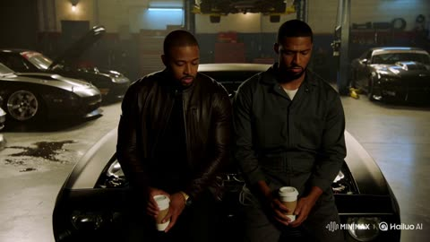</a>

The prompt gives each line of dialogue its own beat and sets the timing with explicit pauses, so the deadpan humour comes from silence and eye movement rather than editing. A locked chest-height two-shot plus a list of performance rules, such as no smirks, no camera glances and no cuts, keeps the acting steady across the clip.

MiniMax H3 · Text-to-video · Source: [@underwoodxie96 on X](https://x.com/underwoodxie96/status/2084873926141006285) · 19 likes on 2026-10-29 · found via [SkyNotSilent/awesome-MiniMax-H3-cases](https://github.com/SkyNotSilent/awesome-MiniMax-H3-cases)

[`deadpan-comedy`](tags.md#tag-deadpan-comedy) [`dialogue`](tags.md#tag-dialogue) [`two-shot`](tags.md#tag-two-shot) [`garage`](tags.md#tag-garage) [`street-racing`](tags.md#tag-street-racing)

<details><summary><b>Prompt</b></summary>

```text
Create an approximately 15-second, 16:9 grounded street-racing action-film scene. All dialogue is spoken naturally in English.  Late at night inside a private custom garage in an industrial area of Los Angeles, Roman and Tej sit shoulder to shoulder on the front bumper of a black high-performance muscle car. Each holds an ordinary paper coffee cup.  Several heavily modified street-racing cars surround them. Their bodywork reflects cool blue work lights and warm tungsten fixtures. A hydraulic vehicle lift slowly descends in the background. Tools occasionally clink in the distance while an engine produces a steady, low idling rumble.  The scene has the grounded texture of a street-racing action movie: dark metallic tones, a faint layer of garage haze, an oil-stained concrete floor, realistic automotive reflections, and restrained shoulder-mounted camerawork. The image should feel physical and substantial, not like a polished car commercial.  Keep the camera at chest height and begin with a steady medium two-shot. Use only subtle human-operated movement and natural breathing in the frame. There are no chases, explosions, or exaggerated actions. The humor comes entirely from the serious performances, eye contact, and pauses.  Roman turns toward Tej with a completely sincere and genuinely concerned expression. There is no irony in his performance, and he does not realize that the question might be funny. He treats it as a serious concern about the future of the entire team.  ROMAN, speaking with complete sincerity: “Do you think AI is gonna replace us?”  Tej slowly raises his eyes from his coffee cup. The camera makes an almost imperceptible push toward him. He pauses and looks directly into Roman’s eyes. Tej appears tired but composed, answering with extremely restrained deadpan delivery.  TEJ: “Roman, AI can’t replace you. Nothing can replace you.”  Roman slowly nods. His shoulders relax, and he is visibly relieved. He looks down and seriously processes the statement. He then looks back at Tej and carefully asks for confirmation.  ROMAN: “Because I’m that good?”  Tej stares at Roman without moving.  Hold a long, quiet, uncomfortable pause. Do not use music or editing to emphasize the joke. During the silence, the idling engine in the background gives a small mechanical cough before returning to its steady rumble.  Tej slowly looks down at his coffee as though searching for an escape from the conversation. He takes a small breath, then raises his eyes back to Roman.  TEJ, with an extremely flat and exhausted delivery: “...Sure. Let’s go with that.”  Roman nods with satisfaction, fully accepting the answer. Looking reassured, he takes a sip of coffee.  The camera does not follow Roman. Instead, it slowly pushes closer to Tej’s face. After his final line, hold on Tej’s expressionless face for one full beat. He looks straight ahead, his eyes communicating exhaustion, resignation, and a brief reconsideration of every life choice that brought him here.  Cut directly to black.  Performance requirements: Roman remains completely earnest and serious throughout. He never smirks, winks, looks into the camera, or recognizes the joke. Tej’s humor comes only from restrained eye movement, flat vocal delivery, and precisely timed pauses. He never rolls his eyes, makes an exaggerated expression, or visibly performs the comedy.  Audio requirements: All dialogue is delivered in natural, clear American English with accurate lip synchronization. Preserve the subtle rustle of the paper cups, the garage’s spatial reverb, distant tool sounds, and the low engine rumble. Maintain the specified pauses between lines. No background music, laugh track, narration, or subtitles.  Continuity requirements: Roman and Tej remain seated in the same positions throughout. Each coffee cup stays in its owner’s hand, with realistic wrist movement, weight, inertia, and liquid behavior. Preserve the characters’ faces, body types, clothing, hairstyles, background vehicles, lighting direction, and camera axis.  Negative prompt: exaggerated comedy acting, changing identities or faces, distorted fingers or coffee cups, rapid action editing, explosions or car chases, subtitles, text, logos, watermarks.
```

</details>

<a id="h3-girl-hose-yellow-car-street"></a>
### Tattooed girl with hose on yellow car

<a href="https://x.com/ou_zhen599/status/2094423490845921745">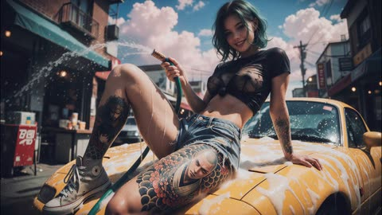</a>

A reference picture locks the face, outfit and pose, and the first frame starts from that pose with no reset. Timed shot blocks with spoken lines and a closing sound list keep the cut sequence and audio clear.

MiniMax H3 · Reference-to-video · Source: [@ou_zhen599 on X](https://x.com/ou_zhen599/status/2094423490845921745) · 15 likes on 2026-10-29 · found via [SkyNotSilent/awesome-MiniMax-H3-cases](https://github.com/SkyNotSilent/awesome-MiniMax-H3-cases)

[`reference-image`](tags.md#tag-reference-image) [`multi-shot`](tags.md#tag-multi-shot) [`dialogue`](tags.md#tag-dialogue) [`street-style`](tags.md#tag-street-style)

<details><summary><b>Prompt</b></summary>

```text
For the target video, at 0.00 seconds into the target video, <Picture 1> (from [Shot 1]) is fully referenced.

integrated_multimodal_description: [Shot 1] Live-action, cinematic realism, modern western attitude, small-town cowboy entrance energy, not a car wash video and not a glamour ad. The girl fully matches <Picture 1>: same face, short hair, wet skin, black semi-sheer top, denim shorts, tattoos, sneakers, yellow vintage car, hose, summer street, storefronts, warm streetlights, blue sky, and clouds. The first frame begins exactly from the pose in <Picture 1>, with her seated on the yellow hood, one hand supporting herself, the other holding the hose, and the water already swinging to one side, with no pose reset. IMAX 70mm film grain, Nolan-inspired cinematic realism, photorealistic natural palette with charcoal black, umber, dark ochre, ash gray, and pale amber interwoven. Low-angle medium shot with a slow slight push-in and faint living sway. From the first second she is already moving: casually swinging the water stream, shifting her shoulders with relaxed swagger, smiling like she already owns the whole street. All water already on her legs must keep moving naturally at all times, flowing, splitting, merging, and dripping with changing paths as she moves. Her chest and upper torso must show subtle real secondary motion from breath, small body sway, landing, and walking, visible but restrained. The nearby off-screen man (S1), mature, relaxed, amused, says in an off-screen voiceover: <d>[English] You making trouble again?</d> while remaining unseen. She does not stop moving, only smiles more and lifts her eyes near the lens. [Shot 2] At 00:02.600, the camera cuts tighter and sinks with her movement. She shuts off the water, flicks the hose aside like tossing a rein, and slides off the hood cleanly, right leg first, landing light and confident like a cowboy dismount. The girl (S2), young but mature, open, sharp, says: <d>[English] Only when the town’s too quiet.</d> [Shot 3] At 00:04.800, the camera tracks backward as she walks toward it, the yellow car falling behind her like a mount she has left behind. She casually wipes a wet hand or brushes her shorts, shoulders loose, stride steady, while the off-screen man (S1) says in an off-screen voiceover: <d>[English] You always come in this loud?</d> She keeps a small smile and brings easy pressure as she closes the distance. [Shot 4] At 00:08.600, the camera tightens to a medium close-up and nearly stops as she reaches a dangerous conversational distance. She leans in slightly, one hand near her waist, and says with playful threat and total control: <d>[English] You gonna stare... or buy me a drink?</d> [Shot 5] At 00:11.800, the camera widens slightly and drifts as she laughs softly, turns away, walks down the street, gives one brief side glance back, and keeps going. She is the only visible person on screen. No car wash commercial energy, no influencer posing, no slow motion, no frozen water, no plastic body motion.

overall_soundscape: Water spray, hose movement, soft summer street ambience, distant storefront sound, fabric friction, sneaker steps, small metal contact, and natural breathing.

non_diegetic_music: N/A
```

</details>

<a id="h3-pink-suit-lip-sync-edit"></a>
### Make the man in an existing clip speak, in a borrowed voice

<a href="https://huggingface.co/MiniMaxAI/MiniMax-H3/resolve/main/assets/r2va_2k.mp4"></a>

Edit-mode prompt with six fields. `retention_analysis` says what to keep from each input: the source video fully, its music partly, and only the voice timbre from the second audio clip.

MiniMax H3 · Video edit · Source: [MiniMax H3 model card](https://huggingface.co/MiniMaxAI/MiniMax-H3)

[`lip-sync`](tags.md#tag-lip-sync) [`voice-reference`](tags.md#tag-voice-reference) [`multi-reference`](tags.md#tag-multi-reference) [`structured-prompt`](tags.md#tag-structured-prompt) [`dialogue`](tags.md#tag-dialogue)

<details><summary><b>Prompt</b></summary>

```text
subject_definitions:
<Subject 1> is the young man with short wavy blonde hair, wearing a bright pink suit jacket, matching pink trousers, an unbuttoned white shirt, and silver rings, holding a small black lamb in his arms in <Video 1>.
<Video 1> is the source video for the editing task.
<Audio 1> is the synchronized audio track of <Video 1>, providing the background music.
<Audio 2> is the voice timbre reference for <Subject 1>'s voice, containing a spoken male voiceover.

summary:
[video editing + audio reference + audio reuse] The target video is an edited version of <Video 1>. <Subject 1>, wearing a bright pink suit and holding a black lamb, stands in a grassy field with other white lambs in the background. The edit animates <Subject 1>'s face to speak the user-provided dialogue. <Audio 1> is partially reused as the continuous background music, while the target references the calm male voice timbre of <Audio 2> for <Subject 1>'s spoken lines.

retention_analysis:
<Subject 1> (appears in [Shot 1]): fully_preserved - the man retains his identity, wavy blonde hair, pink suit, white shirt, accessories, and the black lamb he holds, with his mouth newly animated to speak.
<Video 1> (source video editing): fully_preserved - the original camera framing, warm golden hour lighting, grassy hill setting, and background white lambs are maintained while the central character is edited.
<Audio 1>: partially_copy - the atmospheric background music from <Audio 1> is reused in the target video, mixed beneath the newly added spoken dialogue.
<Audio 2>: reference - the target audio references the male voice timbre from <Audio 2> to generate <Subject 1>'s spoken dialogue.

detailed_description:
The target video is in realistic photographic style.
[Shot 1] The shot begins from the source <Video 1>, showing <Subject 1>, a young man with short wavy blonde hair, wearing a bright pink suit jacket, matching pink trousers, and a casually unbuttoned white shirt. He stands confidently in a sunlit green pasture, gently holding a small black lamb securely in his arms. The warm, golden hour lighting casts soft shadows across his face and the bright pink fabric of his suit. Behind him, several white lambs stand and graze on the rolling grassy hill against a clear, pale blue sky. The atmospheric background music from <Audio 1> plays continuously throughout the scene. <Subject 1> physically speaks, his mouth movements naturally syncing to the new dialogue, with his voice timbre referencing the calm male delivery from <Audio 2>. Looking thoughtfully forward, <Subject 1> (S1) speaks softly, <d>[English] Follow the wind, live free.</d> As he delivers the line, he subtly shifts his weight, cradling the resting black lamb while the camera slowly pushes in. <Subject 1> (S1) continues his thought, <d>[English] Leave worries behind, enjoy the moment.</d> Exactly as his voice stops, his lips meet in a relaxed, peaceful smile, and his jaw ceases speaking motion. He then turns his gaze slightly away toward the horizon, gently stroking the black lamb's fleece with his fingers as the camera holds on this tranquil, sunlit state through the end of the video.

overall_soundscape:
The soundscape consists of the continuous, atmospheric background music from <Audio 1>, overlaid with the clear, calm male dialogue spoken by the main character, referencing the voice timbre of <Audio 2>.

non_diegetic_music:
The atmospheric, sustained background music from <Audio 1> is reused as the continuous score, playing quietly beneath the spoken dialogue.
```

</details>

<a id="kling-family-reacts-to-twist"></a>
### Four family members react to a plot twist

<a href="https://static-86.klingai-cdn-aws.com/kling-blog/presigned_url/8aa6f5a2-b121-4b08-840d-827cc670c4be_kling_20260202_作品_居家环境_背景有轻微_5022_0.mp4"></a>

Four speakers, each tagged by role and tone (`Mom (softly, in a surprised tone)`), so lines land on the right face.

Kling 3.0 · Image-to-video · Source: [Kling VIDEO 3.0 user guide](https://app.klingai.com/global/quickstart/klingai-video-3-model-user-guide)

[`dialogue`](tags.md#tag-dialogue) [`multi-speaker`](tags.md#tag-multi-speaker) [`ambience`](tags.md#tag-ambience)

<details><summary><b>Prompt</b></summary>

```text
Home setting with a faint hum of the living room air conditioner in the background for a realistic daily vibe. Mom (softly, in a surprised tone): Wow, I didn’t expect this plot at all. Dad (in a low voice, agreeing, in a calm tone): Yeah, it’s totally unexpected. Never thought that would happen. Boy (in an excited tone): It’s the best twist ever! Girl (nodding along, in an enthusiastic tone): I can’t believe they did that!
```

</details>

Inputs: [1](https://static--49.klingai-cdn-aws.com/kling-blog/file_by_url/006b3efc9ecef758c2aac2e8765f63e4b0f7d684de4d8e6e40e50a90fdb426ce.png)

<a id="kling-indian-accent-order"></a>
### Ordering dinner with an Indian English accent

<a href="https://static-78.klingai-cdn-aws.com/kling-blog/presigned_url/29736974-c5c6-46d2-a9af-ec0413fb74ef_kling_20260204_作品_多镜头_一位中年男子_5210_1.mp4"></a>

Accent is named once before the line. The pause between the two sentences is written as an action (`then he looks up`).

Kling 3.0 · Image-to-video · Source: [Kling VIDEO 3.0 user guide](https://app.klingai.com/global/quickstart/klingai-video-3-model-user-guide)

[`dialogue`](tags.md#tag-dialogue) [`accent`](tags.md#tag-accent) [`multi-shot`](tags.md#tag-multi-shot)

<details><summary><b>Prompt</b></summary>

```text
A middle-aged man is ordering food in a Western restaurant. He speaks in English with an Indian accent and says: "excuse me, I would like to order a seafood pasta, and a filet mignon. medium-rare", then he looks up and continues: “And, do you have any drink recommendations?”
```

</details>

Inputs: [1](https://static--52.klingai-cdn-aws.com/kling-blog/file_by_url/4a06a8651731e50c212477bcb626257d4e1ba3576eb48ff57aa077cd6a5d9d4f.png)

<a id="kling-japanese-station-bento"></a>
### Bento handed over at a misty station, in Japanese

<a href="https://static--87.klingai-cdn-aws.com/kling-blog/presigned_url/3d106f34-7b24-462f-9238-0a9d4c3981dc_kling_20260204_作品_清晨薄雾的小站_男生_5550_3.mp4"></a>

Japanese lines in corner brackets, no speaker labels beyond `the boy` and `the girl`. Shows Kling's Japanese lip sync.

Kling 3.0 · Image-to-video · Source: [Kling VIDEO 3.0 user guide](https://app.klingai.com/global/quickstart/klingai-video-3-model-user-guide)

[`dialogue`](tags.md#tag-dialogue) [`multilingual`](tags.md#tag-multilingual) [`japanese`](tags.md#tag-japanese)

<details><summary><b>Prompt</b></summary>

```text
On a small station shrouded in morning mist, the boy smiled and handed over the bento: 「急いで作ったけど、大丈夫？ お母さんのレシピだよ。」The girl took it with a smile: 「うん、きっと美味しい！ 到着したら LINE するね。」
```

</details>

Inputs: [1](https://static-39.klingai-cdn-aws.com/kling-blog/file_by_url/1e96651baca4447550008b624ccb8723fb4d5aa383734b8744042d031532e619.jpg)

<a id="kling-joseon-lady-and-maid"></a>
### Joseon noblewoman and her maid

<a href="https://static-41.klingai-cdn-aws.com/kling-blog/presigned_url/d7236484-7cf3-4092-a019-4321dbc661b4_kling_20260202_作品_镜头聚焦两人的互动__4898_0.mp4"></a>

Period drama in Korean. Tone words (`warm, gentle`, `with deference`) set the social register between the two.

Kling 3.0 · Image-to-video · Source: [Kling VIDEO 3.0 user guide](https://app.klingai.com/global/quickstart/klingai-video-3-model-user-guide)

[`dialogue`](tags.md#tag-dialogue) [`multilingual`](tags.md#tag-multilingual) [`period`](tags.md#tag-period)

<details><summary><b>Prompt</b></summary>

```text
The camera lingers on their interaction— the noble lady’s gaze soft and mild, her maid listening with her head bowed. The lady lifts a hand to smooth her sleeve gently, and speaks in a warm, gentle tone: “오늘 후원에서 피어난 꽃을 보니, 시원한 바람이 분다. 너도 함께 걸어볼까?” The maid inclines her body slightly forward, and replies with deference: “네, 아씨님. 따라갈게요.
```

</details>

Inputs: [1](https://static-10.klingai-cdn-aws.com/kling-blog/file_by_url/6ea73c8a737512559f23bb74328f56539882634fa386241b340d5af0c0314b93.jpg)

<a id="kling-korean-rooftop"></a>
### Korean high-school rooftop at night

<a href="https://static-74.klingai-cdn-aws.com/kling-blog/presigned_url/43cd806c-13a5-4375-906d-7c29f632b04c_kling_20260202_作品_韩国高中屋顶场景下__5286_0.mp4"></a>

Language is declared inside each speaker tag: `Boy (casual tone, Korean)`.

Kling 3.0 · Image-to-video · Source: [Kling VIDEO 3.0 user guide](https://app.klingai.com/global/quickstart/klingai-video-3-model-user-guide)

[`dialogue`](tags.md#tag-dialogue) [`multilingual`](tags.md#tag-multilingual) [`korean`](tags.md#tag-korean)

<details><summary><b>Prompt</b></summary>

```text
On the rooftop of a Korean high school, distant city lights glimmer in the background with a soft wind rustling, and stars twinkle in the night sky. The girl leans against the railing, lost in thought. The boy walks over with two cans of cola, hands one to her, and she takes it and pops the tab open. Boy (casual tone, Korean): "숙제 다 했어? 왜 여기 있어?" Girl (sighing, Korean): "시험이 너무 무서워". Boy (gentle tone, Korean): “걱정 마, 넌 잘할 거야.”
```

</details>

Inputs: [1](https://static-46.klingai-cdn-aws.com/kling-blog/file_by_url/f04a52d4d7bbeb30091cb136cd8623e84bd995776b765099fcc5ddcbbaf07391.png)

<a id="kling-madrid-asking-directions"></a>
### Asking directions in Madrid, in halting Spanish

<a href="https://static-45.klingai-cdn-aws.com/kling-blog/presigned_url/10902407-6b2f-4e1c-86f4-ae81f9da21c2_kling_20260204_作品_阳光洒满马德里老街__3484_0.mp4"></a>

Three speakers with different fluency: the tourist is told to speak slowly with an awkward accent, the clerk lightly and cheerfully.

Kling 3.0 · Image-to-video · Source: [Kling VIDEO 3.0 user guide](https://app.klingai.com/global/quickstart/klingai-video-3-model-user-guide)

[`dialogue`](tags.md#tag-dialogue) [`multilingual`](tags.md#tag-multilingual) [`spanish`](tags.md#tag-spanish) [`accent`](tags.md#tag-accent)

<details><summary><b>Prompt</b></summary>

```text
Sunlight fills the old streets of Madrid. In front of a street-side bakery, a Chinese female tourist and a male tourist wearing a gray hoodie walk toward the shop clerk, both wearing polite smiles. Female tourist (speaking slightly slowly, with an awkward accent, in Spanish):Disculpe, ¿dónde está la plaza mayor? A white-haired Spanish shop clerk (turning slightly and pointing forward, with a light and cheerful tone, in Spanish):Por allí, a dos calles. Muy cerca. The female tourist nods to express her thanks. The male tourist also nods in agreement and says (in Spanish): Muchas gracias. The shop clerk smiles and nods in response. The two tourists then turn and walk in the indicated direction.
```

</details>

Inputs: [1](https://static--53.klingai-cdn-aws.com/kling-blog/file_by_url/e4699b0ea66d1a1b6b94dcc1dedc462be6136f1a4fe5d263b719f7bd54dc8992.png)

<a id="kling-villa-terrace-dialogue"></a>
### Villa terrace, a two-person summer dialogue

<a href="https://static-37.klingai-cdn-aws.com/kling-blog/presigned_url/206908e5-edd9-4f12-a7cb-2baca6a0f2bd_kling_20260203_作品_欧洲别墅户外露台场景_4118_0.mp4"></a>

Multi-Shot on: the model plans the shot-reverse-shot by itself from one paragraph of action and dialogue.

Kling 3.0 · Image-to-video · Source: [Kling VIDEO 3.0 user guide](https://app.klingai.com/global/quickstart/klingai-video-3-model-user-guide)

[`multi-shot`](tags.md#tag-multi-shot) [`dialogue`](tags.md#tag-dialogue) [`shot-reverse-shot`](tags.md#tag-shot-reverse-shot)

<details><summary><b>Prompt</b></summary>

```text
Outdoor terrace of a European villa, by a dining table with a blue and white checkered tablecloth, a young white woman in a blue and white striped short-sleeve shirt and khaki shorts, with a brown belt, sits barefoot, opposite a young white man in a white T-shirt. The camera zooms in, the woman swirls the juice in a glass, her eyes looking at the distant woods, and says "These trees will turn yellow in a month, won't they?". Close-up of the man, he lowers his head and says, "but they'll be green again next summer.". Then the woman turns her head, smiles at the man opposite, and says, "Are you always this optimistic? Or just about summer?". Then the man lifts his head, looks at the woman and says, “Only about summers with you.”
```

</details>

Inputs: [1](https://static-6.klingai-cdn-aws.com/kling-blog/file_by_url/1e8ad2ce90036c01aa7fe86c89178590aaf136880206c40d8fc0f99e68d93445.png)

<a id="kling4-interpreter-spanish-chinese"></a>
### An interpreter between a Spanish tourist and a Chinese clerk

<a href="https://static--47.klingai-cdn-aws.com/kling-blog/presigned_url/ffc66c6b-2566-4ab4-b556-6305b928cad6_1-1.mp4"></a>

Bilingual dialogue written out word for word with half-second pauses between turns, plus a cut plan that follows whoever is speaking.

Kling 4.0 · Reference-to-video · Source: [Kling 4.0 user guide](https://kling.ai/quickstart/kling-4-model-user-guide)

[`dialogue`](tags.md#tag-dialogue) [`multilingual`](tags.md#tag-multilingual) [`lip-sync`](tags.md#tag-lip-sync) [`timed-shots`](tags.md#tag-timed-shots) [`travel`](tags.md#tag-travel)

<details><summary><b>Prompt</b></summary>

```text
SCENE CONTEXT EXACT 3 UNIQUE HUMAN CHARACTERS ACROSS THE VIDEO: Three people are in a bright, clean, fictional city tourist information center. Maintain consistent color tones throughout. The tourist stands on the left, the interpreter stands in the middle, and the tourism staff member stands on the right. A city map and route diagram are placed on the information desk. Background text and map labels must be blurred and unreadable. No real brands, organization names, logos, or watermarks may appear.
ACTION TIMING:
0–3 seconds: Medium shot of all three people. The Spanish female tourist looks at the interpreter in the middle, raises the map in her hand, and speaks in natural, clear, slightly slow Spanish: “¿Dónde está la estación de metro más cercana?” After she finishes speaking, pause for approximately 0.5 seconds. The interpreter turns to the tourism staff member and translates into Chinese: “她想知道最近的地铁站在哪里。”
3–7 seconds: Cut to the interpreter and the tourism staff member. The tourism staff member looks at the map (do not use a close-up of the map) and answers in natural, clear Chinese: “沿这条路直走，步行大约五分钟就能到。” After the staff member finishes speaking, pause for approximately 0.5 seconds. The interpreter confirms understanding and turns toward the tourist.
7–11 seconds: The interpreter translates the staff member's answer into natural, clear, slightly slow Spanish: “La estación de metro está a unos cinco minutos a pie. Siga recto por esta calle.” While speaking, the interpreter points to the route on the map, and the tourist studies it attentively.
11–15 seconds: Return to a medium shot of all three people. After understanding the directions, the Spanish tourist smiles, nods, and says in Spanish: “Muchas gracias.” All three maintain a natural service interaction as the scene ends.
AUDIO:
- The Spanish tourist speaks only Spanish.
- The Chinese tourism staff member speaks only Chinese.
- The Chinese interpreter speaks Chinese first, then Spanish.
- Each person has a distinct voice.
- When one person is speaking, the others remain silent. No interruptions or overlapping dialogue.
- All dialogue must have clear vocals, with lip movements synchronized to the corresponding language.
- Spanish pronunciation must be natural and standard, without English-accented pronunciation.
- Speech should be slightly slow, with natural pauses between sentences.
- Retain subtle ambient sounds from a tourist information center. Do not add background music. Ambient sounds must not overpower the dialogue.
CAMERA: Begin with a medium shot of all three people to establish their relationships. When the tourist speaks, cut to a two-shot of the tourist and interpreter. When the interpreter relays the question, cut to the interpreter and staff member. During the staff member's response, include a close-up of the map route. When the interpreter translates into Spanish, return to a two-shot of the interpreter and tourist. End with a medium shot of all three people. Maintain consistent character positions, eyelines, and clothing throughout. Do not abruptly replace characters or change their spatial relationships.
STYLE: Realistic, natural, professional travel-service documentary style. Bright, clean lighting, natural facial expressions, and restrained movements. The scene should resemble an authentic interaction at an airport or city tourist information center.
```

</details>

Inputs: [1](https://static--70.klingai-cdn-aws.com/kling-blog/file_by_url/ec20a9573046207984f3c03dbea8d63a9e979ee34029d070ac4ae13132cb2e4a.png)

<a id="omni-harbour-extend"></a>
### Harbour conversation extended twice

<a href="https://storage.googleapis.com/gdm-deepmind-com-prod-public/media/YMgFKThN-vej75eW/gemini-omni__extend__boats_1080.webm"></a>

Each extension only says what happens next: one line of dialogue, then a camera pull-back and a music cue.

Gemini Omni Flash · Extend · Source: [Gemini Omni prompt guide](https://deepmind.google/models/gemini-omni/prompt-guide/)

[`extend`](tags.md#tag-extend) [`dialogue`](tags.md#tag-dialogue) [`long-take`](tags.md#tag-long-take)

<details><summary><b>Prompt</b></summary>

```text
The man in the blue sweater replies: "Did your father go out on the boat too?"
The camera pulls back in one continuous movement as he continues his story: "He used to say that this harbour had a soul. And that the boats were a part of us." The music swells.
```

</details>

<a id="seedance-baby-doctor-soldier-army-tent"></a>
### Baby doctor examines soldier with stethoscope in army tent

<a href="https://x.com/aiwithaayat/status/2113854017420108258"></a>

The prompt fixes a casual phone recording look with shaky framing, daylight and camp ambience, then bans cinematic lighting, slow motion and grading to keep it real. One subtitled line of dialogue and a locked baby and soldier identity carry the comedy.

Seedance 2.5 · Text-to-video · Source: [@aiwithaayat on X](https://x.com/aiwithaayat/status/2113854017420108258) · found via [LearnPrompt/awesome-seedance](https://github.com/LearnPrompt/awesome-seedance)

[`ugc`](tags.md#tag-ugc) [`handheld`](tags.md#tag-handheld) [`comedy`](tags.md#tag-comedy) [`baby`](tags.md#tag-baby) [`dialogue`](tags.md#tag-dialogue)

<details><summary><b>Prompt</b></summary>

```text
Create a 20-second vertical 9:16 ultra-realistic funny baby doctor video, filmed in a casual smartphone recording style inside a real military tent at an outdoor army camp. A cute chubby baby with round cheeks, light-colored eyes, and a serious facial expression wears a tiny white doctor’s coat and a blue stethoscope while being held close to a male soldier wearing a real camouflage military uniform. The baby presses the stethoscope against the soldier’s chest and listens carefully like a professional doctor, looking intensely focused and adorably confused. The soldier looks at the baby with a warm smile, trying not to laugh during the examination. Show natural close-up shots of the baby gripping the stethoscope with tiny hands, looking into the soldier’s eyes, and moving his lips with innocent, funny expressions. Include humorous English dialogue with matching subtitles: “You have a serious case of too much phone and not enough exercise.” The soldier reacts with an amused smile while the baby continues the examination with a completely serious face. Keep another soldier naturally visible in the background, sitting inside the tent and enjoying the funny moment. The camera should feel like a real person casually recording this adorable interaction on a phone, with slight natural hand movements, imperfect framing, authentic outdoor daylight, realistic skin textures, and the ordinary background sounds of a military camp. Use spontaneous reactions, natural facial movements, and believable human interaction instead of dramatic acting or exaggerated effects. Maintain the same baby and soldier throughout the entire video, with accurate clothing, realistic proportions, and consistent faces. No cinematic lighting, no dramatic camera movements, no slow motion, no movie-style color grading, no artificial transitions, no animation, and no polished commercial look. The final result should look like an authentic, funny, heartwarming viral video captured in real life.
```

</details>

<a id="seedance-cherry-blossom-campus-confession"></a>
### Two friends walk under cherry blossoms, one confesses

<a href="https://x.com/nawalsehar/status/2095372757890687162">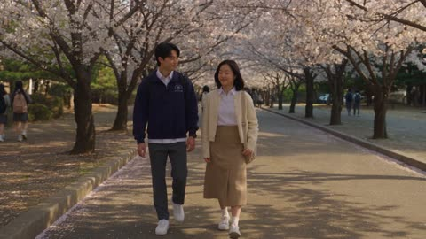</a>

Splits the scene into ordered beats (walk, stop, confess, pause, reassure) so the emotion builds in sequence. Naming what to avoid, such as exaggerated acting and changing faces or clothing, keeps the performance restrained and the actors consistent across the clip.

Seedance 2.5 · Text-to-video · Source: [@nawalsehar on X](https://x.com/nawalsehar/status/2095372757890687162) · found via [LearnPrompt/awesome-seedance](https://github.com/LearnPrompt/awesome-seedance)

[`romance`](tags.md#tag-romance) [`cherry-blossom`](tags.md#tag-cherry-blossom) [`korean-drama`](tags.md#tag-korean-drama) [`campus`](tags.md#tag-campus)

<details><summary><b>Prompt</b></summary>

```text
Photorealistic cinematic Korean romance film set on a university campus during peak cherry-blossom season. Two longtime friends walk together beneath blooming cherry trees in the warm late-afternoon light. They talk casually before the woman gradually becomes nervous and slows down.

She finally stops, takes a breath, and softly confesses that she has liked him for a long time. The man is genuinely surprised, pausing to process her words rather than reacting dramatically. She admits she was afraid he might stop being her friend.

After a quiet emotional pause, he smiles warmly and reassures her. He gently takes her hand, and they continue walking together beneath the cherry trees as petals drift naturally around them.

Natural Korean actors, subtle facial expressions, realistic walking and body language, soft spring breeze, authentic university atmosphere, cinematic depth of field, realistic skin and clothing, natural lighting, gentle handheld camera movement, emotional Korean-drama aesthetic, soft piano soundtrack, realistic environmental sound.

No exaggerated acting, no forced romance, no robotic movement, no CGI appearance, no distorted anatomy, no changing faces or clothing, no floating petals, no unrealistic wind, no text, subtitles, logos, or watermark.
```

</details>

<a id="seedance-crab-squat-wall-challenge"></a>
### Woman smiles on platform before blue wall

<a href="https://x.com/johnAGI168/status/2092536240436363328"></a>

A character card binds the uploaded photo as @图片1 and locks face, hair and outfit, then ties every expression change to a physical event such as wall contact or the fall. Timed beats each carry a matching voiceover line, so the comedy timing lands on the action.

Seedance 2.5 · Reference-to-video · Source: [@johnAGI168 on X](https://x.com/johnAGI168/status/2092536240436363328) · found via [LearnPrompt/awesome-seedance](https://github.com/LearnPrompt/awesome-seedance)

[`reference-image`](tags.md#tag-reference-image) [`shot-list`](tags.md#tag-shot-list) [`voiceover`](tags.md#tag-voiceover) [`physical-comedy`](tags.md#tag-physical-comedy)

<details><summary><b>Prompt</b></summary>

```text
Seedance 2.5 prompt  👇

SEEDANCE 2.5｜水上人形墙挑战

【风格】真人水上综艺闯关节目（Live-Action Water Game Show），明快饱和色彩，盛夏正午自然光，真实广播级摄影，快速剪辑，轻喜剧节奏，真实重力与水体物理，4K高清
【时长】15秒
【画幅】16:9横屏
【语言】中文男声画外解说，主角没有正式台词，仅保留呼吸、用力声和落水前的短促惊叫；无字幕
【场景】大型户外水上综艺竞技场，碧蓝泳池中央架设橙色狭长挑战平台，平台尽头是一块沿隐藏轨道匀速前进的浅蓝色厚实人形墙板；墙板中央开着“头部居中、双肘横向打开、双手抱头、双腿大幅分开下蹲”的螃蟹深蹲人形孔洞。泳池对面是坐满观众的半圆形看台，上方覆盖大型白色遮阳棚。

【人物角色卡】
@图片1 命名“夏妍”，水上综艺闯关者。人物脸部、身形、发型、妆容、服装及配饰完全继承参考图，不增加或修改任何外观元素。
角色目标：在移动人形墙到达前，快速看懂孔洞姿势并让身体穿过。
表演轨迹：自信亮相 → 看清题目后短暂震惊 → 急忙调整姿势 → 以为已经成功 → 察觉尺寸不合 → 被墙体推落水 → 浮出水面后不服气地瞪向镜头。
表演方式：偏真实综艺反应，不故意卖萌，不从第一秒就夸张；所有表情变化必须由墙体移动、身体接触和落水结果依次触发。

[00:00-00:02.00] 镜头1：第二关开始（Close-up Hook）
正面近景：夏妍站在橙色平台中央，泳池和浅蓝色人形墙板位于她身后。镜头使用中长焦压缩背景，观众席轻微虚化。

[00:00-00:00.80]
夏妍直视镜头，保持自信从容的笑容，肩膀自然放松。背景传来机械装置启动的“咔嗒”声和低沉电机声。

【中文男声画外解说】“第二关，开始！”

解说声音明亮有力，像现场综艺主持人，不能使用新闻播音腔。

[00:00-00:00.80-00:02.00]
机械运转声逐渐接近。夏妍的笑容停住，眼睛突然睁大，嘴唇自然张成小圆形；她先看镜头，再迅速转动眼睛观察身后的挑战墙。

反应不能提前出现，必须在机械声响起之后才从自信变为意外。

【中文男声画外解说】“这次是——超级螃蟹蹲！”

“超级螃蟹蹲”提高音量并拉长尾音，配短促综艺铜管音效。

[00:02.00-00:05.00] 镜头2：看懂姿势，马上就位（Wide Shot → Rear Three-quarter）
硬切全景：完整展示橙色平台、泳池、浅蓝色人形墙板和观众席。人形墙从平台远端沿直线轨道缓慢向夏妍移动，全程保持垂直，速度稳定。

[00:02.00-00:03.00]
夏妍迅速转身面向人形孔洞，先上下扫视孔洞轮廓，确认头、双肘、躯干和双腿的位置。

她小跑两步靠近墙板前方的定位区域，脚底与平台接触真实，不打滑、不瞬移。

[00:03.00-00:05.00]
后侧三分之二机位：夏妍双手抬到脑后，手指交叠，双肘向左右打开；双脚快速向两侧分开，膝盖向外，身体重心逐渐下沉。

【中文男声画外解说】“双腿打开，重心压低，双手抱头！”

解说节奏与动作同步：

“双腿打开”对应双脚向两侧移动；
“重心压低”对应身体进入深蹲；
“双手抱头”对应双手在脑后交叠。

身体动作必须依次完成，禁止三种动作同一帧突然出现。

[00:05.00-00:09.00] 镜头3：姿势对了，尺寸不对（Symmetrical Front Shot）
切到墙板正面的对称全景。摄影机隔着人形孔洞拍摄夏妍，她的头、手臂、躯干和双腿分别对准对应开口。

[00:05.00-00:06.20]
夏妍保持双手抱头和宽距深蹲，左右调整脚步，再把身体向孔洞中心移动几厘米。

她先低头检查双脚位置，再抬眼看向正在接近的墙板。嘴唇轻轻抿住，呼吸加快。

[00:06.20-00:07.50]
墙板继续沿轨道匀速前进。夏妍把重心压得更低，让双肘和双腿尽量贴合孔洞边缘。

她短暂闭眼用力，肩膀轻微抬高；重新睁眼时，瞳孔扩大，嘴唇张开，发现孔洞比预想中更紧。

【中文男声画外解说】“姿势很标准——”

前半句语气兴奋，像在宣布她即将成功。

[00:07.50-00:09.00]
墙板距离她越来越近。她保持姿势不敢乱动，只能轻微转动眼睛观察两侧孔洞边缘。

孔洞边缘逐渐靠近她的双肘和腿部，但尚未发生接触。她脸上的自信一点点消失，嘴巴微张，呼吸停顿半拍。

【中文男声画外解说】“可这个洞……好像小了点！”

“可这个洞”后停顿约0.3秒；“小了点”降低音量，带明显不妙的预感。

背景音乐在此处暂停一个重拍，只留下墙体机械声和观众吸气声。

[00:09.00-00:10.50] 镜头4：没穿过去（Side Shot / Physical Comedy）
切到平台侧面中全景，同时看见人形墙、夏妍和她身后的泳池边缘。

[00:09.00-00:09.50]
墙板到达夏妍的位置。孔洞边缘先轻轻接触她身体外侧，她立即意识到无法完全穿过，双眼睁大，手从脑后松开，掌心向前寻找支撑。

反应必须由接触触发，禁止提前站起或提前后仰。

【中文男声画外解说】“糟了，没卡进去！”

[00:09.50-00:10.50]
墙板继续保持原有速度向前，无法通过孔洞的夏妍被平稳推向平台边缘。

她的重心逐渐越过脚后跟，脚掌先在平台上向后滑动小段距离；随后膝盖伸展、身体向后倾斜、双臂在身体两侧快速摆动维持平衡。

到达平台边缘时，她先半坐到边缘，双腿因惯性向上抬起，然后整个身体向后落入泳池。

禁止墙板突然加速，禁止夏妍主动起跳；落水必须来自墙板持续推动和身体重心后移。

夏妍在离开平台瞬间发出短促自然的“啊！”声。

[00:10.50-00:12.50] 镜头5：巨大落水水花（Water Impact / Real Fluid Physics）
[00:10.50-00:11.20]
侧面宽景：夏妍背部和身体后侧首先接触水面，双腿随后落水。

入水点瞬间炸开大片白色水花，水柱向上和向两侧扩散；细小水滴形成真实抛物线，较重水团迅速回落。

【中文男声画外解说】“还是被推下水了！”

“下水了”与最大水花同时出现。

【音效】低沉落水声、大片水花声、观众惊呼。

[00:11.20-00:12.50]
镜头继续停留在落水区域。夏妍完全没入水中，只剩白色泡沫、扩散涟漪和逐渐回落的水滴。

泡沫由密到疏，水面波纹向泳池四周传播。人形墙停在平台边缘，不能倒下、弯曲或落入水中。

背景音乐短暂停顿，随后以轻快鼓点重新进入。

[00:12.50-00:15.00] 镜头6：不服气的回马枪（Water-level Push-in）
切到接近水面的正面中景。

[00:12.50-00:13.20]
夏妍从水下浮出，先露出头部，再露出肩膀。她闭着眼睛呼出一口气，水从脸部和下巴连续滴落。

她张开双臂划水保持身体稳定。湿水只能改变表面状态，不得改变人物脸部、发型结构、服装结构或身份特征。

[00:13.20-00:14.00]
夏妍睁开眼睛，确认镜头就在前方。她没有立刻生气，而是先抿紧嘴唇，把两边脸颊缓慢鼓起来。

摄影机在水面高度轻轻向前推进，景别由中景变为近景。背景观众和平台逐渐虚化。

【中文男声画外解说】“挑战失败——”

在“失败”后停顿，让观众看清她逐渐变化的表情。

[00:14.00-00:15.00]
近景：夏妍鼓着脸颊，微微压低眉毛，直勾勾盯住镜头，像是在责怪节目组把洞做小了。

她保持这个表情到最后一帧，不能提前松气、微笑或移开视线。下巴滴下一条连续水线，水面围绕肩膀产生细小波纹。

【中文男声画外解说】“但是气势满分！”

“满分”与观众欢呼和掌声同步。最后0.3秒定格在她鼓脸瞪镜头的表情上，形成明确喜剧收束。

【完整中文旁白】
“第二关，开始！”
“这次是——超级螃蟹蹲！”
“双腿打开，重心压低，双手抱头！”
“姿势很标准——可这个洞……好像小了点！”
“糟了，没卡进去！”
“还是被推下水了！”
“挑战失败——但是气势满分！”

【声音设计】
全程使用活泼、节奏明确的中文水上综艺男声解说，语气自然、有现场感，不使用机械播音腔。
背景音乐为轻快综艺铜管、鼓点和短促悬念停顿；不能遮盖解说和关键音效。
保留墙板机械运转声、脚步声、用力呼吸、观众惊呼、巨大落水声、水下气泡声、结尾欢呼与掌声。
夏妍没有正式对白，只在用力时短促呼气、落水前自然惊叫；禁止无台词时持续张嘴对口型。

【物理与连续性要求】
夏妍全片严格继承人物参考图，不能改变脸部、体型、发型、服装或配饰。
人形墙始终为同一块厚实墙板，孔洞形状、大小和方向保持不变；墙板沿隐藏轨道直线匀速移动。
夏妍必须先看孔洞、再摆姿势、再被墙体接触、再失去平衡、最后落水，动作顺序不能颠倒。
身体不能穿过实体墙板；墙板也不能穿透身体。接触后由持续推力改变她的重心，使她自然向后跌入泳池。
落水后人物必须先完全没入水中，再从同一落水位置附近浮出；禁止从水下瞬移到镜头前。
水面、水花、泡沫、水滴和涟漪遵循真实流体运动；湿水状态持续到结尾。
群众只作为虚化背景观众，不生成单独人物特写，不抢夺主角焦点。
```

</details>

<a id="seedance-finger-counting-one-to-ten"></a>
### Woman counts one to ten on fingers

<a href="https://x.com/patrickassale/status/2083212122977108109">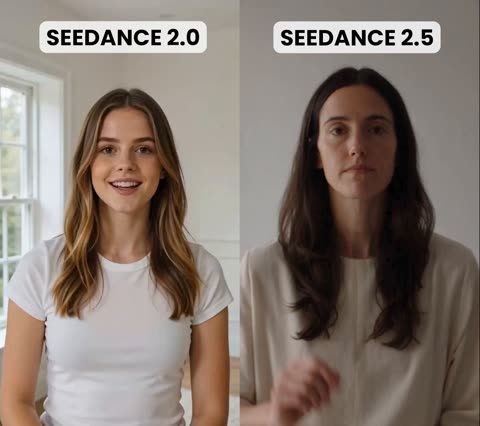</a>

A single locked shot with one sequenced action gives the model one thing to track: the number of fingers held up in step with each spoken count. Keeping the camera static and the subject facing the lens isolates hand precision as the test.

Seedance 2.5 · Text-to-video · Source: [@patrickassale on X](https://x.com/patrickassale/status/2083212122977108109)

[`benchmark`](tags.md#tag-benchmark) [`hand-motion`](tags.md#tag-hand-motion) [`static-shot`](tags.md#tag-static-shot) [`comparison`](tags.md#tag-comparison)

<details><summary><b>Prompt</b></summary>

```text
One continuous static shot, no cuts. A person looks directly at the camera and counts from one to ten, holding up the corresponding number of fingers as they say each number.
```

</details>

<a id="seedance-five-more-minutes-mismatched-sneakers"></a>
### Sleepy teen in bed beside 7:00 alarm clock

<a href="https://x.com/SeharShinwari/status/2091810238836220283">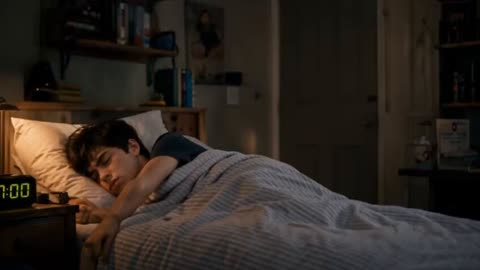</a>

The prompt is split into labeled blocks for character lock, location, timed beats with quoted dialogue, cinematography, and audio, so each beat stays readable. A fixed visual payoff, two mismatched sneakers shown in a close shot, gives the model a clear end point to build toward.

Seedance 2.5 · Text-to-video · Source: [@SeharShinwari on X](https://x.com/SeharShinwari/status/2091810238836220283) · found via [LearnPrompt/awesome-seedance](https://github.com/LearnPrompt/awesome-seedance)

[`family-comedy`](tags.md#tag-family-comedy) [`dialogue`](tags.md#tag-dialogue) [`morning-routine`](tags.md#tag-morning-routine) [`mismatched-shoes`](tags.md#tag-mismatched-shoes)

<details><summary><b>Prompt</b></summary>

```text
Create a 30-second cinematic live-action family comedy titled “FIVE MORE MINUTES.”

FORMAT & STYLE:
Hyper-realistic photorealistic live action, 4K, vertical 16:9, 24fps cinematic film look, natural early-morning lighting, realistic skin, hair, fabric and physics, subtle handheld camera movement, smooth tracking shots, shallow depth of field, natural color grading and professional filmmaking. The scene should feel like a genuine family moment filmed in a real home, with natural acting and believable expressions.

CHARACTER CONSISTENCY:
MOTHER — South Asian woman around 40, medium complexion, dark hair tied in a simple low bun, wearing a comfortable light-grey long-sleeve home outfit. Warm but slightly frustrated personality.

SON — South Asian teenage boy, 16–17 years old, medium complexion, messy dark-brown hair, wearing a navy-blue T-shirt and grey sweatpants. Sleepy, slightly lazy teenage personality.

Keep both characters exactly consistent throughout the entire video: same faces, age, hairstyle, clothing, body proportions and skin tone.

LOCATION:
A realistic, comfortable family home in the morning. The son's bedroom contains a single bed with a grey-and-white striped blanket, wooden bedside table, digital alarm clock, school backpack, books and everyday personal items. The hallway, stairs and kitchen must clearly belong to the same house. Warm sunlight enters through the bedroom window.

0–4 SEC — FIRST WAKE-UP:
Wide cinematic shot of the bedroom. The alarm clock reads 7:00 AM. The son is deeply asleep under the blanket. The mother quietly opens the door, enters and looks at him.

She says naturally:
“Wake up, it's time for school.”

The son barely reacts.

4–7 SEC — FIVE MORE MINUTES:
Close-up of the sleepy son. He slowly opens one eye, pulls the blanket closer and quietly mumbles:
“Five more minutes…”

He immediately turns away and falls asleep again.

The mother looks at him with a tired, slightly frustrated expression.

7–10 SEC — AGAIN:
The mother returns and gently shakes his shoulder.

“Come on, get up now.”

The son pulls the blanket over his head.

“Five more minutes…”

The mother pauses, takes a breath and looks toward the ceiling in disbelief. Keep the humor subtle and realistic.

10–17 SEC — MORNING CHAOS:
Create a quick, coherent montage showing the mother's attempts to get him ready:
• She opens the curtains.
• She prepares breakfast in the kitchen.
• She calls him from the hallway.
• She picks up his school backpack.
• She searches around the bedroom for a missing shoe.
• She returns to find him still lying in bed.

The son remains sleepy but gradually wakes up. Keep the same house, wardrobe and props throughout.

17–21 SEC — TOO LATE:
The son suddenly notices the time and realizes he is late.

His expression changes instantly.

He jumps out of bed, quickly gets dressed, grabs his backpack and rushes downstairs. The mother follows behind him, amused and frustrated.

21–24 SEC — FINALLY READY:
At the front door, the son stands ready to leave with his backpack.

The mother looks relieved.

Finally.

He opens the door.

She suddenly notices something and stops him.

24–27 SEC — THE REVEAL:
Close-up of the son's feet.

He is wearing two completely different sneakers:
one black sneaker and one grey sneaker.

He slowly looks down at them.

His expression changes from confidence to complete disbelief.

27–30 SEC — FUNNY ENDING:
Two-shot of mother and son.

They look at each other for one silent second.

Both suddenly start laughing.

The son shakes his head and runs back upstairs to change his shoes while the mother remains at the door laughing.

End naturally on the mother's amused expression.

CINEMATOGRAPHY:
Use realistic 35mm and 50mm cinematic lens aesthetics, natural rack focus, smooth camera pushes, subtle handheld movement, realistic motion blur and shallow depth of field. Use wider shots to establish the home and close-ups for the comedy beats. Avoid excessive camera movement.

AUDIO:
Natural morning ambience, birds outside, distant traffic, footsteps, fabric movement, alarm clock and household sounds. Use natural-sounding dialogue with realistic pauses. Add very subtle playful background music during the montage and ending.

STRICT CONSISTENCY & QUALITY:
Keep the same two characters, bedroom, hallway, kitchen, backpack, alarm clock and clothing throughout. The two mismatched shoes must remain visually consistent in the final reveal. No changing faces, hairstyles, ages or outfits. No duplicate characters, extra fingers, extra limbs, distorted hands, warped faces, floating objects, sudden environment changes, unrealistic physics, random props, logos or watermarks. No supernatural effects or exaggerated VFX.

The final result should look like a professionally filmed, relatable family comedy with natural performances, clear storytelling and a satisfying visual punchline.
```

</details>

<a id="seedance-garden-flowers-bloom-spoken-truths"></a>
### Kneeling woman talks to blooming garden flowers

<a href="https://x.com/AIwithZeeshi/status/2106967008650969278"></a>

Each spoken line is tied to one visible change in the flowers, so the dialogue beats drive the growth and the timing stays readable. The explicit realism terms, the camera pull back and the lip sync request set the look and keep the character consistent.

Seedance 2.5 · Text-to-video · Source: [@AIwithZeeshi on X](https://x.com/AIwithZeeshi/status/2106967008650969278)

[`garden`](tags.md#tag-garden) [`dialogue`](tags.md#tag-dialogue) [`lip sync`](tags.md#tag-lipsync) [`photorealistic`](tags.md#tag-photorealistic)

<details><summary><b>Prompt</b></summary>

```text
A peaceful countryside garden on a warm sunny morning. A young Western woman with long dark-brown hair, wearing a cream oversized T-shirt and beige pants, kneels beside a small flowerbed. She looks at a closed flower and softly says, “I was wrong.” The flower slowly begins to bloom, its petals unfolding naturally one by one.

She looks surprised and admits, “I was afraid to tell you the truth.” The flower opens further as a gentle breeze moves the surrounding leaves. She smiles and says, “And I still care.” A second small flower bud slowly begins to bloom beside the first.

The woman gently touches one of the flowers as the camera pulls back to reveal several newly opened flowers glowing in the warm morning sunlight.

Photorealistic cinematic style, realistic human movement, natural flower growth, consistent character appearance, realistic skin and plant textures, natural gravity, physically believable wind, accurate shadows, smooth camera movement, natural facial expressions, realistic lip synchronization, soft morning sunlight, and an authentic countryside atmosphere.
```

</details>

<a id="seedance-pov-phone-outfit-swap-qipao"></a>
### Woman in gold qipao swipes phone to change outfits

<a href="https://x.com/johnAGI168/status/2097320255139795072"></a>

Each outfit change lands on the same frame as a tap, and the swipe stays visible on the phone screen, so the swap reads as a hard cut. A fixed shot order with a POV handheld camera keeps the subject continuous while her reactions escalate.

Seedance 2.5 · Reference-to-video · Source: [@johnAGI168 on X](https://x.com/johnAGI168/status/2097320255139795072) · found via [LearnPrompt/awesome-seedance](https://github.com/LearnPrompt/awesome-seedance)

[`pov`](tags.md#tag-pov) [`outfit-change`](tags.md#tag-outfit-change) [`phone-ui`](tags.md#tag-phone-ui) [`sweet-romance`](tags.md#tag-sweet-romance)

<details><summary><b>Prompt</b></summary>

```text
Duration: 20秒
Aspect ratio: 9:16
Overall style: POV男友第一人称短剧，真实手机手持轻微呼吸晃动，室内自然光通透，手机滑动+点击瞬间换装，节奏轻快甜宠，竖屏

【场景】明亮客厅/卧室，落地窗自然光，背景简洁温馨，地面干净无杂物
【角色】女主（@图片1，开场穿角色原本服装）；男主为POV视角，全程不露脸，仅画面下方出现持手机的男性手
【道具】一部现代全面屏手机，竖持。屏幕是简洁时尚穿搭App：上方大预览图，下方横向可滑动的服装卡片。每次滑动有跟手惯性，点击卡片时屏幕轻微缩放+短震反馈

SHOT 1（00:00-00:03.5）开场展示
画面：POV，女主站画面中央，开心地原地转半圈展示穿搭，双手轻提衣摆，眼睛亮亮看镜头。
台词：女主："老公，看我今天穿得怎么样？"
音效：室内底噪，衣料轻响。
Constraints: 女主全身入画，开场服装=角色原本服装。

SHOT 2（00:03.5-00:06.5）掏出手机+第一次滑动
画面：画面下方男主手举起手机入镜，屏幕亮起，显示穿搭App。拇指从右向左滑过卡片，停在@衣服1的卡片上，预览图放大。
台词：男主（画外音，慵懒）："还行。换这套看看。"
音效：屏幕滑动轻摩擦声。
Constraints: 手机屏幕清晰可读，卡片上能看出是@衣服1；男主只出手，不露脸。

SHOT 3（00:06.5-00:09.5）第一次点击瞬变
画面：拇指点在@衣服1卡片上，屏幕短震。点击落下的同一帧，女主服装瞬间变成@衣服1，站位、姿势、发型完全连续；她低头看衣服，瞪大眼张嘴，再抬头看镜头。
台词：女主（惊讶）："诶？！"
音效：清脆"滴"+换装"叮"，衣料展开微响。
Constraints: 换装发生在点击同一帧，单帧瞬变；可加一道从上到下扫过身体的柔和微光；禁止叠化、黑闪、人物跳位。

SHOT 4（00:09.5-00:13）第二次滑动+点击瞬变
画面：拇指再次左滑，卡片停在@衣服2，点一下。同一帧女主换成@衣服2；这次她反应过来，脸颊微红，手指绞在身前，害羞小幅扭身，眼神躲闪又忍不住看镜头。
台词：男主（画外音）："这套也行。"
女主（小声）："你……乱点。"
音效：滑动声+"滴"+"叮"，轻快音乐渐起。
Constraints: 滑动必须完整看见从@衣服1卡片滑到@衣服2；换装仍是点击同一帧硬切。

SHOT 5（00:13-00:16.5）第三次滑动+点击瞬变
画面：再滑到@衣服3，点一下。同一帧换成@衣服3；女主已经习惯，咬一下下唇，抬手整理新衣服领口/裙摆，眼神带点得意看镜头。
台词：女主："这套……还挺好看的嘛。"
音效："滴"+"叮"，音乐节奏加快半拍。
Constraints: 三次反应递进：惊讶→害羞→得意；每次都有小动作，禁止呆立。

SHOT 6（00:16.5-00:20）第四次滑动+点击+收尾
画面：最后一滑停在@衣服4，拇指点下。同一帧女主瞬变为@衣服4；她直接笑出来，上前一步凑近镜头，狡黠眯眼。手机仍举在画面下方，屏幕停在@衣服4预览。
台词：男主（画外音，满意）："这套定了。"
女主（笑着凑近，嗔怪）："你好坏啊——我好喜欢！"
音效："滴"+"叮"，音乐在女主台词落点收在甜甜重拍。
Constraints: 结尾女主凑近但不过分贴脸；手机始终在画面下方可见；服装顺序锁定：开场=原本 → @衣服1 → @衣服2 → @衣服3 → @衣服4，不可乱。

【导演铁律】
1. 换装铁律：每次换装发生在“点击”同一帧，单帧瞬变。女主站位、姿势、发型、脸型跨越换装帧完全连续，只有服装改变。
2. POV铁律：镜头=男主眼睛，全程轻微手持呼吸晃动；男主只出手+画外音，禁止露脸。
3. 手机铁律：每次必须先滑动再点击，滑动跟手、卡片切换清楚；禁止凭空换装、禁止不看屏幕直接变。
4. 服装引用：开场=@图片1原本衣服；第1次=@衣服1；第2次=@衣服2；第3次=@衣服3；第4次=@衣服4。
5. 台词口型清晰，与点击节拍对齐。

Negative: 叠化换装，黑闪，白闪，烟雾，旋转遮挡，人物瞬移，姿势断裂，脸型变化，发型变化，鞋子乱变（除非衣服图自带），露男主脸，横屏，字幕，水印，Logo，背景突然更换，多人入画，宽松居家服除非衣服图就是，镜头剧烈抖动，手机屏幕模糊不可读。
```

</details>

<a id="seedance-seoul-alley-kdrama-moment"></a>
### Woman with shopping bag in Seoul alley

<a href="https://x.com/ayzalnooor24521/status/2106974434234138683">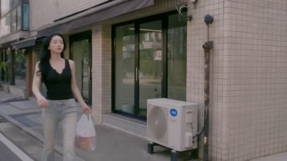</a>

A detailed scene brief with named shot types (close-up, medium walking, over the shoulder) and an explicit instruction to keep both faces, hairstyles and clothing consistent across cuts. Ambient details like air conditioning units and passing students ground the street setting.

Seedance 2.5 · Text-to-video · Source: [@ayzalnooor24521 on X](https://x.com/ayzalnooor24521/status/2106974434234138683) · found via [LearnPrompt/awesome-seedance](https://github.com/LearnPrompt/awesome-seedance)

[`k-drama`](tags.md#tag-k-drama) [`seoul`](tags.md#tag-seoul) [`handheld-camera`](tags.md#tag-handheld-camera) [`character-consistency`](tags.md#tag-character-consistency)

<details><summary><b>Prompt</b></summary>

```text
A quiet moment, a kind heart, and a story that speaks without words. 
Sometimes, the simplest moments leave the biggest impact.

Created on seedance 2.5

A beautiful Korean girl with long natural black hair, wearing a fitted black sleeveless top, light beige wide-leg pants, and carrying a small white shopping bag, walking naturally through a quiet Seoul neighborhood during a bright daytime afternoon. Create a cinematic Korean K-drama style scene with realistic Korean architecture, narrow urban alleyways, tiled buildings, air-conditioning units, parked cars, and pedestrians in the background. She notices a young Korean schoolgirl wearing a white school uniform shirt, blue striped tie, and blue plaid skirt, then approaches her with a concerned and caring expression. Show natural body language, subtle facial expressions, realistic eye movement, and emotionally believable interaction between the two characters. Include a group of Korean high-school students walking through the alley in the background, creating an authentic everyday Seoul atmosphere. Use soft natural daylight, realistic skin texture, shallow depth of field, cinematic framing, gentle handheld camera movement, and smooth focus transitions. Build the scene like a premium Korean drama with close-up emotional shots, medium walking shots, and over-the-shoulder compositions while keeping both characters’ faces, hairstyles, clothing, and identities consistent throughout. Make the final video photorealistic, emotionally engaging, cinematic, and completely natural with realistic Korean street ambience and subtle background movement.
```

</details>

<a id="seedance-taoist-warrior-giant-animated-short"></a>
### Taoist warrior and giant in misty mountains

<a href="https://x.com/usamaworld1/status/2088146871713689825"></a>

Timed scenes with spoken lines and a reference image for each character keep the designs consistent across cuts. Camera moves and ambient sound cues are written separately, so the model gets clear shot and audio instructions.

Seedance 2.5 · Reference-to-video · Source: [@usamaworld1 on X](https://x.com/usamaworld1/status/2088146871713689825)

[`taoist-warrior`](tags.md#tag-taoist-warrior) [`giant`](tags.md#tag-giant) [`animated-short`](tags.md#tag-animated-short) [`comedy-dialogue`](tags.md#tag-comedy-dialogue)

<details><summary><b>Prompt</b></summary>

```text
Create a 30-second cinematic animated short featuring two original fantasy characters: a young female Taoist warrior and her gigantic reluctant giant partner.
Visual style:high-end Western animated feature film,stylized,realism,expressive characters,cinematic,lighting,detailed environments,polished 3D animation,natural physics,expressive facial animation,comedic timing,dynamic cinematic camera movement.
Keep the character designs completely consistent throughout entire video.
Scene 1,0-5s:The New Target
Begin with a quiet atmospheric mountain landscape.
A gentle mountain breeze passes through the frame.The camera slowly tilts downward, revealing top of a large woven bamboo conical hat [from reference image]
The girl's long dark hair moves naturally in the wind beneath the hat.The camera continues slowly downward until her face [from reference image] is revealed.
She looks completely calm and slightly annoyed.
She picks up the phone and says in a casual,matter-of-fact voice:He's the new target? Got it.
She rolls her eyes.
Subtle wind,distant birds,soft mountain ambience,cinematic silence before the dialogue.
Scene 2,5-11s:The Reluctant Partner
Cut to a dramatic wide shot.
The female Taoist stands on  edge of a huge mountain cliff [from reference image].Vast mountains,mist and clouds stretch into distance.
Behind her,the gigantic blue-gray stone-skinned giant [from reference image] is crouching on ground,taking a rest.His enormous body towers over landscape.
She casually turns toward him and says:
Time to work.
The giant slowly raises his head with an exhausted expression.
He looks deeply annoyed.
I haven't rested enough yet!
His voice is deep and powerful, but his expression should feel more like an exhausted coworker complaining about overtime than an angry monster.
The Taoist remains completely unfazed.
Scene 3,11-23s:The Car Argument
Cut to Taoist walking confidently toward a rugged vintage open-top convertible parked nearby.
She gets into driver's seat,starts the engine and casually says:
Come on,come on.Let's go.
The giant stands behind the vehicle,looking at tiny car with disbelief.
He complains:
Why do YOU get to drive while I have to run again?
The Taoist looks back at him without sympathy.
Then build a car big enough for you.
She immediately turns forward and drives away.
The giant stands frozen for a beat.
The vehicle disappears down the mountain road,leaving a small cloud of exhaust and dust drifting directly into his face.
He slowly wipes dust from his face with an irritated expression.
Comedic timing,exaggerated facial animation,but grounded physical movement.
Scene 4,23-30s:The Road Trip
Cut to a beautiful cinematic mountain highway.
The Taoist drives tiny open-top convertible through the winding road.
```

</details>

<a id="seedance-toddler-traffic-light-city-adventure"></a>
### Toddler in overalls beside a traffic light

<a href="https://x.com/abs_uiux/status/2108832872433893567">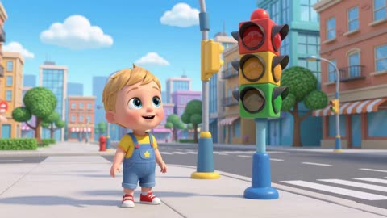</a>

A three second beat sheet fixes the character look and gives each vehicle one visible event with its exact on-screen word, so the timing and labels line up. Each segment describes one shot, which keeps a short educational clip easy to follow.

Seedance 2.5 · Text-to-video · Source: [@abs_uiux on X](https://x.com/abs_uiux/status/2108832872433893567)

[`toddler`](tags.md#tag-toddler) [`traffic-light`](tags.md#tag-traffic-light) [`educational`](tags.md#tag-educational) [`3d-animation`](tags.md#tag-3d-animation)

<details><summary><b>Prompt</b></summary>

```text
Create a fast, colorful 15-second 3D educational city adventure.
Main character: Cute toddler boy wearing blue overalls.
0–3 sec: A magical traffic light activates.
3–6 sec: Red car drives past. Display and said: “CAR 🚗”
6–9 sec: Big friendly bus stops beside him. Display and said: “BUS 🚌”
9–12 sec: Airplane flies overhead. Display and said: “AIRPLANE ✈️”
12–15 sec: Toddler waves while all three vehicles appear safely in the background. Display and said: “Let’s Go!”
```

</details>

<a id="seedance-whispered-japanese-faint-smile"></a>
### Whispered Japanese line ending in a faint smile

<a href="https://x.com/sakisuta_/status/2088559545174175836"></a>

The prompt is timed to a 12 to 15 second window and moves from a small eyebrow and mouth corner change to one whispered line. It fixes the dialogue language, marks the spoken text in braces, and sets an end state so the expression lands cleanly.

Seedance 2.5 · Text-to-video · Source: [@sakisuta_ on X](https://x.com/sakisuta_/status/2088559545174175836) · found via [LearnPrompt/awesome-seedance](https://github.com/LearnPrompt/awesome-seedance)

[`dialogue`](tags.md#tag-dialogue) [`japanese`](tags.md#tag-japanese) [`facial-expression`](tags.md#tag-facial-expression) [`close-up`](tags.md#tag-close-up) [`emotional`](tags.md#tag-emotional)

<details><summary><b>Prompt</b></summary>

```text
12-15秒: 眉が緩み、口角が小さく抑えたまま上がる。セリフ言語: 日本語。<Woman> は軽く、ほとんど息のような声で日本語で言う: {……あ、なんで謝るの}。終了状態: かすかに微笑んだまま、彼を見ている。
```

</details>

<a id="veo-old-sailor-verse"></a>
### Old sailor speaks in verse

<a href="https://storage.googleapis.com/gdm-deepmind-com-prod-public/media/media/veo__veo-3__sailor.webm"></a>

Character first (hat, beard, pipe), then the spoken line in quotes. Veo 3 lip-syncs the quoted text.

Veo 3 · Text-to-video · Source: [Veo 3 prompt guide](https://deepmind.google/models/veo/prompt-guide/)

[`dialogue`](tags.md#tag-dialogue) [`character`](tags.md#tag-character)

<details><summary><b>Prompt</b></summary>

```text
A medium shot frames an old sailor, his knitted blue sailor hat casting a shadow over his eyes, a thick grey beard obscuring his chin. He holds his pipe in one hand, gesturing with it towards the churning, grey sea beyond the ship's railing. "This ocean, it's a force, a wild, untamed might. And she commands your awe, with every breaking light"
```

</details>
