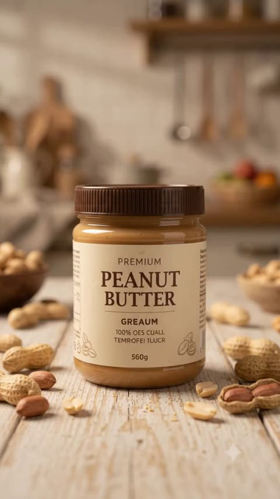
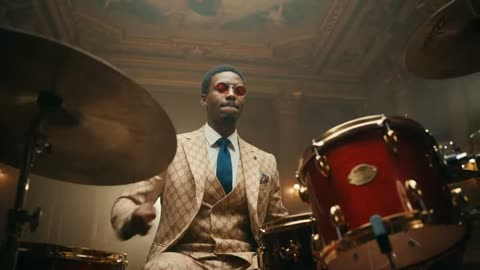
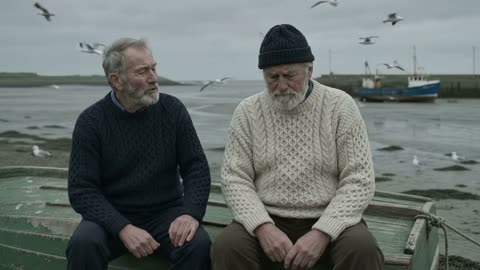
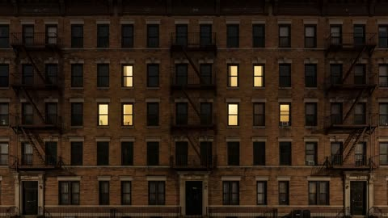
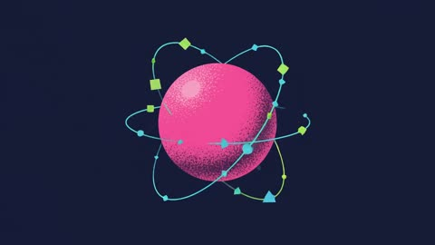
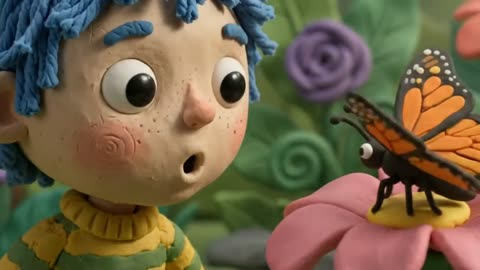
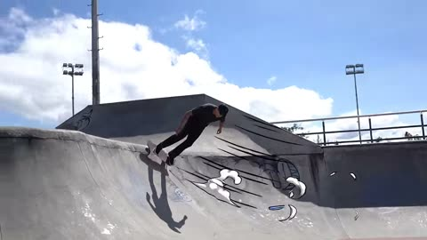
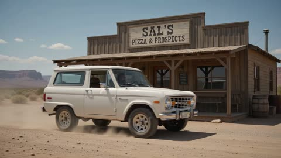
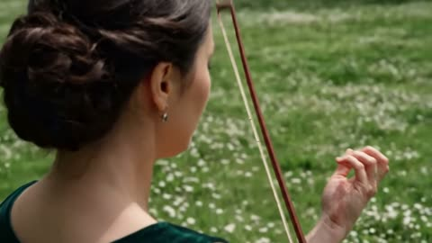

# Gemini Omni Flash

[Back to the list](../../README.md) · All 21 entries

<a id="omni-photo-bird-jumps-onto-hand"></a>
### Bird leaps from laptop photo onto hand

<a href="https://x.com/alexanderchen/status/2060322611586834518"></a>

The prompt first locks the screen content to match the source video, then describes one continuous action in order: head turn, leaving the photo, landing on the hand. A real filmed setup gives the effect a physical anchor.

Gemini Omni Flash · Video edit · Source: [@alexanderchen on X](https://x.com/alexanderchen/status/2060322611586834518) · 1,385 likes on 2026-10-27

[`photo-to-life`](tags.md#tag-photo-to-life) [`animal`](tags.md#tag-animal) [`screen-breakout`](tags.md#tag-screen-breakout) [`live-action`](tags.md#tag-live-action)

<details><summary><b>Prompt</b></summary>

```text
Start with the computer screen content exactly the same as in the video. Make the bird come to life, turning head, leaving the photo and jumping onto the person's hand.
```

</details>

<a id="omni-word-by-word-kinetic-text-sizzle"></a>
### Glossy 3D words appearing one at a time

<a href="https://x.com/Google/status/2062925430290526486"></a>

The exact word sequence is spelled out, with one word on screen at a time. Asking for a different animated style per word and pacing to a rhythm gives the model clear control over timing and text motion.

Gemini Omni Flash · Text-to-video · Source: [@Google on X](https://x.com/Google/status/2062925430290526486) · 1,219 likes on 2026-10-27

[`kinetic-typography`](tags.md#tag-kinetic-typography) [`text-rendering`](tags.md#tag-text-rendering) [`sizzle-reel`](tags.md#tag-sizzle-reel) [`motion-graphics`](tags.md#tag-motion-graphics)

<details><summary><b>Prompt</b></summary>

```text
Beyond just rendering text, Gemini Omni actively syncs your text with the onscreen action.

It draws on Gemini's knowledge to connect language, imagery and meaning to turn complex ideas into compelling visuals. 💬

Prompt for this video: Add the word “SMILE” in bold white sans-serif typography across the nose of every inflatable shark, clean modern lettering naturally integrated into the glossy wet plastic surface, slightly curved and distorted by the inflatable shape while remaining crisp and readable during movement through the water slide. The text on the sharks must remain perfectly locked and tracked to each shark’s skin surface at all times, moving consistently with the body and rotating naturally with the sharks during the descent. Avoid flickering, sliding, jittering, duplicated characters, changing letter count, or distorted typography. Any existing text must remain stable, readable, and physically integrated into the shark skin texture, behaving like a natural marking rather than an added overlay. No text should appear or disappear mid-descent.
```

</details>

<a id="omni-miniature-farmhouse-foundation-macro"></a>
### Miniature farmhouse foundation built by giant hands

<a href="https://x.com/Strength04_X/status/2085930145374966138"></a>

The prompt lists concrete miniature materials and tools, then states the construction stage and the empty pool area, so the model knows what is built and what is not. Macro lens, shallow depth of field and giant hands against tiny objects set the scale contrast.

Gemini Omni Flash · Text-to-video · Source: [@Strength04_X on X](https://x.com/Strength04_X/status/2085930145374966138) · 1,205 likes on 2026-10-27

[`miniature`](tags.md#tag-miniature) [`macro`](tags.md#tag-macro) [`construction`](tags.md#tag-construction) [`hands`](tags.md#tag-hands) [`photorealistic`](tags.md#tag-photorealistic)

<details><summary><b>Prompt</b></summary>

```text
Hyper-realistic miniature luxury farmhouse construction site at the very first stage of construction, viewed through cinematic macro photography. A small rectangular foundation area partially prepared on natural brown sand and compact soil, realistic miniature construction materials scattered naturally around the site, tiny red bricks, miniature cement bags, wooden beams, gravel, sand piles, metal rods, tiny buckets, miniature trowel, measuring tape, spirit level and other authentic construction tools. Giant human fingers and realistic human hands carefully interacting with the miniature materials, positioning the first construction pieces. The future farmhouse footprint clearly visible but construction has only just begun, with no completed walls or roof. Subtle markings and foundation trenches visible in the soil. A small empty area beside the foundation reserved for a future swimming pool. Extremely realistic material scale, authentic construction imperfections, tiny dust particles, cement residue, fingerprints, rough brick texture and granular soil detail. Professional miniature craftsmanship, photorealistic 8K detail, cinematic studio lighting, realistic soft shadows, shallow depth of field, strong foreground-to-background scale contrast, sharp focus on construction area, premium macro lens photography, realistic bokeh, natural color reproduction, high dynamic range, tactile textures, physically accurate lighting, believable human-to-miniature scale, no cartoon appearance, no CGI look, no text, no watermark.
```

</details>

<a id="omni-coconut-water-storyboard-commercial"></a>
### Coconut water bottle commercial from an eight panel storyboard

<a href="https://x.com/Strength04_X/status/2094760813794111843"></a>

A structured storyboard sheet fixes the format, header cards, eight numbered scenes and per panel fields for duration, camera, action and product detail. The camera line lists high speed liquid, extreme macro and low angle shots, and the audio is specified as water plus ASMR. The image from the sheet's first panel then drives the video model.

Gemini Omni Flash · Image-to-video · Source: [@Strength04_X on X](https://x.com/Strength04_X/status/2094760813794111843) · 663 likes on 2026-10-28

[`product-commercial`](tags.md#tag-product-commercial) [`storyboard`](tags.md#tag-storyboard) [`beverage`](tags.md#tag-beverage) [`macro`](tags.md#tag-macro) [`asmr`](tags.md#tag-asmr)

<details><summary><b>Prompt</b></summary>

```text
Nano Banana 2 × Gemini Omni flash 1.1

Prompt - TITLE: Premium Coconut Water Product Commercial Storyboard

FORMAT:
• Single-page premium storyboard
• 3:4 Portrait ratio
• Premium natural beverage campaign
• 8 cinematic product-focused scenes
• Product remains the central hero
• High-end advertising agency presentation

HEADER:
• Clean modern typography
• Information cards:
  - Duration: 20 Seconds
  - Style: Fresh Natural Beverage Commercial
  - Product: Coconut Water
  - Audio: Tropical Water + Refreshing ASMR
• Why This Style Works section
• White, coconut green and natural beige aesthetic
• Minimal tropical decorative accents

STORYBOARD:
1. Chilled coconut water bottle standing on wet natural stone, covered in condensation
2. Bottle cap opening with a crisp close-up of the seal
3. Coconut water pouring into a transparent glass
4. Clear liquid swirling inside the glass with tiny bubbles
5. Fresh coconut pieces dropping beside the bottle in slow motion
6. Ice cubes falling into the drink and creating a controlled splash
7. Extreme macro of condensation droplets running down the bottle
8. Final hero bottle and glass surrounded by fresh coconut pieces and a frozen water splash

EVERY PANEL:
• Scene number
• Duration badge
• Camera direction
• Visual
• Action
• Product detail

CAMERA:
High-speed liquid photography, extreme macro, condensation close-up, slow-motion ice drop, transparent liquid swirl, low-angle product shot, cinematic hero framing.

STYLE:
Ultra-realistic beverage advertising, crystal-clear liquid, realistic condensation, detailed coconut texture, dynamic water splash, natural premium lighting, clean packaging, luxury commercial photography, 8K.
```

</details>

<a id="omni-commercial-storyboard-board-kitchen-pan"></a>
### Kitchen frying pan from a commercial storyboard

<a href="https://x.com/Strength04_X/status/2078516405251801458"></a>

A structured prompt written as labeled sections (format, header, panel layout, photography style, footer) makes GPT Image 2 produce an eight frame storyboard board. That board then serves as the visual reference that Gemini Omni Flash animates into a product shot.

Gemini Omni Flash · Image-to-video · Source: [@Strength04_X on X](https://x.com/Strength04_X/status/2078516405251801458) · 589 likes on 2026-10-27

[`storyboard`](tags.md#tag-storyboard) [`product-shot`](tags.md#tag-product-shot) [`commercial`](tags.md#tag-commercial) [`kitchen`](tags.md#tag-kitchen) [`gpt-image-workflow`](tags.md#tag-gpt-image-workflow)

<details><summary><b>Prompt</b></summary>

```text
TITLE: Premium Commercial Storyboard Presentation

FORMAT:
• Single-page premium storyboard
• 3:4 Portrait ratio
• Luxury advertising agency presentation board
• Client-ready storyboard layout
• 8 storyboard frames
• Editorial Swiss grid system
• High-end presentation quality
• Print-ready infographic

HEADER:
• Large elegant serif title
• Premium minimalist information bar
• Information cards:
  - Duration
  - Style
  - Audience
  - Audio Suggestion
• Rounded "Why This Style Works" section
• Gold decorative doodles, stars, sparkles, hearts
• Soft cream luxury background
• Thin beige border
• Clean editorial spacing

STORYBOARD LAYOUT:
• 8 equal storyboard panels
• 2 rows × 4 columns
• Rounded white cards
• Soft realistic shadows
• Perfect alignment
• Equal margins
• Professional grid layout
• Large cinematic image in upper section
• Information block below image

EVERY STORYBOARD PANEL INCLUDES:
• Scene number inside white outlined circle
• Duration badge in top-right corner
• Large commercial-quality photograph
• Sections:
  - Visual
  - Action
  - Dialogue
• Bold section titles
• Perfect typography hierarchy
• Consistent spacing
• Premium card design

PHOTOGRAPHY STYLE:
• Ultra realistic commercial photography
• Cinematic product shots
• Natural daylight
• Soft warm lighting
• Luxury advertising look
• Shallow depth of field
• Smooth background bokeh
• High-end product styling
• Professional color grading
• DSLR quality
• Premium lifestyle photography

GRAPHIC STYLE:
• Apple keynote presentation aesthetic
• Behance showcase quality
• Modern editorial magazine design
• Premium infographic
• Clean UI composition
• Luxury branding
• Elegant typography
• Minimalist design language
• Print-quality layout

FOOTER:
• Total Duration
• Format
• Visual Style
• Minimal line icons
• Premium editorial finish

QUALITY:
Ultra detailed, 8K, razor sharp, perfectly aligned, symmetrical composition, luxury commercial presentation, agency-quality storyboard, realistic textures, flawless typography, premium client presentation.
```

</details>

<a id="omni-sparkling-lemon-drink-storyboard-commercial"></a>
### Sparkling lemon drink bottle on ice, macro commercial

<a href="https://x.com/Strength04_X/status/2097237465887338994"></a>

An eight scene storyboard sheet is generated first with Nano Banana 2, then animated by Omni Flash. Each panel pairs a camera direction with a product detail, and the camera line asks for 120fps liquid photography, macro condensation and a 360° product move.

Gemini Omni Flash · Image-to-video · Source: [@Strength04_X on X](https://x.com/Strength04_X/status/2097237465887338994) · 361 likes on 2026-10-28

[`product-commercial`](tags.md#tag-product-commercial) [`beverage`](tags.md#tag-beverage) [`storyboard`](tags.md#tag-storyboard) [`macro`](tags.md#tag-macro) [`slow-motion`](tags.md#tag-slow-motion)

<details><summary><b>Prompt</b></summary>

```text
Premium Sparkling Lemon Drink Product Commercial Storyboard

FORMAT:
• Single-page premium storyboard
• 3:4 Portrait ratio
• Luxury beverage campaign
• 8 cinematic product-focused scenes
• Product remains the visual hero
• High-end commercial presentation

HEADER:
• Bold contemporary typography
• Information cards:
  - Duration: 20 Seconds
  - Style: High-Speed Cinematic Beverage Commercial
  - Product: Sparkling Lemon Drink
  - Audio: Fizz + Ice Crack + Liquid ASMR
• Why This Style Works section
• Crystal white, lemon yellow and silver aesthetic
• Minimal citrus-inspired graphic accents

STORYBOARD:
1. Ice-cold bottle standing alone with heavy condensation
2. Extreme macro of water droplets sliding down the bottle
3. Bottle cap opening with a dramatic burst of carbonation
4. Sparkling drink exploding upward in a controlled liquid splash
5. Lemon slices spinning through the sparkling liquid
6. Ice cubes falling into a crystal glass in ultra slow motion
7. Extreme macro showing thousands of carbonation bubbles rising through the drink
8. Final hero packshot with bottle, glass, lemon slices and frozen splash surrounding the product

EVERY PANEL:
• Scene number
• Duration badge
• Camera direction
• Visual
• Action
• Product detail

CAMERA:
120fps high-speed liquid photography, extreme macro, frozen splash, rotating lemon slices, dramatic backlight, condensation close-up, smooth 360° product movement.

STYLE:
Ultra-realistic premium beverage commercial, crystal-clear liquid, explosive carbonation, physically accurate water droplets
```

</details>

<a id="omni-peanut-butter-commercial-storyboard"></a>
### Peanut Butter Jar Commercial With Macro Shots

<a href="https://x.com/Strength04_X/status/2095104027667177825"></a>

The prompt breaks a 20 second spot into eight numbered scenes, each with a duration, camera direction, action and product detail. A separate camera line (extreme macro, slow motion spread, overhead, push in) and a style line on viscosity and warm light keep the food texture realistic.

Gemini Omni Flash · Text-to-video · Source: [@Strength04_X on X](https://x.com/Strength04_X/status/2095104027667177825) · 315 likes on 2026-10-28

[`product-commercial`](tags.md#tag-product-commercial) [`food`](tags.md#tag-food) [`storyboard`](tags.md#tag-storyboard) [`macro`](tags.md#tag-macro) [`asmr`](tags.md#tag-asmr)

<details><summary><b>Prompt</b></summary>

```text
Premium Peanut Butter Product Commercial Storyboard

FORMAT:
• Single-page premium storyboard
• 3:4 Portrait ratio
• Gourmet breakfast product campaign
• 8 cinematic product-focused scenes
• Product remains the main hero
• Luxury advertising presentation

HEADER:
• Elegant serif typography
• Information cards:
  - Duration: 20 Seconds
  - Style: Gourmet Food Commercial
  - Product: Creamy Peanut Butter
  - Audio: Spoon Scrape + Soft ASMR
• Why This Style Works section
• Warm beige, caramel and brown aesthetic
• Minimal peanut-inspired decorative elements

STORYBOARD:
1. Peanut butter jar positioned on a premium stone surface with whole peanuts around it
2. Jar lid being removed, revealing perfectly smooth peanut butter
3. Spoon entering the jar in an extreme macro shot
4. Thick peanut butter slowly lifting from the spoon in a long creamy ribbon
5. Peanut butter spreading smoothly across warm toasted bread
6. Roasted peanuts falling around the jar in slow motion
7. Extreme macro showing creamy texture with tiny peanut particles
8. Final hero jar beside toast and scattered roasted peanuts

EVERY PANEL:
• Scene number
• Duration badge
• Camera direction
• Visual
• Action
• Product detail

CAMERA:
Extreme macro, slow-motion spread, overhead composition, creamy texture close-up, controlled ingredient drop, smooth product push-in.

STYLE:
Ultra-realistic food photography, rich creamy texture, realistic viscosity, roasted peanut details, warm natural lighting, premium glass packaging, sophisticated breakfast advertising, 8K.
```

</details>

<a id="omni-landmark-flag-thread-embroidery"></a>
### Eiffel Tower stitched in French flag threads

<a href="https://x.com/TechieBySA/status/2094066231997354159"></a>

A single [LANDMARK] slot makes the prompt reusable, and the thread moves on its own with no hands in frame. A locked extreme macro shot, side light, shallow depth of field and a steady timelapse pace keep the growing stitched area as the only motion.

Gemini Omni Flash · Text-to-video · Source: [@TechieBySA on X](https://x.com/TechieBySA/status/2094066231997354159) · 276 likes on 2026-10-28

[`embroidery`](tags.md#tag-embroidery) [`macro`](tags.md#tag-macro) [`timelapse`](tags.md#tag-timelapse) [`landmark`](tags.md#tag-landmark) [`template`](tags.md#tag-template)

<details><summary><b>Prompt</b></summary>

```text
Simply replace [LANDMARK]:✨

“Extreme macro shot of woven cotton shirt fabric, empty at first. Colored embroidery threads rise from the surface and weave themselves into place, laying down tight satin stitches row by row, tracing out a detailed [LANDMARK] in its country flag colors. The stitched area grows steadily across the frame, thread pulling taut and raising into dimensional embroidered texture, colors and defining features building up stitch by stitch until the full landmark is complete and clearly recognizable. Camera holds steady, slow satisfying timelapse pace. Soft natural side light, shallow depth of field, visible fabric fibers and realistic thread sheen. No hands, thread moves on its own. One shot no scene change. 5 second video. 16:9 dimension.”
```

</details>

<a id="omni-astronaut-three-swaps"></a>
### Ships to origami, astronaut to anemone, ships to stingrays

<a href="https://storage.googleapis.com/gdm-deepmind-com-prod-public/media/FfbFqJ8qhY_ZWZyz/gemini-omni__prompt-guide_astro-stingray.webm"></a>

Three edits in a row on one shot. The scene and camera stay consistent across every turn.

Gemini Omni Flash · Video edit · Source: [Gemini Omni prompt guide](https://deepmind.google/models/gemini-omni/prompt-guide/)

[`multi-turn-edit`](tags.md#tag-multi-turn-edit) [`object-swap`](tags.md#tag-object-swap) [`consistency`](tags.md#tag-consistency)

<details><summary><b>Prompt</b></summary>

```text
Change the ships to be made from white origami paper.
Change the astronaut to a sea anemone.
Change the small ships to stingrays.
```

</details>

Inputs: [1](https://storage.googleapis.com/gdm-deepmind-com-prod-public/media/FfbFqJ8qhY_ZWZyz/gemini-omni__prompt-guide_astro-spaceship.webm)

<a id="omni-birds-form-a-bird"></a>
### A flock of birds forms the shape of a bird, to music

<a href="https://storage.googleapis.com/deepmind-media/DeepMind.com/Models/gemini-omni/prompt-guide/gemini-omni__prompt-guide__birds-shape.webm"></a>

Three inputs, each with its own tag: `<video>` for motion, `<image>` for shape, `<audio>` for timing.

Gemini Omni Flash · Reference-to-video · Source: [Gemini Omni prompt guide](https://deepmind.google/models/gemini-omni/prompt-guide/)

[`multi-reference`](tags.md#tag-multi-reference) [`audio-sync`](tags.md#tag-audio-sync)

<details><summary><b>Prompt</b></summary>

```text
The birds from <video> loosely form the imperfect shape of a bird based on <image>. They move to the music from <audio> and dissipate as they fly
```

</details>

Inputs: [1](https://storage.googleapis.com/deepmind-media/DeepMind.com/Models/gemini-omni/prompt-guide/gemini-omni__reference-anything-inputs__bird-shape.webm) · [2](https://storage.googleapis.com/deepmind-media/DeepMind.com/Models/gemini-omni/prompt-guide/gemini-omni__reference-anything-combine-multi-ingredient-01.webp)

<a id="omni-butterfly-bee-fireflies"></a>
### Butterfly to bee to fireflies, one change per turn

<a href="https://storage.googleapis.com/gdm-deepmind-com-prod-public/media/FfbFqJ8qhY_ZWZyz/gemini-omni__prompt-guide__firefly.webm"></a>

Two short edit turns on the same clip. Each turn names one subject and its replacement, and everything else stays put.

Gemini Omni Flash · Video edit · Source: [Gemini Omni prompt guide](https://deepmind.google/models/gemini-omni/prompt-guide/)

[`multi-turn-edit`](tags.md#tag-multi-turn-edit) [`object-swap`](tags.md#tag-object-swap)

<details><summary><b>Prompt</b></summary>

```text
Change the butterfly to a bee.
Change the bee into a small swarm of fireflies.
```

</details>

Inputs: [1](https://storage.googleapis.com/gdm-deepmind-com-prod-public/media/FfbFqJ8qhY_ZWZyz/gemini-omni__prompt-guide__butterfly.webm)

<a id="omni-drummer-whip-pan"></a>
### Whip-pan from drummer to saxophonist and dancer

<a href="https://storage.googleapis.com/gdm-deepmind-com-prod-public/media/YMgFKThN-vej75eW/gemini-omni__first-last-frame__dummer-ballet.webm"></a>

First and last frames fix both ends. The prompt describes the move between them and closes with `One continuous shot, no jump cuts`.

Gemini Omni Flash · First & last frame · Source: [Gemini Omni prompt guide](https://deepmind.google/models/gemini-omni/prompt-guide/)

[`first-last-frame`](tags.md#tag-first-last-frame) [`camera-move`](tags.md#tag-camera-move) [`long-take`](tags.md#tag-long-take) [`music`](tags.md#tag-music)

<details><summary><b>Prompt</b></summary>

```text
A close-up low-angle shot of a stylish drummer in a beige suit playing a red drum kit in a grand hall transitions as the camera whip-pans to the side, revealing an older saxophonist playing alongside a ballet dancer spinning in a white outfit under soft purple stage lights. One continuous shot, no jump cuts.
```

</details>

<a id="omni-four-style-progression"></a>
### One clip through crayon, pencil, glass and risograph

<a href="https://storage.googleapis.com/gdm-deepmind-com-prod-public/media/FfbFqJ8qhY_ZWZyz/gemini_omni__prompt-guide__astro-sketch-valley.webm"></a>

Restyles a reference video in four stages. Each stage gets its own texture words, so the transitions read clearly.

Gemini Omni Flash · Video edit · Source: [Gemini Omni prompt guide](https://deepmind.google/models/gemini-omni/prompt-guide/)

[`style-transfer`](tags.md#tag-style-transfer) [`animation`](tags.md#tag-animation)

<details><summary><b>Prompt</b></summary>

```text
Create a four-part stylistic progression of the video reference that begins with a vibrant colored crayon aesthetic, featuring rich, waxy, textured strokes and playful, hand-drawn character designs against a backdrop of heavily granulated paper. Transition seamlessly into a graphite pencil sketch on textured paper, utilizing cross-hatching, varying line weights, and a 12fps "line boiling" effect to emphasize a hand-drawn feel. Next, morph into a hyper-realistic 3D translucent glass style, characterized by complex light refractions, caustic patterns, and soft internal glows within a minimalist studio setting. Conclude the sequence with a tactile risograph print look, applying a limited three-color palette, grainy halftone textures, and intentional registration overlays for a retro, mechanical finish.
```

</details>

Inputs: [1](https://storage.googleapis.com/gdm-deepmind-com-prod-public/media/FfbFqJ8qhY_ZWZyz/gemini_omni__prompt-guide__astro-sketch-valley_input.webm)

<a id="omni-harbour-extend"></a>
### Harbour conversation extended twice

<a href="https://storage.googleapis.com/gdm-deepmind-com-prod-public/media/YMgFKThN-vej75eW/gemini-omni__extend__boats_1080.webm"></a>

Each extension only says what happens next: one line of dialogue, then a camera pull-back and a music cue.

Gemini Omni Flash · Extend · Source: [Gemini Omni prompt guide](https://deepmind.google/models/gemini-omni/prompt-guide/)

[`extend`](tags.md#tag-extend) [`dialogue`](tags.md#tag-dialogue) [`long-take`](tags.md#tag-long-take)

<details><summary><b>Prompt</b></summary>

```text
The man in the blue sweater replies: "Did your father go out on the boat too?"
The camera pulls back in one continuous movement as he continues his story: "He used to say that this harbour had a soul. And that the boats were a part of us." The music swells.
```

</details>

<a id="omni-lights-sync-to-music"></a>
### Apartment lights switch on to the beat

<a href="https://storage.googleapis.com/gdm-deepmind-com-prod-public/media/FfbFqJ8qhY_ZWZyz/gemini-omni__prompt-guide__building-light.webm"></a>

Syncs a visual event to an audio track by naming both in one sentence. No timestamps needed.

Gemini Omni Flash · Video edit · Source: [Gemini Omni prompt guide](https://deepmind.google/models/gemini-omni/prompt-guide/)

[`audio-sync`](tags.md#tag-audio-sync) [`music`](tags.md#tag-music)

<details><summary><b>Prompt</b></summary>

```text
The lights of the apartments start turning on in sync with the music.
```

</details>

Inputs: [1](https://storage.googleapis.com/gdm-deepmind-com-prod-public/media/FfbFqJ8qhY_ZWZyz/gemini-omni__prompt-guide__building-no-light.webm)

<a id="omni-quantum-explainer"></a>
### Quantum computing explained in risograph flat style

<a href="https://storage.googleapis.com/gdm-deepmind-com-prod-public/media/FfbFqJ8qhY_ZWZyz/gemini-omni__prompt-guide__quantum.webm"></a>

Asks for an explanation and leaves the content to the model's world knowledge. The prompt only pins down the visual style.

Gemini Omni Flash · Text-to-video · Source: [Gemini Omni prompt guide](https://deepmind.google/models/gemini-omni/prompt-guide/)

[`explainer`](tags.md#tag-explainer) [`motion-graphics`](tags.md#tag-motion-graphics) [`style-lock`](tags.md#tag-style-lock)

<details><summary><b>Prompt</b></summary>

```text
Explain the difference between regular computing and quantum computing. Visualize this sentence using a contemporary flat-media style that blends minimalist vector shapes with rich organic textures. The aesthetic is defined by a high-contrast, "electric" color palette of neon pinks, cyans, and limes set against a deep navy background. A hallmark of this style is the use of stipple shading and grainy gradients, which adds a tactile, risograph-like quality to the otherwise simple geometric forms. By combining sharp edges with these softened, speckled transitions, the illustration achieves a playful, editorial feel.
```

</details>

<a id="omni-shoes-tilt-up"></a>
### Start on the shoes, tilt up, then widen

<a href="https://storage.googleapis.com/gdm-deepmind-com-prod-public/media/FfbFqJ8qhY_ZWZyz/gemini-omni__prompt-guide__boots.webm"></a>

Three camera moves chained in one line, in the order they happen.

Gemini Omni Flash · Video edit · Source: [Gemini Omni prompt guide](https://deepmind.google/models/gemini-omni/prompt-guide/)

[`camera-move`](tags.md#tag-camera-move) [`multi-turn-edit`](tags.md#tag-multi-turn-edit)

<details><summary><b>Prompt</b></summary>

```text
Change the camera angle, a close-up on his shoes, quickly tilting up to medium shot, then widening.
```

</details>

<a id="omni-skateboard-motion-fx"></a>
### Add cartoon motion lines to live skateboarding

<a href="https://storage.googleapis.com/gdm-deepmind-com-prod-public/media/FfbFqJ8qhY_ZWZyz/gemini-omni__prompt-guide__skateboard.webm"></a>

`keeping everything the same` locks the footage, so the edit only layers effects on top.

Gemini Omni Flash · Video edit · Source: [Gemini Omni prompt guide](https://deepmind.google/models/gemini-omni/prompt-guide/)

[`vfx`](tags.md#tag-vfx) [`mixed-media`](tags.md#tag-mixed-media)

<details><summary><b>Prompt</b></summary>

```text
Edit this keeping everything the same. Add animated motion effects coming out of the skateboard.
```

</details>

<a id="omni-storyboard-to-video"></a>
### Hand it a storyboard, get the scene

<a href="https://storage.googleapis.com/deepmind-media/DeepMind.com/Models/gemini-omni/prompt-guide/gemini_omni__prompt-guide__storyboard.webm"></a>

The storyboard image carries the plot. The text only sets reading order, total length and tone.

Gemini Omni Flash · Reference-to-video · Source: [Gemini Omni prompt guide](https://deepmind.google/models/gemini-omni/prompt-guide/)

[`storyboard`](tags.md#tag-storyboard) [`multi-shot`](tags.md#tag-multi-shot)

<details><summary><b>Prompt</b></summary>

```text
Show me in this story. Follow the story exactly in order starting top left. Entire story in 10 seconds. Cinematic
```

</details>

Inputs: [1](https://storage.googleapis.com/deepmind-media/DeepMind.com/Models/gemini-omni/prompt-guide/gemini-omni__reference-anything-storyboard-ingredient-01.webp) · [2](https://storage.googleapis.com/deepmind-media/DeepMind.com/Models/gemini-omni/prompt-guide/gemini-omni__reference-anything-storyboard-ingredient-02.webp)

<a id="omni-violinist-over-shoulder"></a>
### Move the camera over the violinist's shoulder

<a href="https://storage.googleapis.com/gdm-deepmind-com-prod-public/media/3cYlYfozIFs5_Ngj/gemini-omni__edit-over-multiple-turns-with-consistency__angle.webm"></a>

A camera change written as one plain sentence. Omni re-renders the same performance from the new angle.

Gemini Omni Flash · Video edit · Source: [Gemini Omni prompt guide](https://deepmind.google/models/gemini-omni/prompt-guide/)

[`multi-turn-edit`](tags.md#tag-multi-turn-edit) [`camera-angle`](tags.md#tag-camera-angle)

<details><summary><b>Prompt</b></summary>

```text
Change the camera angle to be over the violinist’s shoulder.
```

</details>

Inputs: [1](https://storage.googleapis.com/gdm-deepmind-com-prod-public/media/3cYlYfozIFs5_Ngj/gemini-omni__edit-over-multiple-turns-with-consistency__invisible.webm)

<a id="omni-word-by-word-sizzle"></a>
### Kinetic type, one word per beat

<a href="https://storage.googleapis.com/gdm-deepmind-com-prod-public/media/FfbFqJ8qhY_ZWZyz/gemini-omni__prompt-guide__text.webm"></a>

Lists the exact words in order and asks for a new animation style on each. Good test of on-screen text.

Gemini Omni Flash · Text-to-video · Source: [Gemini Omni prompt guide](https://deepmind.google/models/gemini-omni/prompt-guide/)

[`text-render`](tags.md#tag-text-render) [`motion-graphics`](tags.md#tag-motion-graphics)

<details><summary><b>Prompt</b></summary>

```text
word by word, one word on a the screen at a time: did, you, know, that, this, model, can, do, pretty, good, text!? each word appears with a different animated style, perfect pacing to a rhythm, sizzle reel.
```

</details>
