# MiniMax H3

[Back to the list](../../README.md) · All 80 entries

<a id="h3-character-detail-montage"></a>
### Twenty shot character detail montage, face revealed last

<a href="https://x.com/aimikoda/status/2100258514132217859"></a>

A numbered shot list with time blocks and one abrupt camera move per shot builds three connected action bursts. Faces stay out of frame until shot 20, and hard match cuts link similar shapes without morphing.

MiniMax H3 · Reference-to-video · Source: [@aimikoda on X](https://x.com/aimikoda/status/2100258514132217859) · 3,281 likes on 2026-10-28

[`character-reference`](tags.md#tag-character-reference) [`montage`](tags.md#tag-montage) [`hard-cuts`](tags.md#tag-hard-cuts) [`camera-moves`](tags.md#tag-camera-moves) [`studio-background`](tags.md#tag-studio-background)

<details><summary><b>Prompt</b></summary>

```text
Use @[character reference] for the character's identity, anatomy, costume, colors, materials and visual style. Adapt body-region cues to its actual anatomy, replacing absent features with existing equivalents. Invent no anatomy or accessories. Select signature inserts from its most recognizable details. Rigid parts rotate; flexible materials bend or stretch.

A 15-second character-detail montage: exactly 20 shots joined by hard cuts. An empty, seamless warm-white studio background; soft directional light reveals the surfaces. Shots 1-19 are tightly cropped body details and rear angles: keep the face, eyes and facial profile entirely outside the frame, including reflections. Shot 20 is the first and only face reveal. No full-body view.

Three connected bursts: a sharp head turn with the body bracing; a coiled arm opening into a strong sweep and torso twist; one short step into a planted pivot, finishing with a sudden look into camera. Carry body state across cuts without resetting to neutral. Existing hair, clothing and attachments react naturally. Keep the character active, with clear articulation and weight shifts.

Jump between distant body regions. Mix brief visual punches with longer moving-detail reads. Use one abrupt camera move per shot except locked-camera inserts 4 and 11, where the character supplies the speed. Vary height, angle and direction. Brake moves briefly for legibility while the subject keeps moving. Local whips stay tightly cropped; changes of body region use hard cuts. Connect selected cuts through similar shapes or motion vectors, without morphing. Real-time action, no slow motion or freeze frames.

0-3s, shots 1-5. A concealed head turn triggers the first burst:
1. Extreme upper-back detail: a crash push catches its surface shifting as a sharp head turn begins entirely above the crop.
2. Fingers: a short downward snap catches them curling into a fist as the body braces.
3. Rear three-quarter shoulder detail: a tight camera arc catches the shoulder drawing back behind the turning head.
4. Locked floor-level foot detail: the grounded support foot braces, its raised heel pressing down firmly without taking a step.
5. Rear neck detail: a short upward tilt catches the nape stretching with the turn; stop below the back of the head, keeping the jaw and face excluded.

3-9s, shots 6-13. The coiled arm opens into a forceful sweep:
6. A signature upper-body detail: a fast diagonal slide catches an existing seam, joint or distinctive contour responding as the arm draws inward.
7. Elbow: a sharp lateral track catches the folding joint tightening the arm's coil.
8. Supporting knee: hard match cut from the bent elbow to the knee's similar angle; a short camera drop catches the leg compressing under the same preparation.
9. Wrist: a quick shallow orbit catches it turning outward to initiate the release.
10. Upper chest: a short punch-in catches the chest opening as the arm drives outward beyond the crop. Let this moving surface read slightly longer.
11. Locked hand detail: fingers spring open and the hand sweeps rapidly across the fixed frame. Catch one crisp, readable phase of the spread fingers before they leave the crop.
12. Upper back: a sharp sideways slide continues that screen direction as the shoulder rolls through the sweep and the torso twists.
13. A distinctive torso or waist detail: a close diagonal move catches its physical response to the twist, such as an existing fold pulling taut or an attached piece swinging. Give the material response a clear moving read.

9-13s, shots 14-19. One short step and a pivot build toward the reveal:
14. Thigh of the other leg: an abrupt low tracking move catches it driving the single short step out of the twist.
15. Advancing foot: a brief downward whip catches it landing; show clear floor contact.
16. Ankle and lower-leg detail: a fast side slide catches the landed leg accepting weight as the ankle flexes.
17. Waist: a tight orbit catches the torso rotating above the planted-foot pivot. The foot supports the turn rather than sliding across the floor.
18. Back-of-head contour: a short lateral whip catches the start of the return turn from behind. Keep only the rear contour in frame, never the facial profile.
19. A signature shoulder detail: a sharp diagonal slide catches its follow-through beneath the turning head, which stays completely above the crop. Cut at the peak of this movement.

13-15s, shot 20. First face reveal:
20. Hard cut to a frontal face close-up as the character sharply completes the turn toward the lens. An explosive short push reveals the entire face clearly for the first time and stops tightening before cropping out its features. Direct eye contact lands while hair, clothing or natural body follow-through remains alive. Keep the whole face readable through the end; finish on living motion, without a held pose or another cut.

No added props, scenery, text, graphic overlays or split screens.
```

</details>

<a id="h3-grid-storyboard-anime-park-run"></a>
### Anime boy glancing back while running in park

<a href="https://x.com/8co28/status/2099171324568760589"></a>

A 3x3 panel image is fed as the reference, and the prompt asks for cuts running from the first panel to the last, so the storyboard plays back almost as drawn. Forbidding multiple panels on screen and BGM keeps each shot full frame and the audio clean.

MiniMax H3 · Reference-to-video · Source: [@8co28 on X](https://x.com/8co28/status/2099171324568760589) · 1,599 likes on 2026-10-28

[`storyboard`](tags.md#tag-storyboard) [`anime`](tags.md#tag-anime) [`2d-animation`](tags.md#tag-2d-animation) [`grid-reference`](tags.md#tag-grid-reference) [`multi-shot`](tags.md#tag-multi-shot)

<details><summary><b>Prompt</b></summary>

```text
When you take this 3x3 image and turn it into an AI video with r2v, it will roughly become the footage as-is with the following settings:

Minimax H3 Max r2v 480p 15 seconds Prompt adjustment: Quality Reference strength: Standard
"A 2D animation where the cut switches from the top-left panel to the bottom-right panel,
No multiple panels allowed, No BGM"
```

</details>

<a id="h3-character-intro-boots-to-hero-reveal"></a>
### Anime Character Intro from Boots to Hero Pose

<a href="https://x.com/aimikoda/status/2086412223061135392"></a>

A character reference image locks identity while four timed beats (0 to 4s, 4 to 8s, 8 to 12s, 12 to 15s) move from a detail close up to a back view, a face portrait and a full body hero shot. One minimal signature action and smooth camera moves keep the reveal controlled.

MiniMax H3 · Reference-to-video · Source: [@aimikoda on X](https://x.com/aimikoda/status/2086412223061135392) · 1,501 likes on 2026-10-28 · found via [SkyNotSilent/awesome-MiniMax-H3-cases](https://github.com/SkyNotSilent/awesome-MiniMax-H3-cases)

[`character-intro`](tags.md#tag-character-intro) [`reveal`](tags.md#tag-reveal) [`camera-progression`](tags.md#tag-camera-progression) [`anime`](tags.md#tag-anime) [`reference-lock`](tags.md#tag-reference-lock)

<details><summary><b>Prompt</b></summary>

```text
Use @[char ref] as the sole character reference. Preserve the exact identity, face, body proportions, hairstyle, outfit, colors, materials and overall silhouette of the character throughout the entire video. Do not redesign, simplify or replace any defining visual features.

Create a cinematic character introduction focused on presence, silhouette, attitude and controlled motion.

0–4s
Begin with a close shot of a defining lower-body or detail element such as boots, shoes, feet, hands, clothing hem or an important accessory. The character enters frame or settles into position. The camera slowly tracks upward while hair, clothing and secondary elements move naturally in the wind or environment.

4–8s
Reveal more of the body with a medium or medium-wide shot from the back, side or three-quarter angle. The character stands in a calm, composed way inside the environment. The camera makes a smooth orbit, arc or lateral move to gradually reveal the character’s face and silhouette.

8–12s
Move into a tight cinematic portrait or upper-body shot. The character performs one subtle signature action that fits their personality, such as lifting the chin, turning the head, adjusting clothing, brushing hair aside, opening a hand, looking toward camera, or shifting posture. Keep the motion minimal and intentional. The expression should match the character’s vibe.

12–15s
End with a strong full-body hero shot that clearly presents the entire design and silhouette. Use a low-angle, eye-level or slightly dramatic framing depending on the character’s personality. The character settles into a natural final pose and holds it confidently for a clean final reveal.

VISUAL DIRECTION
Premium cinematic presentation. Match the visual medium and rendering style of @[char ref]. Emphasize clean silhouette, elegant staging, subtle secondary motion, believable hair and cloth movement, strong composition, atmospheric depth and polished lighting. The scene should feel like a high-end anime, game or film character introduction.

CAMERA
Use a clear progression from detail reveal to partial reveal to face reveal to full-body hero reveal. Camera movement should be smooth, controlled and intentional. Avoid chaotic motion.

ENVIRONMENT
Place the character in a fitting environment that supports their identity and mood. The background should enhance the character without distracting from them.
```

</details>

<a id="h3-flat-vector-curry-delivery-explainer"></a>
### Flat Vector Curry Delivery Explainer Animation

<a href="https://x.com/ponzponz15/status/2087108170271560115"></a>

The key visual is locked as the exact first frame, and five timed shots each name their background color, motion type and on screen text. Exact Japanese strings, a ban on extra text or UI, and a fixed end hold at 12 seconds keep the typography clean.

MiniMax H3 · Image-to-video · Source: [@ponzponz15 on X](https://x.com/ponzponz15/status/2087108170271560115) · 766 likes on 2026-10-27

[`motion-graphics`](tags.md#tag-motion-graphics) [`explainer`](tags.md#tag-explainer) [`flat-vector`](tags.md#tag-flat-vector) [`kinetic-typography`](tags.md#tag-kinetic-typography) [`japanese-text`](tags.md#tag-japanese-text)

<details><summary><b>Prompt</b></summary>

```text
For the target video, at 0.00 seconds into the target video, <Picture 1> (from [Shot 1]) is fully referenced.
integrated_multimodal_description: [Shot 1] Classic Japanese 2D flat-vector explainer animation. Begin from the attached key visual as the exact first frame, preserving the same woman, white shirt with teal accent, teal smartphone, yellow curry container, warm-white background, thick charcoal outlines, circular illustrations, flat colors, and wide 16:9 composition. Do not display the attached key visual as a thumbnail, screenshot, media preview, or interface element. Hold the wide composition briefly. The curry steam gently rises, the notification bell pops once, and the woman presents the curry container with a happy expression. In the empty left area, large Japanese typography builds in two stages: "休みの夜、" then "カレーが食べたい。". Highlight "カレー" in curry ochre.
[Shot 2] At 00:02.200, the scene cuts to a bright teal flat-color field. A simple circular vignette of the same woman relaxing at home appears with a crescent moon, an evening clock without numbers, and an empty kitchen counter. The headline appears word by word: "でも、買いに行くのは面倒。". The final word is emphasized with a small coral-red block. Use simple 2D slide, pop, and mask-reveal motion only.
[Shot 3] At 00:04.500, the teal field wipes into a sunny yellow solution card. A large teal smartphone slides into the center while three illustrated curry choices pop out as clean circular cards: rich curry, vegetable curry, and spicy curry. A dotted route grows from the phone toward a small delivery scooter carrying a curry bag. The service name "カレヨル" appears clearly in deep charcoal, followed by the short phrase "選ぶだけ。".
[Shot 4] At 00:06.800, the composition changes to a clean white infographic strip. Three large circular steps assemble from left to right: "選ぶ", "届く", "食べる". The same woman appears in the final circle at home, opening the yellow curry container as visible steam rises. The delivery scooter moves along the dotted route and stops beside her. Keep every illustration flat, simple, and consistent with the key visual.
[Shot 5] At 00:09.200, the camera returns to a wide warm-white end card with generous negative space. A large two-line headline assembles smoothly: "どうしても、休みの夜は" followed by "カレーが食べたい。". At 00:10.500, the curry bowl and service name appear beneath it with the final message "そんな時は、カレヨル。". A small curry icon makes one cheerful pop and a gentle steam curl rises. Hold the complete wide end card cleanly until exactly 12.000 seconds. Do not add extra text, random pseudo-letters, logos, browser UI, or additional characters.
```

</details>

<a id="h3-anime-football-player-stats-ui-animation"></a>
### Anime football player stats screen animating in

<a href="https://x.com/aimikoda/status/2086122377633575169"></a>

A GPT Image 2 generated stats screen is the sole reference, and the prompt tells the model to animate it without redesigning it. A second by second timeline covers the scanner reveal, counting score, bar fills and final hold, with a locked camera and an audio line for boot hum and confirmation tones.

MiniMax H3 · Reference-to-video · Source: [@aimikoda on X](https://x.com/aimikoda/status/2086122377633575169) · 707 likes on 2026-10-28 · found via [SkyNotSilent/awesome-MiniMax-H3-cases](https://github.com/SkyNotSilent/awesome-MiniMax-H3-cases)

[`ui-animation`](tags.md#tag-ui-animation) [`game-ui`](tags.md#tag-game-ui) [`anime`](tags.md#tag-anime) [`sports`](tags.md#tag-sports) [`reference-image`](tags.md#tag-reference-image)

<details><summary><b>Prompt</b></summary>

```text
@[ref img] is the sole visual authority for Kaze, the football, the complete player-stats interface, typography, numbers, icons, colors, lighting, layout, and vertical composition. Animate this exact screen without redesigning it. Preserve all existing labels and final stat values.
[Goal]
Create a polished 15-second anime sports-game player stats screen opening. Use one continuous, locked, straight-on full-screen composition with no camera movement, cuts, cropping, or perspective distortion.

[Sequence]
0–2.2 seconds: Begin from near-black teal. A faint horizontal scanner passes downward, revealing Kaze’s silhouette and the outer edges of the interface. Fine particles and dim mint circuitry flicker awake.
2.2–5.5 seconds: The header, KAZE nameplate, role badge, level panel, and overall panel resolve through clean line-draw animations. Kaze emerges fully from shadow, takes a controlled breath, subtly shifts her shoulders and raised arm into the referenced pose, then fixes an intense gaze toward the viewer. Her hair, ribbons, and loose clothing react naturally to a growing current of wind. The football begins a slow, stable rotation beside her hand.

5.5–10.8 seconds: The large overall score counts rapidly upward and lands precisely on 92. The level settles on 46. Each attribute bar fills smoothly from left to right in sequence—Speed 93, Power 91, Control 88, Stamina 90, Agility 94, Technique 89—each landing with a restrained mint pulse. The radar chart draws outward from its center and locks into the exact final polygon. Skill cards activate from top to bottom; their icons flare briefly while the ACTIVE and ULTIMATE states illuminate.
10.8–13.3 seconds: The player ID strip and bottom navigation fade and slide into their exact final positions. The wind energy around Kaze accelerates clockwise, wrapping around the rotating ball and sweeping behind her body with layered luminous trails. Kaze tightens her hand, leans slightly into the current, and gives one natural blink; preserve her identity, anatomy, costume, and right-side placement.

13.3–15 seconds: The energy arc reaches a bright controlled crest, then settles into a living idle pulse. Hold the fully assembled screen matching @[ref img] exactly. Kaze continues subtle breathing; hair and ribbons drift, the football rotates slowly, particles shimmer, and all stats remain stable and readable.

Use crisp premium game-UI motion, clean 2D anime character animation, subtle depth between Kaze and the interface, and stable legible typography. Keep every panel, icon, label, number, and geometric boundary fixed once revealed. Do not introduce new text, extra characters, additional objects, logos, captions, or UI elements.

Audio: low electronic boot hum, delicate scanning ticks, short confirmation tones as values lock, rising airy wind around the ball, soft cloth movement, and one refined completion chime. No dialogue and no music.
```

</details>

<a id="h3-nostalgic-theme-park-montage"></a>
### Nostalgic theme park montage in graphic layouts

<a href="https://x.com/magnific/status/2083217899540586917"></a>

The prompt names the format (a montage of different clips) and the layout language (graphic motion layouts), then gives only the subject and setting. That leaves shot choice, film grain and panel arrangement to the model, so a short prompt gives a varied multi panel result.

MiniMax H3 · Text-to-video · Source: [@magnific on X](https://x.com/magnific/status/2083217899540586917) · 508 likes on 2026-10-28 · found via [SkyNotSilent/awesome-MiniMax-H3-cases](https://github.com/SkyNotSilent/awesome-MiniMax-H3-cases)

[`montage`](tags.md#tag-montage) [`nostalgic`](tags.md#tag-nostalgic) [`motion-graphics`](tags.md#tag-motion-graphics) [`theme-park`](tags.md#tag-theme-park) [`short-prompt`](tags.md#tag-short-prompt)

<details><summary><b>Prompt</b></summary>

```text
Nostalgic montage of different clips. Graphic motion layouts of friends having fun in a theme park.
```

</details>

<a id="h3-abcd-letter-morph-kids-education"></a>
### Letters A to D Morph Into Objects

<a href="https://x.com/umesh_ai/status/2084227244533411987"></a>

A fixed five-step pattern (letter, sound, object, playful action, object name) repeats in timed 3-second beats. Each letter becomes the next object through a continuous morph, and the prompt pins down narration lines, highlight colors and sound cues. Negative constraints guard against warped letters and cluttered backgrounds.

MiniMax H3 · Text-to-video · Source: [@umesh_ai on X](https://x.com/umesh_ai/status/2084227244533411987) · 459 likes on 2026-10-28 · found via [SkyNotSilent/awesome-MiniMax-H3-cases](https://github.com/SkyNotSilent/awesome-MiniMax-H3-cases)

[`education`](tags.md#tag-education) [`kids`](tags.md#tag-kids) [`3d-animation`](tags.md#tag-3d-animation) [`shape-morphing`](tags.md#tag-shape-morphing) [`narration`](tags.md#tag-narration)

<details><summary><b>Prompt</b></summary>

```text
Create a 15-second animated educational video that teaches young children the letters A, B, C, and D.

The learning pattern for every letter must be:

LETTER → SOUND → OBJECT → PLAYFUL ACTION → OBJECT NAME

Target audience: children ages 3 to 6.

Visual style:
Use adorable rounded 3D characters, soft pastel colors, gentle facial expressions, and simple recognizable objects. Combine this with a premium minimalist technology aesthetic featuring clean white space, elegant composition, soft studio lighting, subtle reflections, smooth gradients, rounded geometry, crisp typography, and extremely polished transitions.

The animation should feel playful and child-friendly while remaining calm, uncluttered, and beautifully designed.

Use a clean off-white background with a different soft color glow behind each letter.

0:00–0:01 | Introduction
A small smiling star mascot bounces into the center of the screen.

Colorful letters briefly float around it.

Display the text:

“Let’s learn!”

The mascot taps the screen, creating a soft ripple that reveals the first letter.

0:01–0:04 | A is for Apple

Show a large uppercase “A” and smaller lowercase “a” beside it.
Use thick, rounded, highly readable typography.

The narrator says:

“A. A says ah. A is for Apple.”

The uppercase A gently inflates and transforms into a shiny red apple.

Its top point becomes the apple stem, and a small green leaf unfolds from the side.

The apple gains a cute smiling face and performs one soft bounce.

Display the word:

“APPLE”

Highlight the first letter A in red.

Add a soft pop and a tiny crunchy sound.

0:04–0:07 | B is for Ball

The apple rolls across the screen and leaves behind a curved red trail.

The trail loops twice and forms a large uppercase “B,” with a lowercase “b” appearing beside it.
The narrator says:

“B. B says buh. B is for Ball.”

The two rounded sections of the B expand and merge into a colorful striped ball.

The ball bounces twice with playful squash-and-stretch animation.

Display the word:

“BALL”

Highlight the first letter B in blue.

Synchronize each bounce with a soft musical note.

0:07–0:10 | C is for Cat

On its final bounce, the ball stretches into a curved shape and becomes a large uppercase “C.”

A lowercase “c” slides gently into place beside it.

The narrator says:
“C. C says kuh. C is for Cat.”

The C rotates and becomes the curled tail of a cute orange cat.

The rest of the cat forms from soft rounded shapes.

The cat stretches, blinks, and gives one gentle wave with its paw.

Display the word:

“CAT”

Highlight the first letter C in orange.

Add a quiet and friendly “meow.”

0:10–0:13 | D is for Duck

The cat’s tail uncurls and transforms into the curved side of a large uppercase “D.”

A lowercase “d” pops up beside it.

The narrator says:

“D. D says duh. D is for Duck.”
The straight line of the D becomes the duck’s neck.

The curved section becomes its round yellow body.

A small orange beak and two tiny wings pop into place.

The duck waddles forward, flaps its wings, and gives one cheerful quack.

Display the word:

“DUCK”

Highlight the first letter D in yellow.

Add tiny water ripples beneath its feet.

0:13–0:15 | Recap

The apple, ball, cat, and duck slide into four clean rounded tiles.

Place their letters above them:

“A  B  C  D”

The mascot returns and points to each object as they bounce once in sequence.

Narrator:
“A, B, C, D. Great job!”

Finish with the text:

“Great job!”

Use a small sparkle animation and a warm musical chime.

Animation requirements:

Keep each letter fully visible for a moment before it transforms.

Show uppercase and lowercase versions clearly.

Make every object instantly recognizable.

Use smooth shape morphing so children can visually understand how the letter becomes the object.

Maintain stable spelling, clean letterforms, accurate object shapes, and consistent character design.

Use gentle squash-and-stretch, soft motion blur, subtle shadows, polished lighting, and precisely synchronized sound effects.
Avoid fast camera movement, cluttered backgrounds, harsh colors, tiny text, warped letters, random symbols, duplicated objects, scary expressions, or overly complex transformations.

The final video should feel cute, educational, memorable, calming, and exceptionally polished.
```

</details>

<a id="h3-pink-poster-character-walks-railway-text-path"></a>
### Character walks through pink poster with railway text path

<a href="https://x.com/taya_mama_AI/status/2096612096003965254">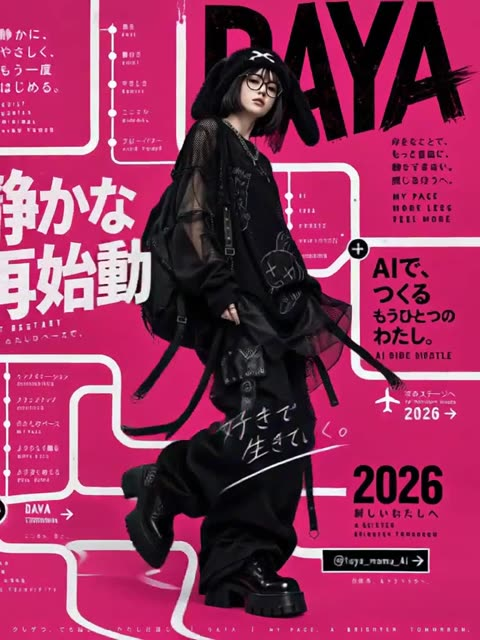</a>

A single reference poster supplies the text, and the prompt tells the model to treat each word as a physical object the walking character taps, ducks under or steps around. A railway style line links the text in reading order, a side tracking camera keeps the scroll continuous, and a foreground blur wipe hands off to the logo ending.

MiniMax H3 · Reference-to-video · Source: [@taya_mama_AI on X](https://x.com/taya_mama_AI/status/2096612096003965254) · 417 likes on 2026-10-28 · found via [SkyNotSilent/awesome-MiniMax-H3-cases](https://github.com/SkyNotSilent/awesome-MiniMax-H3-cases)

[`typography`](tags.md#tag-typography) [`commercial`](tags.md#tag-commercial) [`tracking-shot`](tags.md#tag-tracking-shot) [`text-interaction`](tags.md#tag-text-interaction) [`transition`](tags.md#tag-transition)

<details><summary><b>Prompt</b></summary>

```text
Commercial film.

Maintain the initial background color throughout the sequence.

The camera smoothly tracks the character with a continuous horizontal scrolling movement, moving alongside them as they walk.

Text and connecting lines progressively appear across the screen, forming a continuous visual pathway.

As the character walks, they recognize the text and graphic elements appearing around them as physical objects that actually exist within the same space. They naturally interact with these elements as they move forward: occasionally tapping nearby text with a fingertip, looking up at words above them, glancing sideways at graphics, slightly stepping aside to avoid an element, ducking underneath one, or briefly stopping to observe something.

A continuous line, resembling a railway track or visual route, connects one text element to the next. The text from the reference image appears sequentially along this connected path, following the original order.

The text and graphic elements must not feel like flat background decorations. They should feel physically present in the same three-dimensional space as the character, with convincing spatial relationships and interaction.

Do not repeat or duplicate any text.

Keep the overall pacing fast, rhythmic, and fluid. The horizontal scrolling movement should remain continuous and uninterrupted throughout the sequence.

Faithfully reproduce all text from the reference image without garbled characters, corrupted typography, misspellings, or altered wording.

For the final transition, a large foreground object or graphic element passes very close in front of the camera, completely covering the entire frame and creating a natural foreground-blur wipe transition.

As the foreground object clears the frame, seamlessly reveal the final logo screen.

Camera movement should be smooth, dynamic, and cinematic.

Prioritize the interaction between the character and the text / graphic elements above everything else.

BGM: Up-tempo, rhythmic music with a strong beat.
```

</details>

<a id="h3-1947-rural-town-wartime-vintage-film"></a>
### 1947 rural town war sequence, vintage film

<a href="https://x.com/RuzainaMeer/status/2087117707816714552">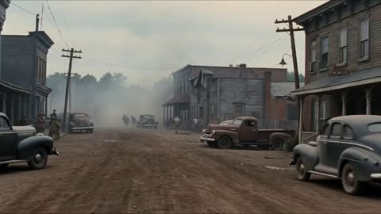</a>

The 15 second clip is split into timed beats (establishing shot, tension, combat, human moment, pull back), each with its own camera move. Separate environment, characters, visual style and physics blocks, plus a long negative prompt, hold the 1940s 35mm documentary look and keep the action grounded.

MiniMax H3 · Text-to-video · Source: [@RuzainaMeer on X](https://x.com/RuzainaMeer/status/2087117707816714552) · 377 likes on 2026-10-28 · found via [SkyNotSilent/awesome-MiniMax-H3-cases](https://github.com/SkyNotSilent/awesome-MiniMax-H3-cases)

[`historical`](tags.md#tag-historical) [`war`](tags.md#tag-war) [`documentary`](tags.md#tag-documentary) [`vintage-film`](tags.md#tag-vintage-film) [`timed-shots`](tags.md#tag-timed-shots)

<details><summary><b>Prompt</b></summary>

```text
Create a 15-second ultra-photorealistic live-action war sequence set in the United States in 1947, designed to look like authentic historical footage captured on a 1940s film camera. The entire scene must feel grounded, documentary-like, raw, and physically realistic.
Environment: A rural American town in 1947 with wooden houses, old brick buildings, telephone poles, dirt roads, vintage American cars from the 1940s, wooden fences, farmland, and period-accurate street details. Overcast afternoon light, light fog, drifting smoke, dust in the air, damaged buildings, scattered debris, and a tense wartime atmosphere.
Characters: American soldiers wearing historically accurate late-1940s military uniforms, helmets, boots, and equipment. Civilians wear authentic 1940s American clothing. Natural faces, realistic skin texture, sweat, dirt, fatigue, and believable body movements.
0–3s — Establishing Shot:
Wide handheld shot of a quiet rural American street suddenly filled with smoke and confusion. Vintage 1940s vehicles are parked along the road while soldiers move quickly between wooden buildings. Civilians rush toward safer areas.
3–6s — Tension:
Camera moves through the street at shoulder height, following several soldiers as distant gunfire is heard. They immediately react and take cover behind a vintage vehicle and a brick wall. Their movements are cautious and realistic.
6–10s — Combat:
Fast handheld tracking shot as the soldiers move between cover while distant gunfire impacts the environment. Small pieces of wood, dust, and debris fall naturally from nearby impacts. Weapon recoil, movement, and body weight must be physically accurate. Keep the violence realistic and restrained.
10–13s — Human Moment:
Camera briefly focuses on a soldier helping an injured civilian move behind cover. Their breathing, facial expressions, body language, and movement should feel natural and unscripted.
13–15s — Final Shot:
Camera pulls back into a wide shot of the American town as smoke slowly moves through the street. Soldiers remain behind cover while vintage vehicles and damaged buildings fill the background. The scene ends with an authentic, tense 1940s documentary feeling.
Visual Style: Ultra-photorealistic live-action, authentic 1940s American environment, vintage 35mm film texture, subtle film grain, natural imperfections, realistic exposure, handheld documentary cinematography, muted historical color palette, realistic smoke and dust, natural shadows, accurate depth of field.
Physics: Strictly obey real-world gravity, momentum, inertia, friction, recoil, weight, collision physics, and human biomechanics. No exaggerated explosions, impossible movements, superhero behavior, or choreographed-looking combat.
Negative Prompt: modern buildings, modern cars, smartphones, modern clothing, modern weapons, futuristic technology, CGI appearance, video-game graphics, fantasy, superhero action, excessive explosions, excessive blood, gore, impossible physics, unrealistic recoil, slow-motion physics, distorted faces, extra limbs, floating objects, plastic skin, artificial-looking environments.
```

</details>

<a id="h3-quote-typography-darkness-to-light"></a>
### Quote typography journey from darkness to light

<a href="https://x.com/umesh_ai/status/2083909535593644291"></a>

The prompt splits the quote into timed segments, one per phrase. Each segment sets its own typography, motion and mood, and a closing negative list guards spelling and letterform stability.

MiniMax H3 · Text-to-video · Source: [@umesh_ai on X](https://x.com/umesh_ai/status/2083909535593644291) · 339 likes on 2026-10-28 · found via [SkyNotSilent/awesome-MiniMax-H3-cases](https://github.com/SkyNotSilent/awesome-MiniMax-H3-cases)

[`typography`](tags.md#tag-typography) [`text-rendering`](tags.md#tag-text-rendering) [`cinematic`](tags.md#tag-cinematic) [`motion-graphics`](tags.md#tag-motion-graphics) [`quote`](tags.md#tag-quote)

<details><summary><b>Prompt</b></summary>

```text
Create a 15-second cinematic text-animation video built around the quote:  “Every great change begins quietly, grows through courage, and becomes impossible to ignore.”  The quote should appear gradually as a visual story. Each new phrase must transform the design, atmosphere, movement, and emotional intensity of the scene. Use elegant typography, accurate spelling, cinematic lighting, smooth transitions, and perfectly readable text.  0:00–0:03 | “Every great change”  Begin with a completely black screen.  A tiny point of warm light slowly appears in the center, like the first spark of an idea.  The words “Every great change” emerge softly from the darkness, one word at a time. Use thin, elegant serif typography with wide letter spacing.  “Every” fades in gently.  “Great” grows slightly larger.  “Change” forms from small drifting particles that gather into solid letters.  Keep the scene quiet, minimal, and mysterious.  0:03–0:06 | “begins quietly,”  The camera slowly moves closer to the text.  The previous words shrink and reposition toward the upper-left corner as the phrase “begins quietly,” appears in delicate lowercase letters.  Animate the phrase as though it is being written by an invisible hand.  Each letter should create a subtle ripple in the darkness.  Introduce faint textures, soft shadows, floating dust, and gentle light rays.  The comma should appear last and create a small circular pulse.  0:06–0:09 | “grows through courage,”  The pulse expands and transforms the scene from darkness into a rich sunrise gradient with deep orange, red, and golden tones.  The words “grows through courage” rise upward from the bottom of the frame.  Animate “grows” by gradually increasing its size and weight.  Animate “through” along a curved path.  Animate “courage” in bold uppercase letters that push through a translucent barrier, causing it to crack into geometric fragments.  The movement should feel powerful but controlled.  0:09–0:12 | “and becomes”  The fragments rotate in slow motion and reorganize into a clean editorial grid.  The phrase “AND BECOMES” appears across the frame in condensed sans-serif typography.  Animate the letters with fast tracking changes, vertical stretching, masking, and perspective movement.  The camera accelerates forward through the center of the word “BECOMES.”  The sound and visual energy should steadily build.  0:12–0:14 | “impossible to ignore.”  Reveal a vast bright space filled with light, moving shapes, and large-scale typography.  The words “IMPOSSIBLE TO IGNORE” appear one after another.  “IMPOSSIBLE” expands beyond the edges of the screen.  “TO” remains small and perfectly centered.  “IGNORE” slams into place with strong visual impact, briefly shaking the surrounding grid and shapes.  Use bold contrast, dramatic scale, sharp shadows, and synchronized motion.  0:14–0:15 | Final quote  All movement stops instantly.  The complete quote appears centered on a clean off-white background:  “Every great change begins quietly, grows through courage, and becomes impossible to ignore.”  Use refined black typography with “change,” “courage,” and “impossible” highlighted in deep red.  Hold the final composition clearly for the last second.  Maintain one continuous visual journey from darkness to light, silence to impact, and simplicity to complexity. Keep every phrase connected through visual transformations rather than hard cuts.  Use realistic motion blur, precise kerning, clean masks, stable letterforms, smooth camera movement, subtle film grain, cinematic sound design, rising ambient music, soft particles, controlled color transitions, and a final deep impact sound.  Avoid misspelled words, warped letters, duplicated characters, unreadable text, random symbols, excessive flickering, chaotic layouts, inconsistent fonts.
```

</details>

<a id="h3-pencil-portrait-drawn-on-blank-paper"></a>
### Hands sketch a portrait on blank paper

<a href="https://x.com/Just_sharon7/status/2095473707611553897"></a>

The prompt orders the drawing like a real artist works: pale construction lines, then placement blocks, face, hair, clothing, props and finally shading. Locked limits such as one continuous take, no cuts and no motion except the hands and pencil keep the process readable, and a reference photo supplies the likeness.

MiniMax H3 · Reference-to-video · Source: [@Just_sharon7 on X](https://x.com/Just_sharon7/status/2095473707611553897) · 328 likes on 2026-10-28 · found via [SkyNotSilent/awesome-MiniMax-H3-cases](https://github.com/SkyNotSilent/awesome-MiniMax-H3-cases)

[`drawing-process`](tags.md#tag-drawing-process) [`pencil-sketch`](tags.md#tag-pencil-sketch) [`time-lapse`](tags.md#tag-time-lapse) [`continuous-take`](tags.md#tag-continuous-take) [`portrait`](tags.md#tag-portrait)

<details><summary><b>Prompt</b></summary>

```text
A completely blank sheet of smooth white paper fills the frame. Two hands enter from the bottom. The right hand holds a sharpened graphite pencil; the left hand rests lightly at the lower-left corner of the paper to keep it still.
The right hand makes the first mark: a very light, loose oval in the center of the page for the head. Immediately add a faint vertical center line and a horizontal eye-line crossing the middle of the oval. Draw two short marks for the brow line and the base of the nose, then a light curve for the chin. All construction lines stay pale and barely visible.
Next, block in the neck as two simple sloping lines and a shallow U for the shoulders and collarbones. Sketch a rough rectangle for the torso and the square neckline of the top. Still using only the lightest pressure, place a large circle on the left for the round vanity mirror and a few vertical ovals and cylinders across the bottom for bottles and brush handles. Nothing is detailed yet—only placement.
Now the face. Darken the eye-line slightly and draw the almond shapes of both eyes, leaving a small highlight circle in each iris. Add the upper lids, a few lashes, and the gentle arch of the brows. Move to the nose: a soft wedge and two small nostril curves. Then the mouth: a short center dip, the full upper lip, and the slight upward curve of the smile. Keep every stroke inside the original oval.
Shift to the hair. Start at the hairline and draw the high, messy half-up bun with the flower-shaped clip on top and the two small barrettes on the right side. Pull long, wavy strands down the left side of the face and over the right shoulder, using loose, overlapping S-curves. Let a few shorter pieces fall across the forehead.
Refine the clothing: the ribbed texture of the white top, the thin orange trim around the neckline and sleeve, and the tiny bow at the center. Add the thin necklace chain and its small pendant. Darken the contour of the right hand resting against the cheek, fingers relaxed.
Move to the foreground still life. Outline the gold-framed round mirror on the left, then the cluster of bottles—tall toner bottle, perfume with a faceted cap, pump bottles, and the cup of makeup brushes on the right. Keep these objects slightly lighter so they sit in front of the figure without competing.
Begin shading. Hatch soft graphite under the chin, along the left side of the nose, beneath the lower lip, and in the hollow of the neck. Build darker value in the hair where strands overlap and around the clips. Add light cross-hatching on the fabric folds of the top and a faint cast shadow from the hand onto the cheek. Leave the paper white for the brightest highlights on the forehead, nose tip, and lip.
The left hand slides out of frame. The right hand makes a few final tightening strokes on the eyes and the edges of the hair, then rests the pencil at the top of the paper. The finished drawing is a complete graphite sketch of the blonde woman at her vanity, built entirely from the first faint oval to the last shadow, on otherwise empty white paper.
Satisfying, calm, close-up process video. Continuous take, no cuts, no extra motion except the hands and pencil. Soft natural light, visible pencil grain and paper tooth.
```

</details>

<a id="h3-industrial-hyperpop-timeline-fashion-dancer"></a>
### Androgynous dancer escaping a glass timeline loop

<a href="https://x.com/lepadphone/status/2084637679254376793">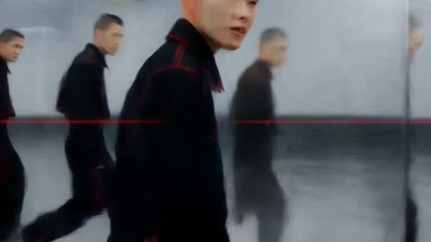</a>

The prompt splits into labelled blocks (concept, character, world logic, visual language, motion rules, restrictions). It ties each beat of a 160 BPM grid to a camera or space rule, so kicks compress the timeline and snares duplicate frames. A closing list of exclusions keeps the dancer's identity and the on-screen text under control.

MiniMax H3 · Text-to-video · Source: [@lepadphone on X](https://x.com/lepadphone/status/2084637679254376793) · 325 likes on 2026-10-28 · found via [SkyNotSilent/awesome-MiniMax-H3-cases](https://github.com/SkyNotSilent/awesome-MiniMax-H3-cases)

[`fashion-commercial`](tags.md#tag-fashion-commercial) [`music-sync`](tags.md#tag-music-sync) [`3d-typography`](tags.md#tag-3d-typography) [`glitch`](tags.md#tag-glitch) [`dance`](tags.md#tag-dance)

<details><summary><b>Prompt</b></summary>

```text
[Core Concept]
15s, 160 BPM, 4/4, 40 beats. Industrial Hyperpop × Deconstructed Club: hard kicks, metallic snares, glitch hi-hats, distorted bass, sliced vocals. A timeline-based reality where rhythm controls space and motion.

[Character Identity]
Single androgynous dancer with short black hair, silver eyebrow mark, asymmetric black jacket, wide pants, red stitching. Maintain identical face, body, hairstyle and outfit. Multiple figures are only past-frame projections.

[World Logic]
Each kick compresses the timeline toward the dancer. Each snare duplicates previous movements into adjacent frames. Moving against the timeline transforms the 2D interface into a foldable 3D structure. The dancer escapes the repetition loop.

[Visual Language]
Black, cold white, warning red. Glass timelines, metal rails, glowing frame lines, scanning grids. Extreme wide-angle, low angles, top-down shots, Dutch angles, dolly moves, impossible perspective. 3D words COPY, SAME, TREND, OUTSIDE exist as physical architecture, not subtitles.

[Motion Rules]
Use anticipation → attack → overshoot → settle. Kick drives spatial compression, snare breaks frames, hi-hats animate cursors and fragments, bass bends time. Build with glitch cuts, then explode into an impossible continuous long take during the drop.

[Restrictions]
No character changes, extra people, random text, subtitles, logos, outfit changes, bad anatomy, flat camera angles, or meaningless flashes.
```

</details>

<a id="h3-four-city-outfit-change-depth-reference"></a>
### Four city outfit change with depth reference

<a href="https://x.com/HoodyLiu/status/2101904919540429295"></a>

Numbered pictures each lock one outfit, city map and UI, while a separate face crop is named the top priority identity reference. A black and white depth video supplies body motion and timing, and timed shots with exact reveal seconds keep every spin ending on a front view.

MiniMax H3 · Reference-to-video · Source: [@HoodyLiu on X](https://x.com/HoodyLiu/status/2101904919540429295) · 295 likes on 2026-10-28 · found via [SkyNotSilent/awesome-MiniMax-H3-cases](https://github.com/SkyNotSilent/awesome-MiniMax-H3-cases)

[`outfit-change`](tags.md#tag-outfit-change) [`depth-reference`](tags.md#tag-depth-reference) [`character-consistency`](tags.md#tag-character-consistency) [`vertical`](tags.md#tag-vertical) [`travel`](tags.md#tag-travel)

<details><summary><b>Prompt</b></summary>

```text
<Picture 1> defines Rei's opening outfit only: a fitted black satin mini dress with thin spaghetti straps, a lace-trimmed V-neckline, a small front bow with trailing ribbons, off-the-shoulder lace ruffle sleeves, a ruched bodice, a ruffled lace hem, bare legs and black pointed-toe stiletto pumps. Preserve the dress's silhouette, materials and front/back construction as shown. Use this outfit for the white-studio opening only; do not reproduce the character-sheet layout.

<Picture 2> defines her Paris outfit, front-facing presentation pose, drink, sunglasses, city map and UI. <Picture 3> defines her Rome outfit, front/three-quarter presentation pose, props, city map and UI. <Picture 4> defines her Cairo outfit, presentation pose, shopping bags, city map and UI. <Picture 5> defines her Sydney outfit, front-facing finishing pose, city map and UI.

<Picture 6> is an unmodified slightly turned standard face crop from the original Rei character card. It is the highest-priority facial identity reference for ALL outfits: preserve its eye shape and spacing, eyelids, nose, lips and natural proportions without beautification. Pictures 2–5 supply new city outfits and environments, never a substitute face. This is the same adult woman in different clothes throughout the entire video.

<Video 1> is a black-and-white relative-depth reference for body movement, camera pullback and chronological timing only. Depth brightness represents distance, not skin color or face detail. Render natural full color using the pictures. A featureless face in the depth map must not become the back of Rei's head. Use the scene pictures to resolve which way her face and chest point after each turn.

Generate ONE continuous 12-second vertical video. The timed Shot labels below are successive phases of this one output, not instructions to insert camera cuts. Keep the reference timeline at its original speed. Do not compress the opening to make room for the cities. Only Rei rotates during transformation; the camera must not orbit her. A back view is a brief passing orientation during a spin, never a held destination pose. Each completed transformation reveals her face and the FRONT of the new outfit, as in its corresponding picture. Change clothing, handheld props, city map and city-name UI together; do not change only the background while leaving the previous outfit.

Shot 1 [0.00–2.50 seconds]: White studio and opening black sailor uniform from <Picture 1>. Rei looks at the phone held in front of her chest. Follow the opening camera pullback in <Video 1>. Her torso remains generally facing the camera; allow the original small phone and head gestures. This interval contains no full-body spin, no location pin yet, no city background and no wardrobe change.

Shot 2 [2.50–3.15 seconds]: The red location pin appears above Rei. This event ONLY adds the pin. She continues looking at her phone in the white studio, still wearing the opening black sailor uniform. The pin does not trigger a spin or a scene change. Do not begin the transformation here.

Shot 3 [3.15–4.05 seconds]: Follow the small preparatory side pivot in <Video 1>, then return toward the camera-facing starting orientation while holding the phone. This is the preparatory movement, not the rapid transformation spin. Retain the opening black sailor uniform, white background and red pin throughout this interval. No Paris map or summer outfit before 4.05 seconds.

Shot 4 [4.05–6.00 seconds]: At 4.05 seconds begin the rapid transformation rotation following <Video 1>. Pass continuously through the side and back orientations without pausing. Around 4.25 seconds, during this rotation, change together into the Paris outfit, drink, sunglasses, map and navigation UI from <Picture 2>. By 4.50 seconds complete the rotation and reveal Rei FACING THE CAMERA, with her face and the front of her navy-and-ivory striped top visible. From 4.50 to 6.00 seconds remain in this front/three-quarter FRONT presentation, with the drink and sunglasses gesture from <Picture 2>. The cream full-length trousers, striped top and red neck scarf replace the opening black sailor uniform completely. No back-facing hold, no phone, no opening black sailor uniform during the Paris presentation. The top search bar and bottom location card both read 巴黎.

Shot 5 [6.00–8.00 seconds]: Begin the next reference turn at 6.00 seconds. Around 6.25 seconds change outfit, props, city and UI to Rome from <Picture 3>. Complete the turn by 6.55 seconds into a front/three-quarter FRONT view showing Rei's face, sage-green midi dress with brown belt. Until 8.00 seconds use the Rome pose with the paper guide and warm Trajan column and Roman Forum map. Both city labels read 罗马. Back-facing frames occur only while the turn is in progress; no stopped back view after the turn.

Shot 6 [8.00–10.00 seconds]: Begin the next reference turn at 8.00 seconds. Around 8.25 seconds change together to the ivory linen shirt, beige full-length trousers, ochre scarf, shopping bags, Cairo map and UI from <Picture 4>. By 8.55 seconds reveal her face and the front of the ivory linen shirt. Hold the front/three-quarter presentation with natural small movements until 10.00 seconds. Both city labels read 开罗. Keep the Cairo outfit and map together; do not introduce previous clothes or Sydney early.

Shot 7 [10.00–12.00 seconds]: Begin the final reference turn at 10.00 seconds. Around 10.25 seconds replace the Cairo clothes and shopping bags, city and labels with the Sydney sky-blue overshirt, white T-shirt, navy knee-length shorts and white sneakers, Sydney Tower map and UI from <Picture 5>. By 10.55 seconds face the camera with the white T-shirt beneath the sky-blue overshirt visible, hands raised and one leg bent backward as in <Picture 5>. Keep this front-facing Sydney presentation with subtle natural movement through 12.00 seconds. Both city labels read 悉尼. No additional spin, destination or wardrobe change after this final reveal.

Keep Rei's facial identity, natural body proportions, hair and bangs throughout. Clothing changes must not alter her face, age, body shape, hair color or hair length. Do not reproduce character-sheet panels, extra people, face closeups or depth-map gray colors. Do not reproduce the blank faces in Picture 1's full-body clothing views; Rei must have her normal face whenever her face is visible.

Keep the city UI style consistent; update both location labels at each city change. No generated speech or music.

The angle in Picture 6 describes identity only, NOT a fixed head pose. Face direction, expression, head tilt, hand gestures and full body movement follow Video 1, with each completed city presentation matching its corresponding scene picture.

In Paris the sunglasses are opaque black and fully cover both eyes and eye sockets. Keep the sunglasses on throughout the Paris presentation. At the Rome transformation, switch to the accessories shown in Picture 3.
```

</details>

<a id="h3-luna-livestream-chat-reading-opening"></a>
### Virtual streamer opens a livestream reading chat

<a href="https://x.com/GlitterPixely/status/2084481873158328598"></a>

Each reference image and audio file gets one narrowly scoped job: identity, platform chrome, room, voice. The timed beats fix the silent lead-in, the gaze toward the chat rail and the exact chat lines that may be readable.

MiniMax H3 · Reference-to-video · Source: [@GlitterPixely on X](https://x.com/GlitterPixely/status/2084481873158328598) · 293 likes on 2026-10-28 · found via [SkyNotSilent/awesome-MiniMax-H3-cases](https://github.com/SkyNotSilent/awesome-MiniMax-H3-cases)

[`livestream`](tags.md#tag-livestream) [`reference-to-video`](tags.md#tag-reference-to-video) [`lip-sync`](tags.md#tag-lip-sync) [`ui-text`](tags.md#tag-ui-text) [`virtual-streamer`](tags.md#tag-virtual-streamer)

<details><summary><b>Prompt</b></summary>

```text
Use @Image4as the opening card only: circular Luna avatar, black background, cream “LUNALIVE”, rose “STREAM STARTING”, warm circles, tiny mint accent. Static, chime.

Use @Image1 for Luna’s identity only: same face, long center-parted black hair, blue-gray eyes, pink anime hoodie, white headphones around neck, delicate necklace, pale nails. Do not copy the drink, pose, or background from @Image1.

Use @Image2 only for Twitch-like platform chrome: dark top bar with “LUNALIVE”, red “LIVE” badge, “2.4K viewers”, right “STREAM CHAT” rail, bottom title area, rounded “FOLLOW” and pink “SUBSCRIBE” buttons. Do not copy Luna, pose, drink, or room from @Image2

Use @Image3 only for the cozy room behind Luna inside the video area: desk, monitor, white PC, plush shelves, curtain fairy lights, soft pink/purple light. No empty-room showcase shot.

Use @Audio1as Luna’s actual vocal performance and behavior reference. @Audio1has a silent lead-in: 0.0–2.4s must be treated as no speech. Preserve her voice identity, cadence, tone, breaths, pauses, emphasis, warmth, and streamer mannerisms. Do not replace the voice, do not generate a different influencer voice, and do not add extra spoken lines beyond @Audio1 Lip sync, mouth shapes, jaw movement, smiles, glances, nods, and small hand movements must follow the audio waveform after 2.4s.

Create a 15-second 16:9 Twitch-like stream opening. Important performance direction: Luna is reading chat, not delivering a camera monologue. Place Luna slightly left of center in the video area with the right “STREAM CHAT” rail clearly visible. Whenever she speaks, her eyes angle screen-right toward the chat rail as if she is reading the messages out loud. She returns to camera only for brief reactions. Add constant small movement: eye darts to chat, eyebrow lifts, tiny nods, head tilts, shoulders shifting, one subtle hand gesture near the desk. No stiff talking-head pose. One cursor only, no cursor trail, no duplicate panels, no duplicate buttons.

Render only large UI text cleanly. Chat feels alive with typing dots and soft short blurred lines, but only these chat lines are readable: “hi Luna”, “welcome back”, “so cozy”, “gugugaga?”, “RAID INCOMING!”. Do not invent usernames. Chat pops stay quieter than Luna’s voice.

[0–2 seconds] Open on @Image4 “LUNALIVE / STREAM STARTING”. Absolute no-speech zone: @Audio1is silent here, Luna is not shown, no mouth movement, no voice on the card. One soft chime only. No movement.

[2–7.4 seconds] Hard cut to Luna live at 2.0s, slightly left of center in the cozy room from @Image3 with @Image2 chrome active: “LUNALIVE”, red “LIVE”, “2.4K viewers”, right “STREAM CHAT” rail, bottom title “COZY NEON” and “Just Chatting”. She settles for a beat, eyes already moving toward the chat rail. At about 2.4s when speech begins in @Audio1, match lip sync exactly while she reads toward the chat rail, not into camera. Chat shows typing dots and soft blurred lines.

[7.4–7.9 seconds] First audio pause = chat beat. Typing dots, then readable messages pop in: “hi Luna”, “welcome back”. Luna’s eyes track the new messages on the right rail; small nod and smile follow the audio pause.

[7.9–12.5 seconds] Continue matching @Audio1Keep her gaze mostly on the chat rail while speaking, like she is reading and reacting. Add one more readable message: “so cozy”. During any softer phrase, she leans slightly forward as if reading; during brighter phrases, eyebrows lift and shoulders react. No frozen face.

[12.5–13.9 seconds] Bigger audio pause = bigger chat beat. “gugugaga?” appears, then “RAID INCOMING!”, and a clean “NEW FOLLOWER” banner slides in with a gentle pop. Luna reads the raid message from the chat rail, then reacts brighter as the audio resumes.

[13.9–14.8 seconds] Finish @Audio1 with accurate lip sync. If the audio winds down, Luna stops talking, gives a small wave toward chat, and settles into a warm listening pose. End on the stable live frame: Luna slightly left of center, eyes toward the right chat rail, red “LIVE”, “2.4K viewers”, no end card.

Audio mix: 0–2s card is silent except one soft chime. @Audio1voice begins only after the cut to Luna and remains primary. Tiny chat pops under the voice. Warm low room tone. No crowd noise, no music lyrics, no rain, no traffic.
```

</details>

<a id="h3-seaside-morning-vlog-bedroom-to-terrace"></a>
### Seaside morning vlog from bedroom to terrace

<a href="https://x.com/ayzalnooor24521/status/2086671141998059973"></a>

Identity and outfit are locked in the opening lines, then the 15 seconds are split into one second beats, each with its own shot size and action. A stated rule that she is not filming until the vlog start beat switches the look from cinematic coverage to handheld selfie, and the spoken lines are written out for native audio.

MiniMax H3 · Text-to-video · Source: [@ayzalnooor24521 on X](https://x.com/ayzalnooor24521/status/2086671141998059973) · 278 likes on 2026-10-28 · found via [SkyNotSilent/awesome-MiniMax-H3-cases](https://github.com/SkyNotSilent/awesome-MiniMax-H3-cases)

[`vlog`](tags.md#tag-vlog) [`lifestyle`](tags.md#tag-lifestyle) [`seaside`](tags.md#tag-seaside) [`timestamped-shots`](tags.md#tag-timestamped-shots) [`dialogue`](tags.md#tag-dialogue)

<details><summary><b>Prompt</b></summary>

```text
Create a 15-second ultra-realistic cinematic lifestyle vlog video, vertical 9:16, featuring the same young woman throughout the entire video. Preserve her facial identity, facial proportions, hairstyle, skin tone and overall appearance consistently in every shot. She wears the same outfit throughout: fitted white V-neck T-shirt with a small subtle logo, blue denim jeans, natural makeup, long softly wavy brown hair.

0:00–0:01 — Wake-up:
Close-up inside a beautiful bright bedroom. The woman is lying comfortably on the bed, slowly wakes up, stretches naturally and opens her eyes. She is NOT filming a vlog yet and does not hold a phone or camera. Soft morning sunlight enters through the curtains.

0:01–0:02 — Gets up:
Medium shot. She sits up on the bed, smiles softly, fixes her hair and gets ready to start her morning. Natural, effortless movement.

0:02–0:03 — Walks to window:
She walks toward the large glass balcony door/window. Camera follows her naturally from behind/side.

0:03–0:04 — Seaside reveal:
She opens the curtains/door and looks outside. Reveal a breathtaking blue ocean, coastal hills, flowers, balcony and beautiful morning sunlight. She smiles happily while taking in the view.

0:04–0:05 — Steps outside:
She walks out onto the seaside terrace. Gentle ocean breeze moves her hair naturally. Wide cinematic shot showing the beautiful surroundings.

0:05–0:06 — VLOG START:
Only now she starts filming herself in handheld selfie-vlog style. She looks into the camera with a bright natural smile and says:
“Good morning!”

0:06–0:07 — Show the view:
She turns the camera away from herself and slowly pans across the stunning ocean, coastal mountains, flowers and terrace. Smooth handheld vlog movement.

0:07–0:08 — Back to selfie:
Selfie shot. She looks into the camera and happily says:
“This place is just perfect!”

0:08–0:09 — Location reveal:
Wide cinematic shot of the cozy seaside terrace with wooden table, chairs, plants and flowers overlooking the ocean.

0:09–0:10 — Walk to table:
Medium tracking shot as she walks toward the table, enjoying the view. Her hair and T-shirt move gently in the sea breeze.

0:10–0:11 — Sit and relax:
She sits at the seaside table, smiling peacefully and enjoying the ocean view. A refreshing orange-colored juice is placed on the table.

0:11–0:12 — Juice close-up:
Cinematic close-up of her hand picking up the glass of fresh orange juice. Beautiful ocean bokeh in the background, natural sunlight reflecting through the glass.

0:12–0:13 — Vlog toast:
Selfie shot. She raises the juice toward the camera with a cheerful smile and says:
“Cheers to good days!”

0:13–0:14 — Happy close-up:
Beautiful close-up of her smiling naturally at the camera, ocean and warm sunlight softly blurred behind her.

0:14–0:15 — Ending:
Camera moves from her toward the sparkling ocean and peaceful coastal landscape. Warm sunlight, gentle waves and a relaxing cinematic ending.

Overall Style

Ultra-realistic, cinematic travel vlog, natural handheld camera movement, realistic human motion, smooth transitions, soft morning sunlight, realistic ocean waves, gentle wind in hair and clothes, beautiful coastal atmosphere, premium lifestyle aesthetic, natural expressions, authentic vlog feeling, shallow depth of field, cinematic composition, realistic skin texture, high detail, 4K quality.
```

</details>

<a id="h3-anime-fashion-dance-yellow-cyclorama-afterimages"></a>
### Anime dance film with pink cyan motion trails

<a href="https://x.com/aimikoda/status/2097001707683119410">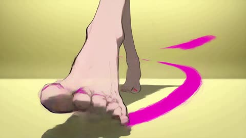</a>

A flat lemon yellow cyclorama keeps the frame clean so the cyan and pink afterimages read clearly. The camera moves are scripted as a counterpoint to the choreography, with ankle height skims, a close-up whip, an overhead cut and a hard brake on each pose lock. A tempo of 170 BPM and a ban on slow motion keep the cuts sharp.

MiniMax H3 · Reference-to-video · Source: [@aimikoda on X](https://x.com/aimikoda/status/2097001707683119410) · 271 likes on 2026-10-28 · found via [SkyNotSilent/awesome-MiniMax-H3-cases](https://github.com/SkyNotSilent/awesome-MiniMax-H3-cases)

[`anime`](tags.md#tag-anime) [`dance`](tags.md#tag-dance) [`fashion-film`](tags.md#tag-fashion-film) [`motion-graphics`](tags.md#tag-motion-graphics) [`music-video`](tags.md#tag-music-video)

<details><summary><b>Prompt</b></summary>

```text
15-second experimental anime fashion film. Use @[character reference] for the character’s exact identity, outfit and rendering style. A pristine, uniform lemon-yellow cyclorama with a seamless matte floor. Flat, clean yellow throughout, free of grain, gradients and set dressing. 16:9. No text or logos.

The character performs one fast, unconventional dance phrase: ankles weave while the torso stays suspended, a wrist flick ripples through both elbows into a chest pop, knees fold into a low corkscrew pivot, then a heel swivel unwinds the body into an off-balance editorial pose. Continue through asymmetric shoulder rolls, angular arm threading around the face and a sideways glide with the head counter-rotating toward the lens. Every sharp lock immediately releases into another surprising movement. Convincing weight, precise foot contact and expressive follow-through.

Electric cyan and hot pink dominate the motion effects. Bold, opaque silhouette afterimages peel away from opposite sides of the body, replay the previous gesture a fraction late and slam back into alignment on each pose. Arm sweeps stretch them into broad curved ribbons; crossing steps weave pink and cyan trails around the ankles; rapid turns fan out overlapping screen-print impressions. At the strongest accents, oversized cyan and pink cutouts of the current pose slide across the foreground, briefly masking the lens. Keep the real character crisp and recognizable, with clean yellow visible between effect bursts.

The camera dances in counterpoint: skim backward at ankle height through advancing footwork, whip upward around an outstretched wrist into an extreme face close-up, then use the passing forearm to cut into a rotating overhead view of the low pivot. Dive to a tilted low-angle full-body composition as the character rises. Orbit opposite the sideways glide, exaggerating hands and feet near the wide lens. Accelerate between compositions and brake hard on pose locks.

Finish with a sudden forward lean toward the lens while enormous pink and cyan echoes continue leaning farther, sweeping past both sides of the camera. Snap wide: the character lands a final asymmetric pose as the colored echoes collapse precisely into the silhouette. Hard cut to black.

170 BPM broken beat, syncopated accents, fluid animation and razor-fast camera transitions. No slow motion or prolonged holds.
```

</details>

<a id="h3-spaghetti-western-anime-silhouette-title-sequence"></a>
### Spaghetti western anime silhouette title sequence

<a href="https://x.com/doctorwasif/status/2085599659326935100">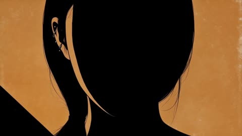</a>

Reference image and audio track set the timing, with hard cuts only and freeze frames on full beats. A flat black silhouette on a restricted desert palette, plus stencil title typography and heavy 35mm print wear, keeps the look consistent.

MiniMax H3 · Reference-to-video · Source: [@doctorwasif on X](https://x.com/doctorwasif/status/2085599659326935100) · 250 likes on 2026-10-28 · found via [SkyNotSilent/awesome-MiniMax-H3-cases](https://github.com/SkyNotSilent/awesome-MiniMax-H3-cases)

[`anime`](tags.md#tag-anime) [`title-sequence`](tags.md#tag-title-sequence) [`silhouette`](tags.md#tag-silhouette) [`spaghetti-western`](tags.md#tag-spaghetti-western) [`film-grain`](tags.md#tag-film-grain)

<details><summary><b>Prompt</b></summary>

```text
Use the attached character reference (Image1) and audio track as the timing guide. Create a spaghetti-western pulp anime title sequence where every cut lands precisely on the beat.
Style the character as a flat black silhouette against solid desert-inspired colors (burnt orange, ochre, rust, adobe tan), using bold pop-art compositions, vintage bounty-poster framing, split panels, extreme close-ups, and wide horizon shots. Alternate fast action bursts with full-beat freeze frames (draw, stride, turn, match strike, etc.), using hard cuts only.
Add worn woodblock/stencil title typography that slams into frame on the beat. Finish with the character frozen in silhouette on a burnt-orange background as the title stamps in on the final hit.
Apply heavy 35mm film grain, scratches, dust, gate weave, cigarette burns, and sun-faded print wear throughout for an authentic 1960s spaghetti-western look.
```

</details>

<a id="h3-lumi-lemonade-kinetic-typography-title-sequence"></a>
### Anime lemonade girl kinetic typography title sequence

<a href="https://x.com/Just_sharon7/status/2095516988743225637"></a>

A character lock line at the top keeps her design fixed, then a graphic design first ratio of 80 percent type and 20 percent action sets the tone. Thirteen timed cuts each pair one giant word with one action, and the prompt adds beat synced sound design and a rule that type is readable before she overlaps it.

MiniMax H3 · Text-to-video · Source: [@Just_sharon7 on X](https://x.com/Just_sharon7/status/2095516988743225637) · 244 likes on 2026-10-28 · found via [SkyNotSilent/awesome-MiniMax-H3-cases](https://github.com/SkyNotSilent/awesome-MiniMax-H3-cases)

[`kinetic-typography`](tags.md#tag-kinetic-typography) [`motion-graphics`](tags.md#tag-motion-graphics) [`anime`](tags.md#tag-anime) [`multi-cut`](tags.md#tag-multi-cut) [`halftone`](tags.md#tag-halftone)

<details><summary><b>Prompt</b></summary>

```text
LUMI is an elegant, cheerful anime girl with long, vivid lemon-yellow hair with blunt bangs, honey-amber almond eyes with dramatic lashes, soft pink blush, a small mint-green hairpin, dangling lemon-slice earrings, a yellow ruffled off-shoulder top layered over a white halter crop top, and holds a tall glass of sparkling lemonade with ice and lemon slices. Preserve her exact face, proportions, hairstyle, outfit, materials, accessories and colors throughout; never redesign her.

This film is 80% bold graphic design in motion and 20% character action: giant kinetic typography, hard-edged citrus shapes, flat color fields, sunburst rays, halftone dots, juice-splash graphics, speed lines and shutter flashes. Palette: lemon yellow, citrus gold, cream white, soft blush pink, mint accent. Style: premium AAA motion-graphics title sequence x citrus lifestyle campaign film. Every graphic element moves fast and snaps hard on the beat.

CUT 01 | 0.00–1.00s – Pure graphics: a giant lemon-yellow wordmark "LUMI" slams onto a cream field with a sunburst-ray flash; halftone dots pulse and tiny citrus-slice UI ticks flicker along the frame edges.

CUT 02 | 1.00–2.10s – Cream-white field, huge black outline letters "FRESH" drop in and bounce; she twirls into frame holding her lemonade glass aloft, ruffles fluttering, sparkle particles trailing behind her.

CUT 03 | 2.10–3.10s – Close shot: she lifts the glass and takes a slow sip, eyes glinting; a fizz of golden bubbles erupts around her as kinetic type "ZEST" spins and locks into place behind her shoulder.

CUT 04 | 3.10–4.10s – Flat citrus-yellow field: she spins her glass and lemonade splashes upward in a stylized graphic arc that freezes mid-air as the wordmark "SPLASH" bursts through the liquid shape.

CUT 05 | 4.10–5.10s – Hard cut to cream field: giant outlined type "POUR" tilts diagonally; she pours a stream of golden lemonade into her glass, the falling stream morphing into the letterforms as it lands.

CUT 06 | 5.10–6.10s – Sunburst radial wipe: she flicks a lemon slice off the rim of her glass toward camera; it spins in slow motion catching the light, while the word "CITRUS" scatters into halftone dot particles.

CUT 07 | 6.10–7.10s – Slow hair-flip, her hair rippling like liquid gold; speed lines and sparkle bursts trail from it as the giant type "GOLDEN" ripples across the frame in sync with the movement.

CUT 08 | 7.10–8.10s – Kinetic type barrage: SWEET / COOL / BRIGHT / SUNNY slam in one per beat with shutter flashes and camera shake, while she raises her glass in a toast toward camera, ice clinking in slow motion.

CUT 09 | 8.10–9.10s – Cream cyclorama: she tilts her head back with a light laugh, hair catching the wind; a cluster of citrus-slice graphics and sparkle motes swirl around her in a slow orbiting halo.

CUT 10 | 9.10–10.10s – Layered flat-color glass panes (lemon yellow, cream, blush) shatter one by one, each revealing a bigger letter of "LUMI" underneath, as she steps forward through the breaking panes.

CUT 11 | 10.10–11.10s – Giant halftone sunburst rays pulse outward from behind her in rhythm with a bass drop, lemon-slice confetti raining down as she smiles and lightly lifts her glass higher.

CUT 12 | 11.10–13.00s – Hero moment on a clean cream cyclorama: she stands center frame, glass raised, warm confident smile, as a shockwave of concentric golden rings, citrus confetti and wind-rippled ruffles blasts outward from her; brief iconic freeze, overexpose to white.

CUT 13 | 13.00–15.00s – Final identity card: an enormous black "LUMI" wordmark dominates a pale cream field with translucent lemon-yellow rings, sunburst arcs, halftone dots and a circular emblem containing a lemon-slice motif; she stands relaxed beside the letters, glass in hand, hair rippling in the breeze; one last golden light pulse sweeps through the typography and a soft chime accent punctuates the end.

Editing: aggressive, stylish rhythm — hard cuts on every beat, graphic matches, snap zooms, speed ramps, shutter flashes and impact pulses; every cut must feel compositionally different; typography is always fully readable before the character overlaps it.

No weapons, no combat, no fire; all energy comes from motion design, light, liquid, glass and citrus.

BGM: bright, uptempo pop/electro-swing with fizzy drops and glitch fills locked to every cut; glass clinks, fizz pops, fabric flutter and sparkle chimes as rhythmic sound-design elements. Peak at CUT 12 and end with a warm chime logo stinger.

Premium AAA quality, anime-inspired cinematic rendering, stylish and vibrant, strong graphic-design identity, consistent character design, exactly 13 cuts
```

</details>

<a id="h3-prehistoric-cave-concert-dinosaurs-documentary"></a>
### Prehistoric cave concert with dinosaurs and crowd

<a href="https://x.com/ozansihay/status/2085420070952649179">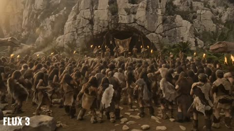</a>

A short plain scene description names the stage, performers, background creatures and audience in turn, then states multi-shot coverage, a natural documentary camera feel and an ultra realistic look. Written in Turkish and kept simple, it makes a good test of how well a model follows a loose brief.

MiniMax H3 · Text-to-video · Source: [@ozansihay on X](https://x.com/ozansihay/status/2085420070952649179) · 241 likes on 2026-10-28 · found via [SkyNotSilent/awesome-MiniMax-H3-cases](https://github.com/SkyNotSilent/awesome-MiniMax-H3-cases)

[`multi-shot`](tags.md#tag-multi-shot) [`documentary`](tags.md#tag-documentary) [`ultra-realistic`](tags.md#tag-ultra-realistic) [`crowd-scene`](tags.md#tag-crowd-scene) [`dinosaurs`](tags.md#tag-dinosaurs)

<details><summary><b>Prompt</b></summary>

```text
Tarih öncesi çağlarda geçen bir konser sahnesi. Sahnede mağara adamları var, tarih öncesi insanlar, anlaşılmaz bir dilde şarkı söylüyorlar. Etrafta dinozorlar da dolaşıyor. Konseri izleyen kalabalık bir topluluk var. Çekim multi-shot olacak, doğal ve belgesel havasında bir kamera hissi olmalı. Görsel stil ultra gerçekçi olmalı.
```

</details>

<a id="h3-blue-studio-dance-kinetic-typography"></a>
### Surreal blue studio dance with kinetic typography

<a href="https://x.com/egeberkina/status/2083301476206588086">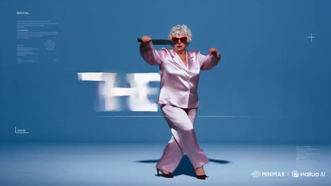</a>

Three Omni Reference tags lock the man, the woman and the horse before a beat by beat scene description. A long list of motion graphics techniques and a music and sound brief make the typography part of the choreography, and the ending is a timed whisper, sprint and cut to black.

MiniMax H3 · Reference-to-video · Source: [@egeberkina on X](https://x.com/egeberkina/status/2083301476206588086) · 237 likes on 2026-10-28 · found via [SkyNotSilent/awesome-MiniMax-H3-cases](https://github.com/SkyNotSilent/awesome-MiniMax-H3-cases)

[`omni-reference`](tags.md#tag-omni-reference) [`kinetic-typography`](tags.md#tag-kinetic-typography) [`fashion-film`](tags.md#tag-fashion-film) [`motion-graphics`](tags.md#tag-motion-graphics) [`surreal`](tags.md#tag-surreal)

<details><summary><b>Prompt</b></summary>

```text
Use @ Image1 as the man reference. 
Use @ Image2 as the woman reference. 
Use @ Image3 as the horse reference.  

Create a surreal 15-second fashion-film sequence inside a minimalist monochrome blue studio.  The woman performs an elegant contemporary dance.  The man casually walks into frame wearing a completely serious expression.  Without explanation, he immediately joins the choreography.  His movements are awkward, strangely confident, almost ritualistic.  The woman never acknowledges him.  The horse behaves as though both dancers are part of its routine.  It wanders through the studio.  Runs behind them.  Appears from impossible places.  Stops.  Looks directly into the camera.  Leaves.  Returns again.  Sometimes all three performers accidentally synchronize for one beat before drifting apart again.  The choreography becomes increasingly absurd but remains perfectly cinematic.  Every movement is intentional.  Every frame feels designed.  Throughout the sequence, premium kinetic typography appears as part of the composition, not subtitles, but editorial motion graphics inspired by high-end After Effects title design.  Animated words flash for only a few frames:  THE GARDENER.  THE DRIVER.  THE HORSE.  THE WOMAN.  KNIFE.  MOVE.  FASTER.  AGAIN.  THE EXIT. These words slam into frame, wrap around the dancers, disappear behind bodies, stretch with motion blur, rotate in 3D, fragment into pieces, reveal through masks, pulse with the bass, smear across cuts, become oversized, tiny, vertical, upside down, and constantly transform using premium motion-design techniques.  Add abstract editorial graphics: animated arrows, circles, blueprint lines, tape labels, interface markers, halftone textures, scribbles, grain, tracking graphics, geometric overlays, chromatic aberration, liquid masks, flash frames, split screens, typography trails, speed ramps and graphic wipes.  Music evolves into strange electronic art-pop.  Analog synths.  Mechanical breathing.  Heavy bass.  Everything is synchronized to the rhythm.  Final close-up.  The woman whispers:  "Again."  The man quietly smiles for the first time.  The horse suddenly sprints directly toward the camera.  The word  AGAIN.  fills the screen before an instant cut to black.
```

</details>

<a id="h3-burger-exploded-stack-macro-commercial"></a>
### Exploded burger stack macro food commercial

<a href="https://x.com/aimikoda/status/2094279178602283013"></a>

Opens on an extreme macro of the bun, then pulls back into an exploded vertical stack with each ingredient named in order. Camera moves, speed ramps, kinetic typography and light direction are all stated, and swapping the food adapts it.

MiniMax H3 · Text-to-video · Source: [@aimikoda on X](https://x.com/aimikoda/status/2094279178602283013) · 234 likes on 2026-10-28 · found via [SkyNotSilent/awesome-MiniMax-H3-cases](https://github.com/SkyNotSilent/awesome-MiniMax-H3-cases)

[`food`](tags.md#tag-food) [`commercial`](tags.md#tag-commercial) [`macro`](tags.md#tag-macro) [`kinetic-typography`](tags.md#tag-kinetic-typography) [`portrait`](tags.md#tag-portrait)

<details><summary><b>Prompt</b></summary>

```text
Create a high-end cinematic burger commercial in portrait format, designed like a premium restaurant campaign.  Open on an extreme macro shot of a golden toasted bun, revealing tiny bake-specks, soft flour dusting and rich surface texture under warm directional light. The camera glides smoothly across the bun, then pulls back as the burger ingredients separate into a perfectly aligned exploded stack above a matte wooden tabletop.  The full burger floats on a single vertical axis: toasted top bun, crisp ruffled lettuce, glossy tomato slices, translucent purple-red onion rings, melted cheddar, a thick char-grilled beef patty and toasted bottom bun. Each layer moves with elegant controlled motion, subtle rotation and realistic weight.  Use premium food-commercial camera movement throughout: macro tracking shots, smooth dolly pushes, slow orbital moves, shallow-focus passes between ingredients and precise rack focuses. Add occasional speed ramps into slow-motion beauty moments. Let tiny crumbs, droplets and subtle steam move through the light for additional depth.  Integrate bold hand-lettered white typography directly into the composition. Words appear between the floating burger layers, following the camera movement with kinetic typography. Letters can slide behind ingredients, reveal through depth, stretch slightly during transitions and lock cleanly into place. Add minimal white doodle strokes and graphic accent lines that animate around key ingredients.  Lighting is luxurious and appetizing: soft directional key from upper-left, controlled fill, warm highlights, deep dimensional shadows and glossy specular detail on tomato, cheese and meat. Background is a refined warm brown gradient with subtle cinematic falloff.  Build toward a final satisfying moment where all ingredients rapidly assemble into one perfect burger. The camera performs a fast controlled push-in, then settles into a polished hero shot. Steam rises gently from the patty, cheese settles over the edges and the typography resolves beside the burger.  Final frame: centered premium burger hero shot, clean composition, elegant white campaign typography and subtle animated graphic accents.  Visual style: luxury food advertising, modern restaurant campaign, cinematic macro photography, rich warm tones, high contrast, shallow depth of field, highly detailed food textures, sophisticated motion design, premium typography, smooth dynamic camera choreography, polished commercial finish.
```

</details>

<a id="h3-luxury-perfume-amber-smoke-commercial"></a>
### Luxury perfume commercial with amber golden smoke

<a href="https://x.com/Lianaalane/status/2086730655161823597"></a>

Four numbered shot lines each carry their own camera move and lighting, bookended by matching push-ins on the bottle. A separate consistency block locks the woman, outfit and bottle across shots and lists negatives such as extra people, distorted hands and logos.

MiniMax H3 · Text-to-video · Source: [@Lianaalane on X](https://x.com/Lianaalane/status/2086730655161823597) · 228 likes on 2026-10-28 · found via [SkyNotSilent/awesome-MiniMax-H3-cases](https://github.com/SkyNotSilent/awesome-MiniMax-H3-cases)

[`perfume`](tags.md#tag-perfume) [`commercial`](tags.md#tag-commercial) [`multi-shot`](tags.md#tag-multi-shot) [`luxury`](tags.md#tag-luxury) [`product-ad`](tags.md#tag-product-ad)

<details><summary><b>Prompt</b></summary>

```text
A Luxury perfume bottle on glossy black surface, warm amber lighting, golden smoke, dark elegant background, soft reflections, cinematic close-up, slow push-in, photorealistic 4K.
Confident woman in a burnt-orange satin dress, long dark hair, luxurious dark interior with golden lights, subtle smoke, cinematic medium shot, photorealistic 4K.
Close-up of the same woman spraying perfume on her neck. Visible fragrance mist, warm golden light, natural hair movement, shallow depth of field, cinematic beauty ad.
Same woman walking confidently toward camera in the luxury interior. Smooth tracking shot, reflective floor, warm golden lighting, subtle smoke, elegant cinematic look.
Same perfume bottle centered on glossy black surface with amber crystals and golden smoke. Dramatic spotlight, dark luxury background, slow push-in, photorealistic 4K.

Consistency:
Keep the same woman, face, hair, skin tone, outfit, and perfume bottle across all scenes. Warm amber lighting, realistic skin and movement. No extra people, distorted hands, duplicate objects, text, or logos.

Style: Luxury fragrance commercial, cinematic, photorealistic, 4K.
```

</details>

<a id="h3-drunken-master-motion-poster"></a>
### Drunken master movie poster turned motion poster

<a href="https://x.com/MonetizationDon/status/2087183007874453795">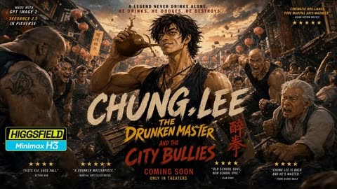</a>

The prompt starts by locking the uploaded poster artwork, typography and layout, and ends with explicit bans on redesign, new text and distorted lettering. Motion is split into ambient layers, subtle character action, a title reveal and a camera push then pull back to the final frame.

MiniMax H3 · Image-to-video · Source: [@MonetizationDon on X](https://x.com/MonetizationDon/status/2087183007874453795) · 225 likes on 2026-10-28 · found via [SkyNotSilent/awesome-MiniMax-H3-cases](https://github.com/SkyNotSilent/awesome-MiniMax-H3-cases)

[`motion-poster`](tags.md#tag-motion-poster) [`martial-arts`](tags.md#tag-martial-arts) [`typography`](tags.md#tag-typography) [`poster-animation`](tags.md#tag-poster-animation) [`cinematic`](tags.md#tag-cinematic)

<details><summary><b>Prompt</b></summary>

```text
Animate the uploaded CHUNG LEE movie poster as a 10-second cinematic martial-arts motion poster while preserving the original artwork, characters, typography, composition and layout.

Bring the static poster to life with rich cinematic colors — crimson red, golden yellow, fiery orange, electric blue, emerald green and magenta. Animate the lanterns, drifting smoke, flying dust, sparks, debris and the surrounding crowd.

Give CHUNG LEE subtle drunken-master movement: shifting shoulders, flowing hair, a confident expression and a casual lift of the gourd with liquid splashing in slow motion.

Then make “CHUNG LEE” the ultimate visual flex — dramatic brush-stroke reveals, golden particles, energy trails and a powerful 3D pop-out effect that makes the title feel like it is breaking out of the poster.

Add glowing red energy around the Chinese characters, dynamic martial-arts impacts, moving background fighters, cinematic camera movement and bursts of colorful light.

Finish with a dramatic push toward the CHUNG LEE title, then pull back to reveal the complete poster before locking into the final frame.

No redesign. No new text. No distorted typography. Preserve the original poster — just make it move.

Animation made with Minimax H3
```

</details>

<a id="h3-japanese-woman-laundry-day-continuous-action"></a>
### Woman Carries Laundry Basket Through Bedroom

<a href="https://x.com/aiwithaly/status/2091749172361978149"></a>

The prompt walks through one continuous chain of physical actions, from sorting to washing, hanging and folding, so the model keeps a single character and location. A closing list of realism terms and negatives (handheld camera, fabric behavior, no teleportation, no floating objects) keeps the motion believable.

MiniMax H3 · Text-to-video · Source: [@aiwithaly on X](https://x.com/aiwithaly/status/2091749172361978149) · 217 likes on 2026-10-28 · found via [SkyNotSilent/awesome-MiniMax-H3-cases](https://github.com/SkyNotSilent/awesome-MiniMax-H3-cases)

[`lifestyle`](tags.md#tag-lifestyle) [`photorealistic`](tags.md#tag-photorealistic) [`handheld`](tags.md#tag-handheld) [`continuous-action`](tags.md#tag-continuous-action) [`japanese`](tags.md#tag-japanese)

<details><summary><b>Prompt</b></summary>

```text
A young Japanese woman carries a full laundry basket from her bedroom to a small laundry area, kneels down, and actively sorts white and dark clothes into separate piles. She then picks up the laundry, walks several steps to the washing machine, loads the clothes one by one, closes the door, and starts the machine. The scene transitions to her walking onto the balcony with freshly washed laundry, placing the basket down, shaking out a wet white shirt, putting it on a hanger, and hanging it on the drying rack as a gentle breeze moves the clothes naturally. After the clothes dry, she walks back inside carrying a stack of laundry, places it on a table, and actively folds a T-shirt by shaking it open, folding the sleeves inward, folding it in half, and placing it onto the stack before starting the next garment. Photorealistic Japanese lifestyle video, natural handheld camera, realistic household physics, authentic walking and body movement, natural fabric behavior, realistic washing-machine motion, subtle wind, continuous action, neutral morning daylight, consistent character and environment, seamless transitions, no static posing, no teleportation, no floating objects, no distorted hands, no CGI appearance, no text overlays, logos, or watermarks.
```

</details>

<a id="h3-forgotten-kingdom-stone-bridge-traveler"></a>
### Traveler Crosses Stone Bridge to Hidden Kingdom

<a href="https://x.com/aiwithaly/status/2085221226335879541">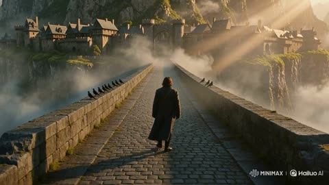</a>

One flowing paragraph lays out the story beats in order: bridge, gates opening, guardians waking, lanterns, dragons. A closing stack of cinema keywords (ARRI Alexa 35, anamorphic lenses, volumetric lighting) fixes the look, and the no text, no logos line keeps the frame clean.

MiniMax H3 · Text-to-video · Source: [@aiwithaly on X](https://x.com/aiwithaly/status/2085221226335879541) · 211 likes on 2026-10-28 · found via [SkyNotSilent/awesome-MiniMax-H3-cases](https://github.com/SkyNotSilent/awesome-MiniMax-H3-cases)

[`fantasy`](tags.md#tag-fantasy) [`cinematic`](tags.md#tag-cinematic) [`epic-adventure`](tags.md#tag-epic-adventure) [`dragons`](tags.md#tag-dragons) [`volumetric-lighting`](tags.md#tag-volumetric-lighting)

<details><summary><b>Prompt</b></summary>

```text
A cinematic 15-second fantasy adventure following a lone traveler as they cross an ancient stone bridge toward a forgotten medieval kingdom hidden beneath towering cliffs. As colossal gates slowly open, giant stone guardians awaken and glowing light spills through the mist, revealing a city untouched by time. The traveler steps forward as thousands of lanterns illuminate the streets, waterfalls cascade from towering cliffs, and majestic dragons soar across the sunrise sky. Epic cinematic camera movements, IMAX-scale visuals, volumetric lighting, realistic weather effects, premium VFX, emotional orchestral atmosphere, ARRI Alexa 35 aesthetic, anamorphic lenses, 4K HDR, seamless continuity, blockbuster movie quality, no text, no logos.
```

</details>

<a id="h3-warrior-woman-trex-jungle-temple-battle"></a>
### Warrior Woman Fights T-Rex in Jungle Ruins

<a href="https://x.com/Lianaalane/status/2085625652829708458">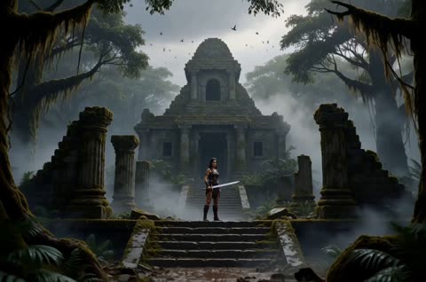</a>

A 14 second timeline splits the fight into timed beats, each with its own shot type: wide establishing, hero close-up, low-angle reveal, handheld dodge, slow-motion swing and a 360 degree jump. A shared style block (ARRI Alexa 35, anamorphic lens, volumetric light) and an explicit non-gory note keep the look consistent and the action safe.

MiniMax H3 · Text-to-video · Source: [@Lianaalane on X](https://x.com/Lianaalane/status/2085625652829708458) · 206 likes on 2026-10-28 · found via [SkyNotSilent/awesome-MiniMax-H3-cases](https://github.com/SkyNotSilent/awesome-MiniMax-H3-cases)

[`action`](tags.md#tag-action) [`fantasy`](tags.md#tag-fantasy) [`dinosaur`](tags.md#tag-dinosaur) [`multi-shot`](tags.md#tag-multi-shot) [`cinematic`](tags.md#tag-cinematic)

<details><summary><b>Prompt</b></summary>

```text
Create a 14-second ultra-realistic Hollywood-style action fantasy film scene featuring a brave young female warrior battling a massive realistic Tyrannosaurus Rex inside an ancient jungle filled with ruined temples, giant trees, mist, mud, rain, smoke, and dramatic sunlight.

Visual Style: Premium Hollywood blockbuster, photorealistic, cinematic, epic scale, realistic human anatomy, realistic dinosaur skin and movement, dramatic lighting, detailed environment, natural physics, intense facial expressions, high-end VFX, ARRI Alexa 35 look, anamorphic lens, shallow depth of field, HDR, subtle film grain, 4K cinematic quality, dynamic camera movement, realistic motion blur.

0–2 seconds — Establishing Shot:
Wide cinematic shot of an ancient jungle temple in the middle of a mysterious rainforest. The female warrior stands alone in the ruins, holding a large sword in one hand. Her clothes are rugged fantasy-warrior clothing, slightly wet from the rain. Mist moves through the trees while birds fly in the distant sky. Slow camera push-in toward her.

2–3 seconds — Hero Close-Up:
Cut to a dramatic close-up of the girl's face. Her hair is slightly wet and moving in the wind. She looks determined and fearless. Small scratches and dirt are visible on her face. She slowly raises her sword and prepares for battle.

3–4 seconds — Dinosaur Reveal:
Suddenly, a massive realistic T-Rex emerges from behind the jungle trees and roars aggressively. Its enormous jaws open, sharp teeth visible, water and mud splashing around its feet. Low-angle camera makes the dinosaur look huge and terrifying.

4–6 seconds — First Attack:
The dinosaur charges toward the girl at full speed. She runs toward the side and performs a fast dodge at the last second. The dinosaur crashes through trees and debris behind her. Use handheld camera movement, fast tracking, realistic impact and flying dust.

6–8 seconds — Sword Counterattack:
The girl quickly turns around and attacks with her sword. Show a dramatic slow-motion moment as she swings the sword toward the dinosaur. The dinosaur moves its head aggressively while roaring. Strong cinematic camera movement follows the sword.

8–10 seconds — Epic Jump:
The dinosaur attacks again. The girl jumps onto a large fallen tree and then leaps into the air above the dinosaur. Her hair and clothing move naturally in slow motion. Camera rotates around her as she raises the sword for the final strike.

10–12 seconds — Final Strike:
She lands a powerful cinematic sword strike against the dinosaur's armored hide. Create a dramatic impact with dust, rainwater, debris and strong camera shake. Keep the action non-gory and suitable for a blockbuster fantasy film.

12–13.5 seconds — Dinosaur Falls Back:
The dinosaur loses balance and falls backward into the muddy ground with a huge impact. Water, dust and leaves fly into the air. The girl lands safely and stands ready, breathing heavily.

13.5–14 seconds — Hero Ending:
Slow cinematic push-in toward the girl. She lowers the sword slightly and looks directly toward the camera with a powerful, fearless expression. Behind her, the defeated dinosaur lies in the misty jungle. Golden sunlight breaks through the clouds, creating an epic silhouette and emotional Hollywood-style ending.
Camera & Cinematography:
Wide establishing shots, low-angle dinosaur shots, close-up facial shots, handheld action camera, tracking shots, 360-degree movement during the jump, dramatic slow motion during key action moments, shallow depth of field for close-ups, realistic motion blur, cinematic composition.
Lighting & Atmosphere:
Dark stormy jungle atmosphere mixed with warm golden sunlight, volumetric light rays, wet surfaces, realistic rain, mist, smoke, flying leaves, dust and water particles.
```

</details>

<a id="h3-warehouse-final-fight-rain-debris"></a>
### Last stand fight in rainy abandoned warehouse

<a href="https://x.com/aiwithaly/status/2085585698699243802">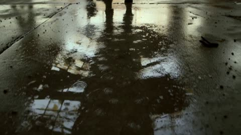</a>

One scene, one outnumbered fighter, and a clear arc from dodging and countering to a final standoff. Camera moves (handheld, low-angle tracking, slow motion) and a stack of lens and film references (ARRI Alexa 35, anamorphic, grain) set the look. The closing negatives keep text and logos out.

MiniMax H3 · Text-to-video · Source: [@aiwithaly on X](https://x.com/aiwithaly/status/2085585698699243802) · 202 likes on 2026-10-28 · found via [SkyNotSilent/awesome-MiniMax-H3-cases](https://github.com/SkyNotSilent/awesome-MiniMax-H3-cases)

[`action`](tags.md#tag-action) [`martial-arts`](tags.md#tag-martial-arts) [`warehouse`](tags.md#tag-warehouse) [`cinematic`](tags.md#tag-cinematic) [`slow-motion`](tags.md#tag-slow-motion)

<details><summary><b>Prompt</b></summary>

```text
A cinematic 15-second ultra-realistic Hollywood action sequence featuring a skilled fighter facing his final battle inside an abandoned industrial warehouse. Surrounded by three aggressive opponents, he uses precise martial arts movements to dodge attacks, counter strikes, and overcome every challenge with determination. Dust fills the air as sunlight breaks through shattered windows, creating a dramatic battlefield atmosphere. The scene builds toward a tense final confrontation as the fighter stands alone among smoke, rainwater, and debris. Dynamic handheld camera work, low-angle tracking shots, slow-motion action moments, realistic choreography, intense facial expressions, physically accurate movement, dramatic lighting, ARRI Alexa 35 aesthetic, anamorphic lens look, HDR, subtle film grain, premium Hollywood action style, 4K cinematic quality, no text, no logos.
```

</details>

<a id="h3-bangkok-street-food-pad-thai-travel-vlog"></a>
### Bangkok street market Pad Thai travel vlog

<a href="https://x.com/nawalsehar/status/2085233880353915217"></a>

The prompt lays the 15 second vlog out as a sequence of beats: market walk, chef cooking, close-ups, tasting reaction. It adds handheld realism, a cinema camera look, natural lip-sync and street sound cues, and ends with no text, no logos.

MiniMax H3 · Text-to-video · Source: [@nawalsehar on X](https://x.com/nawalsehar/status/2085233880353915217) · 198 likes on 2026-10-28 · found via [SkyNotSilent/awesome-MiniMax-H3-cases](https://github.com/SkyNotSilent/awesome-MiniMax-H3-cases)

[`travel-vlog`](tags.md#tag-travel-vlog) [`street-food`](tags.md#tag-street-food) [`handheld`](tags.md#tag-handheld) [`lip-sync`](tags.md#tag-lip-sync) [`photorealistic`](tags.md#tag-photorealistic)

<details><summary><b>Prompt</b></summary>

```text
A cinematic 15-second ultra-realistic travel vlog following a young female creator exploring Bangkok's vibrant street food scene. She walks through a lively daytime market, introduces the legendary Pad Thai, watches a skilled street chef prepare the dish with fresh ingredients, and captures detailed close-ups of sizzling noodles, colorful toppings, and authentic cooking moments. She tastes the freshly made Pad Thai and shares her genuine reaction while surrounded by the energy of local vendors and travelers. Handheld vlog realism, natural lip-sync, expressive emotions, cinematic food close-ups, realistic market atmosphere, bright tropical daylight, ARRI Alexa 35 aesthetic, HDR, immersive street sounds, premium travel documentary style, 4K photorealistic quality, seamless character consistency, no text, no logos.
```

</details>

<a id="h3-car-backseat-raccoon-monkey-chip-burst"></a>
### Raccoon and monkey chip burst in car

<a href="https://x.com/laviniavelle/status/2108851182244606445"></a>

The prompt fixes the setting, subject positions and wardrobe first, then runs a beginning, middle and end beat sequence so the chip burst lands as a clear comic payoff. Soft natural lighting and photorealistic cues keep the animals believable.

MiniMax H3 · Text-to-video · Source: [@laviniavelle on X](https://x.com/laviniavelle/status/2108851182244606445) · 188 likes on 2026-10-28 · found via [SkyNotSilent/awesome-MiniMax-H3-cases](https://github.com/SkyNotSilent/awesome-MiniMax-H3-cases)

[`animals`](tags.md#tag-animals) [`comedy`](tags.md#tag-comedy) [`car-interior`](tags.md#tag-car-interior) [`photorealistic`](tags.md#tag-photorealistic) [`three-beat`](tags.md#tag-three-beat)

<details><summary><b>Prompt</b></summary>

```text
A cinematic video inside the back seat of a moving car with beige leather interior On the right a young woman with medium-length brown hair, wearing a yellow knitted sweater and blue jeans is holding a blue bag of potato chips Sitting on the left is a fluffy raccoon and a small capuchin monkey is resting close to the raccoon The woman offers a chip to the animals but as the raccoon reaches into the bag chips accidentally burst into the air and scatter all over the backseat including one landing on the raccoon's head The woman reacts with surprise and then bursts into laughter while the monkey looks around curious and playful Photorealistic soft natural lighting, vibrant colors.
```

</details>

<a id="h3-kitten-warrior-dragon-friendship-meadow"></a>
### Kitten warrior meets giant dragon in meadow

<a href="https://x.com/LettyVesper/status/2108843102417113181">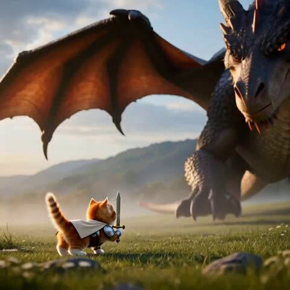</a>

The prompt scripts an emotional arc from fear to tenderness in one clip, pairing a size contrast between tiny hero and huge dragon with low angles, close-ups and golden sunset light. Concrete actions such as dropping the sword and the dragon closing its eyes give the model clear beats.

MiniMax H3 · Text-to-video · Source: [@LettyVesper on X](https://x.com/LettyVesper/status/2108843102417113181) · 188 likes on 2026-10-28 · found via [SkyNotSilent/awesome-MiniMax-H3-cases](https://github.com/SkyNotSilent/awesome-MiniMax-H3-cases)

[`fantasy`](tags.md#tag-fantasy) [`dragon`](tags.md#tag-dragon) [`kitten`](tags.md#tag-kitten) [`emotional-arc`](tags.md#tag-emotional-arc) [`cinematic`](tags.md#tag-cinematic)

<details><summary><b>Prompt</b></summary>

```text
A cinematic, ultra-realistic fantasy scene featuring an adorable fluffy ginger-and-white kitten warrior wearing miniature silver medieval armor, a flowing cream-colored cape, and carrying a tiny sword, standing bravely in a misty green meadow facing a massive, fearsome dragon covered in dark, rugged scales, sharp horns, and powerful leathery wings. The camera captures dramatic low-angle shots, close-ups of the kitten gripping its sword, and intense shots of the dragon lowering its enormous head toward the tiny warrior. The kitten initially stands courageously, but as the dragon approaches, it becomes frightened and drops its sword, looking up with teary eyes and a trembling expression. Suddenly, the mood shifts from danger to tenderness as the dragon gently touches its snout against the kitten, revealing a surprising bond between them. The kitten embraces the dragon's enormous face affectionately, and the dragon closes its glowing amber eyes peacefully. Golden sunset light illuminates the meadow, creating a magical, emotional atmosphere with volumetric lighting, realistic fur and scales, detailed metallic armor, cinematic depth of field, smooth camera movements, dramatic wide shots, intimate close-ups, 4K photorealistic CGI, and an epic fantasy film aesthetic, transitioning from suspense and fear to warmth, friendship, and heartwarming emotional connection.
```

</details>

<a id="h3-street-photographer-candid-old-man-dog"></a>
### Street photographer captures candid moment and shows it

<a href="https://x.com/aiwithaly/status/2087102541146522089">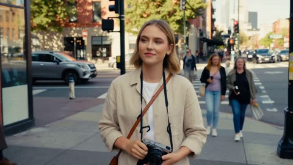</a>

The prompt describes the action as one continuous beat sequence: notice, compose, shoot, turn to camera, speak a short line, walk on. It then adds a single stack of realism cues for handheld movement, hand accuracy, dog behavior and ambient city sound.

MiniMax H3 · Text-to-video · Source: [@aiwithaly on X](https://x.com/aiwithaly/status/2087102541146522089) · 183 likes on 2026-10-28 · found via [SkyNotSilent/awesome-MiniMax-H3-cases](https://github.com/SkyNotSilent/awesome-MiniMax-H3-cases)

[`street-photography`](tags.md#tag-street-photography) [`documentary`](tags.md#tag-documentary) [`photorealistic`](tags.md#tag-photorealistic) [`handheld`](tags.md#tag-handheld) [`dialogue`](tags.md#tag-dialogue)

<details><summary><b>Prompt</b></summary>

```text
A young Western female street photographer walks through a lively downtown street and notices an elderly man sitting outside a café with his small dog. She carefully composes the candid moment through her camera, captures the photo, then turns the camera toward the viewer to proudly show the shot she just took. She smiles, says “Look at that,” then continues walking through the city. Ultra-photorealistic visuals, natural handheld documentary movement, realistic camera interaction, authentic facial expressions, accurate hand movements, realistic dog behavior, natural daylight, cinematic depth of field, continuous character consistency, immersive city ambience, premium documentary realism.
```

</details>

<a id="h3-warrior-woman-giant-monster-ruined-city-battle"></a>
### Warrior woman duels giant monster in ruined city

<a href="https://x.com/RuzainaMeer/status/2085240792067784843">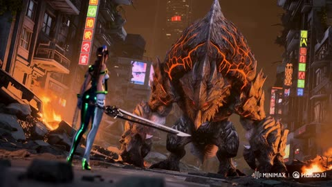</a>

The prompt runs as one beat sequence: standoff, charge, dodge, leap, strike, victory. Cinematic camera cues (slow motion, close-up of her face) and a closing style line for lighting and realism fit it into a single 15 second clip.

MiniMax H3 · Text-to-video · Source: [@RuzainaMeer on X](https://x.com/RuzainaMeer/status/2085240792067784843) · 179 likes on 2026-10-28 · found via [SkyNotSilent/awesome-MiniMax-H3-cases](https://github.com/SkyNotSilent/awesome-MiniMax-H3-cases)

[`action`](tags.md#tag-action) [`monster`](tags.md#tag-monster) [`cinematic`](tags.md#tag-cinematic) [`sci-fi`](tags.md#tag-sci-fi) [`slow-motion`](tags.md#tag-slow-motion)

<details><summary><b>Prompt</b></summary>

```text
A powerful warrior woman stands alone in a destroyed futuristic city at night, facing a massive towering monster covered in dark armor and glowing cracks. The monster roars and charges toward her, shaking the ground with every step. She dodges its attacks with incredible speed, leaps through the air, and strikes with a glowing energy weapon. Intense hand-to-hand combat, flying debris, explosions, dramatic slow motion shots, cinematic camera movements, close-up of her determined face. The battle reaches its peak as she unleashes her final powerful attack, defeating the giant monster and standing victorious as the city burns behind her. Epic Hollywood action movie style, ultra-realistic, dramatic lighting, dynamic camera angles, high detail, cinematic quality.
```

</details>

<a id="h3-marina-boat-dolphin-encounter-travel-documentary"></a>
### Traveler boards boat and spots dolphins

<a href="https://x.com/nawalsehar/status/2090306968900784383">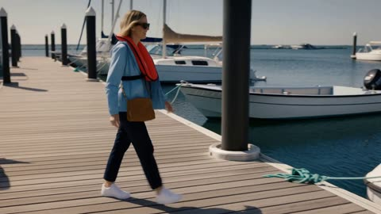</a>

The prompt narrates one continuous action chain from dock to boarding, departure, dolphin sighting and reaction. Spoken lines are written inline, and a long list of physical realism cues plus a closing negative list keeps the motion and water believable.

MiniMax H3 · Text-to-video · Source: [@nawalsehar on X](https://x.com/nawalsehar/status/2090306968900784383) · 166 likes on 2026-10-28 · found via [SkyNotSilent/awesome-MiniMax-H3-cases](https://github.com/SkyNotSilent/awesome-MiniMax-H3-cases)

[`travel-documentary`](tags.md#tag-travel-documentary) [`photorealistic`](tags.md#tag-photorealistic) [`dialogue`](tags.md#tag-dialogue) [`lip-sync`](tags.md#tag-lip-sync) [`wildlife`](tags.md#tag-wildlife)

<details><summary><b>Prompt</b></summary>

```text
A young Western female traveler in her mid-20s walks naturally along a wooden marina dock toward a small white sightseeing boat. She wears a light blue windbreaker, white shirt, dark trousers, comfortable sneakers, sunglasses, a properly fitted life jacket, and a small crossbody bag. She carefully steps from the dock onto the gently rocking boat while holding the handrail, naturally shifting her weight as the boat responds to her movement. She walks toward the rear passenger bench, sits down, adjusts her position, and looks toward the open water. The boat engine starts with a realistic low rumble and gradually leaves the marina, creating a small bow wave and narrow wake. As the boat moves into open water, she notices movement nearby, looks surprised, and naturally says, "Wait... are those dolphins?" Two dolphins surface several meters beside the moving boat, swimming parallel at a safe distance with realistic tail propulsion, surfacing, diving, breathing, and water displacement. She picks up her phone with both hands and records them while smiling with genuine excitement. One dolphin briefly surfaces near the rear side of the boat, exhales through its blowhole, creates a small burst of mist and droplets, then dives beneath the water and leaves expanding ripples behind. She lowers her phone and says, "That is incredible." Ultra-photorealistic marine wildlife travel documentary, cinematic realism, natural human behavior, realistic walking and sitting biomechanics, physically accurate boat buoyancy and acceleration, authentic ocean waves and wake, realistic dolphin anatomy and swimming behavior, natural water reflections and refraction, accurate English lip synchronization, bright neutral daytime lighting, realistic coastal wind, immersive marina and ocean ambience, smooth documentary camera movement, continuous visual consistency, seamless storytelling from walking to boarding, departure, dolphin encounter, recording, and final reaction, no narration, no CGI appearance, no plastic skin, no robotic movement, no exaggerated dolphin jumps, no impossible water behavior, no sudden camera transitions, no text overlays, logos, or watermarks.
```

</details>

<a id="h3-rift-dimensional-tear-metal-title-sequence"></a>
### White energy rift tears open into metal title

<a href="https://x.com/CharaspowerAI/status/2101989866762354988"></a>

The prompt is written as a beat by beat sequence: a thin line of light widens into a fracture, the camera accelerates in, the rift snaps shut, and the debris compresses into the lettering. Specifying the title material, the trapped energy in its cracks and a fast orbital move gives the typography a sense of event.

MiniMax H3 · Text-to-video · Source: [@CharaspowerAI on X](https://x.com/CharaspowerAI/status/2101989866762354988) · 164 likes on 2026-10-28 · found via [SkyNotSilent/awesome-MiniMax-H3-cases](https://github.com/SkyNotSilent/awesome-MiniMax-H3-cases)

[`title-sequence`](tags.md#tag-title-sequence) [`sci-fi`](tags.md#tag-sci-fi) [`kinetic-typography`](tags.md#tag-kinetic-typography) [`vfx`](tags.md#tag-vfx) [`dark`](tags.md#tag-dark)

<details><summary><b>Prompt</b></summary>

```text
High-end sci-fi title sequence beginning with a razor-thin line of white energy slicing vertically through complete darkness. Space immediately begins deforming around it as metallic particles, dust and glowing fragments are violently pulled toward the opening. The line tears wider into a gigantic dimensional fracture filled with unstable plasma and gravitational distortion. The camera accelerates directly toward the rift, violently banking between fragments being stretched into luminous trails. Suddenly the dimensional tear snaps shut with enormous force, compressing all surrounding matter into four gigantic black-metal letterforms that slam together to reveal "RIFT". Brilliant energy remains trapped inside deep cracks across the typography while space visibly bends around its edges. The camera performs a fast orbital move before the title itself splits open along its center, releasing a catastrophic dimensional shockwave that tears through the frame. Sophisticated cosmic distortion, aggressive kinetic typography, premium superhero-film VFX.
```

</details>

<a id="h3-neon-street-hiphop-kinetic-lyrics-trio"></a>
### Neon city hip-hop trio with kinetic lyrics

<a href="https://x.com/Inshrah_ali_/status/2085595583927185447">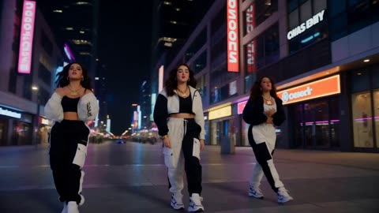</a>

The prompt opens with a shared style line, then splits the 15 seconds into four timed scenes, each with its own camera move (circling, gimbal, drone, crane up). Lyrics are supplied as on-screen text and tied to the beat, so the typography follows the music.

MiniMax H3 · Text-to-video · Source: [@Inshrah_ali_ on X](https://x.com/Inshrah_ali_/status/2085595583927185447) · 157 likes on 2026-10-28 · found via [SkyNotSilent/awesome-MiniMax-H3-cases](https://github.com/SkyNotSilent/awesome-MiniMax-H3-cases)

[`hip-hop`](tags.md#tag-hip-hop) [`kinetic-typography`](tags.md#tag-kinetic-typography) [`music-video`](tags.md#tag-music-video) [`neon-city`](tags.md#tag-neon-city) [`multi-scene`](tags.md#tag-multi-scene)

<details><summary><b>Prompt</b></summary>

```text
Style: Premium music commercial, ultra-realistic, cinematic, 8K HDR, natural lighting, luxury fashion aesthetic, smooth professional camera work, vibrant neon accents, realistic skin textures, high-end choreography, dynamic typography synced to the beat, music-video quality, no watermark.

Scene 1 (0–3s)

A stylish young female artist walks confidently through a modern city street at night, flanked by two equally fashionable dancers. They wear coordinated luxury streetwear with premium sneakers and jewelry. The beat drops as the camera circles them in slow motion. Giant animated typography appears behind them, displaying the lyrics in bold kinetic text synchronized perfectly with every word.

Scene 2 (3–8s)

The trio performs energetic hip-hop choreography in a neon-lit urban plaza. The camera switches between cinematic gimbal shots, low-angle tracking, drone passes, and close-ups of expressive faces. Every lyric appears on screen with premium motion graphics, glowing typography, smooth transitions, and rhythmic animations that pulse with the music.

Scene 3 (8–12s)

Fast-paced performance featuring synchronized dance moves, stylish hand gestures, confident attitude, realistic hair movement, natural fabric physics, and dynamic lighting. The lyrics continue appearing in large, eye-catching typography that interacts with the environment, wrapping around buildings and moving with the beat.

Scene 4 (12–15s)

The music reaches its climax. All three performers strike a powerful final pose as the camera cranes upward. Massive cinematic typography fills the background with the final lyric while city lights sparkle behind them. Premium commercial color grading, flawless visual effects, realistic crowd energy, luxury music-video finish.

Hip-Hop Lyrics (On-Screen Typography):

We rise, no limits, we own the night,
Dreams in motion, shining so bright.
Move with the rhythm, feel the fire,
We came to win—taking it higher!

Visual Style: Premium commercial production, Billboard music video aesthetic, luxury fashion campaign, realistic camera movement, cinematic lens flares, authentic facial expressions, smooth choreography, vibrant urban atmosphere, perfectly synchronized kinetic lyric typography.
```

</details>

<a id="h3-rainy-platform-train-light-profile-long-take"></a>
### Woman under clear umbrella as night train passes

<a href="https://x.com/kentdhani/status/2107736392247992627">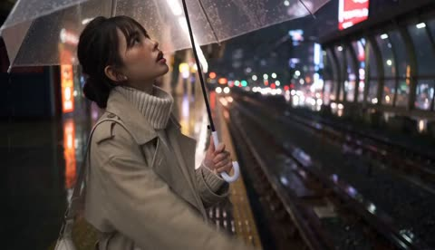</a>

One fixed camera long take with timestamped beats, so the action runs from fidgeting to the train arriving to a restrained smile. The prompt describes the moving light as slow continuous gradients and bans flicker, which keeps the reference identity stable on her face.

MiniMax H3 · Reference-to-video · Source: [@kentdhani on X](https://x.com/kentdhani/status/2107736392247992627) · 151 likes on 2026-10-28 · found via [SkyNotSilent/awesome-MiniMax-H3-cases](https://github.com/SkyNotSilent/awesome-MiniMax-H3-cases)

[`rainy-night`](tags.md#tag-rainy-night) [`long-take`](tags.md#tag-long-take) [`train-platform`](tags.md#tag-train-platform) [`moving-light`](tags.md#tag-moving-light) [`character-consistency`](tags.md#tag-character-consistency)

<details><summary><b>Prompt</b></summary>

```text
A single continuous live-action long take on a Japanese elevated train platform at night in the rain. One woman waiting alone, camera locked in place at her right side, filming her right profile down the length of the platform. It runs from her small waiting fidgets, through a commuter train arriving and passing in front of her, to the train nearly stopping and a soft side-profile smile. One take, camera fixed with only slight handheld breathing, no cuts, no zoom, no push-in. Normal real-world speed throughout, no slow motion.

Shot 1 — 0.0s: Realistic cinematic, real-camera rainy-night platform, one continuous long take, medium shot from mid-thigh up, camera fixed at her right at chest height looking down the platform's depth. Right side of frame is the wet-bright yellow tactile paving, the platform edge, and two steel rails converging into the distance, with the arched glass windscreen beyond; left side is the platform interior and orange glowing shopfront boxes; cool fluorescent tubes recede overhead; red-blue-green neon bokeh at the far end; tiles wet-black and reflective. Riria stands center-slightly-left inside the yellow paving, facing the tracks, her right profile to the lens, shopfront orange rimming her back and bun. The right-side rail is empty, no train yet. She is already mid-action: tilting the umbrella back a little, looking up past its rim at the night sky beyond the canopy, reaching her right hand forward toward the track side past the umbrella rim, palm up, holding a beat to test whether it's still raining, a few drops landing in her palm.

Shot 1 continues — 1.5s: She pulls her hand back, rights the umbrella back over her head, lets out a soft breath, and shifts her weight from one foot to the other.

Shot 1 continues — 2.0s: Two small, soft cool-white headlights light up at the far end of the right-side rail. She leans her upper body slightly forward (feet not crossing the yellow paving), peering toward the far end of the tracks, body still squared to the rails. The headlights grow larger and brighter extremely gradually along the right rail, the steel, the standing water, and the platform edge lighting up bit by bit.

Shot 1 continues — 3.5s: She straightens up, steps back half a step, grips the umbrella handle again with her left hand, her gaze following the approaching train. The light keeps rising slowly and evenly — first catching the side-profile edge of her forehead, nose bridge, and lips, then washing softly onto her face. The same light also falls on the droplets on the umbrella, the rain, the wet tiles, and her coat, no hard edges, no flicker. Her skin is only softly brightened overall, still matte, no shine spot. She squints slightly and tucks her chin a little into the turtleneck.

Shot 1 continues — 5.5s: A silver stainless-steel commuter train with a green waistline reaches her along the right-side rail, wheels on the rails, body tight to the platform edge, the nose passing in front of her and exiting frame right. In the same instant a gust blows in from the depth of frame: bangs and side hairs pressed to her cheeks, coat hem, lapels, and back belt lifting, umbrella tilting about a hand's width and trembling. Her left hand steadies the umbrella, her right hand lifts to gather the blown-open coat front at her chest, still facing the tracks. The cool-white headlight glow transitions smoothly into the warm-white carriage glow over about a second, brightness roughly unchanged, only cool-to-warm. Carriages run past in front of her on the right with motion blur, the warm-white light a long steady even band on her face, coat front, and umbrella rim, no flicker. Her feet stay planted, sharp, normal speed, no slow motion.

Shot 1 continues — 7.0s to 10.0s: The train visibly decelerates, carriages resolving back into distinguishable windows, inside them only defocused warm-white light and blurred shapes, but the warm light on her stays constant. The wind eases, hems settle, hair slowly drops. Around 8.5s she releases the coat front and uses her right fingertips to tuck the strands stuck to her cheek behind her ear, revealing the pearl stud, then lets her right hand fall naturally.

Shot 1 continues — 10.0s: The train glides slowly toward a near-stop, settling on the right-side rail, the warm-white light still steady and soft on her face.

Shot 1 continues — 10.5s: Her head turns only slightly toward the lens side, feet and shoulders still toward the tracks, still a clean right profile in frame, at most the far corner of her eye and mouth just showing, never a three-quarter front or full face. Her gaze slants gently toward the lens side, not direct to camera. Framing stays mid-thigh-up medium, no push-in.

Shot 1 continues — 12.5s: The corner of her mouth slowly lifts into a soft, restrained closed-lip smile on the profile, cheekbone rising a touch, eye corner curving, never a toothy grin or a posed frozen smile. The smile holds on the profile, she blinks once and breathes out softly, a strand of hair still swaying in the leftover wind, the train completing its last short glide at walking pace with doors staying shut. The image ends while these tiny motions are still underway, never a freeze frame. Live throughout — rain keeps falling, droplets slide and pool on the umbrella, the turtleneck collar rises faintly with her breath, flyaways drift, puddle ripples shimmer, distant neon glows steady, the handheld frame breathing lightly.

All light changes are continuous, slow gradients, never blinking: no flicker, strobe, or on-off pulsing, no per-frame brightness jumps, no sudden light on or off, no hard-edge pools or stage-spotlight circles, no window-shaped light patches sweeping across her face. The windows are large and the carriage light diffuse, so what lands on her is one steady sheet of warm light. The headlights are just two softly growing points, never direct into the lens, the frame never flashes white. The same light lands on the umbrella, the rain, the wet tiles, the platform edge, and her coat at once, never only on her face. Fluorescent tubes and distant neon glow steady, never flickering. Camera exposure locked the whole time, no auto-brightening or darkening. The whole clip brightens smoothly only once, then holds steady, never bright-then-dark-then-bright. The nose passing in front of her and the gust lifting her hair and hems happen in the same instant (around 5.5s), never wind-before-train or train-already-past-before-wind.

Prohibited

No subtitles, watermark, logo, or overlay text; platform light boxes, billboards, and train destination displays appear only as defocused glowing color blocks, never any readable text. No dialogue or narration. No standing still before the train or woodenly posing before it; no flicking water off the hand. No light blinking, flickering, strobing, or on-off pulsing; no bright-then-dark-then-bright; no sudden light on or off; no headlight flaring white into the lens; no window-shaped light patches sweeping across her face; no stage-spotlight circles or hard light beams; no light landing only on her face; no exposure wavering; no flickering tubes or neon. No standing with her back to the tracks; no facing the shopfronts, platform interior, or lens; no chest toward frame left. No rail on the left side of frame; no train driving onto the platform; no train on the left or shopfront side; no train crossing the frame; no train floating or off the rails; no train passing behind her; no train between her and the lens; no train coming from behind the camera, driving off into the distance, or reversing. No push-in, pull-out, zoom, or orbit. No chest-up close-up or face close-up. No full face to lens, three-quarter front glance back, or direct eye contact. No turning the shoulders or turning around. No early smile. No skin oil, sweat, water shine, specular spots, wet reflection, or droplets on the face. No rubbery, silicone, waxwork, or plastic skin, no smoothing, no freckles vanishing. No grey studio backdrop. No triptych, split-screen, or a second Riria. No other passengers or staff on the platform. No doors opening or anyone getting off. No slow motion or slowed hair drift. No umbrella flipping inside out, flying from her hand, or the shaft crossing her face; no right hand covering her face. No features drifting into a similar-looking different person — it is this person from the reference. No toothy grin. No global amber or teal-orange filter. No CG, anime, over-sharpening, or HDR look. No freeze frame. No third hand or finger distortion.
```

</details>

<a id="h3-forest-walk-three-segment-chained-dialogue"></a>
### Two women meet on a forest trail

<a href="https://x.com/EndFolding79421/status/2102448683245502844">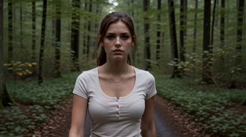</a>

Each 5 second segment repeats subject definitions, a retention analysis and timed beats, with dialogue pinned to exact timestamps. Later segments open with a continue the existing shot instruction that restates camera height, pace and lighting, so the cuts between clips stay seamless.

MiniMax H3 · Reference-to-video · Source: [@EndFolding79421 on X](https://x.com/EndFolding79421/status/2102448683245502844) · 149 likes on 2026-10-28 · found via [SkyNotSilent/awesome-MiniMax-H3-cases](https://github.com/SkyNotSilent/awesome-MiniMax-H3-cases)

[`chained-segments`](tags.md#tag-chained-segments) [`dialogue`](tags.md#tag-dialogue) [`forest`](tags.md#tag-forest) [`tracking-shot`](tags.md#tag-tracking-shot) [`character-consistency`](tags.md#tag-character-consistency)

<details><summary><b>Prompt</b></summary>

```text
==============================
SEGMENT 1 — SHOT (5 SECONDS)
==============================

subject_definitions:
<Subject 1> is Grace, whose face, hair, body and outfit come entirely from <Picture 1>.

summary:
[reference generation] Grace walks alone through a forest, looking for someone.

retention_analysis:
Grace: fully_preserved - identical face, hair, body and clothing.

detailed_description:
[Shot 1] Realistic cinematic live-action, 16:9. A continuous medium tracking shot facing Grace as she walks along a forest trail. Natural overcast daylight.

00:00-00:02:
Grace walks toward the camera at a relaxed pace, looking slightly irritated. The camera tracks backward, keeping her waist-up.

At 00:02.000:
[speaking, English, young woman, slight Southern accent, irritated]
"Where the hell is she?"

00:03-00:05:
Grace continues walking at the same pace, looking ahead. The camera maintains its position and distance. She is still walking at the end.

overall_soundscape:
Natural footsteps, forest ambience and dialogue.

non_diegetic_music:
N/A

==============================
SEGMENT 2 — CONTEXT (5 SECONDS)
==============================

subject_definitions:
<Subject 1> is Grace, whose appearance comes from <Picture 1>.
<Subject 2> is Linda, whose appearance and clothing come entirely from <Picture 2>.

summary:
[reference generation] Grace continues walking. Linda enters from offscreen and joins Grace. Both women walk together.

retention_analysis:
Grace: fully_preserved.
Linda: fully_preserved - identical appearance and clothing from <Picture 2>.

detailed_description:
[Shot 1] Continue the existing cinematic tracking shot, matching the previous camera position, movement and lighting.

00:00-00:03:
Grace continues walking at exactly the same pace. The camera tracks backward at the same height and distance. No changes to the existing scenery or lighting.

00:03-00:05:
Linda walks naturally into frame from the side and joins Grace, matching her walking speed.

At 00:03.500:
[Linda speaking, English, young woman, warm conversational voice, playful]
"Looking for me?"

Both women remain in frame, still walking together as the segment ends.

overall_soundscape:
Continuous footsteps, forest ambience and natural dialogue.

non_diegetic_music:
N/A

==============================
SEGMENT 3 — CONTEXT (5 SECONDS)
==============================

subject_definitions:
<Subject 1> is Grace, from <Picture 1>.
<Subject 2> is Linda, from <Picture 2>.

summary:
[reference generation] Grace and Linda continue walking together, exchanging a short conversation.

retention_analysis:
Grace and Linda: fully_preserved - consistent faces, hair, clothing and body proportions.

detailed_description:
[Shot 1] Continue the existing uninterrupted cinematic tracking shot. Both women remain visible, walking side by side.

00:00-00:02:
Both women continue walking at the same speed. Maintain their positions, camera distance, lighting and natural movement.

At 00:02.000:
[Grace speaking, English, same slight Southern accent, curious and irritated]
"Where have you been?"

At 00:03.500:
[Linda speaking, English, same warm conversational voice, amused]
"Long story."

00:04-00:05:
Grace gives Linda an annoyed sideways glance. Linda smiles slightly. Both continue walking naturally.

overall_soundscape:
Continuous footsteps, forest ambience and natural dialogue.

non_diegetic_music:
N/A
```

</details>

<a id="h3-kids-counting-morphing-numbers-educational"></a>
### Kids Counting Video With Morphing Numbers

<a href="https://x.com/Strength04_X/status/2084552480554446929"></a>

Every number follows one fixed learning pattern, and each shape morphs into the next, so the sequence flows. Timestamped beats pair narrator lines with a highlight color per number, and a recap closes the clip.

MiniMax H3 · Text-to-video · Source: [@Strength04_X on X](https://x.com/Strength04_X/status/2084552480554446929) · 148 likes on 2026-10-28 · found via [SkyNotSilent/awesome-MiniMax-H3-cases](https://github.com/SkyNotSilent/awesome-MiniMax-H3-cases)

[`educational`](tags.md#tag-educational) [`kids`](tags.md#tag-kids) [`3d-animation`](tags.md#tag-3d-animation) [`morph-transition`](tags.md#tag-morph-transition) [`timestamped`](tags.md#tag-timestamped)

<details><summary><b>Prompt</b></summary>

```text
Create a 15-second animated educational video that teaches young children the numbers 1, 2, 3, and 4.
Learning pattern for every number:
NUMBER → COUNT SOUND → OBJECTS → PLAYFUL ACTION → NUMBER NAME
Target audience: children ages 3 to 6.
Visual style: Adorable rounded 3D characters, soft pastel colors, gentle expressions, premium minimalist tech aesthetic clean white space, soft studio lighting, smooth gradients, rounded geometry, crisp typography, polished transitions. Clean off-white background with a different soft color glow behind each number.
0:00–0:01 Intro: Star mascot bounces in, numbers float around it, text "Let's count!", tap creates ripple revealing "1".
0:01–0:04 | 1 is for One Sun: Large "1" shown, narrator: "One. Just one. One Sun." The 1 transforms into a smiling sun with soft rays. One gentle pulse of light. Word "ONE SUN" appears, highlight "1" in yellow.
0:04–0:07 | 2 is for Two Birds: The sun's rays curve into a "2." Narrator: "Two. Two Birds." The 2 splits gently into two round bluebirds that flutter and land side by side. Word "TWO BIRDS," highlight "2" in blue.
0:07–0:10 | 3 is for Three Flowers: The birds' wings curl into a "3." Narrator: "Three. Three Flowers." The 3 blooms into three pink flowers swaying gently. Word "THREE FLOWERS," highlight "3" in pink.
0:10–0:13 | 4 is for Four Fish: The flower stems bend into a "4." Narrator: "Four. Four Fish." The 4 splits into four little green fish swimming in a soft circle. Water ripple effect. Word "FOUR FISH," highlight "4" in green.
0:13–0:15 Recap: Sun, birds, flowers, fish appear as four tiles with "1 2 3 4" above. Mascot points to each; Narrator: "1, 2, 3, 4. Great counting!" Sparkle + chime.
Requirements: Keep each number visible before morphing, smooth shape transitions, no clutter, no scary faces, gentle squash-and-stretch, synced sound effects, calm and polished finish.

Prompt idea - @umesh_ai #MiniMaxH3
```

</details>

<a id="h3-kinetic-kanji-motion-graphics-street-dancer-cm"></a>
### Kinetic kanji motion graphics ad with street dancer

<a href="https://x.com/tanabe_fragm/status/2090306302966919515"></a>

A global style paragraph locks a four color palette and a fixed character design. Thirteen timestamped shots then each give a graphic action, a character action and a camera move with amplitude and speed, closing on a static identity card.

MiniMax H3 · Text-to-video · Source: [@tanabe_fragm on X](https://x.com/tanabe_fragm/status/2090306302966919515) · 132 likes on 2026-10-28 · found via [SkyNotSilent/awesome-MiniMax-H3-cases](https://github.com/SkyNotSilent/awesome-MiniMax-H3-cases)

[`motion-graphics`](tags.md#tag-motion-graphics) [`typography`](tags.md#tag-typography) [`anime`](tags.md#tag-anime) [`commercial`](tags.md#tag-commercial) [`multi-shot`](tags.md#tag-multi-shot)

<details><summary><b>Prompt</b></summary>

```text
----------------------
integrated_multimodal_description:
2D-animated, a bold graphic-design motion-graphics commercial in 16:9 with exactly 13
distinct cuts at 24fps. This film is 85% kinetic graphic design and 15% character action:
giant kinetic Japanese typography, hard-edged flat shapes, split screens, halftone, speed
lines, torn-paper reveals and shutter flashes. Palette, strictly four colors: fluorescent
orange, deep black, off-white, silver grey. The recurring character is a young anime street
dancer with a black chin-length bob and blunt bangs, sharp confident eyes, an oversized
off-white track jacket with fluorescent-orange sleeve stripes, black cargo shorts, and
chunky white sneakers with fluorescent-orange lines. Preserve her exact face, proportions,
hairstyle, outfit, materials and colors throughout; never redesign her. Every graphic
element moves fast and snaps hard on the beat.

[Shot 1] On a deep black field, a massive off-white circle slams into frame left of center,
then two fluorescent-orange bars wipe across the upper and lower thirds, then the Japanese
kanji "烈" builds itself stroke by stroke in off-white at the center until it is complete.
The camera shakes slightly with small amplitude at fast speed on each impact.

[Shot 2] At 00:01.000, the camera cuts to an off-white field where four black squares
rotate into the center one at a time. The largest square opens as a porthole revealing an
extreme close-up of the dancer's ice-sharp eye glancing up, then a red-and-cyan split flash
tears across the edges and the squares shatter into flat shards. The camera pushes in with
small amplitude at fast speed.

[Shot 3] At 00:02.000, the camera cuts to an off-white field filled by an enormous black
kanji "烈". The dancer sprints in from frame left, power-slides along the baseline of the
typography, and fluorescent-orange ink splatter trails behind her as speed lines streak
past. The camera trucks left with large amplitude at fast speed. The kanji stays fully
readable before she crosses in front of it.

[Shot 4] At 00:03.100, the camera cuts to a vertical triptych of fluorescent-orange, deep
black and off-white panels. Her flat silhouette appears in each panel in stroboscopic
freeze, one after another — takeoff, mid-air tuck, landing — while giant vertical silver
text "全速" scrolls upward behind the panels. Static shot.

[Shot 5] At 00:04.000, the camera cuts to a black field where a giant tilted ring of
fluorescent-orange Japanese characters reading "止マルナ" rotates. The dancer leaps through
the center of the ring, spins once in mid-air, and the characters break off and scatter
outward as flat shards. The camera arcs with large amplitude at fast speed, then snap-zooms
onto her confident face.

[Shot 6] At 00:05.100, the camera cuts to a clean off-white editorial card holding a huge
black kanji "跳" with one orange diagonal slash. She vaults over the word itself, plants her
palm on its left radical, the character compresses like a spring under her hand, then
rebounds as her legs whip across the frame. Static shot.

[Shot 7] At 00:06.000, the camera cuts to a full fluorescent-orange field crossed by one
thick black diagonal stripe. She back-flips along the stripe in three stroboscopic ghost
frames tinted black, off-white and silver grey, while a large outlined kanji "回" rotates
180 degrees in sync with her rotation. The camera rolls clockwise with small amplitude at
fast speed.

[Shot 8] At 00:07.000, the camera cuts to an off-white field with a hard black band. Four
bold black kanji slam in one at a time at different scales and angles — "速", then "鋭",
then "静", then "烈" — each landing with a white shutter flash and an orange impact mark,
while she slides on her knees across the foreground, jacket flaring. The camera shakes
slightly with small amplitude at fast speed.

[Shot 9] At 00:08.000, the camera cuts to a black frame where a white wireframe grid tilts
away in 3D. She runs up the grid like a wall, kicks off it, and hangs frozen in mid-air as
a fluorescent-orange circle stamps around her pose like a target lock with silver UI
brackets and tick marks. The camera tilts up with small amplitude at slow speed.

[Shot 10] At 00:09.000, the freeze releases and the camera cuts to layered flat-color panes
stacked toward the lens. She dives straight at the camera, the panes tear open one at a
time like thick paper, and each tear reveals a larger portion of the black kanji "烈"
behind, before her sneaker wipes across the foreground. The camera pulls out with large
amplitude at fast speed.

[Shot 11] At 00:10.100, the camera cuts to a rapid-fire montage of four full-screen graphic
posters of her in different action poses — mid-flip, sliding, landing, hands in pockets —
snapping past with hard cuts, each with an oversized silver number 01 to 04, a black
barcode strip and thick diagonal slashes. Static shot.

[Shot 12] At 00:11.100, the camera cuts to a clean off-white cyclorama for the hero moment.
She lands a final backflip dead center in slow motion, straightens with both hands in her
pockets, and a shockwave of concentric fluorescent-orange rings blasts outward from her feet
carrying shattered fragments of the kanji "烈" with it, then the frame overexposes toward
white. The camera pushes in with small amplitude at slow speed.

[Shot 13] At 00:13.000, the camera cuts to the final identity card on a pale off-white
field. An enormous black kanji "烈" dominates the frame with translucent orange rings and
thin technical arcs behind it, the silver-grey word "RETSU" sits directly beneath the kanji,
and she stands relaxed at the lower center overlapping the bottom of the strokes with her
jacket rippling. One thin orange pulse sweeps horizontally through the typography and holds
cleanly until exactly 15.000 seconds. Static shot.

Editing: extremely aggressive rhythm — hard cuts on every beat, graphic matches, whip pans,
snap zooms, stroboscopic freezes, foreground wipes, split flashes and impact shakes. Every
cut must feel compositionally different. All Japanese typography is always fully readable
before the character overlaps it. No weapons, no combat, no fire, no explosions; all energy
comes from motion design, ink, torn paper, wind and her street-dance athleticism. No
photorealism, no 3D rendering, no gradients, no browser interface, no player controls, no
subtitles, no captions, and no text other than the Japanese characters named above.
Exactly 13 cuts.

overall_soundscape:
Sneaker impacts, knee slides and landings hit hard against a clean room tone. Ink splatters
burst, thick paper tears open, and flat panels shatter like glass. Sharp whooshes carry the
color wipes and typography slams, with small shutter clicks on each flash. No dialogue.

non_diegetic_music:
An original 15-second drum-heavy breakbeat with a deep sub bass, hard snare hits, risers and
glitch fills locked to every cut. Begin with a single impact, build tightly through the
middle, peak at the landing at 00:11.100, and end with a cold electronic logo sting that
resolves at 15.000 seconds.
```

</details>

<a id="h3-dragon-cave-emergence-three-shot-takeoff"></a>
### Armoured rider dragon bursts from mountain cave

<a href="https://x.com/MadMax_Series/status/2083855654205186452">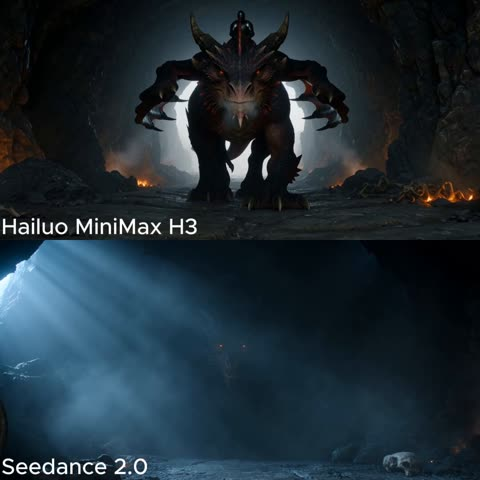</a>

Locks the dragon and rider design in separate master blocks, then splits the 15 seconds into three timed shots joined by hard cuts. Each shot names its own camera move (backward dolly, side tracking reveal, rear pursuit), and the lighting section keeps the dark cave readable.

MiniMax H3 · Text-to-video · Source: [@MadMax_Series on X](https://x.com/MadMax_Series/status/2083855654205186452) · 116 likes on 2026-10-28 · found via [SkyNotSilent/awesome-MiniMax-H3-cases](https://github.com/SkyNotSilent/awesome-MiniMax-H3-cases)

[`dark-fantasy`](tags.md#tag-dark-fantasy) [`dragon`](tags.md#tag-dragon) [`multi-shot`](tags.md#tag-multi-shot) [`cinematic`](tags.md#tag-cinematic) [`creature`](tags.md#tag-creature)

<details><summary><b>Prompt</b></summary>

```text
Create a 15-second photorealistic cinematic dark-fantasy sequence in 16:9 widescreen. The video must contain exactly three clearly separated cinematic shots connected by clean hard cuts. No dissolves, morphing transitions or continuous camera orbit.

MASTER DRAGON LOCK:
Show one enormous ancient dragon with a broad powerful body, charcoal-black overlapping scales, subtle dark crimson colouring across its head and neck, two swept-back horns, smaller facial spikes, glowing amber-orange eyes, one long tail and one pair of enormous bat-like wings with dark leathery membranes. The dragon has four legs: two forelegs and two hind legs. Its design, size, horns, colour, anatomy and facial structure remain identical in all three shots. The dragon must feel extremely heavy, ancient and physically realistic.

MASTER RIDER LOCK:
One adult armoured rider is already seated securely in a dark leather saddle on the dragon from the very first frame. The rider wears detailed weathered silver plate armour, dark under-clothing, a fitted medieval helmet with a narrow shadowed visor and a long dark cloak. The rider’s face is never clearly visible. The rider holds leather reins connected to the saddle and remains seated throughout the entire sequence. The rider does not suddenly appear, mount, dismount or change clothing. During the first shot, the rider is naturally hidden behind the dragon’s large head, neck and folded wings.

ENVIRONMENT AND LIGHTING:
The sequence takes place inside a gigantic ancient mountain cave. The cave contains rough black rock walls, enormous stone formations, drifting mist, scattered bones and faint glowing embers between cracks in the ground. The far interior is almost black, but the dragon must remain readable through soft amber reflections and cold blue rim light entering from the cave mouth. The cave entrance opens from a high mountain cliff into a vast dramatic landscape of jagged mountains, deep valleys, distant waterfalls, rolling clouds and pale stormy daylight. Maintain a cinematic cold-blue and muted-amber colour palette with deep shadows, volumetric light rays and realistic atmospheric haze. Dark and mysterious, but never so underexposed that the dragon or rider becomes blurry or invisible.

SHOT 1 — DRAGON EMERGES, 0–5 SECONDS:
Begin with a symmetrical low frontal wide shot positioned near the cave entrance, facing deep into the darkness. The camera slowly tracks backward toward the entrance as the enormous dragon walks forward out of the black cave interior. The dragon’s wings remain completely folded against both sides of its body. Its glowing amber eyes appear first, followed by its horned head, shoulders and powerful forelegs becoming visible through the mist.

Each heavy footstep shakes the cave floor and dislodges small stones and dust from the ceiling. The dragon exhales dense vapour from its nostrils and releases a deep restrained growl. Its head moves naturally with the weight of each step. The dragon looks directly past the camera toward the cave opening. The rider is already seated but remains hidden behind the dragon’s head and neck. Do not reveal the rider clearly during this shot.

SHOT 2 — RIDER REVEAL, 5–9 SECONDS:
Clean hard cut to a low three-quarter side tracking shot beside the moving dragon. Begin close to the dragon’s horned head and sharply detailed scales. Track smoothly backward along the dragon’s neck and folded wing while the dragon continues walking toward the cave entrance.

As the camera reaches the dragon’s shoulder, reveal the single armoured rider seated in the saddle between the folded wings. Hold the composition long enough to clearly show the rider’s silver armour, helmet, dark cloak and both hands gripping the reins. The rider looks toward the bright cave exit and leans slightly forward in preparation for takeoff. The dragon and rider remain in continuous forward motion. Do not show a separate rider anywhere else in the cave.

SHOT 3 — REAR TAKEOFF AND FLIGHT, 9–15 SECONDS:
Clean hard cut to an epic wide rear view positioned behind and slightly above the dragon and rider. The bright cave mouth and vast mountain landscape fill the background ahead of them. The dragon accelerates into a powerful run toward the cave opening while its wings remain folded enough to pass safely through the cave.

The dragon reaches the cliff edge and makes one forceful leap completely out of the cave. Only after clearing the rock opening, it spreads both enormous wings to their full symmetrical width. The sudden wing expansion pushes mist, dust and loose stones outward from the cave entrance. The rider leans forward, grips the reins and remains firmly attached to the saddle.

The dragon performs one enormous downward wingbeat, catches the air and transitions naturally into stable forward flight. Loose stones fall from the cliff beneath it. The camera rapidly follows from behind as the dragon and rider soar away over the deep valley between jagged mountain peaks. The long tail streams naturally behind the dragon and the rider’s cloak whips in the wind. End on a majestic wide rear silhouette of the dragon flying into the open mountain landscape as sunlight breaks through the storm clouds.

CAMERA AND MOTION:
Premium cinematic camera movement with realistic scale and parallax. Shot one is a controlled backward dolly. Shot two is a smooth low side-tracking reveal. Shot three is a dynamic rear pursuit shot that follows the takeoff out of the cave. Use natural motion blur only during the leap and wingbeat. Keep the dragon’s movement heavy on the ground and powerful but graceful in the air. No shaky chaotic framing and no extreme close-ups that obscure the action.

CINEMATIC QUALITY:
Big-budget photorealistic dark-fantasy visual effects, highly detailed scales and armour, realistic creature muscles beneath the skin, physically accurate wing membranes, believable foot contact, convincing dust and falling-rock physics, volumetric cave mist, dramatic rim lighting, strong depth, atmospheric perspective and stable character consistency.

AUDIO:
No dialogue and no music. Deep dragon breathing, restrained growl, heavy echoing footsteps, claws scraping stone, armour movement, leather saddle creaking, falling pebbles, rushing cave wind, powerful wingbeat and a deep dragon roar as it enters open air.

STRICT CONSISTENCY:
Exactly one dragon and one rider. The rider is seated on the dragon from the beginning and never disappears. No additional people, dragons or creatures. No dragon transformation or colour change. No extra heads, horns, tails, wings, legs or riders. The wings remain folded inside the cave and open only after the dragon has completely cleared the cave mouth. The wings must not clip through the cave walls. The rider must not float above the saddle or merge into the dragon. No fire breathing, combat, dialogue, text, logos, blood or visible injuries.
```

</details>

<a id="h3-suburban-backyard-sky-falls-handheld-phone-video"></a>
### Suburban backyard where the sky falls

<a href="https://x.com/cocktailpeanut/status/2086879654116495564">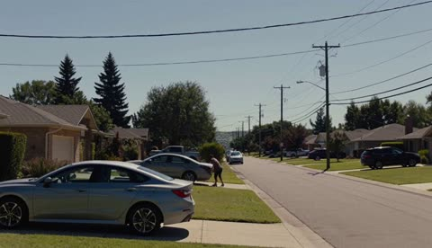</a>

The prompt spends the first half on a deliberately mundane handheld scene with ambient sound, then drops one impossible event with a sound cue (a cracking noise) as the trigger. The negative instruction against cinematic buildup and surreal style keeps the footage feeling like a real home recording, and the camera falling to the ground ends it.

MiniMax H3 · Text-to-video · Source: [@cocktailpeanut on X](https://x.com/cocktailpeanut/status/2086879654116495564) · 113 likes on 2026-10-28 · found via [SkyNotSilent/awesome-MiniMax-H3-cases](https://github.com/SkyNotSilent/awesome-MiniMax-H3-cases)

[`handheld`](tags.md#tag-handheld) [`disaster`](tags.md#tag-disaster) [`realistic`](tags.md#tag-realistic) [`sound-design`](tags.md#tag-sound-design) [`single-shot`](tags.md#tag-single-shot)

<details><summary><b>Prompt</b></summary>

```text
A hyper-realistic handheld phone video of a quiet suburban backyard on a bright normal afternoon. A person casually waters plants near a fence while birds chirp, distant traffic hums, and everything feels completely ordinary and mundane. The camera drifts naturally like a real home video, capturing the lawn, patio furniture, and blue sky with soft white clouds. After several seconds of normal peaceful activity, a deep cracking sound suddenly comes from above. Without warning, the entire sky begins dropping straight downward like a gigantic solid ceiling, with the blue sky and clouds moving as one physical surface descending toward the yard. The person looks up in shock just as the sky rapidly fills the frame, swallowing the scene in a terrifying instant. The camera jerks and falls to the ground at the last moment. No cinematic buildup, no surreal visual style, it should feel like a totally normal real-life recording interrupted by one sudden impossible and visceral event.
```

</details>

<a id="h3-fashion-mv-sofa-stand-kinetic-typography-template"></a>
### Fifteen second anime fashion MV with kinetic typography

<a href="https://x.com/studio_oneroom/status/2097255890391077338">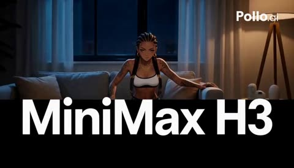</a>

A fixed 20 shot timecode table gives every cut a duration and a camera move, and one continuous action (stand up, walk past, look back) is covered from many angles. Editable slots for text, BPM and colours sit at the top, and the text is layered in three depth planes that move at different speeds.

MiniMax H3 · Reference-to-video · Source: [@studio_oneroom on X](https://x.com/studio_oneroom/status/2097255890391077338) · 110 likes on 2026-10-28 · found via [SkyNotSilent/awesome-MiniMax-H3-cases](https://github.com/SkyNotSilent/awesome-MiniMax-H3-cases)

[`fashion-mv`](tags.md#tag-fashion-mv) [`kinetic-typography`](tags.md#tag-kinetic-typography) [`template`](tags.md#tag-template) [`anime`](tags.md#tag-anime) [`multi-shot`](tags.md#tag-multi-shot)

<details><summary><b>Prompt</b></summary>

```text
# 【ここだけ変更】
参照画像を添付し、以下の「」内とBPMの数値だけを書き換える。
本文も含めて全文をコピーして使用する。このテンプレートは15秒・20カット固定。

## 表示文字
文字列A = 「GPT-6」
文字列B = 「Astra」
文字列C = 「MiniMax H3」
文字列D = 「AI STUDIO」
文字列E = 「ONEROOM」

## 音楽
BPM = 160
音楽ジャンル = 「ファッション・エレクトロ」
音楽の質感 = 「強いビート、硬質な打音、細かいリズム、跳ねる低音」

## 画面とグラフィック
書体 = 「太いサンセリフ」
暗色 = 「黒」
明色 = 「白」
アクセント色 = 「淡い金色」

## 舞台
部屋の雰囲気 = 「夜の落ち着いた部屋」
照明 = 「青い窓明かりと暖かなランプ光」

# 【設定ここまで／以下は変更不要】

15秒、設定した画面比率のハイテンポなファッションMV。
冒頭の設定を全編に適用する。設定名や説明文は画面に表示しない。

# 主人公と参照画像
添付した参照画像の人物を主人公にする。
顔立ち、外見の特徴、髪型、髪色、体格、衣装、靴、既存のアクセサリーを反映し、全カットで同一人物として維持する。
アニメやイラストなら線・塗り・質感を、写真なら写真的な見た目と質感を維持する。
固定の性別、髪色、衣装、靴、画風を別途当てはめない。

キャラクターシート内の複数の姿は同一人物の資料として扱う。
登場人物は主人公1人。参照画像の背景、枠線、並列配置は使わない。
画像で確認できない部分は、見えている外見や服装に合う簡潔な形で補完し、全カットで固定する。
髪や衣服などの揺れは、参照画像に存在する可動部分だけで表現する。動きを付けるために髪やアクセサリーを追加しない。

# 人物の動き
主人公の動作は、ソファから立ち上がる、ソファの脇を抜けてレンズの横を通り過ぎる、足を止めて肩越しに一度振り返る、という一連の流れ。
一つの動作を複数のカメラ位置からつなぎ、短いカットごとに別の振り付けを始めない。

立ち上がるときは少し前へ重心を移し、肘掛けに添えた手を支えにして、上体を滑らかに起こす。
移動するときは肩の力を抜き、腕を身体の近くで自然に振る。視線は進む先へ向け、頭の高さを安定させる。髪や衣服の可動部分が動きに少し遅れて揺れる。
振り返るときは先に視線、次に顔、最後に肩がわずかに動く。片足に重心を残し、首と肩の角度で表情を見せる。

手で文字を押す、引く、払う動作や、ビートごとに踏み替えるステップは入れない。
人物の動作は自然な速さでつなぐ。鋭い速度感は、カメラの急加速、前景文字の通過、画角の切り替えで作る。
文字は主人公の立ち上がり、進行方向、身体の向き、視線の変化に反応する。

# 速度と演出
最初のフレームから立ち上がりの途中。カットは主に0.375〜1.125秒。
人物の動作の始点と着地、カメラの移動、文字の反応、カットの切り替えへ、音のアクセントを合わせる。動作の途中を一拍ずつ区切らない。
BPMを変更しても動画は15秒とし、各タイムコードを維持する。音楽の細かなリズムや短い打音でカット位置へアクセントを置き、すべてのカットを拍頭へ強制的に合わせない。
スローモーションや長い導入を入れない。
ムードは設定した照明、顔の陰影、参照画像に合う質感で表す。
文字の叩き込み、短い複製、3分割、字間の伸縮をアクセントにする。3分割では中央だけに人物、左右には文字と図形を配置する。

# 舞台
設定した部屋の雰囲気と照明を反映した、同じ一つの室内。
肘掛けのあるソファと、その背後の壁に窓を配置する。人物の移動とカメラの回り込みができる空間を確保する。
光源と内装の位置は固定し、カメラは室内を大きく移動する。
主人公の移動経路は、ソファの座面前からその脇を抜け、カメラの横まで。全編を同じ室内でつなぐ。

# 文字とグラフィック
表示するのは、設定した文字列A・B・C・D・Eの内容だけ。
各文字列の綴り、大文字小文字、空白、記号を入力どおりに保つ。文字列Aなどの内部呼称、設定項目名、Shot番号、タイムコードは画面へ描かない。
文字数や言語に合わせて大きさと字間を調整し、読む区間では各文字列を1行で画面内に収める。長い文字列は文字サイズを調整する。文字数を勝手に増減させない。

設定した書体による、厚みのない鮮明な2D文字。入力した言語を表示できる同系統の書体で統一する。
グラフィックには暗色・明色・アクセント色の設定を使う。この配色を人物の髪や服へ適用しない。
背景に巨大な文字列Cの輪郭文字、中景に文字を伴わないバー・ドット・円弧、前景に主文字。
背景は横へ、中景は縦へ、主文字は人物の動きに反応して動き、3層の速度差を作る。
背景と前景の同じ綴りは、意図した別層の使用。
人物の手前と背後に文字を置き、カメラ移動で強い視差を作る。腕や身体による遮蔽を自然に保つ。

グラフィックの地色は冒頭で暗色、文字は明色。
00:01.500で地色を明色、00:05.250で暗色、00:11.625で明色へ切り替える。文字色はその都度、地色と反対の設定色へ切り替える。
反転はグラフィック層に適用し、室内の照明と人物の色は固定する。

主文字を左右へ複製するのはShot 7だけ。左右に1つずつ配置した後、区間の終わりで画面外へ抜ける。
Shot 8では人物・全グラフィック・室内の動きを止め、カメラだけを動かす。
終幕の00:14.625以降はカメラを含む全体を止める。それ以外ではカメラとグラフィックの運動をつなぐ。
読む区間では全文を画面内に収め、顔と重ねない。設定した画面比率に合わせて構図、文字の大きさ、余白を調整する。3分割でも人物は中央列に1人だけ配置する。

# シーン
時刻は動画全体の絶対タイムコード。各区間を指定どおり配置し、後半を短縮しない。

[Shot 1] 00:00.000–00:00.750
ソファから立ち上がり途中の主人公へ高速ドリーイン。
上体が起き上がる勢いに合わせて文字列Cが前景へ叩き込まれる。
最後の0.375秒は全文を読ませる。主人公の手は肘掛けを支えている。

[Shot 2] 00:00.750–00:01.125
顔へスナップズーム。立ち上がりながら、主人公の視線が進む方向へ移る。
視線の変化に合わせ、前景文字が横へ抜ける。

[Shot 3] 00:01.125–00:01.500
足元の接写。立ち上がった体重が足裏へ乗る。靴の種類や素足の状態は参照画像の設定を保つ。
自然な荷重の瞬間にアクセント色の短い線が床面を走り、短い打音が重なる。

[Shot 4] 00:01.500–00:02.250
全身ローアングル。
立ち上がり終えた主人公が、一方の肩を引いてソファの脇へ向きを変える。
その方向転換に引かれ、背後の文字列Aが大きく横切る。カメラも低い位置から横へ加速する。

[Shot 5] 00:02.250–00:03.000
斜め正面からのミディアム。主人公の指先が肘掛けから自然に離れる。
身体が進み始めるタイミングで文字列Aが人物の横へ集まり、文字列全体の横幅が一瞬圧縮されて戻る。
カメラは正面へ急接近する。

[Shot 6] 00:03.000–00:03.750
方向転換から最初の一歩へつながる動作。
主人公は足の向きに合わせて上体を回し、髪や衣服の可動部分が少し遅れてついてくる。
カメラは逆方向へ高速オービット。文字列Aは身体の回転に引かれて円弧を描く。

[Shot 7] 00:03.750–00:04.500
主人公が一歩でソファの脇へ出る。
その移動に合わせて2本のバーが画面を3分割する。
中央に移動中の主人公、左右に文字列Aを1つずつ配置し、文字は逆方向へ流れて画面外へ抜ける。
人物の手は自然に下ろしたまま。

[Shot 8] 00:04.500–00:04.875
0.375秒だけのバレットタイム。
歩き出した一歩の途中で、身体、髪、衣装、背景文字、中景の装飾、室内を完全停止する。
カメラだけが約90度、素早く回り込む。
空間内の各要素は動かず、カメラ移動だけで重なりと距離感が変わる。

[Shot 9] 00:04.875–00:05.250
即座に時間再開。主人公は止まっていた一歩をそのまま着地まで続ける。
前へ進む勢いに合わせて文字列Aがレンズ直前を横切り、画面外へ抜ける。
カメラもその通過方向へ鋭く振る。

[Shot 10] 00:05.250–00:06.375
ワイド。続く移動を正面から捉え、カメラは高速で後退する。
主人公は進む先を見て、腕を自然に振りながら近づく。
その前進に合わせて文字列Bの字形を作る要素が左右から集まり、一行に整う。アクセント色の平面円が中央から広がる。
文字が整う瞬間も、主人公の移動は途切れない。

[Shot 11] 00:06.375–00:07.125
カメラが主人公の腰の横を高速通過する。
主人公は進む方向を保ち、レンズの横へ近づく。
文字列Bが背後から手前へ追従し、身体に隠れてから横へ現れる。

[Shot 12] 00:07.125–00:07.875
移動中の肩から顔へ、カメラが短く上がる。
主人公の目線は進む先に向いたまま。頭や肩の輪郭を光がかすめ、髪や衣服の動きが見える。
人物の移動に合わせ、背後の文字列D・文字列Eが上下2行で上がる。
最後の0.375秒は顔を避けた位置で、両方の全文を読ませる。

[Shot 13] 00:07.875–00:08.625
主人公がレンズのすぐ横を通り過ぎる。
肩とその輪郭が前景を大きく横切り、その流れに文字列Bが追従して急接近する。
カメラは同時に後退し、人物と文字の距離差を広げる。

[Shot 14] 00:08.625–00:09.375
短い文字主体のカット。文字列Cを線分から組み上げる。
直前の人物の通過方向を引き継ぎ、中景のバーが高速で横断する。
背景の輪郭文字は別速度で流れ続ける。

[Shot 15] 00:09.375–00:10.125
全身へハードカット。
主人公が最後の一歩を置き、片足へ自然に体重を預けて移動を終える。
その接地に合わせて平面の円弧が外へ広がる。
カメラは床近くから一気に上がり、顔まで捉える。

[Shot 16] 00:10.125–00:10.875
主人公が肩越しに一度だけ振り返る。
先に視線、次に顔が動き、肩がわずかに続く。足の位置は保つ。
カメラは逆方向へ回り込み、文字列Bが肩の背後へ隠れて反対側へ抜ける。

[Shot 17] 00:10.875–00:11.625
俯瞰。直前の振り返りをそのまま続ける。
カメラが斜め下へダイブして顔へ近づき、顔の向きの変化に合わせて文字列Cが画面下から上へ走る。
主人公の腕は身体の脇に自然に下ろされている。

[Shot 18] 00:11.625–00:12.750
各0.375秒の3カット。すべて同じ振り返りの続き。
1：肩と、その周囲の髪や衣服に残る動きを近距離で捉える。
2：片足へ重心を預けた全身を斜め横から捉える。
3：レンズへ向いた顔へ切り替える。
角度とスケールを毎回変え、姿勢と視線をつなぐ。

[Shot 19] 00:12.750–00:13.875
目線の高さの斜め正面。主人公がレンズへ視線を合わせる。
片足に重心を残し、肩の線をわずかに斜めにする。腕は自然に下ろす。
視線が定まるタイミングで、上段に文字列D、下段に文字列Eが左右から集まる。
各1行で正しい間隔へ整列し、顔を避けた位置へ収まる。

[Shot 20] 00:13.875–00:15.000
文字列D・文字列Eの2行を全文表示し続ける。
主人公は前カットの姿勢と表情を保ち、カメラが短く寄る。背景の輪郭文字と中景の装飾は動き続ける。
00:14.625でカメラ、人物、全グラフィックを止める。
最後の0.375秒、主人公の顔と二つの文字列が明瞭な構図を保持して終わる。

# 音
BPMの設定値、4拍子、設定した音楽ジャンルと音楽の質感を使う。
楽器と音色はジャンルに合わせて選び、冒頭からリズムを鳴らす。
動作の始点と着地、カメラの加速、カット、文字の着弾へ音のアクセントを合わせる。
Shot 8の0.375秒だけ低域を薄くし、そのジャンルに合う高域のリズムと残響を残す。Shot 9で低音を即復帰する。
BPMを変えた場合もカット時刻を優先し、細かなリズムや短い打音で指定位置にアクセントを置く。

どちらの場合も歌・セリフ・ナレーションは入れない。
終盤も映像を減速させず、最後の停止に短い打音を合わせて締める。
```

</details>

<a id="h3-morning-selfie-vlog-goddess-transformation-monster-fight"></a>
### Selfie vlog girl becomes goddess fighting monster

<a href="https://x.com/joshesye/status/2084852295607484730">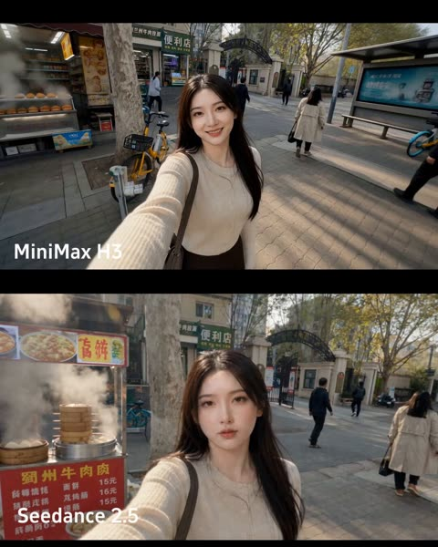</a>

A second by second script covers selfie opening, monster arrival, transformation, fight and return to the ordinary girl. Numbered reference images lock the face, armor and street, while explicit must show lines and a two second final hold stop the transformation and ending from being skipped.

MiniMax H3 · Reference-to-video · Source: [@joshesye on X](https://x.com/joshesye/status/2084852295607484730) · 110 likes on 2026-10-28 · found via [SkyNotSilent/awesome-MiniMax-H3-cases](https://github.com/SkyNotSilent/awesome-MiniMax-H3-cases)

[`reference-images`](tags.md#tag-reference-images) [`action-vlog`](tags.md#tag-action-vlog) [`transformation`](tags.md#tag-transformation) [`chinese-dialogue`](tags.md#tag-chinese-dialogue) [`cinematic-realism`](tags.md#tag-cinematic-realism)

<details><summary><b>Prompt</b></summary>

```text
生成一段 15 秒、写实电影质感的动作 Vlog 视频。主角是一位 24 岁左右的中国女孩

图片1 ，黑色自然长发，清晰可辨的东方面容，五官真实自然，穿着浅色针织上衣和深色半裙。地点是现代中国一线城市清晨街道

图片3 ，小区门口外有包子铺、便利店、公交站牌、共享单车、梧桐树、人行道、中文店招和来往行人。视频开头像手机自拍 Vlog，手持镜头轻微晃动，真实生活感。

0–2 秒：现实女孩图片1 从中国城市小区门口走出来，举着手机自拍，微笑看向镜头。背景是清晨街道、包子铺、便利店、公交站牌和中文店招。镜头是手机前置自拍视角，轻微手持晃动，环境声有早高峰人声、车辆声、早餐店蒸汽声。

2–4 秒：她身后街口突然传来沉重撞击声，一只高大的黑色怪兽从公交站旁冲出，撞翻共享单车，路人惊慌逃散。女孩猛地回头，笑容消失，眼神变冷。镜头快速转向她身后，怪兽清晰出现在画面中央，身形巨大，皮肤粗糙，低吼，脚步震动地面。

4–7 秒：女孩站定，镜头切到中近景，重点拍她完整变身
图片4 。她抬手挡在身前，金色和青色神力从手腕、肩膀、发梢涌出，普通针织上衣被光纹覆盖，逐层变化成中国神话女神战甲
图片2 。战甲有青铜金属纹理、云纹、羽状肩甲和发光腰带，长发被气流扬起，额间浮现金色神印。必须看清从现实女孩变成神话女神的过程，不要一闪而过。她低声说一句中文：“别再往前了。”

7–9 秒：怪兽扑向她。镜头切到低角度广角，女神向前冲刺，脚下地面裂出金色光纹。她侧身躲开怪兽爪击，右手凝聚青金色长刃，反手斩中怪兽手臂，火花和黑色鳞片飞溅。动作要清楚，人物和怪兽都在画面中央，不要只拍光效。

9–11 秒：连续近身打斗。镜头跟随女神绕到怪兽侧面，她跃起踢中怪兽胸口，怪兽后退撞到公交站牌。女神落地后双手结印，身后短暂浮现中国神话女神虚影，云纹神环展开。怪兽再次扑来，她用神力护盾正面挡住冲撞，冲击波吹动路边树叶和中文店招。

11–13 秒：女神抓住怪兽破绽，向前一步，掌心爆发青金色能量，将怪兽击退到街道中央。怪兽倒地低吼，烟尘散开，路人远远停下脚步。镜头轻微晃动，像手机真实拍到这一幕。女神站在街道中央，战甲发光，背后是现代中国城市街景。

13–15 秒：重点保留 2 秒现实女孩状态。女神身上的青金色神光慢慢收回，战甲一层层消散，重新变回最开始那个现实中国女孩图片1 ，浅色针织上衣和深色半裙恢复原样，额间神印消失，长发自然落下。她站在街边，轻轻喘气，看了一眼倒地的怪兽，又转头看向手机镜头，露出一点尴尬又淡定的表情，像什么都没发生一样，小声说一句中文：“上班要迟到了。” 最后画面停留在现实女孩的脸和普通穿搭上，至少保留 2 秒。

全程保持同一个中国女孩的脸，不要变成欧美面孔，不要变成二次元，不要卡通风。最后必须从神话女神明确变回现实女孩，并且现实女孩状态保留完整 2 秒。

打斗部分集中在 7–13 秒，必须有闪避、斩击、踢击、格挡、反击和击退怪兽，不要只用发光和烟雾代替打斗。

全程无字幕、无背景音乐，仅保留城市环境声、怪兽低吼、能量音效、打斗撞击声和人物中文对白。

画面保持写实电影质感，中国城市环境真实，有中文招牌和中国街景细节。
```

</details>

<a id="h3-pink-seoul-korean-fashion-collage-mv"></a>
### Pink Korean Fashion Collage Film With Outfit Changes

<a href="https://x.com/ImaStudio_ai/status/2101981159970480258"></a>

The prompt is split into numbered blocks for identity lock, outfit beats, 2D motion graphics and editorial layout, then closes with a 13 cut storyboard timed to 115 to 125 BPM. Placeholder text in brackets drives the typography, and the last cut assembles every graphic into a magazine cover.

MiniMax H3 · Reference-to-video · Source: [@ImaStudio_ai on X](https://x.com/ImaStudio_ai/status/2101981159970480258) · 106 likes on 2026-10-28 · found via [SkyNotSilent/awesome-MiniMax-H3-cases](https://github.com/SkyNotSilent/awesome-MiniMax-H3-cases)

[`fashion`](tags.md#tag-fashion) [`kpop`](tags.md#tag-kpop) [`collage`](tags.md#tag-collage) [`typography`](tags.md#tag-typography) [`outfit-change`](tags.md#tag-outfit-change)

<details><summary><b>Prompt</b></summary>

```text
Korean Pink Collage Fashion MV (15s, 16:9, 24fps)
【1. Identity Lock】
Absolute character consistency: Only one young Korean-style woman appears throughout the entire video. Strictly preserve the reference image’s facial features, skin tone, long dark-brown slightly wavy hair, bangs, facial structure, and body proportions.
Overall vibe: Asian pop aesthetic, fresh sweet-cool energy, light Y2K influence, balancing cute charm with a polished fashion-editorial feel.
Strict restrictions: No face swapping, no identity drift, no Westernized facial features, no masculine features, no background people, and no second character.
【2. Outfit Beats】
Style lock: Korean sweet-cool girl-group fashion, blending youthful femininity with a slightly mature edge.
Outfit transition logic: Seamlessly switch outfits on camera cut points and musical beats. Wardrobe elements include fitted white or pink knit tops, light-blue denim, Y2K pleated skirts, platform boots, delicate mini bags, and Korean-style earrings.
The character must remain highly consistent across every outfit change.
【3. Motion Graphics】
Visual theme: Pink Pattern Collage Pop.
Main palette: Cream pink, soft pink, peach pink, creamy white, silver-gray, with small accents of black typography.
2D graphic elements: Checkerboard patterns, polka dots, photobooth-style frames, geometric color blocks, and heart outlines.
Avoid realistic 3D materials. Use flat, crisp, graphic 2D elements that slide, overlap, crop, and wipe across the frame dynamically.
【4. Editorial Layout】
Typography: Main titles: [NAME] / [SEOUL POP]
Secondary labels: [SOFT CHIC] / [CUTE SIGNAL] / [TRENDY LOOK] / [KOREAN GIRL]
Layout style: Use oversized background typography, text inside geometric frames, and small sticker-like labels.
Arrange text horizontally, vertically, and diagonally with intentional offset layouts.
Typography should change rapidly with the cuts while always remaining clear and never covering the character’s face.

【5. 13-Cut Fast-Paced Trailer Storyboard | 115–125 BPM】
Cut 1 (0s): Extreme close-up. She slightly lifts her chin and looks directly into the camera. The background is filled with solid pink and an oversized [NAME] title, creating an immediate beauty hook.
Cut 2 (1s): Medium shot. She takes half a step forward and lightly holds her bag strap. The background switches to a pink-and-white checkerboard pattern.
Cut 3 (2s): Full-body shot. Flash outfit transition from a white top into a pink skirt look. She turns back toward camera and freezes briefly.
Cut 4 (3s): Close shot. Playful crouching pose with both hands near her face. Photobooth-style frames quickly slide into the composition.
Cut 5 (4s): Close-up. Camera pushes in slightly for a sharp eye-contact moment. Polka-dot graphics fill the background.
Cut 6 (5s): Medium shot. She turns and adjusts her long hair while large collage typography [SEOUL POP] pops across the frame.
Cut 7 (6s): Low-angle shot. She reaches one hand toward the camera as pink graphic strips slice horizontally across the frame.
Cut 8 (7s): Full-body shot. She shifts her weight and performs another flash outfit change featuring denim elements. The composition becomes cleaner with more negative space.
Cut 9 (8s): Close-up. She looks down slightly, then raises her eyes and smiles softly. Multiple [CUTE SIGNAL] labels appear across the screen.
Cut 10 (10s): Medium shot. She lightly holds the hem of her skirt while the background transforms into large geometric color-block sections.
Cut 11 (11s): Medium shot. She gently touches her earrings with a small, refined gesture. Overlapping color planes shift slightly out of alignment.
Cut 12 (12s): Wide shot. She turns sideways into a preparation pose while all fragmented graphic and typography elements begin converging toward the center.
Cut 13 (13.5–15s): Hero Pose. She stands centered in her strongest fashion pose. Graphics, borders, typography, and collage elements perfectly assemble into one polished Korean fashion magazine cover. Hold the final composition for 0.5 seconds.
```

</details>

<a id="h3-chinese-fantasy-river-night-market-lanterns"></a>
### Moonlit Chinese Fantasy River Town Night Market

<a href="https://x.com/Stellakjbk/status/2084691296472449246"></a>

The reference image is locked as the first frame, and the prompt describes one slow low-angle push forward over the water for depth parallax. Small, varied motions (boats, lanterns, petals, mist) are listed, and a closing list of negatives keeps the shot stable.

MiniMax H3 · Image-to-video · Source: [@Stellakjbk on X](https://x.com/Stellakjbk/status/2084691296472449246) · 104 likes on 2026-10-28 · found via [SkyNotSilent/awesome-MiniMax-H3-cases](https://github.com/SkyNotSilent/awesome-MiniMax-H3-cases)

[`chinese-fantasy`](tags.md#tag-chinese-fantasy) [`night-scene`](tags.md#tag-night-scene) [`lanterns`](tags.md#tag-lanterns) [`cinematic`](tags.md#tag-cinematic) [`camera-push`](tags.md#tag-camera-push)

<details><summary><b>Prompt</b></summary>

```text
以参考图为首帧，保持原有构图、建筑布局、人物服饰与蓝紫色东方幻想夜景风格不变。

5秒电影级连续镜头：镜头从河面上方以低机位缓慢向前推进，轻微掠过前景乌篷船，形成自然的前中后景视差。夜市人群熙熙攘攘地流动，岸边行人缓步穿行、驻足交谈、摊贩招呼客人，动作细微但丰富，避免所有人同步运动。河面上的小船沿不同方向缓慢划行，船夫自然摆动船桨，船身随水波轻轻起伏。两岸灯笼被晚风吹得轻微摇晃，暖黄色灯火自然闪烁，倒影在水面上被船桨和涟漪缓缓拉开。紫藤花穗随风摆动，少量花瓣飘落，远处瀑布持续流淌，山间薄雾与云层缓慢移动，月光洒在水面形成流动的银蓝色高光。

整体节奏繁华但不混乱，画面稳定、动作真实、层次丰富，具有东方古城夜游的沉浸感。运镜平滑克制，无突然加速、无镜头抖动、无建筑变形、无人脸扭曲、无人物闪现、无物体穿模、无新增大型元素，保持高细节、电影级光影与史诗感。
```

</details>

<a id="h3-backyard-hammock-afternoon-nap-dv-camcorder"></a>
### Sleepy Afternoon Nap in a Backyard Hammock

<a href="https://x.com/Strength04_X/status/2085009719371190553"></a>

A fixed block structure (subject, location, style, camera, timeline, audio) is followed by a timeline of ten 3 second beats, each holding one small action. The early 2000s DV camcorder look, the Korean lines with English translations, and a sound list that rules out music keep the 30 second clip candid and consistent.

MiniMax H3 · Text-to-video · Source: [@Strength04_X on X](https://x.com/Strength04_X/status/2085009719371190553) · 103 likes on 2026-10-28 · found via [SkyNotSilent/awesome-MiniMax-H3-cases](https://github.com/SkyNotSilent/awesome-MiniMax-H3-cases)

[`hammock`](tags.md#tag-hammock) [`dv-camcorder`](tags.md#tag-dv-camcorder) [`documentary-realism`](tags.md#tag-documentary-realism) [`timeline-prompt`](tags.md#tag-timeline-prompt) [`korean-dialogue`](tags.md#tag-korean-dialogue)

<details><summary><b>Prompt</b></summary>

```text
Main Subject:
Young Korean woman, early 20s, oversized soft cardigan over shorts, hair loose and slightly messy, relaxed sleepy expression, natural unguarded energy.
Location:
Small backyard with a hammock strung between two trees, early afternoon. Dappled sunlight through leaves, a small side table with a book, quiet garden sounds. No modern clutter.
Visual Style:
Ultra-realistic documentary realism, intimate candid feeling, soft warm afternoon light.
Camera Style:
Early 2000s DV camcorder, handheld gentle drift, autofocus adjusting slowly to shifting light through leaves, warm faded color cast, soft grain. No stabilization.
Timeline (30 sec):
00:00–00:03 → She climbs into the hammock carefully, adjusting her position.
00:03–00:06 → She picks up a book from the side table, flipping to her page.
00:06–00:09 → She reads quietly for a moment, then yawns softly.
00:09–00:12 → She sets the book on her stomach, then closes her eyes briefly.
00:12–00:15 → A breeze sways the hammock gently; she smiles without opening her eyes.
00:15–00:18 → She peeks one eye open at camera saying "여기 진짜 시원하다" ("It's really cool here").
00:18–00:21 → She stretches one arm lazily, then lets it dangle off the hammock.
00:21–00:24 → Dappled light shifts across her face as leaves move overhead.
00:24–00:27 → She murmurs sleepily, then closes her eyes again, fully relaxed.
00:27–00:30 → She whispers to camera "나 좀 잘게..." ("I'm going to sleep a bit..."), drifting off as it fades.
Audio:
Leaves rustling, hammock creaking softly, distant birds, faint wind. Her dialogue as noted above. No music.
Goal: A calm, drowsy afternoon rest moment intimate, soft, deeply believable.
```

</details>

<a id="h3-cat-shelters-abandoned-puppy-rainy-night"></a>
### Cat shelters abandoned puppy in rainy cardboard box

<a href="https://x.com/ZarnishNael/status/2112189056817787267"></a>

The prompt is a short story told as a chronological arc: meeting, storm, next morning, scavenging, sunset. A named animal protagonist gives the model a consistent subject. Each beat states an emotional shift, so the 15s clip can carry a full narrative.

MiniMax H3 · Text-to-video · Source: [@ZarnishNael on X](https://x.com/ZarnishNael/status/2112189056817787267) · 101 likes on 2026-10-28 · found via [SkyNotSilent/awesome-MiniMax-H3-cases](https://github.com/SkyNotSilent/awesome-MiniMax-H3-cases)

[`animals`](tags.md#tag-animals) [`storytelling`](tags.md#tag-storytelling) [`emotional`](tags.md#tag-emotional) [`rain`](tags.md#tag-rain) [`narrative-arc`](tags.md#tag-narrative-arc)

<details><summary><b>Prompt</b></summary>

```text
Popo, a cat, finds a puppy abandoned in a cardboard box under the eaves. At first, Popo acts cold and indifferent, but when heavy rain begins, the cat bravely shields the puppy from the storm and spends the night keeping it warm beneath its belly.

By the next morning, a bond has formed between them. They begin facing the harsh life of stray animals together—Popo suppressing its own hunger to give the puppy its prey, even sneaking into a supermarket in search of food. Eventually, with the kindness and help of people around them, the two manage to get something to eat. As they cuddle together beneath the setting sun, they develop a deep and genuine bond that transcends species.
```

</details>

<a id="h3-morning-skincare-serum-commercial"></a>
### Morning skincare ritual ending on serum hero shot

<a href="https://x.com/Maercihh/status/2083407991114805571"></a>

An uploaded storyboard guides eight timed shots, and each shot ends with a transition line that hands the camera move to the next one, which produces seamless match cuts. A closing style block locks the lenses, lighting and consistency rules so the woman, room and product stay the same.

MiniMax H3 · Reference-to-video · Source: [@Maercihh on X](https://x.com/Maercihh/status/2083407991114805571) · 97 likes on 2026-10-28 · found via [SkyNotSilent/awesome-MiniMax-H3-cases](https://github.com/SkyNotSilent/awesome-MiniMax-H3-cases)

[`commercial`](tags.md#tag-commercial) [`skincare`](tags.md#tag-skincare) [`storyboard`](tags.md#tag-storyboard) [`match-cut`](tags.md#tag-match-cut) [`macro`](tags.md#tag-macro)

<details><summary><b>Prompt</b></summary>

```text
Use the uploaded storyboard as the camera guide. Follow all 8 frames in order with smooth cinematic continuity. The same woman, outfit, hairstyle, makeup, room and product must remain perfectly consistent throughout the entire 15-second commercial. Every shot must begin where the previous shot ends with seamless match cuts and natural camera movement.

Shot 1 (0-1.8s)
A slow push in as morning sunlight enters through the window. The woman looks outside and gently turns toward the mirror. The camera continues moving without stopping.

Transition:
The camera keeps pushing forward until her face fills the frame.

Shot 2 (1.8-3.6s)
Without cutting, the shot becomes a close-up of her face in the mirror. She notices dull skin and lightly touches her cheek. The camera slowly circles around her as she reaches toward the vanity.

Transition:
Follow her hand naturally to the serum bottle.

Shot 3 (3.6-5.4s)
Macro shot as she picks up the serum bottle. The bottle rotates slightly in her hand while natural sunlight reflects across the glass. The camera smoothly follows the bottle upward.

Transition:
Continue tracking into an extreme macro of the dropper.

Shot 4 (5.4-7.2s)
Extreme macro of the dropper lifting from the bottle. A single drop forms and falls in slow motion. The camera follows the drop as it lands on her fingertips.

Transition:
The camera continues following her fingertips toward her face.

Shot 5 (7.2-9.0s)
Close-up as she gently applies the serum across her cheeks using smooth circular motions. Skin catches soft natural highlights. Hair moves slightly in the breeze.

Transition:
The camera slowly rotates around her face while maintaining eye level.

Shot 6 (9.0-11.1s)
The lighting naturally becomes warmer as her skin appears healthier and more radiant. The transformation happens gradually, not instantly. She smiles softly while looking into the mirror.

Transition:
She turns away from the mirror and walks toward the window as the camera follows.

Shot 7 (11.1-13.2s)
Medium shot as she confidently walks into warm sunlight. She smiles naturally at the camera while the background softly blurs. The camera slowly arcs around her.

Transition:
She lowers the product toward the camera until it fills the frame.

Shot 8 (13.2-15.0s)
Hero product shot. The serum bottle stands on a clean surface with warm natural daylight. Soft reflections move across the glass. Premium end card with elegant typography and subtle camera push in. End on the product with "Shop Now."

Overall style:
Ultra photorealistic luxury skincare commercial, Apple-style cinematography, ARRI Alexa 65, 50mm and 85mm lenses, soft natural daylight, realistic skin texture, premium color grading, physically accurate lighting, smooth cinematic camera movement, seamless match cuts, invisible transitions, no jump cuts, no frame skipping, no character changes, no outfit changes, no background changes, premium beauty ad quality.

#MiniMaxH3 @Hailuo_AI
```

</details>

<a id="h3-derelict-spaceship-classroom-reveal-dialogue"></a>
### Derelict spaceship door opens onto school classroom

<a href="https://x.com/cocktailpeanut/status/2085498501384024495">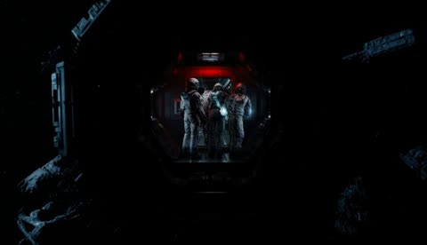</a>

Each spoken line is written out and placed at a specific beat, so the model delivers speech with the right tone and timing. A closing audio list covers static, hum, footsteps, door hiss, then classroom sound, which supports the suspense to absurd reveal.

MiniMax H3 · Text-to-video · Source: [@cocktailpeanut on X](https://x.com/cocktailpeanut/status/2085498501384024495) · 96 likes on 2026-10-28 · found via [SkyNotSilent/awesome-MiniMax-H3-cases](https://github.com/SkyNotSilent/awesome-MiniMax-H3-cases)

[`sci-fi`](tags.md#tag-sci-fi) [`dialogue`](tags.md#tag-dialogue) [`suspense`](tags.md#tag-suspense) [`audio-cues`](tags.md#tag-audio-cues) [`plot-twist`](tags.md#tag-plot-twist)

<details><summary><b>Prompt</b></summary>

```text
cinematic sci-fi suspense video. A realistic spaceship crew in full futuristic uniforms follows a mysterious distress signal and boards a dark, abandoned spacecraft drifting in space. Flashlights cut through darkness as they move cautiously through narrow metallic corridors. Warning lights flicker, metal creaks, and their boots echo on the floor. One crew member says, "Signal's coming from deeper inside." They enter a large chamber filled with hundreds of empty cryogenic pods, all open and abandoned. Another crew member says nervously, "Where did everyone go?" They approach a final closed door at the far end. The captain slowly opens it, and instead of another ship compartment, it reveals a completely normal present-day elementary school classroom in bright daylight. Children sit at desks, backpacks on the floor, colorful posters on the walls, and a teacher at the front turns to the crew and scolds them: "You're late again. Take your seats." The astronauts stand frozen in confusion at the doorway. Realistic tone, smooth camera movement, strong suspense buildup, with the final reveal clear, sudden, and absurd. Include realistic audio: radio static, low ship hum, footsteps, pod machinery ambience, door hiss, then ordinary classroom sounds and the teacher's voice.
```

</details>

<a id="h3-anime-idol-japanese-greeting-stage"></a>
### Anime idol greets fans in Japanese on stage

<a href="https://x.com/riddi0908/status/2084233895202197998"></a>

A style header, scene overview, timed three shot storyboard, camera and audio blocks give the model a clear structure. The spoken Japanese line is written in kana with romaji, a static close up is kept for lip sync, and SFX are timed to the beats, with a negative line to keep the look pure 2D.

MiniMax H3 · Text-to-video · Source: [@riddi0908 on X](https://x.com/riddi0908/status/2084233895202197998) · 94 likes on 2026-10-28 · found via [SkyNotSilent/awesome-MiniMax-H3-cases](https://github.com/SkyNotSilent/awesome-MiniMax-H3-cases)

[`anime`](tags.md#tag-anime) [`idol`](tags.md#tag-idol) [`lip-sync`](tags.md#tag-lip-sync) [`storyboard`](tags.md#tag-storyboard) [`japanese-audio`](tags.md#tag-japanese-audio)

<details><summary><b>Prompt</b></summary>

```text
プロンプト置いときます✋

Japanese anime style, high-end TV anime production quality, soft pastel lighting, clean line art, subtle cel shading, bright and cheerful idol stage atmosphere, glowing lens flare, gentle bokeh in background, smooth vibrant 60fps animation feel.

Scene overview: An adorable anime idol girl stands center stage, looking directly at the camera with a brilliant smile. She holds a colorful microphone, energetic and joyful, giving a cute greeting to her fans. A short, charming 5-second anime idol greeting scene.

Storyboard:
[0s-1.5s] Shot 1: Medium close-up: The idol girl steps forward with a big smile, bringing the microphone to her mouth, blinking playfully as stage lights twinkle behind her.
[1.5s-3.5s] Shot 2: Close-up on her face: She speaks clearly into the microphone with precise lip-sync: "みんな、こんにちは！今日も一緒に楽しもうね！" (Minna, konnichiwa! Kyou mo issho ni tanoshimou ne!). She winks on "tanoshimou ne!".
[3.5s-5s] Shot 3: Slightly pulled-back medium shot: She strikes a cute victory-pose/heart-pose with her free hand, tilting her head with a beaming smile as sparkle particles drift around her.

Camera: Smooth pan-in at the start, staying centered and static during the lip-sync for maximum clarity, subtle handheld bounce on the final pose at 3.5s.

Audio: Crisp female anime idol voice clearly pronouncing "みんな、こんにちは！今日も一緒に楽しもうね！" in Japanese. Underneath, an upbeat synth-pop idol BGM playing, accompanied by a soft microphone "pop" sound at 0.5s and a sparkling magic SFX hit at 3.5s during the pose.

No real-life live action rendering, no realistic skin texture, no 3D CG look, no English subtitles or on-screen text clutter, keep the pure 2D anime aesthetic.
```

</details>

<a id="h3-burger-night-ugc-selfie-vlog"></a>
### Selfie vlog unboxing a gourmet burger

<a href="https://x.com/oggii_0/status/2083436822085165289"></a>

A product reference image locks the burger's look across all eight timed shots, while a named character sheet keeps the vlogger consistent. Dialogue lines per shot, phone footage cues like autofocus breathing and handheld shake, and a negative prompt against commercial polish keep it authentic UGC.

MiniMax H3 · Reference-to-video · Source: [@oggii_0 on X](https://x.com/oggii_0/status/2083436822085165289) · 94 likes on 2026-10-28 · found via [SkyNotSilent/awesome-MiniMax-H3-cases](https://github.com/SkyNotSilent/awesome-MiniMax-H3-cases)

[`ugc`](tags.md#tag-ugc) [`selfie-vlog`](tags.md#tag-selfie-vlog) [`food`](tags.md#tag-food) [`product-reference`](tags.md#tag-product-reference) [`dialogue`](tags.md#tag-dialogue)

<details><summary><b>Prompt</b></summary>

```text
Duration: 15 seconds | Aspect Ratio: 16:9 | Style: Authentic UGC / iPhone selfie-vlog, handheld, natural light, TikTok/Reels aesthetic.
Product Reference: Use the uploaded gourmet burger image as the only product reference. Preserve the bun shape, patty thickness, cheese melt, lettuce, tomato, sauces, and proportions exactly in every shot.
Character Description
Name: Hana
A young Japanese woman in her early 20s with natural beauty, long dark hair in a loose ponytail, oversized cream sweatshirt, minimal makeup, bright smile, friendly lifestyle-vlogger personality.
Shot Breakdown
SHOT 1 (0–2s) — Selfie showing the burger box.
Dialogue: "Burger night!"
SHOT 2 (2–4s) — Opens the box.
SHOT 3 (4–6s) — Quick zoom on the burger.
SHOT 4 (6–8s) — Hands lifting the burger with cheese stretching naturally.
SHOT 5 (8–10s) — Bite reaction.
Dialogue: "Okay... that's incredible."
SHOT 6 (10–12s) — Casual close-up b-roll while reaching for fries.
SHOT 7 (12–14s) — Toasting the burger toward the camera.
Dialogue: "You need this."
SHOT 8 (14–15s) — Freeze frame with overlay: "burger cravings = solved 🍔"
Look & Feel
Warm apartment lighting, genuine phone footage, slight grain, natural autofocus breathing, handheld imperfections, fast jump cuts.
Negative Prompt
cinematic grading, commercial production, CGI burger, fake cheese, distorted hands, warped food, perfect stabilization, studio lighting, text glitches, logo distortion.
```

</details>

<a id="h3-stand-up-comedy-club-multicam-special"></a>
### Stand-up comedian in a multi-camera club special

<a href="https://x.com/azed_ai/status/2087208466264076759"></a>

The prompt splits 15 seconds into five timed shots, each with a named camera move, a spoken line and an audience cue. Production rules such as never cutting during a punchline and laughter only after the line lands keep the timing believable.

MiniMax H3 · Text-to-video · Source: [@azed_ai on X](https://x.com/azed_ai/status/2087208466264076759) · 91 likes on 2026-10-28 · found via [SkyNotSilent/awesome-MiniMax-H3-cases](https://github.com/SkyNotSilent/awesome-MiniMax-H3-cases)

[`stand-up-comedy`](tags.md#tag-stand-up-comedy) [`multi-camera`](tags.md#tag-multi-camera) [`dialogue`](tags.md#tag-dialogue) [`audience-reaction`](tags.md#tag-audience-reaction) [`timed-shots`](tags.md#tag-timed-shots)

<details><summary><b>Prompt</b></summary>

```text
Style: Live stand-up comedy special, intimate comedy club, professional multi-camera production, warm stage lighting, packed audience around small tables, sharp HD broadcast look, natural facial expressions, authentic comedic timing, clean microphone audio, realistic audience reactions, subtle handheld audience camera, 15-second video, 5 cinematic cuts

0–3s: [Wide Establishing → Medium Push-In]
A comedian stands center stage holding a microphone as the audience settles. The comedian smiles and says:

Comedian: “I asked AI to organize my life yesterday”

Brief beat

3–6s: [Medium Close-Up]
The comedian maintains a completely serious expression

Comedian: “It looked at my schedule and said, ‘Actually... I’m just a language model.’”

Audience immediately laughs

6–9s: [Side Angle + Audience Reaction]
The comedian waits for the laughter, then slowly nods

Comedian: “Even artificial intelligence has boundaries”

Quick cut to the front row laughing and clapping

9–12s: [Tight Close-Up]
The comedian leans toward the microphone

Comedian: “My mom thinks AI is listening to everything we say”

Beat

Comedian: “Mom... nobody wants that podcast”

Audience erupts into louder laughter

12–15s: [Medium → Wide Ending]
The comedian waits for silence, then delivers the final line:

Comedian: “AI isn't replacing us. It saw our search history and declined the position”

Big audience laugh. The comedian smiles and lowers the microphone as the camera pulls out to reveal the applauding club

Production details: Keep the same comedian, outfit, microphone, stage and audience throughout. Prioritize precise comedic timing, short pauses before punchlines, believable facial expressions and natural audience reactions. Never cut during a punchline. Audience laughter starts only after the punchline lands. No canned laughter, no overlapping dialogue, coherent eyelines, realistic club acoustics, professional live comedy special editing
```

</details>

<a id="h3-obsidian-ronin-valkyrie-liquid-mirror-duel"></a>
### Armored Ronin and Valkyrie Duel on Liquid Obsidian Mirror

<a href="https://x.com/itxsarmadd/status/2106698801604186579">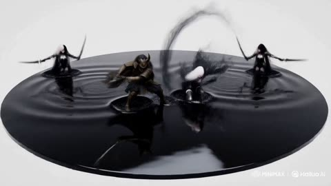</a>

A fixed 3 second timeline splits the 15 second fight into five beats, each with one clear action, and the on screen smoke text is written out as exact strings. A constraint line bans idle poses, hard cuts and teleportation, while a single physical rule (the mirror acts as liquid glass) ties ripples, cracks and reflections together.

MiniMax H3 · Text-to-video · Source: [@itxsarmadd on X](https://x.com/itxsarmadd/status/2106698801604186579) · 88 likes on 2026-10-28 · found via [SkyNotSilent/awesome-MiniMax-H3-cases](https://github.com/SkyNotSilent/awesome-MiniMax-H3-cases)

[`dark-fantasy`](tags.md#tag-dark-fantasy) [`sword-fight`](tags.md#tag-sword-fight) [`timeline-prompt`](tags.md#tag-timeline-prompt) [`kinetic-typography`](tags.md#tag-kinetic-typography) [`black-and-white`](tags.md#tag-black-and-white)

<details><summary><b>Prompt</b></summary>

```text
MINIMAX H3 — 15-SECOND CINEMATIC FIGHT
“BLACK MIRROR: FINAL REFLECTION”
16:9 widescreen, premium dark-fantasy fashion-action.

Obsidian Ronin vs Inkshade Valkyrie inside a gigantic floating liquid-black obsidian mirror surrounded by an endless white void. Preserve exact established character designs, faces, hair, armor, weapons, proportions and silhouettes. No redesigns.

Constant movement. No idle poses, hard cuts, teleportation, freeze frames, blood or gore.

The mirror behaves like liquid glass: every sword strike creates ripples, cracks and independent reflections that briefly attack before snapping back.

0–3s: Mirror forms from liquid black glass. Ronin emerges with a katana strike as Valkyrie attacks from the opposite reflection. Blades collide, creating a huge circular ripple.

3–6s: Ronin's heavy cut meets Valkyrie's agile twin-blade counter. Reflections attack from opposite directions. Black cracks race across the mirror. Smoke briefly forms “REAL OR REFLECTION?”

6–9s: Mirror tilts vertical. Both fighters sprint across its surface, exchanging rapid sword strikes. The glass bends around them like liquid.

9–12s: Mirror explodes into floating black fragments. Fighters leap between reflections, destroying them. Fragments align into a giant blade shape. Smoke forms “BREAK THE IMAGE”, then shatters.

12–15s: Final charge. Ronin's massive diagonal katana strike collides with Valkyrie's spinning twin-blade cross attack. The entire mirror shatters into thousands of black particles. Silence. Final smoke typography: “ONLY ONE REMAINS.”

Elegant black-and-white luxury aesthetic, glossy reflections, silver highlights, charcoal smoke, cinematic motion blur, precise camera orbiting, low mirror tracking, rotating blade shots and dramatic final push.

15s | 16:9 | continuous action | premium cinematic dark fantasy | exact character consistency
```

</details>

<a id="h3-black-couture-red-satin-courtyard-fashion-film"></a>
### Red satin reveals couture model in courtyard

<a href="https://x.com/DaniaSafvi/status/2109884479619682650"></a>

A timecoded five beat structure moves from a red satin close-up to a spotlit walk, a whip-pan, a courtyard transition, an orbit and a symmetrical hero shot. Separate Style and Audio lines, an end title and a consistency clause (face, outfit, no flicker) keep the 15 second vertical clip coherent.

MiniMax H3 · Text-to-video · Source: [@DaniaSafvi on X](https://x.com/DaniaSafvi/status/2109884479619682650) · 87 likes on 2026-10-28 · found via [SkyNotSilent/awesome-MiniMax-H3-cases](https://github.com/SkyNotSilent/awesome-MiniMax-H3-cases)

[`fashion`](tags.md#tag-fashion) [`luxury`](tags.md#tag-luxury) [`timecoded-shots`](tags.md#tag-timecoded-shots) [`whip-pan`](tags.md#tag-whip-pan) [`vertical-9x16`](tags.md#tag-vertical-9x16)

<details><summary><b>Prompt</b></summary>

```text
Create a 15-second cinematic luxury fashion video in 9:16 vertical format. A tall American female model with long dark hair wears a dramatic black couture gown with silver details and a flowing train.

0–3 sec: Close-up of red satin fabric moving through darkness before revealing the model under dramatic spotlights.

3–6 sec: The model walks confidently toward the camera. A stylish whip-pan captures her turning as the gown flows naturally.

6–10 sec: Seamless transition to a modern architectural courtyard with towering stone walls and golden sunlight. The model walks gracefully as the wind moves her hair and gown.

10–13 sec: The camera circles around her as she strikes a powerful high-fashion pose.

13–15 sec: Symmetrical hero shot with dramatic golden rim lighting, fading into black.

Style: Ultra-realistic luxury fashion campaign, cinematic lighting, natural fabric physics, elegant camera movements, deep shadows, black and gold color palette, 4K quality.

Audio: Deep cinematic bass, subtle percussion, and soft fabric sounds. No dialogue or subtitles.

Text at the end: “BEYOND THE ORDINARY”

Maintain consistent facial features, hairstyle, outfit, and body proportions throughout. No distortion, flickering, watermarks, or random text.
```

</details>

<a id="h3-rural-bus-stop-night-camcorder-korean-woman"></a>
### Tired woman waits at rural night bus stop

<a href="https://x.com/Strength04_X/status/2096578562866463197">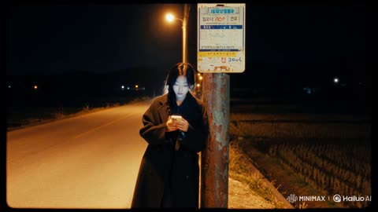</a>

Labeled blocks for setting, camera feel, timed beats and sound keep a 15 second shot controllable, while a tripod with handheld nudges and tape hiss gives the lo-fi camcorder look. Short Korean lines with English glosses in quotes drive the spoken audio.

MiniMax H3 · Text-to-video · Source: [@Strength04_X on X](https://x.com/Strength04_X/status/2096578562866463197) · 84 likes on 2026-10-28 · found via [SkyNotSilent/awesome-MiniMax-H3-cases](https://github.com/SkyNotSilent/awesome-MiniMax-H3-cases)

[`night`](tags.md#tag-night) [`camcorder`](tags.md#tag-camcorder) [`dialogue`](tags.md#tag-dialogue) [`korean`](tags.md#tag-korean) [`lo-fi`](tags.md#tag-lo-fi)

<details><summary><b>Prompt</b></summary>

```text
A young Korean woman, early 20s, tired after a long day, oversized coat swallowing her frame, hair escaping a loose braid, stands alone at a rural bus stop long after the sun has set.
Setting: A single flickering streetlamp, an empty road disappearing into darkness, rice paddies barely visible on either side, insects buzzing somewhere in the black.
Camera feel: Static tripod shot with occasional handheld nudges, like whoever's filming keeps almost forgetting they're recording — heavy grain, the lamp's orange glow bleeding into the frame, tape hiss audible under everything.
What happens (15 sec total):
She leans against the bus stop sign, checking her phone, then pocketing it with a tired sigh.
She mutters to camera, almost to herself, "버스 왜 안 와..." ("Why isn't the bus coming..."), kicking a small pebble.
Headlights appear far down the road she straightens up, relief crossing her face.
As the bus approaches, she looks back at the camera one last time saying "드디어" ("Finally"), stepping toward the curb as the tape cuts.
Sound: Crickets, distant engine growing louder, gravel underfoot, wind.
Mood: Quiet exhaustion giving way to small relief nothing dramatic, just real.
```

</details>

<a id="h3-bedroom-three-outfit-transformation-vlog"></a>
### Bedroom vlog with three seamless outfit changes

<a href="https://x.com/codewithhajra/status/2090276653012287567"></a>

A timed beat sheet gives each outfit change its own three second slot, and the transitions are hidden behind a jacket thrown at the lens and a spinning move. A reference image locks identity, and the closing consistency list bans jump cuts, warped clothing and a changing room layout.

MiniMax H3 · Reference-to-video · Source: [@codewithhajra on X](https://x.com/codewithhajra/status/2090276653012287567) · 83 likes on 2026-10-28 · found via [SkyNotSilent/awesome-MiniMax-H3-cases](https://github.com/SkyNotSilent/awesome-MiniMax-H3-cases)

[`fashion`](tags.md#tag-fashion) [`outfit-change`](tags.md#tag-outfit-change) [`vlog`](tags.md#tag-vlog) [`transition`](tags.md#tag-transition) [`lipsync`](tags.md#tag-lipsync)

<details><summary><b>Prompt</b></summary>

```text
Format: 15 seconds | 16:9 | 4K HDR | 24fps | photorealistic cinematic vlog

Character: Use the girl from the uploaded reference image as the exact character reference. Preserve her facial identity, eye color, skin tone, hairstyle, body proportions, and overall appearance consistently throughout every shot. No face changes or identity drift.

Scene & Story:
0–3 sec — The Mystery Package
The video opens with a handheld creator-vlog shot in her cozy bedroom during late afternoon. She walks into frame holding a stylish garment bag, looking genuinely curious. She places it on the bed and looks directly into the camera with a playful expression.

She says naturally: “Okay… I found something for tonight, but I have absolutely no clue if I can pull it off.”

She unzips the garment bag, revealing only a glimpse of the outfit.

3–6 sec — First Reveal
She quickly steps behind a nearby room divider. The camera follows with a fast handheld whip-pan.

She emerges wearing a chic fitted top, tailored trousers, and elegant heels. She looks at herself in the mirror, slightly surprised by how good it looks.

She turns toward the camera and says: “Wait… this might actually work.”

She gives a small confident pose.

6–9 sec — The Unexpected Switch
Instead of snapping her fingers, she grabs a jacket hanging beside her and dramatically throws it toward the camera.

As the jacket briefly covers the lens, the outfit seamlessly transforms underneath it.

When she pulls the jacket away, she is wearing a completely different fashion-forward look: a stylish mini dress with statement shoes and subtle accessories.

She looks down, raises one eyebrow, then laughs.

9–12 sec — The Wild Card
She walks toward the mirror while the camera circles around her. She notices a third outfit hanging on the wardrobe door.

Suddenly, she steps backward and spins.

During the spin, her outfit naturally morphs into a glamorous evening look with a sophisticated silhouette, elegant heels, and refined accessories.

The transformation happens continuously during the movement with realistic fabric motion — no jump cut.

12–15 sec — Final Decision
She walks toward the camera with confident energy, then stops very close to the lens.

She looks at the camera, points toward herself, then gestures toward the three outfits visible behind her.

With a playful smile, she says:

“Okay… you’re choosing. Which one?”

The camera quickly pushes in toward her face as she laughs, ending on a natural freeze-like moment.

Visual Direction:
Ultra-realistic fashion creator vlog, authentic handheld camera movement, natural body language, expressive facial reactions, realistic fabric physics, seamless outfit transitions, natural hair movement, subtle mirror reflections, cinematic depth of field, realistic skin texture, soft late-afternoon daylight mixed with warm practical bedroom lighting, detailed wardrobe and bedroom environment, premium fashion-film aesthetic while maintaining casual YouTube-vlog energy.

Camera:
Handheld selfie framing, medium shots, quick whip-pans, subtle camera shake, smooth tracking movements, one controlled orbit around the character, final slow push-in.

Audio:
Natural bedroom ambience, fabric and wardrobe sounds, footsteps, garment movement, subtle mirror-room reverb, upbeat modern fashion-vlog background music, natural spoken dialogue, soft whoosh effects during the outfit transitions. No subtitles, no logos, no watermark.

Consistency & Quality:
No jump cuts during transformations. No duplicated character. No distorted hands or fingers. No warped clothing. No inconsistent room layout. No facial identity changes. No unnatural skin smoothing. Keep the same character, bedroom, lighting logic, and visual realism throughout.
```

</details>

<a id="h3-y2k-girl-group-rap-bubble-typography"></a>
### Y2K girl group rap video with bubble typography

<a href="https://x.com/LeoCreaIA/status/2083240416166748313"></a>

Each shot gets its own camera move, one rap line and one named word, and every hard cut is tied to a bass, snare or vocal hit. A reference image locks the three faces, while the typography is written as a material (inflated jelly chrome letters) that hands and faces can cover.

MiniMax H3 · Reference-to-video · Source: [@LeoCreaIA on X](https://x.com/LeoCreaIA/status/2083240416166748313) · 83 likes on 2026-10-28 · found via [SkyNotSilent/awesome-MiniMax-H3-cases](https://github.com/SkyNotSilent/awesome-MiniMax-H3-cases)

[`k-pop`](tags.md#tag-k-pop) [`y2k`](tags.md#tag-y2k) [`typography`](tags.md#tag-typography) [`music-video`](tags.md#tag-music-video) [`rap`](tags.md#tag-rap) [`hard-cuts`](tags.md#tag-hard-cuts)

<details><summary><b>Prompt</b></summary>

```text
This is what H3 does with Omni Reference and one long prompt:

prompt：Soft cute Y2K crush K-pop girl group rap MV. High fashion performance film mixed with inflated 3D candy typography graphic system. Three female idols wearing pink, blue and purple luxury Y2K stage outfits. Cute 3D chibi doll face, big dewy eyes, porcelain skin, soft blush cheeks, chibi idol proportions. Reference typography: only the inflated 3D rubber bubble font language, pink/lavender/ice-blue chrome plastic material, not the whole layout. Visual style: soft pastel crush energy, Y2K game UI, candy glossy finish, milky translucent plastic × K-pop aggressive feminine rap energy. Texture: 35mm film grain + soft glow bloom + iridescent holographic foil + jelly plastic specular + Y2K scanline + candy dot halftone + VHS frame vibration + plastic toy surface reflection + glitter confetti rain. Editing: Fast rhythm editing. Only hard cuts. No fade. No smooth transitions. Every cut follows: bass hit, snare, rap vocal impact.

Character Performance Three female performers from reference image 1. Keep: same 3D chibi doll faces, big sparkling eyes, pastel Y2K idol makeup, pink/blue/purple fashion styling, soft cute cold expression. Each member has a signature prop: A holds a chunky rhinestone microphone, B has a plush bear shoulder bag, C wears oversized heart-shaped sunglasses pushed up on head. They are not posing. They are performing rap. Actions: aggressive eye contact, head nodding, shoulder movement, leaning toward camera, hand pushing toward lens, confident cute facial expression, sharp body movement, wink on snare hit, tongue-out on bass drop, hair flip on beat. Lip sync: perfect rap mouth synchronization. The performance should feel like a real K-pop rap unit MV with Y2K crush energy.

Typography Animation Typography is a visual weapon. Not subtitles. Not static graphics. Use: giant English words inflated 3D rubber bubble font, jelly plastic material, pink lavender ice-blue chrome, soft puffy candy letters, compressed bold balloon fonts, stretched vertical puffy letters, handwritten graffiti titles, 3D extruded candy text, glitch displacement, print error effect, Y2K game UI pixel corruption. Text appears only when the beat hits. Characters can cover the text. Text can cover parts of clothing. Never cover eyes or main facial expression. Tiny Y2K stickers burst on beat: heart, star, smiley, sparkle, chain link, bow, four-leaf clover, mini bear.

Shot 1 — Member A · Extreme Close-up「RUN NOW」 Character A face close-up, framed inside a pink heart-shaped iris wipe transition (in only, hard cut out). She looks directly into camera. Cute cold doll expression, big dewy eyes, soft blush, frosted pink lip gloss, rhinestone tear sticker under one eye. Starts rap. Chunky rhinestone microphone enters frame from below, she grips it tightly. Camera slowly pushes closer. Tiny pink heart stickers float up from bottom edge like bubbles. Huge inflated bubble letters crash into frame from left and right. Typography: "RUN NOW" — Pink jelly rubber 3D font, glossy candy surface, soft inner glow. Letters stretch vertically like puffy balloons. The word vibrates and squishes with bass, casts soft pink shadow on her cheek. Rap: "Run now, I don't chase." Confetti burst on final syllable. Hard cut.

Shot 2 — Member B · Rap Performance「BREAK LIMIT」 Member B medium close-up, slight low angle, camera orbits 15° around her during the take. Lavender fur jacket, Y2K layered top, plush bear bag bouncing on her hip, chunky pearl choker, star-shaped earrings. She performs aggressively. Shoulders hit the rhythm. Hair flips hard on the second snare, blue hair ties catch the light. Hair moves naturally. Background: pastel gradient pink-to-lavender with faint Y2K perspective grid lines floating. Behind her appears huge handwritten text. Typography: "BREAK LIMIT" — Ice-blue bubble graffiti brush writing, soft inflated stroke, candy-coated, letters appear one by one with bounce easing. Animation: letters tear apart, reassemble, rotate 360° on snare, shake with bass. Chain link graphic swings across frame, sparkle stickers pop on every beat. Rap: "Break limits, break rules." Hard cut.

Shot 3 — Member C · Hand Attack Shot「NO APOLOGY」 Member C moves close to camera. Top-down camera angle, she leans over the lens. Hand reaches toward lens. Nails are long pink acrylic with 3D star and heart charms. Focus: rings with mini plush bear charm, heart-cut gemstone, baby-pink leather texture, knit ribbed sleeve, plushy toy surface. Foreground vertical text: "NO APOLOGY" — Stretched vertical pink bubble letters, jelly puffy material, letters pierce through the back of her hand visually. Hand covers part of the typography. Fingers spread wide on the bass hit. Camera: handheld vibration. Film grain strong. Candy halftone dots bloom in shadow. Tiny "XOXO" sticker tag pulses in corner. Rap: "No apology, no regret." Hard cut.

Shot 4 — Fashion Magazine Impact Cut「UNSTOPPABLE」 Member A close-up. Her face appears inside a broken Y2K trading card / idol photo card frame, with barcode at bottom, "SYS.07-A" serial tag, holographic foil border torn on left side. Not a full layout. Only one graphic element. Typography: "UNSTOPPABLE" — Huge lavender handwritten bubble text, inflated 3D rubber, glossy plastic finish, letters explode outward from center of her forehead, push edges of the card frame. Animation: text suddenly expands from behind her. Card frame rips in half vertically, holographic confetti pours from the tear, revealing pastel gradient background underneath. A second smaller photo card of her winks in from the right, slightly rotated. Rap: "Can't stop my wave." Hard cut.

Shot 5 — Glitch Double Image「STATIC」 Member B close-up, slight Dutch angle (5° tilt). Create: duplicate frame, pastel RGB separation (pink/blue/lavender channels), xerox shadow, motion trail, VHS tracking line at bottom edge. Main face stays sharp. She holds a sparkly heart-shaped lollipop up beside her cheek, the lollipop leaves a trail of echo frames. Background text: "STATIC" — Y2K pixel font, candy pink chrome, letters flicker like broken game sprite, jump between frames, sometimes inverted color, sometimes missing entirely. Like corrupted music video signal + cute game glitch. A tiny "ERROR 404" sticker blinks in upper corner. Rap: "Static noise, I get louder." Hard cut.

Shot 6 — Pink Blue Purple Battle「PINK OUT」 Member A and C alternate close-ups, rhythm: A-A-C-A-C-C, two frames each. Fast switching. Visual split: each member sits in a vertical color block (A=pink, C=lavender, alternating). Center text: "PINK OUT" — Pastel pink-to-purple gradient bubble 3D, letters appear one word at a time, syncing to each cut. Words appear one by one. Each word: stretch vertically on entry, compress horizontally on hold, invert color on snare, explode into heart stickers and star confetti on exit. Tiny "1.2.3.GO!" counter graphic ticks in corner. Rap: "Lights out, pink out." Hard cut.

Shot 7 — Group Rap Performance「UNBREAKABLE」 Three members together.
```

</details>

<a id="h3-reasoning-test-room-undo-last-three-actions"></a>
### Test room person undoes last three actions

<a href="https://x.com/cocktailpeanut/status/2085893756688167396">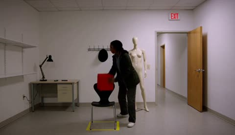</a>

The prompt sets a fixed initial state of six objects, then a numbered sequence of six separated actions, so the spoken undo instruction has an unambiguous target. A single continuous wide shot with explicit bans on cuts, time jumps and extra dialogue keeps the clip readable as a behavioral experiment.

MiniMax H3 · Text-to-video · Source: [@cocktailpeanut on X](https://x.com/cocktailpeanut/status/2085893756688167396) · 81 likes on 2026-10-28 · found via [SkyNotSilent/awesome-MiniMax-H3-cases](https://github.com/SkyNotSilent/awesome-MiniMax-H3-cases)

[`reasoning-test`](tags.md#tag-reasoning-test) [`fixed-camera`](tags.md#tag-fixed-camera) [`single-shot`](tags.md#tag-single-shot) [`instruction-following`](tags.md#tag-instruction-following) [`spoken-dialogue`](tags.md#tag-spoken-dialogue)

<details><summary><b>Prompt</b></summary>

```text
A single continuous fixed wide shot in a plain, brightly lit test room, filmed like an unedited behavioral experiment. At the start, a red cube is on a table, a drawer is closed, a lamp is off, a chair sits precisely inside a taped floor outline, a hat hangs on a wall hook beside a bare mannequin, and a door is open. One person quickly performs six clearly separated actions in this exact order: places the red cube on a shelf, opens the drawer, turns on the lamp, moves the chair away from its taped outline, takes the hat from the hook and puts it on the mannequin, then closes the door. An off-screen instructor clearly says, "Undo only the last three actions." The person pauses briefly, understands the instruction, and carries it out exactly. No cuts, no time jumps, no extra actions, no additional dialogue, realistic synchronized room sounds.
```

</details>

<a id="h3-ancient-egypt-pyramid-construction-sunrise-reveal"></a>
### Ancient Egypt Pyramid Construction at Nile Sunrise

<a href="https://x.com/Diplomeme/status/2084932583335624724">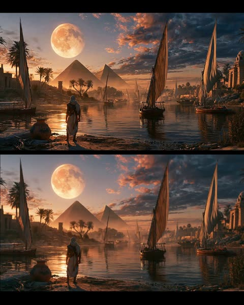</a>

A reference image locks the opening frame, then four timed beats (00 to 04s, 04 to 08s, 08 to 12s, 12 to 15s) grow the scene from a quiet riverbank to a crane-up reveal. Separate sections for camera, lighting, physics, performance and audio, plus an explicit avoid list, keep the result documentary and realistic.

MiniMax H3 · Image-to-video · Source: [@Diplomeme on X](https://x.com/Diplomeme/status/2084932583335624724) · 79 likes on 2026-10-28 · found via [SkyNotSilent/awesome-MiniMax-H3-cases](https://github.com/SkyNotSilent/awesome-MiniMax-H3-cases)

[`ancient-egypt`](tags.md#tag-ancient-egypt) [`historical-drama`](tags.md#tag-historical-drama) [`documentary-realism`](tags.md#tag-documentary-realism) [`timed-beats`](tags.md#tag-timed-beats) [`crane-reveal`](tags.md#tag-crane-reveal)

<details><summary><b>Prompt</b></summary>

```text
15 seconds | 16:9 | live-action historical construction drama
Fictional dramatization. Documentary-style visual realism.

SETTING

Ancient Egypt along the Nile during sunrise beside the Great Pyramids.

The uploaded reference image is the exact opening frame.

Maintain the identical traveler, boats, pyramids, moon, river, shoreline, lighting and composition.

Construction activity gradually becomes visible deeper into the environment while preserving the original scene.

Warm desert atmosphere.
Morning mist.
Light dust drifting across the valley.

WORKFORCE

A master builder overseeing the day's construction.

Hundreds of Egyptian laborers, stone masons, engineers, rope teams, carpenters and transport crews gradually become active throughout the distant construction zone.

Maintain historically accurate clothing, tools, wooden machinery and consistent character identities.

Human behaviour remains disciplined, coordinated and believable.

---

STORY

00–04s — ESTABLISHING

The traveler stands silently at the riverbank exactly as shown in the reference image.

The camera slowly pushes forward from behind.

Feluccas drift naturally.

Palm trees sway gently.

Birds fly across the sunrise.

Workers begin appearing in the distant background carrying ropes, wooden beams and stone tools toward the pyramid complex.

Construction slowly awakens with the rising sun.

---

04–08s — OPERATION

The traveler picks up the clay vessel and begins walking along the shoreline.

The camera follows naturally behind him.

Across the river, dozens of workers unload massive limestone blocks from transport boats.

Oxen pull wooden sledges.

Long rope teams drag heavy stones toward enormous earthen ramps.

Wooden cranes rotate slowly as supervisors organize the workforce.

Dust rises naturally beneath hundreds of moving feet.

---

08–12s — CONSTRUCTION

The traveler reaches an elevated viewpoint overlooking the worksite.

The camera gently reveals the enormous construction operation.

Hundreds of synchronized workers pull a gigantic limestone block upward using thick ropes and wooden rollers.

Stone masons shape blocks with copper chisels.

Carpenters assemble scaffolding.

Engineers inspect alignment while foremen direct the operation with calm hand signals.

The environment feels immense, alive and historically authentic.

---

12–15s — LEGACY

The camera slowly cranes upward into a breathtaking wide reveal.

The traveler stands watching history unfold before him.

Thousands of workers continue building across the vast construction site.

Feluccas constantly arrive carrying fresh limestone.

Dust drifts through golden sunrise light.

The pyramids dominate the horizon as one final massive stone settles perfectly into position.

End with the feeling that humanity's greatest engineering achievement is being built before our eyes.

---

CAMERA

Grounded historical-documentary cinematography.

Mix:

Wide environmental establishing shots.

Medium handheld following shots.

Brief observational close-ups.

Slow cinematic dolly movement.

Natural handheld instability.

Realistic operator movement.

Gentle crane rise for the final reveal.

No impossible drone transitions.

No excessive slow motion.

---

LIGHTING

Natural sunrise illumination.

Warm golden desert light.

Soft atmospheric haze.

Realistic exposure adaptation.

Natural shadows.

Detailed limestone texture.

Physically accurate reflections across the Nile.

No artificial rim lighting.

---

PHYSICS

Real gravity.

Authentic weight of limestone blocks.

Natural rope tension.

Wooden cranes flex realistically.

Workers visibly strain under heavy loads.

Dust reacts to footsteps.

Boats move naturally with river currents.

Water responds realistically.

Wind moves robes, sails and palm leaves.

Everything follows believable engineering principles.

---

HUMAN PERFORMANCE

Restrained, believable teamwork.

Heavy breathing.

Natural communication.

Simple hand signals.

Realistic lifting mechanics.

Measured walking.

Visible physical effort.

No exaggerated cinematic acting.

---

AUDIO

Morning wind.

Flowing Nile water.

Boat hulls creaking.

Workers shouting coordinated commands.

Stone scraping.

Hammer and chisel impacts.

Heavy rope tension.

Footsteps on sand.

Distant oxen.

Natural historical ambience.

No oversized Hollywood trailer effects.

---

VISUAL CHARACTER

Photorealistic live-action footage.

Historical documentary realism.

Museum-quality reconstruction.

Natural skin texture.

Authentic linen garments.

Weathered limestone.

Subtle sensor noise.

Natural motion blur.

Avoid:

Fantasy elements.

Magic.

CGI appearance.

Oversaturated HDR.

Modern machinery.

Floating debris.

Perfect choreography.

Beauty-filter faces.

---

CONTINUITY

Maintain the exact character identity, clothing, boats, pyramids, moon, river, shoreline, architecture and lighting established in the uploaded reference image.

Construction activity should emerge naturally from the existing environment without changing the original composition.

Every action begins from the physical state established by the previous shot.

https://tinyurl.com/dhh4wvyu
```

</details>

<a id="h3-cyberpunk-samurai-neon-rain-katana-draw"></a>
### Cyberpunk samurai draws katana in neon rain

<a href="https://x.com/noorwithwifi/status/2084289809359810731">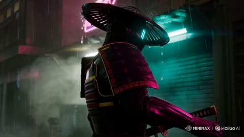</a>

A single continuous shot with extreme slow motion keeps the action to one clear beat, the katana draw. A camera orbit, volumetric neon fog and lens flare are named as separate cues, so the reflective wet armor catches the colored light.

MiniMax H3 · Text-to-video · Source: [@noorwithwifi on X](https://x.com/noorwithwifi/status/2084289809359810731) · 77 likes on 2026-10-28 · found via [SkyNotSilent/awesome-MiniMax-H3-cases](https://github.com/SkyNotSilent/awesome-MiniMax-H3-cases)

[`cyberpunk`](tags.md#tag-cyberpunk) [`samurai`](tags.md#tag-samurai) [`neon-rain`](tags.md#tag-neon-rain) [`slow-motion`](tags.md#tag-slow-motion) [`orbit-shot`](tags.md#tag-orbit-shot)

<details><summary><b>Prompt</b></summary>

```text
Continuous 15-second cinematic shot, extreme slow-motion: a futuristic cyberpunk samurai standing in heavy neon rain, reflective wet armor. The samurai slowly draws a glowing katana, lens flare, volumetric neon fog, dynamic camera panning around the character, continuous fluid motion, photorealistic 8k
```

</details>

<a id="h3-purikura-sticker-capsule-toy-iphone-vlog"></a>
### Purikura sticker and capsule toy phone vlog

<a href="https://x.com/itxabdullaa/status/2085656146363249079"></a>

A face lock on Image1 plus a five beat timeline in 3 second blocks, each with one action and one spoken line. The camera and style sections ask for an unedited old iPhone look with 1x lens, autofocus hunting and a pink white balance cast, and the sound section lists ambient layers.

MiniMax H3 · Reference-to-video · Source: [@itxabdullaa on X](https://x.com/itxabdullaa/status/2085656146363249079) · 74 likes on 2026-10-28 · found via [SkyNotSilent/awesome-MiniMax-H3-cases](https://github.com/SkyNotSilent/awesome-MiniMax-H3-cases)

[`ugc`](tags.md#tag-ugc) [`handheld`](tags.md#tag-handheld) [`phone-look`](tags.md#tag-phone-look) [`timeline`](tags.md#tag-timeline) [`ambient-sound`](tags.md#tag-ambient-sound)

<details><summary><b>Prompt</b></summary>

```text
Subject: Person from Image1. Face and hairstyle must match Image1 completely; do not transform into a different person. Outfit: same casual everyday streetwear as Part 1. Ignore the outfit, background, pose, and bottom text from Image. Even if image quality is rough, facial features must remain clearly defined. 16:9 horizontal. Entire video has an old iPhone low-quality everyday-video look. Constant heavy noise and compression artifacts throughout.
Setting: Same convenience store or arcade corner immediately after leaving the purikura booth. Sticker printer beside the booth, capsule toy machines, snack shelves, and bright fluorescent store lighting mixed with colorful purikura lights. Booth curtain still visible in the background. Any visible signs, packaging, and screen text remain completely illegible.
Timeline:
0–3s: Holds up the phone with the newly attached sticker, smiling proudly. Notices a tiny bonus sticker still attached to the backing sheet and laughs softly. "Wait... there's another one?"
3–6s: Peels off the tiny sticker and sticks it onto a reusable drink bottle or wallet. While pressing it down, a nearby capsule toy machine suddenly dispenses a capsule by itself with a loud clunk, making them jump in surprise.
6–9s: Picks up the unexpected capsule, shakes it curiously, opens it, and finds a tiny cute keychain inside. Holds it next to the purikura sticker, laughing. "No way... perfect timing!"
9–12s: Hooks the keychain onto their bag or phone strap, admires both the sticker and keychain together, then catches their reflection in the booth window and gives themselves an amused grin.
12–15s: Looks directly at the camera, holds up the phone and the new keychain together, gives a playful wink and thumbs-up while saying, "Best random stop ever." Freeze on the final frame.
Camera: Loose 1–1.5s cuts. Old iPhone, vertical, standard 1x lens (no distortion, standard field of view), handheld with slight natural shake while walking and reacting, steadier during close-up sticker and capsule moments. Slight autofocus hunting during close-ups. Mixed fluorescent and colorful booth lighting creates inconsistent white balance with a subtle magenta/pink cast. Natural exposure fluctuations throughout.
Sound: No BGM. Ambient convenience store and arcade background noise (faint chatter, vending machines, capsule toy machine sounds, footsteps), sticker peeling sound, plastic capsule opening, small keychain clink, natural laughter, close slightly muffled voice, subtle booth echo, phone handling sounds.
Style: Unedited low-quality phone video look. No color grading, no film look, no cinematic look, no beauty filter, no CG texture. No fisheye/ultra-wide (0.5x)/action-cam look, no barrel distortion, no vignette, no black lens-round at frame edges—flat standard field of view, frame filled edge to edge. Real skin texture maintained (pores, flyaway hairs, natural oil sheen). No cut consolidation, no scene skipping. No on-screen text (all store signs, product labels, booth screens, capsule contents, and sticker graphics/text remain illegible).
```

</details>

<a id="h3-backyard-herb-garden-basil-dv-camcorder"></a>
### Backyard herb garden basil harvest, DV camcorder look

<a href="https://x.com/Strength04_X/status/2085786048521757074"></a>

A five slot timeline gives each 3 second beat two compressed actions, with spoken Korean lines and a translation in brackets. The early 2000s DV camcorder style, autofocus drift and no stabilization keep the footage candid, and the audio line lists only ambient sounds with no music.

MiniMax H3 · Text-to-video · Source: [@Strength04_X on X](https://x.com/Strength04_X/status/2085786048521757074) · 73 likes on 2026-10-28 · found via [SkyNotSilent/awesome-MiniMax-H3-cases](https://github.com/SkyNotSilent/awesome-MiniMax-H3-cases)

[`documentary`](tags.md#tag-documentary) [`dv-camcorder`](tags.md#tag-dv-camcorder) [`timeline`](tags.md#tag-timeline) [`dialogue`](tags.md#tag-dialogue) [`ambient-audio`](tags.md#tag-ambient-audio)

<details><summary><b>Prompt</b></summary>

```text
Main Subject:
Young Korean woman, early 20s, loose linen shirt over shorts, hair tied back with a cloth, dirt-smudged fingers, gentle focused expression.
Location:
Small backyard herb garden beside the house, late morning. Wooden planter boxes, scattered gardening tools, soft natural sunlight, a low fence. No modern structures.
Visual Style:
Ultra-realistic documentary realism, candid hands-on feeling, bright natural daylight.
Camera Style:
Early 2000s DV camcorder, handheld close framing, autofocus adjusting between her hands and the plants, warm faded tones, soft grain. No stabilization.
Timeline (15 sec, each slot = 2 compressed beats):
00:00–00:03 → She kneels by the planter box, then snips a few basil leaves carefully.
00:03–00:06 → She smells the leaves, then says to camera "향 진짜 좋다" ("The smell is really nice"), smiling.
00:06–00:09 → She moves to another box, then pulls a small weed from the soil.
00:09–00:12 → She wipes her hands on her shirt, then gathers the herbs into a small basket.
00:12–00:15 → She looks at camera saying "오늘 저녁에 쓸 거야" ("I'll use these for dinner tonight"), standing up as it fades.
Audio:
Leaves rustling, soil shifting, faint birds, distant wind. Her dialogue as noted above. No music.
Goal: A small, grounded gardening moment warm, patient, authentic.
```

</details>

<a id="h3-shanghai-cafe-marriage-conditions-dialogue"></a>
### Shanghai Café Couple Debate Marriage Conditions

<a href="https://x.com/tangpanqing/status/2103828594053325201"></a>

A one line scene setup (year, city, place, action) is followed by a shot by shot script. Each line is labeled close-up or tight close-up and carries its spoken dialogue, so the model cuts between speakers on every line. The closing instruction to add no subtitles keeps the native speech clean.

MiniMax H3 · Text-to-video · Source: [@tangpanqing on X](https://x.com/tangpanqing/status/2103828594053325201) · 73 likes on 2026-10-28 · found via [SkyNotSilent/awesome-MiniMax-H3-cases](https://github.com/SkyNotSilent/awesome-MiniMax-H3-cases)

[`dialogue`](tags.md#tag-dialogue) [`cafe`](tags.md#tag-cafe) [`multi-shot`](tags.md#tag-multi-shot) [`native-audio`](tags.md#tag-native-audio) [`chinese-prompt`](tags.md#tag-chinese-prompt)

<details><summary><b>Prompt</b></summary>

```text
2026年，上海。一个男人与一个女人在咖啡馆，喝咖啡，聊天。

近景，女人问: "有房吗？"
近景，男人说：”有“
近景，女人问: "有车吗？"
近景，男人说：”有"
特写，女人说: "基础条件可以，但我还有几个条件。"
特写，女人继续说: "婚后我们单住，你的父母不能过来住，你的工资全部上交，家务你全包"
特写，男人说：”那你呢？"
特写，女人问: "我只负责享受。"
特写，男人说：”那我还不如养条狗，要你干嘛？"

注意，不要加字幕。
```

</details>

<a id="h3-greenhouse-lyric-typography-anime-mv"></a>
### Anime greenhouse music video with lyric typography

<a href="https://x.com/haruuraeadss/status/2083875116900024386">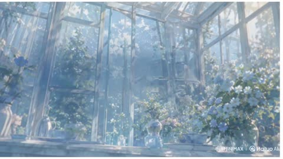</a>

Each reference image and the audio track is given a fixed role, with an explicit priority order for the character reference. Title and staff line reveals are scripted step by step and tied to the audio phrasing, with masked edit transitions between scenes.

MiniMax H3 · Reference-to-video · Source: [@haruuraeadss on X](https://x.com/haruuraeadss/status/2083875116900024386) · 71 likes on 2026-10-28 · found via [SkyNotSilent/awesome-MiniMax-H3-cases](https://github.com/SkyNotSilent/awesome-MiniMax-H3-cases)

[`anime`](tags.md#tag-anime) [`music-video`](tags.md#tag-music-video) [`lyric-typography`](tags.md#tag-lyric-typography) [`multi-reference`](tags.md#tag-multi-reference) [`audio-sync`](tags.md#tag-audio-sync)

<details><summary><b>Prompt</b></summary>

```text
使用画像はリプ欄にあります
                                                                      
高品質アニメ映像。

【作品ジャンル・世界観】
夢幻的ファンタジーの植物温室と音楽標本世界。劇場版クラスの高密度な2D手描きアニメ、繊細なキーアニメーション、上質なコンポジット、透明感のあるライティング。ガラス温室、花、露、譜線、音符、細い植物線画が一つの視覚言語として連動する。前半は白、淡いシアン、空色、少量の金色による朝の記憶。終盤は同じ植物世界が深い青緑とブルーベルの余韻へ変わる。背景が変わっても、細い白文字と水平譜線が画面の建築構造として連続する。
表情変化は、目、次に眉、次にまぶた、次に口元、最後に視線の順で最小限に行う。大きな演技、会話、歌唱口形は入れず、静かな呼吸と瞳の変化だけで感情を見せる。

【参照役割と優先順位】
Image1は顔と同一性の最優先参照であり、同時に衣装・装飾・体型・全身デザインの唯一参照。Image1の背景、背景内小物、元の縦構図は参照しない。参照内容が食い違う場合の優先順位は、顔、瞳、髪、体型、衣装、装飾、全身シルエットは常にImage1が最優先。Image2、Image3、Image4から人物特徴を取得しない。

Image2は冒頭の明るく霞んだガラス温室、乳白色の逆光、淡い水色と象牙色、既存タイトル「Lumen low」、五線譜、音符、細いイタリック注釈の画面設計参照。
Image3は中盤の明るく広い温室、青い花の密度、より鮮明な奥行き、既存タイトル「Lumen slow」、横断する五線譜、点、円、細い幾何学線の画面設計参照。
Image4は終盤の深い青緑のブルーベル、柔らかなボケ、露の反射、既存タイトル「BLUEBELL AFTERGLOW」、白と淡いシアンの譜線、点、注釈の画面設計参照。
Audio1は全編の音楽参照。画面の切替、タイトルの出現と消去、譜線の伸長、カメラの開始と停止、瞬き、光量変化を、Audio1のフレーズ開始、音量の立ち上がり、余韻へ同期する。Audio1以外の音楽、声を追加しない。効果音なし。
人物は全編でImage1の一人だけ。追加人物、別人、双子、複製、残像人物、透明な人物の重複を出さない。

【キャラクター固定・同一人物】
全編でImage1と同じ少女を完全な同一人物として固定する。繊細で丸みのある同じ顔、同じ顎と頬、淡い血色、同じ年齢感。透明な青緑色の大きな瞳、虹彩内の金色の微粒子、白い星状ハイライト、長い上まつ毛を維持する。真珠色の長い髪、柔らかな前髪、側頭部から後方へ続く編み込み、後方へまとめた髪型を固定する。右側の金色リボンと青い雫型の髪飾りは消さない。
衣装はImage1と同じ白いハイネックの長袖ドレス。襟、胸当て、袖口、裾の淡い水色の花刺繍、白い小ボタン、柔らかな幅広袖、金色の細い腰リボンと結び目、淡い水色の裾フリルまで一致させる。細身で上品な体格、白・水色・金色の固有配色を変えない。武器なし、装備品なし、小物なし。両手は常に自然な五本指で、顔や文字を隠さない。
変化を許すのは呼吸、瞬き、表情、姿勢、自然な髪、リボン、袖、裾の小さな揺れだけ。別人化、平均的なAI顔、幼児化、瞳色変更、髪型変更、衣装交換、刺繍省略、髪飾り消失、手指変形、余分な指、人物複製を禁止する。この同一人物固定は、次項の画風固定とは別の独立条件であり、互いに代用しない。
【画風固定：2D手描き】
Image1の極細で淡い青灰色の線、黒すぎない輪郭線、細かな髪束を維持する。影は透明感のある二段から三段。肌と布は柔らかな水彩階調、髪は真珠色の細いハイライト、瞳、露、ガラスは小さく鋭い反射。人物だけを過度に平坦化せず、温室、ガラス骨組み、青い花、葉、露、布、刺繍まで同じ密度の2D手描き背景として描く。

前半の肌は暖かな象牙色を保ち、青い環境光で灰色や病的な青肌にしない。終盤へ向けて環境の色温度が連続的に低くなり、深い青緑へ移行するが、Image1の白いドレス、金色リボン、顔、瞳は背景から明瞭に分離する。

太い黒輪郭、簡略化されたテレビアニメ調、単層の平坦なセル塗り、低密度背景、滑らかなCG・3D化、写実・半写実化、プラスチック肌、過剰な美肌ぼかし、くすんだ色、汎用的なAIアニメ顔、作風混合を禁止する。
【タイトル・譜線・注釈の固定】
Image2、Image3、Image4に存在するタイトルを、参照画像由来の不変な2Dグラフィック面として維持する。文字を新しく再描画したり別の字形へ変形したりせず、参照内の正しい字形をクリップマスク、透明度、単語レイヤー単位の短い移動だけで見せる。綴り、細い書体、文字間、大小関係を変えない。画面に残す主文字は「Lumen low」「Lumen slow」「BLUEBELL AFTERGLOW」の三種類だけ。偽の単語、擬似文字、無意味な追加文章を生成しない。

主文字は白から淡い象牙色、細いサンセリフ、広い字間。補助要素は細い高コントラストのイタリック、四本から五本の水平譜線、音符、点、円、短い矢印、極細の植物輪郭線。譜線は約一ピクセル、低めの不透明度。主文字は背景から読める明度を保つ。すべて画面固定座標に置き、カメラの遠近やパースへ吸着させない。

出現は必ず、譜線が左から右へ伸びる、点と音符が現れる、主文字が単語単位の短い左向きクリップマスクとフェードで組み上がる、補助注釈が最後に薄く現れる、の順。全文同時表示や一文字ずつの派手なタイプ入力にはしない。消去は補助注釈、主文字、譜線の順。文字の跳ね、回転、震え、液体化、融解を入れない。

字幕箱、黒帯、太い縁取り、強いグロー、大きな影、カラオケ式の色塗り、RGB分離、激しいグリッチを禁止する。タイトルと譜線は瞳、鼻、口、両手を横断しない。人物の顔と重なる場合は、文字を変形せず、レイアウト全体を顔の周囲へ分割して窓枠のように配置する。
【冒頭の明るい温室】
Image2と同じ霞んだガラス温室の正面ワイドから始める。開始画面では人物を出さず、Image2の背景、乳白色の光、青い花、ガラス骨組みを安定して見せる。カメラは目の高さでほぼ固定し、温室中央のガラス枠を消失軸に、ごくゆっくり前進する。目的は「Lumen low」の全体と柔らかな温室の奥行きを一度に読ませること。

五線譜が左から右へ伸び、点と音符が順に現れ、「Lumen low」が参照内の配置で組み上がる。タイトル完成後も文字は画面へ固定する。続けて右三分の一に、細い白線で囲まれた縦長のガラス窓マスクが静かに開く。窓の内側だけにImage1の胸上を一人で現し、印刷された静止画ではなく、呼吸、髪先、金色リボンの微動を持つ生きた2Dアニメとして見せる。Image1は口を閉じたまま一度だけ自然に瞬きし、わずかに正面へ目を合わせる。

【譜線によるImage2からImage3への遷移】
一本の長い譜線が画面左端から右端へ進み、その通過領域だけを硬い水平マスクとしてImage2からImage3へ置き換える。これはカメラ移動ではなく編集遷移。途中で二つの背景を半透明に混ぜず、マスクの前方はImage2、後方はImage3として境界を明瞭に保つ。Image1も一人のまま受け渡し、二重像や別ポーズを同時に出さない。

「Lumen low」の字形を変形させない。「low」は一本の譜線に覆われて見えなくなり、その同じ領域からImage3に存在する正しい「slow」を明かす。「Lumen」は短時間だけ同じ画面位置に残り、その後Image3の参照配置へ穏やかに整列する。文字を溶かして別単語へ変形させない。
【中盤の鮮明な温室】
Image3の明るく広い温室へ完全に切り替える。カメラは目の高さ、少し左寄りの正面ワイド。温室中央通路を奥行き軸にし、Image1を右三分の一の腰上で読める大きさに配置する。中央の「Lumen slow」、横断譜線、青い花、ガラス器、白い机の余白関係をImage3に合わせる。目的は、Image1の顔と衣装を読み取れる大きさにしながら、タイトルを画面構造として維持すること。

カメラはImage1へ短く一定速度で前進し、わずかな前景花の視差を出す。Image1は先に定めた目から視線までの順序で、ごく小さく表情を変える。口を開かず、最後に青緑色の瞳を正面へ向ける。タイトル、譜線、顔の三つが同時に読める位置でカメラを止める。

【譜線と花弁によるImage3からImage4への遷移】
最初に小さなイタリック注釈と点が薄く消え、続いて「Lumen slow」が短くぼけて消える。文字より遅れて五線譜が画面端まで長く伸びる。温室の白い光が淡い青から深い青緑へ変わり、前景の一枚のブルーベル花弁がレンズへ近づいて画面を覆う。花弁の輪郭と長い水平譜線を一体の編集マスクにし、覆われた領域からImage4の世界を明かす。ランダムなクロスフェードや渦回転は入れない。

【深いブルーベルの終盤】
Image4の深い青緑の花園へ完全に切り替える。最初は高い位置からの斜め俯瞰で、露を帯びたブルーベルと柔らかな前後ボケを画面いっぱいに置く。背景は柔らかく、タイトルだけは鮮明。目的は花の密度と大きなタイトル余白を同時に見せること。

白と淡いシアンの長い譜線を先に伸ばし、Image4の正しい「BLUEBELL」を左から中央、「AFTERGLOW」を中央から右へ、単語レイヤー単位のクリップマスクで組み上げる。最後の単語は字形を再生成せず、参照内の文字レイヤーを左から順に露出して完成させる。完成後のタイトルは以後の背景切替でも同じ位置に固定する。
タイトルを動かさず、花の間に横たわるImage1を斜め構図で明かす。少女の身体は左下から右上へ伸び、顔は右上。白いドレス、淡い水色の刺繍、金色リボンを深い青い花から明瞭に分離する。カメラは左上からの緩い俯瞰で一定速度に前進し、身体の対角線を青緑色の瞳へ導く。目的は全身の斜線、顔、タイトル余白を一つの構図で読ませること。花は風でわずかに揺れるが、少女の身体を覆わない。

続けて花背景だけを暗く柔らかくぼかし、白い長方形の窓パネルを開く。その内側にImage1の顔の極端な正面近景を一人だけ見せる。カメラは目の高さ、鼻筋と両目中央を通る厳密な正面軸。目的はImage1の青緑色の瞳、虹彩の金色粒子、微細な呼吸を明瞭な顔報酬として見せること。窓枠、譜線、「BLUEBELL AFTERGLOW」は目、鼻、口を横切らず、顔の周囲を建築的に囲う。Image1は一度ゆっくり瞬きし、わずかに息を吸い、瞳を開いて正面を見る。

同じ顔、タイトル、中央軸を保ったまま、カメラが滑らかに後退する。窓パネルの外側が黒から深いブルーベルの花園へ変わり、Image1が花に囲まれて座る腰上構図を明かす。両手は自然に膝の上で重なり、指は正しい本数で静止する。白いドレスと顔は明瞭、花園は露と柔らかなボケを保ち、「BLUEBELL AFTERGLOW」は画面固定で完全に読める。
最後に一本の細い水平線だけが終点まで伸びる。Image1は正面を見て瞳を開いたまま完全に静止し、髪先、金色リボン、袖、周囲の花弁の最後の小さな揺れが順に収まる。水平線が終点へ到達し、すべての動きが止まり、顔、両手、タイトル、ブルーベルが同時に読める瞬間に切る。

【全体制御】
カメラは一定で滑らかにし、不要な手持ち揺れ、急加速、急停止、ランダムズーム、無意味な回転、派手なオービットを入れない。タイトル変化を物理カメラ運動として扱わない。参照間で人物の顔、衣装、花の種類、色、タイトルの綴りを混ぜない。人物を長時間文字や花で隠さず、各区間の顔報酬を明瞭に保つ。
```

</details>

<a id="h3-arctic-base-fps-gameplay"></a>
### First person Arctic military base shooter gameplay

<a href="https://x.com/LudovicCreator/status/2084338573210157293">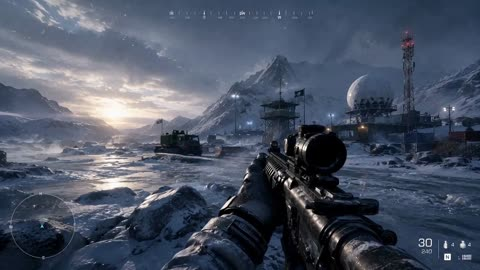</a>

The prompt splits into Camera, Lighting and Camera movement blocks and describes player behavior such as scanning, taking cover, firing short bursts and advancing. Specific details like recoil, weapon bobbing and frozen breath make a still game frame read as live gameplay.

MiniMax H3 · Image-to-video · Source: [@LudovicCreator on X](https://x.com/LudovicCreator/status/2084338573210157293) · 69 likes on 2026-10-28 · found via [SkyNotSilent/awesome-MiniMax-H3-cases](https://github.com/SkyNotSilent/awesome-MiniMax-H3-cases)

[`fps`](tags.md#tag-fps) [`game-footage`](tags.md#tag-game-footage) [`arctic`](tags.md#tag-arctic) [`first-person`](tags.md#tag-first-person) [`photorealistic`](tags.md#tag-photorealistic)

<details><summary><b>Prompt</b></summary>

```text
Camera: First-person, eye level, handheld gameplay. Simulate a player operating a modern military FPS while holding a frost-covered assault rifle and cautiously advancing through a remote Arctic military installation. Move forward across an icy service road between snowbanks, radar stations and frozen cargo containers, periodically scanning rooftops, watchtowers and mountain ridgelines. Sweep the reticle naturally across possible threats, briefly stop behind cover to fire several controlled bursts toward a distant enemy near the radar dome, then continue advancing deeper into the frozen base like authentic player-controlled gameplay.

Lighting: Cold Arctic daylight with soft overcast skies and pale winter sunlight reflecting across ice and snow. Blend crisp blue ambient light with warm floodlights from the base, vehicle headlights, subtle smoke drifting from generators, blowing snow, frozen breath, and atmospheric ice particles. Maintain ultra-photorealistic AAA rendering with highly detailed weapon materials, realistic snow deformation, wet ice reflections, volumetric fog, and cinematic environmental depth.

Camera movement: Natural player-controlled movement with subtle handheld sway while walking across uneven frozen terrain. Perform small tactical checks left and right, briefly aim down the central lane, add realistic recoil and muzzle flash while firing short bursts, then smoothly recover and continue pushing forward. Include slight weapon bobbing, responsive aim corrections, natural acceleration and deceleration, and authentic FPS movement throughout, preserving the immersive feel of high-end modern military gameplay.
2/2
```

</details>

<a id="h3-parking-garage-fault-line-martial-arts"></a>
### Parking garage fight with cracking concrete

<a href="https://x.com/chatgptpaglu/status/2104518897424548018">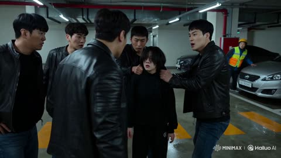</a>

A fixed header, a character lock and a ban on glow or magic effects keep the supernatural strength grounded in physical cracks. Four timed beats carry the Korean dialogue and a 0.2 second slow motion accent, and a realism lock plus handheld camera notes keep it documentary.

MiniMax H3 · Text-to-video · Source: [@chatgptpaglu on X](https://x.com/chatgptpaglu/status/2104518897424548018) · 69 likes on 2026-10-28 · found via [SkyNotSilent/awesome-MiniMax-H3-cases](https://github.com/SkyNotSilent/awesome-MiniMax-H3-cases)

[`martial-arts`](tags.md#tag-martial-arts) [`photorealistic`](tags.md#tag-photorealistic) [`dialogue`](tags.md#tag-dialogue) [`one-take`](tags.md#tag-one-take) [`action`](tags.md#tag-action)

<details><summary><b>Prompt</b></summary>

```text
15 sec | 16:9 | One continuous generation | Korean dialogue | No BGM | No subtitles

STYLE:
Ultra-photorealistic live-action AAA supernatural martial arts. Real actors, real environment, grounded physical VFX.

CHARACTER LOCK:
SO-YEON, 160cm, messy black hair, black hoodie, sweatpants, Converse. Natural skin texture, sweat, pores, micro-expressions. Same actress throughout. One human only.

LOCATION:
Nighttime underground parking garage. Wet concrete, fluorescent lights, concrete pillars, scooters, shopping carts, puddles, exposed pipes.

SOUND:
Korean dialogue, footsteps, breathing, impacts, metal rattling, fluorescent hum. No music.

COMBAT:
Unarmed Sanda + Muay Thai clinch + Silat. Continuous flow: evade → redirect → knee → elbow → sweep → pivot → throw. Six attackers engage simultaneously. Two bystanders react naturally.

FAULT-LINE PHYSICS:
Heavy foot plants and slams create realistic cracks from the exact impact point. Visible vibration, dust, debris movement. No glow, aura, particles, energy waves, speed trails, or magic.

00:00–03:00 — CORNERED
Six men surround So-Yeon beside a scooter. One grabs her hoodie. A delivery worker warns, "도망가요!" Terrified, So-Yeon whispers, "그만해..." The leader swings. She instinctively ducks.

03:00–07:00 — FIRST IMPACT
She catches his wrist, pivots, and knees his stomach. Her sneaker plants hard. A thin crack shoots across the wet concrete. The leader crashes into a shopping cart and knocks into two others. Everyone freezes. A thug shouts, "뭐야, 저년!" The remaining men rush her.

07:00–11:00 — CHAOS
She slips a punch and elbows one attacker into a pillar. Redirects another into a puddle. Sweeps a third to the ground. 0.2-second micro slow motion: cracks spread, water ripples, dust falls. Immediate speed return. Bystanders pull each other behind a parked car.

11:00–15:00 — THE LAST MAN
The final attacker grabs her from behind. She becomes completely still. Her foot plants hard. Concrete cracks sharply. She redirects and throws him onto a parking line. Dense fractures spread. The delivery worker cautiously asks, "괜찮아요?" She nods, still frightened, and walks away across the cracked concrete. Fluorescent lights flicker from the vibration.

CAMERA:
Close handheld pursuit, reactive movement, occasional wider shots during group combat. Low angles for impacts and fractures, natural focus hunting, slight operator mistakes. No impossible moves or heroic posing.

REALISM LOCK:
Attackers hesitate, collide, and react naturally. Bystanders panic and move. So-Yeon looks confused by her strength. Every piece of damage has a visible physical cause. No supernatural visual effects.
```

</details>

<a id="h3-gold-chain-rapper-audio-lipsync-multicut"></a>
### Gold chain rapper performing on a night street

<a href="https://x.com/KEETY2591756/status/2085918684879765882">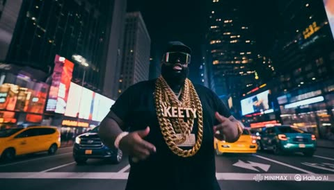</a>

A character image plus an audio track act as the timing guide, so the mouth and actions lip sync to the audio automatically. Asking for multiple cuts with extreme low and high angles, in an East Coast rap video style, gives the fast, aggressive camera rhythm.

MiniMax H3 · Reference-to-video · Source: [@KEETY2591756 on X](https://x.com/KEETY2591756/status/2085918684879765882) · 61 likes on 2026-10-28 · found via [SkyNotSilent/awesome-MiniMax-H3-cases](https://github.com/SkyNotSilent/awesome-MiniMax-H3-cases)

[`lip-sync`](tags.md#tag-lip-sync) [`rap`](tags.md#tag-rap) [`omni-reference`](tags.md#tag-omni-reference) [`multi-cut`](tags.md#tag-multi-cut) [`music-video`](tags.md#tag-music-video)

<details><summary><b>Prompt</b></summary>

```text
モード1：Omni Reference
プロンプト：添付のキャラクター参照（ 📷Image1 ）とオーディオトラックをタイミングガイドとして使用してください。オーディオにある「音声」に完全に会うようにキャラクターの口とアクションを入れてリップシンクしてダイナミックなカメラアングルでラップを披露してください。カメラはマルチカットでキャラの部位をクローズアップしてください。全て超ハイスピードで激しく行ってください。

モード2：Omni Reference
プロンプト：添付のキャラクター参照（ 📷Image1 ）とオーディオトラックをタイミングガイドとして使用してください。オーディオにある「音声」に完全に会うようにキャラクターの口とアクションを入れてリップシンクしてダイナミックなカメラアングルでラップを披露してください。カメラはマルチカットで超ローアングル・超ハイアングルを小刻みに切り替えたUS東海岸のラップビデオのようなスタイルに仕上げる。全て超ハイスピードで激しく行ってください。
```

</details>

<a id="h3-low-angle-fashion-alley-tracking"></a>
### Low angle fashion tracking shot in sunlit alley

<a href="https://x.com/Kiber_Alla/status/2083583963512062019"></a>

The prompt opens with camera and lens cues (ARRI Alexa 35, spherical lens, natural daylight), then fixes a single continuous backward tracking move at low angle. Wardrobe, fabric physics, wind and a list of dance gestures give the model concrete motion to render, while strong sun and deep shadow set the contrast.

MiniMax H3 · Text-to-video · Source: [@Kiber_Alla on X](https://x.com/Kiber_Alla/status/2083583963512062019) · 61 likes on 2026-10-28 · found via [SkyNotSilent/awesome-MiniMax-H3-cases](https://github.com/SkyNotSilent/awesome-MiniMax-H3-cases)

[`fashion`](tags.md#tag-fashion) [`low-angle`](tags.md#tag-low-angle) [`tracking-shot`](tags.md#tag-tracking-shot) [`alley`](tags.md#tag-alley) [`photorealistic`](tags.md#tag-photorealistic)

<details><summary><b>Prompt</b></summary>

```text
Ultra realistic cinematic video, shot on ARRI Alexa 35 with spherical lens, natural daylight, photorealistic, looks like real footage filmed on location, high-end fashion film aesthetic, extreme detail, realistic skin texture, real fabric physics, subtle film grain. Continuous low angle tracking shot, camera smoothly moving backward as a beautiful young woman with long dark wind-blown hair walks and performs down a narrow sun-drenched urban alley between old textured stone buildings under deep blue sky. She wears a flowing milky white asymmetrical off-shoulder top and high-waist wide-leg technical cotton culottes with a thin rope belt. The wide pants and fabric move naturally and dramatically with the wind and her body. She sings with genuine joy, smiling and softly laughing, maintaining strong eye contact with the camera, while performing free, light dance elements — fluid arm gestures, body swaying, and elegant full turns around herself as she continues walking forward. Her movement is energetic yet effortless, full of lightness and positive energy. Cinematic natural lighting with strong sunlight and deep shadows, realistic motion blur, high dynamic range, masterpiece, best quality, no artificial look.
```

</details>

<a id="h3-one-man-through-history-future-war-time-journey"></a>
### One man transforms across history into a future war

<a href="https://x.com/qtum/status/2105438735248801831"></a>

A locked wide camera stays still while the scenery and the same man's clothing change in place, with a timed beat of about three seconds per era. A character block fixes the face across all parts, and each part opens by continuing the previous frame to keep the single take seamless.

MiniMax H3 · Text-to-video · Source: [@qtum on X](https://x.com/qtum/status/2105438735248801831) · 60 likes on 2026-10-28 · found via [SkyNotSilent/awesome-MiniMax-H3-cases](https://github.com/SkyNotSilent/awesome-MiniMax-H3-cases)

[`time-journey`](tags.md#tag-time-journey) [`costume-change`](tags.md#tag-costume-change) [`single-take`](tags.md#tag-single-take) [`static-camera`](tags.md#tag-static-camera) [`multi-part`](tags.md#tag-multi-part)

<details><summary><b>Prompt</b></summary>

```text
One Breath of History, then the Machine (time journey v5)

Film style
Cinematic live-action, photorealistic, epic natural light, rich period-accurate detail, one continuous evolving take with no cuts, fades or resets. The same man is present throughout; the world and his clothing transform seamlessly in place. No generated subtitles, captions or on-screen text.

Character A: The traveller
A rugged man in his thirties with a weathered, expressive face, real skin texture, dark tousled hair and a short dark beard, lean and strong. The same face in every era.

Era 1 clothing (changes with each era as the shots direct): a ragged grey wolf pelt draped over one shoulder, a fur loincloth, bare dust-streaked arms, a leather cord around the neck.
part_01 (15s, cast A)

Composition: Static wide shot. At the start: a rocky cliff at sunrise, A standing on it as a prehistoric hunter: a ragged grey wolf pelt draped over one shoulder, a fur loincloth, bare dust-streaked arms, a leather cord around his neck, holding a crude wooden spear with a flint tip, watching a herd of animals on the plain below.

Action: One seamless unbroken take with no cuts, fades or resets; every change is a continuous transformation in place, and his face never changes. [0s-3s] Prehistoric: A stands on the rocky cliff at sunrise in the wolf pelt and fur loincloth with the flint-tipped spear, watching the herd. [3s-6s] The cliff dissolves into a Sumerian mud-brick settlement; his pelt becomes a knee-length woven wool kaunakes skirt with tufted fringes, bare chest, a plain linen sash and leather sandals, and the spear becomes a long wooden farming staff; he runs through the settlement. [6s-9s] The settlement becomes ancient Egypt with pyramids; he now wears a white pleated linen shendyt kilt, a broad beaded collar in blue and gold, a striped linen headcloth and sandals, with kohl-lined eyes, walking among the pyramids. [9s-12s] Egypt becomes a grand Roman road of stone and sand; he now wears desert travel attire: a dusty cream tunic under a hooded sand-coloured wool cloak, a leather belt with a waterskin, laced sandals, the hood shading his face from the sun; he travels along the road. [12s-15s] The road becomes the interior of a medieval castle hall; he enters as a knight in full plate steel armour with a mail coif, a plain white surcoat, gauntlets and a sword at his hip, visor raised so his face stays visible. No dialogue; ambient sound of each era only.
Camera: Completely static, locked-off wide camera; no movement, zoom or reframing at all. The scenery and the man's clothing transform in place within the frame.

part_02 (15s, cast A, ends at 13.0s)
Composition: Continues exactly from the previous frame: A as a knight in full plate steel armour with a mail coif, plain white surcoat and raised visor, standing inside a medieval castle hall.
Action: One seamless unbroken take continuing the previous part with no cut, fade or reset; every change is a continuous transformation in place, and his face never changes. [0s-3s] The castle hall dissolves into a sandy beach at the water's edge with tall ships sailing out in the distance; his armour becomes an 18th-century sailor's coat of dark navy wool with brass buttons over a striped jersey, white canvas trousers rolled to the calf, a knotted red neckerchief, barefoot; he walks along the shoreline. [3s-6s] The beach becomes a colonial port city of the mid-1800s: brick warehouses, a cobbled quay, tall ships' masts, horse carts and stacked crates; he now wears a mid-19th-century gentleman's suit of that exact period: a long black wool frock coat, a buttoned waistcoat with a gold watch chain, a high starched wing collar with a dark silk cravat, narrow grey striped trousers, polished black leather boots and a black silk top hat on his head; he stands on the quay. [6s-9s] The port becomes a modern urban street; he now wears contemporary casual clothes: a grey hoodie under an olive bomber jacket, dark jeans, white trainers, earbuds; he walks along the pavement.
[9s-12s] The street becomes a bustling present-day metropolis of glass towers and crowds; he now wears a slim black overcoat over a plain white t-shirt, dark trousers and sleek trainers, a smartwatch on his wrist; he stands still among the motion. [12s-15s] The metropolis becomes a far-future city of luminous towers; he now stands completely still in an advanced white-and-graphite space suit with articulated plates, a softly glowing blue chest indicator and a clear helmet visor showing his face, observing the landscape while faint visual echoes of all the past eras layer within the sky and the architecture. The take ends there. No dialogue, ambient sound only.
Camera: Completely static, locked-off wide camera; no movement, zoom or reframing at all. The scenery and the man's clothing transform in place within the frame.

part_03c (6s, cast A)
Composition: Continues exactly from the previous frame: the man in the white-and-graphite space suit standing completely still before the far-future city of luminous towers.
Action: One seamless unbroken take continuing the previous part with no cut, fade or reset; the framing stays identical. [0s-1.5s] Sci-fi robot quadcopters, four-rotor drones with mounted guns and red sensor lights, swarm in over the futuristic city firing bright tracer rounds; explosions bloom on the luminous towers and smoke rises. [1.5s-3s] A is hit by the drone gunfire and collapses to the ground, falling face up, completely motionless, eyes closed, no blood or gore. [3s-6s] Other people in futuristic clothing run into frame from both sides toward him; the drones open fire on them and each one is knocked down by the bullets mid-stride, falling onto A and onto each other, one after another, until a pile of the fallen lies still on top of him at the foot of the burning city. Nobody kneels, helps or crouches; they only run, get shot and fall. The drones keep circling and firing overhead. The take ends there. No dialogue; rotor whine, gunfire and distant explosions.
Camera: Completely static, locked-off wide camera; no movement, zoom or reframing at all. The scene transforms in place within the frame.
part_04d (6s, cast none)
Composition: Continues exactly from the previous frame: the pile of the fallen lying still at the foot of the burning futuristic city, drones circling overhead.
Action: One seamless unbroken take continuing the previous part with no cut, fade or reset. [0s-1.5s] The drones fly off, the fires die to smoke, and the pile of the fallen dissolves into dusty, faded, sun-bleached bones and skulls spread across the ground; the burning towers become the dark ruined skyline of the same futuristic city on the horizon. The frame is empty of anyone standing. [1.5s-5s] A towering military war robot, a heavily armoured bipedal battle machine in scorched gunmetal plating with battle damage and soot, six articulated arms spread from its shoulders each ending in a weapon: rotary cannons, gun barrels and a missile pod, glowing red optical sensors in an armoured head, exposed hydraulics and steel ribs, no logos or markings, walks into the frame from the right edge with slow heavy steps, crunching across the bones, and steps up onto the heap of skulls in the centre of the frame, stopping there. [5s-6s] It stands still on the bones, then slowly turns its head toward the camera. The take ends there. No dialogue. Audio: no music at all; only the same natural ambience as the rest of the film, wind over the ruins, distant crackling fire and settling smoke, and the machine's heavy metallic footsteps.
Camera: Completely static, locked-off wide camera; no movement, zoom or reframing at all. The scene transforms in place within the frame.
```

</details>

<a id="h3-dark-red-kpop-lyric-typography-performance"></a>
### Dark red K-pop video with lyric typography

<a href="https://x.com/Kiber_Alla/status/2085138181133894024"></a>

Locks the performer in close or medium framing with no cuts on her, while typography and backgrounds hard cut every 1 to 1.5 seconds on a numbered lyric list. Three references (character, audio, lyrics) plus explicit mouth and teeth rules keep lip-sync clean.

MiniMax H3 · Reference-to-video · Source: [@Kiber_Alla on X](https://x.com/Kiber_Alla/status/2085138181133894024) · 56 likes on 2026-10-28 · found via [SkyNotSilent/awesome-MiniMax-H3-cases](https://github.com/SkyNotSilent/awesome-MiniMax-H3-cases)

[`music-video`](tags.md#tag-music-video) [`kpop`](tags.md#tag-kpop) [`lyrics-typography`](tags.md#tag-lyrics-typography) [`lip-sync`](tags.md#tag-lip-sync) [`red-atmosphere`](tags.md#tag-red-atmosphere)

<details><summary><b>Prompt</b></summary>

```text
10-second dark emotional K-pop music video. Realistic young East Asian woman from the character reference, natural face, real skin texture, messy hair. 
Important rules: 
- The girl is always framed in close-up or medium shots only. No wide or distant shots at all. 
- The girl performs continuously for the full 10 seconds without any cuts on her. Her movement is natural and fluid — she can shift weight, make small dance-like gestures, turn her head, move her shoulders and hands, but the camera stays on her in consistent medium/close framing. 
- Typography and background change with hard cuts according to the storyboard order, while the girl keeps performing through them.  

Sequence of text (hard cuts): 
1. “THE TABLE’S SET AGAIN” 
2. “NOBODY SITS DOWN” 
3. “YOUR WORDS ARE HARD GLASS” 
4. “FALLING TO THE FLOOR NOW” 
5. “I KEPT THE DOOR OPEN” 
6. “YOU KEPT YOUR HANDS CROSSED” 
7. “SAME ROOM, SAME SCAR” 
8. “SAME OLD COST” 
9. Final rose  The girl sings the entire song with clear, accurate lip-sync. 

Mouth and teeth must stay natural and undistorted at all times — no deformation, no melting, no artifacts. Emotional facial performance. Typography stays sharp and reacts (cracks, shifts, particles). Changing typography every 1–1.5 seconds. Heavy red atmosphere, cinematic lighting, photoreal
```

</details>

<a id="h3-origin-sci-fi-motion-poster-assembly"></a>
### Sci-fi ORIGIN poster assembling itself in motion

<a href="https://x.com/LudovicCreator/status/2083628852165672988"></a>

Starts from the still poster as the source image and fixes what must not change: background, palette, typography and layout. The prompt then orders the build as a timeline, from frame to title to landscape to small credits, with matching UI sounds and a closing push-in.

MiniMax H3 · Image-to-video · Source: [@LudovicCreator on X](https://x.com/LudovicCreator/status/2083628852165672988) · 55 likes on 2026-10-28 · found via [SkyNotSilent/awesome-MiniMax-H3-cases](https://github.com/SkyNotSilent/awesome-MiniMax-H3-cases)

[`motion-poster`](tags.md#tag-motion-poster) [`typography`](tags.md#tag-typography) [`sci-fi`](tags.md#tag-sci-fi) [`sound-design`](tags.md#tag-sound-design) [`vertical`](tags.md#tag-vertical)

<details><summary><b>Prompt</b></summary>

```text
Animate the source artwork as a 10-second premium sci-fi motion poster while preserving the white gallery background, thin border, navy-and-orange palette, typography, composition and original poster design. Begin on an almost empty white canvas, then progressively assemble the poster: the outer frame draws itself on, the orange “ORIGIN” background typography slides vertically into place, the planetary landscape fades and expands inside the central frame, and the colossal station descends from above as its lights activate. Bring the cloaked traveler forward from the distant landscape toward the foreground with strong dimensional parallax, allowing the figure and rocky base to slightly break outside the inner frame. Introduce the smaller titles, numbering, studio credits, graphic marks and footer icons one after another with clean pop-in, slide and type-on animations, accompanied by light futuristic clicks, playful digital typing sounds and soft mechanical impacts. Finish with a restrained camera push-in, subtle station lights, drifting mist and a gentle movement in the traveler’s coat while the completed poster remains perfectly readable and close to the original still image. No major scene transformation, no camera orbit, no distorted typography, no altered layout.
2/2
```

</details>

<a id="h3-miniature-stadium-hands-timelapse-build"></a>
### Hands build a miniature stadium timelapse

<a href="https://x.com/TechieBySA/status/2096606005068972483"></a>

A second by second timeline fixes one maker with two hands, and every new part must enter the frame already held. The prompt also bans morphing, interfaces and text, and it ends on a slow push to the finished build. It rebuilds the subject from a reference image, so it works best with a reference supplied.

MiniMax H3 · Reference-to-video · Source: [@TechieBySA on X](https://x.com/TechieBySA/status/2096606005068972483) · 54 likes on 2026-10-28 · found via [SkyNotSilent/awesome-MiniMax-H3-cases](https://github.com/SkyNotSilent/awesome-MiniMax-H3-cases)

[`timelapse`](tags.md#tag-timelapse) [`hands-on-build`](tags.md#tag-hands-on-build) [`macro`](tags.md#tag-macro) [`reference-image`](tags.md#tag-reference-image) [`timeline-prompt`](tags.md#tag-timeline-prompt)

<details><summary><b>Prompt</b></summary>

```text
A cinematic creation film follows one maker reconstructing the main subject shown in the referenced image completely from scratch. The referenced image defines the finished subject’s complete visible appearance, proportions, structure, materials, colors, clothing or surface details, and distinctive features; ignore its background, framing, lighting, and unrelated elements.  Begin directly on an empty, clean virtual workbench. Use a stable front three-quarter overhead view that keeps the developing subject readable. There is one maker throughout, represented by the same consistent left and right hands and forearms. Show no more than two hands at once.  From 0 to 14 seconds, the entire creation unfolds as a clearly accelerated timelapse with rapid, purposeful hand movement and restrained motion blur. Short jump cuts compress repetitive manual work only after each action has visibly completed. Every cut inherits the exact form and progress left by the previous action.  0-2 seconds: One hand enters already holding the first foundation material, armature, or base element appropriate to the referenced subject and places it at the center. The second hand steadies it as the maker establishes the initial supporting form.  2-8 seconds: The maker rapidly develops the subject’s major structure and volumes using one coherent creation method appropriate to what the referenced image depicts. A living subject is sculpted as one continuous, non-gory digital form from armature to anatomy; a vehicle or machine is built from chassis to functional structure; an object is formed or assembled from its supporting body outward. Each additional material or component enters from outside the frame while firmly held by one of the maker’s hands, is carried to its destination, and remains under hand control until attached or shaped.  8-12 seconds: The same hands develop the recognizable outer form and reference-specific features. The maker sculpts, fits, wraps, stitches, fastens, carves, or polishes only where appropriate to the subject. Facial features, hair, clothing, body panels, wheels, glass, surfaces, accessories, or equivalent defining elements emerge through visible hand and tool contact, never through spontaneous transformation.  12-14 seconds: The maker refines proportions, edges, joints, surface transitions, textures, colors, and distinctive details until the developing subject closely matches the referenced image. One hand stabilizes the form while the other performs each final adjustment with a hand-held tool.  14-15 seconds: The maker removes the last tool by hand and withdraws both hands. The timelapse returns to normal speed as the camera makes a restrained push toward the completed subject and holds on a clean final view.  Materials and components do not need to be visible before use, but anything newly introduced must enter the frame already held by one of the maker’s hands. Nothing moves, assembles, appears, disappears, or changes material independently. Maintain one maker, one continuous subject, one creation position, and one category-appropriate construction method. No assistants, extra hands, detached anatomy, duplicated elements, magical morphing, drawing phase, software interface, cursor, menus, annotations, or text overlays.
```

</details>

<a id="h3-dragon-attack-medieval-fleet-northern-sea"></a>
### Dragon Attacks Medieval Fleet in Stormy Sea

<a href="https://x.com/Diplomeme/status/2086833428713116099">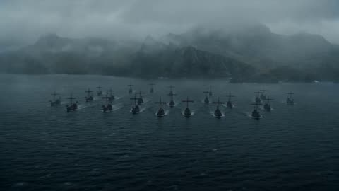</a>

The 15 second clip is split into five timed beats that alternate high aerial, low deck level and distant mountain shots, so the dragon's approach builds to a fireball hit on the lead ship. A closing style line of exclusions keeps faces out of close-ups and avoids celebrity likenesses.

MiniMax H3 · Text-to-video · Source: [@Diplomeme on X](https://x.com/Diplomeme/status/2086833428713116099) · 53 likes on 2026-10-28 · found via [SkyNotSilent/awesome-MiniMax-H3-cases](https://github.com/SkyNotSilent/awesome-MiniMax-H3-cases)

[`fantasy`](tags.md#tag-fantasy) [`dragon`](tags.md#tag-dragon) [`naval-battle`](tags.md#tag-naval-battle) [`multi-shot`](tags.md#tag-multi-shot) [`cinematic`](tags.md#tag-cinematic)

<details><summary><b>Prompt</b></summary>

```text
Hyper-realistic cinematic fantasy action sequence, 15 seconds, aspect ratio 16:9.

Daytime in a vast cold northern sea surrounded by jagged mountains and dark rocky cliffs. A fleet of large medieval wooden warships sails through rough black-blue water while armored soldiers prepare for battle on the decks. Massive sails snap violently in the wind. The ships carry burning braziers, ropes, shields, spears, banners, wooden siege weapons, and rows of armed warriors. Thick storm clouds hang low above the sea. Wind drives sea spray across the decks. The danger comes from the sky: a giant dragon approaches from behind the mountains, its enormous wings gradually emerging through the mist.

Begin with a high sweeping view of the entire fleet moving through the dangerous northern sea. Several warships sail in formation while smaller boats move between them. Soldiers look toward the distant mountains as a huge shadow passes across the water.
Shift to a low deck-level view among the warriors. Men raise shields and grab spears while officers shout commands. The camera moves toward the front of the ship as the wind suddenly becomes violent.
Cut to a distant view of the mountains. The dragon bursts through the clouds and flies directly toward the fleet, enormous wings beating through the storm mist. Its silhouette grows rapidly larger.

Return above the ships as the dragon dives toward the fleet. Sailors scramble across the decks while archers rush into position. Burning arrows are lit and giant ballistae are rotated toward the approaching creature.

Near the end, the dragon suddenly opens its jaws and releases a massive stream of fire toward the lead warship. The flames illuminate the dark sea as the crew raises shields and desperately attempts to turn the vessel.

End with the dragon flying directly above the fleet as the first fireball crashes into the lead ship, exploding across its wooden deck.

Style: hyper-realistic, cinematic, intense, fast-paced, suspenseful, fantasy atmosphere, strong sense of scale, warships, dragon battle, ocean storm, medieval warfare, fire, smoke, dynamic varied camera movement, no text, no logos, no cartoon style, no slow motion, no famous celebrity faces, no recognizable actors, no movie-star resemblance, no public-figure likenesses, no clear facial close-ups. Keep proportions. Keep style and features. Aspect ratio 16:9.
```

</details>

<a id="h3-field-guide-wren-plate-draws-itself"></a>
### Antique Bird Plate Draws Itself, Wren Wakes

<a href="https://x.com/Dheepanratnam/status/2086312209919963371"></a>

A reference image locks the final page, and a timed sequence builds it from pencil to ink to watercolour to type. Separate motion layers keep the paper still while only the bird breathes, backed by a detailed audio cue list.

MiniMax H3 · Reference-to-video · Source: [@Dheepanratnam on X](https://x.com/Dheepanratnam/status/2086312209919963371) · 53 likes on 2026-10-28 · found via [SkyNotSilent/awesome-MiniMax-H3-cases](https://github.com/SkyNotSilent/awesome-MiniMax-H3-cases)

[`time-lapse`](tags.md#tag-time-lapse) [`vintage-illustration`](tags.md#tag-vintage-illustration) [`locked-camera`](tags.md#tag-locked-camera) [`sound-design`](tags.md#tag-sound-design) [`reference-image`](tags.md#tag-reference-image)

<details><summary><b>Prompt</b></summary>

```text
@ Image1 is the sole visual authority for the folio spread, the wren, the hazel twig, the egg study, the foot sketch, the handwriting, the printed type, the paper, the foxing, the lighting, the palette, the layout and the horizontal composition. 

Animate this exact page without redesigning it. Preserve every existing mark, letter and colour in its final state.  

[Goal] Create a 15-second sequence in which this plate makes itself, and then the bird inside it comes quietly alive. One continuous, locked, straight-on overhead composition. No camera movement, no cuts, no cropping, no perspective change, no page turning.  

[Sequence]  0-2.4 seconds: Begin on blank aged ivory paper — the empty spread, correct in paper texture, chain lines, foxing and lighting, but carrying no image, no writing and no type. A faint graphite underdrawing appears across the right page in light searching strokes, finding the wren's posture and the line of the twig. 
A few construction marks overshoot and are left uncorrected.  

2.4-6 seconds: Engraved ink linework draws itself over the pencil, following the exact contours of the finished plate — outline first, then hatching building the shadow under the wing, the barring of the tail, the texture of the twig. The rectangular plate mark presses into the paper around the image with a soft physical impression, lifting the paper very slightly at its edge.  

6-10.5 seconds: Watercolour floods in. Washes enter the printed outlines and settle into them, warm russet across the back, buff along the eyebrow stripe, muted olive on the twig, each wash landing exactly within the shapes of the finished plate and overrunning the line in the same few places the reference does. 

The colour blooms wet and then visibly dries, darkening slightly at the edges. On the left page, the sepia handwriting writes itself line by line from the top, in a period cursive hand that is elegant, cramped and only partly legible. The small egg study fills with colour and the pencil foot sketch appears faintly beside it.  
10.5-13 seconds: The printed type impresses into the right page — TROGLODYTES TROGLODYTES, then The Common Wren beneath it, then PLATE XVII in the top right corner. Foxing spots deepen. The last details resolve: the highlight in the bird's eye, the fine barring on the flank. The page settles. Everything on the spread is now exactly as in @[ref img].  13-15 seconds: The page stays completely still and completely flat 

— it is paper and it behaves like paper. But the printed bird begins to breathe. Its flank rises and falls very slightly. It blinks once. It turns its head a few degrees and holds, alert, looking past the viewer at something outside the page. The cocked tail gives one small twitch. It does not fly, it does not leave the plate, it does not become three-dimensional, and it does not look at the viewer. Settle into a living idle: the bird breathing, one more slow blink, the paper still.  Render as photoreal archival photography of a real object under warm north-window light. Keep the printed page flat and matte with no glow, no emission, no glint and no digital sheen. 

Keep the two motion layers distinct: the page is a made thing being made, the bird is alive. Keep all type, handwriting, marks and geometry fixed once they appear.  Do not introduce any new text, letters, numerals, marks, birds, objects, hands, tools, logos, captions, borders, watermarks or page numbers. Do not turn or lift the page. Do not move, rotate or scale the camera. Do not zoom. Do not add glow, neon, coloured light, lens flare, bokeh or shallow-focus racking. 

Do not make the bird photoreal or three-dimensional — it must remain a hand-coloured engraving that happens to be alive. Do not have it fly, hop, open its beak wide, or leave the plate.  

Audio: fine graphite scratching on rough paper; the dry precise scrape of a steel nib; the deep soft compression of a plate press; a sable brush loaded with water moving across paper; paper fibres settling; the quiet room tone of a study with a slow long-case clock ticking somewhere behind. 
At 13 seconds, one Eurasian wren song — sudden, intricate and far louder than anything that small should produce — then the room tone returns and the clock keeps going. No music, no dialogue, no narration, no electronic tones.
```

</details>

<a id="h3-cairn-munro-silent-electric-overlander-typography"></a>
### Silent Electric Overland Vehicle in Highlands Rain

<a href="https://x.com/Dheepanratnam/status/2084201268977844521">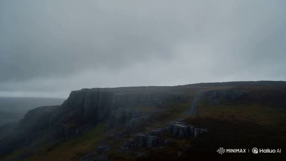</a>

Two reference sheets lock the vehicle design and the typeface, while a cut by cut timecode list with one-line type overlays sets the rhythm. An explicit audio law allows only rain, wind and water and bans engine sound, so the silent vehicle carries the idea.

MiniMax H3 · Reference-to-video · Source: [@Dheepanratnam on X](https://x.com/Dheepanratnam/status/2084201268977844521) · 50 likes on 2026-10-28 · found via [SkyNotSilent/awesome-MiniMax-H3-cases](https://github.com/SkyNotSilent/awesome-MiniMax-H3-cases)

[`automotive`](tags.md#tag-automotive) [`typography`](tags.md#tag-typography) [`cinematic`](tags.md#tag-cinematic) [`sound-design`](tags.md#tag-sound-design) [`multi-shot`](tags.md#tag-multi-shot)

<details><summary><b>Prompt</b></summary>

```text
CAIRN MUNRO — "ARRIVE UNHEARD" — 14 CUTS · 15s · 2K · 24fps  REFERENCES: the attached PRODUCT SHEET@Image1 is the exact vehicle — match its proportion, stance, glasshouse angle, cladding, rack and light signature exactly, invent nothing. The attached TYPE SHEET@Image2 is the exact typeface, weight, tracking and scale for every overlay. Match it.  AUDIO LAW — HIGHEST PRIORITY. NO MUSIC ANYWHERE. Do not generate score, soundtrack, background music, beat, drums, percussion, bassline, synth pad, drone, melody, chord, ambient bed, riser, braam, trailer hit, stinger, swell, or any tonal instrument. Where music would normally be scored, render SILENCE. NO VOICE — no narration, dialogue, vocals, breath. ONLY PERMITTED AUDIO, all of it environmental: rain striking wet granite; rain drumming on metal and glass; wind over ridge grass; a burn running hard over rock; gravel shifting; distant thunder; and true silence. All of it recorded-real, close, dry, no reverb wash. Nothing sustains musically.  SILENCE LAW — the engine of the film. The landscape is loud. The vehicle adds nothing to it. No engine, no exhaust, no motor whine, no transmission, no tyre roar, no wind noise off the body, no door, no suspension. Rain striking its panels is permitted — that is the world touching the car, not the car making sound. Whenever the vehicle fills frame and nothing is striking it, the mix drops to near-silence. If an engine or tyre sound would normally be added to a moving vehicle, render silence instead. An engine sound anywhere in this film is a failure.  EDIT METRONOME — SILENT: cuts locked to 96 BPM, 1 beat = 0.625s, 24 beats. A timing grid for cutting ONLY. Do not generate audio to this tempo.  BRAND: CAIRN. PRODUCT: CAIRN MUNRO, a fully electric expedition overlander. It is silent because it is electric — the claim is literal.  SUBJECT: per the sheet — boxy full-size SUV, upright glasshouse, flat vertical sides, squared arches, short overhangs, high clearance. Matte peat green-black body, charcoal composite cladding and sliders, raw anodised aluminium rack and skid plate, bone-white roof, signal-orange recovery hooks, full-width thin white LED signature front and rear, no grille, all-terrain tyres on flat-faced aluminium wheels. No badging.  WORLD: the Scottish Highlands in heavy weather. Wet granite, peat, ridge grass and heather. Low cloud moving fast across the tops. Constant rain. A single unmade stone track. No road markings, no buildings, no fences.  PALETTE: peat #1B2320, granite #4A4E4B, mist #D9DDDB, aluminium #8E9490, heather #6B5470. Signal orange #E24E1B on the recovery hooks only, never more than a few pixels. Cold northern light, overcast, no sun, no warmth anywhere. Desaturated but never graded grey — these are true wet colours.  MIST LAW: mist is real volume. It moves, thins, and parts to reveal. It never becomes a soft filter — everything outside the mist stays razor sharp. It never glows, never catches a god ray, never becomes smoke.  TYPE LAW: every overlay uses the TYPE SHEET face, CAIRN EXTENDED — wide uppercase, medium weight, wide tracking, pure white, with the hairline contour rule beneath each line. Two positions only: body lines lower-left on the safe-area grid, the lockup dead centre. Type is revealed by a hard-edged horizontal wipe travelling left to right. It never fades, scales, rotates, skews, glows or casts a shadow. It cuts on with the cut and holds absolutely still until the next cut takes it. Always pure white.  TEXT ACCURACY: every overlay word is spelled exactly as written and appears exactly once. No extra letters, no duplicated lines, no garbled glyphs, no invented words. No text of any kind on the vehicle.  CAMERA: motion-control smooth and heavy, no handheld, no drift. Long-lens tracking and slow cranes. Clean digital, no grain. Directional blur in transit; everything arrives sharp and holds still.  RHYTHM: cuts 01–02 hold two beats. Cuts 03–10 are one beat apart, the spec run. Cuts 11–12 hold two beats. Cuts 13 and 14 hold four beats each.  01 · 0.000 · Wide. A granite ridge under fast-moving low cloud, rain falling hard across frame. No vehicle. SOUND: rain on stone and wind, loud.  02 · 1.250 · Macro. Rain hammering a wet granite face, water sheeting down the fractures. TYPE: EVERYTHING HERE  03 · 2.500 · A burn crashing white over black rock. TYPE: MAKES A SOUND  04 · 3.125 · Wind flattening ridge grass and heather in one long gust.  05 · 3.750 · The vehicle enters, low and wide, emerging from mist on the stone track. The mix drops away to rain only. TYPE: ONE THING DOESN'T  06 · 4.375 · Macro. A tyre rolling through standing water, the water throwing up hard. SOUND: water only, no tyre noise. TYPE: 800 VOLT  07 · 5.000 · Macro. Rain drumming on the bone-white roof panel. TYPE: 710 KM  08 · 5.625 · Macro. Water running off the anodised aluminium rack. TYPE: 900 NM  09 · 6.250 · Low long-lens track alongside the flat body side, mist parting off the panel. TYPE: 1050MM WADING  10 · 6.875 · Macro. The thin white LED signature cutting through mist. TYPE: 3.5T TOWING  11 · 7.500 · High wide. The vehicle small on a vast stone plateau, cloud dragging over it. SOUND: wind, distant thunder.  12 · 8.750 · Front three-quarter, wading a burn, water pushing up over the sills and breaking white. SOUND: water only.  13 · 10.000 · THE SHOT. A single mature red deer stag stands side-on on the ridge above the track, wet coat, broad antlers, head turned to camera. The vehicle passes below him in the same frame. The stag does not flinch, does not run, does not move at all. Hold on him. SOUND: rain and wind only — no vehicle sound whatsoever.  14 · 12.500 · The vehicle static on the ridge in moving mist, dead frontal. TYPE: CAIRN, dead centre. Two beats later MUNRO wipes on beneath it, then ARRIVE UNHEARD. beneath that. Hold, cut to black. SOUND: rain and wind, then hard silence on the cut. No end cue, no final hit.  NEGATIVE: no music, score, beat, instruments, narration, voice, engine noise, tyre noise. No people, hands, faces, drivers, passengers. No other vehicles, no roads, no road markings, no signage, no buildings, no fences, no power lines. No text other than the specified overlays — no captions, subtitles, watermarks, UI, timecode. No badging or lettering on the vehicle. No sun, no warm light, no golden hour, no lens flare, no god rays, no smoke, no snow. No glitch, scanlines, film burn, light leaks. The stag never runs. No colour outside the palette. No invented body parts.
```

</details>

<a id="h3-french-bulldog-backyard-agility-course"></a>
### French bulldog runs backyard agility course

<a href="https://x.com/cocktailpeanut/status/2085448660612182507"></a>

Framing the shot as casual handheld footage by the owner in an ordinary backyard gives a natural amateur look. A clear sequence of obstacles (poles, hurdles, tunnel, bell) gives the model precise beats to follow in order.

MiniMax H3 · Text-to-video · Source: [@cocktailpeanut on X](https://x.com/cocktailpeanut/status/2085448660612182507) · 50 likes on 2026-10-28 · found via [SkyNotSilent/awesome-MiniMax-H3-cases](https://github.com/SkyNotSilent/awesome-MiniMax-H3-cases)

[`pets`](tags.md#tag-pets) [`handheld`](tags.md#tag-handheld) [`ugc`](tags.md#tag-ugc) [`sequence`](tags.md#tag-sequence) [`backyard`](tags.md#tag-backyard)

<details><summary><b>Prompt</b></summary>

```text
A casual handheld smartphone video filmed by the dog's owner in an ordinary suburban backyard. A cute, stocky French bulldog excitedly runs through a small homemade agility course, awkwardly weaving between plastic poles, hopping over two low hurdles, scrambling through a short fabric tunnel, and finally bumping a little bell with its nose.
```

</details>

<a id="h3-hover-bike-race-mountain-pass-anime"></a>
### Two-Rider Hover-Bike Race Down Mountain Pass

<a href="https://x.com/yourPlugAI/status/2086528067019698388">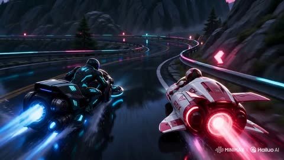</a>

An entity lock fixes exactly two racers and two bikes, with a livery description for each to keep them consistent. Timed camera and action blocks cover the whole 15 seconds and run from a supplied first frame.

MiniMax H3 · Image-to-video · Source: [@yourPlugAI on X](https://x.com/yourPlugAI/status/2086528067019698388) · 50 likes on 2026-10-28 · found via [SkyNotSilent/awesome-MiniMax-H3-cases](https://github.com/SkyNotSilent/awesome-MiniMax-H3-cases)

[`anime`](tags.md#tag-anime) [`racing`](tags.md#tag-racing) [`sci-fi`](tags.md#tag-sci-fi) [`action`](tags.md#tag-action) [`entity-lock`](tags.md#tag-entity-lock)

<details><summary><b>Prompt</b></summary>

```text
Cinematic Anime Video Scene

Generate a 15-second horizontal 16:9 original high-speed hover-bike racing anime video from the provided first frame.

CRITICAL ENTITY LOCK:
There must be exactly 2 racers and 2 bikes in the entire video: RENJI on VALKYRIE-01 (cyan/black drift bike) and ELENA on AERO-X (crimson/white draft bike).
Do not add extra racers, drone support vehicles, spectators, or traffic.
Maintain total visual consistency for both bikes, helmet visors, suit patterns, repulsor spark colors, and bike liveries throughout the sequence.

Entity identity:
VALKYRIE-01: Matte-black and cyan angular hover-bike, exposed repulsor pads, lateral drift brakes, blue plasma exhaust trails, ridden by Renji (cyan trim suit).
AERO-X: Pearl-white and neon-crimson aerodynamic hover-bike, enclosed canopy, crimson energy draft aura, white-hot central booster, ridden by Elena (crimson/gold visor suit).

Video style:
High-budget modern sports anime, sakuga-level velocity animation, crisp line art, vibrant neon lighting contrast, high-speed camera tracking, hyper-realistic friction and energy particle effects. Set on a wet downhill mountain pass at dawn.

Camera and pacing:
Continuous forward velocity, zero slow-motion interruptions:
0.0s - 3.0s: High-speed rear-tracking shot diving into the first downhill hairpin curve; instant drift initiation.
3.0s - 7.5s: Tight side-parallel tracking shot as bikes navigate rock debris and trade positions through S-curves.
7.5s - 11.5s: Close camera lock on the draft-slingshot maneuver; high-energy particle displacement as booster ignition occurs.
11.5s - 15.0s: Low-angle front-facing camera lock on the final sprint to the finish line bridge, ending on a hyper-speed photo-finish freeze.

Action timing:
0.0s - 1.5s:
Sequence begins at speed. VALKYRIE-01 leads downhill; AERO-X locks onto its rear bumper. Anti-gravity repulsors spray road water and blue sparks into the frame.

1.5s - 4.0s:
First sharp hairpin. VALKYRIE-01 deploys lateral drift airbrakes with a burst of blue thruster fire, sliding sideways at 300 km/h. AERO-X stays glued inside its slipstream aura.

4.0s - 7.0s:
Mountain debris hazard. VALKYRIE-01 hops over a boulder using a repulsor burst. AERO-X ducks under it, scraping the neon magenta guardrail in a cloud of friction sparks.

7.0s - 10.0s:
S-Curve exchange. Bikes lean side-by-side; their repulsor fields collide, creating a bright electrical shockwave. ELENA pulls the overdrive lever; AERO-X's rear fins extend.

10.0s - 13.0s:
Slingshot maneuver. AERO-X bursts out of VALKYRIE-01's draft, igniting its central white plasma booster. Both bikes roar down the final straightaway side-by-side.

13.0s - 15.0s:
Final sprint toward the finish light gate. Water sprays violently behind them. Both nose cones cross the finish line simultaneously in a flash of light. Final freeze frame.

Motion quality:
Fluid 2D animation, extreme speed-line integration, stable bike geometry, flawless vehicle reflection rendering, zero limb or body clipping, high-frame-rate kinetic realism.

Environment:
Wet mountain pass asphalt, sheer cliff walls, neon cyan and magenta guardrail lights, early dawn sky with pink/purple clouds, water spray, floating spark particles.

Final output:
15 seconds, horizontal 16:9, original high-budget sports racing anime, exactly 2 racers, relentless kinetic pacing, dynamic cinematography, no subtitles, no watermarks, no logos.
```

</details>

<a id="h3-pink-suit-lip-sync-edit"></a>
### Make the man in an existing clip speak, in a borrowed voice

<a href="https://huggingface.co/MiniMaxAI/MiniMax-H3/resolve/main/assets/r2va_2k.mp4">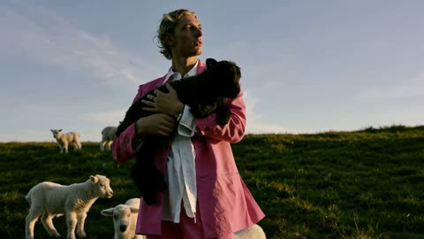</a>

Edit-mode prompt with six fields. `retention_analysis` says what to keep from each input: the source video fully, its music partly, and only the voice timbre from the second audio clip.

MiniMax H3 · Video edit · Source: [MiniMax H3 model card](https://huggingface.co/MiniMaxAI/MiniMax-H3)

[`lip-sync`](tags.md#tag-lip-sync) [`voice-reference`](tags.md#tag-voice-reference) [`multi-reference`](tags.md#tag-multi-reference) [`structured-prompt`](tags.md#tag-structured-prompt) [`dialogue`](tags.md#tag-dialogue)

<details><summary><b>Prompt</b></summary>

```text
subject_definitions:
<Subject 1> is the young man with short wavy blonde hair, wearing a bright pink suit jacket, matching pink trousers, an unbuttoned white shirt, and silver rings, holding a small black lamb in his arms in <Video 1>.
<Video 1> is the source video for the editing task.
<Audio 1> is the synchronized audio track of <Video 1>, providing the background music.
<Audio 2> is the voice timbre reference for <Subject 1>'s voice, containing a spoken male voiceover.

summary:
[video editing + audio reference + audio reuse] The target video is an edited version of <Video 1>. <Subject 1>, wearing a bright pink suit and holding a black lamb, stands in a grassy field with other white lambs in the background. The edit animates <Subject 1>'s face to speak the user-provided dialogue. <Audio 1> is partially reused as the continuous background music, while the target references the calm male voice timbre of <Audio 2> for <Subject 1>'s spoken lines.

retention_analysis:
<Subject 1> (appears in [Shot 1]): fully_preserved - the man retains his identity, wavy blonde hair, pink suit, white shirt, accessories, and the black lamb he holds, with his mouth newly animated to speak.
<Video 1> (source video editing): fully_preserved - the original camera framing, warm golden hour lighting, grassy hill setting, and background white lambs are maintained while the central character is edited.
<Audio 1>: partially_copy - the atmospheric background music from <Audio 1> is reused in the target video, mixed beneath the newly added spoken dialogue.
<Audio 2>: reference - the target audio references the male voice timbre from <Audio 2> to generate <Subject 1>'s spoken dialogue.

detailed_description:
The target video is in realistic photographic style.
[Shot 1] The shot begins from the source <Video 1>, showing <Subject 1>, a young man with short wavy blonde hair, wearing a bright pink suit jacket, matching pink trousers, and a casually unbuttoned white shirt. He stands confidently in a sunlit green pasture, gently holding a small black lamb securely in his arms. The warm, golden hour lighting casts soft shadows across his face and the bright pink fabric of his suit. Behind him, several white lambs stand and graze on the rolling grassy hill against a clear, pale blue sky. The atmospheric background music from <Audio 1> plays continuously throughout the scene. <Subject 1> physically speaks, his mouth movements naturally syncing to the new dialogue, with his voice timbre referencing the calm male delivery from <Audio 2>. Looking thoughtfully forward, <Subject 1> (S1) speaks softly, <d>[English] Follow the wind, live free.</d> As he delivers the line, he subtly shifts his weight, cradling the resting black lamb while the camera slowly pushes in. <Subject 1> (S1) continues his thought, <d>[English] Leave worries behind, enjoy the moment.</d> Exactly as his voice stops, his lips meet in a relaxed, peaceful smile, and his jaw ceases speaking motion. He then turns his gaze slightly away toward the horizon, gently stroking the black lamb's fleece with his fingers as the camera holds on this tranquil, sunlit state through the end of the video.

overall_soundscape:
The soundscape consists of the continuous, atmospheric background music from <Audio 1>, overlaid with the clear, calm male dialogue spoken by the main character, referencing the voice timbre of <Audio 2>.

non_diegetic_music:
The atmospheric, sustained background music from <Audio 1> is reused as the continuous score, playing quietly beneath the spoken dialogue.
```

</details>

<a id="h3-ramen-focus-pull"></a>
### Ramen in front, family dinner behind, one focus pull

<a href="https://huggingface.co/MiniMaxAI/MiniMax-H3/resolve/main/assets/i2va_2k.mp4">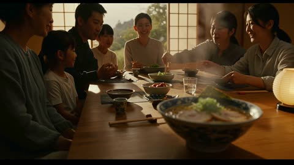</a>

The first line pins the input photo to frame 0, then the prompt describes the whole eight seconds as one locked-off shot whose only move is the focus shifting from the bowl to the family.

MiniMax H3 · Image-to-video · Source: [MiniMax H3 model card](https://huggingface.co/MiniMaxAI/MiniMax-H3)

[`focus-pull`](tags.md#tag-focus-pull) [`static-camera`](tags.md#tag-static-camera) [`structured-prompt`](tags.md#tag-structured-prompt) [`food`](tags.md#tag-food) [`sfx`](tags.md#tag-sfx)

<details><summary><b>Prompt</b></summary>

```text
For the target video, at 0.00 seconds into the target video, <Picture 1> (from [Shot 1]) is fully referenced.

integrated_multimodal_description: [Shot 1] This is a live-action, cinematic shot with a shallow depth of field. The camera holds a perfectly static shot throughout the entire eight-second duration, capturing a cozy family gathering in a traditional Japanese dining room. The scene opens with a large, intricately patterned blue and white ceramic bowl of ramen in the immediate foreground, rendered in crisp, sharp focus. The bowl sits on a smooth, polished long wooden table. Inside the bowl, a rich, oily golden-brown broth surrounds yellow wavy noodles, topped with two thick, round slices of chashu pork featuring visible fat marbling and a distinct spiral meat pattern. A generous mound of freshly chopped, bright green scallions rests in the center, and a crisp, dark green rectangular sheet of nori seaweed is tucked into the right edge. To the left of the bowl, a pair of light brown wooden chopsticks rests horizontally on a small, dark rectangular chopstick rest, near a small cylindrical ceramic teacup with blue painted patterns. On the right side of the table, a spherical paper lantern with a ribbed bamboo frame sits on a black wooden base. In the background, a large family of seven is gathered around the table, initially appearing as a soft, blurred presence. Behind them, traditional Japanese sliding shoji screens with wooden lattice frames are open, revealing a bright outdoor scene with lush green trees. Early in the clip, the thick, white steam rising from the hot ramen broth immediately intensifies, billowing upwards in thick, swirling clouds that dance continuously above the bowl. As the clip progresses into the middle seconds, the camera maintains its static position while the focus begins a deliberate, smooth shift deeper into the room. The foreground ramen bowl, its vibrant ingredients, and the rising steam gradually soften into a hazy, out-of-focus blur. Simultaneously, the family members in the background come into sharp, detailed clarity. The heavy steam continues to rise from the foreground, creating a dynamic, translucent veil between the camera and the family. With the focus now firmly locked on the background, the vibrant family dinner comes alive. The man in the dark navy blue long-sleeved shirt on the left leans forward, his mouth moving animatedly in a silent exchange. The young girl in the crisp white short-sleeved t-shirt beside him smiles brightly, looking toward the center of the table. The woman on the far left, wearing a soft light blue long-sleeved blouse, turns her head slightly, smiling gently. Across the table, the woman in the light grey button-down shirt smiles broadly, her eyes crinkling, as she rests her hands near her plate. The woman in the dark grey top further back uses her wooden chopsticks to pick up a small piece of food from a central ceramic dish filled with bright red pickled vegetables. The woman in the center back in the light grey sweater smiles gently, her hands clasped softly in front of her, observing the interaction. Throughout the remainder of the clip, the family continues their lively physical interaction, their mouths moving in continuous, silent cadences of conversation, while the thick, white steam from the blurred ramen bowl in the foreground never stops rising, adding a comforting atmosphere to the warm gathering.

overall_soundscape: The soundscape begins with a quiet room tone mixed with the faint, airy rustle of the thick steam billowing from the hot ramen bowl in the foreground, accompanied by the subtle, continuous hissing and bubbling of the rich broth. As the visual focus shifts deeper into the room, the physical sounds of the bustling family dinner become dominant in the foreground. The clear, sharp clinking of ceramic bowls and wooden chopsticks touching plates is clearly heard as the family members reach for food. This is followed by the faint, muffled thud of a cup being set down on the smooth wooden table, and the subtle, rhythmic rustle of cotton and wool clothing as the family members lean forward and gesture, perfectly capturing the lively, physical atmosphere of the shared meal.

non_diegetic_music: A gentle, heartwarming acoustic guitar melody plays softly in the background, accompanied by the subtle, resonant notes of a traditional Japanese koto. The music maintains a slow, comforting tempo that enhances the cozy, nostalgic, and joyful atmosphere of the family gathering.
```

</details>

<a id="h3-starship-hyperspace-jump"></a>
### Starship bridge, the fleet jumps to hyperspace

<a href="https://huggingface.co/MiniMaxAI/MiniMax-H3/resolve/main/assets/t2va_2k.mp4">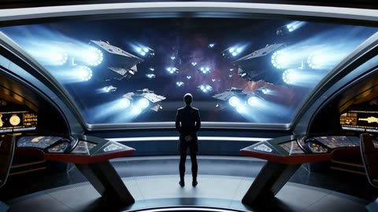</a>

The full H3-Context-IR format: numbered shots with a timed cut at 00:04.500, then separate fields for sound and score. Most local H3 runs skip this rewriting step, which is why they look flat.

MiniMax H3 · Text-to-video · Source: [MiniMax H3 model card](https://huggingface.co/MiniMaxAI/MiniMax-H3)

[`multi-shot`](tags.md#tag-multi-shot) [`timed-cut`](tags.md#tag-timed-cut) [`structured-prompt`](tags.md#tag-structured-prompt) [`sfx`](tags.md#tag-sfx) [`score`](tags.md#tag-score) [`sci-fi`](tags.md#tag-sci-fi)

<details><summary><b>Prompt</b></summary>

```text
integrated_multimodal_description: [Shot 1] Cinematic, medium wide shot, pushing in slowly. In the cavernous, dimly lit bridge of a starship, sleek metallic consoles with glowing amber displays flank a massive, curved observation window. A female captain, in her late 40s with an athletic build and short silver-streaked black hair, stands in the center midground. She wears a structured, high-collared dark navy military tunic with silver chest insignias. Her back is to the camera, silhouetted against the cool, ambient starlight pouring through the thick glass. She stands perfectly still with her hands clasped tightly behind her back. Outside the window, a massive armada of jagged, dark grey dreadnoughts hovers in tight formation against a deep purple space nebula. The fleet's massive rear thrusters begin to glow with an intense, escalating bright blue light. [Shot 2] At 00:04.500, the camera cuts to a close-up of the captain's face and shakes strongly. The brilliant blue-white light from the fleet's gathering energy reflects vividly in her dark eyes. Suddenly, a blinding white flash floods through the window, completely washing out the background as the fleet jumps to hyperspace. The sheer spatial force violently jolts the bridge, causing the captain from Shot 1 to stagger slightly forward, her shoulders tensing as she visibly braces herself against the physical tremors. As the intense white light fades abruptly, leaving only the dim, empty expanse of the purple nebula reflected on her starkly lit skin, her jaw clenches, and she slowly closes her eyes in the newly emptied space.
overall_soundscape: A low, resonant hum of the ship's ambient life support systems serves as the baseline, soon drowned out by an audible, escalating, high-pitched electronic whine as the fleet outside charges its hyperdrives. A massive, deafening, bass-heavy boom and sharp crackle erupts during the blinding flash, accompanied by the loud metallic creaking, rattling, and deep thuds of the bridge's bulkheads vibrating under immense physical stress. The intense roaring impact then cuts abruptly back to a hollow, echoing room tone, leaving only the faint, steady hum of the isolated bridge.
non_diegetic_music: Cinematic space-opera orchestral score, slow tempo, featuring a solitary, mournful French horn melody over deep, sustained string dissonances that build rapidly in volume and intensity, swelling to a massive orchestral peak before snapping immediately into silence right after the jump.
```

</details>
