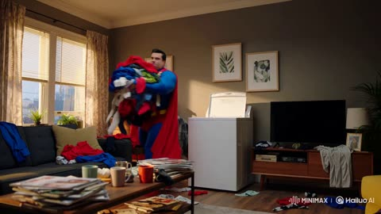
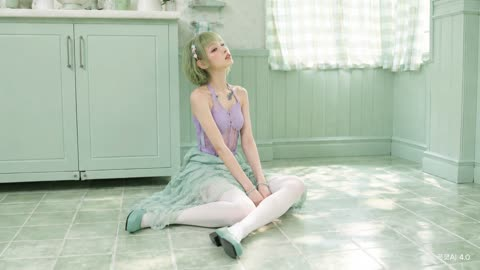
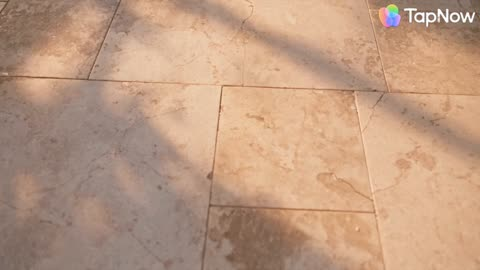

# Music and dance

[Back to the list](../../README.md) · All 19 entries

<a id="seedance-kpop-two-idol-mv"></a>
### Two-idol K-pop music video, shot by shot

<a href="https://x.com/Just_sharon7/status/2083422886686031982"></a>

A 30-second MV laid out in 2 to 4 second time ranges, alternating between three sets.

Seedance 2.5 · Text-to-video · Source: [@Just_sharon7 on X](https://x.com/Just_sharon7/status/2083422886686031982) · 547 likes on 2026-10-27

[`music-video`](tags.md#tag-music-video) [`dance`](tags.md#tag-dance) [`timed-beats`](tags.md#tag-timed-beats)

<details><summary><b>Prompt</b></summary>

```text
30-second ultra-realistic K-pop MV featuring two young East Asian women with flawless synchronization, cinematic lighting, glossy skin, realistic hair and fabric physics, natural body motion, and 4K live-action quality. Vibrant hot pink, electric blue, and silver color palette. 0–2s: Wide shot in a bright circular pink studio with reflective floor. Pink-haired woman (left) and black-haired woman (right) perform energetic opening pose and synchronized dance. 2–4s: Medium close-up of the black-haired woman on a blue spotlight stage, confidently pointing at the camera. 4–6s: Pink-haired woman dances before shimmering blue-silver tinsel curtains, dramatic hair flip and fluid arm movements. 6–8s: Back to the pink studio. Both perform synchronized choreography with sharp arm waves, hip sways, and strong formations. 8–10s: Extreme close-up of both faces against a blue background, glossy makeup, subtle smiles, and direct eye contact. 10–14s: Solo shots at the tinsel backdrop. Pink-haired woman mouths lyrics and gestures confidently, followed by the black-haired woman with relaxed jacket styling. 14–18s: Pink studio. Coordinated jacket choreography, hair flips, powerful synchronized dance, ending hands-on-hips. 18–22s: Glamour close-ups. Black-haired woman under glittering bokeh lights, then pink-haired woman with wind-blown hair against a soft pink background. 22–24s: Blue spotlight stage. Mirrored black-haired performer effect with synchronized spins and flowing hair. 24–26s: Both walk confidently toward the camera in front of shimmering tinsel curtains, reflections visible on the floor. 26–29s: Final synchronized dance and ending pose in the pink circular studio, standing together and looking into the camera. Style: Hyper-realistic live action, Seedance 2.5-quality motion realism, perfect lip sync, natural weight shifts, flowing hair, realistic fabric simulation, polished K-pop music video cinematography.
```

</details>

<a id="kling-neon-nightclub-rain-dance"></a>
### Woman dancing in neon nightclub and rain

<a href="https://x.com/CaliraVal/status/2052314090467405869"></a>

The prompt stacks subject, wardrobe, setting, lighting palette and camera moves in one dense paragraph. A separate negative list and a closing technical line for resolution, frame rate and grade keep the look consistent.

Kling 3.0 · Text-to-video · Source: [@CaliraVal on X](https://x.com/CaliraVal/status/2052314090467405869) · 445 likes on 2026-10-27

[`neon`](tags.md#tag-neon) [`nightclub`](tags.md#tag-nightclub) [`rain`](tags.md#tag-rain) [`slow-motion`](tags.md#tag-slow-motion) [`cinematic`](tags.md#tag-cinematic)

<details><summary><b>Prompt</b></summary>

```text
A cinematic ultra-realistic 4K music video scene of a beautiful young woman in a neon-lit nightclub and rainy retro city at night. Vibrant pink, purple, blue, and teal neon lighting creates a dreamy cyberpunk atmosphere. The woman has long wet dark hair, glowing natural makeup, and wears a stylish white top with a dark skirt and black heels. Emotional slow-motion shots of her dancing freely in heavy rain on wet reflective streets, surrounded by colorful neon signs, vintage American cars, retro diners, and blurred nightclub crowds. Smooth cinematic camera tracking, soft bokeh lights, realistic rain effects, glossy pavement reflections, dramatic Hollywood-style lighting, shallow depth of field, sensual emotional mood, highly detailed skin texture, cinematic storytelling, shot on a 35mm film look with premium color grading.

low quality, blurry, distorted face, bad anatomy, extra fingers, extra limbs, cartoon, anime, oversaturated colors, noisy image, watermark, text, duplicate body, unrealistic eyes, glitch, low detail, poorly drawn hands

4K Ultra HD, 16:9 aspect ratio, 24fps, cinematic realism style, smooth slow-motion camera movement, Hollywood lighting, ultra detailed quality, realistic rain simulation, cinematic neon color grading
```

</details>

<a id="h3-industrial-hyperpop-timeline-fashion-dancer"></a>
### Androgynous dancer escaping a glass timeline loop

<a href="https://x.com/lepadphone/status/2084637679254376793"></a>

The prompt splits into labelled blocks (concept, character, world logic, visual language, motion rules, restrictions). It ties each beat of a 160 BPM grid to a camera or space rule, so kicks compress the timeline and snares duplicate frames. A closing list of exclusions keeps the dancer's identity and the on-screen text under control.

MiniMax H3 · Text-to-video · Source: [@lepadphone on X](https://x.com/lepadphone/status/2084637679254376793) · 325 likes on 2026-10-28 · found via [SkyNotSilent/awesome-MiniMax-H3-cases](https://github.com/SkyNotSilent/awesome-MiniMax-H3-cases)

[`fashion-commercial`](tags.md#tag-fashion-commercial) [`music-sync`](tags.md#tag-music-sync) [`3d-typography`](tags.md#tag-3d-typography) [`glitch`](tags.md#tag-glitch) [`dance`](tags.md#tag-dance)

<details><summary><b>Prompt</b></summary>

```text
[Core Concept]
15s, 160 BPM, 4/4, 40 beats. Industrial Hyperpop × Deconstructed Club: hard kicks, metallic snares, glitch hi-hats, distorted bass, sliced vocals. A timeline-based reality where rhythm controls space and motion.

[Character Identity]
Single androgynous dancer with short black hair, silver eyebrow mark, asymmetric black jacket, wide pants, red stitching. Maintain identical face, body, hairstyle and outfit. Multiple figures are only past-frame projections.

[World Logic]
Each kick compresses the timeline toward the dancer. Each snare duplicates previous movements into adjacent frames. Moving against the timeline transforms the 2D interface into a foldable 3D structure. The dancer escapes the repetition loop.

[Visual Language]
Black, cold white, warning red. Glass timelines, metal rails, glowing frame lines, scanning grids. Extreme wide-angle, low angles, top-down shots, Dutch angles, dolly moves, impossible perspective. 3D words COPY, SAME, TREND, OUTSIDE exist as physical architecture, not subtitles.

[Motion Rules]
Use anticipation → attack → overshoot → settle. Kick drives spatial compression, snare breaks frames, hi-hats animate cursors and fragments, bass bends time. Build with glitch cuts, then explode into an impossible continuous long take during the drop.

[Restrictions]
No character changes, extra people, random text, subtitles, logos, outfit changes, bad anatomy, flat camera angles, or meaningless flashes.
```

</details>

<a id="h3-anime-fashion-dance-yellow-cyclorama-afterimages"></a>
### Anime dance film with pink cyan motion trails

<a href="https://x.com/aimikoda/status/2097001707683119410"></a>

A flat lemon yellow cyclorama keeps the frame clean so the cyan and pink afterimages read clearly. The camera moves are scripted as a counterpoint to the choreography, with ankle height skims, a close-up whip, an overhead cut and a hard brake on each pose lock. A tempo of 170 BPM and a ban on slow motion keep the cuts sharp.

MiniMax H3 · Reference-to-video · Source: [@aimikoda on X](https://x.com/aimikoda/status/2097001707683119410) · 271 likes on 2026-10-28 · found via [SkyNotSilent/awesome-MiniMax-H3-cases](https://github.com/SkyNotSilent/awesome-MiniMax-H3-cases)

[`anime`](tags.md#tag-anime) [`dance`](tags.md#tag-dance) [`fashion-film`](tags.md#tag-fashion-film) [`motion-graphics`](tags.md#tag-motion-graphics) [`music-video`](tags.md#tag-music-video)

<details><summary><b>Prompt</b></summary>

```text
15-second experimental anime fashion film. Use @[character reference] for the character’s exact identity, outfit and rendering style. A pristine, uniform lemon-yellow cyclorama with a seamless matte floor. Flat, clean yellow throughout, free of grain, gradients and set dressing. 16:9. No text or logos.

The character performs one fast, unconventional dance phrase: ankles weave while the torso stays suspended, a wrist flick ripples through both elbows into a chest pop, knees fold into a low corkscrew pivot, then a heel swivel unwinds the body into an off-balance editorial pose. Continue through asymmetric shoulder rolls, angular arm threading around the face and a sideways glide with the head counter-rotating toward the lens. Every sharp lock immediately releases into another surprising movement. Convincing weight, precise foot contact and expressive follow-through.

Electric cyan and hot pink dominate the motion effects. Bold, opaque silhouette afterimages peel away from opposite sides of the body, replay the previous gesture a fraction late and slam back into alignment on each pose. Arm sweeps stretch them into broad curved ribbons; crossing steps weave pink and cyan trails around the ankles; rapid turns fan out overlapping screen-print impressions. At the strongest accents, oversized cyan and pink cutouts of the current pose slide across the foreground, briefly masking the lens. Keep the real character crisp and recognizable, with clean yellow visible between effect bursts.

The camera dances in counterpoint: skim backward at ankle height through advancing footwork, whip upward around an outstretched wrist into an extreme face close-up, then use the passing forearm to cut into a rotating overhead view of the low pivot. Dive to a tilted low-angle full-body composition as the character rises. Orbit opposite the sideways glide, exaggerating hands and feet near the wide lens. Accelerate between compositions and brake hard on pose locks.

Finish with a sudden forward lean toward the lens while enormous pink and cyan echoes continue leaning farther, sweeping past both sides of the camera. Snap wide: the character lands a final asymmetric pose as the colored echoes collapse precisely into the silhouette. Hard cut to black.

170 BPM broken beat, syncopated accents, fluid animation and razor-fast camera transitions. No slow motion or prolonged holds.
```

</details>

<a id="h3-prehistoric-cave-concert-dinosaurs-documentary"></a>
### Prehistoric cave concert with dinosaurs and crowd

<a href="https://x.com/ozansihay/status/2085420070952649179"></a>

A short plain scene description names the stage, performers, background creatures and audience in turn, then states multi-shot coverage, a natural documentary camera feel and an ultra realistic look. Written in Turkish and kept simple, it makes a good test of how well a model follows a loose brief.

MiniMax H3 · Text-to-video · Source: [@ozansihay on X](https://x.com/ozansihay/status/2085420070952649179) · 241 likes on 2026-10-28 · found via [SkyNotSilent/awesome-MiniMax-H3-cases](https://github.com/SkyNotSilent/awesome-MiniMax-H3-cases)

[`multi-shot`](tags.md#tag-multi-shot) [`documentary`](tags.md#tag-documentary) [`ultra-realistic`](tags.md#tag-ultra-realistic) [`crowd-scene`](tags.md#tag-crowd-scene) [`dinosaurs`](tags.md#tag-dinosaurs)

<details><summary><b>Prompt</b></summary>

```text
Tarih öncesi çağlarda geçen bir konser sahnesi. Sahnede mağara adamları var, tarih öncesi insanlar, anlaşılmaz bir dilde şarkı söylüyorlar. Etrafta dinozorlar da dolaşıyor. Konseri izleyen kalabalık bir topluluk var. Çekim multi-shot olacak, doğal ve belgesel havasında bir kamera hissi olmalı. Görsel stil ultra gerçekçi olmalı.
```

</details>

<a id="h3-blue-studio-dance-kinetic-typography"></a>
### Surreal blue studio dance with kinetic typography

<a href="https://x.com/egeberkina/status/2083301476206588086"></a>

Three Omni Reference tags lock the man, the woman and the horse before a beat by beat scene description. A long list of motion graphics techniques and a music and sound brief make the typography part of the choreography, and the ending is a timed whisper, sprint and cut to black.

MiniMax H3 · Reference-to-video · Source: [@egeberkina on X](https://x.com/egeberkina/status/2083301476206588086) · 237 likes on 2026-10-28 · found via [SkyNotSilent/awesome-MiniMax-H3-cases](https://github.com/SkyNotSilent/awesome-MiniMax-H3-cases)

[`omni-reference`](tags.md#tag-omni-reference) [`kinetic-typography`](tags.md#tag-kinetic-typography) [`fashion-film`](tags.md#tag-fashion-film) [`motion-graphics`](tags.md#tag-motion-graphics) [`surreal`](tags.md#tag-surreal)

<details><summary><b>Prompt</b></summary>

```text
Use @ Image1 as the man reference. 
Use @ Image2 as the woman reference. 
Use @ Image3 as the horse reference.  

Create a surreal 15-second fashion-film sequence inside a minimalist monochrome blue studio.  The woman performs an elegant contemporary dance.  The man casually walks into frame wearing a completely serious expression.  Without explanation, he immediately joins the choreography.  His movements are awkward, strangely confident, almost ritualistic.  The woman never acknowledges him.  The horse behaves as though both dancers are part of its routine.  It wanders through the studio.  Runs behind them.  Appears from impossible places.  Stops.  Looks directly into the camera.  Leaves.  Returns again.  Sometimes all three performers accidentally synchronize for one beat before drifting apart again.  The choreography becomes increasingly absurd but remains perfectly cinematic.  Every movement is intentional.  Every frame feels designed.  Throughout the sequence, premium kinetic typography appears as part of the composition, not subtitles, but editorial motion graphics inspired by high-end After Effects title design.  Animated words flash for only a few frames:  THE GARDENER.  THE DRIVER.  THE HORSE.  THE WOMAN.  KNIFE.  MOVE.  FASTER.  AGAIN.  THE EXIT. These words slam into frame, wrap around the dancers, disappear behind bodies, stretch with motion blur, rotate in 3D, fragment into pieces, reveal through masks, pulse with the bass, smear across cuts, become oversized, tiny, vertical, upside down, and constantly transform using premium motion-design techniques.  Add abstract editorial graphics: animated arrows, circles, blueprint lines, tape labels, interface markers, halftone textures, scribbles, grain, tracking graphics, geometric overlays, chromatic aberration, liquid masks, flash frames, split screens, typography trails, speed ramps and graphic wipes.  Music evolves into strange electronic art-pop.  Analog synths.  Mechanical breathing.  Heavy bass.  Everything is synchronized to the rhythm.  Final close-up.  The woman whispers:  "Again."  The man quietly smiles for the first time.  The horse suddenly sprints directly toward the camera.  The word  AGAIN.  fills the screen before an instant cut to black.
```

</details>

<a id="wan-finger-dance-one-take"></a>
### Finger dance in one locked-off take

<a href="https://x.com/johnAGI168/status/2092625479521931699"></a>

Names the character once (`粉宝`) and refers back to her by name. It even specifies which hand does which move.

Wan 3.0 · Reference-to-video · Source: [@johnAGI168 on X](https://x.com/johnAGI168/status/2092625479521931699) · 194 likes on 2026-10-27

[`dance`](tags.md#tag-dance) [`long-take`](tags.md#tag-long-take) [`vertical`](tags.md#tag-vertical) [`reference-images`](tags.md#tag-reference-images)

<details><summary><b>Prompt</b></summary>

```text
【人物角色卡】
@   ​→ 命名为“粉宝”，全片唯一人物。后文所有“粉宝”均指同一人，不再重复调用参考图。
粉宝的脸部身份、五官比例、发型、妆容、服装和配饰全部沿用参考图，不重新描述、不擅自改造。
全程严格保持同一张脸，不换脸、不改变年龄感、脸型、肤色和五官比例。

【风格】真人竖屏手指舞短视频（Finger Dance Performance），固定机位一镜到底（Locked-off One Take），轻快甜美、自然手机摄影质感，4K清晰度，真实皮肤纹理
【时长】15秒
【画幅】9:16
【人物】仅粉宝一人
【对白形式】粉宝本人面对镜头进行中文节奏念唱，必须准确对口型
【字幕】无字幕、无贴纸文字、无水印
【转场】全片不剪辑、不变装、不使用特效转场

【场景】
温暖整洁的居家房间，浅色墙壁和木地板；画面左侧是一台关闭的黑色电视和简洁矮柜，右侧是一扇关闭的棕色木门。背景装饰尽量简化，不摆放动物玩偶或动物照片。
前景保持完全空旷，只出现粉宝一个生命主体。画面中绝对不出现狗、其他动物、动物尾巴、动物毛发或动物影子。

【摄影机】
竖屏固定手机机位，摄影机位于粉宝正前方、约胸口高度，等效35mm镜头。中全景构图，从头顶拍到大腿上部，保留双手向左右和头顶伸展的空间。
摄影机全程锁定，不推拉、不摇移、不变焦、不跟随；手指伸向镜头时产生自然的近大远小（Forced Perspective），但镜头本身不能移动。

【表演内核】
粉宝像在和镜头另一端的人玩方向游戏：先认真介绍左边和右边，再把两边说成“可爱的两边”，随后从指方向逐渐变成指向观众，最后用爱心动作完成“我在你的心里面”。
情绪递进：俏皮示范 → 笑意增加 → 主动逗观众 → 甜蜜直球。
不要从第一帧就保持最大笑容；笑容随着手势逐步变亮，最强的笑容和眼神只留给最后一句。

[00:00-00:03.80] 镜头1：左边与右边（Locked Medium Full Shot）

[00:00-00:00.50]
粉宝跪坐在画面中央，身体正对镜头。右手从身体右侧向外轻快扫出，再弯曲手肘，将右手食指竖起；左手自然垂在左侧大腿旁。
头部随着右手轻轻晃动，先露出张嘴的明亮笑容，再迅速收成小幅度微笑。目光始终看镜头。
此段没有台词，嘴巴不能提前念词。

[00:00.50-00:01.40]
右手食指从竖直状态向内划出一小段弧线，落到人物自身右侧脸颊，也就是观众看到的画面左侧脸颊；其余四指自然收拢。
【台词】“这是左边。”
【口型】“这”字嘴唇短促向前；“左”字下颌稍微打开；“边”字嘴角向两侧收紧后闭合。
【微表情】说“这”时眉毛轻抬、眼睛睁开；说到“左边”时头部向指尖稍微倾斜，眼尾收窄，右侧脸颊被食指轻轻点出一个小凹陷，句尾变成带牙齿的小笑容。
【声音】清亮、俏皮、中等偏快语速，“左”字稍微加重，句尾轻轻上扬。

[00:01.40-00:02.00]
右手食指离开脸颊，两条手臂短暂向左右打开，肩膀和上半身跟随节拍轻轻摆动。嘴唇闭合成笑，不发出新台词。

[00:02.00-00:03.05]
左手抬起，左手食指点向人物自身左侧脸颊，也就是观众看到的画面右侧脸颊；右手自然落到右侧大腿旁。
【台词】“这是右边。”
【口型】每个字完整清楚，不能吞掉“右”字；“边”字结束后嘴唇自然闭合。
【微表情】头部向左手指尖方向倾斜；眼睛先看镜头，再短暂形成玩笑式单眼轻眯，双颊抬起，嘴角由小幅度微笑逐渐扩大。
【声音】保持与上一句相同的旋律和速度，“右”字落在重拍，句尾同样轻微上扬。

[00:03.05-00:03.80]
左手食指在脸颊旁做一次极小的离开—点回动作，然后双臂向外松开，为下一组双手动作蓄力。粉宝闭唇笑一下，眼睛轻眯，不说话。

[00:03.80-00:07.05] 镜头2：可爱的两边（Symmetrical Cheek Gesture）

[00:03.80-00:06.08]
两只手同时抬到脸部两侧，左右食指分别指向对应脸颊，其余手指自然弯曲，双肘向外展开，形成完全对称的双脸颊动作。
【台词】“这是可爱的两边。”
【动作同步】
“这是”——两根食指刚刚到达脸颊旁，头部保持居中；
“可爱”——两根食指同时轻点脸颊一次，头部向一侧小幅倾斜；
“的两边”——两根食指继续指住脸颊，上半身随节拍向另一侧轻摆，最后回到中央。
【口型】“可爱”必须清楚形成两个分开的音节；“两边”不能连成模糊笑声。句尾“边”字结束后嘴唇闭合半拍。
【微表情】“这是”时眼睛明亮直视镜头；“可爱”时眼尾压成弯月、双颊明显抬起；“两边”时露出整齐牙齿，最后加入一次快速俏皮眨眼。不能全程眯眼，也不能从开头就保持最大笑容。
【声音】童谣式轻快念唱，“可爱”略微拉长，“两边”落在节拍重音上。

[00:06.08-00:07.05]
双手从脸颊释放。右臂先向下外侧划开，左手食指在脸侧短暂停留；粉宝做一次清楚但自然的单眼眨眼，然后两只手都降至腰部附近。
嘴巴从笑容收成闭唇状态，准备下一句，不能在间奏中继续乱动口型。

[00:07.05-00:11.03] 镜头3：前面与后面（Direct-to-Camera Point）

[00:07.05-00:08.55]
左手食指重新竖起，手臂迅速向摄影机方向伸展。开始时食指朝上，伸近镜头后手腕向下旋转，使食指准确指向镜头中央；其余手指收拢，拇指自然搭在弯曲手指旁。
手掌靠近镜头后产生明显近大远小，粉宝的脸仍在后方保持清晰可辨。

【台词】“这是指前面。”
【口型】“指”字短促，“前面”两个音节要清楚分开；“前”字略加重。
【微表情】伸手前眉毛轻抬，像突然想到一个答案；指尖对准镜头时眼神沿着手指直接锁定观众，眼睛微微收窄，嘴角形成带一点得意的小笑容。
【声音】比前两句更有直接交流感，“前面”句尾下降，不拖音。

[00:08.55-00:10.07]
左手食指继续对准镜头保持半拍，然后缓慢收回。收回过程中手腕向侧面转动，食指从指向观众变为指向自己左肩后方；头部同步向该方向轻轻转动，视线先跟随指尖扫向肩后，再迅速回看镜头。

【台词】“这是指后面。”
【口型】“后”字嘴唇先收圆再放开，“面”字结束后闭唇。
【微表情】说“后面”时眉梢轻轻抬高，眼神短暂朝肩后看；回看镜头时眼睛弯起，像故意和观众开玩笑。笑容不能遮挡口型。
【声音】“后”字加重，语气带一点调皮的提示感，句尾轻轻落下。

[00:10.07-00:11.03]
左手落到腰侧。右手食指短暂指向右肩或胸口上方，左手沿原视频中的低位运动轨迹自然落在左侧大腿上。
原视频此处存在抚摸狗背的动作，重制时必须改成左手轻落大腿：不要抚摸空气、不要看向地面、不要生成任何动物。
粉宝闭唇笑，肩膀跟随节拍轻轻弹动一次。

[00:11.03-00:15.00] 镜头4：指向你与心里面（Finger Heart to Overhead Heart）

[00:11.03-00:12.55]
右手从肩侧向镜头伸出。先短暂握成面向镜头的小拳头，再缓慢松开，将拇指与弯曲的食指交叠，组成清晰的韩式手指爱心；中指、无名指和小指保持收拢。手指爱心位于镜头前方，不能挡住粉宝的双眼。

【台词】“这是指你。”
【口型】“你”字必须清楚，嘴角先收窄再上扬；不能念成“地”或其他字。
【微表情】小拳头伸出时目光直接、眉毛微抬；手指爱心成形的一瞬间，眼尾轻轻收窄，嘴角变成带牙齿的顽皮笑容，头部向一侧小幅倾斜。
【声音】“你”字加重并略微拉长，像直接点名镜头前的人，语气甜但不嗲。

[00:12.55-00:14.80]
右手爱心释放，两条手臂同时向左右展开，再沿大弧线举过头顶。双臂形成宽大的心形轮廓，两只手在头顶上方弯曲，左右指尖轻轻接触，组成完整的头顶爱心。
爱心完成后，粉宝保持手臂形状，身体先向一侧轻摆，再回到中央。

【台词】“我在你的心里面。”
【动作与台词同步】
“我在”——双臂向左右打开；
“你的”——双臂向上形成宽阔V形；
“心里”——两臂在头顶弯曲，双手指尖合拢成爱心；
“面”——爱心完全闭合并保持，头部位于心形正中央。

【口型】“我在你的”保持连贯但不能抢拍；“心里面”四个音节清晰，“心”字加重，“面”字稍微延长至动作完成。
【微表情】双臂打开时眼睛明亮、嘴角逐渐扩大；听到“心”字时双颊明显抬起、眼尾变弯；“里面”结束时呈现全片最明亮的笑容，牙齿自然露出，眼神牢牢看向镜头。不要提前达到最大笑容。
【声音】前半句轻快，念到“心”时音高略微上升，“里面”温柔落下，保持清晰中文发音。

[00:14.80-00:15.00]
头顶爱心的指尖向两侧分开，两条手臂顺势向下外侧打开；粉宝略微向摄影机靠近，维持明亮笑容和直接眼神，在动作仍有轻微惯性的状态下结束。
最后一帧不说新台词、不突然恢复中性表情、不淡出。

【完整台词】
“这是左边。
这是右边。
这是可爱的两边。
这是指前面，这是指后面。
这是指你，我在你的心里面。”

【声音控制】
同一位女性声线完成全部念唱，普通话清晰，甜美轻快但不过度夹嗓。每句“这是”使用相近节奏，左右、两边、前面、后面分别与对应手势严格同步。
只保留轻快的低音量节拍伴奏，不增加第二个人声、合唱、旁白、笑声音效或额外台词。

【动作连续性】
全片是一镜到底，所有动作必须由上一个动作自然过渡到下一个动作。手臂有真实惯性，手指先伸展再定型、先释放再移动；不能在相邻帧中突然瞬移。
人物自身左右手不能交换：右手负责第一段画面左侧脸颊，左手负责第二段画面右侧脸颊及指向镜头；右手负责最后的手指爱心，两只手共同组成头顶爱心。
```

</details>

<a id="h3-neon-street-hiphop-kinetic-lyrics-trio"></a>
### Neon city hip-hop trio with kinetic lyrics

<a href="https://x.com/Inshrah_ali_/status/2085595583927185447"></a>

The prompt opens with a shared style line, then splits the 15 seconds into four timed scenes, each with its own camera move (circling, gimbal, drone, crane up). Lyrics are supplied as on-screen text and tied to the beat, so the typography follows the music.

MiniMax H3 · Text-to-video · Source: [@Inshrah_ali_ on X](https://x.com/Inshrah_ali_/status/2085595583927185447) · 157 likes on 2026-10-28 · found via [SkyNotSilent/awesome-MiniMax-H3-cases](https://github.com/SkyNotSilent/awesome-MiniMax-H3-cases)

[`hip-hop`](tags.md#tag-hip-hop) [`kinetic-typography`](tags.md#tag-kinetic-typography) [`music-video`](tags.md#tag-music-video) [`neon-city`](tags.md#tag-neon-city) [`multi-scene`](tags.md#tag-multi-scene)

<details><summary><b>Prompt</b></summary>

```text
Style: Premium music commercial, ultra-realistic, cinematic, 8K HDR, natural lighting, luxury fashion aesthetic, smooth professional camera work, vibrant neon accents, realistic skin textures, high-end choreography, dynamic typography synced to the beat, music-video quality, no watermark.

Scene 1 (0–3s)

A stylish young female artist walks confidently through a modern city street at night, flanked by two equally fashionable dancers. They wear coordinated luxury streetwear with premium sneakers and jewelry. The beat drops as the camera circles them in slow motion. Giant animated typography appears behind them, displaying the lyrics in bold kinetic text synchronized perfectly with every word.

Scene 2 (3–8s)

The trio performs energetic hip-hop choreography in a neon-lit urban plaza. The camera switches between cinematic gimbal shots, low-angle tracking, drone passes, and close-ups of expressive faces. Every lyric appears on screen with premium motion graphics, glowing typography, smooth transitions, and rhythmic animations that pulse with the music.

Scene 3 (8–12s)

Fast-paced performance featuring synchronized dance moves, stylish hand gestures, confident attitude, realistic hair movement, natural fabric physics, and dynamic lighting. The lyrics continue appearing in large, eye-catching typography that interacts with the environment, wrapping around buildings and moving with the beat.

Scene 4 (12–15s)

The music reaches its climax. All three performers strike a powerful final pose as the camera cranes upward. Massive cinematic typography fills the background with the final lyric while city lights sparkle behind them. Premium commercial color grading, flawless visual effects, realistic crowd energy, luxury music-video finish.

Hip-Hop Lyrics (On-Screen Typography):

We rise, no limits, we own the night,
Dreams in motion, shining so bright.
Move with the rhythm, feel the fire,
We came to win—taking it higher!

Visual Style: Premium commercial production, Billboard music video aesthetic, luxury fashion campaign, realistic camera movement, cinematic lens flares, authentic facial expressions, smooth choreography, vibrant urban atmosphere, perfectly synchronized kinetic lyric typography.
```

</details>

<a id="h3-pink-seoul-korean-fashion-collage-mv"></a>
### Pink Korean Fashion Collage Film With Outfit Changes

<a href="https://x.com/ImaStudio_ai/status/2101981159970480258"></a>

The prompt is split into numbered blocks for identity lock, outfit beats, 2D motion graphics and editorial layout, then closes with a 13 cut storyboard timed to 115 to 125 BPM. Placeholder text in brackets drives the typography, and the last cut assembles every graphic into a magazine cover.

MiniMax H3 · Reference-to-video · Source: [@ImaStudio_ai on X](https://x.com/ImaStudio_ai/status/2101981159970480258) · 106 likes on 2026-10-28 · found via [SkyNotSilent/awesome-MiniMax-H3-cases](https://github.com/SkyNotSilent/awesome-MiniMax-H3-cases)

[`fashion`](tags.md#tag-fashion) [`kpop`](tags.md#tag-kpop) [`collage`](tags.md#tag-collage) [`typography`](tags.md#tag-typography) [`outfit-change`](tags.md#tag-outfit-change)

<details><summary><b>Prompt</b></summary>

```text
Korean Pink Collage Fashion MV (15s, 16:9, 24fps)
【1. Identity Lock】
Absolute character consistency: Only one young Korean-style woman appears throughout the entire video. Strictly preserve the reference image’s facial features, skin tone, long dark-brown slightly wavy hair, bangs, facial structure, and body proportions.
Overall vibe: Asian pop aesthetic, fresh sweet-cool energy, light Y2K influence, balancing cute charm with a polished fashion-editorial feel.
Strict restrictions: No face swapping, no identity drift, no Westernized facial features, no masculine features, no background people, and no second character.
【2. Outfit Beats】
Style lock: Korean sweet-cool girl-group fashion, blending youthful femininity with a slightly mature edge.
Outfit transition logic: Seamlessly switch outfits on camera cut points and musical beats. Wardrobe elements include fitted white or pink knit tops, light-blue denim, Y2K pleated skirts, platform boots, delicate mini bags, and Korean-style earrings.
The character must remain highly consistent across every outfit change.
【3. Motion Graphics】
Visual theme: Pink Pattern Collage Pop.
Main palette: Cream pink, soft pink, peach pink, creamy white, silver-gray, with small accents of black typography.
2D graphic elements: Checkerboard patterns, polka dots, photobooth-style frames, geometric color blocks, and heart outlines.
Avoid realistic 3D materials. Use flat, crisp, graphic 2D elements that slide, overlap, crop, and wipe across the frame dynamically.
【4. Editorial Layout】
Typography: Main titles: [NAME] / [SEOUL POP]
Secondary labels: [SOFT CHIC] / [CUTE SIGNAL] / [TRENDY LOOK] / [KOREAN GIRL]
Layout style: Use oversized background typography, text inside geometric frames, and small sticker-like labels.
Arrange text horizontally, vertically, and diagonally with intentional offset layouts.
Typography should change rapidly with the cuts while always remaining clear and never covering the character’s face.

【5. 13-Cut Fast-Paced Trailer Storyboard | 115–125 BPM】
Cut 1 (0s): Extreme close-up. She slightly lifts her chin and looks directly into the camera. The background is filled with solid pink and an oversized [NAME] title, creating an immediate beauty hook.
Cut 2 (1s): Medium shot. She takes half a step forward and lightly holds her bag strap. The background switches to a pink-and-white checkerboard pattern.
Cut 3 (2s): Full-body shot. Flash outfit transition from a white top into a pink skirt look. She turns back toward camera and freezes briefly.
Cut 4 (3s): Close shot. Playful crouching pose with both hands near her face. Photobooth-style frames quickly slide into the composition.
Cut 5 (4s): Close-up. Camera pushes in slightly for a sharp eye-contact moment. Polka-dot graphics fill the background.
Cut 6 (5s): Medium shot. She turns and adjusts her long hair while large collage typography [SEOUL POP] pops across the frame.
Cut 7 (6s): Low-angle shot. She reaches one hand toward the camera as pink graphic strips slice horizontally across the frame.
Cut 8 (7s): Full-body shot. She shifts her weight and performs another flash outfit change featuring denim elements. The composition becomes cleaner with more negative space.
Cut 9 (8s): Close-up. She looks down slightly, then raises her eyes and smiles softly. Multiple [CUTE SIGNAL] labels appear across the screen.
Cut 10 (10s): Medium shot. She lightly holds the hem of her skirt while the background transforms into large geometric color-block sections.
Cut 11 (11s): Medium shot. She gently touches her earrings with a small, refined gesture. Overlapping color planes shift slightly out of alignment.
Cut 12 (12s): Wide shot. She turns sideways into a preparation pose while all fragmented graphic and typography elements begin converging toward the center.
Cut 13 (13.5–15s): Hero Pose. She stands centered in her strongest fashion pose. Graphics, borders, typography, and collage elements perfectly assemble into one polished Korean fashion magazine cover. Hold the final composition for 0.5 seconds.
```

</details>

<a id="h3-y2k-girl-group-rap-bubble-typography"></a>
### Y2K girl group rap video with bubble typography

<a href="https://x.com/LeoCreaIA/status/2083240416166748313"></a>

Each shot gets its own camera move, one rap line and one named word, and every hard cut is tied to a bass, snare or vocal hit. A reference image locks the three faces, while the typography is written as a material (inflated jelly chrome letters) that hands and faces can cover.

MiniMax H3 · Reference-to-video · Source: [@LeoCreaIA on X](https://x.com/LeoCreaIA/status/2083240416166748313) · 83 likes on 2026-10-28 · found via [SkyNotSilent/awesome-MiniMax-H3-cases](https://github.com/SkyNotSilent/awesome-MiniMax-H3-cases)

[`k-pop`](tags.md#tag-k-pop) [`y2k`](tags.md#tag-y2k) [`typography`](tags.md#tag-typography) [`music-video`](tags.md#tag-music-video) [`rap`](tags.md#tag-rap) [`hard-cuts`](tags.md#tag-hard-cuts)

<details><summary><b>Prompt</b></summary>

```text
This is what H3 does with Omni Reference and one long prompt:

prompt：Soft cute Y2K crush K-pop girl group rap MV. High fashion performance film mixed with inflated 3D candy typography graphic system. Three female idols wearing pink, blue and purple luxury Y2K stage outfits. Cute 3D chibi doll face, big dewy eyes, porcelain skin, soft blush cheeks, chibi idol proportions. Reference typography: only the inflated 3D rubber bubble font language, pink/lavender/ice-blue chrome plastic material, not the whole layout. Visual style: soft pastel crush energy, Y2K game UI, candy glossy finish, milky translucent plastic × K-pop aggressive feminine rap energy. Texture: 35mm film grain + soft glow bloom + iridescent holographic foil + jelly plastic specular + Y2K scanline + candy dot halftone + VHS frame vibration + plastic toy surface reflection + glitter confetti rain. Editing: Fast rhythm editing. Only hard cuts. No fade. No smooth transitions. Every cut follows: bass hit, snare, rap vocal impact.

Character Performance Three female performers from reference image 1. Keep: same 3D chibi doll faces, big sparkling eyes, pastel Y2K idol makeup, pink/blue/purple fashion styling, soft cute cold expression. Each member has a signature prop: A holds a chunky rhinestone microphone, B has a plush bear shoulder bag, C wears oversized heart-shaped sunglasses pushed up on head. They are not posing. They are performing rap. Actions: aggressive eye contact, head nodding, shoulder movement, leaning toward camera, hand pushing toward lens, confident cute facial expression, sharp body movement, wink on snare hit, tongue-out on bass drop, hair flip on beat. Lip sync: perfect rap mouth synchronization. The performance should feel like a real K-pop rap unit MV with Y2K crush energy.

Typography Animation Typography is a visual weapon. Not subtitles. Not static graphics. Use: giant English words inflated 3D rubber bubble font, jelly plastic material, pink lavender ice-blue chrome, soft puffy candy letters, compressed bold balloon fonts, stretched vertical puffy letters, handwritten graffiti titles, 3D extruded candy text, glitch displacement, print error effect, Y2K game UI pixel corruption. Text appears only when the beat hits. Characters can cover the text. Text can cover parts of clothing. Never cover eyes or main facial expression. Tiny Y2K stickers burst on beat: heart, star, smiley, sparkle, chain link, bow, four-leaf clover, mini bear.

Shot 1 — Member A · Extreme Close-up「RUN NOW」 Character A face close-up, framed inside a pink heart-shaped iris wipe transition (in only, hard cut out). She looks directly into camera. Cute cold doll expression, big dewy eyes, soft blush, frosted pink lip gloss, rhinestone tear sticker under one eye. Starts rap. Chunky rhinestone microphone enters frame from below, she grips it tightly. Camera slowly pushes closer. Tiny pink heart stickers float up from bottom edge like bubbles. Huge inflated bubble letters crash into frame from left and right. Typography: "RUN NOW" — Pink jelly rubber 3D font, glossy candy surface, soft inner glow. Letters stretch vertically like puffy balloons. The word vibrates and squishes with bass, casts soft pink shadow on her cheek. Rap: "Run now, I don't chase." Confetti burst on final syllable. Hard cut.

Shot 2 — Member B · Rap Performance「BREAK LIMIT」 Member B medium close-up, slight low angle, camera orbits 15° around her during the take. Lavender fur jacket, Y2K layered top, plush bear bag bouncing on her hip, chunky pearl choker, star-shaped earrings. She performs aggressively. Shoulders hit the rhythm. Hair flips hard on the second snare, blue hair ties catch the light. Hair moves naturally. Background: pastel gradient pink-to-lavender with faint Y2K perspective grid lines floating. Behind her appears huge handwritten text. Typography: "BREAK LIMIT" — Ice-blue bubble graffiti brush writing, soft inflated stroke, candy-coated, letters appear one by one with bounce easing. Animation: letters tear apart, reassemble, rotate 360° on snare, shake with bass. Chain link graphic swings across frame, sparkle stickers pop on every beat. Rap: "Break limits, break rules." Hard cut.

Shot 3 — Member C · Hand Attack Shot「NO APOLOGY」 Member C moves close to camera. Top-down camera angle, she leans over the lens. Hand reaches toward lens. Nails are long pink acrylic with 3D star and heart charms. Focus: rings with mini plush bear charm, heart-cut gemstone, baby-pink leather texture, knit ribbed sleeve, plushy toy surface. Foreground vertical text: "NO APOLOGY" — Stretched vertical pink bubble letters, jelly puffy material, letters pierce through the back of her hand visually. Hand covers part of the typography. Fingers spread wide on the bass hit. Camera: handheld vibration. Film grain strong. Candy halftone dots bloom in shadow. Tiny "XOXO" sticker tag pulses in corner. Rap: "No apology, no regret." Hard cut.

Shot 4 — Fashion Magazine Impact Cut「UNSTOPPABLE」 Member A close-up. Her face appears inside a broken Y2K trading card / idol photo card frame, with barcode at bottom, "SYS.07-A" serial tag, holographic foil border torn on left side. Not a full layout. Only one graphic element. Typography: "UNSTOPPABLE" — Huge lavender handwritten bubble text, inflated 3D rubber, glossy plastic finish, letters explode outward from center of her forehead, push edges of the card frame. Animation: text suddenly expands from behind her. Card frame rips in half vertically, holographic confetti pours from the tear, revealing pastel gradient background underneath. A second smaller photo card of her winks in from the right, slightly rotated. Rap: "Can't stop my wave." Hard cut.

Shot 5 — Glitch Double Image「STATIC」 Member B close-up, slight Dutch angle (5° tilt). Create: duplicate frame, pastel RGB separation (pink/blue/lavender channels), xerox shadow, motion trail, VHS tracking line at bottom edge. Main face stays sharp. She holds a sparkly heart-shaped lollipop up beside her cheek, the lollipop leaves a trail of echo frames. Background text: "STATIC" — Y2K pixel font, candy pink chrome, letters flicker like broken game sprite, jump between frames, sometimes inverted color, sometimes missing entirely. Like corrupted music video signal + cute game glitch. A tiny "ERROR 404" sticker blinks in upper corner. Rap: "Static noise, I get louder." Hard cut.

Shot 6 — Pink Blue Purple Battle「PINK OUT」 Member A and C alternate close-ups, rhythm: A-A-C-A-C-C, two frames each. Fast switching. Visual split: each member sits in a vertical color block (A=pink, C=lavender, alternating). Center text: "PINK OUT" — Pastel pink-to-purple gradient bubble 3D, letters appear one word at a time, syncing to each cut. Words appear one by one. Each word: stretch vertically on entry, compress horizontally on hold, invert color on snare, explode into heart stickers and star confetti on exit. Tiny "1.2.3.GO!" counter graphic ticks in corner. Rap: "Lights out, pink out." Hard cut.

Shot 7 — Group Rap Performance「UNBREAKABLE」 Three members together.
```

</details>

<a id="h3-gold-chain-rapper-audio-lipsync-multicut"></a>
### Gold chain rapper performing on a night street

<a href="https://x.com/KEETY2591756/status/2085918684879765882"></a>

A character image plus an audio track act as the timing guide, so the mouth and actions lip sync to the audio automatically. Asking for multiple cuts with extreme low and high angles, in an East Coast rap video style, gives the fast, aggressive camera rhythm.

MiniMax H3 · Reference-to-video · Source: [@KEETY2591756 on X](https://x.com/KEETY2591756/status/2085918684879765882) · 61 likes on 2026-10-28 · found via [SkyNotSilent/awesome-MiniMax-H3-cases](https://github.com/SkyNotSilent/awesome-MiniMax-H3-cases)

[`lip-sync`](tags.md#tag-lip-sync) [`rap`](tags.md#tag-rap) [`omni-reference`](tags.md#tag-omni-reference) [`multi-cut`](tags.md#tag-multi-cut) [`music-video`](tags.md#tag-music-video)

<details><summary><b>Prompt</b></summary>

```text
モード1：Omni Reference
プロンプト：添付のキャラクター参照（ 📷Image1 ）とオーディオトラックをタイミングガイドとして使用してください。オーディオにある「音声」に完全に会うようにキャラクターの口とアクションを入れてリップシンクしてダイナミックなカメラアングルでラップを披露してください。カメラはマルチカットでキャラの部位をクローズアップしてください。全て超ハイスピードで激しく行ってください。

モード2：Omni Reference
プロンプト：添付のキャラクター参照（ 📷Image1 ）とオーディオトラックをタイミングガイドとして使用してください。オーディオにある「音声」に完全に会うようにキャラクターの口とアクションを入れてリップシンクしてダイナミックなカメラアングルでラップを披露してください。カメラはマルチカットで超ローアングル・超ハイアングルを小刻みに切り替えたUS東海岸のラップビデオのようなスタイルに仕上げる。全て超ハイスピードで激しく行ってください。
```

</details>

<a id="h3-dark-red-kpop-lyric-typography-performance"></a>
### Dark red K-pop video with lyric typography

<a href="https://x.com/Kiber_Alla/status/2085138181133894024"></a>

Locks the performer in close or medium framing with no cuts on her, while typography and backgrounds hard cut every 1 to 1.5 seconds on a numbered lyric list. Three references (character, audio, lyrics) plus explicit mouth and teeth rules keep lip-sync clean.

MiniMax H3 · Reference-to-video · Source: [@Kiber_Alla on X](https://x.com/Kiber_Alla/status/2085138181133894024) · 56 likes on 2026-10-28 · found via [SkyNotSilent/awesome-MiniMax-H3-cases](https://github.com/SkyNotSilent/awesome-MiniMax-H3-cases)

[`music-video`](tags.md#tag-music-video) [`kpop`](tags.md#tag-kpop) [`lyrics-typography`](tags.md#tag-lyrics-typography) [`lip-sync`](tags.md#tag-lip-sync) [`red-atmosphere`](tags.md#tag-red-atmosphere)

<details><summary><b>Prompt</b></summary>

```text
10-second dark emotional K-pop music video. Realistic young East Asian woman from the character reference, natural face, real skin texture, messy hair. 
Important rules: 
- The girl is always framed in close-up or medium shots only. No wide or distant shots at all. 
- The girl performs continuously for the full 10 seconds without any cuts on her. Her movement is natural and fluid — she can shift weight, make small dance-like gestures, turn her head, move her shoulders and hands, but the camera stays on her in consistent medium/close framing. 
- Typography and background change with hard cuts according to the storyboard order, while the girl keeps performing through them.  

Sequence of text (hard cuts): 
1. “THE TABLE’S SET AGAIN” 
2. “NOBODY SITS DOWN” 
3. “YOUR WORDS ARE HARD GLASS” 
4. “FALLING TO THE FLOOR NOW” 
5. “I KEPT THE DOOR OPEN” 
6. “YOU KEPT YOUR HANDS CROSSED” 
7. “SAME ROOM, SAME SCAR” 
8. “SAME OLD COST” 
9. Final rose  The girl sings the entire song with clear, accurate lip-sync. 

Mouth and teeth must stay natural and undistorted at all times — no deformation, no melting, no artifacts. Emotional facial performance. Typography stays sharp and reacts (cracks, shifts, particles). Changing typography every 1–1.5 seconds. Heavy red atmosphere, cinematic lighting, photoreal
```

</details>

<a id="h3-superman-laundry-day"></a>
### Superman wrestles a laundry pile in a messy apartment

<a href="https://x.com/Strength04_X/status/2085210848272986556"></a>

Timed four-second beats lay out one shot per block, so the sequence stays readable. A small gag escalates from sock on the face to wrong button to bubbles, which takes a serious hero to laughing, and the quoted sung lines set the voice and pacing.

MiniMax H3 · Text-to-video · Source: [@Strength04_X on X](https://x.com/Strength04_X/status/2085210848272986556) · 56 likes on 2026-10-29 · found via [SkyNotSilent/awesome-MiniMax-H3-cases](https://github.com/SkyNotSilent/awesome-MiniMax-H3-cases)

[`comedy`](tags.md#tag-comedy) [`superman`](tags.md#tag-superman) [`timed-shots`](tags.md#tag-timed-shots) [`singing`](tags.md#tag-singing)

<details><summary><b>Prompt</b></summary>

```text
0:00–0:04 — Wide shot of a messy apartment living room. SUPERMAN (full costume) is standing in front of an open washing machine holding a huge pile of red-and-blue clothes.
0:04–0:07 — He starts stuffing the cape into the machine while singing in a deep heroic voice: “Laundry day, laundry day… even heroes have to pay!” and does a dramatic fist pump that makes the clothes fly everywhere.
0:07–0:10 — He tries to close the lid, but a red sock keeps floating up and sticking to his face. He peels it off and continues singing louder: “Red socks, blue socks… they never stay in the box!” while spinning in a circle.
0:10–0:13 — He accidentally presses the wrong button. The machine starts shaking violently and soap bubbles start flying out. Superman tries to stay serious and stop it with one hand.
0:13–0:16 — Bubbles land on his face and the sock sticks again. His serious superhero expression completely cracks. He bursts out laughing while still holding the machine.
0:16–0:18 — He freezes mid-pose with bubbles all over him, laughing so hard he has to lean on the washing machine as more clothes keep popping out.
```

</details>

<a id="kling4-girl-recorder-six-keyframes"></a>
### A girl plays a recorder in her room, six keyframes

<a href="https://static--52.klingai-cdn-aws.com/kling-blog/presigned_url/e99d0231-be47-4aaf-a43c-a444f03a831a_1-5.mp4"></a>

Six keyframes on a 15s timeline. Each cut is matched to something, a note of music or the swing of a shoe, so the hard cuts feel motivated.

Kling 4.0 · First & last frame · Source: [Kling 4.0 user guide](https://kling.ai/quickstart/kling-4-model-user-guide)

[`keyframes`](tags.md#tag-keyframes) [`match-cut`](tags.md#tag-match-cut) [`music`](tags.md#tag-music) [`lifestyle`](tags.md#tag-lifestyle) [`timed-shots`](tags.md#tag-timed-shots)

<details><summary><b>Prompt</b></summary>

```text
SCENE CONTEXT EXACT 1 CHARACTER — NO DUPLICATES. 0.0–2.1s | Keyframe 1: Looking Up from the Floor. Strictly match Image Node_23. Wide, static composition: The girl sits on mint-green tiled flooring, leaning against a cabinet and the corner of a wall, with her legs naturally extended apart and both hands resting lightly between her knees. Soft light filters through the plaid curtains and falls across the tiles. She initially keeps her gaze lowered, then slowly lifts her head toward the window light, lips slightly parted, as if hearing a melody from far away. The curtains sway only slightly, while the lace hem of her skirt and the tips of her hair show the faintest hint of movement with her breathing. The camera slowly pushes in by approximately 3% without changing the composition.
2.1–4.3s | Keyframe 2: Close-Up of the Recorder, Sound-Matched Cut. At the peak of the girl's head-lifting motion, a clear, brief recorder note enters 0.1 seconds early. Hard cut to the medium close-up from Image Node_29 (2). The girl closes her eyes and gently plays a white recorder, completing one full but brief exhalation. Only two or three fingers make subtle adjustments over the holes. Her cheeks puff out slightly, then relax. Do not distort the recorder, exaggerate her puffed cheeks, or add extra fingers. Keep the camera steady and the plaid curtains softly out of focus in the background.
4.3–6.5s | Keyframe 3: Hands and Gaze, Action-Matched Cut. The instant the recorder note ends, hard cut to Image Node_18. The girl stands by the window in front of mint-green wall paneling, with both hands held beside the right side of her face, as if gathering the melody into her palms. She keeps her gaze lowered for approximately 0.4 seconds, then gently raises her eyes to look directly into the camera. Her fingers make one extremely subtle closing motion, and her beaded bracelet catches a glint of window light. The camera pushes in extremely slowly from a medium shot, keeping her centered and the interior clean and uncluttered.
6.5–8.5s | Keyframe 4: Detail of Dangling Legs, Skirt-Matched Cut. As her hands slowly move away from the sides of her face, use the moment they drop out of the bottom edge of the frame as the cut point. Hard cut to Image Node_21. Low-angle close-up: The girl sits on the edge of a tall mint-green cabinet. Only her mint-green lace skirt, white stockings, pale green Mary Jane shoes, and one hand lightly touching the cabinet edge are visible. Her legs remain together and dangle freely. Her toes gently swing forward once, pause, then naturally return to a vertical resting position. The lace hem sways slightly with the movement. Do not exaggerate the swinging motion, let her legs touch the floor, or change the positions of the cabinet and bathtub.
8.5–10.8s | Keyframe 5: Still Gaze on the Bed, Shoe-Tip-Matched Cut. As both shoes swing back downward, hard cut to Image Node_22. The girl lies on her stomach on a mint-green bed, resting her face in both hands with her feet raised behind her. The composition is gentle, with ample negative space. She looks at the camera first, then softly shifts her gaze toward the window light on the left before returning it to the camera. Her feet perform only one small, synchronized crossing motion at the shoe tips, then relax. The bedsheet develops only the faintest soft folds. Do not turn her into a side-lying pose or change the positions of the pillows, bedsheet, table lamp, plants, or framed pictures.
10.8–13.5s | Keyframe 6: Paper in the Foreground, Final Gaze. Use a corner of the pale bedsheet passing across the frame as an occlusion transition, then hard cut to Image Node_20. The girl sits on a white chair, with her transparent glasses strictly matching the keyframe. A sheet of white paper slowly drifts across the frame from the lower left and upper edge, briefly obscuring part of her forehead and shoulder, but must never cover her entire face for more than 0.3 seconds. She gazes quietly at the camera through the moving sheet of paper. After blinking once, she tilts her head slightly to the right by approximately 3 degrees and holds the position. The paper drifts out of frame. Keep the camera steady, and do not create a storm-like flurry of paper.
13.5–15.0s | Gentle Fade to Black. Maintain the final composition of Keyframe 6. After the paper leaves the frame, the girl remains still, maintaining a calm, direct gaze. The daylight by the window gradually dims like a soft light being slowly turned down. The mint-green walls, curtains, girl, and chair all fade evenly into shadow. Do not abruptly switch off the lights, change the color temperature, or add any text.
```

</details>

Inputs: [1](https://static-22.klingai-cdn-aws.com/kling-blog/file_by_url/33ac900bf82c6cf3cc9b3864d141ee5bf5d539ba7127aed56bf57cfd8546ed02.png) · [2](https://static--73.klingai-cdn-aws.com/kling-blog/file_by_url/52e28427e82f94e0767609eb5c518f1c8148e911794376dc2f3b8945aca53ecb.png) · [3](https://static-4.klingai-cdn-aws.com/kling-blog/file_by_url/02b21e458445a696737255b384a943723b95e36d81baa5d8211bd316802c630b.png) · [4](https://static-82.klingai-cdn-aws.com/kling-blog/file_by_url/3399431d9eeb7c8c0d2eb26d481b05aa57e30c53526cf546e21d7aca9dfbda2f.png) · [5](https://static--53.klingai-cdn-aws.com/kling-blog/file_by_url/54747de90e26fc4939f7782ab0bd93ab9f3c13c6683a77df2ea9f1a2cf21e800.png) · [6](https://static-64.klingai-cdn-aws.com/kling-blog/file_by_url/773db4a2dfe2f7fde291d00072beed8fd3071968782e9abc71797f93b68954ba.png)

<a id="omni-drummer-whip-pan"></a>
### Whip-pan from drummer to saxophonist and dancer

<a href="https://storage.googleapis.com/gdm-deepmind-com-prod-public/media/YMgFKThN-vej75eW/gemini-omni__first-last-frame__dummer-ballet.webm"></a>

First and last frames fix both ends. The prompt describes the move between them and closes with `One continuous shot, no jump cuts`.

Gemini Omni Flash · First & last frame · Source: [Gemini Omni prompt guide](https://deepmind.google/models/gemini-omni/prompt-guide/)

[`first-last-frame`](tags.md#tag-first-last-frame) [`camera-move`](tags.md#tag-camera-move) [`long-take`](tags.md#tag-long-take) [`music`](tags.md#tag-music)

<details><summary><b>Prompt</b></summary>

```text
A close-up low-angle shot of a stylish drummer in a beige suit playing a red drum kit in a grand hall transitions as the camera whip-pans to the side, revealing an older saxophonist playing alongside a ballet dancer spinning in a white outfit under soft purple stage lights. One continuous shot, no jump cuts.
```

</details>

<a id="omni-violinist-over-shoulder"></a>
### Move the camera over the violinist's shoulder

<a href="https://storage.googleapis.com/gdm-deepmind-com-prod-public/media/3cYlYfozIFs5_Ngj/gemini-omni__edit-over-multiple-turns-with-consistency__angle.webm"></a>

A camera change written as one plain sentence. Omni re-renders the same performance from the new angle.

Gemini Omni Flash · Video edit · Source: [Gemini Omni prompt guide](https://deepmind.google/models/gemini-omni/prompt-guide/)

[`multi-turn-edit`](tags.md#tag-multi-turn-edit) [`camera-angle`](tags.md#tag-camera-angle)

<details><summary><b>Prompt</b></summary>

```text
Change the camera angle to be over the violinist’s shoulder.
```

</details>

Inputs: [1](https://storage.googleapis.com/gdm-deepmind-com-prod-public/media/3cYlYfozIFs5_Ngj/gemini-omni__edit-over-multiple-turns-with-consistency__invisible.webm)

<a id="seedance-greenhouse-pop-dance-performance"></a>
### Pop dance performance in a sunlit glass greenhouse

<a href="https://x.com/Chaemate_/status/2110278863691325907"></a>

Separate character, outfit and background locks tied to two reference images keep identity and location stable across thirty seconds, and a negative prompt repeats those locks. Five timed scenes each name the choreography and a camera move, and the audio line specifies tempo, instruments and a bass drop on the final pose.

Seedance 2.5 · Reference-to-video · Source: [@Chaemate_ on X](https://x.com/Chaemate_/status/2110278863691325907) · found via [LearnPrompt/awesome-seedance](https://github.com/LearnPrompt/awesome-seedance)

[`dance`](tags.md#tag-dance) [`k-pop`](tags.md#tag-k-pop) [`multi-scene`](tags.md#tag-multi-scene) [`character-lock`](tags.md#tag-character-lock) [`music`](tags.md#tag-music)

<details><summary><b>Prompt</b></summary>

```text
K-POP GREENHOUSE DANCE PERFORMANCE

Duration: 30 seconds | Aspect ratio: 16:9 | Ultra-realistic 4K, photorealistic live-action, cinematic professional K-pop performance video.

CHARACTER LOCK (@Image1):
An adult Korean woman with delicate idol features and glowing skin, long wavy ginger-copper hair worn down with two small side braids pinned back and a small black hair clip. Soft shimmer eyeshadow, thin black eyeliner, glossy coral lips. Silver hoop earrings and a thin silver chain necklace.

OUTFIT LOCK (identical in every shot): Cropped cobalt-blue varsity bomber jacket with cream striped collar and cuffs, modest closed black fitted inner top, black pleated mini skirt with black cycling shorts underneath, black knee-high socks, white chunky platform sneakers with blue accents. No changes to outfit, colors, hairstyle, face, or accessories in any scene.

BACKGROUND LOCK (@Image2): Use the reference image as the only environment for all 30 seconds. Keep the glass greenhouse, lush plants, stone floor, and warm sunlight. Do not change the location.

SCENE 1 (0-6s): Sunlit Reveal
Overhead top-down shot of the stone floor as her white sneakers step into frame. The camera tilts up as she walks forward through a beam of sunlight, stops, and straightens her jacket collar with a smirk. She then does a smooth body wave from head to toe, two slow arm rolls, and a quick shoulder shimmy that lands on the first beat. Camera: top-down tilt up to a low-angle wide shot.

SCENE 2 (6-12s): Groove Section
Medium-wide shot. Crisscross hop-steps, a glide step to the right, then to the left, finger snaps at hip level, and a playful "shh" gesture with one finger to her lips. She throws a quick pop-and-lock arm sequence, then points up and down in alternating beats. Palm leaves sway gently behind her. Camera: smooth lateral slide, following her movement.

SCENE 3 (12-18s): Power Break
Wide shot with sunlight rays streaming through the glass behind her. Fast running-man footwork, a sharp front kick, a stomp-stomp-clap rhythm, arm slices across the body, and a low squat bounce with her hands pushed forward. The skirt and braids move naturally. Camera: quick push-in, then a short rack focus from the plants to her face.

SCENE 4 (18-24s): Hook Section
Medium close-up transitioning to full-body. She makes a "V" sign with her fingers near her eye, then a camera-lens shape with both hands, shifts her weight in a sharp side-slide, swings her arms in a big circle, and spins a full 360 with a confident flair. Sunlight glints through her hair as she turns. Camera: handheld-style orbit with a subtle shake.

SCENE 5 (24-30s): Final Pose
She backs away from the camera, turns her back, and looks over her shoulder with a wink. She turns around, does a final arm wave, and ends with one hand extended toward the camera and the other tucked at her waist, followed by a blown kiss and a warm smile. Camera: slow dolly-out to a wide shot, then a gentle push-in to a close-up on the last pose, with a soft golden glow on the final frame.

LIGHTING: Warm golden natural sunlight through the glass with soft rim light on her hair, gentle light rays, subtle haze, realistic skin texture and fabric movement. No neon or colored artificial lights.

DANCE QUALITY: Full-body motion synced to the music, clear footwork, smooth transitions between moves, precise timing, natural facial expressions, realistic hair and clothing physics, consistent anatomy.

NEGATIVE PROMPT: No neon lights, no outfit changes, no hairstyle changes, no face changes, no background replacement, no distorted anatomy, no extra fingers, no duplicated limbs, no floating feet, no jittering, no flickering, no cartoon or CGI look, no subtitles, no text overlays, no watermark, no logos.

AUDIO: Original bright pop K-pop dance track, about 125 BPM, with a punchy kick, glossy synth chords, funky bass, finger-snap percussion, and an energetic build-up before the hook, ending with a clean bass drop at the last pose. No vocals, no dialogue.

#KPop #AIVideo #Dance
```

</details>

<a id="seedance-lime-blazer-woman-crowd-choreography-swap"></a>
### Woman in lime blazer replaces crowd lead

<a href="https://x.com/john_my07/status/2100115896111161691"></a>

A reference video locks motion, camera and cut points, while one reference image locks identity, with a long list of preserve and never change rules. Timed segments from 0 to 30 seconds, a fixed wardrobe list and an instruction to alter only the central character keep the original choreography intact.

Seedance 2.5 · Reference-to-video · Source: [@john_my07 on X](https://x.com/john_my07/status/2100115896111161691) · found via [LearnPrompt/awesome-seedance](https://github.com/LearnPrompt/awesome-seedance)

[`character-replacement`](tags.md#tag-character-replacement) [`identity-lock`](tags.md#tag-identity-lock) [`motion-transfer`](tags.md#tag-motion-transfer) [`crowd-choreography`](tags.md#tag-crowd-choreography) [`timed-segments`](tags.md#tag-timed-segments)

<details><summary><b>Prompt</b></summary>

```text
Use the uploaded reference VIDEO as the exact motion, choreography, camera, framing, timing, pacing, shot duration and cut-point reference.

Use <image_1> as the STRICT identity reference for the MAIN WOMAN.

The final video should feel like the SAME original video, but with the original central man completely replaced by the woman from <image_1>.

Do NOT recreate or preserve the original man's face or identity.

IDENTITY <image_1>

The central character is the exact same woman shown in <image_1>.

Preserve her:

- exact face
- facial structure
- jawline
- cheekbones
- nose
- eyes
- eyebrows
- lips
- ears
- skin tone
- natural facial proportions
- hairstyle
- hair length, volume and texture
- any facial features visible in the reference
- natural body proportions

Maximum identity preservation throughout the entire video.

She must remain recognizably the same person from the uploaded photograph in every shot and every angle.

NO face morphing.
NO identity drift.
NO changing facial structure.
NO different hairstyle.
NO unwanted hair changes.
NO beautification or artificial facial retouching.
NO age changes.
NO facial distortion.

CHARACTER REPLACEMENT

Replace ONLY the original central man with the woman from <image_1>.

Keep the exact position, scale, body movement, gestures, walking path, head movements, smoking actions and timing from the reference video.

Everything the original central character does in the reference video should be performed by the <image_1> woman at the same moment and with the same choreography.

Do not reinterpret or redesign the choreography simply because the replacement character is female.

WARDROBE

Dress <image_1> in the same character-reference outfit, adapted naturally for the woman:

Acid lime green single-breasted blazer, notch lapels, two buttons, buttoned closed, slightly oversized shoulders.

Plain white cotton shirt underneath.

Narrow black knitted tie, neatly knotted.

Straight black trousers.

Plain black leather ankle boots, low heel.

No jewellery.
No watch.
No belt.
No bag.
No phone.
No logos or patterns.

The lime blazer must remain exactly throughout the entire video.

IMPORTANT:
Do not let the wardrobe replacement change the original choreography, body positioning, composition or pacing.

SMOKING ACTION

Preserve the smoking sequence from the reference video exactly.

At the beginning, the main woman holds a cigarette naturally between her fingers and brings it to her mouth.

She lights the cigarette using the same hand movements, timing and body positioning as the reference video.

She takes a drag and naturally exhales smoke.

Preserve the original:

- hand position
- cigarette position
- lighter movement
- timing
- head movement
- facial expression
- smoke timing
- arm movement

The smoking action should look physically natural and cinematic.

Do not exaggerate the smoke.
Do not create excessive smoke.
No smoking action should occur from any other character.

All other characters remain unchanged.

EXACT ORIGINAL ACTION / TIMING

0–4 SECONDS:

Match the reference video exactly.

The central woman is shown smoking.

She brings the cigarette toward her mouth, lights it, takes a drag and exhales.

Match the original close framing, facial positioning, hand movements and timing.

4–11 SECONDS:

Match the reference video exactly.

The woman turns away from camera and moves forward into the crowd using the exact same movement and timing as the original central character.

Preserve her body position, walking speed, direction and camera framing.

11–17 SECONDS:

Match the original choreography exactly.

The woman moves back toward the central position and performs the same gestures and movements as the original central character.

Do not invent new actions.

17–22 SECONDS:

The woman reaches and holds the same central position as the reference.

She becomes calm and composed.

Maintain the exact same camera composition.

22–30 SECONDS:

The crowd begins the same synchronized chaotic movement from the reference.

The central woman remains calm and controlled in the center while the surrounding crowd moves violently and rhythmically around her.

Match the exact timing, intensity and choreography of the original crowd movement.

The central woman must remain clearly identifiable and visually separated from the crowd.

CAMERA

COPY THE REFERENCE VIDEO'S CAMERA LANGUAGE EXACTLY.

Preserve:

- camera position
- camera height
- camera distance
- lens perspective
- focal length feel
- framing
- depth of field
- camera movement
- push/pull movement
- tracking
- camera shake if present
- zoom
- subject scale
- transitions
- shot duration
- exact cut points

Do NOT create new shots.

Do NOT add new camera movements.

Do NOT change the original video's pacing.

The output should have the same visual rhythm and edit structure as the reference video.

CROWD

Keep the original crowd concept and choreography from the reference video.

Large group of young men surrounding the central woman.

Preserve their:

- positions
- density
- formation
- movements
- synchronized choreography
- timing
- background behavior

Do not replace the crowd with women.

Do not introduce new characters.

Do not allow anyone else to become visually dominant over the main woman.

Only the central character is replaced.

LOCATION

Preserve the same environment and architecture as the reference video.

Keep the same:

- concrete/architectural setting
- stairs
- background structure
- crowd arrangement
- environmental depth
- overall composition

Do not redesign the location.

Do not introduce new buildings or props.

LIGHTING / COLOR

Preserve the reference video's overall cinematic lighting and color grading.

Keep the dark, moody atmosphere.

The acid lime blazer should be the distinctive color of the central character.

Keep natural skin tones.

Realistic shadows and highlights.

No artificial glow.
No haze.
No bloom.
No excessive smoke.
No fantasy lighting.

VISUAL STYLE

Photorealistic cinematic live-action footage.

Natural human motion.
Natural body physics.
Realistic fabric.
Realistic hair.
Realistic skin.
Realistic cigarette smoke.
Realistic lighting.

No CGI appearance.
No animation.
No cartoon.
No plastic skin.
No face distortion.
No duplicated main character.

CRITICAL INSTRUCTION

REFERENCE VIDEO = controls EVERYTHING about the original video's motion.

<image_1> = controls ONLY the identity and appearance of the replacement central woman.

Replace the original central man with the woman from <image_1> while preserving the original video's actions, choreography, camera, timing, pacing, framing and cuts as closely as possible.

The result should look like the original video was filmed with <image_1> instead of the original actor.

ONE MAIN CHARACTER ONLY.
NO IDENTITY DRIFT.
NO EXTRA VERSION OF <image_1>.
```

</details>

<a id="seedance-woman-crowd-synchronized-turn"></a>
### Woman in black jacket at center of white crowd

<a href="https://x.com/AIwithSynthia/status/2100067816162636164"></a>

A reference image locks the face, wardrobe and crowd, and the motion is split into beats: a freeze, a staggered head turn spreading through the crowd, then one sharp synchronized turn. Camera moves are limited to a backward track and a slow push so the lead's stillness stays the focus.

Seedance 2.5 · Reference-to-video · Source: [@AIwithSynthia on X](https://x.com/AIwithSynthia/status/2100067816162636164) · found via [LearnPrompt/awesome-seedance](https://github.com/LearnPrompt/awesome-seedance)

[`crowd`](tags.md#tag-crowd) [`reference-image`](tags.md#tag-reference-image) [`cinematic`](tags.md#tag-cinematic) [`synchronized-motion`](tags.md#tag-synchronized-motion)

<details><summary><b>Prompt</b></summary>

```text
Create an ultra-realistic cinematic fashion/music video using the uploaded reference image as the exact visual reference for the woman, crowd, wardrobe, composition, lighting, and atmosphere.

A young woman with a short sleek dark bob, realistic facial features, natural skin texture, and subtle makeup wears a fitted black turtleneck, black trousers, black shoes, and minimal jewelry. Keep her face, hairstyle, outfit, and proportions perfectly consistent.

She walks slowly and confidently toward a large, tightly packed crowd, maintaining a calm and emotionless expression while the camera smoothly tracks backward and keeps her centered.

She reaches the exact center of the crowd and stops completely, standing perfectly still with her arms naturally at her sides and looking directly into the camera.

The crowd remains completely frozen for a brief moment.

Then, without the woman moving, the people behind her slowly begin turning toward her. The head turns start subtly and spread through the entire crowd until everyone is facing and looking directly at her.

The woman remains completely motionless and expressionless, never reacting to the crowd.

The camera slowly pushes closer while the crowd stays turned toward her, creating an unsettling synchronized effect. Their final movement is one sharp, simultaneous turn toward her while she continues staring into the lens.

Dark, mysterious, photorealistic live-action aesthetic, soft cinematic lighting, deep shadows, realistic skin, hair and clothing physics, shallow depth of field, natural human movement.

No animation, anime, cartoon, CGI look, duplicate woman, distorted faces, morphing, random crowd movement, text, subtitles, logos, watermark, excessive camera movement, artificial fog, glow, or exaggerated effects.
```

</details>
