# Music and dance

[Back to the list](../../README.md) · All 45 entries

<a id="h3-pink-panic-punk-mv"></a>
### Anime girl in plaid boots slides into punk MV

<a href="https://x.com/Mayz1169/status/2092937375802609835"></a>

A reference image is set as the identity authority, and every fixed design detail (eye colour, hair clip, plaid boots, outfit) is spelled out so the character holds across the whole clip. Each time segment is tied to a beat, and transitions are driven by body movement such as a boot skid or stomp, so the camera travels without random cuts.

MiniMax H3 · Reference-to-video · Source: [@Mayz1169 on X](https://x.com/Mayz1169/status/2092937375802609835) · 1,010 likes on 2026-10-29

[`anime`](tags.md#tag-anime) [`pop-punk`](tags.md#tag-pop-punk) [`character-lock`](tags.md#tag-character-lock) [`music-video`](tags.md#tag-music-video)

<details><summary><b>Prompt</b></summary>

```text
Create a 15-second horizontal 16:9 high-energy 2D anime pop-punk music video featuring the exact heroine from the provided character reference. The entire sequence should feel like one continuous, tightly choreographed MV passage, with each movement naturally motivating the next transition.  CHARACTER LOCK: Use the reference image as the absolute authority for identity, proportions, outfit, colors and illustration style. Preserve her short messy bubblegum-pink hair with sharp outward tufts, high side ponytail, pale cyan and mint lightning-shaped hair accents, large red cross hair clip with lavender backing, huge yellow eyes with thick dark outlines, small expressive mouth and warm blush.  Keep her black cropped school-style jacket with oversized white cuffs, white shirt, loose bright-red necktie, red plaid mini skirt with white triangular hem accents, black belt, bare legs and enormous red plaid boots with dark straps and heavy rounded soles.  Maintain her original stylized proportions: oversized head, compact torso, long simplified legs, huge boots, chunky hands, bold black outlines, flat saturated colors and minimal cel shading. Her personality is loud, cheeky, rebellious, playful and hyperactive.  0–2.5s — Start immediately with motion. She slides rapidly into frame from the left, one boot skidding across a clean white graphic floor. Her body leans forward from momentum while her ponytail, necktie and oversized cuffs trail behind. She stomps the second boot down, looks up and flashes a mischievous grin. The impact instantly transforms the white background into huge red-and-black plaid blocks as bold “PINK PANIC!” typography slams into the composition.  2.5–5.0s — Without stopping, she rebounds from the landing into a small hop and sharp half-turn. Camera swings around her from front three-quarter view into a fast side-tracking shot as she runs two exaggerated cartoon steps. Her giant boots hit the floor on alternating beats, leaving hand-drawn stars, crosses, tape strips, scribbles and comic impact marks behind each step. Her pink hair and red tie bounce wildly with the movement.  5.0–7.5s — She kicks one leg sideways on the beat and uses the momentum to spin. The red plaid pattern from her boot stretches outward into a giant rotating graphic plane, seamlessly pulling the entire frame into an abstract 2D punk world made from black brush strokes, red plaid, white paper shapes, pink lightning bolts and rough photocopy textures.  She continues directly into a bouncy dance phrase: head whip → shoulder hit → side step → small kick → fast turn. Keep every pose exaggerated and cartoonishly expressive.  7.5–10.0s — Her turn accelerates and the camera follows closely around her. The environment constantly recomposes around the choreography: checker patterns slide sideways, hand-drawn crosses rotate, torn-paper strips snap open and oversized comic typography appears briefly on drum hits.  She lands hard with both boots apart. A huge hand-drawn “BAM!” bursts underneath her feet and physically shakes the surrounding graphic elements. She immediately rebounds upward with a cocky smile rather than holding a static pose.  10.0–12.3s — Follow her continuing movement into a connected sequence of character details. As she whips her head sideways, track past her bright yellow eye → red cross hair clip → swinging pink hair → bouncing red tie → plaid skirt → massive plaid boot.  Do not present these as disconnected beauty shots. Each close-up should be motivated by the same continuous body movement and fast camera travel.  The boot hits the floor at the end of the sequence, sending a red plaid shockwave across the frame.  12.3–15.0s — Ride the plaid shockwave back into a full-body view. She takes two confident bouncing steps forward, abruptly pivots and finishes facing camera with her weight shifted onto one leg, shoulders slightly forward and a cheeky rebellious grin.  Her ponytail and necktie continue swinging from the turn while the background erupts into layered red plaid, black brush X marks, white stars, pink lightning and rough hand-drawn graphics. The elements rapidly organize themselves into a bold 2000s punk magazine-cover composition.  Large “PINK PANIC!” typography appears behind her silhouette on the final beat. End on her strong recognizable character shape without changing her design.  VISUAL STYLE: Strictly match the reference artwork: early-2000s-inspired 2D cartoon/anime aesthetic, thick clean dark outlines, flat saturated colors, minimal cel shading, simplified anatomy, exaggerated proportions and bold graphic expressions. Keep the intentionally handmade TV-animation feeling rather than modern polished anime rendering.  Use red plaid as the main graphic motif, combined with black-and-white manga shapes, pink lightning, crosses, stars, scribbles, torn paper, photocopy grain, tape graphics and rough ink marks.  MOTION: Fast, bouncy and highly rhythmic. Use strong key poses, limited-animation timing, overshoot, smear frames, exaggerated anticipation and cartoon impact frames. Her giant boots should create the strongest beat accents. Hair, ponytail, tie, skirt and cuffs should react continuously to her movement.  Transitions must grow naturally from character actions: boot skid → plaid expansion → kick → rotating graphic plane → spin → camera orbit → stomp → shockwave. Avoid random transitions or disconnected pose montages.  AUDIO: Synchronize tightly to fast Japanese pop-punk vocals mixed with punchy electronic drums and distorted guitar. Add boot skids, stomps, paper snaps, cartoon impacts, guitar hits and short graphic whooshes.  IMPORTANT: Keep the exact face, yellow eyes, pink hairstyle, cyan/mint hair accents, red cross clip, black-and-white school-punk top, red tie, plaid skirt and oversized plaid boots throughout.  No hand reaching toward camera, no palm covering the lens, no pointing into the lens, no outfit transformation, no hairstyle transformation, no extra characters, no realistic environments, no photorealism, no 3D CGI, no modern glossy anime redesign, no cyberpunk holograms, no slow fashion posing, no facial drift, no random accessories, no excessive jump cuts, no disconnected movements, no uncontrolled morphing, no unreadable typography.
```

</details>

<a id="seedance-kpop-two-idol-mv"></a>
### Two-idol K-pop music video, shot by shot

<a href="https://x.com/Just_sharon7/status/2083422886686031982"></a>

A 30-second MV laid out in 2 to 4 second time ranges, alternating between three sets.

Seedance 2.5 · Text-to-video · Source: [@Just_sharon7 on X](https://x.com/Just_sharon7/status/2083422886686031982) · 547 likes on 2026-10-27

[`music-video`](tags.md#tag-music-video) [`dance`](tags.md#tag-dance) [`timed-beats`](tags.md#tag-timed-beats)

<details><summary><b>Prompt</b></summary>

```text
30-second ultra-realistic K-pop MV featuring two young East Asian women with flawless synchronization, cinematic lighting, glossy skin, realistic hair and fabric physics, natural body motion, and 4K live-action quality. Vibrant hot pink, electric blue, and silver color palette. 0–2s: Wide shot in a bright circular pink studio with reflective floor. Pink-haired woman (left) and black-haired woman (right) perform energetic opening pose and synchronized dance. 2–4s: Medium close-up of the black-haired woman on a blue spotlight stage, confidently pointing at the camera. 4–6s: Pink-haired woman dances before shimmering blue-silver tinsel curtains, dramatic hair flip and fluid arm movements. 6–8s: Back to the pink studio. Both perform synchronized choreography with sharp arm waves, hip sways, and strong formations. 8–10s: Extreme close-up of both faces against a blue background, glossy makeup, subtle smiles, and direct eye contact. 10–14s: Solo shots at the tinsel backdrop. Pink-haired woman mouths lyrics and gestures confidently, followed by the black-haired woman with relaxed jacket styling. 14–18s: Pink studio. Coordinated jacket choreography, hair flips, powerful synchronized dance, ending hands-on-hips. 18–22s: Glamour close-ups. Black-haired woman under glittering bokeh lights, then pink-haired woman with wind-blown hair against a soft pink background. 22–24s: Blue spotlight stage. Mirrored black-haired performer effect with synchronized spins and flowing hair. 24–26s: Both walk confidently toward the camera in front of shimmering tinsel curtains, reflections visible on the floor. 26–29s: Final synchronized dance and ending pose in the pink circular studio, standing together and looking into the camera. Style: Hyper-realistic live action, Seedance 2.5-quality motion realism, perfect lip sync, natural weight shifts, flowing hair, realistic fabric simulation, polished K-pop music video cinematography.
```

</details>

<a id="kling-neon-nightclub-rain-dance"></a>
### Woman dancing in neon nightclub and rain

<a href="https://x.com/CaliraVal/status/2052314090467405869"></a>

The prompt stacks subject, wardrobe, setting, lighting palette and camera moves in one dense paragraph. A separate negative list and a closing technical line for resolution, frame rate and grade keep the look consistent.

Kling 3.0 · Text-to-video · Source: [@CaliraVal on X](https://x.com/CaliraVal/status/2052314090467405869) · 445 likes on 2026-10-27

[`neon`](tags.md#tag-neon) [`nightclub`](tags.md#tag-nightclub) [`rain`](tags.md#tag-rain) [`slow-motion`](tags.md#tag-slow-motion) [`cinematic`](tags.md#tag-cinematic)

<details><summary><b>Prompt</b></summary>

```text
A cinematic ultra-realistic 4K music video scene of a beautiful young woman in a neon-lit nightclub and rainy retro city at night. Vibrant pink, purple, blue, and teal neon lighting creates a dreamy cyberpunk atmosphere. The woman has long wet dark hair, glowing natural makeup, and wears a stylish white top with a dark skirt and black heels. Emotional slow-motion shots of her dancing freely in heavy rain on wet reflective streets, surrounded by colorful neon signs, vintage American cars, retro diners, and blurred nightclub crowds. Smooth cinematic camera tracking, soft bokeh lights, realistic rain effects, glossy pavement reflections, dramatic Hollywood-style lighting, shallow depth of field, sensual emotional mood, highly detailed skin texture, cinematic storytelling, shot on a 35mm film look with premium color grading.

low quality, blurry, distorted face, bad anatomy, extra fingers, extra limbs, cartoon, anime, oversaturated colors, noisy image, watermark, text, duplicate body, unrealistic eyes, glitch, low detail, poorly drawn hands

4K Ultra HD, 16:9 aspect ratio, 24fps, cinematic realism style, smooth slow-motion camera movement, Hollywood lighting, ultra detailed quality, realistic rain simulation, cinematic neon color grading
```

</details>

<a id="h3-industrial-hyperpop-timeline-fashion-dancer"></a>
### Androgynous dancer escaping a glass timeline loop

<a href="https://x.com/lepadphone/status/2084637679254376793"></a>

The prompt splits into labelled blocks (concept, character, world logic, visual language, motion rules, restrictions). It ties each beat of a 160 BPM grid to a camera or space rule, so kicks compress the timeline and snares duplicate frames. A closing list of exclusions keeps the dancer's identity and the on-screen text under control.

MiniMax H3 · Text-to-video · Source: [@lepadphone on X](https://x.com/lepadphone/status/2084637679254376793) · 325 likes on 2026-10-28 · found via [SkyNotSilent/awesome-MiniMax-H3-cases](https://github.com/SkyNotSilent/awesome-MiniMax-H3-cases)

[`fashion-commercial`](tags.md#tag-fashion-commercial) [`music-sync`](tags.md#tag-music-sync) [`3d-typography`](tags.md#tag-3d-typography) [`glitch`](tags.md#tag-glitch) [`dance`](tags.md#tag-dance)

<details><summary><b>Prompt</b></summary>

```text
[Core Concept]
15s, 160 BPM, 4/4, 40 beats. Industrial Hyperpop × Deconstructed Club: hard kicks, metallic snares, glitch hi-hats, distorted bass, sliced vocals. A timeline-based reality where rhythm controls space and motion.

[Character Identity]
Single androgynous dancer with short black hair, silver eyebrow mark, asymmetric black jacket, wide pants, red stitching. Maintain identical face, body, hairstyle and outfit. Multiple figures are only past-frame projections.

[World Logic]
Each kick compresses the timeline toward the dancer. Each snare duplicates previous movements into adjacent frames. Moving against the timeline transforms the 2D interface into a foldable 3D structure. The dancer escapes the repetition loop.

[Visual Language]
Black, cold white, warning red. Glass timelines, metal rails, glowing frame lines, scanning grids. Extreme wide-angle, low angles, top-down shots, Dutch angles, dolly moves, impossible perspective. 3D words COPY, SAME, TREND, OUTSIDE exist as physical architecture, not subtitles.

[Motion Rules]
Use anticipation → attack → overshoot → settle. Kick drives spatial compression, snare breaks frames, hi-hats animate cursors and fragments, bass bends time. Build with glitch cuts, then explode into an impossible continuous long take during the drop.

[Restrictions]
No character changes, extra people, random text, subtitles, logos, outfit changes, bad anatomy, flat camera angles, or meaningless flashes.
```

</details>

<a id="seedance-nine-walkers-beat-synced-runway"></a>
### Nine walkers take the runway in sequence

<a href="https://x.com/maxescu/status/2089291308653256848">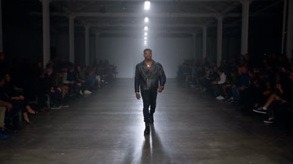</a>

Nine reference images are each tied to one named part of the look, and a stage timeline has the next walker enter before the last one leaves so the runway is never empty. Hard cuts land on the kick drum and alternate between three fixed camera setups.

Seedance 2.5 · Reference-to-video · Source: [@maxescu on X](https://x.com/maxescu/status/2089291308653256848) · 290 likes on 2026-10-29

[`fashion-show`](tags.md#tag-fashion-show) [`beat-sync`](tags.md#tag-beat-sync) [`reference-images`](tags.md#tag-reference-images) [`runway`](tags.md#tag-runway) [`multi-character`](tags.md#tag-multi-character)

<details><summary><b>Prompt</b></summary>

```text
Made in
@higgsfield
 with Seedance 2.5 at 1080p

[Generation Goal]
Generate a premium fashion show video cut as a continuous beat-synced montage. Nine characters walk the runway in order in one flowing show: each walker lands a signature pose at the end mark, then turns and heads back as the next walker is already coming forward. The runway is never empty.

[Characters]
<Character 1> corresponds to @[Image 1](image_1). Use only the appearance, hairstyle, black leather jacket, and gold wristwatch. Do not use the street background.
<Character 2> corresponds to @[Image 2](image_2). Use only the appearance, hairstyle, yellow t-shirt, and beige cargo shorts. Do not use the restaurant background or the other person in the image.
<Character 3> corresponds to @[Image 3](image_3). Use only the appearance, hairstyle, and light blue t-shirt. Do not use the bedroom background or the photo collage on the wall.
<Character 4> corresponds to @[Image 4](image_4). Use only the appearance, short hair, tinted sunglasses, hoop earrings, light pink blazer, black distressed trousers, and heeled sandals. Do not use the parking lot background.
<Character 5> corresponds to @[Image 5](image_5). Use only the appearance, red and blue plaid shirt, and navy quilted gilet. Do not use the stadium crowd or any other people in the image.
<Character 6> corresponds to @[Image 6](image_6). Use only the appearance, hairstyle, and purple tie-dye hoodie with the red graphic. Do not use the room background or the radiator, and do not reproduce any watermark or logo from the image.
<Character 7> corresponds to @[Image 7](image_7). Use only the head, facial structure, and wide grinning expression. Dress this character in a plain black turtleneck and black trousers. Do not use the image background.
<Character 8> corresponds to @[Image 8](image_8). Use only the appearance, hairstyle, facial hair, and white t-shirt. Do not reproduce the question mark graphics or the background from the image.
<Character 9> corresponds to @[Image 9](image_9). Use only the appearance, glasses, black beanie, and navy tracksuit. Do not use the room background or the second man at the right edge of the image.
Do not interchange the nine characters' faces, hairstyles, clothing, walks, or poses.

[Props]
<White Cup> corresponds to the white paper cup held in @[Image 2](image_2) and belongs only to <Character 2>. No other character holds it.

[Scene]
A high-fashion industrial venue: a long runway of dark polished concrete running through a vast raw concrete hall, cold white overhead light strips running the length of the runway, light haze in the air catching the beams, guests seated in shadow on low black benches along both sides, and a photographers' pit with flashing cameras at the near end of the runway. Cold, hard key light on the runway with deep shadow beyond it. The runway entrance is a tall dark opening in the far wall, upstage center.

The visuals feature a moody, high-contrast editorial look with a cold color palette, realistic skin tones, and premium production polish.

The show flows continuously: as each walker turns at the end mark and heads back upstage, the next walker is already emerging from the entrance; they pass each other mid-runway, and the returning walker exits through the entrance during the following segment. The runway is never empty, and no walker vanishes, teleports, or reappears.

Camera coverage alternates three setups, with hard cuts landing on the kick drum: a head-on long-lens runway camera at chest height that slowly pushes in as each walker approaches; a floor-level side camera tracking laterally with the walker for a stride or two; and a static tight close-up on the walker's face for each pose at the end mark. One camera move per shot, hard cuts only, no dissolves.

[Stage 1] 0-3 seconds
Initial state: the first frame already shows <Character 1> mid-stride on the runway walking toward the camera. There is no empty establishing shot.
Primary event: <Character 1> reaches the end mark, taps his right index finger against his temple, and gives the camera a sly knowing grin.
End state: <Character 1> turns and walks back upstage while <Character 2> is already coming forward from the entrance.

[Stage 2] 3-6 seconds
Primary event: <Character 2> walks forward at a small, unhurried pace holding <White Cup> in his right hand and, at the end mark, slowly slides only his eyes toward the camera in a deadpan sideways glance.
End state: <Character 2> turns and heads back with <White Cup> while <Character 3> is already coming forward.

[Stage 3] 6-9 seconds
Primary event: <Character 3> approaches with a huge, wide-eyed, unblinking smile fixed on the lens and, at the end mark, leans slightly toward the camera, the smile widening without a blink.
End state: <Character 3> turns and heads back while <Character 4> is already coming forward.

[Stage 4] 9-12 seconds
Primary event: <Character 4> struts forward in heels with exaggerated fashion attitude and, at the end mark, bends forward laughing hard with hands braced on her knees, then straightens.
End state: <Character 4> turns and heads back while <Character 5> is already coming forward.

[Stage 5] 12-15 seconds
Primary event: <Character 5> walks forward flat-footed and visibly unimpressed and, at the end mark, plants both hands on his hips and gives the camera one slow, disappointed head shake.
End state: <Character 5> turns and heads back while <Character 6> is already coming forward.

[Stage 6] 15-18 seconds
Primary event: <Character 6> walks forward with easy, relaxed shoulders and, at the end mark, extends both hands forward with palms up in a slow, simple gesture, face flat and unbothered, with a small shrug.
End state: <Character 6> turns and heads back while <Character 7> is already coming forward.

[Stage 7] 18-21 seconds
Primary event: <Character 7> walks forward stiff and upright with an enormous frozen grin and, at the end mark, leans his whole upper body toward the camera, grin unchanged.
End state: <Character 7> straightens, turns, and heads back while <Character 8> is already coming forward.

[Stage 8] 21-24 seconds
Primary event: <Character 8> walks forward smiling and waving to the crowd and, at the end mark, his smile fades into a confused squint as he looks left, then right, palms opening in a small shrug.
End state: <Character 8> turns and heads back while <Character 9> is already coming forward.

[Stage 9] 24-30 seconds
Primary event: <Character 9> strides forward playing it cool; at the end mark a burst of photographers' flashes fires and he recoils, leaning his upper body back with both palms raised toward the cameras, then lowers his hands and gives the lens a cool nod.
End state: hard cut to black exactly on the final kick, with <Character 9> still at the end mark; <Character 8> has already exited upstage.

[Audio]
(Driving electronic techno music with a steady four-on-the-floor kick plays continuously from the first frame to the final cut)
<Crowd murmur and scattered cheers, rapid camera shutter bursts and flash pops, each walker's footsteps on the polished concrete>
No dialogue, no narration, no on-screen text, no subtitles.

[Maintain Consistency]
Keep each character's facial identity locked to their reference image throughout. At most two walkers are visible at any moment, and only while one is returning and the next is coming forward; walkers never duplicate, vanish, or reappear, and they exit only by walking back through the entrance. Keep every character's wardrobe unchanged for their entire time on screen. <White Cup> appears only with <Character 2>. Keep the runway layout, hall, lighting, and screen direction consistent: incoming walkers always move toward the head-on camera and returning walkers always move away upstage. Keep the techno track continuous with no changes in music. Do not introduce hosts, presenters, additional models, on-screen graphics, watermarks, or text of any kind.
```

</details>

<a id="h3-anime-fashion-dance-yellow-cyclorama-afterimages"></a>
### Anime dance film with pink cyan motion trails

<a href="https://x.com/aimikoda/status/2097001707683119410"></a>

A flat lemon yellow cyclorama keeps the frame clean so the cyan and pink afterimages read clearly. The camera moves are scripted as a counterpoint to the choreography, with ankle height skims, a close-up whip, an overhead cut and a hard brake on each pose lock. A tempo of 170 BPM and a ban on slow motion keep the cuts sharp.

MiniMax H3 · Reference-to-video · Source: [@aimikoda on X](https://x.com/aimikoda/status/2097001707683119410) · 271 likes on 2026-10-28 · found via [SkyNotSilent/awesome-MiniMax-H3-cases](https://github.com/SkyNotSilent/awesome-MiniMax-H3-cases)

[`anime`](tags.md#tag-anime) [`dance`](tags.md#tag-dance) [`fashion-film`](tags.md#tag-fashion-film) [`motion-graphics`](tags.md#tag-motion-graphics) [`music-video`](tags.md#tag-music-video)

<details><summary><b>Prompt</b></summary>

```text
15-second experimental anime fashion film. Use @[character reference] for the character’s exact identity, outfit and rendering style. A pristine, uniform lemon-yellow cyclorama with a seamless matte floor. Flat, clean yellow throughout, free of grain, gradients and set dressing. 16:9. No text or logos.

The character performs one fast, unconventional dance phrase: ankles weave while the torso stays suspended, a wrist flick ripples through both elbows into a chest pop, knees fold into a low corkscrew pivot, then a heel swivel unwinds the body into an off-balance editorial pose. Continue through asymmetric shoulder rolls, angular arm threading around the face and a sideways glide with the head counter-rotating toward the lens. Every sharp lock immediately releases into another surprising movement. Convincing weight, precise foot contact and expressive follow-through.

Electric cyan and hot pink dominate the motion effects. Bold, opaque silhouette afterimages peel away from opposite sides of the body, replay the previous gesture a fraction late and slam back into alignment on each pose. Arm sweeps stretch them into broad curved ribbons; crossing steps weave pink and cyan trails around the ankles; rapid turns fan out overlapping screen-print impressions. At the strongest accents, oversized cyan and pink cutouts of the current pose slide across the foreground, briefly masking the lens. Keep the real character crisp and recognizable, with clean yellow visible between effect bursts.

The camera dances in counterpoint: skim backward at ankle height through advancing footwork, whip upward around an outstretched wrist into an extreme face close-up, then use the passing forearm to cut into a rotating overhead view of the low pivot. Dive to a tilted low-angle full-body composition as the character rises. Orbit opposite the sideways glide, exaggerating hands and feet near the wide lens. Accelerate between compositions and brake hard on pose locks.

Finish with a sudden forward lean toward the lens while enormous pink and cyan echoes continue leaning farther, sweeping past both sides of the camera. Snap wide: the character lands a final asymmetric pose as the colored echoes collapse precisely into the silhouette. Hard cut to black.

170 BPM broken beat, syncopated accents, fluid animation and razor-fast camera transitions. No slow motion or prolonged holds.
```

</details>

<a id="h3-anime-heroine-yellow-punk-music-video"></a>
### Anime heroine dances through yellow punk music video

<a href="https://x.com/Just_sharon7/status/2094305294117429711">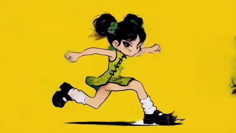</a>

The prompt locks character details to a reference still, then chains each movement to the next so the camera follows one continuous body motion. Foot impacts set the beat and drive every transition, while the graphic type is styled like stamped screen print.

MiniMax H3 · Reference-to-video · Source: [@Just_sharon7 on X](https://x.com/Just_sharon7/status/2094305294117429711) · 241 likes on 2026-10-29

[`anime`](tags.md#tag-anime) [`music-video`](tags.md#tag-music-video) [`character-lock`](tags.md#tag-character-lock) [`pop-punk`](tags.md#tag-pop-punk)

<details><summary><b>Prompt</b></summary>

```text
15s / 16:9 / high-energy 2D anime pop-punk MV — character-locked
Create a 15-second horizontal 16:9 high-energy 2D anime pop-punk music video featuring the exact heroine from the provided character reference. The entire sequence must feel like one continuous, tightly choreographed MV passage; each movement must motivate the next transition.
CHARACTER LOCK (absolute authority = the reference still)
Twin high black space-buns with messy volume and warm brown inner strands. Green jade disc clusters pinned into both buns. Straight blunt bangs with a small center split. Huge sharp green eyes, thick black outlines, strong lashes. Small mouth, warm cheek blush, pale skin. Green circular dangling jade earrings. Sleeveless lime-to-jade floral qipao with black piping, black frog-button placket, high collar, and black line-art lotuses on the fabric. Bare shoulders and arms. Stylized proportions: oversized head, compact torso, long simplified limbs, chunky hands. Bold black outlines, flat saturated colors, minimal cel shading, early-2000s TV-anime / handmade cartoon finish. Personality: loud, cheeky, rebellious, playful, hyperactive — the still’s fierce stare becomes motion, not a different face.

Do not change hair color, bun structure, eye color, earrings, qipao cut, floral linework, or outline weight. No pink hair, no red plaid uniform, no extra characters, no 3D, no photorealism, no glossy modern anime redesign.
GRAPHIC LANGUAGE (from the still)
Primary palette: lemon yellow, jade / lime green, ink black, paper white. Motifs: spinning jade discs, qipao lotus line-art, frog-button glyphs, circular earrings as motion graphics, torn yellow paper, black brush X’s, photocopy grain, tape strips, hand-drawn stars and crosses, rough ink splatters. Kinetic type must look stamped, ripped, or screen-printed — never clean corporate sans.
0.0–2.5s
Start in motion. She slides in from frame-left, one foot skidding across a clean yellow graphic floor. Body leans forward; both buns, earrings, and qipao hem trail behind. She stomps the second foot down, snaps her chin up, and flashes a mischievous grin over the reference’s fierce eye shape. Impact instantly tiles the yellow field into huge jade-and-black floral blocks. Bold kinetic type “JADE PANIC!” slams in, letters made from ripped yellow paper + green lotus outlines.

2.5–5.0s
No pause. Rebound into a small hop and sharp half-turn. Camera swings from front ¾ into a fast side-track as she takes two exaggerated cartoon steps. Feet hit on alternating beats, leaving jade discs, lotus scribbles, tape, crosses, and comic impact marks. Buns and earrings bounce hard; qipao hem flares.
5.0–7.5s
Side kick on the beat. Kick momentum spins her. The floral pattern on the qipao stretches into a giant rotating graphic plane and pulls the frame into an abstract 2D punk world: black brush strokes, green lotus line-art, yellow paper shards, jade lightning (mint/cyan accents only as small bolts, never as hair), photocopy texture. She flows straight into a bouncy phrase: head whip → shoulder hit → side step → small kick → fast turn. Poses stay cartoon-exaggerated.

7.5–10.0s
Turn accelerates; camera orbits close. Environment recomposes to the choreography: checker yellow/green slides, hand-drawn crosses rotate, torn-paper strips snap, oversized comic type hits on drums (BAM, 叩, 炸). She lands hard, feet apart. A huge hand-drawn “BAM!” bursts under her feet and shakes every graphic layer. She rebounds upward immediately with a cocky smile — no held fashion pose.
10.0–12.3s
Same continuous body motion, camera racing along it: whip of the head → bright green eye → jade bun ornament → swinging black bun → bouncing earring → frog-button collar → floral qipao panel → stomping foot. Not a beauty-cut montage; one traveling shot. The footfall fires a jade-floral shockwave across the frame.

12.3–15.0s
Ride the shockwave back to full body. Two confident bouncing steps, abrupt pivot, finish facing camera: weight on one leg, shoulders slightly forward, cheeky rebellious grin. Buns and earrings still swinging. Background erupts into layered yellow paper, black brush X’s, white stars, green lotus line-art, spinning jade discs, rough ink. Elements snap into a 2000s punk magazine-cover lockup. Large “JADE PANIC!” type stacks behind her silhouette on the final beat. Hold her recognizable twin-bun / qipao silhouette. No design drift.
MOTION
Fast, bouncy, limited-animation timing: strong keys, overshoot, smear frames, anticipation, cartoon impacts. Hair buns, earrings, and qipao hem are the secondary rhythm; feet are the downbeat. Transitions grow only from action: skid → pattern flood → kick → rotating floral plane → spin → orbit → stomp → shockwave. No random cuts, no palm-to-lens, no pointing at camera, no outfit/hair morph.

AUDIO
Tight sync to fast Japanese pop-punk vocals, punchy electronic drums, distorted guitar. SFX: boot/foot skids, stomps, paper snaps, cartoon hits, guitar chops, short graphic whooshes. Type slams on snare/crash.
NEGATIVES
No hand reaching toward camera, no palm covering the lens, no pointing into the lens, no outfit transformation, no hairstyle transformation, no extra characters, no realistic rooms, no photorealism, no 3D CGI, no modern glossy anime, no cyberpunk holograms, no slow fashion posing, no facial drift, no random accessories, no excessive jump cuts, no disconnected moves, no uncontrolled morphing, no unreadable type, no pink hair, no red plaid school uniform.
```

</details>

<a id="h3-prehistoric-cave-concert-dinosaurs-documentary"></a>
### Prehistoric cave concert with dinosaurs and crowd

<a href="https://x.com/ozansihay/status/2085420070952649179"></a>

A short plain scene description names the stage, performers, background creatures and audience in turn, then states multi-shot coverage, a natural documentary camera feel and an ultra realistic look. Written in Turkish and kept simple, it makes a good test of how well a model follows a loose brief.

MiniMax H3 · Text-to-video · Source: [@ozansihay on X](https://x.com/ozansihay/status/2085420070952649179) · 241 likes on 2026-10-28 · found via [SkyNotSilent/awesome-MiniMax-H3-cases](https://github.com/SkyNotSilent/awesome-MiniMax-H3-cases)

[`multi-shot`](tags.md#tag-multi-shot) [`documentary`](tags.md#tag-documentary) [`ultra-realistic`](tags.md#tag-ultra-realistic) [`crowd-scene`](tags.md#tag-crowd-scene) [`dinosaurs`](tags.md#tag-dinosaurs)

<details><summary><b>Prompt</b></summary>

```text
Tarih öncesi çağlarda geçen bir konser sahnesi. Sahnede mağara adamları var, tarih öncesi insanlar, anlaşılmaz bir dilde şarkı söylüyorlar. Etrafta dinozorlar da dolaşıyor. Konseri izleyen kalabalık bir topluluk var. Çekim multi-shot olacak, doğal ve belgesel havasında bir kamera hissi olmalı. Görsel stil ultra gerçekçi olmalı.
```

</details>

<a id="h3-blue-studio-dance-kinetic-typography"></a>
### Surreal blue studio dance with kinetic typography

<a href="https://x.com/egeberkina/status/2083301476206588086"></a>

Three Omni Reference tags lock the man, the woman and the horse before a beat by beat scene description. A long list of motion graphics techniques and a music and sound brief make the typography part of the choreography, and the ending is a timed whisper, sprint and cut to black.

MiniMax H3 · Reference-to-video · Source: [@egeberkina on X](https://x.com/egeberkina/status/2083301476206588086) · 237 likes on 2026-10-28 · found via [SkyNotSilent/awesome-MiniMax-H3-cases](https://github.com/SkyNotSilent/awesome-MiniMax-H3-cases)

[`omni-reference`](tags.md#tag-omni-reference) [`kinetic-typography`](tags.md#tag-kinetic-typography) [`fashion-film`](tags.md#tag-fashion-film) [`motion-graphics`](tags.md#tag-motion-graphics) [`surreal`](tags.md#tag-surreal)

<details><summary><b>Prompt</b></summary>

```text
Use @ Image1 as the man reference. 
Use @ Image2 as the woman reference. 
Use @ Image3 as the horse reference.  

Create a surreal 15-second fashion-film sequence inside a minimalist monochrome blue studio.  The woman performs an elegant contemporary dance.  The man casually walks into frame wearing a completely serious expression.  Without explanation, he immediately joins the choreography.  His movements are awkward, strangely confident, almost ritualistic.  The woman never acknowledges him.  The horse behaves as though both dancers are part of its routine.  It wanders through the studio.  Runs behind them.  Appears from impossible places.  Stops.  Looks directly into the camera.  Leaves.  Returns again.  Sometimes all three performers accidentally synchronize for one beat before drifting apart again.  The choreography becomes increasingly absurd but remains perfectly cinematic.  Every movement is intentional.  Every frame feels designed.  Throughout the sequence, premium kinetic typography appears as part of the composition, not subtitles, but editorial motion graphics inspired by high-end After Effects title design.  Animated words flash for only a few frames:  THE GARDENER.  THE DRIVER.  THE HORSE.  THE WOMAN.  KNIFE.  MOVE.  FASTER.  AGAIN.  THE EXIT. These words slam into frame, wrap around the dancers, disappear behind bodies, stretch with motion blur, rotate in 3D, fragment into pieces, reveal through masks, pulse with the bass, smear across cuts, become oversized, tiny, vertical, upside down, and constantly transform using premium motion-design techniques.  Add abstract editorial graphics: animated arrows, circles, blueprint lines, tape labels, interface markers, halftone textures, scribbles, grain, tracking graphics, geometric overlays, chromatic aberration, liquid masks, flash frames, split screens, typography trails, speed ramps and graphic wipes.  Music evolves into strange electronic art-pop.  Analog synths.  Mechanical breathing.  Heavy bass.  Everything is synchronized to the rhythm.  Final close-up.  The woman whispers:  "Again."  The man quietly smiles for the first time.  The horse suddenly sprints directly toward the camera.  The word  AGAIN.  fills the screen before an instant cut to black.
```

</details>

<a id="wan-finger-dance-one-take"></a>
### Finger dance in one locked-off take

<a href="https://x.com/johnAGI168/status/2092625479521931699"></a>

Names the character once (`粉宝`) and refers back to her by name. It even specifies which hand does which move.

Wan 3.0 · Reference-to-video · Source: [@johnAGI168 on X](https://x.com/johnAGI168/status/2092625479521931699) · 194 likes on 2026-10-27

[`dance`](tags.md#tag-dance) [`long-take`](tags.md#tag-long-take) [`vertical`](tags.md#tag-vertical) [`reference-images`](tags.md#tag-reference-images)

<details><summary><b>Prompt</b></summary>

```text
【人物角色卡】
@   ​→ 命名为“粉宝”，全片唯一人物。后文所有“粉宝”均指同一人，不再重复调用参考图。
粉宝的脸部身份、五官比例、发型、妆容、服装和配饰全部沿用参考图，不重新描述、不擅自改造。
全程严格保持同一张脸，不换脸、不改变年龄感、脸型、肤色和五官比例。

【风格】真人竖屏手指舞短视频（Finger Dance Performance），固定机位一镜到底（Locked-off One Take），轻快甜美、自然手机摄影质感，4K清晰度，真实皮肤纹理
【时长】15秒
【画幅】9:16
【人物】仅粉宝一人
【对白形式】粉宝本人面对镜头进行中文节奏念唱，必须准确对口型
【字幕】无字幕、无贴纸文字、无水印
【转场】全片不剪辑、不变装、不使用特效转场

【场景】
温暖整洁的居家房间，浅色墙壁和木地板；画面左侧是一台关闭的黑色电视和简洁矮柜，右侧是一扇关闭的棕色木门。背景装饰尽量简化，不摆放动物玩偶或动物照片。
前景保持完全空旷，只出现粉宝一个生命主体。画面中绝对不出现狗、其他动物、动物尾巴、动物毛发或动物影子。

【摄影机】
竖屏固定手机机位，摄影机位于粉宝正前方、约胸口高度，等效35mm镜头。中全景构图，从头顶拍到大腿上部，保留双手向左右和头顶伸展的空间。
摄影机全程锁定，不推拉、不摇移、不变焦、不跟随；手指伸向镜头时产生自然的近大远小（Forced Perspective），但镜头本身不能移动。

【表演内核】
粉宝像在和镜头另一端的人玩方向游戏：先认真介绍左边和右边，再把两边说成“可爱的两边”，随后从指方向逐渐变成指向观众，最后用爱心动作完成“我在你的心里面”。
情绪递进：俏皮示范 → 笑意增加 → 主动逗观众 → 甜蜜直球。
不要从第一帧就保持最大笑容；笑容随着手势逐步变亮，最强的笑容和眼神只留给最后一句。

[00:00-00:03.80] 镜头1：左边与右边（Locked Medium Full Shot）

[00:00-00:00.50]
粉宝跪坐在画面中央，身体正对镜头。右手从身体右侧向外轻快扫出，再弯曲手肘，将右手食指竖起；左手自然垂在左侧大腿旁。
头部随着右手轻轻晃动，先露出张嘴的明亮笑容，再迅速收成小幅度微笑。目光始终看镜头。
此段没有台词，嘴巴不能提前念词。

[00:00.50-00:01.40]
右手食指从竖直状态向内划出一小段弧线，落到人物自身右侧脸颊，也就是观众看到的画面左侧脸颊；其余四指自然收拢。
【台词】“这是左边。”
【口型】“这”字嘴唇短促向前；“左”字下颌稍微打开；“边”字嘴角向两侧收紧后闭合。
【微表情】说“这”时眉毛轻抬、眼睛睁开；说到“左边”时头部向指尖稍微倾斜，眼尾收窄，右侧脸颊被食指轻轻点出一个小凹陷，句尾变成带牙齿的小笑容。
【声音】清亮、俏皮、中等偏快语速，“左”字稍微加重，句尾轻轻上扬。

[00:01.40-00:02.00]
右手食指离开脸颊，两条手臂短暂向左右打开，肩膀和上半身跟随节拍轻轻摆动。嘴唇闭合成笑，不发出新台词。

[00:02.00-00:03.05]
左手抬起，左手食指点向人物自身左侧脸颊，也就是观众看到的画面右侧脸颊；右手自然落到右侧大腿旁。
【台词】“这是右边。”
【口型】每个字完整清楚，不能吞掉“右”字；“边”字结束后嘴唇自然闭合。
【微表情】头部向左手指尖方向倾斜；眼睛先看镜头，再短暂形成玩笑式单眼轻眯，双颊抬起，嘴角由小幅度微笑逐渐扩大。
【声音】保持与上一句相同的旋律和速度，“右”字落在重拍，句尾同样轻微上扬。

[00:03.05-00:03.80]
左手食指在脸颊旁做一次极小的离开—点回动作，然后双臂向外松开，为下一组双手动作蓄力。粉宝闭唇笑一下，眼睛轻眯，不说话。

[00:03.80-00:07.05] 镜头2：可爱的两边（Symmetrical Cheek Gesture）

[00:03.80-00:06.08]
两只手同时抬到脸部两侧，左右食指分别指向对应脸颊，其余手指自然弯曲，双肘向外展开，形成完全对称的双脸颊动作。
【台词】“这是可爱的两边。”
【动作同步】
“这是”——两根食指刚刚到达脸颊旁，头部保持居中；
“可爱”——两根食指同时轻点脸颊一次，头部向一侧小幅倾斜；
“的两边”——两根食指继续指住脸颊，上半身随节拍向另一侧轻摆，最后回到中央。
【口型】“可爱”必须清楚形成两个分开的音节；“两边”不能连成模糊笑声。句尾“边”字结束后嘴唇闭合半拍。
【微表情】“这是”时眼睛明亮直视镜头；“可爱”时眼尾压成弯月、双颊明显抬起；“两边”时露出整齐牙齿，最后加入一次快速俏皮眨眼。不能全程眯眼，也不能从开头就保持最大笑容。
【声音】童谣式轻快念唱，“可爱”略微拉长，“两边”落在节拍重音上。

[00:06.08-00:07.05]
双手从脸颊释放。右臂先向下外侧划开，左手食指在脸侧短暂停留；粉宝做一次清楚但自然的单眼眨眼，然后两只手都降至腰部附近。
嘴巴从笑容收成闭唇状态，准备下一句，不能在间奏中继续乱动口型。

[00:07.05-00:11.03] 镜头3：前面与后面（Direct-to-Camera Point）

[00:07.05-00:08.55]
左手食指重新竖起，手臂迅速向摄影机方向伸展。开始时食指朝上，伸近镜头后手腕向下旋转，使食指准确指向镜头中央；其余手指收拢，拇指自然搭在弯曲手指旁。
手掌靠近镜头后产生明显近大远小，粉宝的脸仍在后方保持清晰可辨。

【台词】“这是指前面。”
【口型】“指”字短促，“前面”两个音节要清楚分开；“前”字略加重。
【微表情】伸手前眉毛轻抬，像突然想到一个答案；指尖对准镜头时眼神沿着手指直接锁定观众，眼睛微微收窄，嘴角形成带一点得意的小笑容。
【声音】比前两句更有直接交流感，“前面”句尾下降，不拖音。

[00:08.55-00:10.07]
左手食指继续对准镜头保持半拍，然后缓慢收回。收回过程中手腕向侧面转动，食指从指向观众变为指向自己左肩后方；头部同步向该方向轻轻转动，视线先跟随指尖扫向肩后，再迅速回看镜头。

【台词】“这是指后面。”
【口型】“后”字嘴唇先收圆再放开，“面”字结束后闭唇。
【微表情】说“后面”时眉梢轻轻抬高，眼神短暂朝肩后看；回看镜头时眼睛弯起，像故意和观众开玩笑。笑容不能遮挡口型。
【声音】“后”字加重，语气带一点调皮的提示感，句尾轻轻落下。

[00:10.07-00:11.03]
左手落到腰侧。右手食指短暂指向右肩或胸口上方，左手沿原视频中的低位运动轨迹自然落在左侧大腿上。
原视频此处存在抚摸狗背的动作，重制时必须改成左手轻落大腿：不要抚摸空气、不要看向地面、不要生成任何动物。
粉宝闭唇笑，肩膀跟随节拍轻轻弹动一次。

[00:11.03-00:15.00] 镜头4：指向你与心里面（Finger Heart to Overhead Heart）

[00:11.03-00:12.55]
右手从肩侧向镜头伸出。先短暂握成面向镜头的小拳头，再缓慢松开，将拇指与弯曲的食指交叠，组成清晰的韩式手指爱心；中指、无名指和小指保持收拢。手指爱心位于镜头前方，不能挡住粉宝的双眼。

【台词】“这是指你。”
【口型】“你”字必须清楚，嘴角先收窄再上扬；不能念成“地”或其他字。
【微表情】小拳头伸出时目光直接、眉毛微抬；手指爱心成形的一瞬间，眼尾轻轻收窄，嘴角变成带牙齿的顽皮笑容，头部向一侧小幅倾斜。
【声音】“你”字加重并略微拉长，像直接点名镜头前的人，语气甜但不嗲。

[00:12.55-00:14.80]
右手爱心释放，两条手臂同时向左右展开，再沿大弧线举过头顶。双臂形成宽大的心形轮廓，两只手在头顶上方弯曲，左右指尖轻轻接触，组成完整的头顶爱心。
爱心完成后，粉宝保持手臂形状，身体先向一侧轻摆，再回到中央。

【台词】“我在你的心里面。”
【动作与台词同步】
“我在”——双臂向左右打开；
“你的”——双臂向上形成宽阔V形；
“心里”——两臂在头顶弯曲，双手指尖合拢成爱心；
“面”——爱心完全闭合并保持，头部位于心形正中央。

【口型】“我在你的”保持连贯但不能抢拍；“心里面”四个音节清晰，“心”字加重，“面”字稍微延长至动作完成。
【微表情】双臂打开时眼睛明亮、嘴角逐渐扩大；听到“心”字时双颊明显抬起、眼尾变弯；“里面”结束时呈现全片最明亮的笑容，牙齿自然露出，眼神牢牢看向镜头。不要提前达到最大笑容。
【声音】前半句轻快，念到“心”时音高略微上升，“里面”温柔落下，保持清晰中文发音。

[00:14.80-00:15.00]
头顶爱心的指尖向两侧分开，两条手臂顺势向下外侧打开；粉宝略微向摄影机靠近，维持明亮笑容和直接眼神，在动作仍有轻微惯性的状态下结束。
最后一帧不说新台词、不突然恢复中性表情、不淡出。

【完整台词】
“这是左边。
这是右边。
这是可爱的两边。
这是指前面，这是指后面。
这是指你，我在你的心里面。”

【声音控制】
同一位女性声线完成全部念唱，普通话清晰，甜美轻快但不过度夹嗓。每句“这是”使用相近节奏，左右、两边、前面、后面分别与对应手势严格同步。
只保留轻快的低音量节拍伴奏，不增加第二个人声、合唱、旁白、笑声音效或额外台词。

【动作连续性】
全片是一镜到底，所有动作必须由上一个动作自然过渡到下一个动作。手臂有真实惯性，手指先伸展再定型、先释放再移动；不能在相邻帧中突然瞬移。
人物自身左右手不能交换：右手负责第一段画面左侧脸颊，左手负责第二段画面右侧脸颊及指向镜头；右手负责最后的手指爱心，两只手共同组成头顶爱心。
```

</details>

<a id="h3-neon-street-hiphop-kinetic-lyrics-trio"></a>
### Neon city hip-hop trio with kinetic lyrics

<a href="https://x.com/Inshrah_ali_/status/2085595583927185447"></a>

The prompt opens with a shared style line, then splits the 15 seconds into four timed scenes, each with its own camera move (circling, gimbal, drone, crane up). Lyrics are supplied as on-screen text and tied to the beat, so the typography follows the music.

MiniMax H3 · Text-to-video · Source: [@Inshrah_ali_ on X](https://x.com/Inshrah_ali_/status/2085595583927185447) · 157 likes on 2026-10-28 · found via [SkyNotSilent/awesome-MiniMax-H3-cases](https://github.com/SkyNotSilent/awesome-MiniMax-H3-cases)

[`hip-hop`](tags.md#tag-hip-hop) [`kinetic-typography`](tags.md#tag-kinetic-typography) [`music-video`](tags.md#tag-music-video) [`neon-city`](tags.md#tag-neon-city) [`multi-scene`](tags.md#tag-multi-scene)

<details><summary><b>Prompt</b></summary>

```text
Style: Premium music commercial, ultra-realistic, cinematic, 8K HDR, natural lighting, luxury fashion aesthetic, smooth professional camera work, vibrant neon accents, realistic skin textures, high-end choreography, dynamic typography synced to the beat, music-video quality, no watermark.

Scene 1 (0–3s)

A stylish young female artist walks confidently through a modern city street at night, flanked by two equally fashionable dancers. They wear coordinated luxury streetwear with premium sneakers and jewelry. The beat drops as the camera circles them in slow motion. Giant animated typography appears behind them, displaying the lyrics in bold kinetic text synchronized perfectly with every word.

Scene 2 (3–8s)

The trio performs energetic hip-hop choreography in a neon-lit urban plaza. The camera switches between cinematic gimbal shots, low-angle tracking, drone passes, and close-ups of expressive faces. Every lyric appears on screen with premium motion graphics, glowing typography, smooth transitions, and rhythmic animations that pulse with the music.

Scene 3 (8–12s)

Fast-paced performance featuring synchronized dance moves, stylish hand gestures, confident attitude, realistic hair movement, natural fabric physics, and dynamic lighting. The lyrics continue appearing in large, eye-catching typography that interacts with the environment, wrapping around buildings and moving with the beat.

Scene 4 (12–15s)

The music reaches its climax. All three performers strike a powerful final pose as the camera cranes upward. Massive cinematic typography fills the background with the final lyric while city lights sparkle behind them. Premium commercial color grading, flawless visual effects, realistic crowd energy, luxury music-video finish.

Hip-Hop Lyrics (On-Screen Typography):

We rise, no limits, we own the night,
Dreams in motion, shining so bright.
Move with the rhythm, feel the fire,
We came to win—taking it higher!

Visual Style: Premium commercial production, Billboard music video aesthetic, luxury fashion campaign, realistic camera movement, cinematic lens flares, authentic facial expressions, smooth choreography, vibrant urban atmosphere, perfectly synchronized kinetic lyric typography.
```

</details>

<a id="wan-swiss-alps-music-video-montage"></a>
### Red Adidas jacket woman checking phone by hotel

<a href="https://x.com/Strength04_X/status/2095366973878419801"></a>

A timeline of short shots with a hard cut on each gesture gives the model a clear beat per shot. A consistency lock repeats the face, outfit and white wired earphones in every shot so the lead keeps the same identity across cuts.

Wan 3.0 · Text-to-video · Source: [@Strength04_X on X](https://x.com/Strength04_X/status/2095366973878419801) · 151 likes on 2026-10-29

[`travel`](tags.md#tag-travel) [`music-video`](tags.md#tag-music-video) [`switzerland`](tags.md#tag-switzerland) [`fashion`](tags.md#tag-fashion)

<details><summary><b>Prompt</b></summary>

```text
30-second cinematic travel music-video montage of one beautiful sweet slim young woman exploring Switzerland - lakeside city park to alpine chapel wishing grounds to dramatic Swiss Alps - listening to music on white wired earphones, changing Adidas tracksuits, ending in a plaza dance with a friend and bold yellow title cards. Photoreal live-action. Hard cuts only. No fades. No slow-mo except one brief hair-whip.

[GLOBAL STYLE]
Genre: premium travel music video / fashion travel film, 2024–2026 commercial grade.
Look: photoreal cinema, slight filmic grain, mild halation on highlights, teal-cyan skies, punchy crimson reds, deep forest greens, warm skin, crushed-but-not-crushed blacks.
Color grade: cinematic teal-and-warm, greens slightly cyan, red Adidas pops hard against foliage, golden rim on face in sun, cool mist in mountain valleys.
Lens language: 35mm and 50mm for portraits, 24mm for landscapes and stairs, occasional 85mm compression on face. Shallow DOF on close-ups, deep focus on mountain wides.
Shutter: 180-degree cinematic, natural motion blur on hair and fabric, no soap-opera 60fps look. 24fps. No CGI look, no plastic skin, no beauty-filter smoothing, no extra fingers, no warped architecture.
Do not invent logos other than the Adidas trefoil already on garments. Do not add watermarks or random UI.

[SCENE]
A beautiful sweet slim young woman in her early 20s spends a sunlit day moving through Switzerland. She has a delicate oval face, large expressive dark-brown eyes, long straight black hair, soft natural eyebrows, heavy winged black eyeliner, long lashes, glossy nude-rose lips, a tiny natural nose, smooth warm fair skin, slim athletic build, long elegant neck, long manicured white/nude nails and small silver earrings. She is naturally beautiful and youthful, with a soft closed-mouth smile that opens into a genuine laugh. No glasses. She never speaks. White wired earphones in both ears in every shot she appears, cord clearly visible.

[CHARACTERS]
LEAD - lock identity for the entire clip:
Same beautiful sweet slim young woman in every shot. Long straight black hair, large dark-brown eyes, winged black eyeliner, long lashes, glossy nude-rose lips, warm fair skin, slim athletic build, long manicured white/nude nails, small silver earrings. No glasses. White wired earphones always present.

FRIEND (appears only 21s–30s):
Beautiful young East-Asian woman, early 20s, long dark hair, rounder softer face, wearing a loose mint/light-teal oversized t-shirt and black wide trousers. Same joyful energy. No earphones.

BACKGROUND PEOPLE: real Swiss tourists and workers, mixed ages, natural clothing, never looking at camera, never frozen, never identical twins.

[WARDROBE - three looks, change only at the stated cuts]
LOOK A (0–7s): crimson-red Adidas firebird track jacket, high collar zipped, white shoulder stripes, white wired earphones, holding a peach/rose gold iPhone in a dark case.
LOOK B (7–16s): dark forest-green Adidas cropped jersey with white 3-stripes on sleeves + white trefoil, white crop undershirt peek, baggy mint-teal track pants with side stripe, thick silver chain with small gold star pendant, stacked gold bangles, small white structured handbag, midriff visible.
LOOK C (16–30s): black Adidas track jacket, white 3-stripes, white trefoil on left chest, black pants, silver studded belt, same earrings. Hair slightly wind-tossed.

[LOCATIONS - use these exact environments]
LOC 1 Lakeside city park: elegant European hotel tower with many balconies, blue sky with stacked white clouds, green trees, small glass greenhouse roof in lower corner.
LOC 2 Alpine wishing pavilion: dark wooden mountain pavilion, small signboard, dense hanging red wooden wish plaques with gold tassels, stone incense burner, carved stone pillar, red lanterns, lush green hillside behind.
LOC 3 Long stone stairway packed with tourists, yellow monumental type overlaid later.
LOC 4 Close incense: three thick red-and-gold ceremonial incense sticks planted in ash, blessing characters in gold, thin smoke.
LOC 5 Traditional alpine chapel complex against steep green mountain, dark tiled roofs, circular window, stone plaza.
LOC 6 Wooden rope-and-post bridge over turquoise water, alpine buildings behind.
LOC 7 Cliff viewpoint: rough log railing, sheer green valley dropping away.
LOC 8 Classic Swiss Alps sea-of-clouds: dramatic jagged peaks rising through white mist.
LOC 9 Forest path: two wooden mountain sedan chairs carried on shoulder poles by four working men, tourists walking the same paved trail under dense canopy.
LOC 10 Turtle release pond: wooden sign 「放生池」, stone turtles in shallow water, small fountain jet.
LOC 11 Forest floor: one wild macaque sitting on a mossy rock, looking at camera, still.
LOC 12 Mountain-gate plaza: grey stone paving, rows of red vertical banners, cable-car cabins on far green slope, single alpine peak in mist behind traditional roofs.

[CONSISTENCY LOCK]
Same beautiful sweet slim lead face, hairline, makeup, ear shape and nail style in every shot.
Earphones stay white wired earbuds, cord always present.
Adidas stripes stay physically correct - three stripes.
Architecture stays European alpine or natural Swiss mountain environments.
No Japanese torii, Chinese temples, tropical architecture or generic fantasy buildings.
Crowd density stays naturalistic.
No readable random text except specified sign and two English title cards.

[FIRST FRAME]
Medium shot, lead in LOOK A, standing in LOC 1 park. Hotel tower rises out-of-focus behind her right shoulder. She looks down at phone held in both hands. Soft overcast-blue daylight. Hair still. End state: still looking at phone.

[TIMELINE — 30 seconds, hard cuts on movement]

0.0–2.4s SHOT 1 - OPEN
Medium, slightly low, 35mm. Lead in red jacket, head tilted down, thumbs moving on peach iPhone. Hotel tower and clouds hold top third. Gentle handheld drift. Hard cut on thumb tap.

2.4–4.2s SHOT 2 — PHONE INSERT
High-angle ECU of phone in her hands, long white nails visible. Music-player UI on dark lock-screen-style player, play/pause visible, white earphone jack at bottom. Tiny finger adjustment. Hard cut.

4.2–7.0s SHOT 3 — EARPHONES IN
Medium close-up, 50mm, trees creamy green bokeh. She lifts right hand and seats white earbud, then drops hand. Eyes half-closed, private sweet smile starts. Very slow push-in. Both buds visible. Hard cut.

7.0–9.2s SHOT 4 — ALPINE PORTRAIT
Medium close-up. Instant wardrobe snap to LOOK B. Wishing wall behind her, warm late-afternoon side light. She looks into camera with a small sweet smile, then smile widens. Hard cut.

9.2–11.4s SHOT 5 — STAIRS + TITLE
Wide, 24mm, low on long stone stairway crowded with tourists. Lead in LOOK B, mid-stairs, one arm raised, one knee lifted playfully, white bag in down hand. Giant bold yellow type slams on: 【SWITZERLAND】 filling frame around her. Sharp condensed sans, no shadow. Hard cut.

11.4–13.2s SHOT 6 — HAIR WHIP / LAUGH
Medium tracking as she spins. Hair fans naturally with delayed follow-through. Big open-mouth laugh, chin up, looking toward mountains. Hard cut.

13.2–14.6s SHOT 7 — INCENSE ECU
Macro close of three red-and-gold ceremonial incense sticks in ash, grey burned tips, thin smoke. Shallow DOF, green bokeh. Hard cut.

14.6–16.2s SHOT 8 — WISHING PLATFORM
Medium walking shot. Lead approaches wooden wishing platform laughing, red plaques and warm lamps behind. Tourist crosses behind. Handheld follow. Hard cut.

16.2–18.0s SHOT 9 — BRIDGE POSE
Medium-wide. LOOK C begins. She leans on rope-and-wood bridge rail, torso twisted back toward camera, white bag on shoulder, mountains soft behind. Confident sweet look-to-camera. Hard cut.

18.0–19.6s SHOT 10 — CLIFF BACK
Over-shoulder / behind, 24mm. She stands at log railing looking into deep green alpine canyon. Back of black jacket and falling hair visible. One hand rises to rail. Hard cut.

19.6–21.4s SHOT 11 — ALPINE PORTRAIT
Medium, she leans on same rail facing us, LOOK C, dramatic Swiss peaks and sea of clouds behind. Open smile. Cool mountain light and mist. Hard cut.

21.4–23.2s SHOT 12 — SEDAN CHAIRS
Wide tracking from behind on forest road. Two wooden sedan chairs carried uphill by four men. Other hikers ahead through green misty tunnel. Walking pace. Hard cut.

23.2–24.6s SHOT 13 — SEA OF CLOUDS
Locked-off-feeling wide of jagged Swiss peaks punching through thick white cloud. Pine tips lower left. Almost imperceptible drift. No people. Hard cut.

24.6–26.2s SHOT 14 — TWO GIRLS WALK
Medium two-shot. Lead in LOOK C and friend in mint tee walk toward camera, glance at each other and laugh. Stone path, blue umbrellas and timber shops behind. No dialogue. Hard cut.

26.2–27.4s SHOT 15 — TURTLES / MONKEY INSERT
0.6s ECU fountain and stone turtles under wooden sign, then 0.6s single macaque sitting on moss looking into lens. Natural forest light. Hard cut.

27.4–30.0s SHOT 16 — PLAZA DANCE + TITLE
Wide-to-medium in LOC 12 plaza. Lead and friend dance. Lead throws both arms up, sleeves flying, friend grabs her hair and laughs. Red banners, misted alpine peak and tiny cable cars behind. At 28.2s giant yellow type hits: 【NEVER SAY】 then on next step 【NEVER】 stacking over them. Final frame: lead mid-laugh, arms high, type still on. Cut to black on last frame. No fade.

[CAMERA / OPTICS]
Portraits: 50mm, eye-level or slightly below.
Landscapes: 24mm, horizon upper third.
Inserts: 85–100mm compression.
Movement only: gentle handheld breathe, slow push-in, walking follow, one hair-spin track. No crash zooms. No Dutch angles.
Every cut lands on gesture, never frozen.

[PHYSICS]
Hair has real mass and delayed follow-through.
Tracksuit nylon wrinkles and catches wind.
Incense smoke rises in thin broken threads.
Cloud around peaks is volumetric and slow.
Sedan-chair poles flex under weight.
Jacket sleeves lag slightly when arms rise.

[LIGHTING]
Park: bright overcast-blue, soft top light.
Wishing pavilion: warm practical lamps mixed with late-day sun.
Mountains: cooler, mist-filled, soft white bounce on face.
Plaza: open daylight, slightly overcast, saturated colors.
Skin has real cheekbone highlight and tiny catchlight in both eyes.

[ON-SCREEN TEXT — only these two, exact]
9.2–11.4s: 【SWITZERLAND】 — huge mustard-yellow condensed sans, centered, letters occupy most of frame.
28.2–30.0s: 【NEVER SAY NEVER】 — same yellow condensed sans, stacked two or three lines over dancing pair. No other captions, lyrics, subtitles or location text.

[AUDIO]
<soft thumb taps on glass at 2.4s>
<earbud click at 4.6s>
<distant crowd murmur, wooden wind chime, thin incense crackle 7–16s>
<open mountain wind, far cable-car hum 16–24s>
<sedan-chair pole creak, footsteps on wet stone 21–23s>
<water jet, turtle splash 26.2s>
<plaza footsteps, cloth rustle, short laugh not dialogue 27.4–30s>
No spoken lines. No voiceover.

[MAINTAIN CONSISTENCY]
One beautiful sweet slim lead. One friend after 21s. Three outfits only, changing only at named cuts. White wired earphones on lead in every shot. Swiss alpine architecture + Swiss mountain geology only. Yellow typeface identical on both cards. Photoreal, no stylized 3D, no anime, no beauty-app skin.
```

</details>

<a id="h3-brutalist-hall-tracking-dance"></a>
### Dancer in brutalist hall with CV tracking overlay

<a href="https://x.com/Artedeingenio/status/2095818230292004950">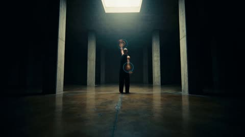</a>

The prompt separates the choreography, the camera moves and a dedicated overlay spec with box counts, size tiers and downbeat rules, so the dancer stays readable while the graphics stay secondary. Limiting the negative effect to selected small boxes stops it from taking over the whole frame.

MiniMax H3 · Text-to-video · Source: [@Artedeingenio on X](https://x.com/Artedeingenio/status/2095818230292004950) · 136 likes on 2026-10-29

[`dance`](tags.md#tag-dance) [`brutalist`](tags.md#tag-brutalist) [`tracking-overlay`](tags.md#tag-tracking-overlay) [`continuous-shot`](tags.md#tag-continuous-shot)

<details><summary><b>Prompt</b></summary>

```text
Experimental contemporary dance combined with TouchDesigner-style dynamic body tracking, generated as one complete uninterrupted continuous shot with no deliberate cuts.

A vast brutalist underground hall with a polished dark concrete floor, enormous vertical pillars, and one single rectangular ceiling light illuminating the center. The surrounding architecture gradually disappears into darkness. A male dancer with a shaved head, loose black trousers, and a fitted sleeveless top performs alone beneath the light. Preserve the brutalist geometry and the dancer as the sole performer.

The choreography combines slow controlled tension with sudden mechanical releases: sweeping circular arm movements, deep forward lunges, asymmetric shoulder rotations, sharp elbow extensions, backward arches, rapid half-turns, one-knee drops, and long diagonal reaches across the floor. His body repeatedly expands into wide sculptural poses and contracts tightly around the torso.

The camera constantly explores the performance geometry while remaining a single continuous move: extreme low angles close to the floor, overhead perspectives, slow circular tracking, profile close-ups, fast lateral travel, and sudden dolly pull-backs, all fluidly connected and precisely synchronized to the choreography. No shot cuts.

[Style — TouchDesigner-style real-time computer vision body-tracking visualization]

Apply sophisticated real-time body tracking densely and continuously throughout the entire clip. Glowing electric-blue and amber tracking nodes lock precisely onto the dancer's joints, hands, elbows, shoulders, knees, ankles, and torso, connected by thin geometric lines that dynamically stretch, collapse, and reorganize with every movement. Hands generate flowing vector trails. Rapid movements leave temporary wireframe echoes of previous body positions, creating layered geometric sculptures in space. During turns, circular tracking rings rotate around the torso; during floor movements, perspective grids expand outward across the concrete. As intensity rises, tracked coordinates, fragmented polygons, kinetic curves, and translucent skeletal structures accumulate around him, always responding precisely to his body. Keep the dancer visible and never obscure him with filled graphics.

Required CV overlay structure, visible continuously: 12-20 hollow axis-aligned rectangular tracking boxes at once, thin 1-2px electric-blue or amber strokes, absolutely no fill and no translucent color blocks. Maintain four clearly separated size tiers at every stable moment: 2-4 large local boxes, 3-5 medium local boxes, 3-5 small local boxes, and 4-6 visibly tiny micro boxes. Vary wide and tall rectangles. Every box tracks only a local body fragment or local motion region; never enclose the whole dancer, whole body, or whole head. The largest box covers no more than one quarter of the visible subject area. Micro-box area is at most 1/32 of the largest box. All box centers are visibly displaced; no concentric or near-concentric rectangle rings. On each audible downbeat or strong accent, replace, resize, jump, or relocate roughly 30-50% of the boxes to new local fragments while retaining the total count and all four size tiers.

Add thin straight topological connection lines linking displaced box corners and centers into a flexible star/network graph, alongside the joint-node skeleton. Add small clean monospace four-digit numeric IDs and [x, y] coordinate labels beside boxes; IDs and coordinates visibly randomize rapidly on every frame like a live CV debug console. Add optional sparse pixel samples and a subtle center crosshair only if they remain secondary.

Inside selected small and micro boxes only, show a true photographic negative of the exact underlying moving pixels, clipped precisely to each selected box's inner edge. Everything outside those selected small/micro rectangles, including large and medium box interiors, remains normal positive color. Rotate the negative windows across successive musical downbeats so different small/micro boxes take turns switching positive-to-negative and negative-to-positive. Never apply global negative, global monochrome, full-screen flashing, exposure pulsing, or strobing. Negative pixels must not bleed beyond the selected box interiors.

Audio is generated by the video model in sync with the visuals: instrumental experimental techno at 128 BPM, deep industrial kick, dry metallic percussion, pulsating distorted bass, and short bursts of synthetic noise. No vocals, no spoken voice, no lyrics. Every major beat drives the tracking-box changes, local negative-window switches, node pulses, trail persistence, and camera movement; the music and visual rhythm are tightly synchronized.

Final beat: the dancer suddenly stops in a wide asymmetric pose. All previous motion trails remain suspended around him for a brief moment, forming a large abstract three-dimensional wireframe sculpture of his movement history, then everything instantly disappears except the dancer under the ceiling light.

[Visual style — generated footage only]

Dark brutalist minimalism, high-contrast cinematic lighting, black and concrete-gray environment, electric-blue and amber tracking graphics, contemporary digital-art installation aesthetic. Apply a low-saturation desaturated underlying palette with natural teal/cyan cool shadows and warm highlights, strong 35mm film grain, high contrast with lifted blacks and preserved highlight detail, cinematic single-key or side/back lighting, shallow depth of field, subtle vignette, natural sharpness, and restrained highlight bloom. Keep film grain, grading, and optical artifacts confined to the generated footage; do not contaminate tracking lines, box outlines, nodes, IDs, or local negative masks.

HARD NEGATIVES: no solid-fill colored blocks, no filled overlays, no full-body or full-head bounding box, no silhouette-shaped or irregular boxes, no concentric rectangles, no same-size-only boxes, no fewer than 12 boxes, no missing micro boxes, no static IDs, no floating subtitles, no logo or watermark, no global black-and-white or desaturation, no global photographic negative, no full-screen black-white flash, no color strobe, no negative effect inside large or medium boxes, no negative bleed outside small/micro inner edges, no reference footage, no overlaid source footage, no extra performer, no deliberate shot cuts.

[Technical] 15 seconds, 16:9 horizontal, one continuous shot, 2K, cinematic motion, precise motion synchronization, generated instrumental audio.
```

</details>

<a id="h3-neon-pulse-anime-mv-opening"></a>
### Neon Pulse title over anime silhouette and HUD

<a href="https://x.com/yourPlugAI/status/2090773583668621325">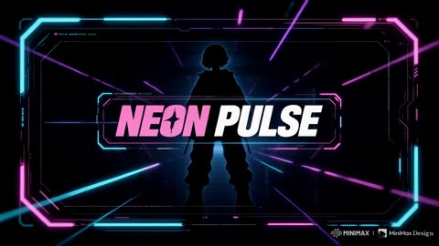</a>

Beat cues are written as timestamps (heavy drop at 3 seconds, arpeggios at 7, melody at 11), and each transition type is named, so the cuts follow the music. Banning fades and dissolves keeps every change sharp.

MiniMax H3 · Text-to-video · Source: [@yourPlugAI on X](https://x.com/yourPlugAI/status/2090773583668621325) · 127 likes on 2026-10-29

[`mv-opening`](tags.md#tag-mv-opening) [`cyber-pop`](tags.md#tag-cyber-pop) [`hud-graphics`](tags.md#tag-hud-graphics) [`beat-synced`](tags.md#tag-beat-synced) [`title-sequence`](tags.md#tag-title-sequence)

<details><summary><b>Prompt</b></summary>

```text
Generate a 15-second hyper-pop cyber-anime MV opening. Refer to the visual language of these reference images: neon pastel cyberpunk, glowing holographic overlays, futuristic UI HUD elements, high-contrast Y2K digital graphic design, floating liquid-metal typography, speed lines, and bright cyan-magenta-violet gradient color schemes, set to a high-tempo J-pop synthwave rhythm.

The tone should be 80% energetic cyber-pop and 20% futuristic intrigue: colorful, fast-paced, stylish, and futuristic, without dark horror or gloomy tones. Make it feel like an ultra-modern animated music video intro: glowing laser frames expand first, digital interface grids snap open, and holographic anime character silhouettes, glowing cyber-deck props, and bold floating English credits reveal in precise sync with the upbeat tempo.

English credits and title text must be clear, crisp, and stylishly designed. No random characters or misspellings. Each credit and job title must appear only once.

Use dynamic digital transitions: chromatic aberration glitches, prism light leaks, rapid frame flashes, pixel-sorting wipes, spatial zoom-cuts, and panel-slide reveals. Keep all transitions razor-sharp and beat-driven. No slow blurs or fading dissolves.
BGM: original 15-second high-energy cyber-pop instrumental, 160 BPM upbeat synthwave rhythm.

Features crisp electronic clap-snares, bright arpeggiated synth leads, bouncing sub-bass line, and glowing vocal chops. Build anticipation in the first 2 seconds, drop a heavy synth-bass beat at 3 seconds, introduce bright arpeggios at 7 seconds, hit a high-octane synth melody at 11 seconds, and finish on an echoing synth stab with a shimmering reverb tail.
```

</details>

<a id="h3-alexa-grey-ai-command-music-video"></a>
### Alexa Grey performs in neon AI command center

<a href="https://x.com/MonetizationDon/status/2085695306402840816">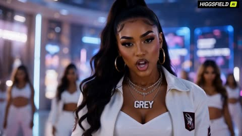</a>

The 30 seconds are split into timed sections, each tied to a lyric beat and a set of motion graphics, so the model keeps one story across the switch from R&B to rap. A fixed visual style line and a dense camera vocabulary keep the look consistent, and the explicit performance cue drives the lip sync.

MiniMax H3 · Text-to-video · Source: [@MonetizationDon on X](https://x.com/MonetizationDon/status/2085695306402840816) · 125 likes on 2026-10-29

[`music-video`](tags.md#tag-music-video) [`lip-sync`](tags.md#tag-lip-sync) [`holographic-ui`](tags.md#tag-holographic-ui) [`neon`](tags.md#tag-neon)

<details><summary><b>Prompt</b></summary>

```text
30-second cinematic music video

0:00–0:15: Alexa Grey performs a soulful English R&B song about Higgsfield bringing together the world's most powerful AI models, empowering creators to turn ideas into reality. Smooth vocals, emotional delivery, cinematic performance, perfect lip sync.

0:15–0:30: The beat switches into an energetic rap. Alexa celebrates the creative power of Seedance 2.5, Kling AI, MiniMax H3, Higgsfield Soul 2, and the Higgsfield Super Computer, with every model introduced through premium editorial motion graphics and holographic UI.

Visual Style
Bright futuristic AI command center, luxury cyberpunk aesthetic, glossy white architecture with neon purple, magenta, cyan, and gold accents, massive holographic displays, floating interfaces, reflective floors, volumetric lighting, luxury fashion styling, cinematic color grading, premium commercial quality.

Camera
Extreme close-ups, drone establishing shots, orbit shots, handheld performance shots, dolly tracking, crane shots, 360° rotations, whip pans, slow-motion hero shots, seamless match cuts, dynamic transitions synchronized to the beat.

On-screen Editorial Pop-ups
• SEEDANCE 2.5 — 30-second video • Multi-reference • Interactive Editing
• KLING AI — Realistic Motion • Cinematic Camera • Physics
• MINIMAX H3 — AI Music • Vocals • Lyric Generation
• HIGGSFIELD SOUL 2 — Character Performance • Emotion • Cinematic Expressions
• HIGGSFIELD SUPER COMPUTER — Powering the Next Generation of AI Creativity
As each model appears, the environment transforms to demonstrate its strengths. Finish with Alexa standing inside the glowing Super Computer core while every AI model orbits around her as holograms. End with the tagline:

"One Platform. Every Creator. Infinite Possibilities."
```

</details>

<a id="h3-pink-seoul-korean-fashion-collage-mv"></a>
### Pink Korean Fashion Collage Film With Outfit Changes

<a href="https://x.com/ImaStudio_ai/status/2101981159970480258"></a>

The prompt is split into numbered blocks for identity lock, outfit beats, 2D motion graphics and editorial layout, then closes with a 13 cut storyboard timed to 115 to 125 BPM. Placeholder text in brackets drives the typography, and the last cut assembles every graphic into a magazine cover.

MiniMax H3 · Reference-to-video · Source: [@ImaStudio_ai on X](https://x.com/ImaStudio_ai/status/2101981159970480258) · 106 likes on 2026-10-28 · found via [SkyNotSilent/awesome-MiniMax-H3-cases](https://github.com/SkyNotSilent/awesome-MiniMax-H3-cases)

[`fashion`](tags.md#tag-fashion) [`kpop`](tags.md#tag-kpop) [`collage`](tags.md#tag-collage) [`typography`](tags.md#tag-typography) [`outfit-change`](tags.md#tag-outfit-change)

<details><summary><b>Prompt</b></summary>

```text
Korean Pink Collage Fashion MV (15s, 16:9, 24fps)
【1. Identity Lock】
Absolute character consistency: Only one young Korean-style woman appears throughout the entire video. Strictly preserve the reference image’s facial features, skin tone, long dark-brown slightly wavy hair, bangs, facial structure, and body proportions.
Overall vibe: Asian pop aesthetic, fresh sweet-cool energy, light Y2K influence, balancing cute charm with a polished fashion-editorial feel.
Strict restrictions: No face swapping, no identity drift, no Westernized facial features, no masculine features, no background people, and no second character.
【2. Outfit Beats】
Style lock: Korean sweet-cool girl-group fashion, blending youthful femininity with a slightly mature edge.
Outfit transition logic: Seamlessly switch outfits on camera cut points and musical beats. Wardrobe elements include fitted white or pink knit tops, light-blue denim, Y2K pleated skirts, platform boots, delicate mini bags, and Korean-style earrings.
The character must remain highly consistent across every outfit change.
【3. Motion Graphics】
Visual theme: Pink Pattern Collage Pop.
Main palette: Cream pink, soft pink, peach pink, creamy white, silver-gray, with small accents of black typography.
2D graphic elements: Checkerboard patterns, polka dots, photobooth-style frames, geometric color blocks, and heart outlines.
Avoid realistic 3D materials. Use flat, crisp, graphic 2D elements that slide, overlap, crop, and wipe across the frame dynamically.
【4. Editorial Layout】
Typography: Main titles: [NAME] / [SEOUL POP]
Secondary labels: [SOFT CHIC] / [CUTE SIGNAL] / [TRENDY LOOK] / [KOREAN GIRL]
Layout style: Use oversized background typography, text inside geometric frames, and small sticker-like labels.
Arrange text horizontally, vertically, and diagonally with intentional offset layouts.
Typography should change rapidly with the cuts while always remaining clear and never covering the character’s face.

【5. 13-Cut Fast-Paced Trailer Storyboard | 115–125 BPM】
Cut 1 (0s): Extreme close-up. She slightly lifts her chin and looks directly into the camera. The background is filled with solid pink and an oversized [NAME] title, creating an immediate beauty hook.
Cut 2 (1s): Medium shot. She takes half a step forward and lightly holds her bag strap. The background switches to a pink-and-white checkerboard pattern.
Cut 3 (2s): Full-body shot. Flash outfit transition from a white top into a pink skirt look. She turns back toward camera and freezes briefly.
Cut 4 (3s): Close shot. Playful crouching pose with both hands near her face. Photobooth-style frames quickly slide into the composition.
Cut 5 (4s): Close-up. Camera pushes in slightly for a sharp eye-contact moment. Polka-dot graphics fill the background.
Cut 6 (5s): Medium shot. She turns and adjusts her long hair while large collage typography [SEOUL POP] pops across the frame.
Cut 7 (6s): Low-angle shot. She reaches one hand toward the camera as pink graphic strips slice horizontally across the frame.
Cut 8 (7s): Full-body shot. She shifts her weight and performs another flash outfit change featuring denim elements. The composition becomes cleaner with more negative space.
Cut 9 (8s): Close-up. She looks down slightly, then raises her eyes and smiles softly. Multiple [CUTE SIGNAL] labels appear across the screen.
Cut 10 (10s): Medium shot. She lightly holds the hem of her skirt while the background transforms into large geometric color-block sections.
Cut 11 (11s): Medium shot. She gently touches her earrings with a small, refined gesture. Overlapping color planes shift slightly out of alignment.
Cut 12 (12s): Wide shot. She turns sideways into a preparation pose while all fragmented graphic and typography elements begin converging toward the center.
Cut 13 (13.5–15s): Hero Pose. She stands centered in her strongest fashion pose. Graphics, borders, typography, and collage elements perfectly assemble into one polished Korean fashion magazine cover. Hold the final composition for 0.5 seconds.
```

</details>

<a id="h3-y2k-girl-group-rap-bubble-typography"></a>
### Y2K girl group rap video with bubble typography

<a href="https://x.com/LeoCreaIA/status/2083240416166748313"></a>

Each shot gets its own camera move, one rap line and one named word, and every hard cut is tied to a bass, snare or vocal hit. A reference image locks the three faces, while the typography is written as a material (inflated jelly chrome letters) that hands and faces can cover.

MiniMax H3 · Reference-to-video · Source: [@LeoCreaIA on X](https://x.com/LeoCreaIA/status/2083240416166748313) · 83 likes on 2026-10-28 · found via [SkyNotSilent/awesome-MiniMax-H3-cases](https://github.com/SkyNotSilent/awesome-MiniMax-H3-cases)

[`k-pop`](tags.md#tag-k-pop) [`y2k`](tags.md#tag-y2k) [`typography`](tags.md#tag-typography) [`music-video`](tags.md#tag-music-video) [`rap`](tags.md#tag-rap) [`hard-cuts`](tags.md#tag-hard-cuts)

<details><summary><b>Prompt</b></summary>

```text
This is what H3 does with Omni Reference and one long prompt:

prompt：Soft cute Y2K crush K-pop girl group rap MV. High fashion performance film mixed with inflated 3D candy typography graphic system. Three female idols wearing pink, blue and purple luxury Y2K stage outfits. Cute 3D chibi doll face, big dewy eyes, porcelain skin, soft blush cheeks, chibi idol proportions. Reference typography: only the inflated 3D rubber bubble font language, pink/lavender/ice-blue chrome plastic material, not the whole layout. Visual style: soft pastel crush energy, Y2K game UI, candy glossy finish, milky translucent plastic × K-pop aggressive feminine rap energy. Texture: 35mm film grain + soft glow bloom + iridescent holographic foil + jelly plastic specular + Y2K scanline + candy dot halftone + VHS frame vibration + plastic toy surface reflection + glitter confetti rain. Editing: Fast rhythm editing. Only hard cuts. No fade. No smooth transitions. Every cut follows: bass hit, snare, rap vocal impact.

Character Performance Three female performers from reference image 1. Keep: same 3D chibi doll faces, big sparkling eyes, pastel Y2K idol makeup, pink/blue/purple fashion styling, soft cute cold expression. Each member has a signature prop: A holds a chunky rhinestone microphone, B has a plush bear shoulder bag, C wears oversized heart-shaped sunglasses pushed up on head. They are not posing. They are performing rap. Actions: aggressive eye contact, head nodding, shoulder movement, leaning toward camera, hand pushing toward lens, confident cute facial expression, sharp body movement, wink on snare hit, tongue-out on bass drop, hair flip on beat. Lip sync: perfect rap mouth synchronization. The performance should feel like a real K-pop rap unit MV with Y2K crush energy.

Typography Animation Typography is a visual weapon. Not subtitles. Not static graphics. Use: giant English words inflated 3D rubber bubble font, jelly plastic material, pink lavender ice-blue chrome, soft puffy candy letters, compressed bold balloon fonts, stretched vertical puffy letters, handwritten graffiti titles, 3D extruded candy text, glitch displacement, print error effect, Y2K game UI pixel corruption. Text appears only when the beat hits. Characters can cover the text. Text can cover parts of clothing. Never cover eyes or main facial expression. Tiny Y2K stickers burst on beat: heart, star, smiley, sparkle, chain link, bow, four-leaf clover, mini bear.

Shot 1 — Member A · Extreme Close-up「RUN NOW」 Character A face close-up, framed inside a pink heart-shaped iris wipe transition (in only, hard cut out). She looks directly into camera. Cute cold doll expression, big dewy eyes, soft blush, frosted pink lip gloss, rhinestone tear sticker under one eye. Starts rap. Chunky rhinestone microphone enters frame from below, she grips it tightly. Camera slowly pushes closer. Tiny pink heart stickers float up from bottom edge like bubbles. Huge inflated bubble letters crash into frame from left and right. Typography: "RUN NOW" — Pink jelly rubber 3D font, glossy candy surface, soft inner glow. Letters stretch vertically like puffy balloons. The word vibrates and squishes with bass, casts soft pink shadow on her cheek. Rap: "Run now, I don't chase." Confetti burst on final syllable. Hard cut.

Shot 2 — Member B · Rap Performance「BREAK LIMIT」 Member B medium close-up, slight low angle, camera orbits 15° around her during the take. Lavender fur jacket, Y2K layered top, plush bear bag bouncing on her hip, chunky pearl choker, star-shaped earrings. She performs aggressively. Shoulders hit the rhythm. Hair flips hard on the second snare, blue hair ties catch the light. Hair moves naturally. Background: pastel gradient pink-to-lavender with faint Y2K perspective grid lines floating. Behind her appears huge handwritten text. Typography: "BREAK LIMIT" — Ice-blue bubble graffiti brush writing, soft inflated stroke, candy-coated, letters appear one by one with bounce easing. Animation: letters tear apart, reassemble, rotate 360° on snare, shake with bass. Chain link graphic swings across frame, sparkle stickers pop on every beat. Rap: "Break limits, break rules." Hard cut.

Shot 3 — Member C · Hand Attack Shot「NO APOLOGY」 Member C moves close to camera. Top-down camera angle, she leans over the lens. Hand reaches toward lens. Nails are long pink acrylic with 3D star and heart charms. Focus: rings with mini plush bear charm, heart-cut gemstone, baby-pink leather texture, knit ribbed sleeve, plushy toy surface. Foreground vertical text: "NO APOLOGY" — Stretched vertical pink bubble letters, jelly puffy material, letters pierce through the back of her hand visually. Hand covers part of the typography. Fingers spread wide on the bass hit. Camera: handheld vibration. Film grain strong. Candy halftone dots bloom in shadow. Tiny "XOXO" sticker tag pulses in corner. Rap: "No apology, no regret." Hard cut.

Shot 4 — Fashion Magazine Impact Cut「UNSTOPPABLE」 Member A close-up. Her face appears inside a broken Y2K trading card / idol photo card frame, with barcode at bottom, "SYS.07-A" serial tag, holographic foil border torn on left side. Not a full layout. Only one graphic element. Typography: "UNSTOPPABLE" — Huge lavender handwritten bubble text, inflated 3D rubber, glossy plastic finish, letters explode outward from center of her forehead, push edges of the card frame. Animation: text suddenly expands from behind her. Card frame rips in half vertically, holographic confetti pours from the tear, revealing pastel gradient background underneath. A second smaller photo card of her winks in from the right, slightly rotated. Rap: "Can't stop my wave." Hard cut.

Shot 5 — Glitch Double Image「STATIC」 Member B close-up, slight Dutch angle (5° tilt). Create: duplicate frame, pastel RGB separation (pink/blue/lavender channels), xerox shadow, motion trail, VHS tracking line at bottom edge. Main face stays sharp. She holds a sparkly heart-shaped lollipop up beside her cheek, the lollipop leaves a trail of echo frames. Background text: "STATIC" — Y2K pixel font, candy pink chrome, letters flicker like broken game sprite, jump between frames, sometimes inverted color, sometimes missing entirely. Like corrupted music video signal + cute game glitch. A tiny "ERROR 404" sticker blinks in upper corner. Rap: "Static noise, I get louder." Hard cut.

Shot 6 — Pink Blue Purple Battle「PINK OUT」 Member A and C alternate close-ups, rhythm: A-A-C-A-C-C, two frames each. Fast switching. Visual split: each member sits in a vertical color block (A=pink, C=lavender, alternating). Center text: "PINK OUT" — Pastel pink-to-purple gradient bubble 3D, letters appear one word at a time, syncing to each cut. Words appear one by one. Each word: stretch vertically on entry, compress horizontally on hold, invert color on snare, explode into heart stickers and star confetti on exit. Tiny "1.2.3.GO!" counter graphic ticks in corner. Rap: "Lights out, pink out." Hard cut.

Shot 7 — Group Rap Performance「UNBREAKABLE」 Three members together.
```

</details>

<a id="h3-gold-chain-rapper-audio-lipsync-multicut"></a>
### Gold chain rapper performing on a night street

<a href="https://x.com/KEETY2591756/status/2085918684879765882"></a>

A character image plus an audio track act as the timing guide, so the mouth and actions lip sync to the audio automatically. Asking for multiple cuts with extreme low and high angles, in an East Coast rap video style, gives the fast, aggressive camera rhythm.

MiniMax H3 · Reference-to-video · Source: [@KEETY2591756 on X](https://x.com/KEETY2591756/status/2085918684879765882) · 61 likes on 2026-10-28 · found via [SkyNotSilent/awesome-MiniMax-H3-cases](https://github.com/SkyNotSilent/awesome-MiniMax-H3-cases)

[`lip-sync`](tags.md#tag-lip-sync) [`rap`](tags.md#tag-rap) [`omni-reference`](tags.md#tag-omni-reference) [`multi-cut`](tags.md#tag-multi-cut) [`music-video`](tags.md#tag-music-video)

<details><summary><b>Prompt</b></summary>

```text
モード1：Omni Reference
プロンプト：添付のキャラクター参照（ 📷Image1 ）とオーディオトラックをタイミングガイドとして使用してください。オーディオにある「音声」に完全に会うようにキャラクターの口とアクションを入れてリップシンクしてダイナミックなカメラアングルでラップを披露してください。カメラはマルチカットでキャラの部位をクローズアップしてください。全て超ハイスピードで激しく行ってください。

モード2：Omni Reference
プロンプト：添付のキャラクター参照（ 📷Image1 ）とオーディオトラックをタイミングガイドとして使用してください。オーディオにある「音声」に完全に会うようにキャラクターの口とアクションを入れてリップシンクしてダイナミックなカメラアングルでラップを披露してください。カメラはマルチカットで超ローアングル・超ハイアングルを小刻みに切り替えたUS東海岸のラップビデオのようなスタイルに仕上げる。全て超ハイスピードで激しく行ってください。
```

</details>

<a id="h3-dark-red-kpop-lyric-typography-performance"></a>
### Dark red K-pop video with lyric typography

<a href="https://x.com/Kiber_Alla/status/2085138181133894024"></a>

Locks the performer in close or medium framing with no cuts on her, while typography and backgrounds hard cut every 1 to 1.5 seconds on a numbered lyric list. Three references (character, audio, lyrics) plus explicit mouth and teeth rules keep lip-sync clean.

MiniMax H3 · Reference-to-video · Source: [@Kiber_Alla on X](https://x.com/Kiber_Alla/status/2085138181133894024) · 56 likes on 2026-10-28 · found via [SkyNotSilent/awesome-MiniMax-H3-cases](https://github.com/SkyNotSilent/awesome-MiniMax-H3-cases)

[`music-video`](tags.md#tag-music-video) [`kpop`](tags.md#tag-kpop) [`lyrics-typography`](tags.md#tag-lyrics-typography) [`lip-sync`](tags.md#tag-lip-sync) [`red-atmosphere`](tags.md#tag-red-atmosphere)

<details><summary><b>Prompt</b></summary>

```text
10-second dark emotional K-pop music video. Realistic young East Asian woman from the character reference, natural face, real skin texture, messy hair. 
Important rules: 
- The girl is always framed in close-up or medium shots only. No wide or distant shots at all. 
- The girl performs continuously for the full 10 seconds without any cuts on her. Her movement is natural and fluid — she can shift weight, make small dance-like gestures, turn her head, move her shoulders and hands, but the camera stays on her in consistent medium/close framing. 
- Typography and background change with hard cuts according to the storyboard order, while the girl keeps performing through them.  

Sequence of text (hard cuts): 
1. “THE TABLE’S SET AGAIN” 
2. “NOBODY SITS DOWN” 
3. “YOUR WORDS ARE HARD GLASS” 
4. “FALLING TO THE FLOOR NOW” 
5. “I KEPT THE DOOR OPEN” 
6. “YOU KEPT YOUR HANDS CROSSED” 
7. “SAME ROOM, SAME SCAR” 
8. “SAME OLD COST” 
9. Final rose  The girl sings the entire song with clear, accurate lip-sync. 

Mouth and teeth must stay natural and undistorted at all times — no deformation, no melting, no artifacts. Emotional facial performance. Typography stays sharp and reacts (cracks, shifts, particles). Changing typography every 1–1.5 seconds. Heavy red atmosphere, cinematic lighting, photoreal
```

</details>

<a id="h3-superman-laundry-day"></a>
### Superman wrestles a laundry pile in a messy apartment

<a href="https://x.com/Strength04_X/status/2085210848272986556"></a>

Timed four-second beats lay out one shot per block, so the sequence stays readable. A small gag escalates from sock on the face to wrong button to bubbles, which takes a serious hero to laughing, and the quoted sung lines set the voice and pacing.

MiniMax H3 · Text-to-video · Source: [@Strength04_X on X](https://x.com/Strength04_X/status/2085210848272986556) · 56 likes on 2026-10-29 · found via [SkyNotSilent/awesome-MiniMax-H3-cases](https://github.com/SkyNotSilent/awesome-MiniMax-H3-cases)

[`comedy`](tags.md#tag-comedy) [`superman`](tags.md#tag-superman) [`timed-shots`](tags.md#tag-timed-shots) [`singing`](tags.md#tag-singing)

<details><summary><b>Prompt</b></summary>

```text
0:00–0:04 — Wide shot of a messy apartment living room. SUPERMAN (full costume) is standing in front of an open washing machine holding a huge pile of red-and-blue clothes.
0:04–0:07 — He starts stuffing the cape into the machine while singing in a deep heroic voice: “Laundry day, laundry day… even heroes have to pay!” and does a dramatic fist pump that makes the clothes fly everywhere.
0:07–0:10 — He tries to close the lid, but a red sock keeps floating up and sticking to his face. He peels it off and continues singing louder: “Red socks, blue socks… they never stay in the box!” while spinning in a circle.
0:10–0:13 — He accidentally presses the wrong button. The machine starts shaking violently and soap bubbles start flying out. Superman tries to stay serious and stop it with one hand.
0:13–0:16 — Bubbles land on his face and the sock sticks again. His serious superhero expression completely cracks. He bursts out laughing while still holding the machine.
0:16–0:18 — He freezes mid-pose with bubbles all over him, laughing so hard he has to lean on the washing machine as more clothes keep popping out.
```

</details>

<a id="h3-op-art-spy-title-opening-disc"></a>
### Op art spy title opens on grooved disc

<a href="https://x.com/doctorwasif/status/2085947083463295024"></a>

The prompt writes the tempo as structure: slow sparse shots that accelerate with the drum pulse, hard cuts only, and a fixed palette rotation, so every beat has a defined look. Attaching the audio as the timing source and a reference image for the character keeps the silhouette consistent across cuts.

MiniMax H3 · Reference-to-video · Source: [@doctorwasif on X](https://x.com/doctorwasif/status/2085947083463295024) · 43 likes on 2026-10-29 · found via [SkyNotSilent/awesome-MiniMax-H3-cases](https://github.com/SkyNotSilent/awesome-MiniMax-H3-cases)

[`title-sequence`](tags.md#tag-title-sequence) [`op-art`](tags.md#tag-op-art) [`silhouette`](tags.md#tag-silhouette) [`beat-sync`](tags.md#tag-beat-sync)

<details><summary><b>Prompt</b></summary>

```text
Using Image as the character reference and the attached modern retro-western electro track for timing, create a 60s Bond-style spy-thriller op-art anime title sequence. Every cut must land exactly on the beat. Start with slow, sparse shots and progressively accelerate into rapid-fire montage as the drum pulse intensifies.

STYLE: Flat, high-contrast pure black/white silhouette against psychedelic 1960s op-art backgrounds: concentric circles, starbursts, spirals, stripes, chevrons and kaleidoscopic patterns. Rotate through hot pink/orange, electric teal/violet, and acid yellow/magenta palettes. No realistic shading.

Use classic Bond-title compositions: walking/spinning silhouettes, gun-barrel-style irises, mirrored/kaleidoscopic duplicates, and extreme close-ups of eyes, hands and weapons. Backgrounds may swirl and morph, but all shot transitions are hard cuts only.

Use frequent half-to-one-beat freeze-frames on dramatic poses, with the character and pattern completely frozen before snapping to the next beat and palette. Alternate kinetic movement with sudden dead-stop freezes.

Add bold 1960s Bond-style geometric italic typography, spinning/tiling/zooming in sync with the music. Apply subtle analog film grain and warm, saturated vintage print grading.

ENDING: On the final hit, freeze the character in full black silhouette at center of a fully bloomed hot-pink-and-gold radiating starburst, while the title card spins/zooms into frame beside them.
```

</details>

<a id="h3-umbrella-crosswalk-laughing-performance"></a>
### Umbrella girl laughs and sways at crosswalk

<a href="https://x.com/MireilleDartois/status/2085254169259311602">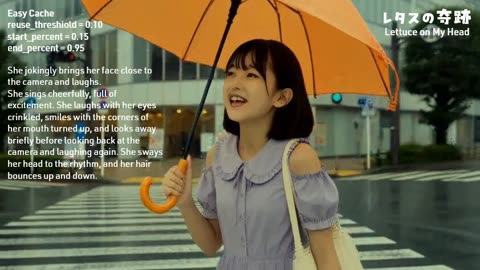</a>

Stacking the performance as timed beats (lean in and laugh, sing with crinkled eyes, glance away and back, sway to the rhythm) keeps the expression changing across the clip instead of a static lip sync. Reference-to-video anchors her look while the prompt carries the acting.

MiniMax H3 · Reference-to-video · Source: [@MireilleDartois on X](https://x.com/MireilleDartois/status/2085254169259311602) · 31 likes on 2026-10-29 · found via [SkyNotSilent/awesome-MiniMax-H3-cases](https://github.com/SkyNotSilent/awesome-MiniMax-H3-cases)

[`lip-sync`](tags.md#tag-lip-sync) [`facial-performance`](tags.md#tag-facial-performance) [`reference-to-video`](tags.md#tag-reference-to-video) [`close-up`](tags.md#tag-close-up)

<details><summary><b>Prompt</b></summary>

```text
She jokingly brings her face close to the camera and laughs.
She sings cheerfully, full of excitement. She laughs with her eyes crinkled, smiles with the corners of her mouth turned up, and looks away briefly before looking back at the camera and laughing again. She sways her head to the rhythm, and her hair bounces up and down.
```

</details>

<a id="h3-furina-fontaine-lyric-montage"></a>
### Furina Fontaine playbill montage with lyric cards

<a href="https://x.com/nanyuan0412/status/2088552509321195997"></a>

The prompt keeps the reference video's audio, cut times and density curve as a timing grid, then swaps every visual for Furina and Fontaine typography. Each cut is locked to a listed timestamp so the lyric accents stay in sync with the untouched music.

MiniMax H3 · Video edit · Source: [@nanyuan0412 on X](https://x.com/nanyuan0412/status/2088552509321195997) · 20 likes on 2026-10-29

[`furina`](tags.md#tag-furina) [`genshin-impact`](tags.md#tag-genshin-impact) [`lyric-montage`](tags.md#tag-lyric-montage) [`reference-video`](tags.md#tag-reference-video)

<details><summary><b>Prompt</b></summary>

```text
这个是有参考的版本可以使用

subject_definitions:
<Subject 1> is Furina from Genshin Impact in her canonical default design: pale skin, long white hair with blue underlayers, bright blue eyes, a small navy top hat, and an ornate navy-and-ivory Fontaine outfit with bow, ruffles, shorts, gloves, and restrained gold details. Keep one form and costume. Her elegant, dramatic stage presence remains active, not a static poster. Printed portraits and chibi graphics are designed images, not extra physical characters.

summary:
[video editing] Adapt <Video 1> into a 15.000-second, 16:9 Furina/Fontaine editorial anime montage. Preserve its soundtrack, major cut times, motion-density curve, and dense-to-calm-to-empty pacing. Replace source content with Furina, Fontaine theatre, waterways, hydro motifs, playbills, and tickets. Use ivory, Fontaine navy, water cyan, black type, and sparse gold lines. Do not change music, tempo, lyric timing, section lengths, or ending duration.

retention_analysis:
<Video 1> embedded audio, duration, frame order, cuts, beat alignment, layout trajectories, section functions, and density rhythm: fully_preserved.
<Video 1> original character, outfits, cherry location, city/social content, and name labels: weak_reference; replace them with <Subject 1> and Fontaine content while retaining composition and motion load.
<Video 1> lyric content and timing: fully_preserved. Exact glyphs, small UI copy, logos, and signatures: partially_preserved; leave stable text zones for post-production and never invent gibberish.

detailed_description:
[Shot 1] From 00:00.000 to 00:00.933, ivory white resolves from overexposure into a monochrome waist-up portrait of <Subject 1>, surrounded by pale-gray letters, a thin opera-arch circle, navy ticket fragments, and two hydro diamonds. Blur rapidly locks crisp while her eyes, hair, hat ribbon, ruffles, and shoulders remain subtly alive.
[Shot 2] At 00:00.933, the circle encloses <Subject 1> and restores her white, navy, and cyan colors. Outside snaps to Fontaine navy with huge white "FURINA" type. Portrait and background counter-slide; the circle lifts and pulls an ivory playbill from below.
[Shot 3] At 00:01.400, cut to a centered vertical Furina playbill on navy. It drops with one short impact, slightly overshoots, and locks. Use only "FURINA" and "OPERA EPICLESE". Its lower edge stretches sideways until ivory replaces navy.
[Shot 4] At 00:02.283, the playbill unfolds into a Fontaine collage: full-body <Subject 1>, aquabus windows, waterways, huge pale-gray "FURINA", navy "FONTAINE", gold rules, and cyan swatches. Begin on shoes and shorts, pull vertically to torso and hat, then reveal the page. A black lower bar appears and the layout whips left.
[Shot 5] At 00:03.683, opera programs, tickets, and portrait cards of <Subject 1> sweep left on a curved conveyor between black bars. Navy, ivory, and pale-gold cards pass in depth with controlled blur as printed layers. They fall downward, leaving original lyric words at both sides.
[Shot 6] At 00:04.567, a thin hydro-pulse line receives motion. Preserved lyric words enlarge on original vocal accents, briefly offset and shake, while diagonal lines and faint water rings cross ivory. The emphasized word contracts and releases a gold-edged cyan rectangle.
[Shot 7] At 00:05.550, the cyan lyric card expands past target size, makes one small settle, and locks. Preserve its source word exactly; add no copy. The card shrinks upper-left and clears.
[Shot 8] At 00:06.017, chibi <Subject 1> in the same costume appears left of center with a huge preserved black lyric word behind her. One scale impact lands, then body, hat, and ruffles keep moving. Chibi and word smear horizontally and exit together.
[Shot 9] At 00:06.500, one large preserved Chinese lyric character remains on ivory. Horizontal echoes resolve crisp; it drifts left and compresses into a water-droplet slit. The Fontaine water garden is visible inside before opening.
[Shot 10] At 00:06.917, the slit opens to <Subject 1> on a luminous Fontaine water terrace under a pale cyan sky, with white stone, blue water, hydro flowers, and translucent droplets. Bright blur clears, then hold a very slow push-in. Her gaze, hair, ribbons, coattails, reflections, flowers, and parallax stay gently active. Add no event or spell. At 00:10.230, push briefly and overexpose to ivory.
[Shot 11] At 00:10.333, the preserved handwritten lyric sits in navy ink on ivory with a soft vignette and faint water ring. At OUT it forms a pale-gray echo and drags left, handing direction and speed to <Subject 1>.
[Shot 12] At 00:11.267, <Subject 1> enters from lower right with brief blur and settles left of center before pale-gray "FURINA" type. After lock, gaze, hair, shoulders, hat ribbon, and coattails move subtly. At 00:12.067, her layer accelerates downward and exits.
[Shot 13] At 00:12.083, centered black "Merci" remains alone on ivory. Hold almost still with a minimal breathing vignette; this is the lowest-density section.
[Shot 14] At 00:13.500, replace "Merci" with a thin handwritten "Furina" signature and small "FONTAINE" below at the same center. Add no event through 00:15.000.

overall_soundscape:
Fully copy <Video 1> audio as timing reference. Add no dialogue, Foley, impacts, whooshes, ambience, or synthetic sound. Keep every onset, accent, silence, and mix unchanged. Visual locks remain at 00:00.933, 00:02.283, 00:03.683, 00:04.567, 00:05.550, 00:06.017, 00:06.500, 00:06.917, 00:10.333, 00:11.267, 00:12.083, and 00:13.500.

non_diegetic_music:
Fully copy <Video 1> music without recomposition, replacement, tempo/pitch/time change, fade, ducking, loudness change, or additions. Final production remuxes the untouched original AAC.
```

</details>

<a id="h3-monochrome-dancer-red-glass-grid"></a>
### Monochrome dancer walks through red glass grid

<a href="https://x.com/ivanfioravanti/status/2093820333614571731">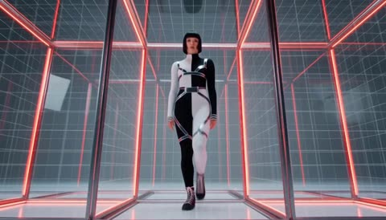</a>

The prompt maps each beat sound to a visual event: the kick compresses space, the snare duplicates the movement, the hi hats break the frame into fragments and the bass bends time. Separating character identity, world logic, visual language and motion rules into labelled blocks keeps the single dancer consistent across the shot.

MiniMax H3 · Text-to-video · Source: [@ivanfioravanti on X](https://x.com/ivanfioravanti/status/2093820333614571731) · 18 likes on 2026-10-29 · found via [SkyNotSilent/awesome-MiniMax-H3-cases](https://github.com/SkyNotSilent/awesome-MiniMax-H3-cases)

[`hyperpop`](tags.md#tag-hyperpop) [`glass-grid`](tags.md#tag-glass-grid) [`dance`](tags.md#tag-dance) [`music-video`](tags.md#tag-music-video)

<details><summary><b>Prompt</b></summary>

```text
[Core Concept]
15s, 160 BPM, 4/4, 40 beats. Industrial Hyperpop × Deconstructed Club: hard kicks, metallic snares, glitch hi-hats, distorted bass, sliced vocals. A timeline-based reality where rhythm controls space and motion.

[Character Identity]
Single woman dancer, Maintain identical face, body, hairstyle and outfit. Multiple figures are only past-frame projections.

[World Logic]
Each kick compresses the timeline toward the dancer. Each snare duplicates previous movements into adjacent frames. Moving against the timeline transforms the 2D interface into a foldable 3D structure. The dancer escapes the repetition loop.

[Visual Language]
Black, cold white, warning red. Glass timelines, metal rails, glowing frame lines, scanning grids. Extreme wide-angle, low
angles, top-down shots, Dutch angles, dolly moves, impossible perspective. 3D word MINIMAX exists as physical architecture, not subtitles.

[Motion Rules]
Use anticipation → attack → overshoot → settle. Kick drives spatial compression, snare breaks frames, hi-hats animate cursors and fragments, bass bends time. Build with glitch cuts, then explode into an impossible continuous long take during the drop.

[Restrictions]
No character changes, extra people, random text, subtitles, logos, outfit changes, bad anatomy, flat camera angles, or meaningless flashes.
```

</details>

<a id="h3-crystal-pillar-kpop-lyric-mv"></a>
### K-pop idol in glowing crystal pillar studio

<a href="https://x.com/MrLarus/status/2085272318649987242">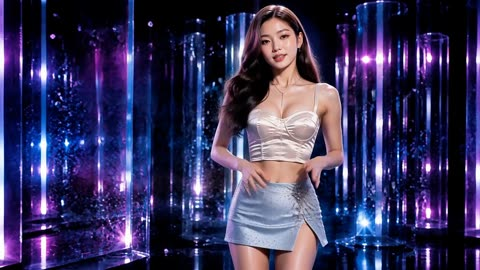</a>

The prompt is a numbered shot list with one lyric per cut, and each shot repeats the same identity block plus a reference image as the facial anchor, which keeps the face consistent across cuts. Each lyric gets its own type motion such as sparkle reveal, punch scale or motion blur, so the typography drives the MV rhythm.

MiniMax H3 · Reference-to-video · Source: [@MrLarus on X](https://x.com/MrLarus/status/2085272318649987242) · 17 likes on 2026-10-29 · found via [SkyNotSilent/awesome-MiniMax-H3-cases](https://github.com/SkyNotSilent/awesome-MiniMax-H3-cases)

[`k-pop`](tags.md#tag-k-pop) [`lyric-mv`](tags.md#tag-lyric-mv) [`lip-sync`](tags.md#tag-lip-sync) [`multi-shot`](tags.md#tag-multi-shot)

<details><summary><b>Prompt</b></summary>

```text
Create a photoreal 15-second K-pop lyric MV using Audio 1 and the eight reference images in upload order.

Keep the same Korean idol recognizable across every shot. Use Image 3 as the main facial anchor. She sings throughout with clear lip-sync and performs confident K-pop movement with turns, footwork, hip motion, arm lines, and camera-aware expressions.

The on-screen lyric text must animate in every shot, with clear motion design synced to the beat and the meaning of each line.

Cut once per lyric line:

1. Glitter on my waist — waist movement, sparkling type reveal
2. Give you just a taste — move toward camera, sliding type
3. Never be replaced — sharp hit pose, punch-scale type
4. Running through the space — run through the chrome corridor, motion-blur type
5. I’m feeling so gold — full spin in gold light, pulsing type
6. Stories to be told — walk-dance beside the rain window, drifting type
7. Baby watch the glow — moving beauty close-up, luminous type bloom
8. Welcome to the show — open-arm stage finale, billboard type zoom

Only display the lyric text shown in the reference images. Keep every line readable and correctly spelled.

1 · Glitter on my waist  
Keep the SAME Korean woman about 22 as the reference image: same facial identity, same eyes nose lips. Honey-ash brown soft waves, middle part. Cream champagne satin crop bustier fully covered stylish, ice-blue sparkle mini skirt, crystal jewelry, nude heels. Fashion-sexy premium K-pop, dewy K-beauty. Medium shot emphasizing waist sparkle and glitter body shimmer, hand near hip, crystal studio set with floating glitter particles and chrome reflections, magenta cyan rim. Large bold white readable typography in frame exactly: Glitter on my waist. High-impact K-pop lyric MV still, photoreal cinematic 16:9. Avoid different face, older look, explicit vulgar, extra fingers, gibberish unreadable letters, wrong lyrics, DONT BLINK, MIDNIGHT RUN, MAKE IT LOUD, ONE MORE TIME text, watermark, low-res, corporate black suit, childish loli

2 · Give you just a taste  
Keep the SAME Korean woman about 22 as the reference image: same facial identity, same eyes nose lips. Honey-ash brown soft waves, middle part. Cream champagne satin crop bustier fully covered stylish, ice-blue sparkle mini skirt, crystal jewelry, nude heels. Fashion-sexy premium K-pop, dewy K-beauty. Intimate medium waist-up, soft teasing girl-crush eye contact, one hand near collarbone, velvet lounge corner with warm pink practical lights, shallow depth. Large bold white readable typography exactly: Give you just a taste. Photoreal K-pop MV still 16:9. Avoid different face, older look, explicit vulgar, extra fingers, gibberish unreadable letters, wrong lyrics, DONT BLINK, MIDNIGHT RUN, MAKE IT LOUD, ONE MORE TIME text, watermark, low-res, corporate black suit, childish loli

3 · Never be replaced  
Keep the SAME Korean woman about 22 as the reference image: same facial identity, same eyes nose lips. Honey-ash brown soft waves, middle part. Cream champagne satin crop bustier fully covered stylish, ice-blue sparkle mini skirt, crystal jewelry, nude heels. Fashion-sexy premium K-pop, dewy K-beauty. Confident full or three-quarter plant stance, strong eye contact, fashion power. Mirror black stage with vertical glass panels, not empty void only. Giant typography wall behind her reading exactly: Never be replaced. Photoreal cinematic 16:9. Avoid different face, older look, explicit vulgar, extra fingers, gibberish unreadable letters, wrong lyrics, DONT BLINK, MIDNIGHT RUN, MAKE IT LOUD, ONE MORE TIME text, watermark, low-res, corporate black suit, childish loli

4 · Running through the space  
Keep the SAME Korean woman about 22 as the reference image: same facial identity. Black hair with vivid pink peekaboo underlights, high ponytail. Metallic silver tube crop top fully covered, black mini skirt, chunky silver belt, black platform boots. Y2K flashy K-pop fashion-sexy not vulgar. Mid-run motion inside endless chrome mirror corridor, pink hair tips flying, reflections. Semi-transparent or wall typography readable exactly: Running through the space. Kinetic K-pop MV still, photoreal 16:9. Avoid different face, older look, explicit vulgar, extra fingers, gibberish unreadable letters, wrong lyrics, DONT BLINK, MIDNIGHT RUN, MAKE IT LOUD, ONE MORE TIME text, watermark, low-res, corporate black suit, childish loli

5 · I'm feeling so gold  
Keep the SAME Korean woman about 22 as the reference image: same facial identity, same eyes nose lips. Honey-ash brown soft waves, middle part. Cream champagne satin crop bustier fully covered stylish, ice-blue sparkle mini skirt, crystal jewelry, nude heels. Fashion-sexy premium K-pop, dewy K-beauty. Power medium pose, warm golden gel lighting shift, gold glitter dust in air, gold-chrome corridor or gold-lit stage (not cold cyan only). Large bold typography readable exactly: I'm feeling so gold. Photoreal cinematic 16:9. Avoid different face, older look, explicit vulgar, extra fingers, gibberish unreadable letters, wrong lyrics, DONT BLINK, MIDNIGHT RUN, MAKE IT LOUD, ONE MORE TIME text, watermark, low-res, corporate black suit, childish loli

6 · Stories to be told  
Keep the SAME Korean woman about 22 as the reference image: same facial identity, same eyes nose lips. Honey-ash brown soft waves, middle part. Cream champagne satin crop bustier fully covered stylish, ice-blue sparkle mini skirt, crystal jewelry, nude heels. Fashion-sexy premium K-pop, dewy K-beauty. Profile or three-quarter storytelling pose near rain-streaked night glass window, soft city bokeh, cooler blue mood bridge scene, elegant modest fashion. Readable typography in frame exactly: Stories to be told. Photoreal 16:9. Avoid different face, older look, explicit vulgar, extra fingers, gibberish unreadable letters, wrong lyrics, DONT BLINK, MIDNIGHT RUN, MAKE IT LOUD, ONE MORE TIME text, watermark, low-res, corporate black suit, childish loli

7 · Baby watch the glow  
Keep the SAME Korean woman about 22 as the reference image: same facial identity, same eyes nose lips. Honey-ash brown soft waves, middle part. Cream champagne satin crop bustier fully covered stylish, ice-blue sparkle mini skirt, crystal jewelry, nude heels. Fashion-sexy premium K-pop, dewy K-beauty. Beauty close-up face and shoulders, strong glow rim light and lens flare, catchlights, dewy skin, dark stage with single luminous glow behind. Readable typography exactly: Baby watch the glow. Photoreal 16:9. Avoid different face, older look, explicit vulgar, extra fingers, gibberish unreadable letters, wrong lyrics, DONT BLINK, MIDNIGHT RUN, MAKE IT LOUD, ONE MORE TIME text, watermark, low-res, corporate black suit, childish loli

8 · Welcome to the show  
Keep the SAME Korean woman about 22 as the reference image: same facial identity, same eyes nose lips jaw. Ultra sharp photoreal face, tack-sharp eyes and eyelashes, clear skin micro-detail, no soft blur, no motion blur, no low-res mush. High sleek ponytail with balayage tips. White cropped bomber open over black crop top, black mini skirt, power street idol look. MEDIUM shot waist-up to mid-thigh, subject fills frame, confident show-entrance pose facing camera, open energy. Concert stage entrance with LED pillars and soft haze BEHIND her, shallow depth of field with face in perfect focus, background slightly softer. Huge billboard typography readable exactly: Welcome to the show. Cinematic 16:9, premium K-pop MV still, high detail. Avoid different face, soft focus on face, blurry face, plastic skin, extra fingers, gibberish text, wrong lyrics, DONT BLINK, MIDNIGHT RUN, MAKE IT LOUD text, watermark, low-res, explicit vulgar.
```

</details>

<a id="h3-dancer-night-stage-japanese-type"></a>
### Dancer on dark stage surrounded by Japanese text

<a href="https://x.com/minmin_4410/status/2094551473531326626">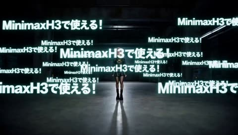</a>

A fill in template locks the reference character and one rendering style, then sets text groups that appear in order before appearing together at the climax. Lettering follows the body motion and keeps clear of the face, so the dancer stays the focus while the type orbits and reassembles on the beat.

MiniMax H3 · Reference-to-video · Source: [@minmin_4410 on X](https://x.com/minmin_4410/status/2094551473531326626) · 16 likes on 2026-10-29 · found via [SkyNotSilent/awesome-MiniMax-H3-cases](https://github.com/SkyNotSilent/awesome-MiniMax-H3-cases)

[`typography`](tags.md#tag-typography) [`dance`](tags.md#tag-dance) [`reference-character`](tags.md#tag-reference-character) [`beat-sync`](tags.md#tag-beat-sync)

<details><summary><b>Prompt</b></summary>

```text
## INPUT【基本設定】
A: 主人公：提供された参照画像
B: 表示テキスト：【例：①「START」②「GO」③「FINAL」】
C: 演出の雰囲気：【例：疾走感のあるクールなMV】
D: 表現スタイル：【例：アニメ（セルアニメ）】
E: 表現スタイル詳細：【例：線画を強調したセルアニメ】
F: テーマ色：【例：白＋赤】
G: 尺：【例：15秒】

Dを全編の唯一の表現基準とし、人物・背景・小物・文字すべてに統一適用。選択した表現スタイル以外の描画・質感・レンダリング表現を混在させない。EはDの範囲内で反映。Aの主人公の顔、髪型、衣装、体型、シルエットを忠実に維持。追加人物なし。

---

## 任意指定タイポグラフィ演出

※使用したい演出は【使用】と記載。空欄はAIが尺・構成に応じてランダム採用・不採用を判断。
※複数指定時は異なるタイミングで使用。具体的な指示を入力した場合はその内容を優先。

- ボディライン・ラッピング【】：身体の輪郭に沿って文字を湾曲。
- フェイス・セーフティスプリット【】：顔直前で文字を左右へ分裂。
- タイポグラフィ・トンネル【】：人物を避けて前景・中景・背景に文字を配置。
- シルエット・ネガティブスペース【】：人物シルエット部分だけ文字を避ける。
- 文字の残像リング【】：人物外周を文字がリング状に旋回。
- 文字回避カメラ【】：俯瞰・超ローアングル等で文字との重なりを回避。
- 文字分裂・再集合【】：文字が分裂→人物を回避→正しい文字列へ再集合。
- その他タイポグラフィ演出【】：指定内容を使用。

## テキスト表示

Bの順番を厳守。カンマ「,」でグループ化。
同一グループは「順番表示→全て同時表示」。
例：①→②→③→①②③同時。
例：①→②→①②同時→③→④→③④同時。
指定文字以外、字幕、ロゴ、意味不明な文字は禁止。最終グループの同時表示をクライマックスへ配置。

## 基本演出

主人公の身体動作→カメラ→文字の順に反応。主人公を常に主役とする。
ドリー、ウィップパン、スナップズーム、オービット、高速トラッキング、俯瞰、超ローアングル等を組み合わせ、同一構図を連続使用しない。
高速運動と完全静止を強く対比し、動作・カメラ・文字・カットをビート同期。

## タイポグラフィ

Bの文字のみ使用。主人公の動作に連動：
横払い→横飛翔／引き寄せ→集合／回転→旋回／手を前へ→急接近／停止→完全停止。
文字単独のランダム移動は禁止。字間拡大、分解→再整列、文字ごとの遅延追従を短いアクセントとして使用。

## 人物視認性・空間

顔、目、口、頭部、主要シルエットを文字で隠さない。顔周辺はクリアゾーン。
人物へ接近した文字は、湾曲・分裂・回避・点滅・瞬間消失等で人物を避ける。
背景文字は人物を囲み、前景文字は顔・身体を避ける。
文字をカメラ直前・人物手前・人物背後へ配置し、距離差とパララックスで奥行きを表現。

## 尺別自動構成

Gに応じてカット数・表示時間・カメラ速度・演出密度を最適化。
短尺：フック→順番表示→同時表示→フィニッシュ。
中尺：フック→展開→特殊演出→バレットタイム→再加速→クライマックス。
長尺：導入→展開→バレットタイム→再加速→展開→クライマックス→ヒーローショット。
短いほど凝縮、長いほど演出バリエーションを増加。
最終0.3～0.5秒は主人公＋最終文字列を安定表示。

## バレットタイム

尺に応じて0～2回。
主人公・髪・衣装・文字を完全静止し、カメラだけ高速オービット。
時間再開と同時に全要素を一気に再始動。

## Audio

Cに合うインストゥルメンタル。ボーカル・セリフなし。
動作・文字・カメラ・カットをビート同期。バレットタイム直前に音を絞り、再開時に強いビートを復帰。

## 最重要

Dの表現スタイルを全編統一し、それ以外を混在させない。
主人公のデザインを変更しない。追加人物なし。
指定文字以外を表示しない。表示順・グループ順を厳守。
主人公の顔・主要シルエットを文字で隠さない。
主人公の身体動作とカメラワークを最優先。
タイポグラフィは主人公を隠すためではなく、主人公を強調するために動かす。
```

</details>

<a id="h3-malta-embroidered-dancer-terrace"></a>
### Dancer in embroidered skirt on Maltese terrace

<a href="https://x.com/abulu8/status/2085793101600428386">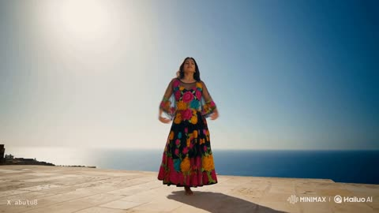</a>

Each of the ten shots is built around one quality of motion, with a mandatory slow motion leap so the embroidery and skirt bloom stay legible. The music is scripted shot by shot, so the arrangement and the dance build together.

MiniMax H3 · Text-to-video · Source: [@abulu8 on X](https://x.com/abulu8/status/2085793101600428386) · 16 likes on 2026-10-29 · found via [SkyNotSilent/awesome-MiniMax-H3-cases](https://github.com/SkyNotSilent/awesome-MiniMax-H3-cases)

[`dance`](tags.md#tag-dance) [`slow motion`](tags.md#tag-slowmotion) [`fabric physics`](tags.md#tag-fabricphysics) [`malta`](tags.md#tag-malta)

<details><summary><b>Prompt</b></summary>

```text
{
  "format": { "duration": "15s", "bpm": 92, "total_shots": 10, "sync_type": "Dance to Playback Song — No Lip-Sync" },
  "style_reference": "Warm Mediterranean daylight, 35mm, fine organic grain, gentle bloom. Honey-gold limestone against deep cobalt sea and white sky. Saturated embroidery popping against neutral stone. Shallow depth on close work, crisp wides, natural sun flare. Never cold or desaturated.",
  "subject": {
    "description": "A young Mexican woman, mid-twenties, long dark wavy hair loose and moving, warm brown skin, serene expressive face, small gold earrings. Traditional Chiapaneco dress — deep-toned fabric densely embroidered with large multicolored floral bursts in magenta, gold, turquoise and crimson, wide flowing skirt, sheer embroidered overlay that catches air. Bare feet.",
    "consistency_note": "The dress is the co-star — keep embroidery pattern, colors and skirt volume consistent. Fabric behavior matters as much as her body. Keep her face large in close work to avoid drift."
  },
  "environment": {
    "setting": "Malta in bright daylight — honey limestone architecture, a sunlit stone terrace above the sea, narrow old-town steps.",
    "background": "Limestone walls and arches, traditional Maltese wooden balconies, worn steps, bougainvillea, the deep blue Mediterranean to the horizon.",
    "lighting": "Hard Mediterranean afternoon sun, crisp shadows across stone, warm limestone bounce filling her face, occasional flare, glittering sea behind."
  },
  "mood": "graceful, elegant, joyful, free, radiant, flowing",
  "music": {
    "genre": "Warm Latin folk-pop ballad, 92 BPM, acoustic and organic.",
    "instrumentation": "Nylon-string guitar arpeggios, soft cajón and hand percussion, warm upright bass, distant accordion, light strings on the big moments, rich female vocal on top.",
    "arrangement": "Shots 1-2: guitar and voice alone, sparse. Shots 3-5: percussion enters, groove opens. Shot 6: strips to a single held guitar note. Shot 7: full arrangement blooms with strings. Shots 8-9: percussion punches back, then softens. Shot 10: resolves warm on guitar and a sustained vocal note.",
    "language": "Spanish",
    "lyrics": "Que baile el sol sobre la piedra dorada / que el viento me lleve donde nadie me llama / Mi falda florece, la mar me responde / Aquí soy de nadie, aquí soy del aire / Vuelo, vuelo, vuelo — y nunca me caigo",
    "mix": "Warm, natural, acoustic-forward. Vocal present but not overpowering. Round percussion. Sun-soaked."
  },
  "style": "Ultra-Realistic",
  "logic_rule": "The song plays audibly IN the clip while she dances to it. She does NOT sing and does NOT lip-sync — mouth relaxed and natural, expression serene and absorbed, occasionally a soft smile. THE BODY LEADS: each shot built around one quality of motion — stretch, spin, suspended pause, weightlessness, impact, inner rhythm. Movement is GRACEFUL and ELEGANT: long extended lines, controlled turns, soft shaped arms, fluid transitions, classical poise with folkloric footwork — never frantic. Vary camera to serve movement: low angles for elevation, tracking for travel, macro for fabric and feet, wide for full body against architecture. Mandatory SPEED CHANGE: extreme slow motion at the leap's apex so skirt bloom, hair suspension and embroidery are fully legible, then snap back on landing. Fabric physics essential — the skirt must swing, flare, ripple and settle with real weight. Effects: dust off stone, hair whipping, shadow raking walls, sun flare. ENDING: hold on a still breathing frame, then slow fade.",
  "storyboard": [
    { "shot": 1, "camera": "Low wide, sun behind her, limestone wall behind.", "action": "THE STRETCH — she rises onto the balls of her bare feet, extending both arms overhead in a long elegant line, spine lengthening, sleeve falling back. Eyes closed, serene.", "sfx": "Wind, gulls, fabric settling; guitar and voice alone." },
    { "shot": 2, "camera": "Macro on her bare feet on warm stone, shallow focus.", "action": "THE RHYTHM UNDER THE SKIN — heel and toe begin a soft precise pattern, dust lifting with each strike, ankles articulate and controlled.", "sfx": "Delicate foot taps, dust scuff; guitar continuing." },
    { "shot": 3, "camera": "Tracking alongside her down a narrow sunlit alley.", "action": "She travels in flowing rhythmic steps, skirt swinging gracefully side to side, one hand trailing the warm stone wall.", "sfx": "Footfalls, fabric swish, alley echo; percussion entering." },
    { "shot": 4, "camera": "Medium, camera orbiting with her turn.", "action": "THE SPIN — one controlled elegant rotation, the embroidered skirt opening into a wide circle of color, hair fanning, arms soft and shaped.", "sfx": "Fabric whoosh, foot pivot; groove opening." },
    { "shot": 5, "camera": "Close-up on her face, sun raking across it.", "action": "Eyes closed, head tilted back, absorbed with the faintest smile — lost in the music. Mouth relaxed and closed, NOT singing.", "sfx": "Breath, wind; vocal carrying over." },
    { "shot": 6, "camera": "Wide low angle on the terrace, sea behind.", "action": "THE PAUSE — everything stills. She sinks into a deep controlled coil, weight low, skirt pooling, held one suspended beat.", "sfx": "Music strips to one held guitar note; a deep breath." },
    { "shot": 7, "camera": "EXTREME SLOW MOTION, low angle, sky and sea behind.", "action": "THE WEIGHTLESSNESS — she launches upward, body arced in an extended line, arms open, skirt blooming outward like a flower, hair suspended, every stitch legible against the blue.", "sfx": "Stretched fabric bloom, deep swell; full arrangement with strings." },
    { "shot": 8, "camera": "Snap to full speed. Low, close on her landing.", "action": "THE LANDING — she meets the stone softly, knees absorbing, skirt collapsing around her legs, dust puffing, hair falling forward.", "sfx": "Foot impact, fabric slap, exhale; percussion punching back." },
    { "shot": 9, "camera": "Macro on the embroidery settling, rack up to her chest.", "action": "The floral stitching ripples and stills; her chest rises and falls, a bead of sweat at her collarbone. The body after force.", "sfx": "Breathing, fabric settling, sea; arrangement softening." },
    { "shot": 10, "camera": "Slow pull-back to a wide — small against limestone and sea. Held.", "action": "She lifts her head, sweeps her hair back and settles into a final open-armed shape against the Mediterranean light, breathing, a slow warm smile. Hold, then slow fade.", "sfx": "Wind, gulls, sea; guitar and sustained vocal resolving." }
  ]
}
```

</details>

<a id="h3-gymnast-hoop-payout-silhouette"></a>
### Black silhouette gymnast spins metallic hoop over payout screen

<a href="https://x.com/Naonekozamurai/status/2093474780683149442">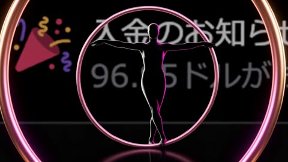</a>

The reference image is locked as the full background and the prompt forbids redrawing its text, so only slow zoom, drift and blur change. The figure stays a featureless black silhouette with thin white, magenta and violet rim light, which separates it from the dark background without detailing face or costume.

MiniMax H3 · Reference-to-video · Source: [@Naonekozamurai on X](https://x.com/Naonekozamurai/status/2093474780683149442) · 15 likes on 2026-10-29 · found via [SkyNotSilent/awesome-MiniMax-H3-cases](https://github.com/SkyNotSilent/awesome-MiniMax-H3-cases)

[`silhouette`](tags.md#tag-silhouette) [`rhythmic-gymnastics`](tags.md#tag-rhythmic-gymnastics) [`kinetic-typography`](tags.md#tag-kinetic-typography) [`reference-background`](tags.md#tag-reference-background)

<details><summary><b>Prompt</b></summary>

```text
「添付した参照画像を、映像全体の背景として使用する。参照画像を別の競技場や抽象背景へ置き換えず、画面全体を覆う大きな背景グラフィックとして維持する。元画像の黒い背景、白とグレーの通知表示、左側のカラフルなクラッカーのアイコンを活かす。

背景画像に含まれる文字やアイコンを描き直したり、別の内容へ変更したりしない。背景には、わずかなズーム、横方向への移動、明るさの変化、軽いぼかし、奥行き表現のみを加える。主人公と新しいタイポグラフィーを目立たせるため、背景画像を少し暗くするが、参照画像であることが認識できる状態を保つ。

MiniMax H3を使用して、15秒・2Kのスタイリッシュなモーショングラフィック＆キネティック・タイポグラフィーによる、新体操のフープ演技動画を制作する。

主人公は、全身が黒一色で描かれた一人の女性のシルエット。顔、髪、肌、衣装などの細部は描かず、プロの新体操選手らしい、しなやかで洗練された身体のラインを持つ美しいシルエットとして表現する。

黒い人物が背景に埋もれないよう、身体の輪郭に細い白、マゼンタ、バイオレットのリムライトを加える。ただし、身体の内部は黒一色を維持し、顔や衣装のディテールは描かない。

主人公は一本の鮮やかなメタリック・ピンクゴールドのフープを使用する。フープは細く軽量な新体操用フープで、映像全体を通して完全な円形、一定の太さと大きさを維持する。

フープの色は、淡いローズピンクを基調として、銅色とシャンパンカラーの反射、明るいピンクホワイトのハイライトを持つ、高級感のあるピンクゴールドとする。単純なピンク色やプラスチック素材にはせず、照明や角度によってローズ、カッパー、淡い金属光沢が美しく変化する質感として表現する。

【0.0～3.5秒：X収益】
映像は、ピンクゴールドのフープを画面手前に極端に大きく配置した、大胆な構図から始まる。カメラはフープの円の内側を通して、その奥に立つ黒い女性シルエットと参照画像の背景を捉える。

主人公はフープの中心に身体を収めた状態から、腕を大きく伸ばしてフープを回転させる。フープを片手で垂直に回しながら身体の周囲へ滑らかに移動させ、そのままフープの中を片脚ずつ優雅に通り抜ける。

最初の強いビートに合わせて、フープの内側に「X収益」の文字を正確に表示する。「X収益」はフープの回転に呼応して画面奥から拡大しながら現れ、最後は正面を向いて明確に読める状態になる。

フープが床へ軽く触れると、接地点からピンクゴールドの円形波紋が広がる。参照画像左側のクラッカーを連想させる、小さな三角形、円、曲線のシェイプがビートに合わせて飛び出す。

【3.5～8.5秒：$96】
主人公はフープを手首の周囲で高速回転させ、その回転を止めずに腕から肩、背中、反対側の腕へ転がす。フープの自然な慣性と遠心力を維持し、身体の表面に沿って滑らかに移動させる。

続いて、主人公はフープを垂直に転がしながら前方へ送り、その軌道に合わせて大きく脚を伸ばしたスプリットリープを行う。空中で身体と脚の美しいラインを見せ、着地と同時に転がってきたフープを片手で正確に受け止める。

フープの中心に「$96」の文字を正確に表示する。ドル記号を数字の前に置き、スペースを入れず、必ず「$96」と表示する。フープが回転している間も文字自体は正面を向き、明確に読み取れる瞬間を作る。

「$96」は音楽のビートに合わせて拡大、縮小、前後方向への移動を繰り返す。数字がフープの外へ飛び出したり、別の数字へ変化したり、桁が増減したりしない。

カメラは正面からの全身ショットに加え、斜め上から見下ろす俯瞰ショットへ切り替える。俯瞰ショットでは、床面を転がるピンクゴールドのフープの円形、主人公の足運び、背景上を流れる円やラインを印象的に見せる。

【8.5～12.5秒：Thank You】
主人公はピンクゴールドのフープを頭上へ高く投げ上げる。フープは空中で正しい軸を中心に回転し、完全な円形を維持する。

フープが空中へ上昇する間、主人公は美しいピボットターンを連続して行う。ターンから大きなリープへ移行し、空中を通過するフープの内側へ身体を合わせる。着地後にもう一度身体を回転させ、落下してくる同じフープを片手で正確にキャッチする。

フープが最も高い位置へ到達した瞬間、「Thank You」の文字がその内側から現れる。「Thank」と「You」の間に正しいスペースを入れ、大文字と小文字の組み合わせを正確に維持する。

「Thank You」は、感謝と祝福を感じさせる優雅な動きで画面奥から手前へ近づく。文字の周囲では、参照画像のクラッカーと調和するマゼンタ、イエロー、オレンジ、バイオレット、ピンクゴールドの紙吹雪と小さなシェイプが広がる。

カメラは斜め下から見上げるローアングルへ移動し、空中のピンクゴールドのフープ、主人公の伸びやかな身体、背景に浮かぶ「Thank You」を同時に捉える。カメラアングルが変わっても、主人公とフープの位置関係、回転方向、動作の連続性を維持する。

【12.5～15.0秒：フィナーレ】
主人公はキャッチしたフープを大きく一回転させ、最後にフープを垂直に立てた状態で片手に保持する。もう片方の腕と片脚を美しく伸ばし、フープと身体の曲線が調和する、上品で自然なフィニッシュを見せる。

最後の画面では、ピンクゴールドのフープを中央へ大きく配置する。フープの内側に「$96」、フープの上方に「X収益」、下方に「Thank You」を読みやすく整列させる。

3つのタイポグラフィーと主人公が、参照画像の重要な部分を完全に覆わないよう、奥行きと配置を調整する。参照画像は少しぼかした状態で背景に残し、その前に黒い主人公、ピンクゴールドのフープ、3つの文字を鮮明に表示する。

最後の約0.8秒は、主人公、フープ、文字の大きな動きを止める。ピンクゴールドを含むカラフルな紙吹雪だけがゆっくりと落下し、収益への感謝と祝福が明確に伝わる画面として保持する。

【モーショングラフィックと音楽】
背景には、円、長方形、三角形、曲線、太いライン、グリッド、紙吹雪などのシェイプを登場させる。配色は、参照画像のクラッカーに使われているマゼンタ、イエロー、オレンジ、バイオレットに、メタリックなピンクゴールドを組み合わせる。

シェイプは主人公の演技と連動して動かす。フープが円を描くとピンクゴールドの円形波紋が広がり、フープを転がすとピンクゴールドのラインが進行方向へ伸びる。主人公がリープすると三角形や紙吹雪が上方へ飛び、フープをキャッチすると背景のシェイプが一瞬静止してから外側へ広がる。

フープの回転によって発生する光の軌跡、円形波紋、反射光、細いラインは、すべてフープと同じピンクゴールドを基調とする。光の軌跡はフープの動きを短時間だけ強調し、フープ本体が複数に分裂しているようには見せない。

足の踏み込み、ターン、リープの踏み切りと着地、フープの回転、投げ上げ、キャッチを、華やかで力強いエレクトロニック・ミュージックのキック、スネア、ベース、アクセント音へ正確に同期させる。

カメラは正面、俯瞰、ローアングル、人物の周囲を回る滑らかな移動を組み合わせる。可能な限り主人公の全身とフープ全体を同時に画面内へ収め、フープの一部が画面外へ不自然に切れないようにする。

【文字と一貫性】
新たに表示するキネティック・タイポグラフィーは「X収益」「$96」「Thank You」の3種類だけに限定する。

「X収益」の文字の欠落や別の漢字への変化を起こさない。「$96」はドル記号を省略せず、必ず数字の前へ配置する。「Thank You」は正しい大文字と小文字、2単語の間のスペースを維持する。文字の重複、誤字、変形、別の文字や数字への変化を起こさない。

参照画像に元から含まれている表示は背景画像の一部として扱い、内容を再生成、改変、翻訳、アニメーションさせない。新しく企業名、ロゴ、ユーザー名、ウォーターマーク、字幕を追加しない。

フープは映像全体を通して必ず1本だけにする。フープを複製、分裂、消失、変形させず、完全な円形と一定の大きさを維持する。フープが主人公の身体を不自然に貫通したり、手から瞬間移動したりしない。

フープの色は、映像全体を通して同じメタリック・ピンクゴールドを維持する。通常の黄色い金色、単色のピンク、赤、オレンジなどへ変化させない。照明や角度による自然なローズ、カッパー、シャンパンカラーの反射だけを許可する。

主人公の形状、体格、手足の本数を15秒間一貫させる。手足の変形、身体の分裂、不自然な残像を発生させない。アングルが変わっても、同じ女性、同じ一本のフープ、同じ背景画像を維持する。

黒い女性シルエット、鮮やかなメタリック・ピンクゴールドのフープ、参照画像の通知画面、華やかな紙吹雪、正確なタイポグラフィーを組み合わせ、Xで得られた収益への感謝と喜びが伝わる、スタイリッシュで祝祭感のある高品質な15秒動画に仕上げる。」
```

</details>

<a id="h3-rooftop-rapper-beat-cut-verse"></a>
### Rapper performs beat-cut verse on rooftop at sunset

<a href="https://x.com/abulu8/status/2085253978166808615">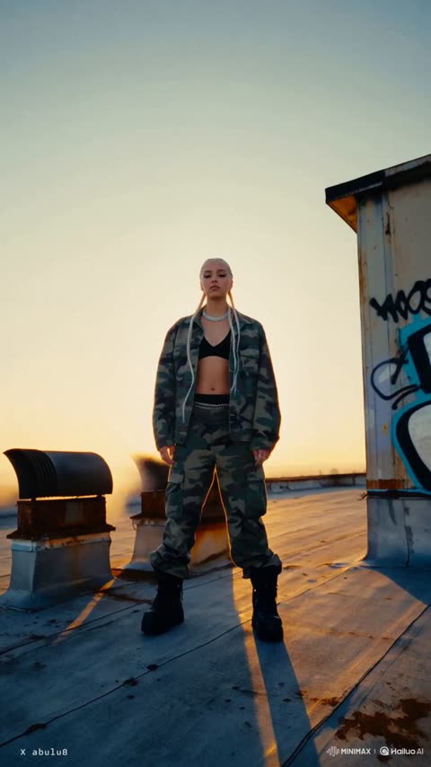</a>

A JSON spec repeats a style enforcement rule for grain and golden backlight, so the look holds across every cut. Each of the 12 numbered storyboard shots pairs a camera move with an exact lyric line and a beat cue, giving the model a timed plan for lip-sync and hard cuts.

MiniMax H3 · Text-to-video · Source: [@abulu8 on X](https://x.com/abulu8/status/2085253978166808615) · 15 likes on 2026-10-29 · found via [SkyNotSilent/awesome-MiniMax-H3-cases](https://github.com/SkyNotSilent/awesome-MiniMax-H3-cases)

[`rap`](tags.md#tag-rap) [`lip-sync`](tags.md#tag-lip-sync) [`beat-cut`](tags.md#tag-beat-cut) [`golden-hour`](tags.md#tag-golden-hour)

<details><summary><b>Prompt</b></summary>

```text
{
  "format": {
    "duration": "15s",
    "bpm": 96,
    "total_shots": 12,
    "sync_type": "Beat-Cut Rap Performance — Double-Time Delivery"
  },
  "style_reference": {
    "look": "Gritty cinematic 35mm — shot on RED Komodo 6K, 24fps, heavy Kodak 5219 500T grain overlay. Muted steel-blue and rust-orange palette with glowing sunset rim highlights and urban grays. Strong backlit lens flare, crushed but detailed shadows, slight halation on the sun. Handheld energy with natural sway. Anamorphic-flavored flare streaks, atmospheric haze catching low sun.",
    "enforcement": "Maintain the heavy grain, muted steel/rust palette and golden backlight in EVERY shot. Never clean, never over-saturated, never flat-lit."
  },
  "subject": {
    "description": "A bold female rapper, mid-twenties, with shaved sides and long platinum-blonde braids. Confident, commanding presence, sharp direct eye contact. Wardrobe: oversized camo jacket worn open, black sports bra, cargo pants, chunky boots, heavy silver chain. UNIFY ACROSS ALL SHOTS: identical face, braids, wardrobe and chain; same rooftop; same golden-hour light."
  },
  "environment": {
    "setting": "The rooftop of an old industrial building at golden hour, overlooking a city skyline.",
    "background": "Graffiti-covered concrete walls, rusted AC vents and ducting, faint mist rising off the units, a flickering neon sign at the edge of frame, the skyline sprawling below in haze.",
    "lighting": "Low sunset sun directly behind her creating a hard rim-light and heavy lens flare; her front filled softly by bounce off the concrete. Rust-orange highlights against steel-blue shadow. Neon adding a small competing color source at dusk."
  },
  "mood": "gritty, commanding, defiant, powerful, cinematic, grounded",
  "music": "Hard-hitting trap at 96 BPM — heavy 808 sub, crisp rolling hi-hats, sparse ominous synth line. Beat drops on shot 3 and hits hardest at the final bar.",
  "style": "Ultra-Realistic",
  "logic_rule": "BEAT-CUT PERFORMANCE VIDEO — 12 hard cuts synced to the rhythm, NOT one continuous take. Vary the camera relentlessly: low hero wide, extreme close-up on mouth and eyes, over-shoulder skyline, whip-pan, handheld orbit, macro on the chain, silhouette against the sun. ACCURATE LIP-SYNC is mandatory — her mouth must match the written bars precisely, delivered double-time with sharp aggressive articulation. Performance energy: hand gestures punctuating bars, chest-forward power stance, head bobbing on the beat, braids swinging. Mandatory SPEED CHANGE: one brief slow-motion beat where her braids swing through the sun flare, then snap back on the beat. Physical effects: mist drifting from vents, dust in the flare, jacket moving in the wind. Keep the gritty grain and golden backlight throughout. ENDING: hard cut on the final bar, not a fade.",
  "lyrics": "Came up off concrete, no ladder, no lane / Turned every locked door into fuel for the flame / They told me stay quiet — I turned the sound up / Skyline my witness, I ain't waiting on luck / No hand-out, no co-sign, I carried the weight / Laid brick over brick while they slept on the wait / Sun on my back and the whole city low / I don't chase the moment — the moment I own.",
  "storyboard": [
    { "shot": 1, "camera": "Low-angle wide, 24mm, heroic framing, handheld sway, sun flaring behind her.", "action": "She stands in a power stance on the rooftop edge, jacket moving in the wind, silhouetted by the sunset. Beat intro — she doesn't speak yet.", "sfx": "City rumble below, distant sirens, wind, beat intro." },
    { "shot": 2, "camera": "Extreme close-up on her eyes, hard rim-light.", "action": "Her eyes lift and lock dead into the lens. A single beat of held silence before the drop.", "sfx": "Hi-hats rolling in, a tense sub swell." },
    { "shot": 3, "camera": "Fast push-in to medium close, handheld.", "action": "BEAT DROPS. She launches into the first bar, hand cutting the air on the downbeat: 'Came up off concrete, no ladder, no lane.'", "sfx": "808 hitting hard, hats snapping, vocal cutting in." },
    { "shot": 4, "camera": "Whip-pan to a low side angle, graffiti wall behind.", "action": "'Turned every locked door into fuel for the flame' — she jabs a finger toward the lens, chest forward, braids swinging.", "sfx": "Trap beat driving, vocal aggressive." },
    { "shot": 5, "camera": "Extreme macro on her mouth, razor focus.", "action": "'They told me stay quiet — I turned the sound up' — tight lip-sync, sharp double-time articulation.", "sfx": "Vocal front and center, hat rolls." },
    { "shot": 6, "camera": "Over-shoulder, skyline hazy below her.", "action": "'Skyline my witness, I ain't waiting on luck' — she throws an arm out toward the city, claiming it.", "sfx": "Sub-bass hit, wind, city rumble." },
    { "shot": 7, "camera": "SLOW MOTION, tight profile, sun flaring through.", "action": "Her braids swing through the golden flare, jacket lifting, face set — the one held breath in the whole piece.", "sfx": "Beat filtering down, a stretched vocal tail." },
    { "shot": 8, "camera": "Snap back to speed. Handheld orbit, low.", "action": "'No hand-out, no co-sign, I carried the weight' — she pivots with the camera, hand pounding her chest on 'weight'.", "sfx": "Beat slamming back in, snare crack." },
    { "shot": 9, "camera": "Macro on the silver chain against her collarbone.", "action": "The chain swings hard and catches the low sun as she moves. Detail beat on the rhythm.", "sfx": "Metal chink layered into the beat." },
    { "shot": 10, "camera": "Wide from behind, she faces the skyline, mist off the vents.", "action": "'Laid brick over brick while they slept on the wait' — she gestures out at the city, small against it, undefeated.", "sfx": "Full beat, mist hiss, distant traffic." },
    { "shot": 11, "camera": "Fast cut to a tight low-angle close-up, neon flickering at frame edge.", "action": "'Sun on my back and the whole city low' — head bobbing hard on the beat, eyes never leaving the lens.", "sfx": "Hat roll building, sub pressure." },
    { "shot": 12, "camera": "Push-in to a locked hero frame — then hard cut to black.", "action": "'I don't chase the moment — the moment I own.' She holds the final word, arms spread wide, sun blazing behind her. HARD CUT on the last syllable.", "sfx": "Final 808 hit, everything cutting to dead silence." }
  ]
}
```

</details>

<a id="kling4-girl-recorder-six-keyframes"></a>
### A girl plays a recorder in her room, six keyframes

<a href="https://static--52.klingai-cdn-aws.com/kling-blog/presigned_url/e99d0231-be47-4aaf-a43c-a444f03a831a_1-5.mp4"></a>

Six keyframes on a 15s timeline. Each cut is matched to something, a note of music or the swing of a shoe, so the hard cuts feel motivated.

Kling 4.0 · First & last frame · Source: [Kling 4.0 user guide](https://kling.ai/quickstart/kling-4-model-user-guide)

[`keyframes`](tags.md#tag-keyframes) [`match-cut`](tags.md#tag-match-cut) [`music`](tags.md#tag-music) [`lifestyle`](tags.md#tag-lifestyle) [`timed-shots`](tags.md#tag-timed-shots)

<details><summary><b>Prompt</b></summary>

```text
SCENE CONTEXT EXACT 1 CHARACTER — NO DUPLICATES. 0.0–2.1s | Keyframe 1: Looking Up from the Floor. Strictly match Image Node_23. Wide, static composition: The girl sits on mint-green tiled flooring, leaning against a cabinet and the corner of a wall, with her legs naturally extended apart and both hands resting lightly between her knees. Soft light filters through the plaid curtains and falls across the tiles. She initially keeps her gaze lowered, then slowly lifts her head toward the window light, lips slightly parted, as if hearing a melody from far away. The curtains sway only slightly, while the lace hem of her skirt and the tips of her hair show the faintest hint of movement with her breathing. The camera slowly pushes in by approximately 3% without changing the composition.
2.1–4.3s | Keyframe 2: Close-Up of the Recorder, Sound-Matched Cut. At the peak of the girl's head-lifting motion, a clear, brief recorder note enters 0.1 seconds early. Hard cut to the medium close-up from Image Node_29 (2). The girl closes her eyes and gently plays a white recorder, completing one full but brief exhalation. Only two or three fingers make subtle adjustments over the holes. Her cheeks puff out slightly, then relax. Do not distort the recorder, exaggerate her puffed cheeks, or add extra fingers. Keep the camera steady and the plaid curtains softly out of focus in the background.
4.3–6.5s | Keyframe 3: Hands and Gaze, Action-Matched Cut. The instant the recorder note ends, hard cut to Image Node_18. The girl stands by the window in front of mint-green wall paneling, with both hands held beside the right side of her face, as if gathering the melody into her palms. She keeps her gaze lowered for approximately 0.4 seconds, then gently raises her eyes to look directly into the camera. Her fingers make one extremely subtle closing motion, and her beaded bracelet catches a glint of window light. The camera pushes in extremely slowly from a medium shot, keeping her centered and the interior clean and uncluttered.
6.5–8.5s | Keyframe 4: Detail of Dangling Legs, Skirt-Matched Cut. As her hands slowly move away from the sides of her face, use the moment they drop out of the bottom edge of the frame as the cut point. Hard cut to Image Node_21. Low-angle close-up: The girl sits on the edge of a tall mint-green cabinet. Only her mint-green lace skirt, white stockings, pale green Mary Jane shoes, and one hand lightly touching the cabinet edge are visible. Her legs remain together and dangle freely. Her toes gently swing forward once, pause, then naturally return to a vertical resting position. The lace hem sways slightly with the movement. Do not exaggerate the swinging motion, let her legs touch the floor, or change the positions of the cabinet and bathtub.
8.5–10.8s | Keyframe 5: Still Gaze on the Bed, Shoe-Tip-Matched Cut. As both shoes swing back downward, hard cut to Image Node_22. The girl lies on her stomach on a mint-green bed, resting her face in both hands with her feet raised behind her. The composition is gentle, with ample negative space. She looks at the camera first, then softly shifts her gaze toward the window light on the left before returning it to the camera. Her feet perform only one small, synchronized crossing motion at the shoe tips, then relax. The bedsheet develops only the faintest soft folds. Do not turn her into a side-lying pose or change the positions of the pillows, bedsheet, table lamp, plants, or framed pictures.
10.8–13.5s | Keyframe 6: Paper in the Foreground, Final Gaze. Use a corner of the pale bedsheet passing across the frame as an occlusion transition, then hard cut to Image Node_20. The girl sits on a white chair, with her transparent glasses strictly matching the keyframe. A sheet of white paper slowly drifts across the frame from the lower left and upper edge, briefly obscuring part of her forehead and shoulder, but must never cover her entire face for more than 0.3 seconds. She gazes quietly at the camera through the moving sheet of paper. After blinking once, she tilts her head slightly to the right by approximately 3 degrees and holds the position. The paper drifts out of frame. Keep the camera steady, and do not create a storm-like flurry of paper.
13.5–15.0s | Gentle Fade to Black. Maintain the final composition of Keyframe 6. After the paper leaves the frame, the girl remains still, maintaining a calm, direct gaze. The daylight by the window gradually dims like a soft light being slowly turned down. The mint-green walls, curtains, girl, and chair all fade evenly into shadow. Do not abruptly switch off the lights, change the color temperature, or add any text.
```

</details>

Inputs: [1](https://static-22.klingai-cdn-aws.com/kling-blog/file_by_url/33ac900bf82c6cf3cc9b3864d141ee5bf5d539ba7127aed56bf57cfd8546ed02.png) · [2](https://static--73.klingai-cdn-aws.com/kling-blog/file_by_url/52e28427e82f94e0767609eb5c518f1c8148e911794376dc2f3b8945aca53ecb.png) · [3](https://static-4.klingai-cdn-aws.com/kling-blog/file_by_url/02b21e458445a696737255b384a943723b95e36d81baa5d8211bd316802c630b.png) · [4](https://static-82.klingai-cdn-aws.com/kling-blog/file_by_url/3399431d9eeb7c8c0d2eb26d481b05aa57e30c53526cf546e21d7aca9dfbda2f.png) · [5](https://static--53.klingai-cdn-aws.com/kling-blog/file_by_url/54747de90e26fc4939f7782ab0bd93ab9f3c13c6683a77df2ea9f1a2cf21e800.png) · [6](https://static-64.klingai-cdn-aws.com/kling-blog/file_by_url/773db4a2dfe2f7fde291d00072beed8fd3071968782e9abc71797f93b68954ba.png)

<a id="omni-drummer-whip-pan"></a>
### Whip-pan from drummer to saxophonist and dancer

<a href="https://storage.googleapis.com/gdm-deepmind-com-prod-public/media/YMgFKThN-vej75eW/gemini-omni__first-last-frame__dummer-ballet.webm"></a>

First and last frames fix both ends. The prompt describes the move between them and closes with `One continuous shot, no jump cuts`.

Gemini Omni Flash · First & last frame · Source: [Gemini Omni prompt guide](https://deepmind.google/models/gemini-omni/prompt-guide/)

[`first-last-frame`](tags.md#tag-first-last-frame) [`camera-move`](tags.md#tag-camera-move) [`long-take`](tags.md#tag-long-take) [`music`](tags.md#tag-music)

<details><summary><b>Prompt</b></summary>

```text
A close-up low-angle shot of a stylish drummer in a beige suit playing a red drum kit in a grand hall transitions as the camera whip-pans to the side, revealing an older saxophonist playing alongside a ballet dancer spinning in a white outfit under soft purple stage lights. One continuous shot, no jump cuts.
```

</details>

<a id="omni-violinist-over-shoulder"></a>
### Move the camera over the violinist's shoulder

<a href="https://storage.googleapis.com/gdm-deepmind-com-prod-public/media/3cYlYfozIFs5_Ngj/gemini-omni__edit-over-multiple-turns-with-consistency__angle.webm"></a>

A camera change written as one plain sentence. Omni re-renders the same performance from the new angle.

Gemini Omni Flash · Video edit · Source: [Gemini Omni prompt guide](https://deepmind.google/models/gemini-omni/prompt-guide/)

[`multi-turn-edit`](tags.md#tag-multi-turn-edit) [`camera-angle`](tags.md#tag-camera-angle)

<details><summary><b>Prompt</b></summary>

```text
Change the camera angle to be over the violinist’s shoulder.
```

</details>

Inputs: [1](https://storage.googleapis.com/gdm-deepmind-com-prod-public/media/3cYlYfozIFs5_Ngj/gemini-omni__edit-over-multiple-turns-with-consistency__invisible.webm)

<a id="seedance-girl-group-sunset-concert-stage"></a>
### Girl group dancing on futuristic sunset concert stage

<a href="https://x.com/Sharjeelai_786/status/2096103574376009968">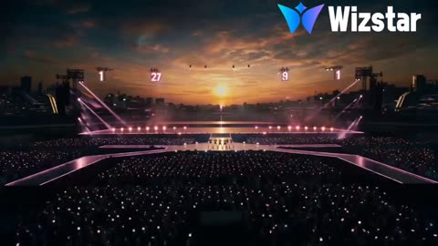</a>

The prompt sets venue, time of day, LED colour, crowd and lighting in one line, then names cinematic camera moves and a realism target. The wide sunset framing gives the model a stable stage layout to hold while the dancers move.

Seedance 2.5 · Text-to-video · Source: [@Sharjeelai_786 on X](https://x.com/Sharjeelai_786/status/2096103574376009968)

[`k-pop`](tags.md#tag-k-pop) [`concert`](tags.md#tag-concert) [`stage`](tags.md#tag-stage) [`sunset`](tags.md#tag-sunset)

<details><summary><b>Prompt</b></summary>

```text
A high-energy  girl group delivers a synchronized dance performance on a futuristic concert stage at sunset — stylish black-and-pink outfits, vibrant pink LED screens, cheering crowd, dramatic stage lights and pyrotechnics, captured with cinematic camera movements in ultra-realistic quality.
```

</details>

<a id="seedance-greenhouse-pop-dance-performance"></a>
### Pop dance performance in a sunlit glass greenhouse

<a href="https://x.com/Chaemate_/status/2110278863691325907"></a>

Separate character, outfit and background locks tied to two reference images keep identity and location stable across thirty seconds, and a negative prompt repeats those locks. Five timed scenes each name the choreography and a camera move, and the audio line specifies tempo, instruments and a bass drop on the final pose.

Seedance 2.5 · Reference-to-video · Source: [@Chaemate_ on X](https://x.com/Chaemate_/status/2110278863691325907) · found via [LearnPrompt/awesome-seedance](https://github.com/LearnPrompt/awesome-seedance)

[`dance`](tags.md#tag-dance) [`k-pop`](tags.md#tag-k-pop) [`multi-scene`](tags.md#tag-multi-scene) [`character-lock`](tags.md#tag-character-lock) [`music`](tags.md#tag-music)

<details><summary><b>Prompt</b></summary>

```text
K-POP GREENHOUSE DANCE PERFORMANCE

Duration: 30 seconds | Aspect ratio: 16:9 | Ultra-realistic 4K, photorealistic live-action, cinematic professional K-pop performance video.

CHARACTER LOCK (@Image1):
An adult Korean woman with delicate idol features and glowing skin, long wavy ginger-copper hair worn down with two small side braids pinned back and a small black hair clip. Soft shimmer eyeshadow, thin black eyeliner, glossy coral lips. Silver hoop earrings and a thin silver chain necklace.

OUTFIT LOCK (identical in every shot): Cropped cobalt-blue varsity bomber jacket with cream striped collar and cuffs, modest closed black fitted inner top, black pleated mini skirt with black cycling shorts underneath, black knee-high socks, white chunky platform sneakers with blue accents. No changes to outfit, colors, hairstyle, face, or accessories in any scene.

BACKGROUND LOCK (@Image2): Use the reference image as the only environment for all 30 seconds. Keep the glass greenhouse, lush plants, stone floor, and warm sunlight. Do not change the location.

SCENE 1 (0-6s): Sunlit Reveal
Overhead top-down shot of the stone floor as her white sneakers step into frame. The camera tilts up as she walks forward through a beam of sunlight, stops, and straightens her jacket collar with a smirk. She then does a smooth body wave from head to toe, two slow arm rolls, and a quick shoulder shimmy that lands on the first beat. Camera: top-down tilt up to a low-angle wide shot.

SCENE 2 (6-12s): Groove Section
Medium-wide shot. Crisscross hop-steps, a glide step to the right, then to the left, finger snaps at hip level, and a playful "shh" gesture with one finger to her lips. She throws a quick pop-and-lock arm sequence, then points up and down in alternating beats. Palm leaves sway gently behind her. Camera: smooth lateral slide, following her movement.

SCENE 3 (12-18s): Power Break
Wide shot with sunlight rays streaming through the glass behind her. Fast running-man footwork, a sharp front kick, a stomp-stomp-clap rhythm, arm slices across the body, and a low squat bounce with her hands pushed forward. The skirt and braids move naturally. Camera: quick push-in, then a short rack focus from the plants to her face.

SCENE 4 (18-24s): Hook Section
Medium close-up transitioning to full-body. She makes a "V" sign with her fingers near her eye, then a camera-lens shape with both hands, shifts her weight in a sharp side-slide, swings her arms in a big circle, and spins a full 360 with a confident flair. Sunlight glints through her hair as she turns. Camera: handheld-style orbit with a subtle shake.

SCENE 5 (24-30s): Final Pose
She backs away from the camera, turns her back, and looks over her shoulder with a wink. She turns around, does a final arm wave, and ends with one hand extended toward the camera and the other tucked at her waist, followed by a blown kiss and a warm smile. Camera: slow dolly-out to a wide shot, then a gentle push-in to a close-up on the last pose, with a soft golden glow on the final frame.

LIGHTING: Warm golden natural sunlight through the glass with soft rim light on her hair, gentle light rays, subtle haze, realistic skin texture and fabric movement. No neon or colored artificial lights.

DANCE QUALITY: Full-body motion synced to the music, clear footwork, smooth transitions between moves, precise timing, natural facial expressions, realistic hair and clothing physics, consistent anatomy.

NEGATIVE PROMPT: No neon lights, no outfit changes, no hairstyle changes, no face changes, no background replacement, no distorted anatomy, no extra fingers, no duplicated limbs, no floating feet, no jittering, no flickering, no cartoon or CGI look, no subtitles, no text overlays, no watermark, no logos.

AUDIO: Original bright pop K-pop dance track, about 125 BPM, with a punchy kick, glossy synth chords, funky bass, finger-snap percussion, and an energetic build-up before the hook, ending with a clean bass drop at the last pose. No vocals, no dialogue.

#KPop #AIVideo #Dance
```

</details>

<a id="seedance-hand-frame-anime-overlay-dance"></a>
### Woman dances with anime overlays in hand frames

<a href="https://x.com/Sairah_0/status/2087136847734734939">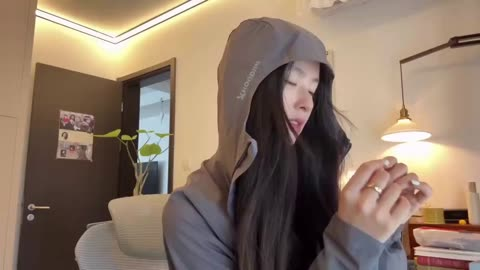</a>

Fixing the room, outfit and hair up front keeps the live footage stable, and making frames with the hands cues each overlay. Ordering the styles from anime avatar to Spider Gwen comic gives the clip a clear progression.

Seedance 2.5 · Text-to-video · Source: [@Sairah_0 on X](https://x.com/Sairah_0/status/2087136847734734939)

[`dance`](tags.md#tag-dance) [`anime`](tags.md#tag-anime) [`hand-gestures`](tags.md#tag-hand-gestures) [`overlay`](tags.md#tag-overlay) [`spider-verse`](tags.md#tag-spider-verse)

<details><summary><b>Prompt</b></summary>

```text
Setting: A cozy indoor room with warm, ambient lighting, featuring posters on the wall, a hanging lamp, and modern furniture.

Subject: A young woman with long dark hair, wearing a gray hooded jacket, performing a rhythmic, choreographed hand and body motion dance in front of the camera.

Key Visual Effects:

Animated Framing & Transitions: As she moves her hands to form frames and geometric shapes (triangles, rectangles) in front of her face and upper body, colorful animated overlays appear inside the framed spaces.

Anime & Superhero Styles:

The initial overlays display an anime-style digital avatar matching her expressions.

Midway through, the overlay switches to a Spider-Gwen / Spider-Verse comic style, complete with a hooded mask and neon cityscape backgrounds.

The animation dynamically shifts and transforms along with her hand movements, smoothly blending back into real life by the end of the clip.
```

</details>

<a id="seedance-hanfu-dancer-white-studio-walk"></a>
### Hanfu dancer walks into a white studio

<a href="https://x.com/acupofai/status/2083820282461184354">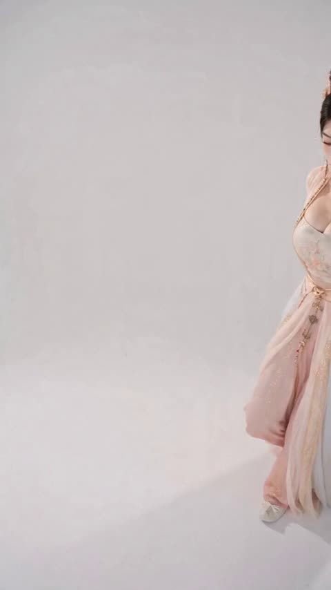</a>

Separates identity from motion: the face comes from a close-up reference, the costume from front and back views, and only the movement and framing come from the source video. A timed beat sheet for each second with a fixed, nearly static camera keeps the seven second clip continuous.

Seedance 2.5 · Reference-to-video · Source: [@acupofai on X](https://x.com/acupofai/status/2083820282461184354)

[`hanfu`](tags.md#tag-hanfu) [`ootd`](tags.md#tag-ootd) [`character-consistency`](tags.md#tag-character-consistency) [`dance`](tags.md#tag-dance)

<details><summary><b>Prompt</b></summary>

```text
7秒，9:16，一镜到底，甜美古风OOTD短视频。7秒音频完整播放，配合人物舞蹈。 严格以@人物参考图人物设定图中的成年女性为唯一人物：以右侧脸部特写作为人物长相参考，以左侧正面图 and 中间背面图作为服装、发型及背部结构参考。完整保持她的小巧鹅蛋脸、清秀五官、红色眉心花钿、深棕黑色高盘古典发髻、浅金色花叶发簪、珍珠流苏和两侧垂落珠链；完整保持浅香槟白与淡桃粉古风舞衣、刺绣抹胸内搭、浅杏色透明长袖纱衣、浅金色腰封、金属链饰、多层垂坠长裙。全程禁止换脸、换装、改变发型或增减饰品。 仅参考@视频人物的动作轨迹、姿态、节奏、景别变化和构图，不继承原视频人物的脸、发型、服装、颜色或材质。纯白无影棚，高机位轻微俯拍，超广角轻微透视，镜头基本固定，人物始终保持全身或大半身清晰入镜。 0–1秒，人物从画面右侧提着少量裙摆轻快走入，长裙和薄纱袖自然摆动； 1–2秒，人物靠近镜头，上身轻微前倾，抬眼注视镜头，神情清甜克制； 2–3秒，双手轻扶腰间，形成自然收腰姿态，俏皮微微歪头； 3–4秒，优雅侧身转过半圈，展示服装背面、盘发和腰封结构，再回眸看向镜头； 4–5秒，转回正面浅浅微笑，双臂向身体两侧自然舒展，轻纱袖缓慢垂落； 5–6秒，双手轻放身后，先低头整理姿态，再微微歪头看向镜头； 6–7秒，再次轻扶腰间，人物先扭头看向与镜头呈90°角的侧前方，视线先聚焦在镜头外某个远方，然后再转向镜头，以甜美、自信、端庄的古风姿态定格结束。 动作自然连贯、轻盈克制，不做大幅度舞蹈动作。裙摆、薄纱衣袖、珠链流苏和耳侧发丝随动作产生轻微真实惯性，避免夸张飞舞。明亮柔光，清透高亮，柔和浅香槟色调，古装影视广告与韩系时尚短片结合的高级质感，节奏轻快，无对白，搭配轻盈空灵的国风流行音乐。人物身份、五官、发型、服装纹样和饰品位置全程稳定，面部清晰稳定，真实皮肤纹理，4K质感，细节清晰。 不要使用左侧正面图中的空白遮脸作为人物面部，人物长相必须来自右侧脸部特写；不要继承视频中原人物的脸、发型或服装；不要新增人物，不要换装，不要跳切，不要镜头大幅移动或抖动，不要快速旋转，不要剧烈甩袖，不要裙摆遮脸，不要肢体变形、重复手臂、多余手指、手部粘连、穿模、服装突变、饰品消失、发型变化或背景变化。
```

</details>

<a id="seedance-idol-dance-crayon-effects-classroom"></a>
### Idol girl dances in classroom with crayon effects

<a href="https://x.com/Naonekozamurai/status/2087121611333980450"></a>

A reference video locks the character's face, hair and costume, while a fixed five-angle camera schedule that switches every two seconds sets the edit's rhythm. The crayon-style 2D overlays are tied to specific dance beats, so they read as a designed motion graphics layer rather than noise.

Seedance 2.5 · Reference-to-video · Source: [@Naonekozamurai on X](https://x.com/Naonekozamurai/status/2087121611333980450)

[`idol-dance`](tags.md#tag-idol-dance) [`multi-camera`](tags.md#tag-multi-camera) [`crayon-effects`](tags.md#tag-crayon-effects) [`classroom`](tags.md#tag-classroom)

<details><summary><b>Prompt</b></summary>

```text
ゴール
参照動画の主人公本人による、バズりそうな可愛さ全開のショートダンス動画を生成する。中心被写体は参照動画の女の子ひとり。メインイベントは、正面・上・左・右・背後の5台のカメラを2秒ごとに切り替えながら、常にカメラ目線で踊りきる可愛いダンスパフォーマンス。

参照
ダンス動画 
 — ここから引き継ぐもの：主人公の顔立ち・髪型・髪色・瞳・体格・年齢感・衣装・アクセサリー、明るく整理された教室風の背景空間、クレヨン画タッチの2Dエフェクトの質感と配色、楽曲の明るく可愛いアイドルポップの空気感。引き継がないもの：元の15秒のカット割りとタイミング（本プロンプトのタイムラインを優先する）。

スタイルと音楽
24fpsの高品質な作画、作画枚数多め。背景はシンプルだがポップで爽やかな教室風空間で、人物が常に主役に見える。AfterEffectsで作ったような2Dフラットアニメーションのエフェクトがダンスの動きに同期して出現し、質感はクレヨンやオイルパステルで描いたような手描き感。モチーフは丸、星、ハート、花、音符、矢印、リボン、王冠、キラキラ、波線、ぐるぐる線、吹き出し風の囲み、チェック模様、斜線、ハーフトーンドット。配色はピンク、水色、黄色、白、ラベンダー、ミントグリーンを中心に主人公と調和させる。
(明るく可愛い日本語のオリジナルアイドルポップソング。アップテンポで、2秒ごとのカット切り替えに気持ちよくハマるビート。実在する楽曲は使用しない)
主人公は楽曲に合わせて口ずさむように歌いながら踊る。

カメラ構成
5台のカメラ（正面・上・左・右・背後）を2秒ごとに切り替える。どのカメラでも主人公は顔の向きや首のひねり、視線の返しで必ずレンズを見る。背後カメラでは肩越しに振り返ってカメラ目線。各カメラは完全静止ではなく、ビートに合わせた上下の小さなバウンス、短いパンチイン、わずかな左右揺れなど、意図的で見やすい可愛いカメラシェイクを行う。

タイムライン（2秒ごとにカメラ切り替え）
[0-2s] 正面カメラ。主人公が教室の中央でリズムを取り、胸の前で両手ハートを作りながら左右に小さくステップ。手元と顔まわりにクレヨンのハート、星、丸、短いキラキラ線がポンポンと出現。カメラは軽く上下にバウンス。
[2-4s] 上からのカメラ。少し俯瞰の可愛いアングル。見上げてカメラ目線を保ちながら、ほっぺ横ピース、片手ハート、指差しをテンポよく決める。顔の周囲に王冠、花、ハート、吹き出し風の囲みが出現。
[4-6s] 左からのカメラ。身体をやや左に向けつつ顔と視線はレンズへ。腰を左右に軽く振り、片手を頬に添え、もう片手で小さく手を振る。手の軌跡にリボン状ライン、音符、波線、星が流れる。カメラはビートで小さく横揺れ。
[6-8s] 右からのカメラ。肩をリズミカルに弾ませ、両手を上げて下ろし、片足を軽く出して戻す。足元と肩まわりに花、丸、チェック模様、ハーフトーンドット、キラキラが弾ける。短い音ハメのパンチイン。
[8-10s] 背後からのカメラ。背中側から始まり、肩越しにくるっと振り返ってしっかりカメラ目線。小さなターンとともに指差し→片手ハート。髪と衣装の動きに合わせてぐるぐる線、星、リボン、ハートがふわっと出現。
[10-12s] 正面カメラ。1回目のサビ。両手を大きく開いてから胸元へ戻し、左右へ弾むように跳ねる。画面の縁に大きめのハート、星、花、王冠、斜線が増えて可愛さが加速。決めのたびに短いカメラシェイク。
[12-14s] 上からのカメラ。見上げながら顔の前で両手をふわっと開き、片手ハート、もう片手を頬の横に添える。クレヨンの囲み、ハート、チェック模様、ラフな円形ラインが背景に広がる。
[14-16s] 右からのカメラ。ここから新パート。両手の指ハートをレンズへぐっと突き出し、小首をかしげていたずらっぽく笑う。ハーフトーンドットとミニハートが波紋のように広がる。可愛い音ハメのパンチイン。
[16-18s] 左からのカメラ。膝で弾む屈伸リズムに乗せ、胸の前で両手を猫の手にして左右へメトロノームのようにスウィング。音符と波線が動きに合わせて跳ねる。
[18-20s] 背後からのカメラ。くるりと一回転して背中側から正面へ向き直り、肩越しに投げキッス。手のひらからクレヨンのハートが放射線と一緒に飛び出し、ぐるぐる線とリボンが舞う。
[20-22s] 上からのカメラ。上目遣いでレンズを見つめ、両腕で頭の上に大きなハートを作って左右にゆらゆら。花がぽんぽんと咲き、キラキラが紙吹雪のように降る。
[22-24s] 右からのカメラ。ビートに合わせてクラップを2回→レンズへ指差し、ステップタッチで左右へ。クラップのたびに矢印、吹き出し風の囲み、星がポップに弾ける。
[24-26s] 正面カメラ。大サビ。小さなジャンプで弾みながら両腕を大きく広げ、両手ハートへ。画面の縁が最大サイズのハート, 星, 花, 王冠, 斜線で埋まり、可愛さが最高潮に。ひときわ強いが見やすいカメラシェイク。
[26-28s] 左からのカメラ。素早い小さなターンから、両手で頬の横にハートを作って膝でリズムを取る。リボン状ラインが主人公をフレームのようにくるりと囲む。
[28-30s] 正面寄りのヒーローショット。バストアップで一歩前へ出て、にっこり笑ってからウィンク。瞬間、目元からクレヨンの四芒星、ハート、放射線、リボンが可愛く弾ける。ごく短いパンチインで止まり、決めポーズのままフィニッシュ。

継続性・制約
主人公以外の人物を出さない。全カットで参照動画の主人公の顔立ち・髪型・髪色・瞳・体格・年齢感・衣装を維持し、別キャラクター化や衣装変更をしない。エフェクトはすべて平面的な2Dクレヨンタッチで、実写的な爆発・炎・煙・過剰なグリッチは使わない。主人公の顔をエフェクトで隠しすぎない。文字、字幕、ロゴ、透かしを表示しない。
```

</details>

<a id="seedance-kpop-couple-dance-studio"></a>
### Couple dances in a Korean dance studio

<a href="https://x.com/MissDelulu9/status/2109896989475516789">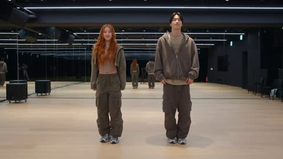</a>

Timed beat segments with a stated BPM and a continuous music cue lock the choreography to the rhythm. Full body framing plus a negative prompt aimed at face morphing and outfit changes keeps both dancers consistent through the clip.

Seedance 2.5 · Text-to-video · Source: [@MissDelulu9 on X](https://x.com/MissDelulu9/status/2109896989475516789)

[`dance`](tags.md#tag-dance) [`k-pop`](tags.md#tag-k-pop) [`couple`](tags.md#tag-couple) [`choreography`](tags.md#tag-choreography) [`studio`](tags.md#tag-studio)

<details><summary><b>Prompt</b></summary>

```text
Create an ultra-realistic video of an adult K-pop couple dancing in a professional Korean dance studio.

Characters: A beautiful woman with long, wavy ginger-copper hair and two small braids, wearing a cropped jacket, fitted top, cargo pants, and sneakers. A handsome man wearing modern K-pop streetwear, a black jacket, cargo pants, and sporty sneakers.

0–3 seconds: Both perform synchronized shoulder bounces, quick side steps, and sharp hand movements while smiling.

3–6 seconds: They perform energetic footwork, body grooves, coordinated arm movements, and a synchronized turn. The woman's hair moves naturally.

6–8 seconds: They move closer, mirror each other's dance moves, exchange romantic glances, and smile playfully.

8–10 seconds: They perform a synchronized final move and finish in a stylish couple pose, smiling at each other.

Music: Upbeat K-pop instrumental with strong electronic beats, energetic bass, and catchy synths at 125–135 BPM. Music plays continuously from 0–10 seconds. No dialogue.

Camera: Full-body shots, smooth tracking, cinematic lighting, realistic mirrors and reflections.

Quality: Photorealistic 4K, natural movements, consistent faces and outfits, realistic hair physics.

Negative Prompt: No cartoon, CGI faces, distorted anatomy, extra limbs, robotic dancing, face morphing, outfit changes, flickering, blur, camera shake, or sudden transitions.
```

</details>

<a id="seedance-kpop-lumina-plaza-choreography"></a>
### Five K-pop girls pose before a yellow bus

<a href="https://x.com/im_shahid7/status/2102273080685121659">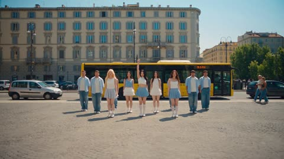</a>

The prompt fixes the opening to a supplied first frame and gives a timed beat sheet with the same wardrobe, head count and camera moves in every section. Foreground wipes and matched screen direction connect the three locations so the cuts read as one continuous walk.

Seedance 2.5 · Image-to-video · Source: [@im_shahid7 on X](https://x.com/im_shahid7/status/2102273080685121659)

[`k-pop`](tags.md#tag-k-pop) [`choreography`](tags.md#tag-choreography) [`first-frame`](tags.md#tag-first-frame) [`multi-location`](tags.md#tag-multi-location)

<details><summary><b>Prompt</b></summary>

```text
Using the supplied first frame as the exact opening image, generate a 30-second horizontal 4:3 photorealistic summer K-pop music video.

CONCEPT

The five-member fictional K-pop girl group LUMINA performs with twelve international supporting dancers across three connected public locations in the same European neighborhood:

1. Sunny city plaza
2. Bright covered food market
3. Outdoor community basketball court

The visual tone is joyful, energetic and communal. Camera transitions must make the three locations feel physically connected rather than unrelated scenes.

CHARACTER COUNT LOCK

Use exactly:
- Five LUMINA members
- Twelve supporting dancers

No additional dancers may appear.

Background pedestrians, market vendors and customers are civilians only. They remain clearly separated from the choreography and never copy the dance.

Keep every LUMINA member consistent:
- Same face
- Same hairstyle
- Same outfit
- Same body proportions
- Same accessories
- Same role in the group

Do not duplicate, merge, replace or transform any performer.

CAMERA STYLE

Horizontal 4:3.
Polished live-action K-pop cinematography.
Use a stabilized gimbal, short dolly movements and one gentle crane reveal.

Camera movement should be energetic but readable:
- Smooth forward pushes
- Short lateral tracks
- Motivated close-ups
- Whip-pan transitions hidden by foreground objects
- Continuous screen direction

Do not use random camera teleportation, spinning camera, extreme shake or excessive cutting.

0.0–4.0 SECONDS — OPENING GROUP CHOREOGRAPHY

Continue directly from the first frame.

Nari drops her raised arm across her chest and initiates the first synchronized sequence.

All seventeen dancers perform:
- Two grounded side steps
- Alternating shoulder hits
- One upward diagonal arm sweep
- A clean hip-level hand cross
- One synchronized head turn toward camera-right

The camera slowly pushes forward while preserving all five main members in frame.

The yellow bus remains parked behind them. Background pedestrians continue normal movement.

4.0–7.0 SECONDS — NARI CENTER MOMENT

The other members step outward by half a meter, opening a clear center lane.

Nari advances two short steps toward the camera and performs:
- Right-hand face frame
- Quick wrist rotation
- Chest accent
- Half-turn
- Immediate return to face the camera

Her pleated skirt, hair and socks move naturally.

Transition into a chest-up shot without cutting off her hands. She smiles directly into the lens for one beat.

No slow motion.

7.0–10.0 SECONDS — FORMATION EXPANSION

The camera pulls back smoothly.

Mina and Jiyu move to Nari’s sides while Hana and Seoa close the rear line. The twelve supporting dancers expand outward into a wide semicircle.

The full group performs:
- Two bouncing steps
- Right-arm wave
- Left-arm wave
- Fast double hand point
- One small synchronized jump
- Clean wide-stance landing

Feet maintain accurate contact with the stone pavement.

The city bus begins moving slowly out of the background in the correct traffic direction.

10.0–12.0 SECONDS — MARKET TRANSITION

A supporting dancer in a cobalt overshirt crosses close to the camera from left to right.

His shirt briefly fills the frame and creates a natural wipe transition.

As the blue fabric clears, reveal the same forward camera movement continuing inside a bright covered municipal food market.

The transition must preserve movement direction and rhythm.

12.0–16.0 SECONDS — MOVING THROUGH THE MARKET

The five LUMINA members dance forward through a wide central market aisle.

Formation:
- Jiyu leads at center
- Nari and Mina follow behind
- Hana and Seoa occupy the outer positions
- Supporting dancers trail in two organized lines

Environment:
- White and pale-blue market counters
- Fresh fruit and vegetable stalls
- Flower buckets
- Closed glass seafood displays
- Hanging international festival flags
- Elderly vendors and ordinary shoppers standing safely outside the aisle
- Bright skylight illumination
- Clean, dry floor

The group performs walking choreography:
- Rhythmic forward steps
- Alternating elbow pulls
- Shoulder rolls
- Overhead hand waves
- One synchronized direction change around a market column

The camera tracks backward at matching speed.

16.0–19.0 SECONDS — MINA CLOSE-UP

Mina moves toward the front-left side of the formation.

The camera transitions into a smooth waist-up close-up as she performs:
- Hand sweep beside her cheek
- Elbow raised above shoulder level
- Playful head tilt
- Quick body roll
- Direct smile into the lens

Nari and Jiyu remain visible behind her in softer focus, continuing simpler choreography.

A row of colorful market flags passes above the frame.

19.0–21.0 SECONDS — SECOND MATCH TRANSITION

Mina spins once to her left.

Her pale blue-grey skirt creates a brief circular foreground blur.

Match the end of the spin with Seoa completing the same turn at an outdoor basketball court.

The rotation direction, body scale and camera height must remain consistent across the cut.

21.0–25.0 SECONDS — BASKETBALL COURT CHORUS

Reveal a sunny outdoor community basketball court approximately one block from the market.

Environment:
- Blue and coral painted court
- White boundary lines
- Blue basketball backboard
- Chain-link perimeter fence
- Colorful city buildings in the distance
- Green trees
- Clear afternoon sky
- No active basketball players inside the dance zone

All five LUMINA members return to the front row.
The twelve supporting dancers form two staggered rows behind them.

They perform a high-energy chorus:
- Wide side step
- Double forearm hit
- Alternating knee lifts
- Cross-body point
- Fast shoulder bounce
- Quarter-turn
- Return to front

The camera tracks laterally from left to right while maintaining a stable horizon.

25.0–28.0 SECONDS — ROTATING CENTER POSITIONS

Each member receives a brief movement highlight without stopping the group choreography:

- Hana performs a grounded two-count footwork accent
- Seoa performs a bright arm circle
- Jiyu performs a strong chest-and-shoulder hit
- Mina performs a face-framing gesture
- Nari returns to center with one clean pivot

The other performers stay in their assigned positions and use simplified supporting movements.

No member passes directly through another dancer’s path.

28.0–30.0 SECONDS — FINAL GROUP POSE

The camera rises gently by approximately one meter while moving slightly backward, revealing the full court formation.

All seventeen dancers complete:
- One synchronized upward arm throw
- Small controlled jump
- Stable landing
- Final asymmetrical pose

Final positions:
- Nari center front
- Mina and Jiyu one step behind her
- Hana and Seoa on the outer front diagonals
- Twelve supporting dancers in a broad semicircle

Nari looks directly into the camera and gives a bright confident smile.

Hold the final pose for the last half-second.

CHOREOGRAPHY QUALITY

- Professional K-pop synchronization
- Energetic but anatomically realistic movement
- Clear preparation before every turn and jump
- Accurate foot placement
- Natural knee compression on landings
- Realistic hair and fabric movement
- No repeated movement loops
- No performer colliding with another
- No bodies passing through one another
- No floating feet
- No excessive motion blur

SCENE CONTINUITY

All three locations exist in the same neighborhood and share the same afternoon weather.

Maintain:
- Consistent sunlight direction
- Consistent performer identities
- Consistent clothing
- Consistent hair
- Continuous movement direction during transitions
- Realistic travel logic between scenes

AUDIO

Create an original upbeat summer K-pop track:
- Bright percussion
- Clean bass line
- Rhythmic handclaps
- Light synth melody
- Energetic chorus
- Original non-lyrical vocal ad-libs

Mix in subtle location ambience:
- Distant city traffic
- Footsteps
- Market room tone
- Shoe contact on the basketball court
- Light
```

</details>

<a id="seedance-lime-blazer-woman-crowd-choreography-swap"></a>
### Woman in lime blazer replaces crowd lead

<a href="https://x.com/john_my07/status/2100115896111161691"></a>

A reference video locks motion, camera and cut points, while one reference image locks identity, with a long list of preserve and never change rules. Timed segments from 0 to 30 seconds, a fixed wardrobe list and an instruction to alter only the central character keep the original choreography intact.

Seedance 2.5 · Reference-to-video · Source: [@john_my07 on X](https://x.com/john_my07/status/2100115896111161691) · found via [LearnPrompt/awesome-seedance](https://github.com/LearnPrompt/awesome-seedance)

[`character-replacement`](tags.md#tag-character-replacement) [`identity-lock`](tags.md#tag-identity-lock) [`motion-transfer`](tags.md#tag-motion-transfer) [`crowd-choreography`](tags.md#tag-crowd-choreography) [`timed-segments`](tags.md#tag-timed-segments)

<details><summary><b>Prompt</b></summary>

```text
Use the uploaded reference VIDEO as the exact motion, choreography, camera, framing, timing, pacing, shot duration and cut-point reference.

Use <image_1> as the STRICT identity reference for the MAIN WOMAN.

The final video should feel like the SAME original video, but with the original central man completely replaced by the woman from <image_1>.

Do NOT recreate or preserve the original man's face or identity.

IDENTITY <image_1>

The central character is the exact same woman shown in <image_1>.

Preserve her:

- exact face
- facial structure
- jawline
- cheekbones
- nose
- eyes
- eyebrows
- lips
- ears
- skin tone
- natural facial proportions
- hairstyle
- hair length, volume and texture
- any facial features visible in the reference
- natural body proportions

Maximum identity preservation throughout the entire video.

She must remain recognizably the same person from the uploaded photograph in every shot and every angle.

NO face morphing.
NO identity drift.
NO changing facial structure.
NO different hairstyle.
NO unwanted hair changes.
NO beautification or artificial facial retouching.
NO age changes.
NO facial distortion.

CHARACTER REPLACEMENT

Replace ONLY the original central man with the woman from <image_1>.

Keep the exact position, scale, body movement, gestures, walking path, head movements, smoking actions and timing from the reference video.

Everything the original central character does in the reference video should be performed by the <image_1> woman at the same moment and with the same choreography.

Do not reinterpret or redesign the choreography simply because the replacement character is female.

WARDROBE

Dress <image_1> in the same character-reference outfit, adapted naturally for the woman:

Acid lime green single-breasted blazer, notch lapels, two buttons, buttoned closed, slightly oversized shoulders.

Plain white cotton shirt underneath.

Narrow black knitted tie, neatly knotted.

Straight black trousers.

Plain black leather ankle boots, low heel.

No jewellery.
No watch.
No belt.
No bag.
No phone.
No logos or patterns.

The lime blazer must remain exactly throughout the entire video.

IMPORTANT:
Do not let the wardrobe replacement change the original choreography, body positioning, composition or pacing.

SMOKING ACTION

Preserve the smoking sequence from the reference video exactly.

At the beginning, the main woman holds a cigarette naturally between her fingers and brings it to her mouth.

She lights the cigarette using the same hand movements, timing and body positioning as the reference video.

She takes a drag and naturally exhales smoke.

Preserve the original:

- hand position
- cigarette position
- lighter movement
- timing
- head movement
- facial expression
- smoke timing
- arm movement

The smoking action should look physically natural and cinematic.

Do not exaggerate the smoke.
Do not create excessive smoke.
No smoking action should occur from any other character.

All other characters remain unchanged.

EXACT ORIGINAL ACTION / TIMING

0–4 SECONDS:

Match the reference video exactly.

The central woman is shown smoking.

She brings the cigarette toward her mouth, lights it, takes a drag and exhales.

Match the original close framing, facial positioning, hand movements and timing.

4–11 SECONDS:

Match the reference video exactly.

The woman turns away from camera and moves forward into the crowd using the exact same movement and timing as the original central character.

Preserve her body position, walking speed, direction and camera framing.

11–17 SECONDS:

Match the original choreography exactly.

The woman moves back toward the central position and performs the same gestures and movements as the original central character.

Do not invent new actions.

17–22 SECONDS:

The woman reaches and holds the same central position as the reference.

She becomes calm and composed.

Maintain the exact same camera composition.

22–30 SECONDS:

The crowd begins the same synchronized chaotic movement from the reference.

The central woman remains calm and controlled in the center while the surrounding crowd moves violently and rhythmically around her.

Match the exact timing, intensity and choreography of the original crowd movement.

The central woman must remain clearly identifiable and visually separated from the crowd.

CAMERA

COPY THE REFERENCE VIDEO'S CAMERA LANGUAGE EXACTLY.

Preserve:

- camera position
- camera height
- camera distance
- lens perspective
- focal length feel
- framing
- depth of field
- camera movement
- push/pull movement
- tracking
- camera shake if present
- zoom
- subject scale
- transitions
- shot duration
- exact cut points

Do NOT create new shots.

Do NOT add new camera movements.

Do NOT change the original video's pacing.

The output should have the same visual rhythm and edit structure as the reference video.

CROWD

Keep the original crowd concept and choreography from the reference video.

Large group of young men surrounding the central woman.

Preserve their:

- positions
- density
- formation
- movements
- synchronized choreography
- timing
- background behavior

Do not replace the crowd with women.

Do not introduce new characters.

Do not allow anyone else to become visually dominant over the main woman.

Only the central character is replaced.

LOCATION

Preserve the same environment and architecture as the reference video.

Keep the same:

- concrete/architectural setting
- stairs
- background structure
- crowd arrangement
- environmental depth
- overall composition

Do not redesign the location.

Do not introduce new buildings or props.

LIGHTING / COLOR

Preserve the reference video's overall cinematic lighting and color grading.

Keep the dark, moody atmosphere.

The acid lime blazer should be the distinctive color of the central character.

Keep natural skin tones.

Realistic shadows and highlights.

No artificial glow.
No haze.
No bloom.
No excessive smoke.
No fantasy lighting.

VISUAL STYLE

Photorealistic cinematic live-action footage.

Natural human motion.
Natural body physics.
Realistic fabric.
Realistic hair.
Realistic skin.
Realistic cigarette smoke.
Realistic lighting.

No CGI appearance.
No animation.
No cartoon.
No plastic skin.
No face distortion.
No duplicated main character.

CRITICAL INSTRUCTION

REFERENCE VIDEO = controls EVERYTHING about the original video's motion.

<image_1> = controls ONLY the identity and appearance of the replacement central woman.

Replace the original central man with the woman from <image_1> while preserving the original video's actions, choreography, camera, timing, pacing, framing and cuts as closely as possible.

The result should look like the original video was filmed with <image_1> instead of the original actor.

ONE MAIN CHARACTER ONLY.
NO IDENTITY DRIFT.
NO EXTRA VERSION OF <image_1>.
```

</details>

<a id="seedance-neon-sneakers-beat-drop-commercial"></a>
### Sneakers hit wet neon street on the first beat

<a href="https://x.com/Inshrah_ali_/status/2087746267250327636">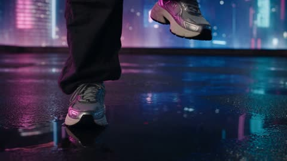</a>

Timestamped scenes tie each camera move and typography hit to a beat, so the cuts read as music driven rather than random. Exact on-screen text in quotes and a locked character description keep the typography and the dancer consistent across shots.

Seedance 2.5 · Text-to-video · Source: [@Inshrah_ali_ on X](https://x.com/Inshrah_ali_/status/2087746267250327636)

[`neon`](tags.md#tag-neon) [`sneakers`](tags.md#tag-sneakers) [`beat-sync`](tags.md#tag-beat-sync) [`typography`](tags.md#tag-typography)

<details><summary><b>Prompt</b></summary>

```text
Style: Ultra-premium Gen-Z music commercial, hyper-realistic, cinematic 8K, high-end fashion campaign, energetic hip-hop track, fast beat-synced editing, viral social-media aesthetic, realistic skin and fabric textures, natural lighting, polished professional choreography, dynamic handheld + gimbal camera movement, crisp motion blur, bold kinetic typography, premium color grading, no CGI look, no cartoon style, no watermark.

Main Character: A confident young female dancer with a stylish Gen-Z fashion look, natural makeup, expressive face, realistic hair movement, fashionable oversized streetwear mixed with luxury accessories. Keep her appearance, outfit, hairstyle, and identity consistent throughout.

Scene 1 — 0–3s | Beat Drop

Nighttime premium urban location with neon architecture and wet reflective pavement.

Extreme close-up of her sneakers hitting the ground exactly on the first beat. Cut rapidly to her eyes, jewelry, hands, and confident expression.

She looks directly into the camera.

Typography hits the screen:
“FEEL THE BEAT.”

Letters appear with aggressive kinetic motion, slight zoom, shake, and rhythmic distortion synchronized perfectly to the music.

Scene 2 — 3–7s | Dance Explosion

Beat drops harder.

She launches into a fast, highly polished Gen-Z hip-hop choreography: sharp footwork, body isolations, confident hand movements, quick turns and attitude-driven poses.

Camera constantly changes:
low-angle tracking → 360° orbit → close-up → wide shot → fast push-in.

Use seamless match cuts between movements. Every camera transition lands precisely on the beat.

Typography flashes between movements:

“MOVE.”
“ENERGY.”
“NO LIMITS.”

Large bold typography briefly fills the frame without hiding the dancer.

Scene 3 — 7–11s | Viral Moment

Music reaches its fastest section.

The dancer performs the signature highlight move directly toward the camera.

Camera pushes forward while she moves backward, creating a powerful perspective effect. Quick speed ramp into slow motion for one key movement, then instantly snap back to full speed.

Add subtle realistic light streaks, reflections, lens flares, and environmental movement.

Typography rapidly assembles around her:

“THIS IS YOUR MOMENT.”

Each word appears individually on beat with modern kinetic animation.

Scene 4 — 11–15s | Hero Finish

Final beat.

She executes one final sharp move, spins, then stops confidently facing the camera.

Music hits a clean final bass impact.

Camera performs a dramatic cinematic push-in as the environment briefly falls into shallow depth of field.

She gives a confident smile.

Final typography appears huge and centered:

“OWN THE MOMENT.”

Small premium subtitle underneath:

“MOVE DIFFERENT.”

End on a clean freeze-frame hero shot with subtle camera movement, luxury fashion-commercial finish, realistic lighting, crisp details
```

</details>

<a id="seedance-soho-breakdance-battle-multi-cut"></a>
### Breakdancer battles in a SoHo street circle

<a href="https://x.com/ZetoGroovin/status/2086292115122991194">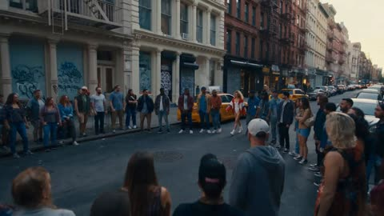</a>

A reference image pins the dancer's look while a numbered cut list scripts each shot from wide establishing to freeze close-up. Naming a camera move for every cut, with the beat as the timing anchor, gives the edit its rhythm and keeps the sequence readable.

Seedance 2.5 · Reference-to-video · Source: [@ZetoGroovin on X](https://x.com/ZetoGroovin/status/2086292115122991194)

[`breakdance`](tags.md#tag-breakdance) [`street-dance`](tags.md#tag-street-dance) [`reference-image`](tags.md#tag-reference-image) [`multi-cut`](tags.md#tag-multi-cut)

<details><summary><b>Prompt</b></summary>

```text
The exact same girl from the reference image — 100% identical face, hairstyle, outfit, body proportions, no changes whatsoever, clean idol skin with subtle glow.

She performs explosive breaking choreography synchronized to hard-hitting breakbeats: powerful top rock, intricate six-step footwork, fast CCs, dynamic windmills, baby freeze transitions, backspin combinations, sudden freezes, aggressive battle attitude, intense eye contact.

Location: the streets of SoHo, New York City, early evening, cast-iron buildings, graffiti-covered shutters, steam rising from subway vents, yellow taxis passing in the background, energetic street battle atmosphere.

Multi-cut music video structure optimized for Seedance 2.5:

CUT 01:
Ultra-wide establishing shot.
The dancer walks into a dance circle formed by spectators.
Handheld camera movement.
Natural city ambience.

CUT 02:
Low-angle tracking shot.
Aggressive top rock sequence synchronized to the beat.
Fast push-in movement.

CUT 03:
Dynamic 360-degree camera orbit.
Complex six-step combinations and rapid footwork.
Subtle speed ramping.

CUT 04:
Extremely low ground-level shot.
Explosive windmill sequence.
Hair movement, jacket motion, realistic body momentum.

CUT 05:
Rapid cinematic cut.
Freeze pose facing the camera.
Crowd reaction shots.

CUT 06:
Slow-motion sequence.
Continuous windmills transitioning into a baby freeze.
Camera circles around the dancer.

CUT 07:
Extreme close-up of the dancer's eyes.
Heavy breathing.
The beat intensifies.

CUT 08:
Final battle-ending freeze pose.
Wide shot of SoHo street scenery.

Camera style:
Smooth 360° tracking shots mixed with extreme close-ups, dynamic dolly zooms, handheld battle footage aesthetics, dramatic low-angle perspectives.

Cinematic color grading: cool blue cinematic tones mixed with warm skin highlights, subtle film grain, realistic street lighting, high-end music video style.

4K, photorealistic, ultra-sharp skin and fabric details, rhythmic speed ramps synchronized to the beat, fashion editorial energy, authentic street dance documentary atmosphere, "fashion magazine commercial mixed with underground street battle video", 24fps.
```

</details>

<a id="seedance-tokyo-street-dance-duo"></a>
### Two dancers in golden-hour Tokyo dance studio

<a href="https://x.com/Chaemate_/status/2107691578605322348">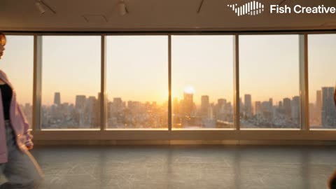</a>

The prompt drives the choreography from a second by second timeline locked to a 120 BPM beat grid, so each move lands on a beat. Reference images lock both dancers' faces and outfits, and each scene has its own written camera plan.

Seedance 2.5 · Reference-to-video · Source: [@Chaemate_ on X](https://x.com/Chaemate_/status/2107691578605322348)

[`dance`](tags.md#tag-dance) [`tokyo`](tags.md#tag-tokyo) [`beat-sync`](tags.md#tag-beat-sync) [`reference-images`](tags.md#tag-reference-images)

<details><summary><b>Prompt</b></summary>

```text
15-second cinematic 16:9 ultra-realistic live-action Tokyo street-style dance video.

TWO JAPANESE FEMALE DANCERS ONLY.

IDENTITY LOCK:
Preserve @image1 exact face, facial structure, eyes, nose, lips, eyebrows, hairstyle and identity.
Preserve @image2 exact face, facial structure, eyes, nose, lips, eyebrows, hairstyle and identity.
Keep their exact reference outfits and accessories in every scene. Natural human proportions. Do not alter either face at any moment.

MUSIC (drives all the action):
Upbeat Japanese city-pop x dance-pop track, 120 BPM (one beat every 0.5s). Funky slap bass, bright synth stabs, snappy claps, light female vocal hook. Structure: intro groove (0–5s), bass-heavy main drop (5–10s), breakdown with a final hit (10–15s). Every movement lands exactly on the beat, and the energy of the choreography follows the music.

DANCE STYLE:
Playful, cool and confident, a mix of commercial hip-hop, city-pop groove and K-pop performance energy. Teasing eye contact, small smirks, shoulder accents. Stylish and controlled, never exaggerated. Sync moments where both dance together, and mirror moments where they play off each other.

SCENE 1 (0–5s): Minimalist dance studio at golden hour
Grey concrete wall, polished floor with soft reflections, a large window showing the Tokyo skyline at sunset. Warm light spilling across the floor.
0.0–1.0s: Both walk into frame side by side, snap to a stop on the first bass note, quick shoulder hit.
1.0–2.0s: Sharp right-arm sweep across the chest, step sideways, then left arm snaps outward with a hip accent.
2.0–3.0s: Chest isolation into shoulder roll, and one dancer playfully touches her hair while the other points at the camera.
3.0–4.0s: Two-step footwork with alternating arm punches, then arms cross and rapidly open on the synth stab.
4.0–5.0s: Synchronized body lean right then left, with one arm sweeping over the head. On the final beat they spin and whip-pan toward the window.

TRANSITION: Fast whip-pan with natural motion blur, matched to the beat. No glitch or CGI effects.

SCENE 2 (5–10s): Neon alley in Shibuya at night
Wet pavement reflecting pink and blue neon signs, paper lanterns, light drizzle mist, a few blurred pedestrians far in the background.
5.0–6.0s: The bass drops. Both step toward the camera with a confident synchronized arm gesture.
6.0–7.0s: Low hip-hop bounce with bent knees, two shoulder hits, then a controlled body roll and a sharp hand flick.
7.0–8.0s: Dancers split: one slides left, the other right, mirrored arm waves from low to shoulder height, then they swap places.
8.0–9.0s: Quick foot switch, strong downward arm hit, a playful look back over the shoulder at the camera.
9.0–10.0s: Rise sweeping both arms diagonally up, a sharp head turn with hair movement, and neon light flares across their faces.

TRANSITION: Hard cut on the beat to a rooftop, with a small camera push-through for continuity.

SCENE 3 (10–15s): Rooftop at blue hour, city lights glowing behind
Soft blue twilight sky, glittering skyline, gentle breeze moving hair and clothing.
10.0–11.0s: The music breaks down. Slow confident walk toward the camera, hips swaying lightly on each beat.
11.0–12.0s: Smooth finger-snap isolations and a gentle hair flip, with shared eye contact between the two.
12.0–13.0s: Music snaps back. Fast synchronized combo: arm cross, open, shoulder hit, jump-step.
13.0–14.0s: Both step into a symmetrical formation: one hand on the waist, the other extended outward.
14.0–15.0s: Final confident pose toward camera, playful smile and strong eye contact, a brief freeze on the last beat.

CAMERA:
Scene 1: low-to-medium full-body framing, subtle forward tracking, then a small lateral slide.
Scene 2: handheld micro-movement, tracking alongside the dancers, subtle push-in on the drop.
Scene 3: slow arc around the dancers, ending with a short cinematic hold.
Smooth and physically realistic. No excessive shaking, no random zoom. Both dancers always clearly visible. Natural depth of field, tiny lens parallax, realistic motion blur only on fast moves.

PERFORMANCE:
Clean, fast choreography with natural weight transfer, realistic foot contact, natural knee and hip articulation, believable arm momentum. Hair and clothing react naturally to movement.

LIGHTING & COLOR:
Scene 1: warm golden-hour light with soft shadows. Scene 2: neon pink and blue rim light on wet surfaces. Scene 3: cool blue-hour ambience with warm city-light highlights. Cinematic color grading, clean natural skin tones, controlled contrast, soft filmic dynamic range, premium Japanese fashion-film look.

REALISM:
Ultra-realistic live-action humans, visible skin texture and pores, individual hair strands, realistic eye reflections, physically accurate fabric and shadows.

STRICT NEGATIVE:
No plastic skin, no CGI, no anime, no 3D render, no beauty filter, no stiff or robotic movement, no facial morphing, no face replacement, no identity change, no hairstyle or outfit change, no glowing eyes, no extra fingers or limbs, no duplicated dancers, no body distortion, no text or watermarks, no teleportation.
```

</details>

<a id="seedance-woman-crowd-synchronized-turn"></a>
### Woman in black jacket at center of white crowd

<a href="https://x.com/AIwithSynthia/status/2100067816162636164"></a>

A reference image locks the face, wardrobe and crowd, and the motion is split into beats: a freeze, a staggered head turn spreading through the crowd, then one sharp synchronized turn. Camera moves are limited to a backward track and a slow push so the lead's stillness stays the focus.

Seedance 2.5 · Reference-to-video · Source: [@AIwithSynthia on X](https://x.com/AIwithSynthia/status/2100067816162636164) · found via [LearnPrompt/awesome-seedance](https://github.com/LearnPrompt/awesome-seedance)

[`crowd`](tags.md#tag-crowd) [`reference-image`](tags.md#tag-reference-image) [`cinematic`](tags.md#tag-cinematic) [`synchronized-motion`](tags.md#tag-synchronized-motion)

<details><summary><b>Prompt</b></summary>

```text
Create an ultra-realistic cinematic fashion/music video using the uploaded reference image as the exact visual reference for the woman, crowd, wardrobe, composition, lighting, and atmosphere.

A young woman with a short sleek dark bob, realistic facial features, natural skin texture, and subtle makeup wears a fitted black turtleneck, black trousers, black shoes, and minimal jewelry. Keep her face, hairstyle, outfit, and proportions perfectly consistent.

She walks slowly and confidently toward a large, tightly packed crowd, maintaining a calm and emotionless expression while the camera smoothly tracks backward and keeps her centered.

She reaches the exact center of the crowd and stops completely, standing perfectly still with her arms naturally at her sides and looking directly into the camera.

The crowd remains completely frozen for a brief moment.

Then, without the woman moving, the people behind her slowly begin turning toward her. The head turns start subtly and spread through the entire crowd until everyone is facing and looking directly at her.

The woman remains completely motionless and expressionless, never reacting to the crowd.

The camera slowly pushes closer while the crowd stays turned toward her, creating an unsettling synchronized effect. Their final movement is one sharp, simultaneous turn toward her while she continues staring into the lens.

Dark, mysterious, photorealistic live-action aesthetic, soft cinematic lighting, deep shadows, realistic skin, hair and clothing physics, shallow depth of field, natural human movement.

No animation, anime, cartoon, CGI look, duplicate woman, distorted faces, morphing, random crowd movement, text, subtitles, logos, watermark, excessive camera movement, artificial fog, glow, or exaggerated effects.
```

</details>

<a id="seedance-y2k-pop-duo-multi-shot-mv"></a>
### Two singers dance in retro Y2K music video

<a href="https://x.com/higgsfield_ai/status/2083130063382597778">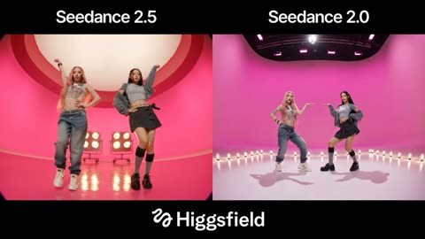</a>

Each segment gets its own set, lens and timestamp, with every hard cut tied to a beat, which gives the edit a clear structure. Fixed frame left and frame right placement for both reference images keeps identities stable in two shots.

Seedance 2.5 · Reference-to-video · Source: [@higgsfield_ai on X](https://x.com/higgsfield_ai/status/2083130063382597778)

[`music-video`](tags.md#tag-music-video) [`multi-shot`](tags.md#tag-multi-shot) [`choreography`](tags.md#tag-choreography) [`y2k`](tags.md#tag-y2k)

<details><summary><b>Prompt</b></summary>

```text
**[SCENE]** A two-member female pop duo shoots a retro Y2K-style music video: candy-colored studio sets, tightly synchronized hand choreography, beat-locked hard cuts and fast punch zooms — the texture of 1999 music television, rendered at modern production quality. **[ACTIVE REFERENCES]** <<<image_1>>>: Female singer in her twenties, long straight pink hair with gold hair clips, small nose ring, beauty mark on cheek, white printed crop top, silver chain necklace, chain belt, light-blue washed baggy jeans, off-white platform sneakers. Playful and confident. 100% match to reference image. <<<image_2>>>: Female singer in her twenties, long straight black hair with silver hair clips, light blue eyes with silver glitter eyeshadow, red cord necklace with ruby pendant, gray raglan short-sleeve tee with a gray jacket draped over the shoulders, dark gray pleated skirt with bow, gray knee socks, black platform shoes. Cool and commanding. 100% match to reference image. **[SET MAP]** Three practical studio sets, each roughly 4 meters deep, facing camera: Set A — bubblegum-pink seamless cyclorama, glossy reflective floor, two rows of round studio light bulbs on the back wall. Set B — cobalt-blue seamless cyclorama, a single hard white spotlight circle on the floor. Set C — floor-to-ceiling silver rain-strand curtain wall, mirrored floor. **[FIRST FRAME & SPATIAL LAYOUT]** The first visible frame already contains both girls, on Set A: <<<image_1>>> at frame-left x40%, <<<image_2>>> at right x60%, medium-shot depth, 0.5 m apart, bodies squared to camera, eyes locked on lens, frozen in a mirrored opening pose — inner hand on hip, outer arm raised. No empty establishing shot, no delayed entrance. **[FORMAT]** Controlled multi-shot sequence, seven segments across 15 seconds, every hard cut landing precisely on a musical downbeat. Real-time motion. **[LENS NOTES]** Fisheye = true fisheye wide-angle, 1.5 m from subject, visible barrel distortion at frame edges, deliberate 1999 MV lens language; 47° = standard view, natural proportions; 29° = medium-tele portrait, background lightly compressed; 18° = long-lens close-up, melted bokeh. Locked within each segment, no drift. **[ACTION TIMELINE]** 0.0–2.0s Set A, fisheye low angle: both hit the frozen mirrored pose on beat one, then bounce-groove in sync with every beat, camera slowly pushes in 10%. Hard cut at 2.0s. 2.0–4.0s Set B, 29°: <<<image_2>>> solo dance inside the spotlight circle at x50%, pointed-at-camera precision hand choreography, one fast punch zoom landing exactly on the downbeat. Hard cut at 4.0s. 4.0–6.0s Set C, 47°: <<<image_1>>> whips her pink hair through a full arc, then strides toward camera as the camera pulls back at matched speed, rain-strand curtain shimmering, chain belt swinging. Hard cut at 6.0s. 6.0–8.0s Set B, 18° two-shot close-up: both faces cheek-to-cheek filling the frame, <<<image_1>>> left / <<<image_2>>> right, soft wind lifting pink and black strands, glossy makeup, confident smiles, heads tilting toward each other in sync with the beat. Hard cut at 8.0s. 8.0–11.0s Set A, 47° full body: the chorus dance core — three counts of fully synchronized choreography: wave arms, fast spin, full-body groove into a sharp freeze; positions cross and return, <<<image_1>>> left / <<<image_2>>> right re-locked. Hard cut at 11.0s. 11.0–13.0s Set C, 47°: the two walk toward camera side by side with synchronized arm swings, black and pink hair swinging with each step, reflections in the mirrored floor. Hard cut at 13.0s. 13.0–15.0s Set A, 47°: back-to-back frozen final pose, camera zooms out fast to full body, landing exactly on the last downbeat, one bright camera-flash white sweep over the final frame. **[PHYSICS]** Choreography carries real weight: heel strikes, weight shifts, shoulder isolations with follow-through. Hair whips show visible lag and settle naturally. Chain belt and necklaces swing on the beat points. Rain-strand curtain ripples from body movement. Glossy floor returns soft, believable reflections. **[LIGHTING]** High-key, even studio lighting on every set: large soft frontal key, bright clean exposure, high skin sheen; Set A's bulb rows create back rim light and soft bloom into the lens; Set B's spotlight casts a crisp circular pool; Set C sparkles with hundreds of rain-strand specular highlights. Bright, candy-like, camera-ready — a deliberate flat 1999 broadcast-TV look. **[AUDIO]** Original Y2K bubblegum dance-pop instrumental, 120 BPM, four-on-the-floor kick, bright syncopated synths, faint tape hiss underneath. Every hard cut lands exactly on a downbeat. Instrumental only throughout, no vocals; both girls perform with closed lips, delivering energy purely through expression and choreography. **[POSITIVE LOCKS]** Both faces and identities 100% locked to reference images across all segments including close-ups. Wardrobe stays exactly as referenced across all three sets. Only these two girls appear in the entire video. In every two-person segment <<<image_1>>> is fixed frame-left, <<<image_2>>> fixed frame-right. Within each segment, set geography, spacing, and screen direction stay consistent. **[STYLE]** Shot at modern production quality but graded to 1999 broadcast texture: broadcast-grade videotape master grain layered over high-detail imagery — soft highlight bloom, slight chroma bleed on hard color edges, fine analog tape grain, faint interlace flicker on fast motion; a high-saturation candy palette of bubblegum pink, electric cobalt and chrome silver; Y2K music-television punch-zoom editing energy, with contemporary sharpness preserved underneath.
```

</details>
