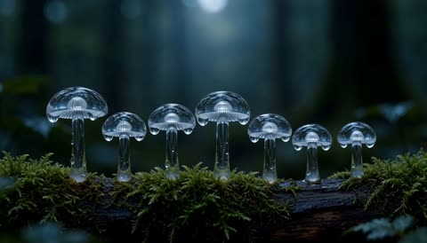
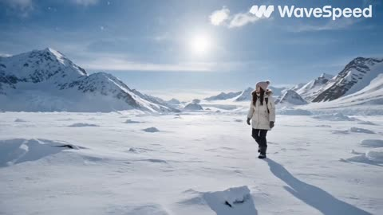
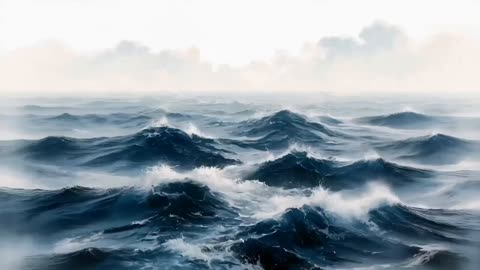
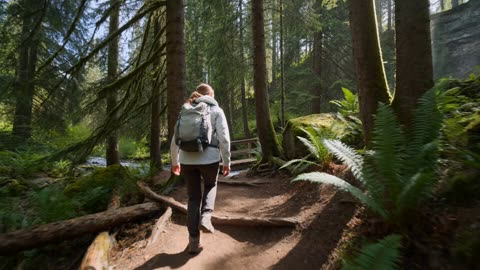

# Nature, travel and aerial

[Back to the list](../../README.md) · All 8 entries

<a id="h3-marina-boat-dolphin-encounter-travel-documentary"></a>
### Traveler boards boat and spots dolphins

<a href="https://x.com/nawalsehar/status/2090306968900784383"></a>

The prompt narrates one continuous action chain from dock to boarding, departure, dolphin sighting and reaction. Spoken lines are written inline, and a long list of physical realism cues plus a closing negative list keeps the motion and water believable.

MiniMax H3 · Text-to-video · Source: [@nawalsehar on X](https://x.com/nawalsehar/status/2090306968900784383) · 166 likes on 2026-10-28 · found via [SkyNotSilent/awesome-MiniMax-H3-cases](https://github.com/SkyNotSilent/awesome-MiniMax-H3-cases)

[`travel-documentary`](tags.md#tag-travel-documentary) [`photorealistic`](tags.md#tag-photorealistic) [`dialogue`](tags.md#tag-dialogue) [`lip-sync`](tags.md#tag-lip-sync) [`wildlife`](tags.md#tag-wildlife)

<details><summary><b>Prompt</b></summary>

```text
A young Western female traveler in her mid-20s walks naturally along a wooden marina dock toward a small white sightseeing boat. She wears a light blue windbreaker, white shirt, dark trousers, comfortable sneakers, sunglasses, a properly fitted life jacket, and a small crossbody bag. She carefully steps from the dock onto the gently rocking boat while holding the handrail, naturally shifting her weight as the boat responds to her movement. She walks toward the rear passenger bench, sits down, adjusts her position, and looks toward the open water. The boat engine starts with a realistic low rumble and gradually leaves the marina, creating a small bow wave and narrow wake. As the boat moves into open water, she notices movement nearby, looks surprised, and naturally says, "Wait... are those dolphins?" Two dolphins surface several meters beside the moving boat, swimming parallel at a safe distance with realistic tail propulsion, surfacing, diving, breathing, and water displacement. She picks up her phone with both hands and records them while smiling with genuine excitement. One dolphin briefly surfaces near the rear side of the boat, exhales through its blowhole, creates a small burst of mist and droplets, then dives beneath the water and leaves expanding ripples behind. She lowers her phone and says, "That is incredible." Ultra-photorealistic marine wildlife travel documentary, cinematic realism, natural human behavior, realistic walking and sitting biomechanics, physically accurate boat buoyancy and acceleration, authentic ocean waves and wake, realistic dolphin anatomy and swimming behavior, natural water reflections and refraction, accurate English lip synchronization, bright neutral daytime lighting, realistic coastal wind, immersive marina and ocean ambience, smooth documentary camera movement, continuous visual consistency, seamless storytelling from walking to boarding, departure, dolphin encounter, recording, and final reaction, no narration, no CGI appearance, no plastic skin, no robotic movement, no exaggerated dolphin jumps, no impossible water behavior, no sudden camera transitions, no text overlays, logos, or watermarks.
```

</details>

<a id="h3-glass-mushrooms-rising-notes"></a>
### Seven glass mushrooms ring in rising notes

<a href="https://x.com/GlennHasABeard/status/2102026855180046499"></a>

The prompt sets a fixed beat of one mushroom every one and a half seconds and pairs each beat with a pitch step and a single drop, so sound, action and detail share one count. A locked macro camera keeps all seven mushrooms in frame for the whole sequence.

MiniMax H3 · Text-to-video · Source: [@GlennHasABeard on X](https://x.com/GlennHasABeard/status/2102026855180046499) · 32 likes on 2026-10-29 · found via [SkyNotSilent/awesome-MiniMax-H3-cases](https://github.com/SkyNotSilent/awesome-MiniMax-H3-cases)

[`macro`](tags.md#tag-macro) [`sound-sync`](tags.md#tag-sound-sync) [`glass`](tags.md#tag-glass) [`locked-camera`](tags.md#tag-locked-camera)

<details><summary><b>Prompt</b></summary>

```text
one mushroom every one and a half seconds, each a slightly higher note, each shedding one drop
```

</details>

<a id="h3-white-calla-lily-morph-trails"></a>
### White calla lily unfurls in silk light trails

<a href="https://x.com/Shinebynous/status/2085505725149622337"></a>

Seven reference flowers are paired with a timed shot list, so each segment names one transformation and its trail colour. A locked forward macro push on pure black and an explicit ban on cuts and crossfades force the morph to stay continuous.

MiniMax H3 · Reference-to-video · Source: [@Shinebynous on X](https://x.com/Shinebynous/status/2085505725149622337) · 28 likes on 2026-10-29 · found via [SkyNotSilent/awesome-MiniMax-H3-cases](https://github.com/SkyNotSilent/awesome-MiniMax-H3-cases)

[`macro`](tags.md#tag-macro) [`flowers`](tags.md#tag-flowers) [`reference-images`](tags.md#tag-reference-images) [`long-exposure`](tags.md#tag-long-exposure)

<details><summary><b>Prompt</b></summary>

```text
Create a breathtaking 15-second cinematic flower-morph sequence using the seven uploaded flower images as consecutive visual references:

Image 1: white calla lily
Image 2: coral hibiscus
Image 3: burgundy dahlia
Image 4: orange and cobalt-blue bird of paradise
Image 5: neon-yellow orchid
Image 6: deep-purple iris
Image 7: electric-blue Himalayan poppy

MOTION:
One continuous cinematic macro shot. The camera performs a slow, controlled push toward the center of the flower while every transformation happens clearly in full view. The flower remains centered against a deep, pure black background. Petals rotate, flutter, stretch, divide, multiply, fold, and physically reorganize into each new botanical form. Translucent long-exposure trails follow the movement like illuminated silk ribbons. The single stem remains visually anchored throughout the sequence.

ACTION AND TIMING:

0–2 seconds:
A white calla lily rotates gracefully. Its sculptural trumpet petal unfurls, creating sweeping trails of pearl white, silver, and champagne.

2–4 seconds:
The calla lily’s curved petal organically divides into five broad petals, becoming a coral hibiscus. The golden spadix elongates into the hibiscus stamen while coral, peach, and white trails spiral outward.

4–6 seconds:
The hibiscus petals rapidly multiply from the center and fold into hundreds of geometric burgundy and raspberry petals. The flower becomes a richly layered dahlia, forming a hypnotic rotating vortex.

6–8 seconds:
The dahlia petals sharpen, extend, and reorganize into the architectural form of a bird of paradise. Burgundy and magenta ignite into fiery orange while cobalt-blue and turquoise structures burst outward like exotic wings.

8–10 seconds:
The bird of paradise curls inward. Its orange structures soften and divide into the broad neon-yellow petals of an orchid. The cobalt-blue structures transform into the intricate orchid center, accented with crimson and gold. Yellow, chartreuse, and luminous-white trails pulse outward.

10–12 seconds:
The orchid petals stretch and twist, transitioning from neon yellow through electric violet into deep royal purple. Golden markings expand into the textured beard of a majestic iris. The iris opens dramatically as violet, lavender, and golden trails circle around it.

12–15 seconds:
At the visual climax, the deep-purple iris spins faster. Its sculptural petals soften into delicate translucent fabric while the violet color shifts through indigo into intense electric blue. The iris beard separates into hundreds of tiny golden particles that spiral around the flower’s center.

The flowing petals broaden and physically transform into the delicate, paper-thin petals of an electric-blue Himalayan poppy. Its intricate golden-yellow stamens and pale-green pistil assemble from the swirling particles and snap into razor-sharp focus.

The poppy opens fully as a final wave of cobalt-blue, turquoise, icy-white, and silvery long-exposure trails expands outward like luminous wings. The trails gently return into the petals, leaving the electric-blue Himalayan poppy completely still, perfectly formed, and razor-sharp in the final frame.

RHYTHM:
Begin elegant and controlled, then progressively increase the speed, scale, and complexity of each transformation. Build through strong color contrasts and reach maximum energy during the purple-iris-to-electric-blue-poppy transformation. End with a brief moment of complete stillness so the final flower can be clearly admired.

STYLE:
Photo-realistic premium macro cinematography, extreme botanical detail, physically believable organic morphing, dramatic side-lighting, deep cinematic contrast, translucent petals, luminous long-exposure trails, controlled volumetric particles, elegant motion blur, luxurious fine-art photography, pure black background, clean centered composition, rich natural colors, high-end commercial quality, 4K.

IMPORTANT:
Create genuine continuous anatomical flower transformations. No cuts, crossfades, dissolves, overlays, double exposure, image blending, or separate flower shots. Every flower must physically grow from the petals, center, and botanical structures of the previous flower. Preserve one continuous stem, stable central positioning, consistent scale, coherent lighting, and uninterrupted forward camera movement. Every flower must remain clearly recognizable before transforming. No additional flowers, bouquet, vase, hands, insects, text, borders, or background objects.
```

</details>

<a id="omni-lights-sync-to-music"></a>
### Apartment lights switch on to the beat

<a href="https://storage.googleapis.com/gdm-deepmind-com-prod-public/media/FfbFqJ8qhY_ZWZyz/gemini-omni__prompt-guide__building-light.webm"></a>

Syncs a visual event to an audio track by naming both in one sentence. No timestamps needed.

Gemini Omni Flash · Video edit · Source: [Gemini Omni prompt guide](https://deepmind.google/models/gemini-omni/prompt-guide/)

[`audio-sync`](tags.md#tag-audio-sync) [`music`](tags.md#tag-music)

<details><summary><b>Prompt</b></summary>

```text
The lights of the apartments start turning on in sync with the music.
```

</details>

Inputs: [1](https://storage.googleapis.com/gdm-deepmind-com-prod-public/media/FfbFqJ8qhY_ZWZyz/gemini-omni__prompt-guide__building-no-light.webm)

<a id="seedance-arctic-woman-snow-wildlife-walk"></a>
### Woman walks across snowy Arctic plain

<a href="https://x.com/ayzalnooor24521/status/2090654913927983477"></a>

The outfit is listed piece by piece and a same-woman lock is repeated, which keeps the character consistent across the clip. The shot ends on a slow pull-back that reveals the full snowfield, giving the sequence a clear closing frame.

Seedance 2.5 · Text-to-video · Source: [@ayzalnooor24521 on X](https://x.com/ayzalnooor24521/status/2090654913927983477)

[`arctic`](tags.md#tag-arctic) [`travel-documentary`](tags.md#tag-travel-documentary) [`winter`](tags.md#tag-winter) [`wildlife`](tags.md#tag-wildlife)

<details><summary><b>Prompt</b></summary>

```text
A cheerful young woman explores a vast snow-covered Arctic landscape wearing a warm padded coat, knitted cap, gloves, winter pants, and closed snow boots. She walks through deep snow, amazed by the breathtaking mountains and falling snow. She discovers a polar bear cub and penguins nearby and happily watches them. She takes beautiful photos of the animals with her camera. She laughs and plays gently in the fresh snow while the animals move naturally around her. She sits in the snow, smiling joyfully as the polar bear cub and penguins remain nearby; camera slowly pulls back to reveal the vast snowy landscape.
Duration: 14s | 16:9 Landscape | Style: Ultra-realistic cinematic travel documentary, photorealistic 4K HDR, natural winter daylight
Maintain the same woman, face, outfit, and appearance throughout. Realistic animal behavior, natural movement, detailed snow and fur, smooth cinematic transitions, immersive winter ambience, no text, no subtitles, no logos, no watermark, no animation.
```

</details>

<a id="seedance-chinese-ink-wash-ocean-to-moon"></a>
### Painted deep blue ocean waves in ink wash style

<a href="https://x.com/noorwithwifi/status/2101683541629354348"></a>

The prompt lists the scene changes in order, from waves to mountains, river, cherry blossoms and moon, so the model treats it as one continuous shot. Style cues such as Chinese ink wash, soft watercolor textures and fluid transitions sit together at the end to set one consistent painting look.

Seedance 2.5 · Text-to-video · Source: [@noorwithwifi on X](https://x.com/noorwithwifi/status/2101683541629354348)

[`ink-wash`](tags.md#tag-ink-wash) [`scene-transition`](tags.md#tag-scene-transition) [`watercolor`](tags.md#tag-watercolor) [`chinese-painting`](tags.md#tag-chinese-painting)

<details><summary><b>Prompt</b></summary>

```text
A seamless traditional Chinese ink-wash watercolor animation begins with deep blue ocean waves transforming into misty mountains with a pagoda and stone stairs. Crimson ink clouds sweep across the scene, transitioning to a calm river with a small boat and an autumn-red tree. The red foliage transforms into delicate pink cherry blossoms, with petals drifting around a lone bonsai-like tree on a tiny island. Finally, a glowing full moon rises behind distant mountains, casting a golden reflection across the tranquil water as the scene fades into a peaceful night. Atmospheric, poetic, fluid transitions, elegant Chinese painting aesthetic, soft watercolor textures.
```

</details>

<a id="seedance-forest-hike-waterfall-bridge"></a>
### Hiker crosses forest bridge toward hidden waterfall

<a href="https://x.com/nawalsehar/status/2089219802598658291"></a>

A named follow cam move and an ordered sequence of beats (trail, bridge, waterfall) give the model one continuous shot with a clear destination. Explicit daylight, ambience and English lip sync cues set the documentary tone.

Seedance 2.5 · Text-to-video · Source: [@nawalsehar on X](https://x.com/nawalsehar/status/2089219802598658291) · found via [LearnPrompt/awesome-seedance](https://github.com/LearnPrompt/awesome-seedance)

[`hiking`](tags.md#tag-hiking) [`forest`](tags.md#tag-forest) [`waterfall`](tags.md#tag-waterfall) [`documentary`](tags.md#tag-documentary)

<details><summary><b>Prompt</b></summary>

```text
A young traveler hikes through a lush mountain forest, crosses a wooden bridge over a flowing stream, and reaches a stunning waterfall hidden among moss-covered rocks. Ultra-realistic travel documentary, authentic hiking movement, realistic environmental physics, natural English lip-sync, bright daytime lighting, immersive forest ambience, and seamless story continuity throughout.
```

</details>

<a id="seedance-tomato-seedling-macro-timelapse"></a>
### Macro time-lapse of seedling growing into tomatoes

<a href="https://x.com/Yesandyou_/status/2088998841395921185"></a>

A reference image of the soil locks the opening frame, and the prompt then splits the 10 seconds into five 2-second growth stages. A closing list of banned elements (cuts, camera movement, zoom, morphing) keeps the locked camera steady and the growth continuous.

Seedance 2.5 · Image-to-video · Source: [@Yesandyou_ on X](https://x.com/Yesandyou_/status/2088998841395921185) · found via [LearnPrompt/awesome-seedance](https://github.com/LearnPrompt/awesome-seedance)

[`time-lapse`](tags.md#tag-time-lapse) [`macro`](tags.md#tag-macro) [`nature`](tags.md#tag-nature) [`plants`](tags.md#tag-plants) [`locked-camera`](tags.md#tag-locked-camera)

<details><summary><b>Prompt</b></summary>

```text
Create a 10-second ultra-realistic cinematic macro time-lapse video 🌱🎥, using the provided reference image as the exact visual starting point. Begin with the same tiny green seedling 🌱 emerging from dark, rich, slightly moist soil. Keep the camera completely locked and stationary 📷, preserving the same composition, camera angle, depth of field, warm natural sunlight ☀️, soft background bokeh, and realistic soil texture throughout the entire video.

0–2 seconds 🌱: The tiny seedling slowly pushes upward from beneath the soil. Small cracks and subtle soil movement appear naturally around its base as the plant emerges. The thin green stem gradually becomes taller while the two young leaves slowly unfold and expand 🍃.

2–4 seconds 🌿: The seedling continues growing into a young tomato plant. The stem becomes thicker and taller, while additional green leaves and small branches gradually emerge. Each leaf unfolds naturally with visible veins and realistic botanical detail 🍃✨. Gentle sunlight passes through the leaves ☀️, creating beautiful natural highlights.

4–6 seconds 🌼: The plant grows fuller and stronger. Small yellow tomato flowers 🌼 begin appearing on the branches. The flowers gradually develop and bloom one by one, with delicate petals opening naturally. The plant continues extending upward and outward in a smooth time-lapse 🌿.

6–8 seconds 🍅: After flowering 🌼, tiny green tomatoes 🍅 begin forming beneath the flowers. The fruits slowly enlarge from tiny green buds into recognizable round tomatoes. More tomatoes develop across the branches while fresh leaves continue growing around them 🌿🍃.

8–10 seconds 🍅❤️: The green tomatoes gradually mature and transform into large, ripe, vibrant red tomatoes 🍅❤️. End with a healthy, fully grown tomato plant 🌿 surrounded by several beautiful ripe tomatoes hanging naturally from its branches.

Make the entire transformation smooth, continuous, organic, and biologically believable 🌱➡️🌿➡️🌼➡️🍅. Use photorealistic textures, realistic plant anatomy, detailed leaves and veins, natural soil particles, subtle wind movement 🍃, warm golden-hour sunlight ☀️, cinematic depth of field 🎥, soft background bokeh ✨, realistic shadows, macro photography quality, and highly detailed 4K visuals.

Important: No cuts ❌, no transitions ❌, no camera movement ❌, no zoom ❌, no camera shake ❌, no text ❌, no people ❌, no hands ❌, and no artificial-looking morphing ❌. The plant must grow progressively from the exact location of the original seedling, with every stage naturally connected to the previous stage. The final result should look like a real professional botanical time-lapse 🌱🎥🍅, showing the complete journey from a tiny seedling to a mature tomato plant full of ripe red tomatoes. 🍅✨
```

</details>
