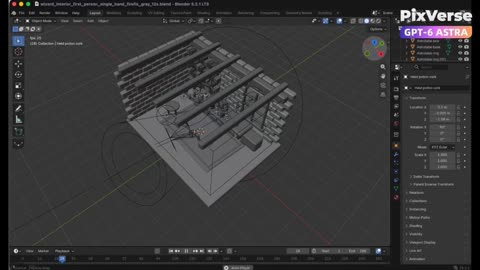
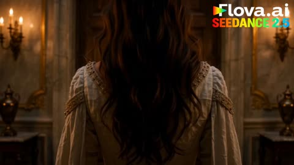
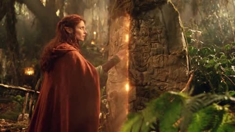
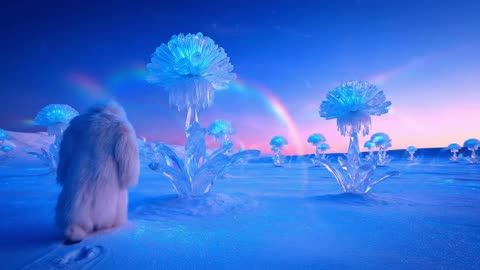

# Sci-fi and fantasy

[Back to the list](../../README.md) · All 99 entries · [1](video-scifi-fantasy.md) · **2**

<a id="seedance-wizard-workshop-transformation"></a>
### First person wizard workshop with glowing potion

<a href="https://x.com/KICHOCHEZI/status/2098432693222715716"></a>

A Blender white model fixes the camera path, timing and spatial layout through a reference video, while the supplied images set materials and light. Asking for one continuous take with a single held potion keeps the motion and props stable.

Seedance 2.5 · Reference-to-video · Source: [@KICHOCHEZI on X](https://x.com/KICHOCHEZI/status/2098432693222715716)

[`blender`](tags.md#tag-blender) [`white-model`](tags.md#tag-white-model) [`first-person`](tags.md#tag-first-person) [`reference-video`](tags.md#tag-reference-video)

<details><summary><b>Prompt</b></summary>

```text
Create a 12-second single-take white-model animation in Blender based on the supplied wizard workshop reference. Build the stone walls, wooden shelves, arched window, fireplace, books, astronomical instrument and alchemy table filled with potion bottles. Animate a low first-person viewpoint with exactly one right hand holding one potion. Begin with the bottle near the lower-right edge, look around the workshop and toward the window, raise the potion naturally, pause to examine it, then lower it while turning toward the fireplace and glowing reagents. Export the white-model MP4. Then use PixVerse with Seedance 2.5, referencing the Blender video for camera, action and spatial layout and the supplied images for appearance. Preserve the continuous shot and timing while adding weathered stone, carved wood, worn leather, realistic glass, cool window light, warm fireplace illumination, glowing magical liquids, natural flames, embers, sparks and smoke.
```

</details>

<a id="seedance-woman-castle-doors-floating-islands"></a>
### Woman opens castle doors to a floating sky

<a href="https://x.com/laviniavelle/status/2105889515948921057"></a>

The prompt lays out the shot in time order: dark interior, door reveal, run across the field, then a leap with the camera following, which gives the model a clear beat sequence to follow. The closing lighting and resolution terms set the cinematic finish.

Seedance 2.5 · Text-to-video · Source: [@laviniavelle on X](https://x.com/laviniavelle/status/2105889515948921057)

[`fantasy`](tags.md#tag-fantasy) [`castle`](tags.md#tag-castle) [`floating-islands`](tags.md#tag-floating-islands) [`camera-follow`](tags.md#tag-camera-follow)

<details><summary><b>Prompt</b></summary>

```text
Cinematic video of a young woman in an elegant white medieval dress opening large wooden doors from a dark castle interior to reveal a breathtaking sunny landscape with lush green fields a lake and distant mountains She runs out across the grassy field towards a large grand castle The camera follows her as she leaps into the air, gracefully floating into a magical fantasy sky filled with floating islands cascading waterfalls above clouds, and a large glowing pink moon in the surreal sky, 8k resolution, ultra detailed, cinematic lighting.
```

</details>

<a id="seedance-woodland-guardian-lantern-door"></a>
### Woodland guardian touches glowing carved standing stone

<a href="https://x.com/itxabdullaa/status/2107792780395458733"></a>

The prompt locks character, costume and palette in one reusable block, then runs timed beats with a continuity rule so the face, cloak and props stay the same across shots. Film-stock and practical-effects terms such as 35mm grain, practical lanterns and miniature sets steer the model away from glossy CGI.

Seedance 2.5 · Text-to-video · Source: [@itxabdullaa on X](https://x.com/itxabdullaa/status/2107792780395458733) · found via [LearnPrompt/awesome-seedance](https://github.com/LearnPrompt/awesome-seedance)

[`fantasy`](tags.md#tag-fantasy) [`practical-effects`](tags.md#tag-practical-effects) [`continuity`](tags.md#tag-continuity) [`film-grain`](tags.md#tag-film-grain) [`timed-shots`](tags.md#tag-timed-shots)

<details><summary><b>Prompt</b></summary>

```text
Create an original young adult female woodland guardian in the handcrafted style of a forgotten early-1990s live-action fantasy film. Fully original character and world, practical-effects aesthetic, not modern CGI.

CHARACTER: Young adult woman, natural expressive face, amber-brown eyes, softly angular features, subtly elongated fantasy ears, thick dark auburn wavy hair with small braids. Intelligent, brave, curious and quietly playful.

COSTUME: Fully modest sage-green high-neck linen blouse, brown leather vest, ankle-length olive wool skirt, opaque dark leggings, worn brown boots, leather wrist guards and long burnt-orange hooded cloak. Leather belt with small pouches, brass compass, herbs, wooden whistle and bronze leaf pendant. Real fibers, worn leather, tarnished metal and natural mud. Practical prosthetic fantasy ears.

SETTING: Ancient woodland at dusk, twisted trees, moss, ferns, mushrooms, streams, wooden bridges, carved stones and handmade lanterns. Hidden shelters and distant lights suggest a secret woodland settlement.

STYLE: Practical foliage, physical props, theatrical mist, practical lanterns, miniature sets, restrained optical effects, 35mm film softness, subtle grain, lantern halation, earthy greens, browns and amber, warm theatrical lighting. No glossy CGI or modern fantasy aesthetic.

[00:00-00:04] THE PATH
Low shot of her boots walking through damp leaves. Camera rises to her face. A distant metallic chime makes her stop.

[00:04-00:08] THE LANTERN
She finds a glowing antique lantern with no visible flame. It goes dark as she reaches for it. Another lantern lights deeper in the forest, then another. She realizes she is being guided.

[00:08-00:12] THE TRAIL
She follows the lanterns and discovers carved symbols on trees. One rotates when touched. Another moves behind her. Nobody is there. She smiles, realizing someone is watching.

[00:12-00:16] THE FOX
A woodland fox leads her to a fallen tree. Beneath its roots she finds a box containing a brass compass. Its spinning needle suddenly points upward. A shadow moves through the canopy.

[00:16-00:20] SOMEONE ABOVE
Leaves rustle. Acorns drop beside her boots. She looks upward and says softly, "You could simply come down." A hidden wooden platform creaks above. She smiles suspiciously.

[00:20-00:24] THE DOOR
She follows the sound to an enormous tree and discovers a hidden seam. She touches it. Carved symbols glow and the bark opens into a secret doorway filled with warm golden light. She enters.

[00:24-00:27] THE HIDDEN WORLD
Inside is a vast woodland settlement built around the tree: lanterns, wooden platforms, rope bridges, workshops, herbs and glowing windows. Hundreds of lanterns illuminate as she looks around in wonder.

[00:27-00:30] THE INVITATION
A wooden bridge leads to a folded parchment reading "YOU FOUND US." Several silhouettes appear among the lanterns. She smiles, places the parchment in her satchel and walks deeper into the settlement.

Camera pulls backward through the ancient tree doorway into the dark forest. Cut to black.

STRICT CONTINUITY: Same face, hair, ears, proportions, costume, cloak, boots, belt, pendant and satchel in every shot. Fully modest clothing with no wardrobe changes or exposure. Continuous geography and logical progression.

CAMERA: Atmospheric low angles, slow tracking, facial close-ups, wide environmental shots and restrained handheld movement.

FINAL LOOK: Authentic early-1990s 35mm fantasy film, practical prosthetics, real costumes, physical sets, theatrical mist, practical lanterns, subtle optical effects, natural performances and beautiful film grain.

Original character and world only. No recognizable existing characters, franchises, logos, branded costumes, copied designs, blood or gore.
```

</details>

<a id="veo-moon-dust-flowers"></a>
### Crystal flowers on a moon-dust plain

<a href="https://storage.googleapis.com/gdm-deepmind-com-prod-public/media/media/veo__veo-3__moon-dust.webm"></a>

Short world-building prompt. One striking detail (`the only footprints in untouched dust`) does more than a long list.

Veo 3 · Text-to-video · Source: [Veo 3 prompt guide](https://deepmind.google/models/veo/prompt-guide/)

[`world-building`](tags.md#tag-world-building) [`fantasy`](tags.md#tag-fantasy)

<details><summary><b>Prompt</b></summary>

```text
A snow-covered plain of iridescent moon-dust under twilight skies. Thirty-foot crystalline flowers bloom, refracting light into slow-moving rainbows. A fur-cloaked figure walks between these colossal blossoms, leaving the only footprints in untouched dust.
```

</details>

[1](video-scifi-fantasy.md) · **2**
