# Seedance 2.5

[Back to the list](../../README.md) · All 144 entries · **1** · [2](video-seedance25-2.md)

<a id="seedance-seoul-subway-revenge"></a>
### Seoul subway revenge comedy

<a href="https://x.com/AIwithSynthia/status/2108760866422415701"></a>

Sets the camera language in the first line (handheld, fluorescent, real time), then plays the gag in clear beats and spells out what must stay visible at the end.

Seedance 2.5 · Text-to-video · Source: [@AIwithSynthia on X](https://x.com/AIwithSynthia/status/2108760866422415701) · 10,056 likes on 2026-10-27

[`action`](tags.md#tag-action) [`comedy`](tags.md#tag-comedy) [`handheld`](tags.md#tag-handheld) [`subtitles`](tags.md#tag-subtitles)

<details><summary><b>Prompt</b></summary>

```text
Create a live-action cinematic revenge-comedy video set in a Seoul subway station. Use realistic handheld camera movement, cold fluorescent lighting, teal-green accents, and real-time action.

A Korean woman in her 20s with a black bob, sunglasses on her head, a fitted crop top, high-waisted blue jeans, black boots, and a brown shoulder bag descends the subway stairs holding a takeaway coffee. A Korean man with messy dark hair and blonde tips, wearing a dark-green bomber jacket, suddenly hits her from behind and laughs as she stumbles against the handrail. Furious, she chases him onto the platform as he boards a train and mocks her through the closing glass doors.

She punches the glass, creating a dramatic crack and opening. As she confronts him, her coffee cup slips from her hand, falls to the platform, and spills visibly across the floor. She grabs his jacket, forcefully throws him through the air, and sends him crashing into a large metal rubbish bin. The bin rattles and wobbles as he lands inside, looking terrified and humiliated.

She leans toward him and says, "Don't mess around." She then calmly walks away while he remains stuck in the bin.

Maintain identical faces, hairstyles, outfits, and location throughout. Include realistic physics, expressive reactions, cinematic close-ups, subway ambience, and clear white subtitles. Keep the action non-gory, the coffee spill visible, and the final dustbin landing unmistakable.
```

</details>

<a id="seedance-seoul-summer-evening-vlog"></a>
### A summer evening in Seoul, shot like a home video

<a href="https://x.com/AIwithkhan/status/2092971211169100048"></a>

Pure text, no reference image. Realism comes from asking for small accidents and imperfect camcorder operation.

Seedance 2.5 · Text-to-video · Source: [@AIwithkhan on X](https://x.com/AIwithkhan/status/2092971211169100048) · 6,187 likes on 2026-10-27

[`vlog`](tags.md#tag-vlog) [`ugc`](tags.md#tag-ugc) [`realism`](tags.md#tag-realism) [`home-video`](tags.md#tag-home-video)

<details><summary><b>Prompt</b></summary>

```text
Create a 30-second, 1080p ultra-realistic personal home-video showing an ordinary summer evening in the life of a young Korean woman. No reference image.

MAIN SUBJECT

Young Korean woman in her early 20s, naturally pretty, realistic skin texture, minimal makeup, relaxed and approachable personality.

Long black hair loosely tied into a messy side ponytail with a few loose strands around her face. Wearing a fitted pastel-blue short top, loose cream pajama-style pants, black sneakers and a simple silver necklace.

Maintain the same face, hairstyle, clothing, body proportions and overall appearance throughout the entire video.

SETTING

A quiet older Seoul residential neighborhood during a warm summer evening. Narrow concrete lanes, small houses, potted plants, bicycles, old walls, utility poles, overhead wires, a tiny neighborhood bakery, a public water tap and large leafy trees casting shadows across the street.

Everything should feel lived-in, ordinary and peaceful. No tourist attractions, advertisements, recognizable brands or commercial activity.

CAMERA / VISUAL AESTHETIC

Raw personal footage casually recorded by a friend on an early-2000s consumer DV camcorder.

Strong handheld shake, imperfect framing, autofocus hunting, exposure shifts, occasional motion blur, faded colors, soft digital detail, mild noise, accidental zooms and natural camera imperfections.

No stabilization, drone footage, gimbal movement, dramatic lighting or polished commercial cinematography.

 — OUTSIDE THE HOUSE

She steps outside carrying a small reusable shopping bag. She locks the door, adjusts her messy ponytail and looks toward the camera with a relaxed smile.

A light summer breeze moves her hair as she starts walking down the lane.

 — BAKERY STOP

She reaches a tiny neighborhood bakery and buys a warm pastry.

She steps outside, takes her first bite and immediately smiles because it tastes good.

She notices her friend filming and holds the pastry toward the camera playfully before taking another bite.

— WALKING HOME

She continues down the narrow street while eating.

A neighborhood cat follows her for a few steps. She notices it, crouches down and gently pets it.

The cat walks away and she laughs before continuing.

 — SMALL ACCIDENT

She walks beneath a large tree when a few leaves fall onto her hair.

She stops, looks confused, then realizes what happened and laughs.

She brushes the leaves away while her friend zooms awkwardly toward her face.

She looks directly into the camera and says:

"Seriously?"

 — QUIET MOMENT

She reaches a low concrete wall beside the street and sits down for a moment.

She finishes the pastry while watching bicycles and neighbors passing through the lane.

A gentle breeze moves her hair. She casually fixes her ponytail and looks around peacefully.

 — FINAL MOMENT

She stands up and continues walking home.

After a few steps, she turns back toward the camera with a small playful smile and says:

"Come on."

She keeps walking down the sunny lane while the camera follows behind.

She disappears around the corner and the recording abruptly cuts to black.

AUDIO

Natural location sound only: birds, summer insects, footsteps, bicycle bells, distant scooters, leaves moving in the breeze, bakery sounds, neighborhood conversations and subtle camera-handling noise.

No music. No narration. No artificial sound effects.

Only the two spoken lines specified above.

FINAL FEEL

The entire video should feel like a forgotten summer recording from the early 2000s.

Warm, feminine, casual, slightly playful, intimate and nostalgic.

No dramatic events, no exaggerated acting, no model poses and no polished cinematic shots.

The realism should come from ordinary surroundings, natural expressions, small accidents, realistic environmental movement and imperfect camcorder operation.
```

</details>

<a id="seedance-katsudon-anime-cooking"></a>
### Katsudon cooked in fast-cut anime style

<a href="https://x.com/Goodmanprotocol/status/2098845134326808734"></a>

Opens with an explicit ban on imitating any existing anime, then walks through the recipe step by step so every cut has a job.

Seedance 2.5 · Text-to-video · Source: [@Goodmanprotocol on X](https://x.com/Goodmanprotocol/status/2098845134326808734) · 4,935 likes on 2026-10-27

[`anime`](tags.md#tag-anime) [`food`](tags.md#tag-food) [`fast-cut`](tags.md#tag-fast-cut)

<details><summary><b>Prompt</b></summary>

```text
Create a 30-second fast-paced cinematic Japanese anime cooking video showing the preparation of authentic katsudon, entirely from the text description below.

IMPORTANT: Do not display, recreate, trace, reference, or imitate any storyboard, sketch, reference image, panel, annotation, or source material. Generate only original anime-style animation.

STYLE

High-quality Japanese anime film style, cinematic summer lighting, ultra-detailed food textures, realistic cooking physics, visible steam and moisture, shallow depth of field, macro close-ups, smooth camera movement, warm Japanese kitchen atmosphere. Fast rhythmic editing with natural match cuts based on movement, shape, texture, and composition.

TIMELINE

0–2.5s — Prepare Pork
Close-up of hands pounding a thick pork loin with a wooden mallet on a cutting board. The meat gradually flattens and its fibers loosen. Sprinkle salt and pepper evenly. Crisp rhythmic impacts.

2.5–5s — Bread the Pork
Quick match cuts: press the pork into flour, dip into beaten egg, then firmly coat with coarse panko breadcrumbs. Show realistic egg dripping and breadcrumbs adhering to the surface.

5–7.5s — Fry
Lower the breaded pork into hot golden oil. Intense bubbling surrounds the cutlet as the crust turns golden brown and crispy. Warm cinematic lighting and detailed oil movement.

7.5–9.5s — Slice
Place the fried tonkatsu on a wooden board. A sharp knife cuts it into even strips. The crispy crust cracks naturally, revealing juicy white pork with gentle steam escaping.

9.5–12s — Simmer Dashi & Onion
Thinly sliced onions gently simmer in amber dashi inside a shallow pan. Small bubbles rise while the onions become translucent. Chopsticks gently move them through the broth.

12–14s — Add Tonkatsu
Place the sliced tonkatsu carefully over the simmering onions using chopsticks. The broth begins soaking into the crispy edges while steam rises.

14–16.5s — Pour Egg
Slowly pour beaten golden egg over the tonkatsu and onions. The egg spreads naturally through the gaps and begins setting around the hot edges.

16.5–19s — Set the Egg
Close-up of the egg gently coagulating over low heat. Edges become soft and golden while the center remains glossy, slightly runny, and trembling. No stirring.

19–21s — Prepare Rice
A white ceramic donburi bowl receives a generous mound of steaming Japanese short-grain rice. The rice looks fluffy and slightly glossy.

21–24s — Assemble
Carefully slide the egg-and-tonkatsu mixture from the pan onto the rice. The egg settles naturally in a soft wave while dashi lightly absorbs into the rice.

24–26s — Final Close-Up
The finished katsudon rests on the counter. Glossy egg slowly settles over the tonkatsu and rice, gently trembling. Slow cinematic push-in.

26–30s — Hero Reveal
Present the finished katsudon in a traditional blue-and-white ceramic bowl on a wooden surface. Golden egg covers crispy tonkatsu over glossy rice, topped with fresh mitsuba. Steam rises as the camera slowly arcs around the bowl for a beautiful anime-food-film ending.

AUDIO

Bright 1980s-inspired Japanese city-pop instrumental, 110–120 BPM, with subtle koto and light chime percussion. Synchronize realistic ASMR cooking sounds: mallet impacts, knife slicing, frying sizzle, bubbling dashi, chopsticks, egg pouring, steam, and a soft ceramic clink.

End with one delicate wind-chime tone during the final reveal.

NEGATIVE

No storyboard, reference image, sketch, panels, borders, numbers, arrows, annotations, subtitles, captions, UI, logos, or text overlays. No unrelated ingredients or dishes. Katsudon only. Keep the food, hands, utensils, lighting, and environment visually consistent throughout.
```

</details>

<a id="seedance-rainy-morning-university-vlog"></a>
### Rainy morning, coffee, walk to university

<a href="https://x.com/nawalsehar/status/2103337966416621703"></a>

Under 1,000 characters for 30 seconds. A tight routine plus a short list of failure modes to avoid.

Seedance 2.5 · Text-to-video · Source: [@nawalsehar on X](https://x.com/nawalsehar/status/2103337966416621703) · 4,181 likes on 2026-10-27

[`vlog`](tags.md#tag-vlog) [`realism`](tags.md#tag-realism) [`morning-routine`](tags.md#tag-morning-routine)

<details><summary><b>Prompt</b></summary>

```text
Create a 30-second ultra-photorealistic live-action university vlog of a European brunette in her mid-20s waking to a rainy morning, making coffee, getting ready, grabbing her umbrella, walking through a wet city, and arriving at university just before class.

Modern smartphone vlog style: natural handheld movement, subtle shake, autofocus changes, realistic rain, puddles, reflections, traffic, umbrellas, wet clothing, natural expressions and believable human movement.

Dialogue: “Good morning… apparently, it’s raining.” → “First coffee. Then lecture.” → “Two minutes early. I’m impressed.” → “Okay, made it.”

Natural diegetic audio only. No music, narration, CGI look, artificial rain, face changes, distorted anatomy, impossible physics, subtitles, logos or watermark.

16:9 • 24fps • 4K • Ultra-photorealistic live action
```

</details>

<a id="seedance-cafe-table-multi-angle-reshoot"></a>
### Cafe table talk reshot from thirteen new angles

<a href="https://x.com/Scenario_gg/status/2102365054389899695"></a>

The prompt locks performance, audio, lighting and tempo of the source video, then varies only camera position and lens through a timed shot list. Measured speech windows, an eyeline rule and an empty sky rule keep lip sync and background clean in every new angle.

Seedance 2.5 · Video edit · Source: [@Scenario_gg on X](https://x.com/Scenario_gg/status/2102365054389899695) · 3,287 likes on 2026-10-27

[`video-to-video`](tags.md#tag-video-to-video) [`multi-angle`](tags.md#tag-multi-angle) [`camera-plan`](tags.md#tag-camera-plan) [`lip-sync`](tags.md#tag-lip-sync) [`timed-shot-list`](tags.md#tag-timed-shot-list)

<details><summary><b>Prompt</b></summary>

```text
Prompt (seedance 2.5 video to video):

ONE FINISHED TAKE, RE-PHOTOGRAPHED


@video1
 is one finished take: a single locked-off wide, 19.53 s, with its original audio, a young man at an outdoor cafe table talking to one camera. Do not restage, re-perform, re-time or reinterpret it. Re-photograph the identical event from thirteen new camera positions, as if thirteen extra cameras had been rolling around him in the same moment. Every output frame shows the same body at the same instant of
@video1
 at the same speed. Output runs the full 19.53 s. Keep the audio of
@video1
 unchanged and in sync.

DO NOT CHANGE
Performance, body, hands and what they hold, head angle, eyeline, lip movement, blink timing, movement speed, action start and end times, lighting, exposure, white balance, colour grade, wardrobe, props, set. The only variable is camera position and lens.

SPEECH WINDOWS (measured from the audio of
@video1
)
SPEAKING: 0.00-1.65, 2.05-4.80, 5.95-6.90, 9.65-11.75, 12.20-12.85, 13.35-13.80, 16.70-16.90, 17.60-18.90.
SILENT, mouth closed and still or chewing: 1.65-2.05, 4.80-5.95, 6.90-9.65 (drinking), 11.75-12.20, 12.85-13.35, 13.80-16.70 (chewing), 16.90-17.60, 18.90-19.55.
Whenever his mouth is visible in a SPEAKING window it moves in lip-sync with the audio of
@video1
. He talks while looking down: from 2.05 to 4.80 his head is down at the laptop and he is speaking. Head down is not silent. Never add speech to a silent window, never mute a speaking one.

EYELINE RULE
He performed to ONE camera, the A-camera: the original locked-off wide, directly in front of him at seated eye level. His eyeline stays on that spot in every shot, apart from the glances down at keyboard, mug and pastry already in
@video1
. He never looks for or turns toward a new camera. From above he reads cap and brow; from the sides, three-quarter or profile; from behind, the back of his head. Single exception: the on-axis shot at 00:01-00:02 sits where the A-camera was, so there alone he looks into the lens.

TEMPO RULE
Real time, 1:1 with
@video1
. No speed ramps, added slow motion, freeze frames or time remaps. Exactly one slowed passage exists, already baked into the source: the pastry at the top of its arc, 12.5-13.55. Reproduce it at the speed it already has, no slower, no longer.

TOSS TIMING
The pastry leaves his fingers at 12.43 and is caught at 13.60: airborne about one second only. Do not stretch, loop or hang the flight. Before 12.43 and after 13.60 it is in his hand.

EMPTY SKY
On every low or upward-tilting shot the sky is plain pale overcast and empty. No skyscrapers, glass towers, solar panels, cranes, birds, aircraft, sun disc, structured clouds, lens flare or signage. Above his head only cream wall, white pillars and flat pale sky.

CAMERA PLAN

[00:00-00:01] High-angle MCU from above and to his right, about 40 degrees down, chest up, slow push-in, 35mm feel, moderate depth of field, cap brim and open gesturing palms, marble edge in the lower foreground. Speaking, reading three-quarter, not to this lens.

[00:01-00:02] ON THE A-CAMERA AXIS. ECU of his face, dead front, seated eye level, 85mm feel, shallow focus, pillars soft cream behind. The one shot where he looks into the lens. Hands drop below frame onto the keyboard; mouth closes at 1.65.

[00:02-00:05] Macro along the MacBook keyboard to his typing fingers, lens centimetres above the keys, razor-thin focus, keycaps sharp, his face soft far behind, head down. Speaking 2.05-4.80: where his mouth shows in the blur it moves with the audio. Fingers lift at 5.0.

[00:05-00:06] Top-down bird's eye straight down over the table, 24mm feel, deep focus, locked off. Marble disc fills frame: open laptop, white mug, financier, his cap at the bottom edge. Right hand crosses to the mug handle.

[00:06-00:07] Lens resting on the marble at table height, 50mm feel. White mug large and sharp in the left foreground; his hand enters from the right, grips the handle, lifts the mug up out of frame. Torso soft behind. Speaking 5.95-6.90.

[00:07-00:09] First-person POV from his seat, ultra-wide 18mm feel, gentle handheld breathing. The mug rim rises into the bottom of frame and tips toward the lens; laptop screen and marble beyond in deep focus. No face; framing dips to the mug, never up. Silent.

[00:09-00:10] Extreme wide, slow dolly out, 24mm feel, deep focus. He is small at his table mid-terrace: cream wall, pillars, concentric-circle mural, taped boxes behind, slatted bench visible. He sets the mug on the marble 9.4-10.0; speech resumes 9.65.

[00:10-00:12] Low and to his left, lens just above the marble, 50mm feel, shallow focus, table edge and mug soft in the near foreground. Right hand reaches out at 10.5 and lifts the golden financier into sharp focus before his left profile. Talking to the A-camera: full profile here.

[00:12-00:14] Low beside him, 35mm feel, slight Dutch. Opens on the pastry in his fingers; at 12.43 it leaves his hand and the camera tilts UP, following it against plain pale overcast sky and the top of a white pillar through the baked-in slow apex 12.5-13.55, then tilts DOWN for the catch at 13.60 into cupped hands, head tipped back, mouth open, then head coming forward.

[00:14-00:15] Behind him, over his right shoulder, 50mm feel, moderate focus. Back of the black Yankees cap and long dark hair fill frame-left; laptop glow and marble past his shoulder. Head settles level, hands bring the pastry toward his mouth. No face. Silent.

[00:15-00:16] ECU on his mouth and jaw, 100mm macro feel, very shallow focus, soft open-sky light. The financier enters from below, he bites, crumbs, the jaw chews. Chewing, not speaking. Nothing above the nose in frame.

[00:16-00:18] Slow orbit from his left toward front, 35mm feel, moderate focus, mural and pillars parallaxing behind, table crossing the foreground. He chews, speaks 16.70-16.90 and from 17.60, open palms, a small shrug. As the orbit nears front his gaze lands near, not into, this moving lens.

[00:18-00:20] Top-down bird's eye straight down over the table, 24mm feel, deep focus, locked off. Hands come down beside the laptop and settle, cap centred, speech ends 18.90, then still. Hold to 19.53.

SET AND SUBJECT CONTINUITY (identical in every shot)
Young man, long dark hair, black short-sleeve button-up shirt with a small chest logo, black New York Yankees baseball cap, grey trousers. Light wood slatted bench, round white marble table, outdoor cafe terrace. On the table: open dark grey MacBook, white mug with a circular graphic, one small golden financier. Behind him: cream wall, white cylindrical pillars, large black-and-white concentric-circle mural, taped cardboard boxes. Soft overcast open-shade daylight, no hard shadows, constant direction and softness. Warm bright grade: cream walls, golden wood, neutral white marble, warm skin, deep neutral blacks. He is alone; no passers-by, no staff.

No on-screen text, captions, subtitles, watermarks or logos beyond the small chest logo and cap emblem already in
@video1
.
```

</details>

<a id="seedance-diner-frozen-time-rewind"></a>
### 1950s diner: time freezes, then rewinds

<a href="https://x.com/techhalla/status/2083389002552664385"></a>

A single effect carried for 30 seconds. The diner is described once in detail so the freeze and rewind read clearly against it.

Seedance 2.5 · Text-to-video · Source: [@techhalla on X](https://x.com/techhalla/status/2083389002552664385) · 2,873 likes on 2026-10-27

[`vfx`](tags.md#tag-vfx) [`time-freeze`](tags.md#tag-time-freeze) [`period`](tags.md#tag-period)

<details><summary><b>Prompt</b></summary>

```text
Photorealistic cinematic 1950s American diner, chrome stools, red vinyl, neon glow and checkerboard floor, shot with modern lived-in realism and soft natural window light. Subtle handheld texture, warm practicals, rich period detail, heavy film grain.

0-4s: [Medium Wide] A striking young woman in her early 20s sits alone at the counter, calm and slightly amused, slowly sipping a tall thick milkshake through a straw. Behind her a young waitress in classic uniform approaches with a tray of eggs and bacon in one hand and a full glass coffee pot in the other. An older lady starts rising from a nearby booth.

4-8s: [Dynamic Tracking] The older lady collides hard into the waitress. Tray, plate, eggs, bacon and coffee pot explode upward in chaotic slow motion. Coffee erupts into long liquid ribbons and perfect suspended droplets. Camera immediately begins a smooth continuous orbit around the impact. Time locks completely at the peak of the spill. Every face freezes in pure shock. Only the girl at the counter keeps moving, completely unfazed.

8-17s: [Slow 360° Orbital] Camera glides in a full elegant orbit through the frozen diner. Coffee hangs in mid-air as glassy ribbons and spheres with perfect volume and surface tension. Bacon strips, eggs and the spinning tray float weightlessly. Patrons and waitress remain locked in startled expressions. The girl at the counter takes one slow, deliberate sip, eyes half-lidded, almost bored, while the entire frozen world (except her) begins an elegant reverse: every droplet, every piece of food and every person rewinds smoothly back to the exact starting positions.

17-24s: [Medium Shot] Rewind lands perfectly. Waitress stands balanced again with tray and coffee pot. The girl lifts her eyes, raises two fingers in a small casual gesture and softly calls the waitress by name. The waitress turns toward her just before the older lady begins to stand, completely avoiding the collision. A tiny private smile crosses the girl’s face.

24-30s: [Extreme Close-Up] Hard cut to her face as she takes one last slow sip. Soft knowing smile, eyes almost closed in quiet satisfaction, like she has done this a hundred times. Shallow depth of field, creamy bokeh of the neon diner behind her.

Photorealistic, ultra-detailed fluid physics, perfect motion blur only on moving elements, stable characters, cinematic lighting, heavy natural film grain, no artifacts, movie-level temporal coherence, high rewatch value.
```

</details>

<a id="seedance-lab-containment-breach"></a>
### Lab containment breach, sci-fi horror

<a href="https://x.com/auqibhabib/status/2099725768310009982"></a>

Asks for an immediate hook and grounded practical effects, which keeps the creature from looking like CGI.

Seedance 2.5 · Text-to-video · Source: [@auqibhabib on X](https://x.com/auqibhabib/status/2099725768310009982) · 2,425 likes on 2026-10-27

[`horror`](tags.md#tag-horror) [`sci-fi`](tags.md#tag-sci-fi) [`action`](tags.md#tag-action)

<details><summary><b>Prompt</b></summary>

```text
Cinematic sci-fi horror-action short film set in a research laboratory, opens with an immediate strong hook, natural realistic pacing, grounded practical-effects style. Lab filled with steel equipment, glass containment tubes, monitors, specimen tables, harsh fluorescent lighting. Five scientists in lab coats work at various stations. Natural handheld camera work, muted authentic color grading, all sound fully natural and diegetic — no music, no artificial sound design until the tension score kicks in.
>
> **[0-1s]** Hard cut: a containment tube shatters violently, glass exploding across the lab floor.
>
> **[1-2s]** A small dark parasite creature skitters out fast, latching instantly onto a scientist's neck.
>
> **[2-3s]** He screams, collapsing to his knees, the others recoiling in shock.
>
> **[3-4s]** Dark veins pulse rapidly beneath his skin, visible even through his collar, his body convulsing.
>
> **[4-5s]** His eyes turn a deep obsidian black — he rises, movements jerky and unnatural.
>
> **[5-6s]** He lunges at the nearest colleague, parasite tendrils extending from his mouth toward her.
>
> **[6-7s]** She's caught, tendrils latching onto her neck, her scream cutting short.
>
> **[7-8s]** Veins spread fast across her too, body convulsing against a lab table, equipment crashing down.
>
> **[8-9s]** She rises seconds later, eyes black, joining him, both turning toward the remaining three.
>
> **[9-10s]** The three scientists scramble back, one grabbing a fire axe from an emergency case on the wall.
>
> **[10-11s]** The two infected charge fast, jerky inhuman movements, tendrils whipping from their jaws.
>
> **[11-12s]** The lead scientist swings the axe hard into the first infected — a solid impact, it staggers into a specimen table, equipment shattering.
>
> **[12-13s]** A second scientist grabs a fire extinguisher, blasting the other infected in the face, it recoils, tendrils flailing.
>
> **[13-14s]** The third scientist shoves a steel cart into the staggering infected's path, sending it crashing down.
>
> **[14-15s]** Both infected collapse motionless, twitching, tendrils retracting slowly.
>
> **[15-16s]** The three survivors regroup, breathing hard, scanning the wrecked lab for more movement.
>
> **[16-17s]** Wide shot: broken glass and toppled equipment everywhere, alarm lights beginning to flash red.
>
> **[17-18s]** A third containment tube behind them starts cracking, unnoticed by the group.
>
> **[18-19s]** It shatters suddenly — another parasite creature launches out fast.
>
> **[19-20s]** The lead scientist spins just in time, swinging the axe and slicing it out of the air mid-leap.
>
> **[20-21s]** It hits the floor, motionless, dark fluid spreading slightly beneath it.
>
> **[21-23s]** The group presses their backs together, weapons raised, scanning every corner of the lab.
>
> **[23-25s]** Emergency lights flash steadily red, alarm klaxon blaring through the facility.
>
> **[25-27s]** The lead scientist gestures toward the exit; they move together cautiously, stepping over debris and fallen colleagues.
>
> **[27-29s]** They reach the heavy lab door, the lead scientist sealing it shut behind them with a hard mechanical clang.
>
> **[29-30s]** Final shot: the three survivors lean against the sealed door, breathing hard, alarm lights flashing red across their exhausted faces. Cut to black.
>
> Natural diegetic sound throughout — glass shattering, guttural convulsions, screaming, metal impacts, alarm klaxon, heavy breathing — layered with a tense instrumental score building through the fight and easing at the end. No text overlay, no watermark. Natural handheld camera with realistic shake during action, muted clinical color grading.
```

</details>

<a id="seedance-woman-in-storm-crowd"></a>
### A woman stands still while the crowd moves in sync

<a href="https://x.com/AIwithkhan/status/2099707375943066094"></a>

Uploaded images lock the woman, the crowd and the framing. The text only directs motion and lists what must not appear.

Seedance 2.5 · Reference-to-video · Source: [@AIwithkhan on X](https://x.com/AIwithkhan/status/2099707375943066094) · 2,128 likes on 2026-10-27

[`fashion`](tags.md#tag-fashion) [`crowd`](tags.md#tag-crowd) [`reference-images`](tags.md#tag-reference-images)

<details><summary><b>Prompt</b></summary>

```text
Create a ultra-realistic cinematic fashion video using the uploaded images as exact visual references for the woman, crowd, wardrobe, framing, and atmosphere.
A young woman with the same short dark bob wears a fitted black turtleneck, black trousers, and black shoes, standing confidently at the center of a large crowd.
Start with her walking slowly toward the middle of the crowd, calm and expressionless, with a lit cigarette naturally held between her lips.
She reaches the center, stops, and faces directly into the camera.
She takes one slow drag from the cigarette, then removes it from her mouth.
She slowly exhales a visible stream of smoke toward the camera, with the smoke naturally drifting across her face.
She lowers her hand and becomes completely still, staring directly into the lens.
The entire crowd behind her remains frozen for a brief moment.
Suddenly, everyone behind her begins moving in perfect synchronization — sharp head turns, shoulder jerks, folding forward and snapping upright.
The movement should feel rhythmic, strange, powerful, and physically realistic.
The woman does not move at all while the entire crowd moves behind her.
Slowly push the camera closer to her, keeping her sharply focused while the crowd has subtle depth-of-field blur.
Dark, cold, mysterious lighting with deep shadows, realistic skin, hair, clothing, cigarette ember, and physically accurate smoke.
Photorealistic live-action quality, cinematic composition, natural human movement; no animation, CGI look, duplicated woman, distorted bodies, excessive smoke, text, subtitles, or logos.
```

</details>

<a id="seedance-ugc-night-yacht"></a>
### Friends film a night out on a phone

<a href="https://x.com/mightyking/status/2089299068514148655"></a>

Starts by naming the camera operator (a friend walking with the group). Everything about the shake and framing follows from that.

Seedance 2.5 · Text-to-video · Source: [@mightyking on X](https://x.com/mightyking/status/2089299068514148655) · 2,038 likes on 2026-10-27

[`ugc`](tags.md#tag-ugc) [`vertical`](tags.md#tag-vertical) [`realism`](tags.md#tag-realism) [`handheld`](tags.md#tag-handheld)

<details><summary><b>Prompt</b></summary>

```text
Raw vertical phone video (UGC), handheld throughout, filmed by a friend who walks with the group, casual sway, natural night lighting, wide-angle lens, deep focus.

Characters: The hero is a young woman with long dark hair in a deep-purple one-shoulder dress with a small shoulder bag. Her three friends: one in a dark brown dress, a blonde in a black wrap dress, a blonde in a white mini dress — party dresses and sandals. Laughing, spontaneous night-out energy.

Setting: A luxury marina at night — a stone quay along a narrow water slip flanked on both sides by large moored luxury yachts, big white hulls rising on either side, masts and rigging above, fenders on the hulls. Warm orange street lamps, palm trees, distant city lights. The yachts glow with blue-turquoise underwater LED lights spilling into the water; a yellow mooring line runs to the stone.

[0.0s–4.0s] — Wide tracking shot, eye level, camera moving backward. The camera walks backward ahead of the four women as they stroll toward it down the marina promenade, framed head-to-toe, laughing and chatting in French; warm lamplight and palm trees behind, slight handheld bob.

[4.0s–6.0s] — Medium shot, eye level, backward track + quick left pan. The woman in the purple dress surges ahead of the group toward the lens, one arm raised, hair flying; the camera, on their left, keeps tracking back and pans to hold her.

[6.0s–8.0s] — Medium-wide, camera tilts down-left to follow, whip motion. She reaches the quay edge between the moored luxury yachts and launches headfirst over the edge; the handheld camera whips left and tilts down to chase her off the stone.

[8.0s–10.0s] — High-angle wide, looking down at the water, slight jolt. From up on the quay the camera looks down as she plunges headfirst into the blue-turquoise water in the slip between the big yacht hulls — a big splash, the underwater lights glowing around the impact; the handheld frame jolts slightly with the motion.

[10.0s–13.0s] — High-angle medium, looking down, small handheld drift. She surfaces in the teal water, gasping and laughing up at the camera, hair slicked back, treading water.

[13.0s–16.0s] — Handheld tilt up and back down, slight zoom. The camera lifts off the water and tilts up to a person leaning on the deck railing of one of the moored luxury yachts, watching her in the water, then tilts back down and zooms slightly in on her still treading and laughing.

[16.0s–20.0s] — High-angle medium, tilting to follow her up. She swims to the stone quay wall, reaches up and grabs a thick dark mooring pole, and hauls herself out; the camera tilts upward with her as she rises from the water, legs braced on the stone.

[20.0s–23.0s] — Low/close medium at the quay edge, static handheld. She climbs onto the stone lip, rolls onto her side, soaked dress clinging, then pushes up to her feet; the camera holds close, catching the water running off her.

[23.0s–27.0s] — Medium shot, eye level, loose handheld reframe. Back on the promenade, dripping wet, she flips her long wet hair forward and wrings it out, laughing, as her friends and passing pedestrians move behind her.

[27.0s–30.0s] — Medium shot, eye level, camera settles. Still dripping, she straightens up and strikes a confident, playful pose for the camera — hand on hip, tossing her wet hair back with a big smile — her friends laughing around her; the camera holds on the pose to end.

Audio: Live sync sound — friends laughing and shouting excitedly in French, a scream at the leap, a big water splash, water sloshing against the yacht hulls, wet footsteps on stone, ambient night marina sounds. No music.

Style: Raw amateur vertical phone footage, natural night lighting, warm street lamps mixing with the turquoise underwater yacht glow, authentic handheld motion.
```

</details>

<a id="seedance-zombie-calico-cat-reunion"></a>
### Crying ginger cat aims handgun at zombie calico

<a href="https://x.com/ElsaSofia__AI/status/2108740749420646730"></a>

A timestamped shot list assigns each beat a framing, an action and an emotional turn, so the tension in the dark cabin resolves cleanly into the golden hour meadow. The opening lays out both characters, both settings and the lighting contrast between the two halves, which keeps the cats and the locations consistent across cuts.

Seedance 2.5 · Text-to-video · Source: [@ElsaSofia__AI on X](https://x.com/ElsaSofia__AI/status/2108740749420646730) · 2,000 likes on 2026-10-27

[`short-film`](tags.md#tag-short-film) [`cats`](tags.md#tag-cats) [`emotional`](tags.md#tag-emotional) [`timestamped-shots`](tags.md#tag-timestamped-shots) [`cinematic`](tags.md#tag-cinematic)

<details><summary><b>Prompt</b></summary>

```text
Cinematic emotional short film, live-action look, 16:9, 24 seconds, 24 fps. Characters: a ginger tabby cat that stands upright on its hind legs like a human, and a calico cat (black, white and orange). At the start the calico is zombie-like: cloudy pale eyes, torn fur hanging in shreds, sharp fangs. Opening setting: a dark rustic wooden cabin kitchen at night, pots on wooden shelves, a window with cold blue night light, wooden plank floor. Final setting: a green meadow at golden-hour sunset with white dandelion fluff floating in the air.

0:00-0:01.5 Extreme close-up of the ginger tabby with tears in his eyes, holding a black handgun with both paws, aimed toward the camera (gun out of focus in the foreground).

0:02-0:02.5 Over-the-shoulder wide shot from behind the ginger cat: he aims the handgun at the zombie calico slowly walking toward him across the wooden floor.

0:03-0:03.5 Front shot: the ginger cat stands upright, aiming with both paws, dark wooden wall and blue window behind him.

0:04-0:04.5 Close-up of the zombie calico, glassy pale eyes, then snarling with fangs.

0:05-0:06.5 Extreme close-up of the ginger cat's face, tears rolling down.

0:06.5-0:08 He stands aiming, then slowly lowers the gun.

0:08.5-0:09 The gun drops from his paw and he opens both arms wide for a hug.

0:09.5-0:10 Quick cuts: the zombie calico's face, then the ginger cat with eyes closed and a tear falling.

0:10.5 The calico leaps into his arms, wrapping her white paws around him; her fur is now healthy and normal.

0:11-0:13 Cut to the sunset meadow: the two cats roll and cuddle in the grass, white fluff floating around, warm golden light.

0:13-0:18 Close-up of the calico's affectionate face while the ginger cat's paw gently touches her face and head; the ginger cat lies on his back in the grass, eyes closed, peaceful.

0:18-0:20.5 The ginger cat's paw rests on her face; he looks up, content and relaxed.

0:21-0:22 Wide silhouette shot: the two cats sit snuggled together against the glowing sunset, tall grass and wildflowers in the foreground.

0:22.5-0:24 Close-up with sun flare: the ginger cat tenderly rubs his head against the calico's head. End.

Style: dramatic zombie-movie tension turning into a heartwarming ending, shallow depth of field, realistic fur detail, warm golden-hour light in the second half, dark low-key lighting in the first half.
```

</details>

<a id="seedance-anime-rooftop-brawl-kinetic-fight"></a>
### Two Anime Fighters Brawl on Rooftop

<a href="https://x.com/aimikoda/status/2111824828009193814"></a>

Character reference blocks lock each fighter's outfit, then a style and energy header sets cel shading, impact frames and constant camera motion. A four shot list gives each shot its own camera path and a chain of strikes with no pauses, and an Avoid line bans slow motion and freeze frames.

Seedance 2.5 · Reference-to-video · Source: [@aimikoda on X](https://x.com/aimikoda/status/2111824828009193814) · 1,962 likes on 2026-10-27

[`anime`](tags.md#tag-anime) [`fight-scene`](tags.md#tag-fight-scene) [`multi-shot`](tags.md#tag-multi-shot) [`camera-movement`](tags.md#tag-camera-movement) [`character-reference`](tags.md#tag-character-reference)

<details><summary><b>Prompt</b></summary>

```text
References:
@[char1 ref]: Mina. Long black hair, green striped crop top, baggy orange cargo pants with black graffiti, white sneakers, black fingerless boxing gloves on both hands, chain bracelet.
@[char2 ref]: Rue. Long pink hair, black crop top, black cargo shorts with chains and tags, bare knuckles with silver rings, skin visible on both hands, chunky lime sneakers, dog tag necklace.

Visual style: High-sakuga flat-color 2D anime, bold linework, hard cel shading, flat blue and teal backgrounds that flash hot pink or orange on impact, speed smears, impact frames, deep foreshortening.

Energy: Within every shot the camera keeps moving: it spirals around crossing limbs, dives under kicks, skims the floor, and whips between faces, often following a fist or a sole within inches of the lens. Every movement flows straight into the next strike, block, or counter. Every landed hit plays as sakuga impact: a two-frame impact frame, then the struck body whips away in a long smear, elastic recoil, immediate re-entry into her own attack. Heads snap, torsos fold, feet leave the ground, bodies skid across concrete. Each impact throws a color flash, dust, flying hair and cloth, and radiating speed lines.

Avoid: No subtitles. No slow motion, no idle posing, no pauses between actions, no freeze frames, no held two-shots.

Mina and Rue trade one relentless brawl on an empty concrete rooftop with a chain-link fence at the back and a steel vent box at center right. Mina starts screen left, Rue screen right. Whenever they close, one body is nearer the camera and the other clearly behind it with air between. No dialogue; hits, shoe scuffs, chain rattle, wind. Shot list: 4 shots, about 30 seconds, every shot packed edge to edge with exchanges.

Scene 1: 连续时间，天台。
Shot 1: 大全景起，地面高度，低角度；镜头从水泥地面猛然升起，穿过两名已经腾空扑向对方的格斗者之间，然后贴着Mina的拳套甩进中景，并绕着两人交错的手臂急速环绕。Mina的右勾拳与Rue抬起的膝盖在半空撞上，冲击帧，两人同时被震成拖影向后飞开，滑步落地的瞬间已经再次扑上；Mina左直拳，Rue下潜躲过并打出上勾拳，Mina用前臂接住，前臂被顶上自己的下巴，头向后一甩成拖影，她借着仰头的势头打出一记一二连击，第二拳砸开Rue的防守，冲击帧，Rue的头横向甩出，粉发拉成一道弧，她踉跄一步就从踉跄里踢出正蹬，踢中Mina的拳套，把Mina推得双脚在地上滑出一道痕。快速细节切：Rue眯起的眼睛，Mina收紧的拳套，狗牌甩动，然后镜头钻到Rue旋踢的下方。Rue的脚跟掠过Mina低下的头顶，Mina从内侧起身的身体勾拳把Rue整个人折弯在拳套上，冲击帧，Rue的双脚离地，她顺着折弯的势头甩出肘击，Mina双拳套挡住，拳套却被顶进自己的脸，她向后踉跄两步，Rue追上来一记戴戒指的直拳擦着镜头砸过，Mina侧滑，把一记短右拳埋进Rue的肋部，冲击帧，Rue半边身体塌陷成拖影，双脚在地面打滑，她就从打滑里顶出一膝，砸在拳套上，把Mina的胳膊震到自己胸口。

Shot 2: 跟拍起，位于Rue身后腰部高度；镜头随她冲向铁丝网，沿着网向上扫，在她蹬离时翻转，然后落到地面高度，贴着天台地面疾驰穿过两人相撞的缝隙。Rue推开Mina的胸口转身冲向铁丝网，在网上蹬两步，蹬离，后空翻越过从下方冲进来的Mina，落下的膝盖砸中Mina的肩膀，冲击帧，Mina被砸成一个拖影般的前滚翻，从翻滚里起身时顺势扫向Rue落地的那条腿，Rue跳过扫踢，撑手后空翻，落地时Mina的直拳已经到了，Rue格挡，格挡把她自己的手臂震开，Mina的第二拳穿过空档擦中她的太阳穴，冲击帧，Rue半转过身，粉发横扫镜头。快速细节切：荧光绿鞋底填满镜头，橙色工装布料猛甩，铁丝网剧烈震颤，然后镜头贴地。两人再次相撞：Mina低身滑过Rue的飞跃拳，两人在另一侧旋转成背对背，同一瞬间各踢出一记后蹬，鞋底对撞，冲击帧，两人都被踢得向前扑倒撑地，撑起后同时转身甩出旋转背拳，拳套撞上指节，粉色闪光，两人的头各自甩向一侧成拖影，Rue先回过身勾住Mina的腿，Mina跳脱的同时抡出过顶拳，擦过Rue的太阳穴，把她打得转了半圈，Rue转完这半圈的势头直接变成一记反手肘，砸在Mina的肩上，Mina的肩膀被压得一沉。

Shot 3: 高角度俯冲起；镜头向通风箱俯冲，压低绕到箱侧，然后在两张脸之间左右急甩，每一拳都跟着拳头从一张脸甩到另一张脸。Mina，戴黑拳套，跃上通风箱，膝盖朝下砸落；Rue，赤手戴戒指，侧步闪开，一记侧踢踹进箱体，箱体轰然凹陷；Mina从压扁的边缘跃起打出飞身直拳，Rue后仰躲过，扫掉Mina的支撑手臂，Mina侧手翻落地的同时勾拳打中Rue的下颌，冲击帧，Rue的头甩过去，整个人被带得转了半圈，脚步踉跄，又从踉跄里反扑一记直拳，震得Mina的下巴一晃。快速细节切：弯折的金属，断裂的电缆冒着火花，拳套在箱顶打滑，然后镜头切进两张脸之间。隔着废墟的近身对轰：刺拳，格挡，直拳，侧闪，没有一拳停在半路；Rue的膝盖顶进Mina垂下的拳套，把她推退一步；Mina的头槌砸在Rue的眉骨上，冲击帧，Rue的头向后甩成拖影，她的身体先于意识反击，戴戒指的勾拳打在Mina的拳套上；Mina的反击肘撞上Rue的脸颊，冲击帧，粉发炸开，Rue踉跄两步，膝盖一软又撑住，从撑住的那一下里直拳回敬，打得Mina的头偏过去，Mina的头偏到一半就已经转回来，两人同时下蹲。

Shot 4: 高角度大全景起，倾斜成荷兰角；镜头在两人跃起时螺旋下降，在最高点从两人之间穿过，再翻到两人侧面，并在两人上升时继续旋转。两人同时向上爆发，拳头在前，Mina的黑拳套与Rue戴戒指的拳头冲向画面中央同一点，头发向后飞扬成拖影，速度线向中心汇聚，拳头进入触及范围的瞬间背景炸成全屏亮粉色；拳头仍在逼近，头发仍在甩动，镜头仍在旋转，画面在此切断。
```

</details>

<a id="seedance-anime-frame-break-letterbox-pop-out"></a>
### Anime character reaching past black letterbox bars

<a href="https://x.com/aimikoda/status/2106044483863191748"></a>

The prompt states a back to front compositing order (background, black bars, character) so the foreground character overlaps the bars while the bars stay fixed. A stationary wide angle camera, an opening lunge toward the lens and a closing instruction not to crop the character inside the window make the overlap repeat. Bar size still varies between generations.

Seedance 2.5 · Reference-to-video · Source: [@aimikoda on X](https://x.com/aimikoda/status/2106044483863191748) · 1,675 likes on 2026-10-27

[`frame-break`](tags.md#tag-frame-break) [`letterbox`](tags.md#tag-letterbox) [`anime`](tags.md#tag-anime) [`pop-out`](tags.md#tag-pop-out) [`character-reference`](tags.md#tag-character-reference)

<details><summary><b>Prompt</b></summary>

```text
Use @[char ref]as the exact character and style reference. Preserve her white hair, red eyes, oversized black cropped top, long cream skirt with orange lining, bare feet and single slender sword. Keep the same angular painterly anime rendering.

MAIN VISUAL GOAL: an unmistakable OUT-OF-FRAME, POP-OUT effect. The character repeatedly projects beyond the central picture window, with her sword, hands, hair and especially her wide skirt visibly moving OVER the black letterbox bars toward the viewer.

COMPOSITING ORDER, BACK TO FRONT:
1. Background and scene.
2. Two broad black letterbox bars at the top and bottom.
3. The foreground character, including her sword, hair and flowing skirt.

The background is confined to the central picture window. The foreground character is NOT confined to that window. Her silhouette continues uninterrupted across its boundaries and onto the black bars. Cream fabric, orange lining, white hair and the silver blade remain fully visible when overlapping black.

Keep both bars equal in thickness and fixed in screen position throughout. The character covers them temporarily without moving or changing them. Keep sections of black visible beside each overlap so the frame-break illusion remains clear.

The camera stays stationary with a fixed wide-angle lens. The character moves rapidly through depth, creating extreme foreshortening and dramatic scale changes through physical approaches and retreats.

OPENING:
Start immediately with a powerful forward lunge. Her sword hand projects toward the lens and overlaps the lower black bar. At the same time, the nearest cream skirt folds spill across that bar. Establish the frame-break effect clearly in the very first movement.

CHOREOGRAPHY:
She pulls back into the central window, then snaps into a fast turning advance. Her skirt fans outward in a huge cream sweep, crossing the bottom boundary and spreading over the black surface. The orange lining flips into view along the moving hem. Her waist and torso remain inside the central window while the nearest fabric extends outside it.

Reverse the rotation sharply into an upward sword flourish. The blade crosses onto the upper black bar, followed by flying strands of white hair. She immediately drives forward again, bringing her hand and blade extremely close to the viewer.

Chain rapid fencing lunges, spinning evasions, low sweeping turns and short twisting leaps. Repeatedly move from the depth of the central scene into extreme foreground space. Alternate sword-and-hair overlaps across the upper bar with large skirt-and-hand overlaps across the lower bar.

Give the skirt substantial momentum: it follows her hips, overtakes her during abrupt stops and lashes around her during reversals. Show broad cream folds sweeping across black, not merely touching the border. Keep the fabric naturally attached to her waist.

Include a close spinning pass where the skirt occupies a large portion of the lower black bar while her sword cuts diagonally across the upper bar. Her face remains readable between them.

FINISH:
A final explosive lunge brings the sword toward the lens as the skirt billows across the lower bar. Resolve into a confident fencing pose with the blade and cream hem still visibly extending beyond the central picture window.

Prioritize visible foreground overlap throughout. Do not crop the entire character inside the letterbox window. Do not replace the effect with simple zooming or a character moving behind black bars.

Fast, forceful motion with crisp silhouettes and brief directional smears. No slow motion, camera movement, duplicated weapons, cloth morphing, text or background music.

---

Prompt for the second one:

Use @[char ref]as the exact reference for the character and visual style. Preserve her blonde hair, small crown, orange puff-sleeved dress, cream skirt panels, slender sword and elongated proportions. Maintain the same flat painterly anime aesthetic, rough ink contours, dry-brush textures, graphic silhouettes and restricted orange, cream, yellow and charcoal palette.

Create an explosive, high-speed sword performance built around a strong FRAME-BREAK EFFECT. Solid black horizontal bars occupy the top and bottom 15% of the output throughout the entire shot. These bars remain perfectly fixed to the screen while the camera moves inside the central image window.

CRITICAL COMPOSITING RULE: the environment stays behind the black bars. Selected foreground parts of the character render IN FRONT OF the bars, visibly covering their black surface with her original colors. Her sword, hands, crown, hair and flaring skirt repeatedly cross the inner edges and overlap the bars. Do not crop these foreground elements at the inner frame boundary. The bars remain intact beneath them. This must read as the character physically bursting out of the framed image toward the viewer.

Start immediately in motion. She launches straight toward the lens and thrusts her sword past it, the sharply foreshortened blade growing enormous in the foreground and extending across the lower black bar. The camera recoils and banks sideways as her hand and orange sleeve sweep through the same foreground space.

She snaps into a full-body corkscrew turn, pulling the sword around her waist before whipping it upward. The blade crosses the upper black bar, followed by her crown and flying blonde hair. Her cream-and-orange skirt fans outward in a huge rotating arc, spilling over the lower bar while her torso remains inside the central window.

Chain rapid thrusts, reverse-grip transitions, overhead cuts and tight spinning combinations without pauses. Alternate deep retreats into the scene with sudden lunges directly toward the viewer. Every return creates a new frame-breaking overlap: a sword tip punching toward the lens, a hand reaching beyond the lower border, an orange sleeve flashing across the upper border, a cream skirt panel sweeping across the bottom.

Use aggressive wide-angle perspective and dramatic changes in depth. The camera darts backward ahead of her charge, arcs close around her sword arm, drops below an airborne turn and whips back toward her face. Keep the camera reactive and fluid in one continuous shot. No top-down angles. Keep the black bars screen-locked during every camera roll, orbit and recoil.

Make each near-lens pass feel dangerously close, with strong parallax, brief directional smears and crisp readable silhouettes at the peak of each movement. Her face stays consistent and expressive: fierce concentration with a confident, playful edge. Hair, sleeves and layered skirt react sharply to acceleration.

Finish with one final forward burst. She drives the sword diagonally past the lens, its blade spanning the lower black bar while her crown overlaps the upper bar. Resolve directly into a striking extended fencing pose, close to the viewer, with fabric still whipping around her.

Full-speed action throughout. No slow motion, frozen midair poses or gentle floating. No extra weapons, duplicated limbs, costume changes or transformation into 3D. Sword whooshes, sharp fabric snaps and forceful air rushes only. No background music, dialogue or text.

---

Prompt for this one:

Use @[char ref]as the exact character and style reference. Preserve her black hair and braids, oversized blue hooded jacket with cream graphics and orange trim, white cropped top, layered cream-and-orange pants, orange ribbons and white sneakers with black stripes and orange panels. Preserve her single sword with its black wrapped handle, gold guard and red tassel. Keep the same angular painterly anime rendering and blue background.

MAIN VISUAL GOAL:
An unmistakable OUT-OF-FRAME, POP-OUT effect. The character repeatedly projects beyond the central picture window, with her sword, hands, sneakers, hair and loose clothing visibly moving OVER the black letterbox bars toward the viewer.

COMPOSITING ORDER, BACK TO FRONT:
1. Background and scene.
2. Two broad black letterbox bars at the top and bottom.
3. The foreground character, including her sword, hands, sneakers and clothing.

The background is confined to the central picture window. The foreground character is NOT confined to that window. Her silhouette continues uninterrupted across its boundaries and onto the black bars. Blue sleeves, cream fabric, orange panels, sneakers and the silver blade remain fully visible when overlapping black.

STATIC BARS, MOVING CHARACTER:
Both bars are completely static screen graphics. Keep their equal thickness, full width and exact screen position unchanged throughout. Their inner boundaries remain perfectly straight and horizontal.

The character simply renders in front of them. Her movement temporarily hides portions of their black surface. The underlying bars never move or deform. Visible edge segments on either side of an overlap remain aligned on the same horizontal line. When she withdraws a limb, reveal the original unchanged black bar beneath it.

Keep black visible beside the overlapping body parts. No bending, sliding, shaking, stretching, opening or impact reactions in the bars.

The camera stays stationary with a fixed wide-angle lens. One continuous shot. She stays close and large in the composition, using short forward approaches, lateral pivots and compact recoveries. Never retreat deep into the background.

OPENING:
Already close to the viewer, she reaches toward the lens with her EMPTY hand while retaining the sword in her other hand.

Her fingertips visibly overlap the upper black bar. She makes one brisk diagonal lens-wiping gesture with her open palm, passing across the center and over the lower black bar. The hand and sleeve appear in front of both bars during the gesture. The bars remain unchanged beneath them.

The instant her palm clears the lens, she snaps into fast action without a pause.

CHOREOGRAPHY:
A diagonal sword slash passes close to the lens and visibly extends over the upper black bar. Reverse immediately into a tight turning cut. Her blue sleeve and loose cream-and-orange fabric sweep across the lower black surface.

She chambers a knee and fires a sharp FRONT KICK toward the viewer. The sneaker sole becomes large in the foreground and clearly overlaps the lower black bar, with black still visible beside it. Her shin connects continuously back to her body inside the central window. Retract immediately.

Plant the foot and pivot into a fast sword flourish crossing the upper bar. Continue into a compact SPINNING HEEL KICK. The sneaker sweeps close past the lens, its heel and sole projecting over the lower bar while her jacket and trouser fabric trail behind.

Keep alternating clear close-range overlaps: sword above the upper bar, sneaker over the lower bar, empty hand across a border, blue sleeve and cream fabric sweeping across black. Use fast connected combinations with crisp readable extensions and immediate recoveries.

Her clothing follows her body with strong momentum. Preserve the garment construction, patterned orange sections and cream folds. Fabric stays attached naturally and visibly covers the black surface without affecting its straight boundaries.

FINISH:
A final close-range sword extension crosses the upper black bar as her loose clothing flares over the lower bar. Resolve sharply into a confident martial-arts pose, retaining visible foreground overlap and quick natural follow-through.

The frame-break effect must come from the character visibly covering black areas outside the central picture window. Do not keep her entirely behind the bars. Do not simulate the effect by moving the bars or enlarging the window.

Fast real-time movement throughout, including the opening wipe. No slow motion, speed ramps, long windups or floating pauses. No camera movement, duplicated limbs or weapons, clothing morphing, text or background music. Sword whooshes, kick air bursts and fabric snaps only.
```

</details>

<a id="seedance-dragon-bakes-bread"></a>
### A woman teaches a dragon to bake heart-shaped bread

<a href="https://x.com/ElsaSofia__AI/status/2113089111699673461"></a>

Short and specific: colours of the dragon, one hard rule (all bread heart-shaped), and a mood word to end on.

Seedance 2.5 · Text-to-video · Source: [@ElsaSofia__AI on X](https://x.com/ElsaSofia__AI/status/2113089111699673461) · 1,430 likes on 2026-10-27

[`fantasy`](tags.md#tag-fantasy) [`creature`](tags.md#tag-creature) [`food`](tags.md#tag-food)

<details><summary><b>Prompt</b></summary>

```text
Photorealistic medieval fantasy film. Warm sunlight, stone cottage, wooden table, iron grill. Colossal dragon with pale pink-white scales, pink spines and golden eyes. All bread must be heart-shaped. Realistic fire, food textures, natural physics.
0-5s: Heroine arranges raw heart-shaped dough on the grill. Dragon sniffs eagerly, then blasts enormous flames! Fire engulfs the dough. She jumps back: "Whoa! Easy! You're making bread, not dragon food!"
5-10s: A charred heart-shaped loaf smokes on the grill. Dragon looks guilty, hiding its head. She shows the burnt bread, then smiles and replaces it: "Look. Just a little flame. Can you do that?"
10-17s: Dragon carefully releases a tiny steady flame beneath the grill. Heart-shaped dough rises, forming a golden crust. Steam rises as dragon watches nervously.
17-23s: She cuts open the crispy heart-shaped bread, revealing a soft fluffy center. "You did it! Perfect!" Dragon tries to eat it all. She laughs and feeds it a small piece.
23-30s: Dragon nuzzles her for affection. She strokes its scales, shares more heart-shaped bread. Dragon closes its eyes happily, tail wagging. Wide sunset shot, warm and healing.
Cinematic lighting, detailed scales, realistic flames, expressive acting. No subtitles, narration, logos or watermark.
```

</details>

<a id="seedance-toddler-copies-shaving"></a>
### Toddler copies dad's shaving with soap foam

<a href="https://x.com/Zarnab_with_Ai/status/2106560621932384657"></a>

Vertical 3D family comedy. One clear setup, one gag, one laugh.

Seedance 2.5 · Text-to-video · Source: [@Zarnab_with_Ai on X](https://x.com/Zarnab_with_Ai/status/2106560621932384657) · 1,379 likes on 2026-10-27

[`3d-animation`](tags.md#tag-3d-animation) [`family`](tags.md#tag-family) [`comedy`](tags.md#tag-comedy) [`vertical`](tags.md#tag-vertical)

<details><summary><b>Prompt</b></summary>

```text
Create a heartwarming and funny ultra-realistic 3D animated cinematic video in vertical 9:16 format.

Scene: A cute little toddler boy is sitting on the bathroom floor in front of a dark blue liquid soap dispenser. His father is standing behind him in front of a large bathroom mirror, shaving his own face with a razor.

The toddler curiously watches his father and decides to imitate him. He presses the soap dispenser and playfully covers his eyebrows, cheeks, upper lip, and chin with thick white shaving foam, creating a funny oversized Santa-style beard and eyebrows.

The father notices what the child has done and looks surprised and amused. The toddler proudly stands up, grabs a wooden floor broom, and walks toward the bathroom doorway as if he is going to help clean.

The mother appears at the doorway holding folded white towels. She looks at the toddler, realizes what happened, and starts laughing. The father also looks at his little son and bursts into laughter.

End with the toddler standing proudly between his laughing parents, still covered in shaving foam, smiling innocently at the camera.

Style: high-quality 3D animated family comedy, adorable toddler expressions, realistic body movement, detailed facial animation, warm bathroom lighting, cinematic depth of field, soft shadows, realistic textures, natural camera movement, expressive reactions, wholesome family humor.

Keep the characters consistent throughout the entire video. Preserve the toddler's hairstyle, clothing, facial features, and proportions. Smooth motion, believable hand movements, natural eye direction, cinematic composition, highly detailed animation, no text, no subtitles, no watermark.
```

</details>

<a id="seedance-celestial-puppeteer-golden-star"></a>
### Celestial puppeteer rebuilds a collapsing golden star

<a href="https://x.com/itsPixieVerse/status/2099712704940568739"></a>

A fixed painterly style block with explicit negatives opens and closes the prompt, then WORLD and CHARACTER blocks lock the look. Ten timed shots of three seconds each, with the shot type named in every cut, give the 30 second piece a clear arc from macro detail to hero frame. The character sheet made with GPT Image 2.5 serves as the identity reference.

Seedance 2.5 · Reference-to-video · Source: [@itsPixieVerse on X](https://x.com/itsPixieVerse/status/2099712704940568739) · 1,127 likes on 2026-10-27

[`painterly-animation`](tags.md#tag-painterly-animation) [`multi-shot`](tags.md#tag-multi-shot) [`character-sheet`](tags.md#tag-character-sheet) [`sci-fi`](tags.md#tag-sci-fi) [`30-seconds`](tags.md#tag-30-seconds)

<details><summary><b>Prompt</b></summary>

```text
Cinematic 2.5D animation in painterly rendering, gouache concept art in motion, visible brush textures, flat posterized color blocks, matte finish, soft volumetric lighting. NOT flat 2D cartoon, NO outlines, NOT glossy CGI, NO photorealism.

WORLD: Shattered zero-G celestial observatory overlooking a collapsing golden planetary core, palette of obsidian black, ivory stone, and blinding gold energy, floating cosmic debris.

CHARACTER: Extremely tall adult woman in early 20s, black visor-hat with glowing gold glyphs, floating orbital halo, black prosthetic arms with trailing strings. Massive ballooning obsidian cloak, cream draped gown, platform heels. Elongated tall proportions, supermodel legs, painterly matte skin.

CINEMATIC SHOT DESIGN (10 Filmic Cuts across 30 Seconds):
• SHOT 1 (0–3s | Macro Detail): Macro close-up of Ophelia's black prosthetic fingers twitching; glowing gold gravitational threads unspool into the vacuum.
• SHOT 2 (3–6s | Scale & Threat): Wide shot of the dying planetary core cracking in half, blasting shockwaves of golden light through floating ivory pillars.
• SHOT 3 (6–9s | Character Entrance): Low-angle tracking shot as Ophelia glides weightlessly into the abyss, her massive obsidian cloak ballooning around her like a cosmic void.
• SHOT 4 (9–12s | Expression Focus): Close-up on her face under the visor; the gold glyphs flare brightly as she tilts her head in absolute, chilling composure.
• SHOT 5 (12–15s | Casting the Strings): Medium shot; Ophelia sweeps both mechanical hands outward, casting hundreds of glowing gold puppet strings across the entire starfield.
• SHOT 6 (15–18s | Reality Pull): Dynamic wide shot; she violently pulls the strings taut, arresting the collapse of the planet and dragging the colossal burning fragments back together.
• SHOT 7 (18–21s | High-Speed Tracking): FPV tracking shot swooping past floating debris as the planetary fragments collide and fuse into a newly ignited miniature golden sun.
• SHOT 8 (21–24s | Power Apex): Medium shot; Ophelia rotates her mechanical wrists, the floating orbital halo around her head spinning rapidly and locking the new star into orbit behind her.
• SHOT 9 (24–27s | Aftermath Echo): Extreme wide shot; the restored golden star illuminates the massive expanse, Ophelia silhouetted dead-center as the master of the cosmos.
• SHOT 10 (27–30s | Hero Poster Frame): Low-angle hero shot; Ophelia lowers her hands, gravity strings dissolving into gold dust, her massive black mantle settling around her towering silhouette. Hold final frame.
Weighty natural animation, zero-G fabric motion, 24fps filmic motion, shallow depth of field.  NOT flat 2D cartoon, no bold outlines, not glossy CGI, no photorealism.
```

</details>

<a id="seedance-friday-morning-seoul"></a>
### Friday morning walk in an old Seoul neighbourhood

<a href="https://x.com/AIwithkhan/status/2103329257149898940"></a>

Character comes from a reference image. The closing list of bans (beauty filter, changing outfit) keeps her stable for 30 seconds.

Seedance 2.5 · Reference-to-video · Source: [@AIwithkhan on X](https://x.com/AIwithkhan/status/2103329257149898940) · 1,124 likes on 2026-10-27

[`vlog`](tags.md#tag-vlog) [`character-consistency`](tags.md#tag-character-consistency) [`reference-images`](tags.md#tag-reference-images)

<details><summary><b>Prompt</b></summary>

```text
Create a 30-second ultra-realistic personal home-video of a young Korean woman enjoying a relaxed Friday morning in an older Seoul residential neighborhood. Use the attached image as the character reference and keep her face, long black messy side ponytail, pastel-blue fitted top, loose cream pants, black sneakers, silver necklace, and overall appearance perfectly consistent.

She leaves her home with a cheerful expression and walks casually through the quiet neighborhood. She reaches a nearby outdoor water tap, stops, splashes cool water onto her face, wipes her face with her hands, smiles and continues walking.

She arrives at a small neighborhood shop and buys a colorful lollipop for herself. She unwraps it immediately, puts it in her mouth and happily enjoys the candy while walking through the street.

A few school children pass by carrying their backpacks. She smiles, waves at them and casually says, “Hello!” as they walk past.

She then approaches a newspaper seller outside a small local shop, picks up a newspaper, gives him a few coins, thanks him with a smile and starts walking back toward home while holding the newspaper.

Near the end, she looks toward the camera with a happy smile, still enjoying her lollipop, and says, “Happy Friday!” before continuing home.

Use raw early-2000s consumer DV-camera footage: handheld shake, imperfect framing, autofocus hunting, exposure shifts, soft digital detail, mild digital noise, natural motion blur, occasional awkward zooms and authentic home-video imperfections. Natural Seoul neighborhood ambience only — footsteps, running water, children talking, shop sounds, newspaper rustling, distant traffic, birds and summer insects. No music, no narration, no subtitles, no polished commercial cinematography, no beauty-filter skin, no CGI look, no duplicate characters, no changing face, hairstyle or outfit.
```

</details>

<a id="seedance-cottage-pet-dragon-roast-short-film"></a>
### Woman and Pet Dragon Cook a Roast

<a href="https://x.com/Alina_with_Ai/status/2109224200217198796"></a>

A second-by-second shot list from wide shot to extreme close-up builds a full comedy arc in 30 seconds, from the dragon's fire blast to a gentle forgiveness beat. Character sheets for both leads, a setting list and a separate audio line for fire, steam and dragon sounds keep the look and sound consistent.

Seedance 2.5 · Text-to-video · Source: [@Alina_with_Ai on X](https://x.com/Alina_with_Ai/status/2109224200217198796) · 1,043 likes on 2026-10-27

[`fantasy`](tags.md#tag-fantasy) [`dragon`](tags.md#tag-dragon) [`short-film`](tags.md#tag-short-film) [`multi-shot`](tags.md#tag-multi-shot) [`audio`](tags.md#tag-audio)

<details><summary><b>Prompt</b></summary>

```text
Cinematic 16:9 fantasy short film, 30 seconds, 30fps, photorealistic, warm golden-hour light, rich film color grading, shallow depth of field, smooth camera, natural motion blur, heartwarming comedy tone.

Characters:
1) A young woman with messy wavy blonde hair, thin round glasses, a linen cream blouse with rolled sleeves and a dark brown pinafore apron dress. Expressive, funny, warm face.
2) Her pet baby dragon: a huge, friendly, horse-sized dragon with white-cream scales covered in pink-magenta patterns, a crest of soft pink spikes, big amber eyes with vertical pupils, a gentle snout. It acts like a naughty, affectionate puppy.

Setting: a rustic medieval cottage courtyard and kitchen: a stone oven, a wooden table, hanging lavender and herbs, stacked firewood, a low stone wall, green hills in the background. Later, the warm inside of the cottage with a wooden table, a candle, pots on shelves, and sunbeams through a small window.

0-3s: Wide shot, courtyard. The woman turns a big pink raw pork roast on a metal spit over the table. The dragon's head peeks over the stone wall on the right, watching curiously. She talks to the dragon, laughing, asking it for just "a little fire".
3-5s: Extreme close-up of the dragon's scaly snout and nostrils, then a close-up of her smiling face, laughing and confident.
5-7.5s: The dragon opens its mouth and unleashes a huge blast of fire at the roast, flames and sparks everywhere. She throws her hands up in panic.
7.5-10s: Extreme close-ups of her shocked face, wide eyes, hair blown by the heat, hands raised, shouting "No, no, no!". Cut to the roast, completely burnt black and surrounded by flames.
10-12s: She grabs a wooden bucket and throws water on the fire, a giant cloud of steam rises. The dragon laughs with its mouth open, tongue out.
12-15s: Steam clears. She stands with her arms out, scolding the dragon like a child. The dragon lowers its head with guilty puppy eyes, and she gently touches its snout, forgiving it.
15-18s: Cut to the cozy kitchen. She wipes her forehead, then cuts a small piece of fresh meat and puts it on a tiny skewer, calmly explaining to the dragon how little fire is needed. The dragon leans in beside her.
18-21s: Close-up: she holds the skewered meat cube. The dragon carefully breathes a tiny, gentle flame, and the meat sizzles with small sparks. She smiles proudly.
21-23s: Extreme close-up: the perfectly seared meat cube on the skewer, in front of the dragon's amber eye, a reflection of tiny fire in its vertical pupil.
23-26s: She sits at the table with a plate of cooked meat, cuts a piece, tastes it with a delighted face and gives a thumbs-up. She feeds a piece to the dragon, who opens its mouth happily.
26-30s: Wide, warm shot of the cottage interior, golden sunbeam through the window, a candle on the table. She eats while the dragon rests its big head on the table next to her, its eyes slowly closing in contentment, its body curled behind. Peaceful, heartwarming final frame, hold.

Style: Pixar-quality emotional storytelling with photorealistic detail, warm golden and orange tones, soft volumetric light, steam and sparks, cinematic grading.

Audio: gentle fantasy folk music (soft strings and flute), crackling fire and a whoosh on the fire blasts, steam hiss, a deep playful dragon rumble and purr, her laughter and short dialogue, light kitchen sounds.
```

</details>

<a id="seedance-selfie-skincare-ugc"></a>
### Selfie-style skincare UGC ad

<a href="https://x.com/abxxai/status/2095179656802844727"></a>

Third step of a thread: a character sheet and a product shot go in as references, and the prompt insists `Not an ad` to get the self-filmed feel.

Seedance 2.5 · Reference-to-video · Source: [@abxxai on X](https://x.com/abxxai/status/2095179656802844727) · 1,017 likes on 2026-10-27

[`ugc`](tags.md#tag-ugc) [`product-ad`](tags.md#tag-product-ad) [`vertical`](tags.md#tag-vertical) [`reference-images`](tags.md#tag-reference-images)

<details><summary><b>Prompt</b></summary>

```text
A 15-second vertical (9:16) ultra-photorealistic close-up vlog clip, filmed on a phone held at arm's length. Not an ad. A girl talking to her own camera at the end of the day, the way people actually film themselves.
TALENT —
Young woman, early-to-mid 20s. Long light-brown hair with soft caramel balayage, middle part, loose undone waves, a few strands stuck to her cheek. Fair-to-light-tan skin with visible freckles across the nose and cheeks, thick natural brows, blue-green eyes, bare face, small blue resin hoop earrings, thin gold chain with a small pearl pendant. Face, freckles, hair and eye color must 100% match the reference. Oversized white linen button-down over a fitted white ribbed top, fully covered, collar slightly crooked, sleeves pushed up.
PRODUCT —
LANEIGE Water Sleeping Mask_EX, 70 ml. Frosted translucent light-blue glass jar, smooth matte cobalt-blue screw lid. Front label reads, in this exact order: "LANEIGE" in wide-spaced capitals, "WATER SLEEPING MASK_EX" below it, then "SLEEPING MICROBIOME" and "BRIGHTENING · HYDRATING · SOFTENING" in smaller pale-yellow type, then "70 ml" at the base. Inside, thick pale mint-blue gel with a wet glossy surface that holds a soft peak. Shape, color, gel texture and all label text must 100% match the reference, correctly spelled, legible whenever in focus.
LOCATION
A villa bedroom at golden hour. Only fragments read in frame because the camera is so tight: white stucco wall, a corner of rumpled white linen bedding, blurred bougainvillea and olive leaves through an open door behind her. The background stays soft and mostly out of focus the entire time.
LIGHTING
One condition, unchanged across all four beats. Low warm sun from frame-left through the open door, roughly 4800K, soft white-wall bounce filling the shadow side of her face. Warm rim on the left edge of her hair and jaw. Slight blown highlight where the sun clips her cheek. No ring light, no fill, no glam lighting.
FRAMING
Close-up throughout. Her face fills most of the frame in every beat, chin to just above the hairline, never wider than upper-chest. The jar enters frame close to her face, never held out toward the lens.
0:00–0:04
Visual: Tight front-camera close-up, slightly below eye level. She's mid-motion already, pushing hair off her face with the back of her wrist. She glances just off-lens, checking her own image, then back. The jar comes up beside her cheek, held low and casual, only the top half in frame, lid already off. A slow exhale through the nose.
Camera: Selfie camera, arm's length, natural handheld drift, one quick autofocus hunt between her face and the jar.
Dialogue: "Okay. Last thing, then bed."
0:04–0:07
Visual: She tips the jar slightly and drags two fingertips through the gel. Macro-tight: her fingertips, the wet mint-blue surface, a fine thread of gel stretching and snapping. The "LANEIGE" and "WATER SLEEPING MASK_EX" lines cross the frame in focus for a beat. Her face stays partly in frame at the edge, out of focus.
Camera: Same front camera pushed in close, shallow focus, rack from the label to the gel on her fingers.
Dialogue: "It's cold, by the way."
0:07–0:11
Visual: Back to her face, closer now. She taps the gel across one cheek, her forehead, her chin, then presses it in flat-palmed, working outward. The gel flashes milky over her skin, then settles clear with a faint sheen. She winces at the cold, blinks it off, keeps going. Freckles, pores and natural under-eye shadows stay visible right through the layer. She's talking while working, not pausing for the line.
Camera: Selfie camera, very close, small handheld corrections, a slow drift as she turns her cheek toward the light.
Dialogue: "Thin layer. You don't wash it off."
0:11–0:15
Visual: Closest framing of the clip. She presses two fingertips against her cheek and lets them lift, feeling the faint tack. Turns her head slowly through the low sun, checking the sheen along her cheekbone, eyes tracking her own reflection in the screen rather than the lens. A short nod. The corner of the blue jar sits soft-focus in the lower frame edge, label partly readable. She reaches to stop the recording and the frame tilts as her hand moves.
Camera: Selfie camera, slow handheld orbit from three-quarter profile to straight-on, ending on her face filling the frame, then a small tilt as she reaches.
Dialogue: "Morning me is gonna be so happy."
PERFORMANCE
End-of-day, low energy, unperformed. She talks the way someone talks while doing something else, lines half-thrown-away, not projected. Micro-behavior carries the beats: a slow blink, a genuine flinch at the cold, a half-smile that arrives late, eyes checking her own reflection instead of the lens, one natural swallow, visible breath, a small unconscious head tilt. No presenter voice, no bright delivery, no exaggerated reactions, no pointing at the product.
VOICE
Soft, slightly flat, close to the mic because the phone is at arm's length. Natural room tone around it. Unhurried, a little tired. Ordinary speaking volume with a touch of breath on the ends of words.
REALISM
Pore-level skin realism: visible pores across the nose and cheeks, fine forehead texture, natural freckling, faint under-eye shadows, a small blemish near the jaw, stray flyaway hairs catching the backlight, vellus hair on the cheek edge. Wet living eyes with catch-lights and natural asymmetric blinking. The gel reads as a real cosmetic layer refracting light on top of her skin, never replacing its texture.
PHYSICS
Gel holds a soft peak on her fingertip and slumps under pressure. Hair moves with real inertia and a few strands fall back across her face. Linen creases and drapes naturally. The jar has real weight and correct contact shadow against her hand. Camera weight shifts naturally with her arm.
CAMERA CHARACTER
Authentic modern smartphone selfie footage. Natural handheld tremor throughout, small framing corrections, quick autofocus hunts, mild wide-angle distortion at close range, natural rolling shutter, real motion blur, slight sensor noise in the shadow side. Never feels stabilized or operated by anyone else.
STYLE
Real personal vlog, iPhone-shot look, high-end photorealistic quality. Warm golden-hour daylight, real ambient evening atmosphere, no retouching, no skin smoothing, no product-hero framing, no before/after transformation, no commercial polish.
OUTPUT SETTINGS
9:16 vertical. 15 seconds. Real-time motion. High-detail photorealistic 8K intent. Natural smartphone motion blur and subtle sensor noise.
POSITIVE LOCKS
 keeps the same face, freckles, hair, earrings, necklace and white linen shirt over white ribbed top in every beat, fully covered throughout.
 stays the same frosted blue jar with matte cobalt lid, correct one-hand size, label text correctly spelled and legible whenever in focus, sharpest in the 0:04–0:07 beat.
Exactly two arms and two hands visible, anatomically correct with five fingers, one hand always holding the phone.
Same room, same wardrobe, same golden-hour lighting from first frame to last.
Close-up framing held throughout, her face dominant in every beat.
Spoken dialogue exactly as written, in order, at the stated timings, with accurate natural lip-sync.
Natural ambient audio only: faint breeze, distant birds, the small click of the lid, room tone. No music, no on-screen text, no captions, no subtitles, no logos other than the product's own packaging.
```

</details>

<a id="seedance-mall-zombie-outbreak"></a>
### Zombie outbreak in a busy shopping mall

<a href="https://x.com/auqibhabib/status/2104107269206237325"></a>

Starts in normal trading hours so the outbreak has something to break. Ends on a quiet beat instead of an explosion.

Seedance 2.5 · Text-to-video · Source: [@auqibhabib on X](https://x.com/auqibhabib/status/2104107269206237325) · 1,002 likes on 2026-10-27

[`horror`](tags.md#tag-horror) [`action`](tags.md#tag-action) [`crowd`](tags.md#tag-crowd)

<details><summary><b>Prompt</b></summary>

```text
Create a photorealistic live action horror short film set inside a busy modern shopping mall during normal operating hours. The scene must feel like a real emergency captured by a human handheld camera operator, not a choreographed action movie. Prioritize realistic human behavior, believable physics, natural body movement, consistent character appearance, spatial continuity, practical effects and authentic environmental detail.

MAIN CHARACTER: A male mall security guard in his late 30s wearing a realistic dark security uniform and carrying a radio. Keep his face, clothing, body proportions and equipment identical throughout the entire video.

SURVIVORS: A small group of ordinary shoppers with realistic clothing and consistent appearances. Their faces, clothing and body proportions must remain unchanged throughout the sequence.

0–4 SECONDS:
Begin immediately in the food court with shoppers eating and walking normally. Without warning, an infected man suddenly attacks a nearby shopper. The attack is chaotic and physically messy rather than theatrical. The victim falls against a table, knocking over food and drinks. Nearby shoppers freeze for a moment because they do not understand what is happening.

4–8 SECONDS:
Several shoppers back away. One person briefly tries to help before realizing the attacker is dangerous. Chairs scrape across the floor as people retreat. The security guard hears the disturbance and runs toward the food court. His reaction is confused and concerned, not heroic.

8–12 SECONDS:
The infected attacker suddenly rushes toward another shopper. The crowd finally realizes something is seriously wrong. Panic spreads naturally. People run in different directions instead of moving together. Some hide behind storefronts while others run toward exits. Shopping bags and personal belongings fall naturally as people flee.

12–16 SECONDS:
The security guard reaches the food court and sees two infected people approaching. He grabs a nearby metal crowd-control barrier for protection. He initially backs away while watching them. One infected suddenly charges. The guard swings the barrier defensively and knocks the attacker off balance. The movement must look heavy, awkward and physically difficult, never like professional choreography.

16–20 SECONDS:
A few shoppers help each other retreat behind a storefront entrance. One person pulls an injured shopper away from the food court. Nobody performs exaggerated combat moves. The guard keeps backing toward the survivors while maintaining distance from the infected.

20–24 SECONDS:
One infected suddenly charges again. The guard sidesteps at the last moment. The infected crashes into the glass railing from its own momentum. The glass cracks realistically but does not explode into an unrealistic shower of fragments. The guard immediately moves the survivors farther away.

24–27 SECONDS:
The survivors move together toward a partially closed storefront. The guard stays behind them and keeps watching the infected. Distant screaming comes from another section of the mall, suggesting the outbreak is larger than what the camera has witnessed without showing an unnecessary crowd of zombies.

27–30 SECONDS:
The group reaches temporary safety behind the storefront. The guard slowly looks through the gap toward the food court. The mall has become eerily quiet. An escalator continues running in the background while abandoned shopping bags, overturned chairs and spilled food remain scattered across the floor. A distant infected figure briefly crosses the far end of the mall. The guard quietly raises one finger, signaling everyone to stay silent.Cut naturally to black.
```

</details>

<a id="seedance-2000s-birthday-dv"></a>
### Early-2000s Korean birthday on a DV camcorder

<a href="https://x.com/saniaspeaks_/status/2105146792681832481"></a>

Period realism by naming the device. Scenes are numbered and the prompt demands they play in that exact order.

Seedance 2.5 · Text-to-video · Source: [@saniaspeaks_ on X](https://x.com/saniaspeaks_/status/2105146792681832481) · 918 likes on 2026-10-27

[`home-video`](tags.md#tag-home-video) [`period`](tags.md#tag-period) [`dv-camcorder`](tags.md#tag-dv-camcorder)

<details><summary><b>Prompt</b></summary>

```text
Create a 30-second ultra-realistic Korean birthday vlog set in South Korea in the early 2000s, filmed casually by a friend on an authentic consumer DV camcorder. It must feel like genuine home-video footage, not a modern video with a retro filter.

EXACT ORDER — 7 SCENES:

0–4s — GETTING READY: The same young Korean birthday girl gets ready in her early-2000s bedroom, fixes her hair, adjusts makeup, picks up her handbag and smiles toward the camera.

4–8s — MEETING FRIENDS: She walks through an authentic Korean neighborhood, meets the same 2–3 friends, they congratulate her and walk together toward a bakery.

8–11s — BAKERY: They enter a small early-2000s Korean bakery, browse cakes and choose one birthday cake.

11–14s — BUYING CAKE: A friend pays with cash. The worker puts the cake into a box and hands it over. The same cake box remains visible as they walk to the café.

14–23s — CAFÉ CELEBRATION: They sit in a cozy early-2000s café. The cake is opened, a candle is lit, everyone sings Happy Birthday, the girl makes a wish and blows it out. They clap and laugh. She then cuts the cake, places pieces on plates, personally gives a piece to each friend, watches them eat, then takes a piece herself. Keep the entire sequence clearly visible and in order.

23–26s — PHOTOS: After eating, they take group photos using a small early-2000s disposable film camera. No smartphones or modern digital cameras. They pose, the shutter clicks and they laugh afterward.

26–30s — EVENING WALK: They leave the café and walk through the same neighborhood as it becomes evening. The girl carries her handbag, a friend carries the empty cake box/bag, and they chat and laugh while the camera follows from behind.

CONTINUITY: Same girl, friends, outfits, hairstyles, handbag and cake throughout. No teleporting, identity drift, outfit changes, disappearing props or reordered actions.

ERA: Everything must look authentically early 2000s Korean—fashion, hair, bakery, café, cars, signs, furniture, cake packaging and technology. No smartphones, AirPods, modern cars, LED screens or contemporary interiors.

CAMERA: Raw consumer DV footage with subtle handheld shake, imperfect framing, autofocus hunting, exposure shifts, soft digital detail, mild CCD/DV noise, motion blur, compression and occasional awkward zooms. Natural candid behavior, realistic skin and movement. No cinematic stabilization, 4K sharpness, beauty filters, VHS effects or professional filmmaking.

FINAL FEEL: A genuine Korean birthday memory from the early 2000s, with every scene and action clearly shown in the exact requested order.
```

</details>

<a id="seedance-desert-warrior-reaper-fight"></a>
### Masked warrior fights scythe reaper in desert dust

<a href="https://x.com/techhalla/status/2090568539325317401"></a>

Two image references lock the reaper and the warrior character sheet, then a timed shot list from 0 to 30 seconds names a camera move and a clear action beat for each segment. A shared style block of anamorphic lens, haze and particle physics keeps the look consistent across the cuts.

Seedance 2.5 · Reference-to-video · Source: [@techhalla on X](https://x.com/techhalla/status/2090568539325317401) · 882 likes on 2026-10-27

[`action`](tags.md#tag-action) [`fight-scene`](tags.md#tag-fight-scene) [`multi-shot`](tags.md#tag-multi-shot) [`character-consistency`](tags.md#tag-character-consistency) [`desert`](tags.md#tag-desert)

<details><summary><b>Prompt</b></summary>

```text
I've used 2 image refs as the only reference for this one (both made on MJ), along with this prompt:

Hyper-kinetic desert combat spectacle, extreme high-intensity CGI action, thick volumetric cinematic haze and golden-hour dust storms, aggressive anamorphic 35mm lens with heavy motion blur, relentless handheld tracking and whip pans, deep shadows, heat distortion, ultra-realistic particle systems.

Use the first provided image as exact reference for the ethereal dark reaper silhouette, flowing tattered robes, skull-scythe and arid desert environment. Use the second multi-view character sheet as exact appearance lock for the muscular tribal warrior (mask, red cape, yellow tattered bone-adorned skirt, dreadlocks, scarred body, barefoot).

0-4s: [Extreme Wide Crash-In] Instant violent collision. Warrior explodes forward through dense dust cloud, red cape whipping. Reaper swings massive scythe in wide horizontal arc. Impact detonates shockwave of sand and embers. No pause.

4-8s: [Dynamic Low Tracking] Rapid exchange. Warrior ducks under scythe, delivers spinning elbow to reaper’s ribs, then upward knee. Reaper phases partially, reforms mid-strike, counters with spectral claw rake across warrior’s chest. Fabric and ash particles explode outward.

8-13s: [Orbiting Medium + Dutch Angle] Acrobatic mid-air clash. Warrior vaults off scythe shaft, red cape fully extended, lands dual-fist hammer blow to reaper’s hood. Reaper retaliates with vertical scythe slam that cracks the ground; warrior rolls, rises into spinning back-kick that shreds more robe into black ribbons.

13-18s: [Handheld Close Combat Frenzy] Brutal ground scramble. Warrior grapples the scythe pole, headbutts the mask, then rips free and unleashes three distinct strikes: upward palm, horizontal elbow, downward axe-kick. Reaper absorbs then unleashes tendril-whip of shadow that lashes warrior’s back, drawing blood and dust.

18-23s: [Slow-Motion Impact Montage] Escalating power. Warrior catches scythe mid-swing, twists, drives knee into reaper’s midsection twice, then spinning heel kick that sends the figure airborne. Reaper crashes down in explosion of ash and sand, robes half-dissolved. Warrior advances without mercy.

23-28s: [Wide to Tight Push-In] Finishing sequence. Warrior seizes the collapsing reaper by the remaining hood, delivers a savage rising uppercut followed by a final two-handed overhead smash. Reaper’s entire form shatters into swirling black ash and ember particles that scatter across the desert floor. Warrior stands over the dissipating cloud, breathing hard.

28-30s: [Hard Cut Reverse Extreme Close-Up] Blurred warrior fills foreground, chest heaving, sweat and dust streaking his mask, mouth open in ragged breath. Sharp deep background: the dark figure slowly reconstitutes from residual ash, scythe reforming in hand, rising and stalking forward with predatory stillness.

Photorealistic, ultra-detailed fabric physics and particle simulation, perfect motion blur, volumetric haze at maximum density, coherent anatomy and proportions, stable character consistency, cinematic color grade, movie-level VFX polish.

Hope you like it! 🫡
```

</details>

<a id="seedance-baby-dragon-sneeze-cabin-fire"></a>
### Baby Dragon Sneezes Fire in Winter Cabin

<a href="https://x.com/Alina_with_Ai/status/2108875306144813134">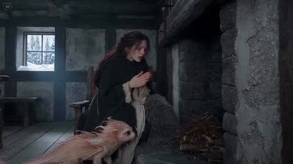</a>

The prompt splits 25 seconds into four timed scenes, each with its own shot size and one clear action beat. A blue to amber color shift tracks the fire lighting up, and the sound design and a negative prompt keep the creature consistent.

Seedance 2.5 · Text-to-video · Source: [@Alina_with_Ai on X](https://x.com/Alina_with_Ai/status/2108875306144813134) · 833 likes on 2026-10-27

[`fantasy`](tags.md#tag-fantasy) [`creature`](tags.md#tag-creature) [`multi-shot`](tags.md#tag-multi-shot) [`cinematic`](tags.md#tag-cinematic) [`sound-design`](tags.md#tag-sound-design)

<details><summary><b>Prompt</b></summary>

```text
CINEMATIC FANTASY | THE BABY DRAGON

Format: 16:9 | Duration: 25 seconds | Photorealistic CGI

Scene & Atmosphere:

Create a breathtaking, cinematic fantasy short set inside a cozy medieval winter cabin. The interior features dark, rough stone walls, a rustic wooden floor, a small frosted window overlooking a snowy pine forest, and an empty stone fireplace. Cold blue winter light filters through the window, creating a beautiful contrast with the warm golden glow that gradually fills the room. Use shallow depth of field, subtle handheld camera movement, realistic textures, fine film grain, and an intimate, heartwarming atmosphere.

Main Characters:

The Woman: A young woman with long, wavy dark brown hair, wearing a black wool cloak over a dark, rustic dress. She shivers from the freezing temperature, with her breath visible in the cold air. Her expressions are gentle, natural, and full of warmth.

The Baby Dragon: An adorable, cat-sized baby dragon with pearly white and pale pink shimmering skin, enormous amber eyes, delicate frilly ears, translucent pink wings with intricate rose-colored veins, and a long, slender tail. Its movements are lifelike, innocent, playful, and emotionally expressive.

Scene 1 | 0–6 Seconds: A Magical Encounter

Begin with a cinematic wide shot of the freezing cabin. The woman sits beside the cold stone fireplace, hugging herself to keep warm. Her breath forms delicate clouds in the chilly air. A tiny baby dragon waddles across the wooden floor, its little tail trailing behind. It climbs beside the fireplace, and the woman gently strokes its head. The dragon looks up at her with curious, sparkling amber eyes.

Scene 2 | 6–12 Seconds: The Tiny Sneeze

Transition into an intimate close-up of the baby dragon's face. Its eyes slowly close, its tiny nostrils twitch, and it prepares to sneeze. A little puff of smoke escapes from its nose. The dragon opens its eyes in surprise, looking adorably confused and embarrassed. The woman smiles warmly, leans closer, and gently encourages it to try again. The dragon scrunches its face, preparing for another sneeze.

Scene 3 | 12–17 Seconds: A Spark of Magic

Capture a close two-shot as the baby dragon suddenly sneezes again. This time, a tiny burst of golden-orange flame shoots from its mouth and ignites the dry twigs inside the fireplace. The flames begin to dance, casting beautiful golden reflections across the stone walls. The woman bursts into joyful laughter, clasping her hands as the warm light illuminates her face. The baby dragon looks at the newly lit fire with pride and innocent amazement.

Scene 4 | 17–25 Seconds: Warmth and Affection

The cabin is now filled with a cozy, golden glow as the fire crackles gently. The woman carefully wraps the tiny dragon in a thick, soft sheepskin fur. The dragon climbs into her lap, curls up comfortably, and nuzzles against her cheek. End with an emotional cinematic close-up of the woman gently touching her forehead to the dragon's snout while stroking its tiny head. The dragon purrs softly as they share a tender moment beside the glowing fireplace.

Cinematic Style & Sound Design:

Ultra-realistic live-action aesthetic with photorealistic CGI, detailed dragon skin, beautifully translucent wings, believable creature animation, expressive eyes, natural human movements, cinematic composition, soft volumetric lighting, realistic fire simulation, and smooth transitions. Begin with icy blue tones and gradually transition into rich amber and golden hues as the fireplace comes alive.

Sound design includes howling winter wind outside, soft breathing, tiny dragon footsteps, a cute sneeze, a gentle burst of flame, crackling fire, and emotional piano accompanied by delicate orchestral strings during the final scene.

Negative Prompt:

No text, no watermark, no subtitles, no distorted faces, no extra limbs, no malformed wings, no unnatural movements, no flickering character designs, no inconsistent character appearance, no cartoon style, no plastic textures, no scary or aggressive dragon, no sudden scene changes, and no unrealistic lighting.
```

</details>

<a id="seedance-mini-dv-coffee-asmr"></a>
### Mini DV coffee ASMR vlog

<a href="https://x.com/Strength04_X/status/2083094742682787939"></a>

Organised under labelled blocks (`CAMERA / LOOK`, then subject, action, sound). Easy to reuse as a template.

Seedance 2.5 · Text-to-video · Source: [@Strength04_X on X](https://x.com/Strength04_X/status/2083094742682787939) · 833 likes on 2026-10-27

[`asmr`](tags.md#tag-asmr) [`vlog`](tags.md#tag-vlog) [`dv-camcorder`](tags.md#tag-dv-camcorder)

<details><summary><b>Prompt</b></summary>

```text
CAMERA / LOOK: Handheld mini DV camcorder footage filmed by the subject herself. Slight hand shake, occasional focus hunting, imperfect framing, natural zoom adjustments, soft tape-like image quality, subtle grain, realistic auto-exposure shifts from bright kitchen morning light. Natural skin tones, mild motion blur, authentic consumer camcorder aesthetic.
STYLE: Cozy coffee-prep vlog with gentle ASMR elements. Relaxed pacing, minimal dialogue, candid moments. Focus on satisfying sounds: bean grinder whirring, portafilter tamping, steam wand hissing, cup clinking, milk frothing.
SUBJECT: Young man in his mid-20s, plain t-shirt, hair slightly tousled, minimal accessories. Calm, focused energy while making his morning coffee.
SETTING: Small kitchen counter with an espresso machine on a bright morning. Natural daylight, coffee beans and a mug nearby, quiet atmosphere.
STORYBOARD:
→ (3s, propped medium shot) Places camera on the counter, switches on the machine. "Morning coffee, the proper way."
→ (3s, overhead shot) Grinds fresh coffee beans, fine grounds falling into the portafilter.
→ (3s, close-up) Tamps the grounds down firmly and evenly.
→ (3s, handheld shot) Locks the portafilter into the machine. "Here we go."
→ (3s, detail shot) Espresso streams slowly into a small cup. No dialogue.
→ (3s, medium shot) Pours cold milk into a small steel pitcher. "Time for the milk."
→ (3s, macro shot) Steam wand hissing as it froths the milk.
→ (3s, propped shot) Pours frothed milk carefully over the espresso, forming light layers.
→ (3s, warm ending shot) Holds the finished cup, takes a small sip, satisfied smile. "That's exactly what I needed."
→ (3s, final shot) Reaches toward camera, still holding the cup. "See you later." Hand covers lens as recording ends.
AUDIO NOTES: Natural kitchen ambience — grinder whirring, tamping, steam hissing, milk pouring should be clearly audible. Dialogue quiet and casual.
REALISM NOTES: Authentic body language, natural blinking, genuine focused smiles, occasional careful pauses while pouring, imperfect framing, focus breathing, bright morning light shifts. Should resemble a genuine personal coffee vlog on a consumer camcorder, not a commercial or AI-generated production.
```

</details>

<a id="seedance-painted-flame-karate-kata-void"></a>
### Painted Flame Karate Kata in Blue Void

<a href="https://x.com/aimikoda/status/2110119492076404869"></a>

Two labeled references split identity from body, costume and effects, and a sixteen shot timeline gives each cut a time range, camera move and technique. Sound cues are tied to the cuts and an avoid list keeps the painted look free of glossy CG fire.

Seedance 2.5 · Reference-to-video · Source: [@aimikoda on X](https://x.com/aimikoda/status/2110119492076404869) · 802 likes on 2026-10-27

[`martial-arts`](tags.md#tag-martial-arts) [`painterly`](tags.md#tag-painterly) [`multi-shot`](tags.md#tag-multi-shot) [`vertical`](tags.md#tag-vertical) [`sound-design`](tags.md#tag-sound-design)

<details><summary><b>Prompt</b></summary>

```text
References:
@[ref1]: The martial artist's face. Identity, dark tousled hair, eyes, and the look of the painted flame around her open hand.
@[ref2]: Her body, costume, setting, and effects. Pale pink short-sleeve top, red wrist wraps and red sash, dark loose trousers, her low kneeling stance, the misty blue void with its dark floor, the looping pink ribbon arcs, and the spark burst.

Visual style: Painterly digital illustration in motion: thick, loose brushstrokes and palette-knife texture, deep blue-teal shadows and haze, figures built from broad painted planes. Every effect is painted, not rendered: flame-like ribbons of orange, hot pink, and violet with white-hot cores, exactly as in @[ref1] and @[ref2].

Avoid: No subtitles. No background music. No clean 3D particle fire, glossy CG effects, or lens-flare glare. No weapons or opponents.

A solo karate kata in a misty blue void, where painted flame grows with every strike and ends in an explosive palm strike into the floor. Vertical 9:16 frame, real-time speed except one brief speed ramp at the final impact. She performs toward screen right, faces screen left after her turn, and faces the lens for the finale; the camera stays on the same side of her line. The flame starts in her right hand; after the first punch it ignites on whichever limb strikes, and each technique leaves its own shape. Warm colors stay on the effects; the setting stays blue-teal. Crackling flame, sharp whooshes, foot stamps, cloth snaps, breath, one kiai, and heavy impact thuds land on the cuts.

Scene 1: Continuous, the misty blue void, its dark floor dusted pale blue.
Shot 1 (0-2s): [Extreme close-up on her eyes, slow push in] Stillness. A single ember drifts across her face as she breathes in. Cut on a sharp inhale.
Shot 2 (2-4s): [Close-up on her right hand, low angle, quick push toward the lens] Her open right hand thrusts at the lens in teisho-uchi, fingers spread as in @[ref1]. Painted flame ignites in the palm and curls up her forearm. Cut as the flame flares.

Scene 2: Continuous, the first form.
Shot 3 (4-6s): [Low wide, fast lateral track] She steps into zenkutsu-dachi and drives a right oi-zuki toward screen right; the flame stretches behind her fist in one long straight ribbon. Cut as the punch locks out.
Shot 4 (6-7s): [Tight side view at waist height] A left gyaku-zuki snaps out past the retracting right fist, and the flame catches on her left fist too. Cut as it locks out.
Shot 5 (7-9s): [Medium, camera whipping around to face her] Her right mae-geri kicks straight at the lens, flame fanning off the foot in a short burst. Cut as the kick retracts.
Shot 6 (9-10s): [Ground level, close on her feet] The kicking foot stamps down, throwing a ring of pale blue dust and orange sparks. Cut as she pivots.
Shot 7 (10-13s): [Orbiting camera with a whip pan] She turns 180 degrees through a right, then left shuto-uke, and her burning hands wrap her in looping pink ribbon arcs as in @[ref2]. She now faces screen left. Cut as the arcs close.

Scene 3: Continuous, the pause and the escalation.
Shot 8 (13-15s): [Low frontal medium, locked] She sinks into kiba-dachi, both fists drawn to her hips. The flames shrink into tight glowing cores in her fists and the dust settles; only her breath is heard. Cut on a sharp exhale.
Shot 9 (15-16s): [Snap zoom into her face] Her kiai rings out, flame reflected in her eyes, hair whipping. Cut at the peak of the shout.
Shot 10 (16-18s): [Low wide] She explodes into ushiro-mawashi-geri, the burning heel drawing one full ring of fire around her. Cut as the ring closes.
Shot 11 (18-19s): [Close tracking on her right fist] An uraken-uchi snaps through the frame toward screen left, its trail cracking like a whip. Cut on the snap.
Shot 12 (19-20s): [Medium from behind her shoulder] Her right empi-uchi drives toward screen left, a short burst flaring off the elbow. Cut as the elbow locks.
Shot 13 (20-22s): [Low angle, camera rising] She crouches and launches into nidan-geri, a spiral of flame climbing around her through both kicks. Cut at the apex.

Scene 4: Continuous, the finale.
Shot 14 (22-24s): [High angle, camera diving down with her] She descends from the apex, turning to face the lens, and drops onto one knee, right palm driving toward the floor. Cut just before contact.
Shot 15 (24-25s): [Ground-level close-up] Her right teisho-uchi hits the floor: a white-hot core flashes and erupts into orange sparks, pink paint flecks, and lifted blue dust, as in @[ref2], with a brief speed ramp at contact. Cut at the peak of the burst.
Shot 16 (25-30s): [Low frontal wide, slow push in to medium] She holds the low kneeling stance from @[ref2] as the burst's ribbons settle into drifting embers and fade. She raises her eyes to the lens and holds.
```

</details>

<a id="seedance-dragon-hatchlings-dungeon"></a>
### Hiding three dragon hatchlings from a hunter

<a href="https://x.com/Adnan_Ai2/status/2113945930185732358"></a>

Written as a sequel: the first line states it continues an earlier clip, which helps keep tone and characters consistent across a series.

Seedance 2.5 · Text-to-video · Source: [@Adnan_Ai2 on X](https://x.com/Adnan_Ai2/status/2113945930185732358) · 781 likes on 2026-10-27

[`fantasy`](tags.md#tag-fantasy) [`drama`](tags.md#tag-drama) [`continuation`](tags.md#tag-continuation)

<details><summary><b>Prompt</b></summary>

```text
A dark, emotionally charged medieval fantasy drama, cinematic 16:9 widescreen format, continuing directly from the earlier cave-birth and bonding story with full character and tonal continuity. Moody low-key lighting throughout, deep cold-blue tones contrasted sharply against warm amber torch and firelight, photorealistic non-cartoonish creature texture work, handheld intimate camera movement, prestige dark-fantasy television visual quality, 24fps cinematic film grain.

**Scene 1 (0–10s):** Inside a vast glowing ice cave, walls shimmering with deep blue bioluminescent light reflecting off frozen crystalline formations. On the icy cave floor, three baby dragons huddle close together for warmth — one with frost-blue scales, sharp little horns, and piercing blue eyes; one pure white with crystalline, feather-like frills and pale grey-blue eyes; and one soft pink-toned with warm coral fins and large amber eyes. A woman's scarred, bandaged hand slowly reaches into frame, palm open, as the dragons lean curiously toward it, sniffing and nuzzling her fingers with cautious trust. Wide shot establishes the vast, cold, otherworldly isolation of the ice cave.

**Scene 2 (10–20s):** Close-up, emotionally raw shot of the young woman — long dark wavy hair damp and disheveled, wrapped in a thick, heavy fur cloak — her face streaked with tears and dirt, eyes closed in anguish. She presses her forehead gently against the huddled trio of baby dragons, pulling all three into a tight, desperate embrace against her chest. A visible wound bleeds along her forearm, blood smeared on her hands and the dragons' scales, hinting at a recent struggle or sacrifice to protect them. Her expression carries a mixture of exhaustion, grief, and fierce, unwavering maternal protectiveness.

**Scene 3 (20–28s):** A quieter, tender beat — inside a dim hidden nest made of piled hay and straw, the three baby dragons poke their heads out side by side in a neat row, their large reflective eyes blinking in the low light, ears/frills perked with alertness as if sensing an approaching threat. Shallow depth of field keeps focus tightly on their expressive faces, background falling into soft shadow.

**Scene 4 (28–38s):** Setting shifts to a dim, damp stone dungeon or underground cellar, pale light filtering through a small barred window high on the wall. The woman kneels low on the cold stone floor, her fur cloak draped protectively over her shoulders and partially covering the three dragons huddled behind and beneath her. She glances anxiously toward the doorway, body angled to shield the creatures from view, every muscle tense with the instinct to protect at any cost.

**Scene 5 (38–45s):** Intimate close-up — she gently cradles the pink baby dragon in both arms, rocking it slightly to keep it calm and quiet as its small mouth opens in a near-silent chirp or whimper. Her face is soft with tenderness toward the creature but tight with fear of discovery, eyes darting toward unseen danger beyond the frame.

**Scene 6 (45–55s):** Hard cut to a shadowy stone corridor elsewhere in the same fortress/castle. A stern, heavyset older man dressed in dark, heavy medieval robes strides purposefully down the corridor, a large lit torch held firmly in one hand, flames casting flickering, dangerous light across ancient carved stone walls. His expression is grim, suspicious, and resolute as he approaches a heavy iron-banded wooden door — the entrance to the dungeon where the woman and dragons are hiding. Low-angle, slightly ominous camera framing builds mounting dread and tension, the gap between pursuer and protector closing with every step.

**Overall tone and continuity:** A visceral, high-stakes escalation of the established dark-fantasy saga — shifting from tender nurturing (birth, feeding, warmth) toward active danger and sacrifice, as the same woman now harbors not one but three dragon hatchlings and must risk everything to keep them hidden from a clearly hostile authority figure. Visual and character continuity fully maintained: same actress/character design, same practical-effect creature rendering (wet-look skin on younger dragons, fine scale and frill texture, anatomically grounded proportions), same desaturated cold-exterior/warm-interior lighting philosophy established in prior installments. Sound design implied: distant echoing footsteps, crackling torch flame, soft dragon chirps, the woman's held breath. Aspect ratio 16:9, prestige-drama cinematography, emotionally driven pacing building toward confrontation.
```

</details>

<a id="seedance-airport-immigration-makeup-wipe"></a>
### Airport immigration makeup wipe comedy in twelve shots

<a href="https://x.com/ElsaSofia__AI/status/2107290801017704458"></a>

A character block repeated in every part locks faces, outfits and location, and the 12 shots carry exact timestamps and panel labels. Each shot states framing and camera behavior, and a master effects list plus an energy arc keep the 30 second real time pacing.

Seedance 2.5 · Text-to-video · Source: [@ElsaSofia__AI on X](https://x.com/ElsaSofia__AI/status/2107290801017704458) · 740 likes on 2026-10-27

[`multi-shot`](tags.md#tag-multi-shot) [`comedy`](tags.md#tag-comedy) [`close-up`](tags.md#tag-close-up) [`timestamped`](tags.md#tag-timestamped) [`character-consistency`](tags.md#tag-character-consistency)

<details><summary><b>Prompt</b></summary>

```text
VIDEO PROMPT — 30 seconds total, 16:9, live-action cinematic realism, soft natural airport light, shallow depth of field, clean commercial look. Comedic drama, played straight. Keep the same faces, outfits and location in every shot. NO slow motion anywhere, everything runs in REAL TIME.

CHARACTERS (repeat in every part)
HEROINE: young Korean woman in her 20s, long wavy black hair, porcelain skin. FULL GLAM makeup at first: gold shimmer eyeshadow, long dramatic false lashes, pink blush, glossy rose lips. Wears a sheer dark-brown mesh long-sleeve top over a black bandeau, with a thin gold-chain crossbody bag strap. In the walking shot she also wears a denim mini skirt, black ankle boots, and pulls a pink rolling suitcase.
OFFICER: Korean woman in her 40s, dark hair pulled back tight, strict calm face, navy uniform jacket with a red-white-navy striped scarf.
PASSPORT: dark-blue Korean passport. The photo page shows the heroine's BARE-FACED, tired, messy-haired ID photo, with Korean text and a small blue flag icon.
LOCATION: Korean international airport immigration hall — shiny marble floor, rows of small round ceiling lights, beige columns, blue digital signs, travelers with suitcases walking in the background.

===== PART 1 (0:00-0:13) =====

SHOT 1 (00:00-00:02.2) — Counter Wide [Panel 1]
Front-facing medium-wide, eye level. The heroine stands behind the immigration counter, one hand on her hip, then takes the blue passport from her bag and places it on the counter edge. Travelers walk in the blurred background. Camera static.

SHOT 2 (00:02.2-00:04.6) — Passport POV [Panel 2]
Over-the-counter POV close-up of the officer's hands picking up the passport, turning it, then opening it to the photo page with her thumb. The bare-faced ID photo is clearly readable. Camera static, shallow depth of field.

SHOT 3 (00:04.6-00:06.6) — Suspicious Finger [Panel 3]
Medium shot over the officer's shoulder (back of her head on the right). The officer points a finger at the heroine's face and moves it up and down as if comparing. The heroine looks uneasy with a small frown. Airport counters blurred behind.

SHOT 4 (00:06.6-00:10.2) — Eyelash Peel [Panel 4]
Extreme close-up of the heroine's glam face looking straight into the camera. Her fingers pinch the false lash and she slowly peels it off, holding it between her fingertips. Camera static.

SHOT 5 (00:10.2-00:12.9) — Face-Off Two-Shot [Panel 5]
Medium close-up: the heroine's face on the left, the officer's face in sharp profile on the right, very close, staring at her. The heroine looks back with a stiff blank expression, then purses her lips.

===== PART 2 (0:13-0:22) =====

SHOT 6 (00:13.0-00:14.0) — Wipe Out [Panel 6]
Close-up, airport lights blurred into soft bokeh behind her. The heroine pouts, takes out a white wet makeup wipe, and unfolds it with both hands.

SHOT 7 (00:14.0-00:19.0) — Makeup Removal [Panel 7]
Same close-up. She presses the wipe over her eyes, then wipes her cheeks and lips with both hands, eyes closed. At the end she lowers the wipe to reveal a fresh, bare, natural face and looks calmly into the camera.

SHOT 8 (00:19.0-00:20.6) — Officer Verdict [Panel 8]
Medium close-up of the officer, blurred teal-grey wall behind her. She looks down at the passport, then up at the heroine, and breaks into a satisfied small smile.

SHOT 9 (00:20.6-00:22.0) — The Stamp [Panel 9]
Close-up of the open passport on the counter. The officer's hand brings down a black-and-red rubber stamp onto the photo page and lifts it, leaving a round red stamp mark. Camera static.

===== PART 3 (0:22-0:30) =====

SHOT 10 (00:22.0-00:25.2) — Passport Returned [Panel 10]
Back to the opening wide shot. The heroine now has full glam makeup again. The officer's hand slides the passport across the counter. She picks it up and holds it with both hands at chest height, looking down at it, then glances toward the camera.

SHOT 11 (00:25.2-00:27.0) — Walk Away
Rear tracking shot: the heroine walks away through the terminal in denim mini skirt and black boots, pulling the pink suitcase. Travelers cross in the background, blue digital signs glow. Camera follows at eye level.

SHOT 12 (00:27.0-00:30.4) — Final Pout [Panel 11-12]
Close-up: she looks back over her shoulder, then turns to face the camera. She pouts, scrunches her face and squints in cute annoyance, then returns to a flat pout. Blurred airport behind. Hold, then end.

MASTER EFFECTS INVENTORY
1. Eyelash peel close-up (Shot 4).
2. Makeup wipe transformation: glam to bare face (Shots 6-7).
3. Over-the-shoulder suspicion framing (Shots 3, 5).
4. Passport insert close-ups and stamp (Shots 2, 9).
5. Shallow depth-of-field bokeh throughout.

ENERGY ARC
Part 1 (0-13s): tension, suspicion.
Part 2 (13-22s): transformation, then relief.
Part 3 (22-30s): she walks off, final grumpy pout.
```

</details>

<a id="seedance-outfit-change-one-take"></a>
### Outfit changes in one take, with Chinese dialogue

<a href="https://x.com/cnyzgkc/status/2099029556434985065"></a>

Image 1 locks only the face and hair, and the clothing is described per change. It also tells the lead to close her mouth when the off-screen man speaks.

Seedance 2.5 · Reference-to-video · Source: [@cnyzgkc on X](https://x.com/cnyzgkc/status/2099029556434985065) · 676 likes on 2026-10-27

[`outfit-change`](tags.md#tag-outfit-change) [`long-take`](tags.md#tag-long-take) [`chinese-dialogue`](tags.md#tag-chinese-dialogue) [`reference-images`](tags.md#tag-reference-images)

<details><summary><b>Prompt</b></summary>

```text
Duration 29 seconds, aspect ratio 16:9 landscape, language Chinese.
Character reference: Reference only image 1 to lock facial features, hairstyle, skin tone, and character identity; clothing strictly changes as described below. Character requirements: Adult female lead. Same character throughout, no face swaps, no changes to body proportions; increase weight to prioritize rigidly locking facial features, hairstyle, skin tone, and identity.

Overall style: Hyper-realistic AI dynamic desktop interactive video, simulating a full-screen computer desktop screen recording. Retain a simple taskbar at the bottom, a few desktop icons in the upper left corner; the main screen features a dynamic wallpaper that interacts in real time. Black leather sofa, cool-toned soft lighting, dark background. Fixed camera position, continuous single shot throughout, no cuts, no pans or zooms. Female lead primarily positioned on the right side of the frame, leaving the left side for the voice subtitle interface.

Subtitle interface (retain, overriding "prohibited text" constraints): Subtitles must appear in the middle left of the frame, not at the bottom. Slim modern sans-serif Chinese font, medium size, no background box, subtle soft glow and shadow. Female lead speaking: Light purple text, with a speaker icon on the left. Male voice speaking: White text, with a microphone icon on the left. A thin white audio waveform always runs below the subtitles, jumping in real time with the sound. All subtitles input word by word following pronunciation, about 0.08–0.12 seconds per word, like manual typing on a keyboard; after the current sentence finishes, pause for about 0.4 seconds, then fade out entirely. No sudden full-sentence appearances, no displaying upcoming text in advance.

Clothing design (three outfits unified, changing only the neckline: low round neck/shallow V-neck, slightly revealing cleavage, otherwise fully covered):
Initial outfit: Black-and-white horizontal stripe fitted short three-quarter sleeve top (low round neck/shallow V-neck, slightly revealing cleavage, otherwise fully covered), black low-waist drawstring casual long pants, silver thin necklace.
First schoolgirl style: Top with low round neck/shallow V-neck, slightly revealing cleavage, otherwise fully covered, blue-and-black plaid pleated short skirt, white knee-high socks, white cross-strap garter, overall fresh and playful.
Second schoolgirl style: Black fitted suit jacket, white shirt (shirt low round neck/shallow V-neck, slightly revealing cleavage, otherwise fully covered), burgundy plaid tie, burgundy-and-black plaid pleated short skirt, light nude sheer stockings, black loafers, refined and mature.

SINGLE CONTINUOUS SHOT (00:00-00:29)

00:00-00:02.80
Female lead in initial outfit sits on the right side of the black leather sofa, holding a black throw pillow on her lap. She gently adjusts her hair with both hands, then looks at the camera, showing a warm, slightly playful smile.
Female lead speaks naturally: "So, spill it... what do you wanna see today?"
Subtitles display word by word: "So, spill it...
What do you wanna see today?"

00:03.00-00:03.80
Male lead never shows his face, only off-screen male voice, tone direct and eager: "Wanna see JK."
Female lead listens quietly, her smile deepens slightly, and she nods gently.
Subtitles display word by word: "Wanna see JK"

00:04.70-00:06.00
Female lead replies cheerfully: "Alright, give me a sec."
She sets the pillow aside, right hand bracing the sofa as she prepares to stand.
Subtitles display word by word: "Alright, give me a sec."

00:06.00-00:08.80
Female lead stands quickly. Due to the fixed camera and close distance, her waist and legs sweep upward across the frame, her face exiting via the top edge; she then steps out to the right side. The motion includes a light "whoosh" sound, but no teleporting, no direct morphing.

00:08.80-00:11.50
Outfit change completed entirely off-screen. Sofa lingers empty for about one second. Accompanied by a playful reveal sound effect, female lead in first blue schoolgirl outfit re-enters from the right. She stands close to the camera, frame mainly showing waist, plaid skirt hem, and knee-high socks, head naturally above the top edge.
Female lead says in a playful tone showcasing the new outfit: "Ta-da... hubby... whaddya think?"
Subtitles display word by word: "Ta-da...
Hubby... whaddya think?"

00:11.70-00:12.50
Male off-screen voice pauses briefly, then answers approvingly: "Mm... not bad."
Female lead holds her stance, subtly swaying her waist left and right to let the plaid skirt hem sway naturally.
Subtitles display word by word: "Mm... not bad"

00:12.90-00:14.40
Female lead suddenly recalls another outfit and says lightly: "Wait, there's one more."
She immediately turns and exits to the right, skirt hem swaying with the motion.
Subtitles display word by word: "Wait, there's one more"

00:14.40-00:17.40
Outfit change completed entirely off-screen. Sofa lingers empty for about one second. Then a short, smooth "whoosh" of changing echoes, female lead in second burgundy schoolgirl outfit enters from the right. Fixed lens first captures black suit hem, burgundy plaid skirt, stockings, and loafers; clothing must be realistically complete, no melting or altering during the walk.

00:17.40-00:19.00
Female lead stops on the right side of the frame, slightly adjusting her stance to let the suit hem and skirt pleats fall naturally, then asks: "What about this one?"
Subtitles display word by word: "What about this one?"

00:19.50-00:20.50
Male off-screen voice immediately praises: "This one's good too."
Female lead chuckles softly upon hearing it, body beginning to lower as she prepares to sit.
Subtitles display word by word: "This one's good too"

00:20.50-00:24.80
Accompanied by faint fabric rustling, female lead sits back on the sofa swiftly and naturally. She repositions the black throw pillow on her lap, smooths hair on both sides and her tie, then leans slightly against the sofa. The lens recaptures her full face. She keeps looking at the camera, expression confident, intimate, with a hint of teasing.

00:25.00-00:28.20
Female lead hugs the pillow, first flashing a smug little smile, then says to the camera: "Chances used up. Which one does hubby wanna keep?"
"Chances used up" in a tone like announcing game rules; "Which one does hubby wanna keep?" slowed slightly, with rising inflection at the end, carrying an intimate questioning vibe.
Subtitles display word by word: "Chances used up.
Which one does hubby wanna keep?"

00:28.20-00:29.00
Subtitles linger fully. Female lead maintains eye contact, tilts her head gently, lips holding the playful smile. Waveform gradually calms, frame fades out naturally.

Audio: Female lead's realistic on-site human voice, precise lip sync; male lead as off-screen Chinese male voice, no face shown. Retain subtle electronic ambient music (auto-lowers during dialogue, increase weight), outfit "whoosh" sounds, reveal chimes, fabric rustles; all dialogue clear and discernible.

Performance constraints: Female lead not exaggeratedly cutesy. Smiles, nods, hair adjustments, outfit displays all natural and restrained; opening warm, first change playful, second change more confident, ending with light teasing. When male voice speaks, female lead must close her mouth and listen naturally.
```

</details>

<a id="seedance-kpop-two-idol-mv"></a>
### Two-idol K-pop music video, shot by shot

<a href="https://x.com/Just_sharon7/status/2083422886686031982"></a>

A 30-second MV laid out in 2 to 4 second time ranges, alternating between three sets.

Seedance 2.5 · Text-to-video · Source: [@Just_sharon7 on X](https://x.com/Just_sharon7/status/2083422886686031982) · 547 likes on 2026-10-27

[`music-video`](tags.md#tag-music-video) [`dance`](tags.md#tag-dance) [`timed-beats`](tags.md#tag-timed-beats)

<details><summary><b>Prompt</b></summary>

```text
30-second ultra-realistic K-pop MV featuring two young East Asian women with flawless synchronization, cinematic lighting, glossy skin, realistic hair and fabric physics, natural body motion, and 4K live-action quality. Vibrant hot pink, electric blue, and silver color palette. 0–2s: Wide shot in a bright circular pink studio with reflective floor. Pink-haired woman (left) and black-haired woman (right) perform energetic opening pose and synchronized dance. 2–4s: Medium close-up of the black-haired woman on a blue spotlight stage, confidently pointing at the camera. 4–6s: Pink-haired woman dances before shimmering blue-silver tinsel curtains, dramatic hair flip and fluid arm movements. 6–8s: Back to the pink studio. Both perform synchronized choreography with sharp arm waves, hip sways, and strong formations. 8–10s: Extreme close-up of both faces against a blue background, glossy makeup, subtle smiles, and direct eye contact. 10–14s: Solo shots at the tinsel backdrop. Pink-haired woman mouths lyrics and gestures confidently, followed by the black-haired woman with relaxed jacket styling. 14–18s: Pink studio. Coordinated jacket choreography, hair flips, powerful synchronized dance, ending hands-on-hips. 18–22s: Glamour close-ups. Black-haired woman under glittering bokeh lights, then pink-haired woman with wind-blown hair against a soft pink background. 22–24s: Blue spotlight stage. Mirrored black-haired performer effect with synchronized spins and flowing hair. 24–26s: Both walk confidently toward the camera in front of shimmering tinsel curtains, reflections visible on the floor. 26–29s: Final synchronized dance and ending pose in the pink circular studio, standing together and looking into the camera. Style: Hyper-realistic live action, Seedance 2.5-quality motion realism, perfect lip sync, natural weight shifts, flowing hair, realistic fabric simulation, polished K-pop music video cinematography.
```

</details>

<a id="seedance-kitchen-fight"></a>
### Woman fights three men in a restaurant kitchen

<a href="https://x.com/Alina_with_Ai/status/2113816556140675163"></a>

Ten seconds of fight choreography with the grade and camera fixed up front and a sound list at the end, no music.

Seedance 2.5 · Text-to-video · Source: [@Alina_with_Ai on X](https://x.com/Alina_with_Ai/status/2113816556140675163) · 514 likes on 2026-10-27

[`action`](tags.md#tag-action) [`martial-arts`](tags.md#tag-martial-arts) [`sfx`](tags.md#tag-sfx)

<details><summary><b>Prompt</b></summary>

```text
Cinematic live-action martial arts fight, 10 seconds, wide 16:9, handheld camera with fast whip-pans and slight shake, gritty high-contrast grade with warm brown tile floor and cool steel tones, motion blur on strikes, realistic physics.

Setting: a busy professional restaurant kitchen. Brown quarry-tile floor with black rubber mats, stainless steel prep tables, a rolling rack of fresh vegetables (carrots, greens, red tomatoes), copper pots hanging from a ceiling rail that swing with every impact, gas range and hood, steel refrigerators, wooden produce crates stacked against a white-tiled back wall. In the far background, chefs in white uniforms keep working.

Characters: a young woman with dark hair tied back, grey button-up work shirt with sleeves pushed up and black pants and black boots. She fights 3 men in grey shirts and black aprons (one bearded, one heavyset, one Asian man with short hair), all trying to attack her, one wielding a kitchen knife.

0-1s: She dodges a swinging punch from the bearded man, then blocks the heavyset man's arm with a crossed-arm block, copper pots swaying above.
1-2s: She drops into a low lunge and kicks, sending the man flipping backward over the stainless prep table, legs in the air.
2-3s: She spins toward the next man by the cutting board with vegetables, camera whip-pans with motion blur.
3-4s: She throws a high side kick that knocks a knife aside as a man raises it overhead, third man stepping in behind.
4-5s: Camera cuts wider: she lands a spinning back kick, a man crashes to the floor, wooden crates and papers on the wall behind.
5-6s: She leaps high in the air in a flying kick pose against the white wall, whole body visible.
6-7s: She lands in a ready stance, focused and breathing hard, two men lying defeated on the floor behind the crates, spilled apples on the ground, a knife visible in the background.
7-8s: A man in a grey shirt charges, she counters with a sharp fist strike.
8-10s: Tight shot over her shoulder, a man with a knife lunges at her from the right, copper pots overhead, she steps in to meet him.

Sound: impact thuds, fabric whooshes, shoes squeaking on tile, clattering pots and crates, kitchen ambience, no music.
```

</details>

<a id="seedance-2011-selfie-vlog-seoul-shopping-street"></a>
### Retro 2011 phone selfie vlog through Seoul shops

<a href="https://x.com/Just_sharon7/status/2109218767620444331">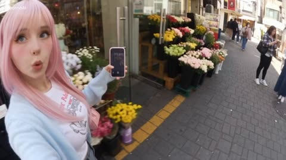</a>

Separate blocks for camera, video quality, character, location, style and audio, then a timed shot list with one line of dialogue per beat. Naming dated hardware, 480p compression flaws and hand tremor keeps the footage amateur, and a closing rules block locks identity, 9:16 framing and no filters.

Seedance 2.5 · Text-to-video · Source: [@Just_sharon7 on X](https://x.com/Just_sharon7/status/2109218767620444331) · found via [LearnPrompt/awesome-seedance](https://github.com/LearnPrompt/awesome-seedance)

[`selfie-vlog`](tags.md#tag-selfie-vlog) [`retro-camcorder`](tags.md#tag-retro-camcorder) [`street`](tags.md#tag-street) [`dialogue`](tags.md#tag-dialogue) [`shot-list`](tags.md#tag-shot-list)

<details><summary><b>Prompt</b></summary>

```text
CAMERA:
Early-2010s smartphone front-camera selfie vlog, filmed on an old iPhone 4 or Samsung Galaxy S2. The girl holds the phone at arm's length, occasionally switching to the rear camera to show her surroundings. Natural hand tremors, awkward framing, accidental finger covering the lens, shaky walking footage, imperfect autofocus, and sudden camera tilts. No professional camera movements.
VIDEO QUALITY:
Authentic 2010–2012 smartphone footage, 480p resolution, low dynamic range, washed-out colors, visible digital noise, blocky compression artifacts, slightly blurry moving subjects, rolling-shutter wobble, overexposed skies, and automatic white-balance shifts. Looks like a forgotten YouTube vlog uploaded in 2011.

CHARACTER:
MILA — a cheerful 22-year-old East Asian girl with a Korean-Chinese appearance, long straight black hair with side-swept bangs, naturally fair skin, soft pink lip tint, minimal makeup, and expressive dark-brown eyes. Wearing a loose pastel-yellow cardigan over a white graphic T-shirt, a short denim skirt, white sneakers, and a small brown leather shoulder bag. Her appearance, hairstyle, outfit, and facial features remain identical throughout.
LOCATION:
A lively Seoul shopping neighborhood on a sunny afternoon. Narrow pedestrian streets, colorful Korean storefronts, clothing racks outside shops, stationery stores, photo booths, flower stands, parked scooters, and pedestrians walking naturally in the background.

STYLE:
Spontaneous, playful, slightly chaotic 2011 YouTube lifestyle vlog. Casual conversations directly into the phone, unscripted facial expressions, awkward pauses, spontaneous laughter, and quick amateur cuts.
SHOT-BY-SHOT SEQUENCE

0–2.5s — The Flower Shop
Front-camera selfie. MILA walks past a tiny flower shop, notices a beautiful bouquet, and suddenly stops.

Dialogue: "Wait, these flowers are literally so pretty!"
She turns the phone toward the flowers, briefly losing focus.

2.5–5s — The Photo Booth

Quick shaky cut. MILA squeezes inside a tiny Korean photo booth. The camera is held too close to her face. She makes an exaggerated silly expression and flashes a peace sign as the booth flashes.

Dialogue: "Oh my gosh, why do I look like that?!"

She bursts into laughter.

5–7.5s — The Claw Machine

MILA stands in front of a small arcade claw machine, filming herself and the machine alternately. She presses the button, the claw grabs a tiny plush bunny but drops it at the last second.

Dialogue: "Nooo! I almost got it!"

She dramatically pouts at the camera.

7.5–10s — The Sunglasses

Quick cut to a sidewalk accessories stand. MILA tries on oversized heart-shaped pink sunglasses, turns the front camera toward herself, and tilts her head.

Dialogue: "Okay, wait... kinda iconic!"

She laughs and adjusts the glasses.

10–12.5s — The Unexpected Wind

Walking down the street, a sudden breeze blows her bangs across her face. She tries to fix her hair while still holding the phone. The frame tilts awkwardly.

Dialogue: "Ahh! My hair! Seriously?!"

She giggles, brushing her bangs away.

12.5–15s — Goodbye

MILA stops beside a colorful storefront, holds up her photo-booth pictures, smiles brightly, and gives a little wave.

Dialogue: "Best random day ever! Byeee!"

She reaches toward the phone screen. Her finger partially covers the lens, followed by an abrupt cut to black.

AUDIO

Authentic low-quality smartphone microphone. Distant Korean street conversations, footsteps, shop music, arcade machine beeps, camera shutter, occasional wind hitting the microphone, and slight distortion when MILA laughs. Her voice is cheerful, spontaneous, conversational, and slightly muffled.

IMPORTANT GENERATION RULES

Exactly 15 seconds, vertical 9:16.

Same character identity and outfit in every shot.

Natural selfie perspective, never cinematic third-person footage.
Realistic hand movements and physically plausible phone handling.

Natural dialogue timing and accurate lip synchronization.
No beauty filters, artificial skin smoothing, or cinematic color grading.
No subtitles, text overlays, logos, or modern smartphone aesthetics.
Preserve the authentic, imperfect, nostalgic feeling of an amateur 2011 street vlog. #DomoAI #DomoAICPP
```

</details>

<a id="seedance-alpine-golden-hour-fashion-ski-walk"></a>
### Fashion Model Walking Snowy Alpine Slope at Golden Hour

<a href="https://x.com/noorlewisx/status/2096826123330138410"></a>

Opens with a low angle and sparkling snow in extreme foreground, which gives shallow depth of field and bokeh before the subject comes into focus. Detailed wardrobe and prop specifics (coat, boots, skis over the shoulder) plus rim lighting and film grain keep the editorial look consistent.

Seedance 2.5 · Text-to-video · Source: [@noorlewisx on X](https://x.com/noorlewisx/status/2096826123330138410) · found via [LearnPrompt/awesome-seedance](https://github.com/LearnPrompt/awesome-seedance)

[`fashion`](tags.md#tag-fashion) [`cinematic`](tags.md#tag-cinematic) [`snow`](tags.md#tag-snow) [`golden-hour`](tags.md#tag-golden-hour) [`low-angle`](tags.md#tag-low-angle)

<details><summary><b>Prompt</b></summary>

```text
Cinematic fashion film still, low-angle shot of a beautiful young woman with wavy dirty-blonde hair and brown eyes walking toward camera on a sunlit snowy alpine mountain slope at golden hour. She wears an oversized cream faux-fur coat over a white ribbed crop top and matching white shorts, white fuzzy ski boots and white gloves. She carries a pair of sleek white skis with black bindings slung over one shoulder. Sparkling crystalline snow in extreme foreground with shallow depth of field and bokeh, snow-capped peaks and clear blue-to-dusk sky in background, dramatic rim lighting, high-fashion editorial photography, 35mm film grain, ultra-realistic, photorealistic, 8k
```

</details>

<a id="seedance-apartment-afternoon-vlog-face-yoga-nails"></a>
### Cozy apartment afternoon vlog with face yoga and nails

<a href="https://x.com/doctorwasif/status/2107824210899055039"></a>

A reference image locks identity and outfit, then five timed beats of about seven seconds each chain small domestic actions into one 30 second take. Handheld realism cues (camera shake, imperfect framing, autofocus) and a closed list of ambient sounds with no music keep it feeling like real footage.

Seedance 2.5 · Image-to-video · Source: [@doctorwasif on X](https://x.com/doctorwasif/status/2107824210899055039) · found via [LearnPrompt/awesome-seedance](https://github.com/LearnPrompt/awesome-seedance)

[`vlog`](tags.md#tag-vlog) [`handheld`](tags.md#tag-handheld) [`lifestyle`](tags.md#tag-lifestyle) [`ambient-sound`](tags.md#tag-ambient-sound) [`timed-shots`](tags.md#tag-timed-shots)

<details><summary><b>Prompt</b></summary>

```text
image = Main Subject. Preserve her exact identity, face, hairstyle, skin tone, proportions, and reference outfit throughout.

Authentic Korean woman in a cozy, modern Korean apartment. RAW handheld vlog realism, natural afternoon light, subtle camera shake, imperfect framing, realistic autofocus, and natural colors.

00:00–00:07: In front of a mirror, she makes exaggerated face yoga expressions, notices her reflection, and laughs shyly.

00:07–00:13: She mists windowsill plants, gently inspecting a leaf with a satisfied smile.

00:13–00:20: Sitting cross-legged on the living room floor, she folds laundry beside a basket, briefly reacting to a TV show.

00:20–00:27: At a desk by the window, she carefully paints her nails, then blows on them to dry.

00:27–00:30: She admires her freshly painted nails in sunlight, turns her hand, and smiles softly at the camera.

Natural movements and ambient sounds only: spray bottle, distant TV, fabric, nail polish, and breathing. No music. 16:9.
```

</details>

<a id="seedance-autumn-city-day-seven-shot-vlog"></a>
### Autumn day in the city, seven shot vlog

<a href="https://x.com/Chaemate_/status/2100103235566797039"></a>

A reference image locks the face and wardrobe, and hard cuts at stated seconds split the 30 seconds into seven shots. Each shot gets its own lens angle, camera behavior, light and audio, mixing spoken lines with silent candid b roll.

Seedance 2.5 · Reference-to-video · Source: [@Chaemate_ on X](https://x.com/Chaemate_/status/2100103235566797039) · found via [LearnPrompt/awesome-seedance](https://github.com/LearnPrompt/awesome-seedance)

[`vlog`](tags.md#tag-vlog) [`autumn`](tags.md#tag-autumn) [`multishot`](tags.md#tag-multishot) [`day-in-the-life`](tags.md#tag-day-in-the-life) [`character-consistency`](tags.md#tag-character-consistency)

<details><summary><b>Prompt</b></summary>

```text
SCENE CONTEXT
A 20-year-old East Asian woman spends an autumn day moving through a big city — leaving her apartment, riding the subway, grabbing coffee from a cart, cutting through a park in falling leaves, browsing a bookstore, catching golden hour on a rooftop, and riding home at night — filmed as a candid, mixed-format day-in-the-city vlog, 30 seconds total.

ACTIVE REFERENCES
@image1: 20-year-old East Asian woman, soft round face, warm ivory skin, dark brown hair in a loose high bun with face-framing strands, natural dewy makeup, gentle expressive eyes, wearing a wine-burgundy ribbed knit off-shoulder sweater and a small silver flower pendant necklace. 100% matches the reference throughout every shot.

FORMAT MODE
Timed multishot. HARD CUTs only at the stated seconds; camera does not cut on its own between them. Mixed scene styles — not every shot has dialogue; some are silent candid b-roll.

0.0s–4.0s — HARD CUT
4.0s–8.0s — HARD CUT
8.0s–12.0s — HARD CUT
12.0s–17.0s — HARD CUT
17.0s–21.0s — HARD CUT
21.0s–26.0s — HARD CUT
26.0s–30.0s — end

OPTICS
Shot 1: 63° wide, POV-adjacent handheld. Shot 2: 47° neutral, static-ish lean. Shot 3: 29° portrait-compression, quick transactional. Shot 4: 18° natural-portrait, slow-mo detail. Shot 5: 29° portrait-compression, candid unaware angle. Shot 6: 47° neutral, two-shot-adjacent solo toast. Shot 7: 18° natural-portrait, close reflective. No drift mid-segment.

CAMERA
Handheld throughout with natural 1–2cm tremor. Shot 1: phone-height POV-style, walking at 4 km/h. Shot 2: camera rests low against a pole, minimal movement, observational. Shot 3: quick whip from hand to face and back. Shot 4: slowed to half real-time, camera drifts sideways at 1 km/h following falling leaves. Shot 5: camera appears to catch her off-guard, slight delay before she notices it. Shot 6: static-ish, propped, she moves into frame. Shot 7: static through car window glass, reflections passing over her face.

ACTION
0.0s–4.0s: She steps out of an apartment building onto a leaf-scattered sidewalk, adjusting her bag strap, glancing at her phone, morning light low and warm through bare branches. She looks up at the camera briefly, half-smiles: "Okay — let's do this."

4.0s–8.0s: Inside a subway car, she leans against a pole, earbuds in, watching the platform lights blur past the window, city sounds muffled and rhythmic. No dialogue — just her quiet, unbothered expression, occasional sway with the train's motion.

8.0s–12.0s: At a small street coffee cart, steam rising from the machine, she hands over cash, receives a paper cup, wraps both hands around it immediately for warmth. Brief exchange, she says only: "Thanks, you're the best."

12.0s–17.0s: Slow-motion through a park path thick with falling amber leaves, she tips her head back mid-step and turns once, leaves catching in her hair and sweater, genuine unguarded laugh, no spoken line — just breath and laughter audible.

17.0s–21.0s: Inside a small bookstore, she runs a finger along a shelf, pulls a book halfway out, flips a few pages, unaware of the camera, soft window light across her face, ambient store quiet. No dialogue.

21.0s–26.0s: On a rooftop at golden hour, city skyline hazy behind her, she raises a takeaway coffee cup slightly toward the lens like a small toast, warm low sun rim-lighting her hair, says only: "To days like this."

26.0s–30.0s: Inside a taxi at night, warm amber streetlights sliding across the window glass and over her face in soft passing bands, she rests her head against the seat, tired contented smile, looks toward the lens and says: "Best day, hands down."

PERFORMANCE
Restrained, natural reactions — no performed excitement. Shots 2 and 5 specifically read as candid/unaware of the camera. Living eyes with catch-light in every close shot, visible breath in shot 1, natural skin and fabric texture throughout.

PHYSICS
Leaves fall and scatter with real weight and drift, catching briefly in hair and sweater fibers before falling away. Coffee steam rises and dissipates naturally. Streetlight bands move across her face and the window glass with correct parallax as the car moves. Train sway shifts her weight subtly and believably.

LIGHTING
Shot 1: low warm morning sun through bare branches, soft shadow lines. Shot 2: cool fluorescent subway light with warm practicals flickering past outside. Shot 3: overcast daylight, soft even key. Shot 4: dappled warm sun through park canopy, backlit leaf edges. Shot 5: soft window-diffused daylight, low contrast. Shot 6: warm low-angle golden hour key, strong rim light, soft haze. Shot 7: warm amber sodium streetlight passing bands only, otherwise dark interior.

COLOR GRADE
Warm autumn palette — amber, rust, and soft gold tones with muted city grays. Warm amber streetlight at night, never neon or saturated colored signage anywhere in frame. No cool-cyan or magenta tint.

WARDROBE
Wine-burgundy ribbed knit off-shoulder sweater and silver flower pendant necklace, unchanged and clearly visible in every shot. A loosely draped scarf or open coat may sit over it in the subway and taxi shots without covering it.

AUDIO
Shot 1: quiet street ambience, rustling leaves. Shot 2: muffled train rumble, distant announcement, no dialogue. Shot 3: espresso machine hiss, brief exchange. Shot 4: crunch of leaves, natural laughter, no line. Shot 5: quiet store ambience, page-turning, no dialogue. Shot 6: distant city hum, wind. Shot 7: engine hum, soft radio murmur under her line.

STYLE
Authentic day-in-the-life vlog cinematography, dreamy 35mm film aesthetic, fine natural grain, realistic autofocus hunting, mix of talking and silent candid shots for a lived-in, unscripted feel.

OUTPUT SETTINGS
4K, 24fps, 35mm grain, real-time except shot 4 (half real-time slow motion), realistic handheld motion, no neon or saturated signage in the color palette anywhere.

POSITIVE LOCKS
Same woman's face and build in every shot, matching @image1 exactly. Wine-burgundy sweater and silver necklace stay visible in every shot. Hair stays in the same loose high bun throughout. Cuts only at stated seconds, camera does not cut on its own. Shots 2 and 5 stay dialogue-free and candid. Warm amber tones hold throughout — no neon, no cool-cyan tint anywhere.
```

</details>

<a id="seedance-baby-doctor-soldier-army-tent"></a>
### Baby doctor examines soldier with stethoscope in army tent

<a href="https://x.com/aiwithaayat/status/2113854017420108258">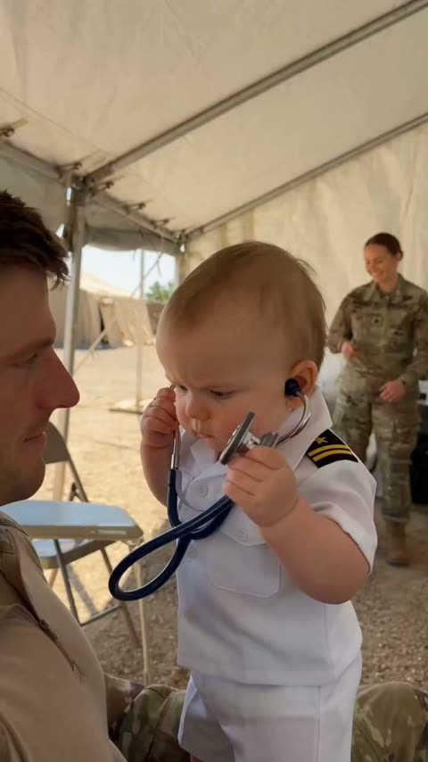</a>

The prompt fixes a casual phone recording look with shaky framing, daylight and camp ambience, then bans cinematic lighting, slow motion and grading to keep it real. One subtitled line of dialogue and a locked baby and soldier identity carry the comedy.

Seedance 2.5 · Text-to-video · Source: [@aiwithaayat on X](https://x.com/aiwithaayat/status/2113854017420108258) · found via [LearnPrompt/awesome-seedance](https://github.com/LearnPrompt/awesome-seedance)

[`ugc`](tags.md#tag-ugc) [`handheld`](tags.md#tag-handheld) [`comedy`](tags.md#tag-comedy) [`baby`](tags.md#tag-baby) [`dialogue`](tags.md#tag-dialogue)

<details><summary><b>Prompt</b></summary>

```text
Create a 20-second vertical 9:16 ultra-realistic funny baby doctor video, filmed in a casual smartphone recording style inside a real military tent at an outdoor army camp. A cute chubby baby with round cheeks, light-colored eyes, and a serious facial expression wears a tiny white doctor’s coat and a blue stethoscope while being held close to a male soldier wearing a real camouflage military uniform. The baby presses the stethoscope against the soldier’s chest and listens carefully like a professional doctor, looking intensely focused and adorably confused. The soldier looks at the baby with a warm smile, trying not to laugh during the examination. Show natural close-up shots of the baby gripping the stethoscope with tiny hands, looking into the soldier’s eyes, and moving his lips with innocent, funny expressions. Include humorous English dialogue with matching subtitles: “You have a serious case of too much phone and not enough exercise.” The soldier reacts with an amused smile while the baby continues the examination with a completely serious face. Keep another soldier naturally visible in the background, sitting inside the tent and enjoying the funny moment. The camera should feel like a real person casually recording this adorable interaction on a phone, with slight natural hand movements, imperfect framing, authentic outdoor daylight, realistic skin textures, and the ordinary background sounds of a military camp. Use spontaneous reactions, natural facial movements, and believable human interaction instead of dramatic acting or exaggerated effects. Maintain the same baby and soldier throughout the entire video, with accurate clothing, realistic proportions, and consistent faces. No cinematic lighting, no dramatic camera movements, no slow motion, no movie-style color grading, no artificial transitions, no animation, and no polished commercial look. The final result should look like an authentic, funny, heartwarming viral video captured in real life.
```

</details>

<a id="seedance-baby-dragon-afro-cottage-comedy"></a>
### Baby dragon gives woman a fluffy afro

<a href="https://x.com/mehwishkiran07/status/2113088659658612746">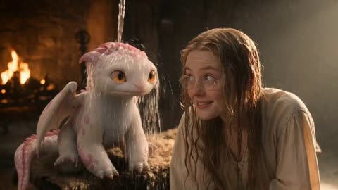</a>

The prompt writes the scene as a sequence of beats (reveal, transformation, reaction, reversal, cuddle) and pairs each with a named camera move, from an extreme close-up of the dragon's eyes to a slow pullback. Separate style, lighting, quality and audio blocks, with the sound cues tied to the transformation, keep the comedy and the mood consistent.

Seedance 2.5 · Text-to-video · Source: [@mehwishkiran07 on X](https://x.com/mehwishkiran07/status/2113088659658612746) · found via [LearnPrompt/awesome-seedance](https://github.com/LearnPrompt/awesome-seedance)

[`fantasy`](tags.md#tag-fantasy) [`dragon`](tags.md#tag-dragon) [`comedy`](tags.md#tag-comedy) [`multi-shot`](tags.md#tag-multi-shot) [`cinematic`](tags.md#tag-cinematic)

<details><summary><b>Prompt</b></summary>

```text
A magical, heartwarming fantasy scene inside a cozy medieval cottage with rustic wooden walls, a stone fireplace, flickering candles, and warm golden sunlight streaming through a small window. A beautiful young woman with long, wavy blonde hair, fair skin, and expressive blue eyes wears a simple cream-colored medieval dress. Beside her is an adorable small fantasy dragon with pale pink-white scales, soft pink spines, tiny wings, a long tail, and large glowing amber eyes.

The scene begins with the young woman sitting beside the baby dragon near the fireplace, smiling affectionately as they gaze at each other. The camera slowly moves closer to the dragon's adorable face, highlighting its detailed scales, glossy amber eyes, and tiny nose. Suddenly, the little dragon playfully breathes a small burst of magical golden fire toward the woman's head, transforming her hair into an enormous, perfectly rounded, fluffy golden afro. Her appearance changes comically while her cream medieval dress remains unchanged. She looks completely stunned, adjusts her round glasses, and picks up a small hand mirror to examine her extraordinary new hairstyle. The baby dragon rolls onto its back, laughing and playfully flapping its tiny wings.

Next, the woman returns to her original appearance with long, flowing blonde hair and gently blows a kiss toward the baby dragon. The dragon responds by releasing a soft stream of sparkling golden magical light, creating a warm, glowing aura around her face. She smiles with wonder and delight, and the two share a tender, magical moment. Finally, she lovingly cuddles the baby dragon in her lap as it closes its eyes peacefully, resting its head against her while she gently strokes its pink spines.

Visual style: ultra-realistic cinematic fantasy, high-end CGI, photorealistic skin and hair, incredibly detailed dragon scales, expressive facial animations, realistic firelight, volumetric sunlight, floating magical particles, warm amber color grading, shallow depth of field, smooth camera movements, natural body language, emotional storytelling, whimsical humor, and a charming fairy-tale atmosphere.

Camera direction: begin with a medium two-shot, cut to an extreme close-up of the dragon's eyes, transition to a wide shot during the magical hair transformation, use reaction close-ups for comedic effect, and finish with a slow cinematic pullback showing the woman cuddling the sleeping dragon beside the glowing fireplace.

Lighting: warm fireplace illumination mixed with soft golden sunlight, realistic shadows, subtle highlights, and cinematic volumetric rays.

Quality: 4K, 24fps, highly detailed textures, smooth motion, consistent character designs, realistic physics, expressive emotions, seamless transitions, and professional cinematic composition.

Audio: gentle fireplace crackling, soft dragon chirps, a magical sparkling sound during the transformation, playful laughter, and peaceful fantasy background music. No subtitles, no text, no watermark.
```

</details>

<a id="seedance-baby-dragon-cottage-feeding"></a>
### Woman secretly feeds baby dragon in cottage

<a href="https://x.com/Adnan_Ai2/status/2113451899013996748"></a>

A shared style block sets the lighting, lens and grain, then four timed scenes move from an extreme close-up to a wider reveal and a tender close-up. Warm firelight against cool window light, plus tactile creature detail such as wet sheen and veining, keep the dragon grounded. Continuity lines and implied sound design tie it to the earlier birth scene.

Seedance 2.5 · Text-to-video · Source: [@Adnan_Ai2 on X](https://x.com/Adnan_Ai2/status/2113451899013996748) · found via [LearnPrompt/awesome-seedance](https://github.com/LearnPrompt/awesome-seedance)

[`dark-fantasy`](tags.md#tag-dark-fantasy) [`creature`](tags.md#tag-creature) [`multi-scene`](tags.md#tag-multi-scene) [`cinematic`](tags.md#tag-cinematic) [`timed-shots`](tags.md#tag-timed-shots)

<details><summary><b>Prompt</b></summary>

```text
A warm, intimate scene continuing a dark-fantasy medieval drama, shot inside a rustic stone cottage interior with a prestige-television cinematic aesthetic — soft natural window light mixed with warm firelight, shallow depth of field, photorealistic creature texture work, handheld yet controlled camera movement, 16:9 widescreen, 24fps film grain, muted earthy color palette with warm amber accents.

**Scene 1 (0–6s):** Extreme close-up, low-angle shot on a rough-hewn wooden tabletop inside a dimly lit stone cottage. A small baby dragon — pale translucent pink skin, delicate frilled wing-like fins flaring from its head down its spine, large glossy dark eyes, soft rounded snout, and tiny sharp claws — crouches low on the table, sniffing curiously at a single gleaming gold coin resting in front of it. Faint dust motes drift through a shaft of soft light. Background softly blurred: a clay jug, a wooden bowl, and stone wall textures. The creature's skin has a faint wet sheen and subtle veining, anatomically detailed and grounded rather than cartoonish.

**Scene 2 (6–12s):** Wider shot reveals a young woman with long, dark, loosely tousled hair, wearing a cream lace-trimmed chemise beneath a dark woolen cloak, leaning across the wooden table toward the dragon. Her expression is tender, watchful, and slightly anxious — the look of someone hiding a secret and caring for it in private. A stone fireplace crackles warmly in the background, casting flickering amber light across the room, with a wrought-iron fire tool and hanging lantern visible nearby. A small leaded-glass window lets in cool grey daylight from the left, creating a natural contrast between warm interior firelight and cool exterior light.

**Scene 3 (12–20s):** The woman holds up a small torn piece of meat or bread between her fingers, offering it to the dragon. The baby dragon's eyes light up with eager attention; it opens its mouth to reveal small sharp teeth, its delicate wing-fins fluttering slightly with excitement, front claws gripping the wooden table as it leans forward to reach the food. Close-up alternating shots capture the dragon's playful, almost puppy-like eagerness and the woman's warm, affectionate half-smile as she watches it, clearly growing emotionally attached despite the danger of what the creature represents.

**Scene 4 (20–25s):** A final tender close-up — the dragon playfully snaps at the food, wings spreading slightly in excitement, while the woman smiles softly, her eyes reflecting the warm firelight. The mood is quiet, domestic, and secretly joyful, a brief moment of peace and bonding hidden away from the dangers of the outside world established in the earlier birth scene.

**Overall tone and continuity:** This is a direct continuation of the cave-birth dark-fantasy story — the same woman now secretly raising the dragon hatchling in hiding inside a humble medieval cottage, their bond deepening through small domestic moments like feeding. Visual continuity maintained: same character designs, same practical-effect creature texture (wet, fleshy, finely scaled, non-cartoonish), same muted cold-vs-warm cinematic color grading. Emotional core: forbidden maternal tenderness and quiet domestic intimacy contrasted against the creature's mythic, dangerous nature. Sound design implied: crackling fire, soft creature chirps/snorts, quiet ambient room tone. Aspect ratio 16:9, cinematic film grain, award-drama quality lighting and composition.
```

</details>

<a id="seedance-baby-dragon-secret-cottage-bond"></a>
### Secret baby dragon bond in stone cottage

<a href="https://x.com/SadiaMalik182/status/2113908264387981758">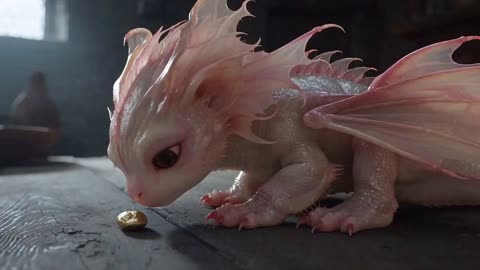</a>

A three beat structure of curious sniffing, hand feeding and an intimate close-up ending gives the clip a clear emotional arc. Warm firelight against cool window daylight and explicit photorealistic creature texture cues keep the dragon believable.

Seedance 2.5 · Text-to-video · Source: [@SadiaMalik182 on X](https://x.com/SadiaMalik182/status/2113908264387981758) · found via [LearnPrompt/awesome-seedance](https://github.com/LearnPrompt/awesome-seedance)

[`dark-fantasy`](tags.md#tag-dark-fantasy) [`creature`](tags.md#tag-creature) [`cinematic`](tags.md#tag-cinematic) [`storytelling`](tags.md#tag-storytelling) [`lighting-contrast`](tags.md#tag-lighting-contrast)

<details><summary><b>Prompt</b></summary>

```text
A cinematic dark-fantasy medieval scene inside a rustic stone cottage. A young woman with long, dark, tousled hair, wearing a cream lace-trimmed dress and dark woolen cloak, secretly cares for a tiny baby dragon with translucent pink skin, delicate frilled fins, glossy dark eyes, and tiny sharp claws.

The baby dragon crouches on a rough wooden table, curiously sniffing a gleaming gold coin. Warm firelight flickers across its realistic, moist skin while cool daylight enters through a small stone window.

The woman gently offers it a small piece of food. The dragon eagerly opens its mouth, revealing tiny sharp teeth, and flutters its delicate fins excitedly. She smiles affectionately as it leans toward her hand.

End with an intimate close-up of the dragon playfully taking the food while the woman watches with a tender smile, their secret bond growing stronger.

Photorealistic creature textures, realistic anatomy, natural human expressions, cinematic camera movement, shallow depth of field, warm amber firelight contrasted with cool grey daylight, muted earthy colors, subtle film grain, prestige television quality, 16:9 widescreen, 24fps, no cartoon appearance, consistent character design, believable creature movement, emotional storytelling.
```

</details>

<a id="seedance-bali-travel-vlog-eight-scene-montage"></a>
### Bali Travel Vlog in Eight Scenes

<a href="https://x.com/eshal__ai/status/2096840505355370629">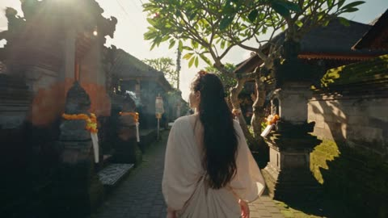</a>

Splits the 30 seconds into eight timed scenes, each with its own location, camera move and short spoken line. A fixed character description, a shared film look block and an avoid list keep the woman consistent across cuts.

Seedance 2.5 · Text-to-video · Source: [@eshal__ai on X](https://x.com/eshal__ai/status/2096840505355370629) · found via [LearnPrompt/awesome-seedance](https://github.com/LearnPrompt/awesome-seedance)

[`travel-vlog`](tags.md#tag-travel-vlog) [`multi-scene`](tags.md#tag-multi-scene) [`golden-hour`](tags.md#tag-golden-hour) [`35mm-film`](tags.md#tag-35mm-film) [`dialogue`](tags.md#tag-dialogue)

<details><summary><b>Prompt</b></summary>

```text
A cinematic 30-second tropical travel vlog montage featuring a beautiful 20-year-old East Asian woman with dark hair exploring Bali during a dreamy summer getaway. Shot like an authentic luxury travel diary with handheld camera movement, candid moments, soft golden-hour sunlight, dreamy 35mm film aesthetics, warm vintage color grading, shallow depth of field, natural skin texture, atmospheric lighting, and cinematic storytelling. Maintain the same woman throughout every scene: dark hair, youthful appearance, natural makeup, elegant summer outfits, relaxed happy expression. Format: 4K cinematic video, 24fps, 35mm film grain, realistic handheld camera, soft focus, warm color palette, travel documentary style.

Scene 1 (0-4s) — Arrival & Village Street: A warm Balinese morning. The woman strolls down a narrow street lined with frangipani trees and stone shrines, wearing a linen wrap dress, sunglasses pushed up into her hair. Motorbikes pass softly blurred in the background, incense smoke drifts from a doorway offering. Camera trails her from behind, then swings into a close-up as she glances back over her shoulder and laughs, saying softly, "Okay, I think I already love it here."

Scene 2 (4-8s) — Cliffside Beach Discovery: She descends stone steps onto a narrow cliffside beach, turquoise water crashing against limestone cliffs behind her. She walks barefoot at the tideline, dress hem lifted slightly, waves curling over her feet. Low-angle shots of her footprints filling with foam, sunlight scattering across the water, jagged cliffs framing the horizon.

Scene 3 (8-12s) — Rice Terrace & Jungle Moments: A worm's-eye view looking up through banana leaves and bamboo, sunlight cutting through in warm shafts with soft lens flares. Cut to a close-up of her standing at the edge of an emerald rice terrace, wind lifting loose strands of hair as she looks out, quietly murmuring, "It's so green it doesn't look real."

Scene 4 (12-16s) — Warung Cafe & Slow Living: She sits alone at a small open-air warung overlooking the jungle, sipping fresh coconut water through a paper straw. Sunlight filters through woven bamboo shades. Close-up shots of her hands wrapped around the coconut, condensation beading on the shell, her contented half-smile as she watches the trees sway.

Scene 5 (16-20s) — Ocean Adventure: She paddles a wooden longboard through a calm turquoise lagoon, sunlight sparkling across the surface. Camera circles her at water level, capturing gentle ripples and distant green cliffs. She loses balance slightly, laughs out loud, and calls toward the camera, "Don't film this part — actually, keep filming it."

Scene 6 (20-24s) — Night Market Exploration: A glowing Balinese night market strung with paper lanterns, satay smoke curling into the air, vendors calling out prices. She weaves through the crowd sampling grilled skewers and mango sticky rice, her face lit by warm string lights and passing motorbike headlights. Cinematic close-ups of her eyes widening at the taste, lanterns blurred into soft bokeh behind her.

Scene 7 (24-27s) — Golden Sunset Ending: A wide silhouette shot of her standing at the shoreline as the sun sinks into the sea, sky burning orange and violet, reflections rippling across the wet sand. Waves wash gently around her ankles as she tilts her face toward the last light, one hand shielding her eyes.

Scene 8 (27-30s) — Hotel Night Reflection: A rooftop pool bar overlooking a glittering coastal skyline at night. She leans against the railing in a simple white dress, curtain of hair moving in the breeze, city lights reflected in her eyes. Final intimate close-up of her curled up on the hotel bed, propped on one elbow, looking directly into the lens with a soft, warm smile as she says, "Goodnight from Bali."

Camera Style: Authentic travel vlog cinematography, handheld camera shake, smooth cinematic transitions, slow push-ins, natural drifting movement, occasional POV shots, realistic autofocus hunting, subtle motion blur.

Visual Style: Dreamy Bali vacation film, boutique travel-brand aesthetic, soft golden sunlight, realistic skin texture, cinematic shallow depth of field, nostalgic 35mm film look, warm atmospheric tones, natural unscripted expressions, emotional storytelling.

Avoid: cartoon style, CGI look, plastic skin, unrealistic face, inconsistent character appearance, changing hairstyle, extra fingers, distorted body, artificial lighting, oversaturated colors, blurry face, unnatural movements, duplicate people.
```

</details>

<a id="seedance-beach-rescue-playful-seawater-spit"></a>
### Beach rescue ends with playful seawater spit

<a href="https://x.com/Harry_thingss/status/2104579594695409840"></a>

Splits 15 seconds into three timed beats, each with its own shot size, camera move and emotional turn from panic to relief to laughter. A locked character block, a rack focus from hand to face, a sound list and a negative line keep identity, wardrobe and tone stable.

Seedance 2.5 · Text-to-video · Source: [@Harry_thingss on X](https://x.com/Harry_thingss/status/2104579594695409840) · found via [LearnPrompt/awesome-seedance](https://github.com/LearnPrompt/awesome-seedance)

[`beach`](tags.md#tag-beach) [`emotional-drama`](tags.md#tag-emotional-drama) [`timeline-prompt`](tags.md#tag-timeline-prompt) [`handheld`](tags.md#tag-handheld) [`golden-hour`](tags.md#tag-golden-hour)

<details><summary><b>Prompt</b></summary>

```text
PHOTOREALISTIC CINEMATIC VIDEO, 15 sec, 16:9, 35mm lens, shallow depth of field, warm golden-hour light, high-end film look.

CHARACTERS (identical in every frame): Woman, mid-20s, curvy Indian/Latina, wavy shoulder-length brown hair (soaked, on sand), soft makeup, wet olive-green sleeveless bodycon midi dress, gold chain necklace, hoop earrings, watch on left wrist, small floral tattoo on right forearm. Realistic skin, water droplets, sand grains. Boyfriend: early-30s, athletic, wet white t-shirt, dark shorts, short wet hair.

LOCATION: Quiet beach, wet sand, foaming waves behind, side sunlight with rim light on wet hair and skin, light sea breeze.

0-5s: Wide-to-medium shot, slow push-in at sand level. She lies on her back, eyes closed. He drops to his knees, urgently tilts her head and performs rescue-style chest compressions, realistic and non-graphic. Worried, panicked face; water drips from his hair. A wave washes near her feet.

5-10s: Close-up, slight handheld push-in on her hand and face. Her fingers twitch, hand curls, eyelids flutter, chest rises with a breath. He notices, freezes, panic turns to deep relief. Rack focus from her hand to his face.

10-15s: Medium close-up at sand level, both in frame. Still lying down, she opens her eyes, smiles mischievously, and playfully spits a small burst of seawater at his face. Droplets arc slowly, catching sunlight. He recoils, blinks, then laughs in shock. She looks relieved and amused. End on a warm two-shot.

CAMERA: smooth, slight handheld, slow push-ins, no sudden cuts.
AUDIO: waves, seagulls, wind, her small cough, soft laughter, light emotional score.
NEGATIVE: no blood, no gore, no distortion, no extra fingers, no face morphing, no outfit or jewelry change, no text, no watermark, no cartoon or plastic skin.
```

</details>

<a id="seedance-bedroom-awakening-giant-black-cat"></a>
### Bedroom Supernatural Awakening With Giant Black Cat

<a href="https://x.com/Zyrellix/status/2097594855946113177"></a>

The 30 second sequence is written as a beat by beat shot list: push in, a sudden arrival, room destruction, an extreme close-up, then a slow reveal and a final close-up on the cat. A closing line of stacked look terms (volumetric light, dust particles, hair physics, shallow depth of field) keeps the photoreal VFX look consistent.

Seedance 2.5 · Text-to-video · Source: [@Zyrellix on X](https://x.com/Zyrellix/status/2097594855946113177) · found via [LearnPrompt/awesome-seedance](https://github.com/LearnPrompt/awesome-seedance)

[`supernatural`](tags.md#tag-supernatural) [`fantasy`](tags.md#tag-fantasy) [`vfx`](tags.md#tag-vfx) [`cinematic`](tags.md#tag-cinematic) [`long-take`](tags.md#tag-long-take)

<details><summary><b>Prompt</b></summary>

```text
Create a 30-second ultra-cinematic supernatural fantasy sequence, photorealistic, high-end Hollywood VFX quality.A young woman with long straight black hair and bangs sits in a warm, dimly lit bedroom at night, wearing elegant white pajamas. Start with an intimate close-up of her looking down, then slowly push the camera toward her face. She suddenly senses something strange and looks directly toward the camera.She raises both hands as if controlling an invisible supernatural force. The atmosphere becomes intense, subtle particles and dark energy begin swirling around her. Suddenly, a mysterious white-haired female character appears in the room at incredible speed. She has pale skin, short silver-white hair, sharp expressive eyes, and wears a white outfit. She moves with supernatural agility, rushing toward the camera while reaching forward.The room begins shaking violently. Furniture and objects vibrate, dust and debris float through the air. The ceiling suddenly cracks open with a powerful burst of brilliant white-blue supernatural light. Walls fracture dramatically, creating a huge opening that reveals the dark night sky https://t.co/WPqc9zA0ZI the dust settles, the white-haired character stands in the destroyed room, illuminated by the strange light. Cut to an extreme close-up of her face as she looks shocked and breathes heavily.Then slowly reveal a gigantic mysterious black cat standing in the darkness behind her. The cat is unnaturally large, extremely fluffy, with glowing yellow eyes and an intimidating supernatural presence.End on a dramatic close-up of the giant black cat staring directly into the camera.
Smooth cinematic camera movement, realistic facial expressions, detailed hair physics, realistic cloth movement, volumetric lighting, floating dust particles, dynamic debris, dramatic shadows, shallow depth of field, realistic VFX, film-quality color grading, seamless transitions, highly detailed environment, photorealistic, 4K, cinematic masterpiece.
```

</details>

<a id="seedance-blue-hair-katana-duel-glass-hall"></a>
### Blue haired swordswoman duel in glass hall

<a href="https://x.com/AvelyrahnAI/status/2093540453261946900"></a>

The prompt sets one location and a tracking shot, then names each fighter's look and weapons so the choreography stays readable. Stacked effect cues (bullet time, splinters, smoke, volumetric light) push the motion across a long continuous action take.

Seedance 2.5 · Text-to-video · Source: [@AvelyrahnAI on X](https://x.com/AvelyrahnAI/status/2093540453261946900) · found via [LearnPrompt/awesome-seedance](https://github.com/LearnPrompt/awesome-seedance)

[`action`](tags.md#tag-action) [`anime-inspired`](tags.md#tag-anime-inspired) [`tracking-shot`](tags.md#tag-tracking-shot) [`bullet-time`](tags.md#tag-bullet-time) [`long-take`](tags.md#tag-long-take)

<details><summary><b>Prompt</b></summary>

```text
Cinematic action sequence, dynamic tracking shot in a modern glass-and-concrete architectural hall. A stylish anime-inspired girl with vibrant light-blue bob hair and cute blue/white hair clips wields a handgun and a katana, engaging in intense hand-to-hand combat against a nimble blonde rival armed with dual daggers. High-speed bullet-time perspective, dramatic close-ups, flying wood splinters, dynamic smoke effects, volumetric lighting, photorealistic skin texture, dramatic cinematic framing, 8k resolution, highly detailed martial arts choreography.
```

</details>

<a id="seedance-blue-pencil-draws-city-into-line-art"></a>
### POV blue pencil turns city into sketches

<a href="https://x.com/Sairah_0/status/2089556355384512991"></a>

A fixed first-person POV with a pencil in the bottom of the frame gives the transformation a visible cause. Each subject gets its own target style (line art, cartoon, pastel, color block), and the closing line asks for organic transformation rather than a cut.

Seedance 2.5 · Text-to-video · Source: [@Sairah_0 on X](https://x.com/Sairah_0/status/2089556355384512991) · found via [LearnPrompt/awesome-seedance](https://github.com/LearnPrompt/awesome-seedance)

[`pov`](tags.md#tag-pov) [`rotoscoping`](tags.md#tag-rotoscoping) [`line-art`](tags.md#tag-line-art) [`transformation`](tags.md#tag-transformation) [`urban`](tags.md#tag-urban)

<details><summary><b>Prompt</b></summary>

```text
Style: Cinematic live-action seamlessly blended with 2D hand-drawn line-art animation, using a playful rotoscoping-inspired transformation effect.

Visual Direction:
First-person POV throughout. A hand holding a blue pencil appears at the bottom of the frame, seemingly tracing over real-world objects. Wherever the pencil moves, the live-action environment gradually transforms into expressive 2D illustrations.

Scene Transitions & Subjects:

- Train: A white-and-green train travels across an elevated urban overpass. As the blue pencil traces along it, the train smoothly converts into clean black-and-white sketch line art, while retaining its movement and perspective.
- Cat: An orange tabby cat casually walks along a paved sidewalk. The pencil follows its movement, transforming the cat into a white hand-drawn cartoon with stylized illustrated shadows.
- Bus: A light-colored compact bus drives through the street. As it passes beneath the pencil’s tracing path, it morphs into a colorful pastel illustration with loose, artistic hand-drawn outlines.
- Girl: A woman sits naturally on a bench in a narrow urban alley, looking at her phone. The pencil traces around her and the surroundings, seamlessly turning the scene into a stylized 2D color-block illustration.

Tone & Atmosphere: Bright natural daylight, contemporary urban environment, playful and whimsical mood, fluid camera movement, dynamic transformations, and seamless transitions between realistic footage and hand-drawn animation.

Overall Effect: The video should feel as though the blue pencil is literally drawing reality into an animated world, with each subject transforming organically rather than appearing as a sudden cut or visual effect.
```

</details>

<a id="seedance-boy-fox-golden-meadow-3d-fantasy"></a>
### Boy Befriends Fox in Golden Mountain Meadow

<a href="https://x.com/Elvorya/status/2114235357961306286"></a>

A numbered-free arrow chain lays out seven shots in order, from close-up through pull-back to a wide closing shot, so the 30 second story has a clear arc. Closing style lines for lighting, fur and haze plus a consistency clause for character and fox appearance, and a no text or watermark clause, keep the look stable across shots.

Seedance 2.5 · Text-to-video · Source: [@Elvorya on X](https://x.com/Elvorya/status/2114235357961306286) · found via [LearnPrompt/awesome-seedance](https://github.com/LearnPrompt/awesome-seedance)

[`3d-animation`](tags.md#tag-3d-animation) [`fantasy`](tags.md#tag-fantasy) [`multi-shot`](tags.md#tag-multi-shot) [`golden-hour`](tags.md#tag-golden-hour) [`creature`](tags.md#tag-creature)

<details><summary><b>Prompt</b></summary>

```text
Create a 30-second cinematic, ultra-detailed 3D animated fantasy adventure set in a beautiful mountain meadow during golden hour. Show a close-up of a young boy with dark hair and a tiny fox-like creature nestled beside his face → camera pulls back to reveal the boy standing in a vast field of golden grass surrounded by majestic blue mountains → show the boy noticing a small fox in the distance as warm sunlight illuminates the meadow → transition to a close-up of the boy crouching down and gently reaching toward the fox with curiosity and kindness → show the boy kneeling in the tall grass, carefully approaching the little fox as it looks at him with bright, expressive eyes → the fox comes closer, creating a heartwarming moment of connection → show the boy gently interacting with the fox in the golden grass → end with a wide cinematic shot of the boy standing on a winding mountain path while the little fox walks nearby, surrounded by endless golden meadows and breathtaking mountain scenery. Warm golden-hour lighting, soft atmospheric mountain haze, detailed grass movement, expressive animated characters, realistic fur textures, natural body movements, beautiful environmental depth, smooth cinematic camera transitions, rich colors, emotional storytelling, high-quality 3D animation, polished feature-film aesthetic, magical yet natural atmosphere. Maintain consistent character designs, clothing, and fox appearance throughout the entire sequence. No text, subtitles, logos or watermark.
```

</details>

<a id="seedance-busan-coastal-street-travel-vlog"></a>
### Woman on Busan coastal street, tram and finger heart

<a href="https://x.com/MissDelulu9/status/2113151262103621812">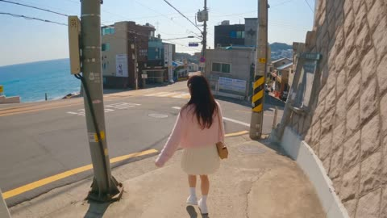</a>

Fixes format, length, resolution and frame rate in the opening line, then locks the character with one fixed outfit and hair description. Four timed scenes of 2.5 seconds each give every beat a clear action and a gradual camera approach.

Seedance 2.5 · Text-to-video · Source: [@MissDelulu9 on X](https://x.com/MissDelulu9/status/2113151262103621812) · found via [LearnPrompt/awesome-seedance](https://github.com/LearnPrompt/awesome-seedance)

[`travel-vlog`](tags.md#tag-travel-vlog) [`timed-scenes`](tags.md#tag-timed-scenes) [`character-consistency`](tags.md#tag-character-consistency) [`busan`](tags.md#tag-busan) [`realistic`](tags.md#tag-realistic)

<details><summary><b>Prompt</b></summary>

```text
Create a 10-second ultra-realistic 4K video, 16:9 landscape, 60 FPS. A cute adult woman with long silky dark-brown hair, soft bangs, almond-shaped brown eyes, and natural skin texture. She wears a pastel pink cardigan, white top, ivory pleated mini skirt, white sneakers, a cream shoulder bag, and a pink hair clip.

Scene 1 (0–2.5s): On a sloping coastal street in Busan, she smiles, points at the blue ocean, and invites her boyfriend to follow.

Scene 2 (2.5–5s): A yellow-green tourist tram passes behind her. She waves excitedly from the safe sidewalk.

Scene 3 (5–7.5s): With the turquoise ocean behind her, she makes a tiny finger heart, then giggles shyly as the camera approaches.

Scene 4 (7.5–10s): She playfully reaches for the camera, laughs, and ends with a cute smile while pointing at the ocean.
```

</details>

<a id="seedance-cafe-heartbreak-rainy-evening"></a>
### Woman finds boyfriend cheating in a rainy café

<a href="https://x.com/AIwithSynthia/status/2096439253970395531"></a>

The prompt fixes identity and outfit up front, then writes the scene as a beat by beat action list with a named emotion ramp from confusion to quiet acceptance. Explicit tear continuity rules, a handheld camera that moves closer on the reveal, and a sound list with no music keep the crying restrained and believable.

Seedance 2.5 · Text-to-video · Source: [@AIwithSynthia on X](https://x.com/AIwithSynthia/status/2096439253970395531) · found via [LearnPrompt/awesome-seedance](https://github.com/LearnPrompt/awesome-seedance)

[`emotional-drama`](tags.md#tag-emotional-drama) [`live-action`](tags.md#tag-live-action) [`cafe`](tags.md#tag-cafe) [`dialogue`](tags.md#tag-dialogue) [`handheld`](tags.md#tag-handheld)

<details><summary><b>Prompt</b></summary>

```text
Create a 30-second, 1080p ultra-realistic emotional live-action scene about a young woman discovering her boyfriend kissing another woman inside a quiet café. Focus entirely on authentic human emotion, natural crying, subtle facial expressions and believable body language. No melodrama or exaggerated acting.
MAIN CHARACTER
Young Korean woman in her early 20s, naturally beautiful, realistic skin texture, minimal makeup, long black hair loosely styled, wearing a fitted pastel-pink top, casual denim shorts and simple sneakers.
Maintain the exact same face, hairstyle, outfit, body proportions and appearance throughout the entire scene.
LOCATION
A cozy modern café on a rainy evening. Warm interior lighting, large windows covered with rain droplets, wooden tables, soft background chatter, cups and plates, a few customers quietly talking.
SCENE
She enters the café carrying a small handbag, casually looking around for her boyfriend.
She suddenly notices him sitting at a table near the window.
He is kissing another young woman.
She immediately stops walking.
Her expression changes from confusion to disbelief.
She slowly lowers her handbag.
She stares at them silently for a few seconds, struggling to process what she is seeing.
Her eyes begin to fill with tears.
Show realistic tears naturally forming along her lower eyelids, then slowly rolling down her cheeks. No exaggerated crying.
She takes a shaky breath.
She walks toward their table.
Her boyfriend notices her.
His expression immediately changes to shock.
The other woman turns around and becomes uncomfortable.
The girlfriend looks directly at him with trembling eyes and quietly says:
“How could you do this to me?”
Her voice cracks naturally.
She wipes one tear from her cheek, but more tears continue falling.
Her boyfriend stands up and tries to explain.
She shakes her head and takes a small step backward.
She says through tears:
“I trusted you.”
She looks at him for one final moment.
Her expression shows heartbreak, disappointment and disbelief rather than anger.
She turns around and walks toward the café door while quietly crying.
Her boyfriend takes one step after her but stops.
She reaches the door, pauses briefly, wipes her face and leaves.
The camera remains inside the café as the door closes behind her.
CAMERA / VISUAL STYLE
Handheld cinematic camera with subtle natural movement. Start with a medium shot following her into the café, then slowly move closer when she notices the couple.
Use realistic close-ups of her eyes, trembling lips, tears and subtle facial reactions.
Natural shallow depth of field, realistic skin pores, authentic reflections in the café windows, soft rainy evening light, natural motion blur, 24fps, photorealistic live-action.
Do not make her crying look beautiful or glamorous. It should look spontaneous, uncomfortable and emotionally real.
AUDIO
Rain against the café windows, quiet conversations, cups being placed on tables, distant café ambience, footsteps and subtle breathing.
No background music.
No narration.
Dialogue should sound natural with slight pauses, trembling voice and emotional breathing.
EMOTIONAL DIRECTION
The emotion should build gradually:
confusion → realization → shock → disbelief → tears → confrontation → heartbreak → quiet acceptance.
Avoid screaming, physical aggression or exaggerated dramatic gestures.
CONTINUITY / REALISM
Keep tears physically consistent once they appear. Tears should remain visible on her cheeks and naturally accumulate as she continues crying.
Maintain consistent clothing, hairstyle, jewelry and facial identity.
No sudden emotional changes, no disappearing tears, no duplicated people, no changing café layout, no unnatural body movements.
NEGATIVE: plastic skin, fake tears, exaggerated crying, cartoon expressions, melodramatic acting, screaming, physical violence, distorted faces, extra fingers, identity drift, outfit changes, CGI
```

</details>

<a id="seedance-campus-rain-umbrella-cafe-romance"></a>
### Campus rain romance from umbrella to café

<a href="https://x.com/nawalsehar/status/2096832969453543579">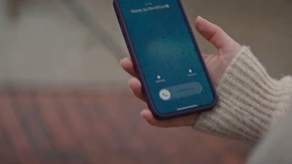</a>

The prompt lays out the story as ordered beats (rain, shared umbrella, café, sunlight after the storm) so a 30 second clip keeps a clear arc. Physical details such as umbrella physics, wet hair and puddle reflections, a handheld smartphone camera and a closing list of exclusions keep the look realistic.

Seedance 2.5 · Text-to-video · Source: [@nawalsehar on X](https://x.com/nawalsehar/status/2096832969453543579) · found via [LearnPrompt/awesome-seedance](https://github.com/LearnPrompt/awesome-seedance)

[`romance`](tags.md#tag-romance) [`vlog`](tags.md#tag-vlog) [`rain`](tags.md#tag-rain) [`handheld`](tags.md#tag-handheld) [`dialogue`](tags.md#tag-dialogue)

<details><summary><b>Prompt</b></summary>

```text
Create a 30-second photorealistic live-action American university romance vlog set during a sudden afternoon rainstorm. A young female student gets caught in heavy rain without an umbrella, until a male student kindly shares his black umbrella. They walk together through a realistic U.S. college campus, joking and slowly becoming comfortable with each other.

They escape to a cozy campus café, share hot coffee beside a rain-covered window, and have a subtle moment of connection. As the rain stops, golden sunlight breaks through the clouds and they walk together across the wet campus.

Modern 2026 cinematic coming-of-age style, natural American English dialogue, realistic rain, wet hair and clothing, umbrella physics, puddle reflections, authentic student behavior, handheld smartphone-style camera, natural expressions and subtle romance. No exaggerated acting, CGI, animation, subtitles, music or watermark.
```

</details>

<a id="seedance-cat-day-in-the-life-selfie-vlog"></a>
### Orange cat films its whole day selfie vlog

<a href="https://x.com/ZaraIrahh/status/2091385137133219971"></a>

The prompt splits 60 seconds into six ten second beats, each with its own action and sound cues. A hard no speech rule plus a list of allowed natural sounds keeps the audio to meows and room ambience, and the paw held phone framing sets the selfie look.

Seedance 2.5 · Text-to-video · Source: [@ZaraIrahh on X](https://x.com/ZaraIrahh/status/2091385137133219971) · found via [LearnPrompt/awesome-seedance](https://github.com/LearnPrompt/awesome-seedance)

[`cat`](tags.md#tag-cat) [`vlog`](tags.md#tag-vlog) [`selfie`](tags.md#tag-selfie) [`day-in-the-life`](tags.md#tag-day-in-the-life) [`natural-sound`](tags.md#tag-natural-sound)

<details><summary><b>Prompt</b></summary>

```text
Create a 60-second realistic day-in-the-life cat vlog, following the same cute cat from waking up in the morning until falling asleep at night.

Critical Requirement

NO HUMAN SPEECH AND NO DIALOGUE.

The cat must not speak any words at any point. Do not use narration, voice-over, human voices, subtitles, captions, or text.

The story must be communicated entirely through the cat’s actions, facial expressions, body language, meows, purrs, chirps, yawns, and natural environmental sounds.

Overall Visual Style

One continuous handheld front-facing smartphone selfie-vlog perspective. The cat holds the phone itself with its paw and films its own day.

- Realistic modern smartphone footage
- Natural handheld shake
- Slight framing imperfections
- Occasional autofocus hunting
- Natural front-camera lens distortion
- Realistic unfiltered smartphone colors
- Soft natural morning, afternoon, and evening lighting
- Same cat, face, fur pattern, eyes, and body throughout
- Cute but believable cat behavior
- Natural expressions and movements
- No cinematic camera movements
- No third-person camera
- No tripod or external camera
- No beauty filter or cinematic color grading
- No logos, watermarks, subtitles, captions, or on-screen text
- No background music

0–10 sec — Wake Up

The cat wakes up in a cozy bed.

It picks up the phone with its paw and starts filming itself selfie-style.

It looks sleepy, yawns, stretches, rubs its face with its paws, and looks into the camera with sleepy eyes.

It gives a tiny “meow”, then climbs out of bed.

10–20 sec — Breakfast

The cat walks into the kitchen while filming itself.

It sees its food bowl and immediately becomes excited.

It prepares or receives its breakfast, eagerly eats, then drinks water.

It looks happily into the camera and gives a couple of excited little meows.

Include realistic food-bowl sounds, chewing, drinking, and kitchen ambience.

20–30 sec — Playtime

The cat grabs its favorite toy.

It runs around the house, chases the toy, jumps onto the couch, bats at it with its paws, and playfully rolls around.

The phone shakes naturally during the energetic movement.

The cat stops for a moment, looks directly into the camera, gives a playful chirp/meow, then immediately runs off again.

30–40 sec — Exploring

The cat explores the house.

It looks through a window, watches birds outside, investigates a strange sound, walks into another room, and sniffs interesting objects.

It notices something outside and becomes curious.

The cat makes a soft “mrrp” sound and continues exploring.

Keep the behavior authentically feline rather than human-like.

40–50 sec — Afternoon Adventure

The cat safely goes outside into a garden or quiet courtyard.

It walks around while filming itself, sniffs flowers and plants, watches birds, investigates leaves, and explores its surroundings.

The cat pauses, looks excitedly at something off-camera, then gives a small curious meow.

Use natural outdoor sounds such as birds, wind, leaves, distant traffic, and footsteps.

50–60 sec — Evening & Bedtime

The cat returns home as the light becomes warm and soft.

It has its evening meal, drinks some water, then climbs onto the couch or back into its bed.

It grooms itself, yawns, becomes sleepy, and curls into a comfortable position.

It looks into the phone one last time, gives a tiny sleepy meow, slowly closes its eyes, and lowers the phone naturally.

End with quiet nighttime home ambience.

Final Audio Requirements

Absolutely no dialogue. No words. No narration. No human voice. No talking cat.

Use only natural diegetic sounds:

- Cat meows
- Purring
- Chirping
- Yawning
- Footsteps
- Food and water sounds
- Toy sounds
- Household ambience
- Birds and outdoor sounds
- Wind and leaves
- Natural nighttime ambience

The finished video should feel like a realistic, cozy smartphone vlog from a cat’s perspective, showing what the cat naturally does throughout an entire day without saying a single word.
```

</details>

<a id="seedance-coastal-crime-game-livestream-facecam"></a>
### Coastal crime game livestream with streamer facecam

<a href="https://x.com/QAiStudio/status/2099363620325048805"></a>

A fixed HUD with a facecam locked to a reference image, English chat and a timed beat list give each seconds range one action and one HUD change. A strict rules list caps characters, weapons and endings so the long take stays consistent across the 30 second opening and 15 second continuation.

Seedance 2.5 · Reference-to-video · Source: [@QAiStudio on X](https://x.com/QAiStudio/status/2099363620325048805) · found via [LearnPrompt/awesome-seedance](https://github.com/LearnPrompt/awesome-seedance)

[`gameplay`](tags.md#tag-gameplay) [`livestream`](tags.md#tag-livestream) [`hud`](tags.md#tag-hud) [`long-take`](tags.md#tag-long-take) [`photorealistic`](tags.md#tag-photorealistic)

<details><summary><b>Prompt</b></summary>

```text
Photorealistic fictional open-world coastal crime-action gameplay livestream, 16:9, one continuous 45-second take split into a 30-second opening plus a seamless 15-second continuation. Fixed full-screen game HUD throughout: bottom-right square pink-blue neon facecam of HANEUL only, matching the supplied reference image exactly; fixed HUD, English-only scrolling live chat on the left, Korean streamer speech only with no subtitles, third-person chase camera, no cuts, no transitions, no scene changes, no duplicate characters.

0–8s: Player drives a dark muscle car through a neon coastal city at dusk toward a GPS destination; HANEUL is calm and focused in facecam, with engine, city ambience, faint radio, and keyboard/mouse sounds.

8–15s: At a warehouse, exactly two dark-red-jacket gang enemies emerge from cover, draw pistols, and ambush the player. The player dives behind a car, is visibly grazed, health drops, and wanted level rises to two stars. HANEUL reacts in shocked Korean.

15–24s: Intense reckless firefight. Player uses one compact SMG; enemies use pistols only. A flanking enemy shatters a nearby car window, bullets dent the car and pop a tire, ammo falls from 38/120 toward 24/120, wanted level reaches three stars, and distant police cruisers appear only in the background.

24–30s: Player fires five deliberate SMG shots with visible sequential hit reactions; both enemies fall only after being hit. Ammo drops exactly from 24/120 to 14/120. HANEUL remains wide-eyed and tense; police sirens close in.

30–38s: With both enemies down, the player limps into the damaged muscle car with a shredded tire. Two police cruisers pursue in the background as the car lurches forward on its rim. Health remains critically low and flashing red; wanted level stays at three stars.

38–45s: Player scrapes through a narrow alley, knocks off both mirrors, and reaches a side street where traffic briefly blocks the police. The wanted level remains flashing at three stars, police lights remain visible in the rearview, and the ending stays unresolved.

Strict rules: HANEUL appears only in the bottom-right fixed facecam; exactly one player and two gang enemies; no extra armed characters; no full-screen facecam; no subtitles; English-only HUD/chat text; no weapon swaps; no gore; no victory, clean escape, black screen, or end card.
#flovacpp #flovaai
```

</details>

<a id="seedance-college-lab-zombie-infection"></a>
### College lab student turns into a zombie

<a href="https://x.com/AIwithSynthia/status/2106955772395659431"></a>

The prompt runs as a timed chain of beats, from the cracked container to infection, chase, barricade and a final smile at the door window, and it locks the character's face and clothes up front. A separate audio line with no music, a style line that moves from cold fluorescent to red emergency light, and a negative list against gore and face morphing keep the horror grounded.

Seedance 2.5 · Text-to-video · Source: [@AIwithSynthia on X](https://x.com/AIwithSynthia/status/2106955772395659431) · found via [LearnPrompt/awesome-seedance](https://github.com/LearnPrompt/awesome-seedance)

[`horror`](tags.md#tag-horror) [`zombie`](tags.md#tag-zombie) [`photorealistic`](tags.md#tag-photorealistic) [`handheld`](tags.md#tag-handheld) [`sound-design`](tags.md#tag-sound-design)

<details><summary><b>Prompt</b></summary>

```text
Create a photorealistic live-action zombie-horror sequence inside a modern university science laboratory during a normal college practical session. The central character is a young adult Korean female college student wearing a white laboratory coat over a simple shirt, blue jeans and white sneakers. Keep her face, hairstyle, clothing and body proportions identical throughout. Surround her with several college students, laboratory benches, microscopes, glass test tubes, chemical containers, computers and scientific equipment. Use realistic fluorescent lighting, practical effects, handheld camerawork and believable physics.

The students are quietly working on an experiment when a sealed glass specimen container suddenly cracks. A dark infected substance escapes and attaches itself to the young woman near her shoulder and neck. She stumbles backward in fear as dark veins slowly spread beneath her skin, traveling across her neck and face. Her fingers begin twitching, her body develops violent tremors and her skin becomes pale and clammy.

Her frightened expression gradually disappears. She raises her head and her eyes slowly transform into deep cloudy-black eyes. She suddenly turns toward a nearby classmate and charges. He desperately backs away behind a laboratory table while she repeatedly slams against it, moving with unnatural strength.

The other students freeze before scrambling toward the laboratory exit. The infected woman suddenly becomes completely still, then slowly rotates her head toward them. Her dark veins pulse visibly across her face while her black eyes remain fixed on the students.

Another glass specimen container cracks in the background. A second infected student suddenly collapses onto the floor, convulsing violently as dark veins spread across his neck and face and his eyes turn black. Panic erupts throughout the laboratory.

Students grab backpacks, chairs and laboratory equipment while trying to escape. One student pulls another toward the emergency exit as the infected chase them through the narrow aisles. A heavy laboratory table is pushed against the door as a temporary barricade.

The survivors finally reach the hallway and slam the laboratory door shut. Red emergency lights begin flashing as they catch their breath.

Inside the laboratory, everything becomes silent.

The camera slowly approaches the small observation window in the door. The infected female student stands motionless in the darkness, still wearing her white lab coat and jeans. Her pale face, prominent dark veins and completely black eyes are clearly visible.

She slowly tilts her head toward the window.

Then she suddenly smiles.

Cut to black.

AUDIO: Realistic laboratory ambience, fluorescent hum, glass cracking, equipment falling, footsteps, frightened breathing, screams, alarms, convulsions, impacts and distant banging. No music or exaggerated sound effects.

STYLE: Ultra-realistic college laboratory horror, practical-effects infection, realistic skin texture, believable anatomy, natural handheld camera, grounded movement, realistic facial transformation, dark spreading veins, black/cloudy eyes, violent convulsions and unnatural infected movements, cold fluorescent lighting transitioning into red emergency lighting.

NEGATIVE: Excessive gore, graphic dismemberment, graphic eye gore, anime, cartoon, illustration, plastic skin, fake CGI, duplicated students, face morphing, distorted anatomy, extra limbs, floating objects, impossible physics, changing clothes, inconsistent identities, subtitles, text, logos, watermark.
```

</details>

<a id="seedance-convenience-store-number-four"></a>
### Woman outsmarts three men outside a convenience store

<a href="https://x.com/aiwithaly/status/2106981702677451248"></a>

The prompt scripts the 30 seconds as ordered beats, with each line of dialogue and each move in its own sentence. Physics terms like momentum, inertia and leverage, plus a long negative list and an ambience and impact only sound brief, keep the choreography grounded.

Seedance 2.5 · Text-to-video · Source: [@aiwithaly on X](https://x.com/aiwithaly/status/2106981702677451248) · found via [LearnPrompt/awesome-seedance](https://github.com/LearnPrompt/awesome-seedance)

[`action-thriller`](tags.md#tag-action-thriller) [`dialogue`](tags.md#tag-dialogue) [`choreography`](tags.md#tag-choreography) [`night`](tags.md#tag-night) [`korean`](tags.md#tag-korean)

<details><summary><b>Prompt</b></summary>

```text
Create an exactly 30-second, 16:9, 24fps hyper-realistic Korean live-action action thriller with dry dark comedy. Nighttime outside a modern Korean convenience store, wet pavement reflecting storefront lights.

PYONA exits carrying a small paper bag. Three intimidating adult men surround her. The leader says, “You have three choices: give us your phone, apologize, or fight.”

PYONA calmly studies the gap between them and says, “I'll take number four.” She walks through the opening and adds, “You leave.” The leader's smile disappears.

He grabs her forearm. She looks at his hand and says, “That was the wrong answer.” When he pulls her, she steps toward him, rotates with his force and redirects his momentum into the convenience-store door.

A second man charges with a punch. PYONA sidesteps and redirects him into the first man. A third attacks from behind; she steps aside and redirects him into stacked plastic crates, which collapse from the collision.

The three men freeze. The leader asks, “Who are you?” PYONA calmly replies, “I already told you.” She picks up her bag, walks past them, then looks back and says, “Number four.”

Cut to black.

Use grounded physical choreography: realistic weight, momentum, inertia, friction, leverage, balance and collision reactions. PYONA wins through timing and redirection, never superhuman strength.

Controlled cinematic camera with consistent screen direction and clear full-body framing during physical actions. Natural nighttime ambience and realistic impact sounds only. No music or narration.

Negative prompt: supernatural strength, flying bodies, wire-fu, invisible force, impossible throws, premature falls, teleportation, duplicate characters, appearance drift, costume changes, location changes, excessive camera shake, exaggerated slow motion, cartoon physics, blood, gore, weapons, broken bones, head impacts, logos, watermark.
```

</details>

<a id="seedance-couple-pov-bedroom-teasing-pinch"></a>
### Boyfriend POV bedroom banter ending in laughter

<a href="https://x.com/QtImVCr6WK56152/status/2106252278940541142"></a>

One continuous handheld POV long take scripts every line, pause and micro-expression, so the comedy comes from timing rather than cuts. It fixes the hand's entry, contact and exit path, and keeps the angled mirror from reflecting the camera side.

Seedance 2.5 · Reference-to-video · Source: [@QtImVCr6WK56152 on X](https://x.com/QtImVCr6WK56152/status/2106252278940541142) · found via [LearnPrompt/awesome-seedance](https://github.com/LearnPrompt/awesome-seedance)

[`couple`](tags.md#tag-couple) [`pov`](tags.md#tag-pov) [`long-take`](tags.md#tag-long-take) [`dialogue`](tags.md#tag-dialogue) [`photoreal`](tags.md#tag-photoreal)

<details><summary><b>Prompt</b></summary>

```text
使用上传的角色参考图像作为唯一女主角参考，女主为年轻成年女性，全程严格保持同一人物身份，高度锁定参考图中人物原本的脸型、五官比例、眉型、眼型、眼睛大小与间距、鼻型、嘴型、唇形、下颌线、面部骨相、白皙自然肤色、年龄感、黑色长直发、自然齐刘海、发际线以及整体人物辨识度，不换脸、不漂移、不重新设计五官、不突然改变妆容、不改变年龄，不生成统一韩系AI网红脸；皮肤保持白皙、细腻、透亮但必须有真实真人皮肤质感，保留自然毛孔、鼻翼阴影、轻微唇纹、细小碎发和真实光影，不要塑料磨皮；发型从第一帧到最后一帧始终保持参考图中的黑色长直发与齐刘海结构，长度、发量、刘海位置不能突然变化；服装严格参考中女生原本穿搭，保持浅米白色自然V领短袖上衣与黑色短裤，颜色、材质、领口、袖型和整体穿着比例稳定一致，进入卧室以后去掉豹纹包、鞋子等外出配件，只保留自然居家穿着状态，全程不换衣服。生成一段约30秒、16:9横版、真人实拍质感、真实生活流、甜蜜轻喜剧情侣互动视频，两个人已经是关系非常亲密、非常熟悉的年轻情侣，不是暧昧初期，也不是刚认识，不需要通过夸张的拥抱、接吻或者表白证明感情，女主性格俏皮、可爱、开朗、爱笑，情绪很容易写在脸上，喜欢抓住男朋友一句普通的话故意曲解，偶尔会假装生气、嘴硬、撇嘴，但从来不是真正发脾气，她其实很喜欢看男朋友被自己问住的样子；男主性格平时偏高冷、内向、话少、不太会表达，也完全不擅长哄人，面对女主时会明显变柔软，但依旧不会说很多漂亮话，他的好笑来自一本正经、反应稍微慢半拍、不会哄却总能莫名其妙把女主逗笑；两个人之间不是刻意调情，而是已经非常熟悉以后形成的自然情侣状态，整段视频必须有一种“本来只是晚上躺在房间里随口聊天，女生突然抓住男朋友一句话故意找茬，男朋友越解释越不会说，最后又用很笨的方式把她逗笑”的感觉，不要偶像剧式表演，不要霸总式男友，不要刻意深情凝视，不要每一句都像情话，不要演成短剧，不要像演员背台词，要像真正情侣卧室里偶然被记录下来的一小段，甜感来自两个人的熟悉、停顿、眼神、嘴硬、轻轻捏脸、低头憋笑和最后破功，而不是刻意卖甜。场景是一间真实、普通、干净、有生活感的住宅卧室，夜晚，房间保持床、浅色或白色被褥、枕头、木质床头、窗户、窗帘、简单家居陈设以及侧放落地镜等元素，床铺不要像酒店一样完全整理平整，被褥可以有自然皱褶和真实使用痕迹，窗外已经变暗，室内主要由柔和床头灯与一点非常微弱的窗边夜间环境光照明，床头灯是柔和暖白而不是浓烈橙黄色，同时保留一点轻微偏冷的夜间窗口环境光，让人物肤色自然、白皙、干净，不要整个画面变黄，不要强烈轮廓光，不要硬阴影，不要豪华酒店感，不要摄影棚感，不要样板房感，不要蜡烛、玫瑰、爱心灯等刻意浪漫元素，浪漫全部来自两个人互动；特别注意卧室中的镜子，镜面保持偏侧角度，不正对摄影方向，只允许反射窗帘、床侧或房间环境，镜子里绝对不能出现男主的脸、完整身体、摄影设备、摄影人员、第三个人或者任何不合理人体。全程主要采用男朋友第一人称视角 / 近距离情侣POV，镜头本身就是男朋友所在的位置，男主绝对不露脸，也不能出现完整身体，最多只允许偶尔出现男主的一只右手、少量前臂或者非常模糊的肩部边缘，除此之外不要出现男主人体，女主实际上始终是在与自己的男朋友交流，因此她看向镜头就是看向男朋友，而不是在面对观众自拍；摄影距离保持在真实情侣坐在床上聊天时的私人距离，前半段保持自然中近景，可以看到女主完整脸部、肩膀、上半身以及一部分床铺和卧室环境，不要一开始就一直怼脸，后半段随着两个人互动越来越甜，镜头才可以非常轻微、缓慢地靠近一点；全程轻微自然手持呼吸感，像男朋友本人手拿手机拍摄，只允许极小幅度的手腕漂移和呼吸起伏，不剧烈晃动，不旋转镜头，不快速推拉，不频繁切镜，整段优先采用一个连续POV长镜头完成，最多允许一次非常自然、几乎感觉不到的重新构图，不要一句对白切一次镜头；镜头始终重点捕捉女主的眼睛、嘴角、脸颊、轻轻眯眼、撇嘴、抿嘴、忍笑、低头憋笑、重新抬眼、突然笑出来、细微呼吸以及头发的小动作，女主不能从头到尾一直直勾勾盯镜头，眼神必须自然变化，看男友、短暂移开、偷偷看回来、低头、看男主伸来的手、假装不高兴地转开、忍笑、重新对视，最后才完全笑开。视频开头女主自然坐在床上或靠坐在床边，身体非常放松，一边随手整理垂在胸前的黑色长发，一边和男朋友随意聊天，她原本心情很好，脸上始终带着很轻松、很自然的笑，男主在画外用非常随意、平静、略微低沉、话不多的语气说：“你今天话还挺多啊。”女主不要马上反应，先保持原本的笑大约半秒，像突然捕捉到“话还挺多”这几个字，整理头发的动作慢下来，眼睛停一下，再慢慢抬眼看向男朋友，嘴角原本的笑意一点一点收回来，但绝对不是真的生气，而是明显意识到自己好像抓到了一个可以逗他的点，眼睛轻轻眯一下，下巴微微抬起，带着一点“你刚刚是不是说错话了”的感觉说：“嫌我烦啊？”男主明显愣一下，马上意识到情况不对，语气稍微有一点慌但依旧内向、克制：“啊？没有没有，我不是那意思。”女主几乎立刻接上，不给他太多缓冲，身体仍然很放松，但是眼神盯着他，故意追问：“那你什么意思。”说完以后她表面一本正经等他的答案，实际上嘴角已经有一点点想笑，她自己意识到以后轻轻抿一下嘴，把笑压回去；男主明显不知道这种问题应该怎么处理，不要立刻回答，镜头安静看着女主，保留大约半秒到一秒真实思考的停顿，他先迟疑地说：“就是……”再停顿一下，像是真的在想一个最安全的答案，然后非常认真、略显笨拙地说：“感觉你今天特别可爱。”这一句男主绝对不要用成熟撩人的语气，不要突然温柔深情，不要像情话高手，而应该像被追问以后情急之下说出了自己真实想法；女主听完以后先停一下，眼神明显有一点被夸到，但她马上意识到自己不能这么快被哄好，于是故意把脸轻轻偏向一边，嘴角努力压住，带着一点不信又有一点想笑的感觉说：“油嘴滑舌，我才不信！”这里不是真嫌弃，语气里藏着明显笑意，说完以后她故意把视线移开，不马上看男朋友，嘴巴轻轻抿着，让人感觉她其实已经开心了一点，只是还想继续装；男主看到她还是不理自己，安静一秒，明显不知道还能怎么哄，不要马上继续说话，随后男主的一只右手从镜头侧前方自然进入画面，必须是一只结构真实稳定的成年男性右手，正常五根手指，手掌、手腕、前臂比例自然，动作缓慢，先完整向女主一侧脸颊靠近，再由拇指和食指非常轻地捏一下她一侧脸颊，只持续约一秒，这是已经很熟的情侣之间非常自然的小动作，不是用力掐脸，不是拉扯，不要让整张脸发生夸张变形，手指不能穿过皮肤，不能多出手指，不能出现第二只多余男性手，也不能突然从女主脸旁凭空生成一只手；女主完全没想到男朋友会突然这样，先明显愣半秒，眼睛轻轻放大一点，随后皱起一点眉毛，被捏的一侧脸颊微微鼓起来，嘴巴很自然地撇下来，非常可爱又有一点无语地重新看向男朋友，不要夸张嘟嘴，不要演成表情包，随后她可以用自己的一只手轻轻碰一下或者推开男主的手，两只手必须发生真实接触，不能穿透，男主的手随后沿原来的方向自然撤回画面，不能凭空消失；女主带着真实意外和一点假生气说：“哎你捏我脸干嘛？”男主依旧非常平静、非常认真地回答：“哄你啊。”女主更加无语地盯着他，嘴巴仍然微微撇着：“你管这叫哄人？”男主再次卡住，先短暂停顿，像第一次认真思考“哄人到底应该怎么哄”，然后有一点没底气、甚至略微迟疑地说：“那…那不然怎么哄啊，我也没经验啊。”说完以后再稍微停一下，男主重新恢复一本正经的状态，继续非常认真地补一句：“脸软乎乎的，捏捏气就消了吧应该。”这一句是整段最关键的喜剧点，男主自己绝对不要笑，也不能故意用搞笑语气，他是真的认真觉得“脸软，所以捏一下可能气就消了”，越认真越好笑；女主听完先愣住，眼睛重新抬起来看男朋友，原本还想维持自己的生气表情，但是嘴角已经开始明显失控，她立刻意识到自己快笑出来，于是低一下头，把视线移开，轻轻抿住嘴，肩膀非常轻地动一下，从鼻子或者嘴里漏出一点很轻的憋笑气音，不要马上大笑，她必须努力重新控制表情，再慢慢抬头，故意继续装凶，用一种“怎么会有这么笨的人”的眼神看着男朋友说：“你可真够笨的。”这句话表面是在嫌弃，语气实际上已经明显变软，嘴角也已经藏不住一点笑；男主注意到她刚刚低头憋笑，停顿半秒，非常自然地指出：“哎，你笑了。”女主瞬间重新抿嘴，眼睛看回来，非常嘴硬、非常自然地否认：“我没有。”但说这句话的时候嘴角其实还在偷偷往上翘；男主没有被她骗到，声音依旧平静，只多一点终于抓到证据的感觉：“得了吧，嘴角都翘起来了还装。”女主听完以后终于彻底绷不住，不要突然夸张哈哈大笑，正确反应是先愣一下，然后眼睛最先弯起来，接着嘴角彻底失去控制，再真正笑出来，笑容明亮、自然、甜，但不是营业式标准笑，她可以低一下头笑，再重新抬头看男朋友，身体非常自然地朝镜头靠近一点，眼睛里已经完全没有刚才所谓的“生气”，只剩下被抓包以后又好气又好笑的感觉，最后她伸出一只手朝镜头靠近，手掌自然挡住一部分画面，笑着说：“闭嘴。”说完以后自己又忍不住笑一下，不要立刻黑屏，最后停留短短一瞬，让最后可见的画面是她靠近男朋友、眼睛已经笑弯、嘴角完全藏不住、伸手挡镜头之前仍然看着男朋友的状态，然后自然结束。整个视频最大的表演核心是“憋不住”，女主从来不是真的发火，她知道男朋友说“话还挺多”并不是嫌自己烦，她所谓的生气其实是故意曲解、看他紧张、继续追问、看他会怎么哄自己，所以完整情绪必须表现为：一开始自然笑着聊天，听见“话还挺多”后动作停顿，突然意识到可以抓这句话做文章，轻轻眯眼问“嫌我烦啊”，看到男朋友慌了以后其实已经有一点得逞，听见“感觉你今天特别可爱”以后明显被哄到，却嘴硬说“不信”，故意把脸转开，突然被捏脸以后短暂意外，再可爱地撇嘴问“你管这叫哄人”，听男朋友认真解释，听到“脸软乎乎的，捏捏气就消了吧应该”以后瞬间觉得他真的很笨，嘴角开始失控，低头憋笑，重新装严肃，被男朋友发现以后立刻否认，最后再次被拆穿才彻底笑出来；不要每一句话都配一个大动作，不要演成小品，不要频繁眨眼，不要夸张鼓腮，不要故意瞪大眼睛，不要高频撒娇，不要从头到尾不停摸头发，真正的可爱来自反应慢半拍、眼睛先变化、嘴角藏不住、自己发现以后再努力压住。男主虽然全程不露脸，但必须通过停顿、说话节奏、语气、偶尔的迟疑以及唯一一次捏脸动作形成明确存在感，他不是情圣，不是油腻男，不是霸总，也不是特别会谈恋爱的男生，说“感觉你今天特别可爱”时也不要像成熟情话，而像情急之下说出的真实想法，说“那…那不然怎么哄啊，我也没经验啊”时需要真的有一点不知道该怎么办，说“脸软乎乎的，捏捏气就消了吧应该”时必须完全一本正经，他的笑点来自他本人根本不知道自己很好笑；男主不能一直讲话，必须经常出现不知道怎么回答、安静、想一下、再开口的真实节奏。女主声音年轻、自然、明亮，是成年年轻女性自然声线，带一点轻微笑意，不要幼态声音，不要夹子音，不要刻意撒娇腔，不要所有尾音都上扬，“嫌我烦啊？”要像突然抓住男朋友一个语言漏洞，“那你什么意思”要稍微快一点像立刻追问，“油嘴滑舌，我才不信！”是明明被夸开心却故意嘴硬，“哎你捏我脸干嘛？”必须先有真实意外再说话，“你管这叫哄人？”是无语而不是真生气，“你可真够笨的”说的时候已经明显带一点笑，“我没有”一定要嘴硬而且嘴角最好正在偷偷翘，“闭嘴”必须笑着说。整段视频的人物位置必须连续，女主不能上一秒坐在床左侧下一秒突然变到右侧，床铺不能突然改变，房间结构不能跳变，灯光方向不能突然变化，黑色长直发与齐刘海、发量、头发长度始终一致，浅米白色短袖和黑色短裤始终一致，领口和袖子不能突然变化；男主捏脸之前画面里不能提前出现任何多余男性手，男主全片只有一只右手参与捏脸动作，完整物理路径必须明确表现为手从合理方向进入、向脸颊靠近、真实接触、轻轻捏约一秒、女主产生反应、女主轻轻推开、男主手自然撤回，不能手指穿脸，不能脸穿过手，不能两只手穿透，不能突然增加肢体；女主最后伸手挡镜头时同样必须从她真实手臂所在位置自然延伸出来，不能凭空出现。声音设计没有背景音乐、没有字幕、没有文字、没有旁白、没有额外音效，只保留非常真实的夜晚卧室环境声音，包括轻微空调声、低弱房间底噪、被褥自然摩擦、衣服轻微摩擦、头发移动声、自然呼吸声、女主低头憋笑时极轻的气音和真实人物对白；对白绝对不要连续高速念完，每一次追问、迟疑、被逗到、憋笑之间必须有真实短暂停顿，如果30秒内完整对白和自然表演节奏发生冲突，优先保证停顿、微表情、人物反应和情侣聊天的真实节奏，可以自然压缩次要空白，但绝对不要通过明显加快说话速度把所有台词硬塞完。整体风格必须是：真实情侣日常、男友第一人称POV、夜晚卧室生活感、年轻情侣自然拌嘴、女生故意抓字眼、嘴硬假生气、男朋友不太会哄人、轻轻捏脸、一本正经笨蛋逻辑、低头憋笑、嘴角失控、被抓包以后继续嘴硬、最后彻底笑出来、自然打情骂俏、甜而不腻、有梗但不演段子、真实微表情、自然眼神交流、柔和住宅夜景、白皙真实皮肤、黑色长直发齐刘海、轻微手持摄影、近距离亲密感、没有戏剧化冲突、没有霸总感、没有土味情话、没有偶像剧感、没有网红营业自拍感、没有AI磨皮感；最终效果必须像两个已经非常熟的情侣晚上坐在卧室里随便聊天，男朋友一句“你今天话还挺多啊”无意中把自己送进坑里，女生故意抓住不放，男朋友先笨拙地夸她可爱，又完全不知道怎么哄，只能伸手轻轻捏她的脸，还一本正经地觉得“脸软乎乎的，捏捏气就消了”，女生嘴上一直嫌他笨，实际上早就快憋不住笑，最后又被男朋友发现嘴角已经翘起来，只能笑着让他闭嘴，不是演出来的甜，而是那种只有关系非常熟的情侣之间才会出现的自然、幼稚、好笑又很亲密的小瞬间。
```

</details>

<a id="seedance-crimson-flashpoint-armored-hero-rain-fight"></a>
### Armored hero fights masked men in neon rain

<a href="https://x.com/Xaroon_x/status/2110248837432439129"></a>

The prompt splits 48 seconds into twelve timed 4 second shots, each with one camera move and one action beat. Fixed blocks for location, hero, enemies, audio, continuity and negatives keep identity and armor stable, and the hero is locked to a reference image.

Seedance 2.5 · Reference-to-video · Source: [@Xaroon_x on X](https://x.com/Xaroon_x/status/2110248837432439129) · found via [LearnPrompt/awesome-seedance](https://github.com/LearnPrompt/awesome-seedance)

[`superhero`](tags.md#tag-superhero) [`action`](tags.md#tag-action) [`multi-shot`](tags.md#tag-multi-shot) [`rain`](tags.md#tag-rain) [`cinematic`](tags.md#tag-cinematic)

<details><summary><b>Prompt</b></summary>

```text
CRIMSON FLASHPOINT — 48 seconds, 16:9, 12 shots × 4 seconds. Photorealistic Hollywood superhero action film, ARRI ALEXA 65, anamorphic look, subtle film grain.

LOCATION: Rain-soaked neon downtown intersection at night, glass skyscrapers, abstract cyan/magenta/amber signs, reflective wet asphalt, steam grates, parked cars, dark alley on the right. Heavy rain throughout; crimson is the dominant accent.

HERO (@image1): Preserve identical face, hair, beard, skin tone, age, and build in every shot. Original outfit before transformation; afterward, matte-black articulated armor with glowing crimson seams across ribs, arms, legs, and spine, segmented chest plate with a faint red core, fingerless armored gloves. No helmet or cape; face fully visible.

ENEMIES: Exactly three masked men in black tactical jackets, cargo pants, grey gloves, and matte-black full-face masks. Man 1 is tall and lean with a steel baton; Man 2 is broad with a crowbar; Man 3 has a medium build and baton. No dialogue.

SHOT 01 (00–04): Extreme-wide low-angle skyline under storm clouds. A bright crimson streak cuts diagonally through the sky, illuminating rain and glass towers.

SHOT 02 (04–08): Fast overhead tracking follows the falling streak toward street level. A faint human silhouette appears inside the light as crimson reflections sweep across the road.

SHOT 03 (08–12): Hero lands in a one-knee, one-fist crouch in his original outfit. Water explodes outward; red energy threads crawl across his arms and torso.

SHOT 04 (12–16): Smooth 360° orbit as crimson energy assembles the black armor panel by panel. The chest plate locks into place and red seams ignite.

SHOT 05 (16–20): 85mm close-up. Rain beads on his face and armor; a red spark flickers in his eyes as he looks forward with controlled determination.

SHOT 06 (20–24): Low side-tracking shot. Fully armored hero sprints down the wet street at superhuman speed, spraying water and leaving a thin crimson trail.

SHOT 07 (24–28): Over-the-shoulder shot. Three masked men emerge from the right-side alley, spreading out with weapons ready. Hero skids to a defensive stop.

SHOT 08 (28–32): Hero dashes forward as a crimson blur and strikes Man 1, launching him backward. Rain and water burst outward in slow motion.

SHOT 09 (32–36): Man 2 swings his crowbar. Hero ducks, spins, and lands one strike, sending him sliding through a puddle toward a parked car.

SHOT 10 (36–40): Man 3 lunges with his baton. Hero dodges inches away and delivers a powerful palm strike, blasting him backward through an explosive ring of water. Bright crimson flash at impact.

SHOT 11 (40–44): Wide low-angle pull-back. Hero stands calmly between all three fallen attackers as rain pours over his armor and crimson seams gradually dim.

SHOT 12 (44–48): Extreme close-up of the hero lifting his head with quiet confidence. A tiny red spark crosses his eyes before the image cuts to black.

AUDIO: Original cinematic orchestral-synth score, heavy rain, electrical crackle, realistic impacts, water splashes, accelerating percussion, and a powerful musical peak at Shot 10. No dialogue.

CONTINUITY: Maintain exact hero identity, armor design, enemy count, location layout, lighting, and screen direction across all shots. Realistic physics, consistent rain, natural motion blur, controlled speed ramps, clean cuts, and stable camera movement.

NEGATIVE: Cartoon, artificial CGI appearance, plastic skin, face changes, inconsistent armor, extra characters, duplicate bodies, extra fingers, deformed hands, cape, helmet, yellow accents, lightning-bolt emblem, blood, gore, impossible physics, random camera movement, jitter, flicker, readable text, logos, or watermark.
```

</details>

<a id="seedance-cyberpunk-mecha-vs-alien-monster-battle"></a>
### Mecha fights alien monster in cyberpunk ruins

<a href="https://x.com/laviniavelle/status/2109504064186982604"></a>

The prompt opens with the setting and time of day, then introduces each combatant with distinct colors and glowing details. Verbs set the action beats in order: landing, emerging from smoke, dodging, slashing. It closes with a quality and camera line asking for fast-paced camera movement.

Seedance 2.5 · Text-to-video · Source: [@laviniavelle on X](https://x.com/laviniavelle/status/2109504064186982604) · found via [LearnPrompt/awesome-seedance](https://github.com/LearnPrompt/awesome-seedance)

[`cyberpunk`](tags.md#tag-cyberpunk) [`mecha`](tags.md#tag-mecha) [`monster`](tags.md#tag-monster) [`action`](tags.md#tag-action) [`sci-fi`](tags.md#tag-sci-fi)

<details><summary><b>Prompt</b></summary>

```text
Cinematic action sequence in a futuristic, dystopian cyberpunk city at sunset, with towering skyscrapers, glowing neon signs, and a ruined street covered in rubble and abandoned cars. A powerful, heavily armored blue and silver mecha robot with glowing blue energy blades on its arms lands heavily on the cracked asphalt, creating a cloud of dust. A massive, ferocious alien monster with red glowing eyes and spiked armor emerges from the smoke, roaring. The mecha engages in a dynamic, high-speed battle with the creature, dodging attacks, slashing with its energy swords, and sparking with electric energy. Epic movie quality, detailed textures, dramatic lighting, and fast-paced camera movement.
```

</details>

<a id="seedance-cyberpunk-skyscraper-freefall-neon-dive"></a>
### Cyberpunk skyscraper freefall through neon city

<a href="https://x.com/itsshara_ai/status/2100435410338144486">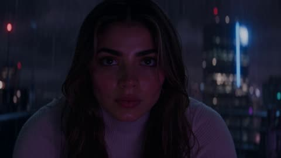</a>

A single continuous take is set up with one clear action, a leap followed by a downward POV plunge. Concrete visual anchors such as holographic billboards, purple and pink signage and rain-slicked reflections give the fall speed and depth, and a short list of style keywords closes the prompt.

Seedance 2.5 · Text-to-video · Source: [@itsshara_ai on X](https://x.com/itsshara_ai/status/2100435410338144486) · found via [LearnPrompt/awesome-seedance](https://github.com/LearnPrompt/awesome-seedance)

[`cyberpunk`](tags.md#tag-cyberpunk) [`freefall`](tags.md#tag-freefall) [`neon-city`](tags.md#tag-neon-city) [`pov`](tags.md#tag-pov) [`one-take`](tags.md#tag-one-take)

<details><summary><b>Prompt</b></summary>

```text
A dark figure leaps from a skyscraper ledge and free-falls through a neon-drenched cyberpunk cityscape at night. Massive holographic billboards and glowing purple and pink signage streak past as the camera plunges downward in a vertigo-inducing POV dive. Rain-slicked surfaces reflect neon light below. High-speed freefall, cyberpunk noir atmosphere, vertiginous depth.
```

</details>

<a id="seedance-deep-sea-animal-orchestra"></a>
### Sea animal orchestra performing in the deep ocean

<a href="https://x.com/thisismariaa25/status/2087112692809060493"></a>

Opens with a clear contrast, an orchestra at 3,000 feet underwater, then assigns one instrument to each animal in short parallel clauses. The stated depth sets the dark, light starved mood and the opera line invites generated sound.

Seedance 2.5 · Text-to-video · Source: [@thisismariaa25 on X](https://x.com/thisismariaa25/status/2087112692809060493) · found via [LearnPrompt/awesome-seedance](https://github.com/LearnPrompt/awesome-seedance)

[`underwater`](tags.md#tag-underwater) [`surreal`](tags.md#tag-surreal) [`animals`](tags.md#tag-animals) [`music`](tags.md#tag-music) [`cinematic`](tags.md#tag-cinematic)

<details><summary><b>Prompt</b></summary>

```text
An orchestra, but 3,000 feet underwater. Octopuses on piano, squid on strings, dolphins singing opera.
```

</details>

<a id="seedance-dragon-medieval-kitchen-cooking"></a>
### White dragon joins medieval village cooking session

<a href="https://x.com/ZoyaAi_/status/2113998714842779948">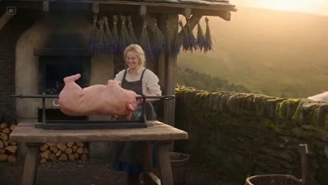</a>

Six timed five second scenes carry the story from wide establishing shot to extreme eye close-up and back to a wide. Fixed character and dragon descriptions plus separate style, camera, audio and format lines keep the 30 second clip consistent.

Seedance 2.5 · Text-to-video · Source: [@ZoyaAi_ on X](https://x.com/ZoyaAi_/status/2113998714842779948) · found via [LearnPrompt/awesome-seedance](https://github.com/LearnPrompt/awesome-seedance)

[`fantasy`](tags.md#tag-fantasy) [`dragon`](tags.md#tag-dragon) [`multi-shot`](tags.md#tag-multi-shot) [`cinematic`](tags.md#tag-cinematic) [`photorealistic`](tags.md#tag-photorealistic)

<details><summary><b>Prompt</b></summary>

```text
AI Video Prompt 👇

Create a 30-second ultra-realistic cinematic fantasy video set in a rustic medieval village kitchen, featuring a young blonde woman with braided hair, wearing a cream blouse and a dark brown apron, alongside a magnificent white dragon with pale pink spikes, glowing amber eyes, and highly detailed scales.

Scene 1 (0–5 seconds): A wide establishing shot of the woman preparing food at a rustic wooden table outside a medieval cottage. A giant white dragon slowly approaches her from behind, curiously observing the food. Warm golden sunlight streams through the village, creating a magical atmosphere.

Scene 2 (5–10 seconds): Close-up of the dragon's glowing amber eye as it opens its mouth and breathes a powerful burst of fire toward the cooking area. The woman reacts with shock and quickly moves away from the flames. Sparks, smoke, and realistic fire effects fill the scene.

Scene 3 (10–15 seconds): The woman uses a metal pan to control the cooking fire while the dragon watches with curiosity. Smoke rises dramatically as the dragon lowers its enormous head beside her, creating a funny yet cinematic moment.

Scene 4 (15–20 seconds): Inside a cozy medieval kitchen illuminated by flickering candlelight, the woman carefully prepares a piece of roasted meat on a wooden table. The giant white dragon rests its head beside her, watching every movement with intense curiosity. Use intimate close-ups and warm amber lighting.

Scene 5 (20–25 seconds): The woman holds a small flame near the dragon's snout. Capture an extreme close-up of its beautiful golden eye reflecting the firelight. She tastes the freshly cooked meat, smiles, and gestures approvingly toward the dragon.

Scene 6 (25–30 seconds): The woman and the dragon share a playful, heartwarming moment beside the dinner table. The dragon gently lowers its enormous head toward her while she continues eating. End with a wide cinematic shot of the medieval kitchen, warm candlelight, rustic wooden furniture, and the dragon curling around the room.

Visual Style: Photorealistic fantasy, Hollywood-level CGI, cinematic composition, realistic dragon anatomy, highly detailed skin and scales, natural facial expressions, physically accurate fire and smoke, volumetric lighting, shallow depth of field, smooth camera movements, dramatic close-ups, warm golden color grading, realistic textures, 4K quality.

Camera: Smooth tracking shots, wide establishing shots, extreme close-ups, slow cinematic push-ins, and seamless transitions.

Audio: Natural kitchen ambience, crackling fire, subtle dragon breathing and growls, sizzling meat, and cinematic fantasy background music.

Format: 16:9 widescreen, 30 seconds, 24 FPS, consistent character design, consistent dragon appearance, no text, no subtitles, no logos, no watermarks.
```

</details>

<a id="seedance-dragon-roasts-turkey-medieval-cottage"></a>
### Dragon Roasts a Turkey at Medieval Cottage

<a href="https://x.com/Arzoo12sh/status/2113215535706198293">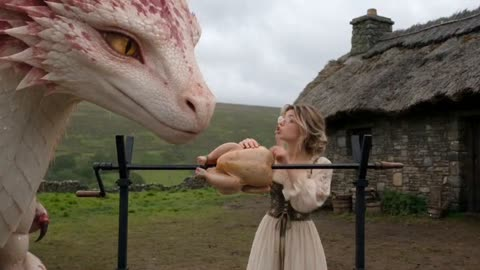</a>

A six scene timeline with exact second ranges gives each shot its own action, from the wide establishing shot to the macro eye close-up and the sunset ending. A closing style block and a negative prompt keep the characters and fire consistent.

Seedance 2.5 · Text-to-video · Source: [@Arzoo12sh on X](https://x.com/Arzoo12sh/status/2113215535706198293) · found via [LearnPrompt/awesome-seedance](https://github.com/LearnPrompt/awesome-seedance)

[`fantasy`](tags.md#tag-fantasy) [`dragon`](tags.md#tag-dragon) [`multi-shot`](tags.md#tag-multi-shot) [`photorealistic`](tags.md#tag-photorealistic) [`cinematic`](tags.md#tag-cinematic)

<details><summary><b>Prompt</b></summary>

```text
**Prompt: The Dragon and the Roasted Turkey**

Create a 27-second photorealistic cinematic fantasy film set in a medieval countryside. A young woman wearing a simple cream-colored medieval dress stands outside a rustic stone cottage with a thatched roof. Beside her is a large pale pink and white dragon with detailed scales, golden reptilian eyes, and expressive facial movements.

**Scene 1 (0–5 seconds):** Wide establishing shot of the medieval cottage and grassy countryside. The woman holds a raw turkey on a long metal spit while the curious dragon leans forward, opens its mouth, and breathes a powerful stream of fire.

**Scene 2 (5–10 seconds):** The fire fills the frame, transitioning into a close-up of a rugged, dirt-covered young woman with messy blonde hair and an intense expression. Use dramatic lighting, realistic skin texture, and cinematic shallow depth of field.

**Scene 3 (10–15 seconds):** Cut back to the cottage. Several raw turkeys, fresh herbs, butter, and cooking ingredients are arranged on a rustic wooden table. The woman prepares the food while the dragon watches closely.

**Scene 4 (15–22 seconds):** Extreme close-up of the dragon breathing controlled blue flames toward the turkey on the metal spit. The turkey gradually transforms from raw to golden-brown, crispy roasted meat. Show realistic sizzling fat, detailed skin texture, subtle smoke, and the woman carefully rotating the spit.

**Scene 5 (22–25 seconds):** Macro close-up of the dragon's magnificent golden eye, followed by a cinematic shot of a knife slicing through the perfectly roasted turkey, revealing juicy meat and crispy skin.

**Scene 6 (25–27 seconds):** Warm sunset lighting. The dragon gently lowers its enormous head toward the woman, and she affectionately touches its snout. End with a beautiful fantasy-film composition.

**Visual style:** Ultra-photorealistic fantasy cinema, realistic dragon anatomy, highly detailed scales, natural human expressions, physically accurate fire simulation, volumetric smoke, cinematic camera movements, 35mm film look, shallow depth of field, natural countryside atmosphere, dramatic lighting, seamless transitions, consistent characters, 4K detail, 16:9 aspect ratio.

**Negative prompt:** Cartoon, anime, plastic textures, low resolution, distorted faces, extra limbs, inconsistent characters, flickering, unnatural fire, duplicate objects, text, subtitles, logos, watermarks.
```

</details>

<a id="seedance-dragon-steals-dinner-fantasy-comedy"></a>
### Baby dragon steals dinner in cottage comedy

<a href="https://x.com/itxabdullaa/status/2109603859513712776">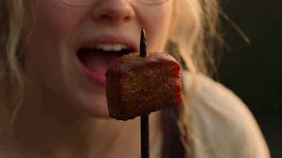</a>

A 30 second timeline split into timed beats, each with one camera move and one comic action, after fixed character and setting blocks that keep the look consistent. A closing audio list names every sound effect, the music cues and the spoken line.

Seedance 2.5 · Text-to-video · Source: [@itxabdullaa on X](https://x.com/itxabdullaa/status/2109603859513712776) · found via [LearnPrompt/awesome-seedance](https://github.com/LearnPrompt/awesome-seedance)

[`fantasy`](tags.md#tag-fantasy) [`comedy`](tags.md#tag-comedy) [`dragon`](tags.md#tag-dragon) [`multi-shot`](tags.md#tag-multi-shot) [`native-audio`](tags.md#tag-native-audio)

<details><summary><b>Prompt</b></summary>

```text
30 SECONDS | 16:9 | 30 FPS

Cinematic fantasy short film, photorealistic detail, warm golden-hour light, rich film color grading, shallow depth of field, smooth camera movement, natural motion blur, heartwarming comedy.

CHARACTERS:

1. A young woman with messy wavy blonde hair, thin round glasses, a cream linen blouse with rolled sleeves, and a dark brown pinafore apron dress. Expressive, funny, warm face.
2. Her enormous, horse-sized pet baby dragon with white-cream scales covered in pink-magenta patterns, soft pink crest spikes, huge amber eyes with vertical pupils, and a gentle snout. Mischievous, affectionate, puppy-like behavior.

SETTING: Rustic medieval cottage courtyard with a stone oven, wooden table, hanging herbs, stacked firewood, low stone wall, and rolling green hills. Cozy kitchen interior with wooden furniture, candles, and golden sunlight.

0–3s: EXTREME CLOSE-UP: a perfectly roasted, juicy piece of meat hangs from a skewer inches from the woman's mouth. Suddenly, a giant pink-patterned dragon tongue shoots into frame and steals it. Whip-pan to the woman frozen mid-bite, mouth open in disbelief. The dragon chews innocently behind her.

3–6s: She slowly turns toward the dragon, raises one accusing finger, and demands her dinner back. The dragon's enormous amber eyes widen. It swallows dramatically. A tiny puff of smoke escapes its nostrils.

6–9s: The dragon suddenly hiccups. A violent burst of fire shoots upward, igniting the laundry hanging above the courtyard. The woman screams and dives for a bucket as flaming clothes rain down around them.

9–12s: Fast tracking shot: she splashes water everywhere, slips on the wet stones, and lands sitting in a wooden laundry basket. The dragon rushes over to help, accidentally knocking the basket across the courtyard with its snout.

12–15s: The basket stops against the stone wall. She emerges with tangled laundry draped over her head like a ridiculous royal crown. The dragon tilts its head, then gives her an enormous affectionate lick across the face. She wipes her cheek, trying desperately not to laugh.

15–18s: CUT TO THE KITCHEN. She places a tiny piece of meat on a skewer and holds it up like a strict cooking instructor. The dragon sits obediently beside her, wings tucked in, eyes fixed on the food. She demonstrates a tiny flame with her fingers.

18–21s: MACRO CLOSE-UP: the dragon carefully releases the smallest flame imaginable. The meat sizzles perfectly. Its amber eye reflects the golden fire. The woman beams with pride and gives a thumbs-up.

21–25s: She proudly places the cooked meat on a plate. Before she can taste it, the dragon delicately picks up the entire plate with its tongue and swallows everything in one gulp. Silence. The woman's smile disappears.

25–30s: WIDE SHOT: the dragon immediately curls up beside her, resting its enormous head in her lap and purring like a giant cat. She stares at the camera in exhausted disbelief, then scratches behind its pink crest. The dragon closes its eyes happily. She mutters, “Tomorrow, we're eating vegetables.” The dragon opens one eye, horrified. HOLD on her wicked grin.

STYLE: Premium cinematic fantasy, lifelike textures, believable dragon anatomy, natural facial expressions, detailed scales, realistic fire and steam, warm amber light, expressive comedic timing, polished theatrical-quality storytelling. No plastic CGI appearance, no exaggerated cartoon physics except the dragon's playful personality.

AUDIO: Gentle fantasy folk music with strings and flute, sudden comedic music stops, wet tongue swipe, loud swallow, fiery hiccup, crackling flames, splashing water, wooden basket scraping, dragon purrs, expressive laughter, and clear natural dialogue. End with a short comedic musical sting. #ImagineArt
```

</details>

<a id="seedance-fox-mountain-stream-selfie-vlog"></a>
### Anthropomorphic Fox Selfie Vlog by Mountain Stream

<a href="https://x.com/MrDasOnX/status/2089969922617266257">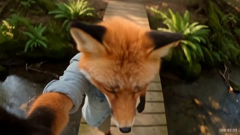</a>

A fixed first-person handheld frame with a running timestamp keeps the take continuous, while a timed 30 second script pairs each action with a spoken line. Character, location and light are described up front so the selfie look stays consistent.

Seedance 2.5 · Text-to-video · Source: [@MrDasOnX on X](https://x.com/MrDasOnX/status/2089969922617266257) · found via [LearnPrompt/awesome-seedance](https://github.com/LearnPrompt/awesome-seedance)

[`vlog`](tags.md#tag-vlog) [`selfie`](tags.md#tag-selfie) [`anthropomorphic`](tags.md#tag-anthropomorphic) [`nature`](tags.md#tag-nature) [`dialogue`](tags.md#tag-dialogue)

<details><summary><b>Prompt</b></summary>

```text
Create a single continuous self-filmed vlog recorded on a handheld action camera in 16:9 aspect ratio. The camera is always held by the anthropomorphic fox, creating a natural first-person selfie perspective with light wind-induced shake, occasional soft lens flares from sunlight filtering through trees, realistic focus pulls, and dynamic walking/leaning motion. No cuts, transitions, or cinematic effects. Include a subtle realistic digital timestamp in the bottom-right corner that progresses naturally throughout the video.
Visual Style: Bright modern 4K digital look with vibrant yet soft natural colors, warm late-afternoon golden sunlight mixed with dappled shade, gentle water reflections and soft mist rising from the stream, subtle water droplets or mist on the lens near the water, and crisp details on fur and leaves. Slight handheld energy but smooth enough for casual vlogging. Widescreen 16:9 framing.
Character: Ember, a 24-year-old anthropomorphic red fox (bipedal, human-like proportions) with soft fluffy reddish-orange fur, white chest and muzzle, bright amber eyes, pointed ears, and a long bushy tail that sways naturally. He wears a simple light denim jacket with rolled sleeves over a soft cream t-shirt and comfortable cargo shorts. Personality: curious, warm, slightly playful and soft-spoken.
Location: Starts on a wooden footbridge over a clear mountain stream in a lush temperate forest, surrounded by mossy rocks, ferns, wildflowers, and overhanging maple and pine branches. Soft green and golden foliage, clear water with gentle ripples and small fish darting below.
Sequence (exactly 30 seconds, continuous take with timestamps):
0:00 – 0:05
Ember lifts the camera, smiles softly at the lens with his ears perking up, and says in a warm, slightly raspy voice:
“Hey friends… you won’t believe this spot I found.”
0:05 – 0:13
He walks slowly along the wooden bridge, lowering the camera slightly to show the clear stream and small fish swimming just below the surface while continuing:
“The water is so clear… I can see every little fish moving around.”
0:13 – 0:20
He crouches carefully at the edge, reaches one paw toward the water without touching it, and watches the fish dart past, laughing lightly:
“They’re swimming right up to me. Hi little guys.”
0:20 – 0:26
He turns the camera to capture both his face and the stream, then sits on a flat mossy rock at the water’s edge, letting his tail curl beside him. He gazes at the water for a few seconds and says quietly:
“Moments like this make everything feel peaceful.”
0:26 – 0:30
He stands up, waves one paw at the camera with a gentle smile, and says:
“Thanks for exploring with me. See you next time.”
The camera naturally lowers a little as he walks further along the path beside the stream.
```

</details>

<a id="seedance-golden-hour-lot-fight-sequence"></a>
### Golden hour parking lot fight between two women

<a href="https://x.com/Elvorya/status/2101147922251579718"></a>

The prompt chains shots with arrows, giving each a camera angle and one action beat, from over the shoulder opener to flying kick, fall and selfie style closer. A long visual style list plus a negative prompt keeps the look photoreal and the character consistent.

Seedance 2.5 · Text-to-video · Source: [@Elvorya on X](https://x.com/Elvorya/status/2101147922251579718) · found via [LearnPrompt/awesome-seedance](https://github.com/LearnPrompt/awesome-seedance)

[`action`](tags.md#tag-action) [`fight-scene`](tags.md#tag-fight-scene) [`golden-hour`](tags.md#tag-golden-hour) [`photorealistic`](tags.md#tag-photorealistic) [`multi-shot`](tags.md#tag-multi-shot)

<details><summary><b>Prompt</b></summary>

```text
Create a 15-second photorealistic cinematic action sequence featuring a stylish blonde woman in a black blazer, white fitted top, and black pants, fighting another blonde woman in an industrial urban parking/loading area during golden-hour sunset.

Begin with a dynamic over-the-shoulder shot of the main woman standing in an empty concrete industrial lot as another woman approaches rapidly in the background → cut into an extreme close-up side angle as the opponent throws a powerful punch toward her face, with the camera moving alongside the action and her blonde hair flowing dramatically in the wind → transition into a wide low-angle shot showing the main woman reacting and engaging in hand-to-hand combat → she performs a fast evasive movement and powerful spinning kick while the opponent attacks → cut to a low-angle tracking shot as both women exchange rapid punches and defensive movements beside a large industrial roller door and stacked cardboard boxes → show the main woman delivering a dramatic flying kick, captured with cinematic motion blur → transition into a wider shot as the opponent falls hard onto the concrete ground → the main woman slowly walks toward the camera while the fallen opponent remains in the background → final shot becomes an intimate handheld close-up/selfie-style shot of the main woman looking directly toward the camera, touching her hair/forehead with one hand and giving a calm, confident expression.

Visual style: photorealistic Hollywood action cinematography, realistic human anatomy, believable martial-arts choreography, natural facial expressions, realistic skin texture, detailed blonde hair movement, black-and-white fitted clothing, industrial warehouse exterior, concrete pavement, warm golden-hour sunlight, long shadows, dramatic backlighting, subtle lens flare, shallow depth of field, cinematic motion blur, dynamic handheld camera, low-angle action shots, smooth rapid transitions, realistic physics, energetic pacing, high-detail 4K cinematic look, cohesive character appearance throughout.

Negative prompt: animation, cartoon, anime, CGI appearance, unrealistic physics, distorted faces, extra fingers, malformed hands, duplicated people, warped limbs, floating objects, excessive motion blur, unnatural poses, gore, blood, subtitles, text, logos, watermark.
```

</details>

<a id="seedance-golden-knight-cathedral-demon-battle"></a>
### Golden knight defends wounded woman from cathedral demon

<a href="https://x.com/itsSaira_1/status/2111672000200724504"></a>

A 31 second timeline split into timed shots, each naming shot size, camera move and action, so the cut order stays fixed. A closing style block and a long negative list lock the architecture, armor and shield emblem across shots.

Seedance 2.5 · Text-to-video · Source: [@itsSaira_1 on X](https://x.com/itsSaira_1/status/2111672000200724504) · found via [LearnPrompt/awesome-seedance](https://github.com/LearnPrompt/awesome-seedance)

[`dark-fantasy`](tags.md#tag-dark-fantasy) [`timed-shots`](tags.md#tag-timed-shots) [`cinematic`](tags.md#tag-cinematic) [`action`](tags.md#tag-action) [`negative-prompt`](tags.md#tag-negative-prompt)

<details><summary><b>Prompt</b></summary>

```text
0–3s | Opening shot: Low-angle wide close-up of a wounded woman lying on a cracked stone floor inside a ruined Gothic cathedral. Dark horned monsters and twisting tentacles loom in the background. Slow cinematic camera movement.

3–5s | Rising movement: The woman pushes herself up from the floor, raising one arm as a bright white magical blade of light forms in her hand. Medium shot, smooth upward camera movement.

5–7s | Magical activation: She kneels and grips the vertical white energy blade touching the floor. A brilliant golden circular rune spreads beneath her, illuminating the stone floor. Low wide shot.

7–10s | Cathedral reveal: Camera tilts sharply upward, revealing towering broken Gothic arches, a shattered roof, moonlit clouds and dark creatures silhouetted above. Transition to the golden-armored warrior emerging through red smoke.

10–12s | Helmet close-up: Tight frontal close-up of a fully enclosed dark metal knight helmet, narrow black eye slit, engraved steel plates. Slow camera push-in.

12–15s | Golden knight reveal: Cut to a heroic low-angle shot of a knight wearing ornate gold-and-silver armor, carrying a large shield with a glowing golden sun emblem and a heavy war hammer. He stands inside the ruined cathedral.

15–18s | First magical attack: The knight raises his shield and releases an intense white-gold energy blast. Bright light fills the frame. Camera tracks the blast, with sparks and magical particles.

18–20s | Energy impact: The white magical blast expands into a brilliant screen-filling flash. Strong bloom, fast cinematic transition, brief motion blur.

20–23s | Demon confrontation: Wide side view of the golden knight standing firm while a huge reddish-black horned demon lunges toward him. Long claws and dark tendrils extend toward the knight. The wounded woman remains visible in the background.

23–25s | Demon attack: The demon sweeps its claws forward. A bright golden energy projectile travels across the cathedral between the creature and the knight. Dynamic lateral camera movement.

25–27s | Magical shield: The knight raises his shield as a large circular white magical barrier with intricate glowing runes forms in front of him. The demon attacks the barrier, creating rippling light and sparks.

27–31s | Final wide shot: Camera pulls back to show the entire ruined cathedral. The golden knight stands in the centre of a glowing golden rune circle, shield raised and hammer in hand. The demon recoils on the left, while the wounded woman remains on the floor behind him beside the vertical white energy blade. Smoke, floating embers, blue moonlight and golden illumination. Hold the final composition.

VISUAL STYLE: Photorealistic dark fantasy film, 16:9 widescreen, cinematic lighting, realistic armor and stone textures, cold blue shadows, warm golden highlights, volumetric smoke, dramatic contrast, consistent architecture, smooth camera movements, exact shot order and timing.

NEGATIVE PROMPT: Different shot order, altered camera angles, random cuts, changed framing, different cathedral, different character positions, inconsistent armor, changing shield emblem, extra characters, duplicated limbs, deformed anatomy, cartoon, anime, low quality, excessive blur, shaky camera, camera flip, 180-degree rotation, unnatural movement, floating weapons, text, subtitles, watermark, logos.

#AI #AIart #VisualArt
```

</details>

<a id="seedance-grandma-tanuki-morning-market-shopping"></a>
### Grandma and Giant Tanuki at Morning Market

<a href="https://x.com/Just_sharon7/status/2103503970815930610">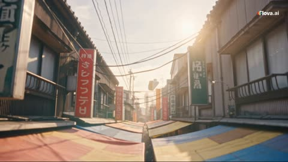</a>

A 50 second timeline split into timestamped beats, each with its own camera move, Kansai dialogue and English subtitle line. The cast description is repeated word for word in every shot to keep the character consistent, and a closing lock block fixes the look and ambient sound.

Seedance 2.5 · Text-to-video · Source: [@Just_sharon7 on X](https://x.com/Just_sharon7/status/2103503970815930610) · found via [LearnPrompt/awesome-seedance](https://github.com/LearnPrompt/awesome-seedance)

[`cinematic`](tags.md#tag-cinematic) [`multi-shot`](tags.md#tag-multi-shot) [`dialogue`](tags.md#tag-dialogue) [`subtitles`](tags.md#tag-subtitles) [`character-consistency`](tags.md#tag-character-consistency)

<details><summary><b>Prompt</b></summary>

```text
Photorealistic AAA cinematic short, GTA-style urban energy: saturated colors, punchy contrast, dynamic camera (low heroic angles, smooth tracking, brief crane and push-ins), rich environmental detail, slightly larger-than-life character presence, filmic grain, sharp fur and fabric simulation. Duration exactly 50 seconds. Natural morning light mixed with colorful market stall canopies. Busy, funny, lively tone. English subtitles at the bottom. Japanese dialogue in a warm elderly Kansai-accented female voice for the grandmother.  CAST (use these exact descriptions every time they appear): - An elderly Japanese grandmother (short gray hair in a loose bun, wrinkled kind face, purple-pink floral vest over a patterned blouse, dark pants) - A giant tanuki (raccoon-dog), about 6.5 feet tall standing on hind legs, thick brown-grey fur, round belly, mischievous dark-ringed eyes, wearing a slightly stained vendor apron, walking upright like a person - A tiny brown sparrow perched on the grandmother’s shoulder - A grumpy middle-aged Japanese fishmonger in a rubber apron  ---  0:00–0:07 — ESTABLISHING   Wide crane shot descending into a crowded Japanese open-air morning market. Fish stalls, vegetable crates, hanging flowers, steam, shouting vendors, bicycles, plastic bags. Camera finds an elderly Japanese grandmother (short gray hair in a loose bun, wrinkled kind face, purple-pink floral vest over a patterned blouse, dark pants) walking into the market carrying an empty basket. A tiny brown sparrow is already perched on her right shoulder. She looks delighted and a little overwhelmed.  Dialogue (grandmother):   「今日は安うてええ日やわ。」   Subtitle: “Prices are good today. Dangerous for me.”  ---  0:07–0:16 — FISH STALL**   Medium tracking shot. An elderly Japanese grandmother (short gray hair in a loose bun, wrinkled kind face, purple-pink floral vest over a patterned blouse, dark pants) stops at a fish stall piled with ice and silver fish. The grumpy fishmonger slaps a huge fish onto the scale. The tiny sparrow hops down, pecks a piece of dried squid, and flies back to her shoulder. She notices and gently scolds it without real anger.  Dialogue (grandmother):   「あんたまた盗んでるやないの。恥ずかしいわ。」   Subtitle: “You little thief. That’s embarrassing.”  The fishmonger frowns.   Fishmonger: 「ばあさん、そんなに持って帰れんやろ。」   Subtitle: “Grandma, you can’t carry all that.”  ---  **0:16–0:28 — TANUKI ARRIVES AND BARGAINS**   Low heroic angle. The crowd parts. A giant tanuki in a vendor apron walks upright through the aisle, heavy and confident, GTA-style presence. He stops beside an elderly Japanese grandmother (short gray hair in a loose bun, wrinkled kind face, purple-pink floral vest over a patterned blouse, dark pants), looks at the fishmonger’s price, then slaps a paw on the counter.  Tanuki (deep, playful male voice):   「その値段、冗談やろ。半分でええやろ。」   Subtitle: “That price? You’re joking. Half.”  The fishmonger argues, then reluctantly nods. The giant tanuki grins. An elderly Japanese grandmother (short gray hair in a loose bun, wrinkled kind face, purple-pink floral vest over a patterned blouse, dark pants) covers her mouth, laughing.  Dialogue (grandmother):   「もう、あんたまで出てこんでもええのに。」   Subtitle: “You didn’t have to jump in… but thank you.”  ---  0:28–0:40 — CARRYING EVERYTHING   Smooth side-tracking shot through the busy market. The giant tanuki now carries two overflowing wooden crates of fish, vegetables, and flowers on his shoulders like it’s nothing. An elderly Japanese grandmother (short gray hair in a loose bun, wrinkled kind face, purple-pink floral vest over a patterned blouse, dark pants) walks beside him, still holding her small basket. The tiny sparrow keeps darting down to steal small snacks from open stalls and returning to her shoulder. Shoppers stare and smile. Dynamic market chaos in the background: steam, shouting, hanging lanterns, wet pavement reflections.  Dialogue (grandmother, amused):   「箱二つも買うんやったらええ加減にせな。肩の子も手伝いすぎや。」   Subtitle: “Two crates is too much. And you on my shoulder, stop helping so much.”  ---  0:40–0:50 — FINAL BEAT   The trio stops at the edge of the market near a narrow street. The giant tanuki sets the crates down carefully, then stands proud with paws on his hips. Close-up of an elderly Japanese grandmother (short gray hair in a loose bun, wrinkled kind face, purple-pink floral vest over a patterned blouse, dark pants) looking up at him, then at the tiny sparrow on her shoulder. She reaches up and gently taps the sparrow’s head, then pats the tanuki’s massive forearm.  Dialogue (grandmother, soft and affectionate):   「ほんま、困った相棒やわ。けど…助かった。帰ろか。」   Subtitle: “What a pair of troublemakers. …Still, you saved me. Let’s go home.”  Final shot: slow push-in. The giant tanuki picks the crates up again. An elderly Japanese grandmother (short gray hair in a loose bun, wrinkled kind face, purple-pink floral vest over a patterned blouse, dark pants) walks ahead. The tiny sparrow settles on her shoulder as they leave the colorful market toward the street. Hold 1.5 seconds, then cut to black.  ---  TECH / STYLE LOCKS   GTA AAA cinematic look: vibrant market colors, strong sunlight shafts through stall roofs, wet ground reflections, dense extras, slightly exaggerated scale on the giant tanuki, ultra-detailed fur, realistic plastic bags and ice, handheld-feeling but stabilized tracking. No text except the English subtitles. Ambient sound: vendors shouting, ice being shoveled, sparrows, footsteps, distant traffic. Keep the grandmother’s appearance identical in every shot using the exact description above.
```

</details>

<a id="seedance-greenhouse-pop-dance-performance"></a>
### Pop dance performance in a sunlit glass greenhouse

<a href="https://x.com/Chaemate_/status/2110278863691325907"></a>

Separate character, outfit and background locks tied to two reference images keep identity and location stable across thirty seconds, and a negative prompt repeats those locks. Five timed scenes each name the choreography and a camera move, and the audio line specifies tempo, instruments and a bass drop on the final pose.

Seedance 2.5 · Reference-to-video · Source: [@Chaemate_ on X](https://x.com/Chaemate_/status/2110278863691325907) · found via [LearnPrompt/awesome-seedance](https://github.com/LearnPrompt/awesome-seedance)

[`dance`](tags.md#tag-dance) [`k-pop`](tags.md#tag-k-pop) [`multi-scene`](tags.md#tag-multi-scene) [`character-lock`](tags.md#tag-character-lock) [`music`](tags.md#tag-music)

<details><summary><b>Prompt</b></summary>

```text
K-POP GREENHOUSE DANCE PERFORMANCE

Duration: 30 seconds | Aspect ratio: 16:9 | Ultra-realistic 4K, photorealistic live-action, cinematic professional K-pop performance video.

CHARACTER LOCK (@Image1):
An adult Korean woman with delicate idol features and glowing skin, long wavy ginger-copper hair worn down with two small side braids pinned back and a small black hair clip. Soft shimmer eyeshadow, thin black eyeliner, glossy coral lips. Silver hoop earrings and a thin silver chain necklace.

OUTFIT LOCK (identical in every shot): Cropped cobalt-blue varsity bomber jacket with cream striped collar and cuffs, modest closed black fitted inner top, black pleated mini skirt with black cycling shorts underneath, black knee-high socks, white chunky platform sneakers with blue accents. No changes to outfit, colors, hairstyle, face, or accessories in any scene.

BACKGROUND LOCK (@Image2): Use the reference image as the only environment for all 30 seconds. Keep the glass greenhouse, lush plants, stone floor, and warm sunlight. Do not change the location.

SCENE 1 (0-6s): Sunlit Reveal
Overhead top-down shot of the stone floor as her white sneakers step into frame. The camera tilts up as she walks forward through a beam of sunlight, stops, and straightens her jacket collar with a smirk. She then does a smooth body wave from head to toe, two slow arm rolls, and a quick shoulder shimmy that lands on the first beat. Camera: top-down tilt up to a low-angle wide shot.

SCENE 2 (6-12s): Groove Section
Medium-wide shot. Crisscross hop-steps, a glide step to the right, then to the left, finger snaps at hip level, and a playful "shh" gesture with one finger to her lips. She throws a quick pop-and-lock arm sequence, then points up and down in alternating beats. Palm leaves sway gently behind her. Camera: smooth lateral slide, following her movement.

SCENE 3 (12-18s): Power Break
Wide shot with sunlight rays streaming through the glass behind her. Fast running-man footwork, a sharp front kick, a stomp-stomp-clap rhythm, arm slices across the body, and a low squat bounce with her hands pushed forward. The skirt and braids move naturally. Camera: quick push-in, then a short rack focus from the plants to her face.

SCENE 4 (18-24s): Hook Section
Medium close-up transitioning to full-body. She makes a "V" sign with her fingers near her eye, then a camera-lens shape with both hands, shifts her weight in a sharp side-slide, swings her arms in a big circle, and spins a full 360 with a confident flair. Sunlight glints through her hair as she turns. Camera: handheld-style orbit with a subtle shake.

SCENE 5 (24-30s): Final Pose
She backs away from the camera, turns her back, and looks over her shoulder with a wink. She turns around, does a final arm wave, and ends with one hand extended toward the camera and the other tucked at her waist, followed by a blown kiss and a warm smile. Camera: slow dolly-out to a wide shot, then a gentle push-in to a close-up on the last pose, with a soft golden glow on the final frame.

LIGHTING: Warm golden natural sunlight through the glass with soft rim light on her hair, gentle light rays, subtle haze, realistic skin texture and fabric movement. No neon or colored artificial lights.

DANCE QUALITY: Full-body motion synced to the music, clear footwork, smooth transitions between moves, precise timing, natural facial expressions, realistic hair and clothing physics, consistent anatomy.

NEGATIVE PROMPT: No neon lights, no outfit changes, no hairstyle changes, no face changes, no background replacement, no distorted anatomy, no extra fingers, no duplicated limbs, no floating feet, no jittering, no flickering, no cartoon or CGI look, no subtitles, no text overlays, no watermark, no logos.

AUDIO: Original bright pop K-pop dance track, about 125 BPM, with a punchy kick, glossy synth chords, funky bass, finger-snap percussion, and an energetic build-up before the hook, ending with a clean bass drop at the last pose. No vocals, no dialogue.

#KPop #AIVideo #Dance
```

</details>

<a id="seedance-grumpy-toddler-doctor-comedy"></a>
### Grumpy toddler doctor examines patient in 3D comedy

<a href="https://x.com/Zarnab_with_Ai/status/2113820262743646446"></a>

The prompt splits the 30 second story into five numbered scenes, each with a clear beat from examination to reaction shots, a direct look at the camera and a syringe punchline. A fixed character description and an explicit consistency line for face, outfit and proportions keep the toddler stable across cuts, and the style and format blocks set the 3D look and the 9:16 frame.

Seedance 2.5 · Text-to-video · Source: [@Zarnab_with_Ai on X](https://x.com/Zarnab_with_Ai/status/2113820262743646446) · found via [LearnPrompt/awesome-seedance](https://github.com/LearnPrompt/awesome-seedance)

[`3d-animation`](tags.md#tag-3d-animation) [`comedy`](tags.md#tag-comedy) [`multi-scene`](tags.md#tag-multi-scene) [`character-consistency`](tags.md#tag-character-consistency) [`vertical`](tags.md#tag-vertical)

<details><summary><b>Prompt</b></summary>

```text
Create a high-quality cinematic 3D animated comedy scene featuring an adorable toddler girl dressed as a tiny doctor. She has big expressive brown eyes, soft fair skin, short light-brown hair, and a serious, grumpy facial expression. She wears a miniature white doctor's coat, a white nurse cap with a red medical cross, and a pink stethoscope with a heart-shaped chest piece.

Scene 1: A young adult man wearing a red T-shirt lies on a medical examination bed while the tiny doctor carefully examines his chest with her stethoscope. The baby doctor looks extremely serious and unimpressed, as if she is a highly experienced physician.

Scene 2: Show close-up shots of the toddler doctor frowning, narrowing her eyes, and examining the patient with exaggerated expressions. The patient looks nervous and confused, creating a funny contrast between his adult appearance and the tiny doctor's bossy attitude.

Scene 3: The baby doctor suddenly looks directly at the camera with huge expressive eyes, then returns to her stern expression. Show her confidently holding medical equipment and acting like she is in charge of the entire hospital.

Scene 4: A young woman enters the room wearing a casual white top and blue jeans. She watches the examination with surprise and amusement. The baby doctor continues her serious medical duties while the patient reacts comically.

Scene 5: End with the tiny doctor standing confidently beside the patient, holding a medical syringe or medical instrument, with a determined expression. The patient looks worried, creating a humorous final moment.

Visual Style: Ultra-detailed 3D animated family-movie aesthetic, Pixar-inspired character design, realistic skin shading, soft baby facial features, expressive eyes, cinematic warm indoor lighting, detailed hospital room, smooth character animation, realistic fabric textures, shallow depth of field, close-up reaction shots, gentle camera movements, humorous storytelling, polished 3D rendering, 4K quality.

Camera and Motion: Use smooth cinematic tracking shots, medium shots, facial close-ups, and reaction shots. Keep the toddler doctor's face, hairstyle, outfit, and body proportions consistent throughout every scene. Natural body movement, accurate hand gestures, expressive facial animation, and seamless scene transitions.

Format: Vertical 9:16, 24 FPS, approximately 30 seconds, high-quality cinematic 3D animation, family-friendly comedy, no subtitles, no text overlays, no logos.
```

</details>

<a id="seedance-gym-day-selfie-vlog-60-seconds"></a>
### Sixty second selfie vlog of a gym day

<a href="https://x.com/ZaraIrahh/status/2089569072526823464">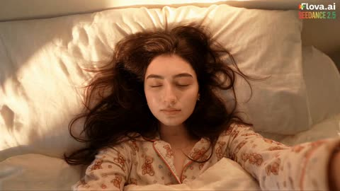</a>

The prompt splits sixty seconds into timed scenes, each with its own action, spoken line and diegetic sound. A fixed selfie viewpoint, authentic phone imperfections and a ban on music and captions keep the footage realistic and the face consistent.

Seedance 2.5 · Text-to-video · Source: [@ZaraIrahh on X](https://x.com/ZaraIrahh/status/2089569072526823464) · found via [LearnPrompt/awesome-seedance](https://github.com/LearnPrompt/awesome-seedance)

[`vlog`](tags.md#tag-vlog) [`selfie`](tags.md#tag-selfie) [`day-in-the-life`](tags.md#tag-day-in-the-life) [`timed-scenes`](tags.md#tag-timed-scenes) [`diegetic-sound`](tags.md#tag-diegetic-sound)

<details><summary><b>Prompt</b></summary>

```text
Create a 60-second realistic day-in-the-life gym vlog following the same young Korean woman in her early twenties from waking up at home, getting ready, going to the gym, working out, and returning home.

Overall visual style

One continuous handheld front-facing smartphone selfie vlog perspective. She always films herself with the phone in her own hand at arm’s length. No third-person camera, tripod, cinematic camera movements, drones, or external filming.

Make everything look like authentic modern smartphone footage:

- Natural handheld shake and small framing imperfections
- Realistic walking movement and occasional autofocus hunting
- Minor exposure changes
- Natural front-camera lens distortion
- Soft natural morning light indoors and outdoors
- Realistic, unfiltered smartphone colors
- No beauty filter, skin smoothing, or cinematic color grading
- Same face and hair throughout the entire vlog
- Natural expressions, movements, and body language
- No subtitles, captions, logos, watermarks, or on-screen text
- No background music; use only natural diegetic sound

0–10 sec — Waking up

She wakes up in her cozy bedroom wearing a cute, loose casual night suit. She grabs her phone from beside the bed and immediately starts filming herself selfie-style. She looks sleepy, messy-haired, and slightly tired, gives a small yawn, stretches, and smiles at the camera.

She quietly says:

“Good morning… I really don’t feel like going to the gym today.”

She gets out of bed and walks toward the bathroom while holding the phone herself.

10–18 sec — Brushing teeth

In the bathroom, she films herself in the mirror/selfie view while brushing her teeth. Keep it casual and imperfect, with realistic bathroom ambience and running-water sounds.

She briefly looks into the camera with a sleepy expression, then rinses her mouth and smiles.

She says:

“But I promised myself I’d go, so… let’s do it.”

18–27 sec — Getting ready

Quick natural transition back to her bedroom. She changes from her night suit into a stylish but realistic gym outfit: fitted athletic top, high-waisted leggings or comfortable athletic bottoms, clean sneakers, and minimal accessories.

Show short selfie moments of her fixing her hair, adjusting her gym outfit, grabbing a water bottle and gym bag.

She looks into the phone and says:

“Okay, now I actually look ready.”

27–35 sec — Going to the gym

She leaves home with the phone in her hand. Film brief selfie moments while walking outside and naturally bouncing with her steps. Show quick glimpses of the street, morning traffic, buildings, and her gym bag.

She arrives at the gym and turns the phone slightly to show the entrance before bringing it back to her face.

Natural street and gym ambience only.

35–52 sec — Workout

Inside the gym, she starts with a short warm-up on a treadmill, then moves through a few exercises such as light strength training, squats, dumbbell exercises, and stretching.

Keep the camera mostly front-facing and handheld, occasionally tilting naturally toward the equipment before returning to her face.

She becomes slightly sweaty and out of breath but stays cheerful. She laughs and says:

“Okay… this is harder than I remembered.”

She takes a quick drink of water, catches her breath, then gives the camera a satisfied smile and continues her workout.

Include realistic sounds of footsteps, treadmill movement, weights clanking, machines, distant conversations, and gym room tone.

52–60 sec — Returning home

After finishing her workout, she leaves the gym and walks home. She looks pleasantly exhausted but happy.

Cut naturally to her back at home, still holding the phone. She drops her gym bag down, takes a drink of water, relaxes on the couch or bed, and looks into the camera with a tired smile.

She gives a small wave and says:

“Workout done. I’m exhausted… but I’m glad I went.”

She smiles, gives one final sleepy wave, and lowers the phone for a natural ending.

Final requirements

Keep the entire vlog fast, spontaneous, cozy, and realistic, with natural transitions between locations. The woman must remain visually consistent throughout: same facial identity, same hair, and realistic appearance. Her outfit changes only once, from the casual night suit to the gym outfit.

All dialogue must be naturally spoken with visible lip movement. Use only diegetic audio—bedroom ambience, bathroom sounds, footsteps, street noise, gym sounds, water bottle sounds, and home ambience. No music, captions, subtitles, logos, watermarks, or cinematic effects.
#Flovaai #Flovacpp
```

</details>

<a id="seedance-gym-day-selfie-vlog"></a>
### Casual gym selfie vlog with spoken lines

<a href="https://x.com/ZaraIrahh/status/2089195912119943367">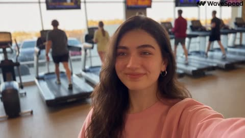</a>

Locks one handheld front camera point of view and lists real phone flaws such as shake, autofocus hunting and exposure shifts, so the result avoids a cinematic look. The scene runs in timed beats with quoted dialogue lines, and the audio is limited to diegetic gym ambience with no music.

Seedance 2.5 · Text-to-video · Source: [@ZaraIrahh on X](https://x.com/ZaraIrahh/status/2089195912119943367) · found via [LearnPrompt/awesome-seedance](https://github.com/LearnPrompt/awesome-seedance)

[`vlog`](tags.md#tag-vlog) [`selfie`](tags.md#tag-selfie) [`gym`](tags.md#tag-gym) [`dialogue`](tags.md#tag-dialogue) [`handheld`](tags.md#tag-handheld)

<details><summary><b>Prompt</b></summary>

```text
Create a 30-second casual gym vlog featuring the same young woman in her early twenties. She has natural everyday beauty, and her face and hair remain identical throughout the entire video.

Camera & visual style

One continuous handheld front-facing smartphone selfie vlog, always filmed from her own point of view with the phone held in her own hand at arm’s length. No third-person camera, external camera, tripod, cinematic camera movement, or professional filming.

Make it look like a real modern smartphone recording:

- Mild handheld shake and natural walking bounce
- Occasional autofocus hunting
- Small exposure shifts and minor framing imperfections
- Natural front-camera lens distortion
- Soft warm natural daylight transitioning toward early evening
- Natural, uncorrected smartphone color
- No color grading, beauty filter, or skin smoothing
- Same woman, same face and hair throughout
- She holds the phone herself in every shot
- No subtitles, captions, logos, watermarks, or on-screen text
- No brand or character names
- Never show a reference sheet or duplicate subject

Outfit

She is wearing a cute, trendy, realistic gym outfit appropriate for a casual workout vlog: fitted athletic top, comfortable high-waisted leggings or shorts, clean sneakers, and minimal accessories. The styling should feel fashionable but natural and practical for the gym.

Scene

She is spending a casual day at the gym and filming herself throughout her workout.

She enters the gym while holding her phone at arm’s length, smiling into the front camera. She briefly sweeps the phone toward the workout area, showing treadmills, weights, machines, and other gym-goers in the background, then brings it back to her face. She grins and says upbeat:

“Okay, gym day! Let’s get this workout started!”

She walks toward the workout area, naturally bouncing the phone with her steps. She glances at the equipment, smiles at the camera, and starts a light warm-up. Keep the movements natural and unscripted, with brief moments of her adjusting her hair, checking her form, and laughing at herself.

She moves into a short workout sequence while still filming herself handheld: a few casual gym exercises, light cardio, and a quick strength-training moment. Keep the camera mostly selfie-facing, occasionally tilting naturally toward the equipment before returning to her face. She looks slightly out of breath but happy and says with a playful laugh:

“Why did I think this was gonna be easy?”

She takes a quick water break, holding her bottle near the selfie camera before taking a sip. She smiles and catches her breath while natural gym ambience continues around her.

Later, after finishing the workout, she walks toward the gym exit with the phone still in her hand. Her hair is slightly messier and she looks pleasantly tired. She gives the camera a satisfied smile, lightly wipes her forehead, and says:

“Okay… I’m actually proud of myself.”

She gives a small tired laugh, waves at the camera, and lowers the phone slightly for a relaxed ending.

Audio

Diegetic sound only, no background music. Include realistic gym ambience: treadmill hum, weights clanking, machine sounds, footsteps, distant conversations, subtle ventilation, water bottle sounds, and natural room tone. Every spoken line should be delivered frontally with clearly visible lip movement and natural timing.

Keep the entire sequence fast, casual, spontaneous, and realistic, with natural transitions and enough brief visual moments to fill approximately 30 seconds without making the dialogue feel rushed. The final result should feel like an authentic personal gym vlog recorded casually on a modern smartphone.
```

</details>

<a id="seedance-gym-morning-dv-camcorder-vlog"></a>
### Morning Gym Workout on Early 2000s Camcorder

<a href="https://x.com/sipteaandcoffee/status/2104887547243774358">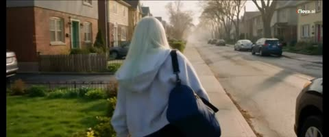</a>

Reads as a friend filming on a consumer DV camcorder, with timecoded beats, a character reference image, and spoken lines in each beat. The off-camera friend reacting to the camera zoom and the lens cover adds spontaneity, and the outfit is locked so it stays consistent.

Seedance 2.5 · Reference-to-video · Source: [@sipteaandcoffee on X](https://x.com/sipteaandcoffee/status/2104887547243774358) · found via [LearnPrompt/awesome-seedance](https://github.com/LearnPrompt/awesome-seedance)

[`dv-camcorder`](tags.md#tag-dv-camcorder) [`vlog`](tags.md#tag-vlog) [`timecoded`](tags.md#tag-timecoded) [`dialogue`](tags.md#tag-dialogue) [`character-reference`](tags.md#tag-character-reference)

<details><summary><b>Prompt</b></summary>

```text
Create a **45-second ultra-realistic personal home-video** of a young Korean woman going to a small neighborhood gym for a casual morning workout. Use the **attached image as the absolute character reference** and keep her face, facial features, hairstyle, body proportions and overall appearance consistent throughout.

The video should feel like a friend casually followed her to the gym with an **early-2000s consumer DV camcorder**. It should feel spontaneous, slightly awkward, playful and real — **not like a fitness advertisement or influencer workout video**.

Camera Settings: shot on 35mm film, anamorphic 2x squeeze, 2.39:1, oval bokeh, heavy grain,
halation on the bulbs. Focal length: 35mm. Aperture: f/2.0.
 
### CHARACTER & OUTFIT

She begins with her **long blonde hair worn loose**.

For the walk to the gym, she wears a casual oversized zip-up hoodie over her workout clothes and carries a small dark gym bag.

Inside the gym, she removes the hoodie and ties her hair into a **slightly messy high ponytail**.

Her workout outfit is:

- muted sage-green fitted short-sleeve athletic top
- loose black athletic track pants with a comfortable straight-leg fit
- gray-and-white training sneakers
- simple black fitness watch
- no jewelry
- minimal natural makeup

Keep this exact workout outfit consistent throughout the gym sequence.

She carries:

- dark gym bag
- translucent reusable water bottle
- small light-gray workout towel

### 00:00–00:06 — WALKING TO THE GYM

Open outside her home in soft morning daylight.

She steps through the door carrying her gym bag and starts walking through a quiet residential neighborhood.

The friend filming walks slightly behind her.

The camera shakes naturally with every step.

She turns around while walking backward for a moment and smiles at the camera.

**WOMAN, laughing:**
“Why are you filming already?”

The person behind the camera quietly laughs.

She shakes her head, turns around and keeps walking.

Cut to her approaching a modest neighborhood gym.

Before entering, she puts her bag down for a second and ties her long black hair into a messy high ponytail.

She looks at the camera.

**WOMAN:**
“Okay. Now I’m ready.”

She immediately laughs at herself.

### 00:06–00:12 — WARM-UP

Inside the gym, she removes her hoodie, revealing the **sage-green athletic top and loose black workout pants**.

She places her gym bag beside a bench, sets down her water bottle and towel and begins warming up.

Instead of ordinary stretching, show:

- shoulder rotations
- arm swings
- standing torso twists
- alternating knee raises

The camera awkwardly zooms toward her face.

She notices.

**WOMAN:**
“Don’t zoom in!”

She laughs and briefly covers the lens with her hand.

The camera pulls back.

### 00:12–00:20 — KETTLEBELL & STEP-UPS

She picks up a **light kettlebell** and performs slow, controlled kettlebell deadlifts.

Show realistic posture, grip, weight and breathing.

Cut to her performing **alternating step-ups onto a low padded exercise box**.

Her ponytail bounces naturally.

After several repetitions, she stops with her hands on her hips and exhales.

**WOMAN:**
“Why is this harder than it looks?”

She smiles breathlessly.

Small beads of sweat are beginning to appear around her forehead and hairline.

### 00:20–00:27 — RESISTANCE BAND

She places a resistance band around her thighs and performs **controlled lateral band walks** across the gym floor.

The friend filming follows her sideways.

She looks toward the camera while continuing.

**WOMAN:**
“My legs are already complaining.”

She laughs, loses her rhythm for a second, then continues.
```

</details>

<a id="seedance-gym-static-martial-arts-vs-five-bullies"></a>
### Schoolgirl unleashes static martial arts on five bullies

<a href="https://x.com/doctorwasif/status/2091388398153994395"></a>

A 30 second single take is split into timed beats of three to five seconds, each with exact dialogue, a short slow motion impact and a snap back to real time. A strict rule block limits the effect to white blue static born from contact, and the camera is told to lag behind her acceleration.

Seedance 2.5 · Text-to-video · Source: [@doctorwasif on X](https://x.com/doctorwasif/status/2091388398153994395) · found via [LearnPrompt/awesome-seedance](https://github.com/LearnPrompt/awesome-seedance)

[`martial-arts`](tags.md#tag-martial-arts) [`photorealistic`](tags.md#tag-photorealistic) [`one-take`](tags.md#tag-one-take) [`handheld`](tags.md#tag-handheld) [`korean-dialogue`](tags.md#tag-korean-dialogue)

<details><summary><b>Prompt</b></summary>

```text
30s | 16:9 | one continuous generation | ultra-photorealistic live-action AAA martial-arts VFX

SO-YEON is the exact same real human throughout, 160cm small frame, messy black hair, black hoodie/sweats/Converse, natural pores/eyes/hair/biomechanics. Never CGI/digital double. Empty Korean high-school gym, late afternoon, sunbeams/dust, bleachers, scoreboard, basketballs, badminton rackets. 5 unarmed delinquent male classmates in dark untidy uniforms. Korean dialogue, no BGM/subtitles; only diegetic ambience, voices, impacts, static hiss.

00–03: So-Yeon cowers by bleachers, surrounded. Leader smacks her head: “어쭈? 이 년 봐라? 많이 컸다?” She glares coldly through bangs, then fear returns: “아…! 미안…”

03–06: He swings again.

06–09: 0.3s micro-slow-mo: awakened body autonomously slips fist → Silat parry → pivot → body punch. THUMP + sharp white-blue static flash. Hair rises, dust scatters. Snap back to real-time; leader crashes/slides away.

09–12: She stares at trembling hand, tiny static crawling between fingers, terrified/disbelieving. “저 년이?!” Four rush simultaneously.

12–17: Extreme physical dash: PARRY → wrist redirect → elbow → low sweep; side-kick second attacker. 0.2s impact slow-mo with branching static flash, hair/uniform fibers rising, papers/shuttlecocks scattering. Snap back; never stops.

17–22: Two attack together. Diagonal dash → duck hook → redirect momentum → high roundhouse. Static arc-flash at impact; hair stands up, shuttlecocks fly, scoreboard flickers.

22–27: Final attacker from behind. Maximum real-body acceleration; camera lags/overshoots, violent whip-pan reacquires. Evade → parry → redirect → jab → body punch → low kick → spinning Taekwondo back kick. 0.25s slow-mo: dense branching static at heel impact, uniform puffs, dust/paper pulled inward then blasted outward.

27–30: Violent physical discharge: KRA-KRACKLE! Static-white ring races across floor; dust/paper explode outward, fluorescent lights flicker, basketball rolls off cart. Enemy slides far away. Flash hits lens: flare/interference/dust, then rapid stabilization. So-Yeon lands, sees fading sparks on her hands, half fear/half wonder, exhales, straightens and walks calmly through dust, hair falling over eyes. Never looks back. CUT.

COMBAT: Awakened So-Yeon fights completely unarmed, calm/precise/extremely fast, fluid Taekwondo × Karate × Pencak Silat: punch → kick → evade → parry → redirect → dash → counter → sweep → palm/elbow → angle change. No reset poses; momentum continuously flows. Bullies attack simultaneously, never take turns.

STATIC BLOOM RULE: White-blue friction discharge ONLY. Real-time → physical dash burst → 0.15–0.35s impact slow-mo → snap back. Sparks crawl along skin/hair/hoodie; hair/threads lift; filaments jump between fingers/joints; dust follows slipstream. No teleportation, aura, projectile, beam, plasma, fireball, petals, or magic. Every discharge must originate from visible physical contact and extreme velocity. Impact → charge build → branching arc → dust/paper scatter. Static never causes the initial impact.

CAMERA: close, kinetic handheld pursuit, tracking, low angles, OTS/facial inserts, rapid focus shifts, whip-pans; follows but cannot perfectly anticipate acceleration. Shake only from real impacts/discharges. Action readability > chaos.
```

</details>

<a id="seedance-hammock-motorcycle-wash-dv-home-video"></a>
### Hammock Nap and Motorcycle Wash in Early 2000s DV

<a href="https://x.com/doctorwasif/status/2099836703729172540"></a>

A reference image locks identity and outfit, while a nine beat timeline in three to four second slices sets each action. Style is pushed toward raw consumer DV with a ban list (no stabilization, no glamour) and an ambience only audio line.

Seedance 2.5 · Reference-to-video · Source: [@doctorwasif on X](https://x.com/doctorwasif/status/2099836703729172540) · found via [LearnPrompt/awesome-seedance](https://github.com/LearnPrompt/awesome-seedance)

[`dv-home-video`](tags.md#tag-dv-home-video) [`timeline`](tags.md#tag-timeline) [`handheld`](tags.md#tag-handheld) [`lo-fi`](tags.md#tag-lo-fi) [`ambient-audio`](tags.md#tag-ambient-audio)

<details><summary><b>Prompt</b></summary>

```text
Subject: “<<<image_1>>>” — preserve exact identity, face, skin tone, body proportions, hair, and outfit. Southeast Asian appearance with subtle Korean styling: olive-green faded sleeveless crop top, loose high-waist light-blue jeans, black canvas sneakers, black cord necklace, black wavy hair, side-swept bangs, messy ponytail.

Setting: Quiet early-2000s Southeast Asian residential neighborhood—concrete alley, simple homes, terraces, trees, plants, parked motorcycles, tangled overhead cables. No shops.

Style: Raw early-2000s consumer DV/home-video footage. Heavy handheld shake, imperfect framing, autofocus hunting, lens breathing, exposure shifts, rolling shutter, natural motion blur, faded low-contrast colors, washed highlights, digital noise/compression. No stabilization, beauty filters, cinematic grading, glamour, or posing.

Timeline:

- 00–03: Relaxing in a hammock between trees, dappled sunlight.
- 03–07: Uses an old Nokia phone, presses keypad, subtle smile; focus hunts.
- 07–10: Lazily stretches in hammock, phone on stomach, looks at canopy.
- 10–13: Gets up, pockets phone, walks across yard.
- 13–16: Crouches beside motorcycle, picks up soapy water and rag.
- 16–20: Slowly cleans helmet; water drips onto concrete.
- 20–24: Cleans motorcycle seat, briefly smiles at camera.
- 24–27: Rinses and wrings rag over bucket.
- 27–30: Wipes hands on jeans, looks at camera and softly smiles; abrupt cut to black.

Audio: Natural ambience only—birds, breeze, distant motorcycles, chatter, hammock creaks, Nokia keypad clicks, leaves, water, and rag sounds. No music or cinematic effects.

Format: 16:9.
```

</details>

<a id="seedance-helicopter-news-dirt-bike-pursuit"></a>
### Helicopter news footage of a dirt bike chase

<a href="https://x.com/CharaspowerAI/status/2111517673276240251"></a>

A single helicopter viewpoint is locked with deliberate flaws like shaky zooms, compression artifacts, heat haze and late pans, so the footage reads as raw news. Six timed beats escalate the action, and rotor thump, radio chatter and a final reporter line carry the sound.

Seedance 2.5 · Text-to-video · Source: [@CharaspowerAI on X](https://x.com/CharaspowerAI/status/2111517673276240251) · found via [LearnPrompt/awesome-seedance](https://github.com/LearnPrompt/awesome-seedance)

[`aerial`](tags.md#tag-aerial) [`news-footage`](tags.md#tag-news-footage) [`motocross`](tags.md#tag-motocross) [`handheld-realism`](tags.md#tag-handheld-realism) [`timed-beats`](tags.md#tag-timed-beats)

<details><summary><b>Prompt</b></summary>

```text
Ultra-realistic viral helicopter pursuit footage, raw local-news style, filmed entirely from one helicopter in bright Los Angeles daylight. Long-lens aerial camera, unstable vibration, abrupt zooms, compression artifacts, heat haze, autofocus breathing, imperfect framing, rotor thump, distant radio chatter, harsh California sun, no cinematic polish, believable amateur-news realism.

Main subject: one motocross rider on a dirt bike, full helmet and motocross gear, highly skilled, aggressive but controlled riding. Keep the same rider and same bike throughout.

Los Angeles daytime: palm-lined boulevard, parking lots, freeway ramps, concrete flood channel, industrial blocks, overpasses, service roads and distant skyline.

0-5s: Immediate viral hook The helicopter camera is already searching frantically when the rider suddenly blasts into frame between moving cars. Operator snaps into a shaky zoom. The rider jumps a curb, cuts across a parking lot and nearly disappears behind palm trees.

5-10s: Chaotic tracking He rejoins a boulevard, threads through traffic, then veers up a sloped driveway and launches over a low divider. Camera over-zooms, loses him for half a second, then catches him landing cleanly.

10-15s: Escalation The rider enters a concrete flood channel. Huge aerial reveal. He accelerates along the channel floor while the helicopter banks hard overhead. Dust trails behind the bike. Quick zoom on spinning rear wheel and suspension.

15-20s: Viral stunt beat He rides up the angled concrete wall, holds a dramatic high line for a moment, then drops back down smoothly. Camera shakes violently trying to follow. Rotor vibration and radio chatter intensify.

20-25s: Big surprise The rider exits through a service ramp, crosses beneath an overpass, then unexpectedly appears on a parallel industrial road. The operator pans late and barely recovers him. He hits a natural rise and gets long airtime in full daylight.

25-30s: Iconic ending He lands, accelerates toward another overpass and vanishes into shadow underneath. The helicopter overshoots, circles, zooms wildly across multiple roads, but he is gone. Reporter voice, stunned: “We just lost him.” Hold on shaky wide aerial of Los Angeles. Hard cut.

One continuous helicopter perspective, strong amateur-news authenticity, same rider throughout, realistic motocross physics, believable Los Angeles geography, harsh daylight, imperfect tracking, viral unpredictability, readable stunts, no crash, no gore, no readable text, no logos.

#DreaminaCPP  @dreamina_ai
```

</details>

<a id="seedance-hotel-door-five-worlds-fashion-journey"></a>
### Hotel door opens onto five surreal worlds

<a href="https://x.com/IsabelWhite24/status/2096638350174101539"></a>

A timecoded script gives each world its own seconds, camera move and lighting, and every door, light flash, motorcycle pass and fish swarm acts as the transition. Identity lock lines are repeated and a reference model image keeps the face and outfit consistent.

Seedance 2.5 · Reference-to-video · Source: [@IsabelWhite24 on X](https://x.com/IsabelWhite24/status/2096638350174101539) · found via [LearnPrompt/awesome-seedance](https://github.com/LearnPrompt/awesome-seedance)

[`surreal`](tags.md#tag-surreal) [`fashion-film`](tags.md#tag-fashion-film) [`scene-transitions`](tags.md#tag-scene-transitions) [`character-consistency`](tags.md#tag-character-consistency) [`timecoded`](tags.md#tag-timecoded)

<details><summary><b>Prompt</b></summary>

```text
Create a 28-second ultra-cinematic surreal fashion adventure starring my female AI model. Preserve her EXACT facial identity, facial structure, hairstyle, skin tone, body proportions and recognizable appearance throughout the entire video.

The film must feel like ONE continuous impossible journey, not separate AI-generated clips. Photorealistic, mysterious, premium and visually spectacular.

0–4 SEC — THE MYSTERIOUS HOTEL

Begin with an extreme cinematic close-up of my model's eyes.

Camera smoothly pulls backward, revealing her standing inside an impossibly long, luxurious old-European hotel corridor at night.

Warm golden wall lamps illuminate hundreds of identical doors stretching into the distance.

She wears an elegant flowing black evening dress with subtle jewellery.

She looks toward one particular door and confidently approaches it.

CAMERA: Slow dolly backward → smooth over-the-shoulder orbit as her hand reaches toward the brass handle.

She opens the door.

Intense white light floods through it and completely fills the lens.

SEAMLESS TRANSITION THROUGH THE LIGHT.

4–9 SEC — STORMY ICELAND

The camera passes through the doorway directly behind her.

Without stopping her walking motion, she emerges onto a spectacular Icelandic black-sand beach.

Towering dark cliffs, crashing ocean waves, mist and light rain surround her.

Strong wind naturally moves her hair and black dress.

CAMERA: Begin low beside her feet → rapidly rise into a cinematic tracking orbit around her.

Standing completely alone on the beach is another mysterious hotel door.

She reaches it and immediately opens it.

Camera follows directly through.

9–14 SEC — FUTURISTIC TOKYO

She steps through the same doorway directly into a futuristic Tokyo street at midnight.

Her walking movement continues seamlessly.

Wet streets reflect enormous neon signs, futuristic architecture and passing autonomous vehicles.

Crowds naturally move around her while she confidently walks toward camera.

CAMERA: 35mm anamorphic backward tracking shot → subtle handheld micro-movement → gentle push toward her face.

A sleek futuristic motorcycle suddenly races extremely close across the foreground.

For a fraction of a second, the motorcycle completely covers the camera.

USE THE MOTORCYCLE AS THE TRANSITION.

14–19 SEC — UNDERWATER BALLROOM

As the motorcycle clears the lens, she is suddenly walking through an enormous abandoned luxury ballroom deep underwater.

She does NOT wear diving equipment.

She walks normally while her dress and hair gently react to the surrounding water.

Gigantic floor-to-ceiling windows reveal the deep ocean outside.

A huge whale silently glides past the windows behind her.

Blue sunlight beams penetrate through the water while thousands of tiny particles float naturally through the scene.

CAMERA: Slow cinematic 180° orbit around her as she turns slightly toward the whale.

Suddenly hundreds of shimmering silver fish rush directly toward and across the camera.

They completely fill the frame.

19–23 SEC — GOLDEN DESERT

The silver fish seamlessly transform into thousands of glowing golden particles carried by desert wind.

Camera pushes through the particles.

Reveal my model walking along the crest of an enormous golden sand dune during sunset.

Her outfit has seamlessly transformed into an elegant flowing ivory desert outfit.

HER FACE AND IDENTITY MUST REMAIN EXACTLY THE SAME.

Wind dramatically moves the fabric.

CAMERA: Start extremely wide → rapidly fly toward her → smooth orbit around her body.

Reveal one final mysterious door standing alone at the top of the dune.

She opens it.

Brilliant golden-white sunlight bursts through.

23–28 SEC — ABOVE THE CLOUDS

She steps through the door.

Camera follows immediately.

Reveal an extraordinary mirrored.
#AICinema #Seedance25
```

</details>

<a id="seedance-husky-bunnies-snow-sunset-friendship"></a>
### Husky Meets Two Bunnies in Sunset Snow

<a href="https://x.com/RizwanAly07/status/2110654938472952253"></a>

Five labeled scenes give a clear beat by beat arc from approach to reveal, and each one names a single camera move such as a low follow, a push in and a slow pull back. A closing block lists fur detail, golden hour light, ambient audio and a negative list against cartoon looks and duplicated animals to keep the animals consistent.

Seedance 2.5 · Text-to-video · Source: [@RizwanAly07 on X](https://x.com/RizwanAly07/status/2110654938472952253) · found via [LearnPrompt/awesome-seedance](https://github.com/LearnPrompt/awesome-seedance)

[`animals`](tags.md#tag-animals) [`snow`](tags.md#tag-snow) [`golden-hour`](tags.md#tag-golden-hour) [`multi-scene`](tags.md#tag-multi-scene) [`photorealistic`](tags.md#tag-photorealistic)

<details><summary><b>Prompt</b></summary>

```text
Create an ultra-realistic cinematic video of a beautiful black-and-white Siberian Husky with striking blue eyes exploring a snowy mountain landscape at sunset. The environment features pristine white snow, snow-covered pine trees, enormous snow-covered rocks, distant blue mountains, and warm golden sunlight illuminating the snow. Every animal must look completely realistic, with detailed fur, natural movements, and believable interactions.

SCENE 1 — THE HUSKY APPROACHES 
A beautiful black-and-white Siberian Husky walks slowly through deep, powdery snow. Its paws sink naturally into the snow, sending tiny snow particles into the air. The camera follows the dog from a low angle as it lowers its head and sniffs the ground curiously. Warm sunset light illuminates its fur.

SCENE 2 — SOMETHING MOVES 
The Husky suddenly notices movement near a large snow-covered rock. It stops, raises its head, and turns its blue eyes toward the rock. Its ears stand upright, and its nose twitches as it investigates. The camera smoothly moves closer to capture its curious expression.

SCENE 3 — THE SURPRISE 
A tiny, fluffy brown bunny cautiously peeks out from behind the rock. A second, smaller white bunny appears just behind it. Both rabbits have realistic fur, twitching noses, upright ears, and tiny paws. The Husky watches them with curiosity while maintaining a natural, relaxed posture.

SCENE 4 — THE ADORABLE MOMENT 
The brown bunny hops forward through the fresh snow, followed by the tiny white bunny. The Husky gently lowers its head toward them, sniffing the snow nearby. The rabbits pause and look toward the dog. Their contrasting sizes create a beautiful cinematic composition.

SCENE 5 — THE HEARTWARMING ENDING 
Both bunnies hop closer to the Husky. The dog remains calm and gently tilts its head, watching their movements with curious blue eyes. The camera slowly pulls back to reveal the three animals together in the glowing snowy landscape, surrounded by majestic mountains and warm sunset light.

🎥 Camera & Quality Instructions

Photorealistic animal fur, eyes, whiskers, paws, and facial expressions.

Natural animal anatomy and believable movement.

Smooth cinematic tracking shots with realistic depth of field.

Golden-hour lighting with cool blue shadows across the snow.

Realistic snow particles, pawprints, and subtle wind.

Natural ambient audio: soft winter wind, paws crunching in snow, and gentle rabbit movements.

No dialogue, text, subtitles, logos, or watermarks.

No cartoon appearance, artificial CGI look, distorted anatomy, duplicated animals, or sudden scene transitions.

Maintain consistent animal appearances throughout the entire video.
```

</details>

<a id="seedance-ice-cream-cart-chase-home-video"></a>
### Woman Chases Ice Cream Cart in Handheld Home Video

<a href="https://x.com/aiwithaly/status/2104428091476988236"></a>

The prompt sets an amateur camcorder look with imperfect framing, autofocus shifts and no cinematic polish, then lays the story out as a clear beat sequence over 30 seconds. A locked wardrobe list, physics cues, an audio only sound list and a long negative prompt keep the character and motion consistent.

Seedance 2.5 · Text-to-video · Source: [@aiwithaly on X](https://x.com/aiwithaly/status/2104428091476988236) · found via [LearnPrompt/awesome-seedance](https://github.com/LearnPrompt/awesome-seedance)

[`slice-of-life`](tags.md#tag-slice-of-life) [`japanese`](tags.md#tag-japanese) [`handheld`](tags.md#tag-handheld) [`home-video`](tags.md#tag-home-video) [`natural-audio`](tags.md#tag-natural-audio)

<details><summary><b>Prompt</b></summary>

```text
Create a 30-second ultra-photorealistic Japanese slice-of-life home-video following an adorable Japanese woman in her early 20s who hears the distant ice-cream cart bell while relaxing at home. She grabs her wallet, slips on her sneakers, rushes outside, and runs through a quiet neighborhood to catch the cart.

Show authentic handheld consumer-camera footage with imperfect framing, subtle shake, autofocus shifts, natural daylight, realistic motion blur and no commercial cinematic look.

She catches the cart just in time, buys a vanilla-strawberry cone, then meets neighborhood children playing with a ball. She joins them briefly before walking home through the warm late-afternoon street, happily finishing her ice cream.

Maintain consistent face, ponytail, pale-blue blouse, beige skirt, white sneakers, cream shoulder bag and natural expressions throughout. Use realistic physics for running, balance, bag and hair movement, bicycle momentum, ball motion, melting ice cream, shadows and material interaction.

Natural audio only: bicycle bell, footsteps, breathing, children laughing, ball, vendor dialogue, neighborhood ambience and light wind. No music or narration.

Negative prompt: No anime, CGI, plastic skin, beauty filters, robotic movement, impossible physics, floating objects, teleportation, distorted hands, extra fingers, duplicated children, face/outfit changes, excessive camera movement, commercial look, subtitles, logos or watermark.
```

</details>

<a id="seedance-indonesian-alley-dv-camcorder-day"></a>
### Indonesian Alley Day as Early 2000s Camcorder Footage

<a href="https://x.com/RishuaVR/status/2089204108175741157"></a>

A fixed identity and wardrobe block plus a banned-elements list for the location keeps the scene consistent. Camcorder flaws such as autofocus hunting and exposure pumping are named explicitly, with four timed beats and a detailed foley-only audio layer.

Seedance 2.5 · Text-to-video · Source: [@RishuaVR on X](https://x.com/RishuaVR/status/2089204108175741157) · found via [LearnPrompt/awesome-seedance](https://github.com/LearnPrompt/awesome-seedance)

[`documentary`](tags.md#tag-documentary) [`camcorder`](tags.md#tag-camcorder) [`handheld`](tags.md#tag-handheld) [`asmr-audio`](tags.md#tag-asmr-audio) [`slice-of-life`](tags.md#tag-slice-of-life)

<details><summary><b>Prompt</b></summary>

```text
Main subject: young Indonesian woman, early 20s, natural everyday appearance, faded mustard-yellow oversized cotton t-shirt, brown high-waisted linen wrap skirt reaching just below the knee, simple brown leather slide sandals, thin gold stud earrings, dark wavy hair in a messy low bun with loose wispy strands framing her face. Realistic warm brown skin texture, minimal natural makeup, warm and approachable demeanor. Maintain consistent identity, clothing, hairstyle, and appearance throughout the entire video.

Location: Authentic Indonesian residential neighborhood (gang) during a calm late morning. Narrow paved alleys, low-rise houses with open front terraces, terracotta roof tiles, potted frangipani and bougainvillea, laundry on bamboo drying racks, parked motorbikes along plastered walls, overhead utility wires, banana and coconut trees casting dappled moving shadows, quiet tropical residential atmosphere. No modern stores, billboards, cafés, or crowds.

Visual Style: Ultra-realistic documentary realism. Genuine candid behavior. Natural body language. Unscripted slice-of-life feeling. Strong environmental authenticity. Rich real-world details and believable human motion.

Camera Style: Early-2000s consumer DV camcorder aesthetic. Friend casually recording everyday moments. Heavy handheld shake, imperfect framing, frequent autofocus hunting, lens breathing, exposure pumping when moving between harsh tropical sun and deep alley shade, occasional motion blur, subtle rolling shutter, mild digital compression artifacts, warm faded colors, soft contrast, slight sensor noise. No stabilization. No cinematic camera moves. No modern color grading.

00:00–00:02
Outside a small house entrance with an open terrace. She sits on the low terrace step adjusting her loose hair bun with both hands raised. A light warm breeze moves loose strands of hair. She smiles naturally while the camera struggles to lock focus.

00:02–00:05
The camera follows her into a narrow alley lined with potted plants and plastered walls. She notices a neighborhood cat resting on a warm concrete ledge, crouches down, and gently pets it. Framing drifts off-center as the operator tries to keep up. Morning sunlight flickers through banana leaves overhead.

00:05–00:08
Small front terrace with a glass of sweet iced tea on a wooden stool. She sits relaxed on a plastic chair watching the quiet gang, casually brushing hair behind her ear. A motorbike passes slowly in the distant background. Handheld side angle with natural camera drift.

00:08–00:10
She turns toward the camera with a warm, genuine smile, gives a gentle nod of acknowledgement, then turns to walk down the tree-lined alley holding her iced tea. Recording cuts abruptly to black mid-motion as if the camcorder was switched off.

Audio: Hyper-detailed environmental ASMR binaural audio — crisp micro-sounds captured up close with high sensitivity. Crisp rustle of cotton fabric and linen as she moves, deep rhythmic cat purring vibrating close to the microphone, ice cubes gently clinking against the glass condensation, soft scuff of leather sandals on textured concrete pavement, dry banana leaves brushing together in the warm breeze, rhythmic faint sound of a sapu lidi broom sweeping fallen leaves nearby, water dripping into a terracotta gentong, distant gentle crowing rooster, faint muffled low-frequency hum of a passing motorbike down the alley. Pure natural foley textures, zero music, zero studio effects, zero narration, zero speech.

Goal: Authentic Indonesian neighborhood life captured like a forgotten home video from the early 2000s — candid, imperfect, realistic, warm, and deeply believable, with immersive environmental ASMR soundscape.
```

</details>

<a id="seedance-italian-restaurant-spaghetti-comedy"></a>
### Animated Italian restaurant spaghetti ketchup comedy

<a href="https://x.com/Elvorya/status/2106974836887318797"></a>

A single arrow-chained shot list moves from wide establishing shot to close-ups, cutaways and a wide payoff within 15 seconds. The style block repeats consistency constraints such as same characters, no flicker and no identity drift.

Seedance 2.5 · Text-to-video · Source: [@Elvorya on X](https://x.com/Elvorya/status/2106974836887318797) · found via [LearnPrompt/awesome-seedance](https://github.com/LearnPrompt/awesome-seedance)

[`3d-animation`](tags.md#tag-3d-animation) [`restaurant`](tags.md#tag-restaurant) [`comedy`](tags.md#tag-comedy) [`multi-shot`](tags.md#tag-multi-shot) [`character-consistency`](tags.md#tag-character-consistency)

<details><summary><b>Prompt</b></summary>

```text
Create a 15-second high-quality cinematic 3D animated restaurant sequence with expressive stylized characters, warm lighting, detailed environments, smooth character animation, natural comedic reactions, and consistent character appearance throughout.

Begin with a wide establishing shot inside a cozy Italian restaurant filled with wooden tables, red-and-white checkered tablecloths, framed food artwork, warm pendant lights, brick arches, and customers enjoying their meals → reveal a young man with messy brown hair sitting at a table with a young brunette woman, both waiting for their food while the busy restaurant continues around them → transition into a close-up as the young man gives an enthusiastic thumbs-up while a red ketchup bottle is squeezed dramatically over a plate of spaghetti, creating a playful food moment → cut to the chef in his white chef uniform and tall chef hat standing in the kitchen, reacting with a concerned and confused expression while holding a wooden spoon → transition to a medium shot of a waiter carrying plates through the restaurant as several customers suddenly look toward the commotion with surprised expressions → cut back to the young couple at their table as the chef approaches them holding a ketchup bottle, gesturing animatedly and trying to explain something → show the chef and the young man exchanging confused but humorous expressions while the woman watches curiously → transition into a dramatic close-up of the chef carefully presenting a beautifully plated spaghetti dish topped with tomato sauce, grated parmesan, and fresh basil → cut to an extreme close-up of a fork lifting a large portion of spaghetti, long noodles stretching upward with rich tomato sauce and steam rising from the freshly prepared food → transition back to the table as the young man and woman happily react while the chef proudly stands behind the dish → final shot becomes a warm cinematic wide shot of the restaurant, with the chef smiling proudly between the young couple as they enjoy their spaghetti, surrounding customers laughing and smiling, warm golden restaurant lighting creating a cozy happy ending.

Style: polished cinematic 3D animation, expressive facial animation, charming family-friendly comedy, detailed character models, realistic food textures, warm Italian restaurant atmosphere, soft depth of field, smooth camera movement, cinematic composition, natural motion, high-quality animated-film rendering, consistent characters and environment throughout, no flickering, no character deformation, no identity drift, no text, no watermark.
```

</details>

<a id="seedance-korean-alley-leaf-bicycle-bell-dv-home-video"></a>
### Korean Woman and Bicycle Bell, DV Home Video

<a href="https://x.com/SimplyAnnisa/status/2096931238460178592"></a>

A timed beat structure splits 30 seconds into five 6 second scenes, each with one small action and a line of dialogue. A detailed camcorder flaw list (autofocus hunting, accidental zooms, tape noise) plus a location sound only audio rule keeps it looking like real footage.

Seedance 2.5 · Text-to-video · Source: [@SimplyAnnisa on X](https://x.com/SimplyAnnisa/status/2096931238460178592) · found via [LearnPrompt/awesome-seedance](https://github.com/LearnPrompt/awesome-seedance)

[`dv-camcorder`](tags.md#tag-dv-camcorder) [`home-video`](tags.md#tag-home-video) [`korean`](tags.md#tag-korean) [`street`](tags.md#tag-street) [`timed-beats`](tags.md#tag-timed-beats)

<details><summary><b>Prompt</b></summary>

```text
Create a 30-second, 1080p, 16:9 ultra-realistic early-2000s DV home video of a young Korean woman having an ordinary but unexpectedly memorable summer evening in an older Seoul neighborhood.

A naturally pretty Korean woman in her early 20s, realistic skin, minimal makeup, long black slightly wavy hair, pale-blue knit top, loose cream trousers, white sneakers, brown crossbody bag, and silver watch. Keep her identity, face, outfit, hairstyle, and proportions perfectly consistent.

SETTING

A quiet older Seoul residential street with concrete lanes, apartment buildings, potted plants, bicycles, utility poles, leafy trees, and a tiny neighborhood convenience shop. Lived-in and authentic. No brands, logos, advertisements, or tourist locations.

CAMERA STYLE

Raw footage from a cheap early-2000s DV camcorder: shaky handheld movement, imperfect framing, autofocus hunting, exposure shifts, faded colors, soft detail, mild tape noise, accidental zooms, and natural camera mistakes. No stabilization or cinematic shots.

00:00–00:06 — THE MYSTERY

She walks down the street holding a small plastic bag when she suddenly hears a faint jingling sound behind her.

She stops and looks around.

The camera quickly zooms toward her confused face.

She says:

“Did you hear that?”

00:06–00:12 — THE LITTLE DISCOVERY

She follows the sound and finds a small old bicycle with a tiny bell stuck slightly open.

She gently taps the bell.

Ding.

She looks at the camera and laughs.

Then she notices a small handwritten-looking paper tag hanging from the bicycle, but the writing is too unclear to read.

00:12–00:18 — THE WIND

A sudden breeze blows several dry leaves across the street.

One lands directly on her head.

She doesn't notice.

The camera operator laughs.

She looks confused, then realizes and removes the leaf.

She gives the camera an embarrassed stare.

00:18–00:24 — THE SMALL CHALLENGE

She places the leaf on the bicycle seat and tries to balance it there.

The wind immediately blows it away.

She tries again.

It falls again.

She laughs and finally gives up.

00:24–00:30 — THE MEMORY

She picks up the leaf, puts it into her small bag, and starts walking home.

After a few steps, she turns toward the camera and says:

“Okay, that was pointless.”

She smiles and keeps walking.

The camera follows her for a few seconds before abruptly cutting to black.

AUDIO

Natural location sound only: footsteps, distant traffic, bicycle bell, summer insects, leaves, wind, neighborhood ambience, and natural laughter.

No music, narration, subtitles, captions, logos, watermarks, or on-screen text.

REALISM

Natural human reactions, imperfect timing, realistic physics, consistent objects, authentic Korean neighborhood details, and believable DV-camera imperfections. No CGI look, distorted hands, extra fingers, duplicated people, identity drift, or outfit changes.

16:9 aspect ratio.
```

</details>

<a id="seedance-korean-apartment-tiktok-dance-fail-home-video"></a>
### Clumsy TikTok dance in a cramped apartment

<a href="https://x.com/Ciri_ai/status/2095026480552271884"></a>

Timed five second beats escalate from a clean first eight count to a lamp and spilled water pileup, and the camera shifts from a static phone to handheld shake midway. A natural location sound only audio block with every spoken line written out keeps the home video feel.

Seedance 2.5 · Text-to-video · Source: [@Ciri_ai on X](https://x.com/Ciri_ai/status/2095026480552271884) · found via [LearnPrompt/awesome-seedance](https://github.com/LearnPrompt/awesome-seedance)

[`home-video`](tags.md#tag-home-video) [`handheld`](tags.md#tag-handheld) [`comedy`](tags.md#tag-comedy) [`dialogue`](tags.md#tag-dialogue) [`timed-beats`](tags.md#tag-timed-beats)

<details><summary><b>Prompt</b></summary>

```text
Create a 30-second, 1080p ultra-realistic personal home-video of a young Korean woman confidently attempting to learn a viral TikTok dance trend in her tiny apartment, with her furniture and coordination working against her the entire time. No reference image.

**MAIN SUBJECT**

Young Korean woman in her early 20s, casual and determined energy, natural makeup, expression that shifts from focused confidence to flustered embarrassment.

Hair in a messy half-up bun, a few strands sticking to her face as she gets more flustered, small stud earrings.

Wearing an oversized band t-shirt tucked loosely into biker shorts, white ankle socks, no shoes, phone propped up against a stack of books on the floor to "record for practice."

Maintain the same face, hairstyle, clothing, body proportions, and appearance throughout the entire video.

**SETTING**

A small, cluttered studio apartment living room, evening, warm lamp light mixed with the cool glow of a laptop screen playing the dance tutorial video.

A coffee table pushed slightly out of the way but not far enough, a floor lamp standing a little too close to her "stage area," a pile of laundry on the couch, a half-full water glass on the side table, string lights on the wall, and a roommate's bike leaning against the wall in the background. Cramped, real, an apartment clearly not built for dancing.

**CAMERA / VISUAL AESTHETIC**

Raw personal footage, filmed by her roommate on a phone propped up at first, then grabbed handheld once things go wrong — strong handheld vlog shake for the second half.

Static, slightly low-angle framing for the "practice" shots, mimicking a phone-on-a-stack-of-books setup. Frame is imperfectly centered, cutting off the top of her head slightly. Once the roommate grabs the phone, autofocus hunts, motion blur kicks in during the collision moment, exposure shifts as she moves between lamp light and shadow, visible digital noise in the dim room.

No stabilization, no gimbal smoothness, no cinematic camera moves — it should feel like a real phone recording that was never meant to be watched by anyone but her.

---

**00:00–00:05 — THE CONFIDENT SETUP**

She props her phone against a stack of books, steps back into frame, and shakes out her arms like an athlete warming up.

She points at the laptop screen playing the dance tutorial, then back at herself, deadly serious.

*"Okay. I've watched this like twenty times. I got this."*

**00:05–00:10 — FIRST EIGHT-COUNT**

The music starts. She nails the first few moves surprisingly well, sharp and confident, clearly proud of herself mid-move.

Roommate's voice from off-screen, genuinely impressed: *"Wait, okay—?!"*

The camera stays static, catching her in full frame, a rare clean moment.

**00:10–00:15 — THE FIRST WOBBLE**

A quick turn in the choreography catches her off guard — she spins a half-second late, arms flailing to catch up, and clips the edge of the coffee table with her shin.

She yelps, hopping on one foot, still trying to keep the rhythm going through gritted teeth.

*"I'm fine — I'm fine, keep going—"*

**00:15–00:20 — LAMP INCIDENT**

Recovering, she throws herself into the next big arm movement — her hand clips the floor lamp, sending it tilting dangerously.

Her roommate lunges into frame to catch it, grabbing the phone off the books in the process, camera suddenly handheld and shaking.

*"THE LAMP—"*

**00:20–00:25 — FULL CHAOS**

With the lamp saved but the camera now shaky and handheld, she tries to pick the choreography back up from memory, increasingly out of sync with the music, arms going in directions the dance never intended.

She knocks the water glass off the side table with her elbow, doesn't even stop, just grimaces and keeps dancing through the spill.

Roommate, laughing hysterically behind the now-unsteady camera: *"You're literally destroying the apartment—"*

**00:25–00:30 — FINAL MOMENT**

The song ends. She strikes a triumphant final pose — chest heaving, one hand on her hip, completely out of breath, water pooling near her sock.

She looks into the camera, dead serious despite the disaster around her.

*"...Post it. That was clean."*

Her roommate, still laughing, pans the camera slowly down to the spilled water and tipped lamp before swinging back to her unbothered face — and the footage cuts abruptly to black.

---

**AUDIO**

Natural location sound only:

The tutorial/dance track playing tinny from the laptop speakers, her footsteps and fabric movement, the thud of her shin hitting the table, the lamp wobbling and roommate's scramble to catch it, glass tipping and water spilling, her roommate's genuine off-camera laughter throughout, and handheld camera noise once it's picked up.

No added music beyond the in-scene laptop track. No narration. No artificial sound effects.

Spoken lines: *"Okay. I've watched this like twenty times. I got this."* / *"Wait, okay—?!"* (roommate) / *"I'm fine — I'm fine, keep going—"* / *"THE LAMP—"* (roommate) / *"You're literally destroying the apartment—"* (roommate) / *"...Post it. That was clean."*

**FINAL FEEL**

Chaotic, cramped-apartment energy — the universal experience of confidently trying a viral dance and immediately losing a fight with your own furniture. Funny, physical, unscripted-feeling, with a deadpan ending that lands harder because she genuinely doesn't acknowledge the destruction around her.

No exaggerated slapstick beyond real physical missteps. No professional dance skill required — the comedy comes from real momentum, real near-misses, and her total refusal to admit defeat.
```

</details>

<a id="seedance-korean-classroom-gunfight-red-scarf"></a>
### Korean Classroom Gunfight With Red Scarf Heroine

<a href="https://x.com/Noor_ul_ain43/status/2104793144743108833"></a>

The 60 second script is split into six timed scenes, each with its own shot list covering close-ups, low angles, whip pans and slow motion. A fixed outfit description, a single location and a cool blue green grade keep the character and look consistent across the cuts.

Seedance 2.5 · Text-to-video · Source: [@Noor_ul_ain43 on X](https://x.com/Noor_ul_ain43/status/2104793144743108833) · found via [LearnPrompt/awesome-seedance](https://github.com/LearnPrompt/awesome-seedance)

[`action`](tags.md#tag-action) [`gunfight`](tags.md#tag-gunfight) [`martial-arts`](tags.md#tag-martial-arts) [`cinematic`](tags.md#tag-cinematic) [`multi-shot`](tags.md#tag-multi-shot)

<details><summary><b>Prompt</b></summary>

```text
Create a 60-second ultra-realistic cinematic Korean action-thriller scene featuring a young woman with straight black hair, a sharp, confident expression, and a distinctive outfit: a black oversized jacket, light-colored top, black pants, and a bright red scarf. She is inside a dimly lit classroom, facing an armed opponent. The scene combines intense gunfight choreography, acrobatic martial arts, dramatic close-ups, and stylish action-film cinematography.

SCENE 1 — THE INTRODUCTION (0–6 seconds)

Open with a medium close-up of the young woman standing motionless in a dark classroom. She looks directly ahead with a calm, intimidating expression. Her black hair frames her face, and her red scarf contrasts with her dark clothing.

Cut to an extreme close-up of her face as she slightly tilts her head and purses her lips, maintaining a cool, fearless attitude. Insert a brief close-up of a handgun resting on a nearby desk to establish the danger.

SCENE 2 — THE ATTACK BEGINS (6–12 seconds)

Cut to a wider classroom shot. An armed opponent suddenly approaches. The woman immediately lowers her body, shifts her weight, and prepares to evade.

Use a fast tracking shot as she moves forward, followed by a sudden camera cut to her opponent. The choreography should feel fast, fluid, and physically convincing, with realistic body mechanics and clear spatial continuity.

SCENE 3 — ACROBATIC FIGHT (12–22 seconds)

The woman launches into an explosive sequence of martial arts movements. She ducks beneath an attack, pivots, performs a high spinning kick, and uses rapid changes of direction to avoid her opponent.

Capture the action with a combination of low-angle shots, wide shots, and close tracking movements. Her jacket and red scarf move naturally with her momentum.

Show brief flashes of gunfire and bright muzzle flashes illuminating the dark classroom. The camera alternates between the woman's controlled movements and the opponent's reactions.

SCENE 4 — THE GUNFIGHT (22–36 seconds)

Escalate the confrontation with rapid exchanges of gunfire. The woman takes cover, changes position, and uses the classroom desks as obstacles.

Include dramatic low-angle shots of her moving across the room, quick close-ups of her focused eyes, and brief shots of the muzzle flashes lighting the windows and furniture.

At one point, use a dramatic ground-level perspective as she stands over the camera's viewpoint, holding her weapon with a determined expression.

Cut to a close-up of her hands holding a firearm, then return to a wider shot showing her movement through the classroom.

SCENE 5 — THE FINAL EXCHANGE (36–48 seconds)

The action becomes more intense. The woman moves sideways while maintaining awareness of her opponent. Show a fast sequence of evasive movements, sharp turns, and acrobatic kicks.

Use dynamic handheld cinematography, short whip pans, and occasional slow motion at the most dramatic moments. Include realistic motion blur without losing the clarity of the choreography.

The opponent attempts to regain control, but she continues moving confidently through the classroom.

SCENE 6 — THE CINEMATIC FINISH (48–60 seconds)

Slow the pacing briefly. Show the woman standing with a confident, almost playful expression. Her hair is slightly disheveled, and her red scarf hangs loosely around her neck.

Cut to a wide shot of the classroom as the confrontation resumes. The woman and her opponent exchange a final sequence of rapid movements, with one last dramatic dodge and counterattack.

End with a close-up of her face as she looks toward the camera with a subtle, confident expression. Finish with a final cinematic action shot and a sharp cut to black.

CINEMATOGRAPHY AND VISUAL STYLE

- Photorealistic Korean action-film cinematography.
- Cool blue-green color grading, dark shadows, and muted classroom colors.

IMPORTANT CONSISTENCY INSTRUCTIONS
```

</details>

<a id="seedance-korean-coastal-coffee-lifestyle-film"></a>
### Korean woman coffee day along coastal city

<a href="https://x.com/aiwithaayat/status/2110600258871013510"></a>

The prompt runs as an ordered shot list, from coffee counter to street, seaside railing and golden hour hill, so a 25 second runtime holds one continuous story. A closing block of lens, grain, colour and mood terms keeps the look consistent across every cut.

Seedance 2.5 · Text-to-video · Source: [@aiwithaayat on X](https://x.com/aiwithaayat/status/2110600258871013510) · found via [LearnPrompt/awesome-seedance](https://github.com/LearnPrompt/awesome-seedance)

[`lifestyle`](tags.md#tag-lifestyle) [`cinematic`](tags.md#tag-cinematic) [`multi-shot`](tags.md#tag-multi-shot) [`coastal`](tags.md#tag-coastal) [`golden-hour`](tags.md#tag-golden-hour)

<details><summary><b>Prompt</b></summary>

```text
Created a 25 second video, beautiful Korean girls, cinematic lifestyle film set in a beautiful coastal city, capturing the peaceful and aesthetic moments of everyday life. Begin with a warm, cozy coffee shop scene featuring a barista serving a takeaway coffee on a wooden counter, followed by a cinematic reflection of a young Korean woman standing near a large glass window with soft city lights reflecting across the glass. Show close-up shots of her walking along a busy urban street, focusing on her sneakers stepping across the pavement, then transition to a wide low-angle shot of her standing in front of a striking modern architectural building, wearing a stylish beige trench coat, carrying a black shoulder bag, and looking peacefully toward the sky. Capture intimate side-profile shots of her holding a coffee cup beside a window, with natural sunlight illuminating her face and soft shadows creating a moody atmosphere. Transition smoothly to a beautiful seaside promenade where she stands beside a metal railing, holding her coffee and gazing at the sparkling blue ocean as a large cruise ship moves slowly in the background. Continue with breathtaking golden-hour shots of a beautiful Korean girl sitting on a lush green grassy hill overlooking the ocean, her long dark brown hair moving gently in the sea breeze, wearing a relaxed beige outfit and holding a takeaway coffee cup. Capture natural facial expressions, subtle movements, candid moments, and elegant close-ups of her face as she turns toward the camera. End with an expansive cinematic wide shot of the green coastal landscape, calm blue water, distant islands, and a cruise ship sailing peacefully along the horizon, with the girl appearing small against the beautiful scenery. Use photorealistic visuals, cinematic composition, smooth camera movements, shallow depth of field, natural skin texture, soft film grain, realistic lighting, warm golden-hour tones, muted earthy colors, subtle lens flares, and premium Korean fashion editorial aesthetics. The overall mood should feel peaceful, dreamy, elegant, emotional, and authentic, like a high-end Korean lifestyle film shot on a professional cinema camera, with seamless transitions, realistic motion, beautiful environmental details, and no artificial-looking faces or exaggerated movements.
```

</details>

<a id="seedance-korean-countryside-chicken-coop-morning-vlog"></a>
### Korean Countryside Morning Chicken Coop Vlog

<a href="https://x.com/aiwithaly/status/2097556131623432569"></a>

The action chain is written as arrow separated beats, which gives a 30 second clip a clear order. Documentary handheld style, weather and sound cues (mist, wind, ambient audio) and a closing list of exclusions (no music, subtitles, logos) keep the result natural.

Seedance 2.5 · Text-to-video · Source: [@aiwithaly on X](https://x.com/aiwithaly/status/2097556131623432569) · found via [LearnPrompt/awesome-seedance](https://github.com/LearnPrompt/awesome-seedance)

[`vlog`](tags.md#tag-vlog) [`korean-countryside`](tags.md#tag-korean-countryside) [`documentary`](tags.md#tag-documentary) [`handheld`](tags.md#tag-handheld) [`morning-routine`](tags.md#tag-morning-routine)

<details><summary><b>Prompt</b></summary>

```text
Create a 30-second photorealistic Korean countryside lifestyle vlog following a woman through her peaceful morning routine. Show her opening the chicken coop → feeding the chickens → collecting fresh eggs → cleaning the coop → preparing a homemade breakfast → sitting outside and enjoying the quiet farmhouse morning.

Authentic 2026 Korean rural life, natural human movement, realistic chicken behavior, fresh farm-to-table details, morning mist, soft sunlight, natural wind and environmental sounds, and documentary-style handheld cinematography. No background music, subtitles, logos or watermark.
```

</details>

<a id="seedance-korean-couple-lazy-morning-pov-walk"></a>
### Korean couple lazy summer morning POV walk

<a href="https://x.com/AIwithJessica/status/2096779054720639258"></a>

Reference images lock both outfits and faces, then ten timed three second beats keep one small action per shot across a 30 second vlog. A MiniDV handheld style, location only sound and a closing continuity list keep it realistic.

Seedance 2.5 · Reference-to-video · Source: [@AIwithJessica on X](https://x.com/AIwithJessica/status/2096779054720639258) · found via [LearnPrompt/awesome-seedance](https://github.com/LearnPrompt/awesome-seedance)

[`pov-vlog`](tags.md#tag-pov-vlog) [`korean-lifestyle`](tags.md#tag-korean-lifestyle) [`couple`](tags.md#tag-couple) [`minidv`](tags.md#tag-minidv) [`reference-images`](tags.md#tag-reference-images)

<details><summary><b>Prompt</b></summary>

```text
POV: Korean couple spends a lazy summer morning wandering their neighborhood 🇰🇷 Create a 30-second, 16:9 ultra-realistic live-action POV vlog using the uploaded reference images as the exact character references. Girl: preserve her face, long straight dark hair, eye color, skin tone, soft natural makeup, delicate drop earrings, and body proportions exactly as in reference image 2, wearing her sage-green sleeveless ribbed knit vest and white wide-leg trousers throughout. Boy: preserve his face, tousled dark wavy hair, earrings, layered silver chain necklace, chain bracelet and wristwatch exactly as in reference image 1, wearing his oversized dusty-pink smiley-face tee and white sweatshorts throughout.

Style: Authentic Korean lifestyle vlog, early-2000s MiniDV/home-video aesthetic, handheld POV, imperfect framing, slight autofocus breathing, natural motion blur and exposure changes, soft overcast morning light. Spontaneous, unstaged chemistry.

0–3s: She leans against a textured green courtyard wall, laughing as she films him approaching down the lane with two iced coffees.

3–6s: They walk side by side down the narrow concrete alley, camera swinging naturally; he hands her a coffee and she takes a sip, smiling at the lens.

6–9s: She spins slowly in front of an old wall covered in dappled tree-shadow, showing off her outfit; he claps and whistles playfully off-camera.

9–12s: They pause by a row of parked bicycles; he pretends to ride one and she films, giggling, telling him to stop.

12–15s: Inside the small convenience store, she picks a snack from the shelf while he sneaks a second item into her basket; she catches him and narrows her eyes.

15–18s: Outside the store, they sit on a low step sharing the snack, passing it back and forth, natural laughter between bites.

18–21s: Walking again, she films their shadows stretching across the pavement; he reaches over and gently tucks a strand of her hair back.

21–24s: They stop by a wall of hanging laundry and potted plants; she pretends to interview him with the coffee cup as a microphone.

24–27s: He points out something off-camera; she turns to look, laughing, then bumps his shoulder with hers.

27–30s: They continue walking down the sunlit lane, hand in hand, camera trailing behind as they shrink into the distance; she glances back once, smiling, before the frame settles into a soft handheld sway.

Audio: Natural location sound only—quiet residential ambience, birds, distant traffic, footsteps, rustling laundry, convenience store door chime, soft conversation and laughter. No music, narration or artificial SFX.

Continuity/realism: Same woman and boyfriend throughout; consistent wardrobe and appearance matching the reference images exactly, believable Korean neighborhood environment, realistic physics and movement, natural couple chemistry. No teleportation, duplicates, distorted faces/hands, exaggerated acting, subtitles, captions, logos or watermarks.
```

</details>

<a id="seedance-korean-couple-seoul-drive-dv-camcorder"></a>
### Korean couple afternoon drive in DV camcorder style

<a href="https://x.com/AIwithkhan/status/2104776214066188611"></a>

Sections for characters, a beat by beat story, camera feel, audio, continuity and negatives keep a 30 second piece coherent. The DV look comes from named flaws like autofocus hunting, accidental zooms and exposure shifts, plus a built in microphone only soundscape with no music.

Seedance 2.5 · Text-to-video · Source: [@AIwithkhan on X](https://x.com/AIwithkhan/status/2104776214066188611) · found via [LearnPrompt/awesome-seedance](https://github.com/LearnPrompt/awesome-seedance)

[`dv-camcorder`](tags.md#tag-dv-camcorder) [`couple`](tags.md#tag-couple) [`seoul`](tags.md#tag-seoul) [`lo-fi-realism`](tags.md#tag-lo-fi-realism) [`native-audio`](tags.md#tag-native-audio)

<details><summary><b>Prompt</b></summary>

```text
Create a 30-second, 1080p ultra-realistic early-2000s consumer DV camcorder home video of a young Korean couple going for a casual afternoon drive through Seoul. The footage should feel like a genuine memory recorded by a friend, imperfect and spontaneous rather than a polished commercial.

=== CHARACTERS ===

GIRL: Young adult Korean woman in her early 20s, naturally beautiful, realistic skin, minimal makeup, long slightly wavy dark hair tied loosely with a few strands framing her face. Ll

BOYFRIEND: Young adult Korean man in his early 20s, natural hairstyle, realistic skin, relaxed expression, wearing a loose white T-shirt, dark jeans and white sneakers. Keep his appearance consistent.

=== STORY ===

She waits outside her apartment building with a small shoulder bag, checking her phone and looking down the street. Her boyfriend arrives in an older compact car and smiles when he sees her. She opens the passenger door, gets inside and playfully looks toward the camera as if embarrassed about being filmed.

They drive slowly through an older Seoul neighborhood. She sits in the passenger seat with the window slightly open, enjoying the breeze while her hair moves naturally. Her boyfriend occasionally glances at her and smiles while keeping his attention on the road.

They stop at a small neighborhood convenience store. She gets out, buys two cold drinks and returns to the car. She hands one to her boyfriend, keeps the other for herself, and they laugh together before continuing the drive.

Later, they park near a quiet riverside road. They get out and walk beside the parked car, talking casually. She takes a sip of her drink, makes a playful expression at the taste, and he laughs. She lightly pushes his shoulder and they continue walking together.

A gentle breeze moves through her hair. He notices a strand across her face and gently moves it aside. She smiles and looks at him for a moment. They stand close together beside the car, sharing a quiet romantic moment.

Near the end, she looks toward the camera and laughs shyly, then turns back toward her boyfriend. He steps closer, she smiles, and they share a brief, natural kiss. They pull back, laugh softly and remain standing close together as the camera keeps recording.

The boyfriend looks toward the camera and jokingly shakes his head while she hides her face against his shoulder, laughing.

=== CAMERA / DV FEEL ===

Raw early-2000s consumer DV camcorder footage. Handheld camera operated by a friend sitting in the back seat and later walking with them. Imperfect framing, subtle handheld shake, autofocus hunting, occasional exposure shifts, faded summer colors, soft digital detail, mild sensor noise, natural motion blur and occasional accidental zooms. No stabilization and no polished cinematic movement.

=== AUDIO ===

Built-in camcorder microphone only. Car engine, road noise, turn signals, window breeze, distant Seoul traffic, convenience-store door chime, refrigerator hum, footsteps, birds, neighborhood voices, fabric movement and natural laughter. Their dialogue should feel casual and partially imperfect like a real home video. No music, no narration, no subtitles.

=== REALISM / CONTINUITY ===

Keep the same couple, faces, hairstyles, outfits, accessories and car throughout. Natural Korean facial features, realistic hands and fingers, believable walking, sitting, driving and kissing. Hair and clothing react naturally to the breeze and movement. Genuine expressions rather than exaggerated acting.

=== NEGATIVE ===

No cinematic commercial look, no gimbal shots, no drone shots, no dramatic lighting, no beauty filters, no plastic skin, no CGI appearance, no anime, no cartoon
```

</details>

<a id="seedance-korean-farm-day-front-facing-home-video"></a>
### Korean Farm Day Filmed Like Home Video

<a href="https://x.com/saniaspeaks_/status/2098742251472261330"></a>

A timeline of five 5 second beats keeps a 30 second clip coherent. Repeated rules for a camera always in front, handheld DV flaws and sound limited to location audio keep the home-video realism.

Seedance 2.5 · Text-to-video · Source: [@saniaspeaks_ on X](https://x.com/saniaspeaks_/status/2098742251472261330) · found via [LearnPrompt/awesome-seedance](https://github.com/LearnPrompt/awesome-seedance)

[`home-video`](tags.md#tag-home-video) [`dv-camcorder`](tags.md#tag-dv-camcorder) [`korean`](tags.md#tag-korean) [`vlog`](tags.md#tag-vlog) [`farm`](tags.md#tag-farm)

<details><summary><b>Prompt</b></summary>

```text
Create a 30-second, 1080p ultra-realistic personal home-video showing an ordinary summer afternoon in the life of a young Korean woman visiting a small traditional farm and helping with the animals. No reference image.

A naturally pretty beautiful Korean woman in her early 20s, realistic natural skin texture, minimal makeup, relaxed and cheerful personality. Long black hair tied in a loose low ponytail. She wears a loose white cotton T-shirt, light olive-green cargo pants, brown ankle boots, and a beige canvas crossbody bag. Keep the same face, hairstyle, clothing, body proportions, and overall appearance throughout the entire video.

A small traditional countryside farm outside Seoul during a warm summer afternoon. Wooden fences, green fields, an old farmhouse, barn, hay bales, vegetable patches, chickens, cows, buckets, farming tools, trees and natural countryside surroundings. The farm feels ordinary and lived-in, not like a tourist attraction.

The camera is ALWAYS positioned IN FRONT OF THE GIRL, never behind her. A friend stands or walks in front of her, casually filming her with a handheld consumer DV camcorder/smartphone. Her front face must remain clearly visible during the important moments. The camera naturally moves backward while she walks toward it. Use imperfect handheld movement, small shakes, slightly uneven framing, autofocus hunting, occasional exposure changes, natural motion blur, soft digital detail, mild image noise, faded early-2000s home-video colors, and occasional accidental zooms.

Absolutely NO rear-view shots, NO filming from behind, NO drone, NO gimbal, NO cinematic tracking shots, NO polished commercial look, NO beauty filter. It should genuinely feel like a friend casually recorded this afternoon.

TIMELINE

0:00–0:05 — Arriving at the Farm

The girl walks toward the farm entrance while the friend walks backward in front of her filming. She smiles naturally and looks around at the animals and fields. She says casually in Korean:

“오늘 농장에 왔어요.”

Natural footsteps, birds, insects and distant farm sounds.

0:05–0:10 — Feeding the Cow

Still filmed from the front, the girl approaches a calm cow and holds out fresh vegetables. The cow gently eats from her hand. She laughs naturally and looks at the camera, then back at the cow.

0:10–0:15 — Helping With Vegetables

Hard cut. The camera remains in front of her as she walks through a vegetable patch and picks fresh vegetables. She holds them up toward the camera with a happy smile.

0:15–0:20 — Chickens

Hard cut. Several chickens suddenly walk across the path in front of her. The camera stays facing her from the front as she laughs and carefully steps around them. One chicken comes close to her boots.

0:20–0:25 — Farmhouse Break

She sits outside the farmhouse with a basket of freshly picked vegetables and eats a piece of fresh fruit. She looks relaxed and slightly tired from working. She smiles at the camera and says:

“생각보다 재밌어요.”

0:25–0:30 — Walking Away / Goodbye
She gets up and walks toward the camera, then stops near the farm entrance. The friend keeps filming from directly in front of her. She gives a small wave and says:

“다음에 또 올게요. 안녕!”

She walks past the camera as the recording ends naturally.

AUDIO:
Only authentic location sound: birds, chickens, cows, insects, footsteps, leaves, distant farm activity and natural conversation. No background music, no narration, no artificial sound effects.

FINAL LOOK:
Completely believable real-life home-video footage. Slightly imperfect, spontaneous, unpolished and human. Front-facing camera coverage throughout the story, with the girl's face clearly visible.
```

</details>

**1** · [2](video-seedance25-2.md)
