# Phone footage and vlogs

[Back to the list](../../README.md) · All 144 entries · [1](video-vlog.md) · **2**

<a id="seedance-indonesian-village-coconut-vlog"></a>
### Woman strolls a palm lined village path

<a href="https://x.com/saniaspeaks_/status/2084969852171939875"></a>

A timestamped beat sheet with quoted dialogue splits the clip into shots, and an image reference locks the face and outfit. Spelled out camera flaws (shake, focus hunting, no stabilization) and an ambience only sound list keep the look authentically amateur instead of polished travel content.

Seedance 2.5 · Reference-to-video · Source: [@saniaspeaks_ on X](https://x.com/saniaspeaks_/status/2084969852171939875)

[`vlog`](tags.md#tag-vlog) [`handheld`](tags.md#tag-handheld) [`tropical-village`](tags.md#tag-tropical-village) [`retro-2000s`](tags.md#tag-retro-2000s)

<details><summary><b>Prompt</b></summary>

```text
Preserve the exact face, hairstyle, identity, skin tone, and body proportions from @ image1 throughout. Outfit: oversized terracotta linen shirt, dusty burgundy wide-leg trousers, brown leather sandals, small gold hoop earrings, loose natural wavy hair. Authentic Indonesian woman. Late-2000s personal vlog aesthetic. Extremely raw handheld flip-camera footage with heavy camera shake, natural reframing, partial face crops, focus hunting, exposure shifts, warm faded colors, mild digital noise, and authentic home-video imperfections. No posing, no cinematic glamour, no stabilization, no modern color grading.

00:00–00:04 Walking through a peaceful tropical village lined with coconut trees, smiling into the camera. "Today we're hunting for fresh coconuts!"

00:04–00:08 Stops at a small roadside coconut stall where a friendly local vendor expertly chops open a fresh green coconut. She watches with an excited reaction.

00:08–00:12 Takes her first sip of fresh coconut water, smiles brightly, and says, "This is so refreshing!"

00:12–00:16 Sits with local villagers on a wooden bench, chatting, laughing, and enjoying the relaxed atmosphere while holding the coconut.

00:16–00:20 Tries opening another coconut herself using simple tools, struggles playfully, laughs, and the locals cheer and laugh with her.

00:20–00:24 Scoops out the soft coconut flesh with a spoon, tastes it, and gives a happy thumbs-up to the camera.

00:24–00:27 Walks slowly through the village, waving to children and locals while carrying the empty coconut shell.

00:27–00:30 Stops beneath tall coconut trees, turns back toward the camera with a warm smile, waves, and says, "See you in my next adventure. Bye!" before naturally ending the recording.

Natural ambience only: birds, palm leaves rustling, village conversations, coconut chopping sounds, footsteps, breeze, insects, and distant laughter. No background music, subtitles, logos, or watermarks. The footage should feel exactly like a genuine late-2000s handheld flip-camera vacation vlog with authentic human movement and realistic interactions.
```

</details>

<a id="seedance-japan-pov-morning-commute"></a>
### Walking POV down station steps onto a seaside train

<a href="https://x.com/higgsfield_ai/status/2083155162475217058"></a>

Timed beats with a fixed camera spec, handheld micro motion and a listed ambient audio bed keep the whole thing one continuous shot. Banning color grading and neon keeps the look grounded in real morning light.

Seedance 2.5 · Text-to-video · Source: [@higgsfield_ai on X](https://x.com/higgsfield_ai/status/2083155162475217058)

[`pov`](tags.md#tag-pov) [`japan`](tags.md#tag-japan) [`one-take`](tags.md#tag-one-take) [`train`](tags.md#tag-train)

<details><summary><b>Prompt</b></summary>

```text
POV — Morning Commute in Coastal Japan | Ultra-Realistic, One Continuous Take  First-person POV, no cuts, one unbroken handheld-feeling shot from our own eyes on the way through a small seaside town. Ultra-photorealistic, phone-in-hand realism — natural camera micro-shake, subtle head bob with each step, occasional glance down at our own hands and shoes. 4K, shallow but natural depth of field, real morning light, no color-grading fantasy, no neon.  Beat 1 — Descending into the station (0–4s): We walk down worn concrete station stairs into a small coastal-town metro entrance, one hand loosely gripping a canvas bag strap that swings into the lower frame. Fluorescent tint mixes with daylight bleeding from the entrance behind us. Commuters pass in soft focus; we hear muffled announcements and the shuffle of footsteps.  Beat 2 — The orange cat (4–9s): We slow and crouch — the horizon dips as our POV lowers toward the ground. An orange tabby sits by a ticket-gate pillar, tail curled. Our hand (natural skin texture, slightly bitten nails, cuff of a sleeve) reaches into frame and gently strokes its head. The cat leans into the touch, eyes half-closing, ears flicking. We hold there a beat, warm and quiet.  Beat 3 — Boarding, settling by the window (9–14s): We rise, the horizon lifts, and we step through the train doors just as the chime sounds. POV turns and moves toward a window seat; we sit, and the frame settles against the glass. A faint silhouette of us ghosts over the view. The train pulls away with a gentle lurch.  Beat 4 — The shimmering sea (14–20s): Through the window, the town gives way to open coastline. Sunlight scatters across the water in thousands of moving sparkles — real specular glitter, not CGI bloom. Utility poles and wires strobe past in the foreground. We rest our chin lightly (subtle downward frame tilt), just watching.  Beat 5 — Rails into the sea (20–25s): The track curves and runs so close to the shore that the rails seem to vanish straight into the water — the sea fills nearly the whole frame, waves lapping right up to the ballast. Foam catches the light. We're gliding along the edge of the ocean, the horizon line steady, gulls crossing in the distance. Hold on this until the shot ends.  Technical spec: continuous POV, first-person, no cuts or transitions, natural handheld micro-motion, realistic morning ambient audio (station hum, cat, train chime, rail clatter, distant surf), authentic Japanese coastal-railway setting (Shimonada / Enoden-style seaside line), overcast-to-clear soft daylight, photoreal skin and fabric texture, 2.39:1 or 16:9, ultra-realistic.
```

</details>

<a id="seedance-kamakura-rental-house-dv-afternoon"></a>
### Woman in yellow top leaves a Japanese house

<a href="https://x.com/AIwithAliya/status/2097192902829171098"></a>

The prompt locks identity, outfit and hairstyle with one explicit consistency line, then describes the camcorder look through concrete artifacts such as autofocus hunting, focus breathing and exposure shifts. Each scene is a short beat with its own spoken line and an object transfer rule, so props stay continuous across cuts.

Seedance 2.5 · Text-to-video · Source: [@AIwithAliya on X](https://x.com/AIwithAliya/status/2097192902829171098) · found via [LearnPrompt/awesome-seedance](https://github.com/LearnPrompt/awesome-seedance)

[`dv-camcorder`](tags.md#tag-dv-camcorder) [`slice-of-life`](tags.md#tag-slice-of-life) [`kamakura`](tags.md#tag-kamakura) [`dialogue`](tags.md#tag-dialogue)

<details><summary><b>Prompt</b></summary>

```text
Create a 30-second, 1080p ultra-realistic early-2000s DV home video of a 20-year-old Japanese woman spending a quiet late-summer afternoon in an old seaside neighborhood in Kamakura, Japan.

**MAIN SUBJECT**

A 20-year-old Japanese woman, naturally beautiful, realistic skin texture, minimal makeup, long dark-brown wavy hair loosely tied with a simple fabric hair tie, wearing a fitted pale-yellow short-sleeve top, loose light-blue wide-leg trousers, white canvas sneakers, and a delicate silver necklace. Keep her identity, facial features, outfit, hairstyle, body proportions, and age perfectly consistent throughout the entire video.

She leaves a small traditional Japanese rental house carrying a woven shoulder tote bag and walks through a narrow residential lane toward a tiny local bakery near the coast.

**SCENE 1 — LEAVING HOME**

She steps outside, slides the wooden door closed behind her, adjusts her tote bag and walks down a quiet narrow street lined with old Japanese houses, bicycles, potted plants, utility poles and overhead wires.

She looks toward the camera and casually says:

**“I finally have a slow afternoon.”**

The camera follows her from behind with imperfect handheld movement.

**SCENE 2 — LOCAL BAKERY**

She enters a tiny old-fashioned neighborhood bakery with a wooden entrance and glass display case.

She chooses a melon pan, a small red-bean pastry and a bottled ramune. She places everything carefully inside her woven tote bag.

While looking through the small refrigerator, she notices several colorful popsicles.

She picks up two peach-flavored popsicles, smiles and adds them to her bag.

The bakery owner places the items into a small paper package and hands it to her.

She politely says:

**“Thank you, I’ll come again.”**

**SCENE 3 — SEASIDE STREET**

Outside, she walks toward the coast.

She notices two neighborhood children sitting near a low stone wall, watching bicycles pass by.

She takes the two peach popsicles from her bag and gives one to each child.

Each child clearly receives one and happily holds it.

One child says:

**“Really? Thank you!”**

She smiles and replies:

**“Enjoy it before it melts.”**

The children happily begin eating their popsicles.

The popsicles visibly transfer from the bakery refrigerator → woman's tote bag → children's hands. No disappearing or duplicated objects.

**SCENE 4 — BICYCLE**

As she continues walking, she notices one child's bicycle has fallen over beside the sidewalk.

She stops, picks it up and holds the handlebars while the child checks the bicycle.

The child smiles and says:

**“You helped me!”**

She laughs softly and replies:

**“No problem. Ride carefully.”**

The child rides away with the other child.

**SCENE 5 — WATER FOUNTAIN**

She continues toward the seaside and discovers an old public water fountain beside a small park.

She turns the metal tap.

Water begins flowing naturally.

She cups her hands under the water and splashes cool water onto her face.

She laughs naturally, shakes the water from her hands and wipes her face.

She looks refreshed and says:

**“That feels so good.”**

**SCENE 6 — WALKING HOME**

The late-afternoon sunlight falls across the quiet Japanese street.

She walks back toward her house carrying the same woven tote bag.

A bicycle bell rings somewhere in the distance.

She briefly looks directly into the DV camera and says:

**“Best kind of afternoon.”**

She smiles, turns toward her house and walks through the wooden entrance.

The camera remains outside for a moment as the door closes.

**CUT TO BLACK.**

**CAMERA / VISUAL STYLE**

Raw handheld early-2000s Japanese DV camcorder footage. Authentic consumer camcorder aesthetic, shaky handheld movement, imperfect framing, autofocus hunting, occasional focus breathing, faded slightly washed-out colors, soft digital detail, mild compression artifacts, exposure shifts
```

</details>

<a id="seedance-kansai-platform-near-miss-montage"></a>
### Platform near-miss opens a Kansai day montage

<a href="https://x.com/oggii_0/status/2099002039141626186"></a>

Timed shot ranges split the 30 seconds into separate scenes, and the rescue is held as one unbroken shot before the hard cuts begin. A named optical look (soft halation, luma noise, exposure pumping) plus a fixed outfit and glasses spec keeps the heroine identical across cuts.

Seedance 2.5 · Text-to-video · Source: [@oggii_0 on X](https://x.com/oggii_0/status/2099002039141626186) · found via [LearnPrompt/awesome-seedance](https://github.com/LearnPrompt/awesome-seedance)

[`minidv`](tags.md#tag-minidv) [`first-person`](tags.md#tag-first-person) [`multi-scene`](tags.md#tag-multi-scene) [`japan-travel`](tags.md#tag-japan-travel)

<details><summary><b>Prompt</b></summary>

```text
Create exactly 30 seconds of photorealistic live-action Japanese travel memories, edited with quick hard cuts, seen through an affectionate adult boyfriend's first-person handheld consumer camcorder. This is a MULTI-SCENE MONTAGE, NOT one continuous take. Begin with a frightening cinematic near-miss at a suburban railway platform, then move immediately into warm, playful, intimate everyday travel. The emotional arc is alarm → relief → affectionate curiosity → golden-hour quiet → joyful night → tender laughter. No disaster imagery. No dramatic movie grading. Output ultrawide 21:9, requested 1080p, high-bitrate encode, with deliberately authentic early-2000s MiniDV aesthetics baked into the image. Use the full wide frame, no 4:3 pillarboxes.

SAME ADULT HEROINE IN EVERY SHOT:
SAME ADULT HEROINE IN EVERY SHOT:
A very beautiful young adult Korean woman, age 25–28, with luminous fair warm-toned skin and realistic pores, expressive dark-brown eyes, softly sculpted youthful cheeks, naturally beautiful full rose-pink lips with a subtle satin finish, natural understated Korean makeup, and a warm spontaneous smile. Preserve her facial geometry, body proportions and identity across every cut, without idealized plastic smoothing. Thin dark-metal oval prescription glasses with clear lenses, eyes always readable. Long, naturally dark-brown to soft-black hair, smooth and healthy with subtle natural movement; no blonde hair, no bangs.

One consistent modern Korean Gen Z outfit: an elegant loose ivory ankle-length A-line dress with full-length sleeves and a high neckline, subtle delicate embroidery, paired with a lightweight oversized beige cardigan jacket, clean cream sneakers, and a small structured taupe crossbody bag. Fabric remains naturally flowing, fully opaque and modest during movement. Glasses, hairstyle, outfit and bag remain identical throughout. Contemporary Korean styling, youthful, effortlessly elegant and understated. No spaghetti straps, revealing neckline, exposed midriff, or body-hugging styling. There is no supplied reference image: establish this original Korean heroine from these text details and maintain her exact identity. Never morph into another woman, change her ethnicity, facial features, hairstyle, or body proportions.

MINIDV STYLE LOCK:
Feels like a cherished home-video cassette recorded around 2003, not polished cinema pretending to be vintage. Gentle optical softness, low contrast, softly washed highlights, warm natural skin, fine luma noise, mild color bleed, subtle consumer-camera edge enhancement, restrained DV compression texture, slightly faded blues and greens, soft halation, occasional exposure pumping when moving between shade and sunlight.

Real handheld wide-angle proximity, uncentered composition, brief autofocus searching that settles on her face. Noticeable motion smear on fast pans and night lights, but keep expressions legible. No heavy glitch overlays, fake VHS tracking bars, film burns between scenes, timestamps, captions, subtitles, logos, or excessive chromatic aberration. Noon feels airy, sunset feels honey-gold, night feels softly smeared and imperfect. Do not use green-noir grading or glossy blockbuster teal-orange.

POV AND EDIT RULES:
The camera operator is her adult boyfriend, mostly unseen, occasionally one anatomically correct forearm or hand enters. She repeatedly checks where he is, leans toward him, looks back, shares a discovery, and smiles directly into the lens. Small natural gestures, no fashion posing, no slow-motion beauty commercial. Hold each simple action long enough to read. Hard cuts between locations, no morphing transitions.

Geography evokes a remembered Kansai day through Uji and Nara, with ordinary bookshops and shopping streets between famous places. Late spring or early summer green foliage; no contradictory autumn leaves, snow or cherry blossoms. Do not squeeze in extra landmarks or relocate Mount Fuji into Nara.

EXACT 30-SECOND EDIT:

00.00–04.00 — SUBURBAN PLATFORM, DANGER THEN RELIEF
Open with danger already readable: she has distractedly stepped too near the platform edge while peering down the line, one hand shading her eyes. She remains on the platform, never on the rails. An approaching maroon-and-cream commuter train is already visible behind her and rapidly grows larger.

From first-person POV, one boyfriend hand reaches to her upper arm; upon contact, the arm immediately retracts in ONE continuous movement, pulling her backward toward the lens and behind the tactile safety strip. She visibly moves back one or two quick steps; camera operator steps back naturally with her. Only once she is clear does the train rush past behind her.

Its wind flutters her overshirt and dress hem, never lifts or removes her hijab or exposes her body. Her eyes widen behind glasses, lips part with a brief startled gasp, then relief begins in her expression. No contact with the train, injuries, lingering on the edge, or repeated pulling motion. Believable distances and train direction; staged fictional action with a clearly successful rescue. Keep one continuous shot for this opening.

04.00–06.00 — SUNNY GRASS
Abrupt warm hard cut: first-person handholding as she guides the viewer along a grassy path. She turns toward the camera with a relieved bright laugh. Sunlight catches her ivory sleeves and navy floral hijab pin; green grass drifts softly behind. One hand linked naturally with the operator, no duplicate fingers.

06.00–07.50 — OLD BOOKSHOP
Shoot through a gap between shelves of well-used Japanese books. She playfully bends into the gap from the far side, notices the lens, gives a small conspiratorial smile. Dusty window light, crowded wooden shelves, autofocus briefly catches book spines before her eyes. Avoid legible invented titles.

07.50–09.00 — QUIET STREET CROSSING
Low, casual waist-to-shoe framing of her walking across an ordinary Japanese zebra crossing on a pedestrian signal. Ivory dress hem sways over trainers. Tilt just enough to glimpse her looking back. No fetishized body framing; modest everyday clothing detail and footsteps are the focus.

09.00–10.50 — NARROW LANE
She walks ahead between traditional wooden storefronts, potted plants and hanging fabric curtains. Her eyes glance sideways first, then she turns her face back to find the camera, smiling softly. Overhead cables and bicycles at the side establish lived-in Japan; no staged crowd.

10.50–12.50 — UJI RIVERSIDE, ADDED RESEARCHED SCENE
At the scenic Uji River in Kyoto Prefecture, film her by a pedestrian riverbank with the historic bridge in the background. Begin with sunlight moving on water, tilt casually to her leaning lightly on the safe railing. A breeze moves her cuff; she points out the view, then looks at the operator rather than posing for the landscape. Keep her face central to the memory, river sound underneath.

12.50–14.00 — UJI MATCHA, ADDED RESEARCHED SCENE
Close handheld view of her holding a simple matcha soft-serve outside a small tea shop. She takes a tiny taste, raises her eyebrows appreciatively, then offers the cone toward the lens with a playful smile. Rich natural tea-green against ivory fabric; mild sunlight overexposure, soft storefront background. No visible brand text.

14.00–15.50 — SMALL RAMEN SHOP
Close-up of steaming vegetarian mushroom-and-vegetable ramen on a wooden counter or small table, then a quick natural focus pull to her sitting opposite, smiling through wisps of steam. Cozy lamps, spoon and bowl sounds, genuine restaurant ambience. No pork slices or alcohol props. Camera remains handheld, not a glossy food advertisement.

15.50–17.00 — MANGA SHOP
She draws one manga volume from a shelf, opens it and lowers her eyes with a curious smile. Brief close shot of hands and page texture; no readable dialogue or famous copyrighted character emphasis. Maintain same glasses and floral pin.

17.00–18.50 — NARA PARK DEER
Boyfriend POV offers one designated deer cracker, held flat and released gently to a deer in Nara Park. The woman is softly out of focus a few steps behind on green grass, laughing at the deer's polite approach. No grabbing antlers, hugging or chasing wildlife. Mild camera wobble as the deer approaches.

18.50–20.00 — QUIET READING
Sitting on a park bench, she flips a manga page. Close details of her hands, gold botanical embroidery and lace cuff, then tilt to her peaceful face behind her glasses. Rustle of paper, leaves and distant birds. Natural, modest, unposed.

20.00–22.50 — UKIMIDO PAVILION, ADDED RESEARCHED SCENE
Nara Park's hexagonal wooden Ukimido pavilion with its cypress-bark roof on Sagiike Pond, reached by a wooden bridge. From the public bridge, she pauses safely by the railing and turns back toward the camera; warm light and green trees reflect in still water. Start wide enough to read the actual pavilion silhouette, then walk a little closer as she extends her hand toward the viewer. Quiet water, wooden footfalls, no temple ritual invented. Intimate location memory rather than a drone tourism shot.

22.50–24.50 — GOLDEN-HOUR MEADOW
In Nara's grassy park with deer grazing at a respectful distance, honey-gold backlight edges her hijab and sleeves. She turns gently toward the camera, dress fabric swaying with the evening breeze. A small genuine smile, peaceful eye contact, slight exposure bloom. No spinning near deer, no flying fabric revealing skin.

24.50–27.00 — LIVELY NIGHT SHOPPING STREET
Blue-hour-to-night hard cut. Warm shop lanterns, illuminated signs and pedestrians in a Kansai shopping street. She suddenly jogs lightly several steps ahead, then looks back laughing, waiting for the operator. He follows; handheld camera movement leaves convincing soft DV light streaks. No vehicles in her running path; stay in a pedestrian area. Preserve facial readability between movement smears.

27.00–28.00 — TACTILE MEMORY INSERT
One brief close handheld detail of her hand adjusting her embroidered cuff beside her taupe bag, ivory skirt hanging naturally; warm shop light blooms softly off the stitching. A casual recorded detail, not an erotic crop.
28.00–30.00 — CAMCORDER MEMORY ENDING
A second small silver early-2000s consumer camcorder is held into the foreground by the operator's free hand, its side LCD flipped outward. Current POV remains on the original recording camera; make this a clearly separate physical device, not an impossible view of itself.

The second camcorder points toward the woman; its LCD shows the same woman in the same pose at the same moment, synchronized without a duplicate person standing nearby. She notices that he is still filming, briefly gives a playful tiny pout with her naturally rose-toned lips, then breaks into a real warm laugh looking directly at him. Frame drifts toward a bright shop lamp and highlights bloom to soft white over the final fraction of a second. End on warmth, not alarm.

AUDIO:
Real synchronized location sound ONLY, no background music, no soundtrack, no narration, no scripted dialogue.

Opening: rolling rail clatter, approaching train rush, wind blast, a single surprised gasp, shoes stepping back.

Then light footsteps, grass and breeze, natural soft laughter, book pages, distant shop ambience, river water, ice-cream wrapper rustle if present, ramen bowls and chopsticks, park birds, deer footsteps, wooden bridge creaks, evening breeze, night crowd and distant vehicles.

Audio hard-cuts naturally with each location; subtle room-tone tails are acceptable. Finish with her authentic laugh. No artificial whooshes between edits or dramatic suspense score.

FINAL QUALITY RULES:
Exactly one stable adult heroine, full modest coverage, consistent hijab and glasses, anatomically natural hands, no face drift or changing ethnicity, no glossy skin filter. Requested high-bitrate file must preserve intentional MiniDV texture rather than remove it. The viewer should feel these are precious imperfect memories from a real day together, not a compilation of polished commercial travel footage.
```

</details>

<a id="seedance-korean-alley-leaf-bicycle-bell-dv-home-video"></a>
### Korean Woman and Bicycle Bell, DV Home Video

<a href="https://x.com/SimplyAnnisa/status/2096931238460178592"></a>

A timed beat structure splits 30 seconds into five 6 second scenes, each with one small action and a line of dialogue. A detailed camcorder flaw list (autofocus hunting, accidental zooms, tape noise) plus a location sound only audio rule keeps it looking like real footage.

Seedance 2.5 · Text-to-video · Source: [@SimplyAnnisa on X](https://x.com/SimplyAnnisa/status/2096931238460178592) · found via [LearnPrompt/awesome-seedance](https://github.com/LearnPrompt/awesome-seedance)

[`dv-camcorder`](tags.md#tag-dv-camcorder) [`home-video`](tags.md#tag-home-video) [`korean`](tags.md#tag-korean) [`street`](tags.md#tag-street) [`timed-beats`](tags.md#tag-timed-beats)

<details><summary><b>Prompt</b></summary>

```text
Create a 30-second, 1080p, 16:9 ultra-realistic early-2000s DV home video of a young Korean woman having an ordinary but unexpectedly memorable summer evening in an older Seoul neighborhood.

A naturally pretty Korean woman in her early 20s, realistic skin, minimal makeup, long black slightly wavy hair, pale-blue knit top, loose cream trousers, white sneakers, brown crossbody bag, and silver watch. Keep her identity, face, outfit, hairstyle, and proportions perfectly consistent.

SETTING

A quiet older Seoul residential street with concrete lanes, apartment buildings, potted plants, bicycles, utility poles, leafy trees, and a tiny neighborhood convenience shop. Lived-in and authentic. No brands, logos, advertisements, or tourist locations.

CAMERA STYLE

Raw footage from a cheap early-2000s DV camcorder: shaky handheld movement, imperfect framing, autofocus hunting, exposure shifts, faded colors, soft detail, mild tape noise, accidental zooms, and natural camera mistakes. No stabilization or cinematic shots.

00:00–00:06 — THE MYSTERY

She walks down the street holding a small plastic bag when she suddenly hears a faint jingling sound behind her.

She stops and looks around.

The camera quickly zooms toward her confused face.

She says:

“Did you hear that?”

00:06–00:12 — THE LITTLE DISCOVERY

She follows the sound and finds a small old bicycle with a tiny bell stuck slightly open.

She gently taps the bell.

Ding.

She looks at the camera and laughs.

Then she notices a small handwritten-looking paper tag hanging from the bicycle, but the writing is too unclear to read.

00:12–00:18 — THE WIND

A sudden breeze blows several dry leaves across the street.

One lands directly on her head.

She doesn't notice.

The camera operator laughs.

She looks confused, then realizes and removes the leaf.

She gives the camera an embarrassed stare.

00:18–00:24 — THE SMALL CHALLENGE

She places the leaf on the bicycle seat and tries to balance it there.

The wind immediately blows it away.

She tries again.

It falls again.

She laughs and finally gives up.

00:24–00:30 — THE MEMORY

She picks up the leaf, puts it into her small bag, and starts walking home.

After a few steps, she turns toward the camera and says:

“Okay, that was pointless.”

She smiles and keeps walking.

The camera follows her for a few seconds before abruptly cutting to black.

AUDIO

Natural location sound only: footsteps, distant traffic, bicycle bell, summer insects, leaves, wind, neighborhood ambience, and natural laughter.

No music, narration, subtitles, captions, logos, watermarks, or on-screen text.

REALISM

Natural human reactions, imperfect timing, realistic physics, consistent objects, authentic Korean neighborhood details, and believable DV-camera imperfections. No CGI look, distorted hands, extra fingers, duplicated people, identity drift, or outfit changes.

16:9 aspect ratio.
```

</details>

<a id="seedance-korean-apartment-tiktok-dance-fail-home-video"></a>
### Clumsy TikTok dance in a cramped apartment

<a href="https://x.com/Ciri_ai/status/2095026480552271884"></a>

Timed five second beats escalate from a clean first eight count to a lamp and spilled water pileup, and the camera shifts from a static phone to handheld shake midway. A natural location sound only audio block with every spoken line written out keeps the home video feel.

Seedance 2.5 · Text-to-video · Source: [@Ciri_ai on X](https://x.com/Ciri_ai/status/2095026480552271884) · found via [LearnPrompt/awesome-seedance](https://github.com/LearnPrompt/awesome-seedance)

[`home-video`](tags.md#tag-home-video) [`handheld`](tags.md#tag-handheld) [`comedy`](tags.md#tag-comedy) [`dialogue`](tags.md#tag-dialogue) [`timed-beats`](tags.md#tag-timed-beats)

<details><summary><b>Prompt</b></summary>

```text
Create a 30-second, 1080p ultra-realistic personal home-video of a young Korean woman confidently attempting to learn a viral TikTok dance trend in her tiny apartment, with her furniture and coordination working against her the entire time. No reference image.

**MAIN SUBJECT**

Young Korean woman in her early 20s, casual and determined energy, natural makeup, expression that shifts from focused confidence to flustered embarrassment.

Hair in a messy half-up bun, a few strands sticking to her face as she gets more flustered, small stud earrings.

Wearing an oversized band t-shirt tucked loosely into biker shorts, white ankle socks, no shoes, phone propped up against a stack of books on the floor to "record for practice."

Maintain the same face, hairstyle, clothing, body proportions, and appearance throughout the entire video.

**SETTING**

A small, cluttered studio apartment living room, evening, warm lamp light mixed with the cool glow of a laptop screen playing the dance tutorial video.

A coffee table pushed slightly out of the way but not far enough, a floor lamp standing a little too close to her "stage area," a pile of laundry on the couch, a half-full water glass on the side table, string lights on the wall, and a roommate's bike leaning against the wall in the background. Cramped, real, an apartment clearly not built for dancing.

**CAMERA / VISUAL AESTHETIC**

Raw personal footage, filmed by her roommate on a phone propped up at first, then grabbed handheld once things go wrong — strong handheld vlog shake for the second half.

Static, slightly low-angle framing for the "practice" shots, mimicking a phone-on-a-stack-of-books setup. Frame is imperfectly centered, cutting off the top of her head slightly. Once the roommate grabs the phone, autofocus hunts, motion blur kicks in during the collision moment, exposure shifts as she moves between lamp light and shadow, visible digital noise in the dim room.

No stabilization, no gimbal smoothness, no cinematic camera moves — it should feel like a real phone recording that was never meant to be watched by anyone but her.

---

**00:00–00:05 — THE CONFIDENT SETUP**

She props her phone against a stack of books, steps back into frame, and shakes out her arms like an athlete warming up.

She points at the laptop screen playing the dance tutorial, then back at herself, deadly serious.

*"Okay. I've watched this like twenty times. I got this."*

**00:05–00:10 — FIRST EIGHT-COUNT**

The music starts. She nails the first few moves surprisingly well, sharp and confident, clearly proud of herself mid-move.

Roommate's voice from off-screen, genuinely impressed: *"Wait, okay—?!"*

The camera stays static, catching her in full frame, a rare clean moment.

**00:10–00:15 — THE FIRST WOBBLE**

A quick turn in the choreography catches her off guard — she spins a half-second late, arms flailing to catch up, and clips the edge of the coffee table with her shin.

She yelps, hopping on one foot, still trying to keep the rhythm going through gritted teeth.

*"I'm fine — I'm fine, keep going—"*

**00:15–00:20 — LAMP INCIDENT**

Recovering, she throws herself into the next big arm movement — her hand clips the floor lamp, sending it tilting dangerously.

Her roommate lunges into frame to catch it, grabbing the phone off the books in the process, camera suddenly handheld and shaking.

*"THE LAMP—"*

**00:20–00:25 — FULL CHAOS**

With the lamp saved but the camera now shaky and handheld, she tries to pick the choreography back up from memory, increasingly out of sync with the music, arms going in directions the dance never intended.

She knocks the water glass off the side table with her elbow, doesn't even stop, just grimaces and keeps dancing through the spill.

Roommate, laughing hysterically behind the now-unsteady camera: *"You're literally destroying the apartment—"*

**00:25–00:30 — FINAL MOMENT**

The song ends. She strikes a triumphant final pose — chest heaving, one hand on her hip, completely out of breath, water pooling near her sock.

She looks into the camera, dead serious despite the disaster around her.

*"...Post it. That was clean."*

Her roommate, still laughing, pans the camera slowly down to the spilled water and tipped lamp before swinging back to her unbothered face — and the footage cuts abruptly to black.

---

**AUDIO**

Natural location sound only:

The tutorial/dance track playing tinny from the laptop speakers, her footsteps and fabric movement, the thud of her shin hitting the table, the lamp wobbling and roommate's scramble to catch it, glass tipping and water spilling, her roommate's genuine off-camera laughter throughout, and handheld camera noise once it's picked up.

No added music beyond the in-scene laptop track. No narration. No artificial sound effects.

Spoken lines: *"Okay. I've watched this like twenty times. I got this."* / *"Wait, okay—?!"* (roommate) / *"I'm fine — I'm fine, keep going—"* / *"THE LAMP—"* (roommate) / *"You're literally destroying the apartment—"* (roommate) / *"...Post it. That was clean."*

**FINAL FEEL**

Chaotic, cramped-apartment energy — the universal experience of confidently trying a viral dance and immediately losing a fight with your own furniture. Funny, physical, unscripted-feeling, with a deadpan ending that lands harder because she genuinely doesn't acknowledge the destruction around her.

No exaggerated slapstick beyond real physical missteps. No professional dance skill required — the comedy comes from real momentum, real near-misses, and her total refusal to admit defeat.
```

</details>

<a id="seedance-korean-cafe-vlog-chaos"></a>
### Woman filming café vlog as everything goes wrong

<a href="https://x.com/Ciri_ai/status/2094706780114952303"></a>

Each beat of about five seconds pairs a deliberately aesthetic shot with a sudden handheld jolt, so the comedy comes from the gap between the planned look and the raw execution. Camera faults such as autofocus hunting, blown highlights and the friend's laughter are written as motion and sound, which keeps the footage believable.

Seedance 2.5 · Text-to-video · Source: [@Ciri_ai on X](https://x.com/Ciri_ai/status/2094706780114952303) · found via [LearnPrompt/awesome-seedance](https://github.com/LearnPrompt/awesome-seedance)

[`handheld`](tags.md#tag-handheld) [`comedy`](tags.md#tag-comedy) [`cafe`](tags.md#tag-cafe) [`found-footage`](tags.md#tag-found-footage)

<details><summary><b>Prompt</b></summary>

```text
Create a 30-second, 1080p ultra-realistic personal home-video showing a young Korean woman attempting to film an "aesthetic" café vlog for her social media and everything comically not going to plan. No reference image.
MAIN SUBJECT
Young Korean woman in her early 20s, trendy and put-together look, dewy makeup, confident expression that keeps cracking into laughter.
Straight black hair with curtain bangs, small gold hoop earrings, soft pink lip tint.
Wearing an oversized cream sweater, a plaid mini skirt, chunky white sneakers, and a small quilted shoulder bag she keeps adjusting for the "shot."
Maintain the same face, hairstyle, clothing, body proportions, and appearance throughout the entire video.
SETTING
A charming autumn café street in Seoul on a crisp, sunny afternoon.
A cozy corner café with outdoor seating, string lights, a chalkboard menu, falling ginkgo leaves, a latte art station visible through the window, a bicycle propped against a brick wall, pedestrians occasionally walking through frame, and a small tree dropping leaves onto the sidewalk table. Warm, golden, Pinterest-looking — until it isn't.
CAMERA / VISUAL AESTHETIC
Raw personal footage, filmed by her friend who keeps trying (and failing) to make it look cinematic, strong handheld vlog shake throughout.
The video oscillates between deliberately "aesthetic" attempted shots — slow pans, artful angles, soft focus — and sudden chaotic handheld jolts when things go wrong. Autofocus hunts comically between her face and the latte. Camera tilts and overcorrects. Exposure blows out when it swings toward the sun. Mild motion blur during quick recoveries. Slightly warm, oversaturated color grade like a try-hard Instagram filter that keeps slipping back to raw reality.
No stabilization, no real cinematic polish — the "aesthetic" is aspirational, the execution is not.
00:00–00:05 — THE PERFECT LATTE SHOT (ATTEMPT)
She sits at the outdoor table, carefully positioning a latte with foam art, trying to casually "candid" sip it for the camera.
The camera does a slow artful pan down toward the cup — then a leaf falls directly into it with a soft plop.
She freezes, staring at the ruined latte art, deadpan.
00:05–00:10 — REACTION
She looks up at the camera, unimpressed, leaf still floating in the foam.
"...Are you kidding me right now."
The friend behind the camera bursts out laughing, shaking the frame violently.
00:10–00:15 — THE "CANDID" WALK
She gets up to attempt a slow-motion aesthetic walk past the café window, hair flowing, sunglasses going on in one smooth motion — sunglasses immediately get caught in her hair.
She stops mid-stride, wincing, trying to untangle them one-handed while still smiling for the camera.
The camera zooms in awkwardly close on the tangled sunglasses, then yanks back out.
00:15–00:20 — BICYCLE MISHAP
She leans against the parked bicycle for a "casual candid lean" pose, one hand in her pocket.
The bicycle kickstand gives way and it slowly tips sideways, taking her balance with it.
She stumbles but catches herself, laughing hard, one hand up defensively toward the lens.
"Okay, delete that, delete that!"
00:20–00:25 — GINKGO LEAF CHAOS
She tries to recreate a "leaves falling around me" cinematic moment by tossing a handful of gathered ginkgo leaves into the air above her head.
A gust of wind blows them straight back into her face instead.
She spits out a leaf, blinking, completely unbothered and giggling.
The camera shakes as the operator nearly drops it laughing.
00:25–00:30 — FINAL MOMENT
She gives up on the aesthetic altogether, plops back down at the café table, and grabs the leaf-ruined latte anyway, taking a defiant sip through the foam.
She looks dead into the camera, deadpan, leaf still stuck to her sweater.
"This is the content. This is it. Post this one."
She gives an exaggerated thumbs up as the frame shakes with the friend's laughter, and the footage cuts abruptly to black.
AUDIO
Natural location sound only:
Café ambience, cup clinking, leaves rustling, wind gusts, bicycle clattering, footsteps, her friend's audible laughter throughout, fabric rustling, and handheld camera noise.
No music. No narration. No artificial sound effects.
Spoken lines: "...Are you kidding me right now." / "Okay, delete that, delete that!" / "This is the content. This is it. Post this one."
FINAL FEEL
A self-aware, comedic behind-the-scenes of someone trying to film an aesthetic vlog and getting completely humbled by reality at every turn — warm, golden autumn light paired with genuine, unscripted chaos and laughter.
No posed perfection sustained for more than a few seconds before something goes wrong. No exaggerated slapstick acting — the comedy comes from real reactions, real mishaps, and the gap between the "vision" and what actually happens on camera.
```

</details>

<a id="seedance-korean-cafe-vlog-six-scenes"></a>
### Woman sips iced coffee outside a cafe

<a href="https://x.com/ZorviaLux/status/2106230270282313997"></a>

Each of the six scenes is numbered and repeats the same wardrobe, hair and bag description, which keeps the character identical across cuts. Every beat names its camera move (wide, close up, tracking, slow motion) and its light source, so the golden hour, blue hour and fairy light shifts read clearly on the timeline.

Seedance 2.5 · Text-to-video · Source: [@ZorviaLux on X](https://x.com/ZorviaLux/status/2106230270282313997) · found via [LearnPrompt/awesome-seedance](https://github.com/LearnPrompt/awesome-seedance)

[`vlog`](tags.md#tag-vlog) [`character-consistency`](tags.md#tag-character-consistency) [`multi-scene`](tags.md#tag-multi-scene) [`korean`](tags.md#tag-korean)

<details><summary><b>Prompt</b></summary>

```text
Create a 60-second ultra-realistic cinematic lifestyle vlog featuring a beautiful young Korean woman with long dark brown hair, soft natural makeup, and a gentle smile. She wears a delicate white floral dress with a light cream cardigan and carries a small white handbag.

**Scene 1:** She stands outside a modern aesthetic café surrounded by lush green plants and glass windows. She holds an iced coffee, takes a sip, gently adjusts her hair, and smiles naturally at the camera.

**Scene 2:** Close-up cinematic shots of her face as she enjoys her coffee. Soft sunlight illuminates her face. She looks relaxed and happy, with subtle natural movements.

**Scene 3:** She walks along a beautiful city street during golden hour, wearing the same outfit. The camera follows her from behind and captures elegant side-profile shots.

**Scene 4:** She arrives at a rooftop viewpoint overlooking a beautiful city skyline during sunset. The golden sun slowly sets behind the buildings. She sits on a bench, gazes at the sunset, and enjoys the peaceful atmosphere.

**Scene 5:** At blue hour, she walks along a modern urban street with glowing streetlights and passing cars. The camera captures her beautiful side profile and flowing hair in a cinematic tracking shot.

**Scene 6:** Nighttime outdoor café with warm fairy lights hanging overhead. She sits at a cozy wooden table with her iced coffee and handbag. She smiles at the camera, raises her drink, takes a sip, and waves goodbye with a cheerful expression.

**Visual style:** Ultra-realistic 4K, photorealistic skin texture, natural facial expressions, cinematic depth of field, soft lighting, warm golden-hour tones, beautiful bokeh, smooth camera movements, professional color grading, realistic hair physics, natural body movements, aesthetic Korean lifestyle vlog, dreamy peaceful atmosphere.

**Camera:** Mix of wide shots, medium shots, close-ups, slow-motion details, smooth tracking shots, and gentle cinematic transitions.

**Mood:** Peaceful, romantic, cozy, elegant, dreamy everyday life.

Maintain perfect character consistency, identical facial features, hairstyle, clothing, and accessories across all scenes. No distorted hands, no flickering, no face changes, no unnatural movements, no text, no watermark.
```

</details>

<a id="seedance-korean-campus-day-vlog"></a>
### Korean student selfie on a city bus

<a href="https://x.com/aiwithaly/status/2096818423846334683"></a>

The prompt splits one day into ordered scene beats with named locations, then fixes the camera language (handheld selfie, POV, autofocus) and a sound list so the look stays consistent across cuts. It also sets English dialogue only and no background music, which keeps the clip grounded in location audio.

Seedance 2.5 · Text-to-video · Source: [@aiwithaly on X](https://x.com/aiwithaly/status/2096818423846334683) · found via [LearnPrompt/awesome-seedance](https://github.com/LearnPrompt/awesome-seedance)

[`vlog`](tags.md#tag-vlog) [`korean-campus`](tags.md#tag-korean-campus) [`day-in-life`](tags.md#tag-day-in-life) [`pov-selfie`](tags.md#tag-pov-selfie)

<details><summary><b>Prompt</b></summary>

```text
Create a 30-second photorealistic live-action 2026 Korean university lifestyle vlog following a young Korean female student through one beautiful ordinary day. Start with a morning city-bus ride and ocean-like city reflections through the window, then move naturally through a busy campus lecture, iced coffee break, quiet library study, cafeteria lunch with a friend, energetic dance-club practice, golden-hour campus walk, and peaceful blue-hour night stroll.

Use authentic modern Korean university surroundings, natural student clothing, realistic Korean facial features, subtle expressions and spontaneous interactions. High-end smartphone vlog aesthetic with handheld movement, selfie shots, POV footage, natural autofocus, exposure changes and realistic motion blur. Hair, cardigan, backpack and objects react naturally to movement, wind and gravity. Include realistic bus movement, walking, dancing, coffee condensation, food steam and believable human biomechanics.

English dialogue only, with natural location sounds such as bus noise, classroom ambience, café chatter, footsteps, cafeteria sounds, dance-room audio and nighttime campus ambience. No narrator, no background music, no CGI, animation, subtitles, logos or watermark.
```

</details>

<a id="seedance-korean-convenience-store-friends-vlog"></a>
### Two friends pick snacks at a convenience store fridge

<a href="https://x.com/ayzalnooor24521/status/2109850322286076180"></a>

The prompt splits the clip into ordered beats (store, night street, walking away) so each scene change is explicit. Fixed wardrobe for each girl plus handheld camera, ambient sound and documentary cues keep the look consistent and natural.

Seedance 2.5 · Text-to-video · Source: [@ayzalnooor24521 on X](https://x.com/ayzalnooor24521/status/2109850322286076180) · found via [LearnPrompt/awesome-seedance](https://github.com/LearnPrompt/awesome-seedance)

[`korean`](tags.md#tag-korean) [`street-vlog`](tags.md#tag-street-vlog) [`convenience-store`](tags.md#tag-convenience-store) [`documentary`](tags.md#tag-documentary)

<details><summary><b>Prompt</b></summary>

```text
Created a 30-second ultra-realistic cinematic Korean street vlog, vertical 9:16 format. Beautiful Korean girl with natural Korean beauty, fair clear skin, delicate facial features, dark eyes, and black hair tied in a casual ponytail, wearing a simple black oversized sweatshirt, loose dark track pants, and black-and-white sneakers. Her female friend wears a burgundy zip-up jacket and dark pants. The video begins inside a Korean convenience store, where the girl casually selects food from a refrigerated display while her friend stands nearby. She then pays at the checkout counter, holding a bottle of water and snacks. The scene transitions to a nighttime Korean street, where both girls sit at a small blue outdoor plastic table and chairs under cool streetlights, enjoying their snacks, checking their phones, drinking water, and chatting naturally with relaxed expressions. One girl smiles while looking at her phone, and the other takes a bite of her food and drinks from her water bottle. Near the end, one girl stands up, gathers her belongings, and walks away, leaving the empty blue chairs and table behind as her friend moves into the distance. Authentic Korean everyday lifestyle, candid moments, natural body movements, realistic facial expressions, subtle handheld camera movement, soft focus, shallow depth of field, convenience-store fluorescent lighting, cinematic blue nighttime tones, realistic skin texture, natural ambient street sounds, documentary-style storytelling, high-quality details, consistent character appearance throughout, no exaggerated acting, no artificial beauty filters, no text, no subtitles, no watermark.
```

</details>

<a id="seedance-korean-countryside-chicken-coop-morning-vlog"></a>
### Korean Countryside Morning Chicken Coop Vlog

<a href="https://x.com/aiwithaly/status/2097556131623432569"></a>

The action chain is written as arrow separated beats, which gives a 30 second clip a clear order. Documentary handheld style, weather and sound cues (mist, wind, ambient audio) and a closing list of exclusions (no music, subtitles, logos) keep the result natural.

Seedance 2.5 · Text-to-video · Source: [@aiwithaly on X](https://x.com/aiwithaly/status/2097556131623432569) · found via [LearnPrompt/awesome-seedance](https://github.com/LearnPrompt/awesome-seedance)

[`vlog`](tags.md#tag-vlog) [`korean-countryside`](tags.md#tag-korean-countryside) [`documentary`](tags.md#tag-documentary) [`handheld`](tags.md#tag-handheld) [`morning-routine`](tags.md#tag-morning-routine)

<details><summary><b>Prompt</b></summary>

```text
Create a 30-second photorealistic Korean countryside lifestyle vlog following a woman through her peaceful morning routine. Show her opening the chicken coop → feeding the chickens → collecting fresh eggs → cleaning the coop → preparing a homemade breakfast → sitting outside and enjoying the quiet farmhouse morning.

Authentic 2026 Korean rural life, natural human movement, realistic chicken behavior, fresh farm-to-table details, morning mist, soft sunlight, natural wind and environmental sounds, and documentary-style handheld cinematography. No background music, subtitles, logos or watermark.
```

</details>

<a id="seedance-korean-couple-lazy-morning-pov-walk"></a>
### Korean couple lazy summer morning POV walk

<a href="https://x.com/AIwithJessica/status/2096779054720639258"></a>

Reference images lock both outfits and faces, then ten timed three second beats keep one small action per shot across a 30 second vlog. A MiniDV handheld style, location only sound and a closing continuity list keep it realistic.

Seedance 2.5 · Reference-to-video · Source: [@AIwithJessica on X](https://x.com/AIwithJessica/status/2096779054720639258) · found via [LearnPrompt/awesome-seedance](https://github.com/LearnPrompt/awesome-seedance)

[`pov-vlog`](tags.md#tag-pov-vlog) [`korean-lifestyle`](tags.md#tag-korean-lifestyle) [`couple`](tags.md#tag-couple) [`minidv`](tags.md#tag-minidv) [`reference-images`](tags.md#tag-reference-images)

<details><summary><b>Prompt</b></summary>

```text
POV: Korean couple spends a lazy summer morning wandering their neighborhood 🇰🇷 Create a 30-second, 16:9 ultra-realistic live-action POV vlog using the uploaded reference images as the exact character references. Girl: preserve her face, long straight dark hair, eye color, skin tone, soft natural makeup, delicate drop earrings, and body proportions exactly as in reference image 2, wearing her sage-green sleeveless ribbed knit vest and white wide-leg trousers throughout. Boy: preserve his face, tousled dark wavy hair, earrings, layered silver chain necklace, chain bracelet and wristwatch exactly as in reference image 1, wearing his oversized dusty-pink smiley-face tee and white sweatshorts throughout.

Style: Authentic Korean lifestyle vlog, early-2000s MiniDV/home-video aesthetic, handheld POV, imperfect framing, slight autofocus breathing, natural motion blur and exposure changes, soft overcast morning light. Spontaneous, unstaged chemistry.

0–3s: She leans against a textured green courtyard wall, laughing as she films him approaching down the lane with two iced coffees.

3–6s: They walk side by side down the narrow concrete alley, camera swinging naturally; he hands her a coffee and she takes a sip, smiling at the lens.

6–9s: She spins slowly in front of an old wall covered in dappled tree-shadow, showing off her outfit; he claps and whistles playfully off-camera.

9–12s: They pause by a row of parked bicycles; he pretends to ride one and she films, giggling, telling him to stop.

12–15s: Inside the small convenience store, she picks a snack from the shelf while he sneaks a second item into her basket; she catches him and narrows her eyes.

15–18s: Outside the store, they sit on a low step sharing the snack, passing it back and forth, natural laughter between bites.

18–21s: Walking again, she films their shadows stretching across the pavement; he reaches over and gently tucks a strand of her hair back.

21–24s: They stop by a wall of hanging laundry and potted plants; she pretends to interview him with the coffee cup as a microphone.

24–27s: He points out something off-camera; she turns to look, laughing, then bumps his shoulder with hers.

27–30s: They continue walking down the sunlit lane, hand in hand, camera trailing behind as they shrink into the distance; she glances back once, smiling, before the frame settles into a soft handheld sway.

Audio: Natural location sound only—quiet residential ambience, birds, distant traffic, footsteps, rustling laundry, convenience store door chime, soft conversation and laughter. No music, narration or artificial SFX.

Continuity/realism: Same woman and boyfriend throughout; consistent wardrobe and appearance matching the reference images exactly, believable Korean neighborhood environment, realistic physics and movement, natural couple chemistry. No teleportation, duplicates, distorted faces/hands, exaggerated acting, subtitles, captions, logos or watermarks.
```

</details>

<a id="seedance-korean-couple-seoul-drive-dv-camcorder"></a>
### Korean couple afternoon drive in DV camcorder style

<a href="https://x.com/AIwithkhan/status/2104776214066188611"></a>

Sections for characters, a beat by beat story, camera feel, audio, continuity and negatives keep a 30 second piece coherent. The DV look comes from named flaws like autofocus hunting, accidental zooms and exposure shifts, plus a built in microphone only soundscape with no music.

Seedance 2.5 · Text-to-video · Source: [@AIwithkhan on X](https://x.com/AIwithkhan/status/2104776214066188611) · found via [LearnPrompt/awesome-seedance](https://github.com/LearnPrompt/awesome-seedance)

[`dv-camcorder`](tags.md#tag-dv-camcorder) [`couple`](tags.md#tag-couple) [`seoul`](tags.md#tag-seoul) [`lo-fi-realism`](tags.md#tag-lo-fi-realism) [`native-audio`](tags.md#tag-native-audio)

<details><summary><b>Prompt</b></summary>

```text
Create a 30-second, 1080p ultra-realistic early-2000s consumer DV camcorder home video of a young Korean couple going for a casual afternoon drive through Seoul. The footage should feel like a genuine memory recorded by a friend, imperfect and spontaneous rather than a polished commercial.

=== CHARACTERS ===

GIRL: Young adult Korean woman in her early 20s, naturally beautiful, realistic skin, minimal makeup, long slightly wavy dark hair tied loosely with a few strands framing her face. Ll

BOYFRIEND: Young adult Korean man in his early 20s, natural hairstyle, realistic skin, relaxed expression, wearing a loose white T-shirt, dark jeans and white sneakers. Keep his appearance consistent.

=== STORY ===

She waits outside her apartment building with a small shoulder bag, checking her phone and looking down the street. Her boyfriend arrives in an older compact car and smiles when he sees her. She opens the passenger door, gets inside and playfully looks toward the camera as if embarrassed about being filmed.

They drive slowly through an older Seoul neighborhood. She sits in the passenger seat with the window slightly open, enjoying the breeze while her hair moves naturally. Her boyfriend occasionally glances at her and smiles while keeping his attention on the road.

They stop at a small neighborhood convenience store. She gets out, buys two cold drinks and returns to the car. She hands one to her boyfriend, keeps the other for herself, and they laugh together before continuing the drive.

Later, they park near a quiet riverside road. They get out and walk beside the parked car, talking casually. She takes a sip of her drink, makes a playful expression at the taste, and he laughs. She lightly pushes his shoulder and they continue walking together.

A gentle breeze moves through her hair. He notices a strand across her face and gently moves it aside. She smiles and looks at him for a moment. They stand close together beside the car, sharing a quiet romantic moment.

Near the end, she looks toward the camera and laughs shyly, then turns back toward her boyfriend. He steps closer, she smiles, and they share a brief, natural kiss. They pull back, laugh softly and remain standing close together as the camera keeps recording.

The boyfriend looks toward the camera and jokingly shakes his head while she hides her face against his shoulder, laughing.

=== CAMERA / DV FEEL ===

Raw early-2000s consumer DV camcorder footage. Handheld camera operated by a friend sitting in the back seat and later walking with them. Imperfect framing, subtle handheld shake, autofocus hunting, occasional exposure shifts, faded summer colors, soft digital detail, mild sensor noise, natural motion blur and occasional accidental zooms. No stabilization and no polished cinematic movement.

=== AUDIO ===

Built-in camcorder microphone only. Car engine, road noise, turn signals, window breeze, distant Seoul traffic, convenience-store door chime, refrigerator hum, footsteps, birds, neighborhood voices, fabric movement and natural laughter. Their dialogue should feel casual and partially imperfect like a real home video. No music, no narration, no subtitles.

=== REALISM / CONTINUITY ===

Keep the same couple, faces, hairstyles, outfits, accessories and car throughout. Natural Korean facial features, realistic hands and fingers, believable walking, sitting, driving and kissing. Hair and clothing react naturally to the breeze and movement. Genuine expressions rather than exaggerated acting.

=== NEGATIVE ===

No cinematic commercial look, no gimbal shots, no drone shots, no dramatic lighting, no beauty filters, no plastic skin, no CGI appearance, no anime, no cartoon
```

</details>

<a id="seedance-korean-farm-day-front-facing-home-video"></a>
### Korean Farm Day Filmed Like Home Video

<a href="https://x.com/saniaspeaks_/status/2098742251472261330"></a>

A timeline of five 5 second beats keeps a 30 second clip coherent. Repeated rules for a camera always in front, handheld DV flaws and sound limited to location audio keep the home-video realism.

Seedance 2.5 · Text-to-video · Source: [@saniaspeaks_ on X](https://x.com/saniaspeaks_/status/2098742251472261330) · found via [LearnPrompt/awesome-seedance](https://github.com/LearnPrompt/awesome-seedance)

[`home-video`](tags.md#tag-home-video) [`dv-camcorder`](tags.md#tag-dv-camcorder) [`korean`](tags.md#tag-korean) [`vlog`](tags.md#tag-vlog) [`farm`](tags.md#tag-farm)

<details><summary><b>Prompt</b></summary>

```text
Create a 30-second, 1080p ultra-realistic personal home-video showing an ordinary summer afternoon in the life of a young Korean woman visiting a small traditional farm and helping with the animals. No reference image.

A naturally pretty beautiful Korean woman in her early 20s, realistic natural skin texture, minimal makeup, relaxed and cheerful personality. Long black hair tied in a loose low ponytail. She wears a loose white cotton T-shirt, light olive-green cargo pants, brown ankle boots, and a beige canvas crossbody bag. Keep the same face, hairstyle, clothing, body proportions, and overall appearance throughout the entire video.

A small traditional countryside farm outside Seoul during a warm summer afternoon. Wooden fences, green fields, an old farmhouse, barn, hay bales, vegetable patches, chickens, cows, buckets, farming tools, trees and natural countryside surroundings. The farm feels ordinary and lived-in, not like a tourist attraction.

The camera is ALWAYS positioned IN FRONT OF THE GIRL, never behind her. A friend stands or walks in front of her, casually filming her with a handheld consumer DV camcorder/smartphone. Her front face must remain clearly visible during the important moments. The camera naturally moves backward while she walks toward it. Use imperfect handheld movement, small shakes, slightly uneven framing, autofocus hunting, occasional exposure changes, natural motion blur, soft digital detail, mild image noise, faded early-2000s home-video colors, and occasional accidental zooms.

Absolutely NO rear-view shots, NO filming from behind, NO drone, NO gimbal, NO cinematic tracking shots, NO polished commercial look, NO beauty filter. It should genuinely feel like a friend casually recorded this afternoon.

TIMELINE

0:00–0:05 — Arriving at the Farm

The girl walks toward the farm entrance while the friend walks backward in front of her filming. She smiles naturally and looks around at the animals and fields. She says casually in Korean:

“오늘 농장에 왔어요.”

Natural footsteps, birds, insects and distant farm sounds.

0:05–0:10 — Feeding the Cow

Still filmed from the front, the girl approaches a calm cow and holds out fresh vegetables. The cow gently eats from her hand. She laughs naturally and looks at the camera, then back at the cow.

0:10–0:15 — Helping With Vegetables

Hard cut. The camera remains in front of her as she walks through a vegetable patch and picks fresh vegetables. She holds them up toward the camera with a happy smile.

0:15–0:20 — Chickens

Hard cut. Several chickens suddenly walk across the path in front of her. The camera stays facing her from the front as she laughs and carefully steps around them. One chicken comes close to her boots.

0:20–0:25 — Farmhouse Break

She sits outside the farmhouse with a basket of freshly picked vegetables and eats a piece of fresh fruit. She looks relaxed and slightly tired from working. She smiles at the camera and says:

“생각보다 재밌어요.”

0:25–0:30 — Walking Away / Goodbye
She gets up and walks toward the camera, then stops near the farm entrance. The friend keeps filming from directly in front of her. She gives a small wave and says:

“다음에 또 올게요. 안녕!”

She walks past the camera as the recording ends naturally.

AUDIO:
Only authentic location sound: birds, chickens, cows, insects, footsteps, leaves, distant farm activity and natural conversation. No background music, no narration, no artificial sound effects.

FINAL LOOK:
Completely believable real-life home-video footage. Slightly imperfect, spontaneous, unpolished and human. Front-facing camera coverage throughout the story, with the girl's face clearly visible.
```

</details>

<a id="seedance-korean-man-errand-home-video"></a>
### Young man's errand day in a handheld home video

<a href="https://x.com/Aqib__786Ai/status/2092122339463090626"></a>

The prompt locks identity and wardrobe in one block, then gives timestamped beats with an imperfect handheld camera spec so the clip reads as casual footage rather than a polished shot. Natural location sound is listed explicitly and music and narration are banned, which keeps the audio grounded.

Seedance 2.5 · Text-to-video · Source: [@Aqib__786Ai on X](https://x.com/Aqib__786Ai/status/2092122339463090626) · found via [LearnPrompt/awesome-seedance](https://github.com/LearnPrompt/awesome-seedance)

[`home-video`](tags.md#tag-home-video) [`slice-of-life`](tags.md#tag-slice-of-life) [`handheld`](tags.md#tag-handheld) [`ambient-audio`](tags.md#tag-ambient-audio)

<details><summary><b>Prompt</b></summary>

```text
Create a 30-second, 1080p ultra-realistic personal home-video showing an ordinary day in the life of a young Korean man. No reference image.

MAIN SUBJECT

Young Korean man in his early 20s, naturally attractive, realistic skin texture, minimal grooming, relaxed and slightly sleepy expression.

Medium-length naturally messy black hair, subtle stubble, a few loose strands falling across his forehead.

Wearing an oversized faded charcoal T-shirt, loose olive trousers, worn sneakers, and a simple silver watch.

Maintain the same face, hairstyle, clothing, body proportions, and appearance throughout the entire video.

SETTING

A quiet older residential neighborhood during a warm summer afternoon.

Small apartment buildings, narrow concrete alleys, rooftop terraces, neighborhood laundries, corner shops, parked bicycles, potted plants, utility wires, concrete staircases, trees providing patches of shade, and ordinary people going about their day.

Everything should feel lived-in and authentic.

CAMERA / VISUAL AESTHETIC

Raw personal footage casually recorded by a friend.

Handheld camera with natural shake, imperfect framing, occasional partial crops, autofocus hunting, exposure shifts between sunlight and shade, mild motion blur, soft image detail, subtle digital noise, slightly faded colors, and natural camera imperfections.

The camera operator walks with him and reacts naturally.

No stabilization, no cinematic camera movements, no dramatic lighting, no slow motion, no polished commercial appearance.

The footage should feel accidentally beautiful rather than deliberately cinematic.

⸻

00:00–00:05 — LEAVING HOME

He steps out of his apartment carrying a small reusable shopping bag.

He locks the door, checks his pockets for his keys and phone, then starts walking downstairs.

The camera follows behind him.

He briefly looks back at the camera and gives a sleepy half-smile.

⸻

00:05–00:10 — MORNING ERRAND

He walks through a quiet neighborhood alley toward a small local grocery shop.

He passes parked bicycles and people watering plants outside their homes.

He stops at a roadside fruit stand and picks up a couple of oranges, inspecting them casually before placing them into his bag.

The camera briefly focuses on the fruit before returning to his face.

⸻

00:10–00:15 — SMALL BREAK

He sits on a low concrete wall outside the shop.

He opens a cold bottled drink and takes a few sips.

A breeze moves his hair.

He watches people passing by without saying anything.

The camera stays slightly shaky and imperfectly framed, as if his friend is simply sitting nearby filming him.

⸻

00:15–00:20 — WALKING HOME

He gets up and continues walking.

A bicycle passes behind him.

He notices a stray cat sitting beside a wall, crouches down and gently pets it.

The cat walks away.

He laughs quietly and stands back up.

The camera operator accidentally cuts off part of his head while moving closer, then quickly reframes him.

⸻

00:20–00:25 — ROOFTOP

He returns home and walks onto a small rooftop.

He places the shopping bag beside an old chair.

He leans against the railing and looks across the neighborhood.

The afternoon sunlight falls naturally across his face.

He runs his hand through his messy hair and quietly watches the distant buildings.

⸻

00:25–00:30 — FINAL MOMENT

He notices the camera still recording.

He looks directly into the lens and gives a tiny amused smile.

He casually says:

“You’re still recording?”

He shakes his head and walks toward the camera.

The camera moves backward slightly as he approaches.

The recording abruptly cuts to black before he reaches the camera.

⸻

AUDIO

Natural location sound only:

Footsteps, distant traffic, bicycles, birds, wind, neighborhood conversations, shop sounds, bottle opening, fabric movement, doors closing, and subtle handheld camera noise.

No music.

No narration.

No artificial sound effects.

Only the single spoken line: “You’re still recording?”

⸻

FINAL FEEL

The entire video should feel like a completely ordinary day that somehow became a beautiful memory.

Quiet, masculine, youthful, intimate, warm, slightly nostalgic, and spontaneous.

No dramatic events.

No exaggerated acting.

No model poses.

No cinematic hero shots.

The realism should come from tiny imperfections, casual body language, natural expressions, ordinary surroundings, imperfect camera operation, and moments that feel completely unplanned.
```

</details>

<a id="seedance-korean-market-handheld-vlog"></a>
### Handheld vlog of woman at rural Sunday market

<a href="https://x.com/Ciri_ai/status/2092839994499174581"></a>

Each five second beat names one concrete action, and the handheld jitter, autofocus hunting and jogging operator are tied to those actions so the footage reads as real phone capture. Audio is locked to location sound plus two quoted lines, with music and narration explicitly banned so the model does not add them.

Seedance 2.5 · Text-to-video · Source: [@Ciri_ai on X](https://x.com/Ciri_ai/status/2092839994499174581) · found via [LearnPrompt/awesome-seedance](https://github.com/LearnPrompt/awesome-seedance)

[`handheld-vlog`](tags.md#tag-handheld-vlog) [`korean-market`](tags.md#tag-korean-market) [`found-footage`](tags.md#tag-found-footage) [`rural-life`](tags.md#tag-rural-life)

<details><summary><b>Prompt</b></summary>

```text
Create a 30-second, 1080p ultra-realistic personal home-video showing an ordinary Sunday morning in the life of a young Korean woman. No reference image.

MAIN SUBJECT

Young Korean woman in her early 20s, natural and approachable look, realistic skin texture with visible pores, bare-faced or barely-there makeup, warm and slightly playful expression.

Shoulder-length wavy black hair left down, side-swept bangs, small mole near her left eye.

Wearing an oversized pastel-yellow hoodie, loose gray jogger pants, fuzzy slide sandals, and a small crossbody pouch bag.

Maintain the same face, hairstyle, clothing, body proportions, and appearance throughout the entire video.

SETTING

A small countryside town on a bright, breezy Sunday morning.

A traditional outdoor market with striped awnings, crates of vegetables, a fishmonger's stall, an old bus stop with a rusted bench, a narrow road running alongside rice paddies, a local bakery with a hand-painted sign, a grandmother's front yard with drying red peppers on a mat, chickens wandering nearby, and mountains faintly visible in the background. Everything sun-bleached, dusty, and authentically rural.

CAMERA / VISUAL AESTHETIC

Raw personal footage casually recorded by a friend, strong handheld vlog feel throughout.

Constant natural hand shake and micro-jitters, footsteps visibly bouncing the frame, imperfect and often off-center framing, occasional partial crops of her face or shoulder, autofocus visibly hunting between her and the background, exposure flaring when the camera swings toward the sun, mild motion blur on quick turns, soft image detail, subtle digital noise, slightly warm and faded color grading like an old phone camera.

The camera operator walks and jogs to keep up with her, breathing audible at times, camera dipping and swaying with each step.

No stabilization, no gimbal smoothness, no cinematic camera movements, no dramatic lighting, no slow motion, no polished commercial appearance.

The footage should feel like a real, unplanned phone recording — accidentally beautiful rather than deliberately cinematic.

---

00:00–00:05 — MARKET ENTRANCE

She weaves through the outdoor market stalls, the camera bouncing behind her as it struggles to keep pace.

She stops briefly to pick up a small bag of cherry tomatoes, holding them up toward the camera with a grin.

The frame jolts as the operator steps over a crate in the path.

**00:05–00:10 — FISH STALL DETOUR**

She wanders to the fishmonger's stall, wrinkling her nose playfully at the smell and laughing.

The camera whip-pans slightly too fast trying to follow her hand gesture, briefly blurring before catching focus again.

She waves the camera away, still laughing: *"Ugh, don't film that, film me!"*

**00:10–00:15 — BUS STOP WAIT**

She jogs to catch the local bus stop bench just as an old bus pulls away without her, the camera shaking hard from the sudden running motion.

She throws her hands up in mock frustration, plops down on the rusted bench, and sighs dramatically, laughing at herself.

The frame settles slightly off-center as she rests her chin on her palm.

**00:15–00:20 — RICE PADDY ROAD**

She walks along the narrow road beside the rice paddies, wind blowing loose strands across her face.

The camera drifts low near her feet as she kicks a small pebble, then swings back up to her face, slightly overexposed from the open sky.

She spins around once with her arms out, the frame swaying and overshooting past her before correcting.

**00:20–00:25 — GRANDMOTHER'S YARD**

She ducks into a yard where red peppers dry on a mat, crouching to gently shoo away a curious chicken pecking near her sandals.

The camera jerks back suddenly as the chicken flaps its wings, both of them startled and laughing.

She picks up a dried pepper, sniffs it, makes a face, and tosses it back down.

**00:25–00:30 — FINAL MOMENT**

She grabs a warm bag of fresh bread from the nearby bakery counter, takes a big bite, and turns straight to the camera mid-chew.

The frame shakes as she leans in too close, filling half the screen with her grinning face.

She says, muffled and amused:

*"Okay, stop filming me eating!"*

She swats the camera lens with her hand, and the footage cuts abruptly to black, mid-laugh.

---

**AUDIO**

Natural location sound only:

Market chatter, footsteps crunching on gravel, a bus engine pulling away, wind, chickens clucking, rustling plastic bags, distant rooster crow, bread bag crinkling, the operator's breathing and quiet laughter, and audible handheld camera noise.

No music. No narration. No artificial sound effects.

Only the spoken lines: *"Ugh, don't film that, film me!"* and *"Okay, stop filming me eating!"*

**FINAL FEEL**

The entire video should feel like a chaotic, cheerful, completely unplanned Sunday morning caught on a friend's phone — bright, breezy, playful, and warmly nostalgic.

No dramatic events. No exaggerated acting. No model poses. No cinematic hero shots.

The realism should come from constant handheld imperfection, sun glare, dust, uneven pacing, real laughter, and moments that feel genuinely caught rather than staged.
```

</details>

<a id="seedance-korean-morning-routine-day-in-the-life"></a>
### Woman wakes up and starts a quiet morning

<a href="https://x.com/ChillaiKalan__/status/2095812367527616536"></a>

The reference image is locked as the exact first frame, and identity, outfit and lighting rules are repeated for every beat so the model keeps one person and one light source across cuts. Handheld documentary framing with ambient audio only and no music keeps the clip grounded in everyday life rather than ad polish.

Seedance 2.5 · Image-to-video · Source: [@ChillaiKalan__ on X](https://x.com/ChillaiKalan__/status/2095812367527616536) · found via [LearnPrompt/awesome-seedance](https://github.com/LearnPrompt/awesome-seedance)

[`korean`](tags.md#tag-korean) [`morning-routine`](tags.md#tag-morning-routine) [`day-in-the-life`](tags.md#tag-day-in-the-life) [`handheld`](tags.md#tag-handheld) [`ambient-audio`](tags.md#tag-ambient-audio)

<details><summary><b>Prompt</b></summary>

```text
30 seconds | 16:9 | Ultra-photorealistic live-action

Create a natural Korean morning-routine day-in-the-life video featuring one young Korean woman waking up 
and easing into her quiet morning at home.

Use the reference image as the EXACT starting frame — she is lying in bed, just waking up. Use the 
reference image for her exact facial identity, hairstyle, skin tone, and body proportions. Keep her 
appearance consistent throughout the entire video. The video begins from this reference pose and moves 
forward naturally.

OUTFIT: Soft cream/white cotton loungewear or a light pajama set to start; she stays in comfortable 
loungewear throughout (no wardrobe change). Minimal or no jewelry. Hair natural and slightly tousled 
from sleep at the start, settling as the morning goes on.

TIME & LIGHTING: Soft early-morning summer sunlight, gradually warming as the morning progresses. Gentle, 
consistent natural light, shadows, color temperature, and time of day across every scene.

00–05s — Waking up (starts from reference image)
The video opens on the exact reference pose — she is lying in bed, eyes just opening, waking up slowly. 
Soft morning light filters through sheer curtains onto the bed. She stirs gently, blinks, and slowly 
sits up, stretching her arms with a soft, sleepy motion. Her hair is naturally tousled.
She rubs her eyes, looks softly toward the window, and quietly says:
"Morning already…"

05–11s — Out of bed
She swings her legs off the bed and stands, stretching gently. She pads across the room and opens the 
curtains — bright morning light floods in. She looks out the window for a moment at the quiet neighborhood 
outside (rooftops, trees, soft sky). Natural, unhurried movement.

11–17s — Washing up
She walks to the bathroom sink. She turns on the faucet and splashes cool water on her face, then pats 
it dry with a soft towel. Water droplets fall naturally. She looks at herself briefly in the mirror, 
tucks her hair behind her ear, and takes a slow breath. Fresh and calm.

17–23s — Making breakfast / morning drink
She moves to the kitchen. She fills a kettle and sets it to boil, then takes a mug and a tea bag (or 
pour-over coffee) from the counter. Steam rises as she pours the hot water — the liquid swirls naturally 
in the mug. She sets a simple breakfast on a small plate (toast, fruit, or a pastry). Gentle, homey 
morning movements.

23–30s — Quiet morning moment
She sits by the window with her warm mug and breakfast, both hands wrapped around the cup. She takes a 
slow first sip, pauses, and smiles softly.
She looks out at the morning light and quietly says:
"Perfect start."
The camera slowly drifts backward, capturing the cozy bedroom/kitchen, the open window, gentle curtain 
movement, soft morning light, and the calm start-of-day atmosphere.
Cut naturally at the end.

CAMERA STYLE: Documentary lifestyle footage with smooth handheld movement. Natural tracking shots, 
occasional subtle camera sway, realistic focus transitions, restrained depth of field, natural lens 
behavior, and authentic perspective. Avoid overly cinematic shots or commercial advertising aesthetics.

AUDIO: Real environmental audio only — soft morning ambience, birdsong outside, sheets rustling, a gentle 
yawn, curtains sliding open, water running, towel patting, kettle boiling, water pouring into a mug, a 
spoon clinking, breathing, and natural sipping sounds. No background music.

PHYSICAL REALISM: The bedsheets shift and drape naturally as she wakes and rises. Her stretching, standing, 
and walking feel spontaneous and physically accurate. Water flows and droplets fall naturally. The kettle 
steams and the liquid pours with realistic fluid dynamics. Hands maintain believable grip and pressure. 
All body movements — waking, stretching, walking, washing, pouring, sitting, sipping — should feel natural 
and unforced.
```

</details>

<a id="seedance-korean-school-rooftop-sunset"></a>
### Two students chase papers on a sunset rooftop

<a href="https://x.com/Aqsahere_/status/2091001743035564070"></a>

Reference images lock both students' faces, hair and uniforms, and the prompt numbers seven camera setups so the sequence stays coherent. Specific cues for wind, imperfect autofocus, subtle handheld shake and a list of banned looks keep it reading as real school footage rather than a commercial.

Seedance 2.5 · Reference-to-video · Source: [@Aqsahere_ on X](https://x.com/Aqsahere_/status/2091001743035564070)

[`handheld-camera`](tags.md#tag-handheld-camera) [`reference-faces`](tags.md#tag-reference-faces) [`school-life`](tags.md#tag-school-life) [`sunset`](tags.md#tag-sunset)

<details><summary><b>Prompt</b></summary>

```text
photorealistic live-action Korean high-school rooftop scene at sunset. Use the provided references to preserve Seolran and Mujin’s exact faces, hairstyles, body proportions, school uniforms, and the real rooftop environment. Exactly two students are present. A strong sudden gust of wind hits the rooftop and scatters their loose homework papers across the concrete. Seolran and Mujin react naturally and immediately run in different directions trying to catch the flying pages. Papers blow realistically around their legs and across the rooftop, some sliding along the ground while others briefly lift into the air. They chase the pages with natural hurried movements, occasionally almost catching one before the wind pulls it away. Mujin manages to grab several pages and tries to hand them back to Seolran, but another gust sends one page directly toward her face. The paper gently lands against her face for a moment. She freezes in surprise, pulls it away, looks at Mujin, and they both burst into natural laughter. End with them standing together collecting the remaining papers while the warm sunset and distant mountains remain in the background. Use 7 distinct handheld camera shots: wide rooftop establishing shot, low angle following the papers, side tracking shot while they run, close-up of their hands grabbing papers, medium shot of them chasing in opposite directions, close-up when the paper hits Seolran’s face, and a final wide sunset shot of both laughing and gathering the homework. Make it feel like authentic Korean school-life footage rather than a commercial: realistic smartphone/cinema-camera texture, natural sunset lighting, believable wind physics, realistic paper movement, natural hair and uniform movement, subtle handheld camera shake, imperfect autofocus, natural facial expressions, realistic skin texture and breathing, spontaneous body movement and genuine laughter. No exaggerated comedy, no slow motion, no music, no subtitles, no logos, no watermarks, no CGI, no fantasy, no extra people, no distorted hands or anatomy.
```

</details>

<a id="seedance-korean-seaside-harbor-flip-camera-vlog"></a>
### Korean Seaside Harbor Walk Flip Camera Vlog

<a href="https://x.com/ShamiWeb3/status/2096101448090267992"></a>

A timestamped beat list in four second slots gives each action and spoken Korean line its own window, so a 30 second vlog stays coherent. A fixed style block of late 2000s flip camera flaws, a negative list against polish, and a sound only ambience paragraph keep the look raw and authentic.

Seedance 2.5 · Reference-to-video · Source: [@ShamiWeb3 on X](https://x.com/ShamiWeb3/status/2096101448090267992) · found via [LearnPrompt/awesome-seedance](https://github.com/LearnPrompt/awesome-seedance)

[`vlog`](tags.md#tag-vlog) [`handheld`](tags.md#tag-handheld) [`korean`](tags.md#tag-korean) [`timestamped`](tags.md#tag-timestamped) [`ambient-sound`](tags.md#tag-ambient-sound)

<details><summary><b>Prompt</b></summary>

```text
Preserve the exact facial features, identity, skin tone, and natural facial proportions from @image1 throughout. Do not copy the reference hairstyle or outfit. Outfit: lightweight cream sleeveless blouse, high-waisted faded blue jeans, white canvas sneakers, small gold hoop earrings, loose natural wavy hair. Authentic Korean woman. Late-2000s personal vlog aesthetic. Extremely raw handheld flip-camera footage with heavy camera shake, spontaneous reframing, partial face crops, focus hunting, exposure shifts, warm faded colors, mild digital noise, and authentic home-video imperfections. No posing, no cinematic glamour, no stabilization, no modern color grading.

00:00–00:04 Walking quickly down a narrow seaside alley while holding the camera, suddenly spotting the ocean at the end of the street. She turns the camera toward it and excitedly says in Korean, "잠깐, 바다가 보여요!"

00:04–00:08 Runs toward a small harbor, laughing as the camera shakes heavily. She reaches the railing, leans over carefully, and watches fishing boats moving across the water.

00:08–00:12 Spots a fisherman pulling in a small fishing net and asks if she can help. She grabs one end of the net, struggles with the weight, laughs, and says in Korean, "생각보다 훨씬 무거운데요?"

00:12–00:16 The fisherman shows her a freshly caught fish. She reacts with wide-eyed surprise, steps backward laughing, then cautiously reaches out to touch it while saying, "우와, 진짜 크다!"

00:16–00:20 Walks into a tiny harbor-side snack shop, discovers a bowl of freshly made fish cake soup, sits at the counter, takes a sip, and smiles with satisfaction.

00:20–00:24 Steps outside holding the warm cup, notices a group of neighborhood grandmothers playing a casual Korean card game at a plastic table. She joins them briefly, laughs at their playful reactions, and gestures toward the camera.

00:24–00:27 Walks along the harbor promenade eating a small ice cream, filming boats and seagulls before accidentally getting a little ice cream on her nose. She notices it and laughs.

00:27–00:30 Stops beside the harbor railing as the wind moves her hair, turns the camera toward herself, smiles naturally, and says in Korean, "오늘 진짜 재밌었다. 다음에 또 올게요. 안녕!" She waves and the recording ends abruptly.

Natural ambience only: ocean waves, seagulls, fishing boats, harbor conversations, footsteps, wind, net ropes, shop sounds, card-table laughter, distant scooters, and neighborhood activity. No background music, subtitles, logos, or watermarks. The footage should feel exactly like a genuine late-2000s handheld flip-camera Korean vacation vlog with spontaneous actions, imperfect framing, authentic Korean dialogue, realistic human movement, and natural interactions. Aspect ratio: 16:9.
```

</details>

<a id="seedance-korean-summer-peach-snack-day-in-the-life"></a>
### Korean Summer Afternoon Peach Snack Day

<a href="https://x.com/ChillaiKalan__/status/2094633575547314503"></a>

A timestamped six-beat script in 30 seconds keeps one woman, outfit and light consistent, and a reference image locks her identity. Separate sections for camera style, real environmental audio, physical realism and a negative prompt push the result toward documentary footage instead of ad polish.

Seedance 2.5 · Reference-to-video · Source: [@ChillaiKalan__ on X](https://x.com/ChillaiKalan__/status/2094633575547314503) · found via [LearnPrompt/awesome-seedance](https://github.com/LearnPrompt/awesome-seedance)

[`day-in-the-life`](tags.md#tag-day-in-the-life) [`photorealistic`](tags.md#tag-photorealistic) [`korean`](tags.md#tag-korean) [`documentary`](tags.md#tag-documentary) [`multi-scene`](tags.md#tag-multi-scene)

<details><summary><b>Prompt</b></summary>

```text
30 seconds | 16:9 | Ultra-photorealistic live-action

Create a natural Korean summer day-in-the-life video featuring one young Korean woman spending a quiet afternoon preparing a simple chilled fruit snack at home.

Use the reference image only for her exact facial identity, hairstyle, skin tone, and body proportions. Keep her appearance consistent throughout the entire video.

OUTFIT: Lightweight pale-yellow short-sleeve blouse, loose white cotton pants, simple canvas shoulder bag, white low-profile sneakers, minimal silver jewelry. Outfit remains unchanged from beginning to end.

TIME & LIGHTING: Warm late-afternoon summer sunlight. Consistent weather, shadows, color temperature, and time of day across every scene.

00–05s — Neighborhood walk

She leaves a small Korean apartment building carrying her canvas bag and walks down a quiet residential street.

Trees move gently in the summer breeze. Parked scooters, apartment entrances, utility poles, bicycles, and distant pedestrians create an authentic neighborhood atmosphere.

She briefly looks at the camera and says:
“I need something refreshing today.”

05–10s — Local fruit stand

She arrives at a small neighborhood fruit shop with crates of peaches, grapes, melons and Korean pears.

Instead of immediately picking something, she walks around comparing the fruit.

She notices a basket of peaches, picks one up carefully, examines it, smells it, and smiles.

The shop owner says something casually off-camera.

She responds:
“This one looks perfect.”

She places several peaches into her canvas bag.

10–15s — Walking home

She walks back through the neighborhood carrying the slightly heavier bag.

The camera follows from behind and then moves beside her.

She adjusts the bag against her shoulder as the fruit shifts naturally inside.

A bicycle passes in the background. Leaves move gently in the breeze. Her hair moves subtly with the air.

15–21s — Apartment kitchen

She enters her apartment kitchen and places the peaches on the counter.

She turns on the faucet and rinses them under cool running water.

Water droplets collect on the fruit and fall naturally into the sink.

She dries one peach with a clean kitchen towel and places it onto a small ceramic plate.

21–26s — Preparing the snack

She sits at the kitchen counter.

Using a small kitchen knife, she carefully slices the peach in half.

The knife meets realistic resistance before passing through the soft fruit.

She removes the pit, cuts several thin slices, and arranges them casually on the plate.

Close-up of realistic juice and peach texture.

26–30s — First bite

She picks up one slice and takes her first bite.

She pauses for a moment, smiles naturally, and quietly says:

“So good.”

She looks toward the window as warm sunlight falls across the kitchen.

The camera slowly drifts backward, capturing the cozy kitchen, open window, gentle curtain movement, and late-summer atmosphere.

Cut naturally at the end.

CAMERA STYLE: Documentary lifestyle footage with smooth handheld movement. Natural tracking shots, occasional subtle camera sway, realistic focus transitions, restrained depth of field, natural lens behavior, and authentic perspective. Avoid overly cinematic shots or commercial advertising aesthetics.

AUDIO: Real environmental audio only — distant neighborhood sounds, footsteps, bicycle passing, fruit shop conversations, plastic bags, fruit being handled, apartment door, running water, knife against cutting board, refrigerator hum, subtle curtain movement, breathing, and natural eating sounds. No background music.

PHYSICAL REALISM: The shopping bag reacts naturally to the weight of the fruit. Peach movement follows gravity and momentum. Hands maintain believable grip and pressure. Water flows naturally. Knife movement shows realistic cutting resistance. All body movements, walking, reaching, lifting, sitting, washing, cutting, and eating should feel spontaneous and physically accurate.

CONTINUITY: Same woman, facial identity, hairstyle, body proportions, outfit, bag, fruit, apartment, kitchen, weather, lighting, and time of day throughout. No unexplained object changes.

NEGATIVE PROMPT: No CGI look, synthetic skin, beauty filter, excessive sharpening, HDR, artificial blur, unrealistic depth of field, robotic movement, weightless objects, floating fruit, impossible hand positions, distorted anatomy, extra fingers, malformed hands, face drift, character replacement, wardrobe changes, hairstyle changes, teleportation, instant cutting, duplicated people, inconsistent shadows, sudden weather changes, excessive wind, text, subtitles, logos, watermark, background music, commercial advertisement style. <<<259c3755-e438-49f5-b983-e6673a6ad05c>>> <<<259c3755-e438-49f5-b983-e6673a6ad05c>>>
```

</details>

<a id="seedance-korean-sunday-chores-dv-home-video"></a>
### Korean woman sweeping her step, early 2000s DV

<a href="https://x.com/Ciri_ai/status/2099379932082348417"></a>

The prompt is split into labelled blocks for subject, setting, sequence, camera, audio, continuity and negatives. Each action is a single lingering shot with no cuts inside it, and the DV flaws are listed explicitly: autofocus hunting, faded color and accidental zooms. The audio block names only ambient sounds, and the continuity block locks the props and the cat so nothing vanishes or duplicates. The subject refers to a reference image for identity.

Seedance 2.5 · Reference-to-video · Source: [@Ciri_ai on X](https://x.com/Ciri_ai/status/2099379932082348417) · found via [LearnPrompt/awesome-seedance](https://github.com/LearnPrompt/awesome-seedance)

[`dv-camcorder`](tags.md#tag-dv-camcorder) [`home-video`](tags.md#tag-home-video) [`observational`](tags.md#tag-observational) [`korean`](tags.md#tag-korean) [`ambient-audio`](tags.md#tag-ambient-audio)

<details><summary><b>Prompt</b></summary>

```text
Create a 30-second, 1080p ultra-realistic early-2000s DV home video of a young Korean woman doing quiet Sunday chores around her home in an older Seoul neighborhood. Purely observational, no dialogue, no narrative arc  just rhythmic, textural everyday realism.
MAIN SUBJECT
Young Korean woman same as , early 20s, natural beauty, realistic skin texture, no makeup, black hair tied up messily in a claw clip, oversized faded T-shirt, rolled-up sweatpants, bare feet or house slippers. Keep her identity, outfit, hairstyle and proportions perfectly consistent throughout.
SETTING
The front step and small yard/alley outside an older Seoul home. Concrete step, a low gate, potted plants, a garden hose, a trash bin, scattered leaves. Ordinary, lived-in, no landmarks or brand names.
SEQUENCE (rhythmic, no dialogue)
She sweeps the front step with a short broom, dust and leaves scattering in the light.
She crouches down and pours a small amount of dry food into a bowl for a neighborhood cat waiting nearby; the cat eats while she watches briefly.
She stands and waters potted plants along the wall with a small watering can, water visibly darkening the soil.
She picks up a bagged trash bundle and carries it a few steps to place it by the curb/bin.
She wipes her hands on her shirt, looks around the now-tidy step and yard for a moment, then exhales/stretches.
She glances toward the camera briefly with a small, tired smile — no words — then turns and walks back inside.
Camera holds on the empty, swept step for a beat before cutting to black.
CAMERA
Raw handheld early-2000s DV camcorder, shaky footage, autofocus hunting, faded colors, exposure shifts, motion blur, soft digital detail, occasional accidental zooms. Observational, documentary-like framing — lingering shots, no cuts within actions. No polished cinematography.
AUDIO
Natural ambience only — broom bristles on concrete, water pouring, cat eating, distant birds, wind, a far-off scooter or dog bark, plastic bag rustling, faint footsteps. No dialogue, no music.
CONTINUITY
Broom, watering can and trash bag each remain consistent through their respective actions. Cat stays in frame while eating, doesn't disappear or duplicate. No teleporting or vanishing objects. Smooth, realistic, unhurried movement throughout.
NEGATIVE
CGI look, plastic skin, identity drift, outfit changes, distorted hands, extra fingers, subtitles, watermark.
```

</details>

<a id="seedance-korean-travel-vlog-volcanic-hilltop"></a>
### Korean travel vlogger on volcanic hilltop lookout

<a href="https://x.com/Chaemate_/status/2115390545426034836">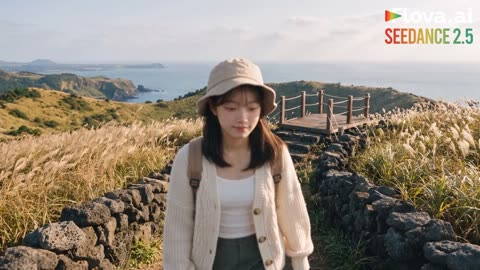</a>

Three reference images lock her face, outfit and location, and the 30 seconds are split into timecoded beats, each with the exact Korean line and facial emotion cues. Part 2 takes Part 1's last frame as @image 4, so the second clip continues with no cut.

Seedance 2.5 · Reference-to-video · Source: [@Chaemate_ on X](https://x.com/Chaemate_/status/2115390545426034836)

[`korean-speech`](tags.md#tag-korean-speech) [`character-lock`](tags.md#tag-character-lock) [`lip-sync`](tags.md#tag-lip-sync) [`travel-vlog`](tags.md#tag-travel-vlog)

<details><summary><b>Prompt</b></summary>

```text
PART 1 (30 seconds)

CHARACTER
Use @image 1 and @image 2 as the Master Identity Lock. Keep her face, hair, skin tone, outfit (cream knit cardigan, sage-olive cargo pants, white sneakers, beige bucket hat, tan backpack) and body proportions exactly the same throughout. No identity drift.

LOCATION
Use @image 3 as the environment reference: a windy volcanic hilltop on a Korean island with golden silver-grass, low black stone walls, and a wooden lookout over the sea. Soft late-morning sunlight, light sea breeze, gentle clouds. Keep the same light and weather for the whole video.

STYLE
A spontaneous travel vlog filmed by a friend following just behind and beside her, with slight natural shake, smooth reframing, and candid expressions. Realistic live action, not stylized.

VOICE AND PERFORMANCE
Native Korean speech, natural conversational tone, accurate lip-sync. Every line is performed with visible emotion: the eyebrows, eyes, mouth, and breathing all react to what she feels. Her expression should change before, during, and after each line, with no flat or robotic delivery.

TIMECODE AND SCENES

00:00–00:04 | The Trailhead
She walks along a stone-wall path through tall silver-grass. She glances at the lens, eyes lighting up, eyebrows lifting, and says with bright, bubbly excitement and a rising pitch: "정상이 나를 부르고 있어!" (The summit is calling me!) She ends with a proud, wide grin and a small fist pump. Camera follows from the front at a medium shot.

00:04–00:08 | The Wobble
She tries a slow, cool model walk. Her sneaker catches a small pebble and she wobbles slightly. Her eyes go wide for a split second, then she freezes in a proud “ta-da” pose, holding a stiff, tight smile with flushed cheeks. She says in a deadpan whisper through the smile, eyes darting sideways: “…의도한 거야.” (…I meant to do that.) Camera drifts closer to catch her face.

00:08–00:12 | The Pony
A brown Jeju pony grazes beside the path. She crouches to take a selfie with it, but the pony calmly turns its back to her. Her jaw drops in mock offense, her lower lip pushes into a pout, and she says in a wounded, dramatic tone: "진짜? 얼굴도 안 보여 주는 거야?" (Seriously? You won’t even show me your face?) Then she bursts into helpless laughter, shoulders shaking. Camera: low angle, then a quick pan to her reaction.

00:12–00:17 | Grass Tunnel
The path narrows into tall silver-grass. She pushes through, disappears behind it, then pops out making hand-binoculars and scanning the horizon with a squinted, ultra-serious explorer face. She gasps softly, thrilled, as if she has spotted something. Camera follows from behind, then swings around to the front.

00:17–00:22 | The Wind Hits
She climbs a few stone steps to the crater rim and spreads her arms, eyes closed, face lifted in blissful relief. A gust throws her hair across her face. She pulls a strand from her mouth, scrunches her nose, and laughs. Wide shot, then a medium close-up.

00:22–00:27 | The Seagull
She flaps her elbows like a seagull with a goofy, beaming face. She stops, points at the lens with a playful, challenging look, chin lifted and eyebrows raised, and says in a teasing sing-song voice: "너도 해 봐!" (You try!) Camera circles in a gentle quarter turn, with the sea visible behind her.

00:27–00:30 | Final Frame (hold exactly)
She steps onto the small wooden lookout. A sudden gust blows her hat off and she catches it in mid-air with a surprised gasp and wide eyes. She crouches beside the rope railing, holding the hat against her knee, looking into the lens, laugh fading to a breathless, happy smile. Medium shot, slightly low angle, ocean and soft clouds behind her, camera steady for the last second.

AUDIO
Wind across the grass, soft footsteps on gravel, fabric rustle, pony snort, distant waves, spontaneous laughter. No background music.

NEGATIVE
No face or outfit changes, no real falls, no dangerous actions, no teleporting, no location jumps, no body distortion, no glitches, no CGI look, no stiff movement, no flat or emotionless dialogue, no lip-sync mismatch, no neon or glowing colors.

FORMAT: 16:9 | 30s | 4K | 24 FPS | Ultra-realistic live action | Natural handheld

PART 2 (15 seconds)

Use the very last frame of Part 1 as the first frame / @image 4.

CONTINUITY LOCK
Start from exactly the frame in @image 4: she is crouched beside the rope railing on the wooden lookout, holding her hat, looking into the lens with a fading smile. Same pose, same camera angle, same light, same wind, same background. No cut, no reset. Keep the identity from @image 1 and @image 2 and the outfit identical.

VOICE AND PERFORMANCE
Native Korean speech, natural tone, accurate lip-sync, with emotion visible on her face and in her breath for every line.

TIMECODE AND SCENES

00:00–00:03 | Picking Up
Without a cut, she stands up, puts the hat back on, and tilts her head toward the steps with a cheerful, bouncy energy. She says in a light, breathless voice: "내려가면 간식이다, 가자!" (Snacks are waiting downhill, let’s go!) Camera stays at her medium shot and follows.

00:03–00:07 | The Balance Beam
Back on the trail, she steps onto a low black stone wall and walks along it with arms out like a gymnast, tongue slightly between her teeth in concentration. She keeps it low and safe, then hops off with a small, proud landing and a triumphant “yes!” face. Camera follows from the side, then moves behind her.

00:07–00:11 | Snack Review
She sits on the wall, takes a triangle kimbap from her backpack, and bites in. She closes her eyes, chews slowly, savoring it, and nods with solemn drama like a food critic. Her eyes open wide and she turns to the lens, saying in a hushed, awestruck voice: "별 다섯 개." (Five stars.) Wind ruffles her hair. Close-up, then medium shot.

00:11–00:15 | The Quiet Ending
She stands, walks toward the camera with a mischievous half-smile, leans in, puts a finger to her lips, and whispers with sparkling, conspiratorial eyes: "비밀이야." (It’s a secret.) She gently tilts the lens up toward the open sky and soft clouds, and the shot slowly settles as the wind fades into silence.

AUDIO
Wind, footsteps on gravel, kimbap wrapper crinkle, distant waves, soft laughter, ending in quiet ambience. No background music.

NEGATIVE
No cut or reset at the start, no face or outfit changes, no location or lighting change, no dangerous balancing, no glitches, no CGI look, no flat or emotionless dialogue, no lip-sync mismatch, no neon or glowing colors.
```

</details>

<a id="seedance-korean-village-morning-walk"></a>
### Korean Village Morning Routine and Walk

<a href="https://x.com/ayzalnooor24521/status/2101151635309564095"></a>

A character block locks face, hair, clothing and backpack before eight timed two second shots, so the woman stays consistent across cuts. Each shot gets one camera move and one ambient sound cue, and the dark interior to bright exterior exposure shift adds realism.

Seedance 2.5 · Text-to-video · Source: [@ayzalnooor24521 on X](https://x.com/ayzalnooor24521/status/2101151635309564095) · found via [LearnPrompt/awesome-seedance](https://github.com/LearnPrompt/awesome-seedance)

[`lifestyle`](tags.md#tag-lifestyle) [`rural-village`](tags.md#tag-rural-village) [`multi-shot`](tags.md#tag-multi-shot) [`character-consistency`](tags.md#tag-character-consistency) [`vertical`](tags.md#tag-vertical)

<details><summary><b>Prompt</b></summary>

```text
Create a 15-second vertical 9:16 cinematic lifestyle video featuring one consistent young Korean woman living in a peaceful rural Korean village. The video should feel like a natural everyday moment captured for a Korean lifestyle/X social-media post — quiet, authentic, cozy, photorealistic, not commercial, not overly dramatic.

Character consistency:
A young Korean woman in her early 20s, natural Korean facial features, soft clear skin, long dark-brown/black hair tied loosely in a low ponytail, minimal natural makeup. She wears a cozy cream knit sweater, long dark plaid skirt, white sneakers, and a simple black backpack. Keep her face, hairstyle, body proportions, clothing and backpack 100% consistent throughout every shot.

Environment:
A traditional rural Korean village with a small rustic wooden-and-plaster house, warm wooden interior, simple furniture, handmade baskets, old windows, stone walls, narrow village paths, small gardens, traditional tiled rooftops, distant green mountains and a peaceful countryside atmosphere. Early morning sunlight, fresh air, subtle autumn colors.

SHOT 1 — 0:00–0:02

Close cinematic shot inside her cozy rustic bedroom. She slowly wakes up in a simple bed, opens her eyes and looks toward the warm sunlight coming through the wooden window. Soft curtains move gently from the morning breeze. Natural room ambience, subtle birds outside. Camera slowly pushes in toward her face.

SHOT 2 — 0:02–0:04

Medium shot. She sits up, casually fixes her slightly messy hair and ties it into a loose ponytail. She puts on her cream knit sweater and prepares to leave. Keep the movement natural and unhurried, like a real morning routine.

SHOT 3 — 0:04–0:06

She picks up her simple black backpack from beside the wooden chair, puts it over her shoulders, checks herself briefly in a small mirror, then walks toward the wooden front door. Warm sunlight enters the room behind her.

SHOT 4 — 0:06–0:08

Rear three-quarter shot. She opens the old wooden door and steps outside. Bright natural morning light gently floods the frame. The camera follows her from behind as she leaves the house. Slight realistic exposure adjustment as the camera moves from dark interior to bright exterior.

SHOT 5 — 0:08–0:10

Wide cinematic shot of the Korean countryside village. She walks slowly along a narrow stone-and-concrete village path surrounded by small gardens, stone walls and traditional houses. Mountains are visible in the background. Leaves move naturally in the breeze. Camera tracks smoothly behind her.

SHOT 6 — 0:10–0:12

Side-profile close-up while she walks. She briefly looks toward the mountains and takes a peaceful breath. A few strands of hair move naturally in the wind. Sunlight creates a soft glow around her hair. Genuine relaxed expression, no exaggerated acting.

SHOT 7 — 0:12–0:14

She continues walking down the peaceful village road. Camera slowly moves from behind toward her side. The background reveals rooftops, trees, distant mountains and morning sunlight. She casually touches one hand to her backpack strap.

SHOT 8 — 0:14–0:15

Final cinematic wide shot from behind. She becomes slightly smaller in the frame as she continues walking toward the distant village and mountains. Hold for a beautiful peaceful ending with warm sunlight and gentle wind.

Camera & visual style:
Photorealistic Korean lifestyle cinematography, cinematic 35mm look, natural skin texture, realistic facial movement, subtle film grain, soft depth of field, gentle handheld camera movement, smooth tracking shots, realistic motion blur, natural lens flare, warm morning sunlight, muted earthy colors, soft highlights, detailed rural textures.
```

</details>

<a id="seedance-korean-woman-first-train-selfie-vlog"></a>
### Korean woman selfie vlog on first train ride

<a href="https://x.com/saniaspeaks_/status/2094635608849166589">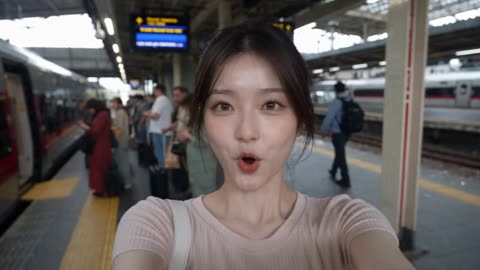</a>

The prompt frames the whole clip as handheld phone footage, with arm length selfies, rear camera switches, walking jolts, autofocus hunting and train vibration, so it reads as a personal vlog instead of a produced film. Each line of dialogue is tied to a specific action, and the explicit same woman instruction keeps one identity across the cuts.

Seedance 2.5 · Text-to-video · Source: [@saniaspeaks_ on X](https://x.com/saniaspeaks_/status/2094635608849166589) · found via [LearnPrompt/awesome-seedance](https://github.com/LearnPrompt/awesome-seedance)

[`smartphone-vlog`](tags.md#tag-smartphone-vlog) [`selfie`](tags.md#tag-selfie) [`train-travel`](tags.md#tag-train-travel) [`lip-sync`](tags.md#tag-lip-sync) [`dialogue`](tags.md#tag-dialogue)

<details><summary><b>Prompt</b></summary>

```text
Ultra-realistic casual smartphone travel vlog of one consistent young Korean woman in her early 20s taking a train journey for the first time, speaking natural fluent English with accurate lip synchronization. Everything is filmed by her own hand on a real smartphone and must feel like an authentic personal social-media vlog, never cinematic or professionally filmed. Use mostly arm-length selfie footage with occasional natural switches to the rear camera, including slight hand shakes, awkward framing, walking jolts, autofocus hunting, exposure changes, motion blur, fingers near the lens, realistic train vibrations, window reflections, and authentic phone-camera quality. She starts at a busy station platform and excitedly says, “Okay guys, I’m taking the train today! Let’s go!” while showing the arriving train, then boards saying, “I made it!” She finds her window seat and says, “And I got a window seat!” As the train starts moving, she films outside and says, “We’re moving!” She casually shows a snack and drink, takes a bite, and says, “Everything tastes better on a train.” She then films beautiful passing scenery of trees, small towns, and distant mountains, quietly saying, “This view is so beautiful.” Finally, back in selfie mode with the moving scenery behind her, she smiles and says, “I think train journeys might be my new favorite thing. See you guys next time. Bye!” before waving and lowering the phone. Include realistic station announcements, train sounds, footsteps, passenger conversations, blinking, breathing, and spontaneous reactions. The same woman must remain perfectly consistent throughout, with no identity changes or duplicate people.
```

</details>

<a id="seedance-korean-woman-sunny-pool"></a>
### Woman dangles feet at sunny pool, then swims

<a href="https://x.com/Strength04_X/status/2091737661061095648">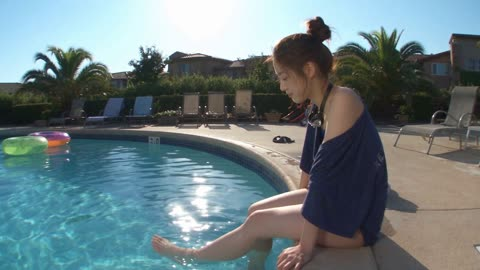</a>

A five-slot timeline with a beat for each action and a line of dialogue gives the model a clear shot-by-shot structure. The 2000s camcorder spec (handheld, blown highlights, soft grain, no stabilization) sets the look, and each Korean line is paired with its meaning so the lip movement and action line up.

Seedance 2.5 · Text-to-video · Source: [@Strength04_X on X](https://x.com/Strength04_X/status/2091737661061095648)

[`timeline`](tags.md#tag-timeline) [`camcorder`](tags.md#tag-camcorder) [`dialogue`](tags.md#tag-dialogue) [`documentary`](tags.md#tag-documentary)

<details><summary><b>Prompt</b></summary>

```text
Young Korean woman, early 20s, navy one-piece swimsuit with a loose oversized shirt worn open over it, hair tied up in a high bun, swim goggles around her neck, playful cheerful energy.
Location: Quiet outdoor community pool, sunny midday. Blue tiled edges, pool floats scattered nearby, lounge chairs, a few potted palms. No crowds, no commercial branding.
Visual Style: Ultra-realistic documentary realism, playful candid feeling, bright natural sunlight.
Camera Style: Early 2000s DV camcorder, handheld with water-splash blur on lens occasionally, exposure blown out in bright sun, soft grain. No stabilization.
Timeline (15 sec, each slot = 2 compressed beats):
00:00–00:03 → She sits at the pool edge, feet dangling in the water, kicking gently.
00:03–00:06 → She says to camera "물이 시원해서 좋다" ("The water feels nice and cool"), smiling.
00:06–00:09 → She slides into the pool, then pushes off, swimming a short stretch.
00:09–00:12 → She surfaces laughing, wiping water from her face.
00:12–00:15 → She waves at camera saying "너도 들어와!" ("Come in too!"), splashing playfully as it fades.
Audio:
Water splashing, faint distant chatter, wind, birds. Her dialogue as noted above. No music.
Goal: A playful, refreshing pool afternoon cheerful, light, authentic.
```

</details>

<a id="seedance-kyoto-afternoon-camcorder-vlog"></a>
### Woman leaves Kyoto townhouse on handheld camcorder vlog

<a href="https://x.com/AIwithAliya/status/2096134503966388296">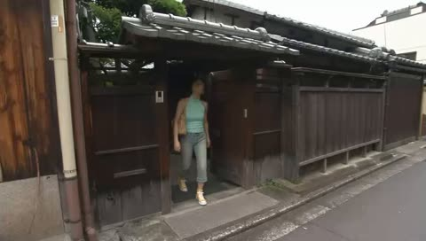</a>

The opening paragraph locks the outfit, location and camcorder look, then each timestamped beat pairs an action with the exact Japanese line to speak. Late camera reactions, autofocus hunting and handheld shake are spelled out so the motion reads as casual footage rather than a cinematic shot.

Seedance 2.5 · Text-to-video · Source: [@AIwithAliya on X](https://x.com/AIwithAliya/status/2096134503966388296) · found via [LearnPrompt/awesome-seedance](https://github.com/LearnPrompt/awesome-seedance)

[`lifestyle-vlog`](tags.md#tag-lifestyle-vlog) [`camcorder`](tags.md#tag-camcorder) [`kyoto`](tags.md#tag-kyoto) [`handheld`](tags.md#tag-handheld)

<details><summary><b>Prompt</b></summary>

```text
Create a 30-second, 16:9 ultra-realistic handheld lifestyle vlog following the same young Japanese woman in her 20s through an ordinary afternoon in Kyoto. Keep her face, identity, hairstyle, body, outfit, accessories, and proportions perfectly consistent in every shot.

She wears a tight pastel green halter top, straight-leg light denim jeans, yellow canvas sneakers, a small tan tote bag, and thin gold hoop earrings throughout.

New scenario: A quiet afternoon in Kyoto

0–5s — Leaving home

She steps out of a small traditional Kyoto townhouse into a quiet residential lane. She checks the sky, adjusts the strap of her tote bag, and notices the camera. She gives a small smile and says naturally:

「今日は、ゆっくりしよう。」

She starts walking, and the camera follows a little late.

5–11s — Small flower shop

She stops at a tiny neighborhood flower shop, looks at a bucket of fresh flowers, and gently touches a small yellow flower. She smiles and says:

「この色、好きだな。」

She buys one small flower, places it carefully in her tote bag, and walks outside. The camera briefly loses focus on her hands before finding her face again.

11–17s — Quiet café

She enters a small local café, orders an iced tea, and sits near the window. She looks outside at the passing bicycles and old wooden buildings, then turns toward the camera and says softly:

「こういう時間、落ち着くね。」

She takes a sip, notices the camera still filming, and gives a slightly amused smile.

17–23s — Narrow walking street

She leaves the café and walks through a narrow street lined with small shops. A delivery bicycle passes unexpectedly, and she steps aside with a little laugh. She looks back at the camera and says:

「あ、びっくりした。」

She continues walking, holding her tote bag naturally at her side.

23–27s — Canal-side pause

She reaches a quiet canal-side path in the late afternoon. She sits on a low stone ledge, places her drink beside her, and takes the small flower out of her tote bag. She looks at it for a moment, then watches the water. The wind moves her hair naturally, and she gives a small, genuine smile.

27–30s — Walking home

She stands, puts the flower back into her tote bag, and starts walking away. After a few steps, she looks back at the camera and says:

「また、ゆっくり歩こうね。」

She continues walking as the camera follows behind. Recording naturally ends around 29.5 seconds.

Filming style

Genuine footage filmed casually by a close friend on a smartphone or compact camera. Handheld shake, imperfect framing, autofocus hunting, exposure pumping, natural motion blur, mild digital noise, occasional late camera reactions. No gimbal, drone, cinematic choreography, slow motion, beauty filter, or commercial look.

Camcorder aesthetic

Authentic early-2000s MiniDV / consumer camcorder footage, as if someone found an old family tape from around 2002–2005.

4:3 home-video framing

Slight handheld shake

Imperfect framing

Autofocus hunting

Occasional exposure pumping

Mild blown highlights

Soft digital sharpness

Interlaced-looking motion characteristics

Subtle motion blur

Low dynamic range

Faded, slightly warm colors

Realistic digital noise

Tiny compression artifacts

Occasional accidental micro-zoom

Imperfect white balance

Slight lens flare when sunlight hits the lens

Natural camera operator mistakes

Do not make the footage excessively degraded. It should still be clear enough to see her face and environment.

Realism

The most important goal is believability.

Accurate human biomechanics, grounded feet, continuous objects, realistic walking, sitting, drinking, and handling of the flower. Consistent architecture and wardrobe. Hands must remain anatomically correct with five fingers. Clothes must move naturally with her body and wind.
```

</details>

<a id="seedance-kyoto-autumn-slow-travel-vlog"></a>
### Quiet Kyoto autumn travel vlog, 30 seconds

<a href="https://x.com/Chaemate_/status/2099439262106083704"></a>

Locks the face, outfit and necklace to a reference image, then sets a slow pace with one simple action per scene. It bans ad-style montage and gives short dialogue lines with pauses, plus handheld, autofocus, ambient sound and 35mm grain cues for a casual home-video feel.

Seedance 2.5 · Reference-to-video · Source: [@Chaemate_ on X](https://x.com/Chaemate_/status/2099439262106083704) · found via [LearnPrompt/awesome-seedance](https://github.com/LearnPrompt/awesome-seedance)

[`travel-vlog`](tags.md#tag-travel-vlog) [`kyoto`](tags.md#tag-kyoto) [`character-consistency`](tags.md#tag-character-consistency) [`handheld`](tags.md#tag-handheld) [`film-grain`](tags.md#tag-film-grain)

<details><summary><b>Prompt</b></summary>

```text
Create a photorealistic 30-second personal travel vlog featuring the exact same woman from the reference image. Keep her face, hairstyle, physical appearance, makeup, outfit and necklace consistent throughout the entire video.

Make it feel like a real young woman casually documenting her autumn trip to Kyoto with a friend behind the camera. No commercial travel-ad look, no fast montage and no overly cinematic movements.

Keep the pacing slow and natural. Each scene should focus on one simple action. Let shots breathe and allow natural pauses. She should walk, look around and react at normal human speed. Never speed up her movement or speech to fit more into the scene.

Show quiet everyday moments around Kyoto: riding a local train in the morning, walking through a residential street, discovering a small bakery, sitting by the river, browsing a tiny stationery shop, getting caught in light rain and grabbing a warm drink from a vending machine at night.

Keep the dialogue extremely short and casual, with natural pauses. Things like “Cute…”, “So pretty”, “Mmm… good”, “Look…”, “This one?”, “Oh… rain”, “Nice…” and “One more stop.” She should never sound like she's reading a script or rushing through lines.

Use realistic handheld camera movement, subtle autofocus, natural exposure changes, real ambient sounds, natural skin texture, realistic lighting and subtle 35mm film grain. Some moments should have no dialogue at all.

The goal is simple: make it feel like an actual travel vlog someone happened to capture during a real day in Kyoto, not an AI-generated commercial.
```

</details>

<a id="seedance-late-night-kitchen-phone-cooking"></a>
### Late night kitchen meal shot like a phone recording

<a href="https://x.com/AIWithRay/status/2087544594384773346">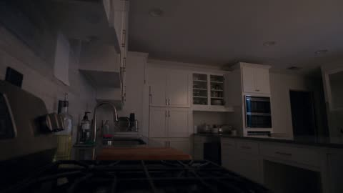</a>

The prompt splits the 30 seconds into timed beats with exact actions and camera placement, and it names smartphone traits such as autofocus hunting and compression noise so the model keeps a home video look. It limits audio to room sounds and marks the dialogue as spontaneous, which stops the clip from reading as a polished ad.

Seedance 2.5 · Text-to-video · Source: [@AIWithRay on X](https://x.com/AIWithRay/status/2087544594384773346) · found via [LearnPrompt/awesome-seedance](https://github.com/LearnPrompt/awesome-seedance)

[`phone-footage`](tags.md#tag-phone-footage) [`timed-beats`](tags.md#tag-timed-beats) [`ambient-audio`](tags.md#tag-ambient-audio) [`dialogue`](tags.md#tag-dialogue)

<details><summary><b>Prompt</b></summary>

```text
FORMAT: 30-second horizontal 16:9 realistic smartphone video.
Create an authentic, imperfect everyday late-night kitchen phone recording, as if a friend casually left a phone recording on the counter. Use a standard smartphone camera with mild autofocus hunting, subtle exposure shifts, natural motion blur, compression artifacts, and slightly uneven handheld framing. No polished commercial look.
00–05s — WALKING IN
The character walks into a quiet home kitchen carrying a small grocery bag. They set it on the counter, sigh quietly, and pull out a few simple ingredients.
They glance at the phone for a second before turning back toward the counter.
Camera remains several feet away at counter height, as if casually recording from a nearby surface.
05–10s — GETTING STARTED
They wash their hands, turn on the kitchen light, and begin preparing the ingredients.
A cutting board shifts slightly against the counter. They pause to move it into a better position.
The character looks tired but relaxed, occasionally brushing their hair away from their forehead.
10–15s — COOKING
They place a pan on the stove and begin cooking.
Steam gradually becomes visible. The phone autofocus briefly shifts between the character and the foreground pan before settling again.
They stir the food, taste a tiny amount, think for a moment, then add a little more seasoning.
No readable labels or packaging should be visible.
15–20s — SMALL MISTAKE
The character gets distracted for a moment and notices the food starting to cook more quickly than expected.
They immediately lower the heat and give a small amused shake of their head.
They quietly mutter something like:
“Yeah… almost forgot about that.”
The delivery should feel spontaneous and understated.
20–25s — FINISHING
They finish preparing the food, turn off the stove, and carefully transfer the meal onto a plate.
They wipe a small splash from the counter with a paper towel.
Natural movements only—nothing overly choreographed.
25–30s — QUIET ENDING
They sit at the kitchen table with the finished meal.
They take one bite, pause, and give a small satisfied smile.
They look toward the phone and quietly say:
“Honestly… not bad.”
They pick up the fork again and continue eating as the camera keeps recording for another moment before the clip naturally ends.
AUDIO
Natural kitchen ambience only: refrigerator hum, ventilation, running water, utensil sounds, pan sizzling, footsteps, clothing movement, cupboard and drawer sounds, plate and fork noises, and subtle room ambience.
No music.
Dialogue should sound spontaneous and conversational, with natural pauses and imperfect delivery.
VISUAL REALISM
Authentic smartphone footage, ordinary warm household lighting, realistic skin texture, natural shadows, mild phone-camera sharpening, subtle compression noise, imperfect exposure, slight autofocus changes, believable reflections, natural steam, realistic food textures, and ordinary kitchen imperfections.
STRICTLY AVOID: cinematic color grading, beauty filters, artificial skin smoothing, dramatic slow motion, music, subtitles, captions, logos, readable text, perfect lighting, excessive camera shake, exaggerated acting, unrealistic food or steam, duplicated objects, warped hands, unnatural facial expressions, scene cuts, time jumps, or skipping the described actions.
```

</details>

<a id="seedance-lia-morning-village-home-video"></a>
### Woman with coffee on a village terrace

<a href="https://x.com/Cupang1997/status/2091438364545446209">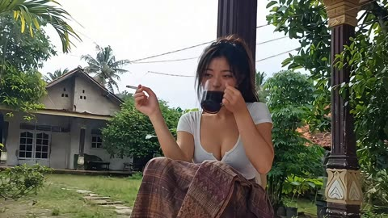</a>

Each reference image gets a fixed role (identity, location one, location two), and the prompt locks clothing, hair and hand-held props across a single hard cut. Handheld camcorder cues (tremor, late refocus, exposure pumping) plus an off-screen cameraman voice, with only the on-screen woman lip-synced, make it read as found home video.

Seedance 2.5 · Reference-to-video · Source: [@Cupang1997 on X](https://x.com/Cupang1997/status/2091438364545446209) · found via [LearnPrompt/awesome-seedance](https://github.com/LearnPrompt/awesome-seedance)

[`home-video`](tags.md#tag-home-video) [`indonesia`](tags.md#tag-indonesia) [`lip-sync`](tags.md#tag-lip-sync) [`slice-of-life`](tags.md#tag-slice-of-life)

<details><summary><b>Prompt</b></summary>

```text
Reference mode:
Use karakter sheet - location 1 - location 2 (image)

# Seedance 2.5 — Lia Morning Village Home Video — 30 Seconds FORMAT: Seedance 2.5 image-reference-to-video. Duration: exactly 30 seconds. Aspect ratio: 16:9. Photorealistic animated video from still-image references, rendered as believable live-action documentary footage rather than cartoon or CGI. Two continuous documentary scenes with only one intentional hard cut at approximately 17.5 seconds. REFERENCE ROLES: * gambar 1  = strict identity and appearance reference for LIA. Preserve Lia as the exact same adult woman throughout the entire video: same facial structure, eyes, nose, lips, skin tone, freckles/skin details, body proportions, tied-back dark brown hairstyle with naturally loose strands, earrings, white fitted top, brown patterned wrap skirt/sarong, and white sandals. Do not redesign or beautify her. * gambar 2  = strict environment and architectural reference for SCENE 1 only. Preserve the modest Indonesian house facade, open tiled front terrace, roof shape, terracotta roof feeling, columns, doors, windows, front yard, trees, plants, overhead electrical cables, scale, and spatial layout. Do not copy any character identity from this image. * gambar 3  = strict environment and composition reference for SCENE 2 only. Preserve the narrow asphalt village road, rice-field surroundings, village rooftops, utility lamp poles, tropical vegetation, distant green hill, open blue morning sky, and rural Indonesian spatial feeling. Do not copy character identity from this image. GLOBAL CHARACTER LOCK: Lia must remain visually identical to gambar 1 in both locations. Same face, body proportions, hairstyle, outfit, accessories, skin texture, and footwear. Her clothes should behave like real cotton and woven fabric, slightly worn and everyday rather than glossy or fashion-perfect. Lia's personality is relaxed and naturally playful. When she talks she becomes noticeably more excited and expressive: bright eyes, quick eyebrow lifts, small head tilts, spontaneous smiles and teasing expressions. Natural Indonesian speech with a light authentic Javanese-Indonesian accent, lively and conversational, never theatrical or caricatured. CAMERAMAN: The cameraman is always physically behind the camera and NEVER appears on screen, in reflections, windows, shadows, or background. His voice is recorded naturally from directly behind the camcorder. When the cameraman speaks, Lia does not lip-sync his dialogue. Lia only reacts with natural eye movement, a small smile, breathing, or subtle head movement. Only Lia's own spoken lines animate Lia's lips. VISUAL STYLE: Ultra-realistic documentary realism. Genuine candid behavior. Unscripted everyday slice-of-life feeling. Natural imperfect body language. Deep environmental authenticity of a rural Indonesian morning. The result should feel like a forgotten family home video recorded in Indonesia in the early 2000s: warm, mundane, affectionate, slightly funny, imperfect and deeply believable. Output may be high-resolution / 8K master quality, but the acquisition aesthetic must strongly emulate an early-2000s consumer DV camcorder: warm slightly faded colors, soft contrast, mild sensor noise, subtle digital compression, limited highlight latitude, natural motion blur, very mild rolling shutter, slightly imperfect white balance, no glossy modern HDR, no modern cinematic color grade, no beauty filter, no excessively shallow depth of field. HUMAN-OPERATED CAMERA: Camera movement must feel physically operated by a real friend holding a consumer camcorder. Use: subtle hand tremor, natural breathing drift, slightly imperfect horizon, small delayed reframing, occasional lens breathing, brief autofocus searching caused by subject movement, minor exposure pumping when moving between shade and bright sunlight. Every camera imperfection must have a physical reason. No gimbal stabilization. No drone. No orbit. No crane. No perfect tracking. No dramatic cinematic push-ins. No stylized speed ramp. No artificial cinematic camera choreography. SCENE 1 — TERRACE MORNING, based on gambar 2 00:00–00:02.8 Begin immediately with Lia already seated casually on the front terrace of the house from gambar 2. Use a loose eye-level medium-wide three-quarter shot, as if the cameraman is standing several steps in front of the terrace. Lia sits relaxed on the existing porch seating, shoulders loose, one foot slightly forward. Her LEFT hand naturally holds a simple glass cup of dark morning coffee. Her RIGHT hand holds one lit cigarette between index and middle finger. Keep object ownership consistent: coffee always remains in the left hand until she puts it down, cigarette remains in the right hand until she extinguishes it. A thin natural stream of cigarette smoke rises and bends with the morning air. Lia briefly takes a small sip of coffee, lowers the glass, casually looks toward the cameraman behind the lens and gives a tiny amused smile. Camera is not perfectly centered and slowly drifts a few centimeters while the operator settles his grip. Tropical morning sunlight illuminates the yard while Lia remains partially under terrace shade. Moving leaves create soft shifting dappled shadows. Exposure reacts slightly to the bright yard behind her. 00:02.8–00:04.5 CAMERAMAN speaks from behind the camera, playful and casually surprised: "widiihh lia santai amat" The cameraman remains completely off-screen. While listening, Lia keeps her lips closed except for a tiny amused smile. She glances toward the lens/operator, lightly raises her eyebrows and relaxes the cigarette hand near her knee. 00:04.5–00:09.7 LIA answers, conversational and excited with a natural light Javanese-Indonesian accent: "iya mas pagi hari itu wajib ngopi dan udud kalau ga bisa pusing loh" Accurate Indonesian lip sync ONLY for Lia. She speaks while sitting naturally rather than performing for camera. Small head movement, lively eyebrows, natural blinking, relaxed shoulders. She gestures once gently with the cigarette hand without waving it excessively. Smoke responds naturally to the movement. Toward the end of the sentence she gives a teasing half-smile. After finishing the spoken line, she takes a tiny relaxed breath; do not make her drink while her mouth is actively speaking. The camera operator makes a very small late correction to keep her face centered. Autofocus briefly breathes, then settles back on Lia. 00:09.7–00:11.5 CAMERAMAN asks from behind the camera: "habis udud mau kemana lia?" Lia remains silent while he speaks. No Lia lip-sync. She tilts her head slightly, looks amused and shifts her weight forward as if preparing to get up. 00:11.5–00:14.5 LIA answers with growing excitement and a playful inviting expression: "ayo ikut aku mancing mas mauu?" Accurate lip sync. On "mauu?" she lifts her eyebrows, smiles toward the cameraman and leans forward slightly, inviting him to follow. Keep the delivery spontaneous, like talking to a real friend, not presenting to an audience. 00:14.5–00:17.5 Dialogue pauses. Lia naturally completes the current activity before leaving. First she places the coffee glass down with her LEFT hand on the nearby terrace surface. Then she taps the cigarette once and extinguishes the cigarette completely in a small simple ashtray using her RIGHT hand. The cigarette state changes from LIT to EXTINGUISHED only after visible contact with the ashtray. After this moment there is no new cigarette smoke. She plants both sandal-covered feet firmly, shifts her weight forward, stands with believable human balance, straightens her skirt naturally and takes her first step away. Realistic cloth movement and hair secondary motion. Foley: soft glass contact, small ashtray tap, woven skirt rustle, sandal movement. CUT LOGIC: At approximately 00:17.5, make ONE simple hard cut after Lia has fully stood and started leaving. No transition effect. No dissolve. No montage. SCENE 2 — VILLAGE ROAD WALK, based on gambar 3 00:17.5–00:21.7 Hard cut directly to Lia already walking along the narrow asphalt village road from gambar 3. Camera follows approximately 2–3 meters BEHIND Lia at natural walking height. Medium-wide rear follow framing shows Lia's full walking movement and enough environment to clearly recognize the road, fields, utility poles, rooftops, tropical vegetation and distant green hill. The cameraman walks behind her, producing gentle vertical footstep bob, mild hand tremor and slightly imperfect framing. Lia walks at an unhurried natural pace. Real heel-to-toe steps. No sliding feet. Her patterned woven skirt reacts naturally to each stride. Her tied-back hair and loose strands respond subtly to the breeze. The cameraman occasionally falls a fraction behind, then naturally catches up. Do not turn this into a smooth professional tracking shot. 00:21.7–00:24.2 Without stopping completely, Lia slows slightly and turns her head and upper torso back over her shoulder toward the cameraman. The movement begins with her eyes, then head, then shoulders. Her lower body continues moving forward slowly. Because she unexpectedly turns back, the camera reacts a little late. Framing briefly drifts off-center and autofocus searches for her face for a fraction of a second before locking. LIA speaks toward the cameraman with teasing curiosity: "mas mau tau aku kemana?" Accurate natural lip sync. Excited light Javanese-Indonesian delivery. Playful half-smile. 00:24.2–00:25.4 CAMERAMAN responds from behind the camera: "kemana tuuuuh" He remains completely off-screen. Lia's mouth stops speaking while his line is heard. She keeps looking back with a mischievous expression, suppressing a laugh. Camera continues physically walking behind her with natural small shake. 00:25.4–00:29.2 LIA gives the punchline: "aku mau cari om om loh mas eee" She delivers it playfully and excitedly, building toward the final "eee". Accurate Indonesian lip sync. Immediately after finishing "eee", she bursts into a genuine spontaneous laugh. Her shoulders bounce naturally from laughter. She briefly squints, smiles widely and turns her face partly forward again while still chuckling. The laugh feels uncontrolled and candid, not like scripted acting. The cameraman reacts physically by momentarily losing perfect framing while continuing to walk. The camera dips slightly and catches up again. Do not add any new spoken words. 00:29.2–00:30.0 Lia is still walking and laughing softly. She begins turning her attention forward again while the cameraman follows. The framing drifts slightly toward one side because the operator is walking and laughing/reacting behind the camera. End imperfectly: the recording abruptly cuts to black MID-MOTION at exactly 30 seconds, without a polished ending, fade-out, pose, title or outro. ENVIRONMENTAL AUTHENTICITY: The environment must feel alive but never distract from Lia. SCENE 1 background: subtle tropical leaves moving in morning air, occasional distant motorbike passing outside the main foreground, one distant resident casually sweeping with a traditional broom when composition permits, small household plants moving, occasional water drip, overhead electrical cables, terracotta roofing, weathered concrete, real glass and ceramic surfaces, one cat may briefly react or cross far in the background only if naturally integrated. SCENE 2 background: rice and grasses moving gently in the breeze, distant village activity, occasional far motorbike, subtle birds, coconut or tropical foliage moving, utility poles remaining stable, no crowds, no staged extras. Background activity must continue independently of Lia as if the village exists beyond the scene. LIGHTING: Natural tropical morning light only. SCENE 1: bright morning yard with softer shade beneath the house terrace. Dappled foliage shadows shift subtly. Consumer camcorder exposure pumps very slightly when framing includes more bright yard or shaded Lia. SCENE 2: strong but natural morning daylight matching gambar 3. No artificial key light. No rim-light setup. No cinematic backlighting. Exposure may briefly adjust when Lia's face turns from forward light to backward-facing light. PHYSICAL MATERIAL DETAIL: Real skin texture with pores and tiny imperfections. No plastic skin. White cotton top moves subtly with breathing. Patterned woven skirt has visible fabric weight and folds. Sandals flex naturally at the feet. Concrete and tiled terrace retain worn real-world texture. Coffee is contained inside a real glass with believable reflections. Cigarette paper, ember and ash behave realistically before extinction. Terracotta roofing, asphalt, dry grass and green vegetation retain physically believable texture. AUDIO: Zero music. Zero narration. No voice-over other than the naturally recorded off-screen cameraman dialogue. No added soundtrack. Use authentic layered location sound. SCENE 1 close layer: Lia's clothing rustle, subtle breathing, glass touching the porch/table, small cigarette and ashtray contact, sandals shifting. Medium layer: broom brushing ground, occasional water drip, leaves rustling. Far layer: rooster crow, distant motorcycle, soft rural morning ambience. SCENE 2 close layer: Lia's sandal footsteps on asphalt, woven skirt swish, breathing and genuine laughter. Medium layer: grass and leaves moving in the breeze. Far layer: occasional rooster, distant motorcycle, birds and rural village ambience. Dialogue must remain clearly intelligible but retain realistic camcorder microphone perspective. The cameraman's voice should sound close to the microphone because he is holding the camera. Lia's voice becomes slightly more spatially distant during the rear-follow scene while remaining clear. MOTION QUALITY: Natural human-scale acceleration and deceleration. Stable foot contact. Correct left/right limb ownership. Real body weight and balance. Natural hip and shoulder counter-motion while walking. Believable hair and cloth secondary motion. No floating. No rubber limbs. No foot sliding. No teleporting. No sudden speed changes. CONTINUITY: Lia remains the exact same person from gambar 1 throughout both scenes. Same: face, skin, hair, hairstyle, body proportions, earrings, white top, brown patterned wrap skirt, white sandals. SCENE 1 prop continuity: coffee = left hand until placed down. cigarette = right hand until visibly extinguished. After Lia leaves the terrace: coffee remains behind at the house. cigarette remains extinguished at the house. Neither object appears in Lia's hands on the road. SCENE 2 begins only after the intentional hard cut. Do not visually morph gambar 2 into gambar 3. NEGATIVE CONSTRAINTS: No identity drift or face redesign. No hairstyle change. No wardrobe change. No changing Lia's body proportions. No beauty filter or plastic skin. No duplicate Lia. No cameraman visible anywhere. No random foreground characters interacting with Lia. No incorrect speaker lip-sync. Lia's lips stay silent during cameraman dialogue. No extra dialogue. No subtitles. No captions. No watermark. No logos. No duplicate coffee glass. No switching coffee between hands. No duplicate cigarette. No switching cigarette between hands. No cigarette magically relighting after extinction. No cigarette smoke during the road scene. No random location morphing. No unexplained teleportation. No random jump cuts. Only one intentional hard cut between the terrace and road scenes. No gimbal stabilization. No cinematic orbit. No drone shot. No glossy cinematic grading. No modern HDR look. No dramatic lens flare. No artificial slow motion. No speed ramps. No background music. No narrator. FINAL GOAL: A believable forgotten early-2000s Indonesian home video — candid, imperfect, funny, warm and unscripted. It should feel as though a real friend casually picked up a consumer DV camcorder one tropical morning, found Lia drinking coffee and smoking on her terrace, chatted with her spontaneously, then followed her down a village road while she jokingly teased the cameraman. The viewer should feel that life in the environment continues naturally whether or not the camera is recording.
```

</details>

<a id="seedance-magic-pen-street-transport-vlog"></a>
### Magic Pen Turns Street Traffic Into Cartoons

<a href="https://x.com/Strength04_X/status/2095748874942263601"></a>

A fixed transformation sequence (marker points, a spoken Biu, sketch lines, ink fill) is repeated for every target, so each beat reads the same way. Handheld smartphone realism, shared light direction and contact shadows keep the flat 2D characters anchored in the photoreal street, with a timed beat list and sound cues for each segment.

Seedance 2.5 · Text-to-video · Source: [@Strength04_X on X](https://x.com/Strength04_X/status/2095748874942263601) · found via [LearnPrompt/awesome-seedance](https://github.com/LearnPrompt/awesome-seedance)

[`vlog`](tags.md#tag-vlog) [`live-action-2d-composite`](tags.md#tag-live-action-2d-composite) [`first-person`](tags.md#tag-first-person) [`transformation`](tags.md#tag-transformation) [`vertical`](tags.md#tag-vertical)

<details><summary><b>Prompt</b></summary>

```text
Magic Pen Street Transport Vlog · 15 Seconds · Vertical 9:16

[STYLE]
Live-action + flat 2D anime sticker compositing, first-person street transport magic vlog. 8K photorealistic detail with the authentic look of a real smartphone rear-camera recording. Strong visual contrast between the photorealistic city and flat cartoon vehicles. One continuous handheld smartphone shot. No cuts. No scene transitions.

[CAMERA]
Raw, unstabilized handheld smartphone footage throughout: natural walking shake, subtle arm movement, occasional autofocus hunting, realistic exposure shifts between bright sky and building shadows, and slight rolling-shutter jelly during fast pans. Natural smartphone HDR colors with soft, realistic tones. The camera quickly whip-pans to follow the marker and each target.

[LIGHTING]
Late-afternoon sunlight coming consistently from one direction. Every real object and every animated character casts a soft contact shadow matching the direction of the sunlight.

[SETTING]
One continuous walk through a Korean city neighborhood. A wide urban road with a pedestrian sidewalk, bicycle lane, city buses, parked scooters, and a crosswalk. Everyday street life, with background pedestrians and vehicles moving naturally.

[PEN — MAGIC RULES]
The vlogger's real hand, with photorealistic skin and visible pores, holds a black marker and remains visible throughout the entire video, serving as the visual guide connecting every beat.

Every transformation follows the exact same sequence:

Marker points → Vlogger says “Biu!” → blue hand-drawn sketch lines wrap around the target → ink spreads → the target transforms into a lively flat 2D cel-shaded anime character with bold cartoon outlines.

The transformed character must preserve the original object's exact size, position, speed, direction, and perspective, remaining perfectly anchored to the real street environment. Characters retain flat sticker-style shading and are never relit by the real-world lighting. Anything they touch reacts with realistic physical interaction.

[00:00–00:03]

First-person view while walking beside a busy road. The vlogger raises the black marker into frame and points at a passing city bus.

“Biu!”

Blue sketch lines wrap around the bus. The bus transforms into a giant flat 2D cartoon vehicle with bold anime outlines while maintaining its exact size, speed, direction, and perspective.

It continues driving normally through traffic.

SFX: Bus engine + marker whoosh + soft cartoon movement sound.

[00:03–00:06]

The marker quickly swings downward toward a bicycle passing along the bicycle lane.

“Biu!”

The bicycle transforms into a cute hand-drawn cartoon bicycle. It continues moving at the same speed, its wheels spinning rapidly, with small sketch particles appearing behind it.

SFX: Bicycle wheel sound + light sketch rustling.

[00:06–00:10]

The marker follows the bicycle toward a parked scooter near the sidewalk.

“Biu!”

A rapid blue sketch outline covers the scooter. It transforms into a flat 2D cartoon scooter while preserving its exact position, proportions, and perspective.

Its wheels spin once and its small cartoon headlight blinks twice.

SFX: Soft engine hum + tiny mechanical click.

[00:10–00:12]

The marker quickly swings toward a pedestrian crossing the road.

“Biu!”

Blue sketch lines trace around the person. The same person, in the exact same pose, proportions, and position, becomes a vibrant anime cel-shaded illustration.

They continue walking naturally and briefly wave once.

SFX: Fast doodling sound + soft sparkle chime.

[00:12–00:15]

The vlogger stops walking and gives one final, louder:

“Biu—!”

The marker spins upward toward the road. A swirling blue ink trail spreads across the vehicles and pavement, transforming the entire road surface into a hand-drawn anime street while the surrounding buildings remain completely photorealistic.

A small handwritten “THE END!” doodle — the only text appearing anywhere in the video — pops up above the road.

Freeze frame.

SFX: Sharp throwing whoosh + spreading watercolor-ink bloom + felt-tip marker squeaking as it writes “THE END!”
```

</details>

<a id="seedance-minidv-couple-afternoon-street-walk"></a>
### Couple on a MiniDV home video afternoon walk

<a href="https://x.com/AIwithkhan/status/2094997895187673489"></a>

A reference image locks identity, hairstyle and outfit, then a style line (early 2000s MiniDV, shaky handheld, autofocus hunting) sets the look. The story runs as a loose chain of beats from street food to sunset kiss, and the audio line asks for ambience and no music.

Seedance 2.5 · Reference-to-video · Source: [@AIwithkhan on X](https://x.com/AIwithkhan/status/2094997895187673489) · found via [LearnPrompt/awesome-seedance](https://github.com/LearnPrompt/awesome-seedance)

[`minidv`](tags.md#tag-minidv) [`home-video`](tags.md#tag-home-video) [`handheld`](tags.md#tag-handheld) [`couple`](tags.md#tag-couple) [`street-ambience`](tags.md#tag-street-ambience)

<details><summary><b>Prompt</b></summary>

```text
Use the uploaded reference image as the exact character reference. Preserve her facial identity, hairstyle, eye color, skin tone, makeup, body proportions, 

Style: Early-2000s MiniDV home-video aesthetic, photorealistic live-action, shaky handheld camera, slight autofocus hunting, natural exposure shifts, motion blur, imperfect framing, warm afternoon light, authentic everyday atmosphere.

A young woman from Korea wearing a fitted pastel tshirt spends a casual afternoon with her boyfriend in a quiet neighborhood. She films herself walking down the street, smiling at the camera while her boyfriend walks beside her. They stop at a small street-food stall, share a snack, laugh together, and continue walking.

She playfully steals his sunglasses and puts them on, making him laugh. They sit together on a low wall, talk and tease each other, then walk through a small park while she records little moments on the handheld camera.

As the sun begins to set, they stop under a streetlight. She turns the camera toward him, they exchange a warm smile, move closer, and share a brief natural kiss on the lips.

The camera stays handheld and slightly imperfect as they laugh afterward and walk away together.

Audio: Natural street ambience, footsteps, distant traffic, birds, casual conversation and laughter. No music.

Negative prompt: No subtitles, text, logos, watermarks, identity changes, outfit changes, duplicate people, distorted hands, unnatural movements, or AI artifacts.
```

</details>

<a id="seedance-minidv-gym-day-vlog-2003"></a>
### Young woman packs gym bag in bedroom

<a href="https://x.com/saniaspeaks_/status/2106247874296062303">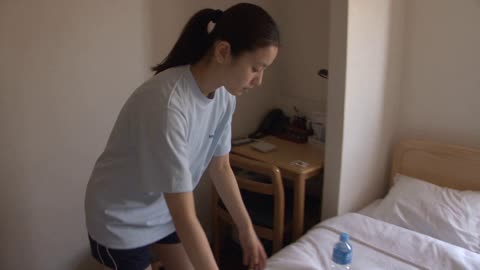</a>

A timed beat sheet with exact second ranges and a continuity lock fixes the order of every action. MiniDV camera language (handheld shake, autofocus hunting, soft detail) and an explicit ban on modern devices keep the era look.

Seedance 2.5 · Reference-to-video · Source: [@saniaspeaks_ on X](https://x.com/saniaspeaks_/status/2106247874296062303) · found via [LearnPrompt/awesome-seedance](https://github.com/LearnPrompt/awesome-seedance)

[`minidv`](tags.md#tag-minidv) [`character-reference`](tags.md#tag-character-reference) [`timed-storyboard`](tags.md#tag-timed-storyboard) [`vlog`](tags.md#tag-vlog)

<details><summary><b>Prompt</b></summary>

```text
Create a highly photorealistic 30-second early-2000s Japanese gym day vlog featuring ONE consistent young Japanese woman from the provided character reference. Preserve her exact face, hairstyle, hair length, body proportions, outfit, shoes and accessories throughout. No identity drift, outfit/hairstyle changes.

ERA LOCK — JAPAN 2003–2004: Authentic Tokyo neighborhood, period-accurate gym, old equipment, lockers, paper notices, vending machines, older cars, early-2000s sportswear and interiors. No smartphones, smartwatches, wireless earbuds, modern machines, LED screens or modern branding.

CAMERA / REALISM: Genuine friend-recorded MiniDV camcorder footage. Handheld, imperfect framing, slight shake, autofocus hunting, exposure shifts, soft DV detail, digital noise and natural motion blur. Use varied front, side, three-quarter, medium, occasional close-up, mirror and brief OTS shots. Camera sometimes walks beside her or films from in front. Not cinematic, DSLR, 4K, VHS or a retro filter.

EXACT STORY — KEEP THIS ORDER

0–4s: In her Japanese bedroom, she picks up gym bag, packs towel + water bottle, puts on sneakers and leaves apartment.
4–7s: Walks through a normal Tokyo neighborhood toward the gym, mostly front/side angles.
7–9s: Arrives at small period-accurate gym, pauses, opens door, enters.
9–11s: Reception desk → greets staff → checks in → enters gym area.
11–13s: Puts gym bag in locker, closes it and keeps the key.
13–16s: Warm-up on old treadmill, natural front/side shots.
16–19s: Simple weight machine → close-up of hands adjusting it → light controlled set.
19–21s: Open area → simple stretches, arms overhead and leg stretches.
21–23s: Water fountain → drinks from bottle → wipes face with towel.
23–26s: Returns to locker → opens it → retrieves gym bag/towel → closes locker.
26–28s: Walks to reception and exits gym. Outside, takes a refreshing breath and adjusts shoulder bag.
28–30s: Walks home through early-evening Tokyo, filmed naturally from front/side. Camera drifts slightly to reveal the surrounding street.

CONTINUITY LOCK: Every action must physically happen before the next. No teleportation, skipped transitions, repeated scenes, reversed actions, location jumps or duplicated objects/people. Same gym bag, towel, bottle and shoes throughout.

Natural moderate workout, believable effort and movement. She should not constantly smile or pose; only occasional natural glances toward camera.

FINAL STYLE: A spontaneous, intimate early-2000s Japanese everyday memory captured by a friend on a consumer MiniDV camcorder — authentic, imperfect and genuinely recorded.
```

</details>

<a id="seedance-minidv-korean-neighborhood-cat-swing"></a>
### Faded MiniDV walk with a stray cat and swing

<a href="https://x.com/itxabdullaa/status/2088923820744917355"></a>

Gives a timed beat sheet and names the MiniDV defects (handheld shake, autofocus hunting, exposure pumping, compression) so the look comes from the camera rather than the set. Audio is limited to location sound with no music, so footsteps, laughter and the swing squeak carry the realism.

Seedance 2.5 · Text-to-video · Source: [@itxabdullaa on X](https://x.com/itxabdullaa/status/2088923820744917355) · found via [LearnPrompt/awesome-seedance](https://github.com/LearnPrompt/awesome-seedance)

[`minidv`](tags.md#tag-minidv) [`found-footage`](tags.md#tag-found-footage) [`handheld`](tags.md#tag-handheld) [`korean`](tags.md#tag-korean)

<details><summary><b>Prompt</b></summary>

```text
Create a 30-second ultra-realistic video that feels like a genuine forgotten early-2000s Korean home-video recording. NOT cinematic, staged, polished, or AI-generated.

MAIN SUBJECT:

Young Korean woman, early 20s, natural everyday appearance. Oversized faded navy hoodie, white T-shirt, loose beige cargo pants, worn white canvas sneakers, thin silver necklace. Shoulder-length wavy black hair loosely clipped back with wispy strands. Minimal makeup, realistic skin texture and imperfections. Warm, playful personality.

Maintain EXACTLY the same identity, face, hair, clothing, proportions, and appearance throughout.

LOCATION:

Quiet Korean residential neighborhood on a warm late afternoon. Narrow concrete lanes, older low-rise houses, potted plants, bicycles, utility poles, tangled wires, laundry, trees, faded walls, small playground. No shops, advertisements, crowds, or landmarks.

CAMERA:

Early-2000s consumer MiniDV camcorder filmed casually by her friend. Heavy handheld shake, awkward framing, accidental cropping, autofocus hunting, lens breathing, exposure pumping, motion blur, slight rolling shutter, mild compression, soft faded colors, subtle sensor noise.

No stabilization, gimbal, cinematic movement, HDR, film look, or modern smartphone aesthetics.

---

00:00–00:04

Recording begins pointed at the pavement before quickly rising to her. She carries a small food container and laughs, saying, “Wait, don't film yet.” Her head is briefly cropped.

00:04–00:08

They walk uphill. She notices an orange-and-white stray cat beside an old bicycle and crouches to pet it. The camera moves too close and autofocus locks onto the bicycle instead of her.

00:08–00:12

The cat brushes against her leg. She laughs and tries to pet it, but it walks away. She looks at the camera with an amused expression while her friend laughs behind the camera.

00:12–00:16

They pass a faded neighborhood notice board. She points at something, then nearly drops the lid of her food container. She catches it and laughs naturally.

00:16–00:21

They reach a small playground under large trees. She sits on an old swing and gently rocks once or twice. The swing squeaks. Sunlight flickers through leaves while the camera exposure changes entering the shade.

00:21–00:25

She notices someone off-camera waving and waves back. Her friend says something indistinctly. She laughs, notices her shoelace is loose, and bends down to fix it. The camera awkwardly zooms in and briefly loses focus.

00:25–00:28

She stands, looks directly into the lens and laughs: “Are you seriously recording all of this?” She walks toward the camera as her friend backs away shakily.

00:28–00:30

She reaches toward the lens to stop the recording. Her fingers cover the image, the exposure darkens, and the footage abruptly cuts to black.

---

AUDIO:

ONLY authentic location sound. No music or cinematic sound design.

Footsteps, fabric rustling, plastic container movement, birds, leaves, distant voices, bicycle sounds, swing squeaks, faint traffic, natural laughter, breathing, camera handling noise, and imperfect compressed dialogue from the built-in MiniDV microphone.

REALISM REQUIREMENTS:

Make it feel like an accidentally recorded personal MiniDV tape.

Include awkward framing, missed focus, exposure fluctuations, motion blur, compression artifacts, clipped highlights, natural pauses, micro-expressions, imperfect timing, and ordinary environmental details.

Avoid cinematic composition, dramatic lighting, perfect skin, artificial bokeh, smooth movement, slow motion, polished acting, modern color grading, or CGI-looking environments.

Key feeling: an authentic 30-second fragment discovered years later on an old Korean family MiniDV tape.
```

</details>

<a id="seedance-morning-routine-character-lock"></a>
### Woman wakes in golden morning bedroom light

<a href="https://x.com/noorlewisx/status/2104433592751587494"></a>

Seven timed scenes run in order, and the CHARACTER LOCK and OUTFIT LOCK blocks are restated in full so the same face, hair and clothing hold across cuts. Each shot names its camera move, such as a tracking follow from behind, which keeps the motion readable for the model.

Seedance 2.5 · Text-to-video · Source: [@noorlewisx on X](https://x.com/noorlewisx/status/2104433592751587494) · found via [LearnPrompt/awesome-seedance](https://github.com/LearnPrompt/awesome-seedance)

[`morning-routine`](tags.md#tag-morning-routine) [`character-consistency`](tags.md#tag-character-consistency) [`lifestyle`](tags.md#tag-lifestyle) [`multi-shot`](tags.md#tag-multi-shot)

<details><summary><b>Prompt</b></summary>

```text
Create a 30-second cinematic photorealistic morning routine video featuring the SAME young adult woman throughout the entire video.

CHARACTER LOCK:
Same woman in every shot, consistent facial identity, same face shape, same eyes, same nose, same hairstyle, same hair color, same skin tone, same body proportions. Natural attractive appearance, realistic skin texture, soft morning expression.

OUTFIT LOCK:
She wears the EXACT SAME outfit in every scene: oversized cream knit sweater, light blue straight-leg jeans, clean white sneakers, small beige shoulder bag. Do not change clothes, colors, hairstyle, accessories, or shoes at any point.

SCENE 1 — WAKE UP (0–5 sec):
Soft golden morning sunlight enters a cozy modern bedroom through the window. She slowly wakes up in bed, sits up naturally and looks toward the window. Calm peaceful morning atmosphere, cinematic camera movement, realistic lighting.

SCENE 2 — WINDOW VIEW (5–9 sec):
She walks toward the window and gently looks outside. Show a beautiful morning street view through the window: warm sunlight, quiet residential street, trees moving slightly in the breeze, peaceful atmosphere. Camera briefly shows the outside view and then returns to her face.

SCENE 3 — PUTTING ON SHOES (9–14 sec):
She sits near the entrance and puts on her SAME clean white sneakers. Close-up of her hands and shoes, then a medium shot of her standing up. Keep the outfit and character identical.

SCENE 4 — BRUSHING (14–18 sec):
She stands in the bathroom and brushes her hair naturally in front of the mirror. Keep the exact same hairstyle, face, outfit and accessories. Clean modern bathroom, soft natural morning light.

SCENE 5 — COFFEE (18–23 sec):
She prepares a warm cup of coffee and takes a relaxed sip near the kitchen window. Visible steam from the coffee, warm sunlight, cozy cinematic atmosphere. Keep her appearance and clothing perfectly consistent.

SCENE 6 — GOING OUT (23–27 sec):
She picks up her beige shoulder bag, opens the front door and walks outside into the peaceful morning street. Smooth tracking camera following her from behind and then moving beside her.

SCENE 7 — FINAL WALKING VIEW (27–30 sec):
Wide cinematic shot of the SAME woman walking down the beautiful morning street. Show her full outfit clearly as she walks away naturally. Warm golden sunlight, trees, soft shadows, peaceful city atmosphere. End with a beautiful wide establishing shot.

STYLE:
Photorealistic cinematic quality, natural human movement, realistic facial expressions, realistic hands, realistic hair physics, consistent lighting, smooth transitions, shallow depth of field, subtle camera motion, premium lifestyle commercial aesthetic, 4K, highly detailed.

IMPORTANT CONSISTENCY:
The character's face, facial features, hairstyle, hair color, skin tone, outfit, shoes, accessories and body proportions must remain IDENTICAL from the first frame to the final frame. No face morphing, no identity change, no clothing change, no hairstyle change, no extra fingers, no distorted hands, no random accessories, no sudden age change.
```

</details>

<a id="seedance-nyc-selfie-vlogger-single-take"></a>
### Selfie vlogger tours NYC street in one take

<a href="https://x.com/oggii_0/status/2093568957727064554"></a>

Timestamped beats with every transition made by a pan, tilt or zoom keep it to one take. Phone-specific traits such as auto exposure shifts, autofocus hunting, digital zoom softness and stabilization float, plus an explicit no bokeh and no grading rule, make it read as real phone footage.

Seedance 2.5 · Reference-to-video · Source: [@oggii_0 on X](https://x.com/oggii_0/status/2093568957727064554) · found via [LearnPrompt/awesome-seedance](https://github.com/LearnPrompt/awesome-seedance)

[`vlog`](tags.md#tag-vlog) [`single-take`](tags.md#tag-single-take) [`handheld`](tags.md#tag-handheld) [`street`](tags.md#tag-street)

<details><summary><b>Prompt</b></summary>

```text
Vertical 9:16 smartphone vlog, shot on iPhone 17 Pro. ONE SINGLE UNINTERRUPTED HANDHELD TAKE, ~30 seconds, no cuts, no editing — every transition happens only through the vlogger panning, tilting, zooming or walking. Brisk, snappy pacing: quick whip pans, each beat lands in a few seconds, the camera never lingers. Sunny daytime New York City street <<<image_2>>> — brick facades, fire escapes, a sidewalk café, parked cars. The filming style is the core of the video: natural hand micro-shake and walking bounce, slightly floaty digital stabilization, deep focus with everything sharp — no cinematic bokeh, no film look, no color grading. Natural HDR daylight, sky highlights slightly clipped, auto exposure and white balance visibly re-adjusting on every pan between shade and sun, quick autofocus hunting on fast pans, digital zoom bringing a slight quality drop and extra shake. Audio: raw street ambience only — traffic, distant horns, footsteps, chatter, wind brushing the mic, plus the live sounds written into the scenes. No music track, no captions, no watermark. The vlogger's phone IS the camera — it never appears on screen, and she never holds a second phone or any other device. Spontaneous amateur vlog energy.

0:00–0:05 — Front camera, selfie mode: the vlogger <<<image_1>>> films herself at arm's length while walking down the sidewalk, her face a touch overexposed by daylight. She starts excitedly: "Guys! I just—" — behind her shoulder, a couple <<<image_3>>>walking the opposite way passes right beside her; a beat later the guy stops and turns back, head over his shoulder, staring straight at her — the exact reference pose — while his girlfriend , gripping his hand, glares at him in outraged disbelief, mouth open. They hold the exact reference tableau; his stare reads odd and unreadable, not flirty. She catches them in her own selfie frame, cuts off mid-word and reacts instantly, without breaking stride: "...What was that?" — and keeps walking.

0:05–0:09 — Same take, no cut: she flips the phone to the rear camera and whips it to the RIGHT — a sidewalk café. By the entrance, a guy <<<image_4>>> stands at a microphone on a stand, a small speaker beside it looping a soft instrumental backing. He leans in, takes a breath to sing the first line — and bursts out laughing instead, turning away and covering his mouth, then waves it off and resets toward the mic. The vlogger laughs quietly behind the camera.

0:09–0:13 — Without cutting, the camera slides and zooms further RIGHT along the same café terrace: at one table a woman <<<image_5>>> is mid-meltdown — crying, shouting, jabbing an accusing finger across the terrace — while her friend <<<image_5>>> leans in, holding her back. Quick punch-in digital zoom to the opposite table: the cat <<<image_5>>> sits upright behind a plate of salad, perfectly calm and unimpressed. Autofocus hunts for a split second on the zoom.

0:13–0:17 — Without cutting, the camera TILTS UP the facade directly above the café awning: a second-floor open window of the same brick building, a fire escape beside it. Quick digital zoom in — the image gets slightly softer and shakier — the dog <<<image_6>>> sits in the window with its eyes closed, chin lifted, blissfully soaking up the warm golden sunlight hitting the facade. She melts behind the camera: "Awww, look at him..."

0:17–0:21 — The camera drops back down and swings FORWARD — a few steps ahead of her on the same sidewalk stands a couple in office attire, mid-argument. The guy <<<image_7>>> leans in toward the woman, talking heatedly, both hands raised mid-gesture; the woman <<<image_7>>> doesn't even glance at him — she smiles down at the phone in her hand, her other arm extended toward his face, flat palm raised in a firm "stop, talk to the hand" gesture, exactly matching the reference poses. The vlogger steps around them, the camera holding on the pair as she half-laughs: "What is going on?"

0:21–0:25 — Same take: she whips the camera to the LEFT, across the two-lane road — a sedan parked at the opposite curb. Shaky digital zoom onto the driver's window: a man <<<image_8>>> sits behind the wheel, one hand draped over the top of the steering wheel, staring straight into the lens with a heavy, unblinking suspicious look, his eyes slowly tracking her as she passes. She says flatly: "...What is his problem?"

0:25–0:30 — The camera swings back forward: ahead at the corner of the block, a guy <<<image_9>>> stands in profile by a red brick wall, heatedly arguing with the wall itself — both hands gesturing, leaning in, making his case to the bricks like a real debate. Quick shaky digital zoom toward him as she approaches, his agitated voice rising under the street noise. She flips to the front camera — her speechless, wide-eyed face fills the frame — then flips back to the rear camera: he's still going at it. The take ends mid-argument, no cut.
```

</details>

<a id="seedance-palm-cover-glam-transition"></a>
### Palm cover hides cut to glam reveal

<a href="https://x.com/Chaemate_/status/2110646664872579102"></a>

A palm filling the lens hides the cut from handheld selfie POV to a steady propped shot, so the look change reads as one snap. Locking character, outfit and setting in every shot and marking exact timestamps keeps identity and room layout stable across the transition.

Seedance 2.5 · Image-to-video · Source: [@Chaemate_ on X](https://x.com/Chaemate_/status/2110646664872579102) · found via [LearnPrompt/awesome-seedance](https://github.com/LearnPrompt/awesome-seedance)

[`beauty-transformation`](tags.md#tag-beauty-transformation) [`selfie-pov`](tags.md#tag-selfie-pov) [`palm-transition`](tags.md#tag-palm-transition) [`bedroom`](tags.md#tag-bedroom)

<details><summary><b>Prompt</b></summary>

```text
TITLE: "Blush Switch": Heart Knit Makeup Transition
FORMAT: 16:9 horizontal, 15 seconds, ultra-realistic live-action, photorealistic beauty transformation, cozy bedroom selfie-POV cinematography. NO AUDIO, no music, no voice, no sound design. Rhythm comes purely from visual timing so music can be added in editing.

REFERENCES
Image A (bare-face start frame) is the first frame. Image B (glam look) is the reference for everything after the transition. Both show the same woman: keep her face, eye color, features, skin tone and hair exactly as shown. No identity drift.

CHARACTER LOCK
Young adult woman with long copper-ginger hair and soft rose-pink streaks (two face-framing strands on each side of the curtain bangs, plus streaks through the lengths). The pink streaks stay visible in EVERY shot, before and after the transition. The pink is a muted rose-pink, matte, never glowing, never neon.

OUTFIT LOCK
Before: oversized cream cotton loungewear top. After: loose, soft, modest high-neck knit sweater in pastel pink and cream with many small scattered heart motifs, long sleeves, fully opaque, not tight, no cutouts.

SETTING
Cozy aesthetic bedroom, morning light: cream bedding on a bed, floral pillow, a cream plush toy on the pillow, polaroids on the wall, a trailing plant, a round gold-framed mirror, dried flowers in a glass vase, a warm-white table lamp, soft golden window light. Palette: cream, blush pink, pearl, warm beige. The setting is identical in every shot.

HAND AND BODY RULES (strict)
Exactly two arms and two hands in frame at all times. Only one hand is active at a time while the other rests still in her lap or on the bedding. No object is held except the plush toy in one shot. Every hand has five natural fingers. Hands never overlap her face in a way that hides it for longer than a moment, except during the lens cover.

TIMELINE

0:00–3:00 | Bare Face (matches Image A)
Close selfie POV, shot from a low angle as she lies propped on the bed. Her left arm holds the camera, showing only the sleeve and forearm at the lower-left edge of the frame, with no extra hand. Bare face, natural skin with faint freckles, bare lips, a messy cream claw-clip bun with loose strands and pink streaks around her face. She blinks slowly with sleepy eyes, wrinkles her nose in a tiny sniff, and nudges a loose pink strand off her cheek with the back of her right hand. Her eyes find the camera and she gives a soft, shy half-smile. She slowly raises her right palm toward the lens.

3:00–4:00 | Transition: Palm Cover
Her palm fills the whole lens (a clean dark-skin-tone frame). On a sharp snap the hand pulls away and the look has changed instantly: Image B's glam Douyin makeup, hair half-up in soft waves with a small side braid and pearl pins, the pastel heart knit sweater. She is now sitting upright on the bed and the camera is steady as if propped on a stand, with no selfie arm in view. A soft warm-white light flicker covers the cut, with no sparkles. The face and pink streaks stay identical.

4:00–7:00 | Beauty Reveal (matches Image B)
She rests her cheek on her right hand, fingers softly open, as in Image B. She does a slow blink to show the champagne eyelid shimmer and curled lashes, then gives a gentle closed-lip smile. With her left fingertips she lifts the side braid slightly to show the pearl pins and pink streaks, then lets it fall. A slow push-in shows the glass skin, peach-pink blush and glossy rose lips.

7:00–10:00 | Playful Gestures
Camera eases back to half-body. Her left index finger draws a small heart in the air toward the camera while her right hand rests in her lap. She then presses both index fingers lightly into her cheeks in a dimple pose with a bright smile, then lowers them and places one finger to her lips in a playful "shh" gesture with a sparkling look. Soft, natural, unhurried movement.

10:00–13:00 | Plush Peek-a-Boo
She reaches with her right hand, picks up the cream plush toy from the pillow, and hugs it against the heart sweater. She hides half her face behind the plush, peeks over its top with just her eyes and pink bangs visible, giggles silently, then lowers it to reveal a full smile. Her left hand stays relaxed on the bedding.

13:00–15:00 | Final Beat
She sets the plush down beside her, tucks a pink strand behind her ear with her right hand, leans slightly toward the camera and softly taps the lens with one fingertip with a laugh. She pulls back into a calm, warm smile and holds. The last frame holds on her face and the heart sweater for a clean ending.

CAMERA
0:00–3:00 handheld selfie POV with a gentle natural shake. After the transition, a steady propped camera with only slow push-ins and pull-backs. Close-up to half-body, shallow depth of field, soft focus pulls. A single continuous angle in the same room, no mirror shots, no cutaways.

COLOR GRADE
Soft cream, blush pink, pearl white and warm beige. Natural, airy, warm golden light, no harsh saturation.

NEGATIVE PROMPT
No audio, no music, no subtitles, no text overlays, no watermark, no extra hands, no third hand, no extra arms, no duplicated limbs, no extra fingers, no deformed hands, no merged fingers, no identity change, no face distortion, no missing pink streaks, no hair color change, no neon colors, no neon lights, no glowing hair, no oversaturated glow, no revealing clothing, no transparent fabric, no tight clothing, no flickering, no morphing background, no changing room layout, no unnatural movement, no slow transition, 16:9 only.
```

</details>

<a id="seedance-pinterest-picnic-fails"></a>
### Woman arranges fruit plate on a windy picnic blanket

<a href="https://x.com/Ciri_ai/status/2093569691830899091">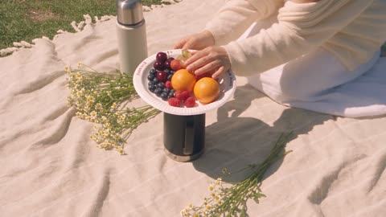</a>

Timed beats with a clear setup and payoff in each segment give the model a readable structure for a run of small failures. The phone-footage brief names autofocus hunting, overcorrecting wobble and blown-out sun flare, and the audio list limits sound to natural location noise with the spoken lines quoted.

Seedance 2.5 · Text-to-video · Source: [@Ciri_ai on X](https://x.com/Ciri_ai/status/2093569691830899091) · found via [LearnPrompt/awesome-seedance](https://github.com/LearnPrompt/awesome-seedance)

[`comedy`](tags.md#tag-comedy) [`handheld`](tags.md#tag-handheld) [`phone-footage`](tags.md#tag-phone-footage) [`picnic`](tags.md#tag-picnic)

<details><summary><b>Prompt</b></summary>

```text
Create a 30-second, 1080p ultra-realistic personal home-video of a young Korean woman trying to recreate a dreamy Pinterest photo, with reality ruining every single attempt. No reference image.

MAIN SUBJECT

Young Korean woman in her early 20s, effortlessly trendy look, soft dewy makeup, expression that shifts between aspirational-serene and increasingly done-with-it.

Long black hair styled in soft waves, a flower clip pinning one side back, delicate gold necklace.

Wearing a flowy white sundress, a cream cardigan draped over her shoulders, strappy sandals, carrying a small woven picnic basket as a prop.

Maintain the same face, hairstyle, clothing, body proportions, and appearance throughout the entire video.

**SETTING**

A grassy riverside park on a windy, bright afternoon — the kind of spot that looks perfect in a photo and chaotic in person.

A picnic blanket laid out unevenly on slightly bumpy grass, a thermos and a plate of fruit balanced precariously, wildflowers scattered nearby, ducks on the water in the background, other picnicking families and joggers occasionally passing through frame, a tree with low branches, and intermittent gusts of wind rolling across the open field.

**CAMERA / VISUAL AESTHETIC**

Raw personal footage filmed by her friend on a phone, oscillating between attempted "aesthetic" cinematic framing (slow pans, soft golden-hour-style angles) and sudden handheld chaos when things go wrong.

Autofocus hunts between her and the fluttering blanket. Camera overcorrects and wobbles when she moves suddenly. Mild motion blur during wind gusts and quick recoveries. Slightly warm, oversaturated "Pinterest filter" color grade that keeps slipping back to flat reality mid-shot. Visible digital noise, natural sun flare that occasionally blows out the frame.

No stabilization, no real cinematic polish — the aspiration is aesthetic, the execution is not.

---

**00:00–00:05 — THE SETUP SHOT (ATTEMPT)**

She kneels gracefully by the picnic blanket, arranging the fruit plate just so, trying to look candidly absorbed in it.

The camera does a slow artful pan across the "perfect" spread — then a gust of wind flips the paper plate clean off the blanket.

She freezes, hand still hovering mid-air, watching it tumble away.

**00:05–00:10 — REACTION**

She stares after the plate, deadpan, not even chasing it.

*"...Okay, we'll pretend that didn't happen."*

Her friend behind the camera laughs, frame jolting as they try to film both her and the runaway plate at once.

**00:10–00:15 — THE FLOWER CROWN MOMENT**

She sits back down and tries to casually place a small wildflower behind her ear for a "candid nature" shot, tilting her head serenely toward the light.

A bee, clearly interested in the flower, buzzes directly at her face.

She yelps, swatting wildly, completely abandoning the serene pose.

The camera whip-pans trying to follow the chaos, briefly blurring.

**00:15–00:20 — THE WINDBLOWN HAIR SHOT**

She stands up to attempt a slow-motion "hair flowing in the wind" walk toward the water, cardigan billowing dramatically behind her.

The wind gusts too hard — her hair whips completely across her face, and the cardigan blows up over her head, blinding her mid-step.

She stumbles slightly, laughing from underneath the fabric, arms flailing to find the opening.

**00:20–00:25 — THE THERMOS DISASTER**

She sits back down and tries a "pouring tea thoughtfully" shot, tilting the thermos elegantly — the lid isn't fully on, and it spills straight down the front of her white dress.

She looks down at the spreading stain in silence for a beat, completely unbothered by this point.

Her friend, off-camera, losing it: *"That's — that's going to stain—"*

**00:25–00:30 — FINAL MOMENT**

She gives up entirely, flops backward onto the picnic blanket, stained dress, wind-wrecked hair, flower crooked, staring straight up into the camera as her friend leans over her.

*"This is the photo. This is the one we're posting."*

She gives a flat, exhausted thumbs up from the ground as the frame shakes with her friend's laughter, and the footage cuts abruptly to black.

---

**AUDIO**

Natural location sound only:

Wind gusting, fabric flapping, birds and distant duck sounds, grass rustling, thermos lid clattering, tea splashing, her friend's genuine off-camera laughter throughout, footsteps on grass, and handheld camera noise.

No music. No narration. No artificial sound effects.

Spoken lines: *"...Okay, we'll pretend that didn't happen."* / *"That's — that's going to stain—"* (friend) / *"This is the photo. This is the one we're posting."*

**FINAL FEEL**

Bright, breezy, self-aware comedy built on the universal gap between a curated Pinterest fantasy and messy outdoor reality — golden light, real wind, real mishaps, real laughter.

No posed perfection sustained for more than a few seconds before nature ruins it. No exaggerated slapstick — the comedy comes from genuine reactions to genuinely uncooperative wind, bees, and gravity.
```

</details>

<a id="seedance-pov-cliff-jump-turquoise-canyon"></a>
### First Person Cliff Jump Into Turquoise Canyon

<a href="https://x.com/abxxai/status/2103861170625286334"></a>

A timed beat list sets slow motion only at takeoff and real time elsewhere, so the fall keeps its speed. Action cam details such as ultra wide distortion, rolling shutter, auto exposure shifts and layered audio make the POV read as real footage.

Seedance 2.5 · Text-to-video · Source: [@abxxai on X](https://x.com/abxxai/status/2103861170625286334) · found via [LearnPrompt/awesome-seedance](https://github.com/LearnPrompt/awesome-seedance)

[`pov`](tags.md#tag-pov) [`action-cam`](tags.md#tag-action-cam) [`single-take`](tags.md#tag-single-take) [`water-physics`](tags.md#tag-water-physics) [`nature`](tags.md#tag-nature)

<details><summary><b>Prompt</b></summary>

```text
SEEDANCE 2.5 | TEXT TO VIDEO | SINGLE CONTINUOUS TAKE | 22s | 1080x1920 | 9:16 | 30fps | 1080p

SCENE AND LOCATION
A hidden volcanic spring canyon deep in a Pacific Northwest pine forest on a bright summer day. A narrow, deep gorge with steep, very high walls of dark gray basalt made of vertical hexagonal columns, streaked with tan and rust tones and covered in patches of bright green moss, ferns and small shrubs.
At the bottom is a crystal-clear natural spring pool. The shallow edges glow bright turquoise and aqua, fading to deep sapphire blue in the center. The water is so transparent that the bottom is fully visible: honeycomb-patterned volcanic rock, mossy boulders, and two long pale submerged logs lying diagonally across the bottom.
Two white waterfalls pour into the pool: a thin one at the far back of the canyon and a larger one spilling from the right-hand cliff wall, making white foam where it hits the water. Tall dark-green conifer and pine trees line the canyon rim. Above is a vivid clear blue sky with a few small white clouds. Hard, bright midday sunlight with strong contrast, and sun sparkles on the water.

THE JUMPER
A young man seen only from his own first-person view. Tanned bare feet and lightly hairy shins, and loose navy-blue swim shorts with a large mustard-yellow hibiscus flower pattern and white drawstrings. No shirt, no shoes, no gloves. His hands and forearms appear naturally in frame when he moves them.

CAMERA AND REALISM
First-person POV from a GoPro strapped to his forehead. It looks like real action-cam footage, not a cinematic camera. 16mm-equivalent ultra-wide lens with slight barrel distortion, and saturated but natural color.
Use real action-cam behavior throughout: small head bob and micro-jitter from breathing and body weight, rolling-shutter wobble on fast moves, quick auto-exposure shifts between bright sky and the shaded canyon, a small sun flare on upward tilts, light sensor noise in the shadows, and wind buffeting that shakes the frame during the fall.
The cliff is about 35 meters high. Gravity, body motion and water physics are fully realistic.

0-2s | THE EDGE (real time)
POV looking straight down from the top of the basalt cliff. His bare feet stand on the rough, dark rock ledge at the bottom of frame, with the shorts visible at the lower edge. Both hands hover forward at the sides of frame. The turquoise pool, the submerged logs and the waterfalls are far, far below. His toes curl over the edge and small grit crumbles off. His right hand tosses a pink-and-white striped inflatable tube out over the drop; it tumbles down and lands as a tiny speck on the water far below. Wind, distant waterfall roar, upbeat chill electronic music starts.

2-4s | THE COUNTDOWN (real time)
A quick nervous tilt down at the drop, a sharp exhale, then two fast steps back from the edge, with the ledge bouncing in frame. Young male voice, hyped: "Three, two, one!"

4-7s | THE TAKEOFF (natural slow motion, about 50% speed)
Two running steps forward, then his last foot pushes off the ledge in slow motion. Rock grit kicks up and floats in the sunlight, the cliff edge slides away beneath his feet, his arms swing forward and out wide, and the whole turquoise canyon opens up below. The slow motion looks like a real high-frame-rate action-cam clip, not a frozen hang. Deep bass swell, stretched wind.

7-13s | THE FALL (real time, fast and continuous)
The speed ramps smoothly back to normal and the stomach drops.
7-9s: The frame dips and wobbles, his arms flail slightly for balance at the edges of frame, and his feet kick at the bottom of frame. A loud yell: "Woooooo!"
9-11s: The basalt column wall, moss and ferns streak upward past the lens, and the right-side waterfall rushes by with spray catching the sun. Wind roars louder and the frame shakes from air buffeting.
11-13s: The glowing turquoise water rushes up and fills the frame, and the pink tube and submerged logs grow fast. His arms snap tight to his body and his legs lock straight for a feet-first pencil dive. The music builds to the drop.

13-14s | IMPACT
A hard feet-first hit into the water and a white explosion of bubbles swallows the lens. Loud plunge splash, deep impact whoosh, and the music goes heavily muffled underwater.

14-17s | UNDERWATER (short, energetic, real time)
A violent swirl of silver bubbles clears to reveal crystal-clear blue water, bright sun shafts cutting down from the surface, the pale submerged logs and honeycomb volcanic rock bottom below, and small fish darting away. His hands push into frame for one strong breaststroke pull, then fast kicks straight up toward the bright glowing surface, with bubbles streaming past the lens. No slow sinking.

17-19s | SURFACE BREAK
The camera bursts through the surface, water droplets sliding across the lens, and bright sunlight floods in. The music snaps back to full clarity on the beat drop. His hand grabs the pink-and-white tube floating right beside him.

19-22s | THE REWARD
POV bobbing on the turquoise water holding the tube, then a sharp tilt up revealing the towering basalt cliff, the tiny ledge he jumped from far above, the pine trees on the rim and the vivid blue sky, with the waterfall splashing on the right. Same voice, out of breath and triumphant: "Yeah, dude! That was insane!" Faint distant cheering. Music plays clean to the final frame.

AUDIO
Continuous upbeat chill electronic track: a bass swell on takeoff, a fast build through the fall, muffled underwater, then a clean drop on surfacing. Real ambient layers: wind that grows with speed, fabric flapping, heavy breathing, waterfall roar, splash, bubbles. Dialogue clear over the music.

KEEP
One continuous take, first-person only. The same shorts, feet and hands throughout, and the same canyon layout with two waterfalls, turquoise pool and submerged logs. The slow motion lasts only 3 seconds at takeoff. The fall is fast, real time and builds speed without pausing. Every beat is quick and punchy.

AVOID
Extra slow motion beyond the takeoff, hovering or floating mid-air, smooth cinematic gimbal movement, cuts to third person, showing the jumper's face, extra people, distorted hands or extra fingers, morphing cliffs, changing water color, text, subtitles, watermarks.
```

</details>

<a id="seedance-pov-trout-river-to-campfire"></a>
### POV trout catch, clean and campfire grill

<a href="https://x.com/abxxai/status/2087189194720657649"></a>

Four timed segments with three hard cuts, each with its own field of view in degrees, keep the chest-mounted GoPro look steady. Named references lock the location and hands, and per-segment sound cues plus physics and positive locks keep props consistent.

Seedance 2.5 · Reference-to-video · Source: [@abxxai on X](https://x.com/abxxai/status/2087189194720657649) · found via [LearnPrompt/awesome-seedance](https://github.com/LearnPrompt/awesome-seedance)

[`pov`](tags.md#tag-pov) [`multi-shot`](tags.md#tag-multi-shot) [`hard-cuts`](tags.md#tag-hard-cuts) [`outdoor`](tags.md#tag-outdoor) [`action-camera`](tags.md#tag-action-camera)

<details><summary><b>Prompt</b></summary>

```text
SCENE CONTEXT
POV river-to-campfire sequence at a jade-green alpine river through birch/cedar forest, late-afternoon light. A trout is caught, cleaned, seasoned, grilled over an open fire, then eaten, with one sip from a glass bottle while it cooks. 30s, four continuous segments, three hard cuts, real chest-mounted action camera.

ACTIVE REFERENCES

@location1
: jade-green river, granite boulders, gravel bar, stone fire-ring, tree-stump table, birch/cedar tree line, faint peaks. 100% matches reference.

@hands1
: sun-tanned forearms, light-blond arm hair, olive sleeve rolled to elbow, braided wrist cord. Same fly rod, folding knife, wood board, wire grill basket, plain glass bottle, brown fizzy liquid, no label. 100% matches reference.

LOCATION MAP
Segment A: river foreground, tree line behind. Segments B-D: gravel bar foreground, fire-ring and stump table midground, tree line and peaks background. POV chest-to-eye height, moving only with the body. Key light low, behind camera-left.

FIRST FRAME / BLOCKING
Non-empty opening frame: already mid-cast, rod raised, line already peeling off the reel. Water fills the lower two-thirds, forest/sky the top third.

FORMAT MODE
Controlled multi-shot, three HARD CUTs, camera does not cut anywhere else:
A (0-9s) river, one continuous take. HARD CUT.
B (9-21s) board, one continuous take. HARD CUT.
C (21-27s) fire, one continuous take. HARD CUT.
D (27-30s) eating, one continuous take.

OPTICS
84° in A easing to 63° through the fight. 63° easing to 18° across B. 63° opening to 29° in C. 29° held in D. No drift within any segment.

CAMERA
Chest-height POV, moving only with body motion — forward stroke on the cast, downward tilt on the knife and grate, forward lean when hands work close. Soft highlight roll-off on bright water and hot metal.

ACTION
A: rod arcs, line whistles; tip snaps down as the trout strikes; rod pumps, reel clicking, fish surfacing closer each pump; hand closes behind the gills, lifts the fish clear, holds it still one beat as water streams off. B: boots cross the gravel, fish set on the board, knife meets scales, scrapes tail to head; one clean line opens the belly, organs lift free; fish rinses in the shallows, pink cloud drifting off; salt, pepper, herbs scatter over the flesh; fish folds into the basket, latch clacks. C: kindling catches from a breath, flame licks up; basket lowers onto the grate, skin bubbles and browns, smoke lifts. D: bottle tips up for one swallow; fork pauses a half-second at the flesh before splitting it open, steam lifting as a piece rises toward camera, one quiet exhale closing the shot.

PERFORMANCE
Hands stay continuously busy with real working tasks, never idle. Pore-level realism: vellus arm hair in the breeze, capillary flush from cold water. Movements read practiced, unhurried, one deliberate pause at the fish-lift and one at the first bite, restrained and human, never cartoonish.

PHYSICS
No floating props. Correct contact shadows under every prop, every segment. Water carries real weight and splash. Fire holds true flicker, heat-shimmer, smoke on a light breeze. Mass and inertia carry through the rod bend, the fish's thrashing and the latch.

LIGHTING
WB locked 5600K, warm low sun behind camera-left as key, cool sky fill through A-B. From C onward, ember-orange fire light adds a low rim on hands and fish alongside the same key.

COLOR GRADE
Cool jade-green river/forest in A, warm honey wood and pale gravel in B, ember-orange fire glow and seared skin in C-D. Color tied to source and surface, not a flat list.

AUDIO
Warm acoustic guitar bed under everything, mixed low, sitting quietly beneath the natural sound. Diegetic: river current and line-whistle opening A, splash and reel-drag through the fight; gravel footsteps opening B, knife-on-wood, one clean cut sound, rinse-splash, hinge-click closing it; twig-snap opening C, crackle into sizzle; glass clink and swallow opening D, fork scrape, steam hiss, one quiet chuckle closing the shot. No subtitles.

STYLE
8K photorealistic — no 3D render, no game engine, no game-cutscene aesthetic. Naturalistic master cinematography, fine film grain, true action-camera color science.

OUTPUT SETTINGS
Real-time throughout, no speed ramping, FOV holds exactly as stated per segment with no drift across any hard cut.

POSITIVE LOCKS
Same hands, sleeve and wrist cord across all four segments. Same rod, knife, board, basket and bottle, no substitutions across any cut. Same river, gravel bar and fire-ring geometry held across every segment. Fish skin and flesh stay anatomically real. Eyes stay natural — no eye glow. Contact shadows read clearly every segment. No logos, no UI, no subtitles anywhere in frame.
```

</details>

<a id="seedance-rainy-day-bookshop-vlog"></a>
### Vlogger narrates rainy walk into cozy bookshop

<a href="https://x.com/Zyrellix/status/2101901362850353176">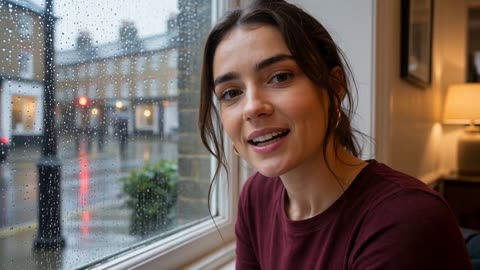</a>

Each line of dialogue is tied to a specific beat and location, so speech, camera moves and rain sounds stay in sync across the cuts. Repeating her hair, earrings and clothing at the top keeps the look consistent through every scene change.

Seedance 2.5 · Text-to-video · Source: [@Zyrellix on X](https://x.com/Zyrellix/status/2101901362850353176) · found via [LearnPrompt/awesome-seedance](https://github.com/LearnPrompt/awesome-seedance)

[`vlog`](tags.md#tag-vlog) [`dialogue`](tags.md#tag-dialogue) [`rain`](tags.md#tag-rain) [`multi-shot`](tags.md#tag-multi-shot)

<details><summary><b>Prompt</b></summary>

```text
A pretty young woman with dark hair in a loose ponytail, gold hoop earrings, burgundy long-sleeve top and beige trench coat. Soft, natural young female voice speaking casually to camera in a warm, slightly British/neutral accent, like a personal vlog.
She starts by a rain-streaked window looking out at wet cobblestone streets and says:
“Yeah, I definitely wasn't planning on going anywhere today, but staying home sounded boring.”
She puts on her trench coat, steps out the black front door into light rain, walks on shiny cobbles, smiles and says:
“Okay, maybe this was a bad idea.”
She notices a warm glowing independent bookshop, stops surprised:
“Wait, I've never been in here.”
She goes inside, browses wooden shelves, picks up a book and says:
“Okay, this was worth leaving the house for.”
Cut to her sitting by a rainy cafe window sipping coffee from a brown paper cup:
“This is exactly what I needed.”
She walks down a long empty cobblestone street at golden hour with coffee and a paper bag, sunlight flaring through her hair, then turns to camera smiling:
“Okay, I'm really glad I went out.”
“Random plans are usually the best ones.”
Soft natural lighting, wet reflections, cozy cinematic color grade, handheld but smooth camera, quiet rain and footsteps under her voice. Warm, slightly melancholic then happy mood. No text on screen.
```

</details>

<a id="seedance-rainy-japanese-neighborhood-vlog"></a>
### Young woman watching rain from a Japanese bus stop

<a href="https://x.com/ZorviaLux/status/2105533415026241635"></a>

One outfit and hairstyle description plus a closing rule to keep face, outfit and proportions identical in every scene holds the character steady. Camera direction runs in order from side profile close up to medium shot to rear tracking shot to smiling close up, with 9:16 and 24fps stated in a technical line.

Seedance 2.5 · Text-to-video · Source: [@ZorviaLux on X](https://x.com/ZorviaLux/status/2105533415026241635) · found via [LearnPrompt/awesome-seedance](https://github.com/LearnPrompt/awesome-seedance)

[`japanese-vlog`](tags.md#tag-japanese-vlog) [`rain`](tags.md#tag-rain) [`lifestyle`](tags.md#tag-lifestyle) [`vertical`](tags.md#tag-vertical) [`character-consistency`](tags.md#tag-character-consistency)

<details><summary><b>Prompt</b></summary>

```text
Create an ultra-realistic cinematic Japanese lifestyle vlog featuring a young Japanese woman enjoying a peaceful rainy day in a quiet Japanese neighborhood.

A young woman with black hair tied in a neat ponytail, wearing a white and navy striped oversized T-shirt, beige shorts, and white sneakers, stands under a traditional covered bus stop during light rain. She looks outside, gently extends her hand to feel the raindrops, then turns around and runs playfully along a quiet residential street.

Show cinematic transitions of her running through the wet neighborhood, passing traditional Japanese houses, green trees, and a peaceful park. She eventually reaches a wooden shelter in the park, adjusts her ponytail, stretches her arms, and smiles naturally toward the camera.

Visual Style: Photorealistic Japanese slice-of-life cinematography, soft overcast daylight, realistic rain reflections, natural human movements, beautiful greenery, peaceful atmosphere, authentic Japanese residential environment.

Camera Direction: Start with a cinematic side-profile close-up, transition into a medium shot of her touching raindrops, followed by a smooth rear tracking shot while running. Finish with emotional close-ups and a warm natural smile.

Technical: 4K, 9:16 vertical, 24fps, realistic facial expressions, consistent character identity, smooth camera movement, natural physics, detailed environment, cinematic color grading.

Important: Maintain the same woman's face, hairstyle, outfit, and body proportions throughout every scene. No facial distortion, no outfit changes, no unnatural movements, no text or watermark.
```

</details>

<a id="seedance-rainy-window-kitten-hair-tie-selfie"></a>
### Kitten Steals Hair Tie in Rainy Selfie

<a href="https://x.com/Strength04_X/status/2098256490238755226"></a>

A reference image locks the woman's identity, and a rule of exactly one kitten keeps the animal continuous. Six timed five second beats escalate from calm to the kitten pawing at the lens, with handheld shake, spoken lines and a detailed audio list.

Seedance 2.5 · Reference-to-video · Source: [@Strength04_X on X](https://x.com/Strength04_X/status/2098256490238755226) · found via [LearnPrompt/awesome-seedance](https://github.com/LearnPrompt/awesome-seedance)

[`selfie-vlog`](tags.md#tag-selfie-vlog) [`pet`](tags.md#tag-pet) [`handheld`](tags.md#tag-handheld) [`timed-beats`](tags.md#tag-timed-beats) [`native-audio`](tags.md#tag-native-audio)

<details><summary><b>Prompt</b></summary>

```text
She thought it was going to be a peaceful rainy-day selfie

But the kitten had other plans 😅

Seedance 2.5

Prompt - REFERENCE & SUBJECT Use "@<image1" as the exact visual reference for the woman. Preserve her identity, face, hairstyle, clothing, skin texture, body proportions, and natural appearance throughout the entire clip. Exactly ONE small tabby kitten. The same kitten remains continuous throughout. No other animal, no duplicate kitten. FORMAT 30-second vertical 9:16 handheld front-camera selfie. Indoor room beside a window on a rainy day. Soft gray natural daylight through the glass. Very subtle window reflections and realistic ambient room sound. No color grading, no cinematic lighting, no beauty filter. --- 0–5 SEC — QUIET RAINY MOMENT The woman stands beside the window holding the kitten against her chest. Rain droplets are visible softly on the window behind her. She looks at the kitten and gently touches its forehead with her finger. The kitten watches her hand. She gives a quiet smile and casually says: "You're being good today, huh?" The phone remains slightly imperfect and handheld. --- 5–10 SEC — HAIR TIE CATCHES ATTENTION She reaches toward the back of her tied hair with her free hand and adjusts the hair tie. The kitten suddenly notices the small hair tie around her wrist. Its ears move forward. It stretches one paw toward it. She notices and pulls her wrist away. A small nose-laugh escapes. --- 10–15 SEC — THEFT The kitten reaches again and catches the hair tie between its paws. She reacts with surprise. The kitten pulls it toward itself. She laughs and tries to gently retrieve it. The phone shakes subtly from her laughter. She says: "Hey, that's not yours." The kitten refuses to release it. --- 15–20 SEC — PLAYFUL TUG The kitten squirms against her chest while holding the hair tie. She supports its body securely with her other hand. She gently tries to take the hair tie back. The kitten suddenly turns its head away. She laughs harder. A few strands of her hair fall loose near her cheek. The rain remains softly visible in the background. --- 20–25 SEC — KITTEN CLIMBS The kitten begins climbing toward her shoulder while still holding the hair tie. Its paws grip the fabric of her top. She gives a small surprised yelp followed by laughter. Her phone hand moves upward slightly. The camera briefly loses perfect framing and then naturally re-centers. --- 25–30 SEC — FINAL CAMERA ATTACK The kitten reaches her shoulder and then suddenly turns toward the phone. Its nose and whiskers approach the lens. She pulls her face backward while laughing. The kitten raises one paw toward the camera. She starts: "You really want—" Her sentence breaks apart into laughter. The paw reaches the near corner of the lens. The phone dips naturally. The clip ends mid-laugh. AUDIO Rain ambience through the window, fabric rustling, kitten movement, one tiny mewl, woman's natural voice, breathing, nose-laughs and genuine laughter. No background music. No subtitles. No text. No logo. No watermark. No cuts. No zoom. Exactly one kitten.
```

</details>

<a id="seedance-rooftop-fitness-vlog-sunset"></a>
### Woman enters rooftop studio at sunset with gym bag

<a href="https://x.com/kingofdairyque/status/2089951161789092255">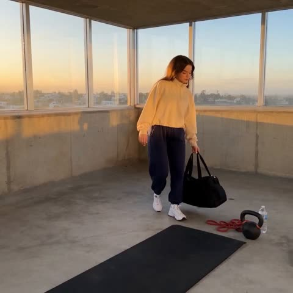</a>

The prompt splits the clip into timed 5 second blocks, each with one action and one camera instruction, which keeps the sequence readable. Image1 is limited to face and hairstyle while the outfit is described in text, and the audio line allows only live sound so no music gets added.

Seedance 2.5 · Reference-to-video · Source: [@kingofdairyque on X](https://x.com/kingofdairyque/status/2089951161789092255) · found via [LearnPrompt/awesome-seedance](https://github.com/LearnPrompt/awesome-seedance)

[`fitness`](tags.md#tag-fitness) [`vlog`](tags.md#tag-vlog) [`handheld`](tags.md#tag-handheld) [`rooftop`](tags.md#tag-rooftop)

<details><summary><b>Prompt</b></summary>

```text
30-second photorealistic handheld fitness vlog, 16:9. One adult woman appears throughout. Use Image1 only for her face and hairstyle. She wears a completely different outfit: a loose high-neck cream athletic sweatshirt, dark navy full-length training pants, and clean white training shoes. Modest, opaque, full upper-body coverage.

Location: a small rooftop training studio during early evening. Concrete walls, large windows, exercise mat, kettlebell, resistance bands, wooden box, water bottle and soft sunset light. No other people.

00–05s:
She enters the studio, places her bag down and begins warming up with controlled arm circles, side steps and light stretches. Handheld camera follows naturally.

05–10s:
She moves to a rowing machine and completes several strong, controlled strokes. Camera shifts between a side view and a closer shot of her focused expression. Natural breathing and machine sounds.

10–15s:
She steps onto an exercise mat and performs alternating reverse lunges followed by controlled knee drives. Her pace gradually increases while maintaining realistic form.

15–20s:
She picks up a medium kettlebell and performs controlled suitcase carries across the room, switching hands halfway through. Camera tracks beside her with subtle handheld movement.

20–25s:
She moves to a wooden plyometric box and performs several controlled step-ups. Her breathing becomes heavier and a light sheen of sweat appears naturally around her hairline.

25–30s:
She slows down, sits on the edge of the mat, drinks water and catches her breath. She looks toward the camera with a small satisfied smile, wipes her forehead with a towel, then reaches for her bag.

Audio:
Only natural live sound: footsteps, breathing, fabric movement, rowing-machine sounds, shoes contacting the floor, kettlebell movement, water bottle sounds and distant city ambience. No music.

Negative:
No other people, no revealing clothing, no cleavage emphasis, no sexualized framing, no outfit changes, no face drift, no body distortion, no CGI look, no beauty filter, no subtitles, no text, no logos, no watermark.Made with Seedance 2.5

Prompt:

30-second photorealistic handheld fitness vlog, 16:9. One adult woman appears throughout. Use Image1 only for her face and hairstyle. She wears a completely different outfit: a loose high-neck cream athletic sweatshirt, dark navy full-length training pants, and clean white training shoes. Modest, opaque, full upper-body coverage.

Location: a small rooftop training studio during early evening. Concrete walls, large windows, exercise mat, kettlebell, resistance bands, wooden box, water bottle and soft sunset light. No other people.

00–05s:
She enters the studio, places her bag down and begins warming up with controlled arm circles, side steps and light stretches. Handheld camera follows naturally.

05–10s:
She moves to a rowing machine and completes several strong, controlled strokes. Camera shifts between a side view and a closer shot of her focused expression. Natural breathing and machine sounds.

10–15s:
She steps onto an exercise mat and performs alternating reverse lunges followed by controlled knee drives. Her pace gradually increases while maintaining realistic form.

15–20s:
She picks up a medium kettlebell and performs controlled suitcase carries across the room, switching hands halfway through. Camera tracks beside her with subtle handheld movement.

20–25s:
She moves to a wooden plyometric box and performs several controlled step-ups. Her breathing becomes heavier and a light sheen of sweat appears naturally around her hairline.

25–30s:
She slows down, sits on the edge of the mat, drinks water and catches her breath. She looks toward the camera with a small satisfied smile, wipes her forehead with a towel, then reaches for her bag.
```

</details>

<a id="seedance-selfie-kitten-swat-vlog"></a>
### Selfie vlog woman laughs as kitten swats

<a href="https://x.com/Strength04_X/status/2096540586866270337"></a>

Locks the woman's look with an @image1 reference and a single-kitten continuity rule, then sets a handheld front camera spec and timed beats. The dialogue is cut off by laughter so the speech sounds unscripted.

Seedance 2.5 · Reference-to-video · Source: [@Strength04_X on X](https://x.com/Strength04_X/status/2096540586866270337) · found via [LearnPrompt/awesome-seedance](https://github.com/LearnPrompt/awesome-seedance)

[`selfie`](tags.md#tag-selfie) [`kitten`](tags.md#tag-kitten) [`handheld`](tags.md#tag-handheld) [`reference-consistency`](tags.md#tag-reference-consistency)

<details><summary><b>Prompt</b></summary>

```text
REFERENCE & SUBJECT CONSISTENCY

Use "@image1" as the exact visual reference for the woman. Preserve her identity, facial features, hairstyle, body proportions, clothing, skin texture, and overall appearance consistently throughout the entire clip. Do not redesign, beautify, age, de-age, or alter her appearance.

Use exactly ONE small tabby kitten throughout the entire video. The same kitten must remain physically continuous from beginning to end, with consistent fur pattern, eye color, size, whiskers, ears, paws, and body proportions. No second kitten, no other animal, no duplicate subject.

---

FORMAT & CAMERA

30-second single continuous handheld selfie video, vertical 9:16, realistic smartphone front-camera footage.

The woman is holding the phone herself with one outstretched arm. The phone is the camera. Tight chest-up framing keeps both her face and the kitten visible most of the time.

Plain indoor environment with soft natural daylight coming through a nearby window. No cinematic lighting, no studio look, no color grading. Natural smartphone white balance and exposure.

The camera should have subtle human arm drift, tiny wrist movements, occasional handheld jitter, imperfect framing, and natural re-centering. Do not stabilize the footage excessively.

No cuts, no transitions, no camera operator, no third-person angle, no zoom.

---

0–5 SEC — QUIET START

The video begins already in progress.

The woman is holding the small tabby kitten gently against her chest with one hand while her other arm holds the phone at selfie distance.

Her face is close to the lens and the kitten's head rests beside her chin.

She looks down toward the kitten rather than directly performing for the camera. Her expression is relaxed and affectionate.

She quietly murmurs to the kitten in a casual everyday voice. The kitten remains slightly restless in her hand, blinking and moving its ears.

Her thumb slowly rubs the fur behind one of the kitten's ears.

The camera drifts slightly downward and then naturally re-centers on both faces.

Keep the movement casual and unpolished, like a genuine phone recording rather than a staged performance.

---

5–9 SEC — FIRST REACTION

The kitten suddenly shifts its body inside her grip.

She notices the movement and gives a small nose-laugh while looking at it.

The kitten twists its upper body and raises one front paw.

It suddenly swats directly toward her chin.

She reacts immediately and naturally — a sharp intake of breath, head pulling backward, eyes squeezing shut for a moment.

The unexpected movement makes her burst into genuine laughter.

Her shoulders shake and the phone in her outstretched hand briefly becomes slightly shaky.

A few loose strands of her tied-back hair swing across her cheek.

She looks back at the kitten while laughing.

---

9–13 SEC — FIRST DIALOGUE

Still laughing and catching her breath, she looks toward the kitten and then briefly toward the phone.

Her laughter interrupts her breathing and makes her words slightly broken and imperfect.

She says frontally, with her mouth clearly visible:

"Ow— okay, okay, I get it—"

The delivery should not sound rehearsed.

The line is spoken through genuine laughter, with a small breath between words.

The kitten gives one thin, quiet mewl while remaining against her chest.

Her thumb instinctively continues rubbing the kitten's fur as if trying to calm it down.

---

13–18 SEC — KITTEN SCRAMBLES UP

The kitten suddenly tries to climb upward from her chest toward her shoulder.

Its front paws grip the ribbed edge of her top.

The fabric visibly wrinkles and shifts under its paws.

She reacts with a surprised little yelp followed immediately by another burst of laughter.

Her body leans slightly away from the kitten while her supporting hand adjusts underneath it.

The camera moves with her arm and briefly loses perfect centering before naturally coming back to both of them.

She catches the kitten's hind legs with her palm before it can climb completely onto her shoulder.

Her expression remains amused and unguarded.

---

18–22 SEC — PULLING KITTEN BACK

She gently slides the kitten back down onto the center of her chest.

The kitten squirms in her hand but does not escape.

She laughs under her breath while trying to keep hold of it.

Once the kitten is secure again, she presses her cheek gently against the top of its head.

She closes her eyes for a brief moment and gives a soft affectionate laugh.

Then she puffs a small breath into the kitten's fur.

Her laughter continues as tiny hiccupping giggles between uneven breaths.

Keep the interaction physically believable — the kitten's fur compresses naturally against her cheek and springs back slightly.

---

22–26 SEC — SECOND PAW

The kitten's ears flick backward.

Its head turns slightly.

One front paw slowly rises again.

She notices it and immediately pulls her face back with a half-amused, half-defensive expression.

Before she can fully react, the kitten lifts its paw toward her face again.

She laughs harder, shoulders bouncing.

The phone shakes slightly from her laughter.

The camera briefly turns a little toward the nearby window as her arm shifts, producing one subtle natural auto-exposure hunt.

Exposure settles again without any cinematic correction.

Her face, skin texture, kitten fur strands, and whiskers remain sharply detailed despite the movement.

---

26–30 SEC — FINAL LENS REACH

The kitten suddenly reaches its paw forward toward the phone.

The paw moves directly toward the front camera.

The woman pulls her head backward while laughing.

Her arm holding the phone instinctively moves away from the kitten.

The framing drifts and dips naturally.

The kitten's paw becomes large in the near foreground, partially entering the corner of the frame.

Allow one brief natural focus-breathing moment as the paw approaches the lens, while the woman's face and kitten remain visually coherent.

She laughs through the reaction and starts to say:

"You little—"

But the sentence is cut off naturally by her laughter.

Her laugh cracks and swallows the rest of the words.

The kitten remains supported securely against her chest.

The final image is imperfectly framed, with the woman's shoulders still bouncing from laughter and the kitten squirming in her hand as the clip ends naturally.

Do not create a posed ending.

---

PERFORMANCE & PHYSICAL REALISM

The woman's laughter must be physical and unpolished rather than performed.

Her eyes naturally crease and close during stronger laughs. Her shoulders and chest move with her breathing. Her breathing becomes uneven after laughing. Small pauses, inhalations, nose-laughs, interrupted syllables, and imperfect timing are encouraged.

The kitten should behave like a real young kitten: unpredictable small movements, ear flicks, paw movements, slight squirming, subtle body weight shifts, and natural attempts to climb.

Her hands must maintain believable support of the kitten throughout. Never let the kitten float, teleport, duplicate, or change position without physical movement.

---

CAMERA & IMAGE QUALITY

Natural smartphone front-camera optics.

Subtle handheld jitter.

Natural arm drift.

Small framing errors.

Natural re-centering.

One brief auto-exposure adjustment when she turns slightly toward the window.

One brief focus-breathing moment when the kitten's paw approaches the lens.

No artificial camera shake.

No cinematic depth of field.

No dramatic lighting.

No beauty filter.

No skin smoothing.

Keep individual kitten fur strands, whiskers, her natural skin texture, and fine hairs around her temple sharply visible during movement.

---

AUDIO

Diegetic audio only.

No background music.

No soundtrack.

No voice-over.

No added cinematic sound effects.

Capture natural fabric rustling as the kitten climbs, subtle clothing movement, one thin kitten mewl, the woman's quiet murmuring at the beginning, nose-laugh, sharp intake of breath, surprised yelp, unguarded laughter, small hiccupping giggles, uneven breathing, and the two spoken lines.

Dialogue must be spoken by the woman naturally and frontally with her mouth visible.

Dialogue:

"Ow— okay, okay, I get it—"

"You little—"

The second line must remain incomplete and be swallowed by laughter.

---

STRICT NEGATIVE CONSTRAINTS

Exactly ONE woman.

Exactly ONE kitten.

No other animals at any point.

No duplicate kitten.

No duplicate woman.

No extra limbs.

No extra fingers.

No changing clothing.

No changing hairstyle.

No identity drift.

No face morphing.

No kitten transformation.

No teleportation.

No cuts.

No transitions.

No zoom.

No third-person camera.

No external camera.

No reference sheet.

No character sheet.

No split screen.

No subtitles.

No captions.

No on-screen text.

No logo.

No watermark.

No background music.

No voice-over.

No cinematic color grading.

No artificial beauty retouching.

No staged acting.

Maintain one continuous uninterrupted 30-second handheld selfie recording from beginning to end.

#pixverse #pixversecpp
```

</details>

<a id="seedance-seoul-first-snow-dv-camcorder-home-video"></a>
### Early 2000s camcorder video of Seoul's first snow

<a href="https://x.com/nawalsehar/status/2106251329085874184"></a>

A reference image locks the character's face and outfit, and the action runs in a clear beat sequence from window to snowball to streetlight. Detailed consumer DV artifacts, diegetic only audio and a long negative list keep the look authentic and the physics believable.

Seedance 2.5 · Reference-to-video · Source: [@nawalsehar on X](https://x.com/nawalsehar/status/2106251329085874184) · found via [LearnPrompt/awesome-seedance](https://github.com/LearnPrompt/awesome-seedance)

[`dv-camcorder`](tags.md#tag-dv-camcorder) [`vintage`](tags.md#tag-vintage) [`snow`](tags.md#tag-snow) [`handheld`](tags.md#tag-handheld) [`diegetic-audio`](tags.md#tag-diegetic-audio)

<details><summary><b>Prompt</b></summary>

```text
Create a 30-second ultra-photorealistic early-2000s Korean DV-camcorder home video of a young Korean woman experiencing Seoul’s first snowfall of winter. Use the attached image as the character reference and keep her face, hairstyle, body proportions, outfit and identity consistent throughout.

She notices the first snow from her window, excitedly grabs her coat and scarf, rushes outside and catches snowflakes in her hand. She runs briefly through the residential lane, crouches to make a tiny snowball, shows it proudly to the camera and tosses it. The snowball follows realistic gravity and breaks apart naturally on impact.

She continues walking through the snowy older Seoul neighborhood, leaving believable footprints as snow gradually settles on bicycles, cars, rooftops and bushes. Her hair, scarf and coat move naturally in the winter breeze, with subtle visible breath in the cold air.

At the end, she stops beneath a streetlight, looks into the camera, catches a snowflake in her palm and softly says, “First snow.” She smiles and walks away as the handheld camera follows.

Authentic early-2000s consumer DV look: shaky handheld framing, autofocus hunting, slight exposure/white-balance shifts, soft digital detail, CCD noise, subtle interlacing, cool white balance, natural motion blur, limited dynamic range and occasional awkward zooms. The camera operator reacts imperfectly like a real home-video recording.

Natural diegetic audio only: wind, footsteps crunching snow, breathing, doors, fabric movement, distant traffic, birds and neighborhood ambience. No music, narration, subtitles, CGI, beauty filters, cinematic grading, slow motion or polished camera movement.

Negative prompt: inconsistent face, changing clothes, morphing, distorted hands, extra fingers, unnatural physics, floating snow, instant snowballs, impossible trajectories, teleportation, clipping, plastic skin, cinematic camera, excessive stabilization, commercial look, logos, watermark.
```

</details>

<a id="seedance-seoul-lifestyle-day-montage"></a>
### Seoul lifestyle day from door to skyline

<a href="https://x.com/MissDelulu9/status/2102254554398228983">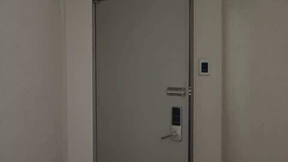</a>

A timed beat-by-beat script repeats the same character description in every segment to keep her looks consistent across cuts. Each segment names its camera move (push-in, whip transition, tracking, side tracking, backward and upward pull) and the light shifts from daytime to night for a clear arc.

Seedance 2.5 · Text-to-video · Source: [@MissDelulu9 on X](https://x.com/MissDelulu9/status/2102254554398228983) · found via [LearnPrompt/awesome-seedance](https://github.com/LearnPrompt/awesome-seedance)

[`korean-lifestyle`](tags.md#tag-korean-lifestyle) [`seoul`](tags.md#tag-seoul) [`timed-shots`](tags.md#tag-timed-shots) [`character-consistency`](tags.md#tag-character-consistency) [`camera-moves`](tags.md#tag-camera-moves)

<details><summary><b>Prompt</b></summary>

```text
Create a 30-second photorealistic, highly entertaining Korean Seoul lifestyle video featuring the SAME adult Korean woman throughout. Keep her face, hairstyle, outfit, accessories and overall appearance perfectly consistent in every shot.

Character: Adult woman with long soft dark hair, natural realistic skin, fresh minimal makeup, expressive eyes and genuinely playful facial expressions.

0–3 sec: She opens her Seoul apartment door confidently, takes one step outside, suddenly realizes she forgot something, freezes with a funny expression, turns around and runs back inside. Fast comedic camera push-in + whip transition.

3–7 sec: She comes running back outside and catches the Seoul bus at the last second. She looks at the camera with a tiny proud smile. Dynamic tracking shot.

7–11 sec: Seoul convenience store  she grabs iced coffee, a cute dessert and snacks. The dessert nearly slips from her hand, but she catches it perfectly and smiles.

11–15 sec: Subway ride through Seoul. She enjoys her dessert by the window, watches the city passing by and makes a playful expression at her reflection.

15–20 sec: Lively Korean street-food market. She tries spicy tteokbokki, reacts dramatically to the heat, laughs and grabs water while her friends tease her.

20–25 sec: Golden-hour Han River. She and her friends ride bicycles together, playfully racing and laughing. Smooth side-tracking camera.

25–30 sec: Nighttime rooftop convenience-store seating. They share snacks and dessert while Seoul glows behind them. Camera smoothly pulls backward and upward, revealing the beautiful Seoul skyline.

Style: Premium Korean lifestyle commercial × cinematic vlog, cute, playful, energetic, natural expressions, smooth camera movement, realistic Seoul locations, beautiful lighting, cinematic daylight-to-night transition, photorealistic 16:9 landscape.
```

</details>

<a id="seedance-seoul-summer-day-handheld"></a>
### Man sits on Seoul rooftop with cold drink

<a href="https://x.com/Sheldon056/status/2091396663718117706">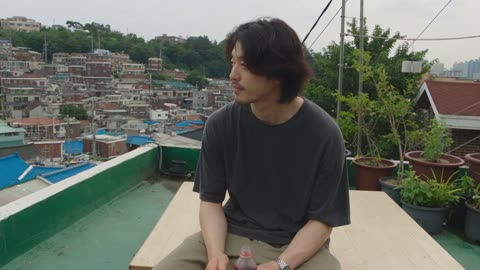</a>

The prompt locks in a handheld home-video look with explicit flaws such as late refocusing, exposure shifts and cropped framing, and bans gimbal moves and colour grading. Repeating the wardrobe and watch details in every beat keeps the same person consistent across the whole clip.

Seedance 2.5 · Text-to-video · Source: [@Sheldon056 on X](https://x.com/Sheldon056/status/2091396663718117706) · found via [LearnPrompt/awesome-seedance](https://github.com/LearnPrompt/awesome-seedance)

[`handheld`](tags.md#tag-handheld) [`home-video`](tags.md#tag-home-video) [`seoul`](tags.md#tag-seoul) [`rain`](tags.md#tag-rain)

<details><summary><b>Prompt</b></summary>

```text
Create a 30-second, 1080p ultra-realistic documentary-style personal home video showing an ordinary summer day in the life of a young Korean man. The footage should feel spontaneous, intimate, imperfect, and genuinely observed rather than performed.
MAIN SUBJECT
The same young Korean man in his early 20s throughout the entire video.
Naturally handsome, realistic skin texture, minimal styling, relaxed expression, slightly tired but peaceful eyes.
He has naturally messy medium-length dark hair with a few strands falling over his forehead and very subtle stubble.
He wears a loose washed-black T-shirt, relaxed olive-beige trousers, worn white sneakers, and a simple silver wristwatch.
Keep his face, identity, body proportions, hairstyle, clothing, watch, and overall appearance completely consistent from beginning to end.
LOCATION
A quiet older residential neighborhood in Seoul during a warm summer afternoon.
Narrow concrete alleys, low-rise homes, rooftop terraces, external staircases, potted plants, laundry lines, parked bicycles, utility poles, overhead wires, mature trees, concrete walls, small residential courtyards, and distant city sounds.
The neighborhood should feel authentic and lived-in.
No crowds, tourist attractions, advertisements, recognizable brands, or commercial activity.
CAMERA / VISUAL STYLE
Authentic casual personal-video footage captured with an older consumer digital camera.
Handheld camera operated by a friend walking nearby.
Natural camera shake, imperfect framing, occasional autofocus changes, slight exposure adjustments when moving between sunlight and shade, soft image detail, mild motion blur, subtle digital noise, slightly muted colors, imperfect white balance, and natural compression.
The camera operator occasionally reacts a little late, cuts off part of the subject, or briefly loses focus.
No stabilization, gimbal movement, drone shots, cinematic camera choreography, dramatic lighting, slow motion, modern commercial color grading, or polished cinematography.
The footage should feel like someone simply decided to record his friend during an ordinary day.
---
00:00–00:05 — MORNING ROOFTOP
He sits casually on a small rooftop beside an old plastic chair.
A cold bottled drink rests beside him.
He looks quietly across the neighborhood while the wind moves his hair and T-shirt.
He takes a sip, notices something happening in the distance, and smiles faintly.
He briefly notices the camera and gives a subtle nod before looking away.
The camera takes a moment to find focus on his face.
---
00:05–00:10 — WALKING THROUGH THE ALLEY
He gets up and walks downstairs into the neighborhood.
He walks casually through a narrow concrete alley with his hands in his pockets.
He passes parked bicycles, potted plants, laundry hanging from balconies, and old residential walls.
The camera follows several steps behind him.
He occasionally looks back toward the camera but never deliberately poses.
His footsteps remain naturally synchronized with his movement.
---
00:10–00:14 — SMALL EVERYDAY MOMENT
He notices an old basketball resting near a wall.
He picks it up, casually bounces it twice, then takes a simple shot toward a nearby hoop.
The shot misses.
He laughs quietly, shakes his head, and leaves the ball where he found it.
The camera briefly loses focus during the movement and recovers naturally.
No exaggerated athletic movement.
---
00:14–00:19 — LOCAL SHOP
He walks to a tiny neighborhood shop and buys a cold drink.
He exchanges a few natural words with the shopkeeper but the conversation is not clearly audible.
He steps outside, opens the bottle, takes a drink, and leans casually against the wall.
He watches bicycles and pedestrians passing in the distance.
The camera remains handheld and slightly imperfect.
---
00:19–00:23 — SUMMER RAIN
A sudden summer shower begins.
He looks toward the sky with mild surprise.
Instead of immediately running for shelter, he smiles and slowly walks into the rain.
The rain becomes heavier.
His hair becomes wet and falls naturally across his forehead.
He eventually starts running down the alley, laughing genuinely.
He briefly spins around while running, then continues toward a covered walkway.
His clothes become visibly damp.
Maintain realistic rain interaction, wet fabric, wet hair, reflections, and foot contact with the ground.
---
00:23–00:27 — QUIET MOMENT
He reaches the covered walkway and catches his breath.
Rain falls heavily behind him.
He wipes water from his forehead and looks quietly toward the street.
For a moment, everything becomes still.
He notices the camera again.
He gives a small genuine smile, not a posed expression.
---
00:27–00:30 — WALKING AWAY
The rain becomes lighter.
He walks away down the wet residential lane.
The camera follows from behind.
Reflections shimmer across the concrete.
He turns his head once, gives a tiny wave toward the camera, smiles, and continues walking.
The camera remains pointed toward the empty street for a brief moment.
At approximately 00:29, the recording abruptly cuts to black mid-motion.
No fade-out.
---
PHYSICAL REALISM
Maintain believable real-world physics throughout.
Hands, fingers, feet, clothing, hair, rain, bottle, basketball, and background objects must behave naturally.
No extra fingers, fused hands, duplicated limbs, distorted anatomy, floating objects, teleportation, disappearing objects, or sudden transformations.
The bottle remains a separate physical object and never intersects with his face.
The basketball behaves naturally and remains where it lands.
Parked bicycles and background objects remain stationary unless physically moved.
His feet remain properly connected to the ground while walking and running.
Keep the environment and subject consistent between shots.
---
AUDIO
Natural environmental audio only.
Footsteps on concrete, distant traffic, birds, leaves moving in the wind, bicycles, faint neighborhood conversations, shop sounds, bottle opening, basketball bouncing, rain hitting concrete, water dripping from rooftops, and subtle camera-handling noise.
No music.
No narration.
No soundtrack.
No artificial sound effects.
No spoken dialogue is necessary.
---
FINAL FEEL
The result should feel like a forgotten personal recording of an ordinary summer day.
Not a commercial.
Not a fashion film.
Not a music video.
Not a professional cinematic production.
The emotional appeal should come from small human moments: sitting alone, wandering through familiar streets, missing a basketball shot, drinking something cold, getting caught in the rain, laughing, and walking home.
Quiet, masculine, youthful, nostalgic, slightly melancholic, warm, spontaneous, and deeply human.
Prioritize natural behavior, consistent identity, believable physics, imperfect handheld framing, authentic environmental details, and the feeling that the camera happened to be there.
```

</details>

<a id="seedance-seoul-sunday-dv-home-video"></a>
### Woman with shopping bag in Seoul alley

<a href="https://x.com/AIwithkhan/status/2096424933366931946">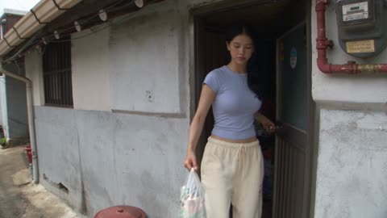</a>

A camcorder block (autofocus hunting, exposure shifts, accidental zooms) carries the DV look, while a continuity block names which object stays with whom so the handed-over balloon and shopping bag don't drift. Audio is layered ambience with no music, so the clip reads as raw home footage.

Seedance 2.5 · Text-to-video · Source: [@AIwithkhan on X](https://x.com/AIwithkhan/status/2096424933366931946)

[`dv-look`](tags.md#tag-dv-look) [`handheld`](tags.md#tag-handheld) [`continuity`](tags.md#tag-continuity) [`ambient-audio`](tags.md#tag-ambient-audio)

<details><summary><b>Prompt</b></summary>

```text
Create a 30-second, 1080p ultra-realistic early-2000s DV home video of a young Korean woman spending a quiet Sunday afternoon in an older Seoul neighborhood. Young Korean woman, early 20s, natural beauty, realistic skin, minimal makeup, black wavy hair in a messy side ponytail, fitted pastel-blue short top, loose cream pajama-style pants, black sneakers and simple silver necklace. Keep her identity, outfit, hairstyle and proportions perfectly consistent. She walks through a quiet residential lane carrying a small reusable shopping bag. She passes a neighborhood playground where a little girl's balloon is stuck in a low tree branch. She notices the girl struggling, walks over and gently frees the balloon from the branch. The balloon visibly comes into her hand, then she clearly hands it to the girl. The girl keeps holding it afterward. The girl smiles and says, “Thank you!” She replies, “You're welcome.” She continues walking home, smiling as a light breeze moves her hair and leaves around the street. She reaches her house, turns toward the camera and says: “Pretty nice Sunday.” She walks inside and the camera cuts to black. Camera: Raw handheld early-2000s DV camcorder, shaky footage, autofocus hunting, faded colors, exposure shifts, motion blur, soft digital detail, accidental zooms. No polished cinematography. Audio: Natural neighborhood ambience, birds, children, bicycles, footsteps, wind and distant traffic. No music. Continuity: No disappearing or duplicated objects. Balloon stays with the girl after being handed over. Shopping bag remains with the woman. Smooth realistic movements and transitions. Negative: CGI look, plastic skin, identity drift, outfit changes, teleporting objects, distorted hands, extra fingers, subtitles, watermark.
```

</details>

<a id="seedance-smartphone-japanese-dojo-vlog"></a>
### Selfie vlog of a beginner at a Japanese dojo

<a href="https://x.com/SimplyAnnisa/status/2093978574692679983"></a>

The prompt locks identity, outfits and handheld phone style with explicit negatives (no gimbal, no filters, no cinematic shots), then splits the 20 seconds into timestamped beats with the Korean lines written out verbatim so speech and lip sync are specified. The audio section names only ambient sounds, which keeps the soundtrack realistic.

Seedance 2.5 · Text-to-video · Source: [@SimplyAnnisa on X](https://x.com/SimplyAnnisa/status/2093978574692679983)

[`smartphone-vlog`](tags.md#tag-smartphone-vlog) [`martial-arts`](tags.md#tag-martial-arts) [`japan`](tags.md#tag-japan) [`selfie`](tags.md#tag-selfie) [`korean-dialogue`](tags.md#tag-korean-dialogue)

<details><summary><b>Prompt</b></summary>

```text
Create a 20-second ultra-realistic casual smartphone travel vlog featuring the same Korean woman in her early 20s throughout. She has a petite oval face, brown eyes, natural coral lips, fair realistic skin and long straight black hair. Maintain identical facial identity, hairstyle, body proportions and appearance with no morphing or identity drift.

TRAVEL OUTFIT: Cream oversized knit sweater, dark blue straight-leg jeans, white low-top sneakers and small crossbody bag. Hair in a loose low ponytail with natural strands.

TRAINING OUTFIT: Off-white cotton keikogi-style jacket, matching white training pants and plain dark navy beginner belt. No logos, text or patterns. Keep this outfit identical throughout training.

STYLE: Genuine handheld smartphone footage, imperfect framing, subtle camera shake, autofocus shifts, natural exposure, slight motion blur, realistic skin, blinking and body movement. No cinematic shots, drones, gimbals, beauty filters or commercial look.

LOCATION: Quiet Japanese countryside neighborhood and a small authentic wooden dojo with traditional architecture, wooden floors and natural daylight. No famous landmarks.

0:00–0:04: She walks toward the dojo while filming herself, excited and curious. She says naturally in Korean:
“오늘은 일본 무술을 직접 배워볼게요!”
She briefly shows the dojo entrance, then returns to selfie mode.

0:04–0:07: Inside the dojo, she is now wearing the training uniform. She adjusts her sleeves. A friendly instructor bows respectfully; she bows back slightly awkwardly and smiles.

0:07–0:11: Instructor demonstrates a simple beginner stance and controlled hand movement. She copies it awkwardly, places one foot incorrectly, then tries again after the instructor calmly corrects her posture.

0:11–0:15: She attempts a slow beginner stance transition with controlled defensive arm movement, briefly loses balance, regains footing and laughs naturally. Instructor smiles encouragingly. Keep movements safe and beginner-friendly.

0:15–0:18: Natural jump cut. Same woman and identical outfit/appearance. She repeats the sequence with noticeably better balance but still looks like a beginner. She smiles proudly.

0:18–0:20: Outside the dojo in soft late-afternoon light, she films herself, slightly out of breath and smiling. She says:
“생각보다 어렵지만 정말 재미있어요!”
She gives a small wave and lowers the phone.

AUDIO: Natural Korean female voice with accurate lip-sync. Footsteps, fabric movement, dojo ambience, distant neighborhood sounds and light wind. No music or dramatic effects.

FINAL RULES: Photorealistic, authentic smartphone vlog, believable physics and beginner-level martial arts. No fighting, exaggerated movements, action choreography, famous landmarks, logos, brands, subtitles, text, watermarks or visual effects.
```

</details>

<a id="seedance-sokcho-fish-market-flip-camera-vlog"></a>
### Sokcho Fish Market Morning Vlog on Flip Camera

<a href="https://x.com/oggii_0/status/2095029762070900919"></a>

An identity lock on the reference image is paired with a long list of deliberate flaws such as shake, autofocus hunting and blown highlights, so the footage reads as a real friend recording. Seven timed beats each carry one action and one spoken line, and the audio is limited to natural location sound.

Seedance 2.5 · Reference-to-video · Source: [@oggii_0 on X](https://x.com/oggii_0/status/2095029762070900919) · found via [LearnPrompt/awesome-seedance](https://github.com/LearnPrompt/awesome-seedance)

[`vlog`](tags.md#tag-vlog) [`handheld`](tags.md#tag-handheld) [`lo-fi`](tags.md#tag-lo-fi) [`travel`](tags.md#tag-travel) [`dialogue`](tags.md#tag-dialogue)

<details><summary><b>Prompt</b></summary>

```text
FORMAT: 30 seconds | 16:9 | Ultra-photorealistic live-action | Continuous handheld vacation vlog

Preserve the exact face, hairstyle, identity, skin tone, facial features, and body proportions from <<<image_1>>> throughout the entire video. The same woman must appear consistently in every shot.

VISUAL STYLE: Authentic late-2000s personal vacation vlog recorded on a cheap handheld flip camera. Extremely raw and imperfect footage. Heavy natural camera shake, awkward handheld framing, occasional partial face crops, sudden reframing, autofocus hunting, exposure fluctuations, blown highlights, slightly soft image quality, warm faded colors, mild digital noise, compression artifacts, and subtle motion blur. No cinematic camera movements, no gimbal stabilization, no polished composition, no modern color grading, no beauty filter, no artificial sharpness.

Outfit: oversized grey hooded sweatshirt, black leggings, worn white running shoes, hair pulled back into a low messy ponytail, small silver stud earrings, a canvas tote bag slung over one shoulder. The entire video must feel like one genuine recording captured by a friend on an early-morning trip through a fishing village in Sokcho, South Korea, not a staged commercial or cinematic recreation.

00:00–00:04 — EARLY MORNING ARRIVAL
The woman walks along a quiet harbor path as the sun rises, fishing boats bobbing gently in the water behind her, seagulls circling overhead.
The camera shakes slightly as it follows her from the side.
She says:
"It's so early, but I really wanted to see the fish market before it gets busy."

00:04–00:08 — THE FISH MARKET
She steps into a covered harbor market filled with tanks of live fish, crabs, and squid, fishermen unloading crates from small boats nearby.
The camera zooms unsteadily on a tank of wriggling crabs, focus hunting before snapping back to her face.
She reacts with a mix of fascination and mild alarm.

00:08–00:12 — TALKING WITH A FISHERMAN
An older fisherman hoists a large fish onto a table for her to see up close.
She leans in curiously, asks a question, and he answers while gesturing with his hands.
She laughs and says to the camera:
"He says this one was caught just an hour ago!"

00:12–00:16 — TRYING RAW SQUID
A nearby stall vendor offers her a small plate of freshly sliced raw squid with dipping sauce.
She hesitates for a second, then takes a bite, chewing slowly with a surprised expression.
She turns to the camera and says:
"Okay wow, that's way fresher than I expected."

00:16–00:20 — HELPING SORT THE CATCH
A fisherwoman nearby is sorting fish into baskets and waves her over to help.
She kneels down and awkwardly tries to sort a few fish, nearly dropping one, laughing at herself.
The fisherwoman laughs too and pats her on the back encouragingly.

00:20–00:24 — WALKING THE HARBOR
She walks along the docks past rows of moored fishing boats, ropes coiled on the ground, nets drying in the morning sun.
A couple of fishermen nod and greet her; she waves back cheerfully.
The camera briefly swings toward the boats before swinging back to her.

00:24–00:27 — QUIET MOMENT
She stops at the edge of the harbor, looking out over the calm water as the sun fully rises over the horizon.
For a moment there's no dialogue — just waves lapping, distant gulls, and the creak of boats.
She smiles softly and says:
"Mornings like this make the early wake-up worth it."

00:27–00:30 — NATURAL ENDING
She turns back toward the camera, gives a small wave, and says:
"Okay, harbor adventure done. See you next time!"
She laughs, turns, and walks off along the dock.
The camera lingers a moment before the footage naturally ends with a slight shake and imperfect cut.

AUDIO
Natural location sound only:
- waves lapping against the dock
- seagulls calling
- boat engines idling in the distance
- fishermen calling out to each other
- crates being unloaded
- water splashing in fish tanks
- footsteps on wet pavement
- light morning breeze
```

</details>

<a id="seedance-solo-camping-vlog-pine-forest"></a>
### Solo camper selfie vlog in pine forest

<a href="https://x.com/ZorviaLux/status/2105892094032404502">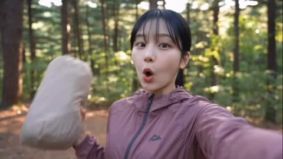</a>

Splitting the clip into timed scenes, each with its own camera and lighting cue, gives the model a shot list to follow. A consistency line that locks the woman, outfit and tent, plus a separate audio block that bans music and text, keeps the look steady across all five cuts.

Seedance 2.5 · Text-to-video · Source: [@ZorviaLux on X](https://x.com/ZorviaLux/status/2105892094032404502) · found via [LearnPrompt/awesome-seedance](https://github.com/LearnPrompt/awesome-seedance)

[`camping`](tags.md#tag-camping) [`vlog`](tags.md#tag-vlog) [`selfie`](tags.md#tag-selfie) [`campfire`](tags.md#tag-campfire) [`timed-scenes`](tags.md#tag-timed-scenes)

<details><summary><b>Prompt</b></summary>

```text
Create a 20-second ultra-realistic cinematic camping vlog featuring a young Japanese woman with straight black hair and bangs, wearing a dusty pink outdoor jacket.

Scene 1 (0–4 sec): Selfie-style vlog in a beautiful pine forest during golden hour. She smiles at the camera while holding a beige tent bag and excitedly introduces her solo camping adventure. Natural handheld camera movement, realistic facial expressions.

Scene 2 (4–7 sec): Wide cinematic shot of her setting up a beige camping tent among tall pine trees. She happily raises both hands to celebrate after pitching the tent. Warm sunlight filters through the forest.

Scene 3 (7–12 sec): Nighttime campfire scene. She sits on a folding camping chair, roasting a marshmallow on a stick. Close-up of her gently blowing on the toasted marshmallow, with realistic firelight illuminating her face.

Scene 4 (12–16 sec): She sits beside the campfire holding a glowing marshmallow, enjoying the peaceful night in the forest. Natural expressions, cozy atmosphere, realistic shadows and warm orange lighting.

Scene 5 (16–20 sec): Inside her illuminated tent at night, she smiles at the camera while holding a camping lantern. Suddenly, she hears a mysterious noise outside, opens her eyes wide, and pulls her sleeping bag up to her nose with a cute, surprised expression.

Visual style: Photorealistic live-action, 4K, cinematic depth of field, natural skin texture, realistic lighting, smooth camera transitions, authentic outdoor atmosphere, detailed facial expressions, cozy solo camping aesthetic.

Audio: Natural forest ambience, birds chirping, gentle wind, crackling campfire, subtle fabric sounds, and soft nighttime forest ambience. No background music, no subtitles, no text, no watermark.

Consistency: Maintain exactly the same woman, hairstyle, outfit, facial features, and tent throughout all scenes.
```

</details>

<a id="seedance-spicy-challenge-meltdown-korean-vlog"></a>
### Korean woman's spicy noodle dare turns into full meltdown

<a href="https://x.com/oggii_0/status/2094267751477232053">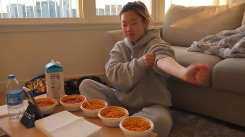</a>

Writing the whole scene as a timed beat sheet with exact spoken lines and friend dialogue heard off camera gives the model a clear escalation arc. Handheld phone-footage cues, autofocus hunting and an audio spec with only location sound keep it reading as a real group chat clip.

Seedance 2.5 · Text-to-video · Source: [@oggii_0 on X](https://x.com/oggii_0/status/2094267751477232053) · found via [LearnPrompt/awesome-seedance](https://github.com/LearnPrompt/awesome-seedance)

[`korean`](tags.md#tag-korean) [`spicy-food`](tags.md#tag-spicy-food) [`handheld`](tags.md#tag-handheld) [`comedy`](tags.md#tag-comedy)

<details><summary><b>Prompt</b></summary>

```text
Create a 30-second, 1080p ultra-realistic personal home-video of a young Korean woman confidently accepting a spicy food challenge from her friend, only to completely unravel as the heat kicks in. No reference image.
MAIN SUBJECT
Young Korean woman in her early 20s, casual and playful energy, natural makeup, expressive face that shifts from smug confidence to genuine distress.
Hair tied back in a high ponytail to "keep it out of the way," a few loose strands already escaping, small stud earrings.
Wearing an oversized gray hoodie with sleeves pushed up, loose sweatpants, sitting cross-legged on the floor like she's settling in for battle.
Maintain the same face, hairstyle, clothing, body proportions, and appearance throughout the entire video.
SETTING
A cozy, lived-in living room floor setup, late afternoon light coming through the window.
A low coffee table covered with a spread of increasingly spicy tteokbokki/ramen bowls lined up in a row, a stack of napkins, a carton of milk and a glass of water nearby "just in case," a phone propped against a water bottle timing things, a half-eaten snack bag pushed aside, and a blanket tossed on the couch behind her. Ordinary, slightly messy, very real.
CAMERA / VISUAL AESTHETIC
Raw personal footage filmed by her friend on a phone, strong handheld vlog shake throughout.
Camera bounces slightly with the friend shifting position to get better angles of her face. Autofocus hunts between the steaming bowls and her face. Mild motion blur when she reaches for water in a panic. Exposure shifts slightly as the afternoon light changes. Visible digital noise, slightly warm color cast from the window light.
No stabilization, no cinematic polish — it should feel like a real video shot for a group chat dare.
00:00–00:05 — THE CONFIDENT SETUP
She rolls up her sleeves theatrically, cracking her knuckles over the bowls like she's about to do something serious.
She looks into the camera, completely unbothered, smug smile.
"This is nothing. I grew up eating spicy."
00:05–00:10 — FIRST BITE
She picks up the first, mildest bowl and takes a confident bite, chewing casually, nodding like it's easy.
"See? Nothing."
The camera stays steady, her friend clearly unimpressed off-camera: "That one's basically ketchup, keep going."
00:10–00:15 — THE SHIFT
She moves to the second, spicier bowl. A few bites in, her nodding slows. Her eyes start to water slightly, and she reaches for the water glass "just to wash it down," still trying to act casual.
Her voice comes out slightly strained: "It's — it's fine, it's just warm."
The camera pushes in slightly, catching the sweat starting to form on her forehead.
00:15–00:20 — LOSING COMPOSURE
She hits the hottest bowl. One bite in, her whole face changes — eyes wide, fanning her open mouth with her hand, grabbing for the milk carton and drinking straight from it.
She sets it down hard, breathing fast, pointing at the bowl accusingly.
"Okay — okay that one's not normal, that's not — "
The camera shakes as her friend bursts out laughing off-camera.
00:20–00:25 — FULL MELTDOWN
She grabs a napkin, fanning her tongue with her hand while making a pained noise, rocking slightly where she sits.
She reaches for the water again, chugs it, immediately regrets that too and grabs the milk back.
Her friend, off-camera, barely able to film straight from laughing: "You said you grew up eating spicy?!"
She shoots a watery-eyed glare at the camera without being able to respond, still fanning her mouth.
00:25–00:30 — FINAL MOMENT
She slumps back against the couch, defeated, milk carton clutched to her chest, face flushed and eyes still watering.
She looks at the camera, voice hoarse and pathetic.
"...I don't grow up eating spicy. I lied."
She weakly gives a thumbs down as the frame shakes with her friend's laughter, and the footage cuts abruptly to black.
AUDIO
Natural location sound only:
Chewing, sniffling, exaggerated exhales and gasps, milk carton opening and gulping sounds, napkin rustling, her friend's genuine off-camera laughter throughout, glass clinking against the table, and handheld camera noise.
No music. No narration. No artificial sound effects.
Spoken lines: "This is nothing. I grew up eating spicy." / "See? Nothing." / "That one's basically ketchup, keep going." (friend) / "It's — it's fine, it's just warm." / "Okay — okay that one's not normal, that's not —" / "You said you grew up eating spicy?!" (friend) / "...I don't grow up eating spicy. I lied."
FINAL FEEL
Genuine, escalating physical comedy built entirely on real reactions to real heat — confident denial collapsing into full surrender. Funny, relatable, unscripted-feeling, the kind of video that gets sent straight to a group chat with "lmaooo."
No exaggerated acting beyond real spice reactions. No fake toughing-it-out — the comedy comes from how fast and how completely her composure breaks.
```

</details>

<a id="seedance-taipei-alley-door-keys-dv"></a>
### Woman unlocks door in Taipei alley

<a href="https://x.com/harboriis/status/2097564633242779830">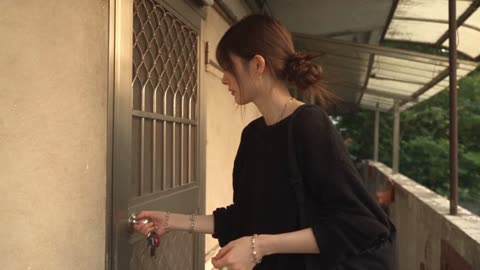</a>

Five-second timeline beats and an explicit continuity lock on face, outfit and accessories keep the character stable across cuts. Consumer DV cues such as hand shake, autofocus hunting and faded colour sell the 2000s look, and the sound list rules out music.

Seedance 2.5 · Text-to-video · Source: [@harboriis on X](https://x.com/harboriis/status/2097564633242779830) · found via [LearnPrompt/awesome-seedance](https://github.com/LearnPrompt/awesome-seedance)

[`taipei`](tags.md#tag-taipei) [`home-video`](tags.md#tag-home-video) [`handheld`](tags.md#tag-handheld) [`vlog`](tags.md#tag-vlog)

<details><summary><b>Prompt</b></summary>

```text
Create a 30-second, 1080p, 16:9 ultra-realistic 2000s-style home video recording style video, featuring an ordinary Taiwanese summer evening.

Main subject: The entire video is shot from the perspective of a young Taiwanese woman in her early 20s, with natural, realistic skin tone, light makeup, dark brown long hair styled in a low bun, with a few strands of hair. She is wearing a soft black long-sleeved knitted top, wide-leg light gray shorts, white vintage sneakers, carrying a dark black backpack, and wearing a silver bracelet. Please ensure that the face, hairstyle, clothing, proportions, and accessories remain completely consistent.

Setting: A quiet old residential alley in Taipei, with small apartments, potted plants, bicycles, old walls, power poles, and a small snack shop, a water dispenser, and potted plants. Full of life, peaceful, and real; no brands, advertisements, tourist attractions, or elaborate commercial activities.

Photography: The original consumer DV shooting style from the early 2000s, intense hand-held shaking, imperfect composition, search for autofocus, exposure changes, dynamic blur, faded colors, soft digital details, slight noise, and unexpected zoom. Stabilizer, sky lanterns, drones, cinematic lenses.

Timeline:
00:00-00:05: Take out an eco-friendly shopping bag, lock the door, check the keys, tidy up hair, smile at the camera, and walk down the alley.

00:05-00:10: Buy a small bag of green grapes from a small grocery store. Take a bite, react to the sour taste, make a funny face, laugh, and hand the fruit to the camera.

00:10-00:15: Walk and eat the fruit. A little dog notices her and wags its tail, she crouches down to let it smell her hand. The dog follows her for a short distance before leaving.

00:15-00:20: The dry leaves on the tree fall on her shoulders and hair. She looks up, shakes off the leaves, and the camera zooms in and gets close to her face. She says: Here it comes again?

00:20-00:25: Sit briefly on the low wall, finish eating the fruit, and a taxi passes by. The neighbor is watering the flowers. The wind blows her hair and clothes; she wipes her hands and adjusts her bag.

00:25-00:30: Walk to the end of the alley, turn around with a playful smile, say: Let's go. Turn the corner; the camera follows; suddenly switches to black screen.

Sound: Only natural ambient sounds, bird songs, insect sounds, footsteps, bicycle bells, distant motorcycle sounds, tree leaves, store sounds, dog movements, neighborhood sounds, and the noise of operating a camera. No music, voiceover, subtitles, titles, logos, watermarks, or special effects.

Continuity: Real dogs and environmental actions. No repeated characters, distorted faces, deformed hands, extra fingers, instant movements, or clothing changes. Warm, leisurely, feminine, playful, intimate, with a nostalgic feeling of forgotten summer memories.
```

</details>

<a id="seedance-teacher-school-day-vlog"></a>
### Teacher's full school day, home to classroom

<a href="https://x.com/ElsaSofia__AI/status/2092569909859647951"></a>

Six labelled reference images are bound to timed segments with @IMG tags, and a fixed identity and wardrobe lock keeps the same teacher in every scene. Each four-second beat lists its actions and gives its own camera setup, so the prompt reads like a shot-by-shot storyboard.

Seedance 2.5 · Reference-to-video · Source: [@ElsaSofia__AI on X](https://x.com/ElsaSofia__AI/status/2092569909859647951) · found via [LearnPrompt/awesome-seedance](https://github.com/LearnPrompt/awesome-seedance)

[`reference-images`](tags.md#tag-reference-images) [`character-consistency`](tags.md#tag-character-consistency) [`lifestyle`](tags.md#tag-lifestyle) [`shot-timeline`](tags.md#tag-shot-timeline)

<details><summary><b>Prompt</b></summary>

```text
DURATION: 30 seconds
ASPECT RATIO: 16:9

DURATION: 30 SECONDS

Create an ultra-photorealistic cinematic professional female teacher lifestyle vlog.

REFERENCE PRIORITY:

@IMG1 = MAIN FEMALE TEACHER
@IMG2 = SCHOOL EXTERIOR
@IMG3 = CLASSROOM
@IMG4 = TEACHING ACTION
@IMG5 = NOTEBOOK CHECKING
@IMG6 = SCHOOL EXIT

CHARACTER CONSISTENCY:

The EXACT SAME woman from @IMG1 must appear throughout the entire video.

Preserve her exact face, facial features, hairstyle, skin tone, body proportions, age appearance and overall identity.

She remains the SAME teacher throughout every scene.

Keep her professional teacher outfit consistent after she gets dressed.

--------------------------------------------------

0–4 SECONDS — LEAVING HOME

The teacher prepares for her school day at home.

She picks up her professional tote bag containing notebooks and teaching materials.

She checks her phone briefly.

She puts on her shoes, picks up her bag and leaves home.

CAMERA:
Quick cinematic morning lifestyle shots.

Close-up of the bag and notebooks.

Medium shot as she walks out the door.

Natural morning light.

--------------------------------------------------

4–8 SECONDS — SCHOOL ARRIVAL

Use @IMG2.

The teacher arrives at the school.

She walks through the main entrance carrying her tote bag.

She walks across the school courtyard toward the building.

She enters the school.

CAMERA:
Wide establishing shot of the school exterior.

Smooth tracking shot following her toward the entrance.

--------------------------------------------------

8–12 SECONDS — CLASSROOM PREPARATION

Use @IMG3.

The teacher enters her classroom.

She places her tote bag on the teacher's desk.

She organizes her notebooks and teaching materials.

She picks up a marker.

She briefly checks the whiteboard and prepares the lesson.

Students gradually settle into their desks.

CAMERA:
Medium classroom shot.

Brief close-ups of notebooks, marker and teaching materials.

--------------------------------------------------

12–20 SECONDS — TEACHING

Use @IMG4.

The teacher stands at the front of the classroom.

She writes a simple lesson heading or diagram on the whiteboard.

She turns toward the students.

She explains the lesson using natural hand gestures.

She points toward the board.

One student raises a hand.

The teacher acknowledges the student and responds with a natural smile.

Students remain attentive.

CAMERA:
Wide classroom shot.

Medium shot of teacher.

Brief close-up of her writing.

Over-the-shoulder shot from the students' perspective.

Natural classroom interaction.

--------------------------------------------------

20–25 SECONDS — NOTEBOOK CHECKING

Use @IMG5.

The lesson has finished.

The teacher sits at her desk.

She picks up a student's notebook.

She reads the work.

She turns a page.

She makes a few simple corrections with a pen.

She sees a well-completed answer and gives a small approving smile.

She places the notebook on a neat stack of checked work.

CAMERA:
Medium shot.

Brief close-up of notebook and hand.

Close-up of her satisfied expression.

--------------------------------------------------

25–30 SECONDS — SCHOOL EXIT

Use @IMG6.

The school day is finished.

The teacher organizes her papers into her tote bag.

She leaves the classroom.

She walks through the school corridor toward the main entrance.

She exits the school building.

The camera follows her from behind as she walks away.

Finish with a wide cinematic shot of the school exterior and the teacher walking toward the exit.

She gives a subtle relaxed smile.

CUT TO BLACK.

--------------------------------------------------

CAMERA STYLE:

Premium cinematic educational lifestyle vlog.

Smooth professional tracking.

Natural handheld feel.

Wide establishing shots.

Medium lifestyle shots.

Close-ups for important details.

Over-the-shoulder classroom shots.

Gentle cinematic pull-back at the ending.

No excessive camera shake.

No unnecessary fast camera movement.

--------------------------------------------------

REALISM:

Natural walking.

Natural classroom interaction.

Realistic writing.

Realistic notebook handling.

Realistic teacher gestures.

Natural student reactions.

Realistic school environment.

Natural facial expressions.

Realistic hands and fingers.

No exaggerated acting.

No distorted hands.

No extra fingers.

No face morphing.

No identity changes.

--------------------------------------------------

CONTINUITY:

Same female teacher throughout.

Same face.

Same hairstyle.

Same professional outfit.

Same school environment.

Same classroom.

Same teaching materials.

No different teacher.

No random outfit changes.

No cartoon.

No anime.

No futuristic school.

No text overlays.

No logos.

No watermark.

FINAL FEELING:

A realistic cinematic glimpse into a professional teacher's normal school day.

HOME → SCHOOL → CLASSROOM PREPARATION → TEACHING → NOTEBOOK CHECKING → SCHOOL EXIT.
```

</details>

<a id="seedance-three-besties-safari-vlog"></a>
### Three friends take a selfie on a safari jeep

<a href="https://x.com/AIwithWania/status/2106971093592691077">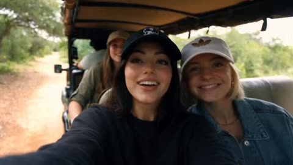</a>

A reference image anchors the main girl's identity, and each friend gets a fixed, different outfit and cap so the three stay distinct across shots. Timed shots with spoken lines and a handheld selfie camera give it the feel of a real travel vlog.

Seedance 2.5 · Reference-to-video · Source: [@AIwithWania on X](https://x.com/AIwithWania/status/2106971093592691077) · found via [LearnPrompt/awesome-seedance](https://github.com/LearnPrompt/awesome-seedance)

[`safari`](tags.md#tag-safari) [`vlog`](tags.md#tag-vlog) [`reference-character`](tags.md#tag-reference-character) [`dialogue`](tags.md#tag-dialogue)

<details><summary><b>Prompt</b></summary>

```text
Three besties, documenting a very unserious safari. 

Made with Seedance 2.5.

FORMAT: 16:9 landscape, ultra-realistic live-action, premium wildlife documentary + natural travel-vlog style.
REFERENCE IMAGE & MAIN CHARACTER:
Use the uploaded reference image as the primary character reference for the main girl. The main girl must remain exactly the same person throughout the entire video. Preserve her exact facial identity, facial features, skin tone, hairstyle, body proportions and overall appearance. Do not change or redesign her face.
Her overall outfit and styling should be inspired by the uploaded reference image, including the casual cap and youthful outdoor look. A slightly edgy/rock-inspired casual touch is acceptable while still looking natural and suitable for a wildlife trip.
👭 THREE FRIENDS
There are exactly three girls throughout the video: the main girl + two female friends.
All three girls must remain clearly visible and recognizable in multiple shots.
Their outfits must NOT be identical or matching. Each girl should have her own distinct outfit, colors and styling:
Main girl: outfit based on the uploaded reference image, casual outdoor/safari vibe, her own cap.
Friend 1: completely different casual outfit, different colors and styling, different cap.
Friend 2: another distinct casual outdoor outfit, different colors and details, different cap.
They can all wear caps because they are on an outdoor wildlife adventure, but the cap colors/styles should also be different. They should look like three real friends who chose their own clothes—not a coordinated uniform.
Keep each girl's outfit, hairstyle and appearance consistent from beginning to end.
 SHOT 1 — ARRIVAL | 0–4 SEC
The three friends arrive at a beautiful wildlife park in a safari vehicle.
The main girl briefly holds the camera for a natural selfie-style opening while both friends are clearly visible beside/behind her.
They look excited and genuinely happy.
Main girl:
“Okay, we’re finally here!”
Friend:
“I can’t wait to see them!”
Natural laughter, handheld travel-vlog movement, spontaneous expressions.
 SHOT 2 — ENTERING THE PARK | 4–7 SEC
Quick cinematic wide shot of all three girls walking through the wildlife park entrance together.
Their different outfits and caps are clearly visible.
They look around excitedly as they enter.
Friend:
“Where do we go first?”
Main girl:
“Let’s find the elephants!”
Natural walking and casual conversation, not staged.
SHOT 3 — ELEPHANTS | 7–11 SEC
Cut to the three girls safely observing elephants from a designated viewing area.
All three react naturally and excitedly.
Main girl:
“Whoa… look at that!”
Friend:
“They’re huge!”
Show realistic elephant movement, natural sunlight and authentic wildlife behavior.
 SHOT 4 — GIRAFFE | 11–14 SEC
The three girls are together at a giraffe viewing area.
One friend gently feeds the giraffe with approved food while the other two watch excitedly.
The giraffe naturally approaches.
Friend:
“It’s actually coming!”
Main girl:
“Oh my God, look!”
Keep all three girls visible and expressive.
 SHOT 5 — DEER | 14–17 SEC
Quick intimate wildlife moment.
The three friends are together near a friendly deer. One friend safely feeds it while the other two laugh and react.
Main girl:
“Aww, you’re so cute!”
Natural laughter and genuine reactions.
SHOT 6 — FINAL SELFIE | 17–20 SEC
Golden-hour ending.
The three girls stand close together after their wildlife adventure and take a fun selfie.
They are smiling, laughing and slightly tired but happy.
Friend:
“Best day ever!”
Main girl:
“We need to come back!”
End with their natural laughter and selfie pose.

VISUAL & CAMERA STYLE
Ultra-realistic live-action wildlife documentary aesthetic combined with an authentic friends' travel vlog.
Natural daylight, realistic skin texture, real-world wildlife park environment, authentic animal movements, cinematic wide shots mixed with handheld selfie footage, subtle natural camera shake, realistic depth of field, natural shadows, realistic clothing movement, and environmental details.
The video should feel like three real friends spontaneously documenting their wildlife adventure, not actors performing a scripted commercial.
🚫 NEGATIVE PROMPT
No CGI look, no 3D rendering, no cartoon animals, no fantasy environment, no artificial-looking faces, no face morphing, no identity drift, no character swapping, no duplicate girls, no extra friends, no identical outfits, no matching uniforms, no outfit changes between shots, no unrealistic animal behavior, no exaggerated acting, no excessive slow motion, no artificial beauty filter, no plastic skin, no futuristic elements.
16:9 landscape • Exactly 20 seconds • 3 girls • 3 different outfits • consistent main character • elephants + giraffe + deer • natural dialogue • cinematic wildlife adventure • realistic live-action.
```

</details>

<a id="seedance-three-city-phone-vlog"></a>
### Korean woman phone vlog across three cities

<a href="https://x.com/HustleXR/status/2092492677384437909"></a>

A paper-sheet wipe hides each city cut, so the same woman carries across London, Paris and Moscow while her wardrobe changes only during the transition. A timed segment list plus a REALISM LOCK clause keeps identity, clothing and physical motion consistent between cities.

Seedance 2.5 · Text-to-video · Source: [@HustleXR on X](https://x.com/HustleXR/status/2092492677384437909) · found via [LearnPrompt/awesome-seedance](https://github.com/LearnPrompt/awesome-seedance)

[`phone-footage`](tags.md#tag-phone-footage) [`travel-vlog`](tags.md#tag-travel-vlog) [`paper-transition`](tags.md#tag-paper-transition) [`multi-city`](tags.md#tag-multi-city)

<details><summary><b>Prompt</b></summary>

```text
ULTRA-REALISTIC PHONE FOOTAGE

One adult Korean woman, same recognizable face, skin tone, body proportions and gold hoop earrings throughout. Real skin pores, natural blinking, believable expressions and consistent identity. She personally films herself with a smartphone. No beauty filter, CGI, plastic skin or cinematic over-processing.

CAMERA: authentic handheld phone footage, slight arm movement, natural walking shake, autofocus shifts, exposure changes, realistic phone HDR and mild compression. Fast but understandable editing. Every city must be immediately recognizable.

00:00–00:05 — LONDON 🇬🇧

0:00–0:02.5 — Rainy Soho street. Selfie shot. She walks under a clear umbrella wearing a dark olive raincoat, grey knit, burgundy scarf, black skirt, tights and burgundy boots. Wet pavement, red double-decker bus and classic London architecture behind her. She smiles:

“London is freezing today!”

0:02.5–0:05 — She quickly turns the phone away from herself. A clean upward tilt reveals Big Ben and Westminster through the rain. She briefly points toward it. A torn blue-grey paper sheet naturally sweeps across the lens.

00:05–00:10 — PARIS 🇫🇷

0:05–0:07.5 — The paper tear reveals nighttime Paris. She is now wearing a beige open trench coat, cream knit, silk scarf, black trousers and burgundy ankle boots, hair in a high messy bun. She walks past warm cafés carrying a fresh crêpe, takes one bite and smiles:

“Paris at night… wow.”

0:07.5–0:10 — She immediately turns the phone upward, revealing the Eiffel Tower fully illuminated against the night sky. The tower lights sparkle naturally. A navy paper sheet quickly peels across the frame.

00:10–00:15 — MOSCOW 🇷🇺

0:10–0:12.5 — The paper opens onto a snowy Moscow street. She now wears a cream faux-fur coat, burgundy turtleneck, brown trousers and dark brown boots, with loose wavy hair. Snow lands naturally on her coat and hair. She holds a steaming blini, takes one bite and smiles:

“Okay… this is beautiful.”

0:12.5–0:15 — She turns the phone upward while snow falls, revealing Saint Basil’s Cathedral with its colorful domes. She raises her gloved hand toward the camera, laughing softly. Her hand naturally covers the lens as the recording ends.

REALISM LOCK: Every transition must preserve the same woman. City-specific clothing and hairstyles change only during the paper transition. Realistic weather, food, crowds, architecture, lighting and physical movement. No duplicated people, distorted hands, floating objects, fake faces, subtitles, logos, watermarks or artificial CGI appearance.

AUDIO: authentic rain, footsteps, traffic, café ambience, food-stall sounds, wind, distant voices and snowfall ambience. No background music.
```

</details>

<a id="seedance-tokyo-helicopter-night-selfie-tour"></a>
### Selfie helicopter night tour over Tokyo

<a href="https://x.com/noorlewisx/status/2093567063357088065"></a>

Numbered scenes each name a camera angle (selfie, cockpit, aerial, POV) and a landmark, so the model gets a shot list rather than one vague mood. Spoken lines are written out per scene, and the style line ends with a no text and no logo rule to keep the frame clean.

Seedance 2.5 · Text-to-video · Source: [@noorlewisx on X](https://x.com/noorlewisx/status/2093567063357088065) · found via [LearnPrompt/awesome-seedance](https://github.com/LearnPrompt/awesome-seedance)

[`helicopter`](tags.md#tag-helicopter) [`tokyo`](tags.md#tag-tokyo) [`selfie`](tags.md#tag-selfie) [`night-city`](tags.md#tag-night-city) [`multi-scene`](tags.md#tag-multi-scene)

<details><summary><b>Prompt</b></summary>

```text
A cinematic first-person and selfie-style night video of a beautiful young East Asian woman with long dark hair in a ponytail, wearing a maroon ribbed halter top, cream wide-leg pants, and black slide sandals. She is taking a helicopter night tour over Tokyo. No watermark, no logo, no text overlay, no brand names.
Scene 1: On a green-lit rooftop helipad at night. She smiles at the camera holding it selfie-style. A white Robinson-style helicopter is behind her with spinning blades. Tokyo city lights and water in the background. She says she is getting on a helicopter in Tokyo.
Scene 2: Inside the helicopter cockpit. She wears a green aviation headset with boom mic and a black 4-point harness. A small fuzzy lavalier mic is clipped to her top. She looks at the camera, slightly nervous then smiling, adjusting her seatbelt. Night city lights visible through the open side.
Scene 3: Helicopter lifts off from the helipad. Wide view of Tokyo Bay at night, Tokyo Tower glowing orange on the left, Rainbow Bridge lit up on the right, dark water below.
Scene 4: Open-door helicopter flight. Strong wind blows her hair. She laughs excitedly, eyes squinting, mouth open in joy, saying there is no door at all. Below: a cargo ship on the water and glittering city skyline.
Scene 5: POV looking down between her legs — cream pants and black sandals dangling over a dense sea of Tokyo skyscrapers and streets glowing at night.
Scene 6: Close selfie next to the brightly lit orange Tokyo Tower. She looks at camera and says “That’s Tokyo Tower.”
Scene 7: Aerial shot flying over Tokyo Skytree glowing purple and white, her feet visible at the bottom of frame, highways and dense city lights below.
Scene 8: Flying low along Rainbow Bridge at night — white cables, cars with headlights, city skyline behind.
Scene 9: After landing, she steps off the white helicopter onto the green helipad, walking toward camera holding the headset in one hand, wearing the same outfit.
Scene 10: She is now standing in crowded Shibuya Crossing at night, neon signs everywhere, yellow taxi and people crossing behind her. She smiles at the camera, waves, and says “Alright everyone, bye!” then “Bye!”
Style: realistic handheld selfie + aerial footage, night city lights, slight wind, natural skin, warm street lighting mixed with cool night sky. Smooth cuts, 30-second duration, vertical or 16:9 cinematic look. Photorealistic, no text, no watermark, no logo anywhere.

#polloai
```

</details>

<a id="seedance-tokyo-smartphone-dessert-cafe-vlog"></a>
### Tokyo street vlog finding a hidden dessert cafe

<a href="https://x.com/saniaspeaks_/status/2088605003112235033"></a>

The prompt anchors the clip to a first person smartphone recording with a named persona and timed beats across 30 seconds. It then lists realism cues such as autofocus hunting, exposure shifts and handheld shake, while banning cinematic moves, drones and slow motion so the output stays in documentary style.

Seedance 2.5 · Text-to-video · Source: [@saniaspeaks_ on X](https://x.com/saniaspeaks_/status/2088605003112235033)

[`food-vlog`](tags.md#tag-food-vlog) [`smartphone-footage`](tags.md#tag-smartphone-footage) [`handheld`](tags.md#tag-handheld) [`tokyo`](tags.md#tag-tokyo)

<details><summary><b>Prompt</b></summary>

```text
Ultra-realistic smartphone food vlog set in a charming neighborhood in Tokyo, Japan. The entire video must look like it was genuinely recorded on a modern flagship smartphone by a real female creator, not like a cinematic production or AI-generated video. 0–5 seconds: A young Japanese woman walks through a narrow Tokyo side street in the early evening, holding her smartphone at arm’s length and casually talking to the camera. Traditional Japanese shopfronts, vending machines, bicycles, small signs, utility wires, pedestrians and warm storefront lights create an authentic neighborhood atmosphere. Natural handheld movement and slight framing imperfections. 5–10 seconds: She notices a tiny hidden dessert café and turns the camera toward its entrance with an excited reaction. She walks inside while continuing the vlog. The camera naturally adjusts exposure from the bright street to the warmer interior. 10–16 seconds: Show the staff preparing a fresh strawberry cream dessert. Realistic strawberries, whipped cream, soft cake layers and small details of the preparation. The creator moves the phone closer for a natural food close-up while autofocus subtly shifts between the dessert and her hand. 16–22 seconds: She receives the dessert, holds it directly toward the phone camera, then takes a spoonful and tastes it. Her reaction should be spontaneous and believable, with subtle facial expressions rather than exaggerated acting. 22–27 seconds: She smiles, takes another small bite and turns the camera slightly to show the cozy café interior, Japanese customers naturally sitting in the background and warm practical lighting. 27–30 seconds: She walks back outside onto the Japanese street, looks directly into the phone camera and naturally says, “Okay, this place was actually so good!” She smiles and ends the recording casually. Authentic Japanese environment, realistic human behavior, natural walking physics, real-looking food textures, accurate skin texture, natural hair movement, realistic reflections, imperfect smartphone framing, subtle autofocus hunting, automatic exposure adjustments, slight handheld shake, natural motion blur, realistic low-light smartphone noise, true-to-life colors, detailed background activity, genuine vlog energy, high-resolution smartphone footage, photorealistic, documentary realism, no cinematic camera moves, no drone shots, no artificial slow motion, no CGI appearance, no text, no subtitles.
```

</details>

<a id="seedance-travel-vlog-old-town-woman"></a>
### Stylish woman narrates travel vlog through European old town

<a href="https://x.com/CaliraVal/status/2097184908250845406">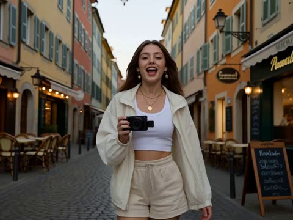</a>

The prompt splits the clip into timed shots, each with its own spoken line, so the lip-sync and voiceover have fixed beats to follow. The handheld vlog camera, golden hour lighting and a specific wardrobe list keep the look consistent across cuts.

Seedance 2.5 · Text-to-video · Source: [@CaliraVal on X](https://x.com/CaliraVal/status/2097184908250845406) · found via [LearnPrompt/awesome-seedance](https://github.com/LearnPrompt/awesome-seedance)

[`vlog`](tags.md#tag-vlog) [`lip-sync`](tags.md#tag-lip-sync) [`voiceover`](tags.md#tag-voiceover) [`golden-hour`](tags.md#tag-golden-hour) [`travel`](tags.md#tag-travel)

<details><summary><b>Prompt</b></summary>

```text
A cinematic AI travel vlog of a stylish young woman exploring a vibrant European old town at sunset. She has long flowing dark hair and wears a white cropped top, lightweight oversized jacket and beige shorts. She walks confidently through narrow cobblestone streets surrounded by colorful historic buildings, cozy cafés, local shops and warm glowing street lights.

She looks naturally into the camera and speaks directly to the audience with a friendly, energetic personality. Add a natural young female English voiceover with clear pronunciation, realistic conversational tone and subtle emotion. Make her speech perfectly synchronized with her lip movements.

Voiceover dialogue:
“Hey everyone! I’m exploring this beautiful city today, and honestly, every street feels like a movie. The atmosphere here is incredible, and I can’t wait to show you what I find!”

Cut to her buying a local pastry from a small street bakery. She smiles and says:
“This looks absolutely delicious. I had to try it!”

Then she sits at an outdoor café enjoying coffee while watching people pass by:
“Sometimes the best part of traveling is simply slowing down and enjoying the moment.”

Final shot: she walks toward a beautiful viewpoint overlooking the city as the sun sets. She turns toward the camera and says:
“Okay, this view is definitely the highlight of my day. Would you come here?”

Natural facial expressions, accurate lip-sync, realistic female English voice, subtle breathing and pauses, natural hand gestures, realistic skin texture, subtle hair movement, authentic handheld vlog camera, smooth camera tracking, shallow depth of field, realistic background people, cinematic golden-hour lighting, soft lens flare, photorealistic, 4K, highly detailed, natural motion, premium travel-film aesthetic.
```

</details>

<a id="seedance-tuscan-peasant-dv-camcorder-30s"></a>
### 1800s Tuscan Peasant Day on DV Camcorder

<a href="https://x.com/Goodmanprotocol/status/2107530733212590250"></a>

Five six second blocks give the single continuous shot a clear sequence of actions. The anachronistic early 2000s DV look is pinned down with named flaws like autofocus hunting, exposure pumping and compression noise, and an audio line limits sound to natural ambience.

Seedance 2.5 · Text-to-video · Source: [@Goodmanprotocol on X](https://x.com/Goodmanprotocol/status/2107530733212590250) · found via [LearnPrompt/awesome-seedance](https://github.com/LearnPrompt/awesome-seedance)

[`documentary`](tags.md#tag-documentary) [`dv-camcorder`](tags.md#tag-dv-camcorder) [`historical`](tags.md#tag-historical) [`handheld`](tags.md#tag-handheld) [`timestamped`](tags.md#tag-timestamped)

<details><summary><b>Prompt</b></summary>

```text
30-second ultra-realistic documentary slice-of-life video, early-2000s consumer DV camcorder aesthetic. A young Italian peasant woman in her early 20s, sun-weathered olive skin with freckles, dark brown wavy hair loosely tied with a faded scarf, worn off-white linen blouse, earth-brown patched wool skirt, faded floral apron and muddy leather boots. Rural Tuscany in the late 1800s. Golden wheat fields, olive trees, stone farmhouse, cypress trees, stone walls, chickens, donkey and old stone well. No modern objects or machinery.

[0–6s]
Handheld camera follows her naturally along a dirt path through golden wheat fields. She carries a woven basket on her hip and brushes her free hand across the wheat. Wind moves the stalks and her loose hair.

[6–12s]
She reaches a wooden fence, sets down the basket and feeds scraps to several chickens gathered around her boots. The camera stays close and imperfect, briefly adjusting focus as she moves.

[12–18s]
She continues toward an old stone well. She lowers a wooden bucket on a rope, pulls it up with effort, then drinks fresh water from a small ladle. Water runs down her chin and she wipes it away with her sleeve.

[18–24s]
A donkey approaches. She smiles softly, pats its muzzle, then picks a small wildflower from the field and tucks it behind her ear. She lifts the basket and walks toward the farmhouse.

[24–30s]
Near the heavy wooden doorway, she notices the person filming. She gives a tired but warm smile and a small wave, then opens the door. She looks back once before stepping inside. The camera remains outside as the door slowly closes.

STYLE: photorealistic historical documentary, authentic 1800s Tuscany, early-2000s consumer DV look, handheld shake, imperfect framing, autofocus hunting, slight exposure pumping, faded colors, soft contrast, mild digital compression and sensor noise. No stabilization, no cinematic camera moves, no modern color grading. One continuous fluid shot, no cuts, no captions, no music.

AUDIO: natural ambience only -wind through wheat, birds, chickens, footsteps on dry earth, rope and wooden bucket creaking, water splashing, donkey sounds, distant countryside atmosphere and the wooden door closing.
```

</details>

<a id="seedance-ugc-burger-selfie-vlog"></a>
### Smiling woman shows burger box in selfie

<a href="https://x.com/oggii_0/status/2088500493308084326">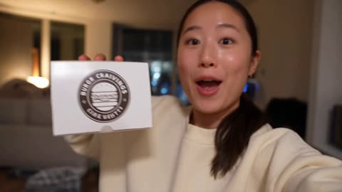</a>

The prompt pins the uploaded burger photo as the only product reference and repeats its exact bun, patty, cheese and sauce details in every shot, which keeps the food stable across cuts. A named character reference, handheld phone cues such as autofocus breathing and jump cuts, and a negative prompt against studio lighting and CGI food drive the authentic UGC look.

Seedance 2.5 · Reference-to-video · Source: [@oggii_0 on X](https://x.com/oggii_0/status/2088500493308084326)

[`ugc`](tags.md#tag-ugc) [`selfie-vlog`](tags.md#tag-selfie-vlog) [`product-reference`](tags.md#tag-product-reference) [`food`](tags.md#tag-food)

<details><summary><b>Prompt</b></summary>

```text
Duration: 15 seconds | Aspect Ratio: 16:9 | Style: Authentic UGC / iPhone selfie-vlog, handheld, natural light, TikTok/Reels aesthetic. Product Reference: Use the uploaded gourmet burger image as the only product reference. Preserve the bun shape, patty thickness, cheese melt, lettuce, tomato, sauces, and proportions exactly in every shot. Character Description Name: Hana A young Japanese woman @ Image 1 in her early 20s with natural beauty, long dark hair in a loose ponytail, oversized cream sweatshirt, minimal makeup, bright smile, friendly lifestyle-vlogger personality. Shot Breakdown SHOT 1 (0–2s) — Selfie showing the burger box. Dialogue: "Burger night!" SHOT 2 (2–4s) — Opens the box. SHOT 3 (2–4s) — Quick zoom on the burger. SHOT 4 (6–8s) — Hands lifting the burger with cheese stretching naturally. SHOT 5 (8–10s) — Bite reaction. Dialogue: "Okay... that's incredible." SHOT 6 (10–12s) — Casual close-up b-roll while reaching for fries. SHOT 7 (12–14s) — Toasting the burger toward the camera. Dialogue: "You need this." SHOT 8 (14–15s) — Freeze frame with overlay: "burger cravings = solved 🍔" Look & Feel Warm apartment lighting, genuine phone footage, slight grain, natural autofocus breathing, handheld imperfections, fast jump cuts. Negative Prompt cinematic grading, commercial production, CGI burger, fake cheese, distorted hands, warped food, perfect stabilization, studio lighting, text glitches, logo distortion.
```

</details>

<a id="seedance-woman-market-to-kitchen"></a>
### Woman shops for vegetables and cooks at home

<a href="https://x.com/CaliraVal/status/2100087681283924449"></a>

Timed segments with a single identity lock keep the same woman, face, hairstyle and glasses across cuts. Naming each action per second gives the model a shot list to follow, and the closing camera and realism words set the look.

Seedance 2.5 · Text-to-video · Source: [@CaliraVal on X](https://x.com/CaliraVal/status/2100087681283924449) · found via [LearnPrompt/awesome-seedance](https://github.com/LearnPrompt/awesome-seedance)

[`multi-shot`](tags.md#tag-multi-shot) [`identity-lock`](tags.md#tag-identity-lock) [`daily-life`](tags.md#tag-daily-life) [`photorealistic`](tags.md#tag-photorealistic)

<details><summary><b>Prompt</b></summary>

```text
Keep the same young South Asian woman, same face, hairstyle and clear stylish glasses throughout. 0–2 sec: She leaves her home wearing clear glasses and walks toward the local vegetable market. 2–5 sec: Quick cinematic shots of her entering the busy market, selecting fresh tomatoes, potatoes, onions, green chilies and coriander, then paying the vendor. 5–7 sec: She walks back home carrying a small vegetable bag. 7–9 sec: She enters her kitchen, places the vegetables on the counter and removes them from the bag. 9–11 sec: She washes the vegetables under running water. 11–15 sec: She puts the vegetables on a wooden cutting board and naturally cuts them with a kitchen knife. Fast but smooth transitions, realistic hand movements, authentic Pakistani environment, natural daylight, detailed vegetables, realistic physics, cinematic camera movement, photorealistic, 4K quality.
#Flovaai #Flovacpp @Flovaai_Japan
```

</details>

<a id="seedance-woman-morning-routine-balcony-sunset"></a>
### Morning routine at home ends on sunset balcony

<a href="https://x.com/Zyrellix/status/2105899978396987489"></a>

The prompt is written as a sequence of beats, each with one action and one framing, and every location change is marked as a cut. Naming the wardrobe for each scene and the light source in each setting keeps the character and mood consistent across the cuts.

Seedance 2.5 · Text-to-video · Source: [@Zyrellix on X](https://x.com/Zyrellix/status/2105899978396987489) · found via [LearnPrompt/awesome-seedance](https://github.com/LearnPrompt/awesome-seedance)

[`morning-routine`](tags.md#tag-morning-routine) [`day-in-the-life`](tags.md#tag-day-in-the-life) [`sunlight`](tags.md#tag-sunlight) [`multi-shot`](tags.md#tag-multi-shot)

<details><summary><b>Prompt</b></summary>

```text
A young woman with long dark brown hair and a beauty mark on her cheek wakes in white bedding, eyes closed, then opens them and smiles. She sits up in cream silk pajamas and stretches both arms overhead, eyes closed, sun cutting across the room and casting her shadow on the wall. She walks away from camera through a bright bedroom toward floor-to-ceiling glass doors, sheer curtains, ocean and palms outside, now in a white crop tank and beige wide-leg trousers. She slides the door open, profile in the light, hair lifting. Cut to a kitchen: she pours steaming coffee from a steel kettle into a speckled ceramic cup on marble, then cups the mug with both hands and sips, eyes lowered. She waters lush houseplants barefoot in a soft yellow midi dress, sunlight through big windows. Close-up of water droplets on a green leaf. She leans in and smells a small white flower, smiling. She steps onto a balcony at sunset, back to camera, city and palms below, then turns in profile holding the steaming cup on the rail, eyes closed, content. Wide shot: she stands at the railing in the yellow dress, garden and skyline (including a tall spire) glowing behind her.
```

</details>

[1](video-vlog.md) · **2**
