# Phone footage and vlogs

[Back to the list](../../README.md) · All 186 entries · [1](video-vlog.md) · **2** · [3](video-vlog-3.md)

<a id="seedance-hawaii-travel-vlog-montage"></a>
### Woman in floral dress walks a Hawaii street

<a href="https://x.com/im_shahid7/status/2086677274217381905">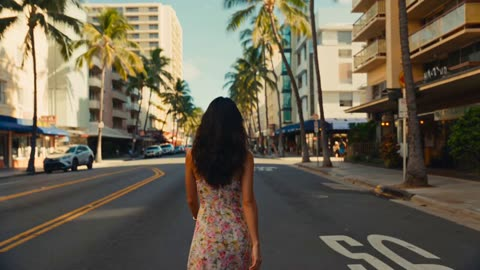</a>

A timed four-scene structure (0 to 4s, 4 to 8s and so on) sits on a shared style block and a repeated identity lock (same face, hair and body), which keeps the woman consistent across cuts. The opening follows her from behind, a standard vlog device that sets up the later turn toward the camera.

Seedance 2.5 · Text-to-video · Source: [@im_shahid7 on X](https://x.com/im_shahid7/status/2086677274217381905)

[`hawaii`](tags.md#tag-hawaii) [`travel-vlog`](tags.md#tag-travel-vlog) [`character-consistency`](tags.md#tag-character-consistency) [`golden-hour`](tags.md#tag-golden-hour) [`film-look`](tags.md#tag-film-look)

<details><summary><b>Prompt</b></summary>

```text
15-Second Cinematic Hawaii Travel Vlog
A cinematic 15-second tropical travel vlog montage featuring the same beautiful 20-year-old East Asian woman with dark hair enjoying a dreamy summer vacation in Hawaii. Maintain perfect character consistency throughout every shot: same face, dark hairstyle, youthful appearance, natural makeup, realistic skin texture, elegant summer styling, and relaxed happy expressions.
Visual style: authentic luxury travel diary, realistic handheld camera movement, candid moments, soft golden-hour sunlight, dreamy 35mm film aesthetic, warm vintage color grading, shallow depth of field, natural atmospheric lighting, subtle film grain, realistic autofocus, natural motion blur, cinematic storytelling. 4K, 24fps, 35mm lens, photorealistic, travel documentary aesthetic.
Scene 1 — Arrival & Beach Walk (0–4s)
Bright Hawaiian morning. The woman walks through a colorful tropical street lined with palm trees, wearing a flowing floral summer dress and sunglasses. Camera follows her from behind, then smoothly moves to a close-up as she turns and smiles naturally. Wind gently moves her dark hair. Quick transition toward the ocean.
Scene 2 — Beach & Tropical Nature (4–8s)
She walks barefoot along a wide sandy beach as crystal-blue waves touch her feet. Low-angle shot of her footsteps in wet sand, followed by a cinematic shot of her near a rocky ocean cliff looking peacefully toward the sea. Palm trees sway in golden sunlight, with subtle lens flare and distant volcanic mountains.
Scene 3 — Ocean Adventure & Cafe Moment (8–12s)
She laughs naturally while floating on a surfboard in calm turquoise water. Water-level camera circles around her, sunlight sparkling across the ocean and tropical mountains in the distance. Cut smoothly to her sitting at a cozy beachfront cafe, holding a tropical drink while watching the waves.
Scene 4 — Golden Sunset Ending (12–15s)
Emotional cinematic ending. Wide silhouette of the woman standing barefoot at the shoreline during a glowing orange-pink sunset. Waves gently move around her feet. Camera slowly pushes in as she looks toward the horizon, then briefly turns toward the camera with a peaceful smile. End with a soft filmic fade.
Camera: authentic travel vlog cinematography, handheld movement, smooth transitions, slow push-ins, occasional POV shots, realistic autofocus adjustments, subtle motion blur.
Keep the woman identical in every scene: same facial features, same dark hair, same youthful appearance, same body proportions, realistic skin texture and natural expressions. No character morphing or hairstyle changes.
Avoid: cartoon/CGI appearance, plastic skin, unrealistic face, inconsistent character, changing hairstyle, extra fingers, distorted anatomy, artificial movements, oversaturated colors, excessive sharpening, blurry face, duplicate people, unnatural lighting.
```

</details>

<a id="seedance-ice-cream-cart-chase-home-video"></a>
### Woman Chases Ice Cream Cart in Handheld Home Video

<a href="https://x.com/aiwithaly/status/2104428091476988236">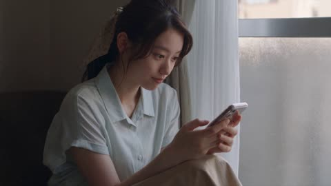</a>

The prompt sets an amateur camcorder look with imperfect framing, autofocus shifts and no cinematic polish, then lays the story out as a clear beat sequence over 30 seconds. A locked wardrobe list, physics cues, an audio only sound list and a long negative prompt keep the character and motion consistent.

Seedance 2.5 · Text-to-video · Source: [@aiwithaly on X](https://x.com/aiwithaly/status/2104428091476988236) · found via [LearnPrompt/awesome-seedance](https://github.com/LearnPrompt/awesome-seedance)

[`slice-of-life`](tags.md#tag-slice-of-life) [`japanese`](tags.md#tag-japanese) [`handheld`](tags.md#tag-handheld) [`home-video`](tags.md#tag-home-video) [`natural-audio`](tags.md#tag-natural-audio)

<details><summary><b>Prompt</b></summary>

```text
Create a 30-second ultra-photorealistic Japanese slice-of-life home-video following an adorable Japanese woman in her early 20s who hears the distant ice-cream cart bell while relaxing at home. She grabs her wallet, slips on her sneakers, rushes outside, and runs through a quiet neighborhood to catch the cart.

Show authentic handheld consumer-camera footage with imperfect framing, subtle shake, autofocus shifts, natural daylight, realistic motion blur and no commercial cinematic look.

She catches the cart just in time, buys a vanilla-strawberry cone, then meets neighborhood children playing with a ball. She joins them briefly before walking home through the warm late-afternoon street, happily finishing her ice cream.

Maintain consistent face, ponytail, pale-blue blouse, beige skirt, white sneakers, cream shoulder bag and natural expressions throughout. Use realistic physics for running, balance, bag and hair movement, bicycle momentum, ball motion, melting ice cream, shadows and material interaction.

Natural audio only: bicycle bell, footsteps, breathing, children laughing, ball, vendor dialogue, neighborhood ambience and light wind. No music or narration.

Negative prompt: No anime, CGI, plastic skin, beauty filters, robotic movement, impossible physics, floating objects, teleportation, distorted hands, extra fingers, duplicated children, face/outfit changes, excessive camera movement, commercial look, subtitles, logos or watermark.
```

</details>

<a id="seedance-indonesian-alley-dv-camcorder-day"></a>
### Indonesian Alley Day as Early 2000s Camcorder Footage

<a href="https://x.com/RishuaVR/status/2089204108175741157">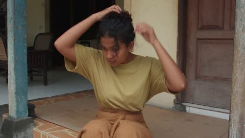</a>

A fixed identity and wardrobe block plus a banned-elements list for the location keeps the scene consistent. Camcorder flaws such as autofocus hunting and exposure pumping are named explicitly, with four timed beats and a detailed foley-only audio layer.

Seedance 2.5 · Text-to-video · Source: [@RishuaVR on X](https://x.com/RishuaVR/status/2089204108175741157) · found via [LearnPrompt/awesome-seedance](https://github.com/LearnPrompt/awesome-seedance)

[`documentary`](tags.md#tag-documentary) [`camcorder`](tags.md#tag-camcorder) [`handheld`](tags.md#tag-handheld) [`asmr-audio`](tags.md#tag-asmr-audio) [`slice-of-life`](tags.md#tag-slice-of-life)

<details><summary><b>Prompt</b></summary>

```text
Main subject: young Indonesian woman, early 20s, natural everyday appearance, faded mustard-yellow oversized cotton t-shirt, brown high-waisted linen wrap skirt reaching just below the knee, simple brown leather slide sandals, thin gold stud earrings, dark wavy hair in a messy low bun with loose wispy strands framing her face. Realistic warm brown skin texture, minimal natural makeup, warm and approachable demeanor. Maintain consistent identity, clothing, hairstyle, and appearance throughout the entire video.

Location: Authentic Indonesian residential neighborhood (gang) during a calm late morning. Narrow paved alleys, low-rise houses with open front terraces, terracotta roof tiles, potted frangipani and bougainvillea, laundry on bamboo drying racks, parked motorbikes along plastered walls, overhead utility wires, banana and coconut trees casting dappled moving shadows, quiet tropical residential atmosphere. No modern stores, billboards, cafés, or crowds.

Visual Style: Ultra-realistic documentary realism. Genuine candid behavior. Natural body language. Unscripted slice-of-life feeling. Strong environmental authenticity. Rich real-world details and believable human motion.

Camera Style: Early-2000s consumer DV camcorder aesthetic. Friend casually recording everyday moments. Heavy handheld shake, imperfect framing, frequent autofocus hunting, lens breathing, exposure pumping when moving between harsh tropical sun and deep alley shade, occasional motion blur, subtle rolling shutter, mild digital compression artifacts, warm faded colors, soft contrast, slight sensor noise. No stabilization. No cinematic camera moves. No modern color grading.

00:00–00:02
Outside a small house entrance with an open terrace. She sits on the low terrace step adjusting her loose hair bun with both hands raised. A light warm breeze moves loose strands of hair. She smiles naturally while the camera struggles to lock focus.

00:02–00:05
The camera follows her into a narrow alley lined with potted plants and plastered walls. She notices a neighborhood cat resting on a warm concrete ledge, crouches down, and gently pets it. Framing drifts off-center as the operator tries to keep up. Morning sunlight flickers through banana leaves overhead.

00:05–00:08
Small front terrace with a glass of sweet iced tea on a wooden stool. She sits relaxed on a plastic chair watching the quiet gang, casually brushing hair behind her ear. A motorbike passes slowly in the distant background. Handheld side angle with natural camera drift.

00:08–00:10
She turns toward the camera with a warm, genuine smile, gives a gentle nod of acknowledgement, then turns to walk down the tree-lined alley holding her iced tea. Recording cuts abruptly to black mid-motion as if the camcorder was switched off.

Audio: Hyper-detailed environmental ASMR binaural audio — crisp micro-sounds captured up close with high sensitivity. Crisp rustle of cotton fabric and linen as she moves, deep rhythmic cat purring vibrating close to the microphone, ice cubes gently clinking against the glass condensation, soft scuff of leather sandals on textured concrete pavement, dry banana leaves brushing together in the warm breeze, rhythmic faint sound of a sapu lidi broom sweeping fallen leaves nearby, water dripping into a terracotta gentong, distant gentle crowing rooster, faint muffled low-frequency hum of a passing motorbike down the alley. Pure natural foley textures, zero music, zero studio effects, zero narration, zero speech.

Goal: Authentic Indonesian neighborhood life captured like a forgotten home video from the early 2000s — candid, imperfect, realistic, warm, and deeply believable, with immersive environmental ASMR soundscape.
```

</details>

<a id="seedance-indonesian-dog-chase-comedy"></a>
### Girl walks residential street with dog behind

<a href="https://x.com/MissDelulu9/status/2092578120591446348">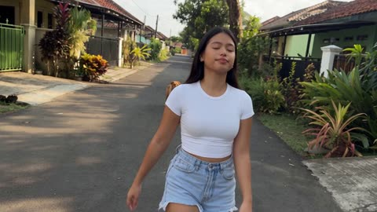</a>

A timed shot list with the exact dialogue lines sets pacing and comedic beats, and the camera realism block (one handed phone, autofocus drift, auto exposure, motion blur, light compression) keeps it reading as a phone home video rather than a film.

Seedance 2.5 · Text-to-video · Source: [@MissDelulu9 on X](https://x.com/MissDelulu9/status/2092578120591446348) · found via [LearnPrompt/awesome-seedance](https://github.com/LearnPrompt/awesome-seedance)

[`comedy`](tags.md#tag-comedy) [`handheld-phone`](tags.md#tag-handheld-phone) [`dialogue`](tags.md#tag-dialogue) [`street-scene`](tags.md#tag-street-scene)

<details><summary><b>Prompt</b></summary>

```text
Create a 15-second realistic smartphone video in 16:9 aspect ratio.

Style: authentic Gen-Z Indonesian comedy, spontaneous iPhone home-video footage, natural daylight.

SHOT 1- 0:00–0:02
A girl casually walks along a small Indonesian residential street. She suddenly notices a medium-sized pet dog ahead and stops. Her relaxed expression instantly turns nervous.

SHOT 2-0:02–0:04
Quick handheld pan from the girl to the dog and back. She slowly steps backward and says: “Uh... don't come closer, okay...” The dog looks curious and harmless.

SHOT 3-0:04–0:06
The dog playfully runs a few steps toward her. She panics: “AAAAA RUN!” The camera operator reacts and moves backward.

SHOT 4-0:06–0:08
She suddenly runs away, looking back over her shoulder. The iPhone camera follows while running, creating natural shaky footage. Her white fitted T-shirt, light-blue short denim shorts, and white low-profile slippers move naturally.

SHOT 5-0:08–0:10
Side close-up while she runs. She looks back and screams: “BRO, IT'S FOLLOWING ME!” The camera shakes as the friend behind the camera laughs.

SHOT 6-0:10–0:13
The camera widens as she runs toward her friend, waving her hands: “DON'T LAUGH! HELP ME, BRO!” The dog follows playfully without attacking, biting, or touching her.

SHOT 7- 0:13–0:15
She reaches a safe spot, bends over briefly to catch her breath, then looks at the camera with an annoyed and embarrassed expression: “I was literally just passing by, why did that turn into cardio?!” The friend bursts out laughing. Abrupt cut.

CAMERA & REALISM

Amateur one-handed iPhone recording. Natural handheld shake, imperfect framing, slight tilt, occasional autofocus shifts, automatic exposure changes, realistic motion blur, natural smartphone colors, subtle digital sharpening and compression. Environmental details remain visible. No cinematic look.
```

</details>

<a id="seedance-indonesian-hammock-phone-vlog"></a>
### Woman scrolls her phone in a yard hammock

<a href="https://x.com/ai_anelia/status/2117239438942306560">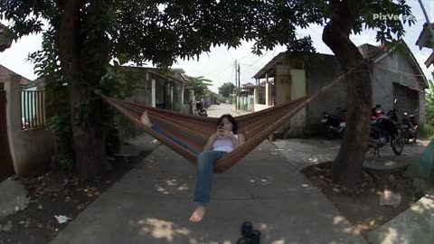</a>

An image reference locks the identity, and a timestamped shot list gives each beat one clear action. The DV camcorder spec (shake, focus hunting, rolling shutter, faded color) plus the rule against posing keeps it casual rather than glossy.

Seedance 2.5 · Image-to-video · Source: [@ai_anelia on X](https://x.com/ai_anelia/status/2117239438942306560) · found via [LearnPrompt/awesome-seedance](https://github.com/LearnPrompt/awesome-seedance)

[`vlog`](tags.md#tag-vlog) [`dv-camcorder`](tags.md#tag-dv-camcorder) [`indonesia`](tags.md#tag-indonesia) [`timestamped-shots`](tags.md#tag-timestamped-shots)

<details><summary><b>Prompt</b></summary>

```text
image = Main Subject. Preserve her exact identity, face, hairstyle, skin tone, body proportions, natural underarm hair, olive-green faded crop top, loose high-waist light-blue jeans, black canvas sneakers, black cord necklace, wavy black hair, side-swept bangs and messy ponytail throughout.

Authentic Indonesian woman, early-2000s atmosphere. Ordinary quiet Indonesian residential neighborhood: narrow concrete alley, simple single-story houses, front terrace, two large trees, potted plants, parked motorcycles and tangled overhead cables. No shops, markets, vendors or commercial activity.

STYLE: Extremely raw handheld early-2000s DV camcorder home video. Gritty documentary realism, heavy organic camera shake, accidental framing, frequent reframing, off-center subject, partial face cropping, autofocus hunting, lens breathing, exposure fluctuations, rolling shutter, motion blur, digital noise, compression artifacts, faded desaturated colors, low contrast, washed highlights and faded blacks. Casual friend-recorded footage. No stabilization, cinematic glamour, commercial aesthetic, posing or modern grading.

30-SECOND CONTINUOUS HOME-VIDEO SEQUENCE — 16:9

- 00–03: Wide shaky shot of her relaxing in a hammock between two large front-yard trees, one leg dangling, dappled sunlight overhead.
- 03–07: Close-up of her slowly pressing an old Nokia keypad and smiling slightly. Camera hunts for focus.
- 07–10: She stretches lazily in the hammock, phone on stomach, gazing at the canopy as wind moves her hair and hammock.
- 10–13: She gets up, pockets the phone and walks across the yard. Camera follows unsteadily.
- 13–16: She crouches beside a parked motorcycle, picks up a bucket of soapy water and rag.
- 16–20: Close-up as she slowly cleans a motorcycle helmet. Natural underarm hair briefly visible, suds dripping onto concrete.
- 20–24: Side-angle shot of her wiping the motorcycle seat, briefly glancing at the camera with a small smile.
- 24–27: She rinses and wrings the rag over the bucket.
- 27–30: She wipes her wet hands on her jeans, looks up and smiles naturally. Abrupt cut to black.

AUDIO: No music, dialogue or artificial sound. Only natural ambience: morning birds, light breeze, distant motorcycles, neighborhood chatter, rustling leaves, hammock creaks, Nokia keypad clicks, splashing water and rag squeaking against leather.

STRICT: No posing, no fashion-commercial look, no perfect composition, no stabilization, no cinematic shots, no artificial lighting, no modern color grading. Maintain exact character consistency in every frame.
```

</details>

<a id="seedance-indonesian-village-coconut-vlog"></a>
### Woman strolls a palm lined village path

<a href="https://x.com/saniaspeaks_/status/2084969852171939875">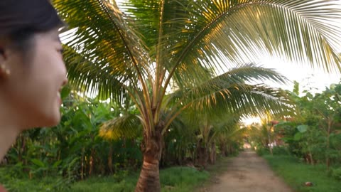</a>

A timestamped beat sheet with quoted dialogue splits the clip into shots, and an image reference locks the face and outfit. Spelled out camera flaws (shake, focus hunting, no stabilization) and an ambience only sound list keep the look authentically amateur instead of polished travel content.

Seedance 2.5 · Reference-to-video · Source: [@saniaspeaks_ on X](https://x.com/saniaspeaks_/status/2084969852171939875)

[`vlog`](tags.md#tag-vlog) [`handheld`](tags.md#tag-handheld) [`tropical-village`](tags.md#tag-tropical-village) [`retro-2000s`](tags.md#tag-retro-2000s)

<details><summary><b>Prompt</b></summary>

```text
Preserve the exact face, hairstyle, identity, skin tone, and body proportions from @ image1 throughout. Outfit: oversized terracotta linen shirt, dusty burgundy wide-leg trousers, brown leather sandals, small gold hoop earrings, loose natural wavy hair. Authentic Indonesian woman. Late-2000s personal vlog aesthetic. Extremely raw handheld flip-camera footage with heavy camera shake, natural reframing, partial face crops, focus hunting, exposure shifts, warm faded colors, mild digital noise, and authentic home-video imperfections. No posing, no cinematic glamour, no stabilization, no modern color grading.

00:00–00:04 Walking through a peaceful tropical village lined with coconut trees, smiling into the camera. "Today we're hunting for fresh coconuts!"

00:04–00:08 Stops at a small roadside coconut stall where a friendly local vendor expertly chops open a fresh green coconut. She watches with an excited reaction.

00:08–00:12 Takes her first sip of fresh coconut water, smiles brightly, and says, "This is so refreshing!"

00:12–00:16 Sits with local villagers on a wooden bench, chatting, laughing, and enjoying the relaxed atmosphere while holding the coconut.

00:16–00:20 Tries opening another coconut herself using simple tools, struggles playfully, laughs, and the locals cheer and laugh with her.

00:20–00:24 Scoops out the soft coconut flesh with a spoon, tastes it, and gives a happy thumbs-up to the camera.

00:24–00:27 Walks slowly through the village, waving to children and locals while carrying the empty coconut shell.

00:27–00:30 Stops beneath tall coconut trees, turns back toward the camera with a warm smile, waves, and says, "See you in my next adventure. Bye!" before naturally ending the recording.

Natural ambience only: birds, palm leaves rustling, village conversations, coconut chopping sounds, footsteps, breeze, insects, and distant laughter. No background music, subtitles, logos, or watermarks. The footage should feel exactly like a genuine late-2000s handheld flip-camera vacation vlog with authentic human movement and realistic interactions.
```

</details>

<a id="seedance-japan-pov-morning-commute"></a>
### Walking POV down station steps onto a seaside train

<a href="https://x.com/higgsfield_ai/status/2083155162475217058">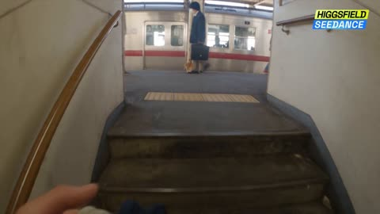</a>

Timed beats with a fixed camera spec, handheld micro motion and a listed ambient audio bed keep the whole thing one continuous shot. Banning color grading and neon keeps the look grounded in real morning light.

Seedance 2.5 · Text-to-video · Source: [@higgsfield_ai on X](https://x.com/higgsfield_ai/status/2083155162475217058)

[`pov`](tags.md#tag-pov) [`japan`](tags.md#tag-japan) [`one-take`](tags.md#tag-one-take) [`train`](tags.md#tag-train)

<details><summary><b>Prompt</b></summary>

```text
POV — Morning Commute in Coastal Japan | Ultra-Realistic, One Continuous Take  First-person POV, no cuts, one unbroken handheld-feeling shot from our own eyes on the way through a small seaside town. Ultra-photorealistic, phone-in-hand realism — natural camera micro-shake, subtle head bob with each step, occasional glance down at our own hands and shoes. 4K, shallow but natural depth of field, real morning light, no color-grading fantasy, no neon.  Beat 1 — Descending into the station (0–4s): We walk down worn concrete station stairs into a small coastal-town metro entrance, one hand loosely gripping a canvas bag strap that swings into the lower frame. Fluorescent tint mixes with daylight bleeding from the entrance behind us. Commuters pass in soft focus; we hear muffled announcements and the shuffle of footsteps.  Beat 2 — The orange cat (4–9s): We slow and crouch — the horizon dips as our POV lowers toward the ground. An orange tabby sits by a ticket-gate pillar, tail curled. Our hand (natural skin texture, slightly bitten nails, cuff of a sleeve) reaches into frame and gently strokes its head. The cat leans into the touch, eyes half-closing, ears flicking. We hold there a beat, warm and quiet.  Beat 3 — Boarding, settling by the window (9–14s): We rise, the horizon lifts, and we step through the train doors just as the chime sounds. POV turns and moves toward a window seat; we sit, and the frame settles against the glass. A faint silhouette of us ghosts over the view. The train pulls away with a gentle lurch.  Beat 4 — The shimmering sea (14–20s): Through the window, the town gives way to open coastline. Sunlight scatters across the water in thousands of moving sparkles — real specular glitter, not CGI bloom. Utility poles and wires strobe past in the foreground. We rest our chin lightly (subtle downward frame tilt), just watching.  Beat 5 — Rails into the sea (20–25s): The track curves and runs so close to the shore that the rails seem to vanish straight into the water — the sea fills nearly the whole frame, waves lapping right up to the ballast. Foam catches the light. We're gliding along the edge of the ocean, the horizon line steady, gulls crossing in the distance. Hold on this until the shot ends.  Technical spec: continuous POV, first-person, no cuts or transitions, natural handheld micro-motion, realistic morning ambient audio (station hum, cat, train chime, rail clatter, distant surf), authentic Japanese coastal-railway setting (Shimonada / Enoden-style seaside line), overcast-to-clear soft daylight, photoreal skin and fabric texture, 2.39:1 or 16:9, ultra-realistic.
```

</details>

<a id="seedance-japanese-snow-village-morning-vlog"></a>
### Woman in tatami room beside shoji doors

<a href="https://x.com/nawalsehar/status/2097540713781371051">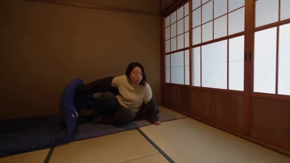</a>

The prompt is written as an ordered shot list, one beat per action, so the morning sequence plays out in order. Handheld, POV, follow and autofocus cues, plus an explicit ban on music, CGI and floating camera, keep the clip grounded as real vlog footage.

Seedance 2.5 · Text-to-video · Source: [@nawalsehar on X](https://x.com/nawalsehar/status/2097540713781371051) · found via [LearnPrompt/awesome-seedance](https://github.com/LearnPrompt/awesome-seedance)

[`japan`](tags.md#tag-japan) [`winter`](tags.md#tag-winter) [`vlog`](tags.md#tag-vlog) [`lifestyle`](tags.md#tag-lifestyle)

<details><summary><b>Prompt</b></summary>

```text
Create a 30-second photorealistic Japanese winter lifestyle vlog in a traditional mountain village at sunrise. Follow a young Japanese woman as she wakes in a wooden house, opens the shoji door, feeds small winter birds, sweeps fresh snow, makes hot green tea, and walks along a snowy village path.

Show realistic snow-covered rooftops, cedar trees, stone paths, birds, footprints, chimney smoke, warm tea steam, and soft golden morning light. Use natural handheld 2026 vlog cinematography with close-ups, POV shots, walking follow shots, realistic autofocus, exposure changes, motion blur, and a gentle final village reveal.

Natural environmental audio only: wind, birds, footsteps, snow, broom, tea pouring, wooden doors and distant village sounds. Natural dialogue in English. No music, narration, subtitles, CGI, animation, artificial snow, unrealistic bird behavior, floating camera, logos or watermark.
```

</details>

<a id="seedance-kamakura-rental-house-dv-afternoon"></a>
### Woman in yellow top leaves a Japanese house

<a href="https://x.com/AIwithAliya/status/2097192902829171098">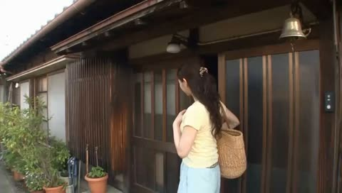</a>

The prompt locks identity, outfit and hairstyle with one explicit consistency line, then describes the camcorder look through concrete artifacts such as autofocus hunting, focus breathing and exposure shifts. Each scene is a short beat with its own spoken line and an object transfer rule, so props stay continuous across cuts.

Seedance 2.5 · Text-to-video · Source: [@AIwithAliya on X](https://x.com/AIwithAliya/status/2097192902829171098) · found via [LearnPrompt/awesome-seedance](https://github.com/LearnPrompt/awesome-seedance)

[`dv-camcorder`](tags.md#tag-dv-camcorder) [`slice-of-life`](tags.md#tag-slice-of-life) [`kamakura`](tags.md#tag-kamakura) [`dialogue`](tags.md#tag-dialogue)

<details><summary><b>Prompt</b></summary>

```text
Create a 30-second, 1080p ultra-realistic early-2000s DV home video of a 20-year-old Japanese woman spending a quiet late-summer afternoon in an old seaside neighborhood in Kamakura, Japan.

**MAIN SUBJECT**

A 20-year-old Japanese woman, naturally beautiful, realistic skin texture, minimal makeup, long dark-brown wavy hair loosely tied with a simple fabric hair tie, wearing a fitted pale-yellow short-sleeve top, loose light-blue wide-leg trousers, white canvas sneakers, and a delicate silver necklace. Keep her identity, facial features, outfit, hairstyle, body proportions, and age perfectly consistent throughout the entire video.

She leaves a small traditional Japanese rental house carrying a woven shoulder tote bag and walks through a narrow residential lane toward a tiny local bakery near the coast.

**SCENE 1 — LEAVING HOME**

She steps outside, slides the wooden door closed behind her, adjusts her tote bag and walks down a quiet narrow street lined with old Japanese houses, bicycles, potted plants, utility poles and overhead wires.

She looks toward the camera and casually says:

**“I finally have a slow afternoon.”**

The camera follows her from behind with imperfect handheld movement.

**SCENE 2 — LOCAL BAKERY**

She enters a tiny old-fashioned neighborhood bakery with a wooden entrance and glass display case.

She chooses a melon pan, a small red-bean pastry and a bottled ramune. She places everything carefully inside her woven tote bag.

While looking through the small refrigerator, she notices several colorful popsicles.

She picks up two peach-flavored popsicles, smiles and adds them to her bag.

The bakery owner places the items into a small paper package and hands it to her.

She politely says:

**“Thank you, I’ll come again.”**

**SCENE 3 — SEASIDE STREET**

Outside, she walks toward the coast.

She notices two neighborhood children sitting near a low stone wall, watching bicycles pass by.

She takes the two peach popsicles from her bag and gives one to each child.

Each child clearly receives one and happily holds it.

One child says:

**“Really? Thank you!”**

She smiles and replies:

**“Enjoy it before it melts.”**

The children happily begin eating their popsicles.

The popsicles visibly transfer from the bakery refrigerator → woman's tote bag → children's hands. No disappearing or duplicated objects.

**SCENE 4 — BICYCLE**

As she continues walking, she notices one child's bicycle has fallen over beside the sidewalk.

She stops, picks it up and holds the handlebars while the child checks the bicycle.

The child smiles and says:

**“You helped me!”**

She laughs softly and replies:

**“No problem. Ride carefully.”**

The child rides away with the other child.

**SCENE 5 — WATER FOUNTAIN**

She continues toward the seaside and discovers an old public water fountain beside a small park.

She turns the metal tap.

Water begins flowing naturally.

She cups her hands under the water and splashes cool water onto her face.

She laughs naturally, shakes the water from her hands and wipes her face.

She looks refreshed and says:

**“That feels so good.”**

**SCENE 6 — WALKING HOME**

The late-afternoon sunlight falls across the quiet Japanese street.

She walks back toward her house carrying the same woven tote bag.

A bicycle bell rings somewhere in the distance.

She briefly looks directly into the DV camera and says:

**“Best kind of afternoon.”**

She smiles, turns toward her house and walks through the wooden entrance.

The camera remains outside for a moment as the door closes.

**CUT TO BLACK.**

**CAMERA / VISUAL STYLE**

Raw handheld early-2000s Japanese DV camcorder footage. Authentic consumer camcorder aesthetic, shaky handheld movement, imperfect framing, autofocus hunting, occasional focus breathing, faded slightly washed-out colors, soft digital detail, mild compression artifacts, exposure shifts
```

</details>

<a id="seedance-kansai-platform-near-miss-montage"></a>
### Platform near-miss opens a Kansai day montage

<a href="https://x.com/oggii_0/status/2099002039141626186">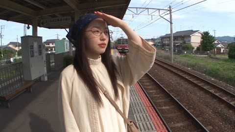</a>

Timed shot ranges split the 30 seconds into separate scenes, and the rescue is held as one unbroken shot before the hard cuts begin. A named optical look (soft halation, luma noise, exposure pumping) plus a fixed outfit and glasses spec keeps the heroine identical across cuts.

Seedance 2.5 · Text-to-video · Source: [@oggii_0 on X](https://x.com/oggii_0/status/2099002039141626186) · found via [LearnPrompt/awesome-seedance](https://github.com/LearnPrompt/awesome-seedance)

[`minidv`](tags.md#tag-minidv) [`first-person`](tags.md#tag-first-person) [`multi-scene`](tags.md#tag-multi-scene) [`japan-travel`](tags.md#tag-japan-travel)

<details><summary><b>Prompt</b></summary>

```text
Create exactly 30 seconds of photorealistic live-action Japanese travel memories, edited with quick hard cuts, seen through an affectionate adult boyfriend's first-person handheld consumer camcorder. This is a MULTI-SCENE MONTAGE, NOT one continuous take. Begin with a frightening cinematic near-miss at a suburban railway platform, then move immediately into warm, playful, intimate everyday travel. The emotional arc is alarm → relief → affectionate curiosity → golden-hour quiet → joyful night → tender laughter. No disaster imagery. No dramatic movie grading. Output ultrawide 21:9, requested 1080p, high-bitrate encode, with deliberately authentic early-2000s MiniDV aesthetics baked into the image. Use the full wide frame, no 4:3 pillarboxes.

SAME ADULT HEROINE IN EVERY SHOT:
SAME ADULT HEROINE IN EVERY SHOT:
A very beautiful young adult Korean woman, age 25–28, with luminous fair warm-toned skin and realistic pores, expressive dark-brown eyes, softly sculpted youthful cheeks, naturally beautiful full rose-pink lips with a subtle satin finish, natural understated Korean makeup, and a warm spontaneous smile. Preserve her facial geometry, body proportions and identity across every cut, without idealized plastic smoothing. Thin dark-metal oval prescription glasses with clear lenses, eyes always readable. Long, naturally dark-brown to soft-black hair, smooth and healthy with subtle natural movement; no blonde hair, no bangs.

One consistent modern Korean Gen Z outfit: an elegant loose ivory ankle-length A-line dress with full-length sleeves and a high neckline, subtle delicate embroidery, paired with a lightweight oversized beige cardigan jacket, clean cream sneakers, and a small structured taupe crossbody bag. Fabric remains naturally flowing, fully opaque and modest during movement. Glasses, hairstyle, outfit and bag remain identical throughout. Contemporary Korean styling, youthful, effortlessly elegant and understated. No spaghetti straps, revealing neckline, exposed midriff, or body-hugging styling. There is no supplied reference image: establish this original Korean heroine from these text details and maintain her exact identity. Never morph into another woman, change her ethnicity, facial features, hairstyle, or body proportions.

MINIDV STYLE LOCK:
Feels like a cherished home-video cassette recorded around 2003, not polished cinema pretending to be vintage. Gentle optical softness, low contrast, softly washed highlights, warm natural skin, fine luma noise, mild color bleed, subtle consumer-camera edge enhancement, restrained DV compression texture, slightly faded blues and greens, soft halation, occasional exposure pumping when moving between shade and sunlight.

Real handheld wide-angle proximity, uncentered composition, brief autofocus searching that settles on her face. Noticeable motion smear on fast pans and night lights, but keep expressions legible. No heavy glitch overlays, fake VHS tracking bars, film burns between scenes, timestamps, captions, subtitles, logos, or excessive chromatic aberration. Noon feels airy, sunset feels honey-gold, night feels softly smeared and imperfect. Do not use green-noir grading or glossy blockbuster teal-orange.

POV AND EDIT RULES:
The camera operator is her adult boyfriend, mostly unseen, occasionally one anatomically correct forearm or hand enters. She repeatedly checks where he is, leans toward him, looks back, shares a discovery, and smiles directly into the lens. Small natural gestures, no fashion posing, no slow-motion beauty commercial. Hold each simple action long enough to read. Hard cuts between locations, no morphing transitions.

Geography evokes a remembered Kansai day through Uji and Nara, with ordinary bookshops and shopping streets between famous places. Late spring or early summer green foliage; no contradictory autumn leaves, snow or cherry blossoms. Do not squeeze in extra landmarks or relocate Mount Fuji into Nara.

EXACT 30-SECOND EDIT:

00.00–04.00 — SUBURBAN PLATFORM, DANGER THEN RELIEF
Open with danger already readable: she has distractedly stepped too near the platform edge while peering down the line, one hand shading her eyes. She remains on the platform, never on the rails. An approaching maroon-and-cream commuter train is already visible behind her and rapidly grows larger.

From first-person POV, one boyfriend hand reaches to her upper arm; upon contact, the arm immediately retracts in ONE continuous movement, pulling her backward toward the lens and behind the tactile safety strip. She visibly moves back one or two quick steps; camera operator steps back naturally with her. Only once she is clear does the train rush past behind her.

Its wind flutters her overshirt and dress hem, never lifts or removes her hijab or exposes her body. Her eyes widen behind glasses, lips part with a brief startled gasp, then relief begins in her expression. No contact with the train, injuries, lingering on the edge, or repeated pulling motion. Believable distances and train direction; staged fictional action with a clearly successful rescue. Keep one continuous shot for this opening.

04.00–06.00 — SUNNY GRASS
Abrupt warm hard cut: first-person handholding as she guides the viewer along a grassy path. She turns toward the camera with a relieved bright laugh. Sunlight catches her ivory sleeves and navy floral hijab pin; green grass drifts softly behind. One hand linked naturally with the operator, no duplicate fingers.

06.00–07.50 — OLD BOOKSHOP
Shoot through a gap between shelves of well-used Japanese books. She playfully bends into the gap from the far side, notices the lens, gives a small conspiratorial smile. Dusty window light, crowded wooden shelves, autofocus briefly catches book spines before her eyes. Avoid legible invented titles.

07.50–09.00 — QUIET STREET CROSSING
Low, casual waist-to-shoe framing of her walking across an ordinary Japanese zebra crossing on a pedestrian signal. Ivory dress hem sways over trainers. Tilt just enough to glimpse her looking back. No fetishized body framing; modest everyday clothing detail and footsteps are the focus.

09.00–10.50 — NARROW LANE
She walks ahead between traditional wooden storefronts, potted plants and hanging fabric curtains. Her eyes glance sideways first, then she turns her face back to find the camera, smiling softly. Overhead cables and bicycles at the side establish lived-in Japan; no staged crowd.

10.50–12.50 — UJI RIVERSIDE, ADDED RESEARCHED SCENE
At the scenic Uji River in Kyoto Prefecture, film her by a pedestrian riverbank with the historic bridge in the background. Begin with sunlight moving on water, tilt casually to her leaning lightly on the safe railing. A breeze moves her cuff; she points out the view, then looks at the operator rather than posing for the landscape. Keep her face central to the memory, river sound underneath.

12.50–14.00 — UJI MATCHA, ADDED RESEARCHED SCENE
Close handheld view of her holding a simple matcha soft-serve outside a small tea shop. She takes a tiny taste, raises her eyebrows appreciatively, then offers the cone toward the lens with a playful smile. Rich natural tea-green against ivory fabric; mild sunlight overexposure, soft storefront background. No visible brand text.

14.00–15.50 — SMALL RAMEN SHOP
Close-up of steaming vegetarian mushroom-and-vegetable ramen on a wooden counter or small table, then a quick natural focus pull to her sitting opposite, smiling through wisps of steam. Cozy lamps, spoon and bowl sounds, genuine restaurant ambience. No pork slices or alcohol props. Camera remains handheld, not a glossy food advertisement.

15.50–17.00 — MANGA SHOP
She draws one manga volume from a shelf, opens it and lowers her eyes with a curious smile. Brief close shot of hands and page texture; no readable dialogue or famous copyrighted character emphasis. Maintain same glasses and floral pin.

17.00–18.50 — NARA PARK DEER
Boyfriend POV offers one designated deer cracker, held flat and released gently to a deer in Nara Park. The woman is softly out of focus a few steps behind on green grass, laughing at the deer's polite approach. No grabbing antlers, hugging or chasing wildlife. Mild camera wobble as the deer approaches.

18.50–20.00 — QUIET READING
Sitting on a park bench, she flips a manga page. Close details of her hands, gold botanical embroidery and lace cuff, then tilt to her peaceful face behind her glasses. Rustle of paper, leaves and distant birds. Natural, modest, unposed.

20.00–22.50 — UKIMIDO PAVILION, ADDED RESEARCHED SCENE
Nara Park's hexagonal wooden Ukimido pavilion with its cypress-bark roof on Sagiike Pond, reached by a wooden bridge. From the public bridge, she pauses safely by the railing and turns back toward the camera; warm light and green trees reflect in still water. Start wide enough to read the actual pavilion silhouette, then walk a little closer as she extends her hand toward the viewer. Quiet water, wooden footfalls, no temple ritual invented. Intimate location memory rather than a drone tourism shot.

22.50–24.50 — GOLDEN-HOUR MEADOW
In Nara's grassy park with deer grazing at a respectful distance, honey-gold backlight edges her hijab and sleeves. She turns gently toward the camera, dress fabric swaying with the evening breeze. A small genuine smile, peaceful eye contact, slight exposure bloom. No spinning near deer, no flying fabric revealing skin.

24.50–27.00 — LIVELY NIGHT SHOPPING STREET
Blue-hour-to-night hard cut. Warm shop lanterns, illuminated signs and pedestrians in a Kansai shopping street. She suddenly jogs lightly several steps ahead, then looks back laughing, waiting for the operator. He follows; handheld camera movement leaves convincing soft DV light streaks. No vehicles in her running path; stay in a pedestrian area. Preserve facial readability between movement smears.

27.00–28.00 — TACTILE MEMORY INSERT
One brief close handheld detail of her hand adjusting her embroidered cuff beside her taupe bag, ivory skirt hanging naturally; warm shop light blooms softly off the stitching. A casual recorded detail, not an erotic crop.
28.00–30.00 — CAMCORDER MEMORY ENDING
A second small silver early-2000s consumer camcorder is held into the foreground by the operator's free hand, its side LCD flipped outward. Current POV remains on the original recording camera; make this a clearly separate physical device, not an impossible view of itself.

The second camcorder points toward the woman; its LCD shows the same woman in the same pose at the same moment, synchronized without a duplicate person standing nearby. She notices that he is still filming, briefly gives a playful tiny pout with her naturally rose-toned lips, then breaks into a real warm laugh looking directly at him. Frame drifts toward a bright shop lamp and highlights bloom to soft white over the final fraction of a second. End on warmth, not alarm.

AUDIO:
Real synchronized location sound ONLY, no background music, no soundtrack, no narration, no scripted dialogue.

Opening: rolling rail clatter, approaching train rush, wind blast, a single surprised gasp, shoes stepping back.

Then light footsteps, grass and breeze, natural soft laughter, book pages, distant shop ambience, river water, ice-cream wrapper rustle if present, ramen bowls and chopsticks, park birds, deer footsteps, wooden bridge creaks, evening breeze, night crowd and distant vehicles.

Audio hard-cuts naturally with each location; subtle room-tone tails are acceptable. Finish with her authentic laugh. No artificial whooshes between edits or dramatic suspense score.

FINAL QUALITY RULES:
Exactly one stable adult heroine, full modest coverage, consistent hijab and glasses, anatomically natural hands, no face drift or changing ethnicity, no glossy skin filter. Requested high-bitrate file must preserve intentional MiniDV texture rather than remove it. The viewer should feel these are precious imperfect memories from a real day together, not a compilation of polished commercial travel footage.
```

</details>

<a id="seedance-korea-village-water-gun-chase"></a>
### Woman joins kids in Korean village water gun chase

<a href="https://x.com/nawalsehar/status/2099725518677655596">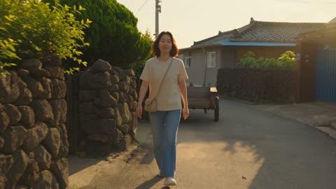</a>

The prompt gives a three-beat structure (quiet walk, surprise attack, soaked finale) with a shot list of tracking, close-ups and over the shoulder angles. Its consistency lock on characters, clothing and water guns, plus a list of banned artifacts, keeps the people and props stable through the chase.

Seedance 2.5 · Text-to-video · Source: [@nawalsehar on X](https://x.com/nawalsehar/status/2099725518677655596) · found via [LearnPrompt/awesome-seedance](https://github.com/LearnPrompt/awesome-seedance)

[`korea`](tags.md#tag-korea) [`water gun`](tags.md#tag-watergun) [`summer`](tags.md#tag-summer) [`vlog`](tags.md#tag-vlog)

<details><summary><b>Prompt</b></summary>

```text
Create a 30-second ultra-photorealistic live-action Korean countryside lifestyle vlog showing a playful summer water-gun battle between a young Korean woman and three village children.

Begin with the woman walking through a quiet Korean village when the children surprise her with a playful water-gun attack. She laughs, joins the game, and the friendly battle turns into a spontaneous chase through the sunlit village streets.

Show authentic Korean countryside details including traditional homes, stone walls, gardens, trees, bicycles, narrow paved roads and warm summer sunlight. Keep all characters, clothing, water guns and environment perfectly consistent.

Capture realistic water-gun pressure, fluid dynamics, gravity, air resistance, droplets, splashes, wet clothing, wet hair, running biomechanics, friction, momentum and natural environmental reactions. Water should behave like real pressurized liquid rather than artificial beams.

Use modern 2026 handheld cinematic-vlog cinematography with dynamic tracking shots, close-ups, over-the-shoulder angles, realistic autofocus, natural camera inertia and occasional wide village views.

Natural diegetic audio only: children's laughter, footsteps, water-gun sounds, water impacts, leaves, birds, insects and authentic Korean reactions. No music, narration or subtitles.

End with everyone completely soaked and laughing together as sunlight catches the falling water droplets in the peaceful village street.

No CGI, animation, fantasy water, impossible physics, dangerous behavior, distorted faces or hands, duplicated children, changing clothing, excessive camera movement, logos or watermark.
```

</details>

<a id="seedance-korean-alley-bicycle-ride"></a>
### Young woman cycles through a sunny Korean alley

<a href="https://x.com/AIwithkhan/status/2091175465037746522">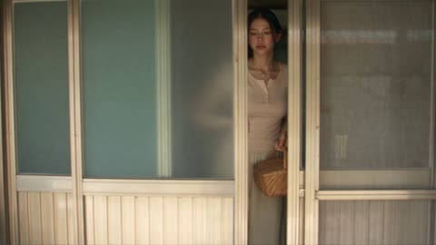</a>

Written as a friend's handheld home video, with shake, autofocus hunting, blown highlights and faded colors doing the work of the early 2000s look. Repeating the same outfit and face description keeps the subject consistent, and the timed sequence of beats ends with the camera staying behind as she rides out of frame.

Seedance 2.5 · Text-to-video · Source: [@AIwithkhan on X](https://x.com/AIwithkhan/status/2091175465037746522) · found via [LearnPrompt/awesome-seedance](https://github.com/LearnPrompt/awesome-seedance)

[`found-footage`](tags.md#tag-found-footage) [`handheld`](tags.md#tag-handheld) [`slice-of-life`](tags.md#tag-slice-of-life) [`summer`](tags.md#tag-summer)

<details><summary><b>Prompt</b></summary>

```text
Main subject: Young Korean woman, early 20s, wearing a soft pink short top, loose cream pajama-style pants, black sneakers and a delicate necklace. Messy black side ponytail, natural makeup, realistic skin and completely consistent appearance.
Location: Older Korean residential neighborhood on a hot summer afternoon. Narrow alleys, concrete walls, tiny gardens, bicycles leaning against houses, colorful laundry, utility poles and leafy trees creating patches of shade.
Shot entirely like an early-2000s home video filmed by her friend. Strong handheld shake, accidental framing, autofocus hunting, blown-out highlights, faded colors, digital noise, occasional zoom mistakes and realistic motion blur.
She leaves her house carrying a small basket and walks barefoot toward a bicycle. She slips on her sneakers, hops onto the bicycle and starts riding through the lane.
She passes a friend sitting outside a small house. The friend calls her name and she immediately stops.
They chat casually for a moment, laughing about something. She steals a sip from her friend's iced drink, laughs and continues cycling.
She stops beneath a giant tree and parks the bicycle. She looks upward as the leaves move in the warm breeze.
A basketball rolls into the lane from nearby children. She kicks it gently back toward them and waves.
She gets back on the bicycle and rides away while the camera remains behind, slowly losing sight of her around the corner.
Audio: Summer insects, birds, bicycle chain, distant children, wind through leaves, casual conversation and neighborhood ambience. No music.
```

</details>

<a id="seedance-korean-alley-leaf-bicycle-bell-dv-home-video"></a>
### Korean Woman and Bicycle Bell, DV Home Video

<a href="https://x.com/SimplyAnnisa/status/2096931238460178592">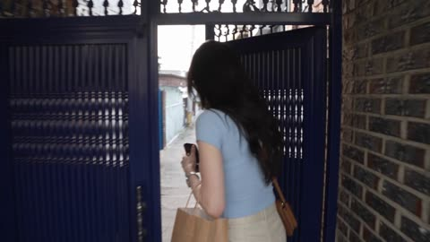</a>

A timed beat structure splits 30 seconds into five 6 second scenes, each with one small action and a line of dialogue. A detailed camcorder flaw list (autofocus hunting, accidental zooms, tape noise) plus a location sound only audio rule keeps it looking like real footage.

Seedance 2.5 · Text-to-video · Source: [@SimplyAnnisa on X](https://x.com/SimplyAnnisa/status/2096931238460178592) · found via [LearnPrompt/awesome-seedance](https://github.com/LearnPrompt/awesome-seedance)

[`dv-camcorder`](tags.md#tag-dv-camcorder) [`home-video`](tags.md#tag-home-video) [`korean`](tags.md#tag-korean) [`street`](tags.md#tag-street) [`timed-beats`](tags.md#tag-timed-beats)

<details><summary><b>Prompt</b></summary>

```text
Create a 30-second, 1080p, 16:9 ultra-realistic early-2000s DV home video of a young Korean woman having an ordinary but unexpectedly memorable summer evening in an older Seoul neighborhood.

A naturally pretty Korean woman in her early 20s, realistic skin, minimal makeup, long black slightly wavy hair, pale-blue knit top, loose cream trousers, white sneakers, brown crossbody bag, and silver watch. Keep her identity, face, outfit, hairstyle, and proportions perfectly consistent.

SETTING

A quiet older Seoul residential street with concrete lanes, apartment buildings, potted plants, bicycles, utility poles, leafy trees, and a tiny neighborhood convenience shop. Lived-in and authentic. No brands, logos, advertisements, or tourist locations.

CAMERA STYLE

Raw footage from a cheap early-2000s DV camcorder: shaky handheld movement, imperfect framing, autofocus hunting, exposure shifts, faded colors, soft detail, mild tape noise, accidental zooms, and natural camera mistakes. No stabilization or cinematic shots.

00:00–00:06 — THE MYSTERY

She walks down the street holding a small plastic bag when she suddenly hears a faint jingling sound behind her.

She stops and looks around.

The camera quickly zooms toward her confused face.

She says:

“Did you hear that?”

00:06–00:12 — THE LITTLE DISCOVERY

She follows the sound and finds a small old bicycle with a tiny bell stuck slightly open.

She gently taps the bell.

Ding.

She looks at the camera and laughs.

Then she notices a small handwritten-looking paper tag hanging from the bicycle, but the writing is too unclear to read.

00:12–00:18 — THE WIND

A sudden breeze blows several dry leaves across the street.

One lands directly on her head.

She doesn't notice.

The camera operator laughs.

She looks confused, then realizes and removes the leaf.

She gives the camera an embarrassed stare.

00:18–00:24 — THE SMALL CHALLENGE

She places the leaf on the bicycle seat and tries to balance it there.

The wind immediately blows it away.

She tries again.

It falls again.

She laughs and finally gives up.

00:24–00:30 — THE MEMORY

She picks up the leaf, puts it into her small bag, and starts walking home.

After a few steps, she turns toward the camera and says:

“Okay, that was pointless.”

She smiles and keeps walking.

The camera follows her for a few seconds before abruptly cutting to black.

AUDIO

Natural location sound only: footsteps, distant traffic, bicycle bell, summer insects, leaves, wind, neighborhood ambience, and natural laughter.

No music, narration, subtitles, captions, logos, watermarks, or on-screen text.

REALISM

Natural human reactions, imperfect timing, realistic physics, consistent objects, authentic Korean neighborhood details, and believable DV-camera imperfections. No CGI look, distorted hands, extra fingers, duplicated people, identity drift, or outfit changes.

16:9 aspect ratio.
```

</details>

<a id="seedance-korean-apartment-tiktok-dance-fail-home-video"></a>
### Clumsy TikTok dance in a cramped apartment

<a href="https://x.com/Ciri_ai/status/2095026480552271884">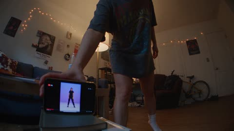</a>

Timed five second beats escalate from a clean first eight count to a lamp and spilled water pileup, and the camera shifts from a static phone to handheld shake midway. A natural location sound only audio block with every spoken line written out keeps the home video feel.

Seedance 2.5 · Text-to-video · Source: [@Ciri_ai on X](https://x.com/Ciri_ai/status/2095026480552271884) · found via [LearnPrompt/awesome-seedance](https://github.com/LearnPrompt/awesome-seedance)

[`home-video`](tags.md#tag-home-video) [`handheld`](tags.md#tag-handheld) [`comedy`](tags.md#tag-comedy) [`dialogue`](tags.md#tag-dialogue) [`timed-beats`](tags.md#tag-timed-beats)

<details><summary><b>Prompt</b></summary>

```text
Create a 30-second, 1080p ultra-realistic personal home-video of a young Korean woman confidently attempting to learn a viral TikTok dance trend in her tiny apartment, with her furniture and coordination working against her the entire time. No reference image.

**MAIN SUBJECT**

Young Korean woman in her early 20s, casual and determined energy, natural makeup, expression that shifts from focused confidence to flustered embarrassment.

Hair in a messy half-up bun, a few strands sticking to her face as she gets more flustered, small stud earrings.

Wearing an oversized band t-shirt tucked loosely into biker shorts, white ankle socks, no shoes, phone propped up against a stack of books on the floor to "record for practice."

Maintain the same face, hairstyle, clothing, body proportions, and appearance throughout the entire video.

**SETTING**

A small, cluttered studio apartment living room, evening, warm lamp light mixed with the cool glow of a laptop screen playing the dance tutorial video.

A coffee table pushed slightly out of the way but not far enough, a floor lamp standing a little too close to her "stage area," a pile of laundry on the couch, a half-full water glass on the side table, string lights on the wall, and a roommate's bike leaning against the wall in the background. Cramped, real, an apartment clearly not built for dancing.

**CAMERA / VISUAL AESTHETIC**

Raw personal footage, filmed by her roommate on a phone propped up at first, then grabbed handheld once things go wrong — strong handheld vlog shake for the second half.

Static, slightly low-angle framing for the "practice" shots, mimicking a phone-on-a-stack-of-books setup. Frame is imperfectly centered, cutting off the top of her head slightly. Once the roommate grabs the phone, autofocus hunts, motion blur kicks in during the collision moment, exposure shifts as she moves between lamp light and shadow, visible digital noise in the dim room.

No stabilization, no gimbal smoothness, no cinematic camera moves — it should feel like a real phone recording that was never meant to be watched by anyone but her.

---

**00:00–00:05 — THE CONFIDENT SETUP**

She props her phone against a stack of books, steps back into frame, and shakes out her arms like an athlete warming up.

She points at the laptop screen playing the dance tutorial, then back at herself, deadly serious.

*"Okay. I've watched this like twenty times. I got this."*

**00:05–00:10 — FIRST EIGHT-COUNT**

The music starts. She nails the first few moves surprisingly well, sharp and confident, clearly proud of herself mid-move.

Roommate's voice from off-screen, genuinely impressed: *"Wait, okay—?!"*

The camera stays static, catching her in full frame, a rare clean moment.

**00:10–00:15 — THE FIRST WOBBLE**

A quick turn in the choreography catches her off guard — she spins a half-second late, arms flailing to catch up, and clips the edge of the coffee table with her shin.

She yelps, hopping on one foot, still trying to keep the rhythm going through gritted teeth.

*"I'm fine — I'm fine, keep going—"*

**00:15–00:20 — LAMP INCIDENT**

Recovering, she throws herself into the next big arm movement — her hand clips the floor lamp, sending it tilting dangerously.

Her roommate lunges into frame to catch it, grabbing the phone off the books in the process, camera suddenly handheld and shaking.

*"THE LAMP—"*

**00:20–00:25 — FULL CHAOS**

With the lamp saved but the camera now shaky and handheld, she tries to pick the choreography back up from memory, increasingly out of sync with the music, arms going in directions the dance never intended.

She knocks the water glass off the side table with her elbow, doesn't even stop, just grimaces and keeps dancing through the spill.

Roommate, laughing hysterically behind the now-unsteady camera: *"You're literally destroying the apartment—"*

**00:25–00:30 — FINAL MOMENT**

The song ends. She strikes a triumphant final pose — chest heaving, one hand on her hip, completely out of breath, water pooling near her sock.

She looks into the camera, dead serious despite the disaster around her.

*"...Post it. That was clean."*

Her roommate, still laughing, pans the camera slowly down to the spilled water and tipped lamp before swinging back to her unbothered face — and the footage cuts abruptly to black.

---

**AUDIO**

Natural location sound only:

The tutorial/dance track playing tinny from the laptop speakers, her footsteps and fabric movement, the thud of her shin hitting the table, the lamp wobbling and roommate's scramble to catch it, glass tipping and water spilling, her roommate's genuine off-camera laughter throughout, and handheld camera noise once it's picked up.

No added music beyond the in-scene laptop track. No narration. No artificial sound effects.

Spoken lines: *"Okay. I've watched this like twenty times. I got this."* / *"Wait, okay—?!"* (roommate) / *"I'm fine — I'm fine, keep going—"* / *"THE LAMP—"* (roommate) / *"You're literally destroying the apartment—"* (roommate) / *"...Post it. That was clean."*

**FINAL FEEL**

Chaotic, cramped-apartment energy — the universal experience of confidently trying a viral dance and immediately losing a fight with your own furniture. Funny, physical, unscripted-feeling, with a deadpan ending that lands harder because she genuinely doesn't acknowledge the destruction around her.

No exaggerated slapstick beyond real physical missteps. No professional dance skill required — the comedy comes from real momentum, real near-misses, and her total refusal to admit defeat.
```

</details>

<a id="seedance-korean-bus-hidden-beach-vlog"></a>
### Korean woman vlogs bus ride toward hidden coast

<a href="https://x.com/aiwithaly/status/2096087387164320223">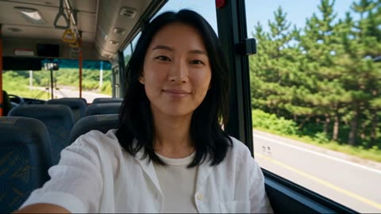</a>

The prompt lays out the 60 second story as a sequence of clear beats, each with one location and one action. It fixes a handheld smartphone vlog camera and specifies wardrobe, props and natural beach ambience, which keeps the look and sound consistent from scene to scene.

Seedance 2.5 · Text-to-video · Source: [@aiwithaly on X](https://x.com/aiwithaly/status/2096087387164320223) · found via [LearnPrompt/awesome-seedance](https://github.com/LearnPrompt/awesome-seedance)

[`korean`](tags.md#tag-korean) [`vlog`](tags.md#tag-vlog) [`beach`](tags.md#tag-beach) [`travel`](tags.md#tag-travel)

<details><summary><b>Prompt</b></summary>

```text
Create a 60-second ultra-photorealistic Korean summer travel vlog featuring a young Korean woman in her mid-20s exploring a secluded coastal beach. Natural dark hair, minimal makeup, white linen shirt, denim shorts, sandals and canvas shoulder bag.

Start with her filming herself on a small Korean bus as the ocean appears between green hills. She gets off at a quiet coastal stop and discovers a hidden beach with turquoise water, pale sand and fishing boats. She removes her sandals, walks barefoot along the shoreline, collects a seashell and reacts naturally when cold water reaches her feet.

She then changes into a tasteful one-piece swimsuit and swims in the clear ocean with realistic human movement, buoyancy, waves and wet hair. Back on shore, she changes clothes, enjoys a cold Korean drink and snack while sitting beside the sea.

End during golden hour as she walks barefoot along the shoreline carrying her sandals, with warm sunlight, long shadows and gentle waves.

Authentic 2026 smartphone vlog style, handheld camera, natural expressions, realistic skin, hair, clothing, sand and water physics. English dialogue only, natural beach ambience, no music, no CGI, no animation, no subtitles or watermark.
```

</details>

<a id="seedance-korean-cafe-vlog-chaos"></a>
### Woman filming café vlog as everything goes wrong

<a href="https://x.com/Ciri_ai/status/2094706780114952303"></a>

Each beat of about five seconds pairs a deliberately aesthetic shot with a sudden handheld jolt, so the comedy comes from the gap between the planned look and the raw execution. Camera faults such as autofocus hunting, blown highlights and the friend's laughter are written as motion and sound, which keeps the footage believable.

Seedance 2.5 · Text-to-video · Source: [@Ciri_ai on X](https://x.com/Ciri_ai/status/2094706780114952303) · found via [LearnPrompt/awesome-seedance](https://github.com/LearnPrompt/awesome-seedance)

[`handheld`](tags.md#tag-handheld) [`comedy`](tags.md#tag-comedy) [`cafe`](tags.md#tag-cafe) [`found-footage`](tags.md#tag-found-footage)

<details><summary><b>Prompt</b></summary>

```text
Create a 30-second, 1080p ultra-realistic personal home-video showing a young Korean woman attempting to film an "aesthetic" café vlog for her social media and everything comically not going to plan. No reference image.
MAIN SUBJECT
Young Korean woman in her early 20s, trendy and put-together look, dewy makeup, confident expression that keeps cracking into laughter.
Straight black hair with curtain bangs, small gold hoop earrings, soft pink lip tint.
Wearing an oversized cream sweater, a plaid mini skirt, chunky white sneakers, and a small quilted shoulder bag she keeps adjusting for the "shot."
Maintain the same face, hairstyle, clothing, body proportions, and appearance throughout the entire video.
SETTING
A charming autumn café street in Seoul on a crisp, sunny afternoon.
A cozy corner café with outdoor seating, string lights, a chalkboard menu, falling ginkgo leaves, a latte art station visible through the window, a bicycle propped against a brick wall, pedestrians occasionally walking through frame, and a small tree dropping leaves onto the sidewalk table. Warm, golden, Pinterest-looking — until it isn't.
CAMERA / VISUAL AESTHETIC
Raw personal footage, filmed by her friend who keeps trying (and failing) to make it look cinematic, strong handheld vlog shake throughout.
The video oscillates between deliberately "aesthetic" attempted shots — slow pans, artful angles, soft focus — and sudden chaotic handheld jolts when things go wrong. Autofocus hunts comically between her face and the latte. Camera tilts and overcorrects. Exposure blows out when it swings toward the sun. Mild motion blur during quick recoveries. Slightly warm, oversaturated color grade like a try-hard Instagram filter that keeps slipping back to raw reality.
No stabilization, no real cinematic polish — the "aesthetic" is aspirational, the execution is not.
00:00–00:05 — THE PERFECT LATTE SHOT (ATTEMPT)
She sits at the outdoor table, carefully positioning a latte with foam art, trying to casually "candid" sip it for the camera.
The camera does a slow artful pan down toward the cup — then a leaf falls directly into it with a soft plop.
She freezes, staring at the ruined latte art, deadpan.
00:05–00:10 — REACTION
She looks up at the camera, unimpressed, leaf still floating in the foam.
"...Are you kidding me right now."
The friend behind the camera bursts out laughing, shaking the frame violently.
00:10–00:15 — THE "CANDID" WALK
She gets up to attempt a slow-motion aesthetic walk past the café window, hair flowing, sunglasses going on in one smooth motion — sunglasses immediately get caught in her hair.
She stops mid-stride, wincing, trying to untangle them one-handed while still smiling for the camera.
The camera zooms in awkwardly close on the tangled sunglasses, then yanks back out.
00:15–00:20 — BICYCLE MISHAP
She leans against the parked bicycle for a "casual candid lean" pose, one hand in her pocket.
The bicycle kickstand gives way and it slowly tips sideways, taking her balance with it.
She stumbles but catches herself, laughing hard, one hand up defensively toward the lens.
"Okay, delete that, delete that!"
00:20–00:25 — GINKGO LEAF CHAOS
She tries to recreate a "leaves falling around me" cinematic moment by tossing a handful of gathered ginkgo leaves into the air above her head.
A gust of wind blows them straight back into her face instead.
She spits out a leaf, blinking, completely unbothered and giggling.
The camera shakes as the operator nearly drops it laughing.
00:25–00:30 — FINAL MOMENT
She gives up on the aesthetic altogether, plops back down at the café table, and grabs the leaf-ruined latte anyway, taking a defiant sip through the foam.
She looks dead into the camera, deadpan, leaf still stuck to her sweater.
"This is the content. This is it. Post this one."
She gives an exaggerated thumbs up as the frame shakes with the friend's laughter, and the footage cuts abruptly to black.
AUDIO
Natural location sound only:
Café ambience, cup clinking, leaves rustling, wind gusts, bicycle clattering, footsteps, her friend's audible laughter throughout, fabric rustling, and handheld camera noise.
No music. No narration. No artificial sound effects.
Spoken lines: "...Are you kidding me right now." / "Okay, delete that, delete that!" / "This is the content. This is it. Post this one."
FINAL FEEL
A self-aware, comedic behind-the-scenes of someone trying to film an aesthetic vlog and getting completely humbled by reality at every turn — warm, golden autumn light paired with genuine, unscripted chaos and laughter.
No posed perfection sustained for more than a few seconds before something goes wrong. No exaggerated slapstick acting — the comedy comes from real reactions, real mishaps, and the gap between the "vision" and what actually happens on camera.
```

</details>

<a id="seedance-korean-cafe-vlog-six-scenes"></a>
### Woman sips iced coffee outside a cafe

<a href="https://x.com/ZorviaLux/status/2106230270282313997">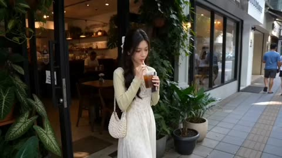</a>

Each of the six scenes is numbered and repeats the same wardrobe, hair and bag description, which keeps the character identical across cuts. Every beat names its camera move (wide, close up, tracking, slow motion) and its light source, so the golden hour, blue hour and fairy light shifts read clearly on the timeline.

Seedance 2.5 · Text-to-video · Source: [@ZorviaLux on X](https://x.com/ZorviaLux/status/2106230270282313997) · found via [LearnPrompt/awesome-seedance](https://github.com/LearnPrompt/awesome-seedance)

[`vlog`](tags.md#tag-vlog) [`character-consistency`](tags.md#tag-character-consistency) [`multi-scene`](tags.md#tag-multi-scene) [`korean`](tags.md#tag-korean)

<details><summary><b>Prompt</b></summary>

```text
Create a 60-second ultra-realistic cinematic lifestyle vlog featuring a beautiful young Korean woman with long dark brown hair, soft natural makeup, and a gentle smile. She wears a delicate white floral dress with a light cream cardigan and carries a small white handbag.

**Scene 1:** She stands outside a modern aesthetic café surrounded by lush green plants and glass windows. She holds an iced coffee, takes a sip, gently adjusts her hair, and smiles naturally at the camera.

**Scene 2:** Close-up cinematic shots of her face as she enjoys her coffee. Soft sunlight illuminates her face. She looks relaxed and happy, with subtle natural movements.

**Scene 3:** She walks along a beautiful city street during golden hour, wearing the same outfit. The camera follows her from behind and captures elegant side-profile shots.

**Scene 4:** She arrives at a rooftop viewpoint overlooking a beautiful city skyline during sunset. The golden sun slowly sets behind the buildings. She sits on a bench, gazes at the sunset, and enjoys the peaceful atmosphere.

**Scene 5:** At blue hour, she walks along a modern urban street with glowing streetlights and passing cars. The camera captures her beautiful side profile and flowing hair in a cinematic tracking shot.

**Scene 6:** Nighttime outdoor café with warm fairy lights hanging overhead. She sits at a cozy wooden table with her iced coffee and handbag. She smiles at the camera, raises her drink, takes a sip, and waves goodbye with a cheerful expression.

**Visual style:** Ultra-realistic 4K, photorealistic skin texture, natural facial expressions, cinematic depth of field, soft lighting, warm golden-hour tones, beautiful bokeh, smooth camera movements, professional color grading, realistic hair physics, natural body movements, aesthetic Korean lifestyle vlog, dreamy peaceful atmosphere.

**Camera:** Mix of wide shots, medium shots, close-ups, slow-motion details, smooth tracking shots, and gentle cinematic transitions.

**Mood:** Peaceful, romantic, cozy, elegant, dreamy everyday life.

Maintain perfect character consistency, identical facial features, hairstyle, clothing, and accessories across all scenes. No distorted hands, no flickering, no face changes, no unnatural movements, no text, no watermark.
```

</details>

<a id="seedance-korean-camping-vlog-three-friends"></a>
### Three friends camping in Korean mountains vlog

<a href="https://x.com/saniaspeaks_/status/2119291884556169419">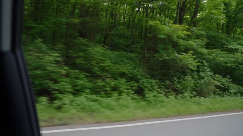</a>

A numbered list of ten timed scenes with exact second ranges fixes the order and pacing of the clip. A character block with outfit details plus a continuity rule keeps the three friends consistent across cuts.

Seedance 2.5 · Text-to-video · Source: [@saniaspeaks_ on X](https://x.com/saniaspeaks_/status/2119291884556169419) · found via [LearnPrompt/awesome-seedance](https://github.com/LearnPrompt/awesome-seedance)

[`camping`](tags.md#tag-camping) [`korea`](tags.md#tag-korea) [`handheld`](tags.md#tag-handheld) [`vlog`](tags.md#tag-vlog)

<details><summary><b>Prompt</b></summary>

```text
Create a 30-second ultra-realistic 4K live-action travel vlog featuring three young Korean female friends camping in the beautiful mountains of South Korea. Authentic handheld camcorder footage, natural friendship moments and realistic activities.

CHARACTERS:

- Main girl: Shoulder-length dark brown hair, beige fleece jacket, white T-shirt, olive cargo pants and hiking shoes.
- Friend 1: Black ponytail, dusty blue outdoor jacket, black pants and hiking shoes.
- Friend 2: Medium-length brown hair, brown knitted sweater, dark jeans and hiking shoes.

Keep all faces, hairstyles and outfits identical throughout.

EXACT 10-SCENE SEQUENCE — 30 SECONDS

1. ROAD TRIP (0–3s): A car travels along a winding Korean mountain road. The main girl films the forest from the passenger seat while her two friends laugh in the back.

2. CAMPSITE ARRIVAL (3–5s): They park at a grassy campsite surrounded by pine trees and mountains, then unload their tent, backpacks and supplies.

3. SETTING UP TENT (5–9s): They spread the tent fabric, connect poles, raise the tent, secure stakes and attach the rain cover. Show the complete assembly naturally.

4. CAMPSITE SETUP (9–11s): They arrange camping chairs, a folding table, backpacks, vegetables, meat and cooking equipment.

5. BARBECUE (11–15s): One girl prepares the portable grill, another chops vegetables, and the main girl grills marinated meat. Realistic sizzling, smoke and cooking movements.

6. DINNER (15–18s): They enjoy Korean barbecue, lettuce wraps, rice and side dishes while laughing and sharing food.

7. CAMPFIRE (18–22s): At night, they sit around a safe campfire. The main girl tells a funny story, her friends laugh, and warm firelight illuminates their faces.

8. STARRY NIGHT (22–24s): They admire the stars, pointing towards the sky while their tent glows softly behind them.

9. NEXT MORNING (24–26s): The main girl wakes inside her sleeping bag, stretches, unzips the tent and looks outside at the misty mountains.

10. SUNRISE ENDING (26–30s): All three walk to a safe mountain viewpoint overlooking misty green peaks. They admire the golden sunrise. The main girl smiles and waves at the camera. End with a beautiful wide handheld shot of the friends together.

VISUAL STYLE:
Ultra-photorealistic 4K travel vlog, authentic Korean mountains, natural handheld camera shake, imperfect framing, occasional autofocus adjustments, realistic lighting, skin textures, expressions, camping equipment, food, smoke, fire and morning mist.

AUDIO: Natural sounds only: car engine, forest wind, footsteps, tent assembly, sizzling barbecue, conversations, laughter, crackling fire, crickets and morning birds. No music or narration.

STRICT CONTINUITY:
Same three girls, outfits, campsite, tent and equipment throughout. Show every action in the correct order. Tent setup before cooking, cooking before eating, campfire after dinner and sunrise the following morning.

No teleportation, missing scenes, duplicated objects, distorted hands, sudden outfit changes, artificial CGI or unnatural movements.

FINAL GOAL: A warm, nostalgic and completely believable weekend camping vlog filled with genuine friendship, beautiful mountain scenery and a breathtaking sunrise. All 10 scenes must appear within exactly 30 seconds.
```

</details>

<a id="seedance-korean-campus-day-vlog"></a>
### Korean student selfie on a city bus

<a href="https://x.com/aiwithaly/status/2096818423846334683">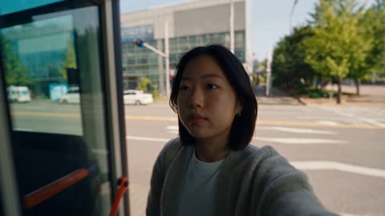</a>

The prompt splits one day into ordered scene beats with named locations, then fixes the camera language (handheld selfie, POV, autofocus) and a sound list so the look stays consistent across cuts. It also sets English dialogue only and no background music, which keeps the clip grounded in location audio.

Seedance 2.5 · Text-to-video · Source: [@aiwithaly on X](https://x.com/aiwithaly/status/2096818423846334683) · found via [LearnPrompt/awesome-seedance](https://github.com/LearnPrompt/awesome-seedance)

[`vlog`](tags.md#tag-vlog) [`korean-campus`](tags.md#tag-korean-campus) [`day-in-life`](tags.md#tag-day-in-life) [`pov-selfie`](tags.md#tag-pov-selfie)

<details><summary><b>Prompt</b></summary>

```text
Create a 30-second photorealistic live-action 2026 Korean university lifestyle vlog following a young Korean female student through one beautiful ordinary day. Start with a morning city-bus ride and ocean-like city reflections through the window, then move naturally through a busy campus lecture, iced coffee break, quiet library study, cafeteria lunch with a friend, energetic dance-club practice, golden-hour campus walk, and peaceful blue-hour night stroll.

Use authentic modern Korean university surroundings, natural student clothing, realistic Korean facial features, subtle expressions and spontaneous interactions. High-end smartphone vlog aesthetic with handheld movement, selfie shots, POV footage, natural autofocus, exposure changes and realistic motion blur. Hair, cardigan, backpack and objects react naturally to movement, wind and gravity. Include realistic bus movement, walking, dancing, coffee condensation, food steam and believable human biomechanics.

English dialogue only, with natural location sounds such as bus noise, classroom ambience, café chatter, footsteps, cafeteria sounds, dance-room audio and nighttime campus ambience. No narrator, no background music, no CGI, animation, subtitles, logos or watermark.
```

</details>

<a id="seedance-korean-clothesline-gust-chase"></a>
### Woman chases laundry blown off a clothesline

<a href="https://x.com/AIwithkhan/status/2095485437821464808">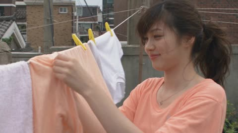</a>

A locked character block and a fixed courtyard location keep the look consistent, while early 2000s DV camcorder cues such as handheld shake, autofocus hunting and exposure pumping sell the candid feel. A clear beat sequence, from the gust to the chase to a second item blowing away, gives the comedy a readable arc, and the glance to camera lands the punchline.

Seedance 2.5 · Reference-to-video · Source: [@AIwithkhan on X](https://x.com/AIwithkhan/status/2095485437821464808) · found via [LearnPrompt/awesome-seedance](https://github.com/LearnPrompt/awesome-seedance)

[`dv-camcorder`](tags.md#tag-dv-camcorder) [`handheld`](tags.md#tag-handheld) [`korean`](tags.md#tag-korean) [`character-consistency`](tags.md#tag-character-consistency)

<details><summary><b>Prompt</b></summary>

```text
GIRL = MAIN CHARACTER: Young Korean woman in her early 20s, natural makeup, black wavy hair tied into a messy side ponytail, loose peach T-shirt, white pajama pants, black sneakers and simple necklace. Maintain exact identity and appearance.

LOCATION: Small Korean apartment courtyard during a warm windy afternoon. Concrete walls, laundry lines, potted plants, bicycles and neighboring homes.

CAMERA / LOOK: Early-2000s consumer DV camcorder. Strong handheld shake, autofocus hunting, exposure pumping, faded colors, soft contrast, motion blur and imperfect zooms.

SEQUENCE:
She hangs freshly washed clothes on a long outdoor clothesline. Everything looks calm until a sudden strong gust sends one shirt flying off the line. She runs after it while laughing. The camera operator follows shakily. The shirt lands on a parked bicycle. She grabs it, tries to hang it again, and another piece of laundry immediately blows away. She looks toward the camera in disbelief before chasing it down the lane.

AUDIO: Wind, fabric flapping, birds, footsteps, distant scooters and neighborhood voices. No music.

Candid domestic humor, realistic fabric movement, nostalgic DV imperfections and believable everyday chaos.
```

</details>

<a id="seedance-korean-convenience-store-friends-vlog"></a>
### Two friends pick snacks at a convenience store fridge

<a href="https://x.com/ayzalnooor24521/status/2109850322286076180">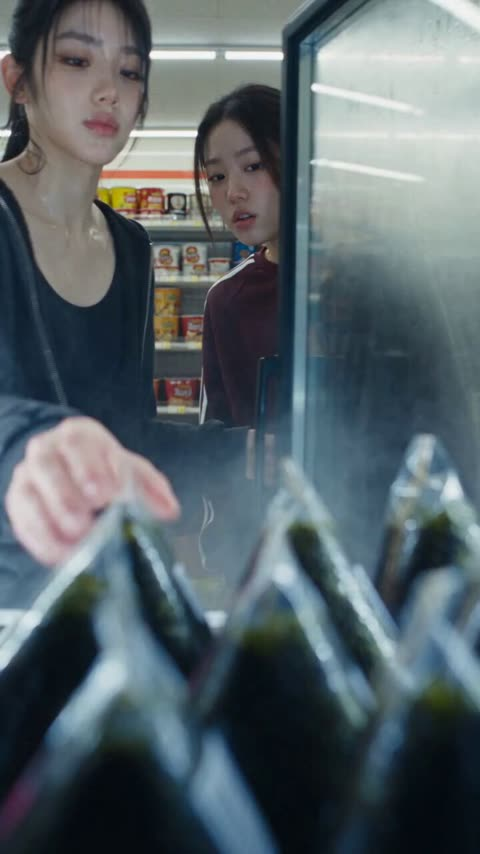</a>

The prompt splits the clip into ordered beats (store, night street, walking away) so each scene change is explicit. Fixed wardrobe for each girl plus handheld camera, ambient sound and documentary cues keep the look consistent and natural.

Seedance 2.5 · Text-to-video · Source: [@ayzalnooor24521 on X](https://x.com/ayzalnooor24521/status/2109850322286076180) · found via [LearnPrompt/awesome-seedance](https://github.com/LearnPrompt/awesome-seedance)

[`korean`](tags.md#tag-korean) [`street-vlog`](tags.md#tag-street-vlog) [`convenience-store`](tags.md#tag-convenience-store) [`documentary`](tags.md#tag-documentary)

<details><summary><b>Prompt</b></summary>

```text
Created a 30-second ultra-realistic cinematic Korean street vlog, vertical 9:16 format. Beautiful Korean girl with natural Korean beauty, fair clear skin, delicate facial features, dark eyes, and black hair tied in a casual ponytail, wearing a simple black oversized sweatshirt, loose dark track pants, and black-and-white sneakers. Her female friend wears a burgundy zip-up jacket and dark pants. The video begins inside a Korean convenience store, where the girl casually selects food from a refrigerated display while her friend stands nearby. She then pays at the checkout counter, holding a bottle of water and snacks. The scene transitions to a nighttime Korean street, where both girls sit at a small blue outdoor plastic table and chairs under cool streetlights, enjoying their snacks, checking their phones, drinking water, and chatting naturally with relaxed expressions. One girl smiles while looking at her phone, and the other takes a bite of her food and drinks from her water bottle. Near the end, one girl stands up, gathers her belongings, and walks away, leaving the empty blue chairs and table behind as her friend moves into the distance. Authentic Korean everyday lifestyle, candid moments, natural body movements, realistic facial expressions, subtle handheld camera movement, soft focus, shallow depth of field, convenience-store fluorescent lighting, cinematic blue nighttime tones, realistic skin texture, natural ambient street sounds, documentary-style storytelling, high-quality details, consistent character appearance throughout, no exaggerated acting, no artificial beauty filters, no text, no subtitles, no watermark.
```

</details>

<a id="seedance-korean-countryside-bicycle-vlog"></a>
### Korean countryside bicycle race with three children

<a href="https://x.com/nawalsehar/status/2099368044287947194">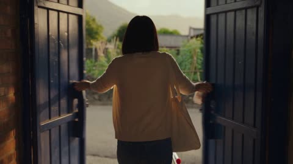</a>

The prompt runs as a timed sequence with a fixed cast and outfit restated for consistency, then lists the bicycle physics and the exact sound palette so the model fills in believable motion and dialogue lip sync. Handheld vlog camera language with bicycle height tracking and a closing wide shot gives the clip a documentary feel.

Seedance 2.5 · Text-to-video · Source: [@nawalsehar on X](https://x.com/nawalsehar/status/2099368044287947194) · found via [LearnPrompt/awesome-seedance](https://github.com/LearnPrompt/awesome-seedance)

[`vlog`](tags.md#tag-vlog) [`korean-countryside`](tags.md#tag-korean-countryside) [`bicycle`](tags.md#tag-bicycle) [`dialogue-audio`](tags.md#tag-dialogue-audio)

<details><summary><b>Prompt</b></summary>

```text
Create a 30-second ultra-photorealistic live-action Korean countryside lifestyle vlog following a young Korean woman through a spontaneous afternoon adventure. Begin with her leaving her village home on a bicycle before three local children challenge her to a friendly race through the quiet countryside.

Show an authentic Korean rural village with traditional houses, stone walls, vegetable gardens, rice fields, narrow roads, trees and a peaceful stream beyond the village. Keep the woman, children, bicycles, clothing and environment perfectly consistent throughout.

Capture realistic cycling biomechanics, pedaling, steering, braking, balance, bicycle momentum, wind, hair and clothing movement, flowing water, grass, leaves and natural sunlight. Every movement should follow believable real-world physics.

Use modern 2026 handheld cinematic-vlog cinematography with realistic autofocus, subtle camera movement, bicycle-height tracking shots, intimate close-ups and wide countryside views.

Natural diegetic audio only: bicycle chains, tires, brakes, birds, insects, wind, children's laughter, flowing water, snack packaging and authentic Korean dialogue with accurate lip synchronization. No music, narration or subtitles.

End with the woman and children sitting beside the stream, sharing snacks as their bicycles rest nearby and warm sunlight filters through the trees.

No CGI, animation, artificial movement, impossible physics, distorted faces or hands, changing outfits, duplicated children, floating objects, excessive camera shake, logos or watermark.
```

</details>

<a id="seedance-korean-countryside-chicken-coop-morning-vlog"></a>
### Korean Countryside Morning Chicken Coop Vlog

<a href="https://x.com/aiwithaly/status/2097556131623432569">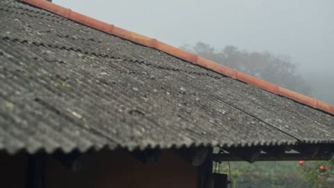</a>

The action chain is written as arrow separated beats, which gives a 30 second clip a clear order. Documentary handheld style, weather and sound cues (mist, wind, ambient audio) and a closing list of exclusions (no music, subtitles, logos) keep the result natural.

Seedance 2.5 · Text-to-video · Source: [@aiwithaly on X](https://x.com/aiwithaly/status/2097556131623432569) · found via [LearnPrompt/awesome-seedance](https://github.com/LearnPrompt/awesome-seedance)

[`vlog`](tags.md#tag-vlog) [`korean-countryside`](tags.md#tag-korean-countryside) [`documentary`](tags.md#tag-documentary) [`handheld`](tags.md#tag-handheld) [`morning-routine`](tags.md#tag-morning-routine)

<details><summary><b>Prompt</b></summary>

```text
Create a 30-second photorealistic Korean countryside lifestyle vlog following a woman through her peaceful morning routine. Show her opening the chicken coop → feeding the chickens → collecting fresh eggs → cleaning the coop → preparing a homemade breakfast → sitting outside and enjoying the quiet farmhouse morning.

Authentic 2026 Korean rural life, natural human movement, realistic chicken behavior, fresh farm-to-table details, morning mist, soft sunlight, natural wind and environmental sounds, and documentary-style handheld cinematography. No background music, subtitles, logos or watermark.
```

</details>

<a id="seedance-korean-couple-lazy-morning-pov-walk"></a>
### Korean couple lazy summer morning POV walk

<a href="https://x.com/AIwithJessica/status/2096779054720639258">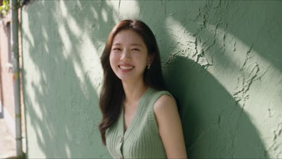</a>

Reference images lock both outfits and faces, then ten timed three second beats keep one small action per shot across a 30 second vlog. A MiniDV handheld style, location only sound and a closing continuity list keep it realistic.

Seedance 2.5 · Reference-to-video · Source: [@AIwithJessica on X](https://x.com/AIwithJessica/status/2096779054720639258) · found via [LearnPrompt/awesome-seedance](https://github.com/LearnPrompt/awesome-seedance)

[`pov-vlog`](tags.md#tag-pov-vlog) [`korean-lifestyle`](tags.md#tag-korean-lifestyle) [`couple`](tags.md#tag-couple) [`minidv`](tags.md#tag-minidv) [`reference-images`](tags.md#tag-reference-images)

<details><summary><b>Prompt</b></summary>

```text
POV: Korean couple spends a lazy summer morning wandering their neighborhood 🇰🇷 Create a 30-second, 16:9 ultra-realistic live-action POV vlog using the uploaded reference images as the exact character references. Girl: preserve her face, long straight dark hair, eye color, skin tone, soft natural makeup, delicate drop earrings, and body proportions exactly as in reference image 2, wearing her sage-green sleeveless ribbed knit vest and white wide-leg trousers throughout. Boy: preserve his face, tousled dark wavy hair, earrings, layered silver chain necklace, chain bracelet and wristwatch exactly as in reference image 1, wearing his oversized dusty-pink smiley-face tee and white sweatshorts throughout.

Style: Authentic Korean lifestyle vlog, early-2000s MiniDV/home-video aesthetic, handheld POV, imperfect framing, slight autofocus breathing, natural motion blur and exposure changes, soft overcast morning light. Spontaneous, unstaged chemistry.

0–3s: She leans against a textured green courtyard wall, laughing as she films him approaching down the lane with two iced coffees.

3–6s: They walk side by side down the narrow concrete alley, camera swinging naturally; he hands her a coffee and she takes a sip, smiling at the lens.

6–9s: She spins slowly in front of an old wall covered in dappled tree-shadow, showing off her outfit; he claps and whistles playfully off-camera.

9–12s: They pause by a row of parked bicycles; he pretends to ride one and she films, giggling, telling him to stop.

12–15s: Inside the small convenience store, she picks a snack from the shelf while he sneaks a second item into her basket; she catches him and narrows her eyes.

15–18s: Outside the store, they sit on a low step sharing the snack, passing it back and forth, natural laughter between bites.

18–21s: Walking again, she films their shadows stretching across the pavement; he reaches over and gently tucks a strand of her hair back.

21–24s: They stop by a wall of hanging laundry and potted plants; she pretends to interview him with the coffee cup as a microphone.

24–27s: He points out something off-camera; she turns to look, laughing, then bumps his shoulder with hers.

27–30s: They continue walking down the sunlit lane, hand in hand, camera trailing behind as they shrink into the distance; she glances back once, smiling, before the frame settles into a soft handheld sway.

Audio: Natural location sound only—quiet residential ambience, birds, distant traffic, footsteps, rustling laundry, convenience store door chime, soft conversation and laughter. No music, narration or artificial SFX.

Continuity/realism: Same woman and boyfriend throughout; consistent wardrobe and appearance matching the reference images exactly, believable Korean neighborhood environment, realistic physics and movement, natural couple chemistry. No teleportation, duplicates, distorted faces/hands, exaggerated acting, subtitles, captions, logos or watermarks.
```

</details>

<a id="seedance-korean-couple-seoul-drive-dv-camcorder"></a>
### Korean couple afternoon drive in DV camcorder style

<a href="https://x.com/AIwithkhan/status/2104776214066188611">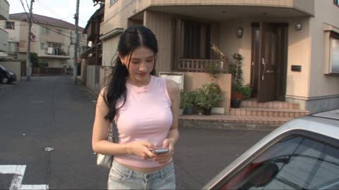</a>

Sections for characters, a beat by beat story, camera feel, audio, continuity and negatives keep a 30 second piece coherent. The DV look comes from named flaws like autofocus hunting, accidental zooms and exposure shifts, plus a built in microphone only soundscape with no music.

Seedance 2.5 · Text-to-video · Source: [@AIwithkhan on X](https://x.com/AIwithkhan/status/2104776214066188611) · found via [LearnPrompt/awesome-seedance](https://github.com/LearnPrompt/awesome-seedance)

[`dv-camcorder`](tags.md#tag-dv-camcorder) [`couple`](tags.md#tag-couple) [`seoul`](tags.md#tag-seoul) [`lo-fi-realism`](tags.md#tag-lo-fi-realism) [`native-audio`](tags.md#tag-native-audio)

<details><summary><b>Prompt</b></summary>

```text
Create a 30-second, 1080p ultra-realistic early-2000s consumer DV camcorder home video of a young Korean couple going for a casual afternoon drive through Seoul. The footage should feel like a genuine memory recorded by a friend, imperfect and spontaneous rather than a polished commercial.

=== CHARACTERS ===

GIRL: Young adult Korean woman in her early 20s, naturally beautiful, realistic skin, minimal makeup, long slightly wavy dark hair tied loosely with a few strands framing her face. Ll

BOYFRIEND: Young adult Korean man in his early 20s, natural hairstyle, realistic skin, relaxed expression, wearing a loose white T-shirt, dark jeans and white sneakers. Keep his appearance consistent.

=== STORY ===

She waits outside her apartment building with a small shoulder bag, checking her phone and looking down the street. Her boyfriend arrives in an older compact car and smiles when he sees her. She opens the passenger door, gets inside and playfully looks toward the camera as if embarrassed about being filmed.

They drive slowly through an older Seoul neighborhood. She sits in the passenger seat with the window slightly open, enjoying the breeze while her hair moves naturally. Her boyfriend occasionally glances at her and smiles while keeping his attention on the road.

They stop at a small neighborhood convenience store. She gets out, buys two cold drinks and returns to the car. She hands one to her boyfriend, keeps the other for herself, and they laugh together before continuing the drive.

Later, they park near a quiet riverside road. They get out and walk beside the parked car, talking casually. She takes a sip of her drink, makes a playful expression at the taste, and he laughs. She lightly pushes his shoulder and they continue walking together.

A gentle breeze moves through her hair. He notices a strand across her face and gently moves it aside. She smiles and looks at him for a moment. They stand close together beside the car, sharing a quiet romantic moment.

Near the end, she looks toward the camera and laughs shyly, then turns back toward her boyfriend. He steps closer, she smiles, and they share a brief, natural kiss. They pull back, laugh softly and remain standing close together as the camera keeps recording.

The boyfriend looks toward the camera and jokingly shakes his head while she hides her face against his shoulder, laughing.

=== CAMERA / DV FEEL ===

Raw early-2000s consumer DV camcorder footage. Handheld camera operated by a friend sitting in the back seat and later walking with them. Imperfect framing, subtle handheld shake, autofocus hunting, occasional exposure shifts, faded summer colors, soft digital detail, mild sensor noise, natural motion blur and occasional accidental zooms. No stabilization and no polished cinematic movement.

=== AUDIO ===

Built-in camcorder microphone only. Car engine, road noise, turn signals, window breeze, distant Seoul traffic, convenience-store door chime, refrigerator hum, footsteps, birds, neighborhood voices, fabric movement and natural laughter. Their dialogue should feel casual and partially imperfect like a real home video. No music, no narration, no subtitles.

=== REALISM / CONTINUITY ===

Keep the same couple, faces, hairstyles, outfits, accessories and car throughout. Natural Korean facial features, realistic hands and fingers, believable walking, sitting, driving and kissing. Hair and clothing react naturally to the breeze and movement. Genuine expressions rather than exaggerated acting.

=== NEGATIVE ===

No cinematic commercial look, no gimbal shots, no drone shots, no dramatic lighting, no beauty filters, no plastic skin, no CGI appearance, no anime, no cartoon
```

</details>

<a id="seedance-korean-farm-day-front-facing-home-video"></a>
### Korean Farm Day Filmed Like Home Video

<a href="https://x.com/saniaspeaks_/status/2098742251472261330">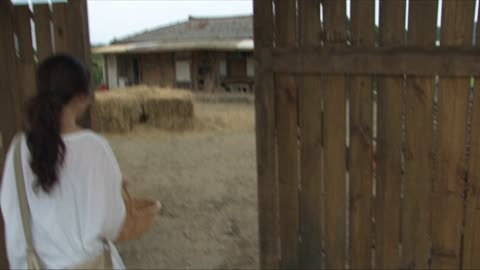</a>

A timeline of five 5 second beats keeps a 30 second clip coherent. Repeated rules for a camera always in front, handheld DV flaws and sound limited to location audio keep the home-video realism.

Seedance 2.5 · Text-to-video · Source: [@saniaspeaks_ on X](https://x.com/saniaspeaks_/status/2098742251472261330) · found via [LearnPrompt/awesome-seedance](https://github.com/LearnPrompt/awesome-seedance)

[`home-video`](tags.md#tag-home-video) [`dv-camcorder`](tags.md#tag-dv-camcorder) [`korean`](tags.md#tag-korean) [`vlog`](tags.md#tag-vlog) [`farm`](tags.md#tag-farm)

<details><summary><b>Prompt</b></summary>

```text
Create a 30-second, 1080p ultra-realistic personal home-video showing an ordinary summer afternoon in the life of a young Korean woman visiting a small traditional farm and helping with the animals. No reference image.

A naturally pretty beautiful Korean woman in her early 20s, realistic natural skin texture, minimal makeup, relaxed and cheerful personality. Long black hair tied in a loose low ponytail. She wears a loose white cotton T-shirt, light olive-green cargo pants, brown ankle boots, and a beige canvas crossbody bag. Keep the same face, hairstyle, clothing, body proportions, and overall appearance throughout the entire video.

A small traditional countryside farm outside Seoul during a warm summer afternoon. Wooden fences, green fields, an old farmhouse, barn, hay bales, vegetable patches, chickens, cows, buckets, farming tools, trees and natural countryside surroundings. The farm feels ordinary and lived-in, not like a tourist attraction.

The camera is ALWAYS positioned IN FRONT OF THE GIRL, never behind her. A friend stands or walks in front of her, casually filming her with a handheld consumer DV camcorder/smartphone. Her front face must remain clearly visible during the important moments. The camera naturally moves backward while she walks toward it. Use imperfect handheld movement, small shakes, slightly uneven framing, autofocus hunting, occasional exposure changes, natural motion blur, soft digital detail, mild image noise, faded early-2000s home-video colors, and occasional accidental zooms.

Absolutely NO rear-view shots, NO filming from behind, NO drone, NO gimbal, NO cinematic tracking shots, NO polished commercial look, NO beauty filter. It should genuinely feel like a friend casually recorded this afternoon.

TIMELINE

0:00–0:05 — Arriving at the Farm

The girl walks toward the farm entrance while the friend walks backward in front of her filming. She smiles naturally and looks around at the animals and fields. She says casually in Korean:

“오늘 농장에 왔어요.”

Natural footsteps, birds, insects and distant farm sounds.

0:05–0:10 — Feeding the Cow

Still filmed from the front, the girl approaches a calm cow and holds out fresh vegetables. The cow gently eats from her hand. She laughs naturally and looks at the camera, then back at the cow.

0:10–0:15 — Helping With Vegetables

Hard cut. The camera remains in front of her as she walks through a vegetable patch and picks fresh vegetables. She holds them up toward the camera with a happy smile.

0:15–0:20 — Chickens

Hard cut. Several chickens suddenly walk across the path in front of her. The camera stays facing her from the front as she laughs and carefully steps around them. One chicken comes close to her boots.

0:20–0:25 — Farmhouse Break

She sits outside the farmhouse with a basket of freshly picked vegetables and eats a piece of fresh fruit. She looks relaxed and slightly tired from working. She smiles at the camera and says:

“생각보다 재밌어요.”

0:25–0:30 — Walking Away / Goodbye
She gets up and walks toward the camera, then stops near the farm entrance. The friend keeps filming from directly in front of her. She gives a small wave and says:

“다음에 또 올게요. 안녕!”

She walks past the camera as the recording ends naturally.

AUDIO:
Only authentic location sound: birds, chickens, cows, insects, footsteps, leaves, distant farm activity and natural conversation. No background music, no narration, no artificial sound effects.

FINAL LOOK:
Completely believable real-life home-video footage. Slightly imperfect, spontaneous, unpolished and human. Front-facing camera coverage throughout the story, with the girl's face clearly visible.
```

</details>

<a id="seedance-korean-farm-milking-vlog"></a>
### Woman learns to milk a cow on a farm

<a href="https://x.com/saniaspeaks_/status/2102363821784617343">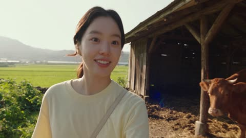</a>

The camera stays locked in front of the subject, with rear, gimbal and drone shots banned, which keeps the friend-filmed feel. Timed beats with exact Korean lines give the dialogue and pacing a fixed script to follow.

Seedance 2.5 · Text-to-video · Source: [@saniaspeaks_ on X](https://x.com/saniaspeaks_/status/2102363821784617343) · found via [LearnPrompt/awesome-seedance](https://github.com/LearnPrompt/awesome-seedance)

[`found-footage`](tags.md#tag-found-footage) [`handheld`](tags.md#tag-handheld) [`korean`](tags.md#tag-korean) [`farm`](tags.md#tag-farm)

<details><summary><b>Prompt</b></summary>

```text
Create a 30-second, 1080p ultra-realistic personal home-video showing a young Korean woman visiting a traditional countryside farm and learning how to milk a cow. No reference image.

MAIN SUBJECT:
A naturally pretty Korean woman in her early 20s, realistic skin texture, minimal makeup, long black hair tied in a loose low ponytail. She wears a simple pale-yellow cotton T-shirt, relaxed blue jeans, white sneakers, and a small beige crossbody bag. Keep the same face, hairstyle, clothing, body proportions, and appearance throughout.

SETTING:
A small traditional Korean countryside farm on a warm summer afternoon. Old wooden barn, cows, hay, buckets, farming tools, green fields and simple farmhouse surroundings. Everything should feel authentic, ordinary and lived-in.

CAMERA:
The camera is ALWAYS IN FRONT OF THE GIRL, never behind her. A friend films her while standing or walking backward in front of her using a handheld smartphone/early-2000s consumer DV camcorder. Her face stays clearly visible. Strong natural handheld shake, imperfect framing, autofocus hunting, exposure changes, slight motion blur, soft digital detail and mild image noise.

NO cinematic camera movements, NO gimbal, NO drone, NO rear shots, NO polished commercial look, NO beauty filter.

TIMELINE

0:00–0:05 — Entering the Barn
The girl walks toward the camera with her friend filming from directly in front. She looks excitedly at the cows and smiles. She says in Korean:
“오늘 소 젖 짜는 걸 배워볼 거예요.”

0:05–0:10 — Getting Ready
Hard cut. She sits beside a calm cow while an experienced farmer demonstrates how to position the bucket and gently milk. The camera stays in front, showing her face and hands naturally.

0:10–0:15 — Awkward First Attempt
She tries milking herself. At first she squeezes incorrectly and barely gets any milk into the bucket. She looks confused, then laughs at herself.
“어? 왜 안 나오지?”

0:15–0:21 — Trying Again
Hard cut. The farmer calmly shows her the correct hand movement. She tries again while the friend films from the front. This time milk starts flowing into the bucket. Her face immediately lights up.

0:21–0:26 — She Gets It
She continues successfully, looking proudly toward the camera. She laughs and says:
“됐다! 진짜 된다!”

0:26–0:30 — Happy Ending
She stands beside the cow holding the small bucket and smiles at the camera. She gently pats the cow and gives a little wave.
“오늘 진짜 재밌었어요. 안녕!”
Natural cut to black.

AUDIO:
Only real farm sounds: cow mooing, bucket sounds, footsteps, birds, insects, distant farm activity and natural conversation. No music and no narration.

OVERALL STYLE:
It must look like a genuine friend-recorded memory from an ordinary farm visit—not a movie or advertisement. Front-facing coverage throughout, with natural reactions and imperfect handheld footage.
```

</details>

<a id="seedance-korean-man-errand-home-video"></a>
### Young man's errand day in a handheld home video

<a href="https://x.com/Aqib__786Ai/status/2092122339463090626">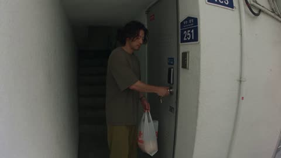</a>

The prompt locks identity and wardrobe in one block, then gives timestamped beats with an imperfect handheld camera spec so the clip reads as casual footage rather than a polished shot. Natural location sound is listed explicitly and music and narration are banned, which keeps the audio grounded.

Seedance 2.5 · Text-to-video · Source: [@Aqib__786Ai on X](https://x.com/Aqib__786Ai/status/2092122339463090626) · found via [LearnPrompt/awesome-seedance](https://github.com/LearnPrompt/awesome-seedance)

[`home-video`](tags.md#tag-home-video) [`slice-of-life`](tags.md#tag-slice-of-life) [`handheld`](tags.md#tag-handheld) [`ambient-audio`](tags.md#tag-ambient-audio)

<details><summary><b>Prompt</b></summary>

```text
Create a 30-second, 1080p ultra-realistic personal home-video showing an ordinary day in the life of a young Korean man. No reference image.

MAIN SUBJECT

Young Korean man in his early 20s, naturally attractive, realistic skin texture, minimal grooming, relaxed and slightly sleepy expression.

Medium-length naturally messy black hair, subtle stubble, a few loose strands falling across his forehead.

Wearing an oversized faded charcoal T-shirt, loose olive trousers, worn sneakers, and a simple silver watch.

Maintain the same face, hairstyle, clothing, body proportions, and appearance throughout the entire video.

SETTING

A quiet older residential neighborhood during a warm summer afternoon.

Small apartment buildings, narrow concrete alleys, rooftop terraces, neighborhood laundries, corner shops, parked bicycles, potted plants, utility wires, concrete staircases, trees providing patches of shade, and ordinary people going about their day.

Everything should feel lived-in and authentic.

CAMERA / VISUAL AESTHETIC

Raw personal footage casually recorded by a friend.

Handheld camera with natural shake, imperfect framing, occasional partial crops, autofocus hunting, exposure shifts between sunlight and shade, mild motion blur, soft image detail, subtle digital noise, slightly faded colors, and natural camera imperfections.

The camera operator walks with him and reacts naturally.

No stabilization, no cinematic camera movements, no dramatic lighting, no slow motion, no polished commercial appearance.

The footage should feel accidentally beautiful rather than deliberately cinematic.

⸻

00:00–00:05 — LEAVING HOME

He steps out of his apartment carrying a small reusable shopping bag.

He locks the door, checks his pockets for his keys and phone, then starts walking downstairs.

The camera follows behind him.

He briefly looks back at the camera and gives a sleepy half-smile.

⸻

00:05–00:10 — MORNING ERRAND

He walks through a quiet neighborhood alley toward a small local grocery shop.

He passes parked bicycles and people watering plants outside their homes.

He stops at a roadside fruit stand and picks up a couple of oranges, inspecting them casually before placing them into his bag.

The camera briefly focuses on the fruit before returning to his face.

⸻

00:10–00:15 — SMALL BREAK

He sits on a low concrete wall outside the shop.

He opens a cold bottled drink and takes a few sips.

A breeze moves his hair.

He watches people passing by without saying anything.

The camera stays slightly shaky and imperfectly framed, as if his friend is simply sitting nearby filming him.

⸻

00:15–00:20 — WALKING HOME

He gets up and continues walking.

A bicycle passes behind him.

He notices a stray cat sitting beside a wall, crouches down and gently pets it.

The cat walks away.

He laughs quietly and stands back up.

The camera operator accidentally cuts off part of his head while moving closer, then quickly reframes him.

⸻

00:20–00:25 — ROOFTOP

He returns home and walks onto a small rooftop.

He places the shopping bag beside an old chair.

He leans against the railing and looks across the neighborhood.

The afternoon sunlight falls naturally across his face.

He runs his hand through his messy hair and quietly watches the distant buildings.

⸻

00:25–00:30 — FINAL MOMENT

He notices the camera still recording.

He looks directly into the lens and gives a tiny amused smile.

He casually says:

“You’re still recording?”

He shakes his head and walks toward the camera.

The camera moves backward slightly as he approaches.

The recording abruptly cuts to black before he reaches the camera.

⸻

AUDIO

Natural location sound only:

Footsteps, distant traffic, bicycles, birds, wind, neighborhood conversations, shop sounds, bottle opening, fabric movement, doors closing, and subtle handheld camera noise.

No music.

No narration.

No artificial sound effects.

Only the single spoken line: “You’re still recording?”

⸻

FINAL FEEL

The entire video should feel like a completely ordinary day that somehow became a beautiful memory.

Quiet, masculine, youthful, intimate, warm, slightly nostalgic, and spontaneous.

No dramatic events.

No exaggerated acting.

No model poses.

No cinematic hero shots.

The realism should come from tiny imperfections, casual body language, natural expressions, ordinary surroundings, imperfect camera operation, and moments that feel completely unplanned.
```

</details>

<a id="seedance-korean-market-handheld-vlog"></a>
### Handheld vlog of woman at rural Sunday market

<a href="https://x.com/Ciri_ai/status/2092839994499174581">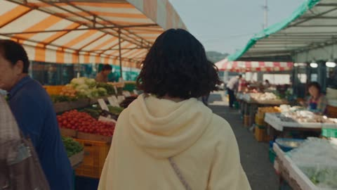</a>

Each five second beat names one concrete action, and the handheld jitter, autofocus hunting and jogging operator are tied to those actions so the footage reads as real phone capture. Audio is locked to location sound plus two quoted lines, with music and narration explicitly banned so the model does not add them.

Seedance 2.5 · Text-to-video · Source: [@Ciri_ai on X](https://x.com/Ciri_ai/status/2092839994499174581) · found via [LearnPrompt/awesome-seedance](https://github.com/LearnPrompt/awesome-seedance)

[`handheld-vlog`](tags.md#tag-handheld-vlog) [`korean-market`](tags.md#tag-korean-market) [`found-footage`](tags.md#tag-found-footage) [`rural-life`](tags.md#tag-rural-life)

<details><summary><b>Prompt</b></summary>

```text
Create a 30-second, 1080p ultra-realistic personal home-video showing an ordinary Sunday morning in the life of a young Korean woman. No reference image.

MAIN SUBJECT

Young Korean woman in her early 20s, natural and approachable look, realistic skin texture with visible pores, bare-faced or barely-there makeup, warm and slightly playful expression.

Shoulder-length wavy black hair left down, side-swept bangs, small mole near her left eye.

Wearing an oversized pastel-yellow hoodie, loose gray jogger pants, fuzzy slide sandals, and a small crossbody pouch bag.

Maintain the same face, hairstyle, clothing, body proportions, and appearance throughout the entire video.

SETTING

A small countryside town on a bright, breezy Sunday morning.

A traditional outdoor market with striped awnings, crates of vegetables, a fishmonger's stall, an old bus stop with a rusted bench, a narrow road running alongside rice paddies, a local bakery with a hand-painted sign, a grandmother's front yard with drying red peppers on a mat, chickens wandering nearby, and mountains faintly visible in the background. Everything sun-bleached, dusty, and authentically rural.

CAMERA / VISUAL AESTHETIC

Raw personal footage casually recorded by a friend, strong handheld vlog feel throughout.

Constant natural hand shake and micro-jitters, footsteps visibly bouncing the frame, imperfect and often off-center framing, occasional partial crops of her face or shoulder, autofocus visibly hunting between her and the background, exposure flaring when the camera swings toward the sun, mild motion blur on quick turns, soft image detail, subtle digital noise, slightly warm and faded color grading like an old phone camera.

The camera operator walks and jogs to keep up with her, breathing audible at times, camera dipping and swaying with each step.

No stabilization, no gimbal smoothness, no cinematic camera movements, no dramatic lighting, no slow motion, no polished commercial appearance.

The footage should feel like a real, unplanned phone recording — accidentally beautiful rather than deliberately cinematic.

---

00:00–00:05 — MARKET ENTRANCE

She weaves through the outdoor market stalls, the camera bouncing behind her as it struggles to keep pace.

She stops briefly to pick up a small bag of cherry tomatoes, holding them up toward the camera with a grin.

The frame jolts as the operator steps over a crate in the path.

**00:05–00:10 — FISH STALL DETOUR**

She wanders to the fishmonger's stall, wrinkling her nose playfully at the smell and laughing.

The camera whip-pans slightly too fast trying to follow her hand gesture, briefly blurring before catching focus again.

She waves the camera away, still laughing: *"Ugh, don't film that, film me!"*

**00:10–00:15 — BUS STOP WAIT**

She jogs to catch the local bus stop bench just as an old bus pulls away without her, the camera shaking hard from the sudden running motion.

She throws her hands up in mock frustration, plops down on the rusted bench, and sighs dramatically, laughing at herself.

The frame settles slightly off-center as she rests her chin on her palm.

**00:15–00:20 — RICE PADDY ROAD**

She walks along the narrow road beside the rice paddies, wind blowing loose strands across her face.

The camera drifts low near her feet as she kicks a small pebble, then swings back up to her face, slightly overexposed from the open sky.

She spins around once with her arms out, the frame swaying and overshooting past her before correcting.

**00:20–00:25 — GRANDMOTHER'S YARD**

She ducks into a yard where red peppers dry on a mat, crouching to gently shoo away a curious chicken pecking near her sandals.

The camera jerks back suddenly as the chicken flaps its wings, both of them startled and laughing.

She picks up a dried pepper, sniffs it, makes a face, and tosses it back down.

**00:25–00:30 — FINAL MOMENT**

She grabs a warm bag of fresh bread from the nearby bakery counter, takes a big bite, and turns straight to the camera mid-chew.

The frame shakes as she leans in too close, filling half the screen with her grinning face.

She says, muffled and amused:

*"Okay, stop filming me eating!"*

She swats the camera lens with her hand, and the footage cuts abruptly to black, mid-laugh.

---

**AUDIO**

Natural location sound only:

Market chatter, footsteps crunching on gravel, a bus engine pulling away, wind, chickens clucking, rustling plastic bags, distant rooster crow, bread bag crinkling, the operator's breathing and quiet laughter, and audible handheld camera noise.

No music. No narration. No artificial sound effects.

Only the spoken lines: *"Ugh, don't film that, film me!"* and *"Okay, stop filming me eating!"*

**FINAL FEEL**

The entire video should feel like a chaotic, cheerful, completely unplanned Sunday morning caught on a friend's phone — bright, breezy, playful, and warmly nostalgic.

No dramatic events. No exaggerated acting. No model poses. No cinematic hero shots.

The realism should come from constant handheld imperfection, sun glare, dust, uneven pacing, real laughter, and moments that feel genuinely caught rather than staged.
```

</details>

<a id="seedance-korean-morning-routine-day-in-the-life"></a>
### Woman wakes up and starts a quiet morning

<a href="https://x.com/ChillaiKalan__/status/2095812367527616536"></a>

The reference image is locked as the exact first frame, and identity, outfit and lighting rules are repeated for every beat so the model keeps one person and one light source across cuts. Handheld documentary framing with ambient audio only and no music keeps the clip grounded in everyday life rather than ad polish.

Seedance 2.5 · Image-to-video · Source: [@ChillaiKalan__ on X](https://x.com/ChillaiKalan__/status/2095812367527616536) · found via [LearnPrompt/awesome-seedance](https://github.com/LearnPrompt/awesome-seedance)

[`korean`](tags.md#tag-korean) [`morning-routine`](tags.md#tag-morning-routine) [`day-in-the-life`](tags.md#tag-day-in-the-life) [`handheld`](tags.md#tag-handheld) [`ambient-audio`](tags.md#tag-ambient-audio)

<details><summary><b>Prompt</b></summary>

```text
30 seconds | 16:9 | Ultra-photorealistic live-action

Create a natural Korean morning-routine day-in-the-life video featuring one young Korean woman waking up 
and easing into her quiet morning at home.

Use the reference image as the EXACT starting frame — she is lying in bed, just waking up. Use the 
reference image for her exact facial identity, hairstyle, skin tone, and body proportions. Keep her 
appearance consistent throughout the entire video. The video begins from this reference pose and moves 
forward naturally.

OUTFIT: Soft cream/white cotton loungewear or a light pajama set to start; she stays in comfortable 
loungewear throughout (no wardrobe change). Minimal or no jewelry. Hair natural and slightly tousled 
from sleep at the start, settling as the morning goes on.

TIME & LIGHTING: Soft early-morning summer sunlight, gradually warming as the morning progresses. Gentle, 
consistent natural light, shadows, color temperature, and time of day across every scene.

00–05s — Waking up (starts from reference image)
The video opens on the exact reference pose — she is lying in bed, eyes just opening, waking up slowly. 
Soft morning light filters through sheer curtains onto the bed. She stirs gently, blinks, and slowly 
sits up, stretching her arms with a soft, sleepy motion. Her hair is naturally tousled.
She rubs her eyes, looks softly toward the window, and quietly says:
"Morning already…"

05–11s — Out of bed
She swings her legs off the bed and stands, stretching gently. She pads across the room and opens the 
curtains — bright morning light floods in. She looks out the window for a moment at the quiet neighborhood 
outside (rooftops, trees, soft sky). Natural, unhurried movement.

11–17s — Washing up
She walks to the bathroom sink. She turns on the faucet and splashes cool water on her face, then pats 
it dry with a soft towel. Water droplets fall naturally. She looks at herself briefly in the mirror, 
tucks her hair behind her ear, and takes a slow breath. Fresh and calm.

17–23s — Making breakfast / morning drink
She moves to the kitchen. She fills a kettle and sets it to boil, then takes a mug and a tea bag (or 
pour-over coffee) from the counter. Steam rises as she pours the hot water — the liquid swirls naturally 
in the mug. She sets a simple breakfast on a small plate (toast, fruit, or a pastry). Gentle, homey 
morning movements.

23–30s — Quiet morning moment
She sits by the window with her warm mug and breakfast, both hands wrapped around the cup. She takes a 
slow first sip, pauses, and smiles softly.
She looks out at the morning light and quietly says:
"Perfect start."
The camera slowly drifts backward, capturing the cozy bedroom/kitchen, the open window, gentle curtain 
movement, soft morning light, and the calm start-of-day atmosphere.
Cut naturally at the end.

CAMERA STYLE: Documentary lifestyle footage with smooth handheld movement. Natural tracking shots, 
occasional subtle camera sway, realistic focus transitions, restrained depth of field, natural lens 
behavior, and authentic perspective. Avoid overly cinematic shots or commercial advertising aesthetics.

AUDIO: Real environmental audio only — soft morning ambience, birdsong outside, sheets rustling, a gentle 
yawn, curtains sliding open, water running, towel patting, kettle boiling, water pouring into a mug, a 
spoon clinking, breathing, and natural sipping sounds. No background music.

PHYSICAL REALISM: The bedsheets shift and drape naturally as she wakes and rises. Her stretching, standing, 
and walking feel spontaneous and physically accurate. Water flows and droplets fall naturally. The kettle 
steams and the liquid pours with realistic fluid dynamics. Hands maintain believable grip and pressure. 
All body movements — waking, stretching, walking, washing, pouring, sitting, sipping — should feel natural 
and unforced.
```

</details>

<a id="seedance-korean-night-market-walk"></a>
### Young women walk a lively Korean night market

<a href="https://x.com/aiwithaly/status/2092843818664313185">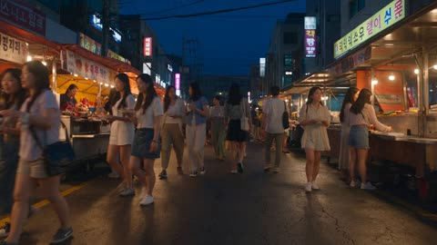</a>

A numbered sequence of beats (enter, notice the grill, choose food, walk, sit, first bite) makes each action follow from the one before. Named physical details and a documentary handheld camera anchor the realism, and ambient audio is listed explicitly.

Seedance 2.5 · Text-to-video · Source: [@aiwithaly on X](https://x.com/aiwithaly/status/2092843818664313185) · found via [LearnPrompt/awesome-seedance](https://github.com/LearnPrompt/awesome-seedance)

[`korean`](tags.md#tag-korean) [`night-market`](tags.md#tag-night-market) [`street-food`](tags.md#tag-street-food) [`documentary`](tags.md#tag-documentary)

<details><summary><b>Prompt</b></summary>

```text
A Korean woman in her mid-20s walks naturally through a lively evening market filled with glowing food stalls, colorful signs, conversations, footsteps, sizzling grills, drifting steam, and a gentle summer breeze.

She notices a Korean BBQ-style stall and slows down to watch the vendor grill fresh meat and vegetables.  Realistic sizzling, smoke, steam, subtle flames, metal tongs, and natural food physics make the cooking feel completely real.

She smiles and says, “That smells so good.”

She chooses her food, receives the tray naturally, carefully carries it through the crowd, and finds an outdoor communal table. She pulls out a chair, sits down, places the tray on the table, and prepares for her first bite.

Using chopsticks, she picks up the freshly grilled food, pauses for the steam, takes a bite, and reacts with a genuine smile. 😋

“Perfect for a summer night.” 🌙

The camera slowly pulls back, revealing the glowing stalls, busy pedestrians, outdoor seating, drifting smoke, warm lights, and atmospheric Korean summer night.

🎥 Ultra-photorealistic | Cinematic documentary style | Natural handheld/gimbal movement | Realistic human biomechanics | Authentic Korean market atmosphere | Physically accurate objects, food, smoke, heat & crowd behavior | Natural dialogue & lip sync | Immersive ambient audio | 16:9

🚫 No AI look, robotic movement, teleportation, floating objects, distorted hands, extra fingers, foot sliding, duplicated people, unrealistic crowds, giant flames, excessive smoke, instant transitions, changing faces/outfits, impossible camera movement, text overlays, logos, or watermarks.

🎯 Sequence: Enter → notice grill → watch cooking → choose food → receive tray → walk → sit → first bite → genuine reaction → cinematic market reveal.

Priority: Every action must follow naturally from the previous one, with realistic gravity, weight, friction, momentum, balance, heat, airflow, and material interaction throughout.
```

</details>

<a id="seedance-korean-night-skincare-vlog-dv"></a>
### Korean woman night skincare routine in handheld DV style

<a href="https://x.com/QAiStudio/status/2118337407657644323">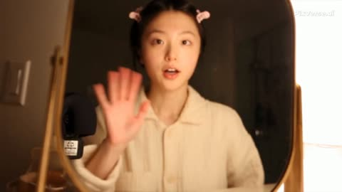</a>

Anchors the look to a named camcorder format with handheld shake, tape grain and muted contrast, then writes the product as one casual step in the routine so it reads as vlog footage rather than an ad. A fixed character description and a night to next morning structure keep the same person consistent across the 12 cuts.

Seedance 2.5 · Text-to-video · Source: [@QAiStudio on X](https://x.com/QAiStudio/status/2118337407657644323) · found via [LearnPrompt/awesome-seedance](https://github.com/LearnPrompt/awesome-seedance)

[`skincare`](tags.md#tag-skincare) [`ugc`](tags.md#tag-ugc) [`handheld`](tags.md#tag-handheld) [`product-placement`](tags.md#tag-product-placement)

<details><summary><b>Prompt</b></summary>

```text
Create a 30-second, 12-cut authentic UGC skincare vlog featuring CHASE, a Korean woman in her 20s, filming her nighttime routine with a handheld DV 16mm camcorder aesthetic. Use imperfect handheld framing, subtle shake, soft focus, tape grain, muted contrast, and natural skin texture.

CHASE has long black hair clipped up, minimal makeup, and wears oversized modest cotton pajamas at night, transitioning to a cozy knit sweater with her hair down the next morning. The setting is her bedroom vanity and bathroom, with warm lamp lighting at night and soft daylight in the morning.

Feature Lumé Dew Brightening Cream, a palm-sized frosted milky-white round jar with a peach-pink label, delicate lowercase branding, a small gold sun icon, and a flat brushed-gold lid. The cream inside is whipped, lightweight, and creamy white.

Follow her casual nighttime routine: greeting the camera, showing her cleanser and toner, rinsing her face, applying toner, introducing the Lumé Dew jar, opening it, showing the cream texture, applying it gently, and placing it back on the vanity before switching off the lamp. Transition to the next morning, where she checks her skin in natural daylight and finishes smiling at the camera while holding the product.

Keep the narration relaxed and conversational, like chatting with a friend. Include satisfying close-up product and skincare details, natural ambient sounds, and a cozy lifestyle feel. The product should appear organically throughout, never like a formal advertisement. End with a calm, authentic next-day skin check.
```

</details>

<a id="seedance-korean-school-rooftop-sunset"></a>
### Two students chase papers on a sunset rooftop

<a href="https://x.com/Aqsahere_/status/2091001743035564070">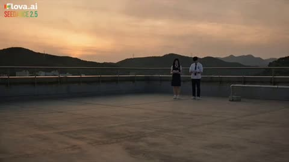</a>

Reference images lock both students' faces, hair and uniforms, and the prompt numbers seven camera setups so the sequence stays coherent. Specific cues for wind, imperfect autofocus, subtle handheld shake and a list of banned looks keep it reading as real school footage rather than a commercial.

Seedance 2.5 · Reference-to-video · Source: [@Aqsahere_ on X](https://x.com/Aqsahere_/status/2091001743035564070)

[`handheld-camera`](tags.md#tag-handheld-camera) [`reference-faces`](tags.md#tag-reference-faces) [`school-life`](tags.md#tag-school-life) [`sunset`](tags.md#tag-sunset)

<details><summary><b>Prompt</b></summary>

```text
photorealistic live-action Korean high-school rooftop scene at sunset. Use the provided references to preserve Seolran and Mujin’s exact faces, hairstyles, body proportions, school uniforms, and the real rooftop environment. Exactly two students are present. A strong sudden gust of wind hits the rooftop and scatters their loose homework papers across the concrete. Seolran and Mujin react naturally and immediately run in different directions trying to catch the flying pages. Papers blow realistically around their legs and across the rooftop, some sliding along the ground while others briefly lift into the air. They chase the pages with natural hurried movements, occasionally almost catching one before the wind pulls it away. Mujin manages to grab several pages and tries to hand them back to Seolran, but another gust sends one page directly toward her face. The paper gently lands against her face for a moment. She freezes in surprise, pulls it away, looks at Mujin, and they both burst into natural laughter. End with them standing together collecting the remaining papers while the warm sunset and distant mountains remain in the background. Use 7 distinct handheld camera shots: wide rooftop establishing shot, low angle following the papers, side tracking shot while they run, close-up of their hands grabbing papers, medium shot of them chasing in opposite directions, close-up when the paper hits Seolran’s face, and a final wide sunset shot of both laughing and gathering the homework. Make it feel like authentic Korean school-life footage rather than a commercial: realistic smartphone/cinema-camera texture, natural sunset lighting, believable wind physics, realistic paper movement, natural hair and uniform movement, subtle handheld camera shake, imperfect autofocus, natural facial expressions, realistic skin texture and breathing, spontaneous body movement and genuine laughter. No exaggerated comedy, no slow motion, no music, no subtitles, no logos, no watermarks, no CGI, no fantasy, no extra people, no distorted hands or anatomy.
```

</details>

<a id="seedance-korean-seaside-harbor-flip-camera-vlog"></a>
### Korean Seaside Harbor Walk Flip Camera Vlog

<a href="https://x.com/ShamiWeb3/status/2096101448090267992">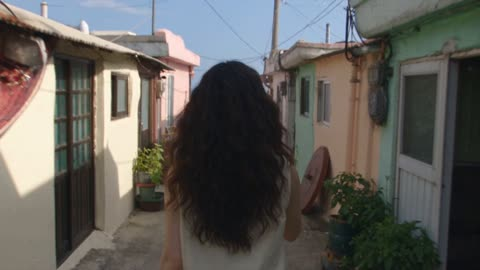</a>

A timestamped beat list in four second slots gives each action and spoken Korean line its own window, so a 30 second vlog stays coherent. A fixed style block of late 2000s flip camera flaws, a negative list against polish, and a sound only ambience paragraph keep the look raw and authentic.

Seedance 2.5 · Reference-to-video · Source: [@ShamiWeb3 on X](https://x.com/ShamiWeb3/status/2096101448090267992) · found via [LearnPrompt/awesome-seedance](https://github.com/LearnPrompt/awesome-seedance)

[`vlog`](tags.md#tag-vlog) [`handheld`](tags.md#tag-handheld) [`korean`](tags.md#tag-korean) [`timestamped`](tags.md#tag-timestamped) [`ambient-sound`](tags.md#tag-ambient-sound)

<details><summary><b>Prompt</b></summary>

```text
Preserve the exact facial features, identity, skin tone, and natural facial proportions from @image1 throughout. Do not copy the reference hairstyle or outfit. Outfit: lightweight cream sleeveless blouse, high-waisted faded blue jeans, white canvas sneakers, small gold hoop earrings, loose natural wavy hair. Authentic Korean woman. Late-2000s personal vlog aesthetic. Extremely raw handheld flip-camera footage with heavy camera shake, spontaneous reframing, partial face crops, focus hunting, exposure shifts, warm faded colors, mild digital noise, and authentic home-video imperfections. No posing, no cinematic glamour, no stabilization, no modern color grading.

00:00–00:04 Walking quickly down a narrow seaside alley while holding the camera, suddenly spotting the ocean at the end of the street. She turns the camera toward it and excitedly says in Korean, "잠깐, 바다가 보여요!"

00:04–00:08 Runs toward a small harbor, laughing as the camera shakes heavily. She reaches the railing, leans over carefully, and watches fishing boats moving across the water.

00:08–00:12 Spots a fisherman pulling in a small fishing net and asks if she can help. She grabs one end of the net, struggles with the weight, laughs, and says in Korean, "생각보다 훨씬 무거운데요?"

00:12–00:16 The fisherman shows her a freshly caught fish. She reacts with wide-eyed surprise, steps backward laughing, then cautiously reaches out to touch it while saying, "우와, 진짜 크다!"

00:16–00:20 Walks into a tiny harbor-side snack shop, discovers a bowl of freshly made fish cake soup, sits at the counter, takes a sip, and smiles with satisfaction.

00:20–00:24 Steps outside holding the warm cup, notices a group of neighborhood grandmothers playing a casual Korean card game at a plastic table. She joins them briefly, laughs at their playful reactions, and gestures toward the camera.

00:24–00:27 Walks along the harbor promenade eating a small ice cream, filming boats and seagulls before accidentally getting a little ice cream on her nose. She notices it and laughs.

00:27–00:30 Stops beside the harbor railing as the wind moves her hair, turns the camera toward herself, smiles naturally, and says in Korean, "오늘 진짜 재밌었다. 다음에 또 올게요. 안녕!" She waves and the recording ends abruptly.

Natural ambience only: ocean waves, seagulls, fishing boats, harbor conversations, footsteps, wind, net ropes, shop sounds, card-table laughter, distant scooters, and neighborhood activity. No background music, subtitles, logos, or watermarks. The footage should feel exactly like a genuine late-2000s handheld flip-camera Korean vacation vlog with spontaneous actions, imperfect framing, authentic Korean dialogue, realistic human movement, and natural interactions. Aspect ratio: 16:9.
```

</details>

<a id="seedance-korean-summer-bicycle-grocery-run"></a>
### Woman walks with city bicycle on Korean street

<a href="https://x.com/nawalsehar/status/2093215704946467157">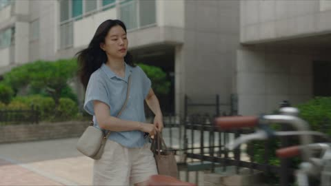</a>

The clip is written as ordered beats where each action causes the next, which keeps the timeline continuous over 30 seconds. A closing list of physical limits (no teleporting, no instant acceleration, no CGI look) and named sound and camera cues anchor the realism.

Seedance 2.5 · Text-to-video · Source: [@nawalsehar on X](https://x.com/nawalsehar/status/2093215704946467157) · found via [LearnPrompt/awesome-seedance](https://github.com/LearnPrompt/awesome-seedance)

[`korea`](tags.md#tag-korea) [`lifestyle`](tags.md#tag-lifestyle) [`bicycle`](tags.md#tag-bicycle) [`photorealistic`](tags.md#tag-photorealistic)

<details><summary><b>Prompt</b></summary>

```text
30-Second Cinematic

Ultra-photorealistic Korean summer lifestyle video following a young woman as she unlocks her city bicycle, places her crossbody bag in the front basket, and naturally rides through a peaceful residential neighborhood.

She slows down, turns realistically, parks beside the grocery store, locks her bicycle, and enters the supermarket. She casually selects a few groceries—apples, milk, and a snack—then pays at the checkout.

After placing the groceries securely in the bicycle basket, she unlocks the bike, mounts naturally, and cycles home along the same street.

Focus on realistic human movement, bicycle balance, pedal motion, braking, tire contact, momentum, wind, clothing and hair movement, grocery-bag weight, and authentic everyday sounds. Smooth cinematic camera movement, natural lighting, realistic depth of field, and continuous cause-and-effect action.

No teleportation, instant acceleration, floating objects, distorted anatomy, changing clothes or bicycle, exaggerated wind, CGI appearance, or action-movie movement.
```

</details>

<a id="seedance-korean-summer-peach-snack-day-in-the-life"></a>
### Korean Summer Afternoon Peach Snack Day

<a href="https://x.com/ChillaiKalan__/status/2094633575547314503">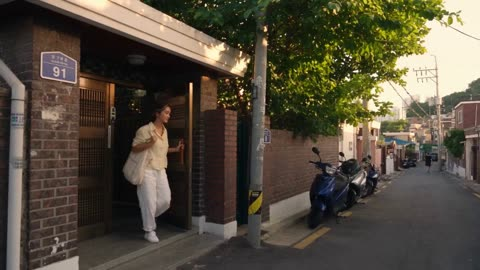</a>

A timestamped six-beat script in 30 seconds keeps one woman, outfit and light consistent, and a reference image locks her identity. Separate sections for camera style, real environmental audio, physical realism and a negative prompt push the result toward documentary footage instead of ad polish.

Seedance 2.5 · Reference-to-video · Source: [@ChillaiKalan__ on X](https://x.com/ChillaiKalan__/status/2094633575547314503) · found via [LearnPrompt/awesome-seedance](https://github.com/LearnPrompt/awesome-seedance)

[`day-in-the-life`](tags.md#tag-day-in-the-life) [`photorealistic`](tags.md#tag-photorealistic) [`korean`](tags.md#tag-korean) [`documentary`](tags.md#tag-documentary) [`multi-scene`](tags.md#tag-multi-scene)

<details><summary><b>Prompt</b></summary>

```text
30 seconds | 16:9 | Ultra-photorealistic live-action

Create a natural Korean summer day-in-the-life video featuring one young Korean woman spending a quiet afternoon preparing a simple chilled fruit snack at home.

Use the reference image only for her exact facial identity, hairstyle, skin tone, and body proportions. Keep her appearance consistent throughout the entire video.

OUTFIT: Lightweight pale-yellow short-sleeve blouse, loose white cotton pants, simple canvas shoulder bag, white low-profile sneakers, minimal silver jewelry. Outfit remains unchanged from beginning to end.

TIME & LIGHTING: Warm late-afternoon summer sunlight. Consistent weather, shadows, color temperature, and time of day across every scene.

00–05s — Neighborhood walk

She leaves a small Korean apartment building carrying her canvas bag and walks down a quiet residential street.

Trees move gently in the summer breeze. Parked scooters, apartment entrances, utility poles, bicycles, and distant pedestrians create an authentic neighborhood atmosphere.

She briefly looks at the camera and says:
“I need something refreshing today.”

05–10s — Local fruit stand

She arrives at a small neighborhood fruit shop with crates of peaches, grapes, melons and Korean pears.

Instead of immediately picking something, she walks around comparing the fruit.

She notices a basket of peaches, picks one up carefully, examines it, smells it, and smiles.

The shop owner says something casually off-camera.

She responds:
“This one looks perfect.”

She places several peaches into her canvas bag.

10–15s — Walking home

She walks back through the neighborhood carrying the slightly heavier bag.

The camera follows from behind and then moves beside her.

She adjusts the bag against her shoulder as the fruit shifts naturally inside.

A bicycle passes in the background. Leaves move gently in the breeze. Her hair moves subtly with the air.

15–21s — Apartment kitchen

She enters her apartment kitchen and places the peaches on the counter.

She turns on the faucet and rinses them under cool running water.

Water droplets collect on the fruit and fall naturally into the sink.

She dries one peach with a clean kitchen towel and places it onto a small ceramic plate.

21–26s — Preparing the snack

She sits at the kitchen counter.

Using a small kitchen knife, she carefully slices the peach in half.

The knife meets realistic resistance before passing through the soft fruit.

She removes the pit, cuts several thin slices, and arranges them casually on the plate.

Close-up of realistic juice and peach texture.

26–30s — First bite

She picks up one slice and takes her first bite.

She pauses for a moment, smiles naturally, and quietly says:

“So good.”

She looks toward the window as warm sunlight falls across the kitchen.

The camera slowly drifts backward, capturing the cozy kitchen, open window, gentle curtain movement, and late-summer atmosphere.

Cut naturally at the end.

CAMERA STYLE: Documentary lifestyle footage with smooth handheld movement. Natural tracking shots, occasional subtle camera sway, realistic focus transitions, restrained depth of field, natural lens behavior, and authentic perspective. Avoid overly cinematic shots or commercial advertising aesthetics.

AUDIO: Real environmental audio only — distant neighborhood sounds, footsteps, bicycle passing, fruit shop conversations, plastic bags, fruit being handled, apartment door, running water, knife against cutting board, refrigerator hum, subtle curtain movement, breathing, and natural eating sounds. No background music.

PHYSICAL REALISM: The shopping bag reacts naturally to the weight of the fruit. Peach movement follows gravity and momentum. Hands maintain believable grip and pressure. Water flows naturally. Knife movement shows realistic cutting resistance. All body movements, walking, reaching, lifting, sitting, washing, cutting, and eating should feel spontaneous and physically accurate.

CONTINUITY: Same woman, facial identity, hairstyle, body proportions, outfit, bag, fruit, apartment, kitchen, weather, lighting, and time of day throughout. No unexplained object changes.

NEGATIVE PROMPT: No CGI look, synthetic skin, beauty filter, excessive sharpening, HDR, artificial blur, unrealistic depth of field, robotic movement, weightless objects, floating fruit, impossible hand positions, distorted anatomy, extra fingers, malformed hands, face drift, character replacement, wardrobe changes, hairstyle changes, teleportation, instant cutting, duplicated people, inconsistent shadows, sudden weather changes, excessive wind, text, subtitles, logos, watermark, background music, commercial advertisement style. <<<259c3755-e438-49f5-b983-e6673a6ad05c>>> <<<259c3755-e438-49f5-b983-e6673a6ad05c>>>
```

</details>

<a id="seedance-korean-sunday-chores-dv-home-video"></a>
### Korean woman sweeping her step, early 2000s DV

<a href="https://x.com/Ciri_ai/status/2099379932082348417">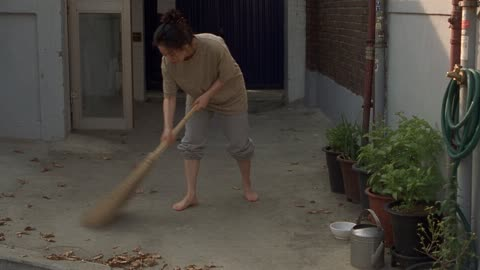</a>

The prompt is split into labelled blocks for subject, setting, sequence, camera, audio, continuity and negatives. Each action is a single lingering shot with no cuts inside it, and the DV flaws are listed explicitly: autofocus hunting, faded color and accidental zooms. The audio block names only ambient sounds, and the continuity block locks the props and the cat so nothing vanishes or duplicates. The subject refers to a reference image for identity.

Seedance 2.5 · Reference-to-video · Source: [@Ciri_ai on X](https://x.com/Ciri_ai/status/2099379932082348417) · found via [LearnPrompt/awesome-seedance](https://github.com/LearnPrompt/awesome-seedance)

[`dv-camcorder`](tags.md#tag-dv-camcorder) [`home-video`](tags.md#tag-home-video) [`observational`](tags.md#tag-observational) [`korean`](tags.md#tag-korean) [`ambient-audio`](tags.md#tag-ambient-audio)

<details><summary><b>Prompt</b></summary>

```text
Create a 30-second, 1080p ultra-realistic early-2000s DV home video of a young Korean woman doing quiet Sunday chores around her home in an older Seoul neighborhood. Purely observational, no dialogue, no narrative arc  just rhythmic, textural everyday realism.
MAIN SUBJECT
Young Korean woman same as , early 20s, natural beauty, realistic skin texture, no makeup, black hair tied up messily in a claw clip, oversized faded T-shirt, rolled-up sweatpants, bare feet or house slippers. Keep her identity, outfit, hairstyle and proportions perfectly consistent throughout.
SETTING
The front step and small yard/alley outside an older Seoul home. Concrete step, a low gate, potted plants, a garden hose, a trash bin, scattered leaves. Ordinary, lived-in, no landmarks or brand names.
SEQUENCE (rhythmic, no dialogue)
She sweeps the front step with a short broom, dust and leaves scattering in the light.
She crouches down and pours a small amount of dry food into a bowl for a neighborhood cat waiting nearby; the cat eats while she watches briefly.
She stands and waters potted plants along the wall with a small watering can, water visibly darkening the soil.
She picks up a bagged trash bundle and carries it a few steps to place it by the curb/bin.
She wipes her hands on her shirt, looks around the now-tidy step and yard for a moment, then exhales/stretches.
She glances toward the camera briefly with a small, tired smile — no words — then turns and walks back inside.
Camera holds on the empty, swept step for a beat before cutting to black.
CAMERA
Raw handheld early-2000s DV camcorder, shaky footage, autofocus hunting, faded colors, exposure shifts, motion blur, soft digital detail, occasional accidental zooms. Observational, documentary-like framing — lingering shots, no cuts within actions. No polished cinematography.
AUDIO
Natural ambience only — broom bristles on concrete, water pouring, cat eating, distant birds, wind, a far-off scooter or dog bark, plastic bag rustling, faint footsteps. No dialogue, no music.
CONTINUITY
Broom, watering can and trash bag each remain consistent through their respective actions. Cat stays in frame while eating, doesn't disappear or duplicate. No teleporting or vanishing objects. Smooth, realistic, unhurried movement throughout.
NEGATIVE
CGI look, plastic skin, identity drift, outfit changes, distorted hands, extra fingers, subtitles, watermark.
```

</details>

<a id="seedance-korean-travel-vlog-volcanic-hilltop"></a>
### Korean travel vlogger on volcanic hilltop lookout

<a href="https://x.com/Chaemate_/status/2115390545426034836">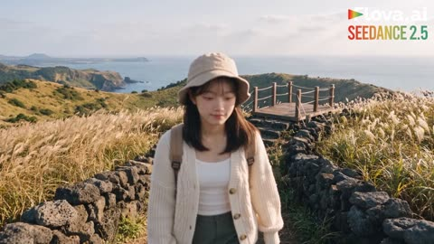</a>

Three reference images lock her face, outfit and location, and the 30 seconds are split into timecoded beats, each with the exact Korean line and facial emotion cues. Part 2 takes Part 1's last frame as @image 4, so the second clip continues with no cut.

Seedance 2.5 · Reference-to-video · Source: [@Chaemate_ on X](https://x.com/Chaemate_/status/2115390545426034836)

[`korean-speech`](tags.md#tag-korean-speech) [`character-lock`](tags.md#tag-character-lock) [`lip-sync`](tags.md#tag-lip-sync) [`travel-vlog`](tags.md#tag-travel-vlog)

<details><summary><b>Prompt</b></summary>

```text
PART 1 (30 seconds)

CHARACTER
Use @image 1 and @image 2 as the Master Identity Lock. Keep her face, hair, skin tone, outfit (cream knit cardigan, sage-olive cargo pants, white sneakers, beige bucket hat, tan backpack) and body proportions exactly the same throughout. No identity drift.

LOCATION
Use @image 3 as the environment reference: a windy volcanic hilltop on a Korean island with golden silver-grass, low black stone walls, and a wooden lookout over the sea. Soft late-morning sunlight, light sea breeze, gentle clouds. Keep the same light and weather for the whole video.

STYLE
A spontaneous travel vlog filmed by a friend following just behind and beside her, with slight natural shake, smooth reframing, and candid expressions. Realistic live action, not stylized.

VOICE AND PERFORMANCE
Native Korean speech, natural conversational tone, accurate lip-sync. Every line is performed with visible emotion: the eyebrows, eyes, mouth, and breathing all react to what she feels. Her expression should change before, during, and after each line, with no flat or robotic delivery.

TIMECODE AND SCENES

00:00–00:04 | The Trailhead
She walks along a stone-wall path through tall silver-grass. She glances at the lens, eyes lighting up, eyebrows lifting, and says with bright, bubbly excitement and a rising pitch: "정상이 나를 부르고 있어!" (The summit is calling me!) She ends with a proud, wide grin and a small fist pump. Camera follows from the front at a medium shot.

00:04–00:08 | The Wobble
She tries a slow, cool model walk. Her sneaker catches a small pebble and she wobbles slightly. Her eyes go wide for a split second, then she freezes in a proud “ta-da” pose, holding a stiff, tight smile with flushed cheeks. She says in a deadpan whisper through the smile, eyes darting sideways: “…의도한 거야.” (…I meant to do that.) Camera drifts closer to catch her face.

00:08–00:12 | The Pony
A brown Jeju pony grazes beside the path. She crouches to take a selfie with it, but the pony calmly turns its back to her. Her jaw drops in mock offense, her lower lip pushes into a pout, and she says in a wounded, dramatic tone: "진짜? 얼굴도 안 보여 주는 거야?" (Seriously? You won’t even show me your face?) Then she bursts into helpless laughter, shoulders shaking. Camera: low angle, then a quick pan to her reaction.

00:12–00:17 | Grass Tunnel
The path narrows into tall silver-grass. She pushes through, disappears behind it, then pops out making hand-binoculars and scanning the horizon with a squinted, ultra-serious explorer face. She gasps softly, thrilled, as if she has spotted something. Camera follows from behind, then swings around to the front.

00:17–00:22 | The Wind Hits
She climbs a few stone steps to the crater rim and spreads her arms, eyes closed, face lifted in blissful relief. A gust throws her hair across her face. She pulls a strand from her mouth, scrunches her nose, and laughs. Wide shot, then a medium close-up.

00:22–00:27 | The Seagull
She flaps her elbows like a seagull with a goofy, beaming face. She stops, points at the lens with a playful, challenging look, chin lifted and eyebrows raised, and says in a teasing sing-song voice: "너도 해 봐!" (You try!) Camera circles in a gentle quarter turn, with the sea visible behind her.

00:27–00:30 | Final Frame (hold exactly)
She steps onto the small wooden lookout. A sudden gust blows her hat off and she catches it in mid-air with a surprised gasp and wide eyes. She crouches beside the rope railing, holding the hat against her knee, looking into the lens, laugh fading to a breathless, happy smile. Medium shot, slightly low angle, ocean and soft clouds behind her, camera steady for the last second.

AUDIO
Wind across the grass, soft footsteps on gravel, fabric rustle, pony snort, distant waves, spontaneous laughter. No background music.

NEGATIVE
No face or outfit changes, no real falls, no dangerous actions, no teleporting, no location jumps, no body distortion, no glitches, no CGI look, no stiff movement, no flat or emotionless dialogue, no lip-sync mismatch, no neon or glowing colors.

FORMAT: 16:9 | 30s | 4K | 24 FPS | Ultra-realistic live action | Natural handheld

PART 2 (15 seconds)

Use the very last frame of Part 1 as the first frame / @image 4.

CONTINUITY LOCK
Start from exactly the frame in @image 4: she is crouched beside the rope railing on the wooden lookout, holding her hat, looking into the lens with a fading smile. Same pose, same camera angle, same light, same wind, same background. No cut, no reset. Keep the identity from @image 1 and @image 2 and the outfit identical.

VOICE AND PERFORMANCE
Native Korean speech, natural tone, accurate lip-sync, with emotion visible on her face and in her breath for every line.

TIMECODE AND SCENES

00:00–00:03 | Picking Up
Without a cut, she stands up, puts the hat back on, and tilts her head toward the steps with a cheerful, bouncy energy. She says in a light, breathless voice: "내려가면 간식이다, 가자!" (Snacks are waiting downhill, let’s go!) Camera stays at her medium shot and follows.

00:03–00:07 | The Balance Beam
Back on the trail, she steps onto a low black stone wall and walks along it with arms out like a gymnast, tongue slightly between her teeth in concentration. She keeps it low and safe, then hops off with a small, proud landing and a triumphant “yes!” face. Camera follows from the side, then moves behind her.

00:07–00:11 | Snack Review
She sits on the wall, takes a triangle kimbap from her backpack, and bites in. She closes her eyes, chews slowly, savoring it, and nods with solemn drama like a food critic. Her eyes open wide and she turns to the lens, saying in a hushed, awestruck voice: "별 다섯 개." (Five stars.) Wind ruffles her hair. Close-up, then medium shot.

00:11–00:15 | The Quiet Ending
She stands, walks toward the camera with a mischievous half-smile, leans in, puts a finger to her lips, and whispers with sparkling, conspiratorial eyes: "비밀이야." (It’s a secret.) She gently tilts the lens up toward the open sky and soft clouds, and the shot slowly settles as the wind fades into silence.

AUDIO
Wind, footsteps on gravel, kimbap wrapper crinkle, distant waves, soft laughter, ending in quiet ambience. No background music.

NEGATIVE
No cut or reset at the start, no face or outfit changes, no location or lighting change, no dangerous balancing, no glitches, no CGI look, no flat or emotionless dialogue, no lip-sync mismatch, no neon or glowing colors.
```

</details>

<a id="seedance-korean-village-bus-commute-vlog"></a>
### Korean student's village bus commute day

<a href="https://x.com/nawalsehar/status/2101906866921955737">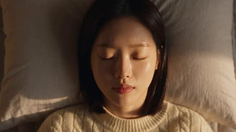</a>

The prompt fixes the wardrobe, hairstyle and backpack as an identity lock, then names each physical behaviour such as braking, tyre traction and backpack weight so the motion stays believable. Sound is limited to diegetic cues, and the ending is a written exterior bus shot that fades to black.

Seedance 2.5 · Text-to-video · Source: [@nawalsehar on X](https://x.com/nawalsehar/status/2101906866921955737) · found via [LearnPrompt/awesome-seedance](https://github.com/LearnPrompt/awesome-seedance)

[`vlog`](tags.md#tag-vlog) [`korea`](tags.md#tag-korea) [`university`](tags.md#tag-university) [`rural`](tags.md#tag-rural)

<details><summary><b>Prompt</b></summary>

```text
Create a 30-second ultra-photorealistic live-action personal vlog following a Korean university student in her early 20s living in a peaceful rural Korean mountain village. Show her natural morning routine, walking to the village bus stop, catching the regional bus, traveling through rice fields and hills, attending a university lecture, chatting quietly with friends, then taking the bus home toward the village at sunset.

Keep her identity, hairstyle, cream sweater, beige jacket, blue jeans, sneakers, backpack, and proportions consistent throughout. Use authentic modern 2026 smartphone/camera footage in 16:9 with subtle handheld movement, natural autofocus and exposure changes, realistic depth of field, and genuine Korean countryside and university atmosphere. No retro or VHS aesthetic.

Make every movement physically believable: realistic walking biomechanics, balance, friction, inertia, backpack weight, fabric and hair movement, bus braking and suspension, tire traction, acceleration, turning, window reflections, natural shadows, and believable human interactions. Every action should naturally lead into the next with no teleportation, floating objects, foot sliding, or impossible motion.

Use only diegetic audio: birds, footsteps, wind, doors, bus engine and brakes, transit-card beep, classroom ambience, writing, chairs, student conversations, and evening traffic. No music, narration, subtitles, or voice-over.

End with an exterior shot of the bus traveling along a winding rural road toward the distant village as evening light falls, then fade naturally to black.

No CGI look, animation, distorted hands, extra fingers, duplicated people, changing faces or outfits, robotic movement, repetitive walking cycles, exaggerated camera shake, fantasy elements, text overlays, logos, or watermark.
```

</details>

<a id="seedance-korean-village-bus-vlog"></a>
### Woman rides rural bus through Korean mountain village

<a href="https://x.com/aiwithaly/status/2095733454461907437">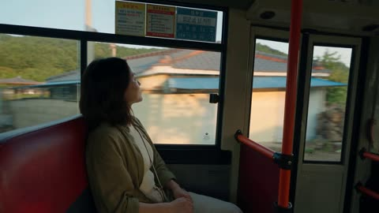</a>

The prompt splits a 30 second vlog into timed beats with scripted dialogue lines and a locked character description, and its closing negatives stop the look from drifting into cinematic polish. It also sets handheld phone realism and natural location audio explicitly.

Seedance 2.5 · Text-to-video · Source: [@aiwithaly on X](https://x.com/aiwithaly/status/2095733454461907437) · found via [LearnPrompt/awesome-seedance](https://github.com/LearnPrompt/awesome-seedance)

[`vlog`](tags.md#tag-vlog) [`korean-countryside`](tags.md#tag-korean-countryside) [`handheld`](tags.md#tag-handheld) [`dialogue`](tags.md#tag-dialogue)

<details><summary><b>Prompt</b></summary>

```text
Photorealistic 30-second modern Korean countryside vlog featuring a young Korean woman in her mid-20s exploring a peaceful mountain village during late afternoon. She wears a loose cream knit top, olive-green jacket, beige trousers, white sneakers, and a small canvas crossbody bag. Keep her identity, hairstyle, clothing, and proportions consistent throughout.

She arrives by a small rural bus, steps off at a quiet roadside stop, and films herself saying, “Today I'm spending the day in a little mountain village.” She walks through narrow village roads, showing traditional houses, gardens, bicycles, firewood, and green mountain slopes before saying, “It’s so quiet here… I love it.”

She discovers a tiny family-run shop, greets the elderly shopkeeper, and enjoys a simple homemade Korean meal outside. She tastes the hot soup and smiles genuinely, saying, “Oh wow… this is really good.” She walks beside green fields, gently touching the plants as the wind moves through them, and says, “I could honestly stay here all day.”

End at golden hour overlooking the village and mountains. She turns the phone toward the sunset, smiles, and says, “This was such a nice little escape. I’ll definitely come back.”

Authentic 2026 smartphone vlog aesthetic, natural handheld movement, imperfect framing, realistic autofocus and exposure changes, natural walking shake, genuine expressions, spontaneous reactions, realistic Korean village atmosphere, physically accurate human movement, clothing, hair, plants, steam, bus motion, and environmental interactions. Natural location audio only, no background music, no voice-over, no subtitles.

No CGI, no artificial faces, no beauty filters, no robotic acting, no staged posing, no cinematic-commercial perfection, no drone shots, no excessive stabilization, no changing identity, clothing, or hairstyle, no distorted anatomy, no impossible physics, no floating objects, no text, logos, or watermark.
```

</details>

<a id="seedance-korean-village-grocery-vlog"></a>
### Woman with tote bag at wooden village gate

<a href="https://x.com/aiwithaly/status/2099357930927845736">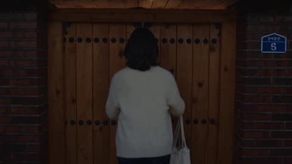</a>

The prompt lays out a timed sequence (leaving home, meeting the children, entering the shop) and repeats continuity locks on the woman, clothing and bag. Audio is limited to a list of diegetic sounds and dialogue with an explicit ban on music and narration, which keeps the model from adding them.

Seedance 2.5 · Text-to-video · Source: [@aiwithaly on X](https://x.com/aiwithaly/status/2099357930927845736) · found via [LearnPrompt/awesome-seedance](https://github.com/LearnPrompt/awesome-seedance)

[`korean`](tags.md#tag-korean) [`village`](tags.md#tag-village) [`vlog`](tags.md#tag-vlog) [`lip-sync`](tags.md#tag-lip-sync)

<details><summary><b>Prompt</b></summary>

```text
Create a 30-second ultra-photorealistic Korean countryside lifestyle vlog following a young Korean woman through a spontaneous afternoon in a peaceful village. Begin with her leaving her traditional home to buy groceries, walking along a quiet village road before meeting local children playing with a rubber ball. She briefly joins their game, laughing and playing naturally, then says goodbye and continues to a tiny neighborhood grocery shop.

Show authentic Korean rural life with traditional homes, modest modern houses, narrow paved roads, stone walls, vegetable gardens, utility poles, bicycles, trees, distant rice fields and a small local shop. Keep the woman, children, clothing, shopping bag and environment perfectly consistent throughout.

Capture realistic human movement, walking biomechanics, ball physics, cloth and hair movement, grocery handling, natural bag weight, door and gate mechanics, sunlight, shadows, wind and environmental details. Use modern 2026 handheld cinematic-vlog cinematography with natural autofocus, subtle camera movement, realistic motion blur, eye-level framing and a brief child-height tracking shot.

Use only natural diegetic audio: footsteps, birds, insects, wind, leaves, children's laughter, ball impacts, clothing movement, shopping-bag rustling, shop bell, groceries and authentic Korean dialogue with accurate lip synchronization. No music, narration, subtitles, CGI, artificial movement, impossible physics, changing faces or clothing, logos or watermark.

End with the woman walking home in warm golden-hour light, waving back at the children from a distance before entering her home, leaving the viewer with a peaceful, authentic Korean village moment.
```

</details>

<a id="seedance-korean-village-lane-minidv-vlog"></a>
### Warm afternoon Korean village lane with wooden doors

<a href="https://x.com/aiwithaly/status/2101886695624888440">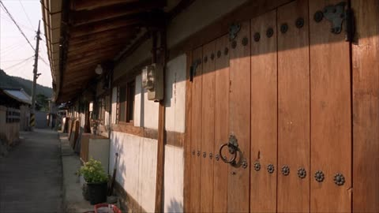</a>

Explicit camera specs (4:3 consumer DV, handheld shake, autofocus hunting, DV compression) lock the home-video look, and the sound list limits audio to village ambience with no music or narration. The ending is written as a clear final beat, a door closing in warm light, so the clip has a defined close.

Seedance 2.5 · Text-to-video · Source: [@aiwithaly on X](https://x.com/aiwithaly/status/2101886695624888440) · found via [LearnPrompt/awesome-seedance](https://github.com/LearnPrompt/awesome-seedance)

[`korean-village`](tags.md#tag-korean-village) [`minidv`](tags.md#tag-minidv) [`vlog`](tags.md#tag-vlog) [`lifestyle`](tags.md#tag-lifestyle)

<details><summary><b>Prompt</b></summary>

```text
Create a 30-second ultra-photorealistic live-action lifestyle vlog following the same 25-year-old Korean woman through a warm late-afternoon in a quiet traditional Korean village. She leaves her tiled-roof home, discovers local children playing with a ball, spontaneously joins them, then remembers her groceries and visits a tiny neighborhood shop before walking home.

Maintain consistent facial identity, hairstyle, outfit, and realistic proportions throughout. Show authentic MiniDV home-video aesthetics: 4:3 consumer footage, natural handheld shake, imperfect framing, autofocus hunting, mild exposure changes, soft contrast, faded colors, subtle DV compression, and no modern cinematic look.

Keep all movement physically believable—realistic walking, running, ball trajectories, hair and clothing motion, door and bell mechanics, grocery-bag weight, wind, gravity, friction, and natural human biomechanics. Use only diegetic village sounds: children laughing, footsteps, ball bouncing, birds, wind, keys, wooden doors, shop bell, groceries, and distant neighborhood ambience. No music or narration.

End with her entering home and gently closing the door as warm sunlight fills the quiet village lane and the children's laughter fades into the distance.

No CGI, animation, beauty filters, plastic skin, modern smartphone aesthetic, cinematic gimbal shots, impossible physics, duplicated people, changing faces or outfits, artificial sound effects, subtitles, logos, or watermark.
```

</details>

<a id="seedance-korean-village-morning-walk"></a>
### Korean Village Morning Routine and Walk

<a href="https://x.com/ayzalnooor24521/status/2101151635309564095"></a>

A character block locks face, hair, clothing and backpack before eight timed two second shots, so the woman stays consistent across cuts. Each shot gets one camera move and one ambient sound cue, and the dark interior to bright exterior exposure shift adds realism.

Seedance 2.5 · Text-to-video · Source: [@ayzalnooor24521 on X](https://x.com/ayzalnooor24521/status/2101151635309564095) · found via [LearnPrompt/awesome-seedance](https://github.com/LearnPrompt/awesome-seedance)

[`lifestyle`](tags.md#tag-lifestyle) [`rural-village`](tags.md#tag-rural-village) [`multi-shot`](tags.md#tag-multi-shot) [`character-consistency`](tags.md#tag-character-consistency) [`vertical`](tags.md#tag-vertical)

<details><summary><b>Prompt</b></summary>

```text
Create a 15-second vertical 9:16 cinematic lifestyle video featuring one consistent young Korean woman living in a peaceful rural Korean village. The video should feel like a natural everyday moment captured for a Korean lifestyle/X social-media post — quiet, authentic, cozy, photorealistic, not commercial, not overly dramatic.

Character consistency:
A young Korean woman in her early 20s, natural Korean facial features, soft clear skin, long dark-brown/black hair tied loosely in a low ponytail, minimal natural makeup. She wears a cozy cream knit sweater, long dark plaid skirt, white sneakers, and a simple black backpack. Keep her face, hairstyle, body proportions, clothing and backpack 100% consistent throughout every shot.

Environment:
A traditional rural Korean village with a small rustic wooden-and-plaster house, warm wooden interior, simple furniture, handmade baskets, old windows, stone walls, narrow village paths, small gardens, traditional tiled rooftops, distant green mountains and a peaceful countryside atmosphere. Early morning sunlight, fresh air, subtle autumn colors.

SHOT 1 — 0:00–0:02

Close cinematic shot inside her cozy rustic bedroom. She slowly wakes up in a simple bed, opens her eyes and looks toward the warm sunlight coming through the wooden window. Soft curtains move gently from the morning breeze. Natural room ambience, subtle birds outside. Camera slowly pushes in toward her face.

SHOT 2 — 0:02–0:04

Medium shot. She sits up, casually fixes her slightly messy hair and ties it into a loose ponytail. She puts on her cream knit sweater and prepares to leave. Keep the movement natural and unhurried, like a real morning routine.

SHOT 3 — 0:04–0:06

She picks up her simple black backpack from beside the wooden chair, puts it over her shoulders, checks herself briefly in a small mirror, then walks toward the wooden front door. Warm sunlight enters the room behind her.

SHOT 4 — 0:06–0:08

Rear three-quarter shot. She opens the old wooden door and steps outside. Bright natural morning light gently floods the frame. The camera follows her from behind as she leaves the house. Slight realistic exposure adjustment as the camera moves from dark interior to bright exterior.

SHOT 5 — 0:08–0:10

Wide cinematic shot of the Korean countryside village. She walks slowly along a narrow stone-and-concrete village path surrounded by small gardens, stone walls and traditional houses. Mountains are visible in the background. Leaves move naturally in the breeze. Camera tracks smoothly behind her.

SHOT 6 — 0:10–0:12

Side-profile close-up while she walks. She briefly looks toward the mountains and takes a peaceful breath. A few strands of hair move naturally in the wind. Sunlight creates a soft glow around her hair. Genuine relaxed expression, no exaggerated acting.

SHOT 7 — 0:12–0:14

She continues walking down the peaceful village road. Camera slowly moves from behind toward her side. The background reveals rooftops, trees, distant mountains and morning sunlight. She casually touches one hand to her backpack strap.

SHOT 8 — 0:14–0:15

Final cinematic wide shot from behind. She becomes slightly smaller in the frame as she continues walking toward the distant village and mountains. Hold for a beautiful peaceful ending with warm sunlight and gentle wind.

Camera & visual style:
Photorealistic Korean lifestyle cinematography, cinematic 35mm look, natural skin texture, realistic facial movement, subtle film grain, soft depth of field, gentle handheld camera movement, smooth tracking shots, realistic motion blur, natural lens flare, warm morning sunlight, muted earthy colors, soft highlights, detailed rural textures.
```

</details>

<a id="seedance-korean-woman-autumn-mountain-hike-vlog"></a>
### Korean woman selfie hiking autumn mountain trail

<a href="https://x.com/alixbuilds/status/2116381998499721651">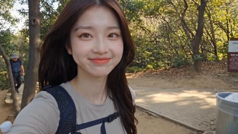</a>

Scene by scene structure with a fixed character description up front keeps the same woman consistent across shots. Handheld selfie and POV framing are named explicitly, and the visual style line sets the camera feel and colour grade.

Seedance 2.5 · Text-to-video · Source: [@alixbuilds on X](https://x.com/alixbuilds/status/2116381998499721651) · found via [LearnPrompt/awesome-seedance](https://github.com/LearnPrompt/awesome-seedance)

[`travel`](tags.md#tag-travel) [`vlog`](tags.md#tag-vlog) [`selfie`](tags.md#tag-selfie) [`autumn`](tags.md#tag-autumn)

<details><summary><b>Prompt</b></summary>

```text
Create an ultra-realistic cinematic travel vlog featuring a young adult Korean woman hiking through a beautiful mountain forest on a sunny autumn day. She has long, natural dark brown hair, soft facial features, and a cheerful, friendly expression. She wears a light beige long-sleeve athletic top, a dark hiking backpack, and comfortable outdoor clothing.

Scene 1: Begin with a handheld selfie shot as she smiles at the camera while walking along a peaceful forest trail. Sunlight filters beautifully through the trees.

Scene 2: Show cinematic POV shots of the rugged hiking path, exposed tree roots, fallen leaves, and other hikers walking uphill.

Scene 3: Capture close-up selfie footage of her climbing the rocky mountain trail, occasionally looking surprised, laughing, and enjoying the adventure.

Scene 4: Transition to breathtaking panoramic shots of layered mountain peaks beneath a clear blue sky. Show her reaching the summit and enjoying the beautiful scenery.

Scene 5: She sits at a wooden mountain viewpoint, enjoying the peaceful atmosphere and looking at the distant mountains.

Final Scene: Return to a close-up selfie shot. She smiles, waves goodbye to the camera, and enjoys the warm golden sunlight.

Visual Style: Photorealistic Korean travel vlog, natural facial expressions, realistic skin texture, handheld camera movements, authentic selfie perspective, cinematic wide-angle mountain shots, warm autumn sunlight, natural colors, smooth transitions, 4K detail.

Aspect Ratio: 16:9 Duration: 30 seconds Audio: Natural forest ambience, gentle wind, footsteps, and cheerful travel vlog background music.
```

</details>

<a id="seedance-korean-woman-first-train-selfie-vlog"></a>
### Korean woman selfie vlog on first train ride

<a href="https://x.com/saniaspeaks_/status/2094635608849166589">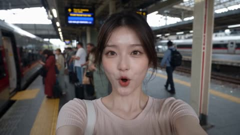</a>

The prompt frames the whole clip as handheld phone footage, with arm length selfies, rear camera switches, walking jolts, autofocus hunting and train vibration, so it reads as a personal vlog instead of a produced film. Each line of dialogue is tied to a specific action, and the explicit same woman instruction keeps one identity across the cuts.

Seedance 2.5 · Text-to-video · Source: [@saniaspeaks_ on X](https://x.com/saniaspeaks_/status/2094635608849166589) · found via [LearnPrompt/awesome-seedance](https://github.com/LearnPrompt/awesome-seedance)

[`smartphone-vlog`](tags.md#tag-smartphone-vlog) [`selfie`](tags.md#tag-selfie) [`train-travel`](tags.md#tag-train-travel) [`lip-sync`](tags.md#tag-lip-sync) [`dialogue`](tags.md#tag-dialogue)

<details><summary><b>Prompt</b></summary>

```text
Ultra-realistic casual smartphone travel vlog of one consistent young Korean woman in her early 20s taking a train journey for the first time, speaking natural fluent English with accurate lip synchronization. Everything is filmed by her own hand on a real smartphone and must feel like an authentic personal social-media vlog, never cinematic or professionally filmed. Use mostly arm-length selfie footage with occasional natural switches to the rear camera, including slight hand shakes, awkward framing, walking jolts, autofocus hunting, exposure changes, motion blur, fingers near the lens, realistic train vibrations, window reflections, and authentic phone-camera quality. She starts at a busy station platform and excitedly says, “Okay guys, I’m taking the train today! Let’s go!” while showing the arriving train, then boards saying, “I made it!” She finds her window seat and says, “And I got a window seat!” As the train starts moving, she films outside and says, “We’re moving!” She casually shows a snack and drink, takes a bite, and says, “Everything tastes better on a train.” She then films beautiful passing scenery of trees, small towns, and distant mountains, quietly saying, “This view is so beautiful.” Finally, back in selfie mode with the moving scenery behind her, she smiles and says, “I think train journeys might be my new favorite thing. See you guys next time. Bye!” before waving and lowering the phone. Include realistic station announcements, train sounds, footsteps, passenger conversations, blinking, breathing, and spontaneous reactions. The same woman must remain perfectly consistent throughout, with no identity changes or duplicate people.
```

</details>

<a id="seedance-korean-woman-gym-workout-home-video"></a>
### Woman in black gym kit leaves home with bag

<a href="https://x.com/AIwithkhan/status/2104408252670939438">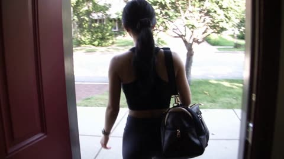</a>

It anchors the woman to a reference image, then walks through the workout as timed beats, and the early-2000s DV camera description with ambience-only audio keeps it reading as amateur home footage rather than a commercial.

Seedance 2.5 · Reference-to-video · Source: [@AIwithkhan on X](https://x.com/AIwithkhan/status/2104408252670939438) · found via [LearnPrompt/awesome-seedance](https://github.com/LearnPrompt/awesome-seedance)

[`fitness`](tags.md#tag-fitness) [`home-video`](tags.md#tag-home-video) [`dv-look`](tags.md#tag-dv-look) [`ambient-audio`](tags.md#tag-ambient-audio)

<details><summary><b>Prompt</b></summary>

```text
Create a 30-second ultra-realistic personal home-video of a young Korean woman going to a local gym for a simple workout. Use the attached image as the character reference and keep her face, hairstyle and overall appearance consistent throughout.

She leaves her home carrying a small gym bag and walks through the quiet neighborhood toward a nearby local gym. Before entering, she ties her long black hair into a neat ponytail and adjusts her gym bag.

Inside the gym, she changes into realistic workout clothes: a fitted black athletic crop top, high-waisted charcoal leggings, clean white training shoes, and a small fitness watch. She places her bag and water bottle beside a workout bench and begins stretching.

She starts with light dumbbell exercises, then does bodyweight squats, lunges and jumping-jack exercises. Show realistic movement, controlled breathing and natural effort. Her face gradually becomes slightly sweaty as the workout continues.

She pauses, grabs her water bottle and drinks several times, then wipes sweat from her forehead and neck with a small white towel. She looks at herself in the gym mirror, laughs at how sweaty she has become and smiles.

She continues with a short treadmill run, breathing naturally and occasionally laughing when she gets tired. She slows down, steps off carefully, grabs her towel and wipes her face again.

Near the end, she sits on the bench catching her breath, drinks water, smiles toward the camera and says, “That was a good workout!” She gives a small laugh, picks up her gym bag and walks out.

Camera: Raw early-2000s consumer DV-camera footage — handheld shake, imperfect framing, autofocus hunting, exposure shifts, soft digital detail, mild digital noise, natural motion blur, occasional awkward zooms and authentic home-video imperfections. Casual friend-filmed feeling, not a polished fitness commercial.

Audio: Natural gym ambience only — footsteps, treadmill motor, weights gently hitting the floor, breathing, water bottle opening, towel movement, distant conversations, occasional laughter and air-conditioning hum. No music, no narration, no subtitles.

Consistency & realism: Keep the same woman, face, hairstyle, body proportions, gym outfit, shoes, towel, water bottle and gym bag consistent. Realistic sweat, skin texture, hair movement, breathing, exercise form and clothing physics. Natural expressions and genuine laughter.

Negative: CGI look, plastic skin, beauty filters, exaggerated muscles, impossible exercise movements, distorted hands, extra fingers, duplicated people, identity drift, outfit changes, floating objects, teleportation, unrealistic sweat, subtitles, logos, watermark, polished commercial cinematography.
```

</details>

<a id="seedance-korean-woman-sunny-pool"></a>
### Woman dangles feet at sunny pool, then swims

<a href="https://x.com/Strength04_X/status/2091737661061095648">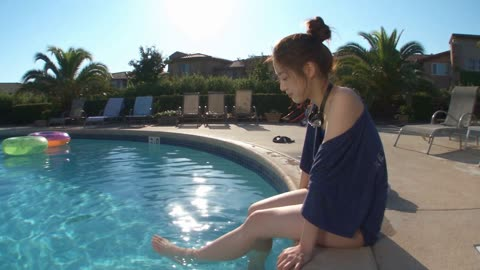</a>

A five-slot timeline with a beat for each action and a line of dialogue gives the model a clear shot-by-shot structure. The 2000s camcorder spec (handheld, blown highlights, soft grain, no stabilization) sets the look, and each Korean line is paired with its meaning so the lip movement and action line up.

Seedance 2.5 · Text-to-video · Source: [@Strength04_X on X](https://x.com/Strength04_X/status/2091737661061095648)

[`timeline`](tags.md#tag-timeline) [`camcorder`](tags.md#tag-camcorder) [`dialogue`](tags.md#tag-dialogue) [`documentary`](tags.md#tag-documentary)

<details><summary><b>Prompt</b></summary>

```text
Young Korean woman, early 20s, navy one-piece swimsuit with a loose oversized shirt worn open over it, hair tied up in a high bun, swim goggles around her neck, playful cheerful energy.
Location: Quiet outdoor community pool, sunny midday. Blue tiled edges, pool floats scattered nearby, lounge chairs, a few potted palms. No crowds, no commercial branding.
Visual Style: Ultra-realistic documentary realism, playful candid feeling, bright natural sunlight.
Camera Style: Early 2000s DV camcorder, handheld with water-splash blur on lens occasionally, exposure blown out in bright sun, soft grain. No stabilization.
Timeline (15 sec, each slot = 2 compressed beats):
00:00–00:03 → She sits at the pool edge, feet dangling in the water, kicking gently.
00:03–00:06 → She says to camera "물이 시원해서 좋다" ("The water feels nice and cool"), smiling.
00:06–00:09 → She slides into the pool, then pushes off, swimming a short stretch.
00:09–00:12 → She surfaces laughing, wiping water from her face.
00:12–00:15 → She waves at camera saying "너도 들어와!" ("Come in too!"), splashing playfully as it fades.
Audio:
Water splashing, faint distant chatter, wind, birds. Her dialogue as noted above. No music.
Goal: A playful, refreshing pool afternoon cheerful, light, authentic.
```

</details>

<a id="seedance-kyoto-afternoon-camcorder-vlog"></a>
### Woman leaves Kyoto townhouse on handheld camcorder vlog

<a href="https://x.com/AIwithAliya/status/2096134503966388296">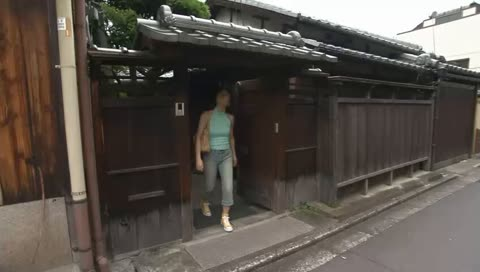</a>

The opening paragraph locks the outfit, location and camcorder look, then each timestamped beat pairs an action with the exact Japanese line to speak. Late camera reactions, autofocus hunting and handheld shake are spelled out so the motion reads as casual footage rather than a cinematic shot.

Seedance 2.5 · Text-to-video · Source: [@AIwithAliya on X](https://x.com/AIwithAliya/status/2096134503966388296) · found via [LearnPrompt/awesome-seedance](https://github.com/LearnPrompt/awesome-seedance)

[`lifestyle-vlog`](tags.md#tag-lifestyle-vlog) [`camcorder`](tags.md#tag-camcorder) [`kyoto`](tags.md#tag-kyoto) [`handheld`](tags.md#tag-handheld)

<details><summary><b>Prompt</b></summary>

```text
Create a 30-second, 16:9 ultra-realistic handheld lifestyle vlog following the same young Japanese woman in her 20s through an ordinary afternoon in Kyoto. Keep her face, identity, hairstyle, body, outfit, accessories, and proportions perfectly consistent in every shot.

She wears a tight pastel green halter top, straight-leg light denim jeans, yellow canvas sneakers, a small tan tote bag, and thin gold hoop earrings throughout.

New scenario: A quiet afternoon in Kyoto

0–5s — Leaving home

She steps out of a small traditional Kyoto townhouse into a quiet residential lane. She checks the sky, adjusts the strap of her tote bag, and notices the camera. She gives a small smile and says naturally:

「今日は、ゆっくりしよう。」

She starts walking, and the camera follows a little late.

5–11s — Small flower shop

She stops at a tiny neighborhood flower shop, looks at a bucket of fresh flowers, and gently touches a small yellow flower. She smiles and says:

「この色、好きだな。」

She buys one small flower, places it carefully in her tote bag, and walks outside. The camera briefly loses focus on her hands before finding her face again.

11–17s — Quiet café

She enters a small local café, orders an iced tea, and sits near the window. She looks outside at the passing bicycles and old wooden buildings, then turns toward the camera and says softly:

「こういう時間、落ち着くね。」

She takes a sip, notices the camera still filming, and gives a slightly amused smile.

17–23s — Narrow walking street

She leaves the café and walks through a narrow street lined with small shops. A delivery bicycle passes unexpectedly, and she steps aside with a little laugh. She looks back at the camera and says:

「あ、びっくりした。」

She continues walking, holding her tote bag naturally at her side.

23–27s — Canal-side pause

She reaches a quiet canal-side path in the late afternoon. She sits on a low stone ledge, places her drink beside her, and takes the small flower out of her tote bag. She looks at it for a moment, then watches the water. The wind moves her hair naturally, and she gives a small, genuine smile.

27–30s — Walking home

She stands, puts the flower back into her tote bag, and starts walking away. After a few steps, she looks back at the camera and says:

「また、ゆっくり歩こうね。」

She continues walking as the camera follows behind. Recording naturally ends around 29.5 seconds.

Filming style

Genuine footage filmed casually by a close friend on a smartphone or compact camera. Handheld shake, imperfect framing, autofocus hunting, exposure pumping, natural motion blur, mild digital noise, occasional late camera reactions. No gimbal, drone, cinematic choreography, slow motion, beauty filter, or commercial look.

Camcorder aesthetic

Authentic early-2000s MiniDV / consumer camcorder footage, as if someone found an old family tape from around 2002–2005.

4:3 home-video framing

Slight handheld shake

Imperfect framing

Autofocus hunting

Occasional exposure pumping

Mild blown highlights

Soft digital sharpness

Interlaced-looking motion characteristics

Subtle motion blur

Low dynamic range

Faded, slightly warm colors

Realistic digital noise

Tiny compression artifacts

Occasional accidental micro-zoom

Imperfect white balance

Slight lens flare when sunlight hits the lens

Natural camera operator mistakes

Do not make the footage excessively degraded. It should still be clear enough to see her face and environment.

Realism

The most important goal is believability.

Accurate human biomechanics, grounded feet, continuous objects, realistic walking, sitting, drinking, and handling of the flower. Consistent architecture and wardrobe. Hands must remain anatomically correct with five fingers. Clothes must move naturally with her body and wind.
```

</details>

<a id="seedance-kyoto-autumn-slow-travel-vlog"></a>
### Quiet Kyoto autumn travel vlog, 30 seconds

<a href="https://x.com/Chaemate_/status/2099439262106083704">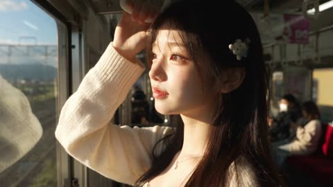</a>

Locks the face, outfit and necklace to a reference image, then sets a slow pace with one simple action per scene. It bans ad-style montage and gives short dialogue lines with pauses, plus handheld, autofocus, ambient sound and 35mm grain cues for a casual home-video feel.

Seedance 2.5 · Reference-to-video · Source: [@Chaemate_ on X](https://x.com/Chaemate_/status/2099439262106083704) · found via [LearnPrompt/awesome-seedance](https://github.com/LearnPrompt/awesome-seedance)

[`travel-vlog`](tags.md#tag-travel-vlog) [`kyoto`](tags.md#tag-kyoto) [`character-consistency`](tags.md#tag-character-consistency) [`handheld`](tags.md#tag-handheld) [`film-grain`](tags.md#tag-film-grain)

<details><summary><b>Prompt</b></summary>

```text
Create a photorealistic 30-second personal travel vlog featuring the exact same woman from the reference image. Keep her face, hairstyle, physical appearance, makeup, outfit and necklace consistent throughout the entire video.

Make it feel like a real young woman casually documenting her autumn trip to Kyoto with a friend behind the camera. No commercial travel-ad look, no fast montage and no overly cinematic movements.

Keep the pacing slow and natural. Each scene should focus on one simple action. Let shots breathe and allow natural pauses. She should walk, look around and react at normal human speed. Never speed up her movement or speech to fit more into the scene.

Show quiet everyday moments around Kyoto: riding a local train in the morning, walking through a residential street, discovering a small bakery, sitting by the river, browsing a tiny stationery shop, getting caught in light rain and grabbing a warm drink from a vending machine at night.

Keep the dialogue extremely short and casual, with natural pauses. Things like “Cute…”, “So pretty”, “Mmm… good”, “Look…”, “This one?”, “Oh… rain”, “Nice…” and “One more stop.” She should never sound like she's reading a script or rushing through lines.

Use realistic handheld camera movement, subtle autofocus, natural exposure changes, real ambient sounds, natural skin texture, realistic lighting and subtle 35mm film grain. Some moments should have no dialogue at all.

The goal is simple: make it feel like an actual travel vlog someone happened to capture during a real day in Kyoto, not an AI-generated commercial.
```

</details>

<a id="seedance-kyoto-lane-cat-dv-walk"></a>
### Woman steps out of Kyoto wooden house

<a href="https://x.com/ElsaSofia__AI/status/2097281634370568317">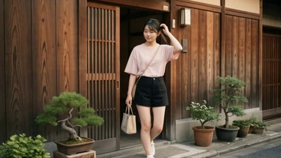</a>

The camera spec is spelled out in full (handheld shake, autofocus hunting, exposure shifts, no stabilization) so the footage reads as a friend's DV recording. Timed beats with a fixed location and outfit, plus location only audio and two spoken lines, keep the 30 second clip coherent.

Seedance 2.5 · Text-to-video · Source: [@ElsaSofia__AI on X](https://x.com/ElsaSofia__AI/status/2097281634370568317) · found via [LearnPrompt/awesome-seedance](https://github.com/LearnPrompt/awesome-seedance)

[`japan`](tags.md#tag-japan) [`kyoto`](tags.md#tag-kyoto) [`found-footage`](tags.md#tag-found-footage) [`dv-camcorder`](tags.md#tag-dv-camcorder)

<details><summary><b>Prompt</b></summary>

```text
⤵️ 
Same young Japanese woman throughout—early 20s, fair-warm skin, natural minimal makeup, straight black hair in a low ponytail with side-swept bangs. Pale-pink oversized t-shirt, black high-waisted shorts, white canvas sneakers, small crossbody bag, thin gold necklace. Keep face, hair, outfit, proportions, and accessories perfectly consistent.
Setting: Quiet old residential lane in Kyoto with narrow wooden houses, potted bonsai, a bicycle leaned against a wall, a vending machine humming on the corner, a small shrine torii gate visible down the street, overhead power lines, cicadas in the trees. Lived-in, authentic; no brands, ads, tourist crowds, or polished commercial activity.
Camera: Raw friend-recorded early-2000s consumer DV footage—strong handheld shake, imperfect framing, autofocus hunting, exposure shifts, motion blur, faded colors, soft digital detail, mild noise, accidental zooms. No stabilization, gimbal, drone, or cinematic shots.
Timeline:
00:00–00:05: Steps out of a narrow wooden house, small tote bag on shoulder, adjusts her ponytail, smiles at camera, starts walking down the lane.
00:05–00:10: Stops at the vending machine, buys a cold canned drink, opens it, takes a sip, reacts (too sweet/fizzy), laughs, holds the can toward camera.
00:10–00:15: A small cat sitting near a doorway notices her. She crouches, holds out her hand, cat sniffs it, brushes against her leg, then wanders off.
00:15–00:20: A gust of wind sends cherry-blossom-like leaves swirling around her, some land in her hair. She looks up, laughs, brushes them off, awkward camera zoom toward her face. She says, "Mata?" ("Again?")
00:20–00:25: Sits briefly on a low stone step, finishes her drink while a bicycle passes and an old neighbor waters plants nearby. Breeze moves her hair and shirt; she wipes her hand and adjusts her bag.
00:25–00:30: Walks toward the end of the lane, turns back with a playful smile, says "Ikou." ("Let's go.") Walks around the corner; camera follows; abrupt cut to black.
Audio: Natural location sound only—cicadas, birds, footsteps, bicycle bell, distant traffic, vending machine hum, leaves rustling, cat sounds, camera-handling noise. No music, narration, subtitles, captions, logos, watermarks, or artificial effects.
Continuity: Realistic cat and environmental movement. No duplicated people, distorted faces, broken hands, extra fingers, teleportation, or outfit changes. Warm, casual, feminine, playful, nostalgic forgotten-summer-memory feeling.
```

</details>

<a id="seedance-kyoto-lane-vlog-ordinary-day"></a>
### Handheld Kyoto day vlog with Japanese dialogue

<a href="https://x.com/Just_sharon7/status/2096109540924141746">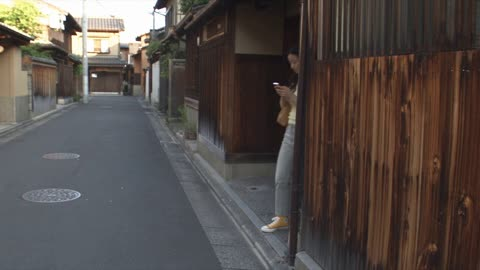</a>

Framing it as a friend's phone footage, with handheld shake, autofocus drift and natural motion blur, makes it read as real footage rather than a polished shot. Timed segments with exact spoken lines and a fixed wardrobe list keep the same woman and story consistent across all 30 seconds.

Seedance 2.5 · Text-to-video · Source: [@Just_sharon7 on X](https://x.com/Just_sharon7/status/2096109540924141746) · found via [LearnPrompt/awesome-seedance](https://github.com/LearnPrompt/awesome-seedance)

[`vlog`](tags.md#tag-vlog) [`kyoto`](tags.md#tag-kyoto) [`handheld`](tags.md#tag-handheld) [`dialogue`](tags.md#tag-dialogue)

<details><summary><b>Prompt</b></summary>

```text
Create a 30-second, 16:9 ultra-realistic handheld lifestyle vlog following the young Japanese woman in her 20s through an ordinary day in Kyoto. Keep her face, identity, hairstyle, body, outfit, accessories, and proportions perfectly consistent.

She wears a fitted pastel yellow short top, straight-leg light denim jeans, yellow canvas sneakers, a small tan tote bag, and thin gold hoop earrings throughout.

Style: Genuine footage filmed casually by a close friend on a smartphone/compact camera. Handheld shake, imperfect framing, autofocus/exposure shifts, natural motion blur, mild digital noise, realistic skin texture, occasional late camera reactions. No gimbal, drone, cinematic choreography, slow motion, beauty filter, or commercial look.

0–5s: Quiet residential Kyoto street, narrow lane with wooden facades. She steps out of her apartment, glances at her phone, notices the camera, smiles softly, tucks her hair behind her ear and says naturally: "今日も一緒に行こう。"

5–11s: Enters a small neighborhood bakery/konbini-style shop, notices a fresh melon pan and says: "これ、いい匂いがする。" Buys it, takes a bite outside, and smiles at the camera.

11–17s: Boards a local city bus and sits by the window. Kyoto streets and old buildings pass outside with realistic reflections and sunlight. She quietly says: "こういう日は、歩きたくなるな。"

17–23s: Gets off near a canal-side walking path. Buys a drink from a small vending machine or cart. A cyclist passes unexpectedly close; she steps aside, laughs, and says: "今、ちょっとびっくりした。"

23–27s: Golden-hour canal-side scene. She sits on a low stone ledge or bench, places her drink beside her, removes one earbud, watches the water, and gives a small genuine smile as the wind moves her hair.

27–30s: She stands and walks away. After a few steps, looks back and says: "次は一緒に来てね。" She continues walking as the camera follows behind. Recording naturally ends around 29.5s.

REALISM: Accurate human biomechanics, grounded feet, continuous objects, realistic bus movement, natural walking/eating/sitting, consistent architecture and wardrobe. No teleportation, morphing, identity drift, duplicated/disappearing objects, distorted hands or limbs.

AUDIO: Natural Japanese dialogue with accurate lip-sync, phone-mic quality, footsteps, traffic, birds, bakery sounds, bus engine, bicycle bell, wind and city ambience. No music, narrator, or cinematic SFX.

Absolutely no subtitles, captions, on-screen text, logos, watermarks, or UI.
```

</details>

<a id="seedance-kyoto-summer-dv-walk"></a>
### Woman with paper fan opens a sliding door

<a href="https://x.com/Ciri_ai/status/2093200782887657696">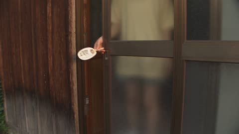</a>

The early-2000s DV camcorder spec (handheld shake, autofocus hunting, exposure shifts) carries the found-footage look. Timed story beats and location-only audio with just two spoken lines keep the 30-second clip natural and unstaged.

Seedance 2.5 · Text-to-video · Source: [@Ciri_ai on X](https://x.com/Ciri_ai/status/2093200782887657696) · found via [LearnPrompt/awesome-seedance](https://github.com/LearnPrompt/awesome-seedance)

[`japan`](tags.md#tag-japan) [`kyoto`](tags.md#tag-kyoto) [`found-footage`](tags.md#tag-found-footage) [`dv-camcorder`](tags.md#tag-dv-camcorder)

<details><summary><b>Prompt</b></summary>

```text
Create a 30-second, 1080p ultra-realistic personal home-video showing an ordinary summer evening in the life of a young Japanese woman. No reference image.
MAIN SUBJECT
Young Japanese woman in her early 20s, naturally pretty, realistic skin texture, minimal makeup, soft and cheerful personality.
Shoulder-length dark brown hair worn down with a simple clip pinning back one side, a few loose strands framing her face. Wearing an oversized light-yellow short-sleeve shirt, denim shorts, white canvas sneakers and a thin gold anklet.
Maintain the same face, hairstyle, clothing, body proportions and overall appearance throughout the entire video.
SETTING
A quiet older residential neighborhood in Kyoto during a warm summer evening. Narrow paved streets, low wooden houses, hanging laundry, vending machines, telephone poles, tangled overhead wires, a small corner convenience store, a shrine gate visible in the distance, cicadas humming in the trees, and long tree shadows stretching across the road.
Everything should feel lived-in, ordinary and peaceful. No tourist attractions, advertisements, recognizable brands or commercial activity.
CAMERA / VISUAL AESTHETIC
Raw personal footage casually recorded by a friend on an early-2000s consumer DV camcorder.
Strong handheld shake, imperfect framing, autofocus hunting, exposure shifts, occasional motion blur, faded colors, soft digital detail, mild noise, accidental zooms and natural camera imperfections.
No stabilization, drone footage, gimbal movement, dramatic lighting or polished commercial cinematography.
— OUTSIDE THE HOUSE
She steps outside holding a small paper fan. She slides the door shut, glances at her reflection in a window, and looks toward the camera with a shy laugh.
A warm evening breeze rustles the nearby wind chimes as she starts walking down the street.
— CONVENIENCE STORE STOP
She reaches the small corner store and buys a popsicle.
She steps outside, unwraps it, takes her first bite and scrunches her face happily at the taste.
She notices her friend filming and waves the popsicle toward the camera with a grin before taking another bite.
— WALKING HOME
She continues down the quiet street while eating.
A small dog tied outside a shop barks softly and wags its tail. She kneels down and gently scratches behind its ears.
The dog's owner calls it back and she stands, giggling as she walks on.
— SMALL ACCIDENT
She walks past a low hanging laundry line when a stray sheet brushes against her head.
She stops, startled, then realizes what happened and bursts out laughing.
She pats down her hair while her friend zooms clumsily toward her face.
She looks directly into the camera and says:
"Mou, yamete!" ("Come on, stop it!")
— QUIET MOMENT
She reaches a small stone step near a shrine gate and sits down for a moment.
She finishes the popsicle while watching fireflies begin to flicker faintly near the bushes.
A gentle breeze moves her hair. She tucks a loose strand behind her ear and looks around peacefully.
— FINAL MOMENT
She stands up and continues walking home.
After a few steps, she turns back toward the camera with a soft playful smile and says:
"Hayaku kite." ("Come on, hurry up.")
She keeps walking down the dim lane as the streetlights flicker on, while the camera follows behind.
She disappears around the corner and the recording abruptly cuts to black.
AUDIO
Natural location sound only: cicadas, wind chimes, footsteps, distant bicycle bells, a vending machine hum, sliding doors, rustling laundry, faint conversations and subtle camera-handling noise.
No music. No narration. No artificial sound effects.
Only the two spoken lines specified above.
FINAL FEEL
The entire video should feel like a forgotten summer recording from the early 2000s.
Warm, gentle, casual, slightly playful, intimate and nostalgic.
No dramatic events, no exaggerated acting, no model poses and no polished cinematic shots.
The realism should come from ordinary surroundings, natural expressions, small accidents, realistic environmental movement and imperfect camcorder operation.
```

</details>

<a id="seedance-late-night-kitchen-phone-cooking"></a>
### Late night kitchen meal shot like a phone recording

<a href="https://x.com/AIWithRay/status/2087544594384773346">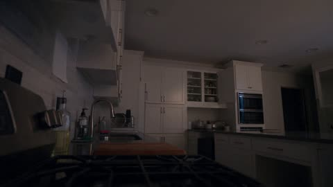</a>

The prompt splits the 30 seconds into timed beats with exact actions and camera placement, and it names smartphone traits such as autofocus hunting and compression noise so the model keeps a home video look. It limits audio to room sounds and marks the dialogue as spontaneous, which stops the clip from reading as a polished ad.

Seedance 2.5 · Text-to-video · Source: [@AIWithRay on X](https://x.com/AIWithRay/status/2087544594384773346) · found via [LearnPrompt/awesome-seedance](https://github.com/LearnPrompt/awesome-seedance)

[`phone-footage`](tags.md#tag-phone-footage) [`timed-beats`](tags.md#tag-timed-beats) [`ambient-audio`](tags.md#tag-ambient-audio) [`dialogue`](tags.md#tag-dialogue)

<details><summary><b>Prompt</b></summary>

```text
FORMAT: 30-second horizontal 16:9 realistic smartphone video.
Create an authentic, imperfect everyday late-night kitchen phone recording, as if a friend casually left a phone recording on the counter. Use a standard smartphone camera with mild autofocus hunting, subtle exposure shifts, natural motion blur, compression artifacts, and slightly uneven handheld framing. No polished commercial look.
00–05s — WALKING IN
The character walks into a quiet home kitchen carrying a small grocery bag. They set it on the counter, sigh quietly, and pull out a few simple ingredients.
They glance at the phone for a second before turning back toward the counter.
Camera remains several feet away at counter height, as if casually recording from a nearby surface.
05–10s — GETTING STARTED
They wash their hands, turn on the kitchen light, and begin preparing the ingredients.
A cutting board shifts slightly against the counter. They pause to move it into a better position.
The character looks tired but relaxed, occasionally brushing their hair away from their forehead.
10–15s — COOKING
They place a pan on the stove and begin cooking.
Steam gradually becomes visible. The phone autofocus briefly shifts between the character and the foreground pan before settling again.
They stir the food, taste a tiny amount, think for a moment, then add a little more seasoning.
No readable labels or packaging should be visible.
15–20s — SMALL MISTAKE
The character gets distracted for a moment and notices the food starting to cook more quickly than expected.
They immediately lower the heat and give a small amused shake of their head.
They quietly mutter something like:
“Yeah… almost forgot about that.”
The delivery should feel spontaneous and understated.
20–25s — FINISHING
They finish preparing the food, turn off the stove, and carefully transfer the meal onto a plate.
They wipe a small splash from the counter with a paper towel.
Natural movements only—nothing overly choreographed.
25–30s — QUIET ENDING
They sit at the kitchen table with the finished meal.
They take one bite, pause, and give a small satisfied smile.
They look toward the phone and quietly say:
“Honestly… not bad.”
They pick up the fork again and continue eating as the camera keeps recording for another moment before the clip naturally ends.
AUDIO
Natural kitchen ambience only: refrigerator hum, ventilation, running water, utensil sounds, pan sizzling, footsteps, clothing movement, cupboard and drawer sounds, plate and fork noises, and subtle room ambience.
No music.
Dialogue should sound spontaneous and conversational, with natural pauses and imperfect delivery.
VISUAL REALISM
Authentic smartphone footage, ordinary warm household lighting, realistic skin texture, natural shadows, mild phone-camera sharpening, subtle compression noise, imperfect exposure, slight autofocus changes, believable reflections, natural steam, realistic food textures, and ordinary kitchen imperfections.
STRICTLY AVOID: cinematic color grading, beauty filters, artificial skin smoothing, dramatic slow motion, music, subtitles, captions, logos, readable text, perfect lighting, excessive camera shake, exaggerated acting, unrealistic food or steam, duplicated objects, warped hands, unnatural facial expressions, scene cuts, time jumps, or skipping the described actions.
```

</details>

<a id="seedance-lia-morning-village-home-video"></a>
### Woman with coffee on a village terrace

<a href="https://x.com/Cupang1997/status/2091438364545446209"></a>

Each reference image gets a fixed role (identity, location one, location two), and the prompt locks clothing, hair and hand-held props across a single hard cut. Handheld camcorder cues (tremor, late refocus, exposure pumping) plus an off-screen cameraman voice, with only the on-screen woman lip-synced, make it read as found home video.

Seedance 2.5 · Reference-to-video · Source: [@Cupang1997 on X](https://x.com/Cupang1997/status/2091438364545446209) · found via [LearnPrompt/awesome-seedance](https://github.com/LearnPrompt/awesome-seedance)

[`home-video`](tags.md#tag-home-video) [`indonesia`](tags.md#tag-indonesia) [`lip-sync`](tags.md#tag-lip-sync) [`slice-of-life`](tags.md#tag-slice-of-life)

<details><summary><b>Prompt</b></summary>

```text
Reference mode:
Use karakter sheet - location 1 - location 2 (image)

# Seedance 2.5 — Lia Morning Village Home Video — 30 Seconds FORMAT: Seedance 2.5 image-reference-to-video. Duration: exactly 30 seconds. Aspect ratio: 16:9. Photorealistic animated video from still-image references, rendered as believable live-action documentary footage rather than cartoon or CGI. Two continuous documentary scenes with only one intentional hard cut at approximately 17.5 seconds. REFERENCE ROLES: * gambar 1  = strict identity and appearance reference for LIA. Preserve Lia as the exact same adult woman throughout the entire video: same facial structure, eyes, nose, lips, skin tone, freckles/skin details, body proportions, tied-back dark brown hairstyle with naturally loose strands, earrings, white fitted top, brown patterned wrap skirt/sarong, and white sandals. Do not redesign or beautify her. * gambar 2  = strict environment and architectural reference for SCENE 1 only. Preserve the modest Indonesian house facade, open tiled front terrace, roof shape, terracotta roof feeling, columns, doors, windows, front yard, trees, plants, overhead electrical cables, scale, and spatial layout. Do not copy any character identity from this image. * gambar 3  = strict environment and composition reference for SCENE 2 only. Preserve the narrow asphalt village road, rice-field surroundings, village rooftops, utility lamp poles, tropical vegetation, distant green hill, open blue morning sky, and rural Indonesian spatial feeling. Do not copy character identity from this image. GLOBAL CHARACTER LOCK: Lia must remain visually identical to gambar 1 in both locations. Same face, body proportions, hairstyle, outfit, accessories, skin texture, and footwear. Her clothes should behave like real cotton and woven fabric, slightly worn and everyday rather than glossy or fashion-perfect. Lia's personality is relaxed and naturally playful. When she talks she becomes noticeably more excited and expressive: bright eyes, quick eyebrow lifts, small head tilts, spontaneous smiles and teasing expressions. Natural Indonesian speech with a light authentic Javanese-Indonesian accent, lively and conversational, never theatrical or caricatured. CAMERAMAN: The cameraman is always physically behind the camera and NEVER appears on screen, in reflections, windows, shadows, or background. His voice is recorded naturally from directly behind the camcorder. When the cameraman speaks, Lia does not lip-sync his dialogue. Lia only reacts with natural eye movement, a small smile, breathing, or subtle head movement. Only Lia's own spoken lines animate Lia's lips. VISUAL STYLE: Ultra-realistic documentary realism. Genuine candid behavior. Unscripted everyday slice-of-life feeling. Natural imperfect body language. Deep environmental authenticity of a rural Indonesian morning. The result should feel like a forgotten family home video recorded in Indonesia in the early 2000s: warm, mundane, affectionate, slightly funny, imperfect and deeply believable. Output may be high-resolution / 8K master quality, but the acquisition aesthetic must strongly emulate an early-2000s consumer DV camcorder: warm slightly faded colors, soft contrast, mild sensor noise, subtle digital compression, limited highlight latitude, natural motion blur, very mild rolling shutter, slightly imperfect white balance, no glossy modern HDR, no modern cinematic color grade, no beauty filter, no excessively shallow depth of field. HUMAN-OPERATED CAMERA: Camera movement must feel physically operated by a real friend holding a consumer camcorder. Use: subtle hand tremor, natural breathing drift, slightly imperfect horizon, small delayed reframing, occasional lens breathing, brief autofocus searching caused by subject movement, minor exposure pumping when moving between shade and bright sunlight. Every camera imperfection must have a physical reason. No gimbal stabilization. No drone. No orbit. No crane. No perfect tracking. No dramatic cinematic push-ins. No stylized speed ramp. No artificial cinematic camera choreography. SCENE 1 — TERRACE MORNING, based on gambar 2 00:00–00:02.8 Begin immediately with Lia already seated casually on the front terrace of the house from gambar 2. Use a loose eye-level medium-wide three-quarter shot, as if the cameraman is standing several steps in front of the terrace. Lia sits relaxed on the existing porch seating, shoulders loose, one foot slightly forward. Her LEFT hand naturally holds a simple glass cup of dark morning coffee. Her RIGHT hand holds one lit cigarette between index and middle finger. Keep object ownership consistent: coffee always remains in the left hand until she puts it down, cigarette remains in the right hand until she extinguishes it. A thin natural stream of cigarette smoke rises and bends with the morning air. Lia briefly takes a small sip of coffee, lowers the glass, casually looks toward the cameraman behind the lens and gives a tiny amused smile. Camera is not perfectly centered and slowly drifts a few centimeters while the operator settles his grip. Tropical morning sunlight illuminates the yard while Lia remains partially under terrace shade. Moving leaves create soft shifting dappled shadows. Exposure reacts slightly to the bright yard behind her. 00:02.8–00:04.5 CAMERAMAN speaks from behind the camera, playful and casually surprised: "widiihh lia santai amat" The cameraman remains completely off-screen. While listening, Lia keeps her lips closed except for a tiny amused smile. She glances toward the lens/operator, lightly raises her eyebrows and relaxes the cigarette hand near her knee. 00:04.5–00:09.7 LIA answers, conversational and excited with a natural light Javanese-Indonesian accent: "iya mas pagi hari itu wajib ngopi dan udud kalau ga bisa pusing loh" Accurate Indonesian lip sync ONLY for Lia. She speaks while sitting naturally rather than performing for camera. Small head movement, lively eyebrows, natural blinking, relaxed shoulders. She gestures once gently with the cigarette hand without waving it excessively. Smoke responds naturally to the movement. Toward the end of the sentence she gives a teasing half-smile. After finishing the spoken line, she takes a tiny relaxed breath; do not make her drink while her mouth is actively speaking. The camera operator makes a very small late correction to keep her face centered. Autofocus briefly breathes, then settles back on Lia. 00:09.7–00:11.5 CAMERAMAN asks from behind the camera: "habis udud mau kemana lia?" Lia remains silent while he speaks. No Lia lip-sync. She tilts her head slightly, looks amused and shifts her weight forward as if preparing to get up. 00:11.5–00:14.5 LIA answers with growing excitement and a playful inviting expression: "ayo ikut aku mancing mas mauu?" Accurate lip sync. On "mauu?" she lifts her eyebrows, smiles toward the cameraman and leans forward slightly, inviting him to follow. Keep the delivery spontaneous, like talking to a real friend, not presenting to an audience. 00:14.5–00:17.5 Dialogue pauses. Lia naturally completes the current activity before leaving. First she places the coffee glass down with her LEFT hand on the nearby terrace surface. Then she taps the cigarette once and extinguishes the cigarette completely in a small simple ashtray using her RIGHT hand. The cigarette state changes from LIT to EXTINGUISHED only after visible contact with the ashtray. After this moment there is no new cigarette smoke. She plants both sandal-covered feet firmly, shifts her weight forward, stands with believable human balance, straightens her skirt naturally and takes her first step away. Realistic cloth movement and hair secondary motion. Foley: soft glass contact, small ashtray tap, woven skirt rustle, sandal movement. CUT LOGIC: At approximately 00:17.5, make ONE simple hard cut after Lia has fully stood and started leaving. No transition effect. No dissolve. No montage. SCENE 2 — VILLAGE ROAD WALK, based on gambar 3 00:17.5–00:21.7 Hard cut directly to Lia already walking along the narrow asphalt village road from gambar 3. Camera follows approximately 2–3 meters BEHIND Lia at natural walking height. Medium-wide rear follow framing shows Lia's full walking movement and enough environment to clearly recognize the road, fields, utility poles, rooftops, tropical vegetation and distant green hill. The cameraman walks behind her, producing gentle vertical footstep bob, mild hand tremor and slightly imperfect framing. Lia walks at an unhurried natural pace. Real heel-to-toe steps. No sliding feet. Her patterned woven skirt reacts naturally to each stride. Her tied-back hair and loose strands respond subtly to the breeze. The cameraman occasionally falls a fraction behind, then naturally catches up. Do not turn this into a smooth professional tracking shot. 00:21.7–00:24.2 Without stopping completely, Lia slows slightly and turns her head and upper torso back over her shoulder toward the cameraman. The movement begins with her eyes, then head, then shoulders. Her lower body continues moving forward slowly. Because she unexpectedly turns back, the camera reacts a little late. Framing briefly drifts off-center and autofocus searches for her face for a fraction of a second before locking. LIA speaks toward the cameraman with teasing curiosity: "mas mau tau aku kemana?" Accurate natural lip sync. Excited light Javanese-Indonesian delivery. Playful half-smile. 00:24.2–00:25.4 CAMERAMAN responds from behind the camera: "kemana tuuuuh" He remains completely off-screen. Lia's mouth stops speaking while his line is heard. She keeps looking back with a mischievous expression, suppressing a laugh. Camera continues physically walking behind her with natural small shake. 00:25.4–00:29.2 LIA gives the punchline: "aku mau cari om om loh mas eee" She delivers it playfully and excitedly, building toward the final "eee". Accurate Indonesian lip sync. Immediately after finishing "eee", she bursts into a genuine spontaneous laugh. Her shoulders bounce naturally from laughter. She briefly squints, smiles widely and turns her face partly forward again while still chuckling. The laugh feels uncontrolled and candid, not like scripted acting. The cameraman reacts physically by momentarily losing perfect framing while continuing to walk. The camera dips slightly and catches up again. Do not add any new spoken words. 00:29.2–00:30.0 Lia is still walking and laughing softly. She begins turning her attention forward again while the cameraman follows. The framing drifts slightly toward one side because the operator is walking and laughing/reacting behind the camera. End imperfectly: the recording abruptly cuts to black MID-MOTION at exactly 30 seconds, without a polished ending, fade-out, pose, title or outro. ENVIRONMENTAL AUTHENTICITY: The environment must feel alive but never distract from Lia. SCENE 1 background: subtle tropical leaves moving in morning air, occasional distant motorbike passing outside the main foreground, one distant resident casually sweeping with a traditional broom when composition permits, small household plants moving, occasional water drip, overhead electrical cables, terracotta roofing, weathered concrete, real glass and ceramic surfaces, one cat may briefly react or cross far in the background only if naturally integrated. SCENE 2 background: rice and grasses moving gently in the breeze, distant village activity, occasional far motorbike, subtle birds, coconut or tropical foliage moving, utility poles remaining stable, no crowds, no staged extras. Background activity must continue independently of Lia as if the village exists beyond the scene. LIGHTING: Natural tropical morning light only. SCENE 1: bright morning yard with softer shade beneath the house terrace. Dappled foliage shadows shift subtly. Consumer camcorder exposure pumps very slightly when framing includes more bright yard or shaded Lia. SCENE 2: strong but natural morning daylight matching gambar 3. No artificial key light. No rim-light setup. No cinematic backlighting. Exposure may briefly adjust when Lia's face turns from forward light to backward-facing light. PHYSICAL MATERIAL DETAIL: Real skin texture with pores and tiny imperfections. No plastic skin. White cotton top moves subtly with breathing. Patterned woven skirt has visible fabric weight and folds. Sandals flex naturally at the feet. Concrete and tiled terrace retain worn real-world texture. Coffee is contained inside a real glass with believable reflections. Cigarette paper, ember and ash behave realistically before extinction. Terracotta roofing, asphalt, dry grass and green vegetation retain physically believable texture. AUDIO: Zero music. Zero narration. No voice-over other than the naturally recorded off-screen cameraman dialogue. No added soundtrack. Use authentic layered location sound. SCENE 1 close layer: Lia's clothing rustle, subtle breathing, glass touching the porch/table, small cigarette and ashtray contact, sandals shifting. Medium layer: broom brushing ground, occasional water drip, leaves rustling. Far layer: rooster crow, distant motorcycle, soft rural morning ambience. SCENE 2 close layer: Lia's sandal footsteps on asphalt, woven skirt swish, breathing and genuine laughter. Medium layer: grass and leaves moving in the breeze. Far layer: occasional rooster, distant motorcycle, birds and rural village ambience. Dialogue must remain clearly intelligible but retain realistic camcorder microphone perspective. The cameraman's voice should sound close to the microphone because he is holding the camera. Lia's voice becomes slightly more spatially distant during the rear-follow scene while remaining clear. MOTION QUALITY: Natural human-scale acceleration and deceleration. Stable foot contact. Correct left/right limb ownership. Real body weight and balance. Natural hip and shoulder counter-motion while walking. Believable hair and cloth secondary motion. No floating. No rubber limbs. No foot sliding. No teleporting. No sudden speed changes. CONTINUITY: Lia remains the exact same person from gambar 1 throughout both scenes. Same: face, skin, hair, hairstyle, body proportions, earrings, white top, brown patterned wrap skirt, white sandals. SCENE 1 prop continuity: coffee = left hand until placed down. cigarette = right hand until visibly extinguished. After Lia leaves the terrace: coffee remains behind at the house. cigarette remains extinguished at the house. Neither object appears in Lia's hands on the road. SCENE 2 begins only after the intentional hard cut. Do not visually morph gambar 2 into gambar 3. NEGATIVE CONSTRAINTS: No identity drift or face redesign. No hairstyle change. No wardrobe change. No changing Lia's body proportions. No beauty filter or plastic skin. No duplicate Lia. No cameraman visible anywhere. No random foreground characters interacting with Lia. No incorrect speaker lip-sync. Lia's lips stay silent during cameraman dialogue. No extra dialogue. No subtitles. No captions. No watermark. No logos. No duplicate coffee glass. No switching coffee between hands. No duplicate cigarette. No switching cigarette between hands. No cigarette magically relighting after extinction. No cigarette smoke during the road scene. No random location morphing. No unexplained teleportation. No random jump cuts. Only one intentional hard cut between the terrace and road scenes. No gimbal stabilization. No cinematic orbit. No drone shot. No glossy cinematic grading. No modern HDR look. No dramatic lens flare. No artificial slow motion. No speed ramps. No background music. No narrator. FINAL GOAL: A believable forgotten early-2000s Indonesian home video — candid, imperfect, funny, warm and unscripted. It should feel as though a real friend casually picked up a consumer DV camcorder one tropical morning, found Lia drinking coffee and smoking on her terrace, chatted with her spontaneously, then followed her down a village road while she jokingly teased the cameraman. The viewer should feel that life in the environment continues naturally whether or not the camera is recording.
```

</details>

<a id="seedance-london-travel-vlog-heathrow-arrival"></a>
### Traveler walks through airport doors with suitcase

<a href="https://x.com/noorlewisx/status/2105529187494928887"></a>

A shared character lock at the top keeps face and outfit consistent across the location cuts. Each timed segment names one place and one camera move, such as handheld arrival, selfie shot, tracking shot or aerial pull back, and the closing line sets one warm golden hour grade for the whole sequence.

Seedance 2.5 · Text-to-video · Source: [@noorlewisx on X](https://x.com/noorlewisx/status/2105529187494928887) · found via [LearnPrompt/awesome-seedance](https://github.com/LearnPrompt/awesome-seedance)

[`travel-vlog`](tags.md#tag-travel-vlog) [`london`](tags.md#tag-london) [`character-consistency`](tags.md#tag-character-consistency) [`multi-shot`](tags.md#tag-multi-shot)

<details><summary><b>Prompt</b></summary>

```text
Character consistency: Same young adult female traveler throughout, same face, hairstyle, body proportions and outfit, realistic skin, natural expressions, cinematic photorealistic travel-vlog style, smooth camera movement, realistic lighting. No face changes, no outfit changes.
0–5 sec — Arrival 🇬🇧
Young female traveler arrives in London, walking out of Heathrow Airport with a small suitcase, excited expression, cinematic establishing shot of London atmosphere, natural handheld vlog camera movement.
5–10 sec — Big Ben & Westminster
She walks near Big Ben and Westminster, looks at the landmark and smiles toward the camera, quick selfie-style vlog shot followed by a wide cinematic view of Big Ben and the River Thames.
10–15 sec — Tower Bridge
She explores Tower Bridge, walking across the bridge while filming herself, London skyline in the background, natural tourist atmosphere, smooth tracking shot.
15–20 sec — London Street
She walks through a beautiful London street with classic red buses, black cabs and historic buildings, briefly stops at a cozy café, takes a coffee and continues exploring.
20–25 sec — London Eye
She stands beside the London Eye during golden hour, looks toward the camera with a happy travel-vlog expression, camera slowly circles around her with the London skyline behind.
25–30 sec — Final London Shot
She walks along the River Thames at sunset, turns toward the camera and smiles, cinematic aerial pull-back revealing London skyline, warm golden-hour lighting, beautiful travel-vlog ending.
Overall: photorealistic, cinematic 4K, natural movement, realistic London environment, smooth transitions between locations, consistent character, consistent clothes, consistent face, no text, no watermark.

#FlovaAI #Flovacpp
```

</details>

<a id="seedance-magic-pen-street-transport-vlog"></a>
### Magic Pen Turns Street Traffic Into Cartoons

<a href="https://x.com/Strength04_X/status/2095748874942263601"></a>

A fixed transformation sequence (marker points, a spoken Biu, sketch lines, ink fill) is repeated for every target, so each beat reads the same way. Handheld smartphone realism, shared light direction and contact shadows keep the flat 2D characters anchored in the photoreal street, with a timed beat list and sound cues for each segment.

Seedance 2.5 · Text-to-video · Source: [@Strength04_X on X](https://x.com/Strength04_X/status/2095748874942263601) · found via [LearnPrompt/awesome-seedance](https://github.com/LearnPrompt/awesome-seedance)

[`vlog`](tags.md#tag-vlog) [`live-action-2d-composite`](tags.md#tag-live-action-2d-composite) [`first-person`](tags.md#tag-first-person) [`transformation`](tags.md#tag-transformation) [`vertical`](tags.md#tag-vertical)

<details><summary><b>Prompt</b></summary>

```text
Magic Pen Street Transport Vlog · 15 Seconds · Vertical 9:16

[STYLE]
Live-action + flat 2D anime sticker compositing, first-person street transport magic vlog. 8K photorealistic detail with the authentic look of a real smartphone rear-camera recording. Strong visual contrast between the photorealistic city and flat cartoon vehicles. One continuous handheld smartphone shot. No cuts. No scene transitions.

[CAMERA]
Raw, unstabilized handheld smartphone footage throughout: natural walking shake, subtle arm movement, occasional autofocus hunting, realistic exposure shifts between bright sky and building shadows, and slight rolling-shutter jelly during fast pans. Natural smartphone HDR colors with soft, realistic tones. The camera quickly whip-pans to follow the marker and each target.

[LIGHTING]
Late-afternoon sunlight coming consistently from one direction. Every real object and every animated character casts a soft contact shadow matching the direction of the sunlight.

[SETTING]
One continuous walk through a Korean city neighborhood. A wide urban road with a pedestrian sidewalk, bicycle lane, city buses, parked scooters, and a crosswalk. Everyday street life, with background pedestrians and vehicles moving naturally.

[PEN — MAGIC RULES]
The vlogger's real hand, with photorealistic skin and visible pores, holds a black marker and remains visible throughout the entire video, serving as the visual guide connecting every beat.

Every transformation follows the exact same sequence:

Marker points → Vlogger says “Biu!” → blue hand-drawn sketch lines wrap around the target → ink spreads → the target transforms into a lively flat 2D cel-shaded anime character with bold cartoon outlines.

The transformed character must preserve the original object's exact size, position, speed, direction, and perspective, remaining perfectly anchored to the real street environment. Characters retain flat sticker-style shading and are never relit by the real-world lighting. Anything they touch reacts with realistic physical interaction.

[00:00–00:03]

First-person view while walking beside a busy road. The vlogger raises the black marker into frame and points at a passing city bus.

“Biu!”

Blue sketch lines wrap around the bus. The bus transforms into a giant flat 2D cartoon vehicle with bold anime outlines while maintaining its exact size, speed, direction, and perspective.

It continues driving normally through traffic.

SFX: Bus engine + marker whoosh + soft cartoon movement sound.

[00:03–00:06]

The marker quickly swings downward toward a bicycle passing along the bicycle lane.

“Biu!”

The bicycle transforms into a cute hand-drawn cartoon bicycle. It continues moving at the same speed, its wheels spinning rapidly, with small sketch particles appearing behind it.

SFX: Bicycle wheel sound + light sketch rustling.

[00:06–00:10]

The marker follows the bicycle toward a parked scooter near the sidewalk.

“Biu!”

A rapid blue sketch outline covers the scooter. It transforms into a flat 2D cartoon scooter while preserving its exact position, proportions, and perspective.

Its wheels spin once and its small cartoon headlight blinks twice.

SFX: Soft engine hum + tiny mechanical click.

[00:10–00:12]

The marker quickly swings toward a pedestrian crossing the road.

“Biu!”

Blue sketch lines trace around the person. The same person, in the exact same pose, proportions, and position, becomes a vibrant anime cel-shaded illustration.

They continue walking naturally and briefly wave once.

SFX: Fast doodling sound + soft sparkle chime.

[00:12–00:15]

The vlogger stops walking and gives one final, louder:

“Biu—!”

The marker spins upward toward the road. A swirling blue ink trail spreads across the vehicles and pavement, transforming the entire road surface into a hand-drawn anime street while the surrounding buildings remain completely photorealistic.

A small handwritten “THE END!” doodle — the only text appearing anywhere in the video — pops up above the road.

Freeze frame.

SFX: Sharp throwing whoosh + spreading watercolor-ink bloom + felt-tip marker squeaking as it writes “THE END!”
```

</details>

<a id="seedance-minidv-couple-afternoon-street-walk"></a>
### Couple on a MiniDV home video afternoon walk

<a href="https://x.com/AIwithkhan/status/2094997895187673489"></a>

A reference image locks identity, hairstyle and outfit, then a style line (early 2000s MiniDV, shaky handheld, autofocus hunting) sets the look. The story runs as a loose chain of beats from street food to sunset kiss, and the audio line asks for ambience and no music.

Seedance 2.5 · Reference-to-video · Source: [@AIwithkhan on X](https://x.com/AIwithkhan/status/2094997895187673489) · found via [LearnPrompt/awesome-seedance](https://github.com/LearnPrompt/awesome-seedance)

[`minidv`](tags.md#tag-minidv) [`home-video`](tags.md#tag-home-video) [`handheld`](tags.md#tag-handheld) [`couple`](tags.md#tag-couple) [`street-ambience`](tags.md#tag-street-ambience)

<details><summary><b>Prompt</b></summary>

```text
Use the uploaded reference image as the exact character reference. Preserve her facial identity, hairstyle, eye color, skin tone, makeup, body proportions, 

Style: Early-2000s MiniDV home-video aesthetic, photorealistic live-action, shaky handheld camera, slight autofocus hunting, natural exposure shifts, motion blur, imperfect framing, warm afternoon light, authentic everyday atmosphere.

A young woman from Korea wearing a fitted pastel tshirt spends a casual afternoon with her boyfriend in a quiet neighborhood. She films herself walking down the street, smiling at the camera while her boyfriend walks beside her. They stop at a small street-food stall, share a snack, laugh together, and continue walking.

She playfully steals his sunglasses and puts them on, making him laugh. They sit together on a low wall, talk and tease each other, then walk through a small park while she records little moments on the handheld camera.

As the sun begins to set, they stop under a streetlight. She turns the camera toward him, they exchange a warm smile, move closer, and share a brief natural kiss on the lips.

The camera stays handheld and slightly imperfect as they laugh afterward and walk away together.

Audio: Natural street ambience, footsteps, distant traffic, birds, casual conversation and laughter. No music.

Negative prompt: No subtitles, text, logos, watermarks, identity changes, outfit changes, duplicate people, distorted hands, unnatural movements, or AI artifacts.
```

</details>

<a id="seedance-minidv-gym-day-vlog-2003"></a>
### Young woman packs gym bag in bedroom

<a href="https://x.com/saniaspeaks_/status/2106247874296062303"></a>

A timed beat sheet with exact second ranges and a continuity lock fixes the order of every action. MiniDV camera language (handheld shake, autofocus hunting, soft detail) and an explicit ban on modern devices keep the era look.

Seedance 2.5 · Reference-to-video · Source: [@saniaspeaks_ on X](https://x.com/saniaspeaks_/status/2106247874296062303) · found via [LearnPrompt/awesome-seedance](https://github.com/LearnPrompt/awesome-seedance)

[`minidv`](tags.md#tag-minidv) [`character-reference`](tags.md#tag-character-reference) [`timed-storyboard`](tags.md#tag-timed-storyboard) [`vlog`](tags.md#tag-vlog)

<details><summary><b>Prompt</b></summary>

```text
Create a highly photorealistic 30-second early-2000s Japanese gym day vlog featuring ONE consistent young Japanese woman from the provided character reference. Preserve her exact face, hairstyle, hair length, body proportions, outfit, shoes and accessories throughout. No identity drift, outfit/hairstyle changes.

ERA LOCK — JAPAN 2003–2004: Authentic Tokyo neighborhood, period-accurate gym, old equipment, lockers, paper notices, vending machines, older cars, early-2000s sportswear and interiors. No smartphones, smartwatches, wireless earbuds, modern machines, LED screens or modern branding.

CAMERA / REALISM: Genuine friend-recorded MiniDV camcorder footage. Handheld, imperfect framing, slight shake, autofocus hunting, exposure shifts, soft DV detail, digital noise and natural motion blur. Use varied front, side, three-quarter, medium, occasional close-up, mirror and brief OTS shots. Camera sometimes walks beside her or films from in front. Not cinematic, DSLR, 4K, VHS or a retro filter.

EXACT STORY — KEEP THIS ORDER

0–4s: In her Japanese bedroom, she picks up gym bag, packs towel + water bottle, puts on sneakers and leaves apartment.
4–7s: Walks through a normal Tokyo neighborhood toward the gym, mostly front/side angles.
7–9s: Arrives at small period-accurate gym, pauses, opens door, enters.
9–11s: Reception desk → greets staff → checks in → enters gym area.
11–13s: Puts gym bag in locker, closes it and keeps the key.
13–16s: Warm-up on old treadmill, natural front/side shots.
16–19s: Simple weight machine → close-up of hands adjusting it → light controlled set.
19–21s: Open area → simple stretches, arms overhead and leg stretches.
21–23s: Water fountain → drinks from bottle → wipes face with towel.
23–26s: Returns to locker → opens it → retrieves gym bag/towel → closes locker.
26–28s: Walks to reception and exits gym. Outside, takes a refreshing breath and adjusts shoulder bag.
28–30s: Walks home through early-evening Tokyo, filmed naturally from front/side. Camera drifts slightly to reveal the surrounding street.

CONTINUITY LOCK: Every action must physically happen before the next. No teleportation, skipped transitions, repeated scenes, reversed actions, location jumps or duplicated objects/people. Same gym bag, towel, bottle and shoes throughout.

Natural moderate workout, believable effort and movement. She should not constantly smile or pose; only occasional natural glances toward camera.

FINAL STYLE: A spontaneous, intimate early-2000s Japanese everyday memory captured by a friend on a consumer MiniDV camcorder — authentic, imperfect and genuinely recorded.
```

</details>

<a id="seedance-minidv-korean-neighborhood-cat-swing"></a>
### Faded MiniDV walk with a stray cat and swing

<a href="https://x.com/itxabdullaa/status/2088923820744917355"></a>

Gives a timed beat sheet and names the MiniDV defects (handheld shake, autofocus hunting, exposure pumping, compression) so the look comes from the camera rather than the set. Audio is limited to location sound with no music, so footsteps, laughter and the swing squeak carry the realism.

Seedance 2.5 · Text-to-video · Source: [@itxabdullaa on X](https://x.com/itxabdullaa/status/2088923820744917355) · found via [LearnPrompt/awesome-seedance](https://github.com/LearnPrompt/awesome-seedance)

[`minidv`](tags.md#tag-minidv) [`found-footage`](tags.md#tag-found-footage) [`handheld`](tags.md#tag-handheld) [`korean`](tags.md#tag-korean)

<details><summary><b>Prompt</b></summary>

```text
Create a 30-second ultra-realistic video that feels like a genuine forgotten early-2000s Korean home-video recording. NOT cinematic, staged, polished, or AI-generated.

MAIN SUBJECT:

Young Korean woman, early 20s, natural everyday appearance. Oversized faded navy hoodie, white T-shirt, loose beige cargo pants, worn white canvas sneakers, thin silver necklace. Shoulder-length wavy black hair loosely clipped back with wispy strands. Minimal makeup, realistic skin texture and imperfections. Warm, playful personality.

Maintain EXACTLY the same identity, face, hair, clothing, proportions, and appearance throughout.

LOCATION:

Quiet Korean residential neighborhood on a warm late afternoon. Narrow concrete lanes, older low-rise houses, potted plants, bicycles, utility poles, tangled wires, laundry, trees, faded walls, small playground. No shops, advertisements, crowds, or landmarks.

CAMERA:

Early-2000s consumer MiniDV camcorder filmed casually by her friend. Heavy handheld shake, awkward framing, accidental cropping, autofocus hunting, lens breathing, exposure pumping, motion blur, slight rolling shutter, mild compression, soft faded colors, subtle sensor noise.

No stabilization, gimbal, cinematic movement, HDR, film look, or modern smartphone aesthetics.

---

00:00–00:04

Recording begins pointed at the pavement before quickly rising to her. She carries a small food container and laughs, saying, “Wait, don't film yet.” Her head is briefly cropped.

00:04–00:08

They walk uphill. She notices an orange-and-white stray cat beside an old bicycle and crouches to pet it. The camera moves too close and autofocus locks onto the bicycle instead of her.

00:08–00:12

The cat brushes against her leg. She laughs and tries to pet it, but it walks away. She looks at the camera with an amused expression while her friend laughs behind the camera.

00:12–00:16

They pass a faded neighborhood notice board. She points at something, then nearly drops the lid of her food container. She catches it and laughs naturally.

00:16–00:21

They reach a small playground under large trees. She sits on an old swing and gently rocks once or twice. The swing squeaks. Sunlight flickers through leaves while the camera exposure changes entering the shade.

00:21–00:25

She notices someone off-camera waving and waves back. Her friend says something indistinctly. She laughs, notices her shoelace is loose, and bends down to fix it. The camera awkwardly zooms in and briefly loses focus.

00:25–00:28

She stands, looks directly into the lens and laughs: “Are you seriously recording all of this?” She walks toward the camera as her friend backs away shakily.

00:28–00:30

She reaches toward the lens to stop the recording. Her fingers cover the image, the exposure darkens, and the footage abruptly cuts to black.

---

AUDIO:

ONLY authentic location sound. No music or cinematic sound design.

Footsteps, fabric rustling, plastic container movement, birds, leaves, distant voices, bicycle sounds, swing squeaks, faint traffic, natural laughter, breathing, camera handling noise, and imperfect compressed dialogue from the built-in MiniDV microphone.

REALISM REQUIREMENTS:

Make it feel like an accidentally recorded personal MiniDV tape.

Include awkward framing, missed focus, exposure fluctuations, motion blur, compression artifacts, clipped highlights, natural pauses, micro-expressions, imperfect timing, and ordinary environmental details.

Avoid cinematic composition, dramatic lighting, perfect skin, artificial bokeh, smooth movement, slow motion, polished acting, modern color grading, or CGI-looking environments.

Key feeling: an authentic 30-second fragment discovered years later on an old Korean family MiniDV tape.
```

</details>

<a id="seedance-mirror-selfie-dog-interrupts"></a>
### Mirror selfie interrupted by a playful dog

<a href="https://x.com/Strength04_X/status/2097616213371478242"></a>

Timed beats (0 to 5 sec, 5 to 9 sec and so on) pin each action to a moment, and a single handheld phone camera with no cuts or zoom keeps the mirror physics believable. Explicit limits such as exactly one dog and no duplicate reflection stop the model from adding animals or copies.

Seedance 2.5 · Reference-to-video · Source: [@Strength04_X on X](https://x.com/Strength04_X/status/2097616213371478242) · found via [LearnPrompt/awesome-seedance](https://github.com/LearnPrompt/awesome-seedance)

[`selfie`](tags.md#tag-selfie) [`dog`](tags.md#tag-dog) [`single-take`](tags.md#tag-single-take)

<details><summary><b>Prompt</b></summary>

```text
REFERENCE & SUBJECT CONSISTENCY Use "@<image1" as the exact visual reference for the woman. Maintain identical identity, face, hairstyle, clothing, body proportions, skin texture, and natural appearance. Use exactly ONE small playful dog throughout the entire video. The dog must remain the same individual throughout. No duplicate animal and no other animal. FORMAT 30-second continuous vertical smartphone selfie video. The woman is standing in front of a full-length indoor mirror while holding the phone in one hand. The phone camera is the only camera. Natural window daylight enters from the side. Realistic mirror reflection. No cuts, no transition, no zoom. Natural handheld phone movement. --- 0–5 SEC — MIRROR SELFIE The woman is casually filming herself through the mirror. She adjusts a strand of hair while looking at the phone screen. The dog is initially lower in frame, partially beside her legs. She does not notice it immediately. The camera remains slightly imperfectly framed. --- 5–9 SEC — DOG APPEARS The dog slowly walks into the reflection behind her. She notices movement in the mirror. She turns her head. Her expression changes from neutral to amused surprise. She looks down toward the dog. The dog looks directly back at her. --- 9–14 SEC — FIRST JUMP The dog suddenly jumps upward toward her. She reacts with a surprised laugh. The phone hand moves upward instinctively. The mirror framing becomes slightly tilted. She tries to keep herself and the dog inside frame. The dog lands and immediately looks up again. --- 14–19 SEC — BLOCKING HER FACE The dog jumps again. Its head rises into the center of the mirror reflection and partially blocks her face. She laughs and tries moving sideways. The dog follows her movement. She says: "Can you move?" The dog stays directly in front of her. --- 19–24 SEC — SELFIE CHAOS She gently tries to guide the dog lower with one hand while keeping the phone raised. The dog keeps moving toward the phone. Her laughter becomes louder and less controlled. The phone shakes naturally. The reflection remains physically consistent. Her hair moves slightly as she turns. --- 24–27 SEC — DOG APPROACHES LENS The dog suddenly notices the phone itself. It moves directly toward the camera. Its nose approaches the lens. The woman's face remains visible behind it in the mirror. She laughs and pulls the phone slightly backward. The framing becomes tighter. --- 27–30 SEC — LENS BLOCK The dog reaches the phone. Its nose fills a large part of the frame. Whiskers and fur become sharply visible. The woman laughs behind the camera and starts saying: "You little—" She cuts herself off laughing. The phone dips slightly. The dog's nose remains close to the lens. The image briefly loses focus and then regains it. The clip ends naturally with the dog still trying to investigate the camera. AUDIO Natural room ambience only. Dog paws against floor, light collar movement if visible, clothing movement, woman's breathing, surprise reaction, genuine laughter and dialogue. No music. No voice-over. No subtitles. No text. No logo. No watermark. No artificial sound effects. STRICT CONSTRAINTS Exactly one woman. Exactly one dog. No other animal. No duplicate reflection. No duplicate woman. No impossible mirror behavior. No extra limbs. No face distortion. No cuts. No zoom. No camera operator. No cinematic effects. Maintain realistic mirror physics and continuous handheld phone movement from beginning to end.
```

</details>

<a id="seedance-morning-routine-character-lock"></a>
### Woman wakes in golden morning bedroom light

<a href="https://x.com/noorlewisx/status/2104433592751587494"></a>

Seven timed scenes run in order, and the CHARACTER LOCK and OUTFIT LOCK blocks are restated in full so the same face, hair and clothing hold across cuts. Each shot names its camera move, such as a tracking follow from behind, which keeps the motion readable for the model.

Seedance 2.5 · Text-to-video · Source: [@noorlewisx on X](https://x.com/noorlewisx/status/2104433592751587494) · found via [LearnPrompt/awesome-seedance](https://github.com/LearnPrompt/awesome-seedance)

[`morning-routine`](tags.md#tag-morning-routine) [`character-consistency`](tags.md#tag-character-consistency) [`lifestyle`](tags.md#tag-lifestyle) [`multi-shot`](tags.md#tag-multi-shot)

<details><summary><b>Prompt</b></summary>

```text
Create a 30-second cinematic photorealistic morning routine video featuring the SAME young adult woman throughout the entire video.

CHARACTER LOCK:
Same woman in every shot, consistent facial identity, same face shape, same eyes, same nose, same hairstyle, same hair color, same skin tone, same body proportions. Natural attractive appearance, realistic skin texture, soft morning expression.

OUTFIT LOCK:
She wears the EXACT SAME outfit in every scene: oversized cream knit sweater, light blue straight-leg jeans, clean white sneakers, small beige shoulder bag. Do not change clothes, colors, hairstyle, accessories, or shoes at any point.

SCENE 1 — WAKE UP (0–5 sec):
Soft golden morning sunlight enters a cozy modern bedroom through the window. She slowly wakes up in bed, sits up naturally and looks toward the window. Calm peaceful morning atmosphere, cinematic camera movement, realistic lighting.

SCENE 2 — WINDOW VIEW (5–9 sec):
She walks toward the window and gently looks outside. Show a beautiful morning street view through the window: warm sunlight, quiet residential street, trees moving slightly in the breeze, peaceful atmosphere. Camera briefly shows the outside view and then returns to her face.

SCENE 3 — PUTTING ON SHOES (9–14 sec):
She sits near the entrance and puts on her SAME clean white sneakers. Close-up of her hands and shoes, then a medium shot of her standing up. Keep the outfit and character identical.

SCENE 4 — BRUSHING (14–18 sec):
She stands in the bathroom and brushes her hair naturally in front of the mirror. Keep the exact same hairstyle, face, outfit and accessories. Clean modern bathroom, soft natural morning light.

SCENE 5 — COFFEE (18–23 sec):
She prepares a warm cup of coffee and takes a relaxed sip near the kitchen window. Visible steam from the coffee, warm sunlight, cozy cinematic atmosphere. Keep her appearance and clothing perfectly consistent.

SCENE 6 — GOING OUT (23–27 sec):
She picks up her beige shoulder bag, opens the front door and walks outside into the peaceful morning street. Smooth tracking camera following her from behind and then moving beside her.

SCENE 7 — FINAL WALKING VIEW (27–30 sec):
Wide cinematic shot of the SAME woman walking down the beautiful morning street. Show her full outfit clearly as she walks away naturally. Warm golden sunlight, trees, soft shadows, peaceful city atmosphere. End with a beautiful wide establishing shot.

STYLE:
Photorealistic cinematic quality, natural human movement, realistic facial expressions, realistic hands, realistic hair physics, consistent lighting, smooth transitions, shallow depth of field, subtle camera motion, premium lifestyle commercial aesthetic, 4K, highly detailed.

IMPORTANT CONSISTENCY:
The character's face, facial features, hairstyle, hair color, skin tone, outfit, shoes, accessories and body proportions must remain IDENTICAL from the first frame to the final frame. No face morphing, no identity change, no clothing change, no hairstyle change, no extra fingers, no distorted hands, no random accessories, no sudden age change.
```

</details>

<a id="seedance-night-helipad-selfie-vlog"></a>
### Woman selfie vlog beside helicopter on night helipad

<a href="https://x.com/Just_sharon7/status/2113594768400023908"></a>

A timed scene-by-scene storyboard with one repeated identity lock block keeps the face, outfit and accessories consistent across cuts. Alternating handheld selfies, cabin close-ups and first person aerial shots, with explicit rotor, wind and dialogue audio cues, drives the vlog realism.

Seedance 2.5 · Text-to-video · Source: [@Just_sharon7 on X](https://x.com/Just_sharon7/status/2113594768400023908) · found via [LearnPrompt/awesome-seedance](https://github.com/LearnPrompt/awesome-seedance)

[`vlog`](tags.md#tag-vlog) [`helicopter`](tags.md#tag-helicopter) [`tokyo`](tags.md#tag-tokyo) [`night-city`](tags.md#tag-night-city) [`character-consistency`](tags.md#tag-character-consistency)

<details><summary><b>Prompt</b></summary>

```text
Concept: A beautiful young East Asian woman experiences an unforgettable open-door helicopter adventure above Tokyo at night, capturing her excitement, nervous laughter, and spectacular city views in a spontaneous travel vlog.

Main Character — Strict Identity Lock

A beautiful 23-year-old hair styled in a loose high ponytail, wispy bangs, expressive blue eyes, natural makeup, and realistic skin texture with visible pores.

New outfit: A fitted pastel-blue long-sleeve knit top, high-waisted black cargo pants, white low-top sneakers, delicate silver earrings, and a small silver necklace. During the helicopter flight, she wears a black aviation headset with boom microphone and a securely fastened black four-point safety harness.

Maintain exactly the same face, hairstyle, body proportions, outfit, and accessories throughout all scenes.

Scene-by-scene storyboard

Scene 1 — Waterfront Helicopter Terminal (0–3s)

Location: A modern waterfront helipad near Yokohama, with illuminated skyscrapers, harbor reflections, and a white helicopter parked behind her.

Handheld front-facing selfie shot. She walks excitedly toward the helicopter, smiling and pointing behind her.

Dialogue: "Okay, this might be the craziest thing I've ever done!"

The helicopter rotor begins spinning. Natural wind gently moves her ponytail.

Scene 2 — Preparing for Takeoff (3–6s)

Inside the helicopter cabin, she sits beside the window, wearing her aviation headset and securely fastened harness. The camera captures a close selfie as she adjusts her headset.

Dialogue: "I'm actually a little scared right now!"

She laughs nervously, glancing outside at the glowing harbor.

Scene 3 — Yokohama Harbor Takeoff (6–9s)

Cinematic first-person aerial view as the helicopter rises above Yokohama's waterfront.

Below are the illuminated Cosmo Clock 21 Ferris wheel, Minato Mirai skyscrapers, colorful harbor lights, and reflections shimmering across dark water.

The helicopter banks gently toward Tokyo.

Scene 4 — Above the Glittering City (9–12s)

Handheld selfie inside the helicopter during flight. Wind blows loose strands of her hair as she looks out at the enormous city below.

Dialogue: "Oh my God, look at those lights!"

She bursts into genuine laughter, turning the camera outward to reveal Tokyo's endless illuminated skyline.

Scene 5 — Incredible POV Over Tokyo Bay (12–15s)

First-person downward POV from her secured passenger seat. Her black cargo pants and white sneakers appear at the bottom of the frame, safely inside the aircraft.

Far below, illuminated cargo ships move through Tokyo Bay. Highways curve around the coastline, forming glowing ribbons of light.

Realistic helicopter vibration and subtle camera shake.

Scene 6 — Tokyo Tower Flyby (15–18s)

Close handheld selfie with Tokyo Tower glowing orange in the distant background as the helicopter passes at a safe distance.

She turns her head toward the tower, smiling in disbelief.

Dialogue: "Wait, Tokyo Tower looks unreal from up here!"

The camera pans from her face to the spectacular orange landmark.

Scene 7 — Skytree Skyline (18–21s)

Cinematic POV aerial shot of Tokyo Skytree illuminated in cool blue and violet, surrounded by dense neighborhoods and glowing highways.

Her white sneakers briefly appear at the bottom of the frame as she angles the camera downward from her seat.

Subtle reflections on the helicopter window create an authentic nighttime aviation atmosphere.

Scene 8 — Rainbow Bridge Panorama (21–24s)

Wide aerial footage of Rainbow Bridge spanning Tokyo Bay, with streams of headlights moving across the bridge.

The helicopter flies along the bay at a safe distance. The Tokyo skyline glitters beyond the bridge, with gentle reflections on the water.

Dialogue (off-camera): "I seriously don't want this to end!"

Scene 9 — Back on the Helipad (24–27s)

The helicopter has landed at the waterfront terminal. With the rotors stopped and crew clearance given, she walks across the green-lit helipad carrying her headset.

Her pastel-blue top, black cargo pants, and white sneakers remain identical.

She smiles at the camera, slightly windblown.

Dialogue: "That was absolutely worth it!"

Scene 10 — Yokohama Night Streets (27–30s)

Instead of Shibuya Crossing, the final scene takes place on a lively pedestrian street in Yokohama's Minato Mirai waterfront district.

Warm storefront lighting, pedestrians, illuminated trees, and the colorful Ferris wheel in the background.

She films herself walking, turns toward the camera, gives a playful wave, and smiles.

Dialogue: "Tokyo from the sky? Ten out of ten. See you!"

Visual and camera direction

Authentic travel-vlogger footage, alternating between imperfect handheld selfies, intimate cabin close-ups, first-person aerial footage, and wide cinematic city views.

Natural facial expressions, realistic wind movement, slight autofocus hunting, subtle low-light sensor noise, natural motion blur, believable city light exposure, realistic helicopter vibrations, and detailed skin texture. Avoid overly polished influencer footage.

Audio: Natural helicopter engine and rotor sounds, rushing wind, genuine laughter, clear spontaneous dialogue, distant city ambience after landing. No background music.

Strict constraints: No character changes, no outfit changes, no face morphing, no CGI-looking skin, no floating limbs, no unrealistic helicopter movements, no impossible close approaches to buildings, no subtitles, no text overlays, no watermark, no logos, and no visible brand names. All aerial shots must respect realistic aircraft positioning and passenger safety.
```

</details>

<a id="seedance-nyc-selfie-vlogger-single-take"></a>
### Selfie vlogger tours NYC street in one take

<a href="https://x.com/oggii_0/status/2093568957727064554"></a>

Timestamped beats with every transition made by a pan, tilt or zoom keep it to one take. Phone-specific traits such as auto exposure shifts, autofocus hunting, digital zoom softness and stabilization float, plus an explicit no bokeh and no grading rule, make it read as real phone footage.

Seedance 2.5 · Reference-to-video · Source: [@oggii_0 on X](https://x.com/oggii_0/status/2093568957727064554) · found via [LearnPrompt/awesome-seedance](https://github.com/LearnPrompt/awesome-seedance)

[`vlog`](tags.md#tag-vlog) [`single-take`](tags.md#tag-single-take) [`handheld`](tags.md#tag-handheld) [`street`](tags.md#tag-street)

<details><summary><b>Prompt</b></summary>

```text
Vertical 9:16 smartphone vlog, shot on iPhone 17 Pro. ONE SINGLE UNINTERRUPTED HANDHELD TAKE, ~30 seconds, no cuts, no editing — every transition happens only through the vlogger panning, tilting, zooming or walking. Brisk, snappy pacing: quick whip pans, each beat lands in a few seconds, the camera never lingers. Sunny daytime New York City street <<<image_2>>> — brick facades, fire escapes, a sidewalk café, parked cars. The filming style is the core of the video: natural hand micro-shake and walking bounce, slightly floaty digital stabilization, deep focus with everything sharp — no cinematic bokeh, no film look, no color grading. Natural HDR daylight, sky highlights slightly clipped, auto exposure and white balance visibly re-adjusting on every pan between shade and sun, quick autofocus hunting on fast pans, digital zoom bringing a slight quality drop and extra shake. Audio: raw street ambience only — traffic, distant horns, footsteps, chatter, wind brushing the mic, plus the live sounds written into the scenes. No music track, no captions, no watermark. The vlogger's phone IS the camera — it never appears on screen, and she never holds a second phone or any other device. Spontaneous amateur vlog energy.

0:00–0:05 — Front camera, selfie mode: the vlogger <<<image_1>>> films herself at arm's length while walking down the sidewalk, her face a touch overexposed by daylight. She starts excitedly: "Guys! I just—" — behind her shoulder, a couple <<<image_3>>>walking the opposite way passes right beside her; a beat later the guy stops and turns back, head over his shoulder, staring straight at her — the exact reference pose — while his girlfriend , gripping his hand, glares at him in outraged disbelief, mouth open. They hold the exact reference tableau; his stare reads odd and unreadable, not flirty. She catches them in her own selfie frame, cuts off mid-word and reacts instantly, without breaking stride: "...What was that?" — and keeps walking.

0:05–0:09 — Same take, no cut: she flips the phone to the rear camera and whips it to the RIGHT — a sidewalk café. By the entrance, a guy <<<image_4>>> stands at a microphone on a stand, a small speaker beside it looping a soft instrumental backing. He leans in, takes a breath to sing the first line — and bursts out laughing instead, turning away and covering his mouth, then waves it off and resets toward the mic. The vlogger laughs quietly behind the camera.

0:09–0:13 — Without cutting, the camera slides and zooms further RIGHT along the same café terrace: at one table a woman <<<image_5>>> is mid-meltdown — crying, shouting, jabbing an accusing finger across the terrace — while her friend <<<image_5>>> leans in, holding her back. Quick punch-in digital zoom to the opposite table: the cat <<<image_5>>> sits upright behind a plate of salad, perfectly calm and unimpressed. Autofocus hunts for a split second on the zoom.

0:13–0:17 — Without cutting, the camera TILTS UP the facade directly above the café awning: a second-floor open window of the same brick building, a fire escape beside it. Quick digital zoom in — the image gets slightly softer and shakier — the dog <<<image_6>>> sits in the window with its eyes closed, chin lifted, blissfully soaking up the warm golden sunlight hitting the facade. She melts behind the camera: "Awww, look at him..."

0:17–0:21 — The camera drops back down and swings FORWARD — a few steps ahead of her on the same sidewalk stands a couple in office attire, mid-argument. The guy <<<image_7>>> leans in toward the woman, talking heatedly, both hands raised mid-gesture; the woman <<<image_7>>> doesn't even glance at him — she smiles down at the phone in her hand, her other arm extended toward his face, flat palm raised in a firm "stop, talk to the hand" gesture, exactly matching the reference poses. The vlogger steps around them, the camera holding on the pair as she half-laughs: "What is going on?"

0:21–0:25 — Same take: she whips the camera to the LEFT, across the two-lane road — a sedan parked at the opposite curb. Shaky digital zoom onto the driver's window: a man <<<image_8>>> sits behind the wheel, one hand draped over the top of the steering wheel, staring straight into the lens with a heavy, unblinking suspicious look, his eyes slowly tracking her as she passes. She says flatly: "...What is his problem?"

0:25–0:30 — The camera swings back forward: ahead at the corner of the block, a guy <<<image_9>>> stands in profile by a red brick wall, heatedly arguing with the wall itself — both hands gesturing, leaning in, making his case to the bricks like a real debate. Quick shaky digital zoom toward him as she approaches, his agitated voice rising under the street noise. She flips to the front camera — her speechless, wide-eyed face fills the frame — then flips back to the rear camera: he's still going at it. The take ends mid-argument, no cut.
```

</details>

<a id="seedance-palm-cover-glam-transition"></a>
### Palm cover hides cut to glam reveal

<a href="https://x.com/Chaemate_/status/2110646664872579102"></a>

A palm filling the lens hides the cut from handheld selfie POV to a steady propped shot, so the look change reads as one snap. Locking character, outfit and setting in every shot and marking exact timestamps keeps identity and room layout stable across the transition.

Seedance 2.5 · Image-to-video · Source: [@Chaemate_ on X](https://x.com/Chaemate_/status/2110646664872579102) · found via [LearnPrompt/awesome-seedance](https://github.com/LearnPrompt/awesome-seedance)

[`beauty-transformation`](tags.md#tag-beauty-transformation) [`selfie-pov`](tags.md#tag-selfie-pov) [`palm-transition`](tags.md#tag-palm-transition) [`bedroom`](tags.md#tag-bedroom)

<details><summary><b>Prompt</b></summary>

```text
TITLE: "Blush Switch": Heart Knit Makeup Transition
FORMAT: 16:9 horizontal, 15 seconds, ultra-realistic live-action, photorealistic beauty transformation, cozy bedroom selfie-POV cinematography. NO AUDIO, no music, no voice, no sound design. Rhythm comes purely from visual timing so music can be added in editing.

REFERENCES
Image A (bare-face start frame) is the first frame. Image B (glam look) is the reference for everything after the transition. Both show the same woman: keep her face, eye color, features, skin tone and hair exactly as shown. No identity drift.

CHARACTER LOCK
Young adult woman with long copper-ginger hair and soft rose-pink streaks (two face-framing strands on each side of the curtain bangs, plus streaks through the lengths). The pink streaks stay visible in EVERY shot, before and after the transition. The pink is a muted rose-pink, matte, never glowing, never neon.

OUTFIT LOCK
Before: oversized cream cotton loungewear top. After: loose, soft, modest high-neck knit sweater in pastel pink and cream with many small scattered heart motifs, long sleeves, fully opaque, not tight, no cutouts.

SETTING
Cozy aesthetic bedroom, morning light: cream bedding on a bed, floral pillow, a cream plush toy on the pillow, polaroids on the wall, a trailing plant, a round gold-framed mirror, dried flowers in a glass vase, a warm-white table lamp, soft golden window light. Palette: cream, blush pink, pearl, warm beige. The setting is identical in every shot.

HAND AND BODY RULES (strict)
Exactly two arms and two hands in frame at all times. Only one hand is active at a time while the other rests still in her lap or on the bedding. No object is held except the plush toy in one shot. Every hand has five natural fingers. Hands never overlap her face in a way that hides it for longer than a moment, except during the lens cover.

TIMELINE

0:00–3:00 | Bare Face (matches Image A)
Close selfie POV, shot from a low angle as she lies propped on the bed. Her left arm holds the camera, showing only the sleeve and forearm at the lower-left edge of the frame, with no extra hand. Bare face, natural skin with faint freckles, bare lips, a messy cream claw-clip bun with loose strands and pink streaks around her face. She blinks slowly with sleepy eyes, wrinkles her nose in a tiny sniff, and nudges a loose pink strand off her cheek with the back of her right hand. Her eyes find the camera and she gives a soft, shy half-smile. She slowly raises her right palm toward the lens.

3:00–4:00 | Transition: Palm Cover
Her palm fills the whole lens (a clean dark-skin-tone frame). On a sharp snap the hand pulls away and the look has changed instantly: Image B's glam Douyin makeup, hair half-up in soft waves with a small side braid and pearl pins, the pastel heart knit sweater. She is now sitting upright on the bed and the camera is steady as if propped on a stand, with no selfie arm in view. A soft warm-white light flicker covers the cut, with no sparkles. The face and pink streaks stay identical.

4:00–7:00 | Beauty Reveal (matches Image B)
She rests her cheek on her right hand, fingers softly open, as in Image B. She does a slow blink to show the champagne eyelid shimmer and curled lashes, then gives a gentle closed-lip smile. With her left fingertips she lifts the side braid slightly to show the pearl pins and pink streaks, then lets it fall. A slow push-in shows the glass skin, peach-pink blush and glossy rose lips.

7:00–10:00 | Playful Gestures
Camera eases back to half-body. Her left index finger draws a small heart in the air toward the camera while her right hand rests in her lap. She then presses both index fingers lightly into her cheeks in a dimple pose with a bright smile, then lowers them and places one finger to her lips in a playful "shh" gesture with a sparkling look. Soft, natural, unhurried movement.

10:00–13:00 | Plush Peek-a-Boo
She reaches with her right hand, picks up the cream plush toy from the pillow, and hugs it against the heart sweater. She hides half her face behind the plush, peeks over its top with just her eyes and pink bangs visible, giggles silently, then lowers it to reveal a full smile. Her left hand stays relaxed on the bedding.

13:00–15:00 | Final Beat
She sets the plush down beside her, tucks a pink strand behind her ear with her right hand, leans slightly toward the camera and softly taps the lens with one fingertip with a laugh. She pulls back into a calm, warm smile and holds. The last frame holds on her face and the heart sweater for a clean ending.

CAMERA
0:00–3:00 handheld selfie POV with a gentle natural shake. After the transition, a steady propped camera with only slow push-ins and pull-backs. Close-up to half-body, shallow depth of field, soft focus pulls. A single continuous angle in the same room, no mirror shots, no cutaways.

COLOR GRADE
Soft cream, blush pink, pearl white and warm beige. Natural, airy, warm golden light, no harsh saturation.

NEGATIVE PROMPT
No audio, no music, no subtitles, no text overlays, no watermark, no extra hands, no third hand, no extra arms, no duplicated limbs, no extra fingers, no deformed hands, no merged fingers, no identity change, no face distortion, no missing pink streaks, no hair color change, no neon colors, no neon lights, no glowing hair, no oversaturated glow, no revealing clothing, no transparent fabric, no tight clothing, no flickering, no morphing background, no changing room layout, no unnatural movement, no slow transition, 16:9 only.
```

</details>

<a id="seedance-pinterest-picnic-fails"></a>
### Woman arranges fruit plate on a windy picnic blanket

<a href="https://x.com/Ciri_ai/status/2093569691830899091"></a>

Timed beats with a clear setup and payoff in each segment give the model a readable structure for a run of small failures. The phone-footage brief names autofocus hunting, overcorrecting wobble and blown-out sun flare, and the audio list limits sound to natural location noise with the spoken lines quoted.

Seedance 2.5 · Text-to-video · Source: [@Ciri_ai on X](https://x.com/Ciri_ai/status/2093569691830899091) · found via [LearnPrompt/awesome-seedance](https://github.com/LearnPrompt/awesome-seedance)

[`comedy`](tags.md#tag-comedy) [`handheld`](tags.md#tag-handheld) [`phone-footage`](tags.md#tag-phone-footage) [`picnic`](tags.md#tag-picnic)

<details><summary><b>Prompt</b></summary>

```text
Create a 30-second, 1080p ultra-realistic personal home-video of a young Korean woman trying to recreate a dreamy Pinterest photo, with reality ruining every single attempt. No reference image.

MAIN SUBJECT

Young Korean woman in her early 20s, effortlessly trendy look, soft dewy makeup, expression that shifts between aspirational-serene and increasingly done-with-it.

Long black hair styled in soft waves, a flower clip pinning one side back, delicate gold necklace.

Wearing a flowy white sundress, a cream cardigan draped over her shoulders, strappy sandals, carrying a small woven picnic basket as a prop.

Maintain the same face, hairstyle, clothing, body proportions, and appearance throughout the entire video.

**SETTING**

A grassy riverside park on a windy, bright afternoon — the kind of spot that looks perfect in a photo and chaotic in person.

A picnic blanket laid out unevenly on slightly bumpy grass, a thermos and a plate of fruit balanced precariously, wildflowers scattered nearby, ducks on the water in the background, other picnicking families and joggers occasionally passing through frame, a tree with low branches, and intermittent gusts of wind rolling across the open field.

**CAMERA / VISUAL AESTHETIC**

Raw personal footage filmed by her friend on a phone, oscillating between attempted "aesthetic" cinematic framing (slow pans, soft golden-hour-style angles) and sudden handheld chaos when things go wrong.

Autofocus hunts between her and the fluttering blanket. Camera overcorrects and wobbles when she moves suddenly. Mild motion blur during wind gusts and quick recoveries. Slightly warm, oversaturated "Pinterest filter" color grade that keeps slipping back to flat reality mid-shot. Visible digital noise, natural sun flare that occasionally blows out the frame.

No stabilization, no real cinematic polish — the aspiration is aesthetic, the execution is not.

---

**00:00–00:05 — THE SETUP SHOT (ATTEMPT)**

She kneels gracefully by the picnic blanket, arranging the fruit plate just so, trying to look candidly absorbed in it.

The camera does a slow artful pan across the "perfect" spread — then a gust of wind flips the paper plate clean off the blanket.

She freezes, hand still hovering mid-air, watching it tumble away.

**00:05–00:10 — REACTION**

She stares after the plate, deadpan, not even chasing it.

*"...Okay, we'll pretend that didn't happen."*

Her friend behind the camera laughs, frame jolting as they try to film both her and the runaway plate at once.

**00:10–00:15 — THE FLOWER CROWN MOMENT**

She sits back down and tries to casually place a small wildflower behind her ear for a "candid nature" shot, tilting her head serenely toward the light.

A bee, clearly interested in the flower, buzzes directly at her face.

She yelps, swatting wildly, completely abandoning the serene pose.

The camera whip-pans trying to follow the chaos, briefly blurring.

**00:15–00:20 — THE WINDBLOWN HAIR SHOT**

She stands up to attempt a slow-motion "hair flowing in the wind" walk toward the water, cardigan billowing dramatically behind her.

The wind gusts too hard — her hair whips completely across her face, and the cardigan blows up over her head, blinding her mid-step.

She stumbles slightly, laughing from underneath the fabric, arms flailing to find the opening.

**00:20–00:25 — THE THERMOS DISASTER**

She sits back down and tries a "pouring tea thoughtfully" shot, tilting the thermos elegantly — the lid isn't fully on, and it spills straight down the front of her white dress.

She looks down at the spreading stain in silence for a beat, completely unbothered by this point.

Her friend, off-camera, losing it: *"That's — that's going to stain—"*

**00:25–00:30 — FINAL MOMENT**

She gives up entirely, flops backward onto the picnic blanket, stained dress, wind-wrecked hair, flower crooked, staring straight up into the camera as her friend leans over her.

*"This is the photo. This is the one we're posting."*

She gives a flat, exhausted thumbs up from the ground as the frame shakes with her friend's laughter, and the footage cuts abruptly to black.

---

**AUDIO**

Natural location sound only:

Wind gusting, fabric flapping, birds and distant duck sounds, grass rustling, thermos lid clattering, tea splashing, her friend's genuine off-camera laughter throughout, footsteps on grass, and handheld camera noise.

No music. No narration. No artificial sound effects.

Spoken lines: *"...Okay, we'll pretend that didn't happen."* / *"That's — that's going to stain—"* (friend) / *"This is the photo. This is the one we're posting."*

**FINAL FEEL**

Bright, breezy, self-aware comedy built on the universal gap between a curated Pinterest fantasy and messy outdoor reality — golden light, real wind, real mishaps, real laughter.

No posed perfection sustained for more than a few seconds before nature ruins it. No exaggerated slapstick — the comedy comes from genuine reactions to genuinely uncooperative wind, bees, and gravity.
```

</details>

<a id="seedance-pov-cliff-jump-turquoise-canyon"></a>
### First Person Cliff Jump Into Turquoise Canyon

<a href="https://x.com/abxxai/status/2103861170625286334"></a>

A timed beat list sets slow motion only at takeoff and real time elsewhere, so the fall keeps its speed. Action cam details such as ultra wide distortion, rolling shutter, auto exposure shifts and layered audio make the POV read as real footage.

Seedance 2.5 · Text-to-video · Source: [@abxxai on X](https://x.com/abxxai/status/2103861170625286334) · found via [LearnPrompt/awesome-seedance](https://github.com/LearnPrompt/awesome-seedance)

[`pov`](tags.md#tag-pov) [`action-cam`](tags.md#tag-action-cam) [`single-take`](tags.md#tag-single-take) [`water-physics`](tags.md#tag-water-physics) [`nature`](tags.md#tag-nature)

<details><summary><b>Prompt</b></summary>

```text
SEEDANCE 2.5 | TEXT TO VIDEO | SINGLE CONTINUOUS TAKE | 22s | 1080x1920 | 9:16 | 30fps | 1080p

SCENE AND LOCATION
A hidden volcanic spring canyon deep in a Pacific Northwest pine forest on a bright summer day. A narrow, deep gorge with steep, very high walls of dark gray basalt made of vertical hexagonal columns, streaked with tan and rust tones and covered in patches of bright green moss, ferns and small shrubs.
At the bottom is a crystal-clear natural spring pool. The shallow edges glow bright turquoise and aqua, fading to deep sapphire blue in the center. The water is so transparent that the bottom is fully visible: honeycomb-patterned volcanic rock, mossy boulders, and two long pale submerged logs lying diagonally across the bottom.
Two white waterfalls pour into the pool: a thin one at the far back of the canyon and a larger one spilling from the right-hand cliff wall, making white foam where it hits the water. Tall dark-green conifer and pine trees line the canyon rim. Above is a vivid clear blue sky with a few small white clouds. Hard, bright midday sunlight with strong contrast, and sun sparkles on the water.

THE JUMPER
A young man seen only from his own first-person view. Tanned bare feet and lightly hairy shins, and loose navy-blue swim shorts with a large mustard-yellow hibiscus flower pattern and white drawstrings. No shirt, no shoes, no gloves. His hands and forearms appear naturally in frame when he moves them.

CAMERA AND REALISM
First-person POV from a GoPro strapped to his forehead. It looks like real action-cam footage, not a cinematic camera. 16mm-equivalent ultra-wide lens with slight barrel distortion, and saturated but natural color.
Use real action-cam behavior throughout: small head bob and micro-jitter from breathing and body weight, rolling-shutter wobble on fast moves, quick auto-exposure shifts between bright sky and the shaded canyon, a small sun flare on upward tilts, light sensor noise in the shadows, and wind buffeting that shakes the frame during the fall.
The cliff is about 35 meters high. Gravity, body motion and water physics are fully realistic.

0-2s | THE EDGE (real time)
POV looking straight down from the top of the basalt cliff. His bare feet stand on the rough, dark rock ledge at the bottom of frame, with the shorts visible at the lower edge. Both hands hover forward at the sides of frame. The turquoise pool, the submerged logs and the waterfalls are far, far below. His toes curl over the edge and small grit crumbles off. His right hand tosses a pink-and-white striped inflatable tube out over the drop; it tumbles down and lands as a tiny speck on the water far below. Wind, distant waterfall roar, upbeat chill electronic music starts.

2-4s | THE COUNTDOWN (real time)
A quick nervous tilt down at the drop, a sharp exhale, then two fast steps back from the edge, with the ledge bouncing in frame. Young male voice, hyped: "Three, two, one!"

4-7s | THE TAKEOFF (natural slow motion, about 50% speed)
Two running steps forward, then his last foot pushes off the ledge in slow motion. Rock grit kicks up and floats in the sunlight, the cliff edge slides away beneath his feet, his arms swing forward and out wide, and the whole turquoise canyon opens up below. The slow motion looks like a real high-frame-rate action-cam clip, not a frozen hang. Deep bass swell, stretched wind.

7-13s | THE FALL (real time, fast and continuous)
The speed ramps smoothly back to normal and the stomach drops.
7-9s: The frame dips and wobbles, his arms flail slightly for balance at the edges of frame, and his feet kick at the bottom of frame. A loud yell: "Woooooo!"
9-11s: The basalt column wall, moss and ferns streak upward past the lens, and the right-side waterfall rushes by with spray catching the sun. Wind roars louder and the frame shakes from air buffeting.
11-13s: The glowing turquoise water rushes up and fills the frame, and the pink tube and submerged logs grow fast. His arms snap tight to his body and his legs lock straight for a feet-first pencil dive. The music builds to the drop.

13-14s | IMPACT
A hard feet-first hit into the water and a white explosion of bubbles swallows the lens. Loud plunge splash, deep impact whoosh, and the music goes heavily muffled underwater.

14-17s | UNDERWATER (short, energetic, real time)
A violent swirl of silver bubbles clears to reveal crystal-clear blue water, bright sun shafts cutting down from the surface, the pale submerged logs and honeycomb volcanic rock bottom below, and small fish darting away. His hands push into frame for one strong breaststroke pull, then fast kicks straight up toward the bright glowing surface, with bubbles streaming past the lens. No slow sinking.

17-19s | SURFACE BREAK
The camera bursts through the surface, water droplets sliding across the lens, and bright sunlight floods in. The music snaps back to full clarity on the beat drop. His hand grabs the pink-and-white tube floating right beside him.

19-22s | THE REWARD
POV bobbing on the turquoise water holding the tube, then a sharp tilt up revealing the towering basalt cliff, the tiny ledge he jumped from far above, the pine trees on the rim and the vivid blue sky, with the waterfall splashing on the right. Same voice, out of breath and triumphant: "Yeah, dude! That was insane!" Faint distant cheering. Music plays clean to the final frame.

AUDIO
Continuous upbeat chill electronic track: a bass swell on takeoff, a fast build through the fall, muffled underwater, then a clean drop on surfacing. Real ambient layers: wind that grows with speed, fabric flapping, heavy breathing, waterfall roar, splash, bubbles. Dialogue clear over the music.

KEEP
One continuous take, first-person only. The same shorts, feet and hands throughout, and the same canyon layout with two waterfalls, turquoise pool and submerged logs. The slow motion lasts only 3 seconds at takeoff. The fall is fast, real time and builds speed without pausing. Every beat is quick and punchy.

AVOID
Extra slow motion beyond the takeoff, hovering or floating mid-air, smooth cinematic gimbal movement, cuts to third person, showing the jumper's face, extra people, distorted hands or extra fingers, morphing cliffs, changing water color, text, subtitles, watermarks.
```

</details>

<a id="seedance-pov-trout-river-to-campfire"></a>
### POV trout catch, clean and campfire grill

<a href="https://x.com/abxxai/status/2087189194720657649"></a>

Four timed segments with three hard cuts, each with its own field of view in degrees, keep the chest-mounted GoPro look steady. Named references lock the location and hands, and per-segment sound cues plus physics and positive locks keep props consistent.

Seedance 2.5 · Reference-to-video · Source: [@abxxai on X](https://x.com/abxxai/status/2087189194720657649) · found via [LearnPrompt/awesome-seedance](https://github.com/LearnPrompt/awesome-seedance)

[`pov`](tags.md#tag-pov) [`multi-shot`](tags.md#tag-multi-shot) [`hard-cuts`](tags.md#tag-hard-cuts) [`outdoor`](tags.md#tag-outdoor) [`action-camera`](tags.md#tag-action-camera)

<details><summary><b>Prompt</b></summary>

```text
SCENE CONTEXT
POV river-to-campfire sequence at a jade-green alpine river through birch/cedar forest, late-afternoon light. A trout is caught, cleaned, seasoned, grilled over an open fire, then eaten, with one sip from a glass bottle while it cooks. 30s, four continuous segments, three hard cuts, real chest-mounted action camera.

ACTIVE REFERENCES

@location1
: jade-green river, granite boulders, gravel bar, stone fire-ring, tree-stump table, birch/cedar tree line, faint peaks. 100% matches reference.

@hands1
: sun-tanned forearms, light-blond arm hair, olive sleeve rolled to elbow, braided wrist cord. Same fly rod, folding knife, wood board, wire grill basket, plain glass bottle, brown fizzy liquid, no label. 100% matches reference.

LOCATION MAP
Segment A: river foreground, tree line behind. Segments B-D: gravel bar foreground, fire-ring and stump table midground, tree line and peaks background. POV chest-to-eye height, moving only with the body. Key light low, behind camera-left.

FIRST FRAME / BLOCKING
Non-empty opening frame: already mid-cast, rod raised, line already peeling off the reel. Water fills the lower two-thirds, forest/sky the top third.

FORMAT MODE
Controlled multi-shot, three HARD CUTs, camera does not cut anywhere else:
A (0-9s) river, one continuous take. HARD CUT.
B (9-21s) board, one continuous take. HARD CUT.
C (21-27s) fire, one continuous take. HARD CUT.
D (27-30s) eating, one continuous take.

OPTICS
84° in A easing to 63° through the fight. 63° easing to 18° across B. 63° opening to 29° in C. 29° held in D. No drift within any segment.

CAMERA
Chest-height POV, moving only with body motion — forward stroke on the cast, downward tilt on the knife and grate, forward lean when hands work close. Soft highlight roll-off on bright water and hot metal.

ACTION
A: rod arcs, line whistles; tip snaps down as the trout strikes; rod pumps, reel clicking, fish surfacing closer each pump; hand closes behind the gills, lifts the fish clear, holds it still one beat as water streams off. B: boots cross the gravel, fish set on the board, knife meets scales, scrapes tail to head; one clean line opens the belly, organs lift free; fish rinses in the shallows, pink cloud drifting off; salt, pepper, herbs scatter over the flesh; fish folds into the basket, latch clacks. C: kindling catches from a breath, flame licks up; basket lowers onto the grate, skin bubbles and browns, smoke lifts. D: bottle tips up for one swallow; fork pauses a half-second at the flesh before splitting it open, steam lifting as a piece rises toward camera, one quiet exhale closing the shot.

PERFORMANCE
Hands stay continuously busy with real working tasks, never idle. Pore-level realism: vellus arm hair in the breeze, capillary flush from cold water. Movements read practiced, unhurried, one deliberate pause at the fish-lift and one at the first bite, restrained and human, never cartoonish.

PHYSICS
No floating props. Correct contact shadows under every prop, every segment. Water carries real weight and splash. Fire holds true flicker, heat-shimmer, smoke on a light breeze. Mass and inertia carry through the rod bend, the fish's thrashing and the latch.

LIGHTING
WB locked 5600K, warm low sun behind camera-left as key, cool sky fill through A-B. From C onward, ember-orange fire light adds a low rim on hands and fish alongside the same key.

COLOR GRADE
Cool jade-green river/forest in A, warm honey wood and pale gravel in B, ember-orange fire glow and seared skin in C-D. Color tied to source and surface, not a flat list.

AUDIO
Warm acoustic guitar bed under everything, mixed low, sitting quietly beneath the natural sound. Diegetic: river current and line-whistle opening A, splash and reel-drag through the fight; gravel footsteps opening B, knife-on-wood, one clean cut sound, rinse-splash, hinge-click closing it; twig-snap opening C, crackle into sizzle; glass clink and swallow opening D, fork scrape, steam hiss, one quiet chuckle closing the shot. No subtitles.

STYLE
8K photorealistic — no 3D render, no game engine, no game-cutscene aesthetic. Naturalistic master cinematography, fine film grain, true action-camera color science.

OUTPUT SETTINGS
Real-time throughout, no speed ramping, FOV holds exactly as stated per segment with no drift across any hard cut.

POSITIVE LOCKS
Same hands, sleeve and wrist cord across all four segments. Same rod, knife, board, basket and bottle, no substitutions across any cut. Same river, gravel bar and fire-ring geometry held across every segment. Fish skin and flesh stay anatomically real. Eyes stay natural — no eye glow. Contact shadows read clearly every segment. No logos, no UI, no subtitles anywhere in frame.
```

</details>

<a id="seedance-rainy-day-bookshop-vlog"></a>
### Vlogger narrates rainy walk into cozy bookshop

<a href="https://x.com/Zyrellix/status/2101901362850353176"></a>

Each line of dialogue is tied to a specific beat and location, so speech, camera moves and rain sounds stay in sync across the cuts. Repeating her hair, earrings and clothing at the top keeps the look consistent through every scene change.

Seedance 2.5 · Text-to-video · Source: [@Zyrellix on X](https://x.com/Zyrellix/status/2101901362850353176) · found via [LearnPrompt/awesome-seedance](https://github.com/LearnPrompt/awesome-seedance)

[`vlog`](tags.md#tag-vlog) [`dialogue`](tags.md#tag-dialogue) [`rain`](tags.md#tag-rain) [`multi-shot`](tags.md#tag-multi-shot)

<details><summary><b>Prompt</b></summary>

```text
A pretty young woman with dark hair in a loose ponytail, gold hoop earrings, burgundy long-sleeve top and beige trench coat. Soft, natural young female voice speaking casually to camera in a warm, slightly British/neutral accent, like a personal vlog.
She starts by a rain-streaked window looking out at wet cobblestone streets and says:
“Yeah, I definitely wasn't planning on going anywhere today, but staying home sounded boring.”
She puts on her trench coat, steps out the black front door into light rain, walks on shiny cobbles, smiles and says:
“Okay, maybe this was a bad idea.”
She notices a warm glowing independent bookshop, stops surprised:
“Wait, I've never been in here.”
She goes inside, browses wooden shelves, picks up a book and says:
“Okay, this was worth leaving the house for.”
Cut to her sitting by a rainy cafe window sipping coffee from a brown paper cup:
“This is exactly what I needed.”
She walks down a long empty cobblestone street at golden hour with coffee and a paper bag, sunlight flaring through her hair, then turns to camera smiling:
“Okay, I'm really glad I went out.”
“Random plans are usually the best ones.”
Soft natural lighting, wet reflections, cozy cinematic color grade, handheld but smooth camera, quiet rain and footsteps under her voice. Warm, slightly melancholic then happy mood. No text on screen.
```

</details>

<a id="seedance-rainy-japanese-neighborhood-vlog"></a>
### Young woman watching rain from a Japanese bus stop

<a href="https://x.com/ZorviaLux/status/2105533415026241635"></a>

One outfit and hairstyle description plus a closing rule to keep face, outfit and proportions identical in every scene holds the character steady. Camera direction runs in order from side profile close up to medium shot to rear tracking shot to smiling close up, with 9:16 and 24fps stated in a technical line.

Seedance 2.5 · Text-to-video · Source: [@ZorviaLux on X](https://x.com/ZorviaLux/status/2105533415026241635) · found via [LearnPrompt/awesome-seedance](https://github.com/LearnPrompt/awesome-seedance)

[`japanese-vlog`](tags.md#tag-japanese-vlog) [`rain`](tags.md#tag-rain) [`lifestyle`](tags.md#tag-lifestyle) [`vertical`](tags.md#tag-vertical) [`character-consistency`](tags.md#tag-character-consistency)

<details><summary><b>Prompt</b></summary>

```text
Create an ultra-realistic cinematic Japanese lifestyle vlog featuring a young Japanese woman enjoying a peaceful rainy day in a quiet Japanese neighborhood.

A young woman with black hair tied in a neat ponytail, wearing a white and navy striped oversized T-shirt, beige shorts, and white sneakers, stands under a traditional covered bus stop during light rain. She looks outside, gently extends her hand to feel the raindrops, then turns around and runs playfully along a quiet residential street.

Show cinematic transitions of her running through the wet neighborhood, passing traditional Japanese houses, green trees, and a peaceful park. She eventually reaches a wooden shelter in the park, adjusts her ponytail, stretches her arms, and smiles naturally toward the camera.

Visual Style: Photorealistic Japanese slice-of-life cinematography, soft overcast daylight, realistic rain reflections, natural human movements, beautiful greenery, peaceful atmosphere, authentic Japanese residential environment.

Camera Direction: Start with a cinematic side-profile close-up, transition into a medium shot of her touching raindrops, followed by a smooth rear tracking shot while running. Finish with emotional close-ups and a warm natural smile.

Technical: 4K, 9:16 vertical, 24fps, realistic facial expressions, consistent character identity, smooth camera movement, natural physics, detailed environment, cinematic color grading.

Important: Maintain the same woman's face, hairstyle, outfit, and body proportions throughout every scene. No facial distortion, no outfit changes, no unnatural movements, no text or watermark.
```

</details>

<a id="seedance-rainy-window-kitten-hair-tie-selfie"></a>
### Kitten Steals Hair Tie in Rainy Selfie

<a href="https://x.com/Strength04_X/status/2098256490238755226"></a>

A reference image locks the woman's identity, and a rule of exactly one kitten keeps the animal continuous. Six timed five second beats escalate from calm to the kitten pawing at the lens, with handheld shake, spoken lines and a detailed audio list.

Seedance 2.5 · Reference-to-video · Source: [@Strength04_X on X](https://x.com/Strength04_X/status/2098256490238755226) · found via [LearnPrompt/awesome-seedance](https://github.com/LearnPrompt/awesome-seedance)

[`selfie-vlog`](tags.md#tag-selfie-vlog) [`pet`](tags.md#tag-pet) [`handheld`](tags.md#tag-handheld) [`timed-beats`](tags.md#tag-timed-beats) [`native-audio`](tags.md#tag-native-audio)

<details><summary><b>Prompt</b></summary>

```text
She thought it was going to be a peaceful rainy-day selfie

But the kitten had other plans 😅

Seedance 2.5

Prompt - REFERENCE & SUBJECT Use "@<image1" as the exact visual reference for the woman. Preserve her identity, face, hairstyle, clothing, skin texture, body proportions, and natural appearance throughout the entire clip. Exactly ONE small tabby kitten. The same kitten remains continuous throughout. No other animal, no duplicate kitten. FORMAT 30-second vertical 9:16 handheld front-camera selfie. Indoor room beside a window on a rainy day. Soft gray natural daylight through the glass. Very subtle window reflections and realistic ambient room sound. No color grading, no cinematic lighting, no beauty filter. --- 0–5 SEC — QUIET RAINY MOMENT The woman stands beside the window holding the kitten against her chest. Rain droplets are visible softly on the window behind her. She looks at the kitten and gently touches its forehead with her finger. The kitten watches her hand. She gives a quiet smile and casually says: "You're being good today, huh?" The phone remains slightly imperfect and handheld. --- 5–10 SEC — HAIR TIE CATCHES ATTENTION She reaches toward the back of her tied hair with her free hand and adjusts the hair tie. The kitten suddenly notices the small hair tie around her wrist. Its ears move forward. It stretches one paw toward it. She notices and pulls her wrist away. A small nose-laugh escapes. --- 10–15 SEC — THEFT The kitten reaches again and catches the hair tie between its paws. She reacts with surprise. The kitten pulls it toward itself. She laughs and tries to gently retrieve it. The phone shakes subtly from her laughter. She says: "Hey, that's not yours." The kitten refuses to release it. --- 15–20 SEC — PLAYFUL TUG The kitten squirms against her chest while holding the hair tie. She supports its body securely with her other hand. She gently tries to take the hair tie back. The kitten suddenly turns its head away. She laughs harder. A few strands of her hair fall loose near her cheek. The rain remains softly visible in the background. --- 20–25 SEC — KITTEN CLIMBS The kitten begins climbing toward her shoulder while still holding the hair tie. Its paws grip the fabric of her top. She gives a small surprised yelp followed by laughter. Her phone hand moves upward slightly. The camera briefly loses perfect framing and then naturally re-centers. --- 25–30 SEC — FINAL CAMERA ATTACK The kitten reaches her shoulder and then suddenly turns toward the phone. Its nose and whiskers approach the lens. She pulls her face backward while laughing. The kitten raises one paw toward the camera. She starts: "You really want—" Her sentence breaks apart into laughter. The paw reaches the near corner of the lens. The phone dips naturally. The clip ends mid-laugh. AUDIO Rain ambience through the window, fabric rustling, kitten movement, one tiny mewl, woman's natural voice, breathing, nose-laughs and genuine laughter. No background music. No subtitles. No text. No logo. No watermark. No cuts. No zoom. Exactly one kitten.
```

</details>

<a id="seedance-rainy-window-parisian-rooftops-vlog"></a>
### Woman by rainy window over Parisian rooftops

<a href="https://x.com/CaliraVal/status/2101908933078310950"></a>

A full storyboard with timed cuts and an explicit continuity lock on face, outfit and hair keeps one character consistent across locations. Imperfection cues such as hand shake, autofocus hunting and crooked framing push the look away from a polished commercial.

Seedance 2.5 · Text-to-video · Source: [@CaliraVal on X](https://x.com/CaliraVal/status/2101908933078310950) · found via [LearnPrompt/awesome-seedance](https://github.com/LearnPrompt/awesome-seedance)

[`vlog`](tags.md#tag-vlog) [`handheld-selfie`](tags.md#tag-handheld-selfie) [`rain`](tags.md#tag-rain) [`continuity`](tags.md#tag-continuity)

<details><summary><b>Prompt</b></summary>

```text
Authentic handheld mini-DV camcorder footage with a soft early-digital-video aesthetic. The video should feel like a spontaneous personal vlog filmed throughout the day rather than a professionally produced commercial.

Most shots are recorded by the woman herself in arm’s-length selfie mode, combined with a few naturally positioned external angles and brief first-person POV shots.

Keep the camera imperfect and human:

- Subtle natural hand shake
- Slightly crooked framing
- Occasional autofocus hunting
- Tiny exposure fluctuations
- Mild motion blur
- Imperfect zooms
- Natural reflections
- Small framing mistakes
- Realistic handheld movement

Never show the woman setting up, placing, adjusting, or operating a camera. The camera itself must never be visible in the frame.

Use natural jump cuts between locations and perspectives. Avoid overly smooth transitions or cinematic camera movements.

VISUAL LOOK

Soft consumer-DV texture with gentle digital softness, subtle tape character, faint grain, mild highlight bloom, realistic skin texture, slightly muted contrast, and natural colors.

Cloudy daylight should feel believable and soft. Wet streets should show realistic reflections, puddles, and subtle highlights.

Avoid:

- Excessive beauty filters
- Plastic-looking skin
- Artificial sharpness
- CGI-looking environments
- Overly perfect lighting
- Commercial-style polish
- Unrealistic environments

STORY & EMOTIONAL TONE

A spontaneous “I almost stayed home” day that unexpectedly turns into a beautiful little adventure.

Emotional progression:

Bored at home → impulsive decision → rainy city walk → unexpected cozy discovery → sunset payoff

She is playful, feminine, confident, slightly flirty, curious, and naturally expressive.

Her reactions should feel spontaneous and unscripted, as if she is casually sharing an unexpected day with her followers.

MAIN CHARACTER

An exceptionally beautiful glamorous European brunette woman in her mid-20s.

She has:

- Expressive almond-shaped brown eyes
- Long eyelashes
- Full glossy lips
- Refined facial features
- Sculpted cheekbones
- Delicate straight nose
- Lightly tanned glowing skin
- Long, thick dark-brown hair

Her hair is styled in a high ponytail, with a few loose strands naturally becoming visible as the day progresses.

She has a lean, feminine, athletic physique and a polished social-media-influencer appearance.

Makeup is soft-glam but realistic enough for natural daylight. Preserve realistic skin texture and natural facial movement.

OUTFIT & CONTINUITY

She wears the same outfit throughout the entire video:

- Fitted deep-burgundy long-sleeve top
- Elegant high-waisted dark trousers or fitted jeans
- Lightweight neutral trench coat
- Clean white sneakers
- Small shoulder bag

The burgundy top should remain clearly visible whenever the trench coat is open.

Strict continuity: same woman, same face, same hairstyle, same makeup, same outfit, same accessories, and consistent body proportions throughout every shot.

No wardrobe changes.

LOCATION

A beautiful modern European city during an overcast rainy afternoon.

Environment includes:

- Stone sidewalks
- Small independent cafés
- Glass shop windows
- Historic European architecture mixed with modern streets
- Passing cars
- Wet pavement
- Street lights
- Trees moving gently in the breeze
- Cozy bookstore or café
- Realistic urban details

The city should feel lived-in and believable. Avoid large crowds dominating the background.

---

STORYBOARD — 30 SECONDS / 10 CUTS

CUT 01 — 0:00–0:03 | STUCK INSIDE

Handheld selfie footage inside her apartment.

She stands beside a large apartment window, looking outside at the rain. She briefly turns the camera toward the rainy street, then back toward herself.

She makes a slightly unimpressed expression.

Dialogue:
“Yeah… I definitely wasn’t planning on going anywhere today.”

She glances back toward the rain.

Natural facial expression, casual delivery, slight handheld shake.

CUT 02 — 0:03–0:06 | SPONTANEOUS DECISION

Quick natural jump cut.

She is now leaving the apartment building wearing her burgundy outfit and trench coat.

She looks into the camera with a playful, mischievous smile while walking toward the entrance.

Dialogue:
“But staying home sounded boring.”

She steps outside into the rain without posing.

CUT 03 — 0:06–0:09 | RAINY STREET

Handheld walking selfie.

She walks along the wet European street. Small raindrops are visible on her hair and trench coat.

The camera is held slightly above eye level with natural movement.

A passing car creates a tiny splash near the pavement.

She laughs naturally.

Dialogue:
“Okay… maybe this was a bad idea.”

She smiles despite the rain.

CUT 04 — 0:09–0:12 | CITY DISCOVERY

She slows down while walking and notices something interesting across the street.

Switch to a brief first-person POV showing a charming independent bookstore or cozy café glowing warmly through rain-speckled glass.

Cut back to her face.

Her expression changes from bored to curious.

Dialogue:
“Oh… wait.”

She looks toward the place again with genuine curiosity.

CUT 05 — 0:12–0:15 | COZY DISCOVERY

Quick external angle from across the sidewalk.

She walks toward the cozy bookstore/café while holding her small shoulder bag.

Rain continues falling lightly.

She looks through the window and smiles.

Cut to a close handheld selfie as she says:

Dialogue:
“I’ve never actually been in here.”

Keep the framing imperfect and documentary-like.

CUT 06 — 0:15–0:18 | INSIDE

Jump cut to the warm interior.

She walks slowly through the cozy bookstore/café, looking around with genuine interest.

Warm interior lighting contrasts naturally with the cool rainy light outside.

She briefly picks up a book or looks at a small display.

No exaggerated acting.

Dialogue:
“Okay, this is actually really cute.”

CUT 07 — 0:18–0:21 | LITTLE MOMENT

Handheld close-up selfie.

She sits near the window with a warm drink.

Rainy streets are visible behind her through the glass.

A few loose strands of hair frame her face.

She takes a small sip, looks outside, then back at the camera with a satisfied smile.

No dialogue for a moment — just natural ambient café and rain sounds.

CUT 08 — 0:21–0:24 | RAIN CLEARS

Natural jump cut.

She is back outside.

The rain has become lighter. The pavement is still wet and reflective.

She walks down the street while filming herself.

Soft sunlight begins breaking through the clouds.

She looks upward and smiles.

Dialogue:
“Okay… I’m glad I left.”

CUT 09 — 0:24–0:27 | SUNSET PAYOFF

Brief external cinematic-but-imperfect angle.

She walks along a beautiful European street as golden evening light begins appearing between the clouds.

Wet pavement reflects the warm sky.

She turns toward the camera with a relaxed smile.

Her hair moves naturally in the breeze.

Keep the image grounded and realistic rather than overly cinematic.

CUT 10 — 0:27–0:30 | FINAL SELFIE

Handheld selfie at golden hour.

She stops walking and looks directly into the camera.

She gives a small playful smile and slightly raises her eyebrows, as if admitting the day turned out better than expected.

Dialogue:
“Maybe going out wasn’t such a bad idea.”

She turns the camera slightly toward the glowing street and sunset.

Natural jump cut/end.

AUDIO

Natural location sound throughout:

- Light rain
- Distant traffic
- Footsteps on wet pavement
- Subtle café ambience
- Soft city background noise
- Gentle wind

Dialogue should sound naturally recorded through a small consumer camcorder microphone.

No dramatic cinematic voice-over.

No artificial studio-quality audio.

FINAL STYLE RULE

The entire video should feel like a real spontaneous personal vlog captured on an old consumer mini-DV camera during an unexpectedly beautiful rainy day.

Prioritize natural human behavior, realistic movement, continuity, imperfect handheld framing, believable lighting, authentic expressions, and casual storytelling over polished cinematic perfection.
```

</details>

<a id="seedance-ranch-barn-sunset-pickup"></a>
### Weathered ranch barn at sunset beside pickup truck

<a href="https://x.com/aiwithaly/status/2097917075176178101"></a>

The prompt lays out one full day as ordered beats, from barn chores to fence repair to the ride, and repeats the same character, horse and ranch details so the footage stays continuous. Handheld documentary framing with a strict diegetic-only audio list keeps the output reading as real footage.

Seedance 2.5 · Text-to-video · Source: [@aiwithaly on X](https://x.com/aiwithaly/status/2097917075176178101) · found via [LearnPrompt/awesome-seedance](https://github.com/LearnPrompt/awesome-seedance)

[`ranch`](tags.md#tag-ranch) [`western`](tags.md#tag-western) [`vlog`](tags.md#tag-vlog) [`horses`](tags.md#tag-horses)

<details><summary><b>Prompt</b></summary>

```text
Create a 30-second ultra-photorealistic American ranch lifestyle vlog following the same young ranch woman through one authentic working day, from sunrise to sunset. Begin with her opening the barn and feeding horses, then repairing a wooden fence before saddling a horse and riding across open Western fields.

Show a genuine working ranch with weathered barns, horse paddocks, hay, dirt paths, wooden fences, pickup trucks, green fields and distant hills. Keep the character, horse, clothing and ranch environment perfectly consistent.

Capture realistic horse behavior, riding biomechanics, hoof impacts, dust, grass movement, leather tack, feed, wood, hammer strikes and natural sunlight. Use handheld 2026 documentary-vlog cinematography with close-ups, wide ranch views, realistic autofocus, subtle camera shake and a smooth golden-hour ride.

Natural diegetic audio only: horses, birds, wind, barn sounds, hoofbeats, tools, leather and insects. Short synchronized American English dialogue. No music, narration, subtitles, CGI, artificial movement, impossible physics, logos or watermark.
```

</details>

<a id="seedance-rooftop-fitness-vlog-sunset"></a>
### Woman enters rooftop studio at sunset with gym bag

<a href="https://x.com/kingofdairyque/status/2089951161789092255"></a>

The prompt splits the clip into timed 5 second blocks, each with one action and one camera instruction, which keeps the sequence readable. Image1 is limited to face and hairstyle while the outfit is described in text, and the audio line allows only live sound so no music gets added.

Seedance 2.5 · Reference-to-video · Source: [@kingofdairyque on X](https://x.com/kingofdairyque/status/2089951161789092255) · found via [LearnPrompt/awesome-seedance](https://github.com/LearnPrompt/awesome-seedance)

[`fitness`](tags.md#tag-fitness) [`vlog`](tags.md#tag-vlog) [`handheld`](tags.md#tag-handheld) [`rooftop`](tags.md#tag-rooftop)

<details><summary><b>Prompt</b></summary>

```text
30-second photorealistic handheld fitness vlog, 16:9. One adult woman appears throughout. Use Image1 only for her face and hairstyle. She wears a completely different outfit: a loose high-neck cream athletic sweatshirt, dark navy full-length training pants, and clean white training shoes. Modest, opaque, full upper-body coverage.

Location: a small rooftop training studio during early evening. Concrete walls, large windows, exercise mat, kettlebell, resistance bands, wooden box, water bottle and soft sunset light. No other people.

00–05s:
She enters the studio, places her bag down and begins warming up with controlled arm circles, side steps and light stretches. Handheld camera follows naturally.

05–10s:
She moves to a rowing machine and completes several strong, controlled strokes. Camera shifts between a side view and a closer shot of her focused expression. Natural breathing and machine sounds.

10–15s:
She steps onto an exercise mat and performs alternating reverse lunges followed by controlled knee drives. Her pace gradually increases while maintaining realistic form.

15–20s:
She picks up a medium kettlebell and performs controlled suitcase carries across the room, switching hands halfway through. Camera tracks beside her with subtle handheld movement.

20–25s:
She moves to a wooden plyometric box and performs several controlled step-ups. Her breathing becomes heavier and a light sheen of sweat appears naturally around her hairline.

25–30s:
She slows down, sits on the edge of the mat, drinks water and catches her breath. She looks toward the camera with a small satisfied smile, wipes her forehead with a towel, then reaches for her bag.

Audio:
Only natural live sound: footsteps, breathing, fabric movement, rowing-machine sounds, shoes contacting the floor, kettlebell movement, water bottle sounds and distant city ambience. No music.

Negative:
No other people, no revealing clothing, no cleavage emphasis, no sexualized framing, no outfit changes, no face drift, no body distortion, no CGI look, no beauty filter, no subtitles, no text, no logos, no watermark.Made with Seedance 2.5

Prompt:

30-second photorealistic handheld fitness vlog, 16:9. One adult woman appears throughout. Use Image1 only for her face and hairstyle. She wears a completely different outfit: a loose high-neck cream athletic sweatshirt, dark navy full-length training pants, and clean white training shoes. Modest, opaque, full upper-body coverage.

Location: a small rooftop training studio during early evening. Concrete walls, large windows, exercise mat, kettlebell, resistance bands, wooden box, water bottle and soft sunset light. No other people.

00–05s:
She enters the studio, places her bag down and begins warming up with controlled arm circles, side steps and light stretches. Handheld camera follows naturally.

05–10s:
She moves to a rowing machine and completes several strong, controlled strokes. Camera shifts between a side view and a closer shot of her focused expression. Natural breathing and machine sounds.

10–15s:
She steps onto an exercise mat and performs alternating reverse lunges followed by controlled knee drives. Her pace gradually increases while maintaining realistic form.

15–20s:
She picks up a medium kettlebell and performs controlled suitcase carries across the room, switching hands halfway through. Camera tracks beside her with subtle handheld movement.

20–25s:
She moves to a wooden plyometric box and performs several controlled step-ups. Her breathing becomes heavier and a light sheen of sweat appears naturally around her hairline.

25–30s:
She slows down, sits on the edge of the mat, drinks water and catches her breath. She looks toward the camera with a small satisfied smile, wipes her forehead with a towel, then reaches for her bag.
```

</details>

<a id="seedance-russia-winter-travel-vlog"></a>
### Drone pullback over snowy Russian city in morning haze

<a href="https://x.com/Xaroon_x/status/2098642605735125046"></a>

Timed beats with one named camera move each (drone pullback, whip pan, rack focus, speed ramp) keep a 30 second sequence readable. A single image1 reference locks the traveler's face, and the outfit is listed item by item so it stays the same in every shot.

Seedance 2.5 · Reference-to-video · Source: [@Xaroon_x on X](https://x.com/Xaroon_x/status/2098642605735125046) · found via [LearnPrompt/awesome-seedance](https://github.com/LearnPrompt/awesome-seedance)

[`winter`](tags.md#tag-winter) [`travel-vlog`](tags.md#tag-travel-vlog) [`drone`](tags.md#tag-drone) [`russia`](tags.md#tag-russia)

<details><summary><b>Prompt</b></summary>

```text
Create a 30-second ultra-realistic 4K cinematic winter travel vlog in Russia. Use the male traveler from image1 as the exact character reference in every shot. Keep his face, hairstyle, facial hair, skin and body consistent.

He wears the same winter outfit throughout: insulated puffer jacket, knitted beanie, scarf, gloves, dark trousers and waterproof boots. Keep colors and design consistent.

0:00–0:02: Cinematic drone pull-back over a snow-covered Russian city with golden domes, frozen rooftops, ice crystals, pale sunlight and morning haze.

0:02–0:05: Handheld selfie vlog. He walks on a snowy cobblestone street, smiles and talks to camera. Visible breath mist and winter lens flare. Whip pan.

0:05–0:08: Russian winter market with colorful stalls, matryoshka dolls and steaming samovars. Focus on objects, rack focus to his face as he picks up a souvenir, slow push-in, warm grade.

0:08–0:10: Macro of his gloved hand holding a lacquered figurine, frost details, bokeh and subtle camera drift. Match cut.

0:10–0:14: Side tracking shot beside a grand ice-covered historic building, icy reflections, speed ramp 60% to 100%.

0:14–0:16: Dutch tilt and tilt-up revealing a frozen cathedral against a grey winter sky. He looks up in awe.

0:16–0:19: Slow-motion wide shot walking beside a frozen river, blowing snow, distant skyline, cinematic letterbox.

0:19–0:22: Handheld selfie close-up holding a steaming hot drink, satisfied expression, warm grade.

0:22–0:25: Fast montage: palace hallway walk, photographing an ice sculpture, snowy bridge thumbs-up. Rapid cuts and motion blur.

0:25–0:28: Golden-hour overlook of the frozen city, slow push-in toward his silhouette.

0:28–0:29: He faces camera, smiles and waves, subtle lens flare.

0:29–0:30: Cut to black screen. Centered elegant white text fades in: “Wizstar AI”. Music fades to silence.

Photorealistic, cinematic lighting, realistic snow, natural motion, accurate hands, consistent image1 identity and outfit, no face changes, distortion, cartoon or CGI.
```

</details>

<a id="seedance-selfie-kitten-swat-vlog"></a>
### Selfie vlog woman laughs as kitten swats

<a href="https://x.com/Strength04_X/status/2096540586866270337"></a>

Locks the woman's look with an @image1 reference and a single-kitten continuity rule, then sets a handheld front camera spec and timed beats. The dialogue is cut off by laughter so the speech sounds unscripted.

Seedance 2.5 · Reference-to-video · Source: [@Strength04_X on X](https://x.com/Strength04_X/status/2096540586866270337) · found via [LearnPrompt/awesome-seedance](https://github.com/LearnPrompt/awesome-seedance)

[`selfie`](tags.md#tag-selfie) [`kitten`](tags.md#tag-kitten) [`handheld`](tags.md#tag-handheld) [`reference-consistency`](tags.md#tag-reference-consistency)

<details><summary><b>Prompt</b></summary>

```text
REFERENCE & SUBJECT CONSISTENCY

Use "@image1" as the exact visual reference for the woman. Preserve her identity, facial features, hairstyle, body proportions, clothing, skin texture, and overall appearance consistently throughout the entire clip. Do not redesign, beautify, age, de-age, or alter her appearance.

Use exactly ONE small tabby kitten throughout the entire video. The same kitten must remain physically continuous from beginning to end, with consistent fur pattern, eye color, size, whiskers, ears, paws, and body proportions. No second kitten, no other animal, no duplicate subject.

---

FORMAT & CAMERA

30-second single continuous handheld selfie video, vertical 9:16, realistic smartphone front-camera footage.

The woman is holding the phone herself with one outstretched arm. The phone is the camera. Tight chest-up framing keeps both her face and the kitten visible most of the time.

Plain indoor environment with soft natural daylight coming through a nearby window. No cinematic lighting, no studio look, no color grading. Natural smartphone white balance and exposure.

The camera should have subtle human arm drift, tiny wrist movements, occasional handheld jitter, imperfect framing, and natural re-centering. Do not stabilize the footage excessively.

No cuts, no transitions, no camera operator, no third-person angle, no zoom.

---

0–5 SEC — QUIET START

The video begins already in progress.

The woman is holding the small tabby kitten gently against her chest with one hand while her other arm holds the phone at selfie distance.

Her face is close to the lens and the kitten's head rests beside her chin.

She looks down toward the kitten rather than directly performing for the camera. Her expression is relaxed and affectionate.

She quietly murmurs to the kitten in a casual everyday voice. The kitten remains slightly restless in her hand, blinking and moving its ears.

Her thumb slowly rubs the fur behind one of the kitten's ears.

The camera drifts slightly downward and then naturally re-centers on both faces.

Keep the movement casual and unpolished, like a genuine phone recording rather than a staged performance.

---

5–9 SEC — FIRST REACTION

The kitten suddenly shifts its body inside her grip.

She notices the movement and gives a small nose-laugh while looking at it.

The kitten twists its upper body and raises one front paw.

It suddenly swats directly toward her chin.

She reacts immediately and naturally — a sharp intake of breath, head pulling backward, eyes squeezing shut for a moment.

The unexpected movement makes her burst into genuine laughter.

Her shoulders shake and the phone in her outstretched hand briefly becomes slightly shaky.

A few loose strands of her tied-back hair swing across her cheek.

She looks back at the kitten while laughing.

---

9–13 SEC — FIRST DIALOGUE

Still laughing and catching her breath, she looks toward the kitten and then briefly toward the phone.

Her laughter interrupts her breathing and makes her words slightly broken and imperfect.

She says frontally, with her mouth clearly visible:

"Ow— okay, okay, I get it—"

The delivery should not sound rehearsed.

The line is spoken through genuine laughter, with a small breath between words.

The kitten gives one thin, quiet mewl while remaining against her chest.

Her thumb instinctively continues rubbing the kitten's fur as if trying to calm it down.

---

13–18 SEC — KITTEN SCRAMBLES UP

The kitten suddenly tries to climb upward from her chest toward her shoulder.

Its front paws grip the ribbed edge of her top.

The fabric visibly wrinkles and shifts under its paws.

She reacts with a surprised little yelp followed immediately by another burst of laughter.

Her body leans slightly away from the kitten while her supporting hand adjusts underneath it.

The camera moves with her arm and briefly loses perfect centering before naturally coming back to both of them.

She catches the kitten's hind legs with her palm before it can climb completely onto her shoulder.

Her expression remains amused and unguarded.

---

18–22 SEC — PULLING KITTEN BACK

She gently slides the kitten back down onto the center of her chest.

The kitten squirms in her hand but does not escape.

She laughs under her breath while trying to keep hold of it.

Once the kitten is secure again, she presses her cheek gently against the top of its head.

She closes her eyes for a brief moment and gives a soft affectionate laugh.

Then she puffs a small breath into the kitten's fur.

Her laughter continues as tiny hiccupping giggles between uneven breaths.

Keep the interaction physically believable — the kitten's fur compresses naturally against her cheek and springs back slightly.

---

22–26 SEC — SECOND PAW

The kitten's ears flick backward.

Its head turns slightly.

One front paw slowly rises again.

She notices it and immediately pulls her face back with a half-amused, half-defensive expression.

Before she can fully react, the kitten lifts its paw toward her face again.

She laughs harder, shoulders bouncing.

The phone shakes slightly from her laughter.

The camera briefly turns a little toward the nearby window as her arm shifts, producing one subtle natural auto-exposure hunt.

Exposure settles again without any cinematic correction.

Her face, skin texture, kitten fur strands, and whiskers remain sharply detailed despite the movement.

---

26–30 SEC — FINAL LENS REACH

The kitten suddenly reaches its paw forward toward the phone.

The paw moves directly toward the front camera.

The woman pulls her head backward while laughing.

Her arm holding the phone instinctively moves away from the kitten.

The framing drifts and dips naturally.

The kitten's paw becomes large in the near foreground, partially entering the corner of the frame.

Allow one brief natural focus-breathing moment as the paw approaches the lens, while the woman's face and kitten remain visually coherent.

She laughs through the reaction and starts to say:

"You little—"

But the sentence is cut off naturally by her laughter.

Her laugh cracks and swallows the rest of the words.

The kitten remains supported securely against her chest.

The final image is imperfectly framed, with the woman's shoulders still bouncing from laughter and the kitten squirming in her hand as the clip ends naturally.

Do not create a posed ending.

---

PERFORMANCE & PHYSICAL REALISM

The woman's laughter must be physical and unpolished rather than performed.

Her eyes naturally crease and close during stronger laughs. Her shoulders and chest move with her breathing. Her breathing becomes uneven after laughing. Small pauses, inhalations, nose-laughs, interrupted syllables, and imperfect timing are encouraged.

The kitten should behave like a real young kitten: unpredictable small movements, ear flicks, paw movements, slight squirming, subtle body weight shifts, and natural attempts to climb.

Her hands must maintain believable support of the kitten throughout. Never let the kitten float, teleport, duplicate, or change position without physical movement.

---

CAMERA & IMAGE QUALITY

Natural smartphone front-camera optics.

Subtle handheld jitter.

Natural arm drift.

Small framing errors.

Natural re-centering.

One brief auto-exposure adjustment when she turns slightly toward the window.

One brief focus-breathing moment when the kitten's paw approaches the lens.

No artificial camera shake.

No cinematic depth of field.

No dramatic lighting.

No beauty filter.

No skin smoothing.

Keep individual kitten fur strands, whiskers, her natural skin texture, and fine hairs around her temple sharply visible during movement.

---

AUDIO

Diegetic audio only.

No background music.

No soundtrack.

No voice-over.

No added cinematic sound effects.

Capture natural fabric rustling as the kitten climbs, subtle clothing movement, one thin kitten mewl, the woman's quiet murmuring at the beginning, nose-laugh, sharp intake of breath, surprised yelp, unguarded laughter, small hiccupping giggles, uneven breathing, and the two spoken lines.

Dialogue must be spoken by the woman naturally and frontally with her mouth visible.

Dialogue:

"Ow— okay, okay, I get it—"

"You little—"

The second line must remain incomplete and be swallowed by laughter.

---

STRICT NEGATIVE CONSTRAINTS

Exactly ONE woman.

Exactly ONE kitten.

No other animals at any point.

No duplicate kitten.

No duplicate woman.

No extra limbs.

No extra fingers.

No changing clothing.

No changing hairstyle.

No identity drift.

No face morphing.

No kitten transformation.

No teleportation.

No cuts.

No transitions.

No zoom.

No third-person camera.

No external camera.

No reference sheet.

No character sheet.

No split screen.

No subtitles.

No captions.

No on-screen text.

No logo.

No watermark.

No background music.

No voice-over.

No cinematic color grading.

No artificial beauty retouching.

No staged acting.

Maintain one continuous uninterrupted 30-second handheld selfie recording from beginning to end.

#pixverse #pixversecpp
```

</details>

<a id="seedance-selfie-vlog-beach-to-alps-phone-drop"></a>
### Selfie vlog from tropical beach to Alps

<a href="https://x.com/ZaraIrahh/status/2111047780722688154"></a>

A phone drop into a dark frame hides the cut to Switzerland, and the selfie framing, camera height and walking rhythm stay matched before and after the fall. The face is locked to a reference image, so the outfit change happens only inside the dark frame.

Seedance 2.5 · Reference-to-video · Source: [@ZaraIrahh on X](https://x.com/ZaraIrahh/status/2111047780722688154) · found via [LearnPrompt/awesome-seedance](https://github.com/LearnPrompt/awesome-seedance)

[`selfie-vlog`](tags.md#tag-selfie-vlog) [`match-cut`](tags.md#tag-match-cut) [`travel`](tags.md#tag-travel) [`phone-drop`](tags.md#tag-phone-drop)

<details><summary><b>Prompt</b></summary>

```text
Ultra-realistic continuous POV selfie vlog, natural handheld smartphone footage, one identical woman <<image throughout, preserve the exact same face and identity. Duration: 10 seconds.

0–3 seconds — Tropical Beach: The woman walks casually along a beautiful tropical beach under warm sunlight, filming herself in selfie-vlog style. She wears a stylish, lightweight beach outfit, suitable for a sunny vacation. Turquoise ocean waves and white sand behind her. Natural walking movement, cheerful expression, slight handheld camera shake.

3–5 seconds — Phone Drop Transition: Suddenly, her phone slips from her hand and falls toward the sand. The camera tumbles naturally, showing chaotic shaky footage, strong motion blur, a briefly tilted upside-down view, then the lens becomes completely dark as the phone lands. Realistic muffled movement, no artificial transition effects.

5–7 seconds — Seamless Location Change: In the darkness, create a perfectly hidden match cut. The phone is picked up in Switzerland, with absolutely no visible transition between locations. The camera rises naturally from a low angle, revealing the same woman now wearing a stylish winter outfit: a warm cream-colored coat, knitted scarf, winter trousers, and boots. Her face and identity remain exactly the same. The lighting shifts naturally from warm tropical sunlight to crisp alpine daylight.

7–10 seconds — Swiss Alps Reveal: She lifts the phone into the exact same selfie-vlog angle and continues walking as if nothing happened. Behind her are magnificent Swiss Alps, snow-capped mountain peaks, a spectacular waterfall, lush green alpine scenery, and a crystal-clear turquoise-blue river flowing through the valley. She looks amazed and smiles naturally at the camera.

CRITICAL TRANSITION RULES: The phone drop must be the ONLY transition mechanism. Match the camera's movement before and after the fall, maintaining identical selfie framing, camera height, hand movement, and walking rhythm. Hide the location and outfit changes entirely during the dark frame. The transformation must feel like one uninterrupted real-life vlog, with no jump cuts, no morphing, no glowing portals, no magical effects, no face changes, no flickering, and no sudden camera-angle inconsistencies. Photorealistic 4K travel footage, realistic human movement, natural lighting, smooth motion, breathtaking scenery, no text, no subtitles, no logos.9:16.
```

</details>

<a id="seedance-seoul-bread-cotton-candy-walk"></a>
### Woman buys bread and cotton candy in Seoul

<a href="https://x.com/AIwithkhan/status/2104057858765791389"></a>

A character reference image keeps her face and outfit consistent across the walk, and a beat by beat list of actions gives the model a clear shot order. Raw DV cues such as handheld shake, autofocus hunting and mild noise, plus an ambience only audio list, keep the footage from looking like a polished commercial.

Seedance 2.5 · Reference-to-video · Source: [@AIwithkhan on X](https://x.com/AIwithkhan/status/2104057858765791389) · found via [LearnPrompt/awesome-seedance](https://github.com/LearnPrompt/awesome-seedance)

[`seoul`](tags.md#tag-seoul) [`home-video`](tags.md#tag-home-video) [`character-reference`](tags.md#tag-character-reference) [`dv-look`](tags.md#tag-dv-look)

<details><summary><b>Prompt</b></summary>

```text
Create a 30-second ultra-realistic personal home-video of a young Korean woman spending a simple, cheerful day in an older Seoul residential neighborhood. Use the attached image as the character reference and keep her face and overall appearance consistent throughout. She has long black hair tied in a casual ponytail and wears a pink fitted crop top, white casual shorts, simple slippers, and a small bracelet.

She steps out of her home with a small smile, closes the door behind her and walks casually through the quiet neighborhood. She enters a tiny local convenience store, picks up a fresh loaf of bread, pays the shopkeeper with coins, holds the bread in one hand and walks back outside.

While walking down the lane, she suddenly spots her female friend approaching from the opposite direction. Her friend smiles, they greet each other warmly and share a natural friendly hug before saying goodbye. She continues walking with the bread in her hand.

A little farther down the street, she notices a bicycle cotton-candy vendor parked beside the road. She stops, smiles, takes a few coins from her pocket and gives them to the vendor. He prepares a fluffy colorful cotton candy and hands it to her. She happily takes a bite while continuing her walk.

She reaches a nearby outdoor water tap, places the bread carefully on a clean ledge beside her, bends down and drinks fresh water directly from the tap. She wipes her mouth with the back of her hand, picks up the bread again and continues walking.

Near the end, she walks slowly down the quiet residential lane with the bread in one hand and cotton candy in the other, takes another happy bite, then turns toward the camera, smiles naturally and says “Bye bye!” before walking away.

Use raw early-2000s consumer DV-camera footage: handheld shake, imperfect framing, autofocus hunting, exposure shifts, soft digital detail, mild digital noise, natural motion blur, occasional awkward zooms, realistic skin texture and authentic home-video imperfections.

Natural neighborhood ambience only — footsteps, shop sounds, bicycle wheels, vendor conversations, distant traffic, birds, water running from the tap, children playing and light wind through the trees. No music, no narration, no subtitles, no polished commercial cinematography, no beauty filter, no CGI look.
```

</details>

<a id="seedance-seoul-daily-life-vlog"></a>
### Sleeping woman in warm golden morning light

<a href="https://x.com/nawalsehar/status/2117122775060275551"></a>

The whole day is written as one ordered paragraph of shots, giving the model a clear 30 second timeline. A fixed identity line and a repeated visual style block keep the same face and warm grade across every scene.

Seedance 2.5 · Text-to-video · Source: [@nawalsehar on X](https://x.com/nawalsehar/status/2117122775060275551) · found via [LearnPrompt/awesome-seedance](https://github.com/LearnPrompt/awesome-seedance)

[`vlog`](tags.md#tag-vlog) [`korean`](tags.md#tag-korean) [`seoul`](tags.md#tag-seoul) [`fashion`](tags.md#tag-fashion)

<details><summary><b>Prompt</b></summary>

```text
Create a 30-second, ultra-realistic cinematic Korean lifestyle and fashion influencer vlog following a beautiful young Korean woman through her daily routine in Seoul. Capture peaceful morning moments, skincare, fashion styling, luxury hotel aesthetics, convenience store visits, nighttime shopping streets, cozy café moments, fashion boutiques, romantic city views, and delicious Korean BBQ.

Maintain consistent character identity, realistic facial expressions, elegant fashion, cinematic lighting, and premium Korean K-drama visuals throughout.

VISUAL STYLE: Luxury Korean influencer lifestyle, cinematic K-drama cinematography, ultra-realistic skin textures, beautiful Seoul night scenes, warm golden lighting, smooth camera movements, shallow depth of field, natural body movements, realistic reflections, and professional fashion-vlog editing.

MOOD: Peaceful, feminine, elegant, luxurious, fashionable, romantic, and aesthetically beautiful.
```

</details>

<a id="seedance-seoul-first-snow-dv-camcorder-home-video"></a>
### Early 2000s camcorder video of Seoul's first snow

<a href="https://x.com/nawalsehar/status/2106251329085874184"></a>

A reference image locks the character's face and outfit, and the action runs in a clear beat sequence from window to snowball to streetlight. Detailed consumer DV artifacts, diegetic only audio and a long negative list keep the look authentic and the physics believable.

Seedance 2.5 · Reference-to-video · Source: [@nawalsehar on X](https://x.com/nawalsehar/status/2106251329085874184) · found via [LearnPrompt/awesome-seedance](https://github.com/LearnPrompt/awesome-seedance)

[`dv-camcorder`](tags.md#tag-dv-camcorder) [`vintage`](tags.md#tag-vintage) [`snow`](tags.md#tag-snow) [`handheld`](tags.md#tag-handheld) [`diegetic-audio`](tags.md#tag-diegetic-audio)

<details><summary><b>Prompt</b></summary>

```text
Create a 30-second ultra-photorealistic early-2000s Korean DV-camcorder home video of a young Korean woman experiencing Seoul’s first snowfall of winter. Use the attached image as the character reference and keep her face, hairstyle, body proportions, outfit and identity consistent throughout.

She notices the first snow from her window, excitedly grabs her coat and scarf, rushes outside and catches snowflakes in her hand. She runs briefly through the residential lane, crouches to make a tiny snowball, shows it proudly to the camera and tosses it. The snowball follows realistic gravity and breaks apart naturally on impact.

She continues walking through the snowy older Seoul neighborhood, leaving believable footprints as snow gradually settles on bicycles, cars, rooftops and bushes. Her hair, scarf and coat move naturally in the winter breeze, with subtle visible breath in the cold air.

At the end, she stops beneath a streetlight, looks into the camera, catches a snowflake in her palm and softly says, “First snow.” She smiles and walks away as the handheld camera follows.

Authentic early-2000s consumer DV look: shaky handheld framing, autofocus hunting, slight exposure/white-balance shifts, soft digital detail, CCD noise, subtle interlacing, cool white balance, natural motion blur, limited dynamic range and occasional awkward zooms. The camera operator reacts imperfectly like a real home-video recording.

Natural diegetic audio only: wind, footsteps crunching snow, breathing, doors, fabric movement, distant traffic, birds and neighborhood ambience. No music, narration, subtitles, CGI, beauty filters, cinematic grading, slow motion or polished camera movement.

Negative prompt: inconsistent face, changing clothes, morphing, distorted hands, extra fingers, unnatural physics, floating snow, instant snowballs, impossible trajectories, teleportation, clipping, plastic skin, cinematic camera, excessive stabilization, commercial look, logos, watermark.
```

</details>

<a id="seedance-seoul-lifestyle-day-montage"></a>
### Seoul lifestyle day from door to skyline

<a href="https://x.com/MissDelulu9/status/2102254554398228983"></a>

A timed beat-by-beat script repeats the same character description in every segment to keep her looks consistent across cuts. Each segment names its camera move (push-in, whip transition, tracking, side tracking, backward and upward pull) and the light shifts from daytime to night for a clear arc.

Seedance 2.5 · Text-to-video · Source: [@MissDelulu9 on X](https://x.com/MissDelulu9/status/2102254554398228983) · found via [LearnPrompt/awesome-seedance](https://github.com/LearnPrompt/awesome-seedance)

[`korean-lifestyle`](tags.md#tag-korean-lifestyle) [`seoul`](tags.md#tag-seoul) [`timed-shots`](tags.md#tag-timed-shots) [`character-consistency`](tags.md#tag-character-consistency) [`camera-moves`](tags.md#tag-camera-moves)

<details><summary><b>Prompt</b></summary>

```text
Create a 30-second photorealistic, highly entertaining Korean Seoul lifestyle video featuring the SAME adult Korean woman throughout. Keep her face, hairstyle, outfit, accessories and overall appearance perfectly consistent in every shot.

Character: Adult woman with long soft dark hair, natural realistic skin, fresh minimal makeup, expressive eyes and genuinely playful facial expressions.

0–3 sec: She opens her Seoul apartment door confidently, takes one step outside, suddenly realizes she forgot something, freezes with a funny expression, turns around and runs back inside. Fast comedic camera push-in + whip transition.

3–7 sec: She comes running back outside and catches the Seoul bus at the last second. She looks at the camera with a tiny proud smile. Dynamic tracking shot.

7–11 sec: Seoul convenience store  she grabs iced coffee, a cute dessert and snacks. The dessert nearly slips from her hand, but she catches it perfectly and smiles.

11–15 sec: Subway ride through Seoul. She enjoys her dessert by the window, watches the city passing by and makes a playful expression at her reflection.

15–20 sec: Lively Korean street-food market. She tries spicy tteokbokki, reacts dramatically to the heat, laughs and grabs water while her friends tease her.

20–25 sec: Golden-hour Han River. She and her friends ride bicycles together, playfully racing and laughing. Smooth side-tracking camera.

25–30 sec: Nighttime rooftop convenience-store seating. They share snacks and dessert while Seoul glows behind them. Camera smoothly pulls backward and upward, revealing the beautiful Seoul skyline.

Style: Premium Korean lifestyle commercial × cinematic vlog, cute, playful, energetic, natural expressions, smooth camera movement, realistic Seoul locations, beautiful lighting, cinematic daylight-to-night transition, photorealistic 16:9 landscape.
```

</details>

<a id="seedance-seoul-montage-red-tracksuit-alley"></a>
### Woman in red tracksuit walking Seoul alley

<a href="https://x.com/noorlewisx/status/2101539861085946307"></a>

Timestamped beats give each segment its own location, time of day and outfit, so the montage reads as a sequence of shots. Soft filmic grading, shallow depth of field and smooth tracking moves hold one consistent travel-film look.

Seedance 2.5 · Text-to-video · Source: [@noorlewisx on X](https://x.com/noorlewisx/status/2101539861085946307) · found via [LearnPrompt/awesome-seedance](https://github.com/LearnPrompt/awesome-seedance)

[`korea`](tags.md#tag-korea) [`seoul`](tags.md#tag-seoul) [`lifestyle`](tags.md#tag-lifestyle) [`adidas`](tags.md#tag-adidas)

<details><summary><b>Prompt</b></summary>

```text
Cinematic 20-second lifestyle montage of a beautiful young Korean woman with long straight black hair and bangs exploring Seoul. Soft filmic color grading, shallow depth of field, natural lighting, warm golden and neon tones, 4K, 24fps, smooth tracking shots.
0-4s: Dusk, quiet narrow residential alley in Seoul. She walks slowly toward camera wearing a bright red Adidas tracksuit with white stripes, white t-shirt underneath, white wired earphones, looking down at a white iPhone in her hands. Small shops, chalkboard signs, brick walls, warm shop lights in background.
4-7s: Night. Busy Seoul pedestrian crossing with neon signs, blue city bus, crowds of people. She wears a black Adidas tracksuit with white stripes, turns her head back toward camera and smiles softly while walking.
7-10s: Night. Crowded traditional Korean street food market, steam rising from stalls, hanging yellow signs in Korean. She wears a cream/beige Adidas tracksuit with black stripes, walks through the aisle, picks up a piece of food and eats it, looking satisfied.
10-13s: Daytime. Traditional Korean palace with red wooden pillars, green tiled roofs, stone steps (Gyeongbokgung style). She wears a dark green Adidas tracksuit with white stripes, walks up the stairs away from camera then turns her head to look at the architecture.
13-16s: Golden hour sunset by the Han River. City skyline, N Seoul Tower, long bridge, sunlight reflecting on water. She stands in profile wearing a white Adidas tracksuit with black stripes, long hair blowing in the wind, looking toward the sunset.
16-20s: Night. Narrow traditional hanok-style street with warm cafe lights and street lamps. She wears a blue Adidas tracksuit with white stripes, laughs and walks/runs forward with a female friend wearing a long beige trench coat. They hold hands then start jogging down the street together. Large bold yellow text “KOREA” fades in over the center of the frame as they walk away from camera.

Mood: dreamy, youthful, warm, slightly nostalgic Korea travel film. No dialogue. Adidas branding visible but natural, not overly promotional.
```

</details>

<a id="seedance-seoul-neighborhood-walk-corn"></a>
### Woman with water bottle leaves Seoul home

<a href="https://x.com/AIwithkhan/status/2105860239375638663"></a>

A reference image locks the character's face and outfit, while the prompt names early 2000s DV traits such as handheld shake, autofocus hunting and mild digital noise so the footage reads as a real home video. Restricting the audio to natural neighborhood sounds and banning music, narration and polished camera moves keeps it believable.

Seedance 2.5 · Reference-to-video · Source: [@AIwithkhan on X](https://x.com/AIwithkhan/status/2105860239375638663) · found via [LearnPrompt/awesome-seedance](https://github.com/LearnPrompt/awesome-seedance)

[`home-video`](tags.md#tag-home-video) [`seoul`](tags.md#tag-seoul) [`reference-image`](tags.md#tag-reference-image) [`ambient-audio`](tags.md#tag-ambient-audio)

<details><summary><b>Prompt</b></summary>

```text
Create a ultra-realistic early-2000s consumer DV camcorder home video of a young Korean woman enjoying a simple day in an older Seoul residential neighborhood. Use the attached image as the character reference and keep her face and appearance consistent. She wears a pink fitted crop top, white casual shorts, simple slippers, and a small bracelet, carrying a clear water bottle.

She steps out of her home, closes the door and walks through the quiet neighborhood with the bottle in hand. Along the way, she greets a few friendly neighbors with natural smiles and small waves.

She reaches a neighborhood park and sits on a bench, casually watching children playing football. Suddenly, the football rolls toward her. She picks it up, smiles, kicks it gently back to the children and says, “Enjoy!” The children laugh and continue playing.

She leaves the park and walks down the street, still carrying her water bottle. She stops at a small street vendor selling sweet corn, buys one and happily takes her first bite while walking.

While eating, her water bottle accidentally slips from her hand and falls onto the sidewalk. She pauses, looks down, laughs softly, picks it up, takes another bite of the sweet corn and continues walking home.

Near the end, she walks slowly down the residential lane with the water bottle in one hand and sweet corn in the other, enjoying her snack. She looks toward the camera, smiles naturally and says “Bye bye!”, then walks away.

Use raw early-2000s consumer DV-camera footage: handheld shake, imperfect framing, autofocus hunting, slight exposure shifts, soft digital detail, mild digital noise, natural motion blur and occasional awkward zooms. Authentic home-video feeling, realistic skin, natural expressions and believable movement.

Natural neighborhood audio only: footsteps, birds, distant traffic, children playing football, neighbors talking, bicycle sounds, vendor ambience, water bottle movement and light wind. No music, narration, subtitles, beauty filters, CGI, cinematic commercial look or polished camera movement.
```

</details>

[1](video-vlog.md) · **2** · [3](video-vlog-3.md)
