# Phone footage and vlogs

[Back to the list](../../README.md) · All 126 entries · **1** · [2](video-vlog-2.md)

<a id="seedance-seoul-summer-evening-vlog"></a>
### A summer evening in Seoul, shot like a home video

<a href="https://x.com/AIwithkhan/status/2092971211169100048"></a>

Pure text, no reference image. Realism comes from asking for small accidents and imperfect camcorder operation.

Seedance 2.5 · Text-to-video · Source: [@AIwithkhan on X](https://x.com/AIwithkhan/status/2092971211169100048) · 6,187 likes on 2026-10-27

[`vlog`](tags.md#tag-vlog) [`ugc`](tags.md#tag-ugc) [`realism`](tags.md#tag-realism) [`home-video`](tags.md#tag-home-video)

<details><summary><b>Prompt</b></summary>

```text
Create a 30-second, 1080p ultra-realistic personal home-video showing an ordinary summer evening in the life of a young Korean woman. No reference image.

MAIN SUBJECT

Young Korean woman in her early 20s, naturally pretty, realistic skin texture, minimal makeup, relaxed and approachable personality.

Long black hair loosely tied into a messy side ponytail with a few loose strands around her face. Wearing a fitted pastel-blue short top, loose cream pajama-style pants, black sneakers and a simple silver necklace.

Maintain the same face, hairstyle, clothing, body proportions and overall appearance throughout the entire video.

SETTING

A quiet older Seoul residential neighborhood during a warm summer evening. Narrow concrete lanes, small houses, potted plants, bicycles, old walls, utility poles, overhead wires, a tiny neighborhood bakery, a public water tap and large leafy trees casting shadows across the street.

Everything should feel lived-in, ordinary and peaceful. No tourist attractions, advertisements, recognizable brands or commercial activity.

CAMERA / VISUAL AESTHETIC

Raw personal footage casually recorded by a friend on an early-2000s consumer DV camcorder.

Strong handheld shake, imperfect framing, autofocus hunting, exposure shifts, occasional motion blur, faded colors, soft digital detail, mild noise, accidental zooms and natural camera imperfections.

No stabilization, drone footage, gimbal movement, dramatic lighting or polished commercial cinematography.

 — OUTSIDE THE HOUSE

She steps outside carrying a small reusable shopping bag. She locks the door, adjusts her messy ponytail and looks toward the camera with a relaxed smile.

A light summer breeze moves her hair as she starts walking down the lane.

 — BAKERY STOP

She reaches a tiny neighborhood bakery and buys a warm pastry.

She steps outside, takes her first bite and immediately smiles because it tastes good.

She notices her friend filming and holds the pastry toward the camera playfully before taking another bite.

— WALKING HOME

She continues down the narrow street while eating.

A neighborhood cat follows her for a few steps. She notices it, crouches down and gently pets it.

The cat walks away and she laughs before continuing.

 — SMALL ACCIDENT

She walks beneath a large tree when a few leaves fall onto her hair.

She stops, looks confused, then realizes what happened and laughs.

She brushes the leaves away while her friend zooms awkwardly toward her face.

She looks directly into the camera and says:

"Seriously?"

 — QUIET MOMENT

She reaches a low concrete wall beside the street and sits down for a moment.

She finishes the pastry while watching bicycles and neighbors passing through the lane.

A gentle breeze moves her hair. She casually fixes her ponytail and looks around peacefully.

 — FINAL MOMENT

She stands up and continues walking home.

After a few steps, she turns back toward the camera with a small playful smile and says:

"Come on."

She keeps walking down the sunny lane while the camera follows behind.

She disappears around the corner and the recording abruptly cuts to black.

AUDIO

Natural location sound only: birds, summer insects, footsteps, bicycle bells, distant scooters, leaves moving in the breeze, bakery sounds, neighborhood conversations and subtle camera-handling noise.

No music. No narration. No artificial sound effects.

Only the two spoken lines specified above.

FINAL FEEL

The entire video should feel like a forgotten summer recording from the early 2000s.

Warm, feminine, casual, slightly playful, intimate and nostalgic.

No dramatic events, no exaggerated acting, no model poses and no polished cinematic shots.

The realism should come from ordinary surroundings, natural expressions, small accidents, realistic environmental movement and imperfect camcorder operation.
```

</details>

<a id="seedance-rainy-morning-university-vlog"></a>
### Rainy morning, coffee, walk to university

<a href="https://x.com/nawalsehar/status/2103337966416621703"></a>

Under 1,000 characters for 30 seconds. A tight routine plus a short list of failure modes to avoid.

Seedance 2.5 · Text-to-video · Source: [@nawalsehar on X](https://x.com/nawalsehar/status/2103337966416621703) · 4,181 likes on 2026-10-27

[`vlog`](tags.md#tag-vlog) [`realism`](tags.md#tag-realism) [`morning-routine`](tags.md#tag-morning-routine)

<details><summary><b>Prompt</b></summary>

```text
Create a 30-second ultra-photorealistic live-action university vlog of a European brunette in her mid-20s waking to a rainy morning, making coffee, getting ready, grabbing her umbrella, walking through a wet city, and arriving at university just before class.

Modern smartphone vlog style: natural handheld movement, subtle shake, autofocus changes, realistic rain, puddles, reflections, traffic, umbrellas, wet clothing, natural expressions and believable human movement.

Dialogue: “Good morning… apparently, it’s raining.” → “First coffee. Then lecture.” → “Two minutes early. I’m impressed.” → “Okay, made it.”

Natural diegetic audio only. No music, narration, CGI look, artificial rain, face changes, distorted anatomy, impossible physics, subtitles, logos or watermark.

16:9 • 24fps • 4K • Ultra-photorealistic live action
```

</details>

<a id="seedance-ugc-night-yacht"></a>
### Friends film a night out on a phone

<a href="https://x.com/mightyking/status/2089299068514148655"></a>

Starts by naming the camera operator (a friend walking with the group). Everything about the shake and framing follows from that.

Seedance 2.5 · Text-to-video · Source: [@mightyking on X](https://x.com/mightyking/status/2089299068514148655) · 2,038 likes on 2026-10-27

[`ugc`](tags.md#tag-ugc) [`vertical`](tags.md#tag-vertical) [`realism`](tags.md#tag-realism) [`handheld`](tags.md#tag-handheld)

<details><summary><b>Prompt</b></summary>

```text
Raw vertical phone video (UGC), handheld throughout, filmed by a friend who walks with the group, casual sway, natural night lighting, wide-angle lens, deep focus.

Characters: The hero is a young woman with long dark hair in a deep-purple one-shoulder dress with a small shoulder bag. Her three friends: one in a dark brown dress, a blonde in a black wrap dress, a blonde in a white mini dress — party dresses and sandals. Laughing, spontaneous night-out energy.

Setting: A luxury marina at night — a stone quay along a narrow water slip flanked on both sides by large moored luxury yachts, big white hulls rising on either side, masts and rigging above, fenders on the hulls. Warm orange street lamps, palm trees, distant city lights. The yachts glow with blue-turquoise underwater LED lights spilling into the water; a yellow mooring line runs to the stone.

[0.0s–4.0s] — Wide tracking shot, eye level, camera moving backward. The camera walks backward ahead of the four women as they stroll toward it down the marina promenade, framed head-to-toe, laughing and chatting in French; warm lamplight and palm trees behind, slight handheld bob.

[4.0s–6.0s] — Medium shot, eye level, backward track + quick left pan. The woman in the purple dress surges ahead of the group toward the lens, one arm raised, hair flying; the camera, on their left, keeps tracking back and pans to hold her.

[6.0s–8.0s] — Medium-wide, camera tilts down-left to follow, whip motion. She reaches the quay edge between the moored luxury yachts and launches headfirst over the edge; the handheld camera whips left and tilts down to chase her off the stone.

[8.0s–10.0s] — High-angle wide, looking down at the water, slight jolt. From up on the quay the camera looks down as she plunges headfirst into the blue-turquoise water in the slip between the big yacht hulls — a big splash, the underwater lights glowing around the impact; the handheld frame jolts slightly with the motion.

[10.0s–13.0s] — High-angle medium, looking down, small handheld drift. She surfaces in the teal water, gasping and laughing up at the camera, hair slicked back, treading water.

[13.0s–16.0s] — Handheld tilt up and back down, slight zoom. The camera lifts off the water and tilts up to a person leaning on the deck railing of one of the moored luxury yachts, watching her in the water, then tilts back down and zooms slightly in on her still treading and laughing.

[16.0s–20.0s] — High-angle medium, tilting to follow her up. She swims to the stone quay wall, reaches up and grabs a thick dark mooring pole, and hauls herself out; the camera tilts upward with her as she rises from the water, legs braced on the stone.

[20.0s–23.0s] — Low/close medium at the quay edge, static handheld. She climbs onto the stone lip, rolls onto her side, soaked dress clinging, then pushes up to her feet; the camera holds close, catching the water running off her.

[23.0s–27.0s] — Medium shot, eye level, loose handheld reframe. Back on the promenade, dripping wet, she flips her long wet hair forward and wrings it out, laughing, as her friends and passing pedestrians move behind her.

[27.0s–30.0s] — Medium shot, eye level, camera settles. Still dripping, she straightens up and strikes a confident, playful pose for the camera — hand on hip, tossing her wet hair back with a big smile — her friends laughing around her; the camera holds on the pose to end.

Audio: Live sync sound — friends laughing and shouting excitedly in French, a scream at the leap, a big water splash, water sloshing against the yacht hulls, wet footsteps on stone, ambient night marina sounds. No music.

Style: Raw amateur vertical phone footage, natural night lighting, warm street lamps mixing with the turquoise underwater yacht glow, authentic handheld motion.
```

</details>

<a id="wan-marina-night-out-quay-leap"></a>
### Night out friends and a quay leap

<a href="https://x.com/mightyking/status/2091842964054212842"></a>

Opens with a style and characters block and a setting block, then a timestamped shot list that gives each beat its own camera move such as a backward track, a whip tilt and a high angle look down. A separate audio block asks for live sync sound with no music, which supports the raw phone footage look.

Wan 3.0 · Text-to-video · Source: [@mightyking on X](https://x.com/mightyking/status/2091842964054212842) · 1,353 likes on 2026-10-27

[`ugc`](tags.md#tag-ugc) [`handheld`](tags.md#tag-handheld) [`night`](tags.md#tag-night) [`shot-list`](tags.md#tag-shot-list) [`sync-sound`](tags.md#tag-sync-sound)

<details><summary><b>Prompt</b></summary>

```text
Raw vertical phone video (UGC), handheld throughout, filmed by a friend who walks with the group, casual sway, natural night lighting, wide-angle lens, deep focus.

Characters

The hero is a young woman with long dark hair in a deep-purple one-shoulder dress with a small shoulder bag.

Her three friends: one in a dark brown dress, a blonde in a black wrap dress, a blonde in a white mini dress — party dresses and sandals.

Laughing, spontaneous night-out energy.

Setting

A luxury marina at night — a stone quay along a narrow water slip flanked on both sides by large moored luxury yachts, big white hulls rising on either side, masts and rigging above, fenders on the hulls.

Warm orange street lamps, palm trees, distant city lights.

The yachts glow with blue-turquoise underwater LED lights spilling into the water; a yellow mooring line runs to the stone.

Shot list

0.0s–4.0s — Wide tracking shot, eye level, camera moving backward
The camera walks backward ahead of the four women as they stroll toward it down the marina promenade, framed head-to-toe, laughing and chatting in French; warm lamplight and palm trees behind, slight handheld bob.

4.0s–6.0s — Medium shot, eye level, backward track + quick left pan
The woman in the purple dress surges ahead of the group toward the lens, one arm raised, hair flying; the camera, on their left, keeps tracking back and pans to hold her.

6.0s–8.0s — Medium-wide, camera tilts down-left to follow, whip motion
She reaches the quay edge between the moored luxury yachts and launches headfirst over the edge; the handheld camera whips left and tilts down to chase her off the stone.

8.0s–10.0s — High-angle wide, looking down at the water, slight jolt
From up on the quay the camera looks down as she plunges headfirst into the blue-turquoise water in the slip between the big yacht hulls — a big splash, the underwater lights glowing around the impact; the handheld frame jolts slightly with the motion.

10.0s–13.0s — High-angle medium, looking down, small handheld drift
She surfaces in the teal water, gasping and laughing up at the camera, hair slicked back, treading water.

13.0s–16.0s — Handheld tilt up and back down, slight zoom
The camera lifts off the water and tilts up to a person leaning on the deck railing of one of the moored luxury yachts, watching her in the water, then tilts back down and zooms slightly in on her still treading and laughing.

16.0s–20.0s — High-angle medium, tilting to follow her up
She swims to the stone quay wall, reaches up and grabs a thick dark mooring pole, and hauls herself out; the camera tilts upward with her as she rises from the water, legs braced on the stone.

20.0s–23.0s — Low/close medium at the quay edge, static handheld
She climbs onto the stone lip, rolls onto her side, soaked dress clinging, then pushes up to her feet; the camera holds close, catching the water running off her.

23.0s–27.0s — Medium shot, eye level, loose handheld reframe
Back on the promenade, dripping wet, she flips her long wet hair forward and wrings it out, laughing, as her friends and passing pedestrians move behind her.

27.0s–30.0s — Medium shot, eye level, camera settles
Still dripping, she straightens up and strikes a confident, playful pose for the camera — hand on hip, tossing her wet hair back with a big smile — her friends laughing around her; the camera holds on the pose to end.

Audio

Live sync sound — friends laughing and shouting excitedly in French, a scream at the leap, a big water splash, water sloshing against the yacht hulls, wet footsteps on stone, ambient night marina sounds.
No music.

Style

Raw amateur vertical phone footage, natural night lighting, warm street lamps mixing with the turquoise underwater yacht glow, authentic handheld motion.
```

</details>

<a id="seedance-friday-morning-seoul"></a>
### Friday morning walk in an old Seoul neighbourhood

<a href="https://x.com/AIwithkhan/status/2103329257149898940"></a>

Character comes from a reference image. The closing list of bans (beauty filter, changing outfit) keeps her stable for 30 seconds.

Seedance 2.5 · Reference-to-video · Source: [@AIwithkhan on X](https://x.com/AIwithkhan/status/2103329257149898940) · 1,124 likes on 2026-10-27

[`vlog`](tags.md#tag-vlog) [`character-consistency`](tags.md#tag-character-consistency) [`reference-images`](tags.md#tag-reference-images)

<details><summary><b>Prompt</b></summary>

```text
Create a 30-second ultra-realistic personal home-video of a young Korean woman enjoying a relaxed Friday morning in an older Seoul residential neighborhood. Use the attached image as the character reference and keep her face, long black messy side ponytail, pastel-blue fitted top, loose cream pants, black sneakers, silver necklace, and overall appearance perfectly consistent.

She leaves her home with a cheerful expression and walks casually through the quiet neighborhood. She reaches a nearby outdoor water tap, stops, splashes cool water onto her face, wipes her face with her hands, smiles and continues walking.

She arrives at a small neighborhood shop and buys a colorful lollipop for herself. She unwraps it immediately, puts it in her mouth and happily enjoys the candy while walking through the street.

A few school children pass by carrying their backpacks. She smiles, waves at them and casually says, “Hello!” as they walk past.

She then approaches a newspaper seller outside a small local shop, picks up a newspaper, gives him a few coins, thanks him with a smile and starts walking back toward home while holding the newspaper.

Near the end, she looks toward the camera with a happy smile, still enjoying her lollipop, and says, “Happy Friday!” before continuing home.

Use raw early-2000s consumer DV-camera footage: handheld shake, imperfect framing, autofocus hunting, exposure shifts, soft digital detail, mild digital noise, natural motion blur, occasional awkward zooms and authentic home-video imperfections. Natural Seoul neighborhood ambience only — footsteps, running water, children talking, shop sounds, newspaper rustling, distant traffic, birds and summer insects. No music, no narration, no subtitles, no polished commercial cinematography, no beauty-filter skin, no CGI look, no duplicate characters, no changing face, hairstyle or outfit.
```

</details>

<a id="seedance-2000s-birthday-dv"></a>
### Early-2000s Korean birthday on a DV camcorder

<a href="https://x.com/saniaspeaks_/status/2105146792681832481"></a>

Period realism by naming the device. Scenes are numbered and the prompt demands they play in that exact order.

Seedance 2.5 · Text-to-video · Source: [@saniaspeaks_ on X](https://x.com/saniaspeaks_/status/2105146792681832481) · 918 likes on 2026-10-27

[`home-video`](tags.md#tag-home-video) [`period`](tags.md#tag-period) [`dv-camcorder`](tags.md#tag-dv-camcorder)

<details><summary><b>Prompt</b></summary>

```text
Create a 30-second ultra-realistic Korean birthday vlog set in South Korea in the early 2000s, filmed casually by a friend on an authentic consumer DV camcorder. It must feel like genuine home-video footage, not a modern video with a retro filter.

EXACT ORDER — 7 SCENES:

0–4s — GETTING READY: The same young Korean birthday girl gets ready in her early-2000s bedroom, fixes her hair, adjusts makeup, picks up her handbag and smiles toward the camera.

4–8s — MEETING FRIENDS: She walks through an authentic Korean neighborhood, meets the same 2–3 friends, they congratulate her and walk together toward a bakery.

8–11s — BAKERY: They enter a small early-2000s Korean bakery, browse cakes and choose one birthday cake.

11–14s — BUYING CAKE: A friend pays with cash. The worker puts the cake into a box and hands it over. The same cake box remains visible as they walk to the café.

14–23s — CAFÉ CELEBRATION: They sit in a cozy early-2000s café. The cake is opened, a candle is lit, everyone sings Happy Birthday, the girl makes a wish and blows it out. They clap and laugh. She then cuts the cake, places pieces on plates, personally gives a piece to each friend, watches them eat, then takes a piece herself. Keep the entire sequence clearly visible and in order.

23–26s — PHOTOS: After eating, they take group photos using a small early-2000s disposable film camera. No smartphones or modern digital cameras. They pose, the shutter clicks and they laugh afterward.

26–30s — EVENING WALK: They leave the café and walk through the same neighborhood as it becomes evening. The girl carries her handbag, a friend carries the empty cake box/bag, and they chat and laugh while the camera follows from behind.

CONTINUITY: Same girl, friends, outfits, hairstyles, handbag and cake throughout. No teleporting, identity drift, outfit changes, disappearing props or reordered actions.

ERA: Everything must look authentically early 2000s Korean—fashion, hair, bakery, café, cars, signs, furniture, cake packaging and technology. No smartphones, AirPods, modern cars, LED screens or contemporary interiors.

CAMERA: Raw consumer DV footage with subtle handheld shake, imperfect framing, autofocus hunting, exposure shifts, soft digital detail, mild CCD/DV noise, motion blur, compression and occasional awkward zooms. Natural candid behavior, realistic skin and movement. No cinematic stabilization, 4K sharpness, beauty filters, VHS effects or professional filmmaking.

FINAL FEEL: A genuine Korean birthday memory from the early 2000s, with every scene and action clearly shown in the exact requested order.
```

</details>

<a id="seedance-mini-dv-coffee-asmr"></a>
### Mini DV coffee ASMR vlog

<a href="https://x.com/Strength04_X/status/2083094742682787939"></a>

Organised under labelled blocks (`CAMERA / LOOK`, then subject, action, sound). Easy to reuse as a template.

Seedance 2.5 · Text-to-video · Source: [@Strength04_X on X](https://x.com/Strength04_X/status/2083094742682787939) · 833 likes on 2026-10-27

[`asmr`](tags.md#tag-asmr) [`vlog`](tags.md#tag-vlog) [`dv-camcorder`](tags.md#tag-dv-camcorder)

<details><summary><b>Prompt</b></summary>

```text
CAMERA / LOOK: Handheld mini DV camcorder footage filmed by the subject herself. Slight hand shake, occasional focus hunting, imperfect framing, natural zoom adjustments, soft tape-like image quality, subtle grain, realistic auto-exposure shifts from bright kitchen morning light. Natural skin tones, mild motion blur, authentic consumer camcorder aesthetic.
STYLE: Cozy coffee-prep vlog with gentle ASMR elements. Relaxed pacing, minimal dialogue, candid moments. Focus on satisfying sounds: bean grinder whirring, portafilter tamping, steam wand hissing, cup clinking, milk frothing.
SUBJECT: Young man in his mid-20s, plain t-shirt, hair slightly tousled, minimal accessories. Calm, focused energy while making his morning coffee.
SETTING: Small kitchen counter with an espresso machine on a bright morning. Natural daylight, coffee beans and a mug nearby, quiet atmosphere.
STORYBOARD:
→ (3s, propped medium shot) Places camera on the counter, switches on the machine. "Morning coffee, the proper way."
→ (3s, overhead shot) Grinds fresh coffee beans, fine grounds falling into the portafilter.
→ (3s, close-up) Tamps the grounds down firmly and evenly.
→ (3s, handheld shot) Locks the portafilter into the machine. "Here we go."
→ (3s, detail shot) Espresso streams slowly into a small cup. No dialogue.
→ (3s, medium shot) Pours cold milk into a small steel pitcher. "Time for the milk."
→ (3s, macro shot) Steam wand hissing as it froths the milk.
→ (3s, propped shot) Pours frothed milk carefully over the espresso, forming light layers.
→ (3s, warm ending shot) Holds the finished cup, takes a small sip, satisfied smile. "That's exactly what I needed."
→ (3s, final shot) Reaches toward camera, still holding the cup. "See you later." Hand covers lens as recording ends.
AUDIO NOTES: Natural kitchen ambience — grinder whirring, tamping, steam hissing, milk pouring should be clearly audible. Dialogue quiet and casual.
REALISM NOTES: Authentic body language, natural blinking, genuine focused smiles, occasional careful pauses while pouring, imperfect framing, focus breathing, bright morning light shifts. Should resemble a genuine personal coffee vlog on a consumer camcorder, not a commercial or AI-generated production.
```

</details>

<a id="h3-nostalgic-theme-park-montage"></a>
### Nostalgic theme park montage in graphic layouts

<a href="https://x.com/magnific/status/2083217899540586917"></a>

The prompt names the format (a montage of different clips) and the layout language (graphic motion layouts), then gives only the subject and setting. That leaves shot choice, film grain and panel arrangement to the model, so a short prompt gives a varied multi panel result.

MiniMax H3 · Text-to-video · Source: [@magnific on X](https://x.com/magnific/status/2083217899540586917) · 508 likes on 2026-10-28 · found via [SkyNotSilent/awesome-MiniMax-H3-cases](https://github.com/SkyNotSilent/awesome-MiniMax-H3-cases)

[`montage`](tags.md#tag-montage) [`nostalgic`](tags.md#tag-nostalgic) [`motion-graphics`](tags.md#tag-motion-graphics) [`theme-park`](tags.md#tag-theme-park) [`short-prompt`](tags.md#tag-short-prompt)

<details><summary><b>Prompt</b></summary>

```text
Nostalgic montage of different clips. Graphic motion layouts of friends having fun in a theme park.
```

</details>

<a id="kling-billiard-ball-pov-pocket"></a>
### Billiard ball POV rolling into corner pocket

<a href="https://x.com/higgsfield_ai/status/2019253167662534748"></a>

The prompt names an unusual camera identity, the ball itself, and splits the shot into strike, roll and drop beats. Low table level framing, motion blur, lamp light streaks and parallax from rails and background players keep the POV motion physical.

Kling 3.0 · Text-to-video · Source: [@higgsfield_ai on X](https://x.com/higgsfield_ai/status/2019253167662534748) · 449 likes on 2026-10-27

[`pov`](tags.md#tag-pov) [`billiards`](tags.md#tag-billiards) [`tracking-shot`](tags.md#tag-tracking-shot) [`physics-motion`](tags.md#tag-physics-motion) [`ambient-sound`](tags.md#tag-ambient-sound)

<details><summary><b>Prompt</b></summary>

```text
POV video from the perspective of a billiard ball on a pool table inside a dim, smoky billiard club. A focused male player leans in and strikes the ball with a cue. At the moment of impact, the camera becomes the ball, rolling straight toward a corner pocket across the green felt. Realistic rolling motion with subtle vibration and spin, low table-level angle, natural edge motion blur. Warm overhead lamps stretch into soft light streaks as the camera advances. Strong parallax as table rails and background players slide past. The pocket rapidly fills the frame — then the ball drops into the pocket, brief darkness, soft impact, and muffled ambient sound implied.
```

</details>

<a id="wan-tokyo-travel-vlog"></a>
### Tokyo travel vlog in one-second beats

<a href="https://x.com/joshesye/status/2094723798679400808"></a>

Chinese description with Japanese dialogue. Every second gets a location, an action, a line and the transition into the next one.

Wan 3.0 · Text-to-video · Source: [@joshesye on X](https://x.com/joshesye/status/2094723798679400808) · 421 likes on 2026-10-27

[`vlog`](tags.md#tag-vlog) [`travel`](tags.md#tag-travel) [`japanese-dialogue`](tags.md#tag-japanese-dialogue) [`timed-beats`](tags.md#tag-timed-beats)

<details><summary><b>Prompt</b></summary>

```text
一位20岁出头的年轻韩国偶像风格女性。长发直顺，黑色，自然蓬松，肤如凝脂，大而明亮的灵动的眼睛，精致的V形脸，小巧的鼻子，自然光泽的嘴唇，清新的淡妆，毫不费力地可爱又平易近人的表情。休闲日式街头穿搭（白色连帽衫 / 深色宽松连帽衫 / 宽大夹克）。26mm手机镜头，深景深，真实肤质，轻度HDR，中性iPhone色彩风格，未经编辑的抓拍，无电影级调色，无影棚灯光，无光轨，无动态模糊效果。

(0:00–0:01) —— 行走镜头，东京塔亮相自拍，低角度。塔在她身后，天空过曝。自然微笑。中性自然光，深景深。台词：「ついに東京に来た……！」 过渡：硬切 / 节奏重拍

(0:01–0:02) —— 涩谷十字路口，步入人群中间。转头看向镜头。身后霓虹灯牌清晰锐利。真实夜景曝光。过渡：节奏快切

(0:02–0:03) —— 便利店，将饭团举向镜头，挑眉。室内荧光灯强烈。冷白光，真实肤质。过渡：节奏闪切

(0:03–0:04) —— 代代木公园，坐姿，视线移向别处。斑驳光影，镜头可见污渍。音乐重拍落下——风、鸟鸣——随即切回。过渡：自然动作剪接

(0:04–0:06) —— 章鱼烧反应，咬下一口，瞪大眼睛，后仰大笑。温暖的实际灯笼光。琥珀色光下的真实肤质。台词：「アツッ！めっちゃ美味しい！」 过渡：笑声结束时剪接

(0:06–0:07) —— 自动售货机夜景，站在发光的售货机前。混合LED灯光映在脸上。微微坏笑。无光效处理。过渡：单拍剪接

(0:07–0:08) —— 电车车窗，面部倒映在车窗上。窗外城市自然模糊。她向外看，不看镜头。过渡：闪切

(0:08–0:09) —— 鸟居，低角度。走向并穿过神社大门。大门占据画面上方。自然日光。过渡：闪切

(0:09–0:11) —— 数字灯光展 ★ 标志性镜头 缓缓抬头。蓝、紫、金色投影映在脸上。焦点转移——面部清晰，灯光柔和散射。只有投影打在皮肤上，无眩光。速度：约60%慢动作 过渡：在抬头过程中柔化剪接

(0:11–0:12) —— 高达亮相，面部→镜头上摇→完整雕像入画。小小的赞赏微笑。广角，自然日光。过渡：微笑后锐利剪接

(0:12–0:13) —— 灯笼小巷，跟随跟拍。灯笼暖色，阴影暗部。自然低光。她回头瞥了一眼。过渡：向前运动时剪接

(0:13–0:14) —— 屋顶天际线，近距自拍→手臂伸远→天际线显现。风吹动发丝。自然夜景手机曝光。台词：「こんな夜景、初めて見た。」 过渡：最后一句台词处硬切

(0:14–0:15) —— 奈良鹿公园，她蹲下，递出鹿仙贝。鹿向她鞠躬——她突然大笑。另一只鹿从背后轻顶她，她几乎站不稳。手持拍摄，略有晃动。全部真实拍摄。台词：「ちょっと！本当にお辞儀した！」 过渡：淡出至黑屏
```

</details>

<a id="veo-live-streamer-neon-desk"></a>
### Excited Streamer Reacting at Neon Gaming Desk

<a href="https://x.com/HBCoop_/status/1995206291120087487"></a>

The prompt describes a medium close-up with pulsing neon light and a handheld micro-sway, so the shot feels like a live stream. It also lists audio layers such as room ambience, keyboard clicks, mic hum and distant game sounds. A Midjourney character reference and a Nano Banana Pro start frame keep the face consistent.

Veo 3.1 · Image-to-video · Source: [@HBCoop_ on X](https://x.com/HBCoop_/status/1995206291120087487) · 366 likes on 2026-10-28

[`streamer`](tags.md#tag-streamer) [`neon-lighting`](tags.md#tag-neon-lighting) [`handheld-camera`](tags.md#tag-handheld-camera) [`native-audio`](tags.md#tag-native-audio) [`character-reference`](tags.md#tag-character-reference)

<details><summary><b>Prompt</b></summary>

```text
Nano Banana Pro -> Veo 3.1 on
@FlowbyGoogle


Character reference: Midjourney

Video prompt: A medium close-up shot of a young woman streaming live at her gaming desk, bathed in neon pink-blue LED lighting that pulses subtly in the background. She reacts with wide-eyed excitement, leaning closer to the camera while gripping her controller, her plaid shirt shifting naturally with the movement. The camera performs a gentle handheld micro-sway to match the high-energy, real-time feel of a live stream. Her chat monitor glows off-screen, casting soft highlights on her face as her expression shifts between shock and joy. Audio includes soft room ambience, quiet keyboard clicks, a faint microphone hum, and the distant echoes of gameplay sound effects.
```

</details>

<a id="h3-seaside-morning-vlog-bedroom-to-terrace"></a>
### Seaside morning vlog from bedroom to terrace

<a href="https://x.com/ayzalnooor24521/status/2086671141998059973"></a>

Identity and outfit are locked in the opening lines, then the 15 seconds are split into one second beats, each with its own shot size and action. A stated rule that she is not filming until the vlog start beat switches the look from cinematic coverage to handheld selfie, and the spoken lines are written out for native audio.

MiniMax H3 · Text-to-video · Source: [@ayzalnooor24521 on X](https://x.com/ayzalnooor24521/status/2086671141998059973) · 278 likes on 2026-10-28 · found via [SkyNotSilent/awesome-MiniMax-H3-cases](https://github.com/SkyNotSilent/awesome-MiniMax-H3-cases)

[`vlog`](tags.md#tag-vlog) [`lifestyle`](tags.md#tag-lifestyle) [`seaside`](tags.md#tag-seaside) [`timestamped-shots`](tags.md#tag-timestamped-shots) [`dialogue`](tags.md#tag-dialogue)

<details><summary><b>Prompt</b></summary>

```text
Create a 15-second ultra-realistic cinematic lifestyle vlog video, vertical 9:16, featuring the same young woman throughout the entire video. Preserve her facial identity, facial proportions, hairstyle, skin tone and overall appearance consistently in every shot. She wears the same outfit throughout: fitted white V-neck T-shirt with a small subtle logo, blue denim jeans, natural makeup, long softly wavy brown hair.

0:00–0:01 — Wake-up:
Close-up inside a beautiful bright bedroom. The woman is lying comfortably on the bed, slowly wakes up, stretches naturally and opens her eyes. She is NOT filming a vlog yet and does not hold a phone or camera. Soft morning sunlight enters through the curtains.

0:01–0:02 — Gets up:
Medium shot. She sits up on the bed, smiles softly, fixes her hair and gets ready to start her morning. Natural, effortless movement.

0:02–0:03 — Walks to window:
She walks toward the large glass balcony door/window. Camera follows her naturally from behind/side.

0:03–0:04 — Seaside reveal:
She opens the curtains/door and looks outside. Reveal a breathtaking blue ocean, coastal hills, flowers, balcony and beautiful morning sunlight. She smiles happily while taking in the view.

0:04–0:05 — Steps outside:
She walks out onto the seaside terrace. Gentle ocean breeze moves her hair naturally. Wide cinematic shot showing the beautiful surroundings.

0:05–0:06 — VLOG START:
Only now she starts filming herself in handheld selfie-vlog style. She looks into the camera with a bright natural smile and says:
“Good morning!”

0:06–0:07 — Show the view:
She turns the camera away from herself and slowly pans across the stunning ocean, coastal mountains, flowers and terrace. Smooth handheld vlog movement.

0:07–0:08 — Back to selfie:
Selfie shot. She looks into the camera and happily says:
“This place is just perfect!”

0:08–0:09 — Location reveal:
Wide cinematic shot of the cozy seaside terrace with wooden table, chairs, plants and flowers overlooking the ocean.

0:09–0:10 — Walk to table:
Medium tracking shot as she walks toward the table, enjoying the view. Her hair and T-shirt move gently in the sea breeze.

0:10–0:11 — Sit and relax:
She sits at the seaside table, smiling peacefully and enjoying the ocean view. A refreshing orange-colored juice is placed on the table.

0:11–0:12 — Juice close-up:
Cinematic close-up of her hand picking up the glass of fresh orange juice. Beautiful ocean bokeh in the background, natural sunlight reflecting through the glass.

0:12–0:13 — Vlog toast:
Selfie shot. She raises the juice toward the camera with a cheerful smile and says:
“Cheers to good days!”

0:13–0:14 — Happy close-up:
Beautiful close-up of her smiling naturally at the camera, ocean and warm sunlight softly blurred behind her.

0:14–0:15 — Ending:
Camera moves from her toward the sparkling ocean and peaceful coastal landscape. Warm sunlight, gentle waves and a relaxing cinematic ending.

Overall Style

Ultra-realistic, cinematic travel vlog, natural handheld camera movement, realistic human motion, smooth transitions, soft morning sunlight, realistic ocean waves, gentle wind in hair and clothes, beautiful coastal atmosphere, premium lifestyle aesthetic, natural expressions, authentic vlog feeling, shallow depth of field, cinematic composition, realistic skin texture, high detail, 4K quality.
```

</details>

<a id="kling4-ugc-brunch-pancake-thief"></a>
### Phone clip at brunch, sister steals a bite of pancake

<a href="https://x.com/minchoi/status/2111471573395755295"></a>

A 30-second single take that reads as an unedited phone clip: auto-exposure drifting, a waiter bumping the table at 9s, off-camera dialogue and café noise.

Kling 4.0 · Text-to-video · Source: [@minchoi on X](https://x.com/minchoi/status/2111471573395755295) · 268 likes on 2026-10-28

[`ugc`](tags.md#tag-ugc) [`vertical`](tags.md#tag-vertical) [`one-take`](tags.md#tag-one-take) [`dialogue`](tags.md#tag-dialogue) [`food`](tags.md#tag-food) [`phone-footage`](tags.md#tag-phone-footage)

<details><summary><b>Prompt</b></summary>

```text
Raw vertical 9:16 video recorded on a phone's front camera (not on screen), one continuous 30-second take with no cuts. It looks like an ordinary unedited phone clip, not a film: slightly soft image, a little digital noise and compression, deep focus with the café behind her as sharp as her face, auto-exposure brightening and dimming as people pass the sunny window behind her, no colour grading. The phone sits close and a little low, looking slightly up at her; around 9 s a waiter's arm bumps the table, the phone slides and tilts, and she catches it and props it back up. Sadie, a young woman in her early 20s with long honey-blonde waves, light natural makeup, small gold hoop earrings and a cropped cream knit top, sits at a small marble table by a big sunny window in a busy brunch café. Her sister sits across from her, out of frame except for her arm and a hand with a silver ring. Behind Sadie: other tables of people talking, a counter with a glass pastry case, plants, staff moving about, chalkboards too far away to read. Around 9 s a waiter sets down two plates, a lemon ricotta pancakes and a plate of eggs on toast, plus two iced coffees in plain glasses. Around 15 s she turns the pancake plate toward the camera; around 20 s she cuts a bite, eats it and closes her eyes; around 26 s her sister's hand reaches in with a fork and steals a piece of pancake, and Sadie swats at it, laughing. [Sadie: casual young woman's voice, warm and a bit giggly, recorded on the phone's built-in mic from half a metre away]: "Okay, I promised I'd show you what we get. ... We get the same thing every single time. ... Oh, here it is! Thank you! ... Look at this. Lemon ricotta pancakes. ... Mmm. Okay. Yeah. Still the best. ... Hey! Get your own!" [Her sister, off camera: a young woman's voice, dry and amused]: "That's the tax." [Sadie, laughing]: "She does this every time." Audio as captured by the phone mic in a busy café, not studio clean: her voice close but with the room around it, the hiss and grind of an espresso machine, cups and cutlery clinking, overlapping chatter and laughter from other tables, a door bell jingling, a chair scraping, faint music in the background. No subtitles, no captions, no on-screen text.
```

</details>

<a id="h3-japanese-woman-laundry-day-continuous-action"></a>
### Woman Carries Laundry Basket Through Bedroom

<a href="https://x.com/aiwithaly/status/2091749172361978149"></a>

The prompt walks through one continuous chain of physical actions, from sorting to washing, hanging and folding, so the model keeps a single character and location. A closing list of realism terms and negatives (handheld camera, fabric behavior, no teleportation, no floating objects) keeps the motion believable.

MiniMax H3 · Text-to-video · Source: [@aiwithaly on X](https://x.com/aiwithaly/status/2091749172361978149) · 217 likes on 2026-10-28 · found via [SkyNotSilent/awesome-MiniMax-H3-cases](https://github.com/SkyNotSilent/awesome-MiniMax-H3-cases)

[`lifestyle`](tags.md#tag-lifestyle) [`photorealistic`](tags.md#tag-photorealistic) [`handheld`](tags.md#tag-handheld) [`continuous-action`](tags.md#tag-continuous-action) [`japanese`](tags.md#tag-japanese)

<details><summary><b>Prompt</b></summary>

```text
A young Japanese woman carries a full laundry basket from her bedroom to a small laundry area, kneels down, and actively sorts white and dark clothes into separate piles. She then picks up the laundry, walks several steps to the washing machine, loads the clothes one by one, closes the door, and starts the machine. The scene transitions to her walking onto the balcony with freshly washed laundry, placing the basket down, shaking out a wet white shirt, putting it on a hanger, and hanging it on the drying rack as a gentle breeze moves the clothes naturally. After the clothes dry, she walks back inside carrying a stack of laundry, places it on a table, and actively folds a T-shirt by shaking it open, folding the sleeves inward, folding it in half, and placing it onto the stack before starting the next garment. Photorealistic Japanese lifestyle video, natural handheld camera, realistic household physics, authentic walking and body movement, natural fabric behavior, realistic washing-machine motion, subtle wind, continuous action, neutral morning daylight, consistent character and environment, seamless transitions, no static posing, no teleportation, no floating objects, no distorted hands, no CGI appearance, no text overlays, logos, or watermarks.
```

</details>

<a id="h3-bangkok-street-food-pad-thai-travel-vlog"></a>
### Bangkok street market Pad Thai travel vlog

<a href="https://x.com/nawalsehar/status/2085233880353915217"></a>

The prompt lays the 15 second vlog out as a sequence of beats: market walk, chef cooking, close-ups, tasting reaction. It adds handheld realism, a cinema camera look, natural lip-sync and street sound cues, and ends with no text, no logos.

MiniMax H3 · Text-to-video · Source: [@nawalsehar on X](https://x.com/nawalsehar/status/2085233880353915217) · 198 likes on 2026-10-28 · found via [SkyNotSilent/awesome-MiniMax-H3-cases](https://github.com/SkyNotSilent/awesome-MiniMax-H3-cases)

[`travel-vlog`](tags.md#tag-travel-vlog) [`street-food`](tags.md#tag-street-food) [`handheld`](tags.md#tag-handheld) [`lip-sync`](tags.md#tag-lip-sync) [`photorealistic`](tags.md#tag-photorealistic)

<details><summary><b>Prompt</b></summary>

```text
A cinematic 15-second ultra-realistic travel vlog following a young female creator exploring Bangkok's vibrant street food scene. She walks through a lively daytime market, introduces the legendary Pad Thai, watches a skilled street chef prepare the dish with fresh ingredients, and captures detailed close-ups of sizzling noodles, colorful toppings, and authentic cooking moments. She tastes the freshly made Pad Thai and shares her genuine reaction while surrounded by the energy of local vendors and travelers. Handheld vlog realism, natural lip-sync, expressive emotions, cinematic food close-ups, realistic market atmosphere, bright tropical daylight, ARRI Alexa 35 aesthetic, HDR, immersive street sounds, premium travel documentary style, 4K photorealistic quality, seamless character consistency, no text, no logos.
```

</details>

<a id="kling-mirror-selfie-dialogue-finger-heart"></a>
### Mirror selfie woman with dialogue and finger heart

<a href="https://www.reddit.com/r/klingO1/comments/1qw80hp/how_to_create_a_realistic_mirror_selfie_test_with"></a>

The prompt is written as three timed shots (medium, close-up, medium) and puts each line of dialogue in quotes with a voice note such as low pitch, slight vocal fry or breathy tone, so speech and motion are both directed. Fixed wardrobe and jewellery details repeated across the shots help the character stay consistent between cuts.

Kling 3.0 · Text-to-video · Source: [u/GearOkBjork on Reddit](https://www.reddit.com/r/klingO1/comments/1qw80hp/how_to_create_a_realistic_mirror_selfie_test_with) · 195 likes on 2026-10-29

[`mirror-selfie`](tags.md#tag-mirror-selfie) [`dialogue`](tags.md#tag-dialogue) [`voice-direction`](tags.md#tag-voice-direction) [`character-consistency`](tags.md#tag-character-consistency)

<details><summary><b>Prompt</b></summary>

```text
Upload the image you want to animate

Click Generate and get your animated video

Prompt:

"A medium shot of Groklyn, a Korean-American woman with platinum blonde bangs and a black floral corset, standing in a white dressing room holding a phone. She looks into the mirror, waves her hand casually, and speaks to the camera. She says: "Ahn-young. It’s Groklyn. Just testing the new Kling V3." The voice is cool, low-pitched, and has a slight vocal fry. A close-up of Groklyn's face. She tucks a strand of blonde hair behind her ear to show her silver hoop earring and turns her head slightly to admire the details. She speaks softly: "The motion is honestly... day-baak. Just look at these details." Her tone is impressed and breathy. A medium shot of Groklyn posing in the mirror. She lifts her hand to make a Korean finger-heart gesture near her cheek, holds the pose, and then winks at the camera. She asks confidently: "Does this look real to you guys? Let me know. Bye."

This clip features Groklyn, a Korean-American woman in a white dressing room, filmed as a mirror-style selfie. The goal was to test three things specifically:

Natural hand gestures and facial motion

Subtle head turns, hair movement, and micro-expressions

Realistic dialogue delivery with tone and vocal texture

Scene breakdown:

Medium mirror shot: casual wave, relaxed posture, natural intro dialogue

Close-up: hair tuck behind the ear, earring detail, soft impressed tone

Final mirror pose: Korean finger-heart gesture, wink, confident outro

What really surprised me was how smooth the transitions and motion continuity felt, especially in the close-up. The facial details, timing of gestures, and voice expression came out way more natural than I expected.

So yeah — does this look real to you?
Curious how others are using Kling 3.0 for dialogue-driven, selfie-style content. Let me know what you think in the comment section!
```

</details>

<a id="h3-street-photographer-candid-old-man-dog"></a>
### Street photographer captures candid moment and shows it

<a href="https://x.com/aiwithaly/status/2087102541146522089"></a>

The prompt describes the action as one continuous beat sequence: notice, compose, shoot, turn to camera, speak a short line, walk on. It then adds a single stack of realism cues for handheld movement, hand accuracy, dog behavior and ambient city sound.

MiniMax H3 · Text-to-video · Source: [@aiwithaly on X](https://x.com/aiwithaly/status/2087102541146522089) · 183 likes on 2026-10-28 · found via [SkyNotSilent/awesome-MiniMax-H3-cases](https://github.com/SkyNotSilent/awesome-MiniMax-H3-cases)

[`street-photography`](tags.md#tag-street-photography) [`documentary`](tags.md#tag-documentary) [`photorealistic`](tags.md#tag-photorealistic) [`handheld`](tags.md#tag-handheld) [`dialogue`](tags.md#tag-dialogue)

<details><summary><b>Prompt</b></summary>

```text
A young Western female street photographer walks through a lively downtown street and notices an elderly man sitting outside a café with his small dog. She carefully composes the candid moment through her camera, captures the photo, then turns the camera toward the viewer to proudly show the shot she just took. She smiles, says “Look at that,” then continues walking through the city. Ultra-photorealistic visuals, natural handheld documentary movement, realistic camera interaction, authentic facial expressions, accurate hand movements, realistic dog behavior, natural daylight, cinematic depth of field, continuous character consistency, immersive city ambience, premium documentary realism.
```

</details>

<a id="h3-suburban-backyard-sky-falls-handheld-phone-video"></a>
### Suburban backyard where the sky falls

<a href="https://x.com/cocktailpeanut/status/2086879654116495564"></a>

The prompt spends the first half on a deliberately mundane handheld scene with ambient sound, then drops one impossible event with a sound cue (a cracking noise) as the trigger. The negative instruction against cinematic buildup and surreal style keeps the footage feeling like a real home recording, and the camera falling to the ground ends it.

MiniMax H3 · Text-to-video · Source: [@cocktailpeanut on X](https://x.com/cocktailpeanut/status/2086879654116495564) · 113 likes on 2026-10-28 · found via [SkyNotSilent/awesome-MiniMax-H3-cases](https://github.com/SkyNotSilent/awesome-MiniMax-H3-cases)

[`handheld`](tags.md#tag-handheld) [`disaster`](tags.md#tag-disaster) [`realistic`](tags.md#tag-realistic) [`sound-design`](tags.md#tag-sound-design) [`single-shot`](tags.md#tag-single-shot)

<details><summary><b>Prompt</b></summary>

```text
A hyper-realistic handheld phone video of a quiet suburban backyard on a bright normal afternoon. A person casually waters plants near a fence while birds chirp, distant traffic hums, and everything feels completely ordinary and mundane. The camera drifts naturally like a real home video, capturing the lawn, patio furniture, and blue sky with soft white clouds. After several seconds of normal peaceful activity, a deep cracking sound suddenly comes from above. Without warning, the entire sky begins dropping straight downward like a gigantic solid ceiling, with the blue sky and clouds moving as one physical surface descending toward the yard. The person looks up in shock just as the sky rapidly fills the frame, swallowing the scene in a terrifying instant. The camera jerks and falls to the ground at the last moment. No cinematic buildup, no surreal visual style, it should feel like a totally normal real-life recording interrupted by one sudden impossible and visceral event.
```

</details>

<a id="h3-backyard-hammock-afternoon-nap-dv-camcorder"></a>
### Sleepy Afternoon Nap in a Backyard Hammock

<a href="https://x.com/Strength04_X/status/2085009719371190553"></a>

A fixed block structure (subject, location, style, camera, timeline, audio) is followed by a timeline of ten 3 second beats, each holding one small action. The early 2000s DV camcorder look, the Korean lines with English translations, and a sound list that rules out music keep the 30 second clip candid and consistent.

MiniMax H3 · Text-to-video · Source: [@Strength04_X on X](https://x.com/Strength04_X/status/2085009719371190553) · 103 likes on 2026-10-28 · found via [SkyNotSilent/awesome-MiniMax-H3-cases](https://github.com/SkyNotSilent/awesome-MiniMax-H3-cases)

[`hammock`](tags.md#tag-hammock) [`dv-camcorder`](tags.md#tag-dv-camcorder) [`documentary-realism`](tags.md#tag-documentary-realism) [`timeline-prompt`](tags.md#tag-timeline-prompt) [`korean-dialogue`](tags.md#tag-korean-dialogue)

<details><summary><b>Prompt</b></summary>

```text
Main Subject:
Young Korean woman, early 20s, oversized soft cardigan over shorts, hair loose and slightly messy, relaxed sleepy expression, natural unguarded energy.
Location:
Small backyard with a hammock strung between two trees, early afternoon. Dappled sunlight through leaves, a small side table with a book, quiet garden sounds. No modern clutter.
Visual Style:
Ultra-realistic documentary realism, intimate candid feeling, soft warm afternoon light.
Camera Style:
Early 2000s DV camcorder, handheld gentle drift, autofocus adjusting slowly to shifting light through leaves, warm faded color cast, soft grain. No stabilization.
Timeline (30 sec):
00:00–00:03 → She climbs into the hammock carefully, adjusting her position.
00:03–00:06 → She picks up a book from the side table, flipping to her page.
00:06–00:09 → She reads quietly for a moment, then yawns softly.
00:09–00:12 → She sets the book on her stomach, then closes her eyes briefly.
00:12–00:15 → A breeze sways the hammock gently; she smiles without opening her eyes.
00:15–00:18 → She peeks one eye open at camera saying "여기 진짜 시원하다" ("It's really cool here").
00:18–00:21 → She stretches one arm lazily, then lets it dangle off the hammock.
00:21–00:24 → Dappled light shifts across her face as leaves move overhead.
00:24–00:27 → She murmurs sleepily, then closes her eyes again, fully relaxed.
00:27–00:30 → She whispers to camera "나 좀 잘게..." ("I'm going to sleep a bit..."), drifting off as it fades.
Audio:
Leaves rustling, hammock creaking softly, distant birds, faint wind. Her dialogue as noted above. No music.
Goal: A calm, drowsy afternoon rest moment intimate, soft, deeply believable.
```

</details>

<a id="h3-burger-night-ugc-selfie-vlog"></a>
### Selfie vlog unboxing a gourmet burger

<a href="https://x.com/oggii_0/status/2083436822085165289"></a>

A product reference image locks the burger's look across all eight timed shots, while a named character sheet keeps the vlogger consistent. Dialogue lines per shot, phone footage cues like autofocus breathing and handheld shake, and a negative prompt against commercial polish keep it authentic UGC.

MiniMax H3 · Reference-to-video · Source: [@oggii_0 on X](https://x.com/oggii_0/status/2083436822085165289) · 94 likes on 2026-10-28 · found via [SkyNotSilent/awesome-MiniMax-H3-cases](https://github.com/SkyNotSilent/awesome-MiniMax-H3-cases)

[`ugc`](tags.md#tag-ugc) [`selfie-vlog`](tags.md#tag-selfie-vlog) [`food`](tags.md#tag-food) [`product-reference`](tags.md#tag-product-reference) [`dialogue`](tags.md#tag-dialogue)

<details><summary><b>Prompt</b></summary>

```text
Duration: 15 seconds | Aspect Ratio: 16:9 | Style: Authentic UGC / iPhone selfie-vlog, handheld, natural light, TikTok/Reels aesthetic.
Product Reference: Use the uploaded gourmet burger image as the only product reference. Preserve the bun shape, patty thickness, cheese melt, lettuce, tomato, sauces, and proportions exactly in every shot.
Character Description
Name: Hana
A young Japanese woman in her early 20s with natural beauty, long dark hair in a loose ponytail, oversized cream sweatshirt, minimal makeup, bright smile, friendly lifestyle-vlogger personality.
Shot Breakdown
SHOT 1 (0–2s) — Selfie showing the burger box.
Dialogue: "Burger night!"
SHOT 2 (2–4s) — Opens the box.
SHOT 3 (4–6s) — Quick zoom on the burger.
SHOT 4 (6–8s) — Hands lifting the burger with cheese stretching naturally.
SHOT 5 (8–10s) — Bite reaction.
Dialogue: "Okay... that's incredible."
SHOT 6 (10–12s) — Casual close-up b-roll while reaching for fries.
SHOT 7 (12–14s) — Toasting the burger toward the camera.
Dialogue: "You need this."
SHOT 8 (14–15s) — Freeze frame with overlay: "burger cravings = solved 🍔"
Look & Feel
Warm apartment lighting, genuine phone footage, slight grain, natural autofocus breathing, handheld imperfections, fast jump cuts.
Negative Prompt
cinematic grading, commercial production, CGI burger, fake cheese, distorted hands, warped food, perfect stabilization, studio lighting, text glitches, logo distortion.
```

</details>

<a id="h3-rural-bus-stop-night-camcorder-korean-woman"></a>
### Tired woman waits at rural night bus stop

<a href="https://x.com/Strength04_X/status/2096578562866463197"></a>

Labeled blocks for setting, camera feel, timed beats and sound keep a 15 second shot controllable, while a tripod with handheld nudges and tape hiss gives the lo-fi camcorder look. Short Korean lines with English glosses in quotes drive the spoken audio.

MiniMax H3 · Text-to-video · Source: [@Strength04_X on X](https://x.com/Strength04_X/status/2096578562866463197) · 84 likes on 2026-10-28 · found via [SkyNotSilent/awesome-MiniMax-H3-cases](https://github.com/SkyNotSilent/awesome-MiniMax-H3-cases)

[`night`](tags.md#tag-night) [`camcorder`](tags.md#tag-camcorder) [`dialogue`](tags.md#tag-dialogue) [`korean`](tags.md#tag-korean) [`lo-fi`](tags.md#tag-lo-fi)

<details><summary><b>Prompt</b></summary>

```text
A young Korean woman, early 20s, tired after a long day, oversized coat swallowing her frame, hair escaping a loose braid, stands alone at a rural bus stop long after the sun has set.
Setting: A single flickering streetlamp, an empty road disappearing into darkness, rice paddies barely visible on either side, insects buzzing somewhere in the black.
Camera feel: Static tripod shot with occasional handheld nudges, like whoever's filming keeps almost forgetting they're recording — heavy grain, the lamp's orange glow bleeding into the frame, tape hiss audible under everything.
What happens (15 sec total):
She leans against the bus stop sign, checking her phone, then pocketing it with a tired sigh.
She mutters to camera, almost to herself, "버스 왜 안 와..." ("Why isn't the bus coming..."), kicking a small pebble.
Headlights appear far down the road she straightens up, relief crossing her face.
As the bus approaches, she looks back at the camera one last time saying "드디어" ("Finally"), stepping toward the curb as the tape cuts.
Sound: Crickets, distant engine growing louder, gravel underfoot, wind.
Mood: Quiet exhaustion giving way to small relief nothing dramatic, just real.
```

</details>

<a id="h3-bedroom-three-outfit-transformation-vlog"></a>
### Bedroom vlog with three seamless outfit changes

<a href="https://x.com/codewithhajra/status/2090276653012287567"></a>

A timed beat sheet gives each outfit change its own three second slot, and the transitions are hidden behind a jacket thrown at the lens and a spinning move. A reference image locks identity, and the closing consistency list bans jump cuts, warped clothing and a changing room layout.

MiniMax H3 · Reference-to-video · Source: [@codewithhajra on X](https://x.com/codewithhajra/status/2090276653012287567) · 83 likes on 2026-10-28 · found via [SkyNotSilent/awesome-MiniMax-H3-cases](https://github.com/SkyNotSilent/awesome-MiniMax-H3-cases)

[`fashion`](tags.md#tag-fashion) [`outfit-change`](tags.md#tag-outfit-change) [`vlog`](tags.md#tag-vlog) [`transition`](tags.md#tag-transition) [`lipsync`](tags.md#tag-lipsync)

<details><summary><b>Prompt</b></summary>

```text
Format: 15 seconds | 16:9 | 4K HDR | 24fps | photorealistic cinematic vlog

Character: Use the girl from the uploaded reference image as the exact character reference. Preserve her facial identity, eye color, skin tone, hairstyle, body proportions, and overall appearance consistently throughout every shot. No face changes or identity drift.

Scene & Story:
0–3 sec — The Mystery Package
The video opens with a handheld creator-vlog shot in her cozy bedroom during late afternoon. She walks into frame holding a stylish garment bag, looking genuinely curious. She places it on the bed and looks directly into the camera with a playful expression.

She says naturally: “Okay… I found something for tonight, but I have absolutely no clue if I can pull it off.”

She unzips the garment bag, revealing only a glimpse of the outfit.

3–6 sec — First Reveal
She quickly steps behind a nearby room divider. The camera follows with a fast handheld whip-pan.

She emerges wearing a chic fitted top, tailored trousers, and elegant heels. She looks at herself in the mirror, slightly surprised by how good it looks.

She turns toward the camera and says: “Wait… this might actually work.”

She gives a small confident pose.

6–9 sec — The Unexpected Switch
Instead of snapping her fingers, she grabs a jacket hanging beside her and dramatically throws it toward the camera.

As the jacket briefly covers the lens, the outfit seamlessly transforms underneath it.

When she pulls the jacket away, she is wearing a completely different fashion-forward look: a stylish mini dress with statement shoes and subtle accessories.

She looks down, raises one eyebrow, then laughs.

9–12 sec — The Wild Card
She walks toward the mirror while the camera circles around her. She notices a third outfit hanging on the wardrobe door.

Suddenly, she steps backward and spins.

During the spin, her outfit naturally morphs into a glamorous evening look with a sophisticated silhouette, elegant heels, and refined accessories.

The transformation happens continuously during the movement with realistic fabric motion — no jump cut.

12–15 sec — Final Decision
She walks toward the camera with confident energy, then stops very close to the lens.

She looks at the camera, points toward herself, then gestures toward the three outfits visible behind her.

With a playful smile, she says:

“Okay… you’re choosing. Which one?”

The camera quickly pushes in toward her face as she laughs, ending on a natural freeze-like moment.

Visual Direction:
Ultra-realistic fashion creator vlog, authentic handheld camera movement, natural body language, expressive facial reactions, realistic fabric physics, seamless outfit transitions, natural hair movement, subtle mirror reflections, cinematic depth of field, realistic skin texture, soft late-afternoon daylight mixed with warm practical bedroom lighting, detailed wardrobe and bedroom environment, premium fashion-film aesthetic while maintaining casual YouTube-vlog energy.

Camera:
Handheld selfie framing, medium shots, quick whip-pans, subtle camera shake, smooth tracking movements, one controlled orbit around the character, final slow push-in.

Audio:
Natural bedroom ambience, fabric and wardrobe sounds, footsteps, garment movement, subtle mirror-room reverb, upbeat modern fashion-vlog background music, natural spoken dialogue, soft whoosh effects during the outfit transitions. No subtitles, no logos, no watermark.

Consistency & Quality:
No jump cuts during transformations. No duplicated character. No distorted hands or fingers. No warped clothing. No inconsistent room layout. No facial identity changes. No unnatural skin smoothing. Keep the same character, bedroom, lighting logic, and visual realism throughout.
```

</details>

<a id="h3-purikura-sticker-capsule-toy-iphone-vlog"></a>
### Purikura sticker and capsule toy phone vlog

<a href="https://x.com/itxabdullaa/status/2085656146363249079"></a>

A face lock on Image1 plus a five beat timeline in 3 second blocks, each with one action and one spoken line. The camera and style sections ask for an unedited old iPhone look with 1x lens, autofocus hunting and a pink white balance cast, and the sound section lists ambient layers.

MiniMax H3 · Reference-to-video · Source: [@itxabdullaa on X](https://x.com/itxabdullaa/status/2085656146363249079) · 74 likes on 2026-10-28 · found via [SkyNotSilent/awesome-MiniMax-H3-cases](https://github.com/SkyNotSilent/awesome-MiniMax-H3-cases)

[`ugc`](tags.md#tag-ugc) [`handheld`](tags.md#tag-handheld) [`phone-look`](tags.md#tag-phone-look) [`timeline`](tags.md#tag-timeline) [`ambient-sound`](tags.md#tag-ambient-sound)

<details><summary><b>Prompt</b></summary>

```text
Subject: Person from Image1. Face and hairstyle must match Image1 completely; do not transform into a different person. Outfit: same casual everyday streetwear as Part 1. Ignore the outfit, background, pose, and bottom text from Image. Even if image quality is rough, facial features must remain clearly defined. 16:9 horizontal. Entire video has an old iPhone low-quality everyday-video look. Constant heavy noise and compression artifacts throughout.
Setting: Same convenience store or arcade corner immediately after leaving the purikura booth. Sticker printer beside the booth, capsule toy machines, snack shelves, and bright fluorescent store lighting mixed with colorful purikura lights. Booth curtain still visible in the background. Any visible signs, packaging, and screen text remain completely illegible.
Timeline:
0–3s: Holds up the phone with the newly attached sticker, smiling proudly. Notices a tiny bonus sticker still attached to the backing sheet and laughs softly. "Wait... there's another one?"
3–6s: Peels off the tiny sticker and sticks it onto a reusable drink bottle or wallet. While pressing it down, a nearby capsule toy machine suddenly dispenses a capsule by itself with a loud clunk, making them jump in surprise.
6–9s: Picks up the unexpected capsule, shakes it curiously, opens it, and finds a tiny cute keychain inside. Holds it next to the purikura sticker, laughing. "No way... perfect timing!"
9–12s: Hooks the keychain onto their bag or phone strap, admires both the sticker and keychain together, then catches their reflection in the booth window and gives themselves an amused grin.
12–15s: Looks directly at the camera, holds up the phone and the new keychain together, gives a playful wink and thumbs-up while saying, "Best random stop ever." Freeze on the final frame.
Camera: Loose 1–1.5s cuts. Old iPhone, vertical, standard 1x lens (no distortion, standard field of view), handheld with slight natural shake while walking and reacting, steadier during close-up sticker and capsule moments. Slight autofocus hunting during close-ups. Mixed fluorescent and colorful booth lighting creates inconsistent white balance with a subtle magenta/pink cast. Natural exposure fluctuations throughout.
Sound: No BGM. Ambient convenience store and arcade background noise (faint chatter, vending machines, capsule toy machine sounds, footsteps), sticker peeling sound, plastic capsule opening, small keychain clink, natural laughter, close slightly muffled voice, subtle booth echo, phone handling sounds.
Style: Unedited low-quality phone video look. No color grading, no film look, no cinematic look, no beauty filter, no CG texture. No fisheye/ultra-wide (0.5x)/action-cam look, no barrel distortion, no vignette, no black lens-round at frame edges—flat standard field of view, frame filled edge to edge. Real skin texture maintained (pores, flyaway hairs, natural oil sheen). No cut consolidation, no scene skipping. No on-screen text (all store signs, product labels, booth screens, capsule contents, and sticker graphics/text remain illegible).
```

</details>

<a id="h3-backyard-herb-garden-basil-dv-camcorder"></a>
### Backyard herb garden basil harvest, DV camcorder look

<a href="https://x.com/Strength04_X/status/2085786048521757074"></a>

A five slot timeline gives each 3 second beat two compressed actions, with spoken Korean lines and a translation in brackets. The early 2000s DV camcorder style, autofocus drift and no stabilization keep the footage candid, and the audio line lists only ambient sounds with no music.

MiniMax H3 · Text-to-video · Source: [@Strength04_X on X](https://x.com/Strength04_X/status/2085786048521757074) · 73 likes on 2026-10-28 · found via [SkyNotSilent/awesome-MiniMax-H3-cases](https://github.com/SkyNotSilent/awesome-MiniMax-H3-cases)

[`documentary`](tags.md#tag-documentary) [`dv-camcorder`](tags.md#tag-dv-camcorder) [`timeline`](tags.md#tag-timeline) [`dialogue`](tags.md#tag-dialogue) [`ambient-audio`](tags.md#tag-ambient-audio)

<details><summary><b>Prompt</b></summary>

```text
Main Subject:
Young Korean woman, early 20s, loose linen shirt over shorts, hair tied back with a cloth, dirt-smudged fingers, gentle focused expression.
Location:
Small backyard herb garden beside the house, late morning. Wooden planter boxes, scattered gardening tools, soft natural sunlight, a low fence. No modern structures.
Visual Style:
Ultra-realistic documentary realism, candid hands-on feeling, bright natural daylight.
Camera Style:
Early 2000s DV camcorder, handheld close framing, autofocus adjusting between her hands and the plants, warm faded tones, soft grain. No stabilization.
Timeline (15 sec, each slot = 2 compressed beats):
00:00–00:03 → She kneels by the planter box, then snips a few basil leaves carefully.
00:03–00:06 → She smells the leaves, then says to camera "향 진짜 좋다" ("The smell is really nice"), smiling.
00:06–00:09 → She moves to another box, then pulls a small weed from the soil.
00:09–00:12 → She wipes her hands on her shirt, then gathers the herbs into a small basket.
00:12–00:15 → She looks at camera saying "오늘 저녁에 쓸 거야" ("I'll use these for dinner tonight"), standing up as it fades.
Audio:
Leaves rustling, soil shifting, faint birds, distant wind. Her dialogue as noted above. No music.
Goal: A small, grounded gardening moment warm, patient, authentic.
```

</details>

<a id="h3-crab-steals-phone-harbor"></a>
### Giant crab snatches phone at fishing harbor

<a href="https://x.com/Just_Anika_Here/status/2110229530019500523">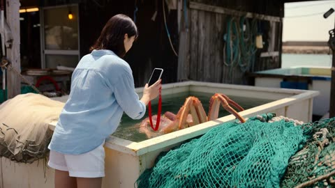</a>

Written as a handheld vlog shot by a friend, with timed beats every 3 seconds and an explicit sound cue for each event. Separating dialogue from ambience and asking for silence before the reveal keeps the audio readable.

MiniMax H3 · Reference-to-video · Source: [@Just_Anika_Here on X](https://x.com/Just_Anika_Here/status/2110229530019500523) · 44 likes on 2026-10-29 · found via [SkyNotSilent/awesome-MiniMax-H3-cases](https://github.com/SkyNotSilent/awesome-MiniMax-H3-cases)

[`vlog`](tags.md#tag-vlog) [`dialogue`](tags.md#tag-dialogue) [`animal`](tags.md#tag-animal) [`japan`](tags.md#tag-japan) [`reference-image`](tags.md#tag-reference-image)

<details><summary><b>Prompt</b></summary>

```text
Create an ultra-realistic 15-second  video during a lively summer afternoon at a small Japanese fishing harbor. Use the provided reference image only to preserve the main woman's identity and appearance.

The video must feel like a real spontaneous travel vlog, recorded by her friend. Natural handheld smartphone footage, fast reactions, continuous movement, realistic expressions, authentic Japanese harbor details, and clear close-ups. The story must contain multiple connected actions, audible dialogue, distinctive environmental sounds, and a genuinely surprising ending.

0–3 seconds:
The woman stands beside a seafood stall, filming an enormous live Japanese spider crab displayed in a shallow tank. Suddenly, the crab stretches one long leg over the tank's edge and knocks her phone out of her hand. The phone lands safely on a nearby pile of fishing nets. She gasps, shouting, "Oh my God! Did you see that?!" The friend filming immediately exclaims, "Yo! It stole your shot!"
3–6 seconds:
The crab crawls sideways toward the nets while the woman quickly retrieves her phone. A fisherman rushes over, calling out in Japanese, "Abunai! Abunai!" A metal bucket clatters onto the ground, startling a flock of seagulls into flight. The camera swings rapidly between the escaping crab, the startled woman, and the fisherman.

6–9 seconds:
The crab unexpectedly grabs the loose end of a bright red fishing rope with one claw. As it moves, the rope pulls a small stack of empty plastic baskets across the wet pavement. The woman jumps aside and shouts, "Wait, wait! It's taking everything!" The fisherman laughs in disbelief and calls for someone to help.
9–12 seconds:
A sudden tug pulls a lightweight fishing net off a wooden crate. The net drops over the crab like a messy tent. Everyone freezes for a moment. The fisherman carefully lifts one corner, revealing the crab sitting beside a tiny hidden kitten that had been sheltering behind the crate. The kitten meows loudly and climbs onto the fisherman's rubber boot.

12–15 seconds:
Just as the woman bends down to film the kitten, the giant crab raises both claws behind her. The fisherman suddenly shouts, "Look out!" She spins around in shock, but the crab is simply holding her bright red phone strap between its claws. The woman stares at the camera in disbelief and says, "It actually wanted my phone!" End with the fisherman laughing and the crab releasing the strap.
Audio must be carefully designed and clearly audible: lively harbor ambience, waves against the dock, seagulls squawking, water splashing, metal bucket clattering, plastic baskets scraping across wet pavement, the crab tapping against the tank, realistic footsteps, a loud surprised gasp, spontaneous English dialogue, the fisherman's Japanese warning, a clear kitten meow, and natural overlapping reactions.

Use distinct sound events synchronized exactly with the visible actions. Keep dialogue crisp and intelligible, with the environmental sounds slightly quieter whenever someone speaks. The woman's voice should sound surprised and expressive, not continuously laughing. Include moments of silence and suspense before the final reveal.
Visual style: realistic smartphone exposure, natural summer sunlight, authentic Japanese fishing harbor, believable animal movement, consistent character appearance, clear medium shots and close-ups, natural camera shake, and realistic physical interactions.

Avoid constant laughter, silent characters, generic background noise, music overpowering dialogue, robotic voices, random sound effects, cinematic transitions, slow motion, cartoon behavior, impossible animal actions, distorted hands, duplicated animals, and blurry faces.
```

</details>

<a id="h3-cruise-cabin-black-hole-window"></a>
### Tourist films black hole from cruise cabin

<a href="https://x.com/ivanfioravanti/status/2086553101029290296">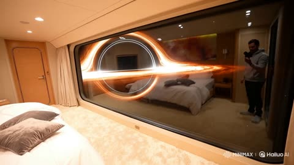</a>

Handheld amateur POV framing and a visible reflection in the glass make the window read as a real surface. Switching the light off mid-shot gives the view a practical motive, and the short spoken line adds an on-camera voice.

MiniMax H3 · Text-to-video · Source: [@ivanfioravanti on X](https://x.com/ivanfioravanti/status/2086553101029290296) · 43 likes on 2026-10-29 · found via [SkyNotSilent/awesome-MiniMax-H3-cases](https://github.com/SkyNotSilent/awesome-MiniMax-H3-cases)

[`black-hole`](tags.md#tag-black-hole) [`space-cruise`](tags.md#tag-space-cruise) [`handheld-pov`](tags.md#tag-handheld-pov) [`reflection`](tags.md#tag-reflection)

<details><summary><b>Prompt</b></summary>

```text
amateur handheld pov footage of a tourist in their plush and comfortable room of a space cruise, carpeted floor and comfy bed, large window shows a view of Gargantua blackhole, you can see their reflection in the window, they turn off the light half way through so we can see outside better and say: "Wow look at that!", then they show back the room
```

</details>

<a id="h3-ramen-selfie-vlog-kitchen"></a>
### Selfie vlog of a ramen bowl in kitchen

<a href="https://x.com/Taaruk_/status/2083461207919612348"></a>

Naming a specific phone and its autofocus hunting and handheld drift makes the clip read as authentic UGC rather than a polished ad. A reference image locks the bowl across all eight shots, and timed shot breakdowns with inline dialogue keep the pacing tight.

MiniMax H3 · Reference-to-video · Source: [@Taaruk_ on X](https://x.com/Taaruk_/status/2083461207919612348) · 35 likes on 2026-10-29 · found via [SkyNotSilent/awesome-MiniMax-H3-cases](https://github.com/SkyNotSilent/awesome-MiniMax-H3-cases)

[`ugc`](tags.md#tag-ugc) [`selfie-vlog`](tags.md#tag-selfie-vlog) [`food`](tags.md#tag-food) [`product-reference`](tags.md#tag-product-reference) [`dialogue`](tags.md#tag-dialogue)

<details><summary><b>Prompt</b></summary>

```text
Duration: 15 seconds | Aspect Ratio: 16:9 | Style: Authentic UGC / iPhone selfie-vlog, handheld, natural light, slight motion blur, TikTok/Reels energy — NOT cinematic.
Product Reference: Use the uploaded ramen bowl image as the only product reference. Keep the broth color, noodle thickness, toppings, egg placement, chashu slices, and bowl appearance identical throughout every shot.
Camera: iPhone 15 Pro handheld with front/back camera switching, realistic autofocus hunting, natural handheld movement, slight exposure shifts, warm apartment lighting.
Character Description
Name: Yuna
A young Japanese woman in her early 20s with soft natural beauty, shoulder-length dark hair tied loosely, subtle makeup, oversized gray hoodie, cheerful personality, filming casually inside a cozy apartment kitchen.
Shot Breakdown
SHOT 1 (0–2s) — Selfie holding the ramen bowl.
Dialogue: "Late-night ramen again."
SHOT 2 (2–4s) — Overhead reveal with steam rising.
SHOT 3 (4–6s) — Close-up autofocus on noodles and broth.
SHOT 4 (6–8s) — Chopsticks lifting noodles with a natural noodle stretch.
SHOT 5 (8–10s) — Selfie bite reaction.
Dialogue: "That's insanely good."
SHOT 6 (10–12s) — Casual b-roll of the bowl while she reaches for another bite.
SHOT 7 (12–14s) — Selfie holding noodles toward camera.
Dialogue: "Worth every bite."
SHOT 8 (14–15s) — Freeze frame with handwritten overlay: "ramen fix 🍜"
Look & Feel
Warm lighting, natural phone quality, authentic UGC pacing, jump cuts, realistic handheld movement.
Negative Prompt
cinematic look, luxury commercial, perfect framing, CGI noodles, unrealistic steam, plastic food, distorted chopsticks, extra fingers, warped hands, overprocessed HDR, text artifacts.
```

</details>

<a id="h3-chef-dumpling-dough-cleaver"></a>
### Chef presses dumpling dough with cleaver in flour

<a href="https://x.com/cocktailpeanut/status/2092363865619317172"></a>

The prompt is a numbered beat sheet with one physical action per beat and a clear ending, which keeps a long sequence of windows coherent. Naming specific sound cues and banning speech and music keeps the audio to kitchen ambience.

MiniMax H3 · Text-to-video · Source: [@cocktailpeanut on X](https://x.com/cocktailpeanut/status/2092363865619317172) · 16 likes on 2026-10-29 · found via [SkyNotSilent/awesome-MiniMax-H3-cases](https://github.com/SkyNotSilent/awesome-MiniMax-H3-cases)

[`food`](tags.md#tag-food) [`cooking`](tags.md#tag-cooking) [`dumplings`](tags.md#tag-dumplings) [`sound-design`](tags.md#tag-sound-design)

<details><summary><b>Prompt</b></summary>

```text
The chef prepares a supple dumpling dough, rolls it into a very large thin circular wrapper on a lightly floured wooden board, then mixes seasoned pork filling with cubes of chilled gelatinized stock, showing convincing close-ups of the ingredients, hands, textures, flour, moisture, and utensils.
A generous mound of filling is placed in the center, then the chef slowly lifts and pleats the enormous wrapper around it, creating dozens of small folds while rotating the dumpling by hand until the top closes into a neat twisted knot and the whole dumpling visibly sags with realistic weight.
The giant dumpling is transferred carefully into a wide bamboo steamer lined with cabbage leaves, the lid closes, steam escapes naturally around the rim, then after cooking the lid is lifted and dense steam reveals the now-translucent, glossy dumpling sitting intact inside.
The chef slides it into a shallow serving bowl, places ginger and black vinegar beside it, then punctures the top gently with chopsticks so a large amount of hot golden broth visibly pours from inside the dumpling into the bowl while the delicate skin remains mostly intact.
Finish with a close-up of the chef opening the dumpling further and spooning up the broth, pork filling, and thin wrapper together, emphasizing realistic steam, liquid movement, chopstick sounds, bamboo creaks, ceramic clinks, and kitchen ambience, with absolutely no spoken language or music.
```

</details>

<a id="kling4-ugc-car-confession"></a>
### Embarrassed vlog from the car after waving at a stranger

<a href="https://x.com/minchoi/status/2111471592601534511">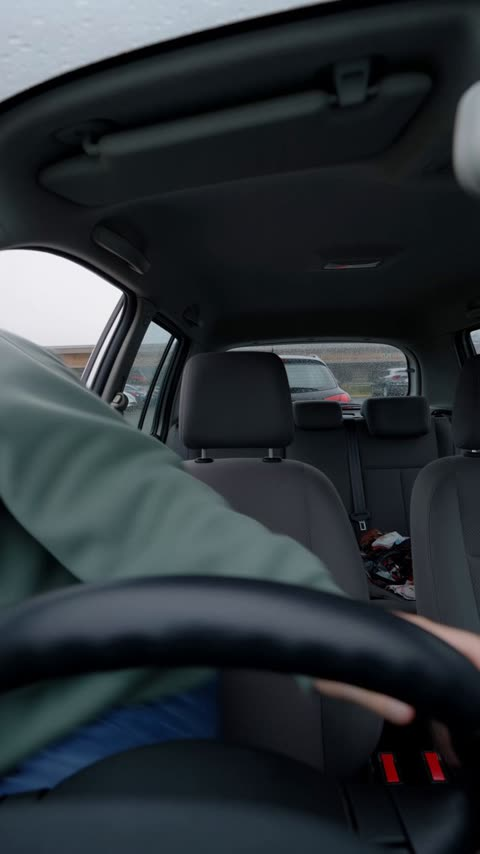</a>

A comic monologue in one 30s phone take, with rain on the roof and muffled car-park sounds through the glass.

Kling 4.0 · Text-to-video · Source: [@minchoi on X](https://x.com/minchoi/status/2111471592601534511)

[`ugc`](tags.md#tag-ugc) [`vlog`](tags.md#tag-vlog) [`vertical`](tags.md#tag-vertical) [`comedy`](tags.md#tag-comedy) [`dialogue`](tags.md#tag-dialogue) [`rain`](tags.md#tag-rain)

<details><summary><b>Prompt</b></summary>

```text
Raw vertical 9:16 video recorded on a phone's front camera, one continuous 30-second take with no cuts. It looks like an ordinary unedited phone clip, not a film: slightly soft image, digital noise and compression, flat grey daylight through rain-streaked windows, no colour grading. the picture wobbles whenever she moves and jolts when she pulls the door shut. Sadie, a young woman in her early 20s with long honey-blonde hair in a messy bun with loose strands, no makeup, small gold hoop earrings and an oversized sage-green hoodie with no print, sits in the driver's seat of a small, slightly messy hatchback parked in a supermarket car park on a rainy afternoon. Rain streaks every window; through the rear window, blurred parked cars and a trolley bay. At the start she drops into the seat and pulls the door shut. She tells the story with her hands. Around 18 s she covers her face with both hands. Around 26 s a trolley rattles past her window and she slides down low in the seat as if hiding, laughing. [Sadie: casual young woman's voice, a bit breathless and mortified, recorded on the phone's built-in mic in a small car]: "Okay. I need to tell someone this immediately. ... So I'm in the cereal aisle, and this guy waves at me. Like, a big wave. So I wave back. Big wave. ... He was waving at his wife. Who was right behind me. ... And then I saw them again at the checkout. ... I'm never going back in there. I live in the car now. This is my home." Audio as captured by the phone mic inside a closed car, not studio clean: rain drumming on the roof and windscreen, her voice close and boxy in the small space, the door's heavy thud, fabric rustling against the seat, and outside, muffled through the glass, a trolley rattling past, a car door slamming and an engine starting. No subtitles, no captions, no on-screen text.
```

</details>

<a id="seedance-16mm-analog-morning-vlog"></a>
### Woman walks golden retriever in analog vlog

<a href="https://x.com/maxxmalist/status/2085422370362110168">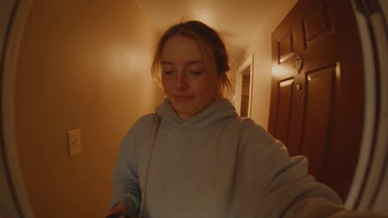</a>

Opens in selfie mode with each line of dialogue placed in order, so the camera stays a handheld POV for the whole walk. Film texture and handheld imperfections are written as separate camera and look blocks, and the camera is set on a bench for the wider shots.

Seedance 2.5 · Text-to-video · Source: [@maxxmalist on X](https://x.com/maxxmalist/status/2085422370362110168)

[`vlog`](tags.md#tag-vlog) [`handheld`](tags.md#tag-handheld) [`film-grain`](tags.md#tag-film-grain) [`dialogue`](tags.md#tag-dialogue)

<details><summary><b>Prompt</b></summary>

```text
CAMERA: Handheld DV 16mm daily vlog footage. The video MUST begin with her holding the camera at arm's length in selfie mode while stepping outside her apartment building with her dog. The first 20–30 seconds are entirely handheld. Later she occasionally places the camera on a park bench, low stone wall, picnic table, or the ground for wider shots. Keep subtle handheld shake, drifting composition, autofocus hunting, rushed reframing, uneven zooms, exposure breathing, brief accidental face cropping, and imperfect framing throughout. The camera itself is never visible.

LOOK: Warm analog tape texture with gentle film grain, slightly softened sharpness, subtle halation around sunlight, realistic skin tones, low contrast, tiny exposure shifts, and natural motion blur. It should feel like authentic footage from someone's everyday life rather than a polished commercial.

STYLE: A relaxed morning lifestyle vlog. Quiet, cozy, and spontaneous. She occasionally laughs at her dog, pauses to look around, adjusts the leash, brushes hair away from her face, and speaks naturally in short sentences with comfortable pauses.

CHARACTER: EMMA — a beautiful white woman in her mid-20s. Long light brown hair in a messy ponytail, green eyes, minimal makeup, oversized gray hoodie, black biker shorts, white sneakers, and a small crossbody bag. She is walking a happy golden retriever.

SETTING: A peaceful suburban neighborhood on a sunny morning. Tree-lined sidewalks, quiet residential streets, birds singing, a small park with benches, green grass, and soft golden morning light. Very few people are around.

SCENES:

The vlog opens in selfie mode. Emma holds the camera while leaving her apartment building with the golden retriever excitedly pulling on the leash.
"Good morning."
She smiles.
"Someone couldn't wait."
The dog eagerly sniffs everything as they walk down the sidewalk.
She laughs quietly.
"He has to inspect every single tree."
Still holding the camera, she walks into a small neighborhood park.
The dog suddenly stops and stares at a squirrel.
"Oh... there we go."
She smiles and gently shakes her head.
She places the camera on a nearby bench for a wider angle while throwing a tennis ball.
The dog happily chases after it.
"Worth waking up early."
She picks the camera back up.
Walking slowly through the park, she looks up at the trees for a moment.
"It's actually really peaceful out here."
The dog returns with the ball but drops it halfway.
She laughs.
"Close enough."
She sits on the bench while the dog lies beside her.
She scratches behind his ears.
"I think he's happier than I am."
She stands up and continues walking.
The camera stays in selfie mode as they head toward home.
"Coffee is definitely next."
She smiles into the lens.
"See you later."
She gives a small wave and ends the recording.
```

</details>

<a id="seedance-2000s-camcorder-school-day"></a>
### Blurred child face in a 2000 camcorder frame

<a href="https://x.com/Diplomeme/status/2112745556644946344">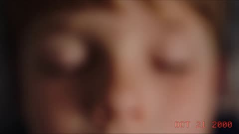</a>

Naming the MiniDV format, soft focus, grain, colour bleed and the orange timestamp sets the look, while one first person rule with the same hands and clothes repeated across six timed shots keeps the sequence consistent. Separate camera and sound rules keep the handheld feel and the layered ambient audio.

Seedance 2.5 · Text-to-video · Source: [@Diplomeme on X](https://x.com/Diplomeme/status/2112745556644946344) · found via [LearnPrompt/awesome-seedance](https://github.com/LearnPrompt/awesome-seedance)

[`first-person`](tags.md#tag-first-person) [`camcorder`](tags.md#tag-camcorder) [`retro`](tags.md#tag-retro) [`multi-shot`](tags.md#tag-multi-shot)

<details><summary><b>Prompt</b></summary>

```text
STYLE RULE: First-person POV throughout, shot like a 2000 home camcorder (MiniDV): soft focus, slight color bleed, warm grain, 4:3 feel, orange timestamp "OCT 21 2000" in the corner. Our hands are always visible: a kid's hands, baggy hoodie sleeves, a cheap digital watch. Same hands and clothes in every shot. No celebrities, no logos, no brand names.

[0-5s] SHOT 1, MORNING AT HOME: POV waking up in a small bedroom with posters on the wall and a CRT TV in the corner. Hand slaps a wind-up alarm clock. Walk down the hallway past a wall-mounted landline phone with a curly cord. Sit at the kitchen table with a bowl of cereal while cartoons play on a small TV. Dad reads a newspaper, Mom calls "Hurry up, the bus is coming!" Camera: handheld, slightly shaky, warm morning window light.

[5-10s] SHOT 2, WALK AND SCHOOL BUS: POV grabbing a heavy backpack and running out the door. A friend waves from across the street and joins the walk. Board a yellow school bus, sit by the window, friends trade stickers and a folded note. Outside: quiet suburban street, soft sun flare. Camera: handheld, glancing between friend and window.

[10-15s] SHOT 3, CLASSROOM: POV at a wooden desk with gel pens and a pencil case. Teacher writes on a green chalkboard, an overhead projector hums. Secretly pass a note folded into a triangle to a friend, who passes one back. Beige computer in the corner of the room. Camera: slow pan across the class, then close on the note.

[15-20s] SHOT 4, LUNCH AND PLAYGROUND: POV in the loud cafeteria with a tray, pizza and chocolate milk, friends laughing. Cut to the playground: trade cards and stickers on the ground, chase friends, hopscotch and tag. Camera: wide, turning left and right, bright overcast daylight.

[20-25s] SHOT 5, AFTER SCHOOL: POV riding a bike down the street with friends, scooters and rollerblades beside us, golden hour light. Stop at a corner shop, buy candy with coins. Later at a friend's house: sit on carpet in front of a CRT TV playing a 90s console game, controllers in hand, snacks everywhere, friends shouting and bumping shoulders. Camera: handheld, intimate, tilting to the screen.

[25-30s] SHOT 6, EVENING: POV at the family dinner table, parents and siblings passing plates. Sit on the couch, family sitcom on the one living-room TV. Then at the shared family computer: dial-up screeches, a chat window pops up with a friend. Mom calls "Time for bed!" Fade to a dark room lit only by the monitor glow. Camera: slow push-in to the screen.

CAMERA RULE: Handheld first-person only, no third-person angles, shallow depth, warm lens flare, subtle VHS tracking glitch at each cut.

SOUND RULE: Layered ambient audio: alarm bell, cartoon TV, bus chatter, chalkboard scratch, cafeteria roar, bike wheels, console sounds, dial-up modem screech. Soft nostalgic instrumental music in the background. Only short kid voices and parents calling, no narration.
```

</details>

<a id="seedance-2011-selfie-vlog-seoul-shopping-street"></a>
### Retro 2011 phone selfie vlog through Seoul shops

<a href="https://x.com/Just_sharon7/status/2109218767620444331"></a>

Separate blocks for camera, video quality, character, location, style and audio, then a timed shot list with one line of dialogue per beat. Naming dated hardware, 480p compression flaws and hand tremor keeps the footage amateur, and a closing rules block locks identity, 9:16 framing and no filters.

Seedance 2.5 · Text-to-video · Source: [@Just_sharon7 on X](https://x.com/Just_sharon7/status/2109218767620444331) · found via [LearnPrompt/awesome-seedance](https://github.com/LearnPrompt/awesome-seedance)

[`selfie-vlog`](tags.md#tag-selfie-vlog) [`retro-camcorder`](tags.md#tag-retro-camcorder) [`street`](tags.md#tag-street) [`dialogue`](tags.md#tag-dialogue) [`shot-list`](tags.md#tag-shot-list)

<details><summary><b>Prompt</b></summary>

```text
CAMERA:
Early-2010s smartphone front-camera selfie vlog, filmed on an old iPhone 4 or Samsung Galaxy S2. The girl holds the phone at arm's length, occasionally switching to the rear camera to show her surroundings. Natural hand tremors, awkward framing, accidental finger covering the lens, shaky walking footage, imperfect autofocus, and sudden camera tilts. No professional camera movements.
VIDEO QUALITY:
Authentic 2010–2012 smartphone footage, 480p resolution, low dynamic range, washed-out colors, visible digital noise, blocky compression artifacts, slightly blurry moving subjects, rolling-shutter wobble, overexposed skies, and automatic white-balance shifts. Looks like a forgotten YouTube vlog uploaded in 2011.

CHARACTER:
MILA — a cheerful 22-year-old East Asian girl with a Korean-Chinese appearance, long straight black hair with side-swept bangs, naturally fair skin, soft pink lip tint, minimal makeup, and expressive dark-brown eyes. Wearing a loose pastel-yellow cardigan over a white graphic T-shirt, a short denim skirt, white sneakers, and a small brown leather shoulder bag. Her appearance, hairstyle, outfit, and facial features remain identical throughout.
LOCATION:
A lively Seoul shopping neighborhood on a sunny afternoon. Narrow pedestrian streets, colorful Korean storefronts, clothing racks outside shops, stationery stores, photo booths, flower stands, parked scooters, and pedestrians walking naturally in the background.

STYLE:
Spontaneous, playful, slightly chaotic 2011 YouTube lifestyle vlog. Casual conversations directly into the phone, unscripted facial expressions, awkward pauses, spontaneous laughter, and quick amateur cuts.
SHOT-BY-SHOT SEQUENCE

0–2.5s — The Flower Shop
Front-camera selfie. MILA walks past a tiny flower shop, notices a beautiful bouquet, and suddenly stops.

Dialogue: "Wait, these flowers are literally so pretty!"
She turns the phone toward the flowers, briefly losing focus.

2.5–5s — The Photo Booth

Quick shaky cut. MILA squeezes inside a tiny Korean photo booth. The camera is held too close to her face. She makes an exaggerated silly expression and flashes a peace sign as the booth flashes.

Dialogue: "Oh my gosh, why do I look like that?!"

She bursts into laughter.

5–7.5s — The Claw Machine

MILA stands in front of a small arcade claw machine, filming herself and the machine alternately. She presses the button, the claw grabs a tiny plush bunny but drops it at the last second.

Dialogue: "Nooo! I almost got it!"

She dramatically pouts at the camera.

7.5–10s — The Sunglasses

Quick cut to a sidewalk accessories stand. MILA tries on oversized heart-shaped pink sunglasses, turns the front camera toward herself, and tilts her head.

Dialogue: "Okay, wait... kinda iconic!"

She laughs and adjusts the glasses.

10–12.5s — The Unexpected Wind

Walking down the street, a sudden breeze blows her bangs across her face. She tries to fix her hair while still holding the phone. The frame tilts awkwardly.

Dialogue: "Ahh! My hair! Seriously?!"

She giggles, brushing her bangs away.

12.5–15s — Goodbye

MILA stops beside a colorful storefront, holds up her photo-booth pictures, smiles brightly, and gives a little wave.

Dialogue: "Best random day ever! Byeee!"

She reaches toward the phone screen. Her finger partially covers the lens, followed by an abrupt cut to black.

AUDIO

Authentic low-quality smartphone microphone. Distant Korean street conversations, footsteps, shop music, arcade machine beeps, camera shutter, occasional wind hitting the microphone, and slight distortion when MILA laughs. Her voice is cheerful, spontaneous, conversational, and slightly muffled.

IMPORTANT GENERATION RULES

Exactly 15 seconds, vertical 9:16.

Same character identity and outfit in every shot.

Natural selfie perspective, never cinematic third-person footage.
Realistic hand movements and physically plausible phone handling.

Natural dialogue timing and accurate lip synchronization.
No beauty filters, artificial skin smoothing, or cinematic color grading.
No subtitles, text overlays, logos, or modern smartphone aesthetics.
Preserve the authentic, imperfect, nostalgic feeling of an amateur 2011 street vlog. #DomoAI #DomoAICPP
```

</details>

<a id="seedance-airplane-aisle-travel-vlog"></a>
### Woman walks airplane aisle and takes seat

<a href="https://x.com/Goodmanprotocol/status/2103533820263944679"></a>

The prompt splits the 30 seconds into timestamped beats, each with one action and one camera move, so the model handles one clear motion at a time. The closing negative list targets CGI look, beauty filters and identity drift, which keeps the footage grounded.

Seedance 2.5 · Text-to-video · Source: [@Goodmanprotocol on X](https://x.com/Goodmanprotocol/status/2103533820263944679) · found via [LearnPrompt/awesome-seedance](https://github.com/LearnPrompt/awesome-seedance)

[`travel-vlog`](tags.md#tag-travel-vlog) [`handheld`](tags.md#tag-handheld) [`airplane`](tags.md#tag-airplane) [`timestamped-shots`](tags.md#tag-timestamped-shots)

<details><summary><b>Prompt</b></summary>

```text
Create a 30-second ultra-photorealistic cinematic travel-vlog video.

SUBJECT:
A beautiful young adult woman with long, layered brown hair with subtle natural highlights, wearing a white crop top, loose blue jeans, and carrying a brown shoulder bag.

SCENE & ACTION:
0–7s: She naturally walks down the aisle of a modern commercial airplane. Use a medium close-up tracking shot from slightly in front and to the side. Her hair moves naturally as she walks. Passengers, overhead compartments, seats, windows, and realistic cabin details remain visible in the background.

7–13s: She reaches her seat and stops naturally. The camera gently pans with her movement as she places her brown shoulder bag underneath the seat in front of her. Show realistic hand movement and accurate interaction between the bag, seat, and floor.

13–19s: She stands up and casually adjusts her layered hair with one hand. The camera performs a subtle tilt and gentle push-in while maintaining a natural medium close-up. Her expression remains relaxed and authentic.

19–26s: She turns and smoothly sits in her seat. Capture realistic body mechanics, natural clothing folds, hair movement, and believable weight distribution. Background passengers continue subtle natural movements.

26–30s: She settles comfortably into the seat and looks toward the airplane window, then briefly toward the camera with a relaxed travel-vlog expression. The camera gently stabilizes while retaining subtle handheld realism.

CAMERA:
Handheld cinematic camera, medium close-up, smooth tracking, gentle panning and tilting, subtle natural camera shake, realistic depth of field, natural motion blur, occasional slight focus adjustment, no abrupt camera movements.

LIGHTING:
Bright natural-looking airplane cabin lighting mixed with soft daylight coming through the windows. Realistic skin illumination, soft shadows, accurate reflections, natural exposure.

VISUAL STYLE:
Ultra-realistic live-action footage, premium travel vlog aesthetic, authentic commercial airplane interior, realistic skin texture, individual hair strands, physically accurate fabric, realistic materials, natural color grading, cinematic 4K detail, believable background activity, true-to-life proportions and perspective.

MOTION & PHYSICS:
Natural human walking, realistic hair physics, accurate hand-object interaction, believable sitting motion, realistic fabric movement, physically correct shadows and reflections.

NEGATIVE:
No CGI appearance, no cartoon look, no plastic skin, no beauty-filter effect, no exaggerated expressions, no unnatural body movements, no warped anatomy, no extra fingers or limbs, no deformed hands, no flickering, no object morphing, no duplicated passengers, no unstable background, no sudden cuts, no unrealistic camera movement, no identity changes.

OVERALL:
Make the entire 30-second sequence feel like authentic footage captured inside a real airplane by a professional travel vlogger, with seamless continuity between every action and highly realistic human and environmental motion.
```

</details>

<a id="seedance-airport-boarding-travel-vlog"></a>
### Stylish woman walks through airport with boarding pass

<a href="https://x.com/CaliraVal/status/2097601187734561047">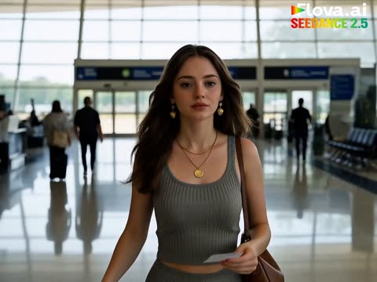</a>

The prompt lists the story beats in order with explicit cuts and camera moves, so the model keeps one subject consistent from terminal to jet bridge to cabin. Naming soft daylight, shallow depth of field and a vertical 4K frame anchors the photorealistic travel-vlog look.

Seedance 2.5 · Text-to-video · Source: [@CaliraVal on X](https://x.com/CaliraVal/status/2097601187734561047) · found via [LearnPrompt/awesome-seedance](https://github.com/LearnPrompt/awesome-seedance)

[`travel-vlog`](tags.md#tag-travel-vlog) [`airport`](tags.md#tag-airport) [`photorealistic`](tags.md#tag-photorealistic) [`vertical`](tags.md#tag-vertical)

<details><summary><b>Prompt</b></summary>

```text
Create a cinematic photorealistic travel video of a stylish young woman arriving at an international airport and boarding her flight. She walks through the modern airport terminal while pulling a cream-colored rolling suitcase and carrying a brown leather handbag. Show her checking her boarding pass, walking toward the departure gate, then entering the jet bridge and boarding a commercial airplane. Cut to her finding her window seat inside the aircraft, placing her handbag in the overhead compartment, sitting comfortably, and looking out the window as the plane prepares for takeoff. Realistic airport and airplane details, natural human movement, smooth cinematic camera transitions, soft daylight, shallow depth of field, premium travel-vlog aesthetic, photorealistic, 4K, vertical .
```

</details>

<a id="seedance-alpine-winter-vlog-montage"></a>
### Woman in parka stepping out of chalet

<a href="https://x.com/eshal__ai/status/2097564912851759244">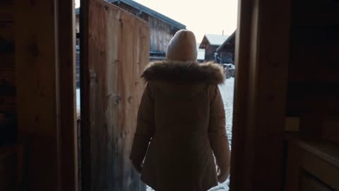</a>

Eight timestamped scenes, each with its own camera direction and a spoken line, give the model a shot list to follow in order. The identity block and the reference image lock the same woman across every cut.

Seedance 2.5 · Reference-to-video · Source: [@eshal__ai on X](https://x.com/eshal__ai/status/2097564912851759244) · found via [LearnPrompt/awesome-seedance](https://github.com/LearnPrompt/awesome-seedance)

[`vlog`](tags.md#tag-vlog) [`winter`](tags.md#tag-winter) [`travel`](tags.md#tag-travel) [`character-consistency`](tags.md#tag-character-consistency)

<details><summary><b>Prompt</b></summary>

```text
A cinematic 30-second alpine winter vlog montage featuring the same young woman exploring a snow-covered mountain village during a cozy winter getaway. Shot like an authentic luxury travel diary with handheld camera movement, candid moments, soft overcast daylight transitioning to warm firelight, dreamy 35mm film aesthetics, cool-toned color grading with warm amber accents, shallow depth of field, natural skin texture, atmospheric lighting, and cinematic storytelling. Maintain the same woman throughout every scene: dark hair, youthful appearance, natural makeup, relaxed happy expression — identity locked to the reference image. Format: 4K cinematic video, 24fps, 35mm film grain, realistic handheld camera, soft focus, cool-warm contrast palette, travel documentary style.

Scene 1 (0-4s) — Arrival at the Chalet Village: A crisp winter morning, light snow falling. She steps out of a wooden chalet doorway wearing a cream cable-knit sweater, faux-fur-trimmed parka, and a knit beanie, breath visible in the cold air. Camera trails her from behind down a snowy cobblestone lane lined with timber cottages, then swings into a close-up as she turns and smiles, saying softly, "Okay, this already feels like a movie."

Scene 2 (4-8s) — First Ski Run: She glides down a gentle beginner slope, snow spraying softly at her skis, pine trees blurred past on either side. Low chase shots from behind, then a front-facing GoPro-style angle catching her laughing as she wobbles slightly and steadies herself.

Scene 3 (8-12s) — Snow-Covered Pine Forest Walk: A worm's-eye view looking up through frosted pine branches, pale sunlight filtering through with soft lens flares on ice crystals. Cut to a close-up of her walking through untouched snow, mittened hand trailing along a low branch, murmuring, "It's so quiet here it feels unreal."

Scene 4 (12-16s) — Cozy Café Break: She sits by a frosted window inside a small timber café, wrapped hands around a steaming mug of hot chocolate topped with whipped cream. Warm interior light contrasts the blue-white world outside. Close-up on the marshmallows melting, her contented half-smile as she watches snow drift past the glass.

Scene 5 (16-20s) — Sledding Adventure: She sits on a wooden sled at the top of a gentle hill, pushes off, and speeds down laughing, hair flying loose from under her beanie. Camera tracks alongside at sled height. She tumbles softly into a snowbank at the bottom, laughing, and calls toward the camera, "Don't film this part — okay, keep filming it."

Scene 6 (20-24s) — Christmas Market Exploration: A glowing evening market strung with warm fairy lights, snow settling on wooden stalls, the smell of roasted chestnuts implied through steam rising from vendor carts. She weaves through the crowd sampling mulled cider and gingerbread, face lit by string lights and lantern glow. Cinematic close-ups of her eyes widening at the taste, lights blurred into soft bokeh behind her.

Scene 7 (24-27s) — Golden Sunset Over the Peaks: A wide silhouette shot of her standing on a snowy overlook as the sun dips behind the mountain range, sky shifting from pale gold to soft violet, her scarf drifting in the wind. She tilts her face toward the fading light, one hand holding her beanie in place.

Scene 8 (27-30s) — Fireside Night Reflection: A cabin interior at night, fireplace glowing, snow visible through a frosted window behind her. She sits curled up on a wool blanket, mug in hand, firelight flickering across her face. Final intimate close-up as she looks directly into the lens with a soft, warm smile, saying, "Goodnight from the mountains."

Camera Style: Authentic travel vlog cinematography, handheld camera shake, smooth cinematic transitions, slow push-ins, natural drifting movement, occasional POV shots, realistic autofocus hunting, subtle motion blur.

Visual Style: Cozy alpine winter film, boutique travel-brand aesthetic, soft diffused daylight with warm firelight interiors, realistic skin texture, cinematic shallow depth of field, nostalgic 35mm film look, cool-warm contrast tones, natural unscripted expressions, emotional storytelling.

Avoid: cartoon style, CGI look, plastic skin, unrealistic face, inconsistent character appearance, changing hairstyle, extra fingers, distorted body, artificial lighting, oversaturated colors, blurry face, unnatural movements, duplicate people.
```

</details>

<a id="seedance-apartment-afternoon-vlog-face-yoga-nails"></a>
### Cozy apartment afternoon vlog with face yoga and nails

<a href="https://x.com/doctorwasif/status/2107824210899055039"></a>

A reference image locks identity and outfit, then five timed beats of about seven seconds each chain small domestic actions into one 30 second take. Handheld realism cues (camera shake, imperfect framing, autofocus) and a closed list of ambient sounds with no music keep it feeling like real footage.

Seedance 2.5 · Image-to-video · Source: [@doctorwasif on X](https://x.com/doctorwasif/status/2107824210899055039) · found via [LearnPrompt/awesome-seedance](https://github.com/LearnPrompt/awesome-seedance)

[`vlog`](tags.md#tag-vlog) [`handheld`](tags.md#tag-handheld) [`lifestyle`](tags.md#tag-lifestyle) [`ambient-sound`](tags.md#tag-ambient-sound) [`timed-shots`](tags.md#tag-timed-shots)

<details><summary><b>Prompt</b></summary>

```text
image = Main Subject. Preserve her exact identity, face, hairstyle, skin tone, proportions, and reference outfit throughout.

Authentic Korean woman in a cozy, modern Korean apartment. RAW handheld vlog realism, natural afternoon light, subtle camera shake, imperfect framing, realistic autofocus, and natural colors.

00:00–00:07: In front of a mirror, she makes exaggerated face yoga expressions, notices her reflection, and laughs shyly.

00:07–00:13: She mists windowsill plants, gently inspecting a leaf with a satisfied smile.

00:13–00:20: Sitting cross-legged on the living room floor, she folds laundry beside a basket, briefly reacting to a TV show.

00:20–00:27: At a desk by the window, she carefully paints her nails, then blows on them to dry.

00:27–00:30: She admires her freshly painted nails in sunlight, turns her hand, and smiles softly at the camera.

Natural movements and ambient sounds only: spray bottle, distant TV, fabric, nail polish, and breathing. No music. 16:9.
```

</details>

<a id="seedance-autumn-city-day-seven-shot-vlog"></a>
### Autumn day in the city, seven shot vlog

<a href="https://x.com/Chaemate_/status/2100103235566797039"></a>

A reference image locks the face and wardrobe, and hard cuts at stated seconds split the 30 seconds into seven shots. Each shot gets its own lens angle, camera behavior, light and audio, mixing spoken lines with silent candid b roll.

Seedance 2.5 · Reference-to-video · Source: [@Chaemate_ on X](https://x.com/Chaemate_/status/2100103235566797039) · found via [LearnPrompt/awesome-seedance](https://github.com/LearnPrompt/awesome-seedance)

[`vlog`](tags.md#tag-vlog) [`autumn`](tags.md#tag-autumn) [`multishot`](tags.md#tag-multishot) [`day-in-the-life`](tags.md#tag-day-in-the-life) [`character-consistency`](tags.md#tag-character-consistency)

<details><summary><b>Prompt</b></summary>

```text
SCENE CONTEXT
A 20-year-old East Asian woman spends an autumn day moving through a big city — leaving her apartment, riding the subway, grabbing coffee from a cart, cutting through a park in falling leaves, browsing a bookstore, catching golden hour on a rooftop, and riding home at night — filmed as a candid, mixed-format day-in-the-city vlog, 30 seconds total.

ACTIVE REFERENCES
@image1: 20-year-old East Asian woman, soft round face, warm ivory skin, dark brown hair in a loose high bun with face-framing strands, natural dewy makeup, gentle expressive eyes, wearing a wine-burgundy ribbed knit off-shoulder sweater and a small silver flower pendant necklace. 100% matches the reference throughout every shot.

FORMAT MODE
Timed multishot. HARD CUTs only at the stated seconds; camera does not cut on its own between them. Mixed scene styles — not every shot has dialogue; some are silent candid b-roll.

0.0s–4.0s — HARD CUT
4.0s–8.0s — HARD CUT
8.0s–12.0s — HARD CUT
12.0s–17.0s — HARD CUT
17.0s–21.0s — HARD CUT
21.0s–26.0s — HARD CUT
26.0s–30.0s — end

OPTICS
Shot 1: 63° wide, POV-adjacent handheld. Shot 2: 47° neutral, static-ish lean. Shot 3: 29° portrait-compression, quick transactional. Shot 4: 18° natural-portrait, slow-mo detail. Shot 5: 29° portrait-compression, candid unaware angle. Shot 6: 47° neutral, two-shot-adjacent solo toast. Shot 7: 18° natural-portrait, close reflective. No drift mid-segment.

CAMERA
Handheld throughout with natural 1–2cm tremor. Shot 1: phone-height POV-style, walking at 4 km/h. Shot 2: camera rests low against a pole, minimal movement, observational. Shot 3: quick whip from hand to face and back. Shot 4: slowed to half real-time, camera drifts sideways at 1 km/h following falling leaves. Shot 5: camera appears to catch her off-guard, slight delay before she notices it. Shot 6: static-ish, propped, she moves into frame. Shot 7: static through car window glass, reflections passing over her face.

ACTION
0.0s–4.0s: She steps out of an apartment building onto a leaf-scattered sidewalk, adjusting her bag strap, glancing at her phone, morning light low and warm through bare branches. She looks up at the camera briefly, half-smiles: "Okay — let's do this."

4.0s–8.0s: Inside a subway car, she leans against a pole, earbuds in, watching the platform lights blur past the window, city sounds muffled and rhythmic. No dialogue — just her quiet, unbothered expression, occasional sway with the train's motion.

8.0s–12.0s: At a small street coffee cart, steam rising from the machine, she hands over cash, receives a paper cup, wraps both hands around it immediately for warmth. Brief exchange, she says only: "Thanks, you're the best."

12.0s–17.0s: Slow-motion through a park path thick with falling amber leaves, she tips her head back mid-step and turns once, leaves catching in her hair and sweater, genuine unguarded laugh, no spoken line — just breath and laughter audible.

17.0s–21.0s: Inside a small bookstore, she runs a finger along a shelf, pulls a book halfway out, flips a few pages, unaware of the camera, soft window light across her face, ambient store quiet. No dialogue.

21.0s–26.0s: On a rooftop at golden hour, city skyline hazy behind her, she raises a takeaway coffee cup slightly toward the lens like a small toast, warm low sun rim-lighting her hair, says only: "To days like this."

26.0s–30.0s: Inside a taxi at night, warm amber streetlights sliding across the window glass and over her face in soft passing bands, she rests her head against the seat, tired contented smile, looks toward the lens and says: "Best day, hands down."

PERFORMANCE
Restrained, natural reactions — no performed excitement. Shots 2 and 5 specifically read as candid/unaware of the camera. Living eyes with catch-light in every close shot, visible breath in shot 1, natural skin and fabric texture throughout.

PHYSICS
Leaves fall and scatter with real weight and drift, catching briefly in hair and sweater fibers before falling away. Coffee steam rises and dissipates naturally. Streetlight bands move across her face and the window glass with correct parallax as the car moves. Train sway shifts her weight subtly and believably.

LIGHTING
Shot 1: low warm morning sun through bare branches, soft shadow lines. Shot 2: cool fluorescent subway light with warm practicals flickering past outside. Shot 3: overcast daylight, soft even key. Shot 4: dappled warm sun through park canopy, backlit leaf edges. Shot 5: soft window-diffused daylight, low contrast. Shot 6: warm low-angle golden hour key, strong rim light, soft haze. Shot 7: warm amber sodium streetlight passing bands only, otherwise dark interior.

COLOR GRADE
Warm autumn palette — amber, rust, and soft gold tones with muted city grays. Warm amber streetlight at night, never neon or saturated colored signage anywhere in frame. No cool-cyan or magenta tint.

WARDROBE
Wine-burgundy ribbed knit off-shoulder sweater and silver flower pendant necklace, unchanged and clearly visible in every shot. A loosely draped scarf or open coat may sit over it in the subway and taxi shots without covering it.

AUDIO
Shot 1: quiet street ambience, rustling leaves. Shot 2: muffled train rumble, distant announcement, no dialogue. Shot 3: espresso machine hiss, brief exchange. Shot 4: crunch of leaves, natural laughter, no line. Shot 5: quiet store ambience, page-turning, no dialogue. Shot 6: distant city hum, wind. Shot 7: engine hum, soft radio murmur under her line.

STYLE
Authentic day-in-the-life vlog cinematography, dreamy 35mm film aesthetic, fine natural grain, realistic autofocus hunting, mix of talking and silent candid shots for a lived-in, unscripted feel.

OUTPUT SETTINGS
4K, 24fps, 35mm grain, real-time except shot 4 (half real-time slow motion), realistic handheld motion, no neon or saturated signage in the color palette anywhere.

POSITIVE LOCKS
Same woman's face and build in every shot, matching @image1 exactly. Wine-burgundy sweater and silver necklace stay visible in every shot. Hair stays in the same loose high bun throughout. Cuts only at stated seconds, camera does not cut on its own. Shots 2 and 5 stay dialogue-free and candid. Warm amber tones hold throughout — no neon, no cool-cyan tint anywhere.
```

</details>

<a id="seedance-bali-travel-vlog-eight-scene-montage"></a>
### Bali Travel Vlog in Eight Scenes

<a href="https://x.com/eshal__ai/status/2096840505355370629"></a>

Splits the 30 seconds into eight timed scenes, each with its own location, camera move and short spoken line. A fixed character description, a shared film look block and an avoid list keep the woman consistent across cuts.

Seedance 2.5 · Text-to-video · Source: [@eshal__ai on X](https://x.com/eshal__ai/status/2096840505355370629) · found via [LearnPrompt/awesome-seedance](https://github.com/LearnPrompt/awesome-seedance)

[`travel-vlog`](tags.md#tag-travel-vlog) [`multi-scene`](tags.md#tag-multi-scene) [`golden-hour`](tags.md#tag-golden-hour) [`35mm-film`](tags.md#tag-35mm-film) [`dialogue`](tags.md#tag-dialogue)

<details><summary><b>Prompt</b></summary>

```text
A cinematic 30-second tropical travel vlog montage featuring a beautiful 20-year-old East Asian woman with dark hair exploring Bali during a dreamy summer getaway. Shot like an authentic luxury travel diary with handheld camera movement, candid moments, soft golden-hour sunlight, dreamy 35mm film aesthetics, warm vintage color grading, shallow depth of field, natural skin texture, atmospheric lighting, and cinematic storytelling. Maintain the same woman throughout every scene: dark hair, youthful appearance, natural makeup, elegant summer outfits, relaxed happy expression. Format: 4K cinematic video, 24fps, 35mm film grain, realistic handheld camera, soft focus, warm color palette, travel documentary style.

Scene 1 (0-4s) — Arrival & Village Street: A warm Balinese morning. The woman strolls down a narrow street lined with frangipani trees and stone shrines, wearing a linen wrap dress, sunglasses pushed up into her hair. Motorbikes pass softly blurred in the background, incense smoke drifts from a doorway offering. Camera trails her from behind, then swings into a close-up as she glances back over her shoulder and laughs, saying softly, "Okay, I think I already love it here."

Scene 2 (4-8s) — Cliffside Beach Discovery: She descends stone steps onto a narrow cliffside beach, turquoise water crashing against limestone cliffs behind her. She walks barefoot at the tideline, dress hem lifted slightly, waves curling over her feet. Low-angle shots of her footprints filling with foam, sunlight scattering across the water, jagged cliffs framing the horizon.

Scene 3 (8-12s) — Rice Terrace & Jungle Moments: A worm's-eye view looking up through banana leaves and bamboo, sunlight cutting through in warm shafts with soft lens flares. Cut to a close-up of her standing at the edge of an emerald rice terrace, wind lifting loose strands of hair as she looks out, quietly murmuring, "It's so green it doesn't look real."

Scene 4 (12-16s) — Warung Cafe & Slow Living: She sits alone at a small open-air warung overlooking the jungle, sipping fresh coconut water through a paper straw. Sunlight filters through woven bamboo shades. Close-up shots of her hands wrapped around the coconut, condensation beading on the shell, her contented half-smile as she watches the trees sway.

Scene 5 (16-20s) — Ocean Adventure: She paddles a wooden longboard through a calm turquoise lagoon, sunlight sparkling across the surface. Camera circles her at water level, capturing gentle ripples and distant green cliffs. She loses balance slightly, laughs out loud, and calls toward the camera, "Don't film this part — actually, keep filming it."

Scene 6 (20-24s) — Night Market Exploration: A glowing Balinese night market strung with paper lanterns, satay smoke curling into the air, vendors calling out prices. She weaves through the crowd sampling grilled skewers and mango sticky rice, her face lit by warm string lights and passing motorbike headlights. Cinematic close-ups of her eyes widening at the taste, lanterns blurred into soft bokeh behind her.

Scene 7 (24-27s) — Golden Sunset Ending: A wide silhouette shot of her standing at the shoreline as the sun sinks into the sea, sky burning orange and violet, reflections rippling across the wet sand. Waves wash gently around her ankles as she tilts her face toward the last light, one hand shielding her eyes.

Scene 8 (27-30s) — Hotel Night Reflection: A rooftop pool bar overlooking a glittering coastal skyline at night. She leans against the railing in a simple white dress, curtain of hair moving in the breeze, city lights reflected in her eyes. Final intimate close-up of her curled up on the hotel bed, propped on one elbow, looking directly into the lens with a soft, warm smile as she says, "Goodnight from Bali."

Camera Style: Authentic travel vlog cinematography, handheld camera shake, smooth cinematic transitions, slow push-ins, natural drifting movement, occasional POV shots, realistic autofocus hunting, subtle motion blur.

Visual Style: Dreamy Bali vacation film, boutique travel-brand aesthetic, soft golden sunlight, realistic skin texture, cinematic shallow depth of field, nostalgic 35mm film look, warm atmospheric tones, natural unscripted expressions, emotional storytelling.

Avoid: cartoon style, CGI look, plastic skin, unrealistic face, inconsistent character appearance, changing hairstyle, extra fingers, distorted body, artificial lighting, oversaturated colors, blurry face, unnatural movements, duplicate people.
```

</details>

<a id="seedance-berlin-street-life-1989"></a>
### Berlin pedestrians pass a tan Mercedes W123

<a href="https://x.com/oggii_0/status/2097563915354063328">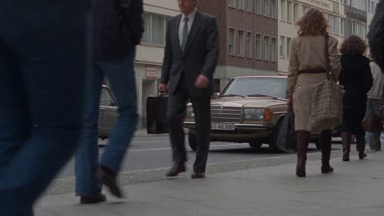</a>

The prompt names exact period models (Mercedes W123, Trabant, Wartburg) and lists modern elements to exclude, which gives the model a checklist to follow. Banning drone, gimbal and cinematic moves keeps the camera in handheld archival territory.

Seedance 2.5 · Text-to-video · Source: [@oggii_0 on X](https://x.com/oggii_0/status/2097563915354063328) · found via [LearnPrompt/awesome-seedance](https://github.com/LearnPrompt/awesome-seedance)

[`berlin`](tags.md#tag-berlin) [`1989`](tags.md#tag-1989) [`street-life`](tags.md#tag-street-life) [`archival`](tags.md#tag-archival)

<details><summary><b>Prompt</b></summary>

```text
Create a 30-second, 16:9, 1080p ultra-photorealistic archival video of everyday Berlin street life in 1989.

The entire video must look like genuine footage recorded in 1989 with an unusually good professional video camera. It should feel like a real archival recording that has been digitized in HD, not a modern recreation, not a movie, and not an AI-generated vintage filter.

**MAIN FOCUS:**
The video is primarily about ordinary daily life on the streets of West Berlin in 1989. Crowded sidewalks, people walking in different directions, period-correct taxis (Mercedes W123s), Trabants and Wartburgs passing through traffic, buses, storefronts, street vendors, newspaper kiosks, and the constant movement of the city. The camera should feel like someone documenting the everyday routine of Berlin, not showcasing its architecture or politics.

**SCENE SEQUENCE:**
- **0–5s:** Street-level view from a busy West Berlin sidewalk (e.g. near Kurfürstendamm). A crowd of pedestrians walks past the camera in both directions. Mercedes taxis, Trabants, and older European cars move through the street. Natural handheld camera movement.
- **5–10s:** A crowded avenue intersection. People wait at the crosswalk, then begin crossing. Buses, taxis, and traffic move through the frame. The camera slowly pans with the street activity.
- **10–15s:** A closer street-level view of everyday pedestrians, storefronts with German signage, newspaper kiosks, and passing cars. People carry shopping bags, talk to each other, and go about their normal routines. Natural, unscripted-looking movement.
- **15–20s:** A slightly wider street view showing a busy Berlin avenue filled with pedestrians and traffic. Buildings are visible only as part of the background. A section of the Berlin Wall or period signage may appear naturally in the distance, but the street activity remains the focus.
- **20–25s:** Another crowded sidewalk and intersection. Trabants, taxis, buses, pedestrians, and storefronts create a constantly moving urban scene. The camera gently follows the flow of people.
- **25–30s:** Final street-level view of a busy avenue, with pedestrians crossing, cars passing, and traffic continuing naturally. End like a real archival recording, without a dramatic cinematic conclusion.

**CAMERA & CINEMATOGRAPHY:**
Real 1989 professional video-camera footage. Mostly street-level, eye-level, and slightly elevated sidewalk viewpoints. Natural handheld and vehicle-mounted camera movement, slow pans, gentle zooms, slight camera vibration, occasional imperfect framing, and realistic motion blur. The camera should feel operated by a real person filming the city, with small imperfections and natural timing. No modern drone footage, no gimbal-smooth movement, no impossible camera angles, and no dramatic cinematic camera moves.

**IMAGE QUALITY:**
Surprisingly sharp and detailed for 1989, with clear pedestrians, cars, storefronts, and street details. Slightly soft image edges, natural lens rendering, mild analog video noise, subtle highlight bloom, gentle chromatic aberration, and a very subtle late-1980s video texture. The footage should look like an unusually good archival camera recording, not degraded VHS.

**COLOR & LIGHTING:**
Overcast or soft natural daylight typical of Berlin, realistic diffuse sunlight, slightly muted highlights, natural shadows, and authentic 1989 color reproduction. Colors should be realistic and slightly desaturated compared with modern digital footage, but still natural. No modern cinematic teal-and-orange grading, no excessive contrast, no fake film look, and no heavy retro effects.

**HISTORICAL AUTHENTICITY:**
Everything must look correct for West Berlin in 1989: period-correct Mercedes taxis, Trabants, Wartburgs, buses, storefronts, German-language advertisements and signage, period clothing, and architecture of the era. No modern vehicles, smartphones, LED billboards, contemporary advertisements, or post-reunification skyline elements.

**REALISM:**
Natural traffic movement, believable pedestrians, realistic reflections, accurate building geometry, and physically correct lighting. People should move naturally and independently, with varied walking speeds, gestures, and directions. Cars must have realistic proportions, wheels, reflections, and motion, including the distinct boxy shape and two-stroke-engine character of Trabants. Buildings must remain stable and geometrically accurate.

**EDITING:**
Use several connected street-level shots with natural archival-video pacing. Most shots should be crowded sidewalks, intersections, and busy avenues. Keep building, Wall, and skyline shots to a minimum. Buildings should mainly appear as background elements behind the people and traffic. Use simple cuts between shots, like genuine archival footage from one recording session. No flashy editing, no music-video style, no artificial cinematic transitions, and no text or subtitles.

**FINAL RESULT:**
The viewer should genuinely feel that they are watching real Berlin footage filmed in 1989 with an unusually good HD camera. It should feel like an ordinary day in the city, full of people, cars, traffic, and natural street activity. The realism of the pedestrians, cars, lighting, and camera behavior is more important than cinematic beauty.

**NEGATIVE PROMPT:**
AI-generated appearance, CGI, modern Berlin, post-reunification skyline, modern cars, smartphones, LED screens, contemporary clothing, non-period signage, fake vintage filter, excessive film grain, VHS scanlines, heavy VHS distortion, oversaturated colors, teal-orange grading, cinematic movie look, drone footage, gimbal smoothness, impossible camera movement, empty streets, deserted sidewalks, excessive building shots, architectural showcase, warped buildings, duplicated pedestrians, distorted cars, flickering architecture, text, subtitles, logos, watermarks.
```

</details>

<a id="seedance-busan-coastal-street-travel-vlog"></a>
### Woman on Busan coastal street, tram and finger heart

<a href="https://x.com/MissDelulu9/status/2113151262103621812"></a>

Fixes format, length, resolution and frame rate in the opening line, then locks the character with one fixed outfit and hair description. Four timed scenes of 2.5 seconds each give every beat a clear action and a gradual camera approach.

Seedance 2.5 · Text-to-video · Source: [@MissDelulu9 on X](https://x.com/MissDelulu9/status/2113151262103621812) · found via [LearnPrompt/awesome-seedance](https://github.com/LearnPrompt/awesome-seedance)

[`travel-vlog`](tags.md#tag-travel-vlog) [`timed-scenes`](tags.md#tag-timed-scenes) [`character-consistency`](tags.md#tag-character-consistency) [`busan`](tags.md#tag-busan) [`realistic`](tags.md#tag-realistic)

<details><summary><b>Prompt</b></summary>

```text
Create a 10-second ultra-realistic 4K video, 16:9 landscape, 60 FPS. A cute adult woman with long silky dark-brown hair, soft bangs, almond-shaped brown eyes, and natural skin texture. She wears a pastel pink cardigan, white top, ivory pleated mini skirt, white sneakers, a cream shoulder bag, and a pink hair clip.

Scene 1 (0–2.5s): On a sloping coastal street in Busan, she smiles, points at the blue ocean, and invites her boyfriend to follow.

Scene 2 (2.5–5s): A yellow-green tourist tram passes behind her. She waves excitedly from the safe sidewalk.

Scene 3 (5–7.5s): With the turquoise ocean behind her, she makes a tiny finger heart, then giggles shyly as the camera approaches.

Scene 4 (7.5–10s): She playfully reaches for the camera, laughs, and ends with a cute smile while pointing at the ocean.
```

</details>

<a id="seedance-campus-rain-umbrella-cafe-romance"></a>
### Campus rain romance from umbrella to café

<a href="https://x.com/nawalsehar/status/2096832969453543579"></a>

The prompt lays out the story as ordered beats (rain, shared umbrella, café, sunlight after the storm) so a 30 second clip keeps a clear arc. Physical details such as umbrella physics, wet hair and puddle reflections, a handheld smartphone camera and a closing list of exclusions keep the look realistic.

Seedance 2.5 · Text-to-video · Source: [@nawalsehar on X](https://x.com/nawalsehar/status/2096832969453543579) · found via [LearnPrompt/awesome-seedance](https://github.com/LearnPrompt/awesome-seedance)

[`romance`](tags.md#tag-romance) [`vlog`](tags.md#tag-vlog) [`rain`](tags.md#tag-rain) [`handheld`](tags.md#tag-handheld) [`dialogue`](tags.md#tag-dialogue)

<details><summary><b>Prompt</b></summary>

```text
Create a 30-second photorealistic live-action American university romance vlog set during a sudden afternoon rainstorm. A young female student gets caught in heavy rain without an umbrella, until a male student kindly shares his black umbrella. They walk together through a realistic U.S. college campus, joking and slowly becoming comfortable with each other.

They escape to a cozy campus café, share hot coffee beside a rain-covered window, and have a subtle moment of connection. As the rain stops, golden sunlight breaks through the clouds and they walk together across the wet campus.

Modern 2026 cinematic coming-of-age style, natural American English dialogue, realistic rain, wet hair and clothing, umbrella physics, puddle reflections, authentic student behavior, handheld smartphone-style camera, natural expressions and subtle romance. No exaggerated acting, CGI, animation, subtitles, music or watermark.
```

</details>

<a id="seedance-casablanca-rooftop-radio"></a>
### Woman fixes an old radio on a Casablanca rooftop

<a href="https://x.com/ChillaiKalan__/status/2099707127267049912">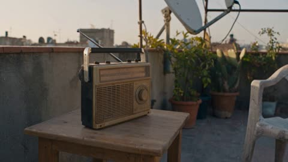</a>

The prompt splits the 30 seconds into timed beats with one physical action each, and lists the audio cues separately so clicks, static and the radio melody are generated as sound design. Camera rules such as autofocus hunting, exposure shifts toward the sun and no stabilization, plus a negative prompt against CGI and identity drift, keep the footage reading as a home camcorder recording.

Seedance 2.5 · Text-to-video · Source: [@ChillaiKalan__ on X](https://x.com/ChillaiKalan__/status/2099707127267049912) · found via [LearnPrompt/awesome-seedance](https://github.com/LearnPrompt/awesome-seedance)

[`handheld`](tags.md#tag-handheld) [`rooftop`](tags.md#tag-rooftop) [`slice-of-life`](tags.md#tag-slice-of-life) [`ambient-audio`](tags.md#tag-ambient-audio)

<details><summary><b>Prompt</b></summary>

```text
CONCEPT:
Create a 30-second ultra-realistic slice-of-life video about a young woman spending a quiet evening on an apartment rooftop, trying to get an old battery-powered radio working before sunset.

The entire story happens in one location. No shopping, no café, no market, no journey, and no walking-home sequence.

The charm comes from tiny realistic actions, environmental sounds, and her reaction when the radio suddenly works.

FORMAT:
30 seconds • 16:9 • 1080p • photorealistic live-action • authentic handheld consumer-camera footage

MAIN CHARACTER

A young Moroccan woman in her early 20s with naturally curly dark hair tied loosely with a fabric band.

She wears a faded mustard sweatshirt, relaxed dark jeans, white canvas sneakers, and a thin silver necklace.

Keep her face, hair, clothing, necklace, age, body proportions, and identity completely consistent.

LOCATION

An ordinary apartment rooftop in Casablanca, Morocco, shortly before sunset.

The rooftop contains:

- Concrete walls
- Old plastic chairs
- Several potted plants
- Water tanks
- Laundry lines
- A small wooden table
- A dusty portable radio
- Neighboring apartment buildings
- Satellite dishes
- Laundry moving gently in the breeze

Warm late-afternoon sunlight gradually changes as the scene progresses.

No famous landmarks or recognizable brands.

CAMERA STYLE

Recorded by a friend using an older consumer camcorder.

The camera should feel physically present on the rooftop.

- Handheld movement
- Slight natural shake
- Imperfect framing
- Occasional autofocus hunting
- Exposure shifts when pointed toward the sunset
- Mild digital noise
- Slight compression
- Natural motion blur
- Ordinary color reproduction
- No stabilization
- No artificial bokeh
- No commercial cinematography

SHOT BREAKDOWN

0–5 SECONDS — THE RADIO

Start with a close shot of an old dusty portable radio sitting on a small wooden table.

The woman enters the frame and picks it up.

She turns the power knob.

Nothing happens.

She taps the side of the radio.

She looks at the camera.

“Come on…”

---

5–10 SECONDS — TRYING AGAIN

She opens the battery compartment.

The camera moves closer over her shoulder.

She removes the batteries and checks them.

One battery is slightly loose.

She adjusts it and puts everything back together.

A small click.

Still nothing.

She gives the radio an annoyed look.

---

10–15 SECONDS — THE ANTENNA

She pulls the antenna upward.

The antenna makes a tiny metallic clicking sound.

She rotates the radio toward different directions.

The camera follows her movement.

Suddenly, a burst of static comes through the speaker.

She immediately stops moving.

---

15–21 SECONDS — FOUND IT

She slowly turns the tuning dial.

Static.

More static.

Then a faint, completely original radio melody comes through.

Her expression changes into a genuine smile.

She looks toward the camera.

“There.”

---

21–26 SECONDS — SUNSET

She places the radio on the table.

She pulls a plastic chair closer and sits down.

The camera slowly shifts away from her toward the rooftop horizon.

The radio continues playing softly.

Wind moves the laundry behind her.

She quietly listens.

---

26–30 SECONDS — LITTLE ENDING

She suddenly reaches over and lowers the radio volume.

She looks at the sunset.

The camera moves slightly closer from behind.

She doesn't say anything.

The shot ends naturally on her sitting beside the radio as the sunlight fades.

AUDIO

Authentic rooftop ambience only:

- Wind
- Distant traffic
- Birds
- Laundry fabric moving
- Radio static
- Dial clicks
- Battery compartment clicks
- Plastic chair scraping concrete
- Quiet original radio melody
- Natural breathing

NO ADDED BACKGROUND MUSIC.

The radio melody must be original and not imitate a recognizable copyrighted song.

REALISM / PHYSICS

The radio must behave like a real old battery-powered device.

The tuning dial should physically rotate.

The antenna should extend realistically.

The static should change naturally as the radio is rotated.

The laundry should respond subtly to the wind.

The chair should scrape slightly when moved.

Sunlight and shadows should remain physically consistent throughout.

Hands must interact naturally with the radio and battery compartment.

NEGATIVE PROMPT

CGI, 3D render, animation, plastic skin, beauty filter, artificial face, face morphing, identity drift, extra fingers, malformed hands, duplicated people, floating objects, impossible radio mechanics, fake static, unrealistic antenna movement, teleportation, object duplication, excessive HDR, oversaturated colors, heavy cinematic grading, artificial bokeh, fake film grain, studio lighting, perfect stabilization, drone footage, commercial advertisement aesthetic, exaggerated acting, subtitles, captions, logos, watermarks, recognizable brands, copyrighted music, wardrobe changes, hairstyle changes, continuity errors.

FINAL LOOK

The final footage should feel like someone casually filmed a quiet evening on a rooftop and happened to capture a small moment that felt worth remembering.

Don't force emotion.

Don't make the sunset overly dramatic.

Keep the imperfect camera movement, ordinary rooftop clutter, realistic wind, slight autofocus mistakes, and natural pauses.

Simple moment. Real environment. Genuine reaction.
```

</details>

<a id="seedance-city-woman-day-waking-to-sleep"></a>
### Woman wakes in warm sunlight under white linens

<a href="https://x.com/noorlewisx/status/2102628377463275651"></a>

A character reference image (@image1) locks the same face across seven timed scene beats, while one style line sets the lens, lighting and vlog look for every shot. The negative line names identity drift and CGI looks to suppress.

Seedance 2.5 · Reference-to-video · Source: [@noorlewisx on X](https://x.com/noorlewisx/status/2102628377463275651) · found via [LearnPrompt/awesome-seedance](https://github.com/LearnPrompt/awesome-seedance)

[`character-reference`](tags.md#tag-character-reference) [`lifestyle-vlog`](tags.md#tag-lifestyle-vlog) [`multi-scene`](tags.md#tag-multi-scene) [`daily-routine`](tags.md#tag-daily-routine)

<details><summary><b>Prompt</b></summary>

```text
CHARACTER REFERENCE: @image1 = main character identity. Preserve exact face, eyes, nose, lips, skin tone, hairstyle, and body proportions across all scenes. Cinematic 4K, 35mm lens, soft natural lighting, realistic skin texture, subtle film grain.

SCENES SEQUENCE:
1. MORNING: @image1 opens eyes under soft white bed linens in warm sunlight.
2. COFFEE: @image1 walks outside sipping coffee, blurred street background.
3. GETTING READY: @image1 splashes water on face and applies mascara in bathroom mirror.
4. LEAVING HOME: @image1 steps out of classic building in oversized brown blazer, walks down tree-lined street.
5. CITY WALK: @image1 walks busy street in a leather jacket while checking smartphone.
6. CAFE: @image1 reads a book beside a latte, then eats a fresh salad in a brick-walled cafe.
7. EVENING: @image1 returns home, takes off jacket, washes face, dries with towel, gets into bed, and falls asleep.

STYLE: photorealistic, shallow depth of field, gentle tracking camera, lifestyle vlog aesthetic.
NEGATIVE: character identity drift, different woman, generic face, 3D, CGI, anime, beauty filter. --ar 9:16
```

</details>

<a id="seedance-couple-pov-bedroom-teasing-pinch"></a>
### Boyfriend POV bedroom banter ending in laughter

<a href="https://x.com/QtImVCr6WK56152/status/2106252278940541142"></a>

One continuous handheld POV long take scripts every line, pause and micro-expression, so the comedy comes from timing rather than cuts. It fixes the hand's entry, contact and exit path, and keeps the angled mirror from reflecting the camera side.

Seedance 2.5 · Reference-to-video · Source: [@QtImVCr6WK56152 on X](https://x.com/QtImVCr6WK56152/status/2106252278940541142) · found via [LearnPrompt/awesome-seedance](https://github.com/LearnPrompt/awesome-seedance)

[`couple`](tags.md#tag-couple) [`pov`](tags.md#tag-pov) [`long-take`](tags.md#tag-long-take) [`dialogue`](tags.md#tag-dialogue) [`photoreal`](tags.md#tag-photoreal)

<details><summary><b>Prompt</b></summary>

```text
使用上传的角色参考图像作为唯一女主角参考，女主为年轻成年女性，全程严格保持同一人物身份，高度锁定参考图中人物原本的脸型、五官比例、眉型、眼型、眼睛大小与间距、鼻型、嘴型、唇形、下颌线、面部骨相、白皙自然肤色、年龄感、黑色长直发、自然齐刘海、发际线以及整体人物辨识度，不换脸、不漂移、不重新设计五官、不突然改变妆容、不改变年龄，不生成统一韩系AI网红脸；皮肤保持白皙、细腻、透亮但必须有真实真人皮肤质感，保留自然毛孔、鼻翼阴影、轻微唇纹、细小碎发和真实光影，不要塑料磨皮；发型从第一帧到最后一帧始终保持参考图中的黑色长直发与齐刘海结构，长度、发量、刘海位置不能突然变化；服装严格参考中女生原本穿搭，保持浅米白色自然V领短袖上衣与黑色短裤，颜色、材质、领口、袖型和整体穿着比例稳定一致，进入卧室以后去掉豹纹包、鞋子等外出配件，只保留自然居家穿着状态，全程不换衣服。生成一段约30秒、16:9横版、真人实拍质感、真实生活流、甜蜜轻喜剧情侣互动视频，两个人已经是关系非常亲密、非常熟悉的年轻情侣，不是暧昧初期，也不是刚认识，不需要通过夸张的拥抱、接吻或者表白证明感情，女主性格俏皮、可爱、开朗、爱笑，情绪很容易写在脸上，喜欢抓住男朋友一句普通的话故意曲解，偶尔会假装生气、嘴硬、撇嘴，但从来不是真正发脾气，她其实很喜欢看男朋友被自己问住的样子；男主性格平时偏高冷、内向、话少、不太会表达，也完全不擅长哄人，面对女主时会明显变柔软，但依旧不会说很多漂亮话，他的好笑来自一本正经、反应稍微慢半拍、不会哄却总能莫名其妙把女主逗笑；两个人之间不是刻意调情，而是已经非常熟悉以后形成的自然情侣状态，整段视频必须有一种“本来只是晚上躺在房间里随口聊天，女生突然抓住男朋友一句话故意找茬，男朋友越解释越不会说，最后又用很笨的方式把她逗笑”的感觉，不要偶像剧式表演，不要霸总式男友，不要刻意深情凝视，不要每一句都像情话，不要演成短剧，不要像演员背台词，要像真正情侣卧室里偶然被记录下来的一小段，甜感来自两个人的熟悉、停顿、眼神、嘴硬、轻轻捏脸、低头憋笑和最后破功，而不是刻意卖甜。场景是一间真实、普通、干净、有生活感的住宅卧室，夜晚，房间保持床、浅色或白色被褥、枕头、木质床头、窗户、窗帘、简单家居陈设以及侧放落地镜等元素，床铺不要像酒店一样完全整理平整，被褥可以有自然皱褶和真实使用痕迹，窗外已经变暗，室内主要由柔和床头灯与一点非常微弱的窗边夜间环境光照明，床头灯是柔和暖白而不是浓烈橙黄色，同时保留一点轻微偏冷的夜间窗口环境光，让人物肤色自然、白皙、干净，不要整个画面变黄，不要强烈轮廓光，不要硬阴影，不要豪华酒店感，不要摄影棚感，不要样板房感，不要蜡烛、玫瑰、爱心灯等刻意浪漫元素，浪漫全部来自两个人互动；特别注意卧室中的镜子，镜面保持偏侧角度，不正对摄影方向，只允许反射窗帘、床侧或房间环境，镜子里绝对不能出现男主的脸、完整身体、摄影设备、摄影人员、第三个人或者任何不合理人体。全程主要采用男朋友第一人称视角 / 近距离情侣POV，镜头本身就是男朋友所在的位置，男主绝对不露脸，也不能出现完整身体，最多只允许偶尔出现男主的一只右手、少量前臂或者非常模糊的肩部边缘，除此之外不要出现男主人体，女主实际上始终是在与自己的男朋友交流，因此她看向镜头就是看向男朋友，而不是在面对观众自拍；摄影距离保持在真实情侣坐在床上聊天时的私人距离，前半段保持自然中近景，可以看到女主完整脸部、肩膀、上半身以及一部分床铺和卧室环境，不要一开始就一直怼脸，后半段随着两个人互动越来越甜，镜头才可以非常轻微、缓慢地靠近一点；全程轻微自然手持呼吸感，像男朋友本人手拿手机拍摄，只允许极小幅度的手腕漂移和呼吸起伏，不剧烈晃动，不旋转镜头，不快速推拉，不频繁切镜，整段优先采用一个连续POV长镜头完成，最多允许一次非常自然、几乎感觉不到的重新构图，不要一句对白切一次镜头；镜头始终重点捕捉女主的眼睛、嘴角、脸颊、轻轻眯眼、撇嘴、抿嘴、忍笑、低头憋笑、重新抬眼、突然笑出来、细微呼吸以及头发的小动作，女主不能从头到尾一直直勾勾盯镜头，眼神必须自然变化，看男友、短暂移开、偷偷看回来、低头、看男主伸来的手、假装不高兴地转开、忍笑、重新对视，最后才完全笑开。视频开头女主自然坐在床上或靠坐在床边，身体非常放松，一边随手整理垂在胸前的黑色长发，一边和男朋友随意聊天，她原本心情很好，脸上始终带着很轻松、很自然的笑，男主在画外用非常随意、平静、略微低沉、话不多的语气说：“你今天话还挺多啊。”女主不要马上反应，先保持原本的笑大约半秒，像突然捕捉到“话还挺多”这几个字，整理头发的动作慢下来，眼睛停一下，再慢慢抬眼看向男朋友，嘴角原本的笑意一点一点收回来，但绝对不是真的生气，而是明显意识到自己好像抓到了一个可以逗他的点，眼睛轻轻眯一下，下巴微微抬起，带着一点“你刚刚是不是说错话了”的感觉说：“嫌我烦啊？”男主明显愣一下，马上意识到情况不对，语气稍微有一点慌但依旧内向、克制：“啊？没有没有，我不是那意思。”女主几乎立刻接上，不给他太多缓冲，身体仍然很放松，但是眼神盯着他，故意追问：“那你什么意思。”说完以后她表面一本正经等他的答案，实际上嘴角已经有一点点想笑，她自己意识到以后轻轻抿一下嘴，把笑压回去；男主明显不知道这种问题应该怎么处理，不要立刻回答，镜头安静看着女主，保留大约半秒到一秒真实思考的停顿，他先迟疑地说：“就是……”再停顿一下，像是真的在想一个最安全的答案，然后非常认真、略显笨拙地说：“感觉你今天特别可爱。”这一句男主绝对不要用成熟撩人的语气，不要突然温柔深情，不要像情话高手，而应该像被追问以后情急之下说出了自己真实想法；女主听完以后先停一下，眼神明显有一点被夸到，但她马上意识到自己不能这么快被哄好，于是故意把脸轻轻偏向一边，嘴角努力压住，带着一点不信又有一点想笑的感觉说：“油嘴滑舌，我才不信！”这里不是真嫌弃，语气里藏着明显笑意，说完以后她故意把视线移开，不马上看男朋友，嘴巴轻轻抿着，让人感觉她其实已经开心了一点，只是还想继续装；男主看到她还是不理自己，安静一秒，明显不知道还能怎么哄，不要马上继续说话，随后男主的一只右手从镜头侧前方自然进入画面，必须是一只结构真实稳定的成年男性右手，正常五根手指，手掌、手腕、前臂比例自然，动作缓慢，先完整向女主一侧脸颊靠近，再由拇指和食指非常轻地捏一下她一侧脸颊，只持续约一秒，这是已经很熟的情侣之间非常自然的小动作，不是用力掐脸，不是拉扯，不要让整张脸发生夸张变形，手指不能穿过皮肤，不能多出手指，不能出现第二只多余男性手，也不能突然从女主脸旁凭空生成一只手；女主完全没想到男朋友会突然这样，先明显愣半秒，眼睛轻轻放大一点，随后皱起一点眉毛，被捏的一侧脸颊微微鼓起来，嘴巴很自然地撇下来，非常可爱又有一点无语地重新看向男朋友，不要夸张嘟嘴，不要演成表情包，随后她可以用自己的一只手轻轻碰一下或者推开男主的手，两只手必须发生真实接触，不能穿透，男主的手随后沿原来的方向自然撤回画面，不能凭空消失；女主带着真实意外和一点假生气说：“哎你捏我脸干嘛？”男主依旧非常平静、非常认真地回答：“哄你啊。”女主更加无语地盯着他，嘴巴仍然微微撇着：“你管这叫哄人？”男主再次卡住，先短暂停顿，像第一次认真思考“哄人到底应该怎么哄”，然后有一点没底气、甚至略微迟疑地说：“那…那不然怎么哄啊，我也没经验啊。”说完以后再稍微停一下，男主重新恢复一本正经的状态，继续非常认真地补一句：“脸软乎乎的，捏捏气就消了吧应该。”这一句是整段最关键的喜剧点，男主自己绝对不要笑，也不能故意用搞笑语气，他是真的认真觉得“脸软，所以捏一下可能气就消了”，越认真越好笑；女主听完先愣住，眼睛重新抬起来看男朋友，原本还想维持自己的生气表情，但是嘴角已经开始明显失控，她立刻意识到自己快笑出来，于是低一下头，把视线移开，轻轻抿住嘴，肩膀非常轻地动一下，从鼻子或者嘴里漏出一点很轻的憋笑气音，不要马上大笑，她必须努力重新控制表情，再慢慢抬头，故意继续装凶，用一种“怎么会有这么笨的人”的眼神看着男朋友说：“你可真够笨的。”这句话表面是在嫌弃，语气实际上已经明显变软，嘴角也已经藏不住一点笑；男主注意到她刚刚低头憋笑，停顿半秒，非常自然地指出：“哎，你笑了。”女主瞬间重新抿嘴，眼睛看回来，非常嘴硬、非常自然地否认：“我没有。”但说这句话的时候嘴角其实还在偷偷往上翘；男主没有被她骗到，声音依旧平静，只多一点终于抓到证据的感觉：“得了吧，嘴角都翘起来了还装。”女主听完以后终于彻底绷不住，不要突然夸张哈哈大笑，正确反应是先愣一下，然后眼睛最先弯起来，接着嘴角彻底失去控制，再真正笑出来，笑容明亮、自然、甜，但不是营业式标准笑，她可以低一下头笑，再重新抬头看男朋友，身体非常自然地朝镜头靠近一点，眼睛里已经完全没有刚才所谓的“生气”，只剩下被抓包以后又好气又好笑的感觉，最后她伸出一只手朝镜头靠近，手掌自然挡住一部分画面，笑着说：“闭嘴。”说完以后自己又忍不住笑一下，不要立刻黑屏，最后停留短短一瞬，让最后可见的画面是她靠近男朋友、眼睛已经笑弯、嘴角完全藏不住、伸手挡镜头之前仍然看着男朋友的状态，然后自然结束。整个视频最大的表演核心是“憋不住”，女主从来不是真的发火，她知道男朋友说“话还挺多”并不是嫌自己烦，她所谓的生气其实是故意曲解、看他紧张、继续追问、看他会怎么哄自己，所以完整情绪必须表现为：一开始自然笑着聊天，听见“话还挺多”后动作停顿，突然意识到可以抓这句话做文章，轻轻眯眼问“嫌我烦啊”，看到男朋友慌了以后其实已经有一点得逞，听见“感觉你今天特别可爱”以后明显被哄到，却嘴硬说“不信”，故意把脸转开，突然被捏脸以后短暂意外，再可爱地撇嘴问“你管这叫哄人”，听男朋友认真解释，听到“脸软乎乎的，捏捏气就消了吧应该”以后瞬间觉得他真的很笨，嘴角开始失控，低头憋笑，重新装严肃，被男朋友发现以后立刻否认，最后再次被拆穿才彻底笑出来；不要每一句话都配一个大动作，不要演成小品，不要频繁眨眼，不要夸张鼓腮，不要故意瞪大眼睛，不要高频撒娇，不要从头到尾不停摸头发，真正的可爱来自反应慢半拍、眼睛先变化、嘴角藏不住、自己发现以后再努力压住。男主虽然全程不露脸，但必须通过停顿、说话节奏、语气、偶尔的迟疑以及唯一一次捏脸动作形成明确存在感，他不是情圣，不是油腻男，不是霸总，也不是特别会谈恋爱的男生，说“感觉你今天特别可爱”时也不要像成熟情话，而像情急之下说出的真实想法，说“那…那不然怎么哄啊，我也没经验啊”时需要真的有一点不知道该怎么办，说“脸软乎乎的，捏捏气就消了吧应该”时必须完全一本正经，他的笑点来自他本人根本不知道自己很好笑；男主不能一直讲话，必须经常出现不知道怎么回答、安静、想一下、再开口的真实节奏。女主声音年轻、自然、明亮，是成年年轻女性自然声线，带一点轻微笑意，不要幼态声音，不要夹子音，不要刻意撒娇腔，不要所有尾音都上扬，“嫌我烦啊？”要像突然抓住男朋友一个语言漏洞，“那你什么意思”要稍微快一点像立刻追问，“油嘴滑舌，我才不信！”是明明被夸开心却故意嘴硬，“哎你捏我脸干嘛？”必须先有真实意外再说话，“你管这叫哄人？”是无语而不是真生气，“你可真够笨的”说的时候已经明显带一点笑，“我没有”一定要嘴硬而且嘴角最好正在偷偷翘，“闭嘴”必须笑着说。整段视频的人物位置必须连续，女主不能上一秒坐在床左侧下一秒突然变到右侧，床铺不能突然改变，房间结构不能跳变，灯光方向不能突然变化，黑色长直发与齐刘海、发量、头发长度始终一致，浅米白色短袖和黑色短裤始终一致，领口和袖子不能突然变化；男主捏脸之前画面里不能提前出现任何多余男性手，男主全片只有一只右手参与捏脸动作，完整物理路径必须明确表现为手从合理方向进入、向脸颊靠近、真实接触、轻轻捏约一秒、女主产生反应、女主轻轻推开、男主手自然撤回，不能手指穿脸，不能脸穿过手，不能两只手穿透，不能突然增加肢体；女主最后伸手挡镜头时同样必须从她真实手臂所在位置自然延伸出来，不能凭空出现。声音设计没有背景音乐、没有字幕、没有文字、没有旁白、没有额外音效，只保留非常真实的夜晚卧室环境声音，包括轻微空调声、低弱房间底噪、被褥自然摩擦、衣服轻微摩擦、头发移动声、自然呼吸声、女主低头憋笑时极轻的气音和真实人物对白；对白绝对不要连续高速念完，每一次追问、迟疑、被逗到、憋笑之间必须有真实短暂停顿，如果30秒内完整对白和自然表演节奏发生冲突，优先保证停顿、微表情、人物反应和情侣聊天的真实节奏，可以自然压缩次要空白，但绝对不要通过明显加快说话速度把所有台词硬塞完。整体风格必须是：真实情侣日常、男友第一人称POV、夜晚卧室生活感、年轻情侣自然拌嘴、女生故意抓字眼、嘴硬假生气、男朋友不太会哄人、轻轻捏脸、一本正经笨蛋逻辑、低头憋笑、嘴角失控、被抓包以后继续嘴硬、最后彻底笑出来、自然打情骂俏、甜而不腻、有梗但不演段子、真实微表情、自然眼神交流、柔和住宅夜景、白皙真实皮肤、黑色长直发齐刘海、轻微手持摄影、近距离亲密感、没有戏剧化冲突、没有霸总感、没有土味情话、没有偶像剧感、没有网红营业自拍感、没有AI磨皮感；最终效果必须像两个已经非常熟的情侣晚上坐在卧室里随便聊天，男朋友一句“你今天话还挺多啊”无意中把自己送进坑里，女生故意抓住不放，男朋友先笨拙地夸她可爱，又完全不知道怎么哄，只能伸手轻轻捏她的脸，还一本正经地觉得“脸软乎乎的，捏捏气就消了”，女生嘴上一直嫌他笨，实际上早就快憋不住笑，最后又被男朋友发现嘴角已经翘起来，只能笑着让他闭嘴，不是演出来的甜，而是那种只有关系非常熟的情侣之间才会出现的自然、幼稚、好笑又很亲密的小瞬间。
```

</details>

<a id="seedance-dv-gym-vlog-workout"></a>
### DV tape gym vlog with stretches and curls

<a href="https://x.com/AIwithWania/status/2105198136905933154">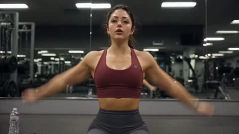</a>

The camera is framed as the subject's own camcorder, propped or handheld, so tape noise, bloom and exposure flicker read as part of the shot rather than a filter. A reference image with a locked block for face, hair, outfit and setting keeps one character across eight timed cuts, and each cut pairs one action with one line of dialogue to drive lip-sync and pacing.

Seedance 2.5 · Reference-to-video · Source: [@AIwithWania on X](https://x.com/AIwithWania/status/2105198136905933154) · found via [LearnPrompt/awesome-seedance](https://github.com/LearnPrompt/awesome-seedance)

[`dv-look`](tags.md#tag-dv-look) [`gym-vlog`](tags.md#tag-gym-vlog) [`character-consistency`](tags.md#tag-character-consistency) [`handheld-pov`](tags.md#tag-handheld-pov)

<details><summary><b>Prompt</b></summary>

```text
-
CAMERA:
DV 16mm tape camcorder handheld feel. POV of CHASE holding the camera herself, occasionally propping it on the gym floor or mat for hands-free workout shots. Natural hand shake, imperfect framing, delayed focus pulls, clumsy little zooms, occasional face cut-off framing, imperfect shots. Camcorder never appears on screen.

LOOK:
Soft, slightly blurry tape quality, faint tape noise, bloomed highlights under gym lighting, subtle flickering auto-exposure, muted contrast, realistic skin tones, natural sweat sheen, authentic nostalgic DV texture.

STYLE:
Confident, playful, slightly cheeky gym-vlog energy. Genuine workout effort mixed with humor and personality. The movements must clearly look like real gym stretching and exercises, never sexualized or suggestive. Quick handheld cuts, natural breathing, realistic body movement, expressive facial reactions, casual spontaneous dialogue.

REFERENCE IMAGE / CHARACTER:
Use the provided reference image as the exact visual reference for CHASE. Preserve her exact face, identity, facial features, skin tone, body proportions, and recognizable appearance throughout the entire video. Do not change or redesign her face. The same girl must appear consistently in every shot. Keep her long black hair in a high ponytail throughout the video. Slim athletic build, expressive eyes, natural glowing skin with a light sweat sheen.

OUTFIT:
Stylish fitted gym outfit with a slightly bold but appropriately covered look: a fitted athletic crop-style training top with secure chest coverage and visible shoulders and arms, paired with high-waisted opaque fitted leggings. Use a striking color combination such as a deep burgundy/wine top with dark charcoal leggings. Premium athletic fabric, realistic fit, fashionable but practical for working out. No jacket, no long sleeves, no jewelry, no distracting accessories. Keep the exact same outfit throughout.

SETTING:
Modern gym in the evening, gym mat area near a mirror wall, soft overhead lighting, water bottle beside the mat, dumbbells and other gym equipment naturally visible in the background, realistic gym atmosphere.

STORYBOARD — 30 SECONDS, 8 CUTS:

1. (~4s, propped camera, medium shot)
CHASE stands on the mat and immediately starts a proper warm-up. She raises both arms overhead for a controlled stretch, reaches through her sides, then brings one arm across her chest for a shoulder stretch. She rolls her shoulders back and looks at the camera with a confident playful expression.
CHASE: "Alright… let's wake these muscles up."

2. (~3s, handheld medium shot)
She performs controlled side stretches, one arm reaching overhead while leaning gently to the opposite side, then switches sides. Natural athletic movement and relaxed breathing.
CHASE: "We're warming up… but we're not playing today."

3. (~4s, low propped camera, seated stretch)
CHASE sits on the mat, extends one leg straight while keeping the other comfortably bent, and reaches toward her extended foot. She switches sides naturally, keeping proper stretching form.
CHASE: "Okay, legs… don't betray me now."

4. (~3s, medium shot)
She moves into a comfortable seated wide-leg stretch, leaning forward slightly and then sitting upright. She looks directly at the camera with a playful smirk.
CHASE: "Okay… we're getting serious now."

5. (~3s, handheld transition)
CHASE stands up, walks toward a pair of moderate dumbbells, picks them up, adjusts her grip, checks herself briefly in the mirror, then looks toward the camera confidently.
CHASE: "Enough stretching. Let's make it burn."

6. (~4s, medium handheld shot)
She performs controlled dumbbell curls with proper gym form. Her arms show natural workout tension as she completes several repetitions. She glances at the camera while continuing the exercise.
CHASE: "Okay… now we're talking."

7. (~6s, propped camera, core workout)
CHASE puts the dumbbells down and transitions onto the mat. She starts controlled crunches, then moves into slow leg raises. Close-up insert of her hands gripping the mat while her core works. Her breathing becomes heavier and her expression shows genuine effort. She finishes the final leg raise and drops back onto the mat with a laugh.
CHASE: "Yeah… that burn is getting dangerously good."

8. (~3s, arm's-length selfie finish)
Still lying on the mat, slightly sweaty and breathing naturally, CHASE lifts the camera above her face. Her long black high ponytail rests naturally around her head. She gives the camera a tired but confident smile.
CHASE: "Cute warm-up. Serious workout."

IMPORTANT:
Keep every movement realistic and clearly recognizable as gym training. No repetitive shaking, hip thrusting, pelvic movements, suggestive bouncing, or sexualized posing. Maintain consistent face, identity, hairstyle, outfit, body proportions, lighting, and visual style throughout all eight cuts. Natural lip-sync, realistic breathing, authentic gym ambience, playful facial expressions, and imperfect DV camcorder footage throughout.
```

</details>

<a id="seedance-dv-seoul-alley-errands"></a>
### Young Korean woman walks Seoul alley on DV camcorder

<a href="https://x.com/aiwithaly/status/2106238790666989717">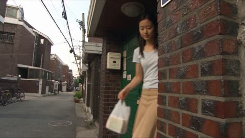</a>

The prompt pins the camcorder look with concrete artifacts such as handheld shake, autofocus hunting and interlacing, and asks for diegetic audio only. A consistency clause plus a beat-by-beat list of errands keeps the same face and outfit across the whole walk.

Seedance 2.5 · Text-to-video · Source: [@aiwithaly on X](https://x.com/aiwithaly/status/2106238790666989717) · found via [LearnPrompt/awesome-seedance](https://github.com/LearnPrompt/awesome-seedance)

[`dv-camcorder`](tags.md#tag-dv-camcorder) [`seoul`](tags.md#tag-seoul) [`handheld`](tags.md#tag-handheld) [`day-in-the-life`](tags.md#tag-day-in-the-life)

<details><summary><b>Prompt</b></summary>

```text
Create a 30-second ultra-photorealistic early-2000s Korean DV-camcorder home video of a young Korean woman spending a quiet afternoon exploring an older Seoul residential neighborhood. Keep her face, hairstyle, body proportions, outfit, and overall appearance perfectly consistent throughout.

She leaves home, locks the door, and walks through narrow lived-in streets with old apartments, small houses, bicycles, utility poles and potted plants. She greets an elderly neighbor, browses a tiny stationery shop and buys a cute notebook. She notices a stray cat beside a scooter, crouches and softly says “Hello,” then visits a neighborhood bakery, buys a red-bean bun and eats it while walking.

She pauses beside an old public phone booth, then reaches a quiet crossroads. She looks at the camera and says, “It was a nice day,” gives a small wave, and walks home.

Authentic early-2000s consumer DV footage: handheld shake, imperfect framing, autofocus hunting, exposure shifts, soft digital detail, mild digital noise, natural motion blur, subtle interlacing, awkward zooms and genuine low-resolution camcorder character. Realistic physics, natural blinking, walking and subtle expressions.

Natural diegetic audio only. No music, narration, subtitles, CGI, beauty filters, cinematic grading, slow motion or polished camera movement.

Negative prompt: inconsistent face, changing outfit, morphing, distorted hands, extra fingers, duplicated people, unnatural movement, plastic skin, CGI look, modern cinematic camera, excessive stabilization, teleportation, floating objects, logos, watermark.
```

</details>

<a id="seedance-dv-tape-gym-core-vlog"></a>
### Handheld DV tape gym vlog of core workout

<a href="https://x.com/doctorwasif/status/2103476205760774263">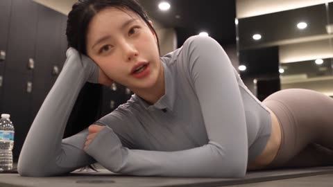</a>

A camcorder POV with tape noise, hand shake, delayed focus pulls and clumsy zooms sells the home-footage realism. Timed storyboard cuts with in-shot dialogue keep the pacing and comedic tone, and stating that the camera never appears on screen keeps the POV clean.

Seedance 2.5 · Text-to-video · Source: [@doctorwasif on X](https://x.com/doctorwasif/status/2103476205760774263) · found via [LearnPrompt/awesome-seedance](https://github.com/LearnPrompt/awesome-seedance)

[`fitness`](tags.md#tag-fitness) [`vlog`](tags.md#tag-vlog) [`handheld`](tags.md#tag-handheld) [`tape-look`](tags.md#tag-tape-look)

<details><summary><b>Prompt</b></summary>

```text
**CAMERA:**
DV 16mm tape camcorder handheld feel. POV of CHASE holding the camera herself, occasionally propping it on the floor or a mat for hands-free core shots. Hand shake, misaligned framing, delayed focus pulls, clumsy zooms, occasional face cut-off framing, imperfect shots. Camcorder never appears on screen.

**LOOK:**
Soft, slightly blurry tape quality, faint tape noise, bloomed highlights under gym lighting, flickering auto-exposure, muted contrast, realistic skin tones.

**STYLE:**
Playful, self-deprecating gym-vlog tone — genuine strain mixed with humor, complaining about core work while still pushing through it. Quick handheld cuts, energy staying light and funny throughout rather than fully exhausted.

**Character**

CHASE — Korean idol, 20s. Long black hair in a high ponytail, glowing skin with a light sweat sheen, big expressive eyes. Slim athletic build. Modest long-sleeve athletic top, loose joggers or fitted leggings (arms and torso fully covered), sneakers off or socks, no jewelry.

**Setting**

A gym mat area in the evening — mirror wall nearby, water bottle on the floor, soft overhead lighting, other equipment visible in the background.

**Storyboard (15s, 6 cuts)**

1. *(~2.5s, propped camera, medium shot)* She lies down on the mat, propping up on her elbows, already sighing dramatically. CHASE: "Okay, core day — my least favorite day."

2. *(~2.5s, propped camera, plank position)* She holds a plank, arms shaking slightly, talking through gritted teeth. CHASE (strained): "Why does this get harder every single time—"

3. *(~2.5s, medium propped shot, crunches)* She moves into a set of crunches, breathing hard, complaining between reps. CHASE: "Nobody warns you how much this actually burns."

4. *(~2s, macro insert, shallow DOF)* Close-up on her hands gripping the mat edges during a leg raise, abs visibly working. No dialogue — ambient gym sound only.

5. *(~2.5s, handheld, leg raises)* She finishes a slow leg raise set, flopping back onto the mat immediately after, laughing at herself. CHASE (breathless): "Okay— that's it, I'm done—"

6. *(~3s, arm's-length selfie finish)* Still lying on the mat, she lifts the camera above her face, grinning tiredly. CHASE: "Core day never gets easier — see you guys tomorrow, hopefully."
```

</details>

<a id="seedance-europe-old-town-selfie-vlog"></a>
### Selfie travel vlog through a European old town

<a href="https://x.com/SyntheSarah/status/2087737206459044262">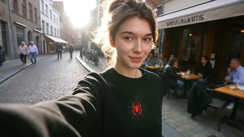</a>

The prompt lays out a timed shot list with camera work for each cut, then fixes one face and outfit across selfie, pan, POV and café shots. Asking for skin texture, handheld shake and natural exposure changes while banning beauty filters and CGI pushes the result toward real phone footage.

Seedance 2.5 · Text-to-video · Source: [@SyntheSarah on X](https://x.com/SyntheSarah/status/2087737206459044262)

[`vlog`](tags.md#tag-vlog) [`selfie`](tags.md#tag-selfie) [`handheld`](tags.md#tag-handheld) [`travel`](tags.md#tag-travel) [`timeline`](tags.md#tag-timeline)

<details><summary><b>Prompt</b></summary>

```text
Create a 15-second ultra-photorealistic travel vlog featuring the SAME young European woman throughout the entire video. She has natural skin texture, subtle facial imperfections, realistic hair movement, authentic body proportions, and completely natural expressions. The video must look like genuine footage recorded by a real travel creator, NOT AI-generated or cinematic CGI.

SHOT 1 — 0–3 seconds:
Selfie-style handheld footage. The woman walks naturally down a beautiful European old-town street in the morning. She holds a small vlog camera at arm's length, looks directly into the lens and gives a subtle genuine smile. Natural walking bounce, slight handheld shake, realistic breathing and hair movement. Background includes pedestrians casually walking, parked bicycles, small cafés, textured historic buildings and soft morning sunlight.

SHOT 2 — 3–6 seconds:
She turns the camera away from herself toward the street. A natural handheld pan reveals detailed European architecture, outdoor café tables, people having coffee, bicycles passing and a small bakery. The camera movement is imperfect and human, with slight exposure adjustment as it moves from shadow into sunlight.

SHOT 3 — 6–9 seconds:
Cut naturally back to selfie footage. She continues walking and briefly says something casually to the camera with natural lip movement and relaxed facial expressions. A light breeze moves a few strands of her hair. People pass behind her naturally without looking at the camera. Realistic depth, authentic street ambience and subtle camera shake.

SHOT 4 — 9–12 seconds:
POV-style footage from her camera as she enters a small local café. The camera moves naturally through the doorway toward a wooden table with a freshly prepared coffee and a small pastry. Realistic reflections on glass, steam rising subtly from the coffee, natural indoor lighting, background conversations and realistic movement.

SHOT 5 — 12–15 seconds:
She sits outside the café and turns the camera back toward herself. She takes a small sip of coffee, looks into the lens and smiles naturally. The camera remains handheld and slightly imperfect. Background pedestrians, bicycles and café activity continue moving naturally. End with a subtle realistic focus shift from her face toward the street behind her.

VISUAL REQUIREMENTS:
Absolute photorealism, real-world physics, realistic human motion, authentic handheld smartphone/vlog camera behavior, natural skin pores and texture, realistic eyes and hair, physically accurate lighting and shadows, natural exposure changes, realistic reflections, detailed European environment, believable background pedestrians, consistent face and clothing across every shot.

Avoid overly smooth camera movements, artificial beauty filters, plastic skin, exaggerated expressions, perfect symmetry, CGI appearance, dramatic movie-style transitions, unrealistic background motion
```

</details>

<a id="seedance-european-old-town-selfie-vlog"></a>
### Woman filming selfie vlog on old town street

<a href="https://x.com/ChillaiKalan__/status/2094280707422191705"></a>

A character lock block spells out what must stay identical across every shot, then handheld imperfections, exposure shifts and autofocus behaviour are specified so the clip reads as real footage. Location sound and one scripted spoken line are described to keep the audio casual.

Seedance 2.5 · Text-to-video · Source: [@ChillaiKalan__ on X](https://x.com/ChillaiKalan__/status/2094280707422191705) · found via [LearnPrompt/awesome-seedance](https://github.com/LearnPrompt/awesome-seedance)

[`vlog`](tags.md#tag-vlog) [`selfie`](tags.md#tag-selfie) [`travel`](tags.md#tag-travel) [`handheld`](tags.md#tag-handheld) [`photorealistic`](tags.md#tag-photorealistic)

<details><summary><b>Prompt</b></summary>

```text
Seedance 2.5-30-Second Ultra-Photorealistic Travel Vlog Prompt

Create a 30-second ultra-photorealistic travel vlog that looks exactly like genuine footage spontaneously recorded by a real European travel creator on a high-quality handheld vlog camera. The same young European woman must remain visually identical throughout the entire video: identical face, facial proportions, hairstyle, hair color, skin tone, body proportions, age, wardrobe, accessories, and overall appearance. Maintain strict character consistency across every shot and camera angle.

The woman should have natural skin pores, subtle facial imperfections, realistic eyes, individual hair strands, authentic hair movement, natural body proportions, realistic hands, and spontaneous human expressions. No beauty filter, no plastic skin, no excessive makeup, no perfect symmetry.

The entire video must feel like real documentary/travel-vlog footage, not a commercial, music video, cinematic film, 3D render, or AI-generated sequence.

CONTINUITY / CHARACTER LOCK

Same woman in every shot. Young European woman, approximately mid-20s, naturally attractive but completely realistic. Natural complexion with visible pores and tiny imperfections, realistic eyes and eyelashes, natural eyebrows, slightly imperfect hair strands moving independently in the breeze. Same hairstyle and clothing throughout. Authentic posture and walking rhythm. No facial identity drift, no changes in age, hairstyle, clothing, accessories, body shape, or skin tone.

She carries a small compact vlog camera, held naturally at arm's length during selfie shots. Her grip, fingers, hands, and camera position must remain anatomically realistic.

LOCATION / ATMOSPHERE

A beautiful European historic old-town district in the morning. Narrow stone-paved street, textured centuries-old buildings, colorful but realistic façades, wooden shutters, small cafés, outdoor tables, bicycles, bakery storefront, pedestrians, subtle street activity.

Soft morning sunlight with realistic shadows. Natural atmospheric perspective. Authentic European street ambience. Background people behave independently and naturally, without staring at the camera. No duplicated pedestrians or repeated background characters.

SHOT 1 — 0–5 SECONDS

Selfie-style handheld vlog footage.

The woman walks naturally down the old-town street while holding a small vlog camera at arm's length. She looks directly into the lens with a subtle, genuine smile.

Camera has realistic handheld movement: slight walking bounce, tiny wrist movements, occasional micro-shake, natural framing imperfections, subtle breathing-related movement. Do NOT stabilize the footage perfectly.

Her hair moves naturally as she walks through a light morning breeze. Her expression remains relaxed and spontaneous. She occasionally blinks naturally.

Behind her: pedestrians walking casually, parked bicycles, café entrances, historic textured buildings and morning activity.

Natural sunlight falls across her face as she moves between partial shade and sunlight. Preserve realistic exposure and skin tones.

SHOT 2 — 5–10 SECONDS

She naturally turns the camera away from herself toward the street.

Create an imperfect handheld pan, as if a real travel creator casually redirected their vlog camera.

Reveal:

- detailed historic European architecture
- stone façades and windows
- outdoor café tables
- people drinking coffee
- bicycles moving through the street
- a small neighborhood bakery
- subtle morning street activity

The pan should NOT be perfectly smooth. Include realistic wrist acceleration, tiny framing corrections and slight motion blur.

As the camera moves from a darker section of the street into direct morning sunlight, produce a subtle automatic exposure adjustment. Highlights and shadows react naturally like a real camera sensor.

No cinematic transition. No artificial camera glide.

SHOT 3 — 10–15 SECONDS

Cut naturally back to selfie footage.

The same woman continues walking toward the café. She briefly says something casual and conversational to the camera, such as:

“This little street is so beautiful.”

Her lip movement must synchronize naturally with the words. Facial expressions are relaxed and understated. No exaggerated acting.

She briefly glances toward something in the street and then back at the lens. She blinks naturally. A light breeze moves several individual strands of hair.

Pedestrians pass naturally in the background without acknowledging the camera.

Maintain realistic handheld shake, authentic walking bounce, natural breathing, realistic depth of field and believable street ambience.

SHOT 4 — 15–21 SECONDS

Transition naturally into POV footage from her camera.

She approaches and enters a small independent local café.

The camera moves through the doorway at normal human walking speed. Slight vertical bounce and subtle wrist movement remain visible.

Inside:

- warm natural café lighting
- wooden tables
- textured walls
- realistic glass reflections
- small background conversations
- customers moving naturally
- barista activity in the distance
- subtle environmental shadows

The camera approaches a wooden table containing a freshly prepared coffee and a small pastry.

Show subtle realistic steam rising from the coffee. Reflections on the cup and nearby glass should obey real-world lighting.

No exaggerated steam. No floating objects. No artificial-looking food.

SHOT 5 — 21–26 SECONDS

Cut back to selfie footage.

The same woman is now sitting outside the café at a small table.

She naturally picks up the coffee, takes a small casual sip, lowers the cup and looks into the camera.

Her expression changes into a subtle authentic smile. Avoid influencer-style posing or exaggerated happiness.

Maintain exact facial identity and wardrobe continuity.

Background remains alive:
pedestrians walking, bicycles passing, café customers talking, subtle movement of chairs and clothing in the breeze.

Camera remains handheld and slightly imperfect, with realistic micro-shake.

SHOT 6 — 26–30 SECONDS

Continue the selfie shot for a natural ending.

She keeps a relaxed smile for a moment, then her attention subtly shifts toward the street.

The camera performs a small natural focus shift from her face toward the street behind her.

Her face gradually becomes slightly softer while the background becomes clearer, like realistic autofocus behavior from a modern vlog camera.

End spontaneously rather than dramatically.

No cinematic fade, no artificial transition, no title card.

CAMERA / PHYSICS

Authentic handheld vlog-camera behavior throughout.

Use:

- realistic walking bounce
- subtle wrist shake
- natural micro-jitter
- imperfect framing
- physically accurate motion blur
- realistic autofocus behavior
- realistic exposure adaptation
- natural depth of field
- physically correct reflections
- realistic shadows
- natural skin response to sunlight
- believable hair physics
- realistic fabric movement
- authentic pedestrian movement

Camera should occasionally make tiny human corrections rather than moving perfectly smoothly.

AUDIO / AMBIENCE

Natural location sound only.

Include subtle:

- footsteps on stone pavement
- distant conversations
- café chatter
- bicycle movement
- light street noise
- birds in the distance
- door opening
- subtle café interior ambience
- faint cup movement
- natural breathing

Her spoken sentence should sound like a real casual vlog recording, with natural voice volume and slight environmental background noise.

No dramatic soundtrack. No cinematic sound effects.

ABSOLUTE REALISM REQUIREMENTS

Prioritize photographic realism over visual perfection.

The footage should contain the tiny imperfections normally found in genuine handheld travel footage.

Avoid:

- CGI appearance
- AI-generated look
- plastic skin
- beauty filters
- excessive skin smoothing
- perfect facial symmetry
- exaggerated expressions
- overly cinematic lighting
- perfect gimbal movement
- impossible camera movement
- warped hands
- malformed fingers
- distorted faces
- inconsistent facial identity
- changing clothing
- changing hairstyle
- duplicated pedestrians
- frozen background people
- unnatural walking
- floating objects
- impossible reflections
- incorrect shadows
- artificial depth-of-field
- excessive bokeh
- oversaturated colors
- hyper-sharp artificial textures
- dramatic transitions
- commercial/ad-style posing

Final target: The finished 30-second video must be indistinguishable from a genuine, spontaneously filmed European travel vlog captured by a real person on a premium handheld vlog camera. Every person, object, reflection, shadow, movement, facial expression, hair strand, exposure change and camera motion should obey real-world physics.
```

</details>

<a id="seedance-fox-mountain-stream-selfie-vlog"></a>
### Anthropomorphic Fox Selfie Vlog by Mountain Stream

<a href="https://x.com/MrDasOnX/status/2089969922617266257"></a>

A fixed first-person handheld frame with a running timestamp keeps the take continuous, while a timed 30 second script pairs each action with a spoken line. Character, location and light are described up front so the selfie look stays consistent.

Seedance 2.5 · Text-to-video · Source: [@MrDasOnX on X](https://x.com/MrDasOnX/status/2089969922617266257) · found via [LearnPrompt/awesome-seedance](https://github.com/LearnPrompt/awesome-seedance)

[`vlog`](tags.md#tag-vlog) [`selfie`](tags.md#tag-selfie) [`anthropomorphic`](tags.md#tag-anthropomorphic) [`nature`](tags.md#tag-nature) [`dialogue`](tags.md#tag-dialogue)

<details><summary><b>Prompt</b></summary>

```text
Create a single continuous self-filmed vlog recorded on a handheld action camera in 16:9 aspect ratio. The camera is always held by the anthropomorphic fox, creating a natural first-person selfie perspective with light wind-induced shake, occasional soft lens flares from sunlight filtering through trees, realistic focus pulls, and dynamic walking/leaning motion. No cuts, transitions, or cinematic effects. Include a subtle realistic digital timestamp in the bottom-right corner that progresses naturally throughout the video.
Visual Style: Bright modern 4K digital look with vibrant yet soft natural colors, warm late-afternoon golden sunlight mixed with dappled shade, gentle water reflections and soft mist rising from the stream, subtle water droplets or mist on the lens near the water, and crisp details on fur and leaves. Slight handheld energy but smooth enough for casual vlogging. Widescreen 16:9 framing.
Character: Ember, a 24-year-old anthropomorphic red fox (bipedal, human-like proportions) with soft fluffy reddish-orange fur, white chest and muzzle, bright amber eyes, pointed ears, and a long bushy tail that sways naturally. He wears a simple light denim jacket with rolled sleeves over a soft cream t-shirt and comfortable cargo shorts. Personality: curious, warm, slightly playful and soft-spoken.
Location: Starts on a wooden footbridge over a clear mountain stream in a lush temperate forest, surrounded by mossy rocks, ferns, wildflowers, and overhanging maple and pine branches. Soft green and golden foliage, clear water with gentle ripples and small fish darting below.
Sequence (exactly 30 seconds, continuous take with timestamps):
0:00 – 0:05
Ember lifts the camera, smiles softly at the lens with his ears perking up, and says in a warm, slightly raspy voice:
“Hey friends… you won’t believe this spot I found.”
0:05 – 0:13
He walks slowly along the wooden bridge, lowering the camera slightly to show the clear stream and small fish swimming just below the surface while continuing:
“The water is so clear… I can see every little fish moving around.”
0:13 – 0:20
He crouches carefully at the edge, reaches one paw toward the water without touching it, and watches the fish dart past, laughing lightly:
“They’re swimming right up to me. Hi little guys.”
0:20 – 0:26
He turns the camera to capture both his face and the stream, then sits on a flat mossy rock at the water’s edge, letting his tail curl beside him. He gazes at the water for a few seconds and says quietly:
“Moments like this make everything feel peaceful.”
0:26 – 0:30
He stands up, waves one paw at the camera with a gentle smile, and says:
“Thanks for exploring with me. See you next time.”
The camera naturally lowers a little as he walks further along the path beside the stream.
```

</details>

<a id="seedance-front-row-girl-concert-phone"></a>
### Fan films herself at a red-lit front row concert

<a href="https://x.com/Diplomeme/status/2102613869365772296">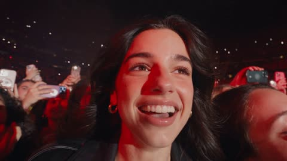</a>

The whole clip is written as raw phone footage, with selfie and rear camera flips motivated by the woman's hand movement. A timed beat sheet with per-segment camera, exposure and audio cues keeps the 30 second multishot coherent.

Seedance 2.5 · Text-to-video · Source: [@Diplomeme on X](https://x.com/Diplomeme/status/2102613869365772296) · found via [LearnPrompt/awesome-seedance](https://github.com/LearnPrompt/awesome-seedance)

[`smartphone-footage`](tags.md#tag-smartphone-footage) [`concert`](tags.md#tag-concert) [`multishot`](tags.md#tag-multishot) [`selfie-camera`](tags.md#tag-selfie-camera)

<details><summary><b>Prompt</b></summary>

```text
“FRONT ROW GIRL”
30 SECONDS | 9:16 | PHOTOREALISTIC SMARTPHONE CONCERT VIDEO | SEEDANCE 2.5 | MULTISHOT
CAMERA
The entire video is captured on a modern smartphone by a beautiful young adult woman standing directly against the front-row barricade at a massive sold-out concert featuring a fictional male singer.
It feels like authentic personal phone footage uploaded immediately after the concert.
Front-facing selfie camera mixed with quick flips to the rear camera.
Natural arm movement.
Handheld shake.
Imperfect framing.
Occasional face cropping.
Autofocus hunting.
Exposure pumping from intense stage lights.
Digital sharpening.
High-ISO noise in dark areas.
Rolling-shutter distortion during fast movement.
Accidental fingers near the lens.
No professional camera.
No cinematic gimbal.
No drone.
No polished concert-film cinematography.
CHARACTER
YOUNG WOMAN:
Beautiful adult woman in her 20s.
Long dark hair.
Natural attractive facial features.
Minimal glamorous concert makeup.
Gold hoop earrings.
Simple necklace.
Fitted black concert outfit with a stylish leather jacket.
She looks like a real concertgoer, not a professional model.
Natural skin texture.
Slight perspiration from the heat and crowd.
Her hair becomes increasingly messy as she moves and dances.
She is genuinely excited to be seeing the fictional headliner from the front row.
FICTIONAL HEADLINER:
Original male singer in his late 20s.
Dark curly hair.
Short beard.
Black layered stage outfit.
Distinctive but completely original appearance.
Handheld microphone.
Confident live-performance presence.
He performs directly toward the front-row audience.
Do not resemble any real-world singer or celebrity.
SETTING
Massive sold-out stadium concert at night.
She is standing directly against the barricade.
The stage is only a few meters away.
The fictional singer is performing directly in front of her.
Thousands of fans behind her.
Hands and smartphones constantly entering the frame.
Security personnel between the barricade and stage.
Huge LED screens.
Deep red stage lighting.
White spotlights.
Heavy atmospheric haze.
Smoke drifting through the stage lights.
The entire environment feels loud, crowded and physically overwhelming.
STORY
00:00–00:02.5 — SELFIE
Front-facing smartphone camera.
She is already in the front row, smiling directly into the camera.
Her hair moves from the crowd and stage fans.
She raises one arm and screams excitedly:
“I’M SO CLOSE!”
The stage is visible behind her.

00:02.5–00:05 — THE SINGER APPEARS
She quickly flips the camera to the rear camera.
The fictional singer walks toward the front of the stage.
Massive red lights illuminate him.
The phone struggles to expose the scene.
Her hand shakes from excitement.
Several fans’ phones appear in front of the lens.

00:05–00:07.5 — CLOSE
She digitally zooms toward the fictional singer.
He approaches the edge of the stage.
The camera briefly loses focus.
It locks back onto him.
He is only a few meters away.
The woman screams off-camera.

00:07.5–00:10 — BACK TO SELFIE
The phone flips back to her face.
She is laughing and screaming.
Her eyes are wide with excitement.
The crowd behind her is jumping.
She turns the camera slightly sideways, trying to fit herself and the stage into the same frame.

00:10–00:12.5 — THE PERFORMANCE
Rear camera again.
The fictional singer performs directly toward the front row.
He holds the microphone toward the audience.
The crowd sings along.
The phone shakes heavily as she jumps.
A raised arm briefly blocks the entire frame.

00:12.5–00:15 — EYE CONTACT
She moves the phone around the obstruction.
The fictional singer becomes visible again.
He looks directly toward the front-row section.
For a brief moment, he appears to make eye contact with her.
The phone becomes surprisingly steady.
She freezes for half a second.
Then screams.

00:15–00:17.5 — CHAOS
Front-facing camera.
She turns the camera back toward herself.
She is laughing uncontrollably.
Her hair is messy.
Red stage light illuminates one side of her face.
She shouts:
“NO WAY!”
The camera shakes violently.

00:17.5–00:20 — LIGHTS OUT
Rear camera.
The stage suddenly goes dark.
Thousands of phone flashlights appear throughout the stadium.
The camera slowly moves across the audience.
Fans are singing together.
Her breathing and laughter are audible close to the microphone.

00:20–00:22.5 — LIGHT EXPLOSION
The stage suddenly erupts in intense red and white light.
The fictional singer appears at the front of the stage.
The crowd explodes.
She raises her phone higher.
The image briefly becomes overexposed.

00:22.5–00:25 — FRONT ROW
The fictional singer walks directly along the edge of the stage.
The camera follows him.
Fans reach toward him.
Security is visible below.
Her phone struggles to focus between hands, phones and the performer.
Natural motion blur.

00:25–00:27.5 — SELFIE REACTION
The phone flips back to her.
She is completely overwhelmed, laughing and shouting while trying to catch her breath.
Her friends are visible behind her.
Everyone is screaming.
The stage remains visible over her shoulder.

00:27.5–00:30 — FINAL RECORDING
Rear camera.
The fictional singer stands beneath enormous red lights.
Thousands of phones glow behind the barricade.
The woman holds her phone as high as possible.
The frame is tilted.
Hands partially block the performer.
The crowd screams.
The phone suddenly drops slightly as she jumps.
The recording ends abruptly.
LIGHTING
Authentic live-concert lighting.
Deep red dominant lighting.
White spotlights.
Dark shadows.
LED screen illumination.
Strong backlighting.
Stage haze.
Occasional lens flare.
Bright lights causing temporary smartphone exposure clipping.
Natural skin tones whenever lighting allows.
No beauty lighting.
HUMAN PERFORMANCE
The woman must behave like a genuine excited fan.
She laughs.
She screams.
She dances.
She loses her framing.
She forgets the camera is recording.
She reacts naturally to the fictional singer.
She does not constantly pose.
She does not behave like an influencer filming an advertisement.
The surrounding crowd behaves independently.
AUDIO
RAW SMARTPHONE AUDIO.
Massive crowd screaming.
Fans singing.
The fictional singer’s amplified voice.
Heavy bass distortion.
Microphone clipping.
Nearby fans shouting.
The woman’s laughter and screaming close to the microphone.
Occasional muffled audio when the phone moves against clothing or another person.
No studio-quality vocals.
No added soundtrack.
No cinematic sound design.
VISUAL CHARACTER
Photorealistic modern smartphone footage.
Natural smartphone HDR.
High-ISO noise.
Digital sharpening.
Subtle compression artifacts.
Rolling-shutter distortion.
Autofocus hunting.
Exposure pumping.
Natural motion blur.
Occasional blown highlights.
Realistic skin texture.
Realistic hair movement.
No beauty-filter smoothing.
No plastic skin.
No perfect framing.
No professional camera look.
The footage should look indistinguishable from a real fan’s concert video.
CONTINUITY
Same woman throughout.
Same hairstyle.
Same outfit.
Same jewelry.
Same concert.
Same front-row position.
The phone remains the only recording device.
The fictional singer remains consistent.
Selfie camera and rear camera transitions must feel physically motivated by the woman flipping her phone.
The crowd becomes progressively more chaotic as the performance intensifies.
The woman’s hair and clothing become naturally more disheveled from dancing and crowd movement.
NO MUSIC VIDEO.
NO PROFESSIONAL CONCERT FILM.
NO MODEL POSES.
NO STAGED REACTIONS.
NO PERFECT CAMERA MOVEMENT.
NO AI-SLOP.
```

</details>

<a id="seedance-giant-hand-doll-dress-up-grwm"></a>
### Woman in cream pajamas with giant hands framing

<a href="https://x.com/johnAGI168/status/2087432258693001579">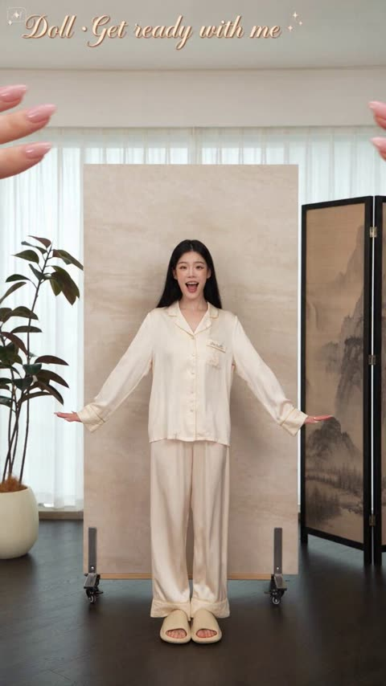</a>

Timed segments with one action each keep the 30 second dress up in order, and an image reference locks the same doll-like character through every cut. Stiff joint movement and a first person giant hand POV carry the concept without extra camera direction.

Seedance 2.5 · Reference-to-video · Source: [@johnAGI168 on X](https://x.com/johnAGI168/status/2087432258693001579)

[`doll`](tags.md#tag-doll) [`get-ready-with-me`](tags.md#tag-get-ready-with-me) [`fashion`](tags.md#tag-fashion) [`pov`](tags.md#tag-pov)

<details><summary><b>Prompt</b></summary>

```text
时长：30秒
画幅：9:16竖屏
风格：真人娃娃换装 GRWM（Get Ready With Me），暖米色调，明亮柔光室内，第一人称巨人视角

一间明亮的奶油色调客厅，白色薄纱窗帘透进柔和自然光，深色木地板，背景有一扇中式水墨图案的折叠屏风、一盆绿植、一面浅灰色墙壁。画面中央放着一个浅驼色方形展示台。

角色锁定：主角@图片1 全程保持"真人娃娃"状态——动作僵硬机械、关节转动带有顿挫感、面部表情夸张但略带塑料感，像一个被拆封的精致人偶。画面上方和两侧不时伸入一双巨大的女性手（占画面约1/3大小，指甲做了裸粉色美甲，手指戴着金色戒指和叠戴戒指），以第一人称巨人视角操作"娃娃"。

[00:00-00:04] 开箱展示：睡衣状态（Unbox the Doll）
主角穿着一套奶白色丝缎睡衣套装（宽松短袖上衣+缎面短裤），脚踩米色拖鞋，站在展示台上，双臂微微张开呈T字形，像刚从包装盒里被取出来的娃娃。巨大的双手从画面上方伸入，五指张开托住她的两侧肩膀，像在检查一个新买的人偶——左右微微转动她的身体展示。主角配合地做出机械转身，脸上带着空洞但精致的微笑。

[00:04-00:07] 脱掉睡衣（Undress Pajama Top）
巨手从上方捏住睡衣上衣的肩部，缓缓向上提起——主角配合地举起双臂呈万岁姿势，睡衣被整件从头上脱掉。露出里面穿着的一件米杏色抹胸背心。巨手把脱下的睡衣随手向画面左侧一丢。主角双臂保持举起姿势一秒，然后机械地缓缓放下。

[00:07-00:10] 穿裙子（Put on Skirt）
巨手从画面下方伸入，双手捧着一条米杏色波点薄纱中长裙。手指撑开裙腰口，从主角脚下往上套——裙子沿着双腿缓缓上移，巨手在腰部整理裙腰、拉平褶皱，随后松手。裙摆自然垂落到小腿中部，轻轻晃了一下。主角低头用机械的角度看了一眼裙子，表情从空白变成轻微惊喜的"哦！"嘴型。

[00:10-00:13] 换鞋 + 戴帽子（Boots & Hat）
巨手从画面底部伸入放下一双奶白色短筒西部靴在主角脚边，主角机械地抬脚一左一右踩进去。紧接着巨手从画面顶部垂下来，手指捏着一顶米色编织草帽的帽檐，对准主角头顶缓缓放下——帽子精准落座，微微歪了一点点角度。主角的头随着帽子落下轻轻点了一下，像被按下去一样。

[00:13-00:16] 挎包 + 全身亮相（Bag & Full Reveal）
巨手从画面右侧伸入，手指捏着一只奶白色小巧褶皱手提包的提手，递到主角右手边。主角机械地伸出右手接住，手腕僵硬地弯成固定角度提着包。她缓缓双臂微张，做出一个展示全身穿搭的"T字pose"，像橱窗里的模特。镜头从全身慢慢推近到半身。

[00:16-00:20] 化妆：刷腮红 + 涂口红（Makeup Application）
镜头推近到面部特写。巨手从画面右上方伸入，手持一把超大号粉色腮红刷（相对主角脸部几乎有半张脸那么大），在她左脸颊上轻轻刷了两下。主角配合地微微侧脸、闭上眼睛，嘴角保持塑料微笑。随后巨手换拿一支口红，另一只手的指尖轻轻托住主角下巴固定，口红在她嘴唇上缓缓涂抹。主角嘟起嘴唇配合，涂完后"啵"一声抿嘴，嘴唇变成柔和的豆沙粉色。

[00:20-00:24] 戴配饰：项链 + 戒指（Accessories）
巨手从画面两侧同时伸入，双手捧着一组金色项链和棕色蕾丝choker。两只手在主角脖子后方扣上choker，再一层层挂上金色长链和短链。主角机械地仰头露出脖颈配合，戴好后低头看——表情从空白切换成夸张的惊喜圆嘴"哇！"，双手机械地举到脸颊两侧做出"好美"的娃娃式反应。紧接着巨手抓起主角的右手，逐个手指套上金色戒指和叠戴戒指，再在手腕扣上一圈叠戴金手镯。主角把戴满配饰的双手举到脸旁展示，十指僵硬地张开。

[00:24-00:27] 全身展示走秀（Full Look Reveal）
镜头拉回全身。主角穿着完整搭配——草帽、抹胸上衣、波点薄纱中长裙、西部短靴、手提包、全套金色配饰——在展示台上做娃娃式定格走秀：先面向镜头站定一秒，然后机械地向右转90度定格一秒，再转回正面，每次转身关节都带有顿挫停顿感。裙摆随转身轻轻飘起。

[00:27-00:30] 收尾：巨手互动（Final Touch）
巨手从画面左上方伸下来，伸出一根食指轻轻勾住主角举起的右手食指——像巨人和娃娃牵手。主角抬头仰望巨手方向（看向画面左上角），脸上露出精致的塑料微笑，微微歪头。画面定格在这个"巨人与娃娃"的互动瞬间。
```

</details>

<a id="seedance-grwm-bedroom-routine-red-reveal"></a>
### Woman films a bedroom get ready routine

<a href="https://x.com/CaliraVal/status/2105534258932781142">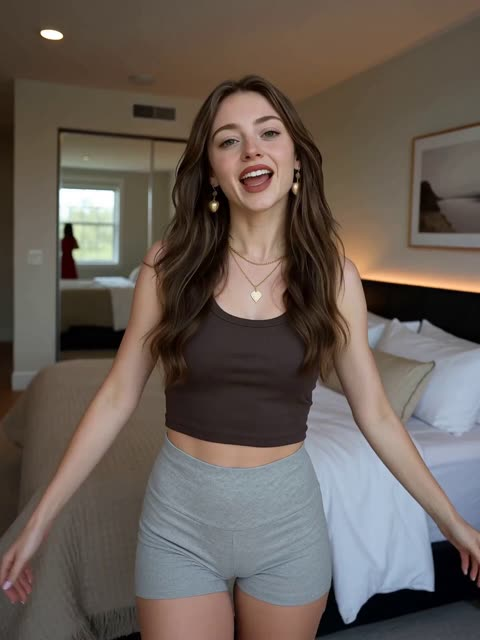</a>

A reference image locks the character identity, and the same consistency rule is repeated for every shot. A numbered shot list with a casual opening look and a red outfit reveal gives the model a clear sequence to follow.

Seedance 2.5 · Reference-to-video · Source: [@CaliraVal on X](https://x.com/CaliraVal/status/2105534258932781142) · found via [LearnPrompt/awesome-seedance](https://github.com/LearnPrompt/awesome-seedance)

[`get-ready-with-me`](tags.md#tag-get-ready-with-me) [`beauty`](tags.md#tag-beauty) [`consistent-character`](tags.md#tag-consistent-character) [`vlog-style`](tags.md#tag-vlog-style)

<details><summary><b>Prompt</b></summary>

```text
A young woman matching the exact facial features, hairstyle, and identity of the reference image (consistent character throughout all shots) is filming a "Get Ready With Me" style video in a softly lit, modern bedroom with a vanity mirror and warm ambient lighting.

Opening scene (casual look):

She is wearing comfortable knee-length fitted shorts (extending just over the knees) and a simple sleeveless crop top. Natural look, no makeup. She smiles at the camera and casually greets, creating a relaxed, vlog-style tone.

Sequence of shots (fast-paced, smooth cuts, ~10–15 shots total):

Close-up of her tying her hair into a loose bun

Applying face wash at the sink, soft water splashes, natural lighting

Gently patting her face dry with a towel

Skincare routine (serum, moisturizer) in front of mirror

Sitting at vanity applying makeup step-by-step (foundation, eyeliner, lipstick)

She occasionally looks into the camera and subtly explains each step (natural lip movement, expressive gestures)

Insert aesthetic close-ups: makeup brushes, mirror reflections, soft bokeh lighting

Tone & style:

Cinematic but vlog-inspired, smooth camera motion, shallow depth of field, soft highlights, natural skin texture, realistic lighting. Maintain facial consistency across all shots.

Transition:

Quick montage with rhythmic cuts as she completes her look.

Final reveal scene:

She steps back into frame fully dressed in an attractive yet modest red outfit (elegant, tasteful, non-revealing, flattering silhouette). Hair styled neatly, confident posture.

She does a subtle twirl or pose, smiles warmly at the camera, and gives a final confident look.

Ending shot:

Soft close-up with warm lighting, slight camera push-in, she looks directly into the lens with a satisfied expression.

Technical tags:

1080p, cinematic lighting, consistent character identity, smooth transitions, natural motion, realistic skin tones, high detail, depth of field, vlog + cinematic hybrid style.
```

</details>

<a id="seedance-gym-day-selfie-vlog-60-seconds"></a>
### Sixty second selfie vlog of a gym day

<a href="https://x.com/ZaraIrahh/status/2089569072526823464"></a>

The prompt splits sixty seconds into timed scenes, each with its own action, spoken line and diegetic sound. A fixed selfie viewpoint, authentic phone imperfections and a ban on music and captions keep the footage realistic and the face consistent.

Seedance 2.5 · Text-to-video · Source: [@ZaraIrahh on X](https://x.com/ZaraIrahh/status/2089569072526823464) · found via [LearnPrompt/awesome-seedance](https://github.com/LearnPrompt/awesome-seedance)

[`vlog`](tags.md#tag-vlog) [`selfie`](tags.md#tag-selfie) [`day-in-the-life`](tags.md#tag-day-in-the-life) [`timed-scenes`](tags.md#tag-timed-scenes) [`diegetic-sound`](tags.md#tag-diegetic-sound)

<details><summary><b>Prompt</b></summary>

```text
Create a 60-second realistic day-in-the-life gym vlog following the same young Korean woman in her early twenties from waking up at home, getting ready, going to the gym, working out, and returning home.

Overall visual style

One continuous handheld front-facing smartphone selfie vlog perspective. She always films herself with the phone in her own hand at arm’s length. No third-person camera, tripod, cinematic camera movements, drones, or external filming.

Make everything look like authentic modern smartphone footage:

- Natural handheld shake and small framing imperfections
- Realistic walking movement and occasional autofocus hunting
- Minor exposure changes
- Natural front-camera lens distortion
- Soft natural morning light indoors and outdoors
- Realistic, unfiltered smartphone colors
- No beauty filter, skin smoothing, or cinematic color grading
- Same face and hair throughout the entire vlog
- Natural expressions, movements, and body language
- No subtitles, captions, logos, watermarks, or on-screen text
- No background music; use only natural diegetic sound

0–10 sec — Waking up

She wakes up in her cozy bedroom wearing a cute, loose casual night suit. She grabs her phone from beside the bed and immediately starts filming herself selfie-style. She looks sleepy, messy-haired, and slightly tired, gives a small yawn, stretches, and smiles at the camera.

She quietly says:

“Good morning… I really don’t feel like going to the gym today.”

She gets out of bed and walks toward the bathroom while holding the phone herself.

10–18 sec — Brushing teeth

In the bathroom, she films herself in the mirror/selfie view while brushing her teeth. Keep it casual and imperfect, with realistic bathroom ambience and running-water sounds.

She briefly looks into the camera with a sleepy expression, then rinses her mouth and smiles.

She says:

“But I promised myself I’d go, so… let’s do it.”

18–27 sec — Getting ready

Quick natural transition back to her bedroom. She changes from her night suit into a stylish but realistic gym outfit: fitted athletic top, high-waisted leggings or comfortable athletic bottoms, clean sneakers, and minimal accessories.

Show short selfie moments of her fixing her hair, adjusting her gym outfit, grabbing a water bottle and gym bag.

She looks into the phone and says:

“Okay, now I actually look ready.”

27–35 sec — Going to the gym

She leaves home with the phone in her hand. Film brief selfie moments while walking outside and naturally bouncing with her steps. Show quick glimpses of the street, morning traffic, buildings, and her gym bag.

She arrives at the gym and turns the phone slightly to show the entrance before bringing it back to her face.

Natural street and gym ambience only.

35–52 sec — Workout

Inside the gym, she starts with a short warm-up on a treadmill, then moves through a few exercises such as light strength training, squats, dumbbell exercises, and stretching.

Keep the camera mostly front-facing and handheld, occasionally tilting naturally toward the equipment before returning to her face.

She becomes slightly sweaty and out of breath but stays cheerful. She laughs and says:

“Okay… this is harder than I remembered.”

She takes a quick drink of water, catches her breath, then gives the camera a satisfied smile and continues her workout.

Include realistic sounds of footsteps, treadmill movement, weights clanking, machines, distant conversations, and gym room tone.

52–60 sec — Returning home

After finishing her workout, she leaves the gym and walks home. She looks pleasantly exhausted but happy.

Cut naturally to her back at home, still holding the phone. She drops her gym bag down, takes a drink of water, relaxes on the couch or bed, and looks into the camera with a tired smile.

She gives a small wave and says:

“Workout done. I’m exhausted… but I’m glad I went.”

She smiles, gives one final sleepy wave, and lowers the phone for a natural ending.

Final requirements

Keep the entire vlog fast, spontaneous, cozy, and realistic, with natural transitions between locations. The woman must remain visually consistent throughout: same facial identity, same hair, and realistic appearance. Her outfit changes only once, from the casual night suit to the gym outfit.

All dialogue must be naturally spoken with visible lip movement. Use only diegetic audio—bedroom ambience, bathroom sounds, footsteps, street noise, gym sounds, water bottle sounds, and home ambience. No music, captions, subtitles, logos, watermarks, or cinematic effects.
#Flovaai #Flovacpp
```

</details>

<a id="seedance-gym-day-selfie-vlog"></a>
### Casual gym selfie vlog with spoken lines

<a href="https://x.com/ZaraIrahh/status/2089195912119943367"></a>

Locks one handheld front camera point of view and lists real phone flaws such as shake, autofocus hunting and exposure shifts, so the result avoids a cinematic look. The scene runs in timed beats with quoted dialogue lines, and the audio is limited to diegetic gym ambience with no music.

Seedance 2.5 · Text-to-video · Source: [@ZaraIrahh on X](https://x.com/ZaraIrahh/status/2089195912119943367) · found via [LearnPrompt/awesome-seedance](https://github.com/LearnPrompt/awesome-seedance)

[`vlog`](tags.md#tag-vlog) [`selfie`](tags.md#tag-selfie) [`gym`](tags.md#tag-gym) [`dialogue`](tags.md#tag-dialogue) [`handheld`](tags.md#tag-handheld)

<details><summary><b>Prompt</b></summary>

```text
Create a 30-second casual gym vlog featuring the same young woman in her early twenties. She has natural everyday beauty, and her face and hair remain identical throughout the entire video.

Camera & visual style

One continuous handheld front-facing smartphone selfie vlog, always filmed from her own point of view with the phone held in her own hand at arm’s length. No third-person camera, external camera, tripod, cinematic camera movement, or professional filming.

Make it look like a real modern smartphone recording:

- Mild handheld shake and natural walking bounce
- Occasional autofocus hunting
- Small exposure shifts and minor framing imperfections
- Natural front-camera lens distortion
- Soft warm natural daylight transitioning toward early evening
- Natural, uncorrected smartphone color
- No color grading, beauty filter, or skin smoothing
- Same woman, same face and hair throughout
- She holds the phone herself in every shot
- No subtitles, captions, logos, watermarks, or on-screen text
- No brand or character names
- Never show a reference sheet or duplicate subject

Outfit

She is wearing a cute, trendy, realistic gym outfit appropriate for a casual workout vlog: fitted athletic top, comfortable high-waisted leggings or shorts, clean sneakers, and minimal accessories. The styling should feel fashionable but natural and practical for the gym.

Scene

She is spending a casual day at the gym and filming herself throughout her workout.

She enters the gym while holding her phone at arm’s length, smiling into the front camera. She briefly sweeps the phone toward the workout area, showing treadmills, weights, machines, and other gym-goers in the background, then brings it back to her face. She grins and says upbeat:

“Okay, gym day! Let’s get this workout started!”

She walks toward the workout area, naturally bouncing the phone with her steps. She glances at the equipment, smiles at the camera, and starts a light warm-up. Keep the movements natural and unscripted, with brief moments of her adjusting her hair, checking her form, and laughing at herself.

She moves into a short workout sequence while still filming herself handheld: a few casual gym exercises, light cardio, and a quick strength-training moment. Keep the camera mostly selfie-facing, occasionally tilting naturally toward the equipment before returning to her face. She looks slightly out of breath but happy and says with a playful laugh:

“Why did I think this was gonna be easy?”

She takes a quick water break, holding her bottle near the selfie camera before taking a sip. She smiles and catches her breath while natural gym ambience continues around her.

Later, after finishing the workout, she walks toward the gym exit with the phone still in her hand. Her hair is slightly messier and she looks pleasantly tired. She gives the camera a satisfied smile, lightly wipes her forehead, and says:

“Okay… I’m actually proud of myself.”

She gives a small tired laugh, waves at the camera, and lowers the phone slightly for a relaxed ending.

Audio

Diegetic sound only, no background music. Include realistic gym ambience: treadmill hum, weights clanking, machine sounds, footsteps, distant conversations, subtle ventilation, water bottle sounds, and natural room tone. Every spoken line should be delivered frontally with clearly visible lip movement and natural timing.

Keep the entire sequence fast, casual, spontaneous, and realistic, with natural transitions and enough brief visual moments to fill approximately 30 seconds without making the dialogue feel rushed. The final result should feel like an authentic personal gym vlog recorded casually on a modern smartphone.
```

</details>

<a id="seedance-gym-locker-room-mirror-routine"></a>
### Gym locker room mirror check before workout

<a href="https://x.com/QAiStudio/status/2093565477192917480">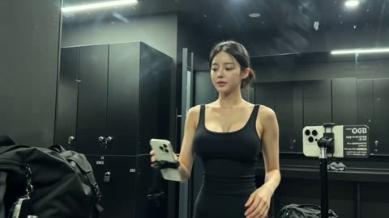</a>

A timed beat sheet with short segments and a fixed propped phone angle makes the clip read as ordinary handheld footage. Naming the old iPhone 1x look, noise and compression, plus a no beauty filter clause, keeps skin texture natural, while Image1 is used only to lock face and hair identity.

Seedance 2.5 · Reference-to-video · Source: [@QAiStudio on X](https://x.com/QAiStudio/status/2093565477192917480) · found via [LearnPrompt/awesome-seedance](https://github.com/LearnPrompt/awesome-seedance)

[`timestamped-timeline`](tags.md#tag-timestamped-timeline) [`handheld-realism`](tags.md#tag-handheld-realism) [`reference-identity`](tags.md#tag-reference-identity) [`gym`](tags.md#tag-gym)

<details><summary><b>Prompt</b></summary>

```text
Subject: Person from Image1. Face and hairstyle must match Image1 completely; do not transform into a different person. Ignore Image1’s outfit, background, pose, and bottom text. Casual black gym outfit: fitted tank + leggings/shorts, hair tied back. Keep facial features sharp even with low image quality. 16:9 horizontal.

Setting: Gym locker room with full-length mirror, lockers, and gym bag on bench. No legible text, signage, locker numbers, or branding.

Timeline:

- 0–4s: Walks to mirror, props phone against locker/bag, checks reflection, adjusts tank straps.
- 4–8s: Sits, ties and double-knots shoelaces, stands and lightly bounces to test shoes.
- 8–11s: Takes earbuds from bag, inserts and adjusts them.
- 11–14s: Faces mirror, rolls shoulders, nods at reflection and quietly says, “okay... let’s get it.”
- 14–17s: Arm swings/stretching, briefly glances at camera.
- 17–19s: Picks up phone, turns toward door and walks off confidently; freeze mid-stride.

Camera/Style: Old iPhone everyday-video look, standard 1x lens, static/propped angle, loose 1–1.5s cuts. Harsh fluorescent locker-room lighting, slightly cool/green tint, faint mirror glare. Heavy noise and compression artifacts throughout. Natural skin texture, pores, flyaways, and oil sheen. No grading, cinematic/film look, beauty filter, CG texture, fisheye, 0.5x, barrel distortion, vignette, or lens edges. No scene skipping or consolidated cuts.

Sound: No BGM. Locker-room echo, distant locker clanks, shoelace tightening, earbud-case click, faint gym noise outside, and close/muffled natural voice.
```

</details>

<a id="seedance-gym-morning-dv-camcorder-vlog"></a>
### Morning Gym Workout on Early 2000s Camcorder

<a href="https://x.com/sipteaandcoffee/status/2104887547243774358"></a>

Reads as a friend filming on a consumer DV camcorder, with timecoded beats, a character reference image, and spoken lines in each beat. The off-camera friend reacting to the camera zoom and the lens cover adds spontaneity, and the outfit is locked so it stays consistent.

Seedance 2.5 · Reference-to-video · Source: [@sipteaandcoffee on X](https://x.com/sipteaandcoffee/status/2104887547243774358) · found via [LearnPrompt/awesome-seedance](https://github.com/LearnPrompt/awesome-seedance)

[`dv-camcorder`](tags.md#tag-dv-camcorder) [`vlog`](tags.md#tag-vlog) [`timecoded`](tags.md#tag-timecoded) [`dialogue`](tags.md#tag-dialogue) [`character-reference`](tags.md#tag-character-reference)

<details><summary><b>Prompt</b></summary>

```text
Create a **45-second ultra-realistic personal home-video** of a young Korean woman going to a small neighborhood gym for a casual morning workout. Use the **attached image as the absolute character reference** and keep her face, facial features, hairstyle, body proportions and overall appearance consistent throughout.

The video should feel like a friend casually followed her to the gym with an **early-2000s consumer DV camcorder**. It should feel spontaneous, slightly awkward, playful and real — **not like a fitness advertisement or influencer workout video**.

Camera Settings: shot on 35mm film, anamorphic 2x squeeze, 2.39:1, oval bokeh, heavy grain,
halation on the bulbs. Focal length: 35mm. Aperture: f/2.0.
 
### CHARACTER & OUTFIT

She begins with her **long blonde hair worn loose**.

For the walk to the gym, she wears a casual oversized zip-up hoodie over her workout clothes and carries a small dark gym bag.

Inside the gym, she removes the hoodie and ties her hair into a **slightly messy high ponytail**.

Her workout outfit is:

- muted sage-green fitted short-sleeve athletic top
- loose black athletic track pants with a comfortable straight-leg fit
- gray-and-white training sneakers
- simple black fitness watch
- no jewelry
- minimal natural makeup

Keep this exact workout outfit consistent throughout the gym sequence.

She carries:

- dark gym bag
- translucent reusable water bottle
- small light-gray workout towel

### 00:00–00:06 — WALKING TO THE GYM

Open outside her home in soft morning daylight.

She steps through the door carrying her gym bag and starts walking through a quiet residential neighborhood.

The friend filming walks slightly behind her.

The camera shakes naturally with every step.

She turns around while walking backward for a moment and smiles at the camera.

**WOMAN, laughing:**
“Why are you filming already?”

The person behind the camera quietly laughs.

She shakes her head, turns around and keeps walking.

Cut to her approaching a modest neighborhood gym.

Before entering, she puts her bag down for a second and ties her long black hair into a messy high ponytail.

She looks at the camera.

**WOMAN:**
“Okay. Now I’m ready.”

She immediately laughs at herself.

### 00:06–00:12 — WARM-UP

Inside the gym, she removes her hoodie, revealing the **sage-green athletic top and loose black workout pants**.

She places her gym bag beside a bench, sets down her water bottle and towel and begins warming up.

Instead of ordinary stretching, show:

- shoulder rotations
- arm swings
- standing torso twists
- alternating knee raises

The camera awkwardly zooms toward her face.

She notices.

**WOMAN:**
“Don’t zoom in!”

She laughs and briefly covers the lens with her hand.

The camera pulls back.

### 00:12–00:20 — KETTLEBELL & STEP-UPS

She picks up a **light kettlebell** and performs slow, controlled kettlebell deadlifts.

Show realistic posture, grip, weight and breathing.

Cut to her performing **alternating step-ups onto a low padded exercise box**.

Her ponytail bounces naturally.

After several repetitions, she stops with her hands on her hips and exhales.

**WOMAN:**
“Why is this harder than it looks?”

She smiles breathlessly.

Small beads of sweat are beginning to appear around her forehead and hairline.

### 00:20–00:27 — RESISTANCE BAND

She places a resistance band around her thighs and performs **controlled lateral band walks** across the gym floor.

The friend filming follows her sideways.

She looks toward the camera while continuing.

**WOMAN:**
“My legs are already complaining.”

She laughs, loses her rhythm for a second, then continues.
```

</details>

<a id="seedance-gym-vlog-leg-day-dv-camcorder"></a>
### Gym vlog of idol shaking after leg day

<a href="https://x.com/QAiStudio/status/2102992059938587000"></a>

The prompt is split into CAMERA, LOOK, STYLE and a timed storyboard with inline dialogue. Framing the camera as the character's own POV, with deliberate shake, late focus pulls and cut-off faces, sells the homemade DV look, and banning the camcorder from the frame keeps the illusion intact.

Seedance 2.5 · Text-to-video · Source: [@QAiStudio on X](https://x.com/QAiStudio/status/2102992059938587000) · found via [LearnPrompt/awesome-seedance](https://github.com/LearnPrompt/awesome-seedance)

[`dv-tape-look`](tags.md#tag-dv-tape-look) [`handheld-pov`](tags.md#tag-handheld-pov) [`gym-vlog`](tags.md#tag-gym-vlog) [`dialogue-storyboard`](tags.md#tag-dialogue-storyboard)

<details><summary><b>Prompt</b></summary>

```text
**CAMERA:**
DV 16mm tape camcorder handheld feel. POV of CHASE holding the camera herself, occasionally propping it on a rack or bench. Hand shake, misaligned framing, delayed focus pulls, clumsy zooms, occasional face cut-off framing, imperfect shots. Camcorder never appears on screen.

**LOOK:**
Soft, slightly blurry tape quality, faint tape noise, bloomed highlights under gym lighting, flickering auto-exposure, muted contrast, realistic skin tones.

**STYLE:**
Playful, self-deprecating gym-vlog tone — exaggerated complaining, genuine laughs, exhausted-but-amused energy. Quick handheld cuts, slightly wobbly camera movement matching her shaky legs.

**Character**

CHASE — Korean idol in her 20s. Long black hair in a high ponytail, glowing skin with a heavy post-workout sheen, big expressive eyes. Slim athletic build. Modest long-sleeve athletic top, loose joggers/leggings (arms and torso fully covered), sneakers, towel around neck, no jewelry.

**Setting**

A gym in the evening — squat rack, leg press machine, a water fountain across the room, mirror wall, soft overhead lighting.

**Storyboard**

1. *(~2s, propped camera at squat rack, medium shot)* She stands, hands on hips, catching her breath, dramatic exhale. CHASE: "Okay... leg day is not it today."

2. *(~2s, handheld, close on her face)* She winces, shaking out one leg, laughing at herself. CHASE: "Why did I do that many reps—"

3. *(~2s, medium propped shot, leg press machine)* She sits down, pushes through a rep, face straining, then flops back with a groan. CHASE: "Okay that's it, I'm done, I'm so done."

4. *(~1.5s, macro insert, shallow DOF)* Close-up on her hand gripping the machine handle, knuckles slightly tense. No dialogue — ambient gym sound only.

5. *(~2s, handheld, walking, camera wobbling)* She stands up and immediately wobbles, grabbing the rack for balance, bursting into laughter. CHASE: "Wait— okay my legs are literally shaking—"

6. *(~2s, handheld, unsteady walk)* She takes exaggerated, wobbly steps toward the water fountain, camera bouncing with her uneven gait. CHASE (laughing): "This is so embarrassing, someone help me—"

7. *(~1.5s, close handheld, at the fountain)* She leans down for a sip of water, sighs in relief, wipes her mouth with the back of her hand. CHASE: "Okay... water is life right now."

8. *(~2s, arm's-length selfie finish)* She leans against the wall, still catching her breath, grinning tiredly at the lens. CHASE: "Never doing legs again — see you guys, I'm going to go lie down somewhere."
```

</details>

<a id="seedance-hammock-motorcycle-wash-dv-home-video"></a>
### Hammock Nap and Motorcycle Wash in Early 2000s DV

<a href="https://x.com/doctorwasif/status/2099836703729172540"></a>

A reference image locks identity and outfit, while a nine beat timeline in three to four second slices sets each action. Style is pushed toward raw consumer DV with a ban list (no stabilization, no glamour) and an ambience only audio line.

Seedance 2.5 · Reference-to-video · Source: [@doctorwasif on X](https://x.com/doctorwasif/status/2099836703729172540) · found via [LearnPrompt/awesome-seedance](https://github.com/LearnPrompt/awesome-seedance)

[`dv-home-video`](tags.md#tag-dv-home-video) [`timeline`](tags.md#tag-timeline) [`handheld`](tags.md#tag-handheld) [`lo-fi`](tags.md#tag-lo-fi) [`ambient-audio`](tags.md#tag-ambient-audio)

<details><summary><b>Prompt</b></summary>

```text
Subject: “<<<image_1>>>” — preserve exact identity, face, skin tone, body proportions, hair, and outfit. Southeast Asian appearance with subtle Korean styling: olive-green faded sleeveless crop top, loose high-waist light-blue jeans, black canvas sneakers, black cord necklace, black wavy hair, side-swept bangs, messy ponytail.

Setting: Quiet early-2000s Southeast Asian residential neighborhood—concrete alley, simple homes, terraces, trees, plants, parked motorcycles, tangled overhead cables. No shops.

Style: Raw early-2000s consumer DV/home-video footage. Heavy handheld shake, imperfect framing, autofocus hunting, lens breathing, exposure shifts, rolling shutter, natural motion blur, faded low-contrast colors, washed highlights, digital noise/compression. No stabilization, beauty filters, cinematic grading, glamour, or posing.

Timeline:

- 00–03: Relaxing in a hammock between trees, dappled sunlight.
- 03–07: Uses an old Nokia phone, presses keypad, subtle smile; focus hunts.
- 07–10: Lazily stretches in hammock, phone on stomach, looks at canopy.
- 10–13: Gets up, pockets phone, walks across yard.
- 13–16: Crouches beside motorcycle, picks up soapy water and rag.
- 16–20: Slowly cleans helmet; water drips onto concrete.
- 20–24: Cleans motorcycle seat, briefly smiles at camera.
- 24–27: Rinses and wrings rag over bucket.
- 27–30: Wipes hands on jeans, looks at camera and softly smiles; abrupt cut to black.

Audio: Natural ambience only—birds, breeze, distant motorcycles, chatter, hammock creaks, Nokia keypad clicks, leaves, water, and rag sounds. No music or cinematic effects.

Format: 16:9.
```

</details>

<a id="seedance-hawaii-crochet-vlog-montage"></a>
### Woman in crochet top walks tropical Hawaii street

<a href="https://x.com/ZaraIrahh/status/2097191553991328162"></a>

A timed breakdown of each scene, with the same wardrobe and hair repeated in every beat, keeps the subject consistent across cuts. The reference image anchors appearance, each beat names its camera move, and a negative prompt blocks plastic skin and distorted faces.

Seedance 2.5 · Reference-to-video · Source: [@ZaraIrahh on X](https://x.com/ZaraIrahh/status/2097191553991328162) · found via [LearnPrompt/awesome-seedance](https://github.com/LearnPrompt/awesome-seedance)

[`travel-vlog`](tags.md#tag-travel-vlog) [`character-consistency`](tags.md#tag-character-consistency) [`hawaii`](tags.md#tag-hawaii) [`fashion`](tags.md#tag-fashion)

<details><summary><b>Prompt</b></summary>

```text
Create a photorealistic 30-second cinematic tropical travel vlog montage set in Hawaii, featuring the SAME beautiful 20-year-old adult East Asian-American woman throughout the entire video. Use the uploaded reference image as the primary visual reference for her overall appearance, hairstyle, styling, outfit, and proportions. Preserve strong character consistency from beginning to end: same face, dark hair, natural skin texture, facial proportions, body proportions, hairstyle, and recognizable appearance. Do not change her identity or appearance between scenes.

CHARACTER & STYLE:
A beautiful 20-year-old adult woman with a youthful but clearly adult appearance, dark black-brown hair, natural makeup, soft expressive features, relaxed confident personality, and an effortless American vacation aesthetic. She has a fashionable, feminine, slightly bold tropical-resort style. Her expressions should feel candid and natural rather than posed.

WARDROBE — KEEP CONSISTENT:
 She wears a cream/beige open-knit crochet off-the-shoulder beach top, loosely draped over a simple white fitted camisole/bikini-style top, paired with high-waisted white distressed denim shorts. The crochet top is airy, oversized, and slightly sheer as naturally created by open-knit fabric, with tasteful resort styling. She wears minimal delicate accessories.

HAIRSTYLE:
Dark hair gathered into a low, slightly messy bun, with loose strands naturally framing her face. Two small tropical flowers, one white and one pink, are tucked into the bun. Keep the hairstyle and flower placement consistent throughout the daytime scenes. Natural wind movement in her hair.

IMPORTANT CONSISTENCY:
The woman must remain the exact same person in every shot. Maintain identical facial features, skin tone, hairstyle, flower placement, body proportions, and overall appearance. Keep the same cream crochet top, white underlayer, and white denim shorts throughout the daytime scenes. Do not randomly change her clothing, hairstyle, age, face, or body shape. Natural realistic anatomy and realistic hands.

VIDEO FORMAT:
4K photorealistic cinematic video, 24fps, 30 seconds, 35mm film aesthetic, subtle authentic film grain, realistic handheld travel-vlog cinematography, natural autofocus adjustments, shallow depth of field, realistic motion blur, soft highlights, natural skin texture, warm vintage color grading, atmospheric lighting, cinematic composition, documentary-style realism.

OVERALL VISUAL MOOD:
Dreamy luxury Hawaii summer vacation, warm tropical atmosphere, authentic travel diary, feminine and fashionable, relaxed confidence, natural candid moments, beautiful ocean scenery, golden sunlight, nostalgic 35mm film look. Avoid looking like a commercial with overly perfect poses; make it feel like an expensive but authentic personal travel vlog.

SCENE 1 — HAWAII ARRIVAL & TROPICAL CITY WALK — 0–4 SECONDS:
Beautiful Hawaiian morning. The woman walks casually through a bright tropical street wearing the exact reference outfit: cream crochet off-the-shoulder top, white fitted underlayer, high-waisted white distressed denim shorts, and tropical flowers in her low bun. Palm trees, tropical plants, colorful architecture, small cafes, and casually walking people in the background. Camera begins behind her at waist level, following naturally as she walks, then smoothly moves around to a three-quarter front angle. She turns slightly toward the camera and gives a genuine relaxed smile. Warm sunlight catches the edges of her hair. Natural breeze moves the crochet fabric and loose hair strands.

SCENE 2 — BEACH DISCOVERY — 4–8 SECONDS:
She arrives at a wide beautiful Hawaiian beach. She walks barefoot along the shoreline in the same outfit, carrying her sandals casually in one hand. Crystal-blue ocean waves gently reach her feet. Capture cinematic low-angle shots of her bare feet stepping through wet sand, water reflections, and small waves. Cut to a medium-wide shot of her walking toward the ocean with distant volcanic mountains behind her. She looks happy and relaxed, enjoying the moment. Realistic ocean movement, natural sunlight, subtle lens flare.

SCENE 3 — PALM TREES & OCEAN CLIFF — 8–12 SECONDS:
Start with a cinematic worm's-eye view looking upward through tall tropical palm trees. Golden sunlight streams through the leaves with subtle natural lens flares. Smooth transition to the woman standing near a safe rocky ocean viewpoint, still wearing the exact same reference outfit and flower-decorated bun. Wind gently moves her hair and crochet top. She looks toward the Pacific Ocean with a peaceful expression. Camera slowly pushes in from behind her shoulder into a cinematic side profile.

SCENE 4 — BEACHFRONT CAFE — 12–16 SECONDS:
She sits at a cozy stylish beachfront cafe beside a large open window. Same outfit and hairstyle. A fresh tropical drink sits on the table beside her sunglasses and small personal accessories. She casually takes a sip while looking outside at the ocean. Capture intimate cinematic close-ups of her hand holding the drink, condensation on the glass, tropical fruit, sunlight across the table, ocean waves outside, and her relaxed thoughtful expression. Warm sunlight creates soft highlights on her face. Authentic candid travel-diary feeling.

SCENE 5 — OCEAN ADVENTURE — 16–20 SECONDS:
She is now enjoying calm turquoise Hawaiian water on a small surfboard, wearing the same tasteful white underlayer with the cream crochet top removed for practical water activity while keeping the same overall styling and character appearance. Keep the white high-waisted shorts only if physically realistic for the water activity; otherwise use tasteful coordinated white resort swimwear. Do NOT alter her face, hairstyle, or body proportions. Camera moves at water level around her as gentle waves pass by. Sunlight sparkles across the turquoise ocean. Tropical coastline and mountains appear in the background. She laughs naturally toward the camera, creating an authentic vacation moment.

SCENE 6 — HAWAIIAN NIGHT MARKET — 20–24 SECONDS:
Transition into a vibrant Hawaiian night market filled with warm hanging lights, tropical decorations, food stalls, lanterns, colorful signs, and natural crowds. For this evening scene, she changes into a simple elegant white resort dress while maintaining the exact same face, hairstyle, and recognizable appearance. She walks through the market, samples tropical fruit and local street food, and reacts with a genuine delighted smile. Cinematic close-ups of tropical fruit, food preparation, glowing lanterns, her expression, and colorful nighttime bokeh. Realistic handheld camera movement.

SCENE 7 — GOLDEN SUNSET — 24–27 SECONDS:
Wide cinematic shot of the SAME woman standing barefoot at the ocean shoreline during golden sunset. She wears a flowing lightweight white resort dress. Orange, pink, and golden colors fill the sky and reflect across the water. Gentle waves move around her feet. She stands peacefully looking toward the horizon. Camera slowly pulls backward, creating an emotional cinematic travel-film ending. Natural wind moves the dress and her hair.

SCENE 8 — HOTEL NIGHT REFLECTION — 27–30 SECONDS:
Nighttime luxury high-rise hotel room and balcony overlooking sparkling Hawaiian city lights. The same woman wears an elegant simple white resort outfit. Warm interior lighting contrasts with the cool tropical night outside. She stands on the balcony while sheer curtains move gently in the warm breeze. Cut to a final intimate close-up of her relaxing on the hotel bed, looking warmly into the camera with a peaceful, confident smile. End with a subtle cinematic focus pull from her eyes to the sparkling city lights beyond the balcony.

CAMERA:
Authentic handheld travel-vlog cinematography, subtle natural camera shake, smooth gimbal-like movement when appropriate, slow push-ins, gentle tracking shots, occasional POV shots, realistic autofocus breathing, natural rack focus, shallow depth of field, cinematic close-ups, wide establishing shots, low-angle beach shots, water-level camera movement, subtle motion blur, realistic lens characteristics.

LIGHTING:
Natural Hawaiian sunlight, soft morning light, warm golden-hour sunlight, realistic tropical reflections, subtle lens flares, atmospheric evening lighting, warm cafe lighting, realistic nighttime bokeh. No artificial-looking studio lighting.

COLOR & TEXTURE:
Warm nostalgic 35mm film color grading, soft tropical highlights, realistic skin tones, subtle film grain, natural contrast, gentle vintage character, cinematic depth of field, realistic fabric texture, realistic ocean reflections, detailed tropical vegetation.

REALISM:
Photorealistic live-action appearance. Realistic human anatomy, realistic hands and fingers, realistic hair strands, realistic fabric physics, realistic water physics, natural walking and body movement, believable facial expressions, natural blinking and breathing. Make the footage feel like it was captured by a professional travel filmmaker on a real Hawaiian vacation.

NEGATIVE PROMPT:
No cartoon, no animation, no CGI appearance, no plastic skin, no artificial beauty filter, no overly airbrushed skin, no distorted face, no changing identity, no inconsistent facial features, no changing ethnicity, no changing age, no body distortion, no exaggerated body proportions, no unnatural anatomy, no extra fingers, no missing fingers, no malformed hands, no duplicate person, no duplicate limbs, no warped clothing, no floating objects, no unnatural hair, no hairstyle changes without the specified outfit transition, no flickering face, no facial morphing, no blurry face, no unnatural expressions, no stiff movements, no robotic motion, no oversaturated colors, no excessive lens flare, no unrealistic lighting, no fake-looking ocean, no text, no watermark, no logo.

FINAL PRIORITY:
Character consistency and photorealism are the highest priorities. The uploaded reference image should strongly guide the woman's appearance and daytime outfit. Preserve her recognizable appearance across every scene while creating a seamless, dreamy, authentic Hawaii luxury travel vlog.
```

</details>

<a id="seedance-hawaii-travel-vlog-montage"></a>
### Woman in floral dress walks a Hawaii street

<a href="https://x.com/im_shahid7/status/2086677274217381905">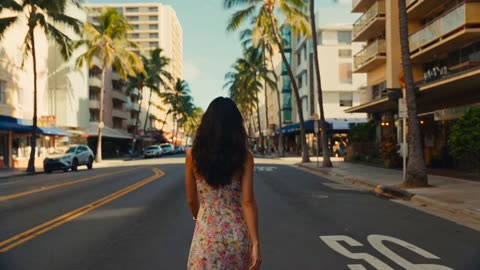</a>

A timed four-scene structure (0 to 4s, 4 to 8s and so on) sits on a shared style block and a repeated identity lock (same face, hair and body), which keeps the woman consistent across cuts. The opening follows her from behind, a standard vlog device that sets up the later turn toward the camera.

Seedance 2.5 · Text-to-video · Source: [@im_shahid7 on X](https://x.com/im_shahid7/status/2086677274217381905)

[`hawaii`](tags.md#tag-hawaii) [`travel-vlog`](tags.md#tag-travel-vlog) [`character-consistency`](tags.md#tag-character-consistency) [`golden-hour`](tags.md#tag-golden-hour) [`film-look`](tags.md#tag-film-look)

<details><summary><b>Prompt</b></summary>

```text
15-Second Cinematic Hawaii Travel Vlog
A cinematic 15-second tropical travel vlog montage featuring the same beautiful 20-year-old East Asian woman with dark hair enjoying a dreamy summer vacation in Hawaii. Maintain perfect character consistency throughout every shot: same face, dark hairstyle, youthful appearance, natural makeup, realistic skin texture, elegant summer styling, and relaxed happy expressions.
Visual style: authentic luxury travel diary, realistic handheld camera movement, candid moments, soft golden-hour sunlight, dreamy 35mm film aesthetic, warm vintage color grading, shallow depth of field, natural atmospheric lighting, subtle film grain, realistic autofocus, natural motion blur, cinematic storytelling. 4K, 24fps, 35mm lens, photorealistic, travel documentary aesthetic.
Scene 1 — Arrival & Beach Walk (0–4s)
Bright Hawaiian morning. The woman walks through a colorful tropical street lined with palm trees, wearing a flowing floral summer dress and sunglasses. Camera follows her from behind, then smoothly moves to a close-up as she turns and smiles naturally. Wind gently moves her dark hair. Quick transition toward the ocean.
Scene 2 — Beach & Tropical Nature (4–8s)
She walks barefoot along a wide sandy beach as crystal-blue waves touch her feet. Low-angle shot of her footsteps in wet sand, followed by a cinematic shot of her near a rocky ocean cliff looking peacefully toward the sea. Palm trees sway in golden sunlight, with subtle lens flare and distant volcanic mountains.
Scene 3 — Ocean Adventure & Cafe Moment (8–12s)
She laughs naturally while floating on a surfboard in calm turquoise water. Water-level camera circles around her, sunlight sparkling across the ocean and tropical mountains in the distance. Cut smoothly to her sitting at a cozy beachfront cafe, holding a tropical drink while watching the waves.
Scene 4 — Golden Sunset Ending (12–15s)
Emotional cinematic ending. Wide silhouette of the woman standing barefoot at the shoreline during a glowing orange-pink sunset. Waves gently move around her feet. Camera slowly pushes in as she looks toward the horizon, then briefly turns toward the camera with a peaceful smile. End with a soft filmic fade.
Camera: authentic travel vlog cinematography, handheld movement, smooth transitions, slow push-ins, occasional POV shots, realistic autofocus adjustments, subtle motion blur.
Keep the woman identical in every scene: same facial features, same dark hair, same youthful appearance, same body proportions, realistic skin texture and natural expressions. No character morphing or hairstyle changes.
Avoid: cartoon/CGI appearance, plastic skin, unrealistic face, inconsistent character, changing hairstyle, extra fingers, distorted anatomy, artificial movements, oversaturated colors, excessive sharpening, blurry face, duplicate people, unnatural lighting.
```

</details>

<a id="seedance-ice-cream-cart-chase-home-video"></a>
### Woman Chases Ice Cream Cart in Handheld Home Video

<a href="https://x.com/aiwithaly/status/2104428091476988236"></a>

The prompt sets an amateur camcorder look with imperfect framing, autofocus shifts and no cinematic polish, then lays the story out as a clear beat sequence over 30 seconds. A locked wardrobe list, physics cues, an audio only sound list and a long negative prompt keep the character and motion consistent.

Seedance 2.5 · Text-to-video · Source: [@aiwithaly on X](https://x.com/aiwithaly/status/2104428091476988236) · found via [LearnPrompt/awesome-seedance](https://github.com/LearnPrompt/awesome-seedance)

[`slice-of-life`](tags.md#tag-slice-of-life) [`japanese`](tags.md#tag-japanese) [`handheld`](tags.md#tag-handheld) [`home-video`](tags.md#tag-home-video) [`natural-audio`](tags.md#tag-natural-audio)

<details><summary><b>Prompt</b></summary>

```text
Create a 30-second ultra-photorealistic Japanese slice-of-life home-video following an adorable Japanese woman in her early 20s who hears the distant ice-cream cart bell while relaxing at home. She grabs her wallet, slips on her sneakers, rushes outside, and runs through a quiet neighborhood to catch the cart.

Show authentic handheld consumer-camera footage with imperfect framing, subtle shake, autofocus shifts, natural daylight, realistic motion blur and no commercial cinematic look.

She catches the cart just in time, buys a vanilla-strawberry cone, then meets neighborhood children playing with a ball. She joins them briefly before walking home through the warm late-afternoon street, happily finishing her ice cream.

Maintain consistent face, ponytail, pale-blue blouse, beige skirt, white sneakers, cream shoulder bag and natural expressions throughout. Use realistic physics for running, balance, bag and hair movement, bicycle momentum, ball motion, melting ice cream, shadows and material interaction.

Natural audio only: bicycle bell, footsteps, breathing, children laughing, ball, vendor dialogue, neighborhood ambience and light wind. No music or narration.

Negative prompt: No anime, CGI, plastic skin, beauty filters, robotic movement, impossible physics, floating objects, teleportation, distorted hands, extra fingers, duplicated children, face/outfit changes, excessive camera movement, commercial look, subtitles, logos or watermark.
```

</details>

<a id="seedance-indonesian-alley-dv-camcorder-day"></a>
### Indonesian Alley Day as Early 2000s Camcorder Footage

<a href="https://x.com/RishuaVR/status/2089204108175741157"></a>

A fixed identity and wardrobe block plus a banned-elements list for the location keeps the scene consistent. Camcorder flaws such as autofocus hunting and exposure pumping are named explicitly, with four timed beats and a detailed foley-only audio layer.

Seedance 2.5 · Text-to-video · Source: [@RishuaVR on X](https://x.com/RishuaVR/status/2089204108175741157) · found via [LearnPrompt/awesome-seedance](https://github.com/LearnPrompt/awesome-seedance)

[`documentary`](tags.md#tag-documentary) [`camcorder`](tags.md#tag-camcorder) [`handheld`](tags.md#tag-handheld) [`asmr-audio`](tags.md#tag-asmr-audio) [`slice-of-life`](tags.md#tag-slice-of-life)

<details><summary><b>Prompt</b></summary>

```text
Main subject: young Indonesian woman, early 20s, natural everyday appearance, faded mustard-yellow oversized cotton t-shirt, brown high-waisted linen wrap skirt reaching just below the knee, simple brown leather slide sandals, thin gold stud earrings, dark wavy hair in a messy low bun with loose wispy strands framing her face. Realistic warm brown skin texture, minimal natural makeup, warm and approachable demeanor. Maintain consistent identity, clothing, hairstyle, and appearance throughout the entire video.

Location: Authentic Indonesian residential neighborhood (gang) during a calm late morning. Narrow paved alleys, low-rise houses with open front terraces, terracotta roof tiles, potted frangipani and bougainvillea, laundry on bamboo drying racks, parked motorbikes along plastered walls, overhead utility wires, banana and coconut trees casting dappled moving shadows, quiet tropical residential atmosphere. No modern stores, billboards, cafés, or crowds.

Visual Style: Ultra-realistic documentary realism. Genuine candid behavior. Natural body language. Unscripted slice-of-life feeling. Strong environmental authenticity. Rich real-world details and believable human motion.

Camera Style: Early-2000s consumer DV camcorder aesthetic. Friend casually recording everyday moments. Heavy handheld shake, imperfect framing, frequent autofocus hunting, lens breathing, exposure pumping when moving between harsh tropical sun and deep alley shade, occasional motion blur, subtle rolling shutter, mild digital compression artifacts, warm faded colors, soft contrast, slight sensor noise. No stabilization. No cinematic camera moves. No modern color grading.

00:00–00:02
Outside a small house entrance with an open terrace. She sits on the low terrace step adjusting her loose hair bun with both hands raised. A light warm breeze moves loose strands of hair. She smiles naturally while the camera struggles to lock focus.

00:02–00:05
The camera follows her into a narrow alley lined with potted plants and plastered walls. She notices a neighborhood cat resting on a warm concrete ledge, crouches down, and gently pets it. Framing drifts off-center as the operator tries to keep up. Morning sunlight flickers through banana leaves overhead.

00:05–00:08
Small front terrace with a glass of sweet iced tea on a wooden stool. She sits relaxed on a plastic chair watching the quiet gang, casually brushing hair behind her ear. A motorbike passes slowly in the distant background. Handheld side angle with natural camera drift.

00:08–00:10
She turns toward the camera with a warm, genuine smile, gives a gentle nod of acknowledgement, then turns to walk down the tree-lined alley holding her iced tea. Recording cuts abruptly to black mid-motion as if the camcorder was switched off.

Audio: Hyper-detailed environmental ASMR binaural audio — crisp micro-sounds captured up close with high sensitivity. Crisp rustle of cotton fabric and linen as she moves, deep rhythmic cat purring vibrating close to the microphone, ice cubes gently clinking against the glass condensation, soft scuff of leather sandals on textured concrete pavement, dry banana leaves brushing together in the warm breeze, rhythmic faint sound of a sapu lidi broom sweeping fallen leaves nearby, water dripping into a terracotta gentong, distant gentle crowing rooster, faint muffled low-frequency hum of a passing motorbike down the alley. Pure natural foley textures, zero music, zero studio effects, zero narration, zero speech.

Goal: Authentic Indonesian neighborhood life captured like a forgotten home video from the early 2000s — candid, imperfect, realistic, warm, and deeply believable, with immersive environmental ASMR soundscape.
```

</details>

<a id="seedance-indonesian-dog-chase-comedy"></a>
### Girl walks residential street with dog behind

<a href="https://x.com/MissDelulu9/status/2092578120591446348">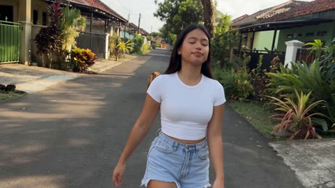</a>

A timed shot list with the exact dialogue lines sets pacing and comedic beats, and the camera realism block (one handed phone, autofocus drift, auto exposure, motion blur, light compression) keeps it reading as a phone home video rather than a film.

Seedance 2.5 · Text-to-video · Source: [@MissDelulu9 on X](https://x.com/MissDelulu9/status/2092578120591446348) · found via [LearnPrompt/awesome-seedance](https://github.com/LearnPrompt/awesome-seedance)

[`comedy`](tags.md#tag-comedy) [`handheld-phone`](tags.md#tag-handheld-phone) [`dialogue`](tags.md#tag-dialogue) [`street-scene`](tags.md#tag-street-scene)

<details><summary><b>Prompt</b></summary>

```text
Create a 15-second realistic smartphone video in 16:9 aspect ratio.

Style: authentic Gen-Z Indonesian comedy, spontaneous iPhone home-video footage, natural daylight.

SHOT 1- 0:00–0:02
A girl casually walks along a small Indonesian residential street. She suddenly notices a medium-sized pet dog ahead and stops. Her relaxed expression instantly turns nervous.

SHOT 2-0:02–0:04
Quick handheld pan from the girl to the dog and back. She slowly steps backward and says: “Uh... don't come closer, okay...” The dog looks curious and harmless.

SHOT 3-0:04–0:06
The dog playfully runs a few steps toward her. She panics: “AAAAA RUN!” The camera operator reacts and moves backward.

SHOT 4-0:06–0:08
She suddenly runs away, looking back over her shoulder. The iPhone camera follows while running, creating natural shaky footage. Her white fitted T-shirt, light-blue short denim shorts, and white low-profile slippers move naturally.

SHOT 5-0:08–0:10
Side close-up while she runs. She looks back and screams: “BRO, IT'S FOLLOWING ME!” The camera shakes as the friend behind the camera laughs.

SHOT 6-0:10–0:13
The camera widens as she runs toward her friend, waving her hands: “DON'T LAUGH! HELP ME, BRO!” The dog follows playfully without attacking, biting, or touching her.

SHOT 7- 0:13–0:15
She reaches a safe spot, bends over briefly to catch her breath, then looks at the camera with an annoyed and embarrassed expression: “I was literally just passing by, why did that turn into cardio?!” The friend bursts out laughing. Abrupt cut.

CAMERA & REALISM

Amateur one-handed iPhone recording. Natural handheld shake, imperfect framing, slight tilt, occasional autofocus shifts, automatic exposure changes, realistic motion blur, natural smartphone colors, subtle digital sharpening and compression. Environmental details remain visible. No cinematic look.
```

</details>

<a id="seedance-indonesian-village-coconut-vlog"></a>
### Woman strolls a palm lined village path

<a href="https://x.com/saniaspeaks_/status/2084969852171939875">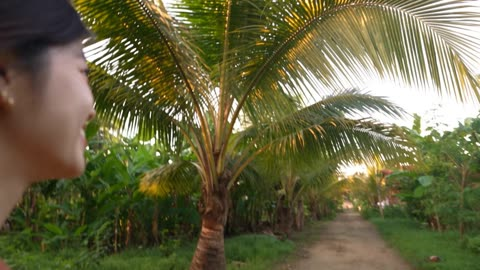</a>

A timestamped beat sheet with quoted dialogue splits the clip into shots, and an image reference locks the face and outfit. Spelled out camera flaws (shake, focus hunting, no stabilization) and an ambience only sound list keep the look authentically amateur instead of polished travel content.

Seedance 2.5 · Reference-to-video · Source: [@saniaspeaks_ on X](https://x.com/saniaspeaks_/status/2084969852171939875)

[`vlog`](tags.md#tag-vlog) [`handheld`](tags.md#tag-handheld) [`tropical-village`](tags.md#tag-tropical-village) [`retro-2000s`](tags.md#tag-retro-2000s)

<details><summary><b>Prompt</b></summary>

```text
Preserve the exact face, hairstyle, identity, skin tone, and body proportions from @ image1 throughout. Outfit: oversized terracotta linen shirt, dusty burgundy wide-leg trousers, brown leather sandals, small gold hoop earrings, loose natural wavy hair. Authentic Indonesian woman. Late-2000s personal vlog aesthetic. Extremely raw handheld flip-camera footage with heavy camera shake, natural reframing, partial face crops, focus hunting, exposure shifts, warm faded colors, mild digital noise, and authentic home-video imperfections. No posing, no cinematic glamour, no stabilization, no modern color grading.

00:00–00:04 Walking through a peaceful tropical village lined with coconut trees, smiling into the camera. "Today we're hunting for fresh coconuts!"

00:04–00:08 Stops at a small roadside coconut stall where a friendly local vendor expertly chops open a fresh green coconut. She watches with an excited reaction.

00:08–00:12 Takes her first sip of fresh coconut water, smiles brightly, and says, "This is so refreshing!"

00:12–00:16 Sits with local villagers on a wooden bench, chatting, laughing, and enjoying the relaxed atmosphere while holding the coconut.

00:16–00:20 Tries opening another coconut herself using simple tools, struggles playfully, laughs, and the locals cheer and laugh with her.

00:20–00:24 Scoops out the soft coconut flesh with a spoon, tastes it, and gives a happy thumbs-up to the camera.

00:24–00:27 Walks slowly through the village, waving to children and locals while carrying the empty coconut shell.

00:27–00:30 Stops beneath tall coconut trees, turns back toward the camera with a warm smile, waves, and says, "See you in my next adventure. Bye!" before naturally ending the recording.

Natural ambience only: birds, palm leaves rustling, village conversations, coconut chopping sounds, footsteps, breeze, insects, and distant laughter. No background music, subtitles, logos, or watermarks. The footage should feel exactly like a genuine late-2000s handheld flip-camera vacation vlog with authentic human movement and realistic interactions.
```

</details>

<a id="seedance-japan-pov-morning-commute"></a>
### Walking POV down station steps onto a seaside train

<a href="https://x.com/higgsfield_ai/status/2083155162475217058">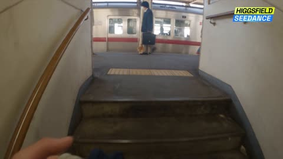</a>

Timed beats with a fixed camera spec, handheld micro motion and a listed ambient audio bed keep the whole thing one continuous shot. Banning color grading and neon keeps the look grounded in real morning light.

Seedance 2.5 · Text-to-video · Source: [@higgsfield_ai on X](https://x.com/higgsfield_ai/status/2083155162475217058)

[`pov`](tags.md#tag-pov) [`japan`](tags.md#tag-japan) [`one-take`](tags.md#tag-one-take) [`train`](tags.md#tag-train)

<details><summary><b>Prompt</b></summary>

```text
POV — Morning Commute in Coastal Japan | Ultra-Realistic, One Continuous Take  First-person POV, no cuts, one unbroken handheld-feeling shot from our own eyes on the way through a small seaside town. Ultra-photorealistic, phone-in-hand realism — natural camera micro-shake, subtle head bob with each step, occasional glance down at our own hands and shoes. 4K, shallow but natural depth of field, real morning light, no color-grading fantasy, no neon.  Beat 1 — Descending into the station (0–4s): We walk down worn concrete station stairs into a small coastal-town metro entrance, one hand loosely gripping a canvas bag strap that swings into the lower frame. Fluorescent tint mixes with daylight bleeding from the entrance behind us. Commuters pass in soft focus; we hear muffled announcements and the shuffle of footsteps.  Beat 2 — The orange cat (4–9s): We slow and crouch — the horizon dips as our POV lowers toward the ground. An orange tabby sits by a ticket-gate pillar, tail curled. Our hand (natural skin texture, slightly bitten nails, cuff of a sleeve) reaches into frame and gently strokes its head. The cat leans into the touch, eyes half-closing, ears flicking. We hold there a beat, warm and quiet.  Beat 3 — Boarding, settling by the window (9–14s): We rise, the horizon lifts, and we step through the train doors just as the chime sounds. POV turns and moves toward a window seat; we sit, and the frame settles against the glass. A faint silhouette of us ghosts over the view. The train pulls away with a gentle lurch.  Beat 4 — The shimmering sea (14–20s): Through the window, the town gives way to open coastline. Sunlight scatters across the water in thousands of moving sparkles — real specular glitter, not CGI bloom. Utility poles and wires strobe past in the foreground. We rest our chin lightly (subtle downward frame tilt), just watching.  Beat 5 — Rails into the sea (20–25s): The track curves and runs so close to the shore that the rails seem to vanish straight into the water — the sea fills nearly the whole frame, waves lapping right up to the ballast. Foam catches the light. We're gliding along the edge of the ocean, the horizon line steady, gulls crossing in the distance. Hold on this until the shot ends.  Technical spec: continuous POV, first-person, no cuts or transitions, natural handheld micro-motion, realistic morning ambient audio (station hum, cat, train chime, rail clatter, distant surf), authentic Japanese coastal-railway setting (Shimonada / Enoden-style seaside line), overcast-to-clear soft daylight, photoreal skin and fabric texture, 2.39:1 or 16:9, ultra-realistic.
```

</details>

<a id="seedance-kamakura-rental-house-dv-afternoon"></a>
### Woman in yellow top leaves a Japanese house

<a href="https://x.com/AIwithAliya/status/2097192902829171098">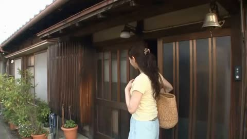</a>

The prompt locks identity, outfit and hairstyle with one explicit consistency line, then describes the camcorder look through concrete artifacts such as autofocus hunting, focus breathing and exposure shifts. Each scene is a short beat with its own spoken line and an object transfer rule, so props stay continuous across cuts.

Seedance 2.5 · Text-to-video · Source: [@AIwithAliya on X](https://x.com/AIwithAliya/status/2097192902829171098) · found via [LearnPrompt/awesome-seedance](https://github.com/LearnPrompt/awesome-seedance)

[`dv-camcorder`](tags.md#tag-dv-camcorder) [`slice-of-life`](tags.md#tag-slice-of-life) [`kamakura`](tags.md#tag-kamakura) [`dialogue`](tags.md#tag-dialogue)

<details><summary><b>Prompt</b></summary>

```text
Create a 30-second, 1080p ultra-realistic early-2000s DV home video of a 20-year-old Japanese woman spending a quiet late-summer afternoon in an old seaside neighborhood in Kamakura, Japan.

**MAIN SUBJECT**

A 20-year-old Japanese woman, naturally beautiful, realistic skin texture, minimal makeup, long dark-brown wavy hair loosely tied with a simple fabric hair tie, wearing a fitted pale-yellow short-sleeve top, loose light-blue wide-leg trousers, white canvas sneakers, and a delicate silver necklace. Keep her identity, facial features, outfit, hairstyle, body proportions, and age perfectly consistent throughout the entire video.

She leaves a small traditional Japanese rental house carrying a woven shoulder tote bag and walks through a narrow residential lane toward a tiny local bakery near the coast.

**SCENE 1 — LEAVING HOME**

She steps outside, slides the wooden door closed behind her, adjusts her tote bag and walks down a quiet narrow street lined with old Japanese houses, bicycles, potted plants, utility poles and overhead wires.

She looks toward the camera and casually says:

**“I finally have a slow afternoon.”**

The camera follows her from behind with imperfect handheld movement.

**SCENE 2 — LOCAL BAKERY**

She enters a tiny old-fashioned neighborhood bakery with a wooden entrance and glass display case.

She chooses a melon pan, a small red-bean pastry and a bottled ramune. She places everything carefully inside her woven tote bag.

While looking through the small refrigerator, she notices several colorful popsicles.

She picks up two peach-flavored popsicles, smiles and adds them to her bag.

The bakery owner places the items into a small paper package and hands it to her.

She politely says:

**“Thank you, I’ll come again.”**

**SCENE 3 — SEASIDE STREET**

Outside, she walks toward the coast.

She notices two neighborhood children sitting near a low stone wall, watching bicycles pass by.

She takes the two peach popsicles from her bag and gives one to each child.

Each child clearly receives one and happily holds it.

One child says:

**“Really? Thank you!”**

She smiles and replies:

**“Enjoy it before it melts.”**

The children happily begin eating their popsicles.

The popsicles visibly transfer from the bakery refrigerator → woman's tote bag → children's hands. No disappearing or duplicated objects.

**SCENE 4 — BICYCLE**

As she continues walking, she notices one child's bicycle has fallen over beside the sidewalk.

She stops, picks it up and holds the handlebars while the child checks the bicycle.

The child smiles and says:

**“You helped me!”**

She laughs softly and replies:

**“No problem. Ride carefully.”**

The child rides away with the other child.

**SCENE 5 — WATER FOUNTAIN**

She continues toward the seaside and discovers an old public water fountain beside a small park.

She turns the metal tap.

Water begins flowing naturally.

She cups her hands under the water and splashes cool water onto her face.

She laughs naturally, shakes the water from her hands and wipes her face.

She looks refreshed and says:

**“That feels so good.”**

**SCENE 6 — WALKING HOME**

The late-afternoon sunlight falls across the quiet Japanese street.

She walks back toward her house carrying the same woven tote bag.

A bicycle bell rings somewhere in the distance.

She briefly looks directly into the DV camera and says:

**“Best kind of afternoon.”**

She smiles, turns toward her house and walks through the wooden entrance.

The camera remains outside for a moment as the door closes.

**CUT TO BLACK.**

**CAMERA / VISUAL STYLE**

Raw handheld early-2000s Japanese DV camcorder footage. Authentic consumer camcorder aesthetic, shaky handheld movement, imperfect framing, autofocus hunting, occasional focus breathing, faded slightly washed-out colors, soft digital detail, mild compression artifacts, exposure shifts
```

</details>

<a id="seedance-kansai-platform-near-miss-montage"></a>
### Platform near-miss opens a Kansai day montage

<a href="https://x.com/oggii_0/status/2099002039141626186">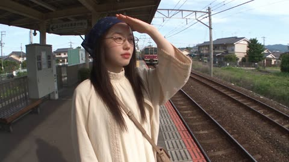</a>

Timed shot ranges split the 30 seconds into separate scenes, and the rescue is held as one unbroken shot before the hard cuts begin. A named optical look (soft halation, luma noise, exposure pumping) plus a fixed outfit and glasses spec keeps the heroine identical across cuts.

Seedance 2.5 · Text-to-video · Source: [@oggii_0 on X](https://x.com/oggii_0/status/2099002039141626186) · found via [LearnPrompt/awesome-seedance](https://github.com/LearnPrompt/awesome-seedance)

[`minidv`](tags.md#tag-minidv) [`first-person`](tags.md#tag-first-person) [`multi-scene`](tags.md#tag-multi-scene) [`japan-travel`](tags.md#tag-japan-travel)

<details><summary><b>Prompt</b></summary>

```text
Create exactly 30 seconds of photorealistic live-action Japanese travel memories, edited with quick hard cuts, seen through an affectionate adult boyfriend's first-person handheld consumer camcorder. This is a MULTI-SCENE MONTAGE, NOT one continuous take. Begin with a frightening cinematic near-miss at a suburban railway platform, then move immediately into warm, playful, intimate everyday travel. The emotional arc is alarm → relief → affectionate curiosity → golden-hour quiet → joyful night → tender laughter. No disaster imagery. No dramatic movie grading. Output ultrawide 21:9, requested 1080p, high-bitrate encode, with deliberately authentic early-2000s MiniDV aesthetics baked into the image. Use the full wide frame, no 4:3 pillarboxes.

SAME ADULT HEROINE IN EVERY SHOT:
SAME ADULT HEROINE IN EVERY SHOT:
A very beautiful young adult Korean woman, age 25–28, with luminous fair warm-toned skin and realistic pores, expressive dark-brown eyes, softly sculpted youthful cheeks, naturally beautiful full rose-pink lips with a subtle satin finish, natural understated Korean makeup, and a warm spontaneous smile. Preserve her facial geometry, body proportions and identity across every cut, without idealized plastic smoothing. Thin dark-metal oval prescription glasses with clear lenses, eyes always readable. Long, naturally dark-brown to soft-black hair, smooth and healthy with subtle natural movement; no blonde hair, no bangs.

One consistent modern Korean Gen Z outfit: an elegant loose ivory ankle-length A-line dress with full-length sleeves and a high neckline, subtle delicate embroidery, paired with a lightweight oversized beige cardigan jacket, clean cream sneakers, and a small structured taupe crossbody bag. Fabric remains naturally flowing, fully opaque and modest during movement. Glasses, hairstyle, outfit and bag remain identical throughout. Contemporary Korean styling, youthful, effortlessly elegant and understated. No spaghetti straps, revealing neckline, exposed midriff, or body-hugging styling. There is no supplied reference image: establish this original Korean heroine from these text details and maintain her exact identity. Never morph into another woman, change her ethnicity, facial features, hairstyle, or body proportions.

MINIDV STYLE LOCK:
Feels like a cherished home-video cassette recorded around 2003, not polished cinema pretending to be vintage. Gentle optical softness, low contrast, softly washed highlights, warm natural skin, fine luma noise, mild color bleed, subtle consumer-camera edge enhancement, restrained DV compression texture, slightly faded blues and greens, soft halation, occasional exposure pumping when moving between shade and sunlight.

Real handheld wide-angle proximity, uncentered composition, brief autofocus searching that settles on her face. Noticeable motion smear on fast pans and night lights, but keep expressions legible. No heavy glitch overlays, fake VHS tracking bars, film burns between scenes, timestamps, captions, subtitles, logos, or excessive chromatic aberration. Noon feels airy, sunset feels honey-gold, night feels softly smeared and imperfect. Do not use green-noir grading or glossy blockbuster teal-orange.

POV AND EDIT RULES:
The camera operator is her adult boyfriend, mostly unseen, occasionally one anatomically correct forearm or hand enters. She repeatedly checks where he is, leans toward him, looks back, shares a discovery, and smiles directly into the lens. Small natural gestures, no fashion posing, no slow-motion beauty commercial. Hold each simple action long enough to read. Hard cuts between locations, no morphing transitions.

Geography evokes a remembered Kansai day through Uji and Nara, with ordinary bookshops and shopping streets between famous places. Late spring or early summer green foliage; no contradictory autumn leaves, snow or cherry blossoms. Do not squeeze in extra landmarks or relocate Mount Fuji into Nara.

EXACT 30-SECOND EDIT:

00.00–04.00 — SUBURBAN PLATFORM, DANGER THEN RELIEF
Open with danger already readable: she has distractedly stepped too near the platform edge while peering down the line, one hand shading her eyes. She remains on the platform, never on the rails. An approaching maroon-and-cream commuter train is already visible behind her and rapidly grows larger.

From first-person POV, one boyfriend hand reaches to her upper arm; upon contact, the arm immediately retracts in ONE continuous movement, pulling her backward toward the lens and behind the tactile safety strip. She visibly moves back one or two quick steps; camera operator steps back naturally with her. Only once she is clear does the train rush past behind her.

Its wind flutters her overshirt and dress hem, never lifts or removes her hijab or exposes her body. Her eyes widen behind glasses, lips part with a brief startled gasp, then relief begins in her expression. No contact with the train, injuries, lingering on the edge, or repeated pulling motion. Believable distances and train direction; staged fictional action with a clearly successful rescue. Keep one continuous shot for this opening.

04.00–06.00 — SUNNY GRASS
Abrupt warm hard cut: first-person handholding as she guides the viewer along a grassy path. She turns toward the camera with a relieved bright laugh. Sunlight catches her ivory sleeves and navy floral hijab pin; green grass drifts softly behind. One hand linked naturally with the operator, no duplicate fingers.

06.00–07.50 — OLD BOOKSHOP
Shoot through a gap between shelves of well-used Japanese books. She playfully bends into the gap from the far side, notices the lens, gives a small conspiratorial smile. Dusty window light, crowded wooden shelves, autofocus briefly catches book spines before her eyes. Avoid legible invented titles.

07.50–09.00 — QUIET STREET CROSSING
Low, casual waist-to-shoe framing of her walking across an ordinary Japanese zebra crossing on a pedestrian signal. Ivory dress hem sways over trainers. Tilt just enough to glimpse her looking back. No fetishized body framing; modest everyday clothing detail and footsteps are the focus.

09.00–10.50 — NARROW LANE
She walks ahead between traditional wooden storefronts, potted plants and hanging fabric curtains. Her eyes glance sideways first, then she turns her face back to find the camera, smiling softly. Overhead cables and bicycles at the side establish lived-in Japan; no staged crowd.

10.50–12.50 — UJI RIVERSIDE, ADDED RESEARCHED SCENE
At the scenic Uji River in Kyoto Prefecture, film her by a pedestrian riverbank with the historic bridge in the background. Begin with sunlight moving on water, tilt casually to her leaning lightly on the safe railing. A breeze moves her cuff; she points out the view, then looks at the operator rather than posing for the landscape. Keep her face central to the memory, river sound underneath.

12.50–14.00 — UJI MATCHA, ADDED RESEARCHED SCENE
Close handheld view of her holding a simple matcha soft-serve outside a small tea shop. She takes a tiny taste, raises her eyebrows appreciatively, then offers the cone toward the lens with a playful smile. Rich natural tea-green against ivory fabric; mild sunlight overexposure, soft storefront background. No visible brand text.

14.00–15.50 — SMALL RAMEN SHOP
Close-up of steaming vegetarian mushroom-and-vegetable ramen on a wooden counter or small table, then a quick natural focus pull to her sitting opposite, smiling through wisps of steam. Cozy lamps, spoon and bowl sounds, genuine restaurant ambience. No pork slices or alcohol props. Camera remains handheld, not a glossy food advertisement.

15.50–17.00 — MANGA SHOP
She draws one manga volume from a shelf, opens it and lowers her eyes with a curious smile. Brief close shot of hands and page texture; no readable dialogue or famous copyrighted character emphasis. Maintain same glasses and floral pin.

17.00–18.50 — NARA PARK DEER
Boyfriend POV offers one designated deer cracker, held flat and released gently to a deer in Nara Park. The woman is softly out of focus a few steps behind on green grass, laughing at the deer's polite approach. No grabbing antlers, hugging or chasing wildlife. Mild camera wobble as the deer approaches.

18.50–20.00 — QUIET READING
Sitting on a park bench, she flips a manga page. Close details of her hands, gold botanical embroidery and lace cuff, then tilt to her peaceful face behind her glasses. Rustle of paper, leaves and distant birds. Natural, modest, unposed.

20.00–22.50 — UKIMIDO PAVILION, ADDED RESEARCHED SCENE
Nara Park's hexagonal wooden Ukimido pavilion with its cypress-bark roof on Sagiike Pond, reached by a wooden bridge. From the public bridge, she pauses safely by the railing and turns back toward the camera; warm light and green trees reflect in still water. Start wide enough to read the actual pavilion silhouette, then walk a little closer as she extends her hand toward the viewer. Quiet water, wooden footfalls, no temple ritual invented. Intimate location memory rather than a drone tourism shot.

22.50–24.50 — GOLDEN-HOUR MEADOW
In Nara's grassy park with deer grazing at a respectful distance, honey-gold backlight edges her hijab and sleeves. She turns gently toward the camera, dress fabric swaying with the evening breeze. A small genuine smile, peaceful eye contact, slight exposure bloom. No spinning near deer, no flying fabric revealing skin.

24.50–27.00 — LIVELY NIGHT SHOPPING STREET
Blue-hour-to-night hard cut. Warm shop lanterns, illuminated signs and pedestrians in a Kansai shopping street. She suddenly jogs lightly several steps ahead, then looks back laughing, waiting for the operator. He follows; handheld camera movement leaves convincing soft DV light streaks. No vehicles in her running path; stay in a pedestrian area. Preserve facial readability between movement smears.

27.00–28.00 — TACTILE MEMORY INSERT
One brief close handheld detail of her hand adjusting her embroidered cuff beside her taupe bag, ivory skirt hanging naturally; warm shop light blooms softly off the stitching. A casual recorded detail, not an erotic crop.
28.00–30.00 — CAMCORDER MEMORY ENDING
A second small silver early-2000s consumer camcorder is held into the foreground by the operator's free hand, its side LCD flipped outward. Current POV remains on the original recording camera; make this a clearly separate physical device, not an impossible view of itself.

The second camcorder points toward the woman; its LCD shows the same woman in the same pose at the same moment, synchronized without a duplicate person standing nearby. She notices that he is still filming, briefly gives a playful tiny pout with her naturally rose-toned lips, then breaks into a real warm laugh looking directly at him. Frame drifts toward a bright shop lamp and highlights bloom to soft white over the final fraction of a second. End on warmth, not alarm.

AUDIO:
Real synchronized location sound ONLY, no background music, no soundtrack, no narration, no scripted dialogue.

Opening: rolling rail clatter, approaching train rush, wind blast, a single surprised gasp, shoes stepping back.

Then light footsteps, grass and breeze, natural soft laughter, book pages, distant shop ambience, river water, ice-cream wrapper rustle if present, ramen bowls and chopsticks, park birds, deer footsteps, wooden bridge creaks, evening breeze, night crowd and distant vehicles.

Audio hard-cuts naturally with each location; subtle room-tone tails are acceptable. Finish with her authentic laugh. No artificial whooshes between edits or dramatic suspense score.

FINAL QUALITY RULES:
Exactly one stable adult heroine, full modest coverage, consistent hijab and glasses, anatomically natural hands, no face drift or changing ethnicity, no glossy skin filter. Requested high-bitrate file must preserve intentional MiniDV texture rather than remove it. The viewer should feel these are precious imperfect memories from a real day together, not a compilation of polished commercial travel footage.
```

</details>

<a id="seedance-korean-alley-leaf-bicycle-bell-dv-home-video"></a>
### Korean Woman and Bicycle Bell, DV Home Video

<a href="https://x.com/SimplyAnnisa/status/2096931238460178592"></a>

A timed beat structure splits 30 seconds into five 6 second scenes, each with one small action and a line of dialogue. A detailed camcorder flaw list (autofocus hunting, accidental zooms, tape noise) plus a location sound only audio rule keeps it looking like real footage.

Seedance 2.5 · Text-to-video · Source: [@SimplyAnnisa on X](https://x.com/SimplyAnnisa/status/2096931238460178592) · found via [LearnPrompt/awesome-seedance](https://github.com/LearnPrompt/awesome-seedance)

[`dv-camcorder`](tags.md#tag-dv-camcorder) [`home-video`](tags.md#tag-home-video) [`korean`](tags.md#tag-korean) [`street`](tags.md#tag-street) [`timed-beats`](tags.md#tag-timed-beats)

<details><summary><b>Prompt</b></summary>

```text
Create a 30-second, 1080p, 16:9 ultra-realistic early-2000s DV home video of a young Korean woman having an ordinary but unexpectedly memorable summer evening in an older Seoul neighborhood.

A naturally pretty Korean woman in her early 20s, realistic skin, minimal makeup, long black slightly wavy hair, pale-blue knit top, loose cream trousers, white sneakers, brown crossbody bag, and silver watch. Keep her identity, face, outfit, hairstyle, and proportions perfectly consistent.

SETTING

A quiet older Seoul residential street with concrete lanes, apartment buildings, potted plants, bicycles, utility poles, leafy trees, and a tiny neighborhood convenience shop. Lived-in and authentic. No brands, logos, advertisements, or tourist locations.

CAMERA STYLE

Raw footage from a cheap early-2000s DV camcorder: shaky handheld movement, imperfect framing, autofocus hunting, exposure shifts, faded colors, soft detail, mild tape noise, accidental zooms, and natural camera mistakes. No stabilization or cinematic shots.

00:00–00:06 — THE MYSTERY

She walks down the street holding a small plastic bag when she suddenly hears a faint jingling sound behind her.

She stops and looks around.

The camera quickly zooms toward her confused face.

She says:

“Did you hear that?”

00:06–00:12 — THE LITTLE DISCOVERY

She follows the sound and finds a small old bicycle with a tiny bell stuck slightly open.

She gently taps the bell.

Ding.

She looks at the camera and laughs.

Then she notices a small handwritten-looking paper tag hanging from the bicycle, but the writing is too unclear to read.

00:12–00:18 — THE WIND

A sudden breeze blows several dry leaves across the street.

One lands directly on her head.

She doesn't notice.

The camera operator laughs.

She looks confused, then realizes and removes the leaf.

She gives the camera an embarrassed stare.

00:18–00:24 — THE SMALL CHALLENGE

She places the leaf on the bicycle seat and tries to balance it there.

The wind immediately blows it away.

She tries again.

It falls again.

She laughs and finally gives up.

00:24–00:30 — THE MEMORY

She picks up the leaf, puts it into her small bag, and starts walking home.

After a few steps, she turns toward the camera and says:

“Okay, that was pointless.”

She smiles and keeps walking.

The camera follows her for a few seconds before abruptly cutting to black.

AUDIO

Natural location sound only: footsteps, distant traffic, bicycle bell, summer insects, leaves, wind, neighborhood ambience, and natural laughter.

No music, narration, subtitles, captions, logos, watermarks, or on-screen text.

REALISM

Natural human reactions, imperfect timing, realistic physics, consistent objects, authentic Korean neighborhood details, and believable DV-camera imperfections. No CGI look, distorted hands, extra fingers, duplicated people, identity drift, or outfit changes.

16:9 aspect ratio.
```

</details>

<a id="seedance-korean-apartment-tiktok-dance-fail-home-video"></a>
### Clumsy TikTok dance in a cramped apartment

<a href="https://x.com/Ciri_ai/status/2095026480552271884"></a>

Timed five second beats escalate from a clean first eight count to a lamp and spilled water pileup, and the camera shifts from a static phone to handheld shake midway. A natural location sound only audio block with every spoken line written out keeps the home video feel.

Seedance 2.5 · Text-to-video · Source: [@Ciri_ai on X](https://x.com/Ciri_ai/status/2095026480552271884) · found via [LearnPrompt/awesome-seedance](https://github.com/LearnPrompt/awesome-seedance)

[`home-video`](tags.md#tag-home-video) [`handheld`](tags.md#tag-handheld) [`comedy`](tags.md#tag-comedy) [`dialogue`](tags.md#tag-dialogue) [`timed-beats`](tags.md#tag-timed-beats)

<details><summary><b>Prompt</b></summary>

```text
Create a 30-second, 1080p ultra-realistic personal home-video of a young Korean woman confidently attempting to learn a viral TikTok dance trend in her tiny apartment, with her furniture and coordination working against her the entire time. No reference image.

**MAIN SUBJECT**

Young Korean woman in her early 20s, casual and determined energy, natural makeup, expression that shifts from focused confidence to flustered embarrassment.

Hair in a messy half-up bun, a few strands sticking to her face as she gets more flustered, small stud earrings.

Wearing an oversized band t-shirt tucked loosely into biker shorts, white ankle socks, no shoes, phone propped up against a stack of books on the floor to "record for practice."

Maintain the same face, hairstyle, clothing, body proportions, and appearance throughout the entire video.

**SETTING**

A small, cluttered studio apartment living room, evening, warm lamp light mixed with the cool glow of a laptop screen playing the dance tutorial video.

A coffee table pushed slightly out of the way but not far enough, a floor lamp standing a little too close to her "stage area," a pile of laundry on the couch, a half-full water glass on the side table, string lights on the wall, and a roommate's bike leaning against the wall in the background. Cramped, real, an apartment clearly not built for dancing.

**CAMERA / VISUAL AESTHETIC**

Raw personal footage, filmed by her roommate on a phone propped up at first, then grabbed handheld once things go wrong — strong handheld vlog shake for the second half.

Static, slightly low-angle framing for the "practice" shots, mimicking a phone-on-a-stack-of-books setup. Frame is imperfectly centered, cutting off the top of her head slightly. Once the roommate grabs the phone, autofocus hunts, motion blur kicks in during the collision moment, exposure shifts as she moves between lamp light and shadow, visible digital noise in the dim room.

No stabilization, no gimbal smoothness, no cinematic camera moves — it should feel like a real phone recording that was never meant to be watched by anyone but her.

---

**00:00–00:05 — THE CONFIDENT SETUP**

She props her phone against a stack of books, steps back into frame, and shakes out her arms like an athlete warming up.

She points at the laptop screen playing the dance tutorial, then back at herself, deadly serious.

*"Okay. I've watched this like twenty times. I got this."*

**00:05–00:10 — FIRST EIGHT-COUNT**

The music starts. She nails the first few moves surprisingly well, sharp and confident, clearly proud of herself mid-move.

Roommate's voice from off-screen, genuinely impressed: *"Wait, okay—?!"*

The camera stays static, catching her in full frame, a rare clean moment.

**00:10–00:15 — THE FIRST WOBBLE**

A quick turn in the choreography catches her off guard — she spins a half-second late, arms flailing to catch up, and clips the edge of the coffee table with her shin.

She yelps, hopping on one foot, still trying to keep the rhythm going through gritted teeth.

*"I'm fine — I'm fine, keep going—"*

**00:15–00:20 — LAMP INCIDENT**

Recovering, she throws herself into the next big arm movement — her hand clips the floor lamp, sending it tilting dangerously.

Her roommate lunges into frame to catch it, grabbing the phone off the books in the process, camera suddenly handheld and shaking.

*"THE LAMP—"*

**00:20–00:25 — FULL CHAOS**

With the lamp saved but the camera now shaky and handheld, she tries to pick the choreography back up from memory, increasingly out of sync with the music, arms going in directions the dance never intended.

She knocks the water glass off the side table with her elbow, doesn't even stop, just grimaces and keeps dancing through the spill.

Roommate, laughing hysterically behind the now-unsteady camera: *"You're literally destroying the apartment—"*

**00:25–00:30 — FINAL MOMENT**

The song ends. She strikes a triumphant final pose — chest heaving, one hand on her hip, completely out of breath, water pooling near her sock.

She looks into the camera, dead serious despite the disaster around her.

*"...Post it. That was clean."*

Her roommate, still laughing, pans the camera slowly down to the spilled water and tipped lamp before swinging back to her unbothered face — and the footage cuts abruptly to black.

---

**AUDIO**

Natural location sound only:

The tutorial/dance track playing tinny from the laptop speakers, her footsteps and fabric movement, the thud of her shin hitting the table, the lamp wobbling and roommate's scramble to catch it, glass tipping and water spilling, her roommate's genuine off-camera laughter throughout, and handheld camera noise once it's picked up.

No added music beyond the in-scene laptop track. No narration. No artificial sound effects.

Spoken lines: *"Okay. I've watched this like twenty times. I got this."* / *"Wait, okay—?!"* (roommate) / *"I'm fine — I'm fine, keep going—"* / *"THE LAMP—"* (roommate) / *"You're literally destroying the apartment—"* (roommate) / *"...Post it. That was clean."*

**FINAL FEEL**

Chaotic, cramped-apartment energy — the universal experience of confidently trying a viral dance and immediately losing a fight with your own furniture. Funny, physical, unscripted-feeling, with a deadpan ending that lands harder because she genuinely doesn't acknowledge the destruction around her.

No exaggerated slapstick beyond real physical missteps. No professional dance skill required — the comedy comes from real momentum, real near-misses, and her total refusal to admit defeat.
```

</details>

<a id="seedance-korean-cafe-vlog-chaos"></a>
### Woman filming café vlog as everything goes wrong

<a href="https://x.com/Ciri_ai/status/2094706780114952303"></a>

Each beat of about five seconds pairs a deliberately aesthetic shot with a sudden handheld jolt, so the comedy comes from the gap between the planned look and the raw execution. Camera faults such as autofocus hunting, blown highlights and the friend's laughter are written as motion and sound, which keeps the footage believable.

Seedance 2.5 · Text-to-video · Source: [@Ciri_ai on X](https://x.com/Ciri_ai/status/2094706780114952303) · found via [LearnPrompt/awesome-seedance](https://github.com/LearnPrompt/awesome-seedance)

[`handheld`](tags.md#tag-handheld) [`comedy`](tags.md#tag-comedy) [`cafe`](tags.md#tag-cafe) [`found-footage`](tags.md#tag-found-footage)

<details><summary><b>Prompt</b></summary>

```text
Create a 30-second, 1080p ultra-realistic personal home-video showing a young Korean woman attempting to film an "aesthetic" café vlog for her social media and everything comically not going to plan. No reference image.
MAIN SUBJECT
Young Korean woman in her early 20s, trendy and put-together look, dewy makeup, confident expression that keeps cracking into laughter.
Straight black hair with curtain bangs, small gold hoop earrings, soft pink lip tint.
Wearing an oversized cream sweater, a plaid mini skirt, chunky white sneakers, and a small quilted shoulder bag she keeps adjusting for the "shot."
Maintain the same face, hairstyle, clothing, body proportions, and appearance throughout the entire video.
SETTING
A charming autumn café street in Seoul on a crisp, sunny afternoon.
A cozy corner café with outdoor seating, string lights, a chalkboard menu, falling ginkgo leaves, a latte art station visible through the window, a bicycle propped against a brick wall, pedestrians occasionally walking through frame, and a small tree dropping leaves onto the sidewalk table. Warm, golden, Pinterest-looking — until it isn't.
CAMERA / VISUAL AESTHETIC
Raw personal footage, filmed by her friend who keeps trying (and failing) to make it look cinematic, strong handheld vlog shake throughout.
The video oscillates between deliberately "aesthetic" attempted shots — slow pans, artful angles, soft focus — and sudden chaotic handheld jolts when things go wrong. Autofocus hunts comically between her face and the latte. Camera tilts and overcorrects. Exposure blows out when it swings toward the sun. Mild motion blur during quick recoveries. Slightly warm, oversaturated color grade like a try-hard Instagram filter that keeps slipping back to raw reality.
No stabilization, no real cinematic polish — the "aesthetic" is aspirational, the execution is not.
00:00–00:05 — THE PERFECT LATTE SHOT (ATTEMPT)
She sits at the outdoor table, carefully positioning a latte with foam art, trying to casually "candid" sip it for the camera.
The camera does a slow artful pan down toward the cup — then a leaf falls directly into it with a soft plop.
She freezes, staring at the ruined latte art, deadpan.
00:05–00:10 — REACTION
She looks up at the camera, unimpressed, leaf still floating in the foam.
"...Are you kidding me right now."
The friend behind the camera bursts out laughing, shaking the frame violently.
00:10–00:15 — THE "CANDID" WALK
She gets up to attempt a slow-motion aesthetic walk past the café window, hair flowing, sunglasses going on in one smooth motion — sunglasses immediately get caught in her hair.
She stops mid-stride, wincing, trying to untangle them one-handed while still smiling for the camera.
The camera zooms in awkwardly close on the tangled sunglasses, then yanks back out.
00:15–00:20 — BICYCLE MISHAP
She leans against the parked bicycle for a "casual candid lean" pose, one hand in her pocket.
The bicycle kickstand gives way and it slowly tips sideways, taking her balance with it.
She stumbles but catches herself, laughing hard, one hand up defensively toward the lens.
"Okay, delete that, delete that!"
00:20–00:25 — GINKGO LEAF CHAOS
She tries to recreate a "leaves falling around me" cinematic moment by tossing a handful of gathered ginkgo leaves into the air above her head.
A gust of wind blows them straight back into her face instead.
She spits out a leaf, blinking, completely unbothered and giggling.
The camera shakes as the operator nearly drops it laughing.
00:25–00:30 — FINAL MOMENT
She gives up on the aesthetic altogether, plops back down at the café table, and grabs the leaf-ruined latte anyway, taking a defiant sip through the foam.
She looks dead into the camera, deadpan, leaf still stuck to her sweater.
"This is the content. This is it. Post this one."
She gives an exaggerated thumbs up as the frame shakes with the friend's laughter, and the footage cuts abruptly to black.
AUDIO
Natural location sound only:
Café ambience, cup clinking, leaves rustling, wind gusts, bicycle clattering, footsteps, her friend's audible laughter throughout, fabric rustling, and handheld camera noise.
No music. No narration. No artificial sound effects.
Spoken lines: "...Are you kidding me right now." / "Okay, delete that, delete that!" / "This is the content. This is it. Post this one."
FINAL FEEL
A self-aware, comedic behind-the-scenes of someone trying to film an aesthetic vlog and getting completely humbled by reality at every turn — warm, golden autumn light paired with genuine, unscripted chaos and laughter.
No posed perfection sustained for more than a few seconds before something goes wrong. No exaggerated slapstick acting — the comedy comes from real reactions, real mishaps, and the gap between the "vision" and what actually happens on camera.
```

</details>

<a id="seedance-korean-cafe-vlog-six-scenes"></a>
### Woman sips iced coffee outside a cafe

<a href="https://x.com/ZorviaLux/status/2106230270282313997">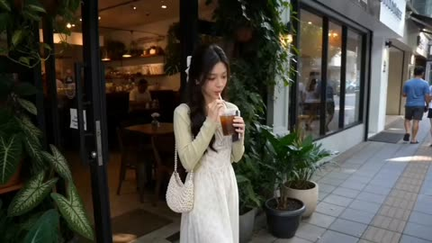</a>

Each of the six scenes is numbered and repeats the same wardrobe, hair and bag description, which keeps the character identical across cuts. Every beat names its camera move (wide, close up, tracking, slow motion) and its light source, so the golden hour, blue hour and fairy light shifts read clearly on the timeline.

Seedance 2.5 · Text-to-video · Source: [@ZorviaLux on X](https://x.com/ZorviaLux/status/2106230270282313997) · found via [LearnPrompt/awesome-seedance](https://github.com/LearnPrompt/awesome-seedance)

[`vlog`](tags.md#tag-vlog) [`character-consistency`](tags.md#tag-character-consistency) [`multi-scene`](tags.md#tag-multi-scene) [`korean`](tags.md#tag-korean)

<details><summary><b>Prompt</b></summary>

```text
Create a 60-second ultra-realistic cinematic lifestyle vlog featuring a beautiful young Korean woman with long dark brown hair, soft natural makeup, and a gentle smile. She wears a delicate white floral dress with a light cream cardigan and carries a small white handbag.

**Scene 1:** She stands outside a modern aesthetic café surrounded by lush green plants and glass windows. She holds an iced coffee, takes a sip, gently adjusts her hair, and smiles naturally at the camera.

**Scene 2:** Close-up cinematic shots of her face as she enjoys her coffee. Soft sunlight illuminates her face. She looks relaxed and happy, with subtle natural movements.

**Scene 3:** She walks along a beautiful city street during golden hour, wearing the same outfit. The camera follows her from behind and captures elegant side-profile shots.

**Scene 4:** She arrives at a rooftop viewpoint overlooking a beautiful city skyline during sunset. The golden sun slowly sets behind the buildings. She sits on a bench, gazes at the sunset, and enjoys the peaceful atmosphere.

**Scene 5:** At blue hour, she walks along a modern urban street with glowing streetlights and passing cars. The camera captures her beautiful side profile and flowing hair in a cinematic tracking shot.

**Scene 6:** Nighttime outdoor café with warm fairy lights hanging overhead. She sits at a cozy wooden table with her iced coffee and handbag. She smiles at the camera, raises her drink, takes a sip, and waves goodbye with a cheerful expression.

**Visual style:** Ultra-realistic 4K, photorealistic skin texture, natural facial expressions, cinematic depth of field, soft lighting, warm golden-hour tones, beautiful bokeh, smooth camera movements, professional color grading, realistic hair physics, natural body movements, aesthetic Korean lifestyle vlog, dreamy peaceful atmosphere.

**Camera:** Mix of wide shots, medium shots, close-ups, slow-motion details, smooth tracking shots, and gentle cinematic transitions.

**Mood:** Peaceful, romantic, cozy, elegant, dreamy everyday life.

Maintain perfect character consistency, identical facial features, hairstyle, clothing, and accessories across all scenes. No distorted hands, no flickering, no face changes, no unnatural movements, no text, no watermark.
```

</details>

<a id="seedance-korean-campus-day-vlog"></a>
### Korean student selfie on a city bus

<a href="https://x.com/aiwithaly/status/2096818423846334683">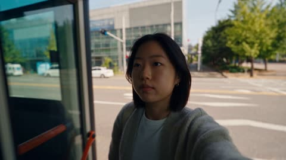</a>

The prompt splits one day into ordered scene beats with named locations, then fixes the camera language (handheld selfie, POV, autofocus) and a sound list so the look stays consistent across cuts. It also sets English dialogue only and no background music, which keeps the clip grounded in location audio.

Seedance 2.5 · Text-to-video · Source: [@aiwithaly on X](https://x.com/aiwithaly/status/2096818423846334683) · found via [LearnPrompt/awesome-seedance](https://github.com/LearnPrompt/awesome-seedance)

[`vlog`](tags.md#tag-vlog) [`korean-campus`](tags.md#tag-korean-campus) [`day-in-life`](tags.md#tag-day-in-life) [`pov-selfie`](tags.md#tag-pov-selfie)

<details><summary><b>Prompt</b></summary>

```text
Create a 30-second photorealistic live-action 2026 Korean university lifestyle vlog following a young Korean female student through one beautiful ordinary day. Start with a morning city-bus ride and ocean-like city reflections through the window, then move naturally through a busy campus lecture, iced coffee break, quiet library study, cafeteria lunch with a friend, energetic dance-club practice, golden-hour campus walk, and peaceful blue-hour night stroll.

Use authentic modern Korean university surroundings, natural student clothing, realistic Korean facial features, subtle expressions and spontaneous interactions. High-end smartphone vlog aesthetic with handheld movement, selfie shots, POV footage, natural autofocus, exposure changes and realistic motion blur. Hair, cardigan, backpack and objects react naturally to movement, wind and gravity. Include realistic bus movement, walking, dancing, coffee condensation, food steam and believable human biomechanics.

English dialogue only, with natural location sounds such as bus noise, classroom ambience, café chatter, footsteps, cafeteria sounds, dance-room audio and nighttime campus ambience. No narrator, no background music, no CGI, animation, subtitles, logos or watermark.
```

</details>

<a id="seedance-korean-convenience-store-friends-vlog"></a>
### Two friends pick snacks at a convenience store fridge

<a href="https://x.com/ayzalnooor24521/status/2109850322286076180">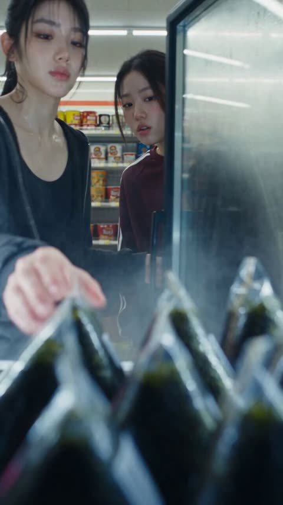</a>

The prompt splits the clip into ordered beats (store, night street, walking away) so each scene change is explicit. Fixed wardrobe for each girl plus handheld camera, ambient sound and documentary cues keep the look consistent and natural.

Seedance 2.5 · Text-to-video · Source: [@ayzalnooor24521 on X](https://x.com/ayzalnooor24521/status/2109850322286076180) · found via [LearnPrompt/awesome-seedance](https://github.com/LearnPrompt/awesome-seedance)

[`korean`](tags.md#tag-korean) [`street-vlog`](tags.md#tag-street-vlog) [`convenience-store`](tags.md#tag-convenience-store) [`documentary`](tags.md#tag-documentary)

<details><summary><b>Prompt</b></summary>

```text
Created a 30-second ultra-realistic cinematic Korean street vlog, vertical 9:16 format. Beautiful Korean girl with natural Korean beauty, fair clear skin, delicate facial features, dark eyes, and black hair tied in a casual ponytail, wearing a simple black oversized sweatshirt, loose dark track pants, and black-and-white sneakers. Her female friend wears a burgundy zip-up jacket and dark pants. The video begins inside a Korean convenience store, where the girl casually selects food from a refrigerated display while her friend stands nearby. She then pays at the checkout counter, holding a bottle of water and snacks. The scene transitions to a nighttime Korean street, where both girls sit at a small blue outdoor plastic table and chairs under cool streetlights, enjoying their snacks, checking their phones, drinking water, and chatting naturally with relaxed expressions. One girl smiles while looking at her phone, and the other takes a bite of her food and drinks from her water bottle. Near the end, one girl stands up, gathers her belongings, and walks away, leaving the empty blue chairs and table behind as her friend moves into the distance. Authentic Korean everyday lifestyle, candid moments, natural body movements, realistic facial expressions, subtle handheld camera movement, soft focus, shallow depth of field, convenience-store fluorescent lighting, cinematic blue nighttime tones, realistic skin texture, natural ambient street sounds, documentary-style storytelling, high-quality details, consistent character appearance throughout, no exaggerated acting, no artificial beauty filters, no text, no subtitles, no watermark.
```

</details>

<a id="seedance-korean-countryside-chicken-coop-morning-vlog"></a>
### Korean Countryside Morning Chicken Coop Vlog

<a href="https://x.com/aiwithaly/status/2097556131623432569"></a>

The action chain is written as arrow separated beats, which gives a 30 second clip a clear order. Documentary handheld style, weather and sound cues (mist, wind, ambient audio) and a closing list of exclusions (no music, subtitles, logos) keep the result natural.

Seedance 2.5 · Text-to-video · Source: [@aiwithaly on X](https://x.com/aiwithaly/status/2097556131623432569) · found via [LearnPrompt/awesome-seedance](https://github.com/LearnPrompt/awesome-seedance)

[`vlog`](tags.md#tag-vlog) [`korean-countryside`](tags.md#tag-korean-countryside) [`documentary`](tags.md#tag-documentary) [`handheld`](tags.md#tag-handheld) [`morning-routine`](tags.md#tag-morning-routine)

<details><summary><b>Prompt</b></summary>

```text
Create a 30-second photorealistic Korean countryside lifestyle vlog following a woman through her peaceful morning routine. Show her opening the chicken coop → feeding the chickens → collecting fresh eggs → cleaning the coop → preparing a homemade breakfast → sitting outside and enjoying the quiet farmhouse morning.

Authentic 2026 Korean rural life, natural human movement, realistic chicken behavior, fresh farm-to-table details, morning mist, soft sunlight, natural wind and environmental sounds, and documentary-style handheld cinematography. No background music, subtitles, logos or watermark.
```

</details>

<a id="seedance-korean-couple-lazy-morning-pov-walk"></a>
### Korean couple lazy summer morning POV walk

<a href="https://x.com/AIwithJessica/status/2096779054720639258"></a>

Reference images lock both outfits and faces, then ten timed three second beats keep one small action per shot across a 30 second vlog. A MiniDV handheld style, location only sound and a closing continuity list keep it realistic.

Seedance 2.5 · Reference-to-video · Source: [@AIwithJessica on X](https://x.com/AIwithJessica/status/2096779054720639258) · found via [LearnPrompt/awesome-seedance](https://github.com/LearnPrompt/awesome-seedance)

[`pov-vlog`](tags.md#tag-pov-vlog) [`korean-lifestyle`](tags.md#tag-korean-lifestyle) [`couple`](tags.md#tag-couple) [`minidv`](tags.md#tag-minidv) [`reference-images`](tags.md#tag-reference-images)

<details><summary><b>Prompt</b></summary>

```text
POV: Korean couple spends a lazy summer morning wandering their neighborhood 🇰🇷 Create a 30-second, 16:9 ultra-realistic live-action POV vlog using the uploaded reference images as the exact character references. Girl: preserve her face, long straight dark hair, eye color, skin tone, soft natural makeup, delicate drop earrings, and body proportions exactly as in reference image 2, wearing her sage-green sleeveless ribbed knit vest and white wide-leg trousers throughout. Boy: preserve his face, tousled dark wavy hair, earrings, layered silver chain necklace, chain bracelet and wristwatch exactly as in reference image 1, wearing his oversized dusty-pink smiley-face tee and white sweatshorts throughout.

Style: Authentic Korean lifestyle vlog, early-2000s MiniDV/home-video aesthetic, handheld POV, imperfect framing, slight autofocus breathing, natural motion blur and exposure changes, soft overcast morning light. Spontaneous, unstaged chemistry.

0–3s: She leans against a textured green courtyard wall, laughing as she films him approaching down the lane with two iced coffees.

3–6s: They walk side by side down the narrow concrete alley, camera swinging naturally; he hands her a coffee and she takes a sip, smiling at the lens.

6–9s: She spins slowly in front of an old wall covered in dappled tree-shadow, showing off her outfit; he claps and whistles playfully off-camera.

9–12s: They pause by a row of parked bicycles; he pretends to ride one and she films, giggling, telling him to stop.

12–15s: Inside the small convenience store, she picks a snack from the shelf while he sneaks a second item into her basket; she catches him and narrows her eyes.

15–18s: Outside the store, they sit on a low step sharing the snack, passing it back and forth, natural laughter between bites.

18–21s: Walking again, she films their shadows stretching across the pavement; he reaches over and gently tucks a strand of her hair back.

21–24s: They stop by a wall of hanging laundry and potted plants; she pretends to interview him with the coffee cup as a microphone.

24–27s: He points out something off-camera; she turns to look, laughing, then bumps his shoulder with hers.

27–30s: They continue walking down the sunlit lane, hand in hand, camera trailing behind as they shrink into the distance; she glances back once, smiling, before the frame settles into a soft handheld sway.

Audio: Natural location sound only—quiet residential ambience, birds, distant traffic, footsteps, rustling laundry, convenience store door chime, soft conversation and laughter. No music, narration or artificial SFX.

Continuity/realism: Same woman and boyfriend throughout; consistent wardrobe and appearance matching the reference images exactly, believable Korean neighborhood environment, realistic physics and movement, natural couple chemistry. No teleportation, duplicates, distorted faces/hands, exaggerated acting, subtitles, captions, logos or watermarks.
```

</details>

<a id="seedance-korean-couple-seoul-drive-dv-camcorder"></a>
### Korean couple afternoon drive in DV camcorder style

<a href="https://x.com/AIwithkhan/status/2104776214066188611"></a>

Sections for characters, a beat by beat story, camera feel, audio, continuity and negatives keep a 30 second piece coherent. The DV look comes from named flaws like autofocus hunting, accidental zooms and exposure shifts, plus a built in microphone only soundscape with no music.

Seedance 2.5 · Text-to-video · Source: [@AIwithkhan on X](https://x.com/AIwithkhan/status/2104776214066188611) · found via [LearnPrompt/awesome-seedance](https://github.com/LearnPrompt/awesome-seedance)

[`dv-camcorder`](tags.md#tag-dv-camcorder) [`couple`](tags.md#tag-couple) [`seoul`](tags.md#tag-seoul) [`lo-fi-realism`](tags.md#tag-lo-fi-realism) [`native-audio`](tags.md#tag-native-audio)

<details><summary><b>Prompt</b></summary>

```text
Create a 30-second, 1080p ultra-realistic early-2000s consumer DV camcorder home video of a young Korean couple going for a casual afternoon drive through Seoul. The footage should feel like a genuine memory recorded by a friend, imperfect and spontaneous rather than a polished commercial.

=== CHARACTERS ===

GIRL: Young adult Korean woman in her early 20s, naturally beautiful, realistic skin, minimal makeup, long slightly wavy dark hair tied loosely with a few strands framing her face. Ll

BOYFRIEND: Young adult Korean man in his early 20s, natural hairstyle, realistic skin, relaxed expression, wearing a loose white T-shirt, dark jeans and white sneakers. Keep his appearance consistent.

=== STORY ===

She waits outside her apartment building with a small shoulder bag, checking her phone and looking down the street. Her boyfriend arrives in an older compact car and smiles when he sees her. She opens the passenger door, gets inside and playfully looks toward the camera as if embarrassed about being filmed.

They drive slowly through an older Seoul neighborhood. She sits in the passenger seat with the window slightly open, enjoying the breeze while her hair moves naturally. Her boyfriend occasionally glances at her and smiles while keeping his attention on the road.

They stop at a small neighborhood convenience store. She gets out, buys two cold drinks and returns to the car. She hands one to her boyfriend, keeps the other for herself, and they laugh together before continuing the drive.

Later, they park near a quiet riverside road. They get out and walk beside the parked car, talking casually. She takes a sip of her drink, makes a playful expression at the taste, and he laughs. She lightly pushes his shoulder and they continue walking together.

A gentle breeze moves through her hair. He notices a strand across her face and gently moves it aside. She smiles and looks at him for a moment. They stand close together beside the car, sharing a quiet romantic moment.

Near the end, she looks toward the camera and laughs shyly, then turns back toward her boyfriend. He steps closer, she smiles, and they share a brief, natural kiss. They pull back, laugh softly and remain standing close together as the camera keeps recording.

The boyfriend looks toward the camera and jokingly shakes his head while she hides her face against his shoulder, laughing.

=== CAMERA / DV FEEL ===

Raw early-2000s consumer DV camcorder footage. Handheld camera operated by a friend sitting in the back seat and later walking with them. Imperfect framing, subtle handheld shake, autofocus hunting, occasional exposure shifts, faded summer colors, soft digital detail, mild sensor noise, natural motion blur and occasional accidental zooms. No stabilization and no polished cinematic movement.

=== AUDIO ===

Built-in camcorder microphone only. Car engine, road noise, turn signals, window breeze, distant Seoul traffic, convenience-store door chime, refrigerator hum, footsteps, birds, neighborhood voices, fabric movement and natural laughter. Their dialogue should feel casual and partially imperfect like a real home video. No music, no narration, no subtitles.

=== REALISM / CONTINUITY ===

Keep the same couple, faces, hairstyles, outfits, accessories and car throughout. Natural Korean facial features, realistic hands and fingers, believable walking, sitting, driving and kissing. Hair and clothing react naturally to the breeze and movement. Genuine expressions rather than exaggerated acting.

=== NEGATIVE ===

No cinematic commercial look, no gimbal shots, no drone shots, no dramatic lighting, no beauty filters, no plastic skin, no CGI appearance, no anime, no cartoon
```

</details>

<a id="seedance-korean-farm-day-front-facing-home-video"></a>
### Korean Farm Day Filmed Like Home Video

<a href="https://x.com/saniaspeaks_/status/2098742251472261330"></a>

A timeline of five 5 second beats keeps a 30 second clip coherent. Repeated rules for a camera always in front, handheld DV flaws and sound limited to location audio keep the home-video realism.

Seedance 2.5 · Text-to-video · Source: [@saniaspeaks_ on X](https://x.com/saniaspeaks_/status/2098742251472261330) · found via [LearnPrompt/awesome-seedance](https://github.com/LearnPrompt/awesome-seedance)

[`home-video`](tags.md#tag-home-video) [`dv-camcorder`](tags.md#tag-dv-camcorder) [`korean`](tags.md#tag-korean) [`vlog`](tags.md#tag-vlog) [`farm`](tags.md#tag-farm)

<details><summary><b>Prompt</b></summary>

```text
Create a 30-second, 1080p ultra-realistic personal home-video showing an ordinary summer afternoon in the life of a young Korean woman visiting a small traditional farm and helping with the animals. No reference image.

A naturally pretty beautiful Korean woman in her early 20s, realistic natural skin texture, minimal makeup, relaxed and cheerful personality. Long black hair tied in a loose low ponytail. She wears a loose white cotton T-shirt, light olive-green cargo pants, brown ankle boots, and a beige canvas crossbody bag. Keep the same face, hairstyle, clothing, body proportions, and overall appearance throughout the entire video.

A small traditional countryside farm outside Seoul during a warm summer afternoon. Wooden fences, green fields, an old farmhouse, barn, hay bales, vegetable patches, chickens, cows, buckets, farming tools, trees and natural countryside surroundings. The farm feels ordinary and lived-in, not like a tourist attraction.

The camera is ALWAYS positioned IN FRONT OF THE GIRL, never behind her. A friend stands or walks in front of her, casually filming her with a handheld consumer DV camcorder/smartphone. Her front face must remain clearly visible during the important moments. The camera naturally moves backward while she walks toward it. Use imperfect handheld movement, small shakes, slightly uneven framing, autofocus hunting, occasional exposure changes, natural motion blur, soft digital detail, mild image noise, faded early-2000s home-video colors, and occasional accidental zooms.

Absolutely NO rear-view shots, NO filming from behind, NO drone, NO gimbal, NO cinematic tracking shots, NO polished commercial look, NO beauty filter. It should genuinely feel like a friend casually recorded this afternoon.

TIMELINE

0:00–0:05 — Arriving at the Farm

The girl walks toward the farm entrance while the friend walks backward in front of her filming. She smiles naturally and looks around at the animals and fields. She says casually in Korean:

“오늘 농장에 왔어요.”

Natural footsteps, birds, insects and distant farm sounds.

0:05–0:10 — Feeding the Cow

Still filmed from the front, the girl approaches a calm cow and holds out fresh vegetables. The cow gently eats from her hand. She laughs naturally and looks at the camera, then back at the cow.

0:10–0:15 — Helping With Vegetables

Hard cut. The camera remains in front of her as she walks through a vegetable patch and picks fresh vegetables. She holds them up toward the camera with a happy smile.

0:15–0:20 — Chickens

Hard cut. Several chickens suddenly walk across the path in front of her. The camera stays facing her from the front as she laughs and carefully steps around them. One chicken comes close to her boots.

0:20–0:25 — Farmhouse Break

She sits outside the farmhouse with a basket of freshly picked vegetables and eats a piece of fresh fruit. She looks relaxed and slightly tired from working. She smiles at the camera and says:

“생각보다 재밌어요.”

0:25–0:30 — Walking Away / Goodbye
She gets up and walks toward the camera, then stops near the farm entrance. The friend keeps filming from directly in front of her. She gives a small wave and says:

“다음에 또 올게요. 안녕!”

She walks past the camera as the recording ends naturally.

AUDIO:
Only authentic location sound: birds, chickens, cows, insects, footsteps, leaves, distant farm activity and natural conversation. No background music, no narration, no artificial sound effects.

FINAL LOOK:
Completely believable real-life home-video footage. Slightly imperfect, spontaneous, unpolished and human. Front-facing camera coverage throughout the story, with the girl's face clearly visible.
```

</details>

<a id="seedance-korean-man-errand-home-video"></a>
### Young man's errand day in a handheld home video

<a href="https://x.com/Aqib__786Ai/status/2092122339463090626">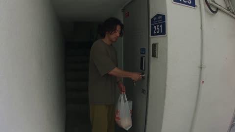</a>

The prompt locks identity and wardrobe in one block, then gives timestamped beats with an imperfect handheld camera spec so the clip reads as casual footage rather than a polished shot. Natural location sound is listed explicitly and music and narration are banned, which keeps the audio grounded.

Seedance 2.5 · Text-to-video · Source: [@Aqib__786Ai on X](https://x.com/Aqib__786Ai/status/2092122339463090626) · found via [LearnPrompt/awesome-seedance](https://github.com/LearnPrompt/awesome-seedance)

[`home-video`](tags.md#tag-home-video) [`slice-of-life`](tags.md#tag-slice-of-life) [`handheld`](tags.md#tag-handheld) [`ambient-audio`](tags.md#tag-ambient-audio)

<details><summary><b>Prompt</b></summary>

```text
Create a 30-second, 1080p ultra-realistic personal home-video showing an ordinary day in the life of a young Korean man. No reference image.

MAIN SUBJECT

Young Korean man in his early 20s, naturally attractive, realistic skin texture, minimal grooming, relaxed and slightly sleepy expression.

Medium-length naturally messy black hair, subtle stubble, a few loose strands falling across his forehead.

Wearing an oversized faded charcoal T-shirt, loose olive trousers, worn sneakers, and a simple silver watch.

Maintain the same face, hairstyle, clothing, body proportions, and appearance throughout the entire video.

SETTING

A quiet older residential neighborhood during a warm summer afternoon.

Small apartment buildings, narrow concrete alleys, rooftop terraces, neighborhood laundries, corner shops, parked bicycles, potted plants, utility wires, concrete staircases, trees providing patches of shade, and ordinary people going about their day.

Everything should feel lived-in and authentic.

CAMERA / VISUAL AESTHETIC

Raw personal footage casually recorded by a friend.

Handheld camera with natural shake, imperfect framing, occasional partial crops, autofocus hunting, exposure shifts between sunlight and shade, mild motion blur, soft image detail, subtle digital noise, slightly faded colors, and natural camera imperfections.

The camera operator walks with him and reacts naturally.

No stabilization, no cinematic camera movements, no dramatic lighting, no slow motion, no polished commercial appearance.

The footage should feel accidentally beautiful rather than deliberately cinematic.

⸻

00:00–00:05 — LEAVING HOME

He steps out of his apartment carrying a small reusable shopping bag.

He locks the door, checks his pockets for his keys and phone, then starts walking downstairs.

The camera follows behind him.

He briefly looks back at the camera and gives a sleepy half-smile.

⸻

00:05–00:10 — MORNING ERRAND

He walks through a quiet neighborhood alley toward a small local grocery shop.

He passes parked bicycles and people watering plants outside their homes.

He stops at a roadside fruit stand and picks up a couple of oranges, inspecting them casually before placing them into his bag.

The camera briefly focuses on the fruit before returning to his face.

⸻

00:10–00:15 — SMALL BREAK

He sits on a low concrete wall outside the shop.

He opens a cold bottled drink and takes a few sips.

A breeze moves his hair.

He watches people passing by without saying anything.

The camera stays slightly shaky and imperfectly framed, as if his friend is simply sitting nearby filming him.

⸻

00:15–00:20 — WALKING HOME

He gets up and continues walking.

A bicycle passes behind him.

He notices a stray cat sitting beside a wall, crouches down and gently pets it.

The cat walks away.

He laughs quietly and stands back up.

The camera operator accidentally cuts off part of his head while moving closer, then quickly reframes him.

⸻

00:20–00:25 — ROOFTOP

He returns home and walks onto a small rooftop.

He places the shopping bag beside an old chair.

He leans against the railing and looks across the neighborhood.

The afternoon sunlight falls naturally across his face.

He runs his hand through his messy hair and quietly watches the distant buildings.

⸻

00:25–00:30 — FINAL MOMENT

He notices the camera still recording.

He looks directly into the lens and gives a tiny amused smile.

He casually says:

“You’re still recording?”

He shakes his head and walks toward the camera.

The camera moves backward slightly as he approaches.

The recording abruptly cuts to black before he reaches the camera.

⸻

AUDIO

Natural location sound only:

Footsteps, distant traffic, bicycles, birds, wind, neighborhood conversations, shop sounds, bottle opening, fabric movement, doors closing, and subtle handheld camera noise.

No music.

No narration.

No artificial sound effects.

Only the single spoken line: “You’re still recording?”

⸻

FINAL FEEL

The entire video should feel like a completely ordinary day that somehow became a beautiful memory.

Quiet, masculine, youthful, intimate, warm, slightly nostalgic, and spontaneous.

No dramatic events.

No exaggerated acting.

No model poses.

No cinematic hero shots.

The realism should come from tiny imperfections, casual body language, natural expressions, ordinary surroundings, imperfect camera operation, and moments that feel completely unplanned.
```

</details>

<a id="seedance-korean-market-handheld-vlog"></a>
### Handheld vlog of woman at rural Sunday market

<a href="https://x.com/Ciri_ai/status/2092839994499174581">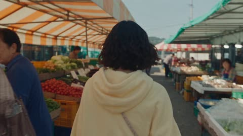</a>

Each five second beat names one concrete action, and the handheld jitter, autofocus hunting and jogging operator are tied to those actions so the footage reads as real phone capture. Audio is locked to location sound plus two quoted lines, with music and narration explicitly banned so the model does not add them.

Seedance 2.5 · Text-to-video · Source: [@Ciri_ai on X](https://x.com/Ciri_ai/status/2092839994499174581) · found via [LearnPrompt/awesome-seedance](https://github.com/LearnPrompt/awesome-seedance)

[`handheld-vlog`](tags.md#tag-handheld-vlog) [`korean-market`](tags.md#tag-korean-market) [`found-footage`](tags.md#tag-found-footage) [`rural-life`](tags.md#tag-rural-life)

<details><summary><b>Prompt</b></summary>

```text
Create a 30-second, 1080p ultra-realistic personal home-video showing an ordinary Sunday morning in the life of a young Korean woman. No reference image.

MAIN SUBJECT

Young Korean woman in her early 20s, natural and approachable look, realistic skin texture with visible pores, bare-faced or barely-there makeup, warm and slightly playful expression.

Shoulder-length wavy black hair left down, side-swept bangs, small mole near her left eye.

Wearing an oversized pastel-yellow hoodie, loose gray jogger pants, fuzzy slide sandals, and a small crossbody pouch bag.

Maintain the same face, hairstyle, clothing, body proportions, and appearance throughout the entire video.

SETTING

A small countryside town on a bright, breezy Sunday morning.

A traditional outdoor market with striped awnings, crates of vegetables, a fishmonger's stall, an old bus stop with a rusted bench, a narrow road running alongside rice paddies, a local bakery with a hand-painted sign, a grandmother's front yard with drying red peppers on a mat, chickens wandering nearby, and mountains faintly visible in the background. Everything sun-bleached, dusty, and authentically rural.

CAMERA / VISUAL AESTHETIC

Raw personal footage casually recorded by a friend, strong handheld vlog feel throughout.

Constant natural hand shake and micro-jitters, footsteps visibly bouncing the frame, imperfect and often off-center framing, occasional partial crops of her face or shoulder, autofocus visibly hunting between her and the background, exposure flaring when the camera swings toward the sun, mild motion blur on quick turns, soft image detail, subtle digital noise, slightly warm and faded color grading like an old phone camera.

The camera operator walks and jogs to keep up with her, breathing audible at times, camera dipping and swaying with each step.

No stabilization, no gimbal smoothness, no cinematic camera movements, no dramatic lighting, no slow motion, no polished commercial appearance.

The footage should feel like a real, unplanned phone recording — accidentally beautiful rather than deliberately cinematic.

---

00:00–00:05 — MARKET ENTRANCE

She weaves through the outdoor market stalls, the camera bouncing behind her as it struggles to keep pace.

She stops briefly to pick up a small bag of cherry tomatoes, holding them up toward the camera with a grin.

The frame jolts as the operator steps over a crate in the path.

**00:05–00:10 — FISH STALL DETOUR**

She wanders to the fishmonger's stall, wrinkling her nose playfully at the smell and laughing.

The camera whip-pans slightly too fast trying to follow her hand gesture, briefly blurring before catching focus again.

She waves the camera away, still laughing: *"Ugh, don't film that, film me!"*

**00:10–00:15 — BUS STOP WAIT**

She jogs to catch the local bus stop bench just as an old bus pulls away without her, the camera shaking hard from the sudden running motion.

She throws her hands up in mock frustration, plops down on the rusted bench, and sighs dramatically, laughing at herself.

The frame settles slightly off-center as she rests her chin on her palm.

**00:15–00:20 — RICE PADDY ROAD**

She walks along the narrow road beside the rice paddies, wind blowing loose strands across her face.

The camera drifts low near her feet as she kicks a small pebble, then swings back up to her face, slightly overexposed from the open sky.

She spins around once with her arms out, the frame swaying and overshooting past her before correcting.

**00:20–00:25 — GRANDMOTHER'S YARD**

She ducks into a yard where red peppers dry on a mat, crouching to gently shoo away a curious chicken pecking near her sandals.

The camera jerks back suddenly as the chicken flaps its wings, both of them startled and laughing.

She picks up a dried pepper, sniffs it, makes a face, and tosses it back down.

**00:25–00:30 — FINAL MOMENT**

She grabs a warm bag of fresh bread from the nearby bakery counter, takes a big bite, and turns straight to the camera mid-chew.

The frame shakes as she leans in too close, filling half the screen with her grinning face.

She says, muffled and amused:

*"Okay, stop filming me eating!"*

She swats the camera lens with her hand, and the footage cuts abruptly to black, mid-laugh.

---

**AUDIO**

Natural location sound only:

Market chatter, footsteps crunching on gravel, a bus engine pulling away, wind, chickens clucking, rustling plastic bags, distant rooster crow, bread bag crinkling, the operator's breathing and quiet laughter, and audible handheld camera noise.

No music. No narration. No artificial sound effects.

Only the spoken lines: *"Ugh, don't film that, film me!"* and *"Okay, stop filming me eating!"*

**FINAL FEEL**

The entire video should feel like a chaotic, cheerful, completely unplanned Sunday morning caught on a friend's phone — bright, breezy, playful, and warmly nostalgic.

No dramatic events. No exaggerated acting. No model poses. No cinematic hero shots.

The realism should come from constant handheld imperfection, sun glare, dust, uneven pacing, real laughter, and moments that feel genuinely caught rather than staged.
```

</details>

<a id="seedance-korean-morning-routine-day-in-the-life"></a>
### Woman wakes up and starts a quiet morning

<a href="https://x.com/ChillaiKalan__/status/2095812367527616536"></a>

The reference image is locked as the exact first frame, and identity, outfit and lighting rules are repeated for every beat so the model keeps one person and one light source across cuts. Handheld documentary framing with ambient audio only and no music keeps the clip grounded in everyday life rather than ad polish.

Seedance 2.5 · Image-to-video · Source: [@ChillaiKalan__ on X](https://x.com/ChillaiKalan__/status/2095812367527616536) · found via [LearnPrompt/awesome-seedance](https://github.com/LearnPrompt/awesome-seedance)

[`korean`](tags.md#tag-korean) [`morning-routine`](tags.md#tag-morning-routine) [`day-in-the-life`](tags.md#tag-day-in-the-life) [`handheld`](tags.md#tag-handheld) [`ambient-audio`](tags.md#tag-ambient-audio)

<details><summary><b>Prompt</b></summary>

```text
30 seconds | 16:9 | Ultra-photorealistic live-action

Create a natural Korean morning-routine day-in-the-life video featuring one young Korean woman waking up 
and easing into her quiet morning at home.

Use the reference image as the EXACT starting frame — she is lying in bed, just waking up. Use the 
reference image for her exact facial identity, hairstyle, skin tone, and body proportions. Keep her 
appearance consistent throughout the entire video. The video begins from this reference pose and moves 
forward naturally.

OUTFIT: Soft cream/white cotton loungewear or a light pajama set to start; she stays in comfortable 
loungewear throughout (no wardrobe change). Minimal or no jewelry. Hair natural and slightly tousled 
from sleep at the start, settling as the morning goes on.

TIME & LIGHTING: Soft early-morning summer sunlight, gradually warming as the morning progresses. Gentle, 
consistent natural light, shadows, color temperature, and time of day across every scene.

00–05s — Waking up (starts from reference image)
The video opens on the exact reference pose — she is lying in bed, eyes just opening, waking up slowly. 
Soft morning light filters through sheer curtains onto the bed. She stirs gently, blinks, and slowly 
sits up, stretching her arms with a soft, sleepy motion. Her hair is naturally tousled.
She rubs her eyes, looks softly toward the window, and quietly says:
"Morning already…"

05–11s — Out of bed
She swings her legs off the bed and stands, stretching gently. She pads across the room and opens the 
curtains — bright morning light floods in. She looks out the window for a moment at the quiet neighborhood 
outside (rooftops, trees, soft sky). Natural, unhurried movement.

11–17s — Washing up
She walks to the bathroom sink. She turns on the faucet and splashes cool water on her face, then pats 
it dry with a soft towel. Water droplets fall naturally. She looks at herself briefly in the mirror, 
tucks her hair behind her ear, and takes a slow breath. Fresh and calm.

17–23s — Making breakfast / morning drink
She moves to the kitchen. She fills a kettle and sets it to boil, then takes a mug and a tea bag (or 
pour-over coffee) from the counter. Steam rises as she pours the hot water — the liquid swirls naturally 
in the mug. She sets a simple breakfast on a small plate (toast, fruit, or a pastry). Gentle, homey 
morning movements.

23–30s — Quiet morning moment
She sits by the window with her warm mug and breakfast, both hands wrapped around the cup. She takes a 
slow first sip, pauses, and smiles softly.
She looks out at the morning light and quietly says:
"Perfect start."
The camera slowly drifts backward, capturing the cozy bedroom/kitchen, the open window, gentle curtain 
movement, soft morning light, and the calm start-of-day atmosphere.
Cut naturally at the end.

CAMERA STYLE: Documentary lifestyle footage with smooth handheld movement. Natural tracking shots, 
occasional subtle camera sway, realistic focus transitions, restrained depth of field, natural lens 
behavior, and authentic perspective. Avoid overly cinematic shots or commercial advertising aesthetics.

AUDIO: Real environmental audio only — soft morning ambience, birdsong outside, sheets rustling, a gentle 
yawn, curtains sliding open, water running, towel patting, kettle boiling, water pouring into a mug, a 
spoon clinking, breathing, and natural sipping sounds. No background music.

PHYSICAL REALISM: The bedsheets shift and drape naturally as she wakes and rises. Her stretching, standing, 
and walking feel spontaneous and physically accurate. Water flows and droplets fall naturally. The kettle 
steams and the liquid pours with realistic fluid dynamics. Hands maintain believable grip and pressure. 
All body movements — waking, stretching, walking, washing, pouring, sitting, sipping — should feel natural 
and unforced.
```

</details>

<a id="seedance-korean-school-rooftop-sunset"></a>
### Two students chase papers on a sunset rooftop

<a href="https://x.com/Aqsahere_/status/2091001743035564070">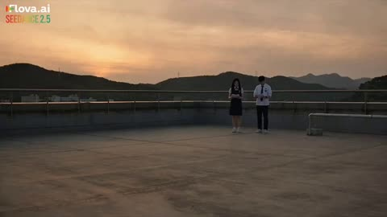</a>

Reference images lock both students' faces, hair and uniforms, and the prompt numbers seven camera setups so the sequence stays coherent. Specific cues for wind, imperfect autofocus, subtle handheld shake and a list of banned looks keep it reading as real school footage rather than a commercial.

Seedance 2.5 · Reference-to-video · Source: [@Aqsahere_ on X](https://x.com/Aqsahere_/status/2091001743035564070)

[`handheld-camera`](tags.md#tag-handheld-camera) [`reference-faces`](tags.md#tag-reference-faces) [`school-life`](tags.md#tag-school-life) [`sunset`](tags.md#tag-sunset)

<details><summary><b>Prompt</b></summary>

```text
photorealistic live-action Korean high-school rooftop scene at sunset. Use the provided references to preserve Seolran and Mujin’s exact faces, hairstyles, body proportions, school uniforms, and the real rooftop environment. Exactly two students are present. A strong sudden gust of wind hits the rooftop and scatters their loose homework papers across the concrete. Seolran and Mujin react naturally and immediately run in different directions trying to catch the flying pages. Papers blow realistically around their legs and across the rooftop, some sliding along the ground while others briefly lift into the air. They chase the pages with natural hurried movements, occasionally almost catching one before the wind pulls it away. Mujin manages to grab several pages and tries to hand them back to Seolran, but another gust sends one page directly toward her face. The paper gently lands against her face for a moment. She freezes in surprise, pulls it away, looks at Mujin, and they both burst into natural laughter. End with them standing together collecting the remaining papers while the warm sunset and distant mountains remain in the background. Use 7 distinct handheld camera shots: wide rooftop establishing shot, low angle following the papers, side tracking shot while they run, close-up of their hands grabbing papers, medium shot of them chasing in opposite directions, close-up when the paper hits Seolran’s face, and a final wide sunset shot of both laughing and gathering the homework. Make it feel like authentic Korean school-life footage rather than a commercial: realistic smartphone/cinema-camera texture, natural sunset lighting, believable wind physics, realistic paper movement, natural hair and uniform movement, subtle handheld camera shake, imperfect autofocus, natural facial expressions, realistic skin texture and breathing, spontaneous body movement and genuine laughter. No exaggerated comedy, no slow motion, no music, no subtitles, no logos, no watermarks, no CGI, no fantasy, no extra people, no distorted hands or anatomy.
```

</details>

<a id="seedance-korean-seaside-harbor-flip-camera-vlog"></a>
### Korean Seaside Harbor Walk Flip Camera Vlog

<a href="https://x.com/ShamiWeb3/status/2096101448090267992"></a>

A timestamped beat list in four second slots gives each action and spoken Korean line its own window, so a 30 second vlog stays coherent. A fixed style block of late 2000s flip camera flaws, a negative list against polish, and a sound only ambience paragraph keep the look raw and authentic.

Seedance 2.5 · Reference-to-video · Source: [@ShamiWeb3 on X](https://x.com/ShamiWeb3/status/2096101448090267992) · found via [LearnPrompt/awesome-seedance](https://github.com/LearnPrompt/awesome-seedance)

[`vlog`](tags.md#tag-vlog) [`handheld`](tags.md#tag-handheld) [`korean`](tags.md#tag-korean) [`timestamped`](tags.md#tag-timestamped) [`ambient-sound`](tags.md#tag-ambient-sound)

<details><summary><b>Prompt</b></summary>

```text
Preserve the exact facial features, identity, skin tone, and natural facial proportions from @image1 throughout. Do not copy the reference hairstyle or outfit. Outfit: lightweight cream sleeveless blouse, high-waisted faded blue jeans, white canvas sneakers, small gold hoop earrings, loose natural wavy hair. Authentic Korean woman. Late-2000s personal vlog aesthetic. Extremely raw handheld flip-camera footage with heavy camera shake, spontaneous reframing, partial face crops, focus hunting, exposure shifts, warm faded colors, mild digital noise, and authentic home-video imperfections. No posing, no cinematic glamour, no stabilization, no modern color grading.

00:00–00:04 Walking quickly down a narrow seaside alley while holding the camera, suddenly spotting the ocean at the end of the street. She turns the camera toward it and excitedly says in Korean, "잠깐, 바다가 보여요!"

00:04–00:08 Runs toward a small harbor, laughing as the camera shakes heavily. She reaches the railing, leans over carefully, and watches fishing boats moving across the water.

00:08–00:12 Spots a fisherman pulling in a small fishing net and asks if she can help. She grabs one end of the net, struggles with the weight, laughs, and says in Korean, "생각보다 훨씬 무거운데요?"

00:12–00:16 The fisherman shows her a freshly caught fish. She reacts with wide-eyed surprise, steps backward laughing, then cautiously reaches out to touch it while saying, "우와, 진짜 크다!"

00:16–00:20 Walks into a tiny harbor-side snack shop, discovers a bowl of freshly made fish cake soup, sits at the counter, takes a sip, and smiles with satisfaction.

00:20–00:24 Steps outside holding the warm cup, notices a group of neighborhood grandmothers playing a casual Korean card game at a plastic table. She joins them briefly, laughs at their playful reactions, and gestures toward the camera.

00:24–00:27 Walks along the harbor promenade eating a small ice cream, filming boats and seagulls before accidentally getting a little ice cream on her nose. She notices it and laughs.

00:27–00:30 Stops beside the harbor railing as the wind moves her hair, turns the camera toward herself, smiles naturally, and says in Korean, "오늘 진짜 재밌었다. 다음에 또 올게요. 안녕!" She waves and the recording ends abruptly.

Natural ambience only: ocean waves, seagulls, fishing boats, harbor conversations, footsteps, wind, net ropes, shop sounds, card-table laughter, distant scooters, and neighborhood activity. No background music, subtitles, logos, or watermarks. The footage should feel exactly like a genuine late-2000s handheld flip-camera Korean vacation vlog with spontaneous actions, imperfect framing, authentic Korean dialogue, realistic human movement, and natural interactions. Aspect ratio: 16:9.
```

</details>

<a id="seedance-korean-summer-peach-snack-day-in-the-life"></a>
### Korean Summer Afternoon Peach Snack Day

<a href="https://x.com/ChillaiKalan__/status/2094633575547314503"></a>

A timestamped six-beat script in 30 seconds keeps one woman, outfit and light consistent, and a reference image locks her identity. Separate sections for camera style, real environmental audio, physical realism and a negative prompt push the result toward documentary footage instead of ad polish.

Seedance 2.5 · Reference-to-video · Source: [@ChillaiKalan__ on X](https://x.com/ChillaiKalan__/status/2094633575547314503) · found via [LearnPrompt/awesome-seedance](https://github.com/LearnPrompt/awesome-seedance)

[`day-in-the-life`](tags.md#tag-day-in-the-life) [`photorealistic`](tags.md#tag-photorealistic) [`korean`](tags.md#tag-korean) [`documentary`](tags.md#tag-documentary) [`multi-scene`](tags.md#tag-multi-scene)

<details><summary><b>Prompt</b></summary>

```text
30 seconds | 16:9 | Ultra-photorealistic live-action

Create a natural Korean summer day-in-the-life video featuring one young Korean woman spending a quiet afternoon preparing a simple chilled fruit snack at home.

Use the reference image only for her exact facial identity, hairstyle, skin tone, and body proportions. Keep her appearance consistent throughout the entire video.

OUTFIT: Lightweight pale-yellow short-sleeve blouse, loose white cotton pants, simple canvas shoulder bag, white low-profile sneakers, minimal silver jewelry. Outfit remains unchanged from beginning to end.

TIME & LIGHTING: Warm late-afternoon summer sunlight. Consistent weather, shadows, color temperature, and time of day across every scene.

00–05s — Neighborhood walk

She leaves a small Korean apartment building carrying her canvas bag and walks down a quiet residential street.

Trees move gently in the summer breeze. Parked scooters, apartment entrances, utility poles, bicycles, and distant pedestrians create an authentic neighborhood atmosphere.

She briefly looks at the camera and says:
“I need something refreshing today.”

05–10s — Local fruit stand

She arrives at a small neighborhood fruit shop with crates of peaches, grapes, melons and Korean pears.

Instead of immediately picking something, she walks around comparing the fruit.

She notices a basket of peaches, picks one up carefully, examines it, smells it, and smiles.

The shop owner says something casually off-camera.

She responds:
“This one looks perfect.”

She places several peaches into her canvas bag.

10–15s — Walking home

She walks back through the neighborhood carrying the slightly heavier bag.

The camera follows from behind and then moves beside her.

She adjusts the bag against her shoulder as the fruit shifts naturally inside.

A bicycle passes in the background. Leaves move gently in the breeze. Her hair moves subtly with the air.

15–21s — Apartment kitchen

She enters her apartment kitchen and places the peaches on the counter.

She turns on the faucet and rinses them under cool running water.

Water droplets collect on the fruit and fall naturally into the sink.

She dries one peach with a clean kitchen towel and places it onto a small ceramic plate.

21–26s — Preparing the snack

She sits at the kitchen counter.

Using a small kitchen knife, she carefully slices the peach in half.

The knife meets realistic resistance before passing through the soft fruit.

She removes the pit, cuts several thin slices, and arranges them casually on the plate.

Close-up of realistic juice and peach texture.

26–30s — First bite

She picks up one slice and takes her first bite.

She pauses for a moment, smiles naturally, and quietly says:

“So good.”

She looks toward the window as warm sunlight falls across the kitchen.

The camera slowly drifts backward, capturing the cozy kitchen, open window, gentle curtain movement, and late-summer atmosphere.

Cut naturally at the end.

CAMERA STYLE: Documentary lifestyle footage with smooth handheld movement. Natural tracking shots, occasional subtle camera sway, realistic focus transitions, restrained depth of field, natural lens behavior, and authentic perspective. Avoid overly cinematic shots or commercial advertising aesthetics.

AUDIO: Real environmental audio only — distant neighborhood sounds, footsteps, bicycle passing, fruit shop conversations, plastic bags, fruit being handled, apartment door, running water, knife against cutting board, refrigerator hum, subtle curtain movement, breathing, and natural eating sounds. No background music.

PHYSICAL REALISM: The shopping bag reacts naturally to the weight of the fruit. Peach movement follows gravity and momentum. Hands maintain believable grip and pressure. Water flows naturally. Knife movement shows realistic cutting resistance. All body movements, walking, reaching, lifting, sitting, washing, cutting, and eating should feel spontaneous and physically accurate.

CONTINUITY: Same woman, facial identity, hairstyle, body proportions, outfit, bag, fruit, apartment, kitchen, weather, lighting, and time of day throughout. No unexplained object changes.

NEGATIVE PROMPT: No CGI look, synthetic skin, beauty filter, excessive sharpening, HDR, artificial blur, unrealistic depth of field, robotic movement, weightless objects, floating fruit, impossible hand positions, distorted anatomy, extra fingers, malformed hands, face drift, character replacement, wardrobe changes, hairstyle changes, teleportation, instant cutting, duplicated people, inconsistent shadows, sudden weather changes, excessive wind, text, subtitles, logos, watermark, background music, commercial advertisement style. <<<259c3755-e438-49f5-b983-e6673a6ad05c>>> <<<259c3755-e438-49f5-b983-e6673a6ad05c>>>
```

</details>

**1** · [2](video-vlog-2.md)
