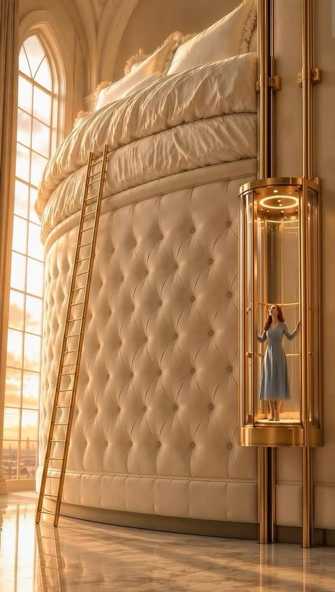

# 建筑与室内

[返回目录](../../README_zh.md) · 全部 15 条

<a id="nano-banana-floor-plan-rising-miniature-diner"></a>
### 从建筑平面图中升起的复古餐厅微缩场景

<a href="https://x.com/AllaAisling/status/2029242137397678368"></a>

模板先设定画在绘图桌上的平面图，再声明墙体既是线条也是实体隔断，让图纸与微缩场景融为一体。房间、家具、光线等占位变量加上绘图工具清单，让画面既具体又可复用。

Nano Banana 2 · 文生图 · 出处: [@AllaAisling on X](https://x.com/AllaAisling/status/2029242137397678368) · 547 赞，统计于 2026-10-28

[`floor-plan`](tags.md#tag-floor-plan) [`miniature`](tags.md#tag-miniature) [`architecture`](tags.md#tag-architecture) [`template`](tags.md#tag-template) [`blueprint`](tags.md#tag-blueprint)

<details><summary><b>提示词</b></summary>

```text
Prompt Studio: Architectural Floor Plan with Nano Banana 2 in Firefly

An architectural floor plan of {BUILDING_TYPE} spread across a drafting table, with the spaces rising into inhabitable miniature. {ROOM_1} emerges with {FURNITURE_1} and {ACTIVITY_1} in progress, {ROOM_2} rises with {DESIGN_ELEMENT} and {HUMAN_MOMENT}, {ROOM_3} pushes up with {DETAIL_1} and {LIGHTING_1}. Walls exist as both lines and actual partitions simultaneously. Sight lines marked on the plan become actual views between spaces. The mechanical systems in the plan, HVAC, plumbing, electrical, pulse with invisible function. Human circulation patterns appear as ghosted movement trails. Architectural scale figures become actual tiny inhabitants living their tiny lives. Section cuts reveal vertical relationships. The architect's tools surround: scales, pencils, trace paper. Golden design studio light, the plan as promise and proof, 8K, architecture as life container.

Check ALTs for ideas 👇
@AdobeFirefly
```

</details>

<a id="gpt-image-architectural-specimen-card-survey-landmark"></a>
### 长城建筑勘测标本卡

<a href="https://x.com/Naiknelofar788/status/2094626691234816034"></a>

以上传照片为参考，层级清晰：大幅单色墨线地标、一小块彩色照片细节、背后的等高线地图。限定调色并只用一个点缀色，只列少量小号档案式文字，再明确列出要避开的风格，让整张卡片保持克制的博物馆目录感。

GPT Image 2 · 上传图改图 · 出处: [@Naiknelofar788 on X](https://x.com/Naiknelofar788/status/2094626691234816034) · 512 赞，统计于 2026-10-28

[`architecture`](tags.md#tag-architecture) [`specimen-card`](tags.md#tag-specimen-card) [`archival`](tags.md#tag-archival) [`topographic-map`](tags.md#tag-topographic-map) [`ink-drawing`](tags.md#tag-ink-drawing)

<details><summary><b>提示词</b></summary>

```text
Use the uploaded photo as the primary reference. Create a sophisticated 4:3 landscape architectural specimen card inspired by museum archives, architectural surveys, and vintage scientific documentation.

Keep the original location recognizable, but transform the presentation into a curated architectural study rather than a normal travel poster.

* Place the main landmark as a large monochrome architectural cutout or finely detailed ink drawing.
* Add a smaller original-color photographic fragment showing one distinctive detail of the location.
* Include a simplified topographic contour map behind the architecture.
* Add tiny numbered reference points, measurement marks, arrows, elevation lines, and architectural annotation symbols.
* Use an aged cream paper background with subtle grain and imperfections.
* Palette: black, warm beige, muted olive, and one restrained accent color extracted from the landmark.
* Typography should be small, elegant, and archival: location name, country, year, No. 019, and 3 descriptive keywords.
* Create subtle imperfections resembling screen printing, drafting ink, pencil marks, and old paper.
* Keep generous negative space and a sophisticated museum-catalog aesthetic.

Important: Avoid postcard layouts, circular stamps, tourist graphics, excessive text, cartoon styling, glossy effects, 3D rendering, and overly detailed illustrations.

Overall mood:
architectural archive × museum specimen × old survey document × contemporary editorial design.
```

</details>

<a id="nano-banana-exploded-architecture-library-room"></a>
### 悬浮在黑暗中的爆炸视图图书馆房间

<a href="https://x.com/AllaAisling/status/2035390729527378146"></a>

用方括号模板指定房间类型,并按天花板、墙、地板、家具的顺序描述拆解。光线保持各元素原有光源,标注只限建筑构件,包含表面、材质和尺寸。

Nano Banana 2 · 文生图 · 出处: [@AllaAisling on X](https://x.com/AllaAisling/status/2035390729527378146) · 453 赞，统计于 2026-10-28

[`exploded-view`](tags.md#tag-exploded-view) [`architecture`](tags.md#tag-architecture) [`interior`](tags.md#tag-interior) [`labels`](tags.md#tag-labels) [`dark-background`](tags.md#tag-dark-background)

<details><summary><b>提示词</b></summary>

```text
Prompt Studio: Exploded Architecture, with Nano Banana 2 in Firefly

[ROOM TYPE] pulled apart in 3D, every surface and object  floating at its exact position, slightly separated.  EXPLOSION: ceiling lifted, four walls sliding outward,  floor dropped, furniture floating in place,  objects orbiting their surfaces, light sources  still emitting across the exploded void.  The ghost of the room readable in the arrangement.  Labels on architectural elements only: "[SURFACE]" / "[MATERIAL]" / "[DIMENSION]"  LIGHTING: each element still lit by its original source,  windows casting light across the gap, lamps throwing cones  into empty space.  BACKGROUND: deep dark, the room floats in void. TITLE: "[ROOM NAME]" / SUBTITLE: "[BUILDING TYPE] [PERIOD]"  Mood: architectural model that became a universe. 4K, extraordinary spatial clarity, tack sharp.

Check ALTs for ideas 👇
@AdobeFirefly
```

</details>

<a id="nano-banana-blueprint-to-render-modern-house-split-2"></a>
### 上方蓝图与下方现代住宅渲染对照图

<a href="https://x.com/craftian_keskin/status/2052115300724711764"></a>

用JSON提示词把画面分成俯视蓝图和写实渲染两半，再用严格的一致性协议、屋顶规则和负面约束清单，让房屋与图纸完全对应。

Nano Banana 2 · 文生图 · 出处: [@craftian_keskin on X](https://x.com/craftian_keskin/status/2052115300724711764) · 257 赞，统计于 2026-10-28

[`blueprint`](tags.md#tag-blueprint) [`architecture`](tags.md#tag-architecture) [`split-layout`](tags.md#tag-split-layout) [`json-prompt`](tags.md#tag-json-prompt) [`house`](tags.md#tag-house)

<details><summary><b>提示词</b></summary>

```text
{
  "objective": "Create a 3:4 split architectural visualization where the top half is a precise top-down blueprint and the bottom half is a photorealistic modern house that matches the blueprint EXACTLY, with strict enforcement that the house is single-story and ALL enclosed rooms are fully covered by a roof",

  "aspect_ratio": "3:4",

  "composition": {
    "layout": "exact vertical 50/50 split",
    "top_half": "blueprint",
    "bottom_half": "photorealistic house render",
    "alignment": "perfect one-to-one correspondence between blueprint and built house"
  },

  "top_section": {
    "type": "architectural blueprint",
    "view": "true top-down orthographic",
    "style": "dark luxury blueprint",
    "visual_style": {
      "background": "deep navy / charcoal",
      "lines": "thin glowing beige / gold lines",
      "walls": "clean, precise, slightly extruded",
      "labels": "minimal sans-serif",
      "lighting": "soft ambient glow"
    },
    "content_requirements": [
      "exact outer footprint",
      "garage placement on the left",
      "front porch centered",
      "central living room",
      "kitchen & dining at rear center",
      "master bedroom on right side",
      "secondary bedrooms in correct positions",
      "bathrooms placed accurately",
      "backyard pool and deck",
      "all doors and windows clearly mapped"
    ],
    "rule": "blueprint is the absolute source of truth for the render below"
  },

  "bottom_section": {
    "type": "photorealistic architectural render",
    "constraint": "MUST MATCH BLUEPRINT EXACTLY — ZERO DEVIATION",

    "architecture": {
      "style": "modern luxury house",
      "floors": "single-story ONLY (no second level, no rooftop living space)",
      "form_language": [
        "clean rectangular volumes",
        "flat roof slabs",
        "minimalist geometry"
      ],
      "materials": [
        "smooth concrete",
        "light stone",
        "wood accents",
        "glass panels",
        "dark metal frames"
      ]
    },

    "camera": {
      "angle": "front-facing elevated view",
      "description": "slightly above eye level to clearly show facade AND full roof layout",
      "lens": "28mm–35mm"
    },

    "environment": {
      "setting": "clean suburban plot",
      "elements": [
        "driveway",
        "lawn",
        "minimal landscaping",
        "backyard pool visible"
      ]
    },

    "lighting": {
      "time": "golden hour",
      "style": "soft natural light"
    }
  },

  "exact_match_protocol": {
    "priority": "absolute",
    "rules": [
      "footprint must match EXACTLY",
      "room positions must match EXACTLY",
      "garage must match EXACTLY",
      "pool and deck must match EXACTLY",
      "no added or missing structures",
      "no shifting of walls or volumes"
    ]
  },

  "roof_rules": {
    "priority": "critical",
    "requirements": [
      "ALL enclosed rooms MUST have roof coverage",
      "NO room can be left exposed",
      "roof outline must match footprint EXACTLY",
      "roof slabs must align with each room mass",
      "no floating or disconnected roof elements",
      "porch, deck, and pool remain uncovered ONLY if defined as open areas",
      "NO second floor structures",
      "NO rooftop terraces or extra levels"
    ]
  },

  "style": {
    "top": "dark premium blueprint",
    "bottom": "photorealistic modern house",
    "overall": "clean, high-end architectural presentation"
  },

  "negative_constraints": [
    "no missing roofs",
    "no second floor",
    "no rooftop additions",
    "no mismatch between blueprint and render",
    "no extra rooms",
    "no distorted proportions",
    "no clutter"
  ]
}
```

</details>

<a id="gpt-image-architectural-sketchbook-study"></a>
### 铅笔与水彩的罗马斗兽场建筑速写本

<a href="https://x.com/Naiknelofar788/status/2099096963316957187"></a>

提示词让画面从前景的松散construction线条逐步过渡到墨线加水彩的完成态主体，形成未完成的草图感。同时列出侧立面、装饰细节、地图轮廓和比例剪影等小型研究图，并配少量手写标注，再用负面词排除写实渲染和信息图方框。

GPT Image 2.5 · 文生图 · 出处: [@Naiknelofar788 on X](https://x.com/Naiknelofar788/status/2099096963316957187) · 169 赞，统计于 2026-10-28

[`architecture`](tags.md#tag-architecture) [`sketchbook`](tags.md#tag-sketchbook) [`watercolor`](tags.md#tag-watercolor) [`pencil-drawing`](tags.md#tag-pencil-drawing) [`template`](tags.md#tag-template)

<details><summary><b>提示词</b></summary>

```text
Create a stunning 4:5 vertical fine-art sketch illustration of [STRUCTURE NAME] as if it is being drawn by a master architectural artist inside a luxury travel sketchbook.

Show the famous structure transitioning from loose preliminary pencil lines into a fully detailed finished architectural drawing.

The foreground should contain delicate construction lines, perspective guides, measurement marks, small handwritten architectural notes, compass marks, arrows, erased pencil strokes, and unfinished portions.

As the eye moves toward the main structure, the sketch gradually becomes more refined — combining graphite pencil, fine black ink, subtle watercolor washes, cross-hatching, and delicate hand-drawn textures.

Include small artistic studies around the main drawing: a tiny side elevation, architectural detail, window or ornament study, simplified map outline, and a small silhouette showing the scale of the structure.

Use an elegant warm ivory sketchbook-paper background with natural paper fibers and subtle imperfections.

Keep the composition sophisticated and spacious. The structure should remain the unmistakable hero.

Add minimal handwritten-style labeling:

[STRUCTURE NAME]
[CITY, COUNTRY]
ARCHITECTURAL STUDY

The artwork should feel like an original museum-quality architectural sketch discovered inside an explorer’s personal sketchbook — artistic, intellectual, nostalgic, detailed, and highly collectible.

No photorealistic rendering, no 3D CGI, no modern infographic boxes, no excessive text, no watermark.
```

</details>

<a id="nano-banana-blueprint-to-render-modern-house-split"></a>
### 上方深色蓝图与下方对应的现代住宅渲染

<a href="https://x.com/craftian_keskin/status/2048795880392704044"></a>

用结构化 JSON 把画面分成蓝图和实景两部分，布局对应规则与一致性规则锁定房间位置，负面约束防止多出房间。

Nano Banana 2 · 文生图 · 出处: [@craftian_keskin on X](https://x.com/craftian_keskin/status/2048795880392704044) · 114 赞，统计于 2026-10-28

[`blueprint`](tags.md#tag-blueprint) [`architecture`](tags.md#tag-architecture) [`split-layout`](tags.md#tag-split-layout) [`json-prompt`](tags.md#tag-json-prompt) [`house-render`](tags.md#tag-house-render)

<details><summary><b>提示词</b></summary>

```text
{
  "objective": "Create a split architectural visualization where the top is a detailed dark-themed blueprint and the bottom is a photorealistic house that matches the blueprint EXACTLY",

  "aspect_ratio": "3:4",

  "composition": {
    "layout": "vertical split",
    "top_section": "blueprint",
    "bottom_section": "realistic render",
    "alignment": "perfect structural correspondence between both sections"
  },

  "top_section": {
    "type": "architectural blueprint",
    "style": "dark luxury blueprint (similar to reference image 2)",

    "visual_style": {
      "background": "deep navy / charcoal blue",
      "lines": "thin glowing beige/gold lines",
      "walls": "slightly extruded 3D effect",
      "labels": "clean modern sans-serif",
      "lighting": "soft ambient glow"
    },

    "content": {
      "rooms": [
        "3 bedrooms (left, right, bottom-right)",
        "central living room",
        "kitchen + dining (top center)",
        "2 bathrooms",
        "garage (left side connected)",
        "front porch",
        "backyard pool with deck"
      ],
      "details": [
        "furniture outlines (beds, sofa, dining table)",
        "door swings and openings",
        "window placements",
        "circulation paths",
        "exact proportions and spacing"
      ]
    }
  },

  "bottom_section": {
    "type": "photorealistic house render",

    "constraint": "MUST MATCH THE BLUEPRINT EXACTLY — no added, removed, or shifted rooms",

    "architecture": {
      "style": "modern single-story house",
      "roof": "flat layered roof",
      "materials": [
        "smooth concrete walls",
        "wood panel accents",
        "large glass windows"
      ]
    },

    "layout_mapping_rules": [
      "garage must be on the left side exactly as blueprint",
      "main entrance aligned with living room",
      "pool positioned in backyard matching blueprint dimensions",
      "window placements correspond to each room location",
      "bedroom volumes visible externally in correct positions"
    ],

    "environment": {
      "setting": "suburban neighborhood",
      "elements": [
        "green lawn",
        "minimal landscaping",
        "clean driveway leading to garage",
        "pool deck matching blueprint footprint"
      ]
    },

    "lighting": {
      "time": "golden hour",
      "style": "soft natural light with realistic shadows"
    },

    "camera": {
      "angle": "slightly elevated front perspective",
      "lens": "35mm architectural view"
    }
  },

  "consistency_rules": [
    "room positions must be identical between blueprint and render",
    "no extra structures added in render",
    "all doors and windows must align logically",
    "pool size and placement must match exactly",
    "garage placement must match blueprint"
  ],

  "style": {
    "top": "architectural visualization (dark premium)",
    "bottom": "photorealistic modern house",
    "overall": "clean, high-end architectural presentation"
  },

  "negative_constraints": [
    "no mismatch between blueprint and render",
    "no extra rooms",
    "no fantasy elements",
    "no unrealistic proportions",
    "no cluttered environment"
  ]
}
```

</details>

<a id="nano-banana-sketchbook-airport-diorama"></a>
### 从素描本中升起的机场航站楼微缩模型

<a href="https://x.com/yourPlugAI/status/2032858910512562544"></a>

倾斜移轴的低角度航拍视角让航站楼看起来像手工实体模型，周边环境逐渐过渡为纸面上的手绘线稿。方括号模板（机场、屋顶造型、时间段）可以复用于任意机场。

Nano Banana 2 · 文生图 · 出处: [@yourPlugAI on X](https://x.com/yourPlugAI/status/2032858910512562544) · 108 赞，统计于 2026-10-28

[`miniature`](tags.md#tag-miniature) [`diorama`](tags.md#tag-diorama) [`tilt-shift`](tags.md#tag-tilt-shift) [`airport`](tags.md#tag-airport) [`sketchbook`](tags.md#tag-sketchbook)

<details><summary><b>提示词</b></summary>

```text
Universal Sketchbook Airport Diorama Prompt

A hyper realistic 3D miniature diorama of [AIRPORT NAME] ([IATA CODE]) in [CITY], [COUNTRY] rising magically from an open sketchbook placed on a wooden desk.

Tilted low angle aerial isometric view using tilt shift macro photography to emphasize the extreme miniature scale and handcrafted physical model appearance.

The scene focuses on the main airport terminal complex, highlighting its distinctive architectural features such as [ROOF DESIGN / TERMINAL SHAPE / GLASS FACADES / CONTROL TOWER STYLE].

The air traffic control tower stands prominently within the composition, accurately reflecting the design identity of the airport.

Multiple miniature commercial airplanes in [AIRLINE LIVERIES OR MIXED INTERNATIONAL AIRLINES] are parked at the terminal gates along extended concourses. Some aircraft are positioned on taxiways preparing for departure or arrival.

The tarmac is filled with micro scale airport ground operations, including baggage carts, fuel trucks, catering vehicles, pushback tractors, airport buses, and maintenance crews actively servicing the aircraft.
Tiny miniature airport staff and travelers move across jet bridges, service roads, and terminal entrances, adding life and scale to the scene.

The surrounding airport infrastructure includes runways, taxiways, parking structures, access highways, and landscaped green areas, all rendered in detailed miniature form.

The wider airport environment gradually transitions into hand drawn architectural sketch lines on the white sketchbook paper, creating the illusion that the entire airport is emerging from the page.

Lighting reflects [TIME OF DAY such as golden hour sunset, bright daylight, blue hour evening, or night runway lighting], casting realistic shadows and reflections across the glass terminals and aircraft surfaces.

Ultra detailed 8K macro photography, cinematic realism, museum quality miniature diorama, highly detailed aviation environment.

Aspect Ratio 4:5
```

</details>

<a id="gpt-image-landmark-architectural-master-sketch-poster"></a>
### 自由女神像的未完成建筑墨线草图海报

<a href="https://x.com/Goodmanprotocol/status/2106688617682788602"></a>

提示词把单一地标放在纯白留白中，用精确墨线结合松散的construction辅助线，并只允许一种取自地标真实材质的点缀色。方括号占位符让它可以套用到任何建筑。

GPT Image 2.5 · 文生图 · 出处: [@Goodmanprotocol on X](https://x.com/Goodmanprotocol/status/2106688617682788602) · 98 赞，统计于 2026-10-28

[`architecture`](tags.md#tag-architecture) [`ink-sketch`](tags.md#tag-ink-sketch) [`landmark`](tags.md#tag-landmark) [`white-background`](tags.md#tag-white-background) [`template`](tags.md#tag-template)

<details><summary><b>提示词</b></summary>

```text
Create a premium 2:3 vertical architectural poster for [COUNTRY / CITY / LOCATION / LANDMARK].

TEXT-TO-IMAGE ONLY — generate the entire artwork creatively from [COUNTRY / CITY / LOCATION / LANDMARK]. No reference image required.

CORE CONCEPT
Present [LANDMARK] as an expressive unfinished architectural master sketch, as if drawn by an architect exploring the building’s form, structure, and character. Keep the real architecture accurate — preserve its recognizable silhouette, proportions, façade rhythm, materials, and signature details. Do not redesign the landmark.

COMPOSITION
Show approximately 80–95% of the landmark from the most elegant and architecturally informative viewpoint for that specific building. Use a natural eye-level or gently elevated three-quarter perspective with realistic depth and restrained distortion.

ONE LANDMARK ONLY. Let it dominate the composition while surrounding it with generous PURE WHITE negative space. No skyline or secondary landmarks.

SKETCH STYLE
Combine precise architectural ink drawing with loose unfinished concept-sketch elements:

crisp black structural lines

fine façade detailing

varied line weights

construction and perspective guides

subtle drafting marks

selective ink washes

partially unfinished contours

Some areas should be highly detailed while others naturally dissolve into loose exploratory lines and white space. It must feel genuinely hand-drawn, not like a 3D render with a sketch filter.

DETAIL & COLOR
Reveal authentic architectural elements such as structural connections, façade layers, openings, ornamentation, joints, and material textures. Never invent features that do not belong to the landmark.

Use a PURE WHITE background with black and charcoal linework, plus ONE subtle accent color naturally derived from the landmark’s real materials.

TYPOGRAPHY
Optional small refined text in one corner:
[DESTINATION]
[LANDMARK]

Keep typography minimal and secondary to the architecture.

FINAL AESTHETIC
Architectural master sketch × technical drawing × expressive ink work × restrained hand-painted wash × contemporary collectible art poster.

Avoid fictional architecture, incorrect proportions, extreme perspectives, close-ups, surrounding cityscapes, multiple landmarks, beige/aged paper, gradients, excessive colors, glossy 3D rendering, oversized typography, logos, and watermarks.

FORMAT
2:3 vertical, single landmark, full architectural form clearly visible, generous white space, intricate linework, natural perspective, premium gallery-quality finish.
```

</details>

<a id="nano-banana-tree-inspired-house-architecture-board"></a>
### 树形灵感住宅建筑竞赛展板

<a href="https://x.com/ShamsAmin56/status/2053128293537272235"></a>

提示词把图板拆成命名分区（立面、轴测、平面、材料标注），并为渲染质感、氛围和纸张底纹分别设块。写明风格参照并限定炭灰配色，让制图线条和写实渲染统一在同一张展板里。

Nano Banana 2 · 文生图 · 出处: [@ShamsAmin56 on X](https://x.com/ShamsAmin56/status/2053128293537272235) · 96 赞，统计于 2026-10-29

[`architecture`](tags.md#tag-architecture) [`presentation-board`](tags.md#tag-presentation-board) [`biomimetic`](tags.md#tag-biomimetic) [`technical-drawing`](tags.md#tag-technical-drawing) [`stormy-atmosphere`](tags.md#tag-stormy-atmosphere)

<details><summary><b>提示词</b></summary>

```text
Ultra-realistic architectural competition presentation board, portrait A1 layout, 4K resolution, mixed media visualization

SHEET COMPOSITION:
Full architectural board layout with balanced visual hierarchy. Top-third: large detailed 2D front elevation with fine linework, grid lines, section markers, and dimensional annotations in millimeters. Center-left: side and rear elevations in precise white technical drafting. Center-right: 3D isometric views and exploded axonometric component diagrams. Bottom section: concept development diagrams, design idea sketches, structural annotations, material palette callouts with timber / exposed concrete / glass labels, human scale reference figures, and landscape integration drawings. Modern architectural typography, minimal clean labeling. Negative space used intentionally for breathing room. Blueprint overlay fading at edges.

ARCHITECTURE TREE-INSPIRED MODERN CONCEPTUAL HOUSE:
Organic branching structural columns mimicking tree trunks and limbs, cantilevered volumes projecting asymmetrically, full-height glass curtain walls with slim mullions, exposed board-formed concrete cores, warm-toned timber cladding panels, green terraces cascading at each floor level, rooftop garden with native planting, elevated platform volumes integrated between existing trees, natural cross-ventilation cutaways shown in section, passive solar and sustainable strategy diagrams annotated with arrows, floor plan levels clearly marked, structural grid expressed through glazing.

3D RENDERING QUALITY:
Photorealistic materials wet concrete catching light, timber with visible grain, reflective wet stone paving, glass reflecting stormy sky dramatic warm amber interior glow bleeding through floor-to-ceiling glazing, high contrast shadows, cinematic environmental depth, ultra-sharp drafting lines overlaid on realistic render textures, Zaha Hadid / BIG / Kengo Kuma competition board aesthetic.

ATMOSPHERE:
Dark stormy sky, heavy overcast with volumetric fog and mist rolling through trees, moody cinematic lighting, soft rain-wet reflective ground surfaces, deep shadow gradients, warm glowing interiors contrasting cold exterior environment, dramatic chiaroscuro, photorealistic environmental depth.

BACKGROUND & BOARD TEXTURE:
Charcoal and deep graphite toned paper texture, subtle blueprint grid lines fading behind drawings, faint construction reference lines, elegant monochromatic palette blacks, greys, off-whites with selective warm amber and timber-tone highlights, no clutter, premium studio presentation quality.

STYLE REFERENCES:
Architectural competition panel, mixed media board, Kengo Kuma material sensitivity, BIG diagram clarity, Zaha Hadid parametric organic geometry, photorealistic studio visualization, portrait orientation full sheet layout.
```

</details>

<a id="gpt-image-giant-bed-golden-elevator-palace-bedroom"></a>
### 带金色玻璃电梯的巨型绗缝大床

<a href="https://x.com/Arzoo12sh/status/2100900339453149339"></a>

提示词用几个参照物营造尺度反差：超大绗缝床身、细长金梯和玻璃电梯里的小人。再用固定的光线方向、奶油金色调和末尾的排除清单保持画面一致。

GPT Image 2.5 · 上传图改图 · 出处: [@Arzoo12sh on X](https://x.com/Arzoo12sh/status/2100900339453149339) · 87 赞，统计于 2026-10-28

[`surreal`](tags.md#tag-surreal) [`luxury-bedroom`](tags.md#tag-luxury-bedroom) [`oversized-scale`](tags.md#tag-oversized-scale) [`golden-light`](tags.md#tag-golden-light) [`reference-scene`](tags.md#tag-reference-scene)

<details><summary><b>提示词</b></summary>

```text
Create a cinematic ultra-realistic surreal luxury bedroom video based on the reference scene. The main environment is a gigantic royal bedroom containing an enormous elevated king-size bed that is dramatically oversized compared with a normal human. The bed should have a very thick cream-white upholstered base with deep elegant tufting, luxurious soft fabric, multiple layers of fluffy white duvets, huge pillows, realistic folds, wrinkles, and premium hotel-quality bedding.

Begin with a slow cinematic camera movement through the luxurious palace bedroom. The camera gently moves forward and slightly upward, revealing the incredible scale of the enormous bed. Warm golden sunlight streams through the huge arched windows on the left side, producing soft volumetric light rays across the room and beautiful reflections on the polished marble floor.

On the right side, show a transparent futuristic glass elevator with highly polished golden/brass framing. A young adult woman wearing an elegant long light-blue dress is standing inside the elevator. The elevator doors open smoothly and realistically. She steps out carefully and naturally, looking toward the enormous bed with a subtle expression of curiosity and wonder.

The woman slowly walks toward the giant bed. Because the bed is extremely tall, she approaches a slim golden ladder leaning against its side. She carefully climbs the ladder one step at a time. Her dress moves naturally with every step, with realistic cloth physics and gentle fabric movement.

As she reaches the top of the ladder, she steps onto the enormous soft mattress. Her feet slightly sink into the plush bedding, causing realistic compression and subtle movement in the duvet. She walks slowly across the huge white bed toward the oversized pillows. The camera follows her movement smoothly from a cinematic side angle.

She then gently sits down on the enormous soft duvet and relaxes against the giant pillows. The bedding softly compresses under her weight, creating realistic wrinkles and subtle fabric movement. The warm sunlight illuminates her dress and the surrounding white bedding, producing a dreamy golden atmosphere.

Include subtle environmental motion throughout the scene: curtains gently moving from a soft breeze, sunlight shifting naturally, tiny dust particles visible in the light rays, realistic reflections moving across the polished marble floor, and slight movement of the fluffy bedding.

Use smooth professional cinematic camera motion, slow dolly shots, gentle camera push-ins, realistic perspective changes, shallow depth of field when appropriate, natural motion blur, physically accurate lighting, realistic shadows, global illumination, detailed reflections, realistic glass and metal materials, highly detailed fabric physics, and photorealistic human movement.

The overall visual style should feel like a high-budget fantasy film combined with luxury architectural photography. Make the giant bed feel enormous and believable while maintaining realistic physics and scale. Keep the same cream, ivory, champagne, and warm golden color palette throughout the video.

Vertical 9:16 composition, cinematic framing, ultra-realistic 4K/8K appearance, highly detailed textures, realistic skin and hair, natural facial expressions, realistic hands and feet, smooth body movement, stable camera, premium cinematic quality.

No text, no subtitles, no logos, no watermark, no extra people, no duplicate woman, no distorted body, no deformed hands, no floating objects, no sudden scene changes, no flickering, no unnatural movements.
```

</details>

<a id="nano-banana-mythpunk-floating-jungle-temple-miniature"></a>
### 悬浮丛林神庙微缩世界与发光符文

<a href="https://x.com/artingent/status/2108541437189242932"></a>

编号的优先级层级告诉模型哪些规则优先，让等距微缩场景保持清晰易读。固定的分区标题、禁止齿轮的否定规则以及逐行规定文字的铭牌说明增强了可控性。

Nano Banana 2.1 · 文生图 · 出处: [@artingent on X](https://x.com/artingent/status/2108541437189242932) · 34 赞，统计于 2026-10-28

[`miniature`](tags.md#tag-miniature) [`isometric`](tags.md#tag-isometric) [`fantasy`](tags.md#tag-fantasy) [`mesoamerican`](tags.md#tag-mesoamerican) [`claymation`](tags.md#tag-claymation)

<details><summary><b>提示词</b></summary>

```text
SCENE
Do not render gears or representations of gears in the scene
A visually rich handcrafted floating miniature world built on a fragmented terrain as the PRIMARY structure, centered on an ancient ruin complex in Mesoamerican myth style within a dense jungle environment. A prophecy event unfolds as structures begin to glow and shift, with the central stepped temple as the dominant focal structure. Surrounding ruins and terrain remain controlled and readable.

WORLD DESIGN
Fragmented terrain, jungle environment, sacred plateau with symbolic pathways linking temple ruins.

ARCHITECTURE & MATERIALS
Stepped temple structures and shrine ruins with layered forms, constructed from stone and divine materials, featuring carvings, glyphs, and symbolic reliefs.

PROPS & SYMBOLS
Altars, relic pedestals, statues, carved symbols, glowing glyphs, floating particles, sacred motifs.

LIFE & ACTIVITY
Priests and guardians performing invoking rituals and observation; mythic beasts present.

LIGHTING & ATMOSPHERE
Eternal dusk with ambient glow and energy beams emerging from the temple; mist, aura, and particles create an ominous mysterious tone.

PRIORITY HIERARCHY (CRITICAL)
1. Miniature readability, scale clarity, clean silhouette
2. Strong mythic focal structure
3. Symbolic coherence (consistent myth language)
4. Controlled surrealism (strange but readable)
5. Atmospheric depth and mood
6. Narrative clarity (scene tells a story)
   Never sacrifice higher priority rules for lower ones.

PRIME DIRECTIVE
CAMERA Use an isometric camera capturing the entire floating miniature world clearly from top to bottom and side to side.

STYLE
Ultra detailed 8k Octane Render, hybrid high poly 3D + miniature world + claymation

DESCRIPTION PLAQUE
Position bottom right
Do not render gears or representations of gears in the plaque
Line 1 bold heading max 5 words
Line 2 bold MYTHPUNK smaller
Line 3 description max 30 words
Plaque must be rendered in aesthetically in an artistic mythpunk style.
```

</details>

<a id="gpt-image-90s-apartment-scene-reference-board"></a>
### 90年代公寓夜景场景参考板

<a href="https://x.com/Iancu_ai/status/2051287273581203888"></a>

用 JSON 固定版面：两个宽幅机位、六格道具特写条和色温镜头页脚。逐一写明机位角度并按格列出道具，让各画格里的房间保持一致。

GPT Image 2 · 文生图 · 出处: [@Iancu_ai on X](https://x.com/Iancu_ai/status/2051287273581203888) · 发现于 [freestylefly/awesome-gpt-image-2](https://github.com/freestylefly/awesome-gpt-image-2)

[`scene-reference`](tags.md#tag-scene-reference) [`production-design`](tags.md#tag-production-design) [`cinematic`](tags.md#tag-cinematic) [`interior`](tags.md#tag-interior) [`35mm`](tags.md#tag-35mm)

<details><summary><b>提示词</b></summary>

```text
{
  "type": "scene reference board — 90s apartment living room, cinematic night",
  "style": "cinematic film photography, 35mm grain, warm amber shadow fill, deep chiaroscuro lighting, hyper-detailed interior, production design reference quality",
  "layout": {
    "main_panel_center_left": {
      "label": "CAMERA A — FRONT VIEW",
      "scene": "Wide shot, L-shaped tan sectional sofa, grey knit throw blanket, wooden coffee table (remote, mug, ashtray, Rolling Stone stack), lava lamp left, table lamp right, rain-streaked city window behind, Nirvana poster left wall. 35mm grain."
    },
    "main_panel_center_right": {
      "label": "CAMERA B — REVERSE VIEW",
      "scene": "Wide reverse from behind sofa. CRT TV prominent right, grey static screen. Tall bookshelf, VHS tapes. Cool blue backlight from window behind camera. Deep shadow."
    },
    "prop_strip_bottom": "6 close-up tiles: 1. LAVA LAMP — chrome base, blue-green wax blobs; 2. COFFEE TABLE — remote, mug, ashtray, magazines; 3. NIRVANA POSTER — black smiley face, wall texture; 4. CRT TELEVISION — static screen, VHS stack; 5. WINDOW/RAIN — city bokeh, water streaks; 6. THROW BLANKET — sofa corner, worn upholstery",
    "top_right_inset": "SOURCE REF thumbnail — original photo",
    "footer": "2700K PRACTICAL · 4100K CITY NIGHT · 24mm · 35MM"
  },
  "background": "deep charcoal #1a1a1a, thin white separators",
  "dimensions": "wide landscape 3:1, high resolution"
}
```

</details>

<a id="gpt-image-isometric-glass-cube-spheres-cylinder"></a>
### 透明玻璃立方体内的彩色球体与圆柱

<a href="https://x.com/Hyperouters/status/2097654503692443744"></a>

每个物体都写明位置（内部或外部、左后上方、右前下方、正上方），把画面变成一次空间关系测试。指定等距视角固定了镜头，也方便核对各物体的位置。

GPT Image 2.5 · 文生图 · 出处: [@Hyperouters on X](https://x.com/Hyperouters/status/2097654503692443744) · 发现于 [wangrunlin/awesome-gpt-image-2-5-prompts](https://github.com/wangrunlin/awesome-gpt-image-2-5-prompts)

[`isometric`](tags.md#tag-isometric) [`spatial-relation`](tags.md#tag-spatial-relation) [`glass`](tags.md#tag-glass) [`3d-shapes`](tags.md#tag-3d-shapes) [`test`](tags.md#tag-test)

<details><summary><b>提示词</b></summary>

```text
A transparent glass cube: place a red sphere inside at the upper back left, a blue sphere inside at the lower front right, a green sphere outside directly above it, and a yellow cylinder crossing from the lower left to the upper right. Use an isometric view.
```

</details>

<a id="gpt-image-modular-industrial-tower-low-angle"></a>
### 仰拍的彩色模块化工业塔

<a href="https://x.com/listudio/status/2098316254679625917"></a>

先把机位定为仰视且塔顶出框，再逐一列出模块颜色与材质，让烤漆板和铬框清楚区分。铰链、检修楼梯、两条不同高度的传送带等具体细节，加上硬光和末尾的排除清单，让画面干净且结构合理。

GPT Image 2.5 · 文生图 · 出处: [@listudio on X](https://x.com/listudio/status/2098316254679625917) · 发现于 [wangrunlin/awesome-gpt-image-2-5-prompts](https://github.com/wangrunlin/awesome-gpt-image-2-5-prompts)

[`industrial`](tags.md#tag-industrial) [`low-angle`](tags.md#tag-low-angle) [`photoreal`](tags.md#tag-photoreal) [`hard-light`](tags.md#tag-hard-light) [`architecture`](tags.md#tag-architecture)

<details><summary><b>提示词</b></summary>

```text
Create a 2:3 photoreal industrial tower viewed from below, its top outside the frame. Stack offset cobalt, orange-red, yellow, green and silver metal modules. Separate glossy painted panels from chrome frames. Show seams, hinges, maintenance stairs and two supported roller conveyors at different heights. Add a few vertical pipes. Leave clear blue sky on the right. Use hard sunlight and crisp shadows. No text, logos, watermarks, weathering, haze or floating parts.
```

</details>

<a id="gpt-image-temple-of-heaven-exploded-view"></a>
### 天坛建筑拆解图

<a href="https://x.com/TanShilong/status/2046524996013662380"></a>

要求拆解图并附详细说明，模型会把建筑从台基到屋顶分层标注，并配上细节侧栏。指定中式美学风格，则带出纸色底、水墨插画和书法标题。

GPT Image 2 · 文生图 · 出处: [@TanShilong on X](https://x.com/TanShilong/status/2046524996013662380) · 发现于 [freestylefly/awesome-gpt-image-2](https://github.com/freestylefly/awesome-gpt-image-2)

[`exploded-view`](tags.md#tag-exploded-view) [`architecture`](tags.md#tag-architecture) [`chinese-style`](tags.md#tag-chinese-style) [`annotated`](tags.md#tag-annotated) [`landmark`](tags.md#tag-landmark)

<details><summary><b>提示词</b></summary>

```text
[中文]
生成一个天坛的建筑拆解图，有详细的说明，中式美学风格

[English]
Generate an architectural exploded view of the Temple of Heaven, with detailed annotations, Chinese aesthetic style
```

</details>
