# 建筑与室内

[返回目录](../../README_zh.md) · 全部 22 条

<a id="nano-banana-floor-plan-rising-miniature-diner"></a>
### 从建筑平面图中升起的复古餐厅微缩场景

<a href="https://x.com/AllaAisling/status/2029242137397678368"></a>

模板先设定画在绘图桌上的平面图，再声明墙体既是线条也是实体隔断，让图纸与微缩场景融为一体。房间、家具、光线等占位变量加上绘图工具清单，让画面既具体又可复用。

Nano Banana 2 · 文生图 · 出处: [@AllaAisling on X](https://x.com/AllaAisling/status/2029242137397678368) · 547 赞，统计于 2026-10-28

[`floor-plan`](tags.md#tag-floor-plan) [`miniature`](tags.md#tag-miniature) [`architecture`](tags.md#tag-architecture) [`template`](tags.md#tag-template) [`blueprint`](tags.md#tag-blueprint)

<details><summary><b>提示词</b></summary>

```text
Prompt Studio: Architectural Floor Plan with Nano Banana 2 in Firefly

An architectural floor plan of {BUILDING_TYPE} spread across a drafting table, with the spaces rising into inhabitable miniature. {ROOM_1} emerges with {FURNITURE_1} and {ACTIVITY_1} in progress, {ROOM_2} rises with {DESIGN_ELEMENT} and {HUMAN_MOMENT}, {ROOM_3} pushes up with {DETAIL_1} and {LIGHTING_1}. Walls exist as both lines and actual partitions simultaneously. Sight lines marked on the plan become actual views between spaces. The mechanical systems in the plan, HVAC, plumbing, electrical, pulse with invisible function. Human circulation patterns appear as ghosted movement trails. Architectural scale figures become actual tiny inhabitants living their tiny lives. Section cuts reveal vertical relationships. The architect's tools surround: scales, pencils, trace paper. Golden design studio light, the plan as promise and proof, 8K, architecture as life container.

Check ALTs for ideas 👇
@AdobeFirefly
```

</details>

<a id="gpt-image-architectural-specimen-card-survey-landmark"></a>
### 长城建筑勘测标本卡

<a href="https://x.com/Naiknelofar788/status/2094626691234816034"></a>

以上传照片为参考，层级清晰：大幅单色墨线地标、一小块彩色照片细节、背后的等高线地图。限定调色并只用一个点缀色，只列少量小号档案式文字，再明确列出要避开的风格，让整张卡片保持克制的博物馆目录感。

GPT Image 2 · 上传图改图 · 出处: [@Naiknelofar788 on X](https://x.com/Naiknelofar788/status/2094626691234816034) · 512 赞，统计于 2026-10-28

[`architecture`](tags.md#tag-architecture) [`specimen-card`](tags.md#tag-specimen-card) [`archival`](tags.md#tag-archival) [`topographic-map`](tags.md#tag-topographic-map) [`ink-drawing`](tags.md#tag-ink-drawing)

<details><summary><b>提示词</b></summary>

```text
Use the uploaded photo as the primary reference. Create a sophisticated 4:3 landscape architectural specimen card inspired by museum archives, architectural surveys, and vintage scientific documentation.

Keep the original location recognizable, but transform the presentation into a curated architectural study rather than a normal travel poster.

* Place the main landmark as a large monochrome architectural cutout or finely detailed ink drawing.
* Add a smaller original-color photographic fragment showing one distinctive detail of the location.
* Include a simplified topographic contour map behind the architecture.
* Add tiny numbered reference points, measurement marks, arrows, elevation lines, and architectural annotation symbols.
* Use an aged cream paper background with subtle grain and imperfections.
* Palette: black, warm beige, muted olive, and one restrained accent color extracted from the landmark.
* Typography should be small, elegant, and archival: location name, country, year, No. 019, and 3 descriptive keywords.
* Create subtle imperfections resembling screen printing, drafting ink, pencil marks, and old paper.
* Keep generous negative space and a sophisticated museum-catalog aesthetic.

Important: Avoid postcard layouts, circular stamps, tourist graphics, excessive text, cartoon styling, glossy effects, 3D rendering, and overly detailed illustrations.

Overall mood:
architectural archive × museum specimen × old survey document × contemporary editorial design.
```

</details>

<a id="nano-banana-exploded-architecture-library-room"></a>
### 悬浮在黑暗中的爆炸视图图书馆房间

<a href="https://x.com/AllaAisling/status/2035390729527378146"></a>

用方括号模板指定房间类型,并按天花板、墙、地板、家具的顺序描述拆解。光线保持各元素原有光源,标注只限建筑构件,包含表面、材质和尺寸。

Nano Banana 2 · 文生图 · 出处: [@AllaAisling on X](https://x.com/AllaAisling/status/2035390729527378146) · 453 赞，统计于 2026-10-28

[`exploded-view`](tags.md#tag-exploded-view) [`architecture`](tags.md#tag-architecture) [`interior`](tags.md#tag-interior) [`labels`](tags.md#tag-labels) [`dark-background`](tags.md#tag-dark-background)

<details><summary><b>提示词</b></summary>

```text
Prompt Studio: Exploded Architecture, with Nano Banana 2 in Firefly

[ROOM TYPE] pulled apart in 3D, every surface and object  floating at its exact position, slightly separated.  EXPLOSION: ceiling lifted, four walls sliding outward,  floor dropped, furniture floating in place,  objects orbiting their surfaces, light sources  still emitting across the exploded void.  The ghost of the room readable in the arrangement.  Labels on architectural elements only: "[SURFACE]" / "[MATERIAL]" / "[DIMENSION]"  LIGHTING: each element still lit by its original source,  windows casting light across the gap, lamps throwing cones  into empty space.  BACKGROUND: deep dark, the room floats in void. TITLE: "[ROOM NAME]" / SUBTITLE: "[BUILDING TYPE] [PERIOD]"  Mood: architectural model that became a universe. 4K, extraordinary spatial clarity, tack sharp.

Check ALTs for ideas 👇
@AdobeFirefly
```

</details>

<a id="gpt-image-handcrafted-landmark-miniature-diorama"></a>
### 白色纸面上的手工伦敦地标微缩场景

<a href="https://x.com/Naiknelofar788/status/2095336325977444847"></a>

用方括号槽位替换地标和城市名，一条提示词即可复用为模板。纸艺、黏土和细小瑕疵等材质词，加上白纸留白与柔和棚拍光，让画面像真实的微缩模型。

GPT Image 2 · 文生图 · 出处: [@Naiknelofar788 on X](https://x.com/Naiknelofar788/status/2095336325977444847) · 437 赞，统计于 2026-10-29

[`miniature`](tags.md#tag-miniature) [`diorama`](tags.md#tag-diorama) [`landmark`](tags.md#tag-landmark) [`paper-craft`](tags.md#tag-paper-craft) [`template`](tags.md#tag-template)

<details><summary><b>提示词</b></summary>

```text
Create a whimsical handcrafted miniature diorama featuring [ICONIC STRUCTURE] as the main focal point. Place the structure in a cozy, highly detailed tiny world with miniature streets, trees, flowers, lamps, benches, small shops, seasonal decorations and subtle objects that represent the location. Use a soft warm color palette, realistic handmade textures, tiny imperfections, paper-craft and clay-like details. Everything should feel physically miniature and lovingly hand-built. Set the entire scene against a clean white textured paper background with generous negative space. Add small elegant typography reading “[CITY / COUNTRY]” and a few tiny location-inspired signs. Soft diffused studio lighting, gentle shadows, charming storybook atmosphere, premium collectible miniature art, highly detailed, vertical 4:5 composition, no people, no photorealistic background.
```

</details>

<a id="gpt-image-ancient-pyramid-construction-blueprint-diorama"></a>
### 铺在建筑蓝图上的金字塔施工微缩场景

<a href="https://x.com/Naiknelofar788/status/2054221110372405534">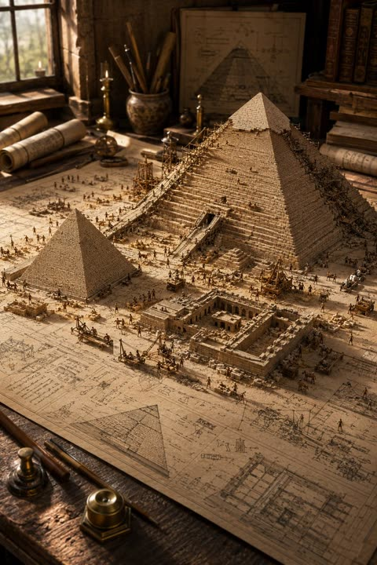</a>

用方括号文明占位符让模板可复用,并要求微缩地形与下方印刷图纸融为一体。窗边暖光、浅景深和一组绘图道具共同营造出触感真实的比例模型质感。

GPT Image 2 · 文生图 · 出处: [@Naiknelofar788 on X](https://x.com/Naiknelofar788/status/2054221110372405534) · 426 赞，统计于 2026-10-29

[`miniature`](tags.md#tag-miniature) [`diorama`](tags.md#tag-diorama) [`blueprint`](tags.md#tag-blueprint) [`ancient-architecture`](tags.md#tag-ancient-architecture) [`template`](tags.md#tag-template)

<details><summary><b>提示词</b></summary>

```text
A highly detailed miniature diorama of an ancient civilization under construction, displayed directly on top of large rolled-out architectural blueprints spread across a realistic wooden drafting table. The scene features iconic historical architecture from [CIVILIZATION OR LOCATION], including partially completed monuments, temples, towers, walls, palaces, streets, or ceremonial structures at different stages of construction. Tiny craftsmen, builders, engineers, and workers interact naturally throughout the scene using historically accurate tools, scaffolding, ramps, cranes, carts, stone blocks, timber frameworks, and construction platforms.
The miniature terrain blends seamlessly into the printed engineering drawings beneath, combining realistic sand, stone, earth, marble, vegetation, or desert textures with visible architectural floor plans, elevation sketches, measurements, annotations, and cross-sections. Surrounding the workspace are drafting instruments, compasses, rolled parchment plans, books, rulers, brass weights, candles, maps, carving tools, and historical reference materials that enhance the workshop atmosphere.
Soft cinematic lighting with warm natural sunlight from a nearby window, shallow depth of field, ultra realistic textures, handcrafted museum-quality scale model aesthetic, intricate miniature detailing, photoreal materials, atmospheric realism, editorial architectural photography style, clean composition, immersive world-building, vertical composition, extremely high detail, realistic shadows, authentic historical mood.
```

</details>

<a id="nano-banana-blueprint-to-render-modern-house-split-2"></a>
### 上方蓝图与下方现代住宅渲染对照图

<a href="https://x.com/craftian_keskin/status/2052115300724711764">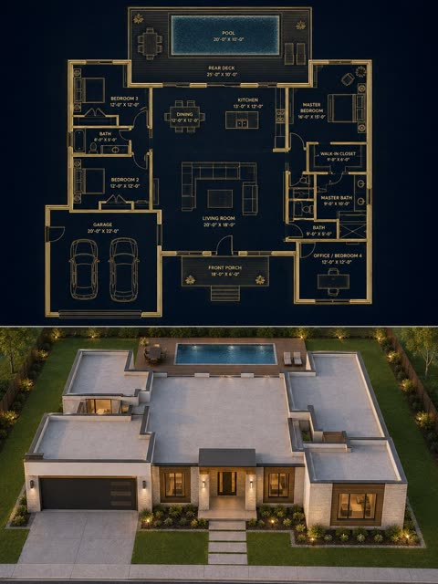</a>

用JSON提示词把画面分成俯视蓝图和写实渲染两半，再用严格的一致性协议、屋顶规则和负面约束清单，让房屋与图纸完全对应。

Nano Banana 2 · 文生图 · 出处: [@craftian_keskin on X](https://x.com/craftian_keskin/status/2052115300724711764) · 257 赞，统计于 2026-10-28

[`blueprint`](tags.md#tag-blueprint) [`architecture`](tags.md#tag-architecture) [`split-layout`](tags.md#tag-split-layout) [`json-prompt`](tags.md#tag-json-prompt) [`house`](tags.md#tag-house)

<details><summary><b>提示词</b></summary>

```text
{
  "objective": "Create a 3:4 split architectural visualization where the top half is a precise top-down blueprint and the bottom half is a photorealistic modern house that matches the blueprint EXACTLY, with strict enforcement that the house is single-story and ALL enclosed rooms are fully covered by a roof",

  "aspect_ratio": "3:4",

  "composition": {
    "layout": "exact vertical 50/50 split",
    "top_half": "blueprint",
    "bottom_half": "photorealistic house render",
    "alignment": "perfect one-to-one correspondence between blueprint and built house"
  },

  "top_section": {
    "type": "architectural blueprint",
    "view": "true top-down orthographic",
    "style": "dark luxury blueprint",
    "visual_style": {
      "background": "deep navy / charcoal",
      "lines": "thin glowing beige / gold lines",
      "walls": "clean, precise, slightly extruded",
      "labels": "minimal sans-serif",
      "lighting": "soft ambient glow"
    },
    "content_requirements": [
      "exact outer footprint",
      "garage placement on the left",
      "front porch centered",
      "central living room",
      "kitchen & dining at rear center",
      "master bedroom on right side",
      "secondary bedrooms in correct positions",
      "bathrooms placed accurately",
      "backyard pool and deck",
      "all doors and windows clearly mapped"
    ],
    "rule": "blueprint is the absolute source of truth for the render below"
  },

  "bottom_section": {
    "type": "photorealistic architectural render",
    "constraint": "MUST MATCH BLUEPRINT EXACTLY — ZERO DEVIATION",

    "architecture": {
      "style": "modern luxury house",
      "floors": "single-story ONLY (no second level, no rooftop living space)",
      "form_language": [
        "clean rectangular volumes",
        "flat roof slabs",
        "minimalist geometry"
      ],
      "materials": [
        "smooth concrete",
        "light stone",
        "wood accents",
        "glass panels",
        "dark metal frames"
      ]
    },

    "camera": {
      "angle": "front-facing elevated view",
      "description": "slightly above eye level to clearly show facade AND full roof layout",
      "lens": "28mm–35mm"
    },

    "environment": {
      "setting": "clean suburban plot",
      "elements": [
        "driveway",
        "lawn",
        "minimal landscaping",
        "backyard pool visible"
      ]
    },

    "lighting": {
      "time": "golden hour",
      "style": "soft natural light"
    }
  },

  "exact_match_protocol": {
    "priority": "absolute",
    "rules": [
      "footprint must match EXACTLY",
      "room positions must match EXACTLY",
      "garage must match EXACTLY",
      "pool and deck must match EXACTLY",
      "no added or missing structures",
      "no shifting of walls or volumes"
    ]
  },

  "roof_rules": {
    "priority": "critical",
    "requirements": [
      "ALL enclosed rooms MUST have roof coverage",
      "NO room can be left exposed",
      "roof outline must match footprint EXACTLY",
      "roof slabs must align with each room mass",
      "no floating or disconnected roof elements",
      "porch, deck, and pool remain uncovered ONLY if defined as open areas",
      "NO second floor structures",
      "NO rooftop terraces or extra levels"
    ]
  },

  "style": {
    "top": "dark premium blueprint",
    "bottom": "photorealistic modern house",
    "overall": "clean, high-end architectural presentation"
  },

  "negative_constraints": [
    "no missing roofs",
    "no second floor",
    "no rooftop additions",
    "no mismatch between blueprint and render",
    "no extra rooms",
    "no distorted proportions",
    "no clutter"
  ]
}
```

</details>

<a id="gpt-image-architectural-sketchbook-study"></a>
### 铅笔与水彩的罗马斗兽场建筑速写本

<a href="https://x.com/Naiknelofar788/status/2099096963316957187"></a>

提示词让画面从前景的松散construction线条逐步过渡到墨线加水彩的完成态主体，形成未完成的草图感。同时列出侧立面、装饰细节、地图轮廓和比例剪影等小型研究图，并配少量手写标注，再用负面词排除写实渲染和信息图方框。

GPT Image 2.5 · 文生图 · 出处: [@Naiknelofar788 on X](https://x.com/Naiknelofar788/status/2099096963316957187) · 169 赞，统计于 2026-10-28

[`architecture`](tags.md#tag-architecture) [`sketchbook`](tags.md#tag-sketchbook) [`watercolor`](tags.md#tag-watercolor) [`pencil-drawing`](tags.md#tag-pencil-drawing) [`template`](tags.md#tag-template)

<details><summary><b>提示词</b></summary>

```text
Create a stunning 4:5 vertical fine-art sketch illustration of [STRUCTURE NAME] as if it is being drawn by a master architectural artist inside a luxury travel sketchbook.

Show the famous structure transitioning from loose preliminary pencil lines into a fully detailed finished architectural drawing.

The foreground should contain delicate construction lines, perspective guides, measurement marks, small handwritten architectural notes, compass marks, arrows, erased pencil strokes, and unfinished portions.

As the eye moves toward the main structure, the sketch gradually becomes more refined — combining graphite pencil, fine black ink, subtle watercolor washes, cross-hatching, and delicate hand-drawn textures.

Include small artistic studies around the main drawing: a tiny side elevation, architectural detail, window or ornament study, simplified map outline, and a small silhouette showing the scale of the structure.

Use an elegant warm ivory sketchbook-paper background with natural paper fibers and subtle imperfections.

Keep the composition sophisticated and spacious. The structure should remain the unmistakable hero.

Add minimal handwritten-style labeling:

[STRUCTURE NAME]
[CITY, COUNTRY]
ARCHITECTURAL STUDY

The artwork should feel like an original museum-quality architectural sketch discovered inside an explorer’s personal sketchbook — artistic, intellectual, nostalgic, detailed, and highly collectible.

No photorealistic rendering, no 3D CGI, no modern infographic boxes, no excessive text, no watermark.
```

</details>

<a id="nano-banana-city-soil-diorama"></a>
### 土壤剖面上的伦敦地标微缩景观

<a href="https://x.com/Sheldon056/status/2027239150966231299">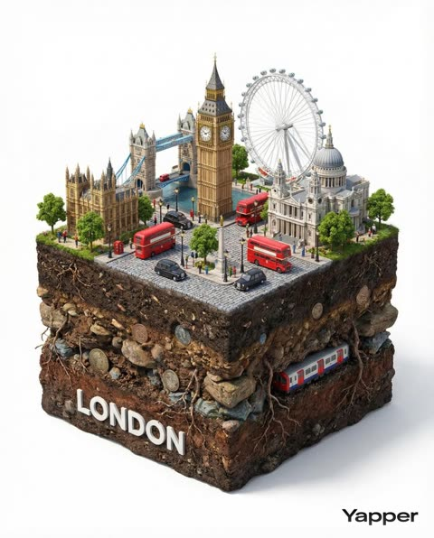</a>

用 [CITY] 占位符，换城市即可复用。结构固定：方形切块、下方裸露土层、上方童话城景，再加上融入块体的城市名标签、纯白影棚背景和 DSLR 画质描述，画面干净统一。

Nano Banana 2 · 文生图 · 出处: [@Sheldon056 on X](https://x.com/Sheldon056/status/2027239150966231299) · 139 赞，统计于 2026-10-28

[`diorama`](tags.md#tag-diorama) [`cityscape`](tags.md#tag-cityscape) [`soil-cross-section`](tags.md#tag-soil-cross-section) [`landmarks`](tags.md#tag-landmarks) [`template`](tags.md#tag-template)

<details><summary><b>提示词</b></summary>

```text
Hyper-realistic 3D square diorama of [CITY], carved out with exposed soil cross-section beneath showing rocks, roots, and earth layers. Above: whimsical fairytale cityscape featuring iconic landmarks, architecture, and cultural elements of [CITY]. Modern white “CITY” label integrated naturally. Pure white studio background with soft natural lighting. DSLR photograph quality - crisp, vibrant, magical realism style. 1080x1080 dimensions.
```

</details>

<a id="nano-banana-blueprint-to-render-modern-house-split"></a>
### 上方深色蓝图与下方对应的现代住宅渲染

<a href="https://x.com/craftian_keskin/status/2048795880392704044">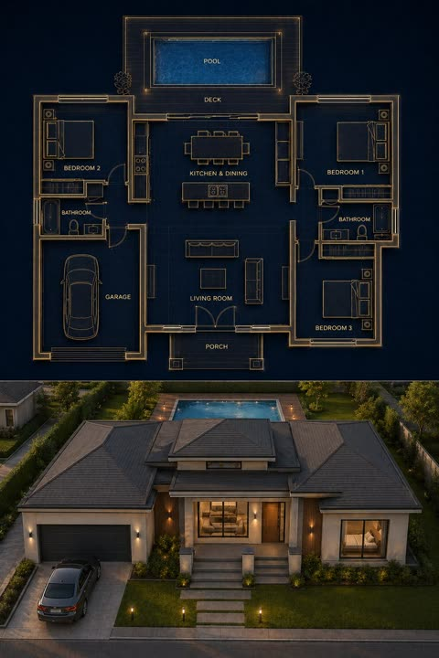</a>

用结构化 JSON 把画面分成蓝图和实景两部分，布局对应规则与一致性规则锁定房间位置，负面约束防止多出房间。

Nano Banana 2 · 文生图 · 出处: [@craftian_keskin on X](https://x.com/craftian_keskin/status/2048795880392704044) · 114 赞，统计于 2026-10-28

[`blueprint`](tags.md#tag-blueprint) [`architecture`](tags.md#tag-architecture) [`split-layout`](tags.md#tag-split-layout) [`json-prompt`](tags.md#tag-json-prompt) [`house-render`](tags.md#tag-house-render)

<details><summary><b>提示词</b></summary>

```text
{
  "objective": "Create a split architectural visualization where the top is a detailed dark-themed blueprint and the bottom is a photorealistic house that matches the blueprint EXACTLY",

  "aspect_ratio": "3:4",

  "composition": {
    "layout": "vertical split",
    "top_section": "blueprint",
    "bottom_section": "realistic render",
    "alignment": "perfect structural correspondence between both sections"
  },

  "top_section": {
    "type": "architectural blueprint",
    "style": "dark luxury blueprint (similar to reference image 2)",

    "visual_style": {
      "background": "deep navy / charcoal blue",
      "lines": "thin glowing beige/gold lines",
      "walls": "slightly extruded 3D effect",
      "labels": "clean modern sans-serif",
      "lighting": "soft ambient glow"
    },

    "content": {
      "rooms": [
        "3 bedrooms (left, right, bottom-right)",
        "central living room",
        "kitchen + dining (top center)",
        "2 bathrooms",
        "garage (left side connected)",
        "front porch",
        "backyard pool with deck"
      ],
      "details": [
        "furniture outlines (beds, sofa, dining table)",
        "door swings and openings",
        "window placements",
        "circulation paths",
        "exact proportions and spacing"
      ]
    }
  },

  "bottom_section": {
    "type": "photorealistic house render",

    "constraint": "MUST MATCH THE BLUEPRINT EXACTLY — no added, removed, or shifted rooms",

    "architecture": {
      "style": "modern single-story house",
      "roof": "flat layered roof",
      "materials": [
        "smooth concrete walls",
        "wood panel accents",
        "large glass windows"
      ]
    },

    "layout_mapping_rules": [
      "garage must be on the left side exactly as blueprint",
      "main entrance aligned with living room",
      "pool positioned in backyard matching blueprint dimensions",
      "window placements correspond to each room location",
      "bedroom volumes visible externally in correct positions"
    ],

    "environment": {
      "setting": "suburban neighborhood",
      "elements": [
        "green lawn",
        "minimal landscaping",
        "clean driveway leading to garage",
        "pool deck matching blueprint footprint"
      ]
    },

    "lighting": {
      "time": "golden hour",
      "style": "soft natural light with realistic shadows"
    },

    "camera": {
      "angle": "slightly elevated front perspective",
      "lens": "35mm architectural view"
    }
  },

  "consistency_rules": [
    "room positions must be identical between blueprint and render",
    "no extra structures added in render",
    "all doors and windows must align logically",
    "pool size and placement must match exactly",
    "garage placement must match blueprint"
  ],

  "style": {
    "top": "architectural visualization (dark premium)",
    "bottom": "photorealistic modern house",
    "overall": "clean, high-end architectural presentation"
  },

  "negative_constraints": [
    "no mismatch between blueprint and render",
    "no extra rooms",
    "no fantasy elements",
    "no unrealistic proportions",
    "no cluttered environment"
  ]
}
```

</details>

<a id="nano-banana-sketchbook-airport-diorama"></a>
### 从素描本中升起的机场航站楼微缩模型

<a href="https://x.com/yourPlugAI/status/2032858910512562544">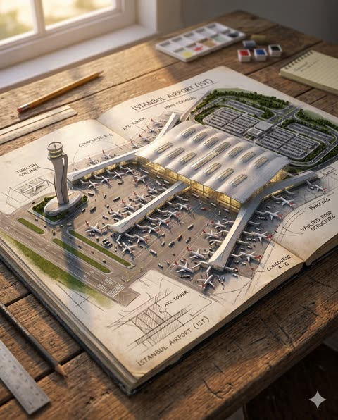</a>

倾斜移轴的低角度航拍视角让航站楼看起来像手工实体模型，周边环境逐渐过渡为纸面上的手绘线稿。方括号模板（机场、屋顶造型、时间段）可以复用于任意机场。

Nano Banana 2 · 文生图 · 出处: [@yourPlugAI on X](https://x.com/yourPlugAI/status/2032858910512562544) · 108 赞，统计于 2026-10-28

[`miniature`](tags.md#tag-miniature) [`diorama`](tags.md#tag-diorama) [`tilt-shift`](tags.md#tag-tilt-shift) [`airport`](tags.md#tag-airport) [`sketchbook`](tags.md#tag-sketchbook)

<details><summary><b>提示词</b></summary>

```text
Universal Sketchbook Airport Diorama Prompt

A hyper realistic 3D miniature diorama of [AIRPORT NAME] ([IATA CODE]) in [CITY], [COUNTRY] rising magically from an open sketchbook placed on a wooden desk.

Tilted low angle aerial isometric view using tilt shift macro photography to emphasize the extreme miniature scale and handcrafted physical model appearance.

The scene focuses on the main airport terminal complex, highlighting its distinctive architectural features such as [ROOF DESIGN / TERMINAL SHAPE / GLASS FACADES / CONTROL TOWER STYLE].

The air traffic control tower stands prominently within the composition, accurately reflecting the design identity of the airport.

Multiple miniature commercial airplanes in [AIRLINE LIVERIES OR MIXED INTERNATIONAL AIRLINES] are parked at the terminal gates along extended concourses. Some aircraft are positioned on taxiways preparing for departure or arrival.

The tarmac is filled with micro scale airport ground operations, including baggage carts, fuel trucks, catering vehicles, pushback tractors, airport buses, and maintenance crews actively servicing the aircraft.
Tiny miniature airport staff and travelers move across jet bridges, service roads, and terminal entrances, adding life and scale to the scene.

The surrounding airport infrastructure includes runways, taxiways, parking structures, access highways, and landscaped green areas, all rendered in detailed miniature form.

The wider airport environment gradually transitions into hand drawn architectural sketch lines on the white sketchbook paper, creating the illusion that the entire airport is emerging from the page.

Lighting reflects [TIME OF DAY such as golden hour sunset, bright daylight, blue hour evening, or night runway lighting], casting realistic shadows and reflections across the glass terminals and aircraft surfaces.

Ultra detailed 8K macro photography, cinematic realism, museum quality miniature diorama, highly detailed aviation environment.

Aspect Ratio 4:5
```

</details>

<a id="gpt-image-landmark-architectural-master-sketch-poster"></a>
### 自由女神像的未完成建筑墨线草图海报

<a href="https://x.com/Goodmanprotocol/status/2106688617682788602"></a>

提示词把单一地标放在纯白留白中，用精确墨线结合松散的construction辅助线，并只允许一种取自地标真实材质的点缀色。方括号占位符让它可以套用到任何建筑。

GPT Image 2.5 · 文生图 · 出处: [@Goodmanprotocol on X](https://x.com/Goodmanprotocol/status/2106688617682788602) · 98 赞，统计于 2026-10-28

[`architecture`](tags.md#tag-architecture) [`ink-sketch`](tags.md#tag-ink-sketch) [`landmark`](tags.md#tag-landmark) [`white-background`](tags.md#tag-white-background) [`template`](tags.md#tag-template)

<details><summary><b>提示词</b></summary>

```text
Create a premium 2:3 vertical architectural poster for [COUNTRY / CITY / LOCATION / LANDMARK].

TEXT-TO-IMAGE ONLY — generate the entire artwork creatively from [COUNTRY / CITY / LOCATION / LANDMARK]. No reference image required.

CORE CONCEPT
Present [LANDMARK] as an expressive unfinished architectural master sketch, as if drawn by an architect exploring the building’s form, structure, and character. Keep the real architecture accurate — preserve its recognizable silhouette, proportions, façade rhythm, materials, and signature details. Do not redesign the landmark.

COMPOSITION
Show approximately 80–95% of the landmark from the most elegant and architecturally informative viewpoint for that specific building. Use a natural eye-level or gently elevated three-quarter perspective with realistic depth and restrained distortion.

ONE LANDMARK ONLY. Let it dominate the composition while surrounding it with generous PURE WHITE negative space. No skyline or secondary landmarks.

SKETCH STYLE
Combine precise architectural ink drawing with loose unfinished concept-sketch elements:

crisp black structural lines

fine façade detailing

varied line weights

construction and perspective guides

subtle drafting marks

selective ink washes

partially unfinished contours

Some areas should be highly detailed while others naturally dissolve into loose exploratory lines and white space. It must feel genuinely hand-drawn, not like a 3D render with a sketch filter.

DETAIL & COLOR
Reveal authentic architectural elements such as structural connections, façade layers, openings, ornamentation, joints, and material textures. Never invent features that do not belong to the landmark.

Use a PURE WHITE background with black and charcoal linework, plus ONE subtle accent color naturally derived from the landmark’s real materials.

TYPOGRAPHY
Optional small refined text in one corner:
[DESTINATION]
[LANDMARK]

Keep typography minimal and secondary to the architecture.

FINAL AESTHETIC
Architectural master sketch × technical drawing × expressive ink work × restrained hand-painted wash × contemporary collectible art poster.

Avoid fictional architecture, incorrect proportions, extreme perspectives, close-ups, surrounding cityscapes, multiple landmarks, beige/aged paper, gradients, excessive colors, glossy 3D rendering, oversized typography, logos, and watermarks.

FORMAT
2:3 vertical, single landmark, full architectural form clearly visible, generous white space, intricate linework, natural perspective, premium gallery-quality finish.
```

</details>

<a id="nano-banana-tree-inspired-house-architecture-board"></a>
### 树形灵感住宅建筑竞赛展板

<a href="https://x.com/ShamsAmin56/status/2053128293537272235">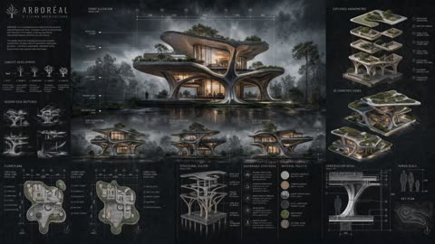</a>

提示词先逐一安排展板各区域，包括立面、轴测、平面和材料标注，再用统一的段落设定渲染质量、风暴氛围和炭灰纸张质感。点名建筑师风格参考，加上克制的配色和琥珀色点缀，让线稿与写实渲染融为一体。

Nano Banana 2 · 文生图 · 出处: [@ShamsAmin56 on X](https://x.com/ShamsAmin56/status/2053128293537272235) · 96 赞，统计于 2026-10-29

[`architecture`](tags.md#tag-architecture) [`presentation-board`](tags.md#tag-presentation-board) [`biomimetic`](tags.md#tag-biomimetic) [`technical-drawing`](tags.md#tag-technical-drawing) [`stormy-atmosphere`](tags.md#tag-stormy-atmosphere)

<details><summary><b>提示词</b></summary>

```text
Ultra-realistic architectural competition presentation board, portrait A1 layout, 4K resolution, mixed media visualization

SHEET COMPOSITION:
Full architectural board layout with balanced visual hierarchy. Top-third: large detailed 2D front elevation with fine linework, grid lines, section markers, and dimensional annotations in millimeters. Center-left: side and rear elevations in precise white technical drafting. Center-right: 3D isometric views and exploded axonometric component diagrams. Bottom section: concept development diagrams, design idea sketches, structural annotations, material palette callouts with timber / exposed concrete / glass labels, human scale reference figures, and landscape integration drawings. Modern architectural typography, minimal clean labeling. Negative space used intentionally for breathing room. Blueprint overlay fading at edges.

ARCHITECTURE TREE-INSPIRED MODERN CONCEPTUAL HOUSE:
Organic branching structural columns mimicking tree trunks and limbs, cantilevered volumes projecting asymmetrically, full-height glass curtain walls with slim mullions, exposed board-formed concrete cores, warm-toned timber cladding panels, green terraces cascading at each floor level, rooftop garden with native planting, elevated platform volumes integrated between existing trees, natural cross-ventilation cutaways shown in section, passive solar and sustainable strategy diagrams annotated with arrows, floor plan levels clearly marked, structural grid expressed through glazing.

3D RENDERING QUALITY:
Photorealistic materials wet concrete catching light, timber with visible grain, reflective wet stone paving, glass reflecting stormy sky dramatic warm amber interior glow bleeding through floor-to-ceiling glazing, high contrast shadows, cinematic environmental depth, ultra-sharp drafting lines overlaid on realistic render textures, Zaha Hadid / BIG / Kengo Kuma competition board aesthetic.

ATMOSPHERE:
Dark stormy sky, heavy overcast with volumetric fog and mist rolling through trees, moody cinematic lighting, soft rain-wet reflective ground surfaces, deep shadow gradients, warm glowing interiors contrasting cold exterior environment, dramatic chiaroscuro, photorealistic environmental depth.

BACKGROUND & BOARD TEXTURE:
Charcoal and deep graphite toned paper texture, subtle blueprint grid lines fading behind drawings, faint construction reference lines, elegant monochromatic palette blacks, greys, off-whites with selective warm amber and timber-tone highlights, no clutter, premium studio presentation quality.

STYLE REFERENCES:
Architectural competition panel, mixed media board, Kengo Kuma material sensitivity, BIG diagram clarity, Zaha Hadid parametric organic geometry, photorealistic studio visualization, portrait orientation full sheet layout.
```

</details>

<a id="nano-banana-three-level-circular-villa-terraces"></a>
### 三层圆形别墅与露台花园

<a href="https://x.com/yourPlugAI/status/2036509194116014564">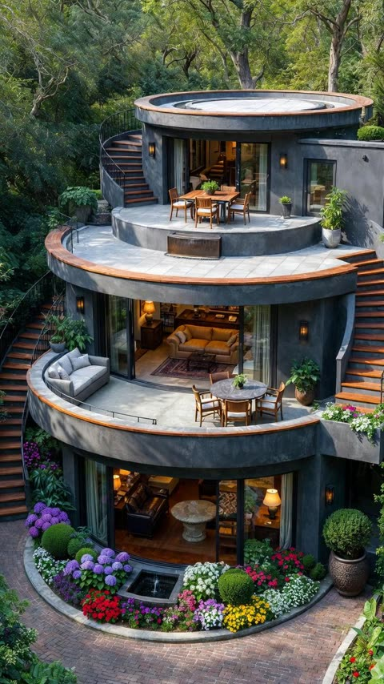</a>

提示词按风格、材质、逐层细节、环境和光线分段，每一层都有具体描述。点明花卉品种与材质，并设定傍晚阳光和室内暖光，让俯视画面保持统一。

Nano Banana 2 · 文生图 · 出处: [@yourPlugAI on X](https://x.com/yourPlugAI/status/2036509194116014564) · 92 赞，统计于 2026-10-29

[`architecture`](tags.md#tag-architecture) [`villa`](tags.md#tag-villa) [`terraces`](tags.md#tag-terraces) [`garden`](tags.md#tag-garden) [`photorealistic`](tags.md#tag-photorealistic)

<details><summary><b>提示词</b></summary>

```text
Visual Style: High-end architectural rendering and photorealistic photograph. Elevated perspective, focusing on detail.

Architecture and Materials: Ultra-modern, three-level circular house with terraced decks and extensive curved glass windows. Exterior walls made of dark charcoal-grey textured concrete and render. Accents of warm, rich wood trim on the staircase risers, deck edges, and railings. Extensive exterior concrete and wood stairs connect the levels.

Detailed Level-by-Level Features:

Rooftop Level: A large, circular, tiled terrace deck. Features a modern wooden dining table set with four chairs and central potted plants. Includes a smaller integrated metal water feature and the top of a spiral staircase. Dark wall sconces.

Middle Level (Main Terrace): A larger concrete terrace area with an integrated, L-shaped cushioned lounge bench and a dining table set. Potted plants. Large sliding glass doors open to reveal a warmly lit living room interior with a beige leather sofa and a rug. More dark wall sconces.

Ground Level (Patio & Garden): A brick-paved patio area. Wraps around the base with intricately designed, curved integrated garden beds. These beds are filled with multiple varieties of colorful flowering plants (purple hydrangeas, red petunias, yellow and white flowers) and multiple spherical topiary bushes, including a large one in a textured pot. A central small feature fountain. Floor-to-ceiling curved glass windows wrap the ground floor, revealing a warmly lit interior with sophisticated furniture, lamps, and a stone table.

Setting and Background: The paved brick ground covers the immediate foreground. The surrounding context is a dense, lush, green forest of mature trees under a bright, clear sky.

Lighting: Bright, clear exterior daylight (late afternoon sun), casting defined shadows. All interior lights (fixtures, lamps) are on, emitting a warm, inviting glow.

Aspect Ratio 2:3
```

</details>

<a id="nano-banana-blueprint-to-miniature-construction-diorama"></a>
### 白宫蓝图长成施工中的微缩立体模型

<a href="https://x.com/yourPlugAI/status/2035059070172824021">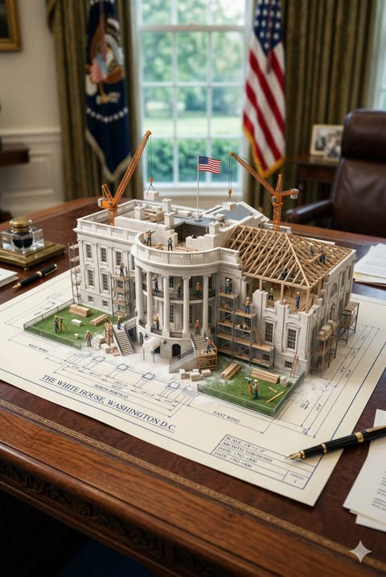</a>

模板把地标、台面、建筑特征和光线做成可替换的填空，核心始终是平面蓝图线条升起为半完工的立体建筑。微缩工人、吊车、脚手架和粉尘，加上微距移轴构图，营造出手工模型的尺度感。

Nano Banana 2 · 文生图 · 出处: [@yourPlugAI on X](https://x.com/yourPlugAI/status/2035059070172824021) · 89 赞，统计于 2026-10-29

[`blueprint`](tags.md#tag-blueprint) [`miniature`](tags.md#tag-miniature) [`diorama`](tags.md#tag-diorama) [`landmark`](tags.md#tag-landmark) [`template`](tags.md#tag-template)

<details><summary><b>提示词</b></summary>

```text
Universal Prompt – Blueprint to Miniature Construction Diorama

An architectural blueprint of [LANDMARK NAME] placed on [SURFACE: wooden desk, marble table, stone slab, drafting table, etc.], with a photorealistic miniature under-construction version of the landmark emerging directly from the blueprint lines.

The miniature structure captures defining architectural elements such as [KEY FEATURES: domes, columns, towers, roofs, courtyards, facades], partially completed and actively being built. Wooden scaffolding, cranes, and structural supports wrap around the structure, seamlessly rising from the blueprint drawing itself.

Tiny construction activity brings the scene to life: miniature workers, engineers, and artisans assembling parts, lifting materials, aligning structural elements, painting details, or carving stone. [BUILDING MATERIALS] such as stone blocks, timber beams, metal frames, or tiles are visibly in progress, with dust, debris, or fine particles adding realism.

The key visual concept is transformation: 2D blueprint lines evolve into 3D architecture, with pillars, walls, and frameworks literally growing upward from the paper. Parts of the structure remain sketched, while others are fully formed, creating a seamless transition between drawing and reality.

Environmental details enhance authenticity: [CONTEXT ELEMENTS: flags, surrounding objects, weather effects like snow or dust, cultural motifs] subtly integrated into the scene.

Lighting is cinematic and intentional: [LIGHTING STYLE: soft studio light, warm daylight, cool tones, moody overcast], casting realistic shadows and emphasizing depth, texture, and construction progress.

Macro, hyper-detailed photography style with tilt-shift depth of field, ultra-realistic textures, and 8K resolution, creating a handcrafted architectural diorama look.

Aspect Ratio 2:3
```

</details>

<a id="nano-banana-landmark-circular-diorama-kicc-nairobi"></a>
### 内罗毕KICC大厦圆形微缩场景与黄铜铭牌

<a href="https://x.com/yourPlugAI/status/2031308595900359126">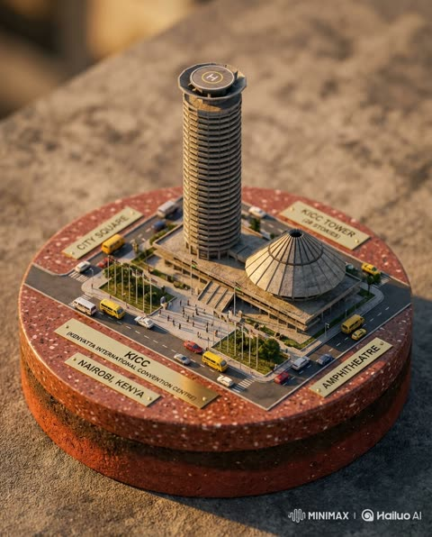</a>

填空式模板固定了圆形截面底座、45度等距视角和带确切文字的黄铜铭牌，可替换成任意地标。微距与移轴摄影措辞营造微缩感，再用城市本地光线定下氛围。

Nano Banana 2 · 文生图 · 出处: [@yourPlugAI on X](https://x.com/yourPlugAI/status/2031308595900359126) · 83 赞，统计于 2026-10-29

[`diorama`](tags.md#tag-diorama) [`miniature`](tags.md#tag-miniature) [`landmark`](tags.md#tag-landmark) [`isometric`](tags.md#tag-isometric) [`macro-photography`](tags.md#tag-macro-photography)

<details><summary><b>提示词</b></summary>

```text
An intricate geographical diorama contained within a circular cross section base made of [LOCAL STONE OR GEOLOGICAL MATERIAL] and [SECONDARY REGIONAL MATERIAL], presented in a 45 degree isometric top down perspective.

The central focus of the diorama is the iconic landmark [LANDMARK NAME] located in [CITY], [COUNTRY]. The miniature sculpture accurately captures the architectural identity of the structure, including its [PRIMARY ARCHITECTURAL FEATURES such as domes, towers, arches, spires, terraces, or distinctive roof structures], rendered with precise materials and proportions.

Surrounding the landmark is a detailed miniature slice of [SURROUNDING DISTRICT / PARK / URBAN AREA], featuring realistic streets, plazas, gardens, and nearby structures scaled appropriately to provide geographical context.

The outer edge of the circular base reveals a cross section of [NEARBY NATURAL FEATURE such as river, bay, coastline, mountain slope, lake, or forest], represented with realistic textures such as deep blue resin water, layered geological strata, or lush miniature vegetation.

Tiny environmental details bring the scene to life. Microscopic visitors walk along paths and plazas, small vehicles or boats move through the environment where appropriate, and miniature trees or landscape elements reflect the real ecosystem of the location.
Integrated miniature polished brass nameplates identify key features:
"[LANDMARK NAME]"
"[SURROUNDING DISTRICT OR AREA]"
"[NATURAL FEATURE]"
"[CITY], [COUNTRY]"
"COMPLETED [YEAR OR ERA]"

The macro photography style emphasizes hyper realistic textures including stone surfaces, vegetation, architectural materials, and geological layers. Tilt shift precision creates an extremely shallow depth of field to emphasize the miniature scale.

Lighting mimics the natural atmosphere of [CITY], such as warm sunset light, bright coastal daylight, or soft morning haze, casting realistic shadows across the tiny landscape.
Ultra detailed, cinematic macro photography, museum quality miniature model, extremely realistic materials.

Aspect ratio 4:5
```

</details>

<a id="nano-banana-mythpunk-floating-jungle-temple-miniature"></a>
### 悬浮丛林神庙微缩世界与发光符文

<a href="https://x.com/artingent/status/2108541437189242932"></a>

编号的优先级层级告诉模型哪些规则优先，让等距微缩场景保持清晰易读。固定的分区标题、禁止齿轮的否定规则以及逐行规定文字的铭牌说明增强了可控性。

Nano Banana 2.1 · 文生图 · 出处: [@artingent on X](https://x.com/artingent/status/2108541437189242932) · 34 赞，统计于 2026-10-28

[`miniature`](tags.md#tag-miniature) [`isometric`](tags.md#tag-isometric) [`fantasy`](tags.md#tag-fantasy) [`mesoamerican`](tags.md#tag-mesoamerican) [`claymation`](tags.md#tag-claymation)

<details><summary><b>提示词</b></summary>

```text
SCENE
Do not render gears or representations of gears in the scene
A visually rich handcrafted floating miniature world built on a fragmented terrain as the PRIMARY structure, centered on an ancient ruin complex in Mesoamerican myth style within a dense jungle environment. A prophecy event unfolds as structures begin to glow and shift, with the central stepped temple as the dominant focal structure. Surrounding ruins and terrain remain controlled and readable.

WORLD DESIGN
Fragmented terrain, jungle environment, sacred plateau with symbolic pathways linking temple ruins.

ARCHITECTURE & MATERIALS
Stepped temple structures and shrine ruins with layered forms, constructed from stone and divine materials, featuring carvings, glyphs, and symbolic reliefs.

PROPS & SYMBOLS
Altars, relic pedestals, statues, carved symbols, glowing glyphs, floating particles, sacred motifs.

LIFE & ACTIVITY
Priests and guardians performing invoking rituals and observation; mythic beasts present.

LIGHTING & ATMOSPHERE
Eternal dusk with ambient glow and energy beams emerging from the temple; mist, aura, and particles create an ominous mysterious tone.

PRIORITY HIERARCHY (CRITICAL)
1. Miniature readability, scale clarity, clean silhouette
2. Strong mythic focal structure
3. Symbolic coherence (consistent myth language)
4. Controlled surrealism (strange but readable)
5. Atmospheric depth and mood
6. Narrative clarity (scene tells a story)
   Never sacrifice higher priority rules for lower ones.

PRIME DIRECTIVE
CAMERA Use an isometric camera capturing the entire floating miniature world clearly from top to bottom and side to side.

STYLE
Ultra detailed 8k Octane Render, hybrid high poly 3D + miniature world + claymation

DESCRIPTION PLAQUE
Position bottom right
Do not render gears or representations of gears in the plaque
Line 1 bold heading max 5 words
Line 2 bold MYTHPUNK smaller
Line 3 description max 30 words
Plaque must be rendered in aesthetically in an artistic mythpunk style.
```

</details>

<a id="gpt-image-90s-apartment-scene-reference-board"></a>
### 90年代公寓夜景场景参考板

<a href="https://x.com/Iancu_ai/status/2051287273581203888">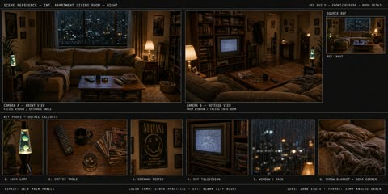</a>

用 JSON 固定版面：两个宽幅机位、六格道具特写条和色温镜头页脚。逐一写明机位角度并按格列出道具，让各画格里的房间保持一致。

GPT Image 2 · 文生图 · 出处: [@Iancu_ai on X](https://x.com/Iancu_ai/status/2051287273581203888) · 发现于 [freestylefly/awesome-gpt-image-2](https://github.com/freestylefly/awesome-gpt-image-2)

[`scene-reference`](tags.md#tag-scene-reference) [`production-design`](tags.md#tag-production-design) [`cinematic`](tags.md#tag-cinematic) [`interior`](tags.md#tag-interior) [`35mm`](tags.md#tag-35mm)

<details><summary><b>提示词</b></summary>

```text
{
  "type": "scene reference board — 90s apartment living room, cinematic night",
  "style": "cinematic film photography, 35mm grain, warm amber shadow fill, deep chiaroscuro lighting, hyper-detailed interior, production design reference quality",
  "layout": {
    "main_panel_center_left": {
      "label": "CAMERA A — FRONT VIEW",
      "scene": "Wide shot, L-shaped tan sectional sofa, grey knit throw blanket, wooden coffee table (remote, mug, ashtray, Rolling Stone stack), lava lamp left, table lamp right, rain-streaked city window behind, Nirvana poster left wall. 35mm grain."
    },
    "main_panel_center_right": {
      "label": "CAMERA B — REVERSE VIEW",
      "scene": "Wide reverse from behind sofa. CRT TV prominent right, grey static screen. Tall bookshelf, VHS tapes. Cool blue backlight from window behind camera. Deep shadow."
    },
    "prop_strip_bottom": "6 close-up tiles: 1. LAVA LAMP — chrome base, blue-green wax blobs; 2. COFFEE TABLE — remote, mug, ashtray, magazines; 3. NIRVANA POSTER — black smiley face, wall texture; 4. CRT TELEVISION — static screen, VHS stack; 5. WINDOW/RAIN — city bokeh, water streaks; 6. THROW BLANKET — sofa corner, worn upholstery",
    "top_right_inset": "SOURCE REF thumbnail — original photo",
    "footer": "2700K PRACTICAL · 4100K CITY NIGHT · 24mm · 35MM"
  },
  "background": "deep charcoal #1a1a1a, thin white separators",
  "dimensions": "wide landscape 3:1, high resolution"
}
```

</details>

<a id="gpt-image-atlas-miniature-city-diorama"></a>
### 从做旧地图中升起的莫斯科微缩城市

<a href="https://x.com/frametheory058/status/2053791622702432453">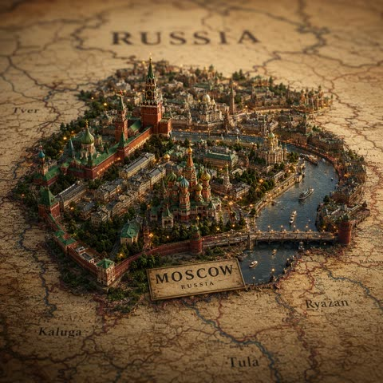</a>

COUNTRY 和 CITY 占位符让模板可以直接替换复用。移轴微距镜头、黄金时刻薄雾，以及建筑下方保留的地图文字，把制图与微缩场景融为一体。

GPT Image 2 · 文生图 · 出处: [@frametheory058 on X](https://x.com/frametheory058/status/2053791622702432453) · 发现于 [YouMind-OpenLab/awesome-gpt-image-2](https://github.com/YouMind-OpenLab/awesome-gpt-image-2)

[`miniature`](tags.md#tag-miniature) [`diorama`](tags.md#tag-diorama) [`world-map`](tags.md#tag-world-map) [`tilt-shift`](tags.md#tag-tilt-shift) [`golden-hour`](tags.md#tag-golden-hour)

<details><summary><b>提示词</b></summary>

```text
An ultra-premium cinematic atlas visualization of COUNTRY designed as a luxurious collectible miniature world built directly into an aged textured world map. Instead of a simple diorama, the scene features an elevated hyper-detailed micro-city of CITY emerging organically from the terrain like a living architectural island. The environment contains iconic monuments, historic buildings, rivers, bridges, tiny streets filled with realistic urban depth, glowing windows, vegetation, atmospheric details, and elegant cultural symbolism crafted with museum-level precision.
The camera angle feels like a high-end macro documentary photograph captured with a professional tilt-shift lens, creating an immersive miniature illusion with cinematic depth separation. Surrounding map typography, borders, coordinates, and neighboring regions remain subtly visible beneath the structure, blending cartography with luxury worldbuilding.
Add dramatic golden-hour sunlight mixed with soft volumetric atmospheric haze, realistic ambient occlusion, global illumination, rich shadows, ultra-detailed textures, reflective water canals, tiny moving boats, miniature street lamps, cinematic fog layering, and refined environmental storytelling. Include subtle weathered paper textures, embossed map details, and elegant depth transitions for a premium handcrafted aesthetic.
The color grading should feel inspired by luxury travel documentaries and next-generation editorial campaigns — warm golden highlights, rich earthy greens, elegant ivory paper tones, deep architectural contrast, and subtle teal shadows. The composition must feel grand, immersive, artistic, and visually unforgettable.
Ultra-photorealistic, insanely detailed, masterpiece-quality, hyper-realistic materials, advanced global illumination, macro realism, depth-rich cinematic atmosphere, luxury travel aesthetic, collectible miniature world design, editorial-quality rendering, 8K ultra detail.
```

</details>

<a id="gpt-image-floor-plan-3d-isometric-real-estate-render"></a>
### 日式两层户型图转3D等轴测渲染

<a href="https://x.com/wancoro_xx/status/2049760825431511352">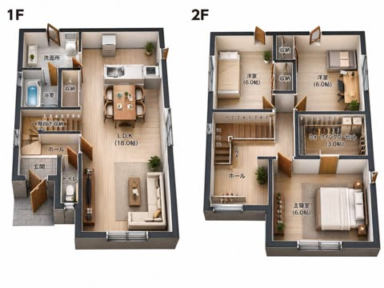</a>

以平面图为参考转成等轴测渲染，同时锁定布局、房间尺寸和所有日文标注。逐个房间列出家具数量，并使用纯浅色背景，让布置可控、适合楼盘宣传册。

GPT Image 2 · 上传图改图 · 出处: [@wancoro_xx on X](https://x.com/wancoro_xx/status/2049760825431511352) · 发现于 [YouMind-OpenLab/awesome-gpt-image-2](https://github.com/YouMind-OpenLab/awesome-gpt-image-2)

[`floor-plan`](tags.md#tag-floor-plan) [`isometric`](tags.md#tag-isometric) [`real-estate`](tags.md#tag-real-estate) [`3d-render`](tags.md#tag-3d-render) [`japanese-labels`](tags.md#tag-japanese-labels)

<details><summary><b>提示词</b></summary>

```text
Using the provided floor plan reference image, convert the 2D black-and-white architectural plan into a clean photorealistic 3D isometric real-estate floor plan render while preserving the original layout, room sizes, labels, and the side-by-side composition of the 1F and 2F plans. Add realistic wall thickness, light wood flooring, soft neutral wall colors, doors and windows with depth, and fully furnished interiors appropriate to each room. Keep all visible Japanese room labels in place, including 1F, 2F, 洗面所, 浴室, 収納, 階段下収納, ホール, 玄関, トイレ, L.D.K (18.0帖), 洋室 (6.0帖) for 2 rooms, ウォークインクローゼット (3.0帖), and 主寝室 (6.0帖). Stage the 1F with 1 kitchen, 1 dining table set for 4, 1 living area with sofa and coffee table, 1 toilet, 1 bathroom with tub, 1 wash area, and small plants. Stage the 2F with 3 sleeping/work rooms total: 1 bedroom with a single bed, 1 room with a desk and chair, and 1 master bedroom with a double bed, plus 2 storage spaces and 1 walk-in closet with shelving. Use a bright catalog-style presentation on a plain light background, viewed from a slightly elevated angled top-down perspective, suitable for a property sales brochure.
```

</details>

<a id="gpt-image-futuristic-city-sparkle-artifact-street"></a>
### 布满闪烁噪点的未来城市街景

<a href="https://x.com/mark_k/status/2046915269784731941">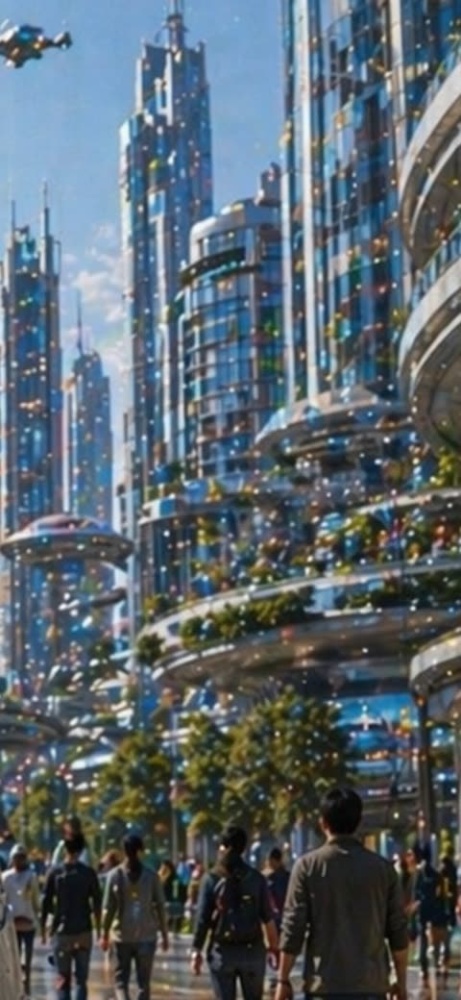</a>

机位固定在行人视角仰拍，并给出人物和飞行器的确切数量，同时点明噪点层及其覆盖范围，让闪烁颗粒均匀分布。绘画感和柔焦让颗粒融入画面。

GPT Image 2 · 文生图 · 出处: [@mark_k on X](https://x.com/mark_k/status/2046915269784731941) · 发现于 [YouMind-OpenLab/awesome-gpt-image-2](https://github.com/YouMind-OpenLab/awesome-gpt-image-2)

[`sci-fi-city`](tags.md#tag-sci-fi-city) [`noise-artifacts`](tags.md#tag-noise-artifacts) [`vertical`](tags.md#tag-vertical) [`utopian`](tags.md#tag-utopian) [`architecture`](tags.md#tag-architecture)

<details><summary><b>提示词</b></summary>

```text
A bright daytime futuristic city street viewed from pedestrian level, looking upward through a canyon of tall sleek skyscrapers with blue-tinted glass facades, rounded balconies, layered terraces, and elegant sci-fi architecture. The scene shows a bustling urban promenade with about 12 visible pedestrians in the foreground and midground, casually dressed and walking away from the viewer, including one central figure in a gray jacket. At the upper left, include 1 small hovering flying vehicle or drone-like air taxi. The buildings are highly reflective and polished, with integrated greenery: trees along the walkway and planted terrace edges. The sky is clear blue with soft sunlight, giving the image a clean optimistic utopian mood. Across the entire image, add a conspicuous artifact layer of dense multicolored sparkling dots and specks, like a noisy pixel grid or glittering digital contamination scattered uniformly over the architecture, people, sky, and street. Use a painterly semi-realistic style with soft focus, luminous highlights, vertical composition, and cinematic depth.
```

</details>

<a id="gpt-image-isometric-miniature-american-kitchen"></a>
### 等距复古美式迷你厨房模型

<a href="https://x.com/berryxia/status/2096158415894835518">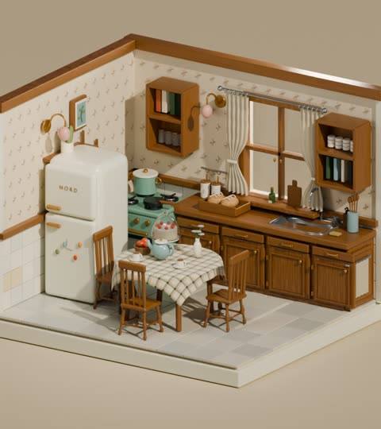</a>

先把镜头固定为正交三四分之三俯视的开放立方体房间,再精确列出12件家具和10件小物来控制布局。材质清单与限定色板让手工质感的Blender渲染风格保持统一。

GPT Image 2 · 文生图 · 出处: [@berryxia on X](https://x.com/berryxia/status/2096158415894835518) · 发现于 [YouMind-OpenLab/awesome-gpt-image-2](https://github.com/YouMind-OpenLab/awesome-gpt-image-2)

[`isometric`](tags.md#tag-isometric) [`diorama`](tags.md#tag-diorama) [`miniature`](tags.md#tag-miniature) [`kitchen`](tags.md#tag-kitchen) [`3d-render`](tags.md#tag-3d-render)

<details><summary><b>提示词</b></summary>

```text
Create a highly detailed isometric 3D miniature diorama of a cozy American-style kitchen corner, like a handcrafted dollhouse scene rendered in Blender with soft global illumination. The room is an open cube set with two cream wallpapered walls meeting in a corner, a raised square tiled floor base, and warm medium-brown wood trim along the top and chair-rail height. Use a warm beige studio background and orthographic camera at a 3/4 overhead angle. The kitchen style is nostalgic, cute, and slightly toy-like with rounded edges, polished wood, realistic materials, and clean miniature proportions. Include exactly 12 main furniture and fixture elements: 1 cream retro refrigerator on the left with the word NORD, small colorful round magnets and brass handles; 1 mint-green gas stove with black burners and a lidded pot; 1 long wooden lower cabinet run on the right with drawers, paneled cupboard doors, brass knobs, and a sink; 1 double window above the sink with beige tied curtains on a silver rod; 2 wall-mounted wooden box shelves, one above the stove and one to the right of the window, containing books and white jars; 1 square dining table in the center covered with a white-and-green checkered tablecloth; 3 wooden chairs around the table; 1 small framed picture on the left wall; and 1 pair of brass wall lamps with round shades and pastel pink globe accents. Add exactly 10 visible tabletop or counter accessories: 1 tray with bread loaves, 1 wooden cutting board, 1 small green bottle, 1 utensil cup with wooden spoons, 1 soap pump bottle, 1 blue teapot or kettle on the dining table, 1 glass dessert cloche with red-topped sweets, 1 small cup and saucer, 1 tiny plate with food, and 1 small rectangular sponge near the sink. Materials should include glossy cream enamel, mint painted metal, varnished wood grain, semi-transparent glass, soft fabric curtains, ceramic tiles, and brushed metal. Lighting should be warm and soft, with gentle shadows and ambient occlusion, emphasizing the miniature scale and fine details. Color palette: warm medium brown, cream, mint green, beige, pale pink, muted green, brass, and soft gray tile. No people, no watermark, no modern appliances beyond the retro fridge and stove, no clutter outside the cube room.
```

</details>

<a id="gpt-image-modular-industrial-tower-low-angle"></a>
### 仰拍的彩色模块化工业塔

<a href="https://x.com/listudio/status/2098316254679625917">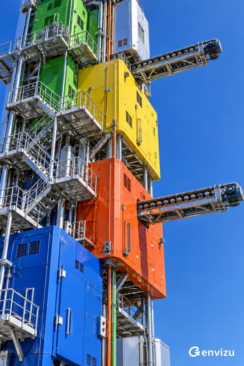</a>

先把机位定为仰视且塔顶出框，再逐一列出模块颜色与材质，让烤漆板和铬框清楚区分。铰链、检修楼梯、两条不同高度的传送带等具体细节，加上硬光和末尾的排除清单，让画面干净且结构合理。

GPT Image 2.5 · 文生图 · 出处: [@listudio on X](https://x.com/listudio/status/2098316254679625917) · 发现于 [wangrunlin/awesome-gpt-image-2-5-prompts](https://github.com/wangrunlin/awesome-gpt-image-2-5-prompts)

[`industrial`](tags.md#tag-industrial) [`low-angle`](tags.md#tag-low-angle) [`photoreal`](tags.md#tag-photoreal) [`hard-light`](tags.md#tag-hard-light) [`architecture`](tags.md#tag-architecture)

<details><summary><b>提示词</b></summary>

```text
Create a 2:3 photoreal industrial tower viewed from below, its top outside the frame. Stack offset cobalt, orange-red, yellow, green and silver metal modules. Separate glossy painted panels from chrome frames. Show seams, hinges, maintenance stairs and two supported roller conveyors at different heights. Add a few vertical pipes. Leave clear blue sky on the right. Use hard sunlight and crisp shadows. No text, logos, watermarks, weathering, haze or floating parts.
```

</details>
